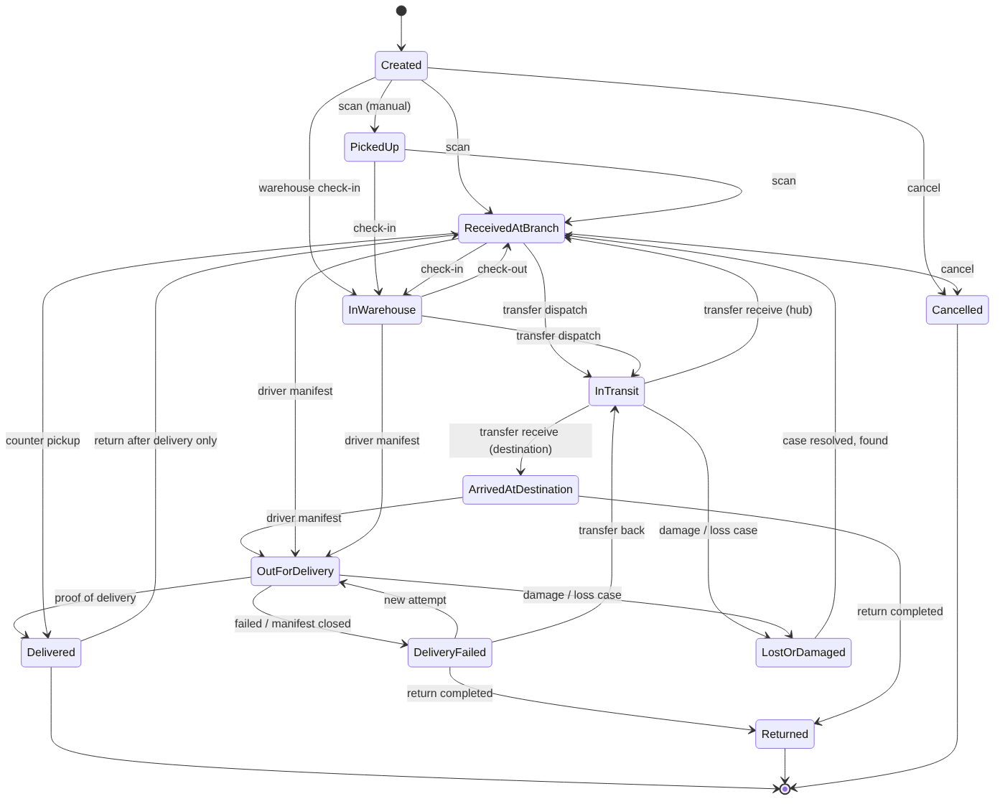
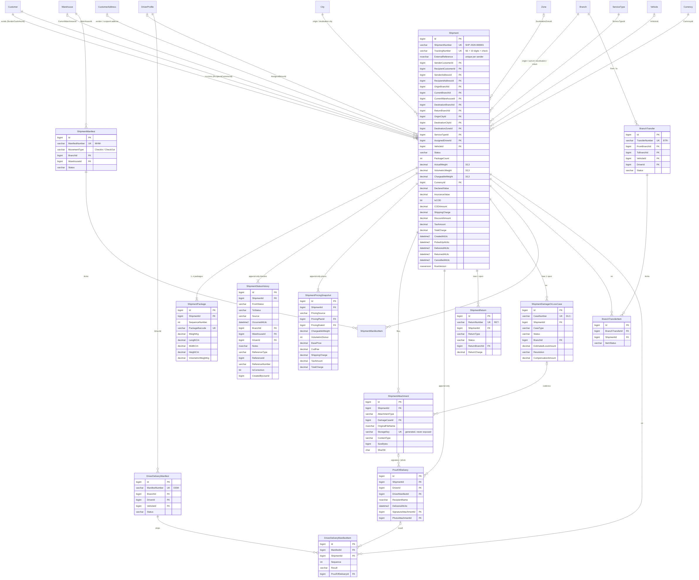
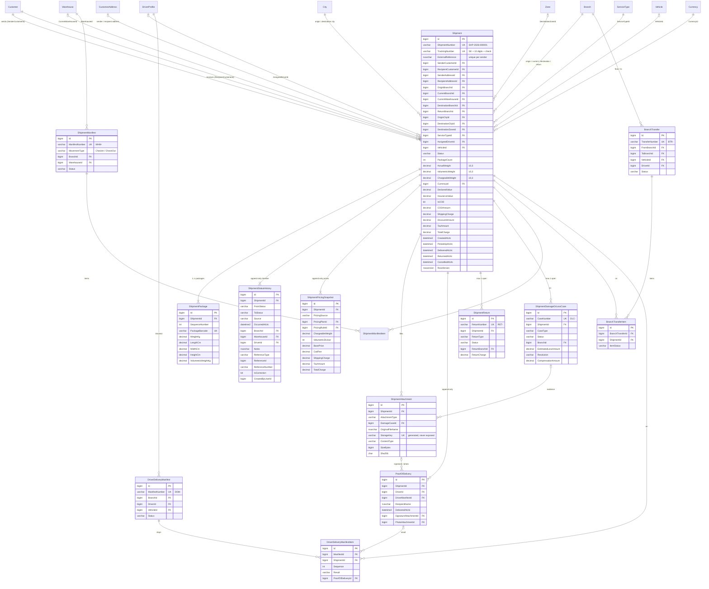

# الخطوة 4 — الشحنات، التتبع، المستودع، التحويلات، السائقون، إثبات التسليم، الملصقات والاستيراد من Excel

> تُبنى هذه الخطوة فوق **الخطوة 3 الكاملة**. قبل أن تبدأ تأكد أن `dotnet test` في نسخة الخطوة 3 يعطي **123 اختباراً ناجحاً**.
> بعد هذه الخطوة يصبح العدد المتوقع **247 اختباراً**.
>
> **المكتبات**: نستخدم Mapster بدلاً من AutoMapper (بسبب الثغرة CVE-2026-32933 كما اتفقنا). الجديد في هذه الخطوة:
> ClosedXML ‏0.104.2 (MIT) لملفات Excel، وQuestPDF ‏2025.12.4 لملفات PDF، وZXing.Net ‏0.16.9 (Apache-2.0) للباركود وQR.
> **رخصة QuestPDF**: رخصة Community مجانية للأفراد والشركات التي يقل إيرادها السنوي عن مليون دولار. إذا تجاوزت شركتك ذلك تحتاج رخصة تجارية.
>
> لا توجد في هذه الخطوة قيود محاسبية ولا تسوية لمبالغ الدفع عند الاستلام (COD). نحفظ المبالغ وحالة التشغيل فقط.

---

## 1. ماذا بنينا؟ (شرح خطوات التنفيذ)

### 1.1 طبقة Domain

1. **`ShipmentStatus`**: الحالات الاثنتا عشرة (Created … LostOrDamaged). تُحفظ كنص في قاعدة البيانات، لذلك لا تغيّر أسماءها أبداً.
2. **`ShipmentStatusRules`**: آلة الحالات، ولها ثلاث طبقات من القواعد:
   - **التالي المسموح**: مثلاً من `InTransit` نستطيع الانتقال إلى `ArrivedAtDestination` أو `ReceivedAtBranch` أو `LostOrDamaged` فقط.
   - **حالات خاصة بمسار محدد**: `InTransit` لا يُصل إليها إلا عبر تحويل بين الفروع، و`OutForDelivery` عبر بيان توزيع، و`Delivered` بإثبات تسليم، و`Returned` بمرتجع، و`Cancelled` بإلغاء، و`LostOrDamaged` بحالة تلف.
   - **إعادة فتح حالة نهائية**: `Delivered → ReceivedAtBranch` مسموحة فقط عبر مرتجع «بعد التسليم»، و`LostOrDamaged → ReceivedAtBranch` فقط عند إغلاق حالة التلف بنتيجة «وُجدت».
   - **التصحيح** (`Shipments.CorrectStatus`) يتجاوز القواعد مع سبب إلزامي، ويُسجَّل في السجل بعلامة `isCorrection`.
3. **`ShipmentStatusHistory`**: سطر غير قابل للتعديل لكل تغيير حالة (`IAppendOnlyEntity`). المعترض `AuditableEntityInterceptor` يرفض أي تعديل أو حذف عليه.
4. **`ShipmentWeightCalculator`**: الوزن الحجمي = الطول × العرض × الارتفاع ÷ المعامل. الوزن المحتسب = الأكبر بين الفعلي والحجمي، مقرّباً للأعلى إلى خطوة التقريب.
5. الكيانات الجديدة: `Shipment`، `ShipmentPackage`، `ShipmentStatusHistory`، `ShipmentAttachment`، `ShipmentPricingSnapshot`، `ShipmentManifest` و`ShipmentManifestItem` (حركة المستودع)، `BranchTransfer` و`BranchTransferItem`، `DriverDeliveryManifest` و`DriverDeliveryManifestItem`، `ProofOfDelivery`، `ShipmentReturn`، `ShipmentDamageOrLossCase`، `ShippingSettings`، `DocumentSequence`.
6. **صلاحيات جديدة**، تُمنح تلقائياً للأدوار المدمجة عند أول تشغيل بعد التحديث:
   - `Shipments.Cancel`
   - `Shipments.ConfirmDelivery`
   - `Shipments.CorrectStatus`
   - `Shipments.Import`
   - `Shipments.OverridePrice`
   - `Warehouse.ManageMovements`
   - `Transfers.View`، `Transfers.Manage`، `Transfers.Receive`
   - `DeliveryManifests.Manage`
   - `Returns.Manage`
   - `DamageCases.Manage`

### 1.2 الترقيم الآمن

- **رقم الشحنة** `SHP-2026-000001`: جدول `DocumentSequences` فيه صف لكل (نوع المستند، السنة). في SQL Server تزيد عبارة `MERGE … WITH (HOLDLOCK)` واحدة العدّاد وتعيد القيمة الجديدة **داخل معاملة الطلب نفسها**. يبقى الصف مقفلاً حتى نهاية المعاملة، فلا يحصل مستخدمان على الرقم نفسه أبداً. إذا أُلغيت المعاملة قد تظهر فجوة في الأرقام، لكن لا يتكرر رقم.
- البادئات نفسها لباقي المستندات: `WHM-` و`BTR-` و`DDM-` و`RET-` و`DLC-`.
- **رقم التتبع** `SE48213907651`: بادئة قابلة للتعديل، ثم 10 أرقام عشوائية من مولّد تشفيري، ثم رقم تحقق Luhn. لا يمكن تخمينه بالعدّ، ويكتشف الخطأ في رقم واحد عند الإدخال. يُفحص تفرّده في قاعدة البيانات، والفهرس الفريد هو الضمان الأخير.

### 1.3 السعر

`ShipmentPricingCalculator` يستخدم خطط التسعير من الخطوة 3:

1. يختار خطة المرسل إذا كانت فعّالة وسارية اليوم، وإلا الخطة الافتراضية.
2. يختار القاعدة المطابقة (العميل، منطقة الانطلاق، منطقة الوصول، نوع الخدمة، مجال الوزن). الأعلى أولوية يفوز، ثم الأكثر تحديداً.
3. يحسب:
   - السعر = السعر الأساسي + (الوزن المحتسب − الحد الأدنى للوزن) × سعر الكيلو الإضافي
   - رسوم COD = الرسم الثابت + مبلغ COD × النسبة ÷ 100
   - الضريبة = (سعر الشحن − الخصم) × نسبة الضريبة الافتراضية
4. تُحفظ **لقطة سعر** (`ShipmentPricingSnapshot`) لا تتغير. تعديل خطط التسعير لاحقاً لا يغيّر سعر شحنة قديمة.
5. السعر اليدوي والخصم يحتاجان `Shipments.OverridePrice`.

### 1.4 الرؤية (من يرى ماذا؟)

`ShipmentAccessService` يحدد ما يراه كل مستخدم:

- لديه `Branches.ViewAll`: يرى كل الشحنات.
- **سائق** (دور Driver بدون `Shipments.AssignDriver`): يرى فقط الشحنات المسندة إلى ملف السائق المربوط بحسابه (`DriverProfile.UserId`)، وبيانات التوزيع الخاصة به فقط.
- غير ذلك: يرى الشحنات التي يكون فرع الإنشاء أو الفرع الحالي أو فرع الوجهة أو فرع الإرجاع فيها هو فرعه.
- الشحنة خارج نطاق المستخدم تُرجع **404** وليس 403، حتى لا نكشف أنها موجودة.

### 1.5 المستندات التشغيلية

| المستند | المسار | ما الذي يحدث |
|---|---|---|
| بيان حركة المستودع | مسودة ← إضافة بالمسح الضوئي ← **تأكيد** | `CheckIn` يجعل الحالة `InWarehouse`، و`CheckOut` يجعلها `ReceivedAtBranch`، في معاملة واحدة |
| تحويل بين الفروع | مسودة ← **إرسال** ← **استلام** | الإرسال يجعل الحالة `InTransit`. الاستلام في فرع الوجهة يجعلها `ArrivedAtDestination`، وفي فرع وسيط `ReceivedAtBranch`. ما لم يصل يُعلَّم `Missing` |
| بيان توزيع للسائق | مسودة ← **تسليم للسائق** ← تسليم أو فشل لكل شحنة ← **إغلاق** | الشحنات تصبح `OutForDelivery` ومسندة للسائق. عند الإغلاق تصبح الشحنات المتبقية `DeliveryFailed` |
| إثبات التسليم | `POST /shipments/{id}/deliver` | اسم المستلم والوقت، مع توقيع وصورة اختياريين، والسائق، والملاحظات. يحدّث سطر بيان التوزيع تلقائياً |
| المرتجع | فتح ← (بعد التسليم: استلام) ← تحويل إلى فرع الإرجاع ← **إكمال** | يمنع التسليم للمستلم أثناء فتحه. بعد الإكمال تصبح الحالة `Returned` |
| حالة تلف أو فقدان | فتح ← تحقيق ← **إغلاق** | تجعل الحالة `LostOrDamaged`. نتيجة «وُجدت» تعيد الشحنة إلى `ReceivedAtBranch` |

لا يمكن أن تكون الشحنة على أكثر من مستند مفتوح من النوع نفسه. لا يمكن إلغاء شحنة موجودة على مستند مفتوح، ولا تصحيح حالة شحنة على مستند لم يُغلق.

### 1.6 رفع الملفات بأمان (`LocalFileStorage`)

- الأنواع المسموحة: JPEG وPNG وWEBP وPDF فقط. يُكتشف النوع من **أول بايتات المحتوى** وليس من الاسم أو الـ Content-Type.
- يجب أن يطابق امتداد الملف محتواه. مثلاً `photo.png` يحتوي سكربتاً يُرفض.
- الحد الأقصى 5MB، ويُفحص أثناء النسخ أيضاً.
- اسم التخزين مولّد: `shipments/2026/10/{guid}.png`. اسم العميل يُستخدم للعرض فقط بعد تنظيفه.
- يُحفظ المفتاح النسبي فقط في قاعدة البيانات، ويُفحص كل مسار ليبقى داخل مجلد التخزين.
- لا يُعاد أي مسار فعلي للعميل. التنزيل يتم عبر `/api/v1/shipments/{id}/attachments/{attachmentId}/content` بنفس صلاحيات رؤية الشحنة.
- إذا فشلت المعاملة بعد حفظ الملف، يُحذف الملف.

### 1.7 الملصقات

- **PDF** باستخدام QuestPDF، و**HTML** قابل للطباعة. الملف كله من اليمين لليسار، وخط Cairo مضمّن داخل المشروع حتى تظهر العربية في Docker دون تثبيت خطوط.
- **المقاس**: 100×150 مم افتراضياً (4×6 إنش)، ويمكن تغييره من الإعدادات.
- **محتوى الملصق**:
  - صفحة لكل طرد
  - باركود Code128 لرقم التتبع، ورمز QR فيه رابط التتبع إن وُجد في الإعدادات، وإلا رقم التتبع
  - المرسل والمستلم والوجهة ورمز فرع الوجهة بخط كبير
  - مبلغ COD في مربع أسود إن وُجد
- في ملف HTML تُرمَّز كل قيمة يدخلها المستخدم (HtmlEncode)، وسياسة CSP تمنع أي سكربت.


### 1.8 الاستيراد من Excel

1. `GET /shipments/import/template`: يعطيك قالباً بالأعمدة، وصف مثال، وورقة تعليمات بالعربية.
2. `POST /shipments/import/preview`: يقرأ كل صف ويتحقق منه **بنفس قواعد** `POST /shipments` (FluentValidation + `ShipmentBuilder` + التسعير)، ويعيد أخطاء كل صف. لا يُحفظ شيء.
3. `POST /shipments/import`: يتحقق من جديد. إذا كان أي صف خاطئاً **لا يُستورد شيء** ويعود 400 مع أخطاء الصفوف (`"row 5": [...]`). إذا كانت كل الصفوف صحيحة تُنشأ كل الشحنات في **معاملة واحدة**.
4. **الحدود**: ملف ‎.xlsx فقط، حتى 5MB و500 صف.
5. **عمود العميل**: يقبل رمز العميل أو رقم هاتفه. يُستخدم العنوان الافتراضي للمستلم، ويُقسم الوزن الكلي على عدد الطرود.

### 1.9 الأداء والفهارس

- كل القوائم `AsNoTracking` وتُحوَّل مباشرة إلى DTO داخل SQL.
- فهارس على الحالة، وأزواج (الفرع، الحالة)، و(السائق، الحالة)، والعملاء، والمدن، ونوع الخدمة، وتاريخ الإنشاء، وCOD (فهرس مُرشَّح).
- فهارس فريدة على: رقم الشحنة، رقم التتبع، باركود الطرد، مرجع المرسل (مُرشَّح)، ومرتجع مفتوح واحد لكل شحنة.

### 1.10 تعديلات على ملفات سابقة

- `ICurrentUserService.IsInRole` لمعرفة السائق.
- `ValidationFilter` يبحث عن المحقق (validator) للنوع الأب، حتى تعمل نماذج multipart.
- منع حذف الفروع والمدن والمناطق وأنواع الخدمة والعملات والمركبات والسائقين والمستودعات والعملاء وعناوينهم إذا كانت مستخدمة في شحنات. السبب: الحذف المنطقي كان سيخفي الشحنات المرتبطة بها.
- Docker:
  - مجلد ملفات مرفوعة دائم `api-uploads`
  - مكتبة `libfontconfig1` لمحرك PDF

---

## 2. خطوات التطبيق على جهازك (Windows PowerShell)

> فك الضغط في **مجلد جديد** باسم مختلف، حتى لا يختلط بنسخة قديمة.

```powershell
# 1) فك ضغط النسخة الكاملة
Expand-Archive "$HOME\Downloads\ShippingERP-Step04-full.zip" -DestinationPath "$HOME\Downloads\ShippingERP-Step04" -Force
cd "$HOME\Downloads\ShippingERP-Step04"

# تأكد أنك في النسخة الصحيحة (يجب أن تُرجع True)
Test-Path .\src\ShippingERP.Domain\Shipments\ShipmentStatusRules.cs

# 2) الاستعادة والبناء والاختبار
dotnet tool restore
dotnet restore
dotnet build
dotnet test        # المتوقع: 247 اختباراً ناجحاً

# 3) Migration جديدة للجداول الجديدة
dotnet ef migrations add AddShipments `
  --project src/ShippingERP.Infrastructure `
  --startup-project src/ShippingERP.API `
  --output-dir Persistence/Migrations

# 4) تحديث قاعدة البيانات
dotnet ef database update `
  --project src/ShippingERP.Infrastructure `
  --startup-project src/ShippingERP.API

# 5) التشغيل
dotnet run --project src/ShippingERP.API --launch-profile http
```

- إذا نقلت مجلد `Migrations` من نسخة الخطوة 3، انسخ المجلد `src/ShippingERP.Infrastructure/Persistence/Migrations` من مشروعك السابق قبل الأمر 3. إذا بدأت بقاعدة بيانات جديدة، أنشئ migration واحدة باسم `InitialCreate` بدل `AddShipments`.
- عند أول تشغيل في بيئة Development:
  - تُضاف الصلاحيات الجديدة تلقائياً للأدوار المدمجة.
  - إذا كانت بيانات الخطوة 3 التجريبية موجودة ولا توجد أي شحنة، تُنشأ **6 شحنات تجريبية** بحالات مختلفة.
  - ابحث في السجل عن: `Demo shipments created (6)`.
- **سجّل الخروج ثم الدخول من جديد**، حتى يحمل الـ Token الصلاحيات الجديدة.

### 2.1 مجلد الملفات المرفوعة

- **محلياً**: المسار `App_Data/uploads` بالنسبة لمجلد التشغيل. في الإنتاج استخدم مساراً مطلقاً:

```powershell
dotnet user-secrets set "FileStorage:RootPath" "D:\ShippingERP\uploads" --project src/ShippingERP.API
```

- **Docker**: المجلد `/app/App_Data` على volume اسمه `api-uploads`. خذ منه نسخة احتياطية مع قاعدة البيانات.

---

## 3. التجربة في Swagger (بالترتيب)

1. سجّل الدخول بحساب المدير، ثم اضغط Authorize والصق `accessToken`.
2. `GET /api/v1/shipments` لترى الشحنات التجريبية الست.
3. `POST /api/v1/shipments/quote` لمعاينة السعر، ثم `POST /api/v1/shipments` لإنشاء شحنة.
4. `PATCH /api/v1/shipments/{id}/status` بالقيمة `{"status":"ReceivedAtBranch"}`.
5. أنشئ تحويلاً إلى حلب ثم أرسله:
   - `POST /api/v1/branch-transfers` مع `"codes": ["رقم التتبع"]`
   - `POST /api/v1/branch-transfers/{id}/dispatch`
6. `POST /api/v1/branch-transfers/{id}/receive` لاستلامه في حلب (المدير يملك `Branches.ViewAll`).
7. أنشئ بيان توزيع ثم سلّمه للسائق:
   - `POST /api/v1/driver-manifests` مع سائق حلب
   - `POST /api/v1/driver-manifests/{id}/dispatch`
8. `POST /api/v1/shipments/{id}/deliver` من نوع multipart، مع اسم المستلم وملف توقيع PNG اختياري.
9. `GET /api/v1/shipments/{id}/history` لترى الخط الزمني كاملاً.
10. `GET /api/v1/shipments/{id}/label?format=Pdf` (أو `Html`)، ثم اضغط Download file.
11. حمّل القالب من `GET /api/v1/shipments/import/template`، املأه، ثم جرّب `preview` ثم `import`.



---

## 4. مخطط قاعدة البيانات (ERD)





---

## 5. أمثلة Swagger (JSON)

### 5.1 إنشاء شحنة — `POST /api/v1/shipments`

```json
{
  "senderCustomerId": 3,
  "recipientCustomerId": 6,
  "originBranchId": 1,
  "serviceTypeId": 2,
  "packageDescription": "أجهزة إلكترونية صغيرة",
  "packages": [
    { "weightKg": 3, "lengthCm": 40, "widthCm": 30, "heightCm": 20 },
    { "weightKg": 4, "lengthCm": 40, "widthCm": 30, "heightCm": 20 }
  ],
  "declaredValue": 300000,
  "insuranceValue": 0,
  "isCOD": true,
  "codAmount": 300000,
  "senderNotes": "اتصل بالمستلم قبل التوصيل",
  "externalReference": "NOOR-5522"
}
```

الاستجابة `201 Created` (مختصرة):

```json
{
  "success": true,
  "message": "تم تسجيل الشحنة",
  "data": {
    "id": 7,
    "shipmentNumber": "SHP-2026-000007",
    "trackingNumber": "SE48213907651",
    "status": "Created",
    "statusName": "تم الإنشاء",
    "senderName": "متجر النور الإلكتروني",
    "recipientName": "ريم عبد الله حداد",
    "originBranchName": "فرع دمشق",
    "destinationBranchId": 2,
    "destinationBranchName": "فرع حلب",
    "destinationCityName": "حلب",
    "destinationZoneName": "الحمدانية",
    "packageCount": 2,
    "actualWeight": 7.000,
    "volumetricWeight": 9.600,
    "chargeableWeight": 10.000,
    "currencyCode": "SYP",
    "isCOD": true,
    "codAmount": 300000.00,
    "shippingCharge": 65000.00,
    "discountAmount": 0.00,
    "taxAmount": 0.00,
    "totalCharge": 65000.00,
    "packages": [
      { "id": 11, "sequenceNumber": 1, "packageBarcode": "SE48213907651-001", "weightKg": 3.000, "volumetricWeightKg": 4.800 },
      { "id": 12, "sequenceNumber": 2, "packageBarcode": "SE48213907651-002", "weightKg": 4.000, "volumetricWeightKg": 4.800 }
    ],
    "nextStatuses": [ "PickedUp", "ReceivedAtBranch", "InWarehouse", "Cancelled", "LostOrDamaged" ]
  },
  "traceId": "4bf92f3577b34da6a3ce929d0e0e4736",
  "timestampUtc": "2026-10-11T09:00:00.000Z"
}
```

(خدمة سريعة: 30,000 + 10 كغ × 3,000 = 60,000، ورسوم COD = ‏2,000 + 1% × 300,000 = 5,000، فيكون المجموع 65,000.)

### 5.2 مسح ضوئي للحالة — `PATCH /api/v1/shipments/{id}/status`

```json
{ "status": "InWarehouse", "warehouseId": 1, "notes": "رف A-12" }
```

محاولة حالة غير مسموحة (مثل `Delivered`) تعيد 400:

```json
{
  "success": false,
  "message": "البيانات المدخلة غير صحيحة.",
  "error": {
    "code": "VALIDATION_ERROR",
    "message": "البيانات المدخلة غير صحيحة.",
    "details": { "status": [ "يمكن تغيير الحالة يدوياً إلى PickedUp أو ReceivedAtBranch أو InWarehouse فقط. ..." ] }
  }
}
```

انتقال يخالف آلة الحالات يعيد 422:

```json
{
  "success": false,
  "error": {
    "code": "BUSINESS_RULE_VIOLATION",
    "message": "لا يمكن تغيير حالة الشحنة SHP-2026-000007 من «تم التسليم» إلى «قيد النقل بين الفروع» بهذه العملية."
  }
}
```

### 5.3 تحويل بين الفروع

`POST /api/v1/branch-transfers`

```json
{ "fromBranchId": 1, "toBranchId": 2, "vehicleId": 1, "sealNumber": "S-0091", "codes": [ "SE48213907651", "SHP-2026-000003" ] }
```

`POST /api/v1/branch-transfers/{id}/dispatch`

```json
{ "driverId": 1, "notes": "خرجت الساعة 8 صباحاً" }
```

`POST /api/v1/branch-transfers/{id}/receive` (القائمة الفارغة تعني أن كل الشحنات وصلت)

```json
{ "receivedCodes": [ "SE48213907651" ], "notes": "شحنة واحدة لم تصل" }
```

### 5.4 بيان توزيع — `POST /api/v1/driver-manifests`

```json
{ "driverId": 2, "manifestDateUtc": "2026-10-12T00:00:00Z", "codes": [ "SE48213907651" ] }
```

ثم: `POST /api/v1/driver-manifests/{id}/dispatch`، وفي آخر اليوم:

```json
{ "pendingReason": "المستلم غير موجود", "notes": "عاد السائق 6 مساءً" }
```

### 5.5 إثبات التسليم — `POST /api/v1/shipments/{id}/deliver` (multipart/form-data)

```powershell
curl.exe -X POST "http://localhost:5080/api/v1/shipments/7/deliver" `
  -H "Authorization: Bearer $token" `
  -F "recipientName=ريم حداد" -F "recipientRelation=المستلم نفسه" `
  -F "notes=سُلّمت باليد" -F "signature=@C:\temp\signature.png"
```

```json
{
  "success": true,
  "message": "تم تأكيد التسليم",
  "data": {
    "id": 1,
    "shipmentId": 7,
    "shipmentNumber": "SHP-2026-000007",
    "driverId": 2,
    "driverName": "عمر يوسف",
    "driverManifestId": 1,
    "recipientName": "ريم حداد",
    "deliveredAtUtc": "2026-10-12T10:41:00Z",
    "signatureAttachmentId": 5,
    "signatureUrl": "/api/v1/shipments/7/attachments/5/content"
  }
}
```

فشل التسليم — `POST /api/v1/shipments/{id}/delivery-failed`:

```json
{ "reason": "المستلم غير موجود", "notes": "تم الاتصال مرتين" }
```

### 5.6 مرتجع — `POST /api/v1/shipment-returns`

```json
{ "shipmentId": 7, "returnType": "RecipientRefused", "reason": "رفض المستلم الاستلام", "returnCharge": 15000 }
```

مرتجع بعد التسليم:

1. `returnType = "AfterDelivery"`
2. `POST /api/v1/shipment-returns/{id}/receive` مع `{ "branchId": 2 }`
3. تحويل الشحنة إلى فرع الإرجاع
4. `POST /api/v1/shipment-returns/{id}/complete`

### 5.7 حالة تلف أو فقدان — `POST /api/v1/damage-cases`

```json
{ "shipmentId": 7, "caseType": "Lost", "description": "لم يُعثر عليها في الجرد", "estimatedLossAmount": 300000, "markShipmentAsLostOrDamaged": true }
```

الإغلاق — `POST /api/v1/damage-cases/{id}/resolve`:

```json
{ "resolution": "Compensated", "compensationAmount": 250000, "notes": "تم الاتفاق مع المرسل" }
```

### 5.8 تصحيح حالة — `POST /api/v1/shipments/{id}/status-corrections`

```json
{ "status": "OutForDelivery", "reason": "أُكّد التسليم بالخطأ من السائق" }
```

### 5.9 معاينة الاستيراد — `POST /api/v1/shipments/import/preview`

```json
{
  "success": true,
  "data": {
    "fileName": "shipments.xlsx",
    "totalRows": 3,
    "validRows": 2,
    "invalidRows": 1,
    "canImport": false,
    "rows": [
      { "rowNumber": 2, "isValid": true, "errors": [], "senderCustomerCode": "CUS-00003", "totalCharge": 18250.00, "currencyCode": "SYP" },
      { "rowNumber": 3, "isValid": true, "errors": [], "senderCustomerCode": "+963113000103", "totalCharge": 21500.00, "currencyCode": "SYP" },
      { "rowNumber": 4, "isValid": false, "errors": [ "المرسل 'CUS-99999' غير موجود." ] }
    ]
  }
}
```

### 5.10 إعدادات الشحن — `PUT /api/v1/shipping-settings`

```json
{
  "volumetricDivisor": 5000,
  "weightRoundingStepKg": 0.5,
  "trackingNumberPrefix": "SE",
  "labelWidthMm": 100,
  "labelHeightMm": 150,
  "trackingUrlTemplate": "https://track.example.com/{trackingNumber}"
}
```

---

## 6. ملاحظات مهمة

- **المبالغ**: كل المبالغ `decimal`، وكل التواريخ UTC، ولا تُعاد كيانات EF من الـ API (DTOs فقط).
- **التحويلات**: الشحنة التي تُعلَّم `Missing` في تحويل تبقى `InTransit`. لمعالجتها إما:
  - تصحيح حالة عند العثور عليها
  - أو فتح حالة فقدان
- **السائق**: لربط حساب سائق بملف السائق، حدّث `userId` في ملف السائق (`PUT /api/v1/drivers/{id}`) أو اربط الموظف بالمستخدم.

---

## 7. الملفات الكاملة (111 ملفاً جديداً أو معدّلاً)

كل ملف كامل كما هو في المشروع. المسارات نسبية من المجلد الجذر للحل.

### 7.1 `src/ShippingERP.Domain/Authorization/Permissions.cs`

```csharp
namespace ShippingERP.Domain.Authorization;

/// <summary>
/// The single source of truth for permission codes.
///
/// - Use the constants in code: [HasPermission(Permissions.Shipments.Create)]
/// - The seeder inserts any code from <see cref="All"/> that is missing in the Permissions table,
///   so adding a permission = add a constant here + add it to All + restart the API.
/// - Never rename an existing code: role assignments and issued tokens refer to it.
/// </summary>
public static class Permissions
{
    public static class Users
    {
        public const string View = "Users.View";
        public const string Manage = "Users.Manage";
    }

    public static class Roles
    {
        public const string Manage = "Roles.Manage";
    }

    public static class Customers
    {
        public const string View = "Customers.View";
        public const string Manage = "Customers.Manage";
    }

    public static class Shipments
    {
        public const string View = "Shipments.View";
        public const string Create = "Shipments.Create";
        public const string Update = "Shipments.Update";
        public const string ChangeStatus = "Shipments.ChangeStatus";
        public const string AssignDriver = "Shipments.AssignDriver";

        // ----- Step 4 -----

        /// <summary>Cancel a shipment that has not left the origin branch.</summary>
        public const string Cancel = "Shipments.Cancel";

        /// <summary>Confirm a delivery (proof of delivery) or record a failed attempt.</summary>
        public const string ConfirmDelivery = "Shipments.ConfirmDelivery";

        /// <summary>Correct a wrong status outside the normal rules (reason required, fully audited).</summary>
        public const string CorrectStatus = "Shipments.CorrectStatus";

        /// <summary>Import shipments from Excel.</summary>
        public const string Import = "Shipments.Import";

        /// <summary>Enter a manual shipping charge (when no pricing rule applies) or give a discount.</summary>
        public const string OverridePrice = "Shipments.OverridePrice";
    }

    // ----- Step 4: operations -----

    /// <summary>Warehouse check-in / check-out manifests.</summary>
    public static class Warehouse
    {
        public const string ManageMovements = "Warehouse.ManageMovements";
    }

    /// <summary>Branch transfer manifests.</summary>
    public static class Transfers
    {
        public const string View = "Transfers.View";
        public const string Manage = "Transfers.Manage";
        public const string Receive = "Transfers.Receive";
    }

    /// <summary>Driver delivery manifests (drivers see their own manifests with Shipments.View).</summary>
    public static class DeliveryManifests
    {
        public const string Manage = "DeliveryManifests.Manage";
    }

    public static class Returns
    {
        public const string Manage = "Returns.Manage";
    }

    public static class DamageCases
    {
        public const string Manage = "DamageCases.Manage";
    }

    public static class Cod
    {
        public const string View = "COD.View";
        public const string Collect = "COD.Collect";
        public const string Settle = "COD.Settle";
    }

    public static class Invoices
    {
        public const string View = "Invoices.View";
        public const string Create = "Invoices.Create";
    }

    public static class Accounting
    {
        public const string View = "Accounting.View";
        public const string CreateJournal = "Accounting.CreateJournal";
        public const string ApproveJournal = "Accounting.ApproveJournal";
    }

    public static class Expenses
    {
        public const string View = "Expenses.View";
        public const string Create = "Expenses.Create";
        public const string Approve = "Expenses.Approve";
    }

    public static class Reports
    {
        public const string ViewFinancial = "Reports.ViewFinancial";
        public const string ViewOperational = "Reports.ViewOperational";
    }

    public static class Branches
    {
        /// <summary>See and manage data of every branch. Without it a user only sees their own branch.</summary>
        public const string ViewAll = "Branches.ViewAll";
        public const string Manage = "Branches.Manage";
    }

    // ----- Step 3: master data -----

    /// <summary>
    /// Reference data used by everybody: countries, cities, zones, service types, payment methods,
    /// currencies, exchange rates, tax rates, expense categories, company profile.
    /// Reading them only requires being signed in; changing them requires MasterData.Manage.
    /// </summary>
    public static class MasterData
    {
        public const string Manage = "MasterData.Manage";
    }

    public static class Pricing
    {
        public const string View = "Pricing.View";
        public const string Manage = "Pricing.Manage";
    }

    public static class Suppliers
    {
        public const string View = "Suppliers.View";
        public const string Manage = "Suppliers.Manage";
    }

    /// <summary>Employees and driver profiles.</summary>
    public static class Employees
    {
        public const string View = "Employees.View";
        public const string Manage = "Employees.Manage";
    }

    public static class Vehicles
    {
        public const string View = "Vehicles.View";
        public const string Manage = "Vehicles.Manage";
    }

    /// <summary>Every permission with its module and Arabic description.</summary>
    public static IReadOnlyList<PermissionDefinition> All { get; } = new List<PermissionDefinition>
    {
        new(Users.View, "Users", "عرض المستخدمين"),
        new(Users.Manage, "Users", "إدارة المستخدمين (إضافة، تعديل، تفعيل، إيقاف)"),
        new(Roles.Manage, "Roles", "إدارة الأدوار والصلاحيات"),

        new(Customers.View, "Customers", "عرض العملاء"),
        new(Customers.Manage, "Customers", "إدارة العملاء"),

        new(Shipments.View, "Shipments", "عرض الشحنات"),
        new(Shipments.Create, "Shipments", "إنشاء شحنة"),
        new(Shipments.Update, "Shipments", "تعديل شحنة"),
        new(Shipments.ChangeStatus, "Shipments", "تغيير حالة الشحنة"),
        new(Shipments.AssignDriver, "Shipments", "إسناد الشحنة إلى سائق"),
        new(Shipments.Cancel, "Shipments", "إلغاء شحنة"),
        new(Shipments.ConfirmDelivery, "Shipments", "تأكيد التسليم وتسجيل محاولات التسليم الفاشلة"),
        new(Shipments.CorrectStatus, "Shipments", "تصحيح حالة شحنة خارج المسار الطبيعي"),
        new(Shipments.Import, "Shipments", "استيراد الشحنات من Excel"),
        new(Shipments.OverridePrice, "Shipments", "إدخال سعر شحن يدوي ومنح خصم"),

        new(Warehouse.ManageMovements, "Warehouse", "إدخال وإخراج الشحنات من المستودع"),
        new(Transfers.View, "Transfers", "عرض التحويلات بين الفروع"),
        new(Transfers.Manage, "Transfers", "إنشاء وإرسال التحويلات بين الفروع"),
        new(Transfers.Receive, "Transfers", "استلام التحويلات الواردة"),
        new(DeliveryManifests.Manage, "DeliveryManifests", "إنشاء وإدارة بيانات التوزيع للسائقين"),
        new(Returns.Manage, "Returns", "إدارة المرتجعات"),
        new(DamageCases.Manage, "DamageCases", "إدارة حالات التلف والفقدان"),

        new(Cod.View, "COD", "عرض مبالغ الدفع عند الاستلام"),
        new(Cod.Collect, "COD", "تحصيل مبالغ الدفع عند الاستلام"),
        new(Cod.Settle, "COD", "تسوية مبالغ الدفع عند الاستلام مع العملاء"),

        new(Invoices.View, "Invoices", "عرض الفواتير"),
        new(Invoices.Create, "Invoices", "إنشاء الفواتير"),

        new(Accounting.View, "Accounting", "عرض الحسابات والقيود"),
        new(Accounting.CreateJournal, "Accounting", "إنشاء قيود يومية"),
        new(Accounting.ApproveJournal, "Accounting", "اعتماد قيود اليومية"),

        new(Expenses.View, "Expenses", "عرض المصروفات"),
        new(Expenses.Create, "Expenses", "تسجيل المصروفات"),
        new(Expenses.Approve, "Expenses", "اعتماد المصروفات"),

        new(Reports.ViewFinancial, "Reports", "عرض التقارير المالية"),
        new(Reports.ViewOperational, "Reports", "عرض التقارير التشغيلية"),

        new(Branches.ViewAll, "Branches", "الاطلاع على بيانات جميع الفروع"),
        new(Branches.Manage, "Branches", "إدارة الفروع والمستودعات"),

        new(MasterData.Manage, "MasterData", "إدارة البيانات الأساسية (الدول، المدن، المناطق، العملات، الضرائب...)"),

        new(Pricing.View, "Pricing", "عرض خطط التسعير"),
        new(Pricing.Manage, "Pricing", "إدارة خطط التسعير وقواعدها"),

        new(Suppliers.View, "Suppliers", "عرض الموردين"),
        new(Suppliers.Manage, "Suppliers", "إدارة الموردين"),

        new(Employees.View, "Employees", "عرض الموظفين والسائقين"),
        new(Employees.Manage, "Employees", "إدارة الموظفين والسائقين"),

        new(Vehicles.View, "Vehicles", "عرض المركبات"),
        new(Vehicles.Manage, "Vehicles", "إدارة المركبات")
    };

    private static readonly HashSet<string> AllCodes =
        new(All.Select(permission => permission.Code), StringComparer.Ordinal);

    /// <summary>True if the code exists in the catalog (case-sensitive).</summary>
    public static bool IsKnown(string code) => AllCodes.Contains(code);
}
```

### 7.2 `src/ShippingERP.Domain/Authorization/Roles.cs`

```csharp
using P = ShippingERP.Domain.Authorization.Permissions;

namespace ShippingERP.Domain.Authorization;

/// <summary>
/// The seven built-in roles.
///
/// DefaultPermissions are applied when the seeder creates the role for the first time. When a NEW permission
/// code is added to Permissions.cs later, the seeder also grants it to the built-in roles that list it here
/// (only on the run that creates the permission). Changes an administrator makes with
/// PUT /api/v1/roles/{id}/permissions are never overwritten. SystemAdmin always holds every permission.
///
/// Drivers: a user in the Driver role who does NOT hold Shipments.AssignDriver only sees the shipments and
/// delivery manifests assigned to his driver profile (DriverProfile.UserId).
/// </summary>
public static class Roles
{
    public const string SystemAdmin = "SystemAdmin";
    public const string Accountant = "Accountant";
    public const string BranchManager = "BranchManager";
    public const string ShippingAgent = "ShippingAgent";
    public const string WarehouseEmployee = "WarehouseEmployee";
    public const string Driver = "Driver";
    public const string Customer = "Customer";

    public static IReadOnlyList<RoleDefinition> All { get; } = new List<RoleDefinition>
    {
        new(
            SystemAdmin,
            "مدير النظام",
            "صلاحيات كاملة على جميع أجزاء النظام.",
            P.All.Select(permission => permission.Code).ToList()),

        new(
            Accountant,
            "محاسب",
            "الحسابات والقيود والفواتير والمصروفات وتسويات الدفع عند الاستلام.",
            new[]
            {
                P.Customers.View,
                P.Shipments.View,
                P.Cod.View, P.Cod.Settle,
                P.Invoices.View, P.Invoices.Create,
                P.Accounting.View, P.Accounting.CreateJournal,
                P.Expenses.View, P.Expenses.Create,
                P.Reports.ViewFinancial,
                P.Pricing.View,
                P.Suppliers.View, P.Suppliers.Manage
            }),

        new(
            BranchManager,
            "مدير فرع",
            "إدارة عمليات الفرع وموظفيه وشحناته.",
            new[]
            {
                P.Users.View,
                P.Customers.View, P.Customers.Manage,
                P.Shipments.View, P.Shipments.Create, P.Shipments.Update,
                P.Shipments.ChangeStatus, P.Shipments.AssignDriver,
                P.Shipments.Cancel, P.Shipments.ConfirmDelivery, P.Shipments.CorrectStatus, P.Shipments.Import,
                P.Shipments.OverridePrice,
                P.Warehouse.ManageMovements,
                P.Transfers.View, P.Transfers.Manage, P.Transfers.Receive,
                P.DeliveryManifests.Manage,
                P.Returns.Manage,
                P.DamageCases.Manage,
                P.Cod.View, P.Cod.Collect,
                P.Invoices.View,
                P.Expenses.View, P.Expenses.Create, P.Expenses.Approve,
                P.Reports.ViewOperational,
                P.Pricing.View,
                P.Suppliers.View,
                P.Employees.View, P.Employees.Manage,
                P.Vehicles.View, P.Vehicles.Manage
            }),

        new(
            ShippingAgent,
            "موظف شحن",
            "استقبال الشحنات وتسجيلها وخدمة العملاء.",
            new[]
            {
                P.Customers.View, P.Customers.Manage,
                P.Shipments.View, P.Shipments.Create, P.Shipments.Update, P.Shipments.ChangeStatus,
                P.Shipments.Cancel, P.Shipments.ConfirmDelivery, P.Shipments.Import,
                P.Returns.Manage,
                P.Pricing.View
            }),

        new(
            WarehouseEmployee,
            "موظف مستودع",
            "استلام وفرز الشحنات في المستودع.",
            new[]
            {
                P.Shipments.View, P.Shipments.ChangeStatus,
                P.Warehouse.ManageMovements,
                P.Transfers.View, P.Transfers.Manage, P.Transfers.Receive,
                P.DamageCases.Manage
            }),

        new(
            Driver,
            "سائق",
            "توصيل الشحنات وتحصيل مبالغ الدفع عند الاستلام.",
            new[]
            {
                P.Shipments.View, P.Shipments.ChangeStatus, P.Shipments.ConfirmDelivery,
                P.Cod.Collect
            }),

        new(
            Customer,
            "عميل",
            "متابعة شحناته وفواتيره من بوابة العملاء.",
            new[]
            {
                P.Shipments.View,
                P.Invoices.View
            })
    };
}
```

### 7.3 `src/ShippingERP.Domain/Entities/Numbering/DocumentSequence.cs`

```csharp
using ShippingERP.Domain.Common;

namespace ShippingERP.Domain.Entities.Numbering;

/// <summary>
/// Last number used per document type and year (SHP 2026 -> 15 means SHP-2026-000015 was the last one).
/// Incremented atomically by the DocumentNumberGenerator inside the caller's transaction, so two users can
/// never get the same number. Numbers can have gaps (a rolled-back transaction), never duplicates.
/// </summary>
public class DocumentSequence : BaseEntity
{
    /// <summary>Document prefix, e.g. "SHP", "BTR".</summary>
    public string Name { get; set; } = string.Empty;

    public int Year { get; set; }

    public long LastNumber { get; set; }
}
```

### 7.4 `src/ShippingERP.Domain/Entities/Settings/ShippingSettings.cs`

```csharp
using ShippingERP.Domain.Common;

namespace ShippingERP.Domain.Entities.Settings;

/// <summary>
/// Company-wide shipping settings (one row). When the row does not exist yet the defaults below are used.
/// Changed with PUT /api/v1/shipping-settings. Existing shipments keep their values (pricing snapshots).
/// </summary>
public class ShippingSettings : BaseEntity
{
    public const int DefaultVolumetricDivisor = 5000;
    public const decimal DefaultWeightRoundingStepKg = 0.5m;
    public const string DefaultTrackingNumberPrefix = "SE";
    public const int DefaultLabelWidthMm = 100;
    public const int DefaultLabelHeightMm = 150;

    /// <summary>Volumetric weight = L x W x H (cm) / divisor. Common values: 4000, 5000, 6000.</summary>
    public int VolumetricDivisor { get; set; } = DefaultVolumetricDivisor;

    /// <summary>Chargeable weight is rounded UP to this step (0 = no rounding).</summary>
    public decimal WeightRoundingStepKg { get; set; } = DefaultWeightRoundingStepKg;

    /// <summary>2-4 upper-case letters in front of every tracking number, e.g. "SE".</summary>
    public string TrackingNumberPrefix { get; set; } = DefaultTrackingNumberPrefix;

    /// <summary>Thermal label size. 100 x 150 mm (4 x 6 inch) is the most common courier size.</summary>
    public int LabelWidthMm { get; set; } = DefaultLabelWidthMm;

    public int LabelHeightMm { get; set; } = DefaultLabelHeightMm;

    /// <summary>
    /// Optional public tracking page, e.g. "https://track.example.com/{trackingNumber}". When set, the QR code on
    /// the label opens this URL; otherwise the QR code contains the tracking number only.
    /// </summary>
    public string? TrackingUrlTemplate { get; set; }
}
```

### 7.5 `src/ShippingERP.Domain/Entities/Shipments/BranchTransfer.cs`

```csharp
using ShippingERP.Domain.Common;
using ShippingERP.Domain.Entities.HR;
using ShippingERP.Domain.Entities.MasterData;
using ShippingERP.Domain.Enums;

namespace ShippingERP.Domain.Entities.Shipments;

/// <summary>
/// Branch transfer manifest (بيان تحويل بين الفروع), number BTR-2026-000001.
/// Draft (add shipments of the origin branch) -> Dispatched (shipments InTransit) ->
/// Received / PartiallyReceived (shipments arrive at ToBranch; missing ones are flagged).
/// </summary>
public class BranchTransfer : BaseEntity
{
    public string TransferNumber { get; set; } = string.Empty;

    public long FromBranchId { get; set; }

    public Branch FromBranch { get; set; } = null!;

    public long ToBranchId { get; set; }

    public Branch ToBranch { get; set; } = null!;

    /// <summary>Line-haul vehicle (optional).</summary>
    public long? VehicleId { get; set; }

    public Vehicle? Vehicle { get; set; }

    /// <summary>Line-haul driver (optional).</summary>
    public long? DriverId { get; set; }

    public DriverProfile? Driver { get; set; }

    /// <summary>Seal number of the truck or bag (optional).</summary>
    public string? SealNumber { get; set; }

    public BranchTransferStatus Status { get; set; } = BranchTransferStatus.Draft;

    public DateTime? DispatchedAtUtc { get; set; }

    public long? DispatchedByUserId { get; set; }

    public DateTime? ReceivedAtUtc { get; set; }

    public long? ReceivedByUserId { get; set; }

    public string? Notes { get; set; }

    public ICollection<BranchTransferItem> Items { get; set; } = new List<BranchTransferItem>();
}

/// <summary>One shipment on a branch transfer.</summary>
public class BranchTransferItem : BaseEntity
{
    public long BranchTransferId { get; set; }

    public BranchTransfer BranchTransfer { get; set; } = null!;

    public long ShipmentId { get; set; }

    public Shipment Shipment { get; set; } = null!;

    public BranchTransferItemStatus ItemStatus { get; set; } = BranchTransferItemStatus.Pending;

    public DateTime? ReceivedAtUtc { get; set; }

    public string? Notes { get; set; }
}
```

### 7.6 `src/ShippingERP.Domain/Entities/Shipments/DriverDeliveryManifest.cs`

```csharp
using ShippingERP.Domain.Common;
using ShippingERP.Domain.Entities.HR;
using ShippingERP.Domain.Entities.MasterData;
using ShippingERP.Domain.Enums;

namespace ShippingERP.Domain.Entities.Shipments;

/// <summary>
/// Driver delivery manifest (بيان توزيع), number DDM-2026-000001: the deliveries handed to one driver.
/// Draft -> Dispatched (shipments OutForDelivery, assigned to the driver) -> Closed (every item delivered or failed).
/// A driver only sees his own manifests.
/// </summary>
public class DriverDeliveryManifest : BaseEntity
{
    public string ManifestNumber { get; set; } = string.Empty;

    public long BranchId { get; set; }

    public Branch Branch { get; set; } = null!;

    public long DriverId { get; set; }

    public DriverProfile Driver { get; set; } = null!;

    public long? VehicleId { get; set; }

    public Vehicle? Vehicle { get; set; }

    /// <summary>The planned delivery day (UTC date at midnight).</summary>
    public DateTime ManifestDateUtc { get; set; }

    public DriverManifestStatus Status { get; set; } = DriverManifestStatus.Draft;

    public DateTime? DispatchedAtUtc { get; set; }

    public DateTime? ClosedAtUtc { get; set; }

    public string? Notes { get; set; }

    public ICollection<DriverDeliveryManifestItem> Items { get; set; } = new List<DriverDeliveryManifestItem>();
}

/// <summary>One delivery stop of a driver manifest.</summary>
public class DriverDeliveryManifestItem : BaseEntity
{
    public long ManifestId { get; set; }

    public DriverDeliveryManifest Manifest { get; set; } = null!;

    public long ShipmentId { get; set; }

    public Shipment Shipment { get; set; } = null!;

    /// <summary>Stop order on the route (1, 2, 3...).</summary>
    public int Sequence { get; set; }

    public DeliveryResult Result { get; set; } = DeliveryResult.Pending;

    public DateTime? ResultAtUtc { get; set; }

    public string? FailureReason { get; set; }

    public long? ProofOfDeliveryId { get; set; }

    public ProofOfDelivery? ProofOfDelivery { get; set; }
}
```

### 7.7 `src/ShippingERP.Domain/Entities/Shipments/ProofOfDelivery.cs`

```csharp
using ShippingERP.Domain.Common;
using ShippingERP.Domain.Entities.HR;

namespace ShippingERP.Domain.Entities.Shipments;

/// <summary>
/// Proof of delivery (إثبات التسليم): who received the shipment, when, optional signature and photo files.
/// Append-only. If a delivery is later corrected, the record stays for history.
/// </summary>
public class ProofOfDelivery : BaseEntity, IAppendOnlyEntity
{
    public long ShipmentId { get; set; }

    public Shipment Shipment { get; set; } = null!;

    /// <summary>The driver who delivered (null for a counter pickup by the recipient).</summary>
    public long? DriverId { get; set; }

    public DriverProfile? Driver { get; set; }

    public long? DriverManifestId { get; set; }

    public string RecipientName { get; set; } = string.Empty;

    /// <summary>e.g. "المستلم نفسه", "أخ", "حارس البناء".</summary>
    public string? RecipientRelation { get; set; }

    /// <summary>When the shipment was handed over (UTC).</summary>
    public DateTime DeliveredAtUtc { get; set; }

    public long? SignatureAttachmentId { get; set; }

    public ShipmentAttachment? SignatureAttachment { get; set; }

    public long? PhotoAttachmentId { get; set; }

    public ShipmentAttachment? PhotoAttachment { get; set; }

    /// <summary>decimal(9,6).</summary>
    public decimal? Latitude { get; set; }

    /// <summary>decimal(9,6).</summary>
    public decimal? Longitude { get; set; }

    public string? Notes { get; set; }
}
```

### 7.8 `src/ShippingERP.Domain/Entities/Shipments/Shipment.cs`

```csharp
using ShippingERP.Domain.Common;
using ShippingERP.Domain.Entities.Customers;
using ShippingERP.Domain.Entities.HR;
using ShippingERP.Domain.Entities.MasterData;
using ShippingERP.Domain.Enums;

namespace ShippingERP.Domain.Entities.Shipments;

/// <summary>
/// A shipment (شحنة): one consignment from a sender to a recipient, made of one or more packages.
///
/// - ShipmentNumber (SHP-2026-000001) is the internal document number; TrackingNumber is the random, unique
///   number printed on the label and given to customers.
/// - Status only changes through the state machine (ShipmentStatusRules); every change adds an immutable
///   ShipmentStatusHistory row.
/// - Shipments are never deleted: they are cancelled.
/// - Money fields are stored only (no accounting posting and no COD settlement in this step).
/// </summary>
public class Shipment : BaseEntity
{
    public string ShipmentNumber { get; set; } = string.Empty;

    public string TrackingNumber { get; set; } = string.Empty;

    /// <summary>Optional reference from the sender (order number). Unique per sender when given.</summary>
    public string? ExternalReference { get; set; }

    // ---------------- Parties ----------------

    public long SenderCustomerId { get; set; }

    public Customer SenderCustomer { get; set; } = null!;

    public long RecipientCustomerId { get; set; }

    public Customer RecipientCustomer { get; set; } = null!;

    public long? SenderAddressId { get; set; }

    public CustomerAddress? SenderAddress { get; set; }

    public long? RecipientAddressId { get; set; }

    public CustomerAddress? RecipientAddress { get; set; }

    // ---------------- Route ----------------

    /// <summary>The branch that registered the shipment.</summary>
    public long OriginBranchId { get; set; }

    public Branch OriginBranch { get; set; } = null!;

    /// <summary>Where the shipment physically is now (changes with branch transfers).</summary>
    public long CurrentBranchId { get; set; }

    public Branch CurrentBranch { get; set; } = null!;

    /// <summary>The warehouse of the current branch while Status = InWarehouse; null otherwise.</summary>
    public long? CurrentWarehouseId { get; set; }

    public Warehouse? CurrentWarehouse { get; set; }

    /// <summary>The branch that will deliver it. Null until known (filled automatically when the city has one branch).</summary>
    public long? DestinationBranchId { get; set; }

    public Branch? DestinationBranch { get; set; }

    public long OriginCityId { get; set; }

    public City OriginCity { get; set; } = null!;

    public long DestinationCityId { get; set; }

    public City DestinationCity { get; set; } = null!;

    public long? DestinationZoneId { get; set; }

    public Zone? DestinationZone { get; set; }

    public long ServiceTypeId { get; set; }

    public ServiceType ServiceType { get; set; } = null!;

    // ---------------- Operation ----------------

    /// <summary>Driver profile currently responsible (pickup or delivery).</summary>
    public long? AssignedDriverId { get; set; }

    public DriverProfile? AssignedDriver { get; set; }

    public long? VehicleId { get; set; }

    public Vehicle? Vehicle { get; set; }

    public ShipmentStatus Status { get; set; } = ShipmentStatus.Created;

    /// <summary>Number of times the shipment went out for delivery.</summary>
    public int DeliveryAttemptCount { get; set; }

    /// <summary>The branch that hands a returned shipment back to the sender (set when a return is opened).</summary>
    public long? ReturnBranchId { get; set; }

    public Branch? ReturnBranch { get; set; }

    // ---------------- Contents and weights ----------------

    public int PackageCount { get; set; }

    /// <summary>Sum of the package weights (kg, 3 decimals).</summary>
    public decimal ActualWeight { get; set; }

    /// <summary>Sum of the package volumetric weights (kg, 3 decimals).</summary>
    public decimal VolumetricWeight { get; set; }

    /// <summary>max(actual, volumetric) rounded up to the configured step: the weight used for pricing.</summary>
    public decimal ChargeableWeight { get; set; }

    public string PackageDescription { get; set; } = string.Empty;

    // ---------------- Money (stored only) ----------------

    /// <summary>Currency of every amount of this shipment (from the pricing plan, or the base currency).</summary>
    public long CurrencyId { get; set; }

    public Currency Currency { get; set; } = null!;

    public decimal DeclaredValue { get; set; }

    public decimal InsuranceValue { get; set; }

    public bool IsCOD { get; set; }

    /// <summary>Amount to collect from the recipient (0 when IsCOD = false).</summary>
    public decimal CODAmount { get; set; }

    /// <summary>Shipping price including the COD fee, before discount and tax.</summary>
    public decimal ShippingCharge { get; set; }

    public decimal DiscountAmount { get; set; }

    public decimal TaxAmount { get; set; }

    /// <summary>ShippingCharge - DiscountAmount + TaxAmount.</summary>
    public decimal TotalCharge { get; set; }

    // ---------------- Notes ----------------

    /// <summary>Notes from the sender, printed on the label.</summary>
    public string? SenderNotes { get; set; }

    /// <summary>Staff-only notes, never printed.</summary>
    public string? InternalNotes { get; set; }

    public string? CancellationReason { get; set; }

    // ---------------- Milestones (UTC) ----------------

    public DateTime? PickedUpAtUtc { get; set; }

    public DateTime? DeliveredAtUtc { get; set; }

    public DateTime? ReturnedAtUtc { get; set; }

    public DateTime? CancelledAtUtc { get; set; }

    // ---------------- Children ----------------

    public ICollection<ShipmentPackage> Packages { get; set; } = new List<ShipmentPackage>();

    public ICollection<ShipmentStatusHistory> StatusHistory { get; set; } = new List<ShipmentStatusHistory>();

    public ICollection<ShipmentAttachment> Attachments { get; set; } = new List<ShipmentAttachment>();

    public ICollection<ShipmentPricingSnapshot> PricingSnapshots { get; set; } = new List<ShipmentPricingSnapshot>();
}
```

### 7.9 `src/ShippingERP.Domain/Entities/Shipments/ShipmentAttachment.cs`

```csharp
using ShippingERP.Domain.Common;
using ShippingERP.Domain.Enums;

namespace ShippingERP.Domain.Entities.Shipments;

/// <summary>
/// A file attached to a shipment (photo, document, signature, damage evidence).
/// The file itself is in the file storage under a GENERATED name (StorageKey). The original name is kept only
/// for display; the physical path is never returned by the API. Deleting is a soft delete (the file stays).
/// </summary>
public class ShipmentAttachment : SoftDeletableEntity
{
    public long ShipmentId { get; set; }

    public Shipment Shipment { get; set; } = null!;

    public ShipmentAttachmentType AttachmentType { get; set; }

    /// <summary>Set when the file is evidence of a damage / loss case.</summary>
    public long? DamageCaseId { get; set; }

    public ShipmentDamageOrLossCase? DamageCase { get; set; }

    /// <summary>File name as uploaded (sanitized), for display only.</summary>
    public string OriginalFileName { get; set; } = string.Empty;

    /// <summary>Relative key in the file storage, e.g. "shipments/2026/10/3f2a....jpg". Never exposed.</summary>
    public string StorageKey { get; set; } = string.Empty;

    /// <summary>Detected from the file content, not from the client.</summary>
    public string ContentType { get; set; } = string.Empty;

    public long SizeBytes { get; set; }

    /// <summary>SHA-256 of the content (hex), to detect tampering and duplicates.</summary>
    public string Sha256 { get; set; } = string.Empty;

    public string? Description { get; set; }
}
```

### 7.10 `src/ShippingERP.Domain/Entities/Shipments/ShipmentDamageOrLossCase.cs`

```csharp
using ShippingERP.Domain.Common;
using ShippingERP.Domain.Entities.MasterData;
using ShippingERP.Domain.Enums;

namespace ShippingERP.Domain.Entities.Shipments;

/// <summary>
/// Damage or loss case (حالة تلف أو فقدان), number DLC-2026-000001.
/// Opening a case can mark the shipment LostOrDamaged. Resolving it records the outcome; "FoundAndRecovered"
/// brings a lost shipment back to ReceivedAtBranch. Amounts are stored only (no accounting yet).
/// Evidence photos are ShipmentAttachments with DamageCaseId.
/// </summary>
public class ShipmentDamageOrLossCase : BaseEntity
{
    public string CaseNumber { get; set; } = string.Empty;

    public long ShipmentId { get; set; }

    public Shipment Shipment { get; set; } = null!;

    public DamageCaseType CaseType { get; set; }

    public DamageCaseStatus Status { get; set; } = DamageCaseStatus.Open;

    /// <summary>The branch where the damage or loss was found.</summary>
    public long BranchId { get; set; }

    public Branch Branch { get; set; } = null!;

    public string Description { get; set; } = string.Empty;

    /// <summary>The shipment status before the case (restored information for the timeline).</summary>
    public ShipmentStatus ShipmentStatusBefore { get; set; }

    /// <summary>True when opening the case changed the shipment to LostOrDamaged.</summary>
    public bool ShipmentMarkedLostOrDamaged { get; set; }

    public decimal EstimatedLossAmount { get; set; }

    public DamageCaseResolution? Resolution { get; set; }

    public decimal? CompensationAmount { get; set; }

    public string? ResolutionNotes { get; set; }

    public DateTime? ResolvedAtUtc { get; set; }

    public long? ResolvedByUserId { get; set; }
}
```

### 7.11 `src/ShippingERP.Domain/Entities/Shipments/ShipmentManifest.cs`

```csharp
using ShippingERP.Domain.Common;
using ShippingERP.Domain.Entities.MasterData;
using ShippingERP.Domain.Enums;

namespace ShippingERP.Domain.Entities.Shipments;

/// <summary>
/// Warehouse movement manifest (بيان حركة مستودع), number WHM-2026-000001.
/// A batch of shipments scanned INTO a warehouse (CheckIn -> InWarehouse) or OUT of it
/// (CheckOut -> ReceivedAtBranch). Items can be added/removed while Draft; Confirm applies all status
/// changes in one transaction.
/// </summary>
public class ShipmentManifest : BaseEntity
{
    public string ManifestNumber { get; set; } = string.Empty;

    public WarehouseMovementType MovementType { get; set; }

    public long BranchId { get; set; }

    public Branch Branch { get; set; } = null!;

    public long WarehouseId { get; set; }

    public Warehouse Warehouse { get; set; } = null!;

    public WarehouseManifestStatus Status { get; set; } = WarehouseManifestStatus.Draft;

    public DateTime? ConfirmedAtUtc { get; set; }

    public long? ConfirmedByUserId { get; set; }

    public string? Notes { get; set; }

    public ICollection<ShipmentManifestItem> Items { get; set; } = new List<ShipmentManifestItem>();
}

/// <summary>One shipment on a warehouse movement manifest.</summary>
public class ShipmentManifestItem : BaseEntity
{
    public long ManifestId { get; set; }

    public ShipmentManifest Manifest { get; set; } = null!;

    public long ShipmentId { get; set; }

    public Shipment Shipment { get; set; } = null!;

    /// <summary>The shipment status before the manifest was confirmed.</summary>
    public ShipmentStatus? PreviousStatus { get; set; }

    public DateTime? ProcessedAtUtc { get; set; }
}
```

### 7.12 `src/ShippingERP.Domain/Entities/Shipments/ShipmentPackage.cs`

```csharp
using ShippingERP.Domain.Common;

namespace ShippingERP.Domain.Entities.Shipments;

/// <summary>
/// One physical package (طرد) of a shipment. Each package gets its own label;
/// PackageBarcode = tracking number + "-" + sequence (e.g. SE48213907651-002).
/// Packages can be edited only while the shipment is still editable (they are replaced on update).
/// </summary>
public class ShipmentPackage : BaseEntity
{
    public long ShipmentId { get; set; }

    public Shipment Shipment { get; set; } = null!;

    /// <summary>1, 2, 3...</summary>
    public int SequenceNumber { get; set; }

    public string PackageBarcode { get; set; } = string.Empty;

    public string? Description { get; set; }

    /// <summary>Actual weight in kg (3 decimals).</summary>
    public decimal WeightKg { get; set; }

    public decimal? LengthCm { get; set; }

    public decimal? WidthCm { get; set; }

    public decimal? HeightCm { get; set; }

    /// <summary>L x W x H / divisor (0 when a dimension is missing).</summary>
    public decimal VolumetricWeightKg { get; set; }
}
```

### 7.13 `src/ShippingERP.Domain/Entities/Shipments/ShipmentPricingSnapshot.cs`

```csharp
using ShippingERP.Domain.Common;
using ShippingERP.Domain.Enums;

namespace ShippingERP.Domain.Entities.Shipments;

/// <summary>
/// A frozen copy of how the price of a shipment was calculated (rule, weights, fees, tax), so later changes to
/// pricing plans, tax rates or settings never change the price of an existing shipment.
/// Append-only: a new snapshot is added every time the price is recalculated (the latest one is current).
/// </summary>
public class ShipmentPricingSnapshot : BaseEntity, IAppendOnlyEntity
{
    public long ShipmentId { get; set; }

    public Shipment Shipment { get; set; } = null!;

    /// <summary>"Created", "Updated" or "Imported".</summary>
    public string Reason { get; set; } = string.Empty;

    public PricingSource PricingSource { get; set; }

    public long? PricingPlanId { get; set; }

    public string? PricingPlanCode { get; set; }

    public long? PricingRuleId { get; set; }

    public long CurrencyId { get; set; }

    public string CurrencyCode { get; set; } = string.Empty;

    // Weights (kg)
    public decimal ActualWeight { get; set; }

    public decimal VolumetricWeight { get; set; }

    public decimal ChargeableWeight { get; set; }

    public int VolumetricDivisor { get; set; }

    public decimal WeightRoundingStepKg { get; set; }

    // Rule values at calculation time
    public decimal RuleMinWeightKg { get; set; }

    public decimal BasePrice { get; set; }

    public decimal AdditionalKgPrice { get; set; }

    public decimal AdditionalWeightKg { get; set; }

    public decimal AdditionalWeightCharge { get; set; }

    public decimal CodFeeFixed { get; set; }

    public decimal CodFeePercentage { get; set; }

    public decimal CodAmount { get; set; }

    public decimal CodFee { get; set; }

    // Totals
    public decimal ShippingCharge { get; set; }

    public decimal DiscountAmount { get; set; }

    public long? TaxRateId { get; set; }

    public decimal TaxPercentage { get; set; }

    public decimal TaxAmount { get; set; }

    public decimal TotalCharge { get; set; }
}
```

### 7.14 `src/ShippingERP.Domain/Entities/Shipments/ShipmentReturn.cs`

```csharp
using ShippingERP.Domain.Common;
using ShippingERP.Domain.Entities.MasterData;
using ShippingERP.Domain.Enums;

namespace ShippingERP.Domain.Entities.Shipments;

/// <summary>
/// Return to sender (مرتجع), number RET-2026-000001.
/// Open -> (the shipment travels back to ReturnBranch with normal transfers) -> Completed (status Returned).
/// For a delivered shipment (AfterDelivery) the shipment is first received back at a branch, which is the only
/// allowed way out of "Delivered" besides a status correction.
/// ReturnCharge is stored only (no accounting yet).
/// </summary>
public class ShipmentReturn : BaseEntity
{
    public string ReturnNumber { get; set; } = string.Empty;

    public long ShipmentId { get; set; }

    public Shipment Shipment { get; set; } = null!;

    public ShipmentReturnType ReturnType { get; set; }

    public ShipmentReturnStatus Status { get; set; } = ShipmentReturnStatus.Open;

    public string Reason { get; set; } = string.Empty;

    /// <summary>Where the sender will get it back (default: the origin branch).</summary>
    public long ReturnBranchId { get; set; }

    public Branch ReturnBranch { get; set; } = null!;

    public decimal ReturnCharge { get; set; }

    /// <summary>For AfterDelivery returns: when the shipment came back to a branch.</summary>
    public DateTime? ReceivedBackAtUtc { get; set; }

    public DateTime? CompletedAtUtc { get; set; }

    public DateTime? CancelledAtUtc { get; set; }

    public string? Notes { get; set; }
}
```

### 7.15 `src/ShippingERP.Domain/Entities/Shipments/ShipmentStatusHistory.cs`

```csharp
using ShippingERP.Domain.Common;
using ShippingERP.Domain.Enums;

namespace ShippingERP.Domain.Entities.Shipments;

/// <summary>
/// One status change of a shipment (the tracking timeline). Append-only: it can never be updated or deleted
/// (AuditableEntityInterceptor refuses it). Mistakes are fixed with a new correction row.
/// CreatedByUserId = who made the change; CreatedAtUtc = when it was saved.
/// </summary>
public class ShipmentStatusHistory : BaseEntity, IAppendOnlyEntity
{
    public long ShipmentId { get; set; }

    public Shipment Shipment { get; set; } = null!;

    /// <summary>Null for the first row (creation).</summary>
    public ShipmentStatus? FromStatus { get; set; }

    public ShipmentStatus ToStatus { get; set; }

    public ShipmentStatusChangeSource Source { get; set; }

    /// <summary>When it happened (may be earlier than CreatedAtUtc, e.g. a driver app syncing later).</summary>
    public DateTime OccurredAtUtc { get; set; }

    /// <summary>The branch where the shipment was at that moment.</summary>
    public long? BranchId { get; set; }

    public long? WarehouseId { get; set; }

    public long? DriverId { get; set; }

    /// <summary>Reason or notes (required for cancellations, failed deliveries and corrections).</summary>
    public string? Notes { get; set; }

    /// <summary>The document that caused the change, e.g. "BranchTransfer".</summary>
    public string? ReferenceType { get; set; }

    public long? ReferenceId { get; set; }

    /// <summary>The document number, e.g. "BTR-2026-000004" (shown in the timeline).</summary>
    public string? ReferenceNumber { get; set; }

    public bool IsCorrection { get; set; }
}
```

### 7.16 `src/ShippingERP.Domain/Enums/AuditAction.cs`

```csharp
namespace ShippingERP.Domain.Enums;

/// <summary>
/// Security events written to the AuditLogs table. Stored as text (e.g. "LoginFailed"),
/// so never rename a value; add new ones at the end.
/// </summary>
public enum AuditAction
{
    Login = 1,
    LoginFailed = 2,
    RefreshTokenRevoked = 3,
    RefreshTokenReuseDetected = 4,
    PasswordChanged = 5,
    UserCreated = 6,
    UserUpdated = 7,
    UserActivated = 8,
    UserDeactivated = 9,
    RoleCreated = 10,
    RolePermissionsChanged = 11,

    // Master data (step 3). EntityName says which table (Branch, Customer, Vehicle...).
    MasterDataCreated = 12,
    MasterDataUpdated = 13,
    MasterDataActivated = 14,
    MasterDataDeactivated = 15,
    MasterDataDeleted = 16,

    // Shipments (step 4). Status changes are in ShipmentStatusHistory; these rows cover the other important events.
    ShipmentCreated = 17,
    ShipmentUpdated = 18,
    ShipmentCancelled = 19,
    ShipmentStatusCorrected = 20,
    ShipmentsImported = 21,
    ShipmentAttachmentUploaded = 22,
    ShipmentAttachmentDeleted = 23,
    ShipmentDriverAssigned = 24,
    ShippingSettingsChanged = 25
}
```

### 7.17 `src/ShippingERP.Domain/Enums/ShipmentEnums.cs`

```csharp
namespace ShippingERP.Domain.Enums;

// Enums used by shipments and their documents (step 4). All are stored as text, so never rename a value.

/// <summary>What caused a status change. Some statuses can only be reached from a specific workflow.</summary>
public enum ShipmentStatusChangeSource
{
    /// <summary>The shipment was registered (POST /shipments).</summary>
    Creation = 1,

    /// <summary>Imported from an Excel file.</summary>
    Import = 2,

    /// <summary>A user scanned / changed the status directly (PickedUp, ReceivedAtBranch, InWarehouse).</summary>
    Manual = 3,

    /// <summary>Warehouse check-in / check-out manifest.</summary>
    WarehouseManifest = 4,

    /// <summary>Branch transfer dispatched / received.</summary>
    BranchTransfer = 5,

    /// <summary>Driver delivery manifest dispatched / closed.</summary>
    DriverManifest = 6,

    /// <summary>Delivery confirmed (proof of delivery) or delivery attempt failed.</summary>
    Delivery = 7,

    /// <summary>Return-to-sender workflow.</summary>
    Return = 8,

    /// <summary>Damage / loss case opened or resolved.</summary>
    DamageCase = 9,

    /// <summary>Shipment cancelled.</summary>
    Cancellation = 10,

    /// <summary>Explicit status correction by an authorized user (bypasses the normal rules, reason required).</summary>
    Correction = 11
}

/// <summary>Kind of file attached to a shipment.</summary>
public enum ShipmentAttachmentType
{
    Document = 1,
    PackagePhoto = 2,
    CommercialInvoice = 3,
    /// <summary>Recipient signature (proof of delivery).</summary>
    Signature = 4,
    /// <summary>Photo taken at delivery (proof of delivery).</summary>
    DeliveryPhoto = 5,
    /// <summary>Evidence for a damage / loss case.</summary>
    DamageEvidence = 6,
    Other = 99
}

/// <summary>How the shipping charge was obtained.</summary>
public enum PricingSource
{
    /// <summary>Calculated from a pricing rule of the customer's plan (or the default plan).</summary>
    PricingRule = 1,

    /// <summary>Entered manually by a user (no rule matched, or a special price).</summary>
    Manual = 2
}

/// <summary>Direction of a warehouse movement manifest.</summary>
public enum WarehouseMovementType
{
    /// <summary>إدخال: shipments enter the warehouse (status becomes InWarehouse).</summary>
    CheckIn = 1,

    /// <summary>إخراج: shipments leave the warehouse back to the branch floor (status becomes ReceivedAtBranch).</summary>
    CheckOut = 2
}

public enum WarehouseManifestStatus
{
    /// <summary>Items can still be added or removed.</summary>
    Draft = 1,

    /// <summary>Applied to the shipments; cannot change anymore.</summary>
    Confirmed = 2,

    Cancelled = 3
}

public enum BranchTransferStatus
{
    Draft = 1,

    /// <summary>Left the origin branch; every shipment is InTransit.</summary>
    Dispatched = 2,

    /// <summary>Every shipment was received by the destination branch.</summary>
    Received = 3,

    /// <summary>Received, but some shipments were missing.</summary>
    PartiallyReceived = 4,

    Cancelled = 5
}

public enum BranchTransferItemStatus
{
    Pending = 1,
    InTransit = 2,
    Received = 3,
    /// <summary>Not found when the transfer was received. Open a damage / loss case to follow it up.</summary>
    Missing = 4
}

public enum DriverManifestStatus
{
    Draft = 1,

    /// <summary>Handed to the driver; every shipment is OutForDelivery.</summary>
    Dispatched = 2,

    /// <summary>The driver came back; every item has a result.</summary>
    Closed = 3,

    Cancelled = 4
}

public enum DeliveryResult
{
    Pending = 1,
    Delivered = 2,
    Failed = 3
}

public enum ShipmentReturnType
{
    /// <summary>The delivery failed (absent, wrong address...).</summary>
    FailedDelivery = 1,

    /// <summary>The recipient refused the shipment.</summary>
    RecipientRefused = 2,

    /// <summary>The sender asked to get the shipment back.</summary>
    SenderRequest = 3,

    /// <summary>The recipient sends a delivered shipment back (the only way to reopen a delivered shipment).</summary>
    AfterDelivery = 4
}

public enum ShipmentReturnStatus
{
    Open = 1,
    Completed = 2,
    Cancelled = 3
}

public enum DamageCaseType
{
    Damaged = 1,
    PartiallyDamaged = 2,
    Lost = 3
}

public enum DamageCaseStatus
{
    Open = 1,
    UnderInvestigation = 2,
    Resolved = 3
}

public enum DamageCaseResolution
{
    /// <summary>The customer will be compensated (the amount is stored; accounting comes in a later step).</summary>
    Compensated = 1,

    /// <summary>The claim was rejected.</summary>
    Rejected = 2,

    /// <summary>The lost shipment was found; it goes back to ReceivedAtBranch.</summary>
    FoundAndRecovered = 3,

    /// <summary>Recorded only, no further action.</summary>
    NoAction = 4
}
```

### 7.18 `src/ShippingERP.Domain/Enums/ShipmentStatus.cs`

```csharp
namespace ShippingERP.Domain.Enums;

/// <summary>
/// Life cycle of a shipment. Stored as text (e.g. "InTransit"), so never rename a value; add new ones at the end.
/// Which change is allowed from which status is decided by <see cref="Shipments.ShipmentStatusRules"/>.
/// </summary>
public enum ShipmentStatus
{
    /// <summary>تم الإنشاء: registered, not yet received from the sender.</summary>
    Created = 1,

    /// <summary>تم الاستلام من المرسل: a driver picked it up from the sender.</summary>
    PickedUp = 2,

    /// <summary>وصلت إلى الفرع: received at a branch counter.</summary>
    ReceivedAtBranch = 3,

    /// <summary>في المستودع: stored in a warehouse of the current branch.</summary>
    InWarehouse = 4,

    /// <summary>قيد النقل: on its way between two branches (branch transfer).</summary>
    InTransit = 5,

    /// <summary>وصلت إلى فرع الوجهة: received by the destination branch.</summary>
    ArrivedAtDestination = 6,

    /// <summary>خرجت للتوصيل: with a driver (driver delivery manifest).</summary>
    OutForDelivery = 7,

    /// <summary>تم التسليم: delivered with a proof of delivery.</summary>
    Delivered = 8,

    /// <summary>فشل التسليم: the delivery attempt failed (recipient absent, refused, wrong address...).</summary>
    DeliveryFailed = 9,

    /// <summary>أعيدت إلى المرسل: the return workflow is complete.</summary>
    Returned = 10,

    /// <summary>ملغاة: cancelled before it left the origin branch.</summary>
    Cancelled = 11,

    /// <summary>مفقودة أو تالفة: a damage / loss case was opened.</summary>
    LostOrDamaged = 12
}
```

### 7.19 `src/ShippingERP.Domain/Shipments/ShipmentStatusNames.cs`

```csharp
using ShippingERP.Domain.Enums;

namespace ShippingERP.Domain.Shipments;

/// <summary>Arabic display names for shipment statuses and document statuses (used in DTOs, labels and messages).</summary>
public static class ShipmentStatusNames
{
    public static string Arabic(ShipmentStatus status) => status switch
    {
        ShipmentStatus.Created => "تم الإنشاء",
        ShipmentStatus.PickedUp => "تم الاستلام من المرسل",
        ShipmentStatus.ReceivedAtBranch => "وصلت إلى الفرع",
        ShipmentStatus.InWarehouse => "في المستودع",
        ShipmentStatus.InTransit => "قيد النقل بين الفروع",
        ShipmentStatus.ArrivedAtDestination => "وصلت إلى فرع الوجهة",
        ShipmentStatus.OutForDelivery => "خرجت للتوصيل",
        ShipmentStatus.Delivered => "تم التسليم",
        ShipmentStatus.DeliveryFailed => "فشل التسليم",
        ShipmentStatus.Returned => "أعيدت إلى المرسل",
        ShipmentStatus.Cancelled => "ملغاة",
        ShipmentStatus.LostOrDamaged => "مفقودة أو تالفة",
        _ => status.ToString()
    };
}
```

### 7.20 `src/ShippingERP.Domain/Shipments/ShipmentStatusRules.cs`

```csharp
using ShippingERP.Domain.Enums;
using S = ShippingERP.Domain.Enums.ShipmentStatus;
using Src = ShippingERP.Domain.Enums.ShipmentStatusChangeSource;

namespace ShippingERP.Domain.Shipments;

/// <summary>
/// The shipment state machine. Every status change in the system goes through <see cref="CanTransition"/>.
///
/// Three layers of rules:
/// 1. <b>Allowed next statuses</b> (the table below). Delivered, Returned, Cancelled and LostOrDamaged are final.
/// 2. <b>Workflow-only statuses</b>: some statuses can only be set by their workflow
///    (InTransit only by a branch transfer, OutForDelivery only by a driver manifest, Delivered only with a
///    proof of delivery...). A user cannot jump there with the manual status endpoint.
/// 3. <b>Special workflows</b> that reopen a final status:
///    Delivered -> ReceivedAtBranch only through the return workflow (the recipient sends it back), and
///    LostOrDamaged -> ReceivedAtBranch only when a damage / loss case is resolved as "found".
///
/// A status <b>correction</b> (Source = Correction, separate permission, reason required) bypasses 1-3, because
/// people make mistakes; it is still recorded in the immutable history with IsCorrection = true.
/// </summary>
public static class ShipmentStatusRules
{
    private static readonly IReadOnlyDictionary<S, S[]> AllowedNext = new Dictionary<S, S[]>
    {
        [S.Created] = new[] { S.PickedUp, S.ReceivedAtBranch, S.InWarehouse, S.Cancelled, S.LostOrDamaged },
        [S.PickedUp] = new[] { S.ReceivedAtBranch, S.InWarehouse, S.Cancelled, S.LostOrDamaged },
        [S.ReceivedAtBranch] = new[] { S.InWarehouse, S.InTransit, S.OutForDelivery, S.Delivered, S.Returned, S.Cancelled, S.LostOrDamaged },
        [S.InWarehouse] = new[] { S.ReceivedAtBranch, S.InTransit, S.OutForDelivery, S.Delivered, S.Returned, S.Cancelled, S.LostOrDamaged },
        [S.InTransit] = new[] { S.ReceivedAtBranch, S.ArrivedAtDestination, S.LostOrDamaged },
        [S.ArrivedAtDestination] = new[] { S.InWarehouse, S.InTransit, S.OutForDelivery, S.Delivered, S.Returned, S.LostOrDamaged },
        [S.OutForDelivery] = new[] { S.Delivered, S.DeliveryFailed, S.LostOrDamaged },
        [S.DeliveryFailed] = new[] { S.ReceivedAtBranch, S.InWarehouse, S.InTransit, S.OutForDelivery, S.Delivered, S.Returned, S.LostOrDamaged },
        [S.Delivered] = Array.Empty<S>(),
        [S.Returned] = Array.Empty<S>(),
        [S.Cancelled] = Array.Empty<S>(),
        [S.LostOrDamaged] = Array.Empty<S>()
    };

    /// <summary>Statuses that only a specific workflow may set.</summary>
    private static readonly IReadOnlyDictionary<S, Src[]> RequiredSources = new Dictionary<S, Src[]>
    {
        [S.InTransit] = new[] { Src.BranchTransfer },
        [S.ArrivedAtDestination] = new[] { Src.BranchTransfer },
        [S.OutForDelivery] = new[] { Src.DriverManifest },
        [S.Delivered] = new[] { Src.Delivery },
        [S.DeliveryFailed] = new[] { Src.Delivery, Src.DriverManifest },
        [S.Returned] = new[] { Src.Return },
        [S.Cancelled] = new[] { Src.Cancellation },
        [S.LostOrDamaged] = new[] { Src.DamageCase }
    };

    /// <summary>Changes that reopen a final status, each allowed from one workflow only.</summary>
    private static readonly HashSet<(S From, S To, Src Source)> SpecialWorkflows = new()
    {
        (S.Delivered, S.ReceivedAtBranch, Src.Return),
        (S.LostOrDamaged, S.ReceivedAtBranch, Src.DamageCase)
    };

    /// <summary>Statuses the manual status endpoint (PATCH /shipments/{id}/status) may set.</summary>
    public static IReadOnlyCollection<S> ManualTargets { get; } = new[] { S.PickedUp, S.ReceivedAtBranch, S.InWarehouse };

    /// <summary>Statuses from which a shipment can still be cancelled (it has not left the origin branch).</summary>
    public static IReadOnlyCollection<S> CancellableStatuses { get; } = new[] { S.Created, S.PickedUp, S.ReceivedAtBranch, S.InWarehouse };

    /// <summary>Statuses in which the shipment details (recipient, packages, prices) can still be edited.</summary>
    public static IReadOnlyCollection<S> EditableStatuses { get; } = new[] { S.Created, S.PickedUp, S.ReceivedAtBranch, S.InWarehouse };

    /// <summary>Statuses in which a shipment is physically at a branch and can be put on a transfer or a driver manifest.</summary>
    public static IReadOnlyCollection<S> AtBranchStatuses { get; } = new[] { S.ReceivedAtBranch, S.InWarehouse, S.ArrivedAtDestination, S.DeliveryFailed };

    public static bool IsFinal(S status) => AllowedNext[status].Length == 0;

    /// <summary>Statuses reachable from <paramref name="from"/> by any normal workflow (without correction).</summary>
    public static IReadOnlyCollection<S> NextStatuses(S from) => AllowedNext[from];

    public static bool CanTransition(S from, S to, Src source)
    {
        if (from == to || to == S.Created)
        {
            return false;
        }

        // A correction may set any status (except Created). The caller must check the permission and the reason.
        if (source == Src.Correction)
        {
            return true;
        }

        if (SpecialWorkflows.Contains((from, to, source)))
        {
            return true;
        }

        if (!AllowedNext[from].Contains(to))
        {
            return false;
        }

        if (RequiredSources.TryGetValue(to, out var sources) && !sources.Contains(source))
        {
            return false;
        }

        // A shipment on the road can only be received by its transfer (or reported lost).
        if (from == S.InTransit && to != S.LostOrDamaged && source != Src.BranchTransfer)
        {
            return false;
        }

        // A shipment with a driver comes back only through the delivery result (or a loss report).
        if (from == S.OutForDelivery && to != S.LostOrDamaged && source is not (Src.Delivery or Src.DriverManifest))
        {
            return false;
        }

        return true;
    }
}
```

### 7.21 `src/ShippingERP.Domain/Shipments/ShipmentWeightCalculator.cs`

```csharp
namespace ShippingERP.Domain.Shipments;

/// <summary>
/// Weight rules used for pricing.
///
/// Volumetric weight (kg) of a package = length x width x height (cm) / divisor.
/// The divisor comes from the shipping settings (5000 is the common courier value; some use 4000 or 6000).
///
/// Chargeable weight = the bigger of the actual weight and the volumetric weight, rounded UP to the
/// rounding step (e.g. 0.5 kg: 2.1 -> 2.5). A step of 0 means no rounding. All values have 3 decimals.
/// </summary>
public static class ShipmentWeightCalculator
{
    public const int WeightDecimals = 3;

    /// <summary>Volumetric weight of one package, or 0 when a dimension is missing.</summary>
    public static decimal VolumetricWeight(decimal? lengthCm, decimal? widthCm, decimal? heightCm, int divisor)
    {
        if (divisor <= 0)
        {
            throw new ArgumentOutOfRangeException(nameof(divisor), "The volumetric divisor must be positive.");
        }

        if (lengthCm is not > 0m || widthCm is not > 0m || heightCm is not > 0m)
        {
            return 0m;
        }

        var volume = lengthCm.Value * widthCm.Value * heightCm.Value;
        return Math.Round(volume / divisor, WeightDecimals, MidpointRounding.AwayFromZero);
    }

    public static decimal ChargeableWeight(decimal actualWeight, decimal volumetricWeight, decimal roundingStepKg)
    {
        var weight = Math.Max(actualWeight, volumetricWeight);
        return RoundUp(weight, roundingStepKg);
    }

    /// <summary>Rounds up to the next multiple of <paramref name="step"/> (step 0 = 3-decimal rounding only).</summary>
    public static decimal RoundUp(decimal value, decimal step)
    {
        if (step <= 0m)
        {
            return Math.Round(value, WeightDecimals, MidpointRounding.AwayFromZero);
        }

        var steps = Math.Ceiling(value / step);
        return Math.Round(steps * step, WeightDecimals, MidpointRounding.AwayFromZero);
    }
}
```

### 7.22 `src/ShippingERP.Application/Common/Files/FileDownload.cs`

```csharp
namespace ShippingERP.Application.Common.Files;

/// <summary>A file returned to the client (label, Excel template, attachment). The controller disposes the stream.</summary>
public sealed class FileDownload
{
    public FileDownload(Stream content, string contentType, string fileName)
    {
        Content = content;
        ContentType = contentType;
        FileName = fileName;
    }

    public Stream Content { get; }

    public string ContentType { get; }

    /// <summary>Suggested download name (safe characters only).</summary>
    public string FileName { get; }

    public static FileDownload FromBytes(byte[] bytes, string contentType, string fileName) =>
        new(new MemoryStream(bytes, writable: false), contentType, fileName);
}
```

### 7.23 `src/ShippingERP.Application/Common/Files/UploadedFile.cs`

```csharp
namespace ShippingERP.Application.Common.Files;

/// <summary>
/// A file received from the client, without depending on ASP.NET Core (IFormFile is converted to this in the API).
/// The declared name and content type come from the client and are NOT trusted: the file storage detects the
/// real type from the first bytes of the content.
/// </summary>
public sealed class UploadedFile
{
    public UploadedFile(string fileName, string? contentType, long length, Func<Stream> openReadStream)
    {
        FileName = fileName;
        ContentType = contentType;
        Length = length;
        OpenReadStream = openReadStream;
    }

    /// <summary>Name sent by the client (display only, never used as a path).</summary>
    public string FileName { get; }

    /// <summary>Content type sent by the client (ignored for security decisions).</summary>
    public string? ContentType { get; }

    public long Length { get; }

    /// <summary>Opens a new read stream over the content. The caller disposes it.</summary>
    public Func<Stream> OpenReadStream { get; }
}
```

### 7.24 `src/ShippingERP.Application/DTOs/Shipments/AttachmentAndDeliveryDtos.cs`

```csharp
using ShippingERP.Domain.Enums;

namespace ShippingERP.Application.DTOs.Shipments;

// ------------------------------------------------------------------ attachments

/// <summary>Form fields of POST /api/v1/shipments/{id}/attachments (sent with the file as multipart/form-data).</summary>
public class UploadShipmentAttachmentRequest
{
    public ShipmentAttachmentType AttachmentType { get; set; } = ShipmentAttachmentType.Document;

    public string? Description { get; set; }

    /// <summary>Link the file to a damage / loss case of the same shipment (evidence).</summary>
    public long? DamageCaseId { get; set; }
}

public sealed class ShipmentAttachmentDto
{
    public long Id { get; init; }
    public long ShipmentId { get; init; }
    public ShipmentAttachmentType AttachmentType { get; init; }
    public long? DamageCaseId { get; init; }
    public string OriginalFileName { get; init; } = string.Empty;
    public string ContentType { get; init; } = string.Empty;
    public long SizeBytes { get; init; }
    public string? Description { get; init; }
    /// <summary>API path that streams the file (requires the same access as the shipment).</summary>
    public string DownloadUrl { get; init; } = string.Empty;
    public DateTime CreatedAtUtc { get; init; }
    public long? CreatedByUserId { get; init; }
}

// ------------------------------------------------------------------ delivery

/// <summary>
/// Form fields of POST /api/v1/shipments/{id}/deliver (multipart/form-data with optional "signature" and "photo" files).
/// </summary>
public class DeliverShipmentRequest
{
    /// <summary>Name of the person who received the shipment.</summary>
    public string RecipientName { get; set; } = string.Empty;

    /// <summary>e.g. "المستلم نفسه", "أخ", "حارس البناء".</summary>
    public string? RecipientRelation { get; set; }

    /// <summary>When it was handed over (default now). Cannot be in the future.</summary>
    public DateTime? DeliveredAtUtc { get; set; }

    public decimal? Latitude { get; set; }

    public decimal? Longitude { get; set; }

    public string? Notes { get; set; }
}

/// <summary>Body of POST /api/v1/shipments/{id}/delivery-failed.</summary>
public sealed class RecordDeliveryFailureRequest
{
    /// <summary>e.g. "المستلم غير موجود", "رفض الاستلام", "العنوان غير صحيح".</summary>
    public string Reason { get; set; } = string.Empty;

    public string? Notes { get; set; }

    public DateTime? OccurredAtUtc { get; set; }
}

public sealed class ProofOfDeliveryDto
{
    public long Id { get; init; }
    public long ShipmentId { get; init; }
    public string ShipmentNumber { get; init; } = string.Empty;
    public long? DriverId { get; init; }
    public string? DriverName { get; init; }
    public long? DriverManifestId { get; init; }
    public string RecipientName { get; init; } = string.Empty;
    public string? RecipientRelation { get; init; }
    public DateTime DeliveredAtUtc { get; init; }
    public long? SignatureAttachmentId { get; init; }
    public string? SignatureUrl { get; init; }
    public long? PhotoAttachmentId { get; init; }
    public string? PhotoUrl { get; init; }
    public decimal? Latitude { get; init; }
    public decimal? Longitude { get; init; }
    public string? Notes { get; init; }
    public DateTime CreatedAtUtc { get; init; }
    public long? CreatedByUserId { get; init; }
}
```

### 7.25 `src/ShippingERP.Application/DTOs/Shipments/LabelImportSettingsDtos.cs`

```csharp
namespace ShippingERP.Application.DTOs.Shipments;

// ------------------------------------------------------------------ labels

public enum LabelFormat
{
    /// <summary>A PDF page per package, at the configured thermal label size.</summary>
    Pdf = 1,

    /// <summary>A self-contained printable HTML page (inline SVG barcodes), printed from the browser.</summary>
    Html = 2
}

/// <summary>Body of POST /api/v1/shipments/labels (up to 100 shipments in one file).</summary>
public sealed class BulkLabelRequest
{
    public List<long> ShipmentIds { get; set; } = new();

    public LabelFormat Format { get; set; } = LabelFormat.Pdf;
}

// ------------------------------------------------------------------ Excel import

/// <summary>Form field sent with the Excel file.</summary>
public class ImportShipmentsRequest
{
    /// <summary>The branch registering the shipments (default: the caller's branch).</summary>
    public long? OriginBranchId { get; set; }
}

public sealed class ShipmentImportRowDto
{
    /// <summary>Excel row number (the header is row 1).</summary>
    public int RowNumber { get; init; }
    public bool IsValid { get; init; }
    public IReadOnlyList<string> Errors { get; init; } = Array.Empty<string>();
    public string? ExternalReference { get; init; }
    public string? SenderCustomerCode { get; init; }
    public string? RecipientCustomerCode { get; init; }
    public string? DestinationCityCode { get; init; }
    public string? ServiceTypeCode { get; init; }
    public int PackageCount { get; init; }
    public decimal WeightKg { get; init; }
    public bool IsCOD { get; init; }
    public decimal CODAmount { get; init; }
    /// <summary>Calculated price (valid rows only).</summary>
    public decimal? TotalCharge { get; init; }
    public string? CurrencyCode { get; init; }
}

public sealed class ShipmentImportPreviewDto
{
    public string FileName { get; init; } = string.Empty;
    public int TotalRows { get; init; }
    public int ValidRows { get; init; }
    public int InvalidRows { get; init; }
    /// <summary>True when every row is valid (the import accepts all rows or none).</summary>
    public bool CanImport { get; init; }
    public IReadOnlyList<ShipmentImportRowDto> Rows { get; init; } = Array.Empty<ShipmentImportRowDto>();
}

public sealed class ImportedShipmentDto
{
    public int RowNumber { get; init; }
    public long ShipmentId { get; init; }
    public string ShipmentNumber { get; init; } = string.Empty;
    public string TrackingNumber { get; init; } = string.Empty;
}

public sealed class ShipmentImportResultDto
{
    public int ImportedCount { get; init; }
    public IReadOnlyList<ImportedShipmentDto> Shipments { get; init; } = Array.Empty<ImportedShipmentDto>();
}

// ------------------------------------------------------------------ settings

public sealed class ShippingSettingsDto
{
    public int VolumetricDivisor { get; init; }
    public decimal WeightRoundingStepKg { get; init; }
    public string TrackingNumberPrefix { get; init; } = string.Empty;
    public int LabelWidthMm { get; init; }
    public int LabelHeightMm { get; init; }
    public string? TrackingUrlTemplate { get; init; }
    /// <summary>True when nothing was saved yet and the defaults are used.</summary>
    public bool IsDefault { get; init; }
    public DateTime? UpdatedAtUtc { get; init; }
}

/// <summary>Body of PUT /api/v1/shipping-settings.</summary>
public sealed class SaveShippingSettingsRequest
{
    public int VolumetricDivisor { get; set; } = 5000;
    public decimal WeightRoundingStepKg { get; set; } = 0.5m;
    public string TrackingNumberPrefix { get; set; } = "SE";
    public int LabelWidthMm { get; set; } = 100;
    public int LabelHeightMm { get; set; } = 150;
    /// <summary>Optional; must contain {trackingNumber}, e.g. https://track.example.com/{trackingNumber}.</summary>
    public string? TrackingUrlTemplate { get; set; }
}
```

### 7.26 `src/ShippingERP.Application/DTOs/Shipments/ManifestDtos.cs`

```csharp
using ShippingERP.Application.DTOs.Common;
using ShippingERP.Domain.Enums;

namespace ShippingERP.Application.DTOs.Shipments;

/// <summary>
/// Shipments to add to a manifest / transfer, by tracking number or shipment number (barcode scanner input).
/// Up to 200 codes per call.
/// </summary>
public sealed class ShipmentCodesRequest
{
    public List<string> Codes { get; set; } = new();
}

/// <summary>Base query for document lists (manifests, transfers, returns, damage cases).</summary>
public abstract class DocumentListQuery : PagedQuery
{
    public static readonly string[] AllowedSortFields = { "createdAtUtc", "number" };

    /// <summary>Created on or after (UTC).</summary>
    public DateTime? FromUtc { get; set; }

    /// <summary>Created before (UTC, exclusive).</summary>
    public DateTime? ToUtc { get; set; }
}

/// <summary>A shipment as shown on a manifest line.</summary>
public class ManifestShipmentDto
{
    public long ItemId { get; init; }
    public long ShipmentId { get; init; }
    public string ShipmentNumber { get; init; } = string.Empty;
    public string TrackingNumber { get; init; } = string.Empty;
    public ShipmentStatus ShipmentStatus { get; init; }
    public string ShipmentStatusName { get; init; } = string.Empty;
    public string RecipientName { get; init; } = string.Empty;
    public string RecipientPhone { get; init; } = string.Empty;
    public string DestinationCityName { get; init; } = string.Empty;
    public string? DestinationZoneName { get; init; }
    public int PackageCount { get; init; }
    public decimal ChargeableWeight { get; init; }
    public bool IsCOD { get; init; }
    public decimal CODAmount { get; init; }
}

// ------------------------------------------------------------------ warehouse movement manifests

public sealed class CreateWarehouseManifestRequest
{
    public WarehouseMovementType MovementType { get; set; } = WarehouseMovementType.CheckIn;

    /// <summary>The warehouse (its branch becomes the manifest branch).</summary>
    public long WarehouseId { get; set; }

    public string? Notes { get; set; }

    /// <summary>Optional shipments to add immediately.</summary>
    public List<string> Codes { get; set; } = new();
}

public sealed class WarehouseManifestDto
{
    public long Id { get; init; }
    public string ManifestNumber { get; init; } = string.Empty;
    public WarehouseMovementType MovementType { get; init; }
    public long BranchId { get; init; }
    public string BranchName { get; init; } = string.Empty;
    public long WarehouseId { get; init; }
    public string WarehouseName { get; init; } = string.Empty;
    public WarehouseManifestStatus Status { get; init; }
    public int ItemCount { get; init; }
    public DateTime? ConfirmedAtUtc { get; init; }
    public long? ConfirmedByUserId { get; init; }
    public string? Notes { get; init; }
    public DateTime CreatedAtUtc { get; init; }
    public long? CreatedByUserId { get; init; }
    /// <summary>Only in GET by id.</summary>
    public IReadOnlyList<ManifestShipmentDto>? Items { get; init; }
}

/// <summary>SortBy: createdAtUtc (default, newest first), number.</summary>
public sealed class WarehouseManifestListQuery : DocumentListQuery
{
    public long? BranchId { get; set; }
    public long? WarehouseId { get; set; }
    public WarehouseManifestStatus? Status { get; set; }
    public WarehouseMovementType? MovementType { get; set; }
}

// ------------------------------------------------------------------ branch transfers

public sealed class CreateBranchTransferRequest
{
    public long FromBranchId { get; set; }
    public long ToBranchId { get; set; }
    public long? VehicleId { get; set; }
    /// <summary>Line-haul driver profile id.</summary>
    public long? DriverId { get; set; }
    public string? SealNumber { get; set; }
    public string? Notes { get; set; }
    /// <summary>Optional shipments to add immediately.</summary>
    public List<string> Codes { get; set; } = new();
}

/// <summary>Body of POST /api/v1/branch-transfers/{id}/dispatch (vehicle / driver / seal can be set or changed).</summary>
public sealed class DispatchBranchTransferRequest
{
    public long? VehicleId { get; set; }
    public long? DriverId { get; set; }
    public string? SealNumber { get; set; }
    public string? Notes { get; set; }
}

/// <summary>
/// Body of POST /api/v1/branch-transfers/{id}/receive.
/// ReceivedCodes empty = everything arrived. Otherwise only the listed shipments are received and the
/// others are marked Missing (the transfer becomes PartiallyReceived).
/// </summary>
public sealed class ReceiveBranchTransferRequest
{
    public List<string> ReceivedCodes { get; set; } = new();
    public string? Notes { get; set; }
}

public sealed class BranchTransferItemDto : ManifestShipmentDto
{
    public BranchTransferItemStatus ItemStatus { get; init; }
    public DateTime? ReceivedAtUtc { get; init; }
    public string? Notes { get; init; }
}

public sealed class BranchTransferDto
{
    public long Id { get; init; }
    public string TransferNumber { get; init; } = string.Empty;
    public long FromBranchId { get; init; }
    public string FromBranchName { get; init; } = string.Empty;
    public long ToBranchId { get; init; }
    public string ToBranchName { get; init; } = string.Empty;
    public long? VehicleId { get; init; }
    public string? VehiclePlateNumber { get; init; }
    public long? DriverId { get; init; }
    public string? DriverName { get; init; }
    public string? SealNumber { get; init; }
    public BranchTransferStatus Status { get; init; }
    public int ItemCount { get; init; }
    public int ReceivedCount { get; init; }
    public int MissingCount { get; init; }
    public DateTime? DispatchedAtUtc { get; init; }
    public long? DispatchedByUserId { get; init; }
    public DateTime? ReceivedAtUtc { get; init; }
    public long? ReceivedByUserId { get; init; }
    public string? Notes { get; init; }
    public DateTime CreatedAtUtc { get; init; }
    public long? CreatedByUserId { get; init; }
    /// <summary>Only in GET by id.</summary>
    public IReadOnlyList<BranchTransferItemDto>? Items { get; init; }
}

/// <summary>SortBy: createdAtUtc (default, newest first), number.</summary>
public sealed class BranchTransferListQuery : DocumentListQuery
{
    public long? FromBranchId { get; set; }
    public long? ToBranchId { get; set; }
    public BranchTransferStatus? Status { get; set; }
}

// ------------------------------------------------------------------ driver delivery manifests

public sealed class CreateDriverManifestRequest
{
    /// <summary>Driver profile id. The manifest branch is the driver's branch.</summary>
    public long DriverId { get; set; }
    /// <summary>Default: the driver's default vehicle.</summary>
    public long? VehicleId { get; set; }
    /// <summary>Planned delivery day (default today).</summary>
    public DateTime? ManifestDateUtc { get; set; }
    public string? Notes { get; set; }
    /// <summary>Optional shipments to add immediately (in this stop order).</summary>
    public List<string> Codes { get; set; } = new();
}

public sealed class CloseDriverManifestRequest
{
    /// <summary>Reason written on shipments that are still pending (they become DeliveryFailed).</summary>
    public string? PendingReason { get; set; }
    public string? Notes { get; set; }
}

public sealed class DriverManifestItemDto : ManifestShipmentDto
{
    public int Sequence { get; init; }
    public DeliveryResult Result { get; init; }
    public DateTime? ResultAtUtc { get; init; }
    public string? FailureReason { get; init; }
    public long? ProofOfDeliveryId { get; init; }
    public string? RecipientAddressLine { get; init; }
}

public sealed class DriverManifestDto
{
    public long Id { get; init; }
    public string ManifestNumber { get; init; } = string.Empty;
    public long BranchId { get; init; }
    public string BranchName { get; init; } = string.Empty;
    public long DriverId { get; init; }
    public string DriverName { get; init; } = string.Empty;
    public long? VehicleId { get; init; }
    public string? VehiclePlateNumber { get; init; }
    public DateTime ManifestDateUtc { get; init; }
    public DriverManifestStatus Status { get; init; }
    public int ItemCount { get; init; }
    public int DeliveredCount { get; init; }
    public int FailedCount { get; init; }
    public int PendingCount { get; init; }
    /// <summary>Total COD to collect on this manifest (information only; collection is a later step).</summary>
    public decimal TotalCodAmount { get; init; }
    public DateTime? DispatchedAtUtc { get; init; }
    public DateTime? ClosedAtUtc { get; init; }
    public string? Notes { get; init; }
    public DateTime CreatedAtUtc { get; init; }
    public long? CreatedByUserId { get; init; }
    /// <summary>Only in GET by id.</summary>
    public IReadOnlyList<DriverManifestItemDto>? Items { get; init; }
}

/// <summary>SortBy: createdAtUtc (default, newest first), number. Drivers only get their own manifests.</summary>
public sealed class DriverManifestListQuery : DocumentListQuery
{
    public long? BranchId { get; set; }
    public long? DriverId { get; set; }
    public DriverManifestStatus? Status { get; set; }
}
```

### 7.27 `src/ShippingERP.Application/DTOs/Shipments/ReturnAndDamageDtos.cs`

```csharp
using ShippingERP.Domain.Enums;

namespace ShippingERP.Application.DTOs.Shipments;

// ------------------------------------------------------------------ returns

public sealed class CreateShipmentReturnRequest
{
    public long ShipmentId { get; set; }
    public ShipmentReturnType ReturnType { get; set; }
    public string Reason { get; set; } = string.Empty;
    /// <summary>Where the sender gets it back (default: the origin branch).</summary>
    public long? ReturnBranchId { get; set; }
    /// <summary>Stored only (no accounting in this step).</summary>
    public decimal ReturnCharge { get; set; }
    public string? Notes { get; set; }
}

/// <summary>Body of POST /api/v1/shipment-returns/{id}/receive (AfterDelivery returns only).</summary>
public sealed class ReceiveShipmentReturnRequest
{
    /// <summary>The branch that received the shipment back (default: the caller's branch).</summary>
    public long? BranchId { get; set; }
    public string? Notes { get; set; }
}

public sealed class CompleteShipmentReturnRequest
{
    public string? Notes { get; set; }
}

public sealed class CancelShipmentReturnRequest
{
    public string Reason { get; set; } = string.Empty;
}

public sealed class ShipmentReturnDto
{
    public long Id { get; init; }
    public string ReturnNumber { get; init; } = string.Empty;
    public long ShipmentId { get; init; }
    public string ShipmentNumber { get; init; } = string.Empty;
    public string TrackingNumber { get; init; } = string.Empty;
    public ShipmentStatus ShipmentStatus { get; init; }
    public string ShipmentStatusName { get; init; } = string.Empty;
    public long ShipmentCurrentBranchId { get; init; }
    public ShipmentReturnType ReturnType { get; init; }
    public ShipmentReturnStatus Status { get; init; }
    public string Reason { get; init; } = string.Empty;
    public long ReturnBranchId { get; init; }
    public string ReturnBranchName { get; init; } = string.Empty;
    public decimal ReturnCharge { get; init; }
    public DateTime? ReceivedBackAtUtc { get; init; }
    public DateTime? CompletedAtUtc { get; init; }
    public DateTime? CancelledAtUtc { get; init; }
    public string? Notes { get; init; }
    public DateTime CreatedAtUtc { get; init; }
    public long? CreatedByUserId { get; init; }
}

/// <summary>SortBy: createdAtUtc (default, newest first), number.</summary>
public sealed class ShipmentReturnListQuery : DocumentListQuery
{
    public ShipmentReturnStatus? Status { get; set; }
    public ShipmentReturnType? ReturnType { get; set; }
    public long? ReturnBranchId { get; set; }
    public long? ShipmentId { get; set; }
}

// ------------------------------------------------------------------ damage / loss cases

public sealed class CreateDamageCaseRequest
{
    public long ShipmentId { get; set; }
    public DamageCaseType CaseType { get; set; }
    public string Description { get; set; } = string.Empty;
    /// <summary>Where it was found (default: the shipment's current branch).</summary>
    public long? BranchId { get; set; }
    public decimal EstimatedLossAmount { get; set; }
    /// <summary>
    /// True (default) changes the shipment status to LostOrDamaged. Use false for a partial damage when the
    /// shipment can still be delivered. Ignored for delivered shipments (claims after delivery).
    /// </summary>
    public bool MarkShipmentAsLostOrDamaged { get; set; } = true;
}

public sealed class InvestigateDamageCaseRequest
{
    public string? Notes { get; set; }
}

public sealed class ResolveDamageCaseRequest
{
    public DamageCaseResolution Resolution { get; set; }
    /// <summary>Required (> 0) for Compensated. Stored only.</summary>
    public decimal? CompensationAmount { get; set; }
    public string Notes { get; set; } = string.Empty;
    /// <summary>FoundAndRecovered: the branch where the shipment was found (default: the case branch).</summary>
    public long? FoundAtBranchId { get; set; }
}

public sealed class DamageCaseDto
{
    public long Id { get; init; }
    public string CaseNumber { get; init; } = string.Empty;
    public long ShipmentId { get; init; }
    public string ShipmentNumber { get; init; } = string.Empty;
    public string TrackingNumber { get; init; } = string.Empty;
    public ShipmentStatus ShipmentStatus { get; init; }
    public DamageCaseType CaseType { get; init; }
    public DamageCaseStatus Status { get; init; }
    public long BranchId { get; init; }
    public string BranchName { get; init; } = string.Empty;
    public string Description { get; init; } = string.Empty;
    public ShipmentStatus ShipmentStatusBefore { get; init; }
    public bool ShipmentMarkedLostOrDamaged { get; init; }
    public decimal EstimatedLossAmount { get; init; }
    public DamageCaseResolution? Resolution { get; init; }
    public decimal? CompensationAmount { get; init; }
    public string? ResolutionNotes { get; init; }
    public DateTime? ResolvedAtUtc { get; init; }
    public long? ResolvedByUserId { get; init; }
    public int EvidenceCount { get; init; }
    public DateTime CreatedAtUtc { get; init; }
    public long? CreatedByUserId { get; init; }
}

/// <summary>SortBy: createdAtUtc (default, newest first), number.</summary>
public sealed class DamageCaseListQuery : DocumentListQuery
{
    public DamageCaseStatus? Status { get; set; }
    public DamageCaseType? CaseType { get; set; }
    public long? BranchId { get; set; }
    public long? ShipmentId { get; set; }
}
```

### 7.28 `src/ShippingERP.Application/DTOs/Shipments/ShipmentDtos.cs`

```csharp
using ShippingERP.Application.DTOs.Common;
using ShippingERP.Domain.Enums;

namespace ShippingERP.Application.DTOs.Shipments;

// ------------------------------------------------------------------ requests

/// <summary>One package of a shipment. Volumetric weight is calculated from the dimensions (all three or none).</summary>
public sealed class ShipmentPackageRequest
{
    public string? Description { get; set; }

    /// <summary>Actual weight in kg (up to 3 decimals), greater than 0.</summary>
    public decimal WeightKg { get; set; }

    public decimal? LengthCm { get; set; }

    public decimal? WidthCm { get; set; }

    public decimal? HeightCm { get; set; }
}

/// <summary>
/// Body of POST /api/v1/shipments, PUT /api/v1/shipments/{id} and POST /api/v1/shipments/quote.
///
/// Empty optional fields are filled automatically:
/// - OriginCityId: the sender address city, otherwise the origin branch city.
/// - DestinationCityId / DestinationZoneId: from the recipient address.
/// - Addresses: the default address of each customer.
/// - DestinationBranchId: the only active branch of the destination city (if there is exactly one).
/// The shipping charge is calculated from the pricing rules; ManualShippingCharge and DiscountAmount
/// require the permission Shipments.OverridePrice.
/// </summary>
public sealed class SaveShipmentRequest
{
    public long SenderCustomerId { get; set; }

    public long RecipientCustomerId { get; set; }

    public long? SenderAddressId { get; set; }

    public long? RecipientAddressId { get; set; }

    /// <summary>The branch registering the shipment. Ignored on update (the origin never changes).</summary>
    public long OriginBranchId { get; set; }

    public long? DestinationBranchId { get; set; }

    public long? OriginCityId { get; set; }

    public long? DestinationCityId { get; set; }

    public long? DestinationZoneId { get; set; }

    public long ServiceTypeId { get; set; }

    /// <summary>What is inside, e.g. "ملابس", "أدوية", "قطع إلكترونية".</summary>
    public string PackageDescription { get; set; } = string.Empty;

    /// <summary>At least one package.</summary>
    public List<ShipmentPackageRequest> Packages { get; set; } = new();

    public decimal DeclaredValue { get; set; }

    /// <summary>Cannot be more than DeclaredValue.</summary>
    public decimal InsuranceValue { get; set; }

    public bool IsCOD { get; set; }

    /// <summary>Required (> 0) when IsCOD is true; must be 0 otherwise.</summary>
    public decimal CODAmount { get; set; }

    /// <summary>Optional manual price (before discount and tax). Requires Shipments.OverridePrice.</summary>
    public decimal? ManualShippingCharge { get; set; }

    /// <summary>Requires Shipments.OverridePrice when greater than 0. Cannot exceed the shipping charge.</summary>
    public decimal DiscountAmount { get; set; }

    public string? SenderNotes { get; set; }

    public string? InternalNotes { get; set; }

    /// <summary>The sender's own order number (unique per sender).</summary>
    public string? ExternalReference { get; set; }
}

/// <summary>
/// Search: tracking number, shipment number, external reference, sender/recipient name and phone.
/// SortBy: createdAtUtc (default, newest first), shipmentNumber, trackingNumber, status, totalCharge,
/// codAmount, chargeableWeight, deliveredAtUtc.
/// </summary>
public sealed class ShipmentListQuery : PagedQuery
{
    public static readonly string[] AllowedSortFields =
    {
        "createdAtUtc", "shipmentNumber", "trackingNumber", "status", "totalCharge", "codAmount", "chargeableWeight", "deliveredAtUtc"
    };

    /// <summary>Exact tracking number.</summary>
    public string? TrackingNumber { get; set; }

    /// <summary>Exact shipment number (SHP-2026-000001).</summary>
    public string? ShipmentNumber { get; set; }

    /// <summary>Sender name contains / phone starts with this text.</summary>
    public string? Sender { get; set; }

    /// <summary>Recipient name contains / phone starts with this text.</summary>
    public string? Recipient { get; set; }

    public ShipmentStatus? Status { get; set; }

    /// <summary>Shipments whose origin, current or destination branch is this branch.</summary>
    public long? BranchId { get; set; }

    public long? OriginBranchId { get; set; }

    public long? CurrentBranchId { get; set; }

    public long? DestinationBranchId { get; set; }

    /// <summary>Assigned driver profile id.</summary>
    public long? DriverId { get; set; }

    public long? SenderCustomerId { get; set; }

    public long? RecipientCustomerId { get; set; }

    public long? OriginCityId { get; set; }

    public long? DestinationCityId { get; set; }

    public long? ServiceTypeId { get; set; }

    public bool? IsCOD { get; set; }

    /// <summary>Created on or after (UTC).</summary>
    public DateTime? CreatedFromUtc { get; set; }

    /// <summary>Created before (UTC, exclusive).</summary>
    public DateTime? CreatedToUtc { get; set; }
}

/// <summary>Body of PATCH /api/v1/shipments/{id}/status (scan-style changes only).</summary>
public sealed class ChangeShipmentStatusRequest
{
    /// <summary>PickedUp, ReceivedAtBranch or InWarehouse. Other statuses have their own workflow endpoint.</summary>
    public ShipmentStatus Status { get; set; }

    /// <summary>Required for InWarehouse: a warehouse of the shipment's current branch.</summary>
    public long? WarehouseId { get; set; }

    public string? Notes { get; set; }

    /// <summary>When it happened (default now). Cannot be in the future.</summary>
    public DateTime? OccurredAtUtc { get; set; }
}

public sealed class CancelShipmentRequest
{
    public string Reason { get; set; } = string.Empty;
}

/// <summary>Body of PATCH /api/v1/shipments/{id}/driver. DriverId = null removes the assignment.</summary>
public sealed class AssignDriverRequest
{
    public long? DriverId { get; set; }

    /// <summary>Default: the driver's default vehicle.</summary>
    public long? VehicleId { get; set; }

    public string? Notes { get; set; }
}

/// <summary>
/// Body of POST /api/v1/shipments/{id}/status-corrections. Sets any status (except Created) outside the normal
/// rules. Requires Shipments.CorrectStatus and a reason; recorded with IsCorrection = true.
/// </summary>
public sealed class CorrectShipmentStatusRequest
{
    public ShipmentStatus Status { get; set; }

    public string Reason { get; set; } = string.Empty;

    /// <summary>Optional: also correct where the shipment physically is.</summary>
    public long? CurrentBranchId { get; set; }

    /// <summary>Required when the corrected status is InWarehouse.</summary>
    public long? WarehouseId { get; set; }
}

// ------------------------------------------------------------------ responses

public sealed class ShipmentPackageDto
{
    public long Id { get; init; }
    public int SequenceNumber { get; init; }
    public string PackageBarcode { get; init; } = string.Empty;
    public string? Description { get; init; }
    public decimal WeightKg { get; init; }
    public decimal? LengthCm { get; init; }
    public decimal? WidthCm { get; init; }
    public decimal? HeightCm { get; init; }
    public decimal VolumetricWeightKg { get; init; }
}

/// <summary>One row of the shipment list.</summary>
public sealed class ShipmentListItemDto
{
    public long Id { get; init; }
    public string ShipmentNumber { get; init; } = string.Empty;
    public string TrackingNumber { get; init; } = string.Empty;
    public string? ExternalReference { get; init; }
    public ShipmentStatus Status { get; init; }
    public string StatusName { get; init; } = string.Empty;
    public long SenderCustomerId { get; init; }
    public string SenderName { get; init; } = string.Empty;
    public string SenderPhone { get; init; } = string.Empty;
    public long RecipientCustomerId { get; init; }
    public string RecipientName { get; init; } = string.Empty;
    public string RecipientPhone { get; init; } = string.Empty;
    public long OriginBranchId { get; init; }
    public string OriginBranchName { get; init; } = string.Empty;
    public long CurrentBranchId { get; init; }
    public string CurrentBranchName { get; init; } = string.Empty;
    public long? DestinationBranchId { get; init; }
    public string? DestinationBranchName { get; init; }
    public long DestinationCityId { get; init; }
    public string DestinationCityName { get; init; } = string.Empty;
    public long ServiceTypeId { get; init; }
    public string ServiceTypeName { get; init; } = string.Empty;
    public long? AssignedDriverId { get; init; }
    public string? AssignedDriverName { get; init; }
    public int PackageCount { get; init; }
    public decimal ChargeableWeight { get; init; }
    public bool IsCOD { get; init; }
    public decimal CODAmount { get; init; }
    public decimal TotalCharge { get; init; }
    public string CurrencyCode { get; init; } = string.Empty;
    public DateTime CreatedAtUtc { get; init; }
    public DateTime? DeliveredAtUtc { get; init; }
}

/// <summary>Full shipment details.</summary>
public sealed class ShipmentDto
{
    public long Id { get; init; }
    public string ShipmentNumber { get; init; } = string.Empty;
    public string TrackingNumber { get; init; } = string.Empty;
    public string? ExternalReference { get; init; }
    public ShipmentStatus Status { get; init; }
    public string StatusName { get; init; } = string.Empty;

    public long SenderCustomerId { get; init; }
    public string SenderCode { get; init; } = string.Empty;
    public string SenderName { get; init; } = string.Empty;
    public string SenderPhone { get; init; } = string.Empty;
    public long? SenderAddressId { get; init; }
    public string? SenderAddressLine { get; init; }

    public long RecipientCustomerId { get; init; }
    public string RecipientCode { get; init; } = string.Empty;
    public string RecipientName { get; init; } = string.Empty;
    public string RecipientPhone { get; init; } = string.Empty;
    public long? RecipientAddressId { get; init; }
    public string? RecipientAddressLine { get; init; }
    public string? RecipientContactPhone { get; init; }

    public long OriginBranchId { get; init; }
    public string OriginBranchName { get; init; } = string.Empty;
    public long CurrentBranchId { get; init; }
    public string CurrentBranchName { get; init; } = string.Empty;
    public long? CurrentWarehouseId { get; init; }
    public string? CurrentWarehouseName { get; init; }
    public long? DestinationBranchId { get; init; }
    public string? DestinationBranchName { get; init; }
    public long OriginCityId { get; init; }
    public string OriginCityName { get; init; } = string.Empty;
    public long DestinationCityId { get; init; }
    public string DestinationCityName { get; init; } = string.Empty;
    public long? DestinationZoneId { get; init; }
    public string? DestinationZoneName { get; init; }
    public long ServiceTypeId { get; init; }
    public string ServiceTypeName { get; init; } = string.Empty;

    public long? AssignedDriverId { get; init; }
    public string? AssignedDriverName { get; init; }
    public long? VehicleId { get; init; }
    public string? VehiclePlateNumber { get; init; }
    public int DeliveryAttemptCount { get; init; }
    public long? ReturnBranchId { get; init; }

    public int PackageCount { get; init; }
    public decimal ActualWeight { get; init; }
    public decimal VolumetricWeight { get; init; }
    public decimal ChargeableWeight { get; init; }
    public string PackageDescription { get; init; } = string.Empty;

    public long CurrencyId { get; init; }
    public string CurrencyCode { get; init; } = string.Empty;
    public decimal DeclaredValue { get; init; }
    public decimal InsuranceValue { get; init; }
    public bool IsCOD { get; init; }
    public decimal CODAmount { get; init; }
    public decimal ShippingCharge { get; init; }
    public decimal DiscountAmount { get; init; }
    public decimal TaxAmount { get; init; }
    public decimal TotalCharge { get; init; }

    public string? SenderNotes { get; init; }
    public string? InternalNotes { get; init; }
    public string? CancellationReason { get; init; }

    public DateTime CreatedAtUtc { get; init; }
    public long? CreatedByUserId { get; init; }
    public DateTime? UpdatedAtUtc { get; init; }
    public long? UpdatedByUserId { get; init; }
    public DateTime? PickedUpAtUtc { get; init; }
    public DateTime? DeliveredAtUtc { get; init; }
    public DateTime? ReturnedAtUtc { get; init; }
    public DateTime? CancelledAtUtc { get; init; }

    public IReadOnlyList<ShipmentPackageDto> Packages { get; init; } = Array.Empty<ShipmentPackageDto>();

    /// <summary>Statuses reachable from the current one by the normal workflows.</summary>
    public IReadOnlyList<ShipmentStatus> NextStatuses { get; init; } = Array.Empty<ShipmentStatus>();
}

public sealed class ShipmentStatusHistoryDto
{
    public long Id { get; init; }
    public ShipmentStatus? FromStatus { get; init; }
    public string? FromStatusName { get; init; }
    public ShipmentStatus ToStatus { get; init; }
    public string ToStatusName { get; init; } = string.Empty;
    public ShipmentStatusChangeSource Source { get; init; }
    public DateTime OccurredAtUtc { get; init; }
    public long? BranchId { get; init; }
    public string? BranchName { get; init; }
    public long? WarehouseId { get; init; }
    public long? DriverId { get; init; }
    public string? Notes { get; init; }
    public string? ReferenceType { get; init; }
    public long? ReferenceId { get; init; }
    public string? ReferenceNumber { get; init; }
    public bool IsCorrection { get; init; }
    public long? ChangedByUserId { get; init; }
    public string? ChangedByUserName { get; init; }
    public DateTime RecordedAtUtc { get; init; }
}

/// <summary>A pricing snapshot (also the result of POST /shipments/quote, without Id).</summary>
public sealed class ShipmentPricingDto
{
    public long? Id { get; init; }
    public string Reason { get; init; } = string.Empty;
    public PricingSource PricingSource { get; init; }
    public long? PricingPlanId { get; init; }
    public string? PricingPlanCode { get; init; }
    public long? PricingRuleId { get; init; }
    public long CurrencyId { get; init; }
    public string CurrencyCode { get; init; } = string.Empty;
    public decimal ActualWeight { get; init; }
    public decimal VolumetricWeight { get; init; }
    public decimal ChargeableWeight { get; init; }
    public int VolumetricDivisor { get; init; }
    public decimal WeightRoundingStepKg { get; init; }
    public decimal RuleMinWeightKg { get; init; }
    public decimal BasePrice { get; init; }
    public decimal AdditionalKgPrice { get; init; }
    public decimal AdditionalWeightKg { get; init; }
    public decimal AdditionalWeightCharge { get; init; }
    public decimal CodFeeFixed { get; init; }
    public decimal CodFeePercentage { get; init; }
    public decimal CodAmount { get; init; }
    public decimal CodFee { get; init; }
    public decimal ShippingCharge { get; init; }
    public decimal DiscountAmount { get; init; }
    public long? TaxRateId { get; init; }
    public decimal TaxPercentage { get; init; }
    public decimal TaxAmount { get; init; }
    public decimal TotalCharge { get; init; }
    public DateTime? CalculatedAtUtc { get; init; }
}

/// <summary>Tracking view: GET /api/v1/shipments/track/{trackingNumber}.</summary>
public sealed class ShipmentTrackingDto
{
    public long ShipmentId { get; init; }
    public string TrackingNumber { get; init; } = string.Empty;
    public string ShipmentNumber { get; init; } = string.Empty;
    public ShipmentStatus Status { get; init; }
    public string StatusName { get; init; } = string.Empty;
    public string OriginCityName { get; init; } = string.Empty;
    public string DestinationCityName { get; init; } = string.Empty;
    public string CurrentBranchName { get; init; } = string.Empty;
    public int PackageCount { get; init; }
    public DateTime CreatedAtUtc { get; init; }
    public DateTime? DeliveredAtUtc { get; init; }
    public IReadOnlyList<ShipmentTrackingEventDto> Events { get; init; } = Array.Empty<ShipmentTrackingEventDto>();
}

public sealed class ShipmentTrackingEventDto
{
    public DateTime OccurredAtUtc { get; init; }
    public ShipmentStatus Status { get; init; }
    public string StatusName { get; init; } = string.Empty;
    public string? BranchName { get; init; }
    public string? Notes { get; init; }
}
```

### 7.29 `src/ShippingERP.Application/Interfaces/Files/IFileStorage.cs`

```csharp
using ShippingERP.Application.Common.Files;

namespace ShippingERP.Application.Interfaces.Files;

/// <summary>
/// Stores uploaded files outside the web root under generated names.
///
/// SaveAsync rejects (400 VALIDATION_ERROR) files that are empty, too large, or whose CONTENT is not an
/// allowed type (JPEG, PNG, WEBP, PDF): the extension and content type sent by the client are not trusted.
/// Only the storage key is saved in the database; physical paths are never returned to the client.
/// </summary>
public interface IFileStorage
{
    /// <param name="file">The uploaded file.</param>
    /// <param name="folder">Logical folder, e.g. "shipments". A year/month sub-folder is added automatically.</param>
    /// <param name="fieldName">Form field name used in the validation error (e.g. "signature").</param>
    Task<StoredFile> SaveAsync(UploadedFile file, string folder, string fieldName, CancellationToken cancellationToken);

    /// <summary>Opens a stored file. Throws NotFoundException when it does not exist.</summary>
    Task<Stream> OpenReadAsync(string storageKey, CancellationToken cancellationToken);

    /// <summary>Removes a stored file (used to clean up when the database transaction fails).</summary>
    Task DeleteAsync(string storageKey, CancellationToken cancellationToken);
}

/// <param name="StorageKey">Relative key, e.g. "shipments/2026/10/9f2c...e1.jpg".</param>
/// <param name="ContentType">Detected from the content, e.g. "image/jpeg".</param>
/// <param name="SizeBytes">Size of the stored file.</param>
/// <param name="Sha256">Hex SHA-256 of the content.</param>
/// <param name="SafeFileName">The client's file name with unsafe characters removed (display only).</param>
public sealed record StoredFile(string StorageKey, string ContentType, long SizeBytes, string Sha256, string SafeFileName);
```

### 7.30 `src/ShippingERP.Application/Interfaces/ICurrentUserService.cs`

```csharp
namespace ShippingERP.Application.Interfaces;

/// <summary>
/// Gives the Application and Infrastructure layers information about the caller of the current request,
/// without depending on ASP.NET Core. Implemented in the API layer (reads JWT claims and the HTTP connection).
/// </summary>
public interface ICurrentUserService
{
    /// <summary>The current user's id, or null for anonymous requests and background jobs.</summary>
    long? UserId { get; }

    bool IsAuthenticated { get; }

    /// <summary>Branch from the token. Null = head office or anonymous.</summary>
    long? BranchId { get; }

    /// <summary>True when the caller has the SystemAdmin role.</summary>
    bool IsSystemAdmin { get; }

    /// <summary>Client IP address (for audit logs and refresh tokens).</summary>
    string? IpAddress { get; }

    /// <summary>Client User-Agent header (for audit logs and refresh tokens).</summary>
    string? UserAgent { get; }

    /// <summary>True when the caller holds the permission (SystemAdmin holds all).</summary>
    bool HasPermission(string permission);

    /// <summary>True when the caller's token contains the role (e.g. Roles.Driver).</summary>
    bool IsInRole(string role);
}
```

### 7.31 `src/ShippingERP.Application/Interfaces/Shipments/IShipmentServices.cs`

```csharp
using ShippingERP.Application.Common.Files;
using ShippingERP.Application.Common.Models;
using ShippingERP.Application.DTOs.Shipments;

namespace ShippingERP.Application.Interfaces.Shipments;

// Shipment operations (step 4). Every service applies the same visibility rules:
// - users without Branches.ViewAll see shipments whose origin, current or destination branch is their branch;
// - a driver (Driver role without Shipments.AssignDriver) sees only shipments / manifests assigned to him.
// A record outside the caller's scope is reported as 404 (it is not revealed that it exists).

public interface IShipmentService
{
    Task<PagedResult<ShipmentListItemDto>> GetPagedAsync(ShipmentListQuery query, CancellationToken cancellationToken);

    Task<ShipmentDto> GetByIdAsync(long id, CancellationToken cancellationToken);

    /// <summary>Tracking view by tracking number, shipment number or package barcode.</summary>
    Task<ShipmentTrackingDto> TrackAsync(string code, CancellationToken cancellationToken);

    /// <summary>Calculates weights and price without saving anything.</summary>
    Task<ShipmentPricingDto> QuoteAsync(SaveShipmentRequest request, CancellationToken cancellationToken);

    Task<ShipmentDto> CreateAsync(SaveShipmentRequest request, CancellationToken cancellationToken);

    /// <summary>Allowed only while the shipment has not left the origin branch (Created ... InWarehouse).</summary>
    Task<ShipmentDto> UpdateAsync(long id, SaveShipmentRequest request, CancellationToken cancellationToken);

    /// <summary>Scan-style change: PickedUp, ReceivedAtBranch or InWarehouse.</summary>
    Task<ShipmentDto> ChangeStatusAsync(long id, ChangeShipmentStatusRequest request, CancellationToken cancellationToken);

    Task<ShipmentDto> CancelAsync(long id, CancelShipmentRequest request, CancellationToken cancellationToken);

    Task<ShipmentDto> AssignDriverAsync(long id, AssignDriverRequest request, CancellationToken cancellationToken);

    Task<ShipmentDto> CorrectStatusAsync(long id, CorrectShipmentStatusRequest request, CancellationToken cancellationToken);

    Task<IReadOnlyList<ShipmentStatusHistoryDto>> GetHistoryAsync(long id, CancellationToken cancellationToken);

    Task<IReadOnlyList<ShipmentPricingDto>> GetPricingHistoryAsync(long id, CancellationToken cancellationToken);
}

public interface IShipmentAttachmentService
{
    Task<IReadOnlyList<ShipmentAttachmentDto>> GetAllAsync(long shipmentId, CancellationToken cancellationToken);

    Task<ShipmentAttachmentDto> UploadAsync(
        long shipmentId,
        UploadShipmentAttachmentRequest request,
        UploadedFile file,
        CancellationToken cancellationToken);

    Task<FileDownload> DownloadAsync(long shipmentId, long attachmentId, CancellationToken cancellationToken);

    /// <summary>Soft delete. Signature and delivery photo files of a proof of delivery cannot be deleted.</summary>
    Task DeleteAsync(long shipmentId, long attachmentId, CancellationToken cancellationToken);
}

public interface IDeliveryService
{
    /// <summary>Confirms the delivery and records the proof of delivery (signature and photo are optional).</summary>
    Task<ProofOfDeliveryDto> DeliverAsync(
        long shipmentId,
        DeliverShipmentRequest request,
        UploadedFile? signature,
        UploadedFile? photo,
        CancellationToken cancellationToken);

    Task<ShipmentDto> RecordFailureAsync(long shipmentId, RecordDeliveryFailureRequest request, CancellationToken cancellationToken);

    /// <summary>The latest proof of delivery of the shipment.</summary>
    Task<ProofOfDeliveryDto> GetProofOfDeliveryAsync(long shipmentId, CancellationToken cancellationToken);
}

public interface IWarehouseManifestService
{
    Task<PagedResult<WarehouseManifestDto>> GetPagedAsync(WarehouseManifestListQuery query, CancellationToken cancellationToken);
    Task<WarehouseManifestDto> GetByIdAsync(long id, CancellationToken cancellationToken);
    Task<WarehouseManifestDto> CreateAsync(CreateWarehouseManifestRequest request, CancellationToken cancellationToken);
    Task<WarehouseManifestDto> AddShipmentsAsync(long id, ShipmentCodesRequest request, CancellationToken cancellationToken);
    Task<WarehouseManifestDto> RemoveShipmentAsync(long id, long shipmentId, CancellationToken cancellationToken);
    /// <summary>Applies the movement to every shipment in one transaction.</summary>
    Task<WarehouseManifestDto> ConfirmAsync(long id, CancellationToken cancellationToken);
    Task<WarehouseManifestDto> CancelAsync(long id, CancellationToken cancellationToken);
}

public interface IBranchTransferService
{
    Task<PagedResult<BranchTransferDto>> GetPagedAsync(BranchTransferListQuery query, CancellationToken cancellationToken);
    Task<BranchTransferDto> GetByIdAsync(long id, CancellationToken cancellationToken);
    Task<BranchTransferDto> CreateAsync(CreateBranchTransferRequest request, CancellationToken cancellationToken);
    Task<BranchTransferDto> AddShipmentsAsync(long id, ShipmentCodesRequest request, CancellationToken cancellationToken);
    Task<BranchTransferDto> RemoveShipmentAsync(long id, long shipmentId, CancellationToken cancellationToken);
    Task<BranchTransferDto> DispatchAsync(long id, DispatchBranchTransferRequest request, CancellationToken cancellationToken);
    Task<BranchTransferDto> ReceiveAsync(long id, ReceiveBranchTransferRequest request, CancellationToken cancellationToken);
    Task<BranchTransferDto> CancelAsync(long id, CancellationToken cancellationToken);
}

public interface IDriverManifestService
{
    Task<PagedResult<DriverManifestDto>> GetPagedAsync(DriverManifestListQuery query, CancellationToken cancellationToken);
    Task<DriverManifestDto> GetByIdAsync(long id, CancellationToken cancellationToken);
    Task<DriverManifestDto> CreateAsync(CreateDriverManifestRequest request, CancellationToken cancellationToken);
    Task<DriverManifestDto> AddShipmentsAsync(long id, ShipmentCodesRequest request, CancellationToken cancellationToken);
    Task<DriverManifestDto> RemoveShipmentAsync(long id, long shipmentId, CancellationToken cancellationToken);
    /// <summary>Hands the manifest to the driver: every shipment becomes OutForDelivery.</summary>
    Task<DriverManifestDto> DispatchAsync(long id, CancellationToken cancellationToken);
    /// <summary>Closes the manifest; pending shipments become DeliveryFailed.</summary>
    Task<DriverManifestDto> CloseAsync(long id, CloseDriverManifestRequest request, CancellationToken cancellationToken);
    Task<DriverManifestDto> CancelAsync(long id, CancellationToken cancellationToken);
}

public interface IShipmentReturnService
{
    Task<PagedResult<ShipmentReturnDto>> GetPagedAsync(ShipmentReturnListQuery query, CancellationToken cancellationToken);
    Task<ShipmentReturnDto> GetByIdAsync(long id, CancellationToken cancellationToken);
    Task<ShipmentReturnDto> CreateAsync(CreateShipmentReturnRequest request, CancellationToken cancellationToken);
    /// <summary>AfterDelivery returns: the delivered shipment is back at a branch.</summary>
    Task<ShipmentReturnDto> ReceiveBackAsync(long id, ReceiveShipmentReturnRequest request, CancellationToken cancellationToken);
    /// <summary>The sender got the shipment back: status Returned.</summary>
    Task<ShipmentReturnDto> CompleteAsync(long id, CompleteShipmentReturnRequest request, CancellationToken cancellationToken);
    Task<ShipmentReturnDto> CancelAsync(long id, CancelShipmentReturnRequest request, CancellationToken cancellationToken);
}

public interface IDamageCaseService
{
    Task<PagedResult<DamageCaseDto>> GetPagedAsync(DamageCaseListQuery query, CancellationToken cancellationToken);
    Task<DamageCaseDto> GetByIdAsync(long id, CancellationToken cancellationToken);
    Task<DamageCaseDto> CreateAsync(CreateDamageCaseRequest request, CancellationToken cancellationToken);
    Task<DamageCaseDto> StartInvestigationAsync(long id, InvestigateDamageCaseRequest request, CancellationToken cancellationToken);
    Task<DamageCaseDto> ResolveAsync(long id, ResolveDamageCaseRequest request, CancellationToken cancellationToken);
}

public interface IShipmentLabelService
{
    Task<FileDownload> GenerateAsync(long shipmentId, LabelFormat format, CancellationToken cancellationToken);

    Task<FileDownload> GenerateBulkAsync(BulkLabelRequest request, CancellationToken cancellationToken);
}

public interface IShipmentImportService
{
    /// <summary>An .xlsx file with the expected columns, one example row and an instructions sheet.</summary>
    FileDownload GetTemplate();

    /// <summary>Reads and validates every row; nothing is saved.</summary>
    Task<ShipmentImportPreviewDto> PreviewAsync(UploadedFile file, ImportShipmentsRequest request, CancellationToken cancellationToken);

    /// <summary>
    /// Validates again and creates ALL shipments in one transaction. If any row is invalid nothing is
    /// imported and a 400 VALIDATION_ERROR lists the row errors ("row 5": [...]).
    /// </summary>
    Task<ShipmentImportResultDto> ImportAsync(UploadedFile file, ImportShipmentsRequest request, CancellationToken cancellationToken);
}

public interface IShippingSettingsService
{
    Task<ShippingSettingsDto> GetAsync(CancellationToken cancellationToken);

    Task<ShippingSettingsDto> SaveAsync(SaveShippingSettingsRequest request, CancellationToken cancellationToken);
}
```

### 7.32 `src/ShippingERP.Application/Validators/Shipments/OperationValidators.cs`

```csharp
using FluentValidation;
using ShippingERP.Application.DTOs.Shipments;
using ShippingERP.Application.Validators.Common;
using ShippingERP.Domain.Enums;

namespace ShippingERP.Application.Validators.Shipments;

/// <summary>Shared rules for the barcode / code lists of manifests and transfers.</summary>
internal static class CodeListRules
{
    public const int MaxCodes = 200;

    public static void Apply<T>(AbstractValidator<T> validator, System.Linq.Expressions.Expression<Func<T, List<string>>> codes, bool required)
    {
        var rule = validator.RuleFor(codes);
        if (required)
        {
            rule.NotEmpty().WithMessage("أدخل رقم تتبع أو رقم شحنة واحداً على الأقل.");
        }

        rule.Must(list => list.Count <= MaxCodes).WithMessage($"الحد الأقصى {MaxCodes} رقماً في المرة الواحدة.");
        rule.Must(list => list.All(code => !string.IsNullOrWhiteSpace(code))).WithMessage("رقم التتبع لا يمكن أن يكون فارغاً.");
        rule.Must(list => list.All(code => code is null || code.Trim().Length <= 40)).WithMessage("رقم التتبع طويل جداً.");
    }
}

/// <summary>Paging, sort (createdAtUtc, number) and date range of document lists.</summary>
public sealed class DocumentListQueryRules<T> : AbstractValidator<T>
    where T : DocumentListQuery
{
    public DocumentListQueryRules()
    {
        Include(new PagedQueryRules<T>(DocumentListQuery.AllowedSortFields));
        RuleFor(x => x.ToUtc)
            .GreaterThan(x => x.FromUtc!.Value).WithMessage("تاريخ النهاية يجب أن يكون بعد تاريخ البداية.")
            .When(x => x.FromUtc.HasValue && x.ToUtc.HasValue);
    }
}

public sealed class ShipmentCodesRequestValidator : AbstractValidator<ShipmentCodesRequest>
{
    public ShipmentCodesRequestValidator()
    {
        CodeListRules.Apply(this, x => x.Codes, required: true);
    }
}

// ---------------- warehouse manifests

public sealed class CreateWarehouseManifestRequestValidator : AbstractValidator<CreateWarehouseManifestRequest>
{
    public CreateWarehouseManifestRequestValidator()
    {
        RuleFor(x => x.MovementType).IsInEnum().WithMessage("نوع الحركة يجب أن يكون CheckIn أو CheckOut.");
        RuleFor(x => x.WarehouseId).ValidId("المستودع مطلوب.");
        RuleFor(x => x.Notes).OptionalText(500);
        CodeListRules.Apply(this, x => x.Codes, required: false);
    }
}

public sealed class WarehouseManifestListQueryValidator : AbstractValidator<WarehouseManifestListQuery>
{
    public WarehouseManifestListQueryValidator()
    {
        Include(new DocumentListQueryRules<WarehouseManifestListQuery>());
    }
}

// ---------------- branch transfers

public sealed class CreateBranchTransferRequestValidator : AbstractValidator<CreateBranchTransferRequest>
{
    public CreateBranchTransferRequestValidator()
    {
        RuleFor(x => x.FromBranchId).ValidId("فرع الإرسال مطلوب.");
        RuleFor(x => x.ToBranchId)
            .ValidId("فرع الاستلام مطلوب.")
            .NotEqual(x => x.FromBranchId).WithMessage("فرع الاستلام يجب أن يختلف عن فرع الإرسال.");
        RuleFor(x => x.VehicleId).ValidOptionalId("المركبة غير صالحة.").When(x => x.VehicleId.HasValue);
        RuleFor(x => x.DriverId).ValidOptionalId("السائق غير صالح.").When(x => x.DriverId.HasValue);
        RuleFor(x => x.SealNumber).OptionalText(50);
        RuleFor(x => x.Notes).OptionalText(500);
        CodeListRules.Apply(this, x => x.Codes, required: false);
    }
}

public sealed class DispatchBranchTransferRequestValidator : AbstractValidator<DispatchBranchTransferRequest>
{
    public DispatchBranchTransferRequestValidator()
    {
        RuleFor(x => x.VehicleId).ValidOptionalId("المركبة غير صالحة.").When(x => x.VehicleId.HasValue);
        RuleFor(x => x.DriverId).ValidOptionalId("السائق غير صالح.").When(x => x.DriverId.HasValue);
        RuleFor(x => x.SealNumber).OptionalText(50);
        RuleFor(x => x.Notes).OptionalText(500);
    }
}

public sealed class ReceiveBranchTransferRequestValidator : AbstractValidator<ReceiveBranchTransferRequest>
{
    public ReceiveBranchTransferRequestValidator()
    {
        RuleFor(x => x.ReceivedCodes)
            .Must(list => list.Count <= 1000).WithMessage("الحد الأقصى 1000 رقم.");
        RuleForEach(x => x.ReceivedCodes)
            .NotEmpty().WithMessage("رقم التتبع لا يمكن أن يكون فارغاً.")
            .MaximumLength(40).WithMessage("رقم التتبع طويل جداً.");
        RuleFor(x => x.Notes).OptionalText(500);
    }
}

public sealed class BranchTransferListQueryValidator : AbstractValidator<BranchTransferListQuery>
{
    public BranchTransferListQueryValidator()
    {
        Include(new DocumentListQueryRules<BranchTransferListQuery>());
    }
}

// ---------------- driver manifests

public sealed class CreateDriverManifestRequestValidator : AbstractValidator<CreateDriverManifestRequest>
{
    public CreateDriverManifestRequestValidator()
    {
        RuleFor(x => x.DriverId).ValidId("السائق مطلوب.");
        RuleFor(x => x.VehicleId).ValidOptionalId("المركبة غير صالحة.").When(x => x.VehicleId.HasValue);
        RuleFor(x => x.Notes).OptionalText(500);
        CodeListRules.Apply(this, x => x.Codes, required: false);
    }
}

public sealed class CloseDriverManifestRequestValidator : AbstractValidator<CloseDriverManifestRequest>
{
    public CloseDriverManifestRequestValidator()
    {
        RuleFor(x => x.PendingReason).OptionalText(300);
        RuleFor(x => x.Notes).OptionalText(500);
    }
}

public sealed class DriverManifestListQueryValidator : AbstractValidator<DriverManifestListQuery>
{
    public DriverManifestListQueryValidator()
    {
        Include(new DocumentListQueryRules<DriverManifestListQuery>());
    }
}

// ---------------- returns

public sealed class CreateShipmentReturnRequestValidator : AbstractValidator<CreateShipmentReturnRequest>
{
    public CreateShipmentReturnRequestValidator()
    {
        RuleFor(x => x.ShipmentId).ValidId("الشحنة مطلوبة.");
        RuleFor(x => x.ReturnType).IsInEnum().WithMessage("نوع المرتجع غير صالح.");
        RuleFor(x => x.Reason).RequiredReason();
        RuleFor(x => x.ReturnBranchId).ValidOptionalId("فرع الإرجاع غير صالح.").When(x => x.ReturnBranchId.HasValue);
        RuleFor(x => x.ReturnCharge).Money("رسوم الإرجاع");
        RuleFor(x => x.Notes).OptionalText(500);
    }
}

public sealed class ReceiveShipmentReturnRequestValidator : AbstractValidator<ReceiveShipmentReturnRequest>
{
    public ReceiveShipmentReturnRequestValidator()
    {
        RuleFor(x => x.BranchId).ValidOptionalId("الفرع غير صالح.").When(x => x.BranchId.HasValue);
        RuleFor(x => x.Notes).OptionalText(500);
    }
}

public sealed class CompleteShipmentReturnRequestValidator : AbstractValidator<CompleteShipmentReturnRequest>
{
    public CompleteShipmentReturnRequestValidator()
    {
        RuleFor(x => x.Notes).OptionalText(500);
    }
}

public sealed class CancelShipmentReturnRequestValidator : AbstractValidator<CancelShipmentReturnRequest>
{
    public CancelShipmentReturnRequestValidator()
    {
        RuleFor(x => x.Reason).RequiredReason();
    }
}

public sealed class ShipmentReturnListQueryValidator : AbstractValidator<ShipmentReturnListQuery>
{
    public ShipmentReturnListQueryValidator()
    {
        Include(new DocumentListQueryRules<ShipmentReturnListQuery>());
    }
}

// ---------------- damage / loss cases

public sealed class CreateDamageCaseRequestValidator : AbstractValidator<CreateDamageCaseRequest>
{
    public CreateDamageCaseRequestValidator()
    {
        RuleFor(x => x.ShipmentId).ValidId("الشحنة مطلوبة.");
        RuleFor(x => x.CaseType).IsInEnum().WithMessage("نوع الحالة غير صالح.");
        RuleFor(x => x.Description)
            .NotEmpty().WithMessage("وصف الحالة مطلوب.")
            .MaximumLength(1000).WithMessage("الوصف طويل جداً.");
        RuleFor(x => x.BranchId).ValidOptionalId("الفرع غير صالح.").When(x => x.BranchId.HasValue);
        RuleFor(x => x.EstimatedLossAmount).Money("قيمة الضرر التقديرية");
    }
}

public sealed class InvestigateDamageCaseRequestValidator : AbstractValidator<InvestigateDamageCaseRequest>
{
    public InvestigateDamageCaseRequestValidator()
    {
        RuleFor(x => x.Notes).OptionalText(1000);
    }
}

public sealed class ResolveDamageCaseRequestValidator : AbstractValidator<ResolveDamageCaseRequest>
{
    public ResolveDamageCaseRequestValidator()
    {
        RuleFor(x => x.Resolution).IsInEnum().WithMessage("نتيجة الحالة غير صالحة.");
        RuleFor(x => x.CompensationAmount)
            .NotNull().WithMessage("مبلغ التعويض مطلوب.")
            .GreaterThan(0m).WithMessage("مبلغ التعويض يجب أن يكون أكبر من صفر.")
            .When(x => x.Resolution == DamageCaseResolution.Compensated);
        RuleFor(x => x.CompensationAmount)
            .Null().WithMessage("مبلغ التعويض يُدخل فقط عند اختيار Compensated.")
            .When(x => x.Resolution != DamageCaseResolution.Compensated);
        RuleFor(x => x.CompensationAmount!.Value)
            .Money("مبلغ التعويض")
            .OverridePropertyName("compensationAmount")
            .When(x => x.CompensationAmount.HasValue);
        RuleFor(x => x.Notes)
            .NotEmpty().WithMessage("ملاحظات الإغلاق مطلوبة.")
            .MaximumLength(1000).WithMessage("الملاحظات طويلة جداً.");
        RuleFor(x => x.FoundAtBranchId).ValidOptionalId("الفرع غير صالح.").When(x => x.FoundAtBranchId.HasValue);
    }
}

public sealed class DamageCaseListQueryValidator : AbstractValidator<DamageCaseListQuery>
{
    public DamageCaseListQueryValidator()
    {
        Include(new DocumentListQueryRules<DamageCaseListQuery>());
    }
}
```

### 7.33 `src/ShippingERP.Application/Validators/Shipments/ShipmentValidators.cs`

```csharp
using FluentValidation;
using ShippingERP.Application.DTOs.Shipments;
using ShippingERP.Application.Validators.Common;
using ShippingERP.Domain.Enums;
using ShippingERP.Domain.Shipments;

namespace ShippingERP.Application.Validators.Shipments;

public sealed class ShipmentPackageRequestValidator : AbstractValidator<ShipmentPackageRequest>
{
    public const decimal MaxWeightKg = 10000m;
    public const decimal MaxDimensionCm = 1000m;

    public ShipmentPackageRequestValidator()
    {
        RuleFor(x => x.Description).OptionalText(200);

        RuleFor(x => x.WeightKg)
            .GreaterThan(0m).WithMessage("وزن الطرد يجب أن يكون أكبر من صفر.")
            .LessThanOrEqualTo(MaxWeightKg).WithMessage($"وزن الطرد يجب ألا يزيد عن {MaxWeightKg} كغ.")
            .PrecisionScale(10, 3, true).WithMessage("الوزن يقبل 3 منازل عشرية على الأكثر.");

        RuleFor(x => x.LengthCm).ValidDimension("الطول").When(x => x.LengthCm.HasValue);
        RuleFor(x => x.WidthCm).ValidDimension("العرض").When(x => x.WidthCm.HasValue);
        RuleFor(x => x.HeightCm).ValidDimension("الارتفاع").When(x => x.HeightCm.HasValue);

        RuleFor(x => x)
            .Must(x => (x.LengthCm.HasValue && x.WidthCm.HasValue && x.HeightCm.HasValue) ||
                       (!x.LengthCm.HasValue && !x.WidthCm.HasValue && !x.HeightCm.HasValue))
            .OverridePropertyName("dimensions")
            .WithMessage("أدخل الطول والعرض والارتفاع معاً، أو اتركها كلها فارغة.");
    }
}

internal static class DimensionRules
{
    public static IRuleBuilderOptions<T, decimal?> ValidDimension<T>(this IRuleBuilder<T, decimal?> rule, string name)
    {
        return rule
            .GreaterThan(0m).WithMessage($"{name} يجب أن يكون أكبر من صفر.")
            .LessThanOrEqualTo(ShipmentPackageRequestValidator.MaxDimensionCm)
            .WithMessage($"{name} يجب ألا يزيد عن {ShipmentPackageRequestValidator.MaxDimensionCm} سم.")
            .PrecisionScale(10, 2, true).WithMessage($"{name} يقبل منزلتين عشريتين على الأكثر.");
    }

    public static IRuleBuilderOptions<T, decimal> Money<T>(this IRuleBuilder<T, decimal> rule, string name)
    {
        return rule
            .GreaterThanOrEqualTo(0m).WithMessage($"{name} لا يمكن أن يكون سالباً.")
            .LessThanOrEqualTo(999_999_999_999m).WithMessage($"{name} كبير جداً.")
            .PrecisionScale(18, 2, true).WithMessage($"{name} يقبل منزلتين عشريتين على الأكثر.");
    }

    public static IRuleBuilderOptions<T, string?> RequiredReason<T>(this IRuleBuilder<T, string?> rule, int maxLength = 500)
    {
        return rule
            .NotEmpty().WithMessage("السبب مطلوب.")
            .MaximumLength(maxLength).WithMessage($"يجب ألا يزيد السبب عن {maxLength} حرفاً.");
    }
}

public sealed class SaveShipmentRequestValidator : AbstractValidator<SaveShipmentRequest>
{
    public const int MaxPackages = 100;

    public SaveShipmentRequestValidator()
    {
        RuleFor(x => x.SenderCustomerId).ValidId("المرسل مطلوب.");
        RuleFor(x => x.RecipientCustomerId).ValidId("المستلم مطلوب.");
        RuleFor(x => x.SenderAddressId).ValidOptionalId("عنوان المرسل غير صالح.").When(x => x.SenderAddressId.HasValue);
        RuleFor(x => x.RecipientAddressId).ValidOptionalId("عنوان المستلم غير صالح.").When(x => x.RecipientAddressId.HasValue);
        RuleFor(x => x.OriginBranchId).ValidId("فرع الإنشاء مطلوب.");
        RuleFor(x => x.DestinationBranchId).ValidOptionalId("فرع الوجهة غير صالح.").When(x => x.DestinationBranchId.HasValue);
        RuleFor(x => x.OriginCityId).ValidOptionalId("مدينة الانطلاق غير صالحة.").When(x => x.OriginCityId.HasValue);
        RuleFor(x => x.DestinationCityId).ValidOptionalId("مدينة الوجهة غير صالحة.").When(x => x.DestinationCityId.HasValue);
        RuleFor(x => x.DestinationZoneId).ValidOptionalId("منطقة الوجهة غير صالحة.").When(x => x.DestinationZoneId.HasValue);
        RuleFor(x => x.ServiceTypeId).ValidId("نوع الخدمة مطلوب.");

        RuleFor(x => x.PackageDescription)
            .NotEmpty().WithMessage("وصف المحتوى مطلوب.")
            .MaximumLength(300).WithMessage("وصف المحتوى طويل جداً.");

        RuleFor(x => x.Packages)
            .NotEmpty().WithMessage("يجب إدخال طرد واحد على الأقل.")
            .Must(packages => packages.Count <= MaxPackages).WithMessage($"الحد الأقصى {MaxPackages} طرداً في الشحنة الواحدة.");
        RuleForEach(x => x.Packages).SetValidator(new ShipmentPackageRequestValidator());

        RuleFor(x => x.DeclaredValue).Money("القيمة المصرّح بها");
        RuleFor(x => x.InsuranceValue)
            .Money("قيمة التأمين")
            .LessThanOrEqualTo(x => x.DeclaredValue).WithMessage("قيمة التأمين لا يمكن أن تزيد عن القيمة المصرّح بها.");

        RuleFor(x => x.CODAmount)
            .GreaterThan(0m).WithMessage("مبلغ الدفع عند الاستلام مطلوب عندما تكون الشحنة COD.")
            .When(x => x.IsCOD);
        RuleFor(x => x.CODAmount)
            .Equal(0m).WithMessage("مبلغ الدفع عند الاستلام يجب أن يكون صفراً عندما لا تكون الشحنة COD.")
            .When(x => !x.IsCOD);
        RuleFor(x => x.CODAmount).Money("مبلغ الدفع عند الاستلام");

        RuleFor(x => x.ManualShippingCharge!.Value)
            .Money("سعر الشحن اليدوي")
            .OverridePropertyName("manualShippingCharge")
            .When(x => x.ManualShippingCharge.HasValue);

        RuleFor(x => x.DiscountAmount).Money("الخصم");
        RuleFor(x => x.DiscountAmount)
            .LessThanOrEqualTo(x => x.ManualShippingCharge!.Value)
            .WithMessage("الخصم لا يمكن أن يزيد عن سعر الشحن.")
            .When(x => x.ManualShippingCharge.HasValue);

        RuleFor(x => x.SenderNotes).OptionalText(500);
        RuleFor(x => x.InternalNotes).OptionalText(1000);
        RuleFor(x => x.ExternalReference).OptionalText(50);
    }
}

public sealed class ShipmentListQueryValidator : AbstractValidator<ShipmentListQuery>
{
    public ShipmentListQueryValidator()
    {
        Include(new PagedQueryRules<ShipmentListQuery>(ShipmentListQuery.AllowedSortFields));

        RuleFor(x => x.TrackingNumber).OptionalText(40);
        RuleFor(x => x.ShipmentNumber).OptionalText(40);
        RuleFor(x => x.Sender).OptionalText(100);
        RuleFor(x => x.Recipient).OptionalText(100);
        RuleFor(x => x.Status).IsInEnum().WithMessage("حالة الشحنة غير صالحة.").When(x => x.Status.HasValue);
        RuleFor(x => x.CreatedToUtc)
            .GreaterThan(x => x.CreatedFromUtc!.Value).WithMessage("تاريخ النهاية يجب أن يكون بعد تاريخ البداية.")
            .When(x => x.CreatedFromUtc.HasValue && x.CreatedToUtc.HasValue);
    }
}

public sealed class ChangeShipmentStatusRequestValidator : AbstractValidator<ChangeShipmentStatusRequest>
{
    public ChangeShipmentStatusRequestValidator()
    {
        RuleFor(x => x.Status)
            .Must(status => ShipmentStatusRules.ManualTargets.Contains(status))
            .WithMessage("يمكن تغيير الحالة يدوياً إلى PickedUp أو ReceivedAtBranch أو InWarehouse فقط. " +
                         "باقي الحالات لها مسارها الخاص (التحويلات، بيانات التوزيع، التسليم، المرتجعات، الإلغاء).");
        RuleFor(x => x.WarehouseId)
            .NotNull().WithMessage("المستودع مطلوب عند إدخال الشحنة إلى المستودع.")
            .When(x => x.Status == ShipmentStatus.InWarehouse);
        RuleFor(x => x.WarehouseId).ValidOptionalId("المستودع غير صالح.").When(x => x.WarehouseId.HasValue);
        RuleFor(x => x.Notes).OptionalText(500);
    }
}

public sealed class CancelShipmentRequestValidator : AbstractValidator<CancelShipmentRequest>
{
    public CancelShipmentRequestValidator()
    {
        RuleFor(x => x.Reason).RequiredReason();
    }
}

public sealed class AssignDriverRequestValidator : AbstractValidator<AssignDriverRequest>
{
    public AssignDriverRequestValidator()
    {
        RuleFor(x => x.DriverId).ValidOptionalId("السائق غير صالح.").When(x => x.DriverId.HasValue);
        RuleFor(x => x.VehicleId).ValidOptionalId("المركبة غير صالحة.").When(x => x.VehicleId.HasValue);
        RuleFor(x => x.VehicleId)
            .Null().WithMessage("لا يمكن تحديد مركبة بدون سائق.")
            .When(x => !x.DriverId.HasValue);
        RuleFor(x => x.Notes).OptionalText(500);
    }
}

public sealed class CorrectShipmentStatusRequestValidator : AbstractValidator<CorrectShipmentStatusRequest>
{
    public CorrectShipmentStatusRequestValidator()
    {
        RuleFor(x => x.Status)
            .IsInEnum().WithMessage("حالة الشحنة غير صالحة.")
            .NotEqual(ShipmentStatus.Created).WithMessage("لا يمكن إعادة الشحنة إلى حالة «تم الإنشاء».");
        RuleFor(x => x.Reason)
            .NotEmpty().WithMessage("سبب التصحيح مطلوب.")
            .MinimumLength(10).WithMessage("اكتب سبب التصحيح بوضوح (10 أحرف على الأقل).")
            .MaximumLength(500).WithMessage("سبب التصحيح طويل جداً.");
        RuleFor(x => x.CurrentBranchId).ValidOptionalId("الفرع غير صالح.").When(x => x.CurrentBranchId.HasValue);
        RuleFor(x => x.WarehouseId)
            .NotNull().WithMessage("المستودع مطلوب عند التصحيح إلى «في المستودع».")
            .When(x => x.Status == ShipmentStatus.InWarehouse);
        RuleFor(x => x.WarehouseId).ValidOptionalId("المستودع غير صالح.").When(x => x.WarehouseId.HasValue);
    }
}

public sealed class UploadShipmentAttachmentRequestValidator : AbstractValidator<UploadShipmentAttachmentRequest>
{
    public UploadShipmentAttachmentRequestValidator()
    {
        RuleFor(x => x.AttachmentType)
            .IsInEnum().WithMessage("نوع المرفق غير صالح.")
            .Must(type => type is not (ShipmentAttachmentType.Signature or ShipmentAttachmentType.DeliveryPhoto))
            .WithMessage("التوقيع وصورة التسليم تُرفع مع تأكيد التسليم فقط.");
        RuleFor(x => x.Description).OptionalText(300);
        RuleFor(x => x.DamageCaseId).ValidOptionalId("حالة التلف غير صالحة.").When(x => x.DamageCaseId.HasValue);
    }
}

public sealed class DeliverShipmentRequestValidator : AbstractValidator<DeliverShipmentRequest>
{
    public DeliverShipmentRequestValidator()
    {
        RuleFor(x => x.RecipientName)
            .NotEmpty().WithMessage("اسم المستلم مطلوب.")
            .MaximumLength(150).WithMessage("اسم المستلم طويل جداً.");
        RuleFor(x => x.RecipientRelation).OptionalText(50);
        RuleFor(x => x.Notes).OptionalText(500);
        RuleFor(x => x.Latitude)
            .InclusiveBetween(-90m, 90m).WithMessage("خط العرض يجب أن يكون بين -90 و 90.")
            .When(x => x.Latitude.HasValue);
        RuleFor(x => x.Longitude)
            .InclusiveBetween(-180m, 180m).WithMessage("خط الطول يجب أن يكون بين -180 و 180.")
            .When(x => x.Longitude.HasValue);
        RuleFor(x => x.Longitude)
            .NotNull().WithMessage("أدخل خط الطول مع خط العرض، أو اتركهما فارغين.")
            .When(x => x.Latitude.HasValue);
        RuleFor(x => x.Latitude)
            .NotNull().WithMessage("أدخل خط العرض مع خط الطول، أو اتركهما فارغين.")
            .When(x => x.Longitude.HasValue);
    }
}

public sealed class RecordDeliveryFailureRequestValidator : AbstractValidator<RecordDeliveryFailureRequest>
{
    public RecordDeliveryFailureRequestValidator()
    {
        RuleFor(x => x.Reason).RequiredReason(300);
        RuleFor(x => x.Notes).OptionalText(500);
    }
}

public sealed class BulkLabelRequestValidator : AbstractValidator<BulkLabelRequest>
{
    public const int MaxShipments = 100;

    public BulkLabelRequestValidator()
    {
        RuleFor(x => x.ShipmentIds)
            .NotEmpty().WithMessage("اختر شحنة واحدة على الأقل.")
            .Must(ids => ids.Count <= MaxShipments).WithMessage($"الحد الأقصى {MaxShipments} شحنة في الملف الواحد.")
            .Must(ids => ids.All(id => id > 0)).WithMessage("أرقام الشحنات غير صالحة.");
        RuleFor(x => x.Format).IsInEnum().WithMessage("صيغة الملصق يجب أن تكون Pdf أو Html.");
    }
}

public sealed class ImportShipmentsRequestValidator : AbstractValidator<ImportShipmentsRequest>
{
    public ImportShipmentsRequestValidator()
    {
        RuleFor(x => x.OriginBranchId).ValidOptionalId("الفرع غير صالح.").When(x => x.OriginBranchId.HasValue);
    }
}

public sealed class SaveShippingSettingsRequestValidator : AbstractValidator<SaveShippingSettingsRequest>
{
    public SaveShippingSettingsRequestValidator()
    {
        RuleFor(x => x.VolumetricDivisor)
            .InclusiveBetween(1000, 10000).WithMessage("معامل الوزن الحجمي يجب أن يكون بين 1000 و 10000 (الشائع 5000).");
        RuleFor(x => x.WeightRoundingStepKg)
            .InclusiveBetween(0m, 5m).WithMessage("خطوة تقريب الوزن يجب أن تكون بين 0 و 5 كغ.")
            .PrecisionScale(6, 3, true).WithMessage("خطوة التقريب تقبل 3 منازل عشرية على الأكثر.");
        RuleFor(x => x.TrackingNumberPrefix)
            .NotEmpty().WithMessage("بادئة رقم التتبع مطلوبة.")
            .Matches("^[A-Z]{2,4}$").WithMessage("بادئة رقم التتبع من 2 إلى 4 أحرف إنجليزية كبيرة (مثل SE).");
        RuleFor(x => x.LabelWidthMm)
            .InclusiveBetween(50, 210).WithMessage("عرض الملصق يجب أن يكون بين 50 و 210 مم.");
        RuleFor(x => x.LabelHeightMm)
            .InclusiveBetween(50, 300).WithMessage("ارتفاع الملصق يجب أن يكون بين 50 و 300 مم.");
        RuleFor(x => x.TrackingUrlTemplate)
            .MaximumLength(300).WithMessage("رابط التتبع طويل جداً.")
            .Must(BeValidTemplate)
            .WithMessage("رابط التتبع يجب أن يبدأ بـ https:// أو http:// ويحتوي على {trackingNumber}.")
            .When(x => !string.IsNullOrWhiteSpace(x.TrackingUrlTemplate));
    }

    private static bool BeValidTemplate(string? template)
    {
        if (template is null || !template.Contains("{trackingNumber}", StringComparison.Ordinal))
        {
            return false;
        }

        var sample = template.Replace("{trackingNumber}", "SE0000000000", StringComparison.Ordinal);
        return Uri.TryCreate(sample, UriKind.Absolute, out var uri) &&
               (uri.Scheme == Uri.UriSchemeHttps || uri.Scheme == Uri.UriSchemeHttp);
    }
}
```

### 7.34 `src/ShippingERP.Infrastructure/DependencyInjection.cs`

```csharp
using Microsoft.EntityFrameworkCore;
using Microsoft.Extensions.Configuration;
using Microsoft.Extensions.DependencyInjection;
using ShippingERP.Application.Interfaces;
using ShippingERP.Infrastructure.Identity;
using ShippingERP.Infrastructure.MasterData;
using ShippingERP.Infrastructure.Persistence;
using ShippingERP.Infrastructure.Persistence.Interceptors;
using ShippingERP.Infrastructure.Services;
using ShippingERP.Infrastructure.Shipments;

namespace ShippingERP.Infrastructure;

/// <summary>
/// Registers everything that belongs to the Infrastructure layer.
/// Called once from Program.cs: builder.Services.AddInfrastructure(builder.Configuration);
/// </summary>
public static class DependencyInjection
{
    public const string ConnectionStringName = "DefaultConnection";

    public static IServiceCollection AddInfrastructure(this IServiceCollection services, IConfiguration configuration)
    {
        // Read from appsettings.json, appsettings.{Environment}.json, user secrets,
        // or the environment variable ConnectionStrings__DefaultConnection (highest priority).
        var connectionString = configuration.GetConnectionString(ConnectionStringName);

        if (string.IsNullOrWhiteSpace(connectionString))
        {
            throw new InvalidOperationException(
                $"Connection string '{ConnectionStringName}' is missing. " +
                $"Set it in appsettings.json or the environment variable ConnectionStrings__{ConnectionStringName}.");
        }

        services.AddSingleton<IDateTimeProvider, DateTimeProvider>();
        services.AddScoped<AuditableEntityInterceptor>();

        services.AddDbContext<AppDbContext>((serviceProvider, options) =>
        {
            options.UseSqlServer(connectionString, sqlOptions =>
            {
                sqlOptions.MigrationsAssembly(typeof(AppDbContext).Assembly.FullName);
                sqlOptions.MigrationsHistoryTable("__EFMigrationsHistory", "dbo");
                sqlOptions.CommandTimeout(30);

                // Retries transient SQL errors (network blips, failover).
                // Explicit transactions MUST run inside the execution strategy:
                // use dbContext.ExecuteInTransactionAsync(...) from Persistence/DbContextTransactionExtensions.cs.
                sqlOptions.EnableRetryOnFailure(
                    maxRetryCount: 5,
                    maxRetryDelay: TimeSpan.FromSeconds(10),
                    errorNumbersToAdd: null);
            });

            options.AddInterceptors(serviceProvider.GetRequiredService<AuditableEntityInterceptor>());
        });

        // ASP.NET Core Identity, JWT, auth/user/role services and the seeder.
        services.AddIdentityServices(configuration);

        // Master data: branches, geography, customers, pricing, employees, vehicles... (step 3).
        services.AddMasterDataServices();

        // Shipments, manifests, transfers, delivery, returns, labels, Excel import, file storage (step 4).
        services.AddShipmentServices(configuration);

        return services;
    }
}
```

### 7.35 `src/ShippingERP.Infrastructure/Files/FileSignatures.cs`

```csharp
namespace ShippingERP.Infrastructure.Files;

/// <summary>
/// Detects the real file type from the first bytes ("magic numbers"). The client's file name and content type
/// are not trusted: a script renamed to photo.jpg is rejected because it does not start with the JPEG signature.
/// Only these types are accepted: JPEG, PNG, WEBP and PDF.
/// </summary>
public static class FileSignatures
{
    public sealed record FileKind(string ContentType, string Extension);

    public static readonly FileKind Jpeg = new("image/jpeg", ".jpg");
    public static readonly FileKind Png = new("image/png", ".png");
    public static readonly FileKind Webp = new("image/webp", ".webp");
    public static readonly FileKind Pdf = new("application/pdf", ".pdf");

    /// <summary>Extensions the client may use for each type.</summary>
    private static readonly Dictionary<FileKind, string[]> AllowedExtensions = new()
    {
        [Jpeg] = new[] { ".jpg", ".jpeg" },
        [Png] = new[] { ".png" },
        [Webp] = new[] { ".webp" },
        [Pdf] = new[] { ".pdf" }
    };

    /// <summary>Number of bytes needed by <see cref="Detect"/>.</summary>
    public const int HeaderLength = 12;

    public static FileKind? Detect(ReadOnlySpan<byte> header)
    {
        if (header.Length >= 3 && header[0] == 0xFF && header[1] == 0xD8 && header[2] == 0xFF)
        {
            return Jpeg;
        }

        if (header.Length >= 8 &&
            header[0] == 0x89 && header[1] == 0x50 && header[2] == 0x4E && header[3] == 0x47 &&
            header[4] == 0x0D && header[5] == 0x0A && header[6] == 0x1A && header[7] == 0x0A)
        {
            return Png;
        }

        if (header.Length >= 12 &&
            header[0] == (byte)'R' && header[1] == (byte)'I' && header[2] == (byte)'F' && header[3] == (byte)'F' &&
            header[8] == (byte)'W' && header[9] == (byte)'E' && header[10] == (byte)'B' && header[11] == (byte)'P')
        {
            return Webp;
        }

        if (header.Length >= 5 &&
            header[0] == (byte)'%' && header[1] == (byte)'P' && header[2] == (byte)'D' && header[3] == (byte)'F' && header[4] == (byte)'-')
        {
            return Pdf;
        }

        return null;
    }

    /// <summary>True when the client's extension matches the detected type (photo.png containing a JPEG is refused).</summary>
    public static bool ExtensionMatches(FileKind kind, string fileName)
    {
        var extension = Path.GetExtension(fileName).ToLowerInvariant();
        return AllowedExtensions.TryGetValue(kind, out var allowed) && allowed.Contains(extension);
    }

    /// <summary>
    /// Excel (.xlsx) files are ZIP archives ("PK\x03\x04"). Used by the import; a real check of the content
    /// is done by the Excel reader afterwards.
    /// </summary>
    public static bool IsZip(ReadOnlySpan<byte> header) =>
        header.Length >= 4 && header[0] == 0x50 && header[1] == 0x4B && header[2] == 0x03 && header[3] == 0x04;
}
```

### 7.36 `src/ShippingERP.Infrastructure/Files/FileStorageOptions.cs`

```csharp
namespace ShippingERP.Infrastructure.Files;

/// <summary>
/// "FileStorage" section of appsettings.json.
/// RootPath: folder for uploaded files, OUTSIDE wwwroot (never served directly). A relative path is resolved
/// from the application's working directory; use an absolute path (or a Docker volume) in production.
/// </summary>
public sealed class FileStorageOptions
{
    public const string SectionName = "FileStorage";

    public string RootPath { get; set; } = "App_Data/uploads";

    /// <summary>Maximum size of one uploaded file (default 5 MB).</summary>
    public long MaxFileSizeBytes { get; set; } = 5 * 1024 * 1024;
}
```

### 7.37 `src/ShippingERP.Infrastructure/Files/LocalFileStorage.cs`

```csharp
using System.Security.Cryptography;
using System.Text;
using Microsoft.Extensions.Options;
using ShippingERP.Application.Common.Exceptions;
using ShippingERP.Application.Common.Files;
using ShippingERP.Application.Interfaces;
using ShippingERP.Application.Interfaces.Files;

namespace ShippingERP.Infrastructure.Files;

/// <summary>
/// Stores files on the local disk (or a mounted volume) under generated names:
///     {root}/{folder}/{yyyy}/{MM}/{random-guid}{.ext}
///
/// Security:
/// - the client's file name is never used in the path (no path traversal, no overwriting);
/// - the type is detected from the content and must match the extension (JPEG, PNG, WEBP, PDF only);
/// - the size limit is enforced while copying (a fake Content-Length cannot bypass it);
/// - every resolved path is checked to stay inside the root folder;
/// - only the relative storage key is saved in the database and nothing about the disk is returned to clients.
/// </summary>
public sealed class LocalFileStorage : IFileStorage
{
    private const int BufferSize = 81920;

    private readonly FileStorageOptions _options;
    private readonly IDateTimeProvider _dateTimeProvider;
    private readonly string _rootPath;

    public LocalFileStorage(IOptions<FileStorageOptions> options, IDateTimeProvider dateTimeProvider)
    {
        _options = options.Value;
        _dateTimeProvider = dateTimeProvider;
        _rootPath = Path.GetFullPath(string.IsNullOrWhiteSpace(_options.RootPath) ? "App_Data/uploads" : _options.RootPath);
    }

    public async Task<StoredFile> SaveAsync(UploadedFile file, string folder, string fieldName, CancellationToken cancellationToken)
    {
        if (file.Length <= 0)
        {
            throw Invalid(fieldName, "الملف فارغ.");
        }

        if (file.Length > _options.MaxFileSizeBytes)
        {
            throw Invalid(fieldName, $"حجم الملف أكبر من الحد المسموح ({_options.MaxFileSizeBytes / (1024 * 1024)} ميغابايت).");
        }

        await using var input = file.OpenReadStream();

        var header = new byte[FileSignatures.HeaderLength];
        var headerLength = await ReadAtLeastAsync(input, header, cancellationToken);
        var kind = FileSignatures.Detect(header.AsSpan(0, headerLength));

        if (kind is null)
        {
            throw Invalid(fieldName, "نوع الملف غير مسموح. الأنواع المسموحة: JPG, PNG, WEBP, PDF.");
        }

        if (!FileSignatures.ExtensionMatches(kind, file.FileName))
        {
            throw Invalid(fieldName, $"امتداد الملف لا يطابق محتواه (المحتوى من نوع {kind.Extension}).");
        }

        var now = _dateTimeProvider.UtcNow;
        var storageKey = string.Join('/',
            SanitizeFolder(folder),
            now.Year.ToString("D4", System.Globalization.CultureInfo.InvariantCulture),
            now.Month.ToString("D2", System.Globalization.CultureInfo.InvariantCulture),
            Guid.NewGuid().ToString("N") + kind.Extension);

        var fullPath = ResolvePath(storageKey);
        Directory.CreateDirectory(Path.GetDirectoryName(fullPath)!);

        long size = 0;
        using var sha = IncrementalHash.CreateHash(HashAlgorithmName.SHA256);

        try
        {
            await using (var output = new FileStream(fullPath, FileMode.CreateNew, FileAccess.Write, FileShare.None, BufferSize, useAsync: true))
            {
                await output.WriteAsync(header.AsMemory(0, headerLength), cancellationToken);
                sha.AppendData(header, 0, headerLength);
                size += headerLength;

                var buffer = new byte[BufferSize];
                int read;
                while ((read = await input.ReadAsync(buffer, cancellationToken)) > 0)
                {
                    size += read;
                    if (size > _options.MaxFileSizeBytes)
                    {
                        throw Invalid(fieldName, $"حجم الملف أكبر من الحد المسموح ({_options.MaxFileSizeBytes / (1024 * 1024)} ميغابايت).");
                    }

                    sha.AppendData(buffer, 0, read);
                    await output.WriteAsync(buffer.AsMemory(0, read), cancellationToken);
                }
            }
        }
        catch
        {
            TryDelete(fullPath);
            throw;
        }

        var hash = Convert.ToHexString(sha.GetHashAndReset()).ToLowerInvariant();
        return new StoredFile(storageKey, kind.ContentType, size, hash, SafeFileName(file.FileName, kind.Extension));
    }

    public Task<Stream> OpenReadAsync(string storageKey, CancellationToken cancellationToken)
    {
        var fullPath = ResolvePath(storageKey);
        if (!File.Exists(fullPath))
        {
            throw new NotFoundException("الملف غير موجود في مساحة التخزين.");
        }

        Stream stream = new FileStream(fullPath, FileMode.Open, FileAccess.Read, FileShare.Read, BufferSize, useAsync: true);
        return Task.FromResult(stream);
    }

    public Task DeleteAsync(string storageKey, CancellationToken cancellationToken)
    {
        TryDelete(ResolvePath(storageKey));
        return Task.CompletedTask;
    }

    /// <summary>Display name: no folders, no control or path characters, at most 100 characters.</summary>
    public static string SafeFileName(string? fileName, string extension)
    {
        var name = Path.GetFileNameWithoutExtension(Path.GetFileName(fileName ?? string.Empty));
        var invalid = Path.GetInvalidFileNameChars();
        var builder = new StringBuilder(name.Length);

        foreach (var character in name)
        {
            if (!char.IsControl(character) && !invalid.Contains(character) && character is not ('/' or '\\' or ':' or '"' or '<' or '>' or '|' or '*' or '?'))
            {
                builder.Append(character);
            }
        }

        var safe = builder.ToString().Trim().Trim('.');
        if (safe.Length == 0)
        {
            safe = "file";
        }

        if (safe.Length > 100)
        {
            safe = safe[..100];
        }

        return safe + extension;
    }

    private string ResolvePath(string storageKey)
    {
        if (string.IsNullOrWhiteSpace(storageKey) || storageKey.Contains("..", StringComparison.Ordinal) || Path.IsPathRooted(storageKey))
        {
            throw new InvalidOperationException("Invalid storage key.");
        }

        var fullPath = Path.GetFullPath(Path.Combine(_rootPath, storageKey.Replace('/', Path.DirectorySeparatorChar)));
        var rootWithSeparator = _rootPath.EndsWith(Path.DirectorySeparatorChar) ? _rootPath : _rootPath + Path.DirectorySeparatorChar;

        if (!fullPath.StartsWith(rootWithSeparator, StringComparison.OrdinalIgnoreCase))
        {
            throw new InvalidOperationException("Storage key resolves outside the storage root.");
        }

        return fullPath;
    }

    private static string SanitizeFolder(string folder)
    {
        var safe = new string((folder ?? string.Empty).ToLowerInvariant().Where(c => c is >= 'a' and <= 'z' or >= '0' and <= '9' or '-').ToArray());
        return safe.Length == 0 ? "files" : safe;
    }

    private static async Task<int> ReadAtLeastAsync(Stream stream, byte[] buffer, CancellationToken cancellationToken)
    {
        var total = 0;
        while (total < buffer.Length)
        {
            var read = await stream.ReadAsync(buffer.AsMemory(total, buffer.Length - total), cancellationToken);
            if (read == 0)
            {
                break;
            }

            total += read;
        }

        return total;
    }

    private static void TryDelete(string fullPath)
    {
        try
        {
            if (File.Exists(fullPath))
            {
                File.Delete(fullPath);
            }
        }
        catch (IOException)
        {
            // Best effort: an orphan file is harmless (it is never referenced).
        }
        catch (UnauthorizedAccessException)
        {
        }
    }

    private static RequestValidationException Invalid(string fieldName, string message) =>
        new(new Dictionary<string, string[]> { [fieldName] = new[] { message } });
}
```

### 7.38 `src/ShippingERP.Infrastructure/MasterData/BranchService.cs`

```csharp
using System.Linq.Expressions;
using Microsoft.EntityFrameworkCore;
using ShippingERP.Application.Common.Exceptions;
using ShippingERP.Application.DTOs.MasterData;
using ShippingERP.Application.Interfaces.MasterData;
using ShippingERP.Domain.Entities.MasterData;

namespace ShippingERP.Infrastructure.MasterData;

/// <summary>
/// Branches. Users without Branches.ViewAll only see (and can only edit) their own branch,
/// and cannot create new branches. Only one branch can be the head office.
/// </summary>
public sealed class BranchService : CrudServiceBase<Branch, BranchDto, SaveBranchRequest, BranchListQuery>, IBranchService
{
    private static readonly Dictionary<string, Expression<Func<Branch, object?>>> Sorts = new(StringComparer.OrdinalIgnoreCase)
    {
        ["code"] = x => x.Code,
        ["arabicName"] = x => x.ArabicName,
        ["englishName"] = x => x.EnglishName,
        ["createdAtUtc"] = x => x.CreatedAtUtc
    };

    public BranchService(MasterDataServiceDependencies dependencies)
        : base(dependencies)
    {
    }

    protected override string EntityName => "Branch";

    protected override string DisplayName => "الفرع";

    protected override IReadOnlyDictionary<string, Expression<Func<Branch, object?>>> SortFields => Sorts;

    protected override Expression<Func<Branch, object?>> DefaultSort => x => x.Code;

    protected override Expression<Func<Branch, long?>>? BranchSelector => x => x.Id;

    protected override Expression<Func<Branch, BranchDto>> ToDto => x => new BranchDto
    {
        Id = x.Id,
        Code = x.Code,
        ArabicName = x.ArabicName,
        EnglishName = x.EnglishName,
        CityId = x.CityId,
        CityName = x.City.ArabicName,
        Address = x.Address,
        Phone = x.Phone,
        Email = x.Email,
        IsHeadOffice = x.IsHeadOffice,
        Notes = x.Notes,
        WarehouseCount = x.Warehouses.Count(),
        IsActive = x.IsActive,
        CreatedAtUtc = x.CreatedAtUtc,
        CreatedByUserId = x.CreatedByUserId,
        UpdatedAtUtc = x.UpdatedAtUtc,
        UpdatedByUserId = x.UpdatedByUserId
    };

    protected override IQueryable<Branch> ApplyFilters(IQueryable<Branch> query, BranchListQuery filter)
    {
        if (filter.CityId.HasValue)
        {
            var cityId = filter.CityId.Value;
            query = query.Where(x => x.CityId == cityId);
        }

        if (!string.IsNullOrWhiteSpace(filter.Search))
        {
            var search = filter.Search.Trim();
            query = query.Where(x =>
                x.Code.Contains(search) ||
                x.ArabicName.Contains(search) ||
                (x.EnglishName != null && x.EnglishName.Contains(search)) ||
                (x.Phone != null && x.Phone.Contains(search)));
        }

        return query;
    }

    protected override async Task ValidateAsync(SaveBranchRequest request, Branch? existing, CancellationToken cancellationToken)
    {
        if (existing is null && !BranchAccess.CanAccessAllBranches)
        {
            throw new ForbiddenException("إنشاء فرع جديد يتطلب صلاحية الاطلاع على جميع الفروع (Branches.ViewAll).");
        }

        var code = NormalizeCode(request.Code);
        await EnsureUniqueAsync(x => x.Code == code, existing, $"رمز الفرع '{code}' مستخدم من قبل.", cancellationToken);
        await EnsureReferenceAsync<City>(request.CityId, existing?.CityId, "cityId", "المدينة", cancellationToken);
    }

    protected override void Apply(Branch entity, SaveBranchRequest request)
    {
        entity.Code = NormalizeCode(request.Code);
        entity.ArabicName = request.ArabicName.Trim();
        entity.EnglishName = Optional(request.EnglishName);
        entity.CityId = request.CityId;
        entity.Address = Optional(request.Address);
        entity.Phone = Optional(request.Phone);
        entity.Email = Optional(request.Email);
        entity.IsHeadOffice = request.IsHeadOffice;
        entity.Notes = Optional(request.Notes);
    }

    protected override async Task BeforeSaveAsync(Branch entity, bool isNew, CancellationToken cancellationToken)
    {
        if (!entity.IsHeadOffice)
        {
            return;
        }

        // Only one head office: remove the flag from the previous one.
        var others = await Db.Branches
            .Where(x => x.IsHeadOffice && x.Id != entity.Id)
            .ToListAsync(cancellationToken);

        foreach (var other in others)
        {
            other.IsHeadOffice = false;
        }
    }

    protected override async Task EnsureCanDeleteAsync(Branch entity, CancellationToken cancellationToken)
    {
        var id = entity.Id;

        if (await Db.Warehouses.AnyAsync(x => x.BranchId == id, cancellationToken))
        {
            throw InUse("مستودعات");
        }

        if (await Db.Customers.AnyAsync(x => x.DefaultBranchId == id, cancellationToken))
        {
            throw InUse("عملاء");
        }

        if (await Db.Employees.AnyAsync(x => x.BranchId == id, cancellationToken))
        {
            throw InUse("موظفين");
        }

        if (await Db.Vehicles.AnyAsync(x => x.BranchId == id, cancellationToken))
        {
            throw InUse("مركبات");
        }

        if (await Db.Users.AnyAsync(x => x.BranchId == id, cancellationToken))
        {
            throw InUse("حسابات مستخدمين");
        }

        if (await Db.Shipments.AnyAsync(
                x => x.OriginBranchId == id || x.CurrentBranchId == id || x.DestinationBranchId == id || x.ReturnBranchId == id,
                cancellationToken))
        {
            throw InUse("شحنات");
        }
    }
}
```

### 7.39 `src/ShippingERP.Infrastructure/MasterData/CurrencyServices.cs`

```csharp
using System.Linq.Expressions;
using Microsoft.EntityFrameworkCore;
using ShippingERP.Application.Common.Exceptions;
using ShippingERP.Application.DTOs.MasterData;
using ShippingERP.Application.Interfaces.MasterData;
using ShippingERP.Domain.Entities.MasterData;

namespace ShippingERP.Infrastructure.MasterData;

/// <summary>
/// Currencies. Exactly one base currency: the first currency becomes the base automatically, marking another
/// currency as base moves the flag, and the base currency can be neither deactivated nor deleted.
/// </summary>
public sealed class CurrencyService : CrudServiceBase<Currency, CurrencyDto, SaveCurrencyRequest, CurrencyListQuery>, ICurrencyService
{
    private static readonly Dictionary<string, Expression<Func<Currency, object?>>> Sorts = new(StringComparer.OrdinalIgnoreCase)
    {
        ["code"] = x => x.Code,
        ["arabicName"] = x => x.ArabicName
    };

    public CurrencyService(MasterDataServiceDependencies dependencies)
        : base(dependencies)
    {
    }

    protected override string EntityName => "Currency";

    protected override string DisplayName => "العملة";

    protected override IReadOnlyDictionary<string, Expression<Func<Currency, object?>>> SortFields => Sorts;

    protected override Expression<Func<Currency, object?>> DefaultSort => x => x.Code;

    protected override Expression<Func<Currency, CurrencyDto>> ToDto => x => new CurrencyDto
    {
        Id = x.Id,
        Code = x.Code,
        ArabicName = x.ArabicName,
        EnglishName = x.EnglishName,
        Symbol = x.Symbol,
        DecimalPlaces = x.DecimalPlaces,
        IsBaseCurrency = x.IsBaseCurrency,
        IsActive = x.IsActive,
        CreatedAtUtc = x.CreatedAtUtc,
        CreatedByUserId = x.CreatedByUserId,
        UpdatedAtUtc = x.UpdatedAtUtc,
        UpdatedByUserId = x.UpdatedByUserId
    };

    protected override IQueryable<Currency> ApplyFilters(IQueryable<Currency> query, CurrencyListQuery filter)
    {
        if (!string.IsNullOrWhiteSpace(filter.Search))
        {
            var search = filter.Search.Trim();
            query = query.Where(x =>
                x.Code.Contains(search) ||
                x.ArabicName.Contains(search) ||
                (x.EnglishName != null && x.EnglishName.Contains(search)));
        }

        return query;
    }

    protected override async Task ValidateAsync(SaveCurrencyRequest request, Currency? existing, CancellationToken cancellationToken)
    {
        var code = NormalizeCode(request.Code);
        await EnsureUniqueAsync(x => x.Code == code, existing, $"رمز العملة '{code}' مستخدم من قبل.", cancellationToken);

        if (existing is { IsBaseCurrency: true } && !request.IsBaseCurrency)
        {
            throw new BusinessRuleException("يجب أن تبقى عملة أساسية واحدة. اجعل عملة أخرى أساسية بدلاً من إلغاء هذه.");
        }
    }

    protected override void Apply(Currency entity, SaveCurrencyRequest request)
    {
        entity.Code = NormalizeCode(request.Code);
        entity.ArabicName = request.ArabicName.Trim();
        entity.EnglishName = Optional(request.EnglishName);
        entity.Symbol = request.Symbol.Trim();
        entity.DecimalPlaces = request.DecimalPlaces;
        entity.IsBaseCurrency = request.IsBaseCurrency;
    }

    protected override async Task BeforeSaveAsync(Currency entity, bool isNew, CancellationToken cancellationToken)
    {
        if (isNew && !entity.IsBaseCurrency && !await Db.Currencies.AnyAsync(x => x.IsBaseCurrency, cancellationToken))
        {
            // The very first currency is the base currency.
            entity.IsBaseCurrency = true;
        }

        if (!entity.IsBaseCurrency)
        {
            return;
        }

        entity.IsActive = true;

        var others = await Db.Currencies.Where(x => x.IsBaseCurrency && x.Id != entity.Id).ToListAsync(cancellationToken);
        foreach (var other in others)
        {
            other.IsBaseCurrency = false;
        }

        if (others.Count > 0)
        {
            // Clear the old base FIRST (separate statement, same transaction) so the
            // "single base currency" unique index is never violated.
            entity.IsBaseCurrency = false;
            await Db.SaveChangesAsync(cancellationToken);
            entity.IsBaseCurrency = true;
        }
    }

    protected override Task EnsureCanDeactivateAsync(Currency entity, CancellationToken cancellationToken)
    {
        if (entity.IsBaseCurrency)
        {
            throw new BusinessRuleException("لا يمكن إيقاف العملة الأساسية.");
        }

        return Task.CompletedTask;
    }

    protected override async Task EnsureCanDeleteAsync(Currency entity, CancellationToken cancellationToken)
    {
        var id = entity.Id;

        if (entity.IsBaseCurrency)
        {
            throw new BusinessRuleException("لا يمكن حذف العملة الأساسية.");
        }

        if (await Db.ExchangeRates.AnyAsync(x => x.FromCurrencyId == id || x.ToCurrencyId == id, cancellationToken))
        {
            throw InUse("أسعار صرف");
        }

        if (await Db.CustomerPricingPlans.AnyAsync(x => x.CurrencyId == id, cancellationToken))
        {
            throw InUse("خطط تسعير");
        }

        if (await Db.CompanyProfiles.AnyAsync(x => x.BaseCurrencyId == id, cancellationToken))
        {
            throw InUse("بيانات الشركة");
        }

        if (await Db.Shipments.AnyAsync(x => x.CurrencyId == id, cancellationToken))
        {
            throw InUse("شحنات");
        }
    }
}

/// <summary>Exchange rates, kept as history (one row per pair and start time).</summary>
public sealed class ExchangeRateService
    : CrudServiceBase<ExchangeRate, ExchangeRateDto, SaveExchangeRateRequest, ExchangeRateListQuery>, IExchangeRateService
{
    private static readonly Dictionary<string, Expression<Func<ExchangeRate, object?>>> Sorts = new(StringComparer.OrdinalIgnoreCase)
    {
        ["effectiveFromUtc"] = x => x.EffectiveFromUtc,
        ["rate"] = x => x.Rate
    };

    public ExchangeRateService(MasterDataServiceDependencies dependencies)
        : base(dependencies)
    {
    }

    protected override string EntityName => "ExchangeRate";

    protected override string DisplayName => "سعر الصرف";

    protected override IReadOnlyDictionary<string, Expression<Func<ExchangeRate, object?>>> SortFields => Sorts;

    protected override Expression<Func<ExchangeRate, object?>> DefaultSort => x => x.EffectiveFromUtc;

    protected override Expression<Func<ExchangeRate, ExchangeRateDto>> ToDto => x => new ExchangeRateDto
    {
        Id = x.Id,
        FromCurrencyId = x.FromCurrencyId,
        FromCurrencyCode = x.FromCurrency.Code,
        ToCurrencyId = x.ToCurrencyId,
        ToCurrencyCode = x.ToCurrency.Code,
        Rate = x.Rate,
        EffectiveFromUtc = x.EffectiveFromUtc,
        Notes = x.Notes,
        IsActive = x.IsActive,
        CreatedAtUtc = x.CreatedAtUtc,
        CreatedByUserId = x.CreatedByUserId,
        UpdatedAtUtc = x.UpdatedAtUtc,
        UpdatedByUserId = x.UpdatedByUserId
    };

    protected override IQueryable<ExchangeRate> ApplyFilters(IQueryable<ExchangeRate> query, ExchangeRateListQuery filter)
    {
        if (filter.FromCurrencyId.HasValue)
        {
            var fromId = filter.FromCurrencyId.Value;
            query = query.Where(x => x.FromCurrencyId == fromId);
        }

        if (filter.ToCurrencyId.HasValue)
        {
            var toId = filter.ToCurrencyId.Value;
            query = query.Where(x => x.ToCurrencyId == toId);
        }

        if (!string.IsNullOrWhiteSpace(filter.Search))
        {
            var search = filter.Search.Trim().ToUpperInvariant();
            query = query.Where(x => x.FromCurrency.Code.Contains(search) || x.ToCurrency.Code.Contains(search));
        }

        return query;
    }

    protected override async Task ValidateAsync(SaveExchangeRateRequest request, ExchangeRate? existing, CancellationToken cancellationToken)
    {
        await EnsureReferenceAsync<Currency>(request.FromCurrencyId, existing?.FromCurrencyId, "fromCurrencyId", "العملة المصدر", cancellationToken);
        await EnsureReferenceAsync<Currency>(request.ToCurrencyId, existing?.ToCurrencyId, "toCurrencyId", "العملة الهدف", cancellationToken);

        var fromId = request.FromCurrencyId;
        var toId = request.ToCurrencyId;
        var effectiveFrom = ToUtc(request.EffectiveFromUtc);

        await EnsureUniqueAsync(
            x => x.FromCurrencyId == fromId && x.ToCurrencyId == toId && x.EffectiveFromUtc == effectiveFrom,
            existing,
            "يوجد سعر صرف لنفس العملتين ونفس تاريخ بداية السريان.",
            cancellationToken);
    }

    protected override void Apply(ExchangeRate entity, SaveExchangeRateRequest request)
    {
        entity.FromCurrencyId = request.FromCurrencyId;
        entity.ToCurrencyId = request.ToCurrencyId;
        entity.Rate = request.Rate;
        entity.EffectiveFromUtc = ToUtc(request.EffectiveFromUtc);
        entity.Notes = Optional(request.Notes);
    }

    public async Task<ExchangeRateDto> GetEffectiveRateAsync(
        string fromCode,
        string toCode,
        DateTime? atUtc,
        CancellationToken cancellationToken)
    {
        var from = NormalizeCode(fromCode);
        var to = NormalizeCode(toCode);
        var at = atUtc.HasValue ? ToUtc(atUtc.Value) : UtcNow;

        var rate = await Db.ExchangeRates
            .AsNoTracking()
            .Where(x => x.IsActive &&
                        x.FromCurrency.Code == from &&
                        x.ToCurrency.Code == to &&
                        x.EffectiveFromUtc <= at)
            .OrderByDescending(x => x.EffectiveFromUtc)
            .Select(ToDto)
            .FirstOrDefaultAsync(cancellationToken);

        return rate ?? throw new NotFoundException($"لا يوجد سعر صرف ساري من {from} إلى {to} في هذا التاريخ.");
    }

    /// <summary>Dates without time zone are treated as UTC; local times are converted.</summary>
    private static DateTime ToUtc(DateTime value) => value.Kind switch
    {
        DateTimeKind.Utc => value,
        DateTimeKind.Local => value.ToUniversalTime(),
        _ => DateTime.SpecifyKind(value, DateTimeKind.Utc)
    };
}
```

### 7.40 `src/ShippingERP.Infrastructure/MasterData/CustomerAddressService.cs`

```csharp
using System.Linq.Expressions;
using Microsoft.EntityFrameworkCore;
using ShippingERP.Application.Common.Exceptions;
using ShippingERP.Application.DTOs.Customers;
using ShippingERP.Application.Interfaces.MasterData;
using ShippingERP.Domain.Entities.Customers;
using ShippingERP.Domain.Enums;
using ShippingERP.Infrastructure.Persistence;

namespace ShippingERP.Infrastructure.MasterData;

/// <summary>
/// Addresses of one customer. The customer must be visible to the caller (branch rule).
/// Exactly one active address is the default: the first address becomes default automatically,
/// marking another address as default moves the flag, and deleting the default promotes the oldest remaining one.
/// </summary>
public sealed class CustomerAddressService : ICustomerAddressService
{
    private const string EntityName = "CustomerAddress";

    private readonly MasterDataServiceDependencies _dependencies;

    public CustomerAddressService(MasterDataServiceDependencies dependencies)
    {
        _dependencies = dependencies;
    }

    private AppDbContext Db => _dependencies.DbContext;

    private static Expression<Func<CustomerAddress, CustomerAddressDto>> ToDto => x => new CustomerAddressDto
    {
        Id = x.Id,
        CustomerId = x.CustomerId,
        Label = x.Label,
        CityId = x.CityId,
        CityName = x.City.ArabicName,
        ZoneId = x.ZoneId,
        ZoneName = x.Zone != null ? x.Zone.ArabicName : null,
        AddressLine = x.AddressLine,
        Landmark = x.Landmark,
        BuildingNumber = x.BuildingNumber,
        PostalCode = x.PostalCode,
        ContactName = x.ContactName,
        Phone = x.Phone,
        AlternatePhone = x.AlternatePhone,
        Latitude = x.Latitude,
        Longitude = x.Longitude,
        IsDefault = x.IsDefault,
        IsActive = x.IsActive,
        CreatedAtUtc = x.CreatedAtUtc,
        UpdatedAtUtc = x.UpdatedAtUtc
    };

    public async Task<IReadOnlyList<CustomerAddressDto>> GetAllAsync(long customerId, CancellationToken cancellationToken)
    {
        await EnsureCustomerAccessibleAsync(customerId, cancellationToken);

        return await Db.CustomerAddresses
            .AsNoTracking()
            .Where(x => x.CustomerId == customerId)
            .OrderByDescending(x => x.IsDefault)
            .ThenBy(x => x.Id)
            .Select(ToDto)
            .ToListAsync(cancellationToken);
    }

    public async Task<CustomerAddressDto> GetByIdAsync(long customerId, long addressId, CancellationToken cancellationToken)
    {
        await EnsureCustomerAccessibleAsync(customerId, cancellationToken);

        return await Db.CustomerAddresses
                   .AsNoTracking()
                   .Where(x => x.CustomerId == customerId && x.Id == addressId)
                   .Select(ToDto)
                   .FirstOrDefaultAsync(cancellationToken)
               ?? throw new NotFoundException("العنوان", addressId);
    }

    public async Task<CustomerAddressDto> CreateAsync(
        long customerId,
        SaveCustomerAddressRequest request,
        CancellationToken cancellationToken)
    {
        await EnsureCustomerAccessibleAsync(customerId, cancellationToken);
        await ValidateLocationAsync(request, null, cancellationToken);

        var hasDefault = await Db.CustomerAddresses.AnyAsync(x => x.CustomerId == customerId && x.IsDefault, cancellationToken);

        var address = new CustomerAddress { CustomerId = customerId, IsActive = true };
        Apply(address, request);
        address.IsDefault = request.IsDefault || !hasDefault;

        var id = await Db.ExecuteInTransactionAsync(async ct =>
        {
            if (address.IsDefault)
            {
                await ClearDefaultAsync(customerId, exceptAddressId: null, ct);
            }

            Db.CustomerAddresses.Add(address);
            await Db.SaveChangesAsync(ct);

            _dependencies.AuditLog.Add(
                AuditAction.MasterDataCreated,
                entityName: EntityName,
                entityId: address.Id.ToString(),
                details: new { customerId, request.Label, request.CityId, request.ZoneId, address.IsDefault });
            await Db.SaveChangesAsync(ct);

            return address.Id;
        }, cancellationToken);

        return await GetByIdAsync(customerId, id, cancellationToken);
    }

    public async Task<CustomerAddressDto> UpdateAsync(
        long customerId,
        long addressId,
        SaveCustomerAddressRequest request,
        CancellationToken cancellationToken)
    {
        await EnsureCustomerAccessibleAsync(customerId, cancellationToken);

        var address = await Db.CustomerAddresses
                          .FirstOrDefaultAsync(x => x.CustomerId == customerId && x.Id == addressId, cancellationToken)
                      ?? throw new NotFoundException("العنوان", addressId);

        await ValidateLocationAsync(request, address, cancellationToken);

        await Db.ExecuteInTransactionAsync(async ct =>
        {
            // Becoming default: clear the old default first (separate statement, same transaction).
            if (request.IsDefault && !address.IsDefault)
            {
                await ClearDefaultAsync(customerId, address.Id, ct);
                address.IsDefault = true;
            }

            // Unticking "default" on the current default is ignored: choose another default address instead.
            Apply(address, request);

            _dependencies.AuditLog.Add(
                AuditAction.MasterDataUpdated,
                entityName: EntityName,
                entityId: address.Id.ToString(),
                details: new { customerId, request });

            await Db.SaveChangesAsync(ct);
            return true;
        }, cancellationToken);

        return await GetByIdAsync(customerId, addressId, cancellationToken);
    }

    public async Task DeleteAsync(long customerId, long addressId, CancellationToken cancellationToken)
    {
        await EnsureCustomerAccessibleAsync(customerId, cancellationToken);

        var address = await Db.CustomerAddresses
                          .FirstOrDefaultAsync(x => x.CustomerId == customerId && x.Id == addressId, cancellationToken)
                      ?? throw new NotFoundException("العنوان", addressId);

        if (await Db.Shipments.AnyAsync(x => x.SenderAddressId == addressId || x.RecipientAddressId == addressId, cancellationToken))
        {
            throw new BusinessRuleException("لا يمكن حذف العنوان لأنه مستخدم في شحنات (يبقى ظاهراً على ملصقاتها وتفاصيلها).");
        }

        await Db.ExecuteInTransactionAsync(async ct =>
        {
            var wasDefault = address.IsDefault;
            address.IsDefault = false;

            Db.CustomerAddresses.Remove(address); // soft delete
            _dependencies.AuditLog.Add(
                AuditAction.MasterDataDeleted,
                entityName: EntityName,
                entityId: address.Id.ToString(),
                details: new { customerId });
            await Db.SaveChangesAsync(ct);

            if (wasDefault)
            {
                var next = await Db.CustomerAddresses
                    .Where(x => x.CustomerId == customerId && x.IsActive)
                    .OrderBy(x => x.Id)
                    .FirstOrDefaultAsync(ct);

                if (next is not null)
                {
                    next.IsDefault = true;
                    await Db.SaveChangesAsync(ct);
                }
            }

            return true;
        }, cancellationToken);
    }

    private async Task EnsureCustomerAccessibleAsync(long customerId, CancellationToken cancellationToken)
    {
        var customer = await Db.Customers
            .AsNoTracking()
            .Where(x => x.Id == customerId)
            .Select(x => new { x.DefaultBranchId })
            .FirstOrDefaultAsync(cancellationToken);

        // Another branch's customer is reported as "not found", like in the customer list.
        if (customer is null || !_dependencies.BranchAccess.CanAccess(customer.DefaultBranchId))
        {
            throw new NotFoundException("العميل", customerId);
        }
    }

    private async Task ValidateLocationAsync(
        SaveCustomerAddressRequest request,
        CustomerAddress? existing,
        CancellationToken cancellationToken)
    {
        var city = await Db.Cities
            .AsNoTracking()
            .Where(x => x.Id == request.CityId)
            .Select(x => new { x.IsActive })
            .FirstOrDefaultAsync(cancellationToken);

        if (city is null)
        {
            throw Invalid("cityId", "المدينة غير موجودة.");
        }

        if (!city.IsActive && existing?.CityId != request.CityId)
        {
            throw Invalid("cityId", "المدينة غير مفعّلة.");
        }

        if (request.ZoneId.HasValue)
        {
            var zoneId = request.ZoneId.Value;
            var zone = await Db.Zones
                .AsNoTracking()
                .Where(x => x.Id == zoneId)
                .Select(x => new { x.CityId, x.IsActive })
                .FirstOrDefaultAsync(cancellationToken);

            if (zone is null)
            {
                throw Invalid("zoneId", "المنطقة غير موجودة.");
            }

            if (zone.CityId != request.CityId)
            {
                throw Invalid("zoneId", "المنطقة لا تتبع المدينة المختارة.");
            }

            if (!zone.IsActive && existing?.ZoneId != request.ZoneId)
            {
                throw Invalid("zoneId", "المنطقة غير مفعّلة.");
            }
        }
    }

    private async Task ClearDefaultAsync(long customerId, long? exceptAddressId, CancellationToken cancellationToken)
    {
        var defaults = await Db.CustomerAddresses
            .Where(x => x.CustomerId == customerId && x.IsDefault && x.Id != exceptAddressId)
            .ToListAsync(cancellationToken);

        if (defaults.Count == 0)
        {
            return;
        }

        foreach (var other in defaults)
        {
            other.IsDefault = false;
        }

        await Db.SaveChangesAsync(cancellationToken);
    }

    private static void Apply(CustomerAddress address, SaveCustomerAddressRequest request)
    {
        address.Label = request.Label.Trim();
        address.CityId = request.CityId;
        address.ZoneId = request.ZoneId;
        address.AddressLine = request.AddressLine.Trim();
        address.Landmark = Optional(request.Landmark);
        address.BuildingNumber = Optional(request.BuildingNumber);
        address.PostalCode = Optional(request.PostalCode);
        address.ContactName = Optional(request.ContactName);
        address.Phone = Optional(request.Phone);
        address.AlternatePhone = Optional(request.AlternatePhone);
        address.Latitude = request.Latitude;
        address.Longitude = request.Longitude;
    }

    private static string? Optional(string? value) => string.IsNullOrWhiteSpace(value) ? null : value.Trim();

    private static RequestValidationException Invalid(string fieldName, string message) =>
        new(new Dictionary<string, string[]> { [fieldName] = new[] { message } });
}
```

### 7.41 `src/ShippingERP.Infrastructure/MasterData/CustomerService.cs`

```csharp
using System.Globalization;
using System.Linq.Expressions;
using Microsoft.EntityFrameworkCore;
using ShippingERP.Application.Common.Exceptions;
using ShippingERP.Application.DTOs.Customers;
using ShippingERP.Application.Interfaces.MasterData;
using ShippingERP.Domain.Entities.Customers;
using ShippingERP.Domain.Entities.MasterData;

namespace ShippingERP.Infrastructure.MasterData;

/// <summary>
/// Customers. Restricted to the caller's branch (DefaultBranchId) unless Branches.ViewAll.
/// The code is generated (CUS-00001, CUS-00002...) when none is given.
/// </summary>
public sealed class CustomerService : CrudServiceBase<Customer, CustomerDto, SaveCustomerRequest, CustomerListQuery>, ICustomerService
{
    public const string CodePrefix = "CUS-";

    private static readonly Dictionary<string, Expression<Func<Customer, object?>>> Sorts = new(StringComparer.OrdinalIgnoreCase)
    {
        ["code"] = x => x.Code,
        ["arabicName"] = x => x.ArabicName,
        ["englishName"] = x => x.EnglishName,
        ["createdAtUtc"] = x => x.CreatedAtUtc,
        ["creditLimit"] = x => x.CreditLimit
    };

    public CustomerService(MasterDataServiceDependencies dependencies)
        : base(dependencies)
    {
    }

    protected override string EntityName => "Customer";

    protected override string DisplayName => "العميل";

    protected override IReadOnlyDictionary<string, Expression<Func<Customer, object?>>> SortFields => Sorts;

    protected override Expression<Func<Customer, object?>> DefaultSort => x => x.Code;

    protected override Expression<Func<Customer, long?>>? BranchSelector => x => x.DefaultBranchId;

    protected override Expression<Func<Customer, CustomerDto>> ToDto => x => new CustomerDto
    {
        Id = x.Id,
        Code = x.Code,
        CustomerType = x.CustomerType,
        Roles = x.Roles,
        ArabicName = x.ArabicName,
        EnglishName = x.EnglishName,
        Phone = x.Phone,
        AlternatePhone = x.AlternatePhone,
        Email = x.Email,
        NationalOrCompanyNumber = x.NationalOrCompanyNumber,
        CreditLimit = x.CreditLimit,
        OpeningBalance = x.OpeningBalance,
        Notes = x.Notes,
        DefaultBranchId = x.DefaultBranchId,
        DefaultBranchName = x.DefaultBranch.ArabicName,
        PricingPlanId = x.PricingPlanId,
        PricingPlanName = x.PricingPlan != null ? x.PricingPlan.ArabicName : null,
        AddressCount = x.Addresses.Count(),
        IsActive = x.IsActive,
        CreatedAtUtc = x.CreatedAtUtc,
        CreatedByUserId = x.CreatedByUserId,
        UpdatedAtUtc = x.UpdatedAtUtc,
        UpdatedByUserId = x.UpdatedByUserId
    };

    protected override IQueryable<Customer> ApplyFilters(IQueryable<Customer> query, CustomerListQuery filter)
    {
        if (filter.CustomerType.HasValue)
        {
            var customerType = filter.CustomerType.Value;
            query = query.Where(x => x.CustomerType == customerType);
        }

        if (filter.Role.HasValue)
        {
            // Customers with this role: "Sender" also returns customers whose role is Both.
            var role = filter.Role.Value;
            query = query.Where(x => (x.Roles & role) == role);
        }

        if (filter.DefaultBranchId.HasValue)
        {
            var branchId = filter.DefaultBranchId.Value;
            query = query.Where(x => x.DefaultBranchId == branchId);
        }

        if (filter.PricingPlanId.HasValue)
        {
            var planId = filter.PricingPlanId.Value;
            query = query.Where(x => x.PricingPlanId == planId);
        }

        if (!string.IsNullOrWhiteSpace(filter.Search))
        {
            var search = filter.Search.Trim();
            query = query.Where(x =>
                x.Code.Contains(search) ||
                x.ArabicName.Contains(search) ||
                (x.EnglishName != null && x.EnglishName.Contains(search)) ||
                x.Phone.Contains(search) ||
                (x.AlternatePhone != null && x.AlternatePhone.Contains(search)) ||
                (x.Email != null && x.Email.Contains(search)) ||
                (x.NationalOrCompanyNumber != null && x.NationalOrCompanyNumber.Contains(search)));
        }

        return query;
    }

    protected override async Task ValidateAsync(SaveCustomerRequest request, Customer? existing, CancellationToken cancellationToken)
    {
        BranchAccess.EnsureCanAccess(request.DefaultBranchId);

        if (!string.IsNullOrWhiteSpace(request.Code))
        {
            var code = NormalizeCode(request.Code);
            await EnsureUniqueAsync(x => x.Code == code, existing, $"رمز العميل '{code}' مستخدم من قبل.", cancellationToken);
        }

        await EnsureReferenceAsync<Branch>(request.DefaultBranchId, existing?.DefaultBranchId, "defaultBranchId", "الفرع", cancellationToken);
        await EnsureReferenceAsync<CustomerPricingPlan>(request.PricingPlanId, existing?.PricingPlanId, "pricingPlanId", "خطة التسعير", cancellationToken);
    }

    protected override void Apply(Customer entity, SaveCustomerRequest request)
    {
        // An empty code on update keeps the current code; on create it is generated in BeforeSaveAsync.
        if (!string.IsNullOrWhiteSpace(request.Code))
        {
            entity.Code = NormalizeCode(request.Code);
        }

        entity.CustomerType = request.CustomerType;
        entity.Roles = request.Roles;
        entity.ArabicName = request.ArabicName.Trim();
        entity.EnglishName = Optional(request.EnglishName);
        entity.Phone = request.Phone.Trim();
        entity.AlternatePhone = Optional(request.AlternatePhone);
        entity.Email = Optional(request.Email);
        entity.NationalOrCompanyNumber = Optional(request.NationalOrCompanyNumber);
        entity.CreditLimit = request.CreditLimit;
        entity.OpeningBalance = request.OpeningBalance;
        entity.Notes = Optional(request.Notes);
        entity.DefaultBranchId = request.DefaultBranchId;
        entity.PricingPlanId = request.PricingPlanId;
    }

    protected override async Task BeforeSaveAsync(Customer entity, bool isNew, CancellationToken cancellationToken)
    {
        if (isNew && string.IsNullOrEmpty(entity.Code))
        {
            entity.Code = await GenerateCodeAsync(Db, cancellationToken);
        }
    }

    protected override async Task EnsureCanDeleteAsync(Customer entity, CancellationToken cancellationToken)
    {
        if (entity.OpeningBalance != 0m)
        {
            throw new BusinessRuleException("لا يمكن حذف عميل له رصيد افتتاحي. يمكنك إيقافه بدلاً من الحذف.");
        }

        var id = entity.Id;
        if (await Db.CustomerPricingPlanRules.AnyAsync(x => x.CustomerId == id, cancellationToken))
        {
            throw InUse("قواعد تسعير خاصة");
        }

        if (await Db.Shipments.AnyAsync(x => x.SenderCustomerId == id || x.RecipientCustomerId == id, cancellationToken))
        {
            throw InUse("شحنات");
        }

        // Checks against invoices and COD will be added in the next steps.
    }

    /// <summary>Next free code CUS-00001, CUS-00002... (deleted customers keep their codes).</summary>
    public static async Task<string> GenerateCodeAsync(Persistence.AppDbContext dbContext, CancellationToken cancellationToken)
    {
        var number = await dbContext.Customers.IgnoreQueryFilters().CountAsync(cancellationToken) + 1;

        while (true)
        {
            var candidate = CodePrefix + number.ToString("D5", CultureInfo.InvariantCulture);
            if (!await dbContext.Customers.IgnoreQueryFilters().AnyAsync(x => x.Code == candidate, cancellationToken))
            {
                return candidate;
            }

            number++;
        }
    }
}
```

### 7.42 `src/ShippingERP.Infrastructure/MasterData/EmployeeServices.cs`

```csharp
using System.Linq.Expressions;
using Microsoft.EntityFrameworkCore;
using ShippingERP.Application.DTOs.HR;
using ShippingERP.Application.Interfaces.MasterData;
using ShippingERP.Domain.Entities.HR;
using ShippingERP.Domain.Entities.MasterData;

namespace ShippingERP.Infrastructure.MasterData;

/// <summary>Employees. Restricted to the caller's branch unless Branches.ViewAll. One system user per employee.</summary>
public sealed class EmployeeService : CrudServiceBase<Employee, EmployeeDto, SaveEmployeeRequest, EmployeeListQuery>, IEmployeeService
{
    private static readonly Dictionary<string, Expression<Func<Employee, object?>>> Sorts = new(StringComparer.OrdinalIgnoreCase)
    {
        ["code"] = x => x.Code,
        ["arabicName"] = x => x.ArabicName,
        ["hireDateUtc"] = x => x.HireDateUtc,
        ["createdAtUtc"] = x => x.CreatedAtUtc
    };

    public EmployeeService(MasterDataServiceDependencies dependencies)
        : base(dependencies)
    {
    }

    protected override string EntityName => "Employee";

    protected override string DisplayName => "الموظف";

    protected override IReadOnlyDictionary<string, Expression<Func<Employee, object?>>> SortFields => Sorts;

    protected override Expression<Func<Employee, object?>> DefaultSort => x => x.Code;

    protected override Expression<Func<Employee, long?>>? BranchSelector => x => x.BranchId;

    protected override Expression<Func<Employee, EmployeeDto>> ToDto => x => new EmployeeDto
    {
        Id = x.Id,
        Code = x.Code,
        ArabicName = x.ArabicName,
        EnglishName = x.EnglishName,
        BranchId = x.BranchId,
        BranchName = x.Branch.ArabicName,
        JobTitle = x.JobTitle,
        Phone = x.Phone,
        Email = x.Email,
        NationalId = x.NationalId,
        HireDateUtc = x.HireDateUtc,
        UserId = x.UserId,
        UserName = x.User != null ? x.User.UserName : null,
        IsDriver = x.DriverProfile != null,
        Notes = x.Notes,
        IsActive = x.IsActive,
        CreatedAtUtc = x.CreatedAtUtc,
        CreatedByUserId = x.CreatedByUserId,
        UpdatedAtUtc = x.UpdatedAtUtc,
        UpdatedByUserId = x.UpdatedByUserId
    };

    protected override IQueryable<Employee> ApplyFilters(IQueryable<Employee> query, EmployeeListQuery filter)
    {
        if (filter.BranchId.HasValue)
        {
            var branchId = filter.BranchId.Value;
            query = query.Where(x => x.BranchId == branchId);
        }

        if (filter.HasUser.HasValue)
        {
            query = filter.HasUser.Value
                ? query.Where(x => x.UserId != null)
                : query.Where(x => x.UserId == null);
        }

        if (!string.IsNullOrWhiteSpace(filter.Search))
        {
            var search = filter.Search.Trim();
            query = query.Where(x =>
                x.Code.Contains(search) ||
                x.ArabicName.Contains(search) ||
                (x.EnglishName != null && x.EnglishName.Contains(search)) ||
                (x.Phone != null && x.Phone.Contains(search)) ||
                (x.JobTitle != null && x.JobTitle.Contains(search)));
        }

        return query;
    }

    protected override async Task ValidateAsync(SaveEmployeeRequest request, Employee? existing, CancellationToken cancellationToken)
    {
        BranchAccess.EnsureCanAccess(request.BranchId);

        var code = NormalizeCode(request.Code);
        await EnsureUniqueAsync(x => x.Code == code, existing, $"الرقم الوظيفي '{code}' مستخدم من قبل.", cancellationToken);
        await EnsureReferenceAsync<Branch>(request.BranchId, existing?.BranchId, "branchId", "الفرع", cancellationToken);

        if (request.UserId.HasValue)
        {
            var userId = request.UserId.Value;
            if (!await Db.Users.AnyAsync(x => x.Id == userId, cancellationToken))
            {
                throw Invalid("userId", "المستخدم غير موجود.");
            }

            await EnsureUniqueAsync(x => x.UserId == userId, existing, "هذا المستخدم مرتبط بموظف آخر.", cancellationToken);
        }

        if (existing is not null && existing.BranchId != request.BranchId)
        {
            var employeeId = existing.Id;
            var vehicleBranchMismatch = await Db.DriverProfiles.AnyAsync(
                x => x.EmployeeId == employeeId && x.DefaultVehicleId != null && x.DefaultVehicle!.BranchId != request.BranchId,
                cancellationToken);

            if (vehicleBranchMismatch)
            {
                throw Invalid("branchId", "للموظف ملف سائق بمركبة من فرعه الحالي. غيّر مركبة السائق أولاً.");
            }
        }
    }

    protected override void Apply(Employee entity, SaveEmployeeRequest request)
    {
        entity.Code = NormalizeCode(request.Code);
        entity.ArabicName = request.ArabicName.Trim();
        entity.EnglishName = Optional(request.EnglishName);
        entity.BranchId = request.BranchId;
        entity.JobTitle = Optional(request.JobTitle);
        entity.Phone = Optional(request.Phone);
        entity.Email = Optional(request.Email);
        entity.NationalId = Optional(request.NationalId);
        entity.HireDateUtc = request.HireDateUtc;
        entity.UserId = request.UserId;
        entity.Notes = Optional(request.Notes);
    }

    protected override async Task EnsureCanDeleteAsync(Employee entity, CancellationToken cancellationToken)
    {
        var id = entity.Id;
        if (await Db.DriverProfiles.AnyAsync(x => x.EmployeeId == id, cancellationToken))
        {
            throw InUse("ملف سائق");
        }
    }
}

/// <summary>
/// Driver profiles. A driver is always an employee (one profile per employee); the branch is the employee's branch.
/// </summary>
public sealed class DriverService : CrudServiceBase<DriverProfile, DriverDto, SaveDriverRequest, DriverListQuery>, IDriverService
{
    private static readonly Dictionary<string, Expression<Func<DriverProfile, object?>>> Sorts = new(StringComparer.OrdinalIgnoreCase)
    {
        ["employeeName"] = x => x.Employee.ArabicName,
        ["licenseExpiryDateUtc"] = x => x.LicenseExpiryDateUtc
    };

    public DriverService(MasterDataServiceDependencies dependencies)
        : base(dependencies)
    {
    }

    protected override string EntityName => "DriverProfile";

    protected override string DisplayName => "ملف السائق";

    protected override IReadOnlyDictionary<string, Expression<Func<DriverProfile, object?>>> SortFields => Sorts;

    protected override Expression<Func<DriverProfile, object?>> DefaultSort => x => x.Employee.ArabicName;

    protected override Expression<Func<DriverProfile, long?>>? BranchSelector => x => x.Employee.BranchId;

    protected override Expression<Func<DriverProfile, DriverDto>> ToDto
    {
        get
        {
            var now = UtcNow;
            return x => new DriverDto
            {
                Id = x.Id,
                EmployeeId = x.EmployeeId,
                EmployeeCode = x.Employee.Code,
                EmployeeName = x.Employee.ArabicName,
                BranchId = x.Employee.BranchId,
                BranchName = x.Employee.Branch.ArabicName,
                Phone = x.Employee.Phone,
                UserId = x.UserId,
                UserName = x.User != null ? x.User.UserName : null,
                LicenseNumber = x.LicenseNumber,
                LicenseCategory = x.LicenseCategory,
                LicenseExpiryDateUtc = x.LicenseExpiryDateUtc,
                IsLicenseExpired = x.LicenseExpiryDateUtc < now,
                DefaultVehicleId = x.DefaultVehicleId,
                DefaultVehiclePlate = x.DefaultVehicle != null ? x.DefaultVehicle.PlateNumber : null,
                Notes = x.Notes,
                IsActive = x.IsActive,
                CreatedAtUtc = x.CreatedAtUtc,
                CreatedByUserId = x.CreatedByUserId,
                UpdatedAtUtc = x.UpdatedAtUtc,
                UpdatedByUserId = x.UpdatedByUserId
            };
        }
    }

    protected override IQueryable<DriverProfile> ApplyFilters(IQueryable<DriverProfile> query, DriverListQuery filter)
    {
        if (filter.BranchId.HasValue)
        {
            var branchId = filter.BranchId.Value;
            query = query.Where(x => x.Employee.BranchId == branchId);
        }

        if (filter.LicenseExpiringSoon.HasValue)
        {
            var limit = UtcNow.AddDays(30);
            query = filter.LicenseExpiringSoon.Value
                ? query.Where(x => x.LicenseExpiryDateUtc < limit)
                : query.Where(x => x.LicenseExpiryDateUtc >= limit);
        }

        if (!string.IsNullOrWhiteSpace(filter.Search))
        {
            var search = filter.Search.Trim();
            query = query.Where(x =>
                x.LicenseNumber.Contains(search) ||
                x.Employee.Code.Contains(search) ||
                x.Employee.ArabicName.Contains(search) ||
                (x.Employee.EnglishName != null && x.Employee.EnglishName.Contains(search)) ||
                (x.Employee.Phone != null && x.Employee.Phone.Contains(search)));
        }

        return query;
    }

    protected override async Task ValidateAsync(SaveDriverRequest request, DriverProfile? existing, CancellationToken cancellationToken)
    {
        var employee = await Db.Employees
            .AsNoTracking()
            .Where(x => x.Id == request.EmployeeId)
            .Select(x => new { x.Id, x.BranchId, x.IsActive, x.UserId })
            .FirstOrDefaultAsync(cancellationToken);

        if (employee is null)
        {
            throw Invalid("employeeId", "الموظف غير موجود.");
        }

        if (!employee.IsActive && existing?.EmployeeId != employee.Id)
        {
            throw Invalid("employeeId", "الموظف غير مفعّل.");
        }

        BranchAccess.EnsureCanAccess(employee.BranchId);

        var employeeId = employee.Id;
        await EnsureUniqueAsync(x => x.EmployeeId == employeeId, existing, "لهذا الموظف ملف سائق مسبقاً.", cancellationToken);

        var licenseNumber = request.LicenseNumber.Trim().ToUpperInvariant();
        await EnsureUniqueAsync(x => x.LicenseNumber == licenseNumber, existing, $"رقم الرخصة '{licenseNumber}' مسجل لسائق آخر.", cancellationToken);

        var userId = request.UserId ?? employee.UserId;
        if (userId.HasValue)
        {
            var id = userId.Value;
            if (!await Db.Users.AnyAsync(x => x.Id == id, cancellationToken))
            {
                throw Invalid("userId", "المستخدم غير موجود.");
            }

            await EnsureUniqueAsync(x => x.UserId == id, existing, "هذا المستخدم مرتبط بسائق آخر.", cancellationToken);
        }

        if (request.DefaultVehicleId.HasValue)
        {
            var vehicleId = request.DefaultVehicleId.Value;
            var vehicle = await Db.Vehicles
                .AsNoTracking()
                .Where(x => x.Id == vehicleId)
                .Select(x => new { x.BranchId, x.IsActive })
                .FirstOrDefaultAsync(cancellationToken);

            if (vehicle is null)
            {
                throw Invalid("defaultVehicleId", "المركبة غير موجودة.");
            }

            if (!vehicle.IsActive && existing?.DefaultVehicleId != vehicleId)
            {
                throw Invalid("defaultVehicleId", "المركبة غير مفعّلة.");
            }

            if (vehicle.BranchId != employee.BranchId)
            {
                throw Invalid("defaultVehicleId", "المركبة يجب أن تتبع نفس فرع السائق.");
            }
        }
    }

    protected override void Apply(DriverProfile entity, SaveDriverRequest request)
    {
        entity.EmployeeId = request.EmployeeId;
        entity.UserId = request.UserId;
        entity.LicenseNumber = request.LicenseNumber.Trim().ToUpperInvariant();
        entity.LicenseCategory = Optional(request.LicenseCategory);
        entity.LicenseExpiryDateUtc = request.LicenseExpiryDateUtc;
        entity.DefaultVehicleId = request.DefaultVehicleId;
        entity.Notes = Optional(request.Notes);
    }

    protected override async Task BeforeSaveAsync(DriverProfile entity, bool isNew, CancellationToken cancellationToken)
    {
        // No user given: use the employee's own user account (if any) for the driver app.
        if (entity.UserId is null)
        {
            var employeeId = entity.EmployeeId;
            entity.UserId = await Db.Employees
                .Where(x => x.Id == employeeId)
                .Select(x => x.UserId)
                .FirstOrDefaultAsync(cancellationToken);
        }
    }

    protected override async Task EnsureCanDeleteAsync(DriverProfile entity, CancellationToken cancellationToken)
    {
        var id = entity.Id;

        if (await Db.Shipments.AnyAsync(x => x.AssignedDriverId == id, cancellationToken) ||
            await Db.DriverDeliveryManifests.AnyAsync(x => x.DriverId == id, cancellationToken) ||
            await Db.BranchTransfers.AnyAsync(x => x.DriverId == id, cancellationToken))
        {
            throw InUse("شحنات أو بيانات توزيع");
        }
    }
}
```

### 7.43 `src/ShippingERP.Infrastructure/MasterData/GeographyServices.cs`

```csharp
using System.Linq.Expressions;
using Microsoft.EntityFrameworkCore;
using ShippingERP.Application.DTOs.MasterData;
using ShippingERP.Application.Interfaces.MasterData;
using ShippingERP.Domain.Entities.MasterData;

namespace ShippingERP.Infrastructure.MasterData;

/// <summary>Countries (codes are global and unique).</summary>
public sealed class CountryService : CrudServiceBase<Country, CountryDto, SaveCountryRequest, CountryListQuery>, ICountryService
{
    private static readonly Dictionary<string, Expression<Func<Country, object?>>> Sorts = new(StringComparer.OrdinalIgnoreCase)
    {
        ["code"] = x => x.Code,
        ["arabicName"] = x => x.ArabicName,
        ["englishName"] = x => x.EnglishName
    };

    public CountryService(MasterDataServiceDependencies dependencies)
        : base(dependencies)
    {
    }

    protected override string EntityName => "Country";

    protected override string DisplayName => "الدولة";

    protected override IReadOnlyDictionary<string, Expression<Func<Country, object?>>> SortFields => Sorts;

    protected override Expression<Func<Country, object?>> DefaultSort => x => x.ArabicName;

    protected override Expression<Func<Country, CountryDto>> ToDto => x => new CountryDto
    {
        Id = x.Id,
        Code = x.Code,
        ArabicName = x.ArabicName,
        EnglishName = x.EnglishName,
        PhoneCode = x.PhoneCode,
        CityCount = x.Cities.Count(),
        IsActive = x.IsActive,
        CreatedAtUtc = x.CreatedAtUtc,
        CreatedByUserId = x.CreatedByUserId,
        UpdatedAtUtc = x.UpdatedAtUtc,
        UpdatedByUserId = x.UpdatedByUserId
    };

    protected override IQueryable<Country> ApplyFilters(IQueryable<Country> query, CountryListQuery filter)
    {
        if (!string.IsNullOrWhiteSpace(filter.Search))
        {
            var search = filter.Search.Trim();
            query = query.Where(x =>
                x.Code.Contains(search) ||
                x.ArabicName.Contains(search) ||
                (x.EnglishName != null && x.EnglishName.Contains(search)));
        }

        return query;
    }

    protected override async Task ValidateAsync(SaveCountryRequest request, Country? existing, CancellationToken cancellationToken)
    {
        var code = NormalizeCode(request.Code);
        await EnsureUniqueAsync(x => x.Code == code, existing, $"رمز الدولة '{code}' مستخدم من قبل.", cancellationToken);
    }

    protected override void Apply(Country entity, SaveCountryRequest request)
    {
        entity.Code = NormalizeCode(request.Code);
        entity.ArabicName = request.ArabicName.Trim();
        entity.EnglishName = Optional(request.EnglishName);
        entity.PhoneCode = Optional(request.PhoneCode);
    }

    protected override async Task EnsureCanDeleteAsync(Country entity, CancellationToken cancellationToken)
    {
        var id = entity.Id;
        if (await Db.Cities.AnyAsync(x => x.CountryId == id, cancellationToken))
        {
            throw InUse("مدن");
        }
    }
}

/// <summary>Cities (codes are unique inside their country).</summary>
public sealed class CityService : CrudServiceBase<City, CityDto, SaveCityRequest, CityListQuery>, ICityService
{
    private static readonly Dictionary<string, Expression<Func<City, object?>>> Sorts = new(StringComparer.OrdinalIgnoreCase)
    {
        ["code"] = x => x.Code,
        ["arabicName"] = x => x.ArabicName,
        ["englishName"] = x => x.EnglishName
    };

    public CityService(MasterDataServiceDependencies dependencies)
        : base(dependencies)
    {
    }

    protected override string EntityName => "City";

    protected override string DisplayName => "المدينة";

    protected override IReadOnlyDictionary<string, Expression<Func<City, object?>>> SortFields => Sorts;

    protected override Expression<Func<City, object?>> DefaultSort => x => x.ArabicName;

    protected override Expression<Func<City, CityDto>> ToDto => x => new CityDto
    {
        Id = x.Id,
        CountryId = x.CountryId,
        CountryName = x.Country.ArabicName,
        Code = x.Code,
        ArabicName = x.ArabicName,
        EnglishName = x.EnglishName,
        ZoneCount = x.Zones.Count(),
        IsActive = x.IsActive,
        CreatedAtUtc = x.CreatedAtUtc,
        CreatedByUserId = x.CreatedByUserId,
        UpdatedAtUtc = x.UpdatedAtUtc,
        UpdatedByUserId = x.UpdatedByUserId
    };

    protected override IQueryable<City> ApplyFilters(IQueryable<City> query, CityListQuery filter)
    {
        if (filter.CountryId.HasValue)
        {
            var countryId = filter.CountryId.Value;
            query = query.Where(x => x.CountryId == countryId);
        }

        if (!string.IsNullOrWhiteSpace(filter.Search))
        {
            var search = filter.Search.Trim();
            query = query.Where(x =>
                x.Code.Contains(search) ||
                x.ArabicName.Contains(search) ||
                (x.EnglishName != null && x.EnglishName.Contains(search)));
        }

        return query;
    }

    protected override async Task ValidateAsync(SaveCityRequest request, City? existing, CancellationToken cancellationToken)
    {
        await EnsureReferenceAsync<Country>(request.CountryId, existing?.CountryId, "countryId", "الدولة", cancellationToken);

        var code = NormalizeCode(request.Code);
        var countryId = request.CountryId;
        await EnsureUniqueAsync(
            x => x.CountryId == countryId && x.Code == code,
            existing,
            $"رمز المدينة '{code}' مستخدم من قبل في هذه الدولة.",
            cancellationToken);
    }

    protected override void Apply(City entity, SaveCityRequest request)
    {
        entity.CountryId = request.CountryId;
        entity.Code = NormalizeCode(request.Code);
        entity.ArabicName = request.ArabicName.Trim();
        entity.EnglishName = Optional(request.EnglishName);
    }

    protected override async Task EnsureCanDeleteAsync(City entity, CancellationToken cancellationToken)
    {
        var id = entity.Id;

        if (await Db.Zones.AnyAsync(x => x.CityId == id, cancellationToken))
        {
            throw InUse("مناطق");
        }

        if (await Db.Branches.AnyAsync(x => x.CityId == id, cancellationToken))
        {
            throw InUse("فروع");
        }

        if (await Db.CustomerAddresses.AnyAsync(x => x.CityId == id, cancellationToken))
        {
            throw InUse("عناوين عملاء");
        }

        if (await Db.Shipments.AnyAsync(x => x.OriginCityId == id || x.DestinationCityId == id, cancellationToken))
        {
            throw InUse("شحنات");
        }
    }
}

/// <summary>Zones / districts (codes are unique inside their city).</summary>
public sealed class ZoneService : CrudServiceBase<Zone, ZoneDto, SaveZoneRequest, ZoneListQuery>, IZoneService
{
    private static readonly Dictionary<string, Expression<Func<Zone, object?>>> Sorts = new(StringComparer.OrdinalIgnoreCase)
    {
        ["code"] = x => x.Code,
        ["arabicName"] = x => x.ArabicName,
        ["englishName"] = x => x.EnglishName
    };

    public ZoneService(MasterDataServiceDependencies dependencies)
        : base(dependencies)
    {
    }

    protected override string EntityName => "Zone";

    protected override string DisplayName => "المنطقة";

    protected override IReadOnlyDictionary<string, Expression<Func<Zone, object?>>> SortFields => Sorts;

    protected override Expression<Func<Zone, object?>> DefaultSort => x => x.ArabicName;

    protected override Expression<Func<Zone, ZoneDto>> ToDto => x => new ZoneDto
    {
        Id = x.Id,
        CityId = x.CityId,
        CityName = x.City.ArabicName,
        CountryId = x.City.CountryId,
        Code = x.Code,
        ArabicName = x.ArabicName,
        EnglishName = x.EnglishName,
        Notes = x.Notes,
        IsActive = x.IsActive,
        CreatedAtUtc = x.CreatedAtUtc,
        CreatedByUserId = x.CreatedByUserId,
        UpdatedAtUtc = x.UpdatedAtUtc,
        UpdatedByUserId = x.UpdatedByUserId
    };

    protected override IQueryable<Zone> ApplyFilters(IQueryable<Zone> query, ZoneListQuery filter)
    {
        if (filter.CityId.HasValue)
        {
            var cityId = filter.CityId.Value;
            query = query.Where(x => x.CityId == cityId);
        }

        if (filter.CountryId.HasValue)
        {
            var countryId = filter.CountryId.Value;
            query = query.Where(x => x.City.CountryId == countryId);
        }

        if (!string.IsNullOrWhiteSpace(filter.Search))
        {
            var search = filter.Search.Trim();
            query = query.Where(x =>
                x.Code.Contains(search) ||
                x.ArabicName.Contains(search) ||
                (x.EnglishName != null && x.EnglishName.Contains(search)));
        }

        return query;
    }

    protected override async Task ValidateAsync(SaveZoneRequest request, Zone? existing, CancellationToken cancellationToken)
    {
        await EnsureReferenceAsync<City>(request.CityId, existing?.CityId, "cityId", "المدينة", cancellationToken);

        var code = NormalizeCode(request.Code);
        var cityId = request.CityId;
        await EnsureUniqueAsync(
            x => x.CityId == cityId && x.Code == code,
            existing,
            $"رمز المنطقة '{code}' مستخدم من قبل في هذه المدينة.",
            cancellationToken);
    }

    protected override void Apply(Zone entity, SaveZoneRequest request)
    {
        entity.CityId = request.CityId;
        entity.Code = NormalizeCode(request.Code);
        entity.ArabicName = request.ArabicName.Trim();
        entity.EnglishName = Optional(request.EnglishName);
        entity.Notes = Optional(request.Notes);
    }

    protected override async Task EnsureCanDeleteAsync(Zone entity, CancellationToken cancellationToken)
    {
        var id = entity.Id;

        if (await Db.CustomerAddresses.AnyAsync(x => x.ZoneId == id, cancellationToken))
        {
            throw InUse("عناوين عملاء");
        }

        if (await Db.CustomerPricingPlanRules.AnyAsync(x => x.OriginZoneId == id || x.DestinationZoneId == id, cancellationToken))
        {
            throw InUse("قواعد تسعير");
        }

        if (await Db.Shipments.AnyAsync(x => x.DestinationZoneId == id, cancellationToken))
        {
            throw InUse("شحنات");
        }
    }
}
```

### 7.44 `src/ShippingERP.Infrastructure/MasterData/LookupServices.cs`

```csharp
using System.Linq.Expressions;
using Microsoft.EntityFrameworkCore;
using ShippingERP.Application.DTOs.MasterData;
using ShippingERP.Application.Interfaces.MasterData;
using ShippingERP.Domain.Entities.MasterData;

namespace ShippingERP.Infrastructure.MasterData;

/// <summary>Service types (Standard, Express...).</summary>
public sealed class ServiceTypeService
    : CrudServiceBase<ServiceType, ServiceTypeDto, SaveServiceTypeRequest, ServiceTypeListQuery>, IServiceTypeService
{
    private static readonly Dictionary<string, Expression<Func<ServiceType, object?>>> Sorts = new(StringComparer.OrdinalIgnoreCase)
    {
        ["sortOrder"] = x => x.SortOrder,
        ["code"] = x => x.Code,
        ["arabicName"] = x => x.ArabicName
    };

    public ServiceTypeService(MasterDataServiceDependencies dependencies)
        : base(dependencies)
    {
    }

    protected override string EntityName => "ServiceType";

    protected override string DisplayName => "نوع الخدمة";

    protected override IReadOnlyDictionary<string, Expression<Func<ServiceType, object?>>> SortFields => Sorts;

    protected override Expression<Func<ServiceType, object?>> DefaultSort => x => x.SortOrder;

    protected override Expression<Func<ServiceType, ServiceTypeDto>> ToDto => x => new ServiceTypeDto
    {
        Id = x.Id,
        Code = x.Code,
        ArabicName = x.ArabicName,
        EnglishName = x.EnglishName,
        Description = x.Description,
        EstimatedDeliveryDays = x.EstimatedDeliveryDays,
        SortOrder = x.SortOrder,
        IsActive = x.IsActive,
        CreatedAtUtc = x.CreatedAtUtc,
        CreatedByUserId = x.CreatedByUserId,
        UpdatedAtUtc = x.UpdatedAtUtc,
        UpdatedByUserId = x.UpdatedByUserId
    };

    protected override IQueryable<ServiceType> ApplyFilters(IQueryable<ServiceType> query, ServiceTypeListQuery filter)
    {
        if (!string.IsNullOrWhiteSpace(filter.Search))
        {
            var search = filter.Search.Trim();
            query = query.Where(x =>
                x.Code.Contains(search) ||
                x.ArabicName.Contains(search) ||
                (x.EnglishName != null && x.EnglishName.Contains(search)));
        }

        return query;
    }

    protected override async Task ValidateAsync(SaveServiceTypeRequest request, ServiceType? existing, CancellationToken cancellationToken)
    {
        var code = NormalizeCode(request.Code);
        await EnsureUniqueAsync(x => x.Code == code, existing, $"رمز نوع الخدمة '{code}' مستخدم من قبل.", cancellationToken);
    }

    protected override void Apply(ServiceType entity, SaveServiceTypeRequest request)
    {
        entity.Code = NormalizeCode(request.Code);
        entity.ArabicName = request.ArabicName.Trim();
        entity.EnglishName = Optional(request.EnglishName);
        entity.Description = Optional(request.Description);
        entity.EstimatedDeliveryDays = request.EstimatedDeliveryDays;
        entity.SortOrder = request.SortOrder;
    }

    protected override async Task EnsureCanDeleteAsync(ServiceType entity, CancellationToken cancellationToken)
    {
        var id = entity.Id;
        if (await Db.CustomerPricingPlanRules.AnyAsync(x => x.ServiceTypeId == id, cancellationToken))
        {
            throw InUse("قواعد تسعير");
        }

        if (await Db.Shipments.AnyAsync(x => x.ServiceTypeId == id, cancellationToken))
        {
            throw InUse("شحنات");
        }
    }
}

/// <summary>Payment methods.</summary>
public sealed class PaymentMethodService
    : CrudServiceBase<PaymentMethod, PaymentMethodDto, SavePaymentMethodRequest, PaymentMethodListQuery>, IPaymentMethodService
{
    private static readonly Dictionary<string, Expression<Func<PaymentMethod, object?>>> Sorts = new(StringComparer.OrdinalIgnoreCase)
    {
        ["sortOrder"] = x => x.SortOrder,
        ["code"] = x => x.Code,
        ["arabicName"] = x => x.ArabicName
    };

    public PaymentMethodService(MasterDataServiceDependencies dependencies)
        : base(dependencies)
    {
    }

    protected override string EntityName => "PaymentMethod";

    protected override string DisplayName => "طريقة الدفع";

    protected override IReadOnlyDictionary<string, Expression<Func<PaymentMethod, object?>>> SortFields => Sorts;

    protected override Expression<Func<PaymentMethod, object?>> DefaultSort => x => x.SortOrder;

    protected override Expression<Func<PaymentMethod, PaymentMethodDto>> ToDto => x => new PaymentMethodDto
    {
        Id = x.Id,
        Code = x.Code,
        ArabicName = x.ArabicName,
        EnglishName = x.EnglishName,
        Kind = x.Kind,
        RequiresReference = x.RequiresReference,
        SortOrder = x.SortOrder,
        IsActive = x.IsActive,
        CreatedAtUtc = x.CreatedAtUtc,
        CreatedByUserId = x.CreatedByUserId,
        UpdatedAtUtc = x.UpdatedAtUtc,
        UpdatedByUserId = x.UpdatedByUserId
    };

    protected override IQueryable<PaymentMethod> ApplyFilters(IQueryable<PaymentMethod> query, PaymentMethodListQuery filter)
    {
        if (filter.Kind.HasValue)
        {
            var kind = filter.Kind.Value;
            query = query.Where(x => x.Kind == kind);
        }

        if (!string.IsNullOrWhiteSpace(filter.Search))
        {
            var search = filter.Search.Trim();
            query = query.Where(x =>
                x.Code.Contains(search) ||
                x.ArabicName.Contains(search) ||
                (x.EnglishName != null && x.EnglishName.Contains(search)));
        }

        return query;
    }

    protected override async Task ValidateAsync(SavePaymentMethodRequest request, PaymentMethod? existing, CancellationToken cancellationToken)
    {
        var code = NormalizeCode(request.Code);
        await EnsureUniqueAsync(x => x.Code == code, existing, $"رمز طريقة الدفع '{code}' مستخدم من قبل.", cancellationToken);
    }

    protected override void Apply(PaymentMethod entity, SavePaymentMethodRequest request)
    {
        entity.Code = NormalizeCode(request.Code);
        entity.ArabicName = request.ArabicName.Trim();
        entity.EnglishName = Optional(request.EnglishName);
        entity.Kind = request.Kind;
        entity.RequiresReference = request.RequiresReference;
        entity.SortOrder = request.SortOrder;
    }

    // Deletion checks against payments will be added in the accounting / COD steps.
}

/// <summary>Tax rates. Only one rate can be the default.</summary>
public sealed class TaxRateService : CrudServiceBase<TaxRate, TaxRateDto, SaveTaxRateRequest, TaxRateListQuery>, ITaxRateService
{
    private static readonly Dictionary<string, Expression<Func<TaxRate, object?>>> Sorts = new(StringComparer.OrdinalIgnoreCase)
    {
        ["code"] = x => x.Code,
        ["arabicName"] = x => x.ArabicName,
        ["percentage"] = x => x.Percentage
    };

    public TaxRateService(MasterDataServiceDependencies dependencies)
        : base(dependencies)
    {
    }

    protected override string EntityName => "TaxRate";

    protected override string DisplayName => "نسبة الضريبة";

    protected override IReadOnlyDictionary<string, Expression<Func<TaxRate, object?>>> SortFields => Sorts;

    protected override Expression<Func<TaxRate, object?>> DefaultSort => x => x.Code;

    protected override Expression<Func<TaxRate, TaxRateDto>> ToDto => x => new TaxRateDto
    {
        Id = x.Id,
        Code = x.Code,
        ArabicName = x.ArabicName,
        EnglishName = x.EnglishName,
        Percentage = x.Percentage,
        IsDefault = x.IsDefault,
        IsActive = x.IsActive,
        CreatedAtUtc = x.CreatedAtUtc,
        CreatedByUserId = x.CreatedByUserId,
        UpdatedAtUtc = x.UpdatedAtUtc,
        UpdatedByUserId = x.UpdatedByUserId
    };

    protected override IQueryable<TaxRate> ApplyFilters(IQueryable<TaxRate> query, TaxRateListQuery filter)
    {
        if (!string.IsNullOrWhiteSpace(filter.Search))
        {
            var search = filter.Search.Trim();
            query = query.Where(x =>
                x.Code.Contains(search) ||
                x.ArabicName.Contains(search) ||
                (x.EnglishName != null && x.EnglishName.Contains(search)));
        }

        return query;
    }

    protected override async Task ValidateAsync(SaveTaxRateRequest request, TaxRate? existing, CancellationToken cancellationToken)
    {
        var code = NormalizeCode(request.Code);
        await EnsureUniqueAsync(x => x.Code == code, existing, $"رمز الضريبة '{code}' مستخدم من قبل.", cancellationToken);
    }

    protected override void Apply(TaxRate entity, SaveTaxRateRequest request)
    {
        entity.Code = NormalizeCode(request.Code);
        entity.ArabicName = request.ArabicName.Trim();
        entity.EnglishName = Optional(request.EnglishName);
        entity.Percentage = request.Percentage;
        entity.IsDefault = request.IsDefault;
    }

    protected override async Task BeforeSaveAsync(TaxRate entity, bool isNew, CancellationToken cancellationToken)
    {
        if (!entity.IsDefault)
        {
            return;
        }

        var others = await Db.TaxRates.Where(x => x.IsDefault && x.Id != entity.Id).ToListAsync(cancellationToken);
        foreach (var other in others)
        {
            other.IsDefault = false;
        }
    }
}

/// <summary>Expense categories.</summary>
public sealed class ExpenseCategoryService
    : CrudServiceBase<ExpenseCategory, ExpenseCategoryDto, SaveExpenseCategoryRequest, ExpenseCategoryListQuery>, IExpenseCategoryService
{
    private static readonly Dictionary<string, Expression<Func<ExpenseCategory, object?>>> Sorts = new(StringComparer.OrdinalIgnoreCase)
    {
        ["code"] = x => x.Code,
        ["arabicName"] = x => x.ArabicName
    };

    public ExpenseCategoryService(MasterDataServiceDependencies dependencies)
        : base(dependencies)
    {
    }

    protected override string EntityName => "ExpenseCategory";

    protected override string DisplayName => "بند المصروف";

    protected override IReadOnlyDictionary<string, Expression<Func<ExpenseCategory, object?>>> SortFields => Sorts;

    protected override Expression<Func<ExpenseCategory, object?>> DefaultSort => x => x.Code;

    protected override Expression<Func<ExpenseCategory, ExpenseCategoryDto>> ToDto => x => new ExpenseCategoryDto
    {
        Id = x.Id,
        Code = x.Code,
        ArabicName = x.ArabicName,
        EnglishName = x.EnglishName,
        Description = x.Description,
        IsActive = x.IsActive,
        CreatedAtUtc = x.CreatedAtUtc,
        CreatedByUserId = x.CreatedByUserId,
        UpdatedAtUtc = x.UpdatedAtUtc,
        UpdatedByUserId = x.UpdatedByUserId
    };

    protected override IQueryable<ExpenseCategory> ApplyFilters(IQueryable<ExpenseCategory> query, ExpenseCategoryListQuery filter)
    {
        if (!string.IsNullOrWhiteSpace(filter.Search))
        {
            var search = filter.Search.Trim();
            query = query.Where(x =>
                x.Code.Contains(search) ||
                x.ArabicName.Contains(search) ||
                (x.EnglishName != null && x.EnglishName.Contains(search)));
        }

        return query;
    }

    protected override async Task ValidateAsync(SaveExpenseCategoryRequest request, ExpenseCategory? existing, CancellationToken cancellationToken)
    {
        var code = NormalizeCode(request.Code);
        await EnsureUniqueAsync(x => x.Code == code, existing, $"رمز بند المصروف '{code}' مستخدم من قبل.", cancellationToken);
    }

    protected override void Apply(ExpenseCategory entity, SaveExpenseCategoryRequest request)
    {
        entity.Code = NormalizeCode(request.Code);
        entity.ArabicName = request.ArabicName.Trim();
        entity.EnglishName = Optional(request.EnglishName);
        entity.Description = Optional(request.Description);
    }

    // Deletion checks against expenses will be added in the expenses step.
}
```

### 7.45 `src/ShippingERP.Infrastructure/MasterData/SupplierVehicleServices.cs`

```csharp
using System.Linq.Expressions;
using System.Text.RegularExpressions;
using Microsoft.EntityFrameworkCore;
using ShippingERP.Application.Common.Exceptions;
using ShippingERP.Application.DTOs.MasterData;
using ShippingERP.Application.Interfaces.MasterData;
using ShippingERP.Domain.Entities.MasterData;

namespace ShippingERP.Infrastructure.MasterData;

/// <summary>Suppliers (company-wide, not branch-restricted).</summary>
public sealed class SupplierService : CrudServiceBase<Supplier, SupplierDto, SaveSupplierRequest, SupplierListQuery>, ISupplierService
{
    private static readonly Dictionary<string, Expression<Func<Supplier, object?>>> Sorts = new(StringComparer.OrdinalIgnoreCase)
    {
        ["code"] = x => x.Code,
        ["arabicName"] = x => x.ArabicName,
        ["createdAtUtc"] = x => x.CreatedAtUtc
    };

    public SupplierService(MasterDataServiceDependencies dependencies)
        : base(dependencies)
    {
    }

    protected override string EntityName => "Supplier";

    protected override string DisplayName => "المورد";

    protected override IReadOnlyDictionary<string, Expression<Func<Supplier, object?>>> SortFields => Sorts;

    protected override Expression<Func<Supplier, object?>> DefaultSort => x => x.Code;

    protected override Expression<Func<Supplier, SupplierDto>> ToDto => x => new SupplierDto
    {
        Id = x.Id,
        Code = x.Code,
        ArabicName = x.ArabicName,
        EnglishName = x.EnglishName,
        ContactPerson = x.ContactPerson,
        Phone = x.Phone,
        AlternatePhone = x.AlternatePhone,
        Email = x.Email,
        TaxNumber = x.TaxNumber,
        Address = x.Address,
        OpeningBalance = x.OpeningBalance,
        Notes = x.Notes,
        IsActive = x.IsActive,
        CreatedAtUtc = x.CreatedAtUtc,
        CreatedByUserId = x.CreatedByUserId,
        UpdatedAtUtc = x.UpdatedAtUtc,
        UpdatedByUserId = x.UpdatedByUserId
    };

    protected override IQueryable<Supplier> ApplyFilters(IQueryable<Supplier> query, SupplierListQuery filter)
    {
        if (!string.IsNullOrWhiteSpace(filter.Search))
        {
            var search = filter.Search.Trim();
            query = query.Where(x =>
                x.Code.Contains(search) ||
                x.ArabicName.Contains(search) ||
                (x.EnglishName != null && x.EnglishName.Contains(search)) ||
                x.Phone.Contains(search) ||
                (x.AlternatePhone != null && x.AlternatePhone.Contains(search)) ||
                (x.ContactPerson != null && x.ContactPerson.Contains(search)));
        }

        return query;
    }

    protected override async Task ValidateAsync(SaveSupplierRequest request, Supplier? existing, CancellationToken cancellationToken)
    {
        var code = NormalizeCode(request.Code);
        await EnsureUniqueAsync(x => x.Code == code, existing, $"رمز المورد '{code}' مستخدم من قبل.", cancellationToken);
    }

    protected override void Apply(Supplier entity, SaveSupplierRequest request)
    {
        entity.Code = NormalizeCode(request.Code);
        entity.ArabicName = request.ArabicName.Trim();
        entity.EnglishName = Optional(request.EnglishName);
        entity.ContactPerson = Optional(request.ContactPerson);
        entity.Phone = request.Phone.Trim();
        entity.AlternatePhone = Optional(request.AlternatePhone);
        entity.Email = Optional(request.Email);
        entity.TaxNumber = Optional(request.TaxNumber);
        entity.Address = Optional(request.Address);
        entity.OpeningBalance = request.OpeningBalance;
        entity.Notes = Optional(request.Notes);
    }

    protected override Task EnsureCanDeleteAsync(Supplier entity, CancellationToken cancellationToken)
    {
        if (entity.OpeningBalance != 0m)
        {
            throw new BusinessRuleException("لا يمكن حذف مورد له رصيد افتتاحي. يمكنك إيقافه بدلاً من الحذف.");
        }

        // Checks against supplier invoices and payments will be added in the accounting step.
        return Task.CompletedTask;
    }
}

/// <summary>Vehicles. Restricted to the caller's branch unless Branches.ViewAll. Plate numbers are unique.</summary>
public sealed class VehicleService : CrudServiceBase<Vehicle, VehicleDto, SaveVehicleRequest, VehicleListQuery>, IVehicleService
{
    private static readonly Regex Spaces = new(@"\s+", RegexOptions.Compiled);

    private static readonly Dictionary<string, Expression<Func<Vehicle, object?>>> Sorts = new(StringComparer.OrdinalIgnoreCase)
    {
        ["plateNumber"] = x => x.PlateNumber,
        ["model"] = x => x.Model,
        ["capacityKg"] = x => x.CapacityKg,
        ["createdAtUtc"] = x => x.CreatedAtUtc
    };

    public VehicleService(MasterDataServiceDependencies dependencies)
        : base(dependencies)
    {
    }

    protected override string EntityName => "Vehicle";

    protected override string DisplayName => "المركبة";

    protected override IReadOnlyDictionary<string, Expression<Func<Vehicle, object?>>> SortFields => Sorts;

    protected override Expression<Func<Vehicle, object?>> DefaultSort => x => x.PlateNumber;

    protected override Expression<Func<Vehicle, long?>>? BranchSelector => x => x.BranchId;

    protected override Expression<Func<Vehicle, VehicleDto>> ToDto => x => new VehicleDto
    {
        Id = x.Id,
        PlateNumber = x.PlateNumber,
        Model = x.Model,
        VehicleType = x.VehicleType,
        CapacityKg = x.CapacityKg,
        BranchId = x.BranchId,
        BranchName = x.Branch.ArabicName,
        Notes = x.Notes,
        IsActive = x.IsActive,
        CreatedAtUtc = x.CreatedAtUtc,
        CreatedByUserId = x.CreatedByUserId,
        UpdatedAtUtc = x.UpdatedAtUtc,
        UpdatedByUserId = x.UpdatedByUserId
    };

    /// <summary>"  dam  123-456 " -> "DAM 123-456".</summary>
    public static string NormalizePlate(string plateNumber) =>
        Spaces.Replace(plateNumber.Trim(), " ").ToUpperInvariant();

    protected override IQueryable<Vehicle> ApplyFilters(IQueryable<Vehicle> query, VehicleListQuery filter)
    {
        if (filter.BranchId.HasValue)
        {
            var branchId = filter.BranchId.Value;
            query = query.Where(x => x.BranchId == branchId);
        }

        if (filter.VehicleType.HasValue)
        {
            var vehicleType = filter.VehicleType.Value;
            query = query.Where(x => x.VehicleType == vehicleType);
        }

        if (!string.IsNullOrWhiteSpace(filter.Search))
        {
            var search = filter.Search.Trim();
            query = query.Where(x => x.PlateNumber.Contains(search) || x.Model.Contains(search));
        }

        return query;
    }

    protected override async Task ValidateAsync(SaveVehicleRequest request, Vehicle? existing, CancellationToken cancellationToken)
    {
        BranchAccess.EnsureCanAccess(request.BranchId);

        var plate = NormalizePlate(request.PlateNumber);
        await EnsureUniqueAsync(x => x.PlateNumber == plate, existing, $"رقم اللوحة '{plate}' مسجل لمركبة أخرى.", cancellationToken);
        await EnsureReferenceAsync<Branch>(request.BranchId, existing?.BranchId, "branchId", "الفرع", cancellationToken);

        if (existing is not null && existing.BranchId != request.BranchId)
        {
            var id = existing.Id;
            if (await Db.DriverProfiles.AnyAsync(x => x.DefaultVehicleId == id, cancellationToken))
            {
                throw Invalid("branchId", "لا يمكن نقل المركبة إلى فرع آخر وهي مركبة افتراضية لسائق. غيّر مركبة السائق أولاً.");
            }
        }
    }

    protected override void Apply(Vehicle entity, SaveVehicleRequest request)
    {
        entity.PlateNumber = NormalizePlate(request.PlateNumber);
        entity.Model = request.Model.Trim();
        entity.VehicleType = request.VehicleType;
        entity.CapacityKg = request.CapacityKg;
        entity.BranchId = request.BranchId;
        entity.Notes = Optional(request.Notes);
    }

    protected override async Task EnsureCanDeleteAsync(Vehicle entity, CancellationToken cancellationToken)
    {
        var id = entity.Id;
        if (await Db.DriverProfiles.AnyAsync(x => x.DefaultVehicleId == id, cancellationToken))
        {
            throw InUse("ملفات السائقين");
        }

        if (await Db.Shipments.AnyAsync(x => x.VehicleId == id, cancellationToken) ||
            await Db.BranchTransfers.AnyAsync(x => x.VehicleId == id, cancellationToken) ||
            await Db.DriverDeliveryManifests.AnyAsync(x => x.VehicleId == id, cancellationToken))
        {
            throw InUse("شحنات أو بيانات نقل");
        }
    }
}
```

### 7.46 `src/ShippingERP.Infrastructure/MasterData/WarehouseService.cs`

```csharp
using System.Linq.Expressions;
using Microsoft.EntityFrameworkCore;
using ShippingERP.Application.DTOs.MasterData;
using ShippingERP.Application.Interfaces.MasterData;
using ShippingERP.Domain.Entities.MasterData;

namespace ShippingERP.Infrastructure.MasterData;

/// <summary>Warehouses. Restricted to the caller's branch unless Branches.ViewAll.</summary>
public sealed class WarehouseService
    : CrudServiceBase<Warehouse, WarehouseDto, SaveWarehouseRequest, WarehouseListQuery>, IWarehouseService
{
    private static readonly Dictionary<string, Expression<Func<Warehouse, object?>>> Sorts = new(StringComparer.OrdinalIgnoreCase)
    {
        ["code"] = x => x.Code,
        ["arabicName"] = x => x.ArabicName,
        ["branch"] = x => x.Branch.ArabicName,
        ["createdAtUtc"] = x => x.CreatedAtUtc
    };

    public WarehouseService(MasterDataServiceDependencies dependencies)
        : base(dependencies)
    {
    }

    protected override string EntityName => "Warehouse";

    protected override string DisplayName => "المستودع";

    protected override IReadOnlyDictionary<string, Expression<Func<Warehouse, object?>>> SortFields => Sorts;

    protected override Expression<Func<Warehouse, object?>> DefaultSort => x => x.Code;

    protected override Expression<Func<Warehouse, long?>>? BranchSelector => x => x.BranchId;

    protected override Expression<Func<Warehouse, WarehouseDto>> ToDto => x => new WarehouseDto
    {
        Id = x.Id,
        Code = x.Code,
        ArabicName = x.ArabicName,
        EnglishName = x.EnglishName,
        BranchId = x.BranchId,
        BranchName = x.Branch.ArabicName,
        Address = x.Address,
        Phone = x.Phone,
        CapacityCubicMeters = x.CapacityCubicMeters,
        Notes = x.Notes,
        IsActive = x.IsActive,
        CreatedAtUtc = x.CreatedAtUtc,
        CreatedByUserId = x.CreatedByUserId,
        UpdatedAtUtc = x.UpdatedAtUtc,
        UpdatedByUserId = x.UpdatedByUserId
    };

    protected override IQueryable<Warehouse> ApplyFilters(IQueryable<Warehouse> query, WarehouseListQuery filter)
    {
        if (filter.BranchId.HasValue)
        {
            var branchId = filter.BranchId.Value;
            query = query.Where(x => x.BranchId == branchId);
        }

        if (!string.IsNullOrWhiteSpace(filter.Search))
        {
            var search = filter.Search.Trim();
            query = query.Where(x =>
                x.Code.Contains(search) ||
                x.ArabicName.Contains(search) ||
                (x.EnglishName != null && x.EnglishName.Contains(search)));
        }

        return query;
    }

    protected override async Task ValidateAsync(SaveWarehouseRequest request, Warehouse? existing, CancellationToken cancellationToken)
    {
        BranchAccess.EnsureCanAccess(request.BranchId);

        var code = NormalizeCode(request.Code);
        await EnsureUniqueAsync(x => x.Code == code, existing, $"رمز المستودع '{code}' مستخدم من قبل.", cancellationToken);
        await EnsureReferenceAsync<Branch>(request.BranchId, existing?.BranchId, "branchId", "الفرع", cancellationToken);
    }

    protected override void Apply(Warehouse entity, SaveWarehouseRequest request)
    {
        entity.Code = NormalizeCode(request.Code);
        entity.ArabicName = request.ArabicName.Trim();
        entity.EnglishName = Optional(request.EnglishName);
        entity.BranchId = request.BranchId;
        entity.Address = Optional(request.Address);
        entity.Phone = Optional(request.Phone);
        entity.CapacityCubicMeters = request.CapacityCubicMeters;
        entity.Notes = Optional(request.Notes);
    }

    protected override async Task EnsureCanDeleteAsync(Warehouse entity, CancellationToken cancellationToken)
    {
        var id = entity.Id;

        if (await Db.Shipments.AnyAsync(x => x.CurrentWarehouseId == id, cancellationToken) ||
            await Db.ShipmentManifests.AnyAsync(x => x.WarehouseId == id, cancellationToken))
        {
            throw InUse("شحنات أو بيانات حركة مستودع");
        }
    }
}
```

### 7.47 `src/ShippingERP.Infrastructure/Persistence/AppDbContext.cs`

```csharp
using System.Linq.Expressions;
using Microsoft.AspNetCore.Identity;
using Microsoft.AspNetCore.Identity.EntityFrameworkCore;
using Microsoft.EntityFrameworkCore;
using ShippingERP.Domain.Common;
using ShippingERP.Domain.Entities.Auditing;
using ShippingERP.Domain.Entities.Customers;
using ShippingERP.Domain.Entities.HR;
using ShippingERP.Domain.Entities.Identity;
using ShippingERP.Domain.Entities.MasterData;
using ShippingERP.Domain.Entities.Numbering;
using ShippingERP.Domain.Entities.Settings;
using ShippingERP.Domain.Entities.Shipments;
using ShippingERP.Infrastructure.Persistence.Converters;

namespace ShippingERP.Infrastructure.Persistence;

/// <summary>
/// The single EF Core DbContext for the ERP.
///
/// It inherits IdentityDbContext so ASP.NET Core Identity stores users, roles and their links in the
/// same database (and the same transactions) as the business data. Keys are bigint (long).
///
/// - Each entity has its own configuration class in Persistence/Configurations
///   (IEntityTypeConfiguration&lt;T&gt;); they are picked up automatically by ApplyConfigurationsFromAssembly.
/// - Audit fields and soft delete are handled by AuditableEntityInterceptor, not here.
/// </summary>
public class AppDbContext : IdentityDbContext<ApplicationUser, ApplicationRole, long>
{
    public AppDbContext(DbContextOptions<AppDbContext> options)
        : base(options)
    {
    }

    // Users, Roles, UserRoles, UserClaims... are inherited from IdentityDbContext.

    public DbSet<Permission> Permissions => Set<Permission>();

    public DbSet<RolePermission> RolePermissions => Set<RolePermission>();

    public DbSet<RefreshToken> RefreshTokens => Set<RefreshToken>();

    public DbSet<AuditLog> AuditLogs => Set<AuditLog>();

    // ----- Master data (step 3) -----

    public DbSet<CompanyProfile> CompanyProfiles => Set<CompanyProfile>();

    public DbSet<Branch> Branches => Set<Branch>();

    public DbSet<Warehouse> Warehouses => Set<Warehouse>();

    public DbSet<Country> Countries => Set<Country>();

    public DbSet<City> Cities => Set<City>();

    public DbSet<Zone> Zones => Set<Zone>();

    public DbSet<ServiceType> ServiceTypes => Set<ServiceType>();

    public DbSet<PaymentMethod> PaymentMethods => Set<PaymentMethod>();

    public DbSet<Currency> Currencies => Set<Currency>();

    public DbSet<ExchangeRate> ExchangeRates => Set<ExchangeRate>();

    public DbSet<TaxRate> TaxRates => Set<TaxRate>();

    public DbSet<ExpenseCategory> ExpenseCategories => Set<ExpenseCategory>();

    public DbSet<Supplier> Suppliers => Set<Supplier>();

    public DbSet<Vehicle> Vehicles => Set<Vehicle>();

    public DbSet<Customer> Customers => Set<Customer>();

    public DbSet<CustomerAddress> CustomerAddresses => Set<CustomerAddress>();

    public DbSet<CustomerPricingPlan> CustomerPricingPlans => Set<CustomerPricingPlan>();

    public DbSet<CustomerPricingPlanRule> CustomerPricingPlanRules => Set<CustomerPricingPlanRule>();

    public DbSet<Employee> Employees => Set<Employee>();

    public DbSet<DriverProfile> DriverProfiles => Set<DriverProfile>();

    // ----- Shipments and operations (step 4) -----

    public DbSet<Shipment> Shipments => Set<Shipment>();

    public DbSet<ShipmentPackage> ShipmentPackages => Set<ShipmentPackage>();

    public DbSet<ShipmentStatusHistory> ShipmentStatusHistory => Set<ShipmentStatusHistory>();

    public DbSet<ShipmentAttachment> ShipmentAttachments => Set<ShipmentAttachment>();

    public DbSet<ShipmentPricingSnapshot> ShipmentPricingSnapshots => Set<ShipmentPricingSnapshot>();

    public DbSet<ShipmentManifest> ShipmentManifests => Set<ShipmentManifest>();

    public DbSet<ShipmentManifestItem> ShipmentManifestItems => Set<ShipmentManifestItem>();

    public DbSet<BranchTransfer> BranchTransfers => Set<BranchTransfer>();

    public DbSet<BranchTransferItem> BranchTransferItems => Set<BranchTransferItem>();

    public DbSet<DriverDeliveryManifest> DriverDeliveryManifests => Set<DriverDeliveryManifest>();

    public DbSet<DriverDeliveryManifestItem> DriverDeliveryManifestItems => Set<DriverDeliveryManifestItem>();

    public DbSet<ProofOfDelivery> ProofsOfDelivery => Set<ProofOfDelivery>();

    public DbSet<ShipmentReturn> ShipmentReturns => Set<ShipmentReturn>();

    public DbSet<ShipmentDamageOrLossCase> ShipmentDamageOrLossCases => Set<ShipmentDamageOrLossCase>();

    public DbSet<ShippingSettings> ShippingSettings => Set<ShippingSettings>();

    public DbSet<DocumentSequence> DocumentSequences => Set<DocumentSequence>();

    protected override void OnModelCreating(ModelBuilder modelBuilder)
    {
        // MUST run first: creates the Identity tables and keys.
        base.OnModelCreating(modelBuilder);

        RenameIdentityTables(modelBuilder);

        // Loads every IEntityTypeConfiguration<T> in this assembly (Persistence/Configurations folder).
        modelBuilder.ApplyConfigurationsFromAssembly(typeof(AppDbContext).Assembly);

        ApplyBaseEntityConventions(modelBuilder);
    }

    protected override void ConfigureConventions(ModelConfigurationBuilder configurationBuilder)
    {
        base.ConfigureConventions(configurationBuilder);

        // Money: decimal(18,2) by default. Override per property when more precision is needed
        // (e.g. exchange rates: builder.Property(x => x.Rate).HasPrecision(18, 6)).
        configurationBuilder.Properties<decimal>().HavePrecision(18, 2);

        // All DateTime (and DateTime?) values are stored and read as UTC.
        configurationBuilder.Properties<DateTime>()
            .HaveConversion<UtcDateTimeConverter>()
            .HaveColumnType("datetime2");
    }

    /// <summary>
    /// Identity's default names are "AspNetUsers", "AspNetRoles"... We use shorter names.
    /// ApplicationUser and ApplicationRole are renamed in their own configuration classes.
    /// </summary>
    private static void RenameIdentityTables(ModelBuilder modelBuilder)
    {
        modelBuilder.Entity<IdentityUserRole<long>>().ToTable("UserRoles");
        modelBuilder.Entity<IdentityUserClaim<long>>().ToTable("UserClaims");
        modelBuilder.Entity<IdentityUserLogin<long>>().ToTable("UserLogins");
        modelBuilder.Entity<IdentityUserToken<long>>().ToTable("UserTokens");
        modelBuilder.Entity<IdentityRoleClaim<long>>().ToTable("RoleClaims");
    }

    /// <summary>
    /// Applies the shared rules to every entity that inherits BaseEntity / implements ISoftDeletable,
    /// so individual configuration classes don't have to repeat them.
    /// </summary>
    private static void ApplyBaseEntityConventions(ModelBuilder modelBuilder)
    {
        foreach (var entityType in modelBuilder.Model.GetEntityTypes())
        {
            // Skip owned types and derived types in an inheritance hierarchy (filters must be on the root type).
            if (entityType.IsOwned() || entityType.BaseType is not null)
            {
                continue;
            }

            var clrType = entityType.ClrType;

            if (typeof(BaseEntity).IsAssignableFrom(clrType))
            {
                var entity = modelBuilder.Entity(clrType);

                entity.HasKey(nameof(BaseEntity.Id));
                entity.Property(nameof(BaseEntity.Id)).UseIdentityColumn();
                entity.Property(nameof(BaseEntity.RowVersion)).IsRowVersion();
                entity.Property(nameof(BaseEntity.CreatedAtUtc)).IsRequired();
            }

            if (typeof(ISoftDeletable).IsAssignableFrom(clrType))
            {
                // Builds: e => e.IsDeleted == false
                var parameter = Expression.Parameter(clrType, "e");
                var isDeletedProperty = Expression.Property(parameter, nameof(ISoftDeletable.IsDeleted));
                var filterBody = Expression.Equal(isDeletedProperty, Expression.Constant(false));
                var filter = Expression.Lambda(filterBody, parameter);

                modelBuilder.Entity(clrType).HasQueryFilter(filter);
                modelBuilder.Entity(clrType).HasIndex(nameof(ISoftDeletable.IsDeleted));
            }
        }
    }
}
```

### 7.48 `src/ShippingERP.Infrastructure/Persistence/Configurations/Shipments/OperationConfigurations.cs`

```csharp
using Microsoft.EntityFrameworkCore;
using Microsoft.EntityFrameworkCore.Metadata.Builders;
using ShippingERP.Domain.Entities.Numbering;
using ShippingERP.Domain.Entities.Settings;
using ShippingERP.Domain.Entities.Shipments;

namespace ShippingERP.Infrastructure.Persistence.Configurations.Shipments;

public sealed class ShipmentManifestConfiguration : IEntityTypeConfiguration<ShipmentManifest>
{
    public void Configure(EntityTypeBuilder<ShipmentManifest> builder)
    {
        builder.ToTable("ShipmentManifests");

        builder.Property(x => x.ManifestNumber).HasMaxLength(20).IsUnicode(false).IsRequired();
        builder.Property(x => x.MovementType).HasConversion<string>().HasMaxLength(20).IsUnicode(false);
        builder.Property(x => x.Status).HasConversion<string>().HasMaxLength(20).IsUnicode(false);
        builder.Property(x => x.Notes).HasMaxLength(500);

        builder.HasIndex(x => x.ManifestNumber).IsUnique();
        builder.HasIndex(x => new { x.BranchId, x.Status });
        builder.HasIndex(x => x.CreatedAtUtc);

        builder.HasOne(x => x.Branch).WithMany().HasForeignKey(x => x.BranchId).OnDelete(DeleteBehavior.Restrict);
        builder.HasOne(x => x.Warehouse).WithMany().HasForeignKey(x => x.WarehouseId).OnDelete(DeleteBehavior.Restrict);
        builder.HasMany(x => x.Items).WithOne(x => x.Manifest).HasForeignKey(x => x.ManifestId).OnDelete(DeleteBehavior.Cascade);
    }
}

public sealed class ShipmentManifestItemConfiguration : IEntityTypeConfiguration<ShipmentManifestItem>
{
    public void Configure(EntityTypeBuilder<ShipmentManifestItem> builder)
    {
        builder.ToTable("ShipmentManifestItems");

        builder.Property(x => x.PreviousStatus).HasConversion<string>().HasMaxLength(30).IsUnicode(false);

        builder.HasIndex(x => new { x.ManifestId, x.ShipmentId }).IsUnique();
        builder.HasIndex(x => x.ShipmentId);

        builder.HasOne(x => x.Shipment).WithMany().HasForeignKey(x => x.ShipmentId).OnDelete(DeleteBehavior.Restrict);
    }
}

public sealed class BranchTransferConfiguration : IEntityTypeConfiguration<BranchTransfer>
{
    public void Configure(EntityTypeBuilder<BranchTransfer> builder)
    {
        builder.ToTable("BranchTransfers");

        builder.Property(x => x.TransferNumber).HasMaxLength(20).IsUnicode(false).IsRequired();
        builder.Property(x => x.Status).HasConversion<string>().HasMaxLength(20).IsUnicode(false);
        builder.Property(x => x.SealNumber).HasMaxLength(50);
        builder.Property(x => x.Notes).HasMaxLength(500);

        builder.HasIndex(x => x.TransferNumber).IsUnique();
        builder.HasIndex(x => new { x.FromBranchId, x.Status });
        builder.HasIndex(x => new { x.ToBranchId, x.Status });
        builder.HasIndex(x => x.CreatedAtUtc);

        builder.HasOne(x => x.FromBranch).WithMany().HasForeignKey(x => x.FromBranchId).OnDelete(DeleteBehavior.Restrict);
        builder.HasOne(x => x.ToBranch).WithMany().HasForeignKey(x => x.ToBranchId).OnDelete(DeleteBehavior.Restrict);
        builder.HasOne(x => x.Vehicle).WithMany().HasForeignKey(x => x.VehicleId).OnDelete(DeleteBehavior.Restrict);
        builder.HasOne(x => x.Driver).WithMany().HasForeignKey(x => x.DriverId).OnDelete(DeleteBehavior.Restrict);
        builder.HasMany(x => x.Items).WithOne(x => x.BranchTransfer).HasForeignKey(x => x.BranchTransferId).OnDelete(DeleteBehavior.Cascade);
    }
}

public sealed class BranchTransferItemConfiguration : IEntityTypeConfiguration<BranchTransferItem>
{
    public void Configure(EntityTypeBuilder<BranchTransferItem> builder)
    {
        builder.ToTable("BranchTransferItems");

        builder.Property(x => x.ItemStatus).HasConversion<string>().HasMaxLength(20).IsUnicode(false);
        builder.Property(x => x.Notes).HasMaxLength(500);

        builder.HasIndex(x => new { x.BranchTransferId, x.ShipmentId }).IsUnique();
        builder.HasIndex(x => new { x.ShipmentId, x.ItemStatus });

        builder.HasOne(x => x.Shipment).WithMany().HasForeignKey(x => x.ShipmentId).OnDelete(DeleteBehavior.Restrict);
    }
}

public sealed class DriverDeliveryManifestConfiguration : IEntityTypeConfiguration<DriverDeliveryManifest>
{
    public void Configure(EntityTypeBuilder<DriverDeliveryManifest> builder)
    {
        builder.ToTable("DriverDeliveryManifests");

        builder.Property(x => x.ManifestNumber).HasMaxLength(20).IsUnicode(false).IsRequired();
        builder.Property(x => x.Status).HasConversion<string>().HasMaxLength(20).IsUnicode(false);
        builder.Property(x => x.Notes).HasMaxLength(500);

        builder.HasIndex(x => x.ManifestNumber).IsUnique();
        builder.HasIndex(x => new { x.DriverId, x.Status });
        builder.HasIndex(x => new { x.BranchId, x.ManifestDateUtc });

        builder.HasOne(x => x.Branch).WithMany().HasForeignKey(x => x.BranchId).OnDelete(DeleteBehavior.Restrict);
        builder.HasOne(x => x.Driver).WithMany().HasForeignKey(x => x.DriverId).OnDelete(DeleteBehavior.Restrict);
        builder.HasOne(x => x.Vehicle).WithMany().HasForeignKey(x => x.VehicleId).OnDelete(DeleteBehavior.Restrict);
        builder.HasMany(x => x.Items).WithOne(x => x.Manifest).HasForeignKey(x => x.ManifestId).OnDelete(DeleteBehavior.Cascade);
    }
}

public sealed class DriverDeliveryManifestItemConfiguration : IEntityTypeConfiguration<DriverDeliveryManifestItem>
{
    public void Configure(EntityTypeBuilder<DriverDeliveryManifestItem> builder)
    {
        builder.ToTable("DriverDeliveryManifestItems");

        builder.Property(x => x.Result).HasConversion<string>().HasMaxLength(20).IsUnicode(false);
        builder.Property(x => x.FailureReason).HasMaxLength(300);

        builder.HasIndex(x => new { x.ManifestId, x.ShipmentId }).IsUnique();
        builder.HasIndex(x => new { x.ShipmentId, x.Result });

        builder.HasOne(x => x.Shipment).WithMany().HasForeignKey(x => x.ShipmentId).OnDelete(DeleteBehavior.Restrict);
        builder.HasOne(x => x.ProofOfDelivery).WithMany().HasForeignKey(x => x.ProofOfDeliveryId).OnDelete(DeleteBehavior.Restrict);
    }
}

public sealed class ShipmentReturnConfiguration : IEntityTypeConfiguration<ShipmentReturn>
{
    public void Configure(EntityTypeBuilder<ShipmentReturn> builder)
    {
        builder.ToTable("ShipmentReturns");

        builder.Property(x => x.ReturnNumber).HasMaxLength(20).IsUnicode(false).IsRequired();
        builder.Property(x => x.ReturnType).HasConversion<string>().HasMaxLength(30).IsUnicode(false);
        builder.Property(x => x.Status).HasConversion<string>().HasMaxLength(20).IsUnicode(false);
        builder.Property(x => x.Reason).HasMaxLength(500).IsRequired();
        builder.Property(x => x.Notes).HasMaxLength(500);

        builder.HasIndex(x => x.ReturnNumber).IsUnique();
        builder.HasIndex(x => x.ShipmentId);
        builder.HasIndex(x => new { x.ReturnBranchId, x.Status });

        // At most one open return per shipment.
        builder.HasIndex(x => x.ShipmentId, "UX_ShipmentReturns_SingleOpen")
            .IsUnique()
            .HasFilter("[Status] = 'Open'");

        builder.HasOne(x => x.Shipment).WithMany().HasForeignKey(x => x.ShipmentId).OnDelete(DeleteBehavior.Restrict);
        builder.HasOne(x => x.ReturnBranch).WithMany().HasForeignKey(x => x.ReturnBranchId).OnDelete(DeleteBehavior.Restrict);
    }
}

public sealed class ShipmentDamageOrLossCaseConfiguration : IEntityTypeConfiguration<ShipmentDamageOrLossCase>
{
    public void Configure(EntityTypeBuilder<ShipmentDamageOrLossCase> builder)
    {
        builder.ToTable("ShipmentDamageOrLossCases");

        builder.Property(x => x.CaseNumber).HasMaxLength(20).IsUnicode(false).IsRequired();
        builder.Property(x => x.CaseType).HasConversion<string>().HasMaxLength(30).IsUnicode(false);
        builder.Property(x => x.Status).HasConversion<string>().HasMaxLength(30).IsUnicode(false);
        builder.Property(x => x.Resolution).HasConversion<string>().HasMaxLength(30).IsUnicode(false);
        builder.Property(x => x.ShipmentStatusBefore).HasConversion<string>().HasMaxLength(30).IsUnicode(false);
        builder.Property(x => x.Description).HasMaxLength(1000).IsRequired();
        builder.Property(x => x.ResolutionNotes).HasMaxLength(1000);

        builder.HasIndex(x => x.CaseNumber).IsUnique();
        builder.HasIndex(x => x.ShipmentId);
        builder.HasIndex(x => new { x.BranchId, x.Status });

        builder.HasOne(x => x.Shipment).WithMany().HasForeignKey(x => x.ShipmentId).OnDelete(DeleteBehavior.Restrict);
        builder.HasOne(x => x.Branch).WithMany().HasForeignKey(x => x.BranchId).OnDelete(DeleteBehavior.Restrict);
    }
}

public sealed class ShippingSettingsConfiguration : IEntityTypeConfiguration<ShippingSettings>
{
    public void Configure(EntityTypeBuilder<ShippingSettings> builder)
    {
        builder.ToTable("ShippingSettings");

        builder.Property(x => x.TrackingNumberPrefix).HasMaxLength(4).IsUnicode(false).IsRequired();
        builder.Property(x => x.WeightRoundingStepKg).HasPrecision(6, 3);
        builder.Property(x => x.TrackingUrlTemplate).HasMaxLength(300);
    }
}

public sealed class DocumentSequenceConfiguration : IEntityTypeConfiguration<DocumentSequence>
{
    public void Configure(EntityTypeBuilder<DocumentSequence> builder)
    {
        builder.ToTable("DocumentSequences");

        builder.Property(x => x.Name).HasMaxLength(10).IsUnicode(false).IsRequired();

        builder.HasIndex(x => new { x.Name, x.Year }).IsUnique();
    }
}
```

### 7.49 `src/ShippingERP.Infrastructure/Persistence/Configurations/Shipments/ShipmentConfigurations.cs`

```csharp
using Microsoft.EntityFrameworkCore;
using Microsoft.EntityFrameworkCore.Metadata.Builders;
using ShippingERP.Domain.Entities.Customers;
using ShippingERP.Domain.Entities.HR;
using ShippingERP.Domain.Entities.MasterData;
using ShippingERP.Domain.Entities.Shipments;

namespace ShippingERP.Infrastructure.Persistence.Configurations.Shipments;

/// <summary>
/// Shipments table. Indexes follow the list filters: status, branches (origin / current / destination),
/// driver, customers, cities, service type, COD flag and creation date.
/// Every foreign key is RESTRICT: nothing that a shipment uses can be deleted physically.
/// </summary>
public sealed class ShipmentConfiguration : IEntityTypeConfiguration<Shipment>
{
    public void Configure(EntityTypeBuilder<Shipment> builder)
    {
        builder.ToTable("Shipments");

        builder.Property(x => x.ShipmentNumber).HasMaxLength(20).IsUnicode(false).IsRequired();
        builder.Property(x => x.TrackingNumber).HasMaxLength(20).IsUnicode(false).IsRequired();
        builder.Property(x => x.ExternalReference).HasMaxLength(50);
        builder.Property(x => x.Status).HasConversion<string>().HasMaxLength(30).IsUnicode(false);
        builder.Property(x => x.ActualWeight).HasPrecision(10, 3);
        builder.Property(x => x.VolumetricWeight).HasPrecision(10, 3);
        builder.Property(x => x.ChargeableWeight).HasPrecision(10, 3);
        builder.Property(x => x.PackageDescription).HasMaxLength(300).IsRequired();
        builder.Property(x => x.SenderNotes).HasMaxLength(500);
        builder.Property(x => x.InternalNotes).HasMaxLength(1000);
        builder.Property(x => x.CancellationReason).HasMaxLength(500);

        builder.HasIndex(x => x.ShipmentNumber).IsUnique();
        builder.HasIndex(x => x.TrackingNumber).IsUnique();
        builder.HasIndex(x => new { x.SenderCustomerId, x.ExternalReference })
            .IsUnique()
            .HasFilter("[ExternalReference] IS NOT NULL")
            .HasDatabaseName("UX_Shipments_Sender_ExternalReference");

        builder.HasIndex(x => x.Status);
        builder.HasIndex(x => x.CreatedAtUtc);
        builder.HasIndex(x => new { x.OriginBranchId, x.CreatedAtUtc });
        builder.HasIndex(x => new { x.CurrentBranchId, x.Status });
        builder.HasIndex(x => new { x.DestinationBranchId, x.Status });
        builder.HasIndex(x => new { x.AssignedDriverId, x.Status });
        builder.HasIndex(x => x.SenderCustomerId);
        builder.HasIndex(x => x.RecipientCustomerId);
        builder.HasIndex(x => x.DestinationCityId);
        builder.HasIndex(x => x.ServiceTypeId);
        builder.HasIndex(x => x.IsCOD).HasFilter("[IsCOD] = 1");

        builder.HasOne(x => x.SenderCustomer).WithMany().HasForeignKey(x => x.SenderCustomerId).OnDelete(DeleteBehavior.Restrict);
        builder.HasOne(x => x.RecipientCustomer).WithMany().HasForeignKey(x => x.RecipientCustomerId).OnDelete(DeleteBehavior.Restrict);
        builder.HasOne(x => x.SenderAddress).WithMany().HasForeignKey(x => x.SenderAddressId).OnDelete(DeleteBehavior.Restrict);
        builder.HasOne(x => x.RecipientAddress).WithMany().HasForeignKey(x => x.RecipientAddressId).OnDelete(DeleteBehavior.Restrict);
        builder.HasOne(x => x.OriginBranch).WithMany().HasForeignKey(x => x.OriginBranchId).OnDelete(DeleteBehavior.Restrict);
        builder.HasOne(x => x.CurrentBranch).WithMany().HasForeignKey(x => x.CurrentBranchId).OnDelete(DeleteBehavior.Restrict);
        builder.HasOne(x => x.CurrentWarehouse).WithMany().HasForeignKey(x => x.CurrentWarehouseId).OnDelete(DeleteBehavior.Restrict);
        builder.HasOne(x => x.DestinationBranch).WithMany().HasForeignKey(x => x.DestinationBranchId).OnDelete(DeleteBehavior.Restrict);
        builder.HasOne(x => x.ReturnBranch).WithMany().HasForeignKey(x => x.ReturnBranchId).OnDelete(DeleteBehavior.Restrict);
        builder.HasOne(x => x.OriginCity).WithMany().HasForeignKey(x => x.OriginCityId).OnDelete(DeleteBehavior.Restrict);
        builder.HasOne(x => x.DestinationCity).WithMany().HasForeignKey(x => x.DestinationCityId).OnDelete(DeleteBehavior.Restrict);
        builder.HasOne(x => x.DestinationZone).WithMany().HasForeignKey(x => x.DestinationZoneId).OnDelete(DeleteBehavior.Restrict);
        builder.HasOne(x => x.ServiceType).WithMany().HasForeignKey(x => x.ServiceTypeId).OnDelete(DeleteBehavior.Restrict);
        builder.HasOne(x => x.AssignedDriver).WithMany().HasForeignKey(x => x.AssignedDriverId).OnDelete(DeleteBehavior.Restrict);
        builder.HasOne(x => x.Vehicle).WithMany().HasForeignKey(x => x.VehicleId).OnDelete(DeleteBehavior.Restrict);
        builder.HasOne(x => x.Currency).WithMany().HasForeignKey(x => x.CurrencyId).OnDelete(DeleteBehavior.Restrict);

        // Packages are replaced while the shipment is editable, so they are the only cascading child.
        builder.HasMany(x => x.Packages).WithOne(x => x.Shipment).HasForeignKey(x => x.ShipmentId).OnDelete(DeleteBehavior.Cascade);
        builder.HasMany(x => x.StatusHistory).WithOne(x => x.Shipment).HasForeignKey(x => x.ShipmentId).OnDelete(DeleteBehavior.Restrict);
        builder.HasMany(x => x.Attachments).WithOne(x => x.Shipment).HasForeignKey(x => x.ShipmentId).OnDelete(DeleteBehavior.Restrict);
        builder.HasMany(x => x.PricingSnapshots).WithOne(x => x.Shipment).HasForeignKey(x => x.ShipmentId).OnDelete(DeleteBehavior.Restrict);
    }
}

public sealed class ShipmentPackageConfiguration : IEntityTypeConfiguration<ShipmentPackage>
{
    public void Configure(EntityTypeBuilder<ShipmentPackage> builder)
    {
        builder.ToTable("ShipmentPackages");

        builder.Property(x => x.PackageBarcode).HasMaxLength(30).IsUnicode(false).IsRequired();
        builder.Property(x => x.Description).HasMaxLength(200);
        builder.Property(x => x.WeightKg).HasPrecision(10, 3);
        builder.Property(x => x.VolumetricWeightKg).HasPrecision(10, 3);
        builder.Property(x => x.LengthCm).HasPrecision(10, 2);
        builder.Property(x => x.WidthCm).HasPrecision(10, 2);
        builder.Property(x => x.HeightCm).HasPrecision(10, 2);

        builder.HasIndex(x => x.PackageBarcode).IsUnique();
        builder.HasIndex(x => new { x.ShipmentId, x.SequenceNumber }).IsUnique();
    }
}

public sealed class ShipmentStatusHistoryConfiguration : IEntityTypeConfiguration<ShipmentStatusHistory>
{
    public void Configure(EntityTypeBuilder<ShipmentStatusHistory> builder)
    {
        builder.ToTable("ShipmentStatusHistory");

        builder.Property(x => x.FromStatus).HasConversion<string>().HasMaxLength(30).IsUnicode(false);
        builder.Property(x => x.ToStatus).HasConversion<string>().HasMaxLength(30).IsUnicode(false);
        builder.Property(x => x.Source).HasConversion<string>().HasMaxLength(30).IsUnicode(false);
        builder.Property(x => x.Notes).HasMaxLength(500);
        builder.Property(x => x.ReferenceType).HasMaxLength(50).IsUnicode(false);
        builder.Property(x => x.ReferenceNumber).HasMaxLength(30).IsUnicode(false);

        builder.HasIndex(x => new { x.ShipmentId, x.OccurredAtUtc });

        // Foreign keys without navigation properties: integrity only.
        builder.HasOne<Branch>().WithMany().HasForeignKey(x => x.BranchId).OnDelete(DeleteBehavior.Restrict);
        builder.HasOne<Warehouse>().WithMany().HasForeignKey(x => x.WarehouseId).OnDelete(DeleteBehavior.Restrict);
        builder.HasOne<DriverProfile>().WithMany().HasForeignKey(x => x.DriverId).OnDelete(DeleteBehavior.Restrict);
    }
}

public sealed class ShipmentAttachmentConfiguration : IEntityTypeConfiguration<ShipmentAttachment>
{
    public void Configure(EntityTypeBuilder<ShipmentAttachment> builder)
    {
        builder.ToTable("ShipmentAttachments");

        builder.Property(x => x.AttachmentType).HasConversion<string>().HasMaxLength(30).IsUnicode(false);
        builder.Property(x => x.OriginalFileName).HasMaxLength(255).IsRequired();
        builder.Property(x => x.StorageKey).HasMaxLength(300).IsUnicode(false).IsRequired();
        builder.Property(x => x.ContentType).HasMaxLength(100).IsUnicode(false).IsRequired();
        builder.Property(x => x.Sha256).HasMaxLength(64).IsUnicode(false).IsFixedLength().IsRequired();
        builder.Property(x => x.Description).HasMaxLength(300);

        builder.HasIndex(x => x.StorageKey).IsUnique();
        builder.HasIndex(x => x.ShipmentId);

        builder.HasOne(x => x.DamageCase).WithMany().HasForeignKey(x => x.DamageCaseId).OnDelete(DeleteBehavior.Restrict);
    }
}

public sealed class ShipmentPricingSnapshotConfiguration : IEntityTypeConfiguration<ShipmentPricingSnapshot>
{
    public void Configure(EntityTypeBuilder<ShipmentPricingSnapshot> builder)
    {
        builder.ToTable("ShipmentPricingSnapshots");

        builder.Property(x => x.Reason).HasMaxLength(20).IsUnicode(false).IsRequired();
        builder.Property(x => x.PricingSource).HasConversion<string>().HasMaxLength(20).IsUnicode(false);
        builder.Property(x => x.PricingPlanCode).HasMaxLength(20);
        builder.Property(x => x.CurrencyCode).HasMaxLength(10).IsUnicode(false).IsRequired();
        builder.Property(x => x.ActualWeight).HasPrecision(10, 3);
        builder.Property(x => x.VolumetricWeight).HasPrecision(10, 3);
        builder.Property(x => x.ChargeableWeight).HasPrecision(10, 3);
        builder.Property(x => x.WeightRoundingStepKg).HasPrecision(6, 3);
        builder.Property(x => x.RuleMinWeightKg).HasPrecision(10, 3);
        builder.Property(x => x.AdditionalWeightKg).HasPrecision(10, 3);
        builder.Property(x => x.CodFeePercentage).HasPrecision(5, 2);
        builder.Property(x => x.TaxPercentage).HasPrecision(5, 2);

        builder.HasIndex(x => x.ShipmentId);

        builder.HasOne<CustomerPricingPlan>().WithMany().HasForeignKey(x => x.PricingPlanId).OnDelete(DeleteBehavior.Restrict);
        builder.HasOne<CustomerPricingPlanRule>().WithMany().HasForeignKey(x => x.PricingRuleId).OnDelete(DeleteBehavior.Restrict);
        builder.HasOne<Currency>().WithMany().HasForeignKey(x => x.CurrencyId).OnDelete(DeleteBehavior.Restrict);
        builder.HasOne<TaxRate>().WithMany().HasForeignKey(x => x.TaxRateId).OnDelete(DeleteBehavior.Restrict);
    }
}

public sealed class ProofOfDeliveryConfiguration : IEntityTypeConfiguration<ProofOfDelivery>
{
    public void Configure(EntityTypeBuilder<ProofOfDelivery> builder)
    {
        builder.ToTable("ProofsOfDelivery");

        builder.Property(x => x.RecipientName).HasMaxLength(150).IsRequired();
        builder.Property(x => x.RecipientRelation).HasMaxLength(50);
        builder.Property(x => x.Notes).HasMaxLength(500);
        builder.Property(x => x.Latitude).HasPrecision(9, 6);
        builder.Property(x => x.Longitude).HasPrecision(9, 6);

        builder.HasIndex(x => x.ShipmentId);

        builder.HasOne(x => x.Shipment).WithMany().HasForeignKey(x => x.ShipmentId).OnDelete(DeleteBehavior.Restrict);
        builder.HasOne(x => x.Driver).WithMany().HasForeignKey(x => x.DriverId).OnDelete(DeleteBehavior.Restrict);
        builder.HasOne(x => x.SignatureAttachment).WithMany().HasForeignKey(x => x.SignatureAttachmentId).OnDelete(DeleteBehavior.Restrict);
        builder.HasOne(x => x.PhotoAttachment).WithMany().HasForeignKey(x => x.PhotoAttachmentId).OnDelete(DeleteBehavior.Restrict);
        builder.HasOne<DriverDeliveryManifest>().WithMany().HasForeignKey(x => x.DriverManifestId).OnDelete(DeleteBehavior.Restrict);
    }
}
```

### 7.50 `src/ShippingERP.Infrastructure/Persistence/Seeding/DemoShipmentSeeder.cs`

```csharp
using Microsoft.EntityFrameworkCore;
using Microsoft.Extensions.Logging;
using Microsoft.Extensions.Options;
using ShippingERP.Application.DTOs.Shipments;
using ShippingERP.Domain.Enums;
using ShippingERP.Infrastructure.Identity;
using ShippingERP.Infrastructure.Shipments;

namespace ShippingERP.Infrastructure.Persistence.Seeding;

/// <summary>
/// Creates 6 DEMO shipments in different statuses (Created, PickedUp, ReceivedAtBranch, InWarehouse) on top of
/// the demo master data of step 3, using the real ShipmentBuilder (same validation, numbers and pricing as the API).
///
/// Runs only when Seed:DemoData = true, the demo customers (CUS-00001...) exist and there is no shipment yet.
/// </summary>
public sealed class DemoShipmentSeeder
{
    private readonly AppDbContext _dbContext;
    private readonly ShipmentBuilder _builder;
    private readonly ShipmentStatusChanger _statusChanger;
    private readonly ShippingSettingsService _settings;
    private readonly SeedOptions _options;
    private readonly ILogger<DemoShipmentSeeder> _logger;

    public DemoShipmentSeeder(
        AppDbContext dbContext,
        ShipmentBuilder builder,
        ShipmentStatusChanger statusChanger,
        ShippingSettingsService settings,
        IOptions<SeedOptions> options,
        ILogger<DemoShipmentSeeder> logger)
    {
        _dbContext = dbContext;
        _builder = builder;
        _statusChanger = statusChanger;
        _settings = settings;
        _options = options.Value;
        _logger = logger;
    }

    /// <param name="force">Ignore Seed:DemoData (used by tests).</param>
    /// <returns>Number of shipments created.</returns>
    public async Task<int> SeedAsync(bool force = false, CancellationToken cancellationToken = default)
    {
        if (!force && (!_options.Enabled || !_options.DemoData))
        {
            return 0;
        }

        if (_dbContext.Database.IsRelational() &&
            (await _dbContext.Database.GetPendingMigrationsAsync(cancellationToken)).Any())
        {
            return 0;
        }

        if (await _dbContext.Shipments.AnyAsync(cancellationToken))
        {
            return 0;
        }

        var customers = await _dbContext.Customers.AsNoTracking()
            .Where(x => x.Code.StartsWith("CUS-0000") || x.Code == "CUS-00010")
            .ToDictionaryAsync(x => x.Code, x => x.Id, cancellationToken);
        var serviceTypes = await _dbContext.ServiceTypes.AsNoTracking().ToDictionaryAsync(x => x.Code, x => x.Id, cancellationToken);
        var branches = await _dbContext.Branches.AsNoTracking().ToDictionaryAsync(x => x.Code, x => x.Id, cancellationToken);
        var warehouseId = await _dbContext.Warehouses.AsNoTracking()
            .Where(x => x.Code == "DAM-WH1")
            .Select(x => (long?)x.Id)
            .FirstOrDefaultAsync(cancellationToken);

        var required = new[] { "CUS-00001", "CUS-00002", "CUS-00003", "CUS-00004", "CUS-00005", "CUS-00006", "CUS-00007", "CUS-00008", "CUS-00009", "CUS-00010" };
        if (required.Any(code => !customers.ContainsKey(code)) ||
            !serviceTypes.ContainsKey("STD") || !serviceTypes.ContainsKey("EXP") || !serviceTypes.ContainsKey("SDD") ||
            !branches.ContainsKey("DAM") || !branches.ContainsKey("ALP") || warehouseId is null)
        {
            _logger.LogDebug("Demo shipments skipped: the demo master data of step 3 was not found");
            return 0;
        }

        var settings = await _settings.GetEffectiveAsync(cancellationToken);

        var demo = new (string Sender, string Recipient, string Branch, string Service, decimal[] Weights, bool Dimensions, decimal Cod, string Description, ShipmentStatus Status, string? Reference)[]
        {
            ("CUS-00003", "CUS-00002", "DAM", "STD", new[] { 2.5m }, false, 125000m, "ملابس نسائية", ShipmentStatus.Created, "YAS-1001"),
            ("CUS-00007", "CUS-00006", "DAM", "EXP", new[] { 3m, 4m }, true, 300000m, "أجهزة إلكترونية صغيرة", ShipmentStatus.ReceivedAtBranch, "NOOR-5521"),
            ("CUS-00010", "CUS-00008", "DAM", "STD", new[] { 1m }, false, 0m, "أدوية (مغلفة)", ShipmentStatus.InWarehouse, null),
            ("CUS-00005", "CUS-00001", "ALP", "STD", new[] { 6m }, false, 90000m, "ألبسة رجالية", ShipmentStatus.Created, "SHB-77"),
            ("CUS-00004", "CUS-00009", "ALP", "SDD", new[] { 0.8m }, false, 0m, "مستندات", ShipmentStatus.Created, null),
            ("CUS-00001", "CUS-00002", "DAM", "EXP", new[] { 0.5m }, false, 0m, "هدية", ShipmentStatus.PickedUp, null)
        };

        var count = await _dbContext.ExecuteInTransactionAsync(async ct =>
        {
            var created = 0;
            foreach (var item in demo)
            {
                var request = new SaveShipmentRequest
                {
                    SenderCustomerId = customers[item.Sender],
                    RecipientCustomerId = customers[item.Recipient],
                    OriginBranchId = branches[item.Branch],
                    ServiceTypeId = serviceTypes[item.Service],
                    PackageDescription = item.Description,
                    Packages = item.Weights.Select(weight => new ShipmentPackageRequest
                    {
                        WeightKg = weight,
                        LengthCm = item.Dimensions ? 40m : null,
                        WidthCm = item.Dimensions ? 30m : null,
                        HeightCm = item.Dimensions ? 20m : null
                    }).ToList(),
                    DeclaredValue = item.Cod,
                    IsCOD = item.Cod > 0m,
                    CODAmount = item.Cod,
                    SenderNotes = item.Cod > 0m ? "اتصل بالمستلم قبل التوصيل" : null,
                    ExternalReference = item.Reference
                };

                var draft = await _builder.PrepareAsync(request, null, settings, ct);
                var shipment = await _builder.AddNewAsync(draft, settings, ShipmentStatusChangeSource.Creation, "Created", null, ct);
                await _dbContext.SaveChangesAsync(ct);

                if (item.Status is ShipmentStatus.PickedUp or ShipmentStatus.ReceivedAtBranch or ShipmentStatus.InWarehouse)
                {
                    _statusChanger.Change(shipment, item.Status, new StatusChange(ShipmentStatusChangeSource.Manual)
                    {
                        WarehouseId = item.Status == ShipmentStatus.InWarehouse ? warehouseId : null,
                        Notes = "بيانات تجريبية"
                    });
                    await _dbContext.SaveChangesAsync(ct);
                }

                created++;
            }

            return created;
        }, cancellationToken);

        _logger.LogInformation("Demo shipments created ({Count})", count);
        return count;
    }
}
```

### 7.51 `src/ShippingERP.Infrastructure/Shipments/BranchTransferService.cs`

```csharp
using System.Linq.Expressions;
using Microsoft.EntityFrameworkCore;
using ShippingERP.Application.Common.Exceptions;
using ShippingERP.Application.Common.Models;
using ShippingERP.Application.DTOs.Shipments;
using ShippingERP.Application.Interfaces.Shipments;
using ShippingERP.Domain.Entities.Shipments;
using ShippingERP.Domain.Enums;
using ShippingERP.Domain.Shipments;
using ShippingERP.Infrastructure.MasterData;
using ShippingERP.Infrastructure.Persistence;

namespace ShippingERP.Infrastructure.Shipments;

/// <summary>
/// Branch transfer manifests. The sending branch creates and dispatches; the receiving branch receives.
/// Users see transfers where their branch is the sender or the receiver (all with Branches.ViewAll).
///
/// On receive, a shipment becomes ArrivedAtDestination when the receiving branch is its destination branch
/// (or its return branch while a return is open); otherwise ReceivedAtBranch (a hub on the way).
/// Shipments not received are marked Missing and stay InTransit until found (status correction) or reported
/// lost (damage / loss case).
/// </summary>
public sealed class BranchTransferService : IBranchTransferService
{
    private const string ReferenceType = "BranchTransfer";

    private static readonly Expression<Func<BranchTransfer, BranchTransferDto>> ToListDto = x => new BranchTransferDto
    {
        Id = x.Id,
        TransferNumber = x.TransferNumber,
        FromBranchId = x.FromBranchId,
        FromBranchName = x.FromBranch.ArabicName,
        ToBranchId = x.ToBranchId,
        ToBranchName = x.ToBranch.ArabicName,
        VehicleId = x.VehicleId,
        VehiclePlateNumber = x.Vehicle != null ? x.Vehicle.PlateNumber : null,
        DriverId = x.DriverId,
        DriverName = x.Driver != null ? x.Driver.Employee.ArabicName : null,
        SealNumber = x.SealNumber,
        Status = x.Status,
        ItemCount = x.Items.Count(),
        ReceivedCount = x.Items.Count(i => i.ItemStatus == BranchTransferItemStatus.Received),
        MissingCount = x.Items.Count(i => i.ItemStatus == BranchTransferItemStatus.Missing),
        DispatchedAtUtc = x.DispatchedAtUtc,
        DispatchedByUserId = x.DispatchedByUserId,
        ReceivedAtUtc = x.ReceivedAtUtc,
        ReceivedByUserId = x.ReceivedByUserId,
        Notes = x.Notes,
        CreatedAtUtc = x.CreatedAtUtc,
        CreatedByUserId = x.CreatedByUserId
    };

    private readonly MasterDataServiceDependencies _dependencies;
    private readonly ShipmentStatusChanger _statusChanger;
    private readonly DocumentNumberGenerator _numbers;

    public BranchTransferService(
        MasterDataServiceDependencies dependencies,
        ShipmentStatusChanger statusChanger,
        DocumentNumberGenerator numbers)
    {
        _dependencies = dependencies;
        _statusChanger = statusChanger;
        _numbers = numbers;
    }

    private AppDbContext Db => _dependencies.DbContext;

    public async Task<PagedResult<BranchTransferDto>> GetPagedAsync(BranchTransferListQuery query, CancellationToken cancellationToken)
    {
        var rows = DocumentQueryHelpers.ApplyDateRange(Scoped().AsNoTracking(), query);

        if (query.FromBranchId.HasValue)
        {
            var fromBranchId = query.FromBranchId.Value;
            rows = rows.Where(x => x.FromBranchId == fromBranchId);
        }

        if (query.ToBranchId.HasValue)
        {
            var toBranchId = query.ToBranchId.Value;
            rows = rows.Where(x => x.ToBranchId == toBranchId);
        }

        if (query.Status.HasValue)
        {
            var status = query.Status.Value;
            rows = rows.Where(x => x.Status == status);
        }

        if (!string.IsNullOrWhiteSpace(query.Search))
        {
            var search = query.Search.Trim().ToUpperInvariant();
            rows = rows.Where(x => x.TransferNumber.Contains(search) ||
                                   (x.SealNumber != null && x.SealNumber.Contains(search)) ||
                                   x.Items.Any(i => i.Shipment.TrackingNumber == search));
        }

        return await DocumentQueryHelpers.ToPagedAsync(rows, query, x => x.TransferNumber, ToListDto, cancellationToken);
    }

    public async Task<BranchTransferDto> GetByIdAsync(long id, CancellationToken cancellationToken)
    {
        var transfer = await Scoped().AsNoTracking()
                           .Where(x => x.Id == id)
                           .Select(ToListDto)
                           .FirstOrDefaultAsync(cancellationToken)
                       ?? throw new NotFoundException("التحويل", id);

        var items = await Db.BranchTransferItems.AsNoTracking()
            .Where(x => x.BranchTransferId == id)
            .OrderBy(x => x.Id)
            .Select(x => new BranchTransferItemDto
            {
                ItemId = x.Id,
                ShipmentId = x.ShipmentId,
                ShipmentNumber = x.Shipment.ShipmentNumber,
                TrackingNumber = x.Shipment.TrackingNumber,
                ShipmentStatus = x.Shipment.Status,
                ShipmentStatusName = ShipmentStatusNames.Arabic(x.Shipment.Status),
                RecipientName = x.Shipment.RecipientCustomer.ArabicName,
                RecipientPhone = x.Shipment.RecipientCustomer.Phone,
                DestinationCityName = x.Shipment.DestinationCity.ArabicName,
                DestinationZoneName = x.Shipment.DestinationZone != null ? x.Shipment.DestinationZone.ArabicName : null,
                PackageCount = x.Shipment.PackageCount,
                ChargeableWeight = x.Shipment.ChargeableWeight,
                IsCOD = x.Shipment.IsCOD,
                CODAmount = x.Shipment.CODAmount,
                ItemStatus = x.ItemStatus,
                ReceivedAtUtc = x.ReceivedAtUtc,
                Notes = x.Notes
            })
            .ToListAsync(cancellationToken);

        return WithItems(transfer, items);
    }

    public async Task<BranchTransferDto> CreateAsync(CreateBranchTransferRequest request, CancellationToken cancellationToken)
    {
        _dependencies.BranchAccess.EnsureCanAccess(request.FromBranchId);

        await EnsureActiveBranchAsync(request.FromBranchId, "fromBranchId", cancellationToken);
        await EnsureActiveBranchAsync(request.ToBranchId, "toBranchId", cancellationToken);
        await ValidateTransportAsync(request.VehicleId, request.DriverId, cancellationToken);

        var id = await Db.ExecuteInTransactionAsync(async ct =>
        {
            var transfer = new BranchTransfer
            {
                TransferNumber = await _numbers.NextAsync(DocumentPrefixes.BranchTransfer, ct),
                FromBranchId = request.FromBranchId,
                ToBranchId = request.ToBranchId,
                VehicleId = request.VehicleId,
                DriverId = request.DriverId,
                SealNumber = Optional(request.SealNumber),
                Notes = Optional(request.Notes),
                Status = BranchTransferStatus.Draft
            };

            Db.BranchTransfers.Add(transfer);

            if (request.Codes.Count > 0)
            {
                await AddItemsAsync(transfer, request.Codes, ct);
            }

            await Db.SaveChangesAsync(ct);
            return transfer.Id;
        }, cancellationToken);

        return await GetByIdAsync(id, cancellationToken);
    }

    public async Task<BranchTransferDto> AddShipmentsAsync(long id, ShipmentCodesRequest request, CancellationToken cancellationToken)
    {
        var transfer = await FindAsync(id, BranchTransferStatus.Draft, cancellationToken);
        _dependencies.BranchAccess.EnsureCanAccess(transfer.FromBranchId);

        await AddItemsAsync(transfer, request.Codes, cancellationToken);
        await Db.SaveChangesAsync(cancellationToken);
        return await GetByIdAsync(id, cancellationToken);
    }

    public async Task<BranchTransferDto> RemoveShipmentAsync(long id, long shipmentId, CancellationToken cancellationToken)
    {
        var transfer = await FindAsync(id, BranchTransferStatus.Draft, cancellationToken);
        _dependencies.BranchAccess.EnsureCanAccess(transfer.FromBranchId);

        var item = transfer.Items.FirstOrDefault(x => x.ShipmentId == shipmentId)
                   ?? throw new NotFoundException("الشحنة غير موجودة في هذا التحويل.");

        transfer.Items.Remove(item);
        Db.BranchTransferItems.Remove(item);
        await Db.SaveChangesAsync(cancellationToken);
        return await GetByIdAsync(id, cancellationToken);
    }

    public async Task<BranchTransferDto> DispatchAsync(long id, DispatchBranchTransferRequest request, CancellationToken cancellationToken)
    {
        var transfer = await FindAsync(id, BranchTransferStatus.Draft, cancellationToken);
        _dependencies.BranchAccess.EnsureCanAccess(transfer.FromBranchId);

        if (transfer.Items.Count == 0)
        {
            throw new BusinessRuleException("لا يمكن إرسال تحويل فارغ.");
        }

        var vehicleId = request.VehicleId ?? transfer.VehicleId;
        var driverId = request.DriverId ?? transfer.DriverId;
        await ValidateTransportAsync(vehicleId, driverId, cancellationToken);

        var shipments = await LoadShipmentsAsync(transfer, cancellationToken);
        var errors = transfer.Items
            .Select(item => ValidateLine(transfer, shipments[item.ShipmentId]))
            .Where(error => error is not null)
            .Select(error => error!)
            .ToArray();

        if (errors.Length > 0)
        {
            throw new RequestValidationException(new Dictionary<string, string[]> { ["items"] = errors });
        }

        var now = _dependencies.DateTimeProvider.UtcNow;
        var toBranchName = await Db.Branches.AsNoTracking()
            .Where(x => x.Id == transfer.ToBranchId)
            .Select(x => x.ArabicName)
            .FirstOrDefaultAsync(cancellationToken);

        await Db.ExecuteInTransactionAsync(async ct =>
        {
            transfer.VehicleId = vehicleId;
            transfer.DriverId = driverId;
            transfer.SealNumber = Optional(request.SealNumber) ?? transfer.SealNumber;
            if (!string.IsNullOrWhiteSpace(request.Notes))
            {
                transfer.Notes = request.Notes.Trim();
            }

            foreach (var item in transfer.Items)
            {
                var shipment = shipments[item.ShipmentId];
                _statusChanger.Change(shipment, ShipmentStatus.InTransit, new StatusChange(ShipmentStatusChangeSource.BranchTransfer)
                {
                    OccurredAtUtc = now,
                    DriverId = driverId,
                    Notes = $"إلى {toBranchName}",
                    ReferenceType = ReferenceType,
                    ReferenceId = transfer.Id,
                    ReferenceNumber = transfer.TransferNumber
                });
                item.ItemStatus = BranchTransferItemStatus.InTransit;
            }

            transfer.Status = BranchTransferStatus.Dispatched;
            transfer.DispatchedAtUtc = now;
            transfer.DispatchedByUserId = _dependencies.CurrentUser.UserId;

            await Db.SaveChangesAsync(ct);
            return true;
        }, cancellationToken);

        return await GetByIdAsync(id, cancellationToken);
    }

    public async Task<BranchTransferDto> ReceiveAsync(long id, ReceiveBranchTransferRequest request, CancellationToken cancellationToken)
    {
        var transfer = await FindAsync(id, BranchTransferStatus.Dispatched, cancellationToken);

        // Only the receiving branch confirms what arrived.
        _dependencies.BranchAccess.EnsureCanAccess(transfer.ToBranchId);

        var shipments = await LoadShipmentsAsync(transfer, cancellationToken);
        var receivedIds = new HashSet<long>();

        if (request.ReceivedCodes.Count == 0)
        {
            receivedIds.UnionWith(transfer.Items.Select(x => x.ShipmentId));
        }
        else
        {
            var errors = new List<string>();
            foreach (var code in request.ReceivedCodes.Select(ShipmentCodeResolver.Normalize).Where(c => c.Length > 0).Distinct())
            {
                var match = shipments.Values.FirstOrDefault(s =>
                    s.TrackingNumber == code || s.ShipmentNumber == code || code.StartsWith(s.TrackingNumber + "-", StringComparison.Ordinal));

                if (match is null)
                {
                    errors.Add($"{code}: ليست على هذا التحويل.");
                }
                else
                {
                    receivedIds.Add(match.Id);
                }
            }

            if (errors.Count > 0)
            {
                throw new RequestValidationException(new Dictionary<string, string[]> { ["receivedCodes"] = errors.ToArray() });
            }
        }

        var now = _dependencies.DateTimeProvider.UtcNow;
        var toBranch = await Db.Branches.AsNoTracking()
            .Where(x => x.Id == transfer.ToBranchId)
            .Select(x => new { x.Id, x.CityId })
            .FirstAsync(cancellationToken);

        await Db.ExecuteInTransactionAsync(async ct =>
        {
            foreach (var item in transfer.Items)
            {
                var shipment = shipments[item.ShipmentId];

                if (!receivedIds.Contains(item.ShipmentId) || shipment.Status != ShipmentStatus.InTransit)
                {
                    item.ItemStatus = BranchTransferItemStatus.Missing;
                    item.Notes = shipment.Status == ShipmentStatus.InTransit ? "لم تصل مع التحويل" : $"حالتها {ShipmentStatusNames.Arabic(shipment.Status)}";
                    continue;
                }

                // Destination not known yet and this branch serves the destination city: it is the destination.
                if (shipment.DestinationBranchId is null && shipment.ReturnBranchId is null && shipment.DestinationCityId == toBranch.CityId)
                {
                    shipment.DestinationBranchId = toBranch.Id;
                }

                var arrived = shipment.ReturnBranchId.HasValue
                    ? shipment.ReturnBranchId == toBranch.Id
                    : shipment.DestinationBranchId == toBranch.Id;

                shipment.CurrentBranchId = toBranch.Id;
                _statusChanger.Change(
                    shipment,
                    arrived ? ShipmentStatus.ArrivedAtDestination : ShipmentStatus.ReceivedAtBranch,
                    new StatusChange(ShipmentStatusChangeSource.BranchTransfer)
                    {
                        OccurredAtUtc = now,
                        ReferenceType = ReferenceType,
                        ReferenceId = transfer.Id,
                        ReferenceNumber = transfer.TransferNumber
                    });

                item.ItemStatus = BranchTransferItemStatus.Received;
                item.ReceivedAtUtc = now;
            }

            transfer.Status = transfer.Items.All(x => x.ItemStatus == BranchTransferItemStatus.Received)
                ? BranchTransferStatus.Received
                : BranchTransferStatus.PartiallyReceived;
            transfer.ReceivedAtUtc = now;
            transfer.ReceivedByUserId = _dependencies.CurrentUser.UserId;
            if (!string.IsNullOrWhiteSpace(request.Notes))
            {
                transfer.Notes = string.IsNullOrWhiteSpace(transfer.Notes) ? request.Notes.Trim() : $"{transfer.Notes} | {request.Notes.Trim()}";
                if (transfer.Notes.Length > 500)
                {
                    transfer.Notes = transfer.Notes[..500];
                }
            }

            await Db.SaveChangesAsync(ct);
            return true;
        }, cancellationToken);

        return await GetByIdAsync(id, cancellationToken);
    }

    public async Task<BranchTransferDto> CancelAsync(long id, CancellationToken cancellationToken)
    {
        var transfer = await FindAsync(id, BranchTransferStatus.Draft, cancellationToken);
        _dependencies.BranchAccess.EnsureCanAccess(transfer.FromBranchId);

        transfer.Status = BranchTransferStatus.Cancelled;
        await Db.SaveChangesAsync(cancellationToken);
        return await GetByIdAsync(id, cancellationToken);
    }

    // ------------------------------------------------------------------ helpers

    private IQueryable<BranchTransfer> Scoped()
    {
        if (_dependencies.BranchAccess.CanAccessAllBranches)
        {
            return Db.BranchTransfers;
        }

        var branchId = _dependencies.BranchAccess.CurrentBranchId;
        return Db.BranchTransfers.Where(x => x.FromBranchId == branchId || x.ToBranchId == branchId);
    }

    private async Task<BranchTransfer> FindAsync(long id, BranchTransferStatus requiredStatus, CancellationToken cancellationToken)
    {
        var transfer = await Scoped().Include(x => x.Items).FirstOrDefaultAsync(x => x.Id == id, cancellationToken)
                       ?? throw new NotFoundException("التحويل", id);

        if (transfer.Status != requiredStatus)
        {
            throw new BusinessRuleException(requiredStatus == BranchTransferStatus.Draft
                ? $"التحويل {transfer.TransferNumber} لم يعد مسودة؛ لا يمكن تعديله أو إرساله أو إلغاؤه."
                : $"التحويل {transfer.TransferNumber} ليس في حالة «مُرسل»؛ لا يمكن استلامه.");
        }

        return transfer;
    }

    private async Task<Dictionary<long, Shipment>> LoadShipmentsAsync(BranchTransfer transfer, CancellationToken cancellationToken)
    {
        var ids = transfer.Items.Select(x => x.ShipmentId).ToList();
        return await Db.Shipments.Where(x => ids.Contains(x.Id)).ToDictionaryAsync(x => x.Id, cancellationToken);
    }

    private async Task AddItemsAsync(BranchTransfer transfer, IReadOnlyCollection<string> codes, CancellationToken cancellationToken)
    {
        var resolved = await ShipmentCodeResolver.ResolveAsync(Db, codes, cancellationToken);
        var errors = new List<string>();
        var toAdd = new List<Shipment>();
        long? exceptId = transfer.Id == 0 ? null : transfer.Id;

        foreach (var (code, shipment) in resolved)
        {
            if (shipment is null)
            {
                errors.Add($"{code}: لم يتم العثور على الشحنة.");
                continue;
            }

            if (transfer.Items.Any(x => x.ShipmentId == shipment.Id) || toAdd.Contains(shipment))
            {
                continue;
            }

            var error = ValidateLine(transfer, shipment);
            if (error is not null)
            {
                errors.Add(error);
                continue;
            }

            var otherTransfer = await ShipmentDocumentGuards.FindOpenTransferAsync(Db, shipment.Id, exceptId, cancellationToken);
            var otherManifest = otherTransfer ?? await ShipmentDocumentGuards.FindOpenDriverManifestAsync(Db, shipment.Id, null, cancellationToken);
            if (otherManifest is not null)
            {
                errors.Add($"{shipment.TrackingNumber}: موجودة على مستند مفتوح آخر ({otherManifest}).");
                continue;
            }

            toAdd.Add(shipment);
        }

        if (errors.Count > 0)
        {
            throw new RequestValidationException(new Dictionary<string, string[]> { ["codes"] = errors.ToArray() });
        }

        foreach (var shipment in toAdd)
        {
            transfer.Items.Add(new BranchTransferItem
            {
                BranchTransfer = transfer,
                ShipmentId = shipment.Id,
                ItemStatus = BranchTransferItemStatus.Pending
            });
        }
    }

    private static string? ValidateLine(BranchTransfer transfer, Shipment shipment)
    {
        if (shipment.CurrentBranchId != transfer.FromBranchId)
        {
            return $"{shipment.TrackingNumber}: الشحنة ليست في فرع الإرسال.";
        }

        return ShipmentStatusChanger.CanChange(shipment, ShipmentStatus.InTransit, ShipmentStatusChangeSource.BranchTransfer)
            ? null
            : $"{shipment.TrackingNumber}: لا يمكن تحويلها وهي في حالة «{ShipmentStatusNames.Arabic(shipment.Status)}».";
    }

    private async Task EnsureActiveBranchAsync(long branchId, string fieldName, CancellationToken cancellationToken)
    {
        if (!await Db.Branches.AnyAsync(x => x.Id == branchId && x.IsActive, cancellationToken))
        {
            throw new RequestValidationException(new Dictionary<string, string[]>
            {
                [fieldName] = new[] { "الفرع غير موجود أو غير مفعّل." }
            });
        }
    }

    private async Task ValidateTransportAsync(long? vehicleId, long? driverId, CancellationToken cancellationToken)
    {
        if (vehicleId.HasValue)
        {
            await DriverRules.EnsureUsableVehicleAsync(Db, vehicleId.Value, null, cancellationToken);
        }

        if (driverId.HasValue)
        {
            await DriverRules.GetUsableDriverAsync(Db, driverId.Value, null, _dependencies.DateTimeProvider.UtcNow, cancellationToken);
        }
    }

    private static BranchTransferDto WithItems(BranchTransferDto x, IReadOnlyList<BranchTransferItemDto> items) => new()
    {
        Id = x.Id,
        TransferNumber = x.TransferNumber,
        FromBranchId = x.FromBranchId,
        FromBranchName = x.FromBranchName,
        ToBranchId = x.ToBranchId,
        ToBranchName = x.ToBranchName,
        VehicleId = x.VehicleId,
        VehiclePlateNumber = x.VehiclePlateNumber,
        DriverId = x.DriverId,
        DriverName = x.DriverName,
        SealNumber = x.SealNumber,
        Status = x.Status,
        ItemCount = x.ItemCount,
        ReceivedCount = x.ReceivedCount,
        MissingCount = x.MissingCount,
        DispatchedAtUtc = x.DispatchedAtUtc,
        DispatchedByUserId = x.DispatchedByUserId,
        ReceivedAtUtc = x.ReceivedAtUtc,
        ReceivedByUserId = x.ReceivedByUserId,
        Notes = x.Notes,
        CreatedAtUtc = x.CreatedAtUtc,
        CreatedByUserId = x.CreatedByUserId,
        Items = items
    };

    private static string? Optional(string? value) => string.IsNullOrWhiteSpace(value) ? null : value.Trim();
}
```

### 7.52 `src/ShippingERP.Infrastructure/Shipments/DamageCaseService.cs`

```csharp
using System.Linq.Expressions;
using Microsoft.EntityFrameworkCore;
using ShippingERP.Application.Common.Exceptions;
using ShippingERP.Application.Common.Models;
using ShippingERP.Application.DTOs.Shipments;
using ShippingERP.Application.Interfaces.Shipments;
using ShippingERP.Domain.Entities.Shipments;
using ShippingERP.Domain.Enums;
using ShippingERP.Domain.Shipments;
using ShippingERP.Infrastructure.MasterData;
using ShippingERP.Infrastructure.Persistence;

namespace ShippingERP.Infrastructure.Shipments;

/// <summary>
/// Damage / loss cases. One open case per shipment.
/// - Create: optionally marks the shipment LostOrDamaged (allowed from any non-final status, even on the road
///   or with a driver); an open transfer line becomes Missing and an open driver-manifest line becomes Failed.
/// - Resolve as FoundAndRecovered: a LostOrDamaged shipment comes back to ReceivedAtBranch at the given branch.
/// Amounts are stored only; compensation accounting is a later step.
/// </summary>
public sealed class DamageCaseService : IDamageCaseService
{
    private const string ReferenceType = "ShipmentDamageOrLossCase";

    private static readonly Expression<Func<ShipmentDamageOrLossCase, DamageCaseDto>> ToDto = x => new DamageCaseDto
    {
        Id = x.Id,
        CaseNumber = x.CaseNumber,
        ShipmentId = x.ShipmentId,
        ShipmentNumber = x.Shipment.ShipmentNumber,
        TrackingNumber = x.Shipment.TrackingNumber,
        ShipmentStatus = x.Shipment.Status,
        CaseType = x.CaseType,
        Status = x.Status,
        BranchId = x.BranchId,
        BranchName = x.Branch.ArabicName,
        Description = x.Description,
        ShipmentStatusBefore = x.ShipmentStatusBefore,
        ShipmentMarkedLostOrDamaged = x.ShipmentMarkedLostOrDamaged,
        EstimatedLossAmount = x.EstimatedLossAmount,
        Resolution = x.Resolution,
        CompensationAmount = x.CompensationAmount,
        ResolutionNotes = x.ResolutionNotes,
        ResolvedAtUtc = x.ResolvedAtUtc,
        ResolvedByUserId = x.ResolvedByUserId,
        CreatedAtUtc = x.CreatedAtUtc,
        CreatedByUserId = x.CreatedByUserId
    };

    private readonly MasterDataServiceDependencies _dependencies;
    private readonly ShipmentAccessService _access;
    private readonly ShipmentStatusChanger _statusChanger;
    private readonly DocumentNumberGenerator _numbers;

    public DamageCaseService(
        MasterDataServiceDependencies dependencies,
        ShipmentAccessService access,
        ShipmentStatusChanger statusChanger,
        DocumentNumberGenerator numbers)
    {
        _dependencies = dependencies;
        _access = access;
        _statusChanger = statusChanger;
        _numbers = numbers;
    }

    private AppDbContext Db => _dependencies.DbContext;

    public async Task<PagedResult<DamageCaseDto>> GetPagedAsync(DamageCaseListQuery query, CancellationToken cancellationToken)
    {
        var rows = DocumentQueryHelpers.ApplyDateRange((await ScopedAsync(cancellationToken)).AsNoTracking(), query);

        if (query.Status.HasValue)
        {
            var status = query.Status.Value;
            rows = rows.Where(x => x.Status == status);
        }

        if (query.CaseType.HasValue)
        {
            var caseType = query.CaseType.Value;
            rows = rows.Where(x => x.CaseType == caseType);
        }

        if (query.BranchId.HasValue)
        {
            var branchId = query.BranchId.Value;
            rows = rows.Where(x => x.BranchId == branchId);
        }

        if (query.ShipmentId.HasValue)
        {
            var shipmentId = query.ShipmentId.Value;
            rows = rows.Where(x => x.ShipmentId == shipmentId);
        }

        if (!string.IsNullOrWhiteSpace(query.Search))
        {
            var search = query.Search.Trim().ToUpperInvariant();
            rows = rows.Where(x => x.CaseNumber.Contains(search) ||
                                   x.Shipment.TrackingNumber == search ||
                                   x.Shipment.ShipmentNumber == search);
        }

        var page = await DocumentQueryHelpers.ToPagedAsync(rows, query, x => x.CaseNumber, ToDto, cancellationToken);
        return await WithEvidenceCountsAsync(page, cancellationToken);
    }

    public async Task<DamageCaseDto> GetByIdAsync(long id, CancellationToken cancellationToken)
    {
        var dto = await (await ScopedAsync(cancellationToken)).AsNoTracking()
                      .Where(x => x.Id == id)
                      .Select(ToDto)
                      .FirstOrDefaultAsync(cancellationToken)
                  ?? throw new NotFoundException("حالة التلف أو الفقدان", id);

        var count = await Db.ShipmentAttachments.CountAsync(x => x.DamageCaseId == id, cancellationToken);
        return WithEvidence(dto, count);
    }

    public async Task<DamageCaseDto> CreateAsync(CreateDamageCaseRequest request, CancellationToken cancellationToken)
    {
        var shipment = await _access.FindForUpdateAsync(request.ShipmentId, cancellationToken);

        var branchId = request.BranchId ?? shipment.CurrentBranchId;
        _access.BranchAccess.EnsureCanAccess(branchId);
        if (!await Db.Branches.AnyAsync(x => x.Id == branchId, cancellationToken))
        {
            throw new RequestValidationException(new Dictionary<string, string[]>
            {
                ["branchId"] = new[] { "الفرع غير موجود." }
            });
        }

        if (shipment.Status == ShipmentStatus.Cancelled)
        {
            throw new BusinessRuleException("لا يمكن فتح حالة تلف أو فقدان لشحنة ملغاة.");
        }

        var shipmentId = shipment.Id;
        if (await Db.ShipmentDamageOrLossCases.AnyAsync(
                x => x.ShipmentId == shipmentId && x.Status != DamageCaseStatus.Resolved,
                cancellationToken))
        {
            throw new ConflictException($"يوجد حالة تلف أو فقدان مفتوحة للشحنة {shipment.ShipmentNumber}.");
        }

        // Claims after delivery / return / an existing LostOrDamaged status do not change the shipment status.
        var markShipment = request.MarkShipmentAsLostOrDamaged && !ShipmentStatusRules.IsFinal(shipment.Status);
        var now = _dependencies.DateTimeProvider.UtcNow;

        var id = await Db.ExecuteInTransactionAsync(async ct =>
        {
            var damageCase = new ShipmentDamageOrLossCase
            {
                CaseNumber = await _numbers.NextAsync(DocumentPrefixes.DamageCase, ct),
                Shipment = shipment,
                CaseType = request.CaseType,
                Status = DamageCaseStatus.Open,
                BranchId = branchId,
                Description = request.Description.Trim(),
                ShipmentStatusBefore = shipment.Status,
                ShipmentMarkedLostOrDamaged = markShipment,
                EstimatedLossAmount = request.EstimatedLossAmount
            };

            Db.ShipmentDamageOrLossCases.Add(damageCase);
            await Db.SaveChangesAsync(ct);

            if (markShipment)
            {
                await CloseOpenLinesAsync(shipment.Id, request.CaseType, now, ct);

                _statusChanger.Change(shipment, ShipmentStatus.LostOrDamaged, new StatusChange(ShipmentStatusChangeSource.DamageCase)
                {
                    OccurredAtUtc = now,
                    Notes = request.Description.Trim(),
                    ReferenceType = ReferenceType,
                    ReferenceId = damageCase.Id,
                    ReferenceNumber = damageCase.CaseNumber
                });

                await Db.SaveChangesAsync(ct);
            }

            return damageCase.Id;
        }, cancellationToken);

        return await GetByIdAsync(id, cancellationToken);
    }

    public async Task<DamageCaseDto> StartInvestigationAsync(long id, InvestigateDamageCaseRequest request, CancellationToken cancellationToken)
    {
        var damageCase = await FindForUpdateAsync(id, cancellationToken);

        if (damageCase.Status != DamageCaseStatus.Open)
        {
            throw new BusinessRuleException("الحالة ليست «مفتوحة».");
        }

        damageCase.Status = DamageCaseStatus.UnderInvestigation;
        if (!string.IsNullOrWhiteSpace(request.Notes))
        {
            damageCase.ResolutionNotes = Truncate($"تحقيق: {request.Notes.Trim()}", 1000);
        }

        await Db.SaveChangesAsync(cancellationToken);
        return await GetByIdAsync(id, cancellationToken);
    }

    public async Task<DamageCaseDto> ResolveAsync(long id, ResolveDamageCaseRequest request, CancellationToken cancellationToken)
    {
        var damageCase = await FindForUpdateAsync(id, cancellationToken);

        if (damageCase.Status == DamageCaseStatus.Resolved)
        {
            throw new BusinessRuleException("الحالة مغلقة مسبقاً.");
        }

        var shipment = damageCase.Shipment;
        var now = _dependencies.DateTimeProvider.UtcNow;

        if (request.Resolution == DamageCaseResolution.FoundAndRecovered && shipment.Status == ShipmentStatus.LostOrDamaged)
        {
            var foundAt = request.FoundAtBranchId ?? damageCase.BranchId;
            _access.BranchAccess.EnsureCanAccess(foundAt);
            if (!await Db.Branches.AnyAsync(x => x.Id == foundAt && x.IsActive, cancellationToken))
            {
                throw new RequestValidationException(new Dictionary<string, string[]>
                {
                    ["foundAtBranchId"] = new[] { "الفرع غير موجود أو غير مفعّل." }
                });
            }

            shipment.CurrentBranchId = foundAt;
            _statusChanger.Change(shipment, ShipmentStatus.ReceivedAtBranch, new StatusChange(ShipmentStatusChangeSource.DamageCase)
            {
                OccurredAtUtc = now,
                Notes = "تم العثور على الشحنة",
                ReferenceType = ReferenceType,
                ReferenceId = damageCase.Id,
                ReferenceNumber = damageCase.CaseNumber
            });
        }

        damageCase.Status = DamageCaseStatus.Resolved;
        damageCase.Resolution = request.Resolution;
        damageCase.CompensationAmount = request.Resolution == DamageCaseResolution.Compensated ? request.CompensationAmount : null;
        damageCase.ResolutionNotes = Truncate(
            string.IsNullOrWhiteSpace(damageCase.ResolutionNotes) ? request.Notes.Trim() : $"{damageCase.ResolutionNotes} | {request.Notes.Trim()}",
            1000);
        damageCase.ResolvedAtUtc = now;
        damageCase.ResolvedByUserId = _dependencies.CurrentUser.UserId;

        await Db.SaveChangesAsync(cancellationToken);
        return await GetByIdAsync(id, cancellationToken);
    }

    // ------------------------------------------------------------------ helpers

    private async Task<IQueryable<ShipmentDamageOrLossCase>> ScopedAsync(CancellationToken cancellationToken)
    {
        if (_access.BranchAccess.CanAccessAllBranches && !_access.IsDriverOnly)
        {
            return Db.ShipmentDamageOrLossCases;
        }

        var shipments = await _access.ScopeAsync(Db.Shipments, cancellationToken);
        if (_access.IsDriverOnly)
        {
            return Db.ShipmentDamageOrLossCases.Where(x => shipments.Any(s => s.Id == x.ShipmentId));
        }

        var branchId = _access.BranchAccess.CurrentBranchId;
        return Db.ShipmentDamageOrLossCases.Where(x => x.BranchId == branchId || shipments.Any(s => s.Id == x.ShipmentId));
    }

    private async Task<ShipmentDamageOrLossCase> FindForUpdateAsync(long id, CancellationToken cancellationToken)
    {
        var damageCase = await (await ScopedAsync(cancellationToken))
                             .Include(x => x.Shipment)
                             .FirstOrDefaultAsync(x => x.Id == id, cancellationToken)
                         ?? throw new NotFoundException("حالة التلف أو الفقدان", id);

        _access.BranchAccess.EnsureCanAccess(damageCase.BranchId);
        return damageCase;
    }

    /// <summary>The shipment leaves any open transfer (Missing) or driver manifest (Failed).</summary>
    private async Task CloseOpenLinesAsync(long shipmentId, DamageCaseType caseType, DateTime now, CancellationToken cancellationToken)
    {
        var transferItems = await Db.BranchTransferItems
            .Where(x => x.ShipmentId == shipmentId &&
                        (x.ItemStatus == BranchTransferItemStatus.Pending || x.ItemStatus == BranchTransferItemStatus.InTransit) &&
                        (x.BranchTransfer.Status == BranchTransferStatus.Draft || x.BranchTransfer.Status == BranchTransferStatus.Dispatched))
            .Include(x => x.BranchTransfer)
            .ToListAsync(cancellationToken);

        foreach (var item in transferItems)
        {
            if (item.BranchTransfer.Status == BranchTransferStatus.Draft)
            {
                Db.BranchTransferItems.Remove(item);
            }
            else
            {
                item.ItemStatus = BranchTransferItemStatus.Missing;
                item.Notes = caseType == DamageCaseType.Lost ? "مفقودة" : "تالفة";
            }
        }

        var manifestItems = await Db.DriverDeliveryManifestItems
            .Where(x => x.ShipmentId == shipmentId &&
                        x.Result == DeliveryResult.Pending &&
                        (x.Manifest.Status == DriverManifestStatus.Draft || x.Manifest.Status == DriverManifestStatus.Dispatched))
            .Include(x => x.Manifest)
            .ToListAsync(cancellationToken);

        foreach (var item in manifestItems)
        {
            if (item.Manifest.Status == DriverManifestStatus.Draft)
            {
                Db.DriverDeliveryManifestItems.Remove(item);
            }
            else
            {
                item.Result = DeliveryResult.Failed;
                item.ResultAtUtc = now;
                item.FailureReason = caseType == DamageCaseType.Lost ? "مفقودة" : "تالفة";
            }
        }

        var warehouseItems = await Db.ShipmentManifestItems
            .Where(x => x.ShipmentId == shipmentId && x.Manifest.Status == WarehouseManifestStatus.Draft)
            .ToListAsync(cancellationToken);
        Db.ShipmentManifestItems.RemoveRange(warehouseItems);
    }

    private async Task<PagedResult<DamageCaseDto>> WithEvidenceCountsAsync(PagedResult<DamageCaseDto> page, CancellationToken cancellationToken)
    {
        var ids = page.Items.Select(x => (long?)x.Id).ToList();
        var rows = await Db.ShipmentAttachments.AsNoTracking()
            .Where(x => ids.Contains(x.DamageCaseId))
            .GroupBy(x => x.DamageCaseId)
            .Select(g => new { CaseId = g.Key, Count = g.Count() })
            .ToListAsync(cancellationToken);
        var counts = rows.Where(x => x.CaseId.HasValue).ToDictionary(x => x.CaseId!.Value, x => x.Count);

        var items = page.Items.Select(x => WithEvidence(x, counts.GetValueOrDefault(x.Id))).ToList();
        return new PagedResult<DamageCaseDto>(items, page.PageNumber, page.PageSize, page.TotalCount);
    }

    private static DamageCaseDto WithEvidence(DamageCaseDto x, int count) => new()
    {
        Id = x.Id,
        CaseNumber = x.CaseNumber,
        ShipmentId = x.ShipmentId,
        ShipmentNumber = x.ShipmentNumber,
        TrackingNumber = x.TrackingNumber,
        ShipmentStatus = x.ShipmentStatus,
        CaseType = x.CaseType,
        Status = x.Status,
        BranchId = x.BranchId,
        BranchName = x.BranchName,
        Description = x.Description,
        ShipmentStatusBefore = x.ShipmentStatusBefore,
        ShipmentMarkedLostOrDamaged = x.ShipmentMarkedLostOrDamaged,
        EstimatedLossAmount = x.EstimatedLossAmount,
        Resolution = x.Resolution,
        CompensationAmount = x.CompensationAmount,
        ResolutionNotes = x.ResolutionNotes,
        ResolvedAtUtc = x.ResolvedAtUtc,
        ResolvedByUserId = x.ResolvedByUserId,
        EvidenceCount = count,
        CreatedAtUtc = x.CreatedAtUtc,
        CreatedByUserId = x.CreatedByUserId
    };

    private static string Truncate(string value, int maxLength) => value.Length <= maxLength ? value : value[..maxLength];
}
```

### 7.53 `src/ShippingERP.Infrastructure/Shipments/DeliveryService.cs`

```csharp
using Microsoft.EntityFrameworkCore;
using ShippingERP.Application.Common.Exceptions;
using ShippingERP.Application.Common.Files;
using ShippingERP.Application.DTOs.Shipments;
using ShippingERP.Application.Interfaces.Files;
using ShippingERP.Application.Interfaces.Shipments;
using ShippingERP.Domain.Entities.Shipments;
using ShippingERP.Domain.Enums;
using ShippingERP.Domain.Shipments;
using ShippingERP.Infrastructure.MasterData;
using ShippingERP.Infrastructure.Persistence;

namespace ShippingERP.Infrastructure.Shipments;

/// <summary>
/// Delivery confirmation (proof of delivery) and failed delivery attempts.
///
/// - A driver-only user can act only on shipments assigned to him that are OutForDelivery.
/// - Branch staff (Shipments.ConfirmDelivery) can also confirm a counter pickup: the recipient collects the
///   shipment at the branch (ReceivedAtBranch / InWarehouse / ArrivedAtDestination / DeliveryFailed).
/// - The matching line of the open driver manifest is updated automatically.
/// - Files are saved first; if the database transaction fails they are deleted again.
/// </summary>
public sealed class DeliveryService : IDeliveryService
{
    private static readonly TimeSpan FutureTolerance = TimeSpan.FromMinutes(5);

    private readonly MasterDataServiceDependencies _dependencies;
    private readonly ShipmentAccessService _access;
    private readonly ShipmentStatusChanger _statusChanger;
    private readonly ShipmentAttachmentService _attachments;
    private readonly IFileStorage _fileStorage;

    public DeliveryService(
        MasterDataServiceDependencies dependencies,
        ShipmentAccessService access,
        ShipmentStatusChanger statusChanger,
        ShipmentAttachmentService attachments,
        IFileStorage fileStorage)
    {
        _dependencies = dependencies;
        _access = access;
        _statusChanger = statusChanger;
        _attachments = attachments;
        _fileStorage = fileStorage;
    }

    private AppDbContext Db => _dependencies.DbContext;

    public async Task<ProofOfDeliveryDto> DeliverAsync(
        long shipmentId,
        DeliverShipmentRequest request,
        UploadedFile? signature,
        UploadedFile? photo,
        CancellationToken cancellationToken)
    {
        var shipment = await _access.FindForUpdateAsync(shipmentId, cancellationToken);
        await EnsureCanActAsync(shipment, cancellationToken);

        if (!ShipmentStatusRules.CanTransition(shipment.Status, ShipmentStatus.Delivered, ShipmentStatusChangeSource.Delivery))
        {
            throw new BusinessRuleException(ShipmentStatusChanger.TransitionError(shipment.ShipmentNumber, shipment.Status, ShipmentStatus.Delivered));
        }

        if (shipment.ReturnBranchId.HasValue)
        {
            throw new BusinessRuleException("الشحنة عليها مرتجع مفتوح؛ لا يمكن تسليمها للمستلم. أغلق المرتجع أو ألغِه أولاً.");
        }

        var now = _dependencies.DateTimeProvider.UtcNow;
        var deliveredAt = request.DeliveredAtUtc ?? now;
        if (deliveredAt > now + FutureTolerance || deliveredAt < shipment.CreatedAtUtc)
        {
            throw new RequestValidationException(new Dictionary<string, string[]>
            {
                ["deliveredAtUtc"] = new[] { "وقت التسليم يجب أن يكون بين وقت إنشاء الشحنة والآن." }
            });
        }

        var manifestItem = await FindOpenManifestItemAsync(shipment.Id, cancellationToken);
        var driverId = manifestItem?.Manifest.DriverId ?? (shipment.Status == ShipmentStatus.OutForDelivery ? shipment.AssignedDriverId : null);

        // Files first (outside the transaction); removed again if the transaction fails.
        var storedKeys = new List<string>();
        ShipmentAttachment? signatureAttachment = null;
        ShipmentAttachment? photoAttachment = null;

        try
        {
            if (signature is not null)
            {
                signatureAttachment = await _attachments.SaveFileAsync(
                    shipment, signature, ShipmentAttachmentType.Signature, "توقيع المستلم", null, "signature", cancellationToken);
                storedKeys.Add(signatureAttachment.StorageKey);
            }

            if (photo is not null)
            {
                photoAttachment = await _attachments.SaveFileAsync(
                    shipment, photo, ShipmentAttachmentType.DeliveryPhoto, "صورة التسليم", null, "photo", cancellationToken);
                storedKeys.Add(photoAttachment.StorageKey);
            }

            var proof = new ProofOfDelivery
            {
                Shipment = shipment,
                DriverId = driverId,
                DriverManifestId = manifestItem?.ManifestId,
                RecipientName = request.RecipientName.Trim(),
                RecipientRelation = Optional(request.RecipientRelation),
                DeliveredAtUtc = deliveredAt,
                SignatureAttachment = signatureAttachment,
                PhotoAttachment = photoAttachment,
                Latitude = request.Latitude,
                Longitude = request.Longitude,
                Notes = Optional(request.Notes)
            };

            var proofId = await Db.ExecuteInTransactionAsync(async ct =>
            {
                if (signatureAttachment is not null)
                {
                    Db.ShipmentAttachments.Add(signatureAttachment);
                }

                if (photoAttachment is not null)
                {
                    Db.ShipmentAttachments.Add(photoAttachment);
                }

                Db.ProofsOfDelivery.Add(proof);

                _statusChanger.Change(shipment, ShipmentStatus.Delivered, new StatusChange(ShipmentStatusChangeSource.Delivery)
                {
                    OccurredAtUtc = deliveredAt,
                    DriverId = driverId,
                    Notes = $"المستلم: {proof.RecipientName}",
                    ReferenceType = manifestItem is null ? null : "DriverDeliveryManifest",
                    ReferenceId = manifestItem?.ManifestId,
                    ReferenceNumber = manifestItem?.Manifest.ManifestNumber
                });

                if (manifestItem is not null)
                {
                    manifestItem.Result = DeliveryResult.Delivered;
                    manifestItem.ResultAtUtc = deliveredAt;
                    manifestItem.ProofOfDelivery = proof;
                }

                await Db.SaveChangesAsync(ct);
                return proof.Id;
            }, cancellationToken);

            return await GetProofAsync(proofId, cancellationToken);
        }
        catch
        {
            foreach (var key in storedKeys)
            {
                if (await Db.ShipmentAttachments.IgnoreQueryFilters().AnyAsync(x => x.StorageKey == key, CancellationToken.None))
                {
                    continue;
                }

                await _fileStorage.DeleteAsync(key, CancellationToken.None);
            }

            throw;
        }
    }

    public async Task<ShipmentDto> RecordFailureAsync(long shipmentId, RecordDeliveryFailureRequest request, CancellationToken cancellationToken)
    {
        var shipment = await _access.FindForUpdateAsync(shipmentId, cancellationToken);
        await EnsureCanActAsync(shipment, cancellationToken);

        var manifestItem = await FindOpenManifestItemAsync(shipment.Id, cancellationToken);
        var occurredAt = request.OccurredAtUtc ?? _dependencies.DateTimeProvider.UtcNow;
        var reason = request.Reason.Trim();
        var notes = string.IsNullOrWhiteSpace(request.Notes) ? reason : $"{reason} - {request.Notes.Trim()}";

        _statusChanger.Change(shipment, ShipmentStatus.DeliveryFailed, new StatusChange(ShipmentStatusChangeSource.Delivery)
        {
            OccurredAtUtc = occurredAt,
            Notes = notes,
            ReferenceType = manifestItem is null ? null : "DriverDeliveryManifest",
            ReferenceId = manifestItem?.ManifestId,
            ReferenceNumber = manifestItem?.Manifest.ManifestNumber
        });

        if (manifestItem is not null)
        {
            manifestItem.Result = DeliveryResult.Failed;
            manifestItem.ResultAtUtc = occurredAt;
            manifestItem.FailureReason = reason.Length > 300 ? reason[..300] : reason;
        }

        await Db.SaveChangesAsync(cancellationToken);

        var shipmentService = new ShipmentReadHelper(Db, _access);
        return await shipmentService.GetAsync(shipmentId, cancellationToken);
    }

    public async Task<ProofOfDeliveryDto> GetProofOfDeliveryAsync(long shipmentId, CancellationToken cancellationToken)
    {
        await _access.EnsureVisibleAsync(shipmentId, cancellationToken);

        var proofId = await Db.ProofsOfDelivery.AsNoTracking()
            .Where(x => x.ShipmentId == shipmentId)
            .OrderByDescending(x => x.Id)
            .Select(x => (long?)x.Id)
            .FirstOrDefaultAsync(cancellationToken)
            ?? throw new NotFoundException("لا يوجد إثبات تسليم لهذه الشحنة.");

        return await GetProofAsync(proofId, cancellationToken);
    }

    // ------------------------------------------------------------------ helpers

    private async Task EnsureCanActAsync(Shipment shipment, CancellationToken cancellationToken)
    {
        if (_access.IsDriverOnly)
        {
            // Visibility already limits the driver to his assigned shipments.
            if (shipment.Status != ShipmentStatus.OutForDelivery)
            {
                throw new BusinessRuleException("السائق يمكنه تأكيد تسليم الشحنات الخارجة معه للتوصيل فقط.");
            }

            var driverId = await _access.GetCurrentDriverIdAsync(cancellationToken);
            if (driverId is null || shipment.AssignedDriverId != driverId)
            {
                throw new ForbiddenException("هذه الشحنة غير مسندة إليك.");
            }

            return;
        }

        _access.EnsureCanOperate(shipment);
    }

    private Task<DriverDeliveryManifestItem?> FindOpenManifestItemAsync(long shipmentId, CancellationToken cancellationToken) =>
        Db.DriverDeliveryManifestItems
            .Include(x => x.Manifest)
            .Where(x => x.ShipmentId == shipmentId &&
                        x.Result == DeliveryResult.Pending &&
                        x.Manifest.Status == DriverManifestStatus.Dispatched)
            .OrderByDescending(x => x.Id)
            .FirstOrDefaultAsync(cancellationToken);

    private async Task<ProofOfDeliveryDto> GetProofAsync(long proofId, CancellationToken cancellationToken)
    {
        var proof = await Db.ProofsOfDelivery.AsNoTracking()
            .Where(x => x.Id == proofId)
            .Select(x => new ProofOfDeliveryDto
            {
                Id = x.Id,
                ShipmentId = x.ShipmentId,
                ShipmentNumber = x.Shipment.ShipmentNumber,
                DriverId = x.DriverId,
                DriverName = x.Driver != null ? x.Driver.Employee.ArabicName : null,
                DriverManifestId = x.DriverManifestId,
                RecipientName = x.RecipientName,
                RecipientRelation = x.RecipientRelation,
                DeliveredAtUtc = x.DeliveredAtUtc,
                SignatureAttachmentId = x.SignatureAttachmentId,
                PhotoAttachmentId = x.PhotoAttachmentId,
                Latitude = x.Latitude,
                Longitude = x.Longitude,
                Notes = x.Notes,
                CreatedAtUtc = x.CreatedAtUtc,
                CreatedByUserId = x.CreatedByUserId
            })
            .FirstAsync(cancellationToken);

        return new ProofOfDeliveryDto
        {
            Id = proof.Id,
            ShipmentId = proof.ShipmentId,
            ShipmentNumber = proof.ShipmentNumber,
            DriverId = proof.DriverId,
            DriverName = proof.DriverName,
            DriverManifestId = proof.DriverManifestId,
            RecipientName = proof.RecipientName,
            RecipientRelation = proof.RecipientRelation,
            DeliveredAtUtc = proof.DeliveredAtUtc,
            SignatureAttachmentId = proof.SignatureAttachmentId,
            SignatureUrl = proof.SignatureAttachmentId.HasValue
                ? ShipmentAttachmentService.DownloadUrl(proof.ShipmentId, proof.SignatureAttachmentId.Value)
                : null,
            PhotoAttachmentId = proof.PhotoAttachmentId,
            PhotoUrl = proof.PhotoAttachmentId.HasValue
                ? ShipmentAttachmentService.DownloadUrl(proof.ShipmentId, proof.PhotoAttachmentId.Value)
                : null,
            Latitude = proof.Latitude,
            Longitude = proof.Longitude,
            Notes = proof.Notes,
            CreatedAtUtc = proof.CreatedAtUtc,
            CreatedByUserId = proof.CreatedByUserId
        };
    }

    private static string? Optional(string? value) => string.IsNullOrWhiteSpace(value) ? null : value.Trim();
}

/// <summary>Reads a ShipmentDto with the caller's visibility (used by services that return the updated shipment).</summary>
public sealed class ShipmentReadHelper
{
    private readonly AppDbContext _dbContext;
    private readonly ShipmentAccessService _access;

    public ShipmentReadHelper(AppDbContext dbContext, ShipmentAccessService access)
    {
        _dbContext = dbContext;
        _access = access;
    }

    public async Task<ShipmentDto> GetAsync(long shipmentId, CancellationToken cancellationToken)
    {
        var query = await _access.ScopeAsync(_dbContext.Shipments.AsNoTracking(), cancellationToken);
        return await query
                   .Where(x => x.Id == shipmentId)
                   .Select(ShipmentProjections.Detail)
                   .FirstOrDefaultAsync(cancellationToken)
               ?? throw new NotFoundException("الشحنة", shipmentId);
    }
}
```

### 7.54 `src/ShippingERP.Infrastructure/Shipments/DocumentNumberGenerator.cs`

```csharp
using System.Data;
using System.Data.Common;
using System.Globalization;
using Microsoft.EntityFrameworkCore;
using Microsoft.EntityFrameworkCore.Storage;
using ShippingERP.Application.Interfaces;
using ShippingERP.Domain.Entities.Numbering;
using ShippingERP.Infrastructure.Persistence;

namespace ShippingERP.Infrastructure.Shipments;

/// <summary>Prefixes of the document numbers created in step 4.</summary>
public static class DocumentPrefixes
{
    public const string Shipment = "SHP";
    public const string WarehouseManifest = "WHM";
    public const string BranchTransfer = "BTR";
    public const string DriverManifest = "DDM";
    public const string ShipmentReturn = "RET";
    public const string DamageCase = "DLC";
}

/// <summary>
/// Generates document numbers such as SHP-2026-000001 (a new series every year).
///
/// SQL Server: one atomic MERGE ... WITH (HOLDLOCK) statement increments the counter row and returns the new
/// value. It runs on the caller's connection and transaction, so the row stays locked until the caller
/// commits: two users can never receive the same number. If the caller's transaction rolls back, the number is
/// simply not used (gaps are possible, duplicates are not).
///
/// Other providers (the in-memory database used by unit tests) use a normal read + update.
/// Always call this BEFORE adding the new entity to the DbContext.
/// </summary>
public sealed class DocumentNumberGenerator
{
    private const string MergeSql = """
        DECLARE @result TABLE ([LastNumber] bigint);
        MERGE [dbo].[DocumentSequences] WITH (HOLDLOCK) AS target
        USING (SELECT @name AS [Name], @year AS [Year]) AS source
            ON target.[Name] = source.[Name] AND target.[Year] = source.[Year]
        WHEN MATCHED THEN
            UPDATE SET target.[LastNumber] = target.[LastNumber] + 1, target.[UpdatedAtUtc] = @now
        WHEN NOT MATCHED THEN
            INSERT ([Name], [Year], [LastNumber], [CreatedAtUtc]) VALUES (source.[Name], source.[Year], 1, @now)
        OUTPUT inserted.[LastNumber] INTO @result;
        SELECT TOP (1) [LastNumber] FROM @result;
        """;

    private readonly AppDbContext _dbContext;
    private readonly IDateTimeProvider _dateTimeProvider;

    public DocumentNumberGenerator(AppDbContext dbContext, IDateTimeProvider dateTimeProvider)
    {
        _dbContext = dbContext;
        _dateTimeProvider = dateTimeProvider;
    }

    public async Task<string> NextAsync(string prefix, CancellationToken cancellationToken)
    {
        var now = _dateTimeProvider.UtcNow;
        var year = now.Year;

        var number = _dbContext.Database.IsSqlServer()
            ? await NextSqlServerAsync(prefix, year, now, cancellationToken)
            : await NextGenericAsync(prefix, year, cancellationToken);

        return Format(prefix, year, number);
    }

    /// <summary>"SHP", 2026, 15 -> "SHP-2026-000015".</summary>
    public static string Format(string prefix, int year, long number) =>
        string.Create(CultureInfo.InvariantCulture, $"{prefix}-{year}-{number:D6}");

    private async Task<long> NextSqlServerAsync(string prefix, int year, DateTime now, CancellationToken cancellationToken)
    {
        var connection = _dbContext.Database.GetDbConnection();
        var openedHere = connection.State != ConnectionState.Open;

        if (openedHere)
        {
            await _dbContext.Database.OpenConnectionAsync(cancellationToken);
        }

        try
        {
            await using var command = connection.CreateCommand();
            command.CommandText = MergeSql;
            command.Transaction = _dbContext.Database.CurrentTransaction?.GetDbTransaction();
            AddParameter(command, "@name", DbType.AnsiString, prefix);
            AddParameter(command, "@year", DbType.Int32, year);
            AddParameter(command, "@now", DbType.DateTime2, now);

            var result = await command.ExecuteScalarAsync(cancellationToken);
            return Convert.ToInt64(result, CultureInfo.InvariantCulture);
        }
        finally
        {
            if (openedHere)
            {
                await _dbContext.Database.CloseConnectionAsync();
            }
        }
    }

    private async Task<long> NextGenericAsync(string prefix, int year, CancellationToken cancellationToken)
    {
        var sequence = await _dbContext.DocumentSequences
            .FirstOrDefaultAsync(x => x.Name == prefix && x.Year == year, cancellationToken);

        if (sequence is null)
        {
            sequence = new DocumentSequence { Name = prefix, Year = year };
            _dbContext.DocumentSequences.Add(sequence);
        }

        sequence.LastNumber++;
        await _dbContext.SaveChangesAsync(cancellationToken);
        return sequence.LastNumber;
    }

    private static void AddParameter(DbCommand command, string name, DbType type, object value)
    {
        var parameter = command.CreateParameter();
        parameter.ParameterName = name;
        parameter.DbType = type;
        parameter.Value = value;
        command.Parameters.Add(parameter);
    }
}
```

### 7.55 `src/ShippingERP.Infrastructure/Shipments/DocumentQueryHelpers.cs`

```csharp
using System.Linq.Expressions;
using ShippingERP.Application.Common.Models;
using ShippingERP.Application.DTOs.Shipments;
using Microsoft.EntityFrameworkCore;
using ShippingERP.Domain.Common;

namespace ShippingERP.Infrastructure.Shipments;

/// <summary>Paging / sorting / date filter shared by the document lists (manifests, transfers, returns, cases).</summary>
internal static class DocumentQueryHelpers
{
    public static IQueryable<T> ApplyDateRange<T>(IQueryable<T> query, DocumentListQuery filter)
        where T : BaseEntity
    {
        if (filter.FromUtc.HasValue)
        {
            var from = filter.FromUtc.Value;
            query = query.Where(x => x.CreatedAtUtc >= from);
        }

        if (filter.ToUtc.HasValue)
        {
            var to = filter.ToUtc.Value;
            query = query.Where(x => x.CreatedAtUtc < to);
        }

        return query;
    }

    /// <summary>Sort "number" (document number) or "createdAtUtc" (default: newest first), then page.</summary>
    public static async Task<PagedResult<TDto>> ToPagedAsync<T, TDto>(
        IQueryable<T> query,
        DocumentListQuery filter,
        Expression<Func<T, string>> numberSelector,
        Expression<Func<T, TDto>> projection,
        CancellationToken cancellationToken)
        where T : BaseEntity
    {
        var totalCount = await query.CountAsync(cancellationToken);
        var byNumber = string.Equals(filter.SortBy, "number", StringComparison.OrdinalIgnoreCase);

        IOrderedQueryable<T> ordered;
        if (byNumber)
        {
            ordered = filter.IsDescending() ? query.OrderByDescending(numberSelector) : query.OrderBy(numberSelector);
        }
        else if (string.IsNullOrWhiteSpace(filter.SortBy))
        {
            ordered = query.OrderByDescending(x => x.CreatedAtUtc);
        }
        else
        {
            ordered = filter.IsDescending() ? query.OrderByDescending(x => x.CreatedAtUtc) : query.OrderBy(x => x.CreatedAtUtc);
        }

        var items = await ordered
            .ThenByDescending(x => x.Id)
            .Skip((filter.PageNumber - 1) * filter.PageSize)
            .Take(filter.PageSize)
            .Select(projection)
            .ToListAsync(cancellationToken);

        return new PagedResult<TDto>(items, filter.PageNumber, filter.PageSize, totalCount);
    }
}
```

### 7.56 `src/ShippingERP.Infrastructure/Shipments/DriverManifestService.cs`

```csharp
using System.Linq.Expressions;
using Microsoft.EntityFrameworkCore;
using ShippingERP.Application.Common.Exceptions;
using ShippingERP.Application.Common.Models;
using ShippingERP.Application.DTOs.Shipments;
using ShippingERP.Application.Interfaces.Shipments;
using ShippingERP.Domain.Entities.Shipments;
using ShippingERP.Domain.Enums;
using ShippingERP.Domain.Shipments;
using ShippingERP.Infrastructure.MasterData;
using ShippingERP.Infrastructure.Persistence;

namespace ShippingERP.Infrastructure.Shipments;

/// <summary>
/// Driver delivery manifests. Dispatch makes every shipment OutForDelivery and assigns it to the driver;
/// delivery results come from the DeliveryService (proof of delivery / failed attempt); Close turns the
/// remaining pending shipments into DeliveryFailed.
///
/// Visibility: a driver-only user sees only his own manifests; other users see the manifests of their branch.
/// </summary>
public sealed class DriverManifestService : IDriverManifestService
{
    private const string ReferenceType = "DriverDeliveryManifest";
    private const string DefaultPendingReason = "لم يتم التسليم - أُغلق بيان التوزيع";

    private static readonly Expression<Func<DriverDeliveryManifest, DriverManifestDto>> ToListDto = x => new DriverManifestDto
    {
        Id = x.Id,
        ManifestNumber = x.ManifestNumber,
        BranchId = x.BranchId,
        BranchName = x.Branch.ArabicName,
        DriverId = x.DriverId,
        DriverName = x.Driver.Employee.ArabicName,
        VehicleId = x.VehicleId,
        VehiclePlateNumber = x.Vehicle != null ? x.Vehicle.PlateNumber : null,
        ManifestDateUtc = x.ManifestDateUtc,
        Status = x.Status,
        ItemCount = x.Items.Count(),
        DeliveredCount = x.Items.Count(i => i.Result == DeliveryResult.Delivered),
        FailedCount = x.Items.Count(i => i.Result == DeliveryResult.Failed),
        PendingCount = x.Items.Count(i => i.Result == DeliveryResult.Pending),
        TotalCodAmount = x.Items.Where(i => i.Shipment.IsCOD).Sum(i => i.Shipment.CODAmount),
        DispatchedAtUtc = x.DispatchedAtUtc,
        ClosedAtUtc = x.ClosedAtUtc,
        Notes = x.Notes,
        CreatedAtUtc = x.CreatedAtUtc,
        CreatedByUserId = x.CreatedByUserId
    };

    private readonly MasterDataServiceDependencies _dependencies;
    private readonly ShipmentAccessService _access;
    private readonly ShipmentStatusChanger _statusChanger;
    private readonly DocumentNumberGenerator _numbers;

    public DriverManifestService(
        MasterDataServiceDependencies dependencies,
        ShipmentAccessService access,
        ShipmentStatusChanger statusChanger,
        DocumentNumberGenerator numbers)
    {
        _dependencies = dependencies;
        _access = access;
        _statusChanger = statusChanger;
        _numbers = numbers;
    }

    private AppDbContext Db => _dependencies.DbContext;

    public async Task<PagedResult<DriverManifestDto>> GetPagedAsync(DriverManifestListQuery query, CancellationToken cancellationToken)
    {
        var rows = DocumentQueryHelpers.ApplyDateRange((await ScopedAsync(cancellationToken)).AsNoTracking(), query);

        if (query.BranchId.HasValue)
        {
            var branchId = query.BranchId.Value;
            rows = rows.Where(x => x.BranchId == branchId);
        }

        if (query.DriverId.HasValue)
        {
            var driverId = query.DriverId.Value;
            rows = rows.Where(x => x.DriverId == driverId);
        }

        if (query.Status.HasValue)
        {
            var status = query.Status.Value;
            rows = rows.Where(x => x.Status == status);
        }

        if (!string.IsNullOrWhiteSpace(query.Search))
        {
            var search = query.Search.Trim().ToUpperInvariant();
            rows = rows.Where(x => x.ManifestNumber.Contains(search) || x.Items.Any(i => i.Shipment.TrackingNumber == search));
        }

        return await DocumentQueryHelpers.ToPagedAsync(rows, query, x => x.ManifestNumber, ToListDto, cancellationToken);
    }

    public async Task<DriverManifestDto> GetByIdAsync(long id, CancellationToken cancellationToken)
    {
        var manifest = await (await ScopedAsync(cancellationToken)).AsNoTracking()
                           .Where(x => x.Id == id)
                           .Select(ToListDto)
                           .FirstOrDefaultAsync(cancellationToken)
                       ?? throw new NotFoundException("بيان التوزيع", id);

        var items = await Db.DriverDeliveryManifestItems.AsNoTracking()
            .Where(x => x.ManifestId == id)
            .OrderBy(x => x.Sequence)
            .Select(x => new DriverManifestItemDto
            {
                ItemId = x.Id,
                ShipmentId = x.ShipmentId,
                ShipmentNumber = x.Shipment.ShipmentNumber,
                TrackingNumber = x.Shipment.TrackingNumber,
                ShipmentStatus = x.Shipment.Status,
                ShipmentStatusName = ShipmentStatusNames.Arabic(x.Shipment.Status),
                RecipientName = x.Shipment.RecipientCustomer.ArabicName,
                RecipientPhone = x.Shipment.RecipientAddress != null && x.Shipment.RecipientAddress.Phone != null
                    ? x.Shipment.RecipientAddress.Phone
                    : x.Shipment.RecipientCustomer.Phone,
                RecipientAddressLine = x.Shipment.RecipientAddress != null ? x.Shipment.RecipientAddress.AddressLine : null,
                DestinationCityName = x.Shipment.DestinationCity.ArabicName,
                DestinationZoneName = x.Shipment.DestinationZone != null ? x.Shipment.DestinationZone.ArabicName : null,
                PackageCount = x.Shipment.PackageCount,
                ChargeableWeight = x.Shipment.ChargeableWeight,
                IsCOD = x.Shipment.IsCOD,
                CODAmount = x.Shipment.CODAmount,
                Sequence = x.Sequence,
                Result = x.Result,
                ResultAtUtc = x.ResultAtUtc,
                FailureReason = x.FailureReason,
                ProofOfDeliveryId = x.ProofOfDeliveryId
            })
            .ToListAsync(cancellationToken);

        return WithItems(manifest, items);
    }

    public async Task<DriverManifestDto> CreateAsync(CreateDriverManifestRequest request, CancellationToken cancellationToken)
    {
        var now = _dependencies.DateTimeProvider.UtcNow;
        var manifestDate = DateTime.SpecifyKind((request.ManifestDateUtc ?? now).Date, DateTimeKind.Utc);

        var driver = await DriverRules.GetUsableDriverAsync(Db, request.DriverId, null, manifestDate, cancellationToken);
        _dependencies.BranchAccess.EnsureCanAccess(driver.BranchId);

        var vehicleId = request.VehicleId ?? driver.DefaultVehicleId;
        if (vehicleId.HasValue)
        {
            await DriverRules.EnsureUsableVehicleAsync(Db, vehicleId.Value, driver.BranchId, cancellationToken);
        }

        var id = await Db.ExecuteInTransactionAsync(async ct =>
        {
            var manifest = new DriverDeliveryManifest
            {
                ManifestNumber = await _numbers.NextAsync(DocumentPrefixes.DriverManifest, ct),
                BranchId = driver.BranchId,
                DriverId = driver.Id,
                VehicleId = vehicleId,
                ManifestDateUtc = manifestDate,
                Status = DriverManifestStatus.Draft,
                Notes = Optional(request.Notes)
            };

            Db.DriverDeliveryManifests.Add(manifest);

            if (request.Codes.Count > 0)
            {
                await AddItemsAsync(manifest, request.Codes, ct);
            }

            await Db.SaveChangesAsync(ct);
            return manifest.Id;
        }, cancellationToken);

        return await GetByIdAsync(id, cancellationToken);
    }

    public async Task<DriverManifestDto> AddShipmentsAsync(long id, ShipmentCodesRequest request, CancellationToken cancellationToken)
    {
        var manifest = await FindForUpdateAsync(id, DriverManifestStatus.Draft, cancellationToken);
        await AddItemsAsync(manifest, request.Codes, cancellationToken);
        await Db.SaveChangesAsync(cancellationToken);
        return await GetByIdAsync(id, cancellationToken);
    }

    public async Task<DriverManifestDto> RemoveShipmentAsync(long id, long shipmentId, CancellationToken cancellationToken)
    {
        var manifest = await FindForUpdateAsync(id, DriverManifestStatus.Draft, cancellationToken);
        var item = manifest.Items.FirstOrDefault(x => x.ShipmentId == shipmentId)
                   ?? throw new NotFoundException("الشحنة غير موجودة في هذا البيان.");

        manifest.Items.Remove(item);
        Db.DriverDeliveryManifestItems.Remove(item);

        // Keep the stop order without gaps.
        var sequence = 1;
        foreach (var remaining in manifest.Items.OrderBy(x => x.Sequence))
        {
            remaining.Sequence = sequence++;
        }

        await Db.SaveChangesAsync(cancellationToken);
        return await GetByIdAsync(id, cancellationToken);
    }

    public async Task<DriverManifestDto> DispatchAsync(long id, CancellationToken cancellationToken)
    {
        var manifest = await FindForUpdateAsync(id, DriverManifestStatus.Draft, cancellationToken);
        if (manifest.Items.Count == 0)
        {
            throw new BusinessRuleException("لا يمكن تسليم بيان فارغ للسائق.");
        }

        var now = _dependencies.DateTimeProvider.UtcNow;
        await DriverRules.GetUsableDriverAsync(Db, manifest.DriverId, manifest.BranchId, now, cancellationToken);

        var shipments = await LoadShipmentsAsync(manifest, cancellationToken);
        var errors = manifest.Items
            .Select(item => ValidateLine(manifest, shipments[item.ShipmentId]))
            .Where(error => error is not null)
            .Select(error => error!)
            .ToArray();

        if (errors.Length > 0)
        {
            throw new RequestValidationException(new Dictionary<string, string[]> { ["items"] = errors });
        }

        await Db.ExecuteInTransactionAsync(async ct =>
        {
            foreach (var item in manifest.Items.OrderBy(x => x.Sequence))
            {
                var shipment = shipments[item.ShipmentId];
                shipment.AssignedDriverId = manifest.DriverId;
                shipment.VehicleId = manifest.VehicleId;
                shipment.DeliveryAttemptCount++;

                _statusChanger.Change(shipment, ShipmentStatus.OutForDelivery, new StatusChange(ShipmentStatusChangeSource.DriverManifest)
                {
                    OccurredAtUtc = now,
                    DriverId = manifest.DriverId,
                    ReferenceType = ReferenceType,
                    ReferenceId = manifest.Id,
                    ReferenceNumber = manifest.ManifestNumber
                });
            }

            manifest.Status = DriverManifestStatus.Dispatched;
            manifest.DispatchedAtUtc = now;

            await Db.SaveChangesAsync(ct);
            return true;
        }, cancellationToken);

        return await GetByIdAsync(id, cancellationToken);
    }

    public async Task<DriverManifestDto> CloseAsync(long id, CloseDriverManifestRequest request, CancellationToken cancellationToken)
    {
        var manifest = await FindForUpdateAsync(id, DriverManifestStatus.Dispatched, cancellationToken);
        var shipments = await LoadShipmentsAsync(manifest, cancellationToken);
        var now = _dependencies.DateTimeProvider.UtcNow;
        var reason = string.IsNullOrWhiteSpace(request.PendingReason) ? DefaultPendingReason : request.PendingReason.Trim();

        await Db.ExecuteInTransactionAsync(async ct =>
        {
            foreach (var item in manifest.Items.Where(x => x.Result == DeliveryResult.Pending))
            {
                var shipment = shipments[item.ShipmentId];

                if (shipment.Status == ShipmentStatus.OutForDelivery)
                {
                    _statusChanger.Change(shipment, ShipmentStatus.DeliveryFailed, new StatusChange(ShipmentStatusChangeSource.DriverManifest)
                    {
                        OccurredAtUtc = now,
                        DriverId = manifest.DriverId,
                        Notes = reason,
                        ReferenceType = ReferenceType,
                        ReferenceId = manifest.Id,
                        ReferenceNumber = manifest.ManifestNumber
                    });
                }

                item.Result = shipment.Status == ShipmentStatus.Delivered ? DeliveryResult.Delivered : DeliveryResult.Failed;
                item.ResultAtUtc = now;
                item.FailureReason = item.Result == DeliveryResult.Failed ? (reason.Length > 300 ? reason[..300] : reason) : null;
            }

            manifest.Status = DriverManifestStatus.Closed;
            manifest.ClosedAtUtc = now;
            if (!string.IsNullOrWhiteSpace(request.Notes))
            {
                var notes = string.IsNullOrWhiteSpace(manifest.Notes) ? request.Notes.Trim() : $"{manifest.Notes} | {request.Notes.Trim()}";
                manifest.Notes = notes.Length > 500 ? notes[..500] : notes;
            }

            await Db.SaveChangesAsync(ct);
            return true;
        }, cancellationToken);

        return await GetByIdAsync(id, cancellationToken);
    }

    public async Task<DriverManifestDto> CancelAsync(long id, CancellationToken cancellationToken)
    {
        var manifest = await FindForUpdateAsync(id, DriverManifestStatus.Draft, cancellationToken);
        manifest.Status = DriverManifestStatus.Cancelled;
        await Db.SaveChangesAsync(cancellationToken);
        return await GetByIdAsync(id, cancellationToken);
    }

    // ------------------------------------------------------------------ helpers

    private async Task<IQueryable<DriverDeliveryManifest>> ScopedAsync(CancellationToken cancellationToken)
    {
        if (_access.IsDriverOnly)
        {
            var driverId = await _access.GetCurrentDriverIdAsync(cancellationToken);
            return driverId is null
                ? Db.DriverDeliveryManifests.Where(_ => false)
                : Db.DriverDeliveryManifests.Where(x => x.DriverId == driverId);
        }

        if (_dependencies.BranchAccess.CanAccessAllBranches)
        {
            return Db.DriverDeliveryManifests;
        }

        var branchId = _dependencies.BranchAccess.CurrentBranchId;
        return Db.DriverDeliveryManifests.Where(x => x.BranchId == branchId);
    }

    private async Task<DriverDeliveryManifest> FindForUpdateAsync(long id, DriverManifestStatus requiredStatus, CancellationToken cancellationToken)
    {
        if (_access.IsDriverOnly)
        {
            throw new ForbiddenException("السائق لا يمكنه تعديل بيانات التوزيع.");
        }

        var manifest = await (await ScopedAsync(cancellationToken))
                           .Include(x => x.Items)
                           .FirstOrDefaultAsync(x => x.Id == id, cancellationToken)
                       ?? throw new NotFoundException("بيان التوزيع", id);

        if (manifest.Status != requiredStatus)
        {
            throw new BusinessRuleException(requiredStatus == DriverManifestStatus.Draft
                ? $"البيان {manifest.ManifestNumber} لم يعد مسودة."
                : $"البيان {manifest.ManifestNumber} ليس مع السائق حالياً؛ لا يمكن إغلاقه.");
        }

        return manifest;
    }

    private async Task<Dictionary<long, Shipment>> LoadShipmentsAsync(DriverDeliveryManifest manifest, CancellationToken cancellationToken)
    {
        var ids = manifest.Items.Select(x => x.ShipmentId).ToList();
        return await Db.Shipments.Where(x => ids.Contains(x.Id)).ToDictionaryAsync(x => x.Id, cancellationToken);
    }

    private async Task AddItemsAsync(DriverDeliveryManifest manifest, IReadOnlyCollection<string> codes, CancellationToken cancellationToken)
    {
        var resolved = await ShipmentCodeResolver.ResolveAsync(Db, codes, cancellationToken);
        var errors = new List<string>();
        var toAdd = new List<Shipment>();
        long? exceptId = manifest.Id == 0 ? null : manifest.Id;

        foreach (var (code, shipment) in resolved)
        {
            if (shipment is null)
            {
                errors.Add($"{code}: لم يتم العثور على الشحنة.");
                continue;
            }

            if (manifest.Items.Any(x => x.ShipmentId == shipment.Id) || toAdd.Contains(shipment))
            {
                continue;
            }

            var error = ValidateLine(manifest, shipment);
            if (error is not null)
            {
                errors.Add(error);
                continue;
            }

            var other = await ShipmentDocumentGuards.FindOpenDriverManifestAsync(Db, shipment.Id, exceptId, cancellationToken)
                        ?? await ShipmentDocumentGuards.FindOpenTransferAsync(Db, shipment.Id, null, cancellationToken);
            if (other is not null)
            {
                errors.Add($"{shipment.TrackingNumber}: موجودة على مستند مفتوح آخر ({other}).");
                continue;
            }

            toAdd.Add(shipment);
        }

        if (errors.Count > 0)
        {
            throw new RequestValidationException(new Dictionary<string, string[]> { ["codes"] = errors.ToArray() });
        }

        var sequence = manifest.Items.Count == 0 ? 0 : manifest.Items.Max(x => x.Sequence);
        foreach (var shipment in toAdd)
        {
            manifest.Items.Add(new DriverDeliveryManifestItem
            {
                Manifest = manifest,
                ShipmentId = shipment.Id,
                Sequence = ++sequence,
                Result = DeliveryResult.Pending
            });
        }
    }

    private static string? ValidateLine(DriverDeliveryManifest manifest, Shipment shipment)
    {
        if (shipment.CurrentBranchId != manifest.BranchId)
        {
            return $"{shipment.TrackingNumber}: الشحنة ليست في فرع السائق.";
        }

        if (shipment.ReturnBranchId.HasValue)
        {
            return $"{shipment.TrackingNumber}: عليها مرتجع مفتوح.";
        }

        return ShipmentStatusChanger.CanChange(shipment, ShipmentStatus.OutForDelivery, ShipmentStatusChangeSource.DriverManifest)
            ? null
            : $"{shipment.TrackingNumber}: لا يمكن إخراجها للتوصيل وهي في حالة «{ShipmentStatusNames.Arabic(shipment.Status)}».";
    }

    private static DriverManifestDto WithItems(DriverManifestDto x, IReadOnlyList<DriverManifestItemDto> items) => new()
    {
        Id = x.Id,
        ManifestNumber = x.ManifestNumber,
        BranchId = x.BranchId,
        BranchName = x.BranchName,
        DriverId = x.DriverId,
        DriverName = x.DriverName,
        VehicleId = x.VehicleId,
        VehiclePlateNumber = x.VehiclePlateNumber,
        ManifestDateUtc = x.ManifestDateUtc,
        Status = x.Status,
        ItemCount = x.ItemCount,
        DeliveredCount = x.DeliveredCount,
        FailedCount = x.FailedCount,
        PendingCount = x.PendingCount,
        TotalCodAmount = x.TotalCodAmount,
        DispatchedAtUtc = x.DispatchedAtUtc,
        ClosedAtUtc = x.ClosedAtUtc,
        Notes = x.Notes,
        CreatedAtUtc = x.CreatedAtUtc,
        CreatedByUserId = x.CreatedByUserId,
        Items = items
    };

    private static string? Optional(string? value) => string.IsNullOrWhiteSpace(value) ? null : value.Trim();
}
```

### 7.57 `src/ShippingERP.Infrastructure/Shipments/ErrorBag.cs`

```csharp
using ShippingERP.Application.Common.Exceptions;

namespace ShippingERP.Infrastructure.Shipments;

/// <summary>Collects field errors so the client gets all of them at once (400 VALIDATION_ERROR).</summary>
internal sealed class ErrorBag
{
    private readonly Dictionary<string, List<string>> _errors = new(StringComparer.OrdinalIgnoreCase);

    public bool HasErrors => _errors.Count > 0;

    public void Add(string fieldName, string message)
    {
        if (!_errors.TryGetValue(fieldName, out var messages))
        {
            messages = new List<string>();
            _errors[fieldName] = messages;
        }

        if (!messages.Contains(message))
        {
            messages.Add(message);
        }
    }

    public void ThrowIfAny()
    {
        if (HasErrors)
        {
            throw ToException();
        }
    }

    public RequestValidationException ToException() =>
        new(_errors.ToDictionary(x => x.Key, x => x.Value.ToArray(), StringComparer.OrdinalIgnoreCase));
}
```

### 7.58 `src/ShippingERP.Infrastructure/Shipments/Import/ShipmentImportColumns.cs`

```csharp
namespace ShippingERP.Infrastructure.Shipments.Import;

/// <summary>One column of the import sheet. Header = Key (English, row 1); Arabic help is in the Instructions sheet.</summary>
public sealed record ShipmentImportColumn(string Key, bool Required, string ArabicDescription, string Example);

/// <summary>The columns of the shipment import template, in order.</summary>
public static class ShipmentImportColumns
{
    public const string ExternalReference = "ExternalReference";
    public const string SenderCustomer = "SenderCustomer";
    public const string RecipientCustomer = "RecipientCustomer";
    public const string DestinationCityCode = "DestinationCityCode";
    public const string DestinationZoneCode = "DestinationZoneCode";
    public const string ServiceTypeCode = "ServiceTypeCode";
    public const string PackageCount = "PackageCount";
    public const string TotalWeightKg = "TotalWeightKg";
    public const string LengthCm = "LengthCm";
    public const string WidthCm = "WidthCm";
    public const string HeightCm = "HeightCm";
    public const string PackageDescription = "PackageDescription";
    public const string DeclaredValue = "DeclaredValue";
    public const string InsuranceValue = "InsuranceValue";
    public const string IsCod = "IsCOD";
    public const string CodAmount = "CODAmount";
    public const string SenderNotes = "SenderNotes";

    public static IReadOnlyList<ShipmentImportColumn> All { get; } = new List<ShipmentImportColumn>
    {
        new(ExternalReference, false, "رقم الطلب لدى المرسل (اختياري، لا يتكرر لنفس المرسل).", "ORD-1001"),
        new(SenderCustomer, true, "رمز العميل المرسل (CUS-00003) أو رقم هاتفه كما هو مسجّل.", "CUS-00003"),
        new(RecipientCustomer, true, "رمز العميل المستلم أو رقم هاتفه. يُستخدم عنوانه الافتراضي.", "CUS-00002"),
        new(DestinationCityCode, false, "رمز مدينة الوجهة (مثل DAM). فارغ = مدينة عنوان المستلم.", "DAM"),
        new(DestinationZoneCode, false, "رمز المنطقة داخل مدينة الوجهة (اختياري).", "MALKI"),
        new(ServiceTypeCode, true, "رمز نوع الخدمة (STD عادي، EXP سريع، SDD نفس اليوم).", "STD"),
        new(PackageCount, true, "عدد الطرود (1 إلى 100). يُقسم الوزن الكلي عليها بالتساوي.", "1"),
        new(TotalWeightKg, true, "الوزن الكلي بالكيلوغرام (حتى 3 منازل عشرية).", "2.5"),
        new(LengthCm, false, "الطول بالسنتيمتر لكل طرد (أدخل الأبعاد الثلاثة أو اتركها فارغة).", "30"),
        new(WidthCm, false, "العرض بالسنتيمتر لكل طرد.", "20"),
        new(HeightCm, false, "الارتفاع بالسنتيمتر لكل طرد.", "15"),
        new(PackageDescription, true, "وصف المحتوى.", "ملابس"),
        new(DeclaredValue, false, "القيمة المصرّح بها (0 إذا فارغ).", "50000"),
        new(InsuranceValue, false, "قيمة التأمين (لا تزيد عن القيمة المصرّح بها).", "0"),
        new(IsCod, false, "الدفع عند الاستلام: نعم / لا (أو 1 / 0، Yes / No).", "نعم"),
        new(CodAmount, false, "مبلغ التحصيل عند الاستلام (مطلوب إذا كانت COD = نعم).", "125000"),
        new(SenderNotes, false, "ملاحظات تُطبع على الملصق (اختياري).", "اتصل قبل التوصيل")
    };
}
```

### 7.59 `src/ShippingERP.Infrastructure/Shipments/Import/ShipmentImportService.cs`

```csharp
using System.Globalization;
using ClosedXML.Excel;
using FluentValidation;
using Microsoft.EntityFrameworkCore;
using ShippingERP.Application.Common.Exceptions;
using ShippingERP.Application.Common.Files;
using ShippingERP.Application.DTOs.Shipments;
using ShippingERP.Application.Interfaces.Shipments;
using ShippingERP.Domain.Entities.Settings;
using ShippingERP.Domain.Enums;
using ShippingERP.Infrastructure.Files;
using ShippingERP.Infrastructure.MasterData;
using ShippingERP.Infrastructure.Persistence;

namespace ShippingERP.Infrastructure.Shipments.Import;

/// <summary>
/// Excel import of shipments (ClosedXML, MIT license).
///
/// - GET template: the expected columns, an example row and Arabic instructions.
/// - Preview: every row is read and validated with exactly the same rules as POST /shipments
///   (FluentValidation + ShipmentBuilder + pricing); nothing is saved. The client shows the row errors.
/// - Import: validates again and creates ALL shipments in ONE transaction. One invalid row = nothing imported.
///
/// Limits: .xlsx only, 5 MB, 500 data rows. Codes are matched case-insensitively.
/// </summary>
public sealed class ShipmentImportService : IShipmentImportService
{
    public const long MaxFileSizeBytes = 5 * 1024 * 1024;
    public const int MaxRows = 500;
    public const string XlsxContentType = "application/vnd.openxmlformats-officedocument.spreadsheetml.sheet";

    private static readonly string[] TrueWords = { "1", "true", "yes", "y", "نعم", "صح" };
    private static readonly string[] FalseWords = { "", "0", "false", "no", "n", "لا", "خطأ" };

    private readonly MasterDataServiceDependencies _dependencies;
    private readonly ShipmentBuilder _builder;
    private readonly ShippingSettingsService _settings;
    private readonly IValidator<SaveShipmentRequest> _validator;

    public ShipmentImportService(
        MasterDataServiceDependencies dependencies,
        ShipmentBuilder builder,
        ShippingSettingsService settings,
        IValidator<SaveShipmentRequest> validator)
    {
        _dependencies = dependencies;
        _builder = builder;
        _settings = settings;
        _validator = validator;
    }

    private AppDbContext Db => _dependencies.DbContext;

    public FileDownload GetTemplate()
    {
        using var workbook = new XLWorkbook();

        var sheet = workbook.AddWorksheet("Shipments");
        var columns = ShipmentImportColumns.All;
        for (var i = 0; i < columns.Count; i++)
        {
            var header = sheet.Cell(1, i + 1);
            header.Value = columns[i].Key;
            header.Style.Font.Bold = true;
            header.Style.Fill.BackgroundColor = columns[i].Required ? XLColor.LightGreen : XLColor.LightGray;
            header.CreateComment().AddText(columns[i].ArabicDescription);

            sheet.Cell(2, i + 1).Value = columns[i].Example;
            sheet.Column(i + 1).Width = Math.Max(14, columns[i].Key.Length + 4);
        }

        sheet.SheetView.FreezeRows(1);

        var help = workbook.AddWorksheet("Instructions");
        help.RightToLeft = true;
        help.Cell(1, 1).Value = "العمود";
        help.Cell(1, 2).Value = "إلزامي";
        help.Cell(1, 3).Value = "الوصف";
        help.Cell(1, 4).Value = "مثال";
        help.Row(1).Style.Font.Bold = true;

        for (var i = 0; i < columns.Count; i++)
        {
            help.Cell(i + 2, 1).Value = columns[i].Key;
            help.Cell(i + 2, 2).Value = columns[i].Required ? "نعم" : "لا";
            help.Cell(i + 2, 3).Value = columns[i].ArabicDescription;
            help.Cell(i + 2, 4).Value = columns[i].Example;
        }

        var notesRow = columns.Count + 3;
        help.Cell(notesRow, 1).Value = "ملاحظات";
        help.Cell(notesRow, 1).Style.Font.Bold = true;
        help.Cell(notesRow + 1, 1).Value = "1. احذف صف المثال (الصف 2) من ورقة Shipments قبل الاستيراد.";
        help.Cell(notesRow + 2, 1).Value = $"2. الحد الأقصى {MaxRows} صف في الملف، وحجم الملف حتى 5 ميغابايت.";
        help.Cell(notesRow + 3, 1).Value = "3. يُحسب سعر الشحن من خطة تسعير المرسل تلقائياً.";
        help.Cell(notesRow + 4, 1).Value = "4. الاستيراد كامل أو لا شيء: إذا كان أي صف خاطئاً لا يُستورد أي صف. استخدم المعاينة أولاً.";
        help.Column(1).Width = 24;
        help.Column(2).Width = 10;
        help.Column(3).Width = 70;
        help.Column(4).Width = 18;

        using var stream = new MemoryStream();
        workbook.SaveAs(stream);
        return FileDownload.FromBytes(stream.ToArray(), XlsxContentType, "shipments-import-template.xlsx");
    }

    public async Task<ShipmentImportPreviewDto> PreviewAsync(UploadedFile file, ImportShipmentsRequest request, CancellationToken cancellationToken)
    {
        var batch = await ValidateFileAsync(file, request, cancellationToken);

        return new ShipmentImportPreviewDto
        {
            FileName = LocalFileStorage.SafeFileName(file.FileName, ".xlsx"),
            TotalRows = batch.Rows.Count,
            ValidRows = batch.Rows.Count(x => x.IsValid),
            InvalidRows = batch.Rows.Count(x => !x.IsValid),
            CanImport = batch.Rows.Count > 0 && batch.Rows.All(x => x.IsValid),
            Rows = batch.Rows.Select(x => x.ToDto()).ToList()
        };
    }

    public async Task<ShipmentImportResultDto> ImportAsync(UploadedFile file, ImportShipmentsRequest request, CancellationToken cancellationToken)
    {
        var batch = await ValidateFileAsync(file, request, cancellationToken);

        if (batch.Rows.Count == 0)
        {
            throw new RequestValidationException(new Dictionary<string, string[]>
            {
                ["file"] = new[] { "الملف لا يحتوي على صفوف بيانات." }
            });
        }

        var invalid = batch.Rows.Where(x => !x.IsValid).ToList();
        if (invalid.Count > 0)
        {
            // Nothing is imported: the client gets every row error at once.
            throw new RequestValidationException(invalid.ToDictionary(
                x => $"row {x.RowNumber}",
                x => x.Errors.ToArray()));
        }

        var fileName = LocalFileStorage.SafeFileName(file.FileName, ".xlsx");

        var imported = await Db.ExecuteInTransactionAsync(async ct =>
        {
            var reserved = new HashSet<string>(StringComparer.Ordinal);
            var created = new List<(int RowNumber, Domain.Entities.Shipments.Shipment Shipment)>();

            foreach (var row in batch.Rows)
            {
                var shipment = await _builder.AddNewAsync(row.Draft!, batch.Settings, ShipmentStatusChangeSource.Import, "Imported", reserved, ct);
                created.Add((row.RowNumber, shipment));
            }

            await Db.SaveChangesAsync(ct);

            _dependencies.AuditLog.Add(
                AuditAction.ShipmentsImported,
                entityName: "Shipment",
                details: new
                {
                    fileName,
                    count = created.Count,
                    originBranchId = batch.OriginBranchId,
                    shipmentNumbers = created.Select(x => x.Shipment.ShipmentNumber).Take(50).ToList()
                });
            await Db.SaveChangesAsync(ct);

            return created
                .Select(x => new ImportedShipmentDto
                {
                    RowNumber = x.RowNumber,
                    ShipmentId = x.Shipment.Id,
                    ShipmentNumber = x.Shipment.ShipmentNumber,
                    TrackingNumber = x.Shipment.TrackingNumber
                })
                .ToList();
        }, cancellationToken);

        return new ShipmentImportResultDto { ImportedCount = imported.Count, Shipments = imported };
    }

    // ------------------------------------------------------------------ reading and validation

    private async Task<ImportBatch> ValidateFileAsync(UploadedFile file, ImportShipmentsRequest request, CancellationToken cancellationToken)
    {
        var originBranchId = request.OriginBranchId ?? _dependencies.BranchAccess.CurrentBranchId
                             ?? throw FileError("originBranchId", "حدد الفرع الذي يسجّل الشحنات (originBranchId).");

        _dependencies.BranchAccess.EnsureCanAccess(originBranchId);

        var rawRows = ReadWorkbook(file);
        var settings = await _settings.GetEffectiveAsync(cancellationToken);
        var lookups = await LoadLookupsAsync(rawRows, cancellationToken);

        var rows = new List<ImportRow>();
        var seenReferences = new HashSet<(long, string)>();

        foreach (var raw in rawRows)
        {
            var row = new ImportRow(raw);
            var request2 = BuildRequest(raw, originBranchId, lookups, row.Errors);

            if (request2 is not null)
            {
                var validation = await _validator.ValidateAsync(request2, cancellationToken);
                foreach (var failure in validation.Errors)
                {
                    row.Errors.Add(failure.ErrorMessage);
                }

                if (request2.ExternalReference is not null &&
                    !seenReferences.Add((request2.SenderCustomerId, request2.ExternalReference.ToUpperInvariant())))
                {
                    row.Errors.Add($"المرجع '{request2.ExternalReference}' مكرر في الملف لنفس المرسل.");
                }

                if (row.Errors.Count == 0)
                {
                    try
                    {
                        row.Draft = await _builder.PrepareAsync(request2, null, settings, cancellationToken);
                    }
                    catch (RequestValidationException exception)
                    {
                        row.Errors.AddRange(exception.Errors.SelectMany(x => x.Value));
                    }
                    catch (AppException exception)
                    {
                        row.Errors.Add(exception.Message);
                    }
                }
            }

            rows.Add(row);
        }

        return new ImportBatch(originBranchId, settings, rows);
    }

    private static List<RawRow> ReadWorkbook(UploadedFile file)
    {
        if (file.Length <= 0)
        {
            throw FileError("file", "الملف فارغ.");
        }

        if (file.Length > MaxFileSizeBytes)
        {
            throw FileError("file", "حجم الملف أكبر من 5 ميغابايت.");
        }

        if (!string.Equals(Path.GetExtension(file.FileName), ".xlsx", StringComparison.OrdinalIgnoreCase))
        {
            throw FileError("file", "الملف يجب أن يكون بصيغة Excel ‏(.xlsx).");
        }

        using var buffer = new MemoryStream();
        using (var input = file.OpenReadStream())
        {
            input.CopyTo(buffer);
        }

        if (buffer.Length > MaxFileSizeBytes || !FileSignatures.IsZip(buffer.GetBuffer().AsSpan(0, (int)Math.Min(buffer.Length, 8))))
        {
            throw FileError("file", "الملف ليس ملف Excel صالحاً (.xlsx).");
        }

        buffer.Position = 0;

        XLWorkbook workbook;
        try
        {
            workbook = new XLWorkbook(buffer);
        }
        catch (Exception)
        {
            throw FileError("file", "تعذّرت قراءة ملف Excel. احفظه من Excel بصيغة .xlsx وحاول مجدداً.");
        }

        using (workbook)
        {
            var sheet = workbook.Worksheets.FirstOrDefault(x => x.Name.Equals("Shipments", StringComparison.OrdinalIgnoreCase))
                        ?? workbook.Worksheets.First();

            var lastColumn = sheet.LastColumnUsed()?.ColumnNumber() ?? 0;
            var headers = new Dictionary<string, int>(StringComparer.OrdinalIgnoreCase);
            for (var column = 1; column <= lastColumn; column++)
            {
                var header = CellText(sheet.Cell(1, column));
                if (!string.IsNullOrWhiteSpace(header))
                {
                    headers[header.Trim()] = column;
                }
            }

            var missing = ShipmentImportColumns.All.Where(x => x.Required && !headers.ContainsKey(x.Key)).Select(x => x.Key).ToList();
            if (missing.Count > 0)
            {
                throw FileError("file", $"أعمدة مطلوبة غير موجودة في الصف الأول: {string.Join(", ", missing)}. حمّل القالب من /shipments/import/template.");
            }

            var lastRow = sheet.LastRowUsed()?.RowNumber() ?? 1;
            var rows = new List<RawRow>();

            for (var rowNumber = 2; rowNumber <= lastRow; rowNumber++)
            {
                var values = new Dictionary<string, string>(StringComparer.OrdinalIgnoreCase);
                foreach (var (key, column) in headers)
                {
                    values[key] = CellText(sheet.Cell(rowNumber, column));
                }

                if (values.Values.All(string.IsNullOrWhiteSpace))
                {
                    continue; // empty line
                }

                rows.Add(new RawRow(rowNumber, values));
                if (rows.Count > MaxRows)
                {
                    throw FileError("file", $"الحد الأقصى {MaxRows} صف في الملف الواحد. قسّم الملف.");
                }
            }

            return rows;
        }
    }

    private static string CellText(IXLCell cell)
    {
        var value = cell.Value;
        if (value.IsBlank)
        {
            return string.Empty;
        }

        if (value.IsNumber)
        {
            return value.GetNumber().ToString("0.############", CultureInfo.InvariantCulture);
        }

        if (value.IsBoolean)
        {
            return value.GetBoolean() ? "1" : "0";
        }

        if (value.IsText)
        {
            return value.GetText().Trim();
        }

        return cell.GetFormattedString().Trim();
    }

    private async Task<Lookups> LoadLookupsAsync(IReadOnlyList<RawRow> rows, CancellationToken cancellationToken)
    {
        var customerTokens = rows
            .SelectMany(x => new[] { x.Get(ShipmentImportColumns.SenderCustomer), x.Get(ShipmentImportColumns.RecipientCustomer) })
            .Where(x => x.Length > 0)
            .Select(x => x.ToUpperInvariant())
            .Distinct()
            .ToList();

        var customers = await Db.Customers.AsNoTracking()
            .Where(x => customerTokens.Contains(x.Code) || customerTokens.Contains(x.Phone))
            .Select(x => new { x.Id, x.Code, x.Phone })
            .ToListAsync(cancellationToken);

        var cityCodes = rows.Select(x => x.Get(ShipmentImportColumns.DestinationCityCode).ToUpperInvariant()).Where(x => x.Length > 0).Distinct().ToList();
        var cities = await Db.Cities.AsNoTracking()
            .Where(x => cityCodes.Contains(x.Code))
            .Select(x => new { x.Id, x.Code })
            .ToListAsync(cancellationToken);

        var zoneCodes = rows.Select(x => x.Get(ShipmentImportColumns.DestinationZoneCode).ToUpperInvariant()).Where(x => x.Length > 0).Distinct().ToList();
        var zones = await Db.Zones.AsNoTracking()
            .Where(x => zoneCodes.Contains(x.Code))
            .Select(x => new { x.Id, x.CityId, x.Code })
            .ToListAsync(cancellationToken);

        var serviceCodes = rows.Select(x => x.Get(ShipmentImportColumns.ServiceTypeCode).ToUpperInvariant()).Where(x => x.Length > 0).Distinct().ToList();
        var serviceTypes = await Db.ServiceTypes.AsNoTracking()
            .Where(x => serviceCodes.Contains(x.Code))
            .Select(x => new { x.Id, x.Code })
            .ToListAsync(cancellationToken);

        return new Lookups(
            customers.Select(x => (x.Id, x.Code, x.Phone)).ToList(),
            cities.GroupBy(x => x.Code, StringComparer.OrdinalIgnoreCase).ToDictionary(g => g.Key, g => g.Select(x => x.Id).ToList(), StringComparer.OrdinalIgnoreCase),
            zones.Select(x => (x.Id, x.CityId, x.Code)).ToList(),
            serviceTypes.ToDictionary(x => x.Code, x => x.Id, StringComparer.OrdinalIgnoreCase));
    }

    /// <summary>Turns a raw row into a request; adds an error and returns null when a code cannot be resolved.</summary>
    private static SaveShipmentRequest? BuildRequest(RawRow raw, long originBranchId, Lookups lookups, List<string> errors)
    {
        var senderId = ResolveCustomer(raw.Get(ShipmentImportColumns.SenderCustomer), "المرسل", lookups, errors);
        var recipientId = ResolveCustomer(raw.Get(ShipmentImportColumns.RecipientCustomer), "المستلم", lookups, errors);

        long? cityId = null;
        var cityCode = raw.Get(ShipmentImportColumns.DestinationCityCode);
        if (cityCode.Length > 0)
        {
            if (!lookups.Cities.TryGetValue(cityCode, out var cityIds))
            {
                errors.Add($"رمز المدينة '{cityCode}' غير موجود.");
            }
            else if (cityIds.Count > 1)
            {
                errors.Add($"رمز المدينة '{cityCode}' موجود في أكثر من دولة؛ اترك المدينة فارغة ليُستخدم عنوان المستلم.");
            }
            else
            {
                cityId = cityIds[0];
            }
        }

        long? zoneId = null;
        var zoneCode = raw.Get(ShipmentImportColumns.DestinationZoneCode);
        if (zoneCode.Length > 0)
        {
            var candidates = lookups.Zones.Where(z => z.Code.Equals(zoneCode, StringComparison.OrdinalIgnoreCase)).ToList();
            var zone = cityId.HasValue ? candidates.FirstOrDefault(z => z.CityId == cityId) : (candidates.Count == 1 ? candidates[0] : default);
            if (zone == default)
            {
                errors.Add(cityId.HasValue || candidates.Count == 0
                    ? $"رمز المنطقة '{zoneCode}' غير موجود في مدينة الوجهة."
                    : $"رمز المنطقة '{zoneCode}' يحتاج رمز المدينة.");
            }
            else
            {
                zoneId = zone.Id;
                cityId ??= zone.CityId;
            }
        }

        long serviceTypeId = 0;
        var serviceCode = raw.Get(ShipmentImportColumns.ServiceTypeCode);
        if (serviceCode.Length == 0)
        {
            errors.Add("رمز نوع الخدمة مطلوب.");
        }
        else if (!lookups.ServiceTypes.TryGetValue(serviceCode, out serviceTypeId))
        {
            errors.Add($"رمز نوع الخدمة '{serviceCode}' غير موجود.");
        }

        var packageCount = ParseDecimal(raw, ShipmentImportColumns.PackageCount, "عدد الطرود", errors, required: true);
        var totalWeight = ParseDecimal(raw, ShipmentImportColumns.TotalWeightKg, "الوزن الكلي", errors, required: true);
        var length = ParseDecimal(raw, ShipmentImportColumns.LengthCm, "الطول", errors, required: false);
        var width = ParseDecimal(raw, ShipmentImportColumns.WidthCm, "العرض", errors, required: false);
        var height = ParseDecimal(raw, ShipmentImportColumns.HeightCm, "الارتفاع", errors, required: false);
        var declaredValue = ParseDecimal(raw, ShipmentImportColumns.DeclaredValue, "القيمة المصرّح بها", errors, required: false) ?? 0m;
        var insuranceValue = ParseDecimal(raw, ShipmentImportColumns.InsuranceValue, "قيمة التأمين", errors, required: false) ?? 0m;
        var codAmount = ParseDecimal(raw, ShipmentImportColumns.CodAmount, "مبلغ التحصيل", errors, required: false) ?? 0m;
        var isCod = ParseBool(raw.Get(ShipmentImportColumns.IsCod), errors);

        if (packageCount.HasValue && (packageCount.Value != Math.Floor(packageCount.Value) || packageCount < 1 || packageCount > 100))
        {
            errors.Add("عدد الطرود يجب أن يكون رقماً صحيحاً من 1 إلى 100.");
        }

        if (errors.Count > 0 || senderId is null || recipientId is null || packageCount is null || totalWeight is null)
        {
            return null;
        }

        var count = (int)packageCount.Value;
        var perPackage = Math.Round(totalWeight.Value / count, 3, MidpointRounding.ToZero);
        var packages = Enumerable.Range(0, count)
            .Select(index => new ShipmentPackageRequest
            {
                // The last package takes the rounding remainder so the total stays exact.
                WeightKg = index == count - 1 ? totalWeight.Value - (perPackage * (count - 1)) : perPackage,
                LengthCm = length,
                WidthCm = width,
                HeightCm = height
            })
            .ToList();

        var externalReference = raw.Get(ShipmentImportColumns.ExternalReference);
        var notes = raw.Get(ShipmentImportColumns.SenderNotes);

        return new SaveShipmentRequest
        {
            SenderCustomerId = senderId.Value,
            RecipientCustomerId = recipientId.Value,
            OriginBranchId = originBranchId,
            DestinationCityId = cityId,
            DestinationZoneId = zoneId,
            ServiceTypeId = serviceTypeId,
            PackageDescription = raw.Get(ShipmentImportColumns.PackageDescription),
            Packages = packages,
            DeclaredValue = declaredValue,
            InsuranceValue = insuranceValue,
            IsCOD = isCod,
            CODAmount = isCod ? codAmount : 0m,
            SenderNotes = notes.Length == 0 ? null : notes,
            ExternalReference = externalReference.Length == 0 ? null : externalReference
        };
    }

    private static long? ResolveCustomer(string token, string role, Lookups lookups, List<string> errors)
    {
        if (token.Length == 0)
        {
            errors.Add($"{role} مطلوب (رمز العميل أو هاتفه).");
            return null;
        }

        var byCode = lookups.Customers.Where(x => x.Code.Equals(token, StringComparison.OrdinalIgnoreCase)).ToList();
        if (byCode.Count == 1)
        {
            return byCode[0].Id;
        }

        var byPhone = lookups.Customers.Where(x => x.Phone == token).ToList();
        if (byPhone.Count == 1)
        {
            return byPhone[0].Id;
        }

        errors.Add(byPhone.Count > 1
            ? $"رقم الهاتف '{token}' مسجّل لأكثر من عميل؛ استخدم رمز العميل."
            : $"{role} '{token}' غير موجود.");
        return null;
    }

    private static decimal? ParseDecimal(RawRow raw, string column, string name, List<string> errors, bool required)
    {
        var text = NormalizeDigits(raw.Get(column));
        if (text.Length == 0)
        {
            if (required)
            {
                errors.Add($"{name} مطلوب.");
            }

            return null;
        }

        if (decimal.TryParse(text, NumberStyles.Number, CultureInfo.InvariantCulture, out var value))
        {
            return value;
        }

        errors.Add($"{name}: القيمة '{raw.Get(column)}' ليست رقماً.");
        return null;
    }

    private static bool ParseBool(string text, List<string> errors)
    {
        var value = text.Trim().ToLowerInvariant();
        if (TrueWords.Contains(value))
        {
            return true;
        }

        if (FalseWords.Contains(value))
        {
            return false;
        }

        errors.Add($"قيمة COD '{text}' غير مفهومة (استخدم نعم أو لا).");
        return false;
    }

    /// <summary>Arabic-Indic digits and separators -> ASCII ("١٢٫٥" -> "12.5"); thousands separators removed.</summary>
    private static string NormalizeDigits(string text)
    {
        var chars = text.Trim().Select(c => c switch
        {
            >= '٠' and <= '٩' => (char)('0' + (c - '٠')),
            >= '۰' and <= '۹' => (char)('0' + (c - '۰')),
            '٫' => '.',
            _ => c
        });

        return new string(chars.Where(c => c is not (',' or '٬' or ' ')).ToArray());
    }

    private static RequestValidationException FileError(string fieldName, string message) =>
        new(new Dictionary<string, string[]> { [fieldName] = new[] { message } });

    // ------------------------------------------------------------------ private types

    private sealed record RawRow(int RowNumber, IReadOnlyDictionary<string, string> Values)
    {
        public string Get(string column) => Values.TryGetValue(column, out var value) ? value.Trim() : string.Empty;
    }

    private sealed class ImportRow
    {
        public ImportRow(RawRow raw)
        {
            Raw = raw;
        }

        public RawRow Raw { get; }

        public int RowNumber => Raw.RowNumber;

        public List<string> Errors { get; } = new();

        public ShipmentDraft? Draft { get; set; }

        public bool IsValid => Errors.Count == 0 && Draft is not null;

        public ShipmentImportRowDto ToDto()
        {
            _ = decimal.TryParse(NormalizeDigits(Raw.Get(ShipmentImportColumns.PackageCount)), NumberStyles.Number, CultureInfo.InvariantCulture, out var packageCount);
            _ = decimal.TryParse(NormalizeDigits(Raw.Get(ShipmentImportColumns.TotalWeightKg)), NumberStyles.Number, CultureInfo.InvariantCulture, out var weight);

            return new ShipmentImportRowDto
            {
                RowNumber = RowNumber,
                IsValid = IsValid,
                Errors = Errors.Distinct().ToList(),
                ExternalReference = NullIfEmpty(Raw.Get(ShipmentImportColumns.ExternalReference)),
                SenderCustomerCode = NullIfEmpty(Raw.Get(ShipmentImportColumns.SenderCustomer)),
                RecipientCustomerCode = NullIfEmpty(Raw.Get(ShipmentImportColumns.RecipientCustomer)),
                DestinationCityCode = NullIfEmpty(Raw.Get(ShipmentImportColumns.DestinationCityCode)),
                ServiceTypeCode = NullIfEmpty(Raw.Get(ShipmentImportColumns.ServiceTypeCode)),
                PackageCount = packageCount is >= 0 and <= 1000 ? (int)packageCount : 0,
                WeightKg = weight,
                IsCOD = Draft?.IsCod ?? false,
                CODAmount = Draft?.CodAmount ?? 0m,
                TotalCharge = Draft?.Pricing.TotalCharge,
                CurrencyCode = Draft?.Pricing.CurrencyCode
            };
        }

        private static string? NullIfEmpty(string value) => value.Length == 0 ? null : value;
    }

    private sealed record ImportBatch(long OriginBranchId, ShippingSettings Settings, IReadOnlyList<ImportRow> Rows);

    private sealed record Lookups(
        IReadOnlyList<(long Id, string Code, string Phone)> Customers,
        IReadOnlyDictionary<string, List<long>> Cities,
        IReadOnlyList<(long Id, long CityId, string Code)> Zones,
        IReadOnlyDictionary<string, long> ServiceTypes);
}
```

### 7.60 `src/ShippingERP.Infrastructure/Shipments/Labels/BarcodeGenerator.cs`

```csharp
using ZXing;
using ZXing.Common;
using ZXing.QrCode;
using ZXing.QrCode.Internal;
using ZXing.Rendering;

namespace ShippingERP.Infrastructure.Shipments.Labels;

/// <summary>
/// Barcodes as SVG text (ZXing.Net, Apache-2.0). SVG is vector: sharp on 203/300 dpi thermal printers and used
/// as-is in both the PDF (QuestPDF) and the printable HTML label.
/// The human-readable number is printed separately by the label, so the SVG contains bars only.
/// </summary>
public static class BarcodeGenerator
{
    /// <summary>Code 128 (the standard for courier labels). The SVG stretches to the box it is drawn in.</summary>
    public static string Code128Svg(string content)
    {
        var writer = new BarcodeWriterSvg
        {
            Format = BarcodeFormat.CODE_128,
            Options = new EncodingOptions
            {
                PureBarcode = true,
                Margin = 0,
                Height = 40
            }
        };

        var svg = CleanSvg(writer.Write(content));
        return svg.Replace("<svg ", "<svg preserveAspectRatio=\"none\" ", StringComparison.Ordinal);
    }

    /// <summary>QR code (error correction M, UTF-8), square.</summary>
    public static string QrSvg(string content)
    {
        var writer = new BarcodeWriterSvg
        {
            Format = BarcodeFormat.QR_CODE,
            Options = new QrCodeEncodingOptions
            {
                Margin = 0,
                Width = 0,
                Height = 0,
                ErrorCorrection = ErrorCorrectionLevel.M,
                CharacterSet = "UTF-8"
            }
        };

        return CleanSvg(writer.Write(content));
    }

    /// <summary>Removes the XML declaration / DOCTYPE / comment so the SVG can be embedded inline.</summary>
    private static string CleanSvg(SvgRenderer.SvgImage image)
    {
        var content = image.Content;
        var start = content.IndexOf("<svg", StringComparison.Ordinal);
        return start > 0 ? content[start..] : content;
    }
}
```

### 7.61 `src/ShippingERP.Infrastructure/Shipments/Labels/Fonts/Cairo-Bold.ttf`

ملف ثنائي (خط Cairo، رخصة SIL OFL 1.1) — موجود داخل ملف ZIP ولا يُعرض هنا.

### 7.62 `src/ShippingERP.Infrastructure/Shipments/Labels/Fonts/Cairo-Regular.ttf`

ملف ثنائي (خط Cairo، رخصة SIL OFL 1.1) — موجود داخل ملف ZIP ولا يُعرض هنا.

### 7.63 `src/ShippingERP.Infrastructure/Shipments/Labels/Fonts/OFL.txt`

```text
Copyright 2009 The Cairo Project Authors (https://github.com/Gue3bara/Cairo)

This Font Software is licensed under the SIL Open Font License, Version 1.1.
This license is copied below, and is also available with a FAQ at:
http://scripts.sil.org/OFL


-----------------------------------------------------------
SIL OPEN FONT LICENSE Version 1.1 - 26 February 2007
-----------------------------------------------------------

PREAMBLE
The goals of the Open Font License (OFL) are to stimulate worldwide
development of collaborative font projects, to support the font creation
efforts of academic and linguistic communities, and to provide a free and
open framework in which fonts may be shared and improved in partnership
with others.

The OFL allows the licensed fonts to be used, studied, modified and
redistributed freely as long as they are not sold by themselves. The
fonts, including any derivative works, can be bundled, embedded, 
redistributed and/or sold with any software provided that any reserved
names are not used by derivative works. The fonts and derivatives,
however, cannot be released under any other type of license. The
requirement for fonts to remain under this license does not apply
to any document created using the fonts or their derivatives.

DEFINITIONS
"Font Software" refers to the set of files released by the Copyright
Holder(s) under this license and clearly marked as such. This may
include source files, build scripts and documentation.

"Reserved Font Name" refers to any names specified as such after the
copyright statement(s).

"Original Version" refers to the collection of Font Software components as
distributed by the Copyright Holder(s).

"Modified Version" refers to any derivative made by adding to, deleting,
or substituting -- in part or in whole -- any of the components of the
Original Version, by changing formats or by porting the Font Software to a
new environment.

"Author" refers to any designer, engineer, programmer, technical
writer or other person who contributed to the Font Software.

PERMISSION & CONDITIONS
Permission is hereby granted, free of charge, to any person obtaining
a copy of the Font Software, to use, study, copy, merge, embed, modify,
redistribute, and sell modified and unmodified copies of the Font
Software, subject to the following conditions:

1) Neither the Font Software nor any of its individual components,
in Original or Modified Versions, may be sold by itself.

2) Original or Modified Versions of the Font Software may be bundled,
redistributed and/or sold with any software, provided that each copy
contains the above copyright notice and this license. These can be
included either as stand-alone text files, human-readable headers or
in the appropriate machine-readable metadata fields within text or
binary files as long as those fields can be easily viewed by the user.

3) No Modified Version of the Font Software may use the Reserved Font
Name(s) unless explicit written permission is granted by the corresponding
Copyright Holder. This restriction only applies to the primary font name as
presented to the users.

4) The name(s) of the Copyright Holder(s) or the Author(s) of the Font
Software shall not be used to promote, endorse or advertise any
Modified Version, except to acknowledge the contribution(s) of the
Copyright Holder(s) and the Author(s) or with their explicit written
permission.

5) The Font Software, modified or unmodified, in part or in whole,
must be distributed entirely under this license, and must not be
distributed under any other license. The requirement for fonts to
remain under this license does not apply to any document created
using the Font Software.

TERMINATION
This license becomes null and void if any of the above conditions are
not met.

DISCLAIMER
THE FONT SOFTWARE IS PROVIDED "AS IS", WITHOUT WARRANTY OF ANY KIND,
EXPRESS OR IMPLIED, INCLUDING BUT NOT LIMITED TO ANY WARRANTIES OF
MERCHANTABILITY, FITNESS FOR A PARTICULAR PURPOSE AND NONINFRINGEMENT
OF COPYRIGHT, PATENT, TRADEMARK, OR OTHER RIGHT. IN NO EVENT SHALL THE
COPYRIGHT HOLDER BE LIABLE FOR ANY CLAIM, DAMAGES OR OTHER LIABILITY,
INCLUDING ANY GENERAL, SPECIAL, INDIRECT, INCIDENTAL, OR CONSEQUENTIAL
DAMAGES, WHETHER IN AN ACTION OF CONTRACT, TORT OR OTHERWISE, ARISING
FROM, OUT OF THE USE OR INABILITY TO USE THE FONT SOFTWARE OR FROM
OTHER DEALINGS IN THE FONT SOFTWARE.
```

### 7.64 `src/ShippingERP.Infrastructure/Shipments/Labels/HtmlLabelRenderer.cs`

```csharp
using System.Globalization;
using System.Net;
using System.Text;

namespace ShippingERP.Infrastructure.Shipments.Labels;

/// <summary>
/// The same labels as a self-contained printable HTML page (open it and press Ctrl+P). Every user value is
/// HTML-encoded; barcodes are inline SVG; a strict Content-Security-Policy blocks scripts and external resources.
/// Set the printer to the label size and "no margins" for best results.
/// </summary>
public sealed class HtmlLabelRenderer
{
    public string Render(IReadOnlyList<ShipmentLabelData> labels, LabelOptions options)
    {
        var width = options.WidthMm.ToString(CultureInfo.InvariantCulture);
        var height = options.HeightMm.ToString(CultureInfo.InvariantCulture);
        var scale = options.Scale;

        string Pt(float size) => (size * scale).ToString("0.##", CultureInfo.InvariantCulture) + "pt";

        var html = new StringBuilder();
        html.Append("<!DOCTYPE html><html lang=\"ar\" dir=\"rtl\"><head><meta charset=\"utf-8\">");
        html.Append("<meta http-equiv=\"Content-Security-Policy\" content=\"default-src 'none'; style-src 'unsafe-inline'; img-src data:\">");
        html.Append("<title>").Append(Encode(labels.Count == 1 ? labels[0].ShipmentNumber : "ملصقات الشحنات")).Append("</title><style>");
        html.Append("@page{size:").Append(width).Append("mm ").Append(height).Append("mm;margin:0}");
        html.Append("*{box-sizing:border-box}body{margin:0;font-family:'Cairo','Tahoma','Arial',sans-serif;color:#000;background:#fff}");
        html.Append(".label{width:").Append(width).Append("mm;height:").Append(height).Append("mm;padding:3mm;overflow:hidden;page-break-after:always;break-after:page;display:flex;flex-direction:column;gap:1.2mm;line-height:1.25;font-size:").Append(Pt(8)).Append('}');
        html.Append(".row{display:flex;justify-content:space-between;align-items:center;gap:2mm}");
        html.Append(".box{border:1px solid #000;padding:1.5mm}.thin{border-width:.5px}");
        html.Append(".b{font-weight:700}.small{font-size:").Append(Pt(7)).Append('}');
        html.Append(".service{border:1px solid #000;padding:0 2mm;font-weight:700}");
        html.Append(".barcode{height:").Append((options.HeightMm * 0.11f).ToString("0.##", CultureInfo.InvariantCulture)).Append("mm;flex:none}.barcode svg{width:100%;height:100%}");
        html.Append(".tracking{text-align:center;font-weight:700;letter-spacing:.08em;direction:ltr;font-size:").Append(Pt(13)).Append('}');
        html.Append(".recipient{display:flex;gap:2mm}.recipient .info{flex:1}.name{font-weight:700;font-size:").Append(Pt(11)).Append('}');
        html.Append(".dest{font-weight:700;font-size:").Append(Pt(10)).Append('}');
        html.Append(".code{width:22%;background:#000;color:#fff;font-weight:700;display:flex;align-items:center;justify-content:center;font-size:").Append(Pt(16)).Append(";-webkit-print-color-adjust:exact;print-color-adjust:exact}");
        html.Append(".cod{background:#000;color:#fff;text-align:center;font-weight:700;padding:1mm;-webkit-print-color-adjust:exact;print-color-adjust:exact;font-size:").Append(Pt(12)).Append('}');
        html.Append(".nocod{text-align:center}.qr{width:").Append((options.HeightMm * 0.13f).ToString("0.##", CultureInfo.InvariantCulture)).Append("mm;flex:none}.qr svg{width:100%;height:auto;display:block}");
        html.Append(".ltr{direction:ltr;unicode-bidi:embed}.amount{font-size:").Append(Pt(14)).Append('}');
        // On screen: grey page with centred labels (printing uses the @page size, without margins).
        html.Append("@media screen{body{background:#e5e7eb;padding:4mm 0}.label{margin:0 auto 4mm;background:#fff;box-shadow:0 1px 4px rgba(0,0,0,.25)}}");
        html.Append("</style></head><body>");

        foreach (var label in labels)
        {
            var barcode = BarcodeGenerator.Code128Svg(label.TrackingNumber);
            var qr = BarcodeGenerator.QrSvg(options.QrContent(label.TrackingNumber));

            foreach (var package in label.Packages)
            {
                html.Append("<section class=\"label\">");

                html.Append("<div class=\"row\"><span class=\"b\">").Append(Encode(LabelText.Clip(label.CompanyName, 40)))
                    .Append("</span><span class=\"service\">").Append(Encode(LabelText.Clip(label.ServiceTypeName, 20))).Append("</span></div>");

                html.Append("<div class=\"barcode\">").Append(barcode).Append("</div>");
                html.Append("<div class=\"tracking\">").Append(Encode(label.TrackingNumber)).Append("</div>");

                html.Append("<div class=\"row\"><span>رقم الشحنة: <span class=\"b ltr\">").Append(Encode(label.ShipmentNumber))
                    .Append("</span></span><span class=\"ltr\">").Append(label.CreatedAtUtc.ToString("yyyy-MM-dd", CultureInfo.InvariantCulture)).Append("</span></div>");

                html.Append("<div class=\"box recipient\"><div class=\"info\"><div class=\"small\">إلى (المستلم)</div>");
                html.Append("<div class=\"name\">").Append(Encode(LabelText.Clip(label.RecipientName, 45))).Append("</div>");
                html.Append("<div class=\"ltr\" style=\"text-align:right\">").Append(Encode(label.RecipientPhone)).Append("</div>");
                if (!string.IsNullOrWhiteSpace(label.RecipientAddressLine))
                {
                    html.Append("<div>").Append(Encode(LabelText.Clip(label.RecipientAddressLine, 90))).Append("</div>");
                }

                if (!string.IsNullOrWhiteSpace(label.RecipientLandmark))
                {
                    html.Append("<div class=\"small\">قرب: ").Append(Encode(LabelText.Clip(label.RecipientLandmark, 50))).Append("</div>");
                }

                html.Append("<div class=\"dest\">").Append(Encode(LabelText.Clip(label.DestinationText, 60))).Append("</div></div>");
                html.Append("<div class=\"code\">").Append(Encode(label.DestinationBranchCode ?? "--")).Append("</div></div>");

                html.Append("<div class=\"box thin\"><div class=\"small\">من (المرسل)</div><div><span class=\"b\">")
                    .Append(Encode(LabelText.Clip(label.SenderName, 40))).Append("</span> <span class=\"ltr\">").Append(Encode(label.SenderPhone))
                    .Append("</span></div><div class=\"small\">").Append(Encode($"{label.OriginCityName} - {label.OriginBranchCode}")).Append("</div></div>");

                html.Append("<div class=\"row\"><span><span class=\"b\">").Append(Encode($"الطرد {package.SequenceNumber} من {label.PackageCount}"))
                    .Append("</span> <span class=\"small ltr\">").Append(Encode(package.PackageBarcode)).Append("</span></span><span>الوزن المحتسب: ")
                    .Append(Encode(LabelText.Weight(label.ChargeableWeight))).Append("</span></div>");

                if (label.IsCod)
                {
                    html.Append("<div class=\"cod\"><div>الدفع عند الاستلام - COD</div><div class=\"ltr amount\">").Append(Encode(label.CodText)).Append("</div></div>");
                }
                else
                {
                    html.Append("<div class=\"box thin nocod\">لا يوجد مبلغ للتحصيل</div>");
                }

                html.Append("<div class=\"row\" style=\"align-items:flex-start\"><div class=\"qr\">").Append(qr).Append("</div><div style=\"flex:1\">");
                html.Append("<div class=\"small\">المحتوى: ").Append(Encode(LabelText.Clip(label.PackageDescription, 60))).Append("</div>");
                if (!string.IsNullOrWhiteSpace(label.SenderNotes))
                {
                    html.Append("<div class=\"small\">ملاحظات: ").Append(Encode(LabelText.Clip(label.SenderNotes, 100))).Append("</div>");
                }

                html.Append("</div></div></section>");
            }
        }

        html.Append("</body></html>");
        return html.ToString();
    }

    private static string Encode(string? value) => WebUtility.HtmlEncode(value ?? string.Empty);
}
```

### 7.65 `src/ShippingERP.Infrastructure/Shipments/Labels/LabelModels.cs`

```csharp
using System.Globalization;

namespace ShippingERP.Infrastructure.Shipments.Labels;

/// <summary>Everything printed on the labels of one shipment (one label per package).</summary>
public sealed class ShipmentLabelData
{
    public string CompanyName { get; init; } = string.Empty;
    public string ShipmentNumber { get; init; } = string.Empty;
    public string TrackingNumber { get; init; } = string.Empty;
    public DateTime CreatedAtUtc { get; init; }
    public string ServiceTypeName { get; init; } = string.Empty;
    public string OriginBranchCode { get; init; } = string.Empty;
    public string? DestinationBranchCode { get; init; }
    public string? DestinationBranchName { get; init; }
    public string SenderName { get; init; } = string.Empty;
    public string SenderPhone { get; init; } = string.Empty;
    public string OriginCityName { get; init; } = string.Empty;
    public string RecipientName { get; init; } = string.Empty;
    public string RecipientPhone { get; init; } = string.Empty;
    public string? RecipientAddressLine { get; init; }
    public string? RecipientLandmark { get; init; }
    public string DestinationCityName { get; init; } = string.Empty;
    public string? DestinationZoneName { get; init; }
    public int PackageCount { get; init; }
    public decimal ChargeableWeight { get; init; }
    public bool IsCod { get; init; }
    public decimal CodAmount { get; init; }
    public string CurrencyCode { get; init; } = string.Empty;
    public string PackageDescription { get; init; } = string.Empty;
    public string? SenderNotes { get; init; }
    public IReadOnlyList<ShipmentLabelPackage> Packages { get; init; } = Array.Empty<ShipmentLabelPackage>();

    /// <summary>"125,000 SYP"</summary>
    public string CodText => string.Create(CultureInfo.InvariantCulture, $"{CodAmount:#,0.##} {CurrencyCode}");

    /// <summary>Address line, zone, city on one line.</summary>
    public string DestinationText =>
        string.Join(" - ", new[] { DestinationZoneName, DestinationCityName }.Where(x => !string.IsNullOrWhiteSpace(x)));
}

public sealed record ShipmentLabelPackage(int SequenceNumber, string PackageBarcode, decimal WeightKg);

/// <summary>Label size and QR content, from the shipping settings.</summary>
public sealed record LabelOptions(int WidthMm, int HeightMm, string? TrackingUrlTemplate)
{
    /// <summary>What the QR code contains: the tracking page URL when configured, otherwise the tracking number.</summary>
    public string QrContent(string trackingNumber) =>
        string.IsNullOrWhiteSpace(TrackingUrlTemplate)
            ? trackingNumber
            : TrackingUrlTemplate.Replace("{trackingNumber}", Uri.EscapeDataString(trackingNumber), StringComparison.Ordinal);

    /// <summary>Font scale relative to the 100 mm reference label.</summary>
    public float Scale => Math.Clamp(WidthMm / 100f, 0.6f, 2f);
}

/// <summary>Shortens long user text so a label never overflows.</summary>
internal static class LabelText
{
    public static string Clip(string? value, int maxLength)
    {
        if (string.IsNullOrWhiteSpace(value))
        {
            return string.Empty;
        }

        var text = value.Trim().Replace('\n', ' ').Replace('\r', ' ');
        return text.Length <= maxLength ? text : text[..(maxLength - 1)] + "…";
    }

    public static string Weight(decimal kg) => string.Create(CultureInfo.InvariantCulture, $"{kg:0.###} كغ");
}
```

### 7.66 `src/ShippingERP.Infrastructure/Shipments/Labels/PdfLabelRenderer.cs`

```csharp
using System.Globalization;
using QuestPDF.Drawing;
using QuestPDF.Fluent;
using QuestPDF.Helpers;
using QuestPDF.Infrastructure;

namespace ShippingERP.Infrastructure.Shipments.Labels;

/// <summary>
/// Thermal shipping labels as PDF (QuestPDF). One page per package, page size = configured label size
/// (default 100 x 150 mm), right-to-left layout with the embedded Cairo font (Arabic + Latin), so the output is
/// identical on Windows, Linux and Docker images without installed fonts.
///
/// QuestPDF license: the Community license is free for companies with less than USD 1M annual revenue;
/// larger companies need a commercial license (https://www.questpdf.com/license/).
/// </summary>
public sealed class PdfLabelRenderer
{
    public const string FontFamily = "Cairo";

    private static readonly object InitLock = new();
    private static bool _initialized;

    public PdfLabelRenderer()
    {
        EnsureInitialized();
    }

    public byte[] Render(IReadOnlyList<ShipmentLabelData> labels, LabelOptions options)
    {
        var scale = options.Scale;

        var document = Document.Create(container =>
        {
            foreach (var label in labels)
            {
                var barcode = BarcodeGenerator.Code128Svg(label.TrackingNumber);
                var qr = BarcodeGenerator.QrSvg(options.QrContent(label.TrackingNumber));

                foreach (var package in label.Packages)
                {
                    container.Page(page =>
                    {
                        page.Size(options.WidthMm, options.HeightMm, Unit.Millimetre);
                        page.Margin(3, Unit.Millimetre);
                        page.ContentFromRightToLeft();
                        page.DefaultTextStyle(style => style.FontFamily(FontFamily).FontSize(8 * scale).LineHeight(1.1f));
                        page.Content().ScaleToFit().Column(column => Compose(column, label, package, barcode, qr, options, scale));
                    });
                }
            }
        });

        return document.GeneratePdf();
    }

    private static void Compose(
        ColumnDescriptor column,
        ShipmentLabelData label,
        ShipmentLabelPackage package,
        string barcodeSvg,
        string qrSvg,
        LabelOptions options,
        float scale)
    {
        column.Spacing(1.5f, Unit.Millimetre);

        // Header: company + service type.
        column.Item().Row(row =>
        {
            row.RelativeItem().AlignMiddle().Text(LabelText.Clip(label.CompanyName, 40)).Bold().FontSize(9 * scale);
            row.AutoItem().Border(0.8f).PaddingHorizontal(2, Unit.Millimetre).AlignMiddle()
                .Text(LabelText.Clip(label.ServiceTypeName, 20)).Bold().FontSize(9 * scale);
        });

        // Tracking barcode + number.
        column.Item().Height(options.HeightMm * 0.11f, Unit.Millimetre).Svg(barcodeSvg).FitArea();
        column.Item().AlignCenter().Text(label.TrackingNumber).Bold().FontSize(13 * scale).LetterSpacing(0.08f);

        column.Item().Row(row =>
        {
            row.RelativeItem().Text(text =>
            {
                text.Span("رقم الشحنة: ");
                text.Span(label.ShipmentNumber).Bold();
            });
            row.AutoItem().Text(label.CreatedAtUtc.ToString("yyyy-MM-dd", CultureInfo.InvariantCulture));
        });

        // Recipient (the most important block) + destination branch code.
        column.Item().Border(1).Padding(1.5f, Unit.Millimetre).Row(row =>
        {
            row.RelativeItem().Column(recipient =>
            {
                recipient.Item().Text("إلى (المستلم)").FontSize(7 * scale);
                recipient.Item().Text(LabelText.Clip(label.RecipientName, 45)).Bold().FontSize(11 * scale);
                recipient.Item().Text(label.RecipientPhone).FontSize(10 * scale);
                if (!string.IsNullOrWhiteSpace(label.RecipientAddressLine))
                {
                    recipient.Item().Text(LabelText.Clip(label.RecipientAddressLine, 90));
                }

                if (!string.IsNullOrWhiteSpace(label.RecipientLandmark))
                {
                    recipient.Item().Text("قرب: " + LabelText.Clip(label.RecipientLandmark, 50)).FontSize(7 * scale);
                }

                recipient.Item().Text(LabelText.Clip(label.DestinationText, 60)).Bold().FontSize(10 * scale);
            });

            row.ConstantItem(options.WidthMm * 0.22f, Unit.Millimetre).Background(Colors.Black).AlignCenter().AlignMiddle()
                .Text(label.DestinationBranchCode ?? "--").FontColor(Colors.White).Bold().FontSize(16 * scale);
        });

        // Sender.
        column.Item().Border(0.5f).Padding(1.5f, Unit.Millimetre).Column(sender =>
        {
            sender.Item().Text("من (المرسل)").FontSize(7 * scale);
            sender.Item().Text(text =>
            {
                text.Span(LabelText.Clip(label.SenderName, 40)).SemiBold();
                text.Span("  " + label.SenderPhone);
            });
            sender.Item().Text($"{label.OriginCityName} - {label.OriginBranchCode}").FontSize(7 * scale);
        });

        // Package and weight.
        column.Item().Row(row =>
        {
            row.RelativeItem().Text(text =>
            {
                text.Span($"الطرد {package.SequenceNumber} من {label.PackageCount}").Bold();
                text.Span("   " + package.PackageBarcode).FontSize(7 * scale);
            });
            row.AutoItem().Text("الوزن المحتسب: " + LabelText.Weight(label.ChargeableWeight));
        });

        // COD (inverted, very visible) or "no collection".
        if (label.IsCod)
        {
            column.Item().Background(Colors.Black).Padding(1.5f, Unit.Millimetre).Column(cod =>
            {
                cod.Item().AlignCenter().Text("الدفع عند الاستلام - COD").FontColor(Colors.White).Bold().FontSize(10 * scale);
                cod.Item().AlignCenter().Text(label.CodText).FontColor(Colors.White).Bold().FontSize(14 * scale);
            });
        }
        else
        {
            column.Item().Border(0.5f).Padding(1, Unit.Millimetre).AlignCenter()
                .Text("لا يوجد مبلغ للتحصيل").FontSize(8 * scale);
        }

        // QR + content / notes.
        column.Item().Row(row =>
        {
            row.ConstantItem(options.HeightMm * 0.13f, Unit.Millimetre)
                .Height(options.HeightMm * 0.13f, Unit.Millimetre)
                .Svg(qrSvg).FitArea();

            row.RelativeItem().PaddingRight(2, Unit.Millimetre).Column(notes =>
            {
                notes.Item().Text("المحتوى: " + LabelText.Clip(label.PackageDescription, 60)).FontSize(7 * scale);
                if (!string.IsNullOrWhiteSpace(label.SenderNotes))
                {
                    notes.Item().Text("ملاحظات: " + LabelText.Clip(label.SenderNotes, 100)).FontSize(7 * scale);
                }
            });
        });
    }

    /// <summary>License + embedded fonts, once per process.</summary>
    private static void EnsureInitialized()
    {
        if (_initialized)
        {
            return;
        }

        lock (InitLock)
        {
            if (_initialized)
            {
                return;
            }

            QuestPDF.Settings.License = LicenseType.Community;

            // User text may contain characters the font does not have (emoji...): print a box instead of failing.
            QuestPDF.Settings.CheckIfAllTextGlyphsAreAvailable = false;

            var assembly = typeof(PdfLabelRenderer).Assembly;
            foreach (var resourceName in assembly.GetManifestResourceNames().Where(x => x.EndsWith(".ttf", StringComparison.OrdinalIgnoreCase)))
            {
                using var stream = assembly.GetManifestResourceStream(resourceName);
                if (stream is not null)
                {
                    FontManager.RegisterFont(stream);
                }
            }

            _initialized = true;
        }
    }
}
```

### 7.67 `src/ShippingERP.Infrastructure/Shipments/Labels/ShipmentLabelService.cs`

```csharp
using System.Globalization;
using System.Text;
using Microsoft.EntityFrameworkCore;
using ShippingERP.Application.Common.Exceptions;
using ShippingERP.Application.Common.Files;
using ShippingERP.Application.DTOs.Shipments;
using ShippingERP.Application.Interfaces;
using ShippingERP.Application.Interfaces.Shipments;
using ShippingERP.Domain.Enums;
using ShippingERP.Infrastructure.Persistence;

namespace ShippingERP.Infrastructure.Shipments.Labels;

/// <summary>Builds shipment labels (PDF or HTML) for visible shipments. Cancelled shipments get no label.</summary>
public sealed class ShipmentLabelService : IShipmentLabelService
{
    public const string PdfContentType = "application/pdf";
    public const string HtmlContentType = "text/html; charset=utf-8";

    private readonly AppDbContext _dbContext;
    private readonly ShipmentAccessService _access;
    private readonly ShippingSettingsService _settings;
    private readonly PdfLabelRenderer _pdfRenderer;
    private readonly HtmlLabelRenderer _htmlRenderer;
    private readonly IDateTimeProvider _dateTimeProvider;

    public ShipmentLabelService(
        AppDbContext dbContext,
        ShipmentAccessService access,
        ShippingSettingsService settings,
        PdfLabelRenderer pdfRenderer,
        HtmlLabelRenderer htmlRenderer,
        IDateTimeProvider dateTimeProvider)
    {
        _dbContext = dbContext;
        _access = access;
        _settings = settings;
        _pdfRenderer = pdfRenderer;
        _htmlRenderer = htmlRenderer;
        _dateTimeProvider = dateTimeProvider;
    }

    public async Task<FileDownload> GenerateAsync(long shipmentId, LabelFormat format, CancellationToken cancellationToken)
    {
        var labels = await LoadAsync(new[] { shipmentId }, cancellationToken);
        return await RenderAsync(labels, format, $"label-{labels[0].ShipmentNumber}", cancellationToken);
    }

    public async Task<FileDownload> GenerateBulkAsync(BulkLabelRequest request, CancellationToken cancellationToken)
    {
        var labels = await LoadAsync(request.ShipmentIds.Distinct().ToList(), cancellationToken);
        var name = string.Create(CultureInfo.InvariantCulture, $"labels-{_dateTimeProvider.UtcNow:yyyyMMdd-HHmm}");
        return await RenderAsync(labels, request.Format, name, cancellationToken);
    }

    private async Task<FileDownload> RenderAsync(IReadOnlyList<ShipmentLabelData> labels, LabelFormat format, string fileName, CancellationToken cancellationToken)
    {
        var settings = await _settings.GetEffectiveAsync(cancellationToken);
        var options = new LabelOptions(settings.LabelWidthMm, settings.LabelHeightMm, settings.TrackingUrlTemplate);

        if (format == LabelFormat.Html)
        {
            var html = _htmlRenderer.Render(labels, options);
            return FileDownload.FromBytes(Encoding.UTF8.GetBytes(html), HtmlContentType, fileName + ".html");
        }

        var pdf = _pdfRenderer.Render(labels, options);
        return FileDownload.FromBytes(pdf, PdfContentType, fileName + ".pdf");
    }

    private async Task<IReadOnlyList<ShipmentLabelData>> LoadAsync(IReadOnlyCollection<long> shipmentIds, CancellationToken cancellationToken)
    {
        var companyName = await _dbContext.CompanyProfiles.AsNoTracking()
                              .OrderBy(x => x.Id)
                              .Select(x => x.ArabicName)
                              .FirstOrDefaultAsync(cancellationToken)
                          ?? "ShippingERP";

        var query = await _access.ScopeAsync(_dbContext.Shipments.AsNoTracking(), cancellationToken);
        var rows = await query
            .Where(x => shipmentIds.Contains(x.Id))
            .Select(x => new
            {
                x.Id,
                x.Status,
                Label = new ShipmentLabelData
                {
                    CompanyName = companyName,
                    ShipmentNumber = x.ShipmentNumber,
                    TrackingNumber = x.TrackingNumber,
                    CreatedAtUtc = x.CreatedAtUtc,
                    ServiceTypeName = x.ServiceType.ArabicName,
                    OriginBranchCode = x.OriginBranch.Code,
                    DestinationBranchCode = x.DestinationBranch != null ? x.DestinationBranch.Code : null,
                    DestinationBranchName = x.DestinationBranch != null ? x.DestinationBranch.ArabicName : null,
                    SenderName = x.SenderCustomer.ArabicName,
                    SenderPhone = x.SenderCustomer.Phone,
                    OriginCityName = x.OriginCity.ArabicName,
                    RecipientName = x.RecipientAddress != null && x.RecipientAddress.ContactName != null
                        ? x.RecipientAddress.ContactName
                        : x.RecipientCustomer.ArabicName,
                    RecipientPhone = x.RecipientAddress != null && x.RecipientAddress.Phone != null
                        ? x.RecipientAddress.Phone
                        : x.RecipientCustomer.Phone,
                    RecipientAddressLine = x.RecipientAddress != null ? x.RecipientAddress.AddressLine : null,
                    RecipientLandmark = x.RecipientAddress != null ? x.RecipientAddress.Landmark : null,
                    DestinationCityName = x.DestinationCity.ArabicName,
                    DestinationZoneName = x.DestinationZone != null ? x.DestinationZone.ArabicName : null,
                    PackageCount = x.PackageCount,
                    ChargeableWeight = x.ChargeableWeight,
                    IsCod = x.IsCOD,
                    CodAmount = x.CODAmount,
                    CurrencyCode = x.Currency.Code,
                    PackageDescription = x.PackageDescription,
                    SenderNotes = x.SenderNotes,
                    Packages = x.Packages
                        .OrderBy(p => p.SequenceNumber)
                        .Select(p => new ShipmentLabelPackage(p.SequenceNumber, p.PackageBarcode, p.WeightKg))
                        .ToList()
                }
            })
            .ToListAsync(cancellationToken);

        var missing = shipmentIds.FirstOrDefault(id => rows.All(r => r.Id != id));
        if (missing != 0)
        {
            throw new NotFoundException("الشحنة", missing);
        }

        var cancelled = rows.FirstOrDefault(r => r.Status == ShipmentStatus.Cancelled);
        if (cancelled is not null)
        {
            throw new BusinessRuleException($"الشحنة {cancelled.Label.ShipmentNumber} ملغاة؛ لا يمكن طباعة ملصق لها.");
        }

        // Keep the order requested by the caller.
        return shipmentIds.Select(id => rows.First(r => r.Id == id).Label).ToList();
    }
}
```

### 7.68 `src/ShippingERP.Infrastructure/Shipments/ShipmentAccessService.cs`

```csharp
using Microsoft.EntityFrameworkCore;
using ShippingERP.Application.Common.Exceptions;
using ShippingERP.Application.Interfaces;
using ShippingERP.Domain.Authorization;
using ShippingERP.Domain.Entities.Shipments;
using ShippingERP.Infrastructure.Persistence;

namespace ShippingERP.Infrastructure.Shipments;

/// <summary>
/// Decides which shipments the caller can see and act on.
///
/// 1. Not signed in (seeding, background jobs) or Branches.ViewAll: everything.
/// 2. Driver role WITHOUT Shipments.AssignDriver ("driver-only" user): only shipments assigned to the caller's
///    driver profile (DriverProfile.UserId = caller). A user in the Driver role with no active driver profile
///    sees nothing.
/// 3. Everybody else: shipments whose origin, current, destination or return branch is the caller's branch.
///
/// Records outside the scope are reported as 404 by the services, never as 403, so their existence is not leaked.
/// </summary>
public sealed class ShipmentAccessService
{
    private readonly AppDbContext _dbContext;
    private readonly ICurrentUserService _currentUser;
    private readonly IBranchAccessService _branchAccess;

    private bool _driverLoaded;
    private long? _driverId;

    public ShipmentAccessService(AppDbContext dbContext, ICurrentUserService currentUser, IBranchAccessService branchAccess)
    {
        _dbContext = dbContext;
        _currentUser = currentUser;
        _branchAccess = branchAccess;
    }

    public IBranchAccessService BranchAccess => _branchAccess;

    /// <summary>True for a driver who may only see his own assigned work.</summary>
    public bool IsDriverOnly =>
        _currentUser.IsAuthenticated &&
        _currentUser.IsInRole(Roles.Driver) &&
        !_currentUser.IsSystemAdmin &&
        !_currentUser.HasPermission(Permissions.Shipments.AssignDriver);

    /// <summary>The caller's active driver profile id (null when the caller is not a driver).</summary>
    public async Task<long?> GetCurrentDriverIdAsync(CancellationToken cancellationToken)
    {
        if (_driverLoaded)
        {
            return _driverId;
        }

        var userId = _currentUser.UserId;
        _driverId = userId is null
            ? null
            : await _dbContext.DriverProfiles
                .AsNoTracking()
                .Where(x => x.UserId == userId && x.IsActive)
                .Select(x => (long?)x.Id)
                .FirstOrDefaultAsync(cancellationToken);

        _driverLoaded = true;
        return _driverId;
    }

    /// <summary>Applies the visibility rules to a shipment query.</summary>
    public async Task<IQueryable<Shipment>> ScopeAsync(IQueryable<Shipment> query, CancellationToken cancellationToken)
    {
        if (IsDriverOnly)
        {
            var driverId = await GetCurrentDriverIdAsync(cancellationToken);
            return driverId is null
                ? query.Where(_ => false)
                : query.Where(x => x.AssignedDriverId == driverId);
        }

        if (_branchAccess.CanAccessAllBranches)
        {
            return query;
        }

        var branchId = _branchAccess.CurrentBranchId;
        return query.Where(x =>
            x.OriginBranchId == branchId ||
            x.CurrentBranchId == branchId ||
            x.DestinationBranchId == branchId ||
            x.ReturnBranchId == branchId);
    }

    /// <summary>Visible shipments (tracked).</summary>
    public Task<IQueryable<Shipment>> ShipmentsAsync(CancellationToken cancellationToken) =>
        ScopeAsync(_dbContext.Shipments, cancellationToken);

    /// <summary>Loads a visible shipment for update, or throws 404.</summary>
    public async Task<Shipment> FindForUpdateAsync(long id, CancellationToken cancellationToken, bool includePackages = false)
    {
        IQueryable<Shipment> query = await ShipmentsAsync(cancellationToken);
        if (includePackages)
        {
            query = query.Include(x => x.Packages);
        }

        return await query.FirstOrDefaultAsync(x => x.Id == id, cancellationToken)
               ?? throw new NotFoundException("الشحنة", id);
    }

    /// <summary>Throws 404 when the shipment does not exist or is outside the caller's scope.</summary>
    public async Task EnsureVisibleAsync(long id, CancellationToken cancellationToken)
    {
        var query = await ScopeAsync(_dbContext.Shipments.AsNoTracking(), cancellationToken);
        if (!await query.AnyAsync(x => x.Id == id, cancellationToken))
        {
            throw new NotFoundException("الشحنة", id);
        }
    }

    /// <summary>
    /// Operations that physically handle the shipment (scan, cancel, assign, correct) must be done by the branch
    /// that holds it. A driver-only user is limited by the visibility rules instead.
    /// </summary>
    public void EnsureCanOperate(Shipment shipment)
    {
        if (IsDriverOnly)
        {
            return;
        }

        _branchAccess.EnsureCanAccess(shipment.CurrentBranchId);
    }
}
```

### 7.69 `src/ShippingERP.Infrastructure/Shipments/ShipmentAttachmentService.cs`

```csharp
using Microsoft.EntityFrameworkCore;
using ShippingERP.Application.Common.Exceptions;
using ShippingERP.Application.Common.Files;
using ShippingERP.Application.DTOs.Shipments;
using ShippingERP.Application.Interfaces.Files;
using ShippingERP.Application.Interfaces.Shipments;
using ShippingERP.Domain.Entities.Shipments;
using ShippingERP.Domain.Enums;
using ShippingERP.Infrastructure.MasterData;
using ShippingERP.Infrastructure.Persistence;

namespace ShippingERP.Infrastructure.Shipments;

/// <summary>Files attached to a shipment. Access follows the shipment's visibility rules.</summary>
public sealed class ShipmentAttachmentService : IShipmentAttachmentService
{
    public const string StorageFolder = "shipments";

    private readonly MasterDataServiceDependencies _dependencies;
    private readonly ShipmentAccessService _access;
    private readonly IFileStorage _fileStorage;

    public ShipmentAttachmentService(MasterDataServiceDependencies dependencies, ShipmentAccessService access, IFileStorage fileStorage)
    {
        _dependencies = dependencies;
        _access = access;
        _fileStorage = fileStorage;
    }

    private AppDbContext Db => _dependencies.DbContext;

    public static string DownloadUrl(long shipmentId, long attachmentId) =>
        $"/api/v1/shipments/{shipmentId}/attachments/{attachmentId}/content";

    public async Task<IReadOnlyList<ShipmentAttachmentDto>> GetAllAsync(long shipmentId, CancellationToken cancellationToken)
    {
        await _access.EnsureVisibleAsync(shipmentId, cancellationToken);

        var rows = await Db.ShipmentAttachments.AsNoTracking()
            .Where(x => x.ShipmentId == shipmentId)
            .OrderBy(x => x.Id)
            .ToListAsync(cancellationToken);

        return rows.Select(ToDto).ToList();
    }

    public async Task<ShipmentAttachmentDto> UploadAsync(
        long shipmentId,
        UploadShipmentAttachmentRequest request,
        UploadedFile file,
        CancellationToken cancellationToken)
    {
        var shipment = await _access.FindForUpdateAsync(shipmentId, cancellationToken);

        if (request.DamageCaseId.HasValue)
        {
            var caseId = request.DamageCaseId.Value;
            if (!await Db.ShipmentDamageOrLossCases.AnyAsync(x => x.Id == caseId && x.ShipmentId == shipmentId, cancellationToken))
            {
                throw new RequestValidationException(new Dictionary<string, string[]>
                {
                    ["damageCaseId"] = new[] { "حالة التلف لا تخص هذه الشحنة." }
                });
            }
        }

        var attachment = await SaveFileAsync(shipment, file, request.AttachmentType, request.Description, request.DamageCaseId, "file", cancellationToken);

        try
        {
            Db.ShipmentAttachments.Add(attachment);
            await Db.SaveChangesAsync(cancellationToken);

            _dependencies.AuditLog.Add(
                AuditAction.ShipmentAttachmentUploaded,
                entityName: "ShipmentAttachment",
                entityId: attachment.Id.ToString(),
                details: new { shipmentId, attachment.AttachmentType, attachment.OriginalFileName, attachment.SizeBytes, attachment.Sha256 });
            await Db.SaveChangesAsync(cancellationToken);
        }
        catch
        {
            if (attachment.Id == 0)
            {
                await _fileStorage.DeleteAsync(attachment.StorageKey, CancellationToken.None);
            }

            throw;
        }

        return ToDto(attachment);
    }

    public async Task<FileDownload> DownloadAsync(long shipmentId, long attachmentId, CancellationToken cancellationToken)
    {
        await _access.EnsureVisibleAsync(shipmentId, cancellationToken);

        var attachment = await Db.ShipmentAttachments.AsNoTracking()
                             .FirstOrDefaultAsync(x => x.Id == attachmentId && x.ShipmentId == shipmentId, cancellationToken)
                         ?? throw new NotFoundException("المرفق", attachmentId);

        var stream = await _fileStorage.OpenReadAsync(attachment.StorageKey, cancellationToken);
        return new FileDownload(stream, attachment.ContentType, attachment.OriginalFileName);
    }

    public async Task DeleteAsync(long shipmentId, long attachmentId, CancellationToken cancellationToken)
    {
        await _access.EnsureVisibleAsync(shipmentId, cancellationToken);

        var attachment = await Db.ShipmentAttachments
                             .FirstOrDefaultAsync(x => x.Id == attachmentId && x.ShipmentId == shipmentId, cancellationToken)
                         ?? throw new NotFoundException("المرفق", attachmentId);

        if (await Db.ProofsOfDelivery.AnyAsync(
                x => x.SignatureAttachmentId == attachmentId || x.PhotoAttachmentId == attachmentId,
                cancellationToken))
        {
            throw new BusinessRuleException("لا يمكن حذف توقيع أو صورة تخص إثبات تسليم.");
        }

        // Soft delete: the file stays in the storage for history.
        Db.ShipmentAttachments.Remove(attachment);
        _dependencies.AuditLog.Add(
            AuditAction.ShipmentAttachmentDeleted,
            entityName: "ShipmentAttachment",
            entityId: attachment.Id.ToString(),
            details: new { shipmentId, attachment.OriginalFileName });

        await Db.SaveChangesAsync(cancellationToken);
    }

    /// <summary>Stores the file and returns an (unsaved) attachment entity. Also used by the proof of delivery.</summary>
    public async Task<ShipmentAttachment> SaveFileAsync(
        Shipment shipment,
        UploadedFile file,
        ShipmentAttachmentType type,
        string? description,
        long? damageCaseId,
        string fieldName,
        CancellationToken cancellationToken)
    {
        var stored = await _fileStorage.SaveAsync(file, StorageFolder, fieldName, cancellationToken);

        return new ShipmentAttachment
        {
            Shipment = shipment,
            AttachmentType = type,
            DamageCaseId = damageCaseId,
            OriginalFileName = stored.SafeFileName,
            StorageKey = stored.StorageKey,
            ContentType = stored.ContentType,
            SizeBytes = stored.SizeBytes,
            Sha256 = stored.Sha256,
            Description = string.IsNullOrWhiteSpace(description) ? null : description.Trim(),
            IsActive = true
        };
    }

    private static ShipmentAttachmentDto ToDto(ShipmentAttachment x) => new()
    {
        Id = x.Id,
        ShipmentId = x.ShipmentId,
        AttachmentType = x.AttachmentType,
        DamageCaseId = x.DamageCaseId,
        OriginalFileName = x.OriginalFileName,
        ContentType = x.ContentType,
        SizeBytes = x.SizeBytes,
        Description = x.Description,
        DownloadUrl = DownloadUrl(x.ShipmentId, x.Id),
        CreatedAtUtc = x.CreatedAtUtc,
        CreatedByUserId = x.CreatedByUserId
    };
}
```

### 7.70 `src/ShippingERP.Infrastructure/Shipments/ShipmentBuilder.cs`

```csharp
using System.Globalization;
using Microsoft.EntityFrameworkCore;
using ShippingERP.Application.Common.Exceptions;
using ShippingERP.Application.DTOs.Shipments;
using ShippingERP.Application.Interfaces;
using ShippingERP.Domain.Authorization;
using ShippingERP.Domain.Entities.Settings;
using ShippingERP.Domain.Entities.Shipments;
using ShippingERP.Domain.Enums;
using ShippingERP.Domain.Shipments;
using ShippingERP.Infrastructure.Persistence;

namespace ShippingERP.Infrastructure.Shipments;

/// <summary>A validated shipment request with every reference resolved and the price calculated.</summary>
public sealed class ShipmentDraft
{
    public long OriginBranchId { get; init; }
    public long SenderCustomerId { get; init; }
    public long RecipientCustomerId { get; init; }
    public long? SenderAddressId { get; init; }
    public long? RecipientAddressId { get; init; }
    public long? DestinationBranchId { get; init; }
    public long OriginCityId { get; init; }
    public long DestinationCityId { get; init; }
    public long? DestinationZoneId { get; init; }
    public long ServiceTypeId { get; init; }
    public string PackageDescription { get; init; } = string.Empty;
    public IReadOnlyList<PackageDraft> Packages { get; init; } = Array.Empty<PackageDraft>();
    public decimal ActualWeight { get; init; }
    public decimal VolumetricWeight { get; init; }
    public decimal ChargeableWeight { get; init; }
    public decimal DeclaredValue { get; init; }
    public decimal InsuranceValue { get; init; }
    public bool IsCod { get; init; }
    public decimal CodAmount { get; init; }
    public string? SenderNotes { get; init; }
    public string? InternalNotes { get; init; }
    public string? ExternalReference { get; init; }
    public PricingResult Pricing { get; init; } = null!;
}

public sealed record PackageDraft(
    int SequenceNumber,
    string? Description,
    decimal WeightKg,
    decimal? LengthCm,
    decimal? WidthCm,
    decimal? HeightCm,
    decimal VolumetricWeightKg);

/// <summary>
/// Turns a SaveShipmentRequest into a validated <see cref="ShipmentDraft"/> and applies it to a Shipment.
/// Used by create, update, quote and the Excel import, so every path follows exactly the same rules.
///
/// Reference data (customers, addresses, branches, cities, zones, service types) is cached for the lifetime of
/// the scope, so importing hundreds of rows does not repeat the same queries.
/// </summary>
public sealed class ShipmentBuilder
{
    private readonly AppDbContext _dbContext;
    private readonly ICurrentUserService _currentUser;
    private readonly IBranchAccessService _branchAccess;
    private readonly ShipmentPricingCalculator _pricing;
    private readonly DocumentNumberGenerator _numbers;
    private readonly TrackingNumberGenerator _trackingNumbers;
    private readonly ShipmentStatusChanger _statusChanger;

    private readonly Dictionary<long, BranchInfo?> _branches = new();
    private readonly Dictionary<long, CustomerInfo?> _customers = new();
    private readonly Dictionary<long, AddressInfo?> _addresses = new();
    private readonly Dictionary<long, AddressInfo?> _defaultAddresses = new();
    private readonly Dictionary<long, bool?> _cities = new();
    private readonly Dictionary<long, ZoneInfo?> _zones = new();
    private readonly Dictionary<long, bool?> _serviceTypes = new();
    private readonly Dictionary<long, long?> _singleBranchByCity = new();

    public ShipmentBuilder(
        AppDbContext dbContext,
        ICurrentUserService currentUser,
        IBranchAccessService branchAccess,
        ShipmentPricingCalculator pricing,
        DocumentNumberGenerator numbers,
        TrackingNumberGenerator trackingNumbers,
        ShipmentStatusChanger statusChanger)
    {
        _dbContext = dbContext;
        _currentUser = currentUser;
        _branchAccess = branchAccess;
        _pricing = pricing;
        _numbers = numbers;
        _trackingNumbers = trackingNumbers;
        _statusChanger = statusChanger;
    }

    /// <summary>
    /// Validates the references and business rules and calculates the price.
    /// Throws RequestValidationException (400), ForbiddenException (403) or BusinessRuleException (422).
    /// </summary>
    /// <param name="existing">The shipment being updated, or null for a new one.</param>
    public async Task<ShipmentDraft> PrepareAsync(
        SaveShipmentRequest request,
        Shipment? existing,
        ShippingSettings settings,
        CancellationToken cancellationToken)
    {
        var errors = new ErrorBag();

        // ---------------- origin branch (fixed after creation)
        var originBranchId = existing?.OriginBranchId ?? request.OriginBranchId;
        if (existing is null)
        {
            _branchAccess.EnsureCanAccess(originBranchId);
        }

        var originBranch = await GetBranchAsync(originBranchId, cancellationToken);
        if (originBranch is null)
        {
            errors.Add("originBranchId", "الفرع غير موجود.");
        }
        else if (existing is null && !originBranch.IsActive)
        {
            errors.Add("originBranchId", "الفرع غير مفعّل.");
        }

        // ---------------- customers
        var sender = await GetCustomerAsync(request.SenderCustomerId, cancellationToken);
        if (sender is null)
        {
            errors.Add("senderCustomerId", "المرسل غير موجود.");
        }
        else
        {
            if (!sender.IsActive && request.SenderCustomerId != existing?.SenderCustomerId)
            {
                errors.Add("senderCustomerId", "المرسل غير مفعّل.");
            }

            if ((sender.Roles & CustomerRole.Sender) != CustomerRole.Sender)
            {
                errors.Add("senderCustomerId", "العميل المحدد غير مسجّل كمرسل (دوره مستلم فقط).");
            }
        }

        var recipient = await GetCustomerAsync(request.RecipientCustomerId, cancellationToken);
        if (recipient is null)
        {
            errors.Add("recipientCustomerId", "المستلم غير موجود.");
        }
        else
        {
            if (!recipient.IsActive && request.RecipientCustomerId != existing?.RecipientCustomerId)
            {
                errors.Add("recipientCustomerId", "المستلم غير مفعّل.");
            }

            if ((recipient.Roles & CustomerRole.Recipient) != CustomerRole.Recipient)
            {
                errors.Add("recipientCustomerId", "العميل المحدد غير مسجّل كمستلم (دوره مرسل فقط).");
            }
        }

        // ---------------- addresses (default address when not given)
        var senderAddress = await ResolveAddressAsync(
            request.SenderAddressId, request.SenderCustomerId, existing?.SenderAddressId, "senderAddressId", "عنوان المرسل", errors, cancellationToken);
        var recipientAddress = await ResolveAddressAsync(
            request.RecipientAddressId, request.RecipientCustomerId, existing?.RecipientAddressId, "recipientAddressId", "عنوان المستلم", errors, cancellationToken);

        // ---------------- cities and zone
        var originCityId = request.OriginCityId ?? senderAddress?.CityId ?? originBranch?.CityId;
        if (originCityId is null)
        {
            errors.Add("originCityId", "حدد مدينة الانطلاق.");
        }
        else
        {
            await CheckCityAsync(originCityId.Value, existing?.OriginCityId, "originCityId", errors, cancellationToken);
        }

        var destinationCityId = request.DestinationCityId ?? recipientAddress?.CityId;
        if (destinationCityId is null)
        {
            errors.Add("destinationCityId", "حدد مدينة الوجهة، أو أضف عنواناً للمستلم.");
        }
        else
        {
            await CheckCityAsync(destinationCityId.Value, existing?.DestinationCityId, "destinationCityId", errors, cancellationToken);

            if (request.RecipientAddressId.HasValue && recipientAddress is not null && recipientAddress.CityId != destinationCityId)
            {
                errors.Add("recipientAddressId", "عنوان المستلم في مدينة غير مدينة الوجهة.");
            }
        }

        var destinationZoneId = request.DestinationZoneId ??
                                (recipientAddress is not null && recipientAddress.CityId == destinationCityId ? recipientAddress.ZoneId : null);
        if (destinationZoneId.HasValue)
        {
            var zone = await GetZoneAsync(destinationZoneId.Value, cancellationToken);
            if (zone is null)
            {
                errors.Add("destinationZoneId", "المنطقة غير موجودة.");
            }
            else
            {
                if (zone.CityId != destinationCityId)
                {
                    errors.Add("destinationZoneId", "المنطقة لا تتبع مدينة الوجهة.");
                }

                if (!zone.IsActive && destinationZoneId != existing?.DestinationZoneId)
                {
                    errors.Add("destinationZoneId", "المنطقة غير مفعّلة.");
                }
            }
        }

        // ---------------- destination branch (automatic when the city has exactly one branch)
        var destinationBranchId = request.DestinationBranchId;
        if (destinationBranchId.HasValue)
        {
            var destinationBranch = await GetBranchAsync(destinationBranchId.Value, cancellationToken);
            if (destinationBranch is null)
            {
                errors.Add("destinationBranchId", "فرع الوجهة غير موجود.");
            }
            else if (!destinationBranch.IsActive && destinationBranchId != existing?.DestinationBranchId)
            {
                errors.Add("destinationBranchId", "فرع الوجهة غير مفعّل.");
            }
        }
        else if (destinationCityId.HasValue)
        {
            destinationBranchId = await GetSingleBranchOfCityAsync(destinationCityId.Value, cancellationToken);
        }

        // ---------------- service type
        if (!_serviceTypes.TryGetValue(request.ServiceTypeId, out var serviceTypeActive))
        {
            var serviceTypeId = request.ServiceTypeId;
            serviceTypeActive = await _dbContext.ServiceTypes.AsNoTracking()
                .Where(x => x.Id == serviceTypeId)
                .Select(x => (bool?)x.IsActive)
                .FirstOrDefaultAsync(cancellationToken);
            _serviceTypes[request.ServiceTypeId] = serviceTypeActive;
        }

        if (serviceTypeActive is null)
        {
            errors.Add("serviceTypeId", "نوع الخدمة غير موجود.");
        }
        else if (serviceTypeActive == false && request.ServiceTypeId != existing?.ServiceTypeId)
        {
            errors.Add("serviceTypeId", "نوع الخدمة غير مفعّل.");
        }

        // ---------------- external reference (unique per sender)
        var externalReference = Optional(request.ExternalReference);
        if (externalReference is not null)
        {
            var senderId = request.SenderCustomerId;
            var existingId = existing?.Id ?? 0;
            if (await _dbContext.Shipments.AnyAsync(
                    x => x.SenderCustomerId == senderId && x.ExternalReference == externalReference && x.Id != existingId,
                    cancellationToken))
            {
                errors.Add("externalReference", $"المرجع '{externalReference}' مستخدم في شحنة أخرى لنفس المرسل.");
            }
        }

        errors.ThrowIfAny();

        // ---------------- price override permission
        await EnsureCanOverridePriceAsync(request, existing, cancellationToken);

        // ---------------- packages and weights
        var divisor = settings.VolumetricDivisor;
        var packages = request.Packages
            .Select((package, index) => new PackageDraft(
                index + 1,
                Optional(package.Description),
                package.WeightKg,
                package.LengthCm,
                package.WidthCm,
                package.HeightCm,
                ShipmentWeightCalculator.VolumetricWeight(package.LengthCm, package.WidthCm, package.HeightCm, divisor)))
            .ToList();

        var actualWeight = Math.Round(packages.Sum(x => x.WeightKg), ShipmentWeightCalculator.WeightDecimals);
        var volumetricWeight = Math.Round(packages.Sum(x => x.VolumetricWeightKg), ShipmentWeightCalculator.WeightDecimals);
        var chargeableWeight = ShipmentWeightCalculator.ChargeableWeight(actualWeight, volumetricWeight, settings.WeightRoundingStepKg);

        var codAmount = request.IsCOD ? request.CODAmount : 0m;

        var pricing = await _pricing.CalculateAsync(
            new PricingInput(
                sender!.Id,
                sender.PricingPlanId,
                senderAddress?.ZoneId,
                destinationZoneId,
                request.ServiceTypeId,
                actualWeight,
                volumetricWeight,
                chargeableWeight,
                request.IsCOD,
                codAmount,
                request.ManualShippingCharge,
                request.DiscountAmount),
            settings,
            cancellationToken);

        return new ShipmentDraft
        {
            OriginBranchId = originBranchId,
            SenderCustomerId = request.SenderCustomerId,
            RecipientCustomerId = request.RecipientCustomerId,
            SenderAddressId = senderAddress?.Id,
            RecipientAddressId = recipientAddress?.Id,
            DestinationBranchId = destinationBranchId,
            OriginCityId = originCityId!.Value,
            DestinationCityId = destinationCityId!.Value,
            DestinationZoneId = destinationZoneId,
            ServiceTypeId = request.ServiceTypeId,
            PackageDescription = request.PackageDescription.Trim(),
            Packages = packages,
            ActualWeight = actualWeight,
            VolumetricWeight = volumetricWeight,
            ChargeableWeight = chargeableWeight,
            DeclaredValue = request.DeclaredValue,
            InsuranceValue = request.InsuranceValue,
            IsCod = request.IsCOD,
            CodAmount = codAmount,
            SenderNotes = Optional(request.SenderNotes),
            InternalNotes = Optional(request.InternalNotes),
            ExternalReference = externalReference,
            Pricing = pricing
        };
    }

    /// <summary>
    /// Creates a new shipment from a draft (numbers, packages, first history row, pricing snapshot) and adds it to
    /// the DbContext. The caller saves inside its transaction.
    /// </summary>
    public async Task<Shipment> AddNewAsync(
        ShipmentDraft draft,
        ShippingSettings settings,
        ShipmentStatusChangeSource source,
        string pricingReason,
        ISet<string>? reservedTrackingNumbers,
        CancellationToken cancellationToken)
    {
        // Numbers first: the generic sequence path may call SaveChanges.
        var shipmentNumber = await _numbers.NextAsync(DocumentPrefixes.Shipment, cancellationToken);
        var trackingNumber = await _trackingNumbers.NextAsync(settings.TrackingNumberPrefix, reservedTrackingNumbers, cancellationToken);

        var shipment = new Shipment
        {
            ShipmentNumber = shipmentNumber,
            TrackingNumber = trackingNumber,
            Status = ShipmentStatus.Created,
            OriginBranchId = draft.OriginBranchId,
            CurrentBranchId = draft.OriginBranchId
        };

        Apply(shipment, draft);

        _dbContext.Shipments.Add(shipment);
        _statusChanger.RecordCreation(shipment, source);
        _dbContext.ShipmentPricingSnapshots.Add(draft.Pricing.ToSnapshot(shipment, pricingReason));

        return shipment;
    }

    /// <summary>Copies the draft into the shipment. Packages are updated in place (same barcodes), added or removed.</summary>
    public void Apply(Shipment shipment, ShipmentDraft draft)
    {
        shipment.SenderCustomerId = draft.SenderCustomerId;
        shipment.RecipientCustomerId = draft.RecipientCustomerId;
        shipment.SenderAddressId = draft.SenderAddressId;
        shipment.RecipientAddressId = draft.RecipientAddressId;
        shipment.DestinationBranchId = draft.DestinationBranchId;
        shipment.OriginCityId = draft.OriginCityId;
        shipment.DestinationCityId = draft.DestinationCityId;
        shipment.DestinationZoneId = draft.DestinationZoneId;
        shipment.ServiceTypeId = draft.ServiceTypeId;
        shipment.PackageDescription = draft.PackageDescription;
        shipment.PackageCount = draft.Packages.Count;
        shipment.ActualWeight = draft.ActualWeight;
        shipment.VolumetricWeight = draft.VolumetricWeight;
        shipment.ChargeableWeight = draft.ChargeableWeight;
        shipment.DeclaredValue = draft.DeclaredValue;
        shipment.InsuranceValue = draft.InsuranceValue;
        shipment.IsCOD = draft.IsCod;
        shipment.CODAmount = draft.CodAmount;
        shipment.SenderNotes = draft.SenderNotes;
        shipment.InternalNotes = draft.InternalNotes;
        shipment.ExternalReference = draft.ExternalReference;
        shipment.CurrencyId = draft.Pricing.CurrencyId;
        shipment.ShippingCharge = draft.Pricing.ShippingCharge;
        shipment.DiscountAmount = draft.Pricing.DiscountAmount;
        shipment.TaxAmount = draft.Pricing.TaxAmount;
        shipment.TotalCharge = draft.Pricing.TotalCharge;

        var current = shipment.Packages.OrderBy(x => x.SequenceNumber).ToList();

        foreach (var packageDraft in draft.Packages)
        {
            var index = packageDraft.SequenceNumber - 1;
            ShipmentPackage package;

            if (index < current.Count)
            {
                package = current[index];
            }
            else
            {
                package = new ShipmentPackage { SequenceNumber = packageDraft.SequenceNumber };
                shipment.Packages.Add(package);
            }

            package.PackageBarcode = PackageBarcode(shipment.TrackingNumber, packageDraft.SequenceNumber);
            package.Description = packageDraft.Description;
            package.WeightKg = packageDraft.WeightKg;
            package.LengthCm = packageDraft.LengthCm;
            package.WidthCm = packageDraft.WidthCm;
            package.HeightCm = packageDraft.HeightCm;
            package.VolumetricWeightKg = packageDraft.VolumetricWeightKg;
        }

        foreach (var removed in current.Skip(draft.Packages.Count))
        {
            shipment.Packages.Remove(removed);
            _dbContext.ShipmentPackages.Remove(removed);
        }
    }

    public static string PackageBarcode(string trackingNumber, int sequenceNumber) =>
        string.Create(CultureInfo.InvariantCulture, $"{trackingNumber}-{sequenceNumber:D3}");

    // ------------------------------------------------------------------ helpers

    private async Task EnsureCanOverridePriceAsync(SaveShipmentRequest request, Shipment? existing, CancellationToken cancellationToken)
    {
        bool changesPrice;

        if (existing is null)
        {
            changesPrice = request.ManualShippingCharge.HasValue || request.DiscountAmount > 0m;
        }
        else
        {
            var existingId = existing.Id;
            var lastSource = await _dbContext.ShipmentPricingSnapshots.AsNoTracking()
                .Where(x => x.ShipmentId == existingId)
                .OrderByDescending(x => x.Id)
                .Select(x => (PricingSource?)x.PricingSource)
                .FirstOrDefaultAsync(cancellationToken);
            decimal? existingManual = lastSource == PricingSource.Manual ? existing.ShippingCharge : null;

            changesPrice = request.ManualShippingCharge != existingManual || request.DiscountAmount != existing.DiscountAmount;
        }

        if (changesPrice && !_currentUser.HasPermission(Permissions.Shipments.OverridePrice) && _currentUser.IsAuthenticated)
        {
            throw new ForbiddenException("إدخال سعر يدوي أو خصم يحتاج صلاحية Shipments.OverridePrice.");
        }
    }

    private async Task<AddressInfo?> ResolveAddressAsync(
        long? addressId,
        long customerId,
        long? currentAddressId,
        string fieldName,
        string displayName,
        ErrorBag errors,
        CancellationToken cancellationToken)
    {
        if (addressId is null)
        {
            if (!_defaultAddresses.TryGetValue(customerId, out var defaultAddress))
            {
                defaultAddress = await _dbContext.CustomerAddresses.AsNoTracking()
                    .Where(x => x.CustomerId == customerId && x.IsActive)
                    .OrderByDescending(x => x.IsDefault)
                    .ThenBy(x => x.Id)
                    .Select(x => new AddressInfo(x.Id, x.CustomerId, x.CityId, x.ZoneId, x.IsActive))
                    .FirstOrDefaultAsync(cancellationToken);
                _defaultAddresses[customerId] = defaultAddress;
            }

            return defaultAddress;
        }

        if (!_addresses.TryGetValue(addressId.Value, out var address))
        {
            var id = addressId.Value;
            address = await _dbContext.CustomerAddresses.AsNoTracking()
                .Where(x => x.Id == id)
                .Select(x => new AddressInfo(x.Id, x.CustomerId, x.CityId, x.ZoneId, x.IsActive))
                .FirstOrDefaultAsync(cancellationToken);
            _addresses[addressId.Value] = address;
        }

        if (address is null || address.CustomerId != customerId)
        {
            errors.Add(fieldName, $"{displayName} غير موجود أو لا يخص هذا العميل.");
            return null;
        }

        if (!address.IsActive && addressId != currentAddressId)
        {
            errors.Add(fieldName, $"{displayName} غير مفعّل.");
        }

        return address;
    }

    private async Task CheckCityAsync(long cityId, long? currentCityId, string fieldName, ErrorBag errors, CancellationToken cancellationToken)
    {
        if (!_cities.TryGetValue(cityId, out var isActive))
        {
            isActive = await _dbContext.Cities.AsNoTracking()
                .Where(x => x.Id == cityId)
                .Select(x => (bool?)x.IsActive)
                .FirstOrDefaultAsync(cancellationToken);
            _cities[cityId] = isActive;
        }

        if (isActive is null)
        {
            errors.Add(fieldName, "المدينة غير موجودة.");
        }
        else if (isActive == false && cityId != currentCityId)
        {
            errors.Add(fieldName, "المدينة غير مفعّلة.");
        }
    }

    private async Task<BranchInfo?> GetBranchAsync(long branchId, CancellationToken cancellationToken)
    {
        if (!_branches.TryGetValue(branchId, out var branch))
        {
            branch = await _dbContext.Branches.AsNoTracking()
                .Where(x => x.Id == branchId)
                .Select(x => new BranchInfo(x.Id, x.CityId, x.IsActive))
                .FirstOrDefaultAsync(cancellationToken);
            _branches[branchId] = branch;
        }

        return branch;
    }

    private async Task<CustomerInfo?> GetCustomerAsync(long customerId, CancellationToken cancellationToken)
    {
        if (!_customers.TryGetValue(customerId, out var customer))
        {
            customer = await _dbContext.Customers.AsNoTracking()
                .Where(x => x.Id == customerId)
                .Select(x => new CustomerInfo(x.Id, x.Roles, x.IsActive, x.PricingPlanId))
                .FirstOrDefaultAsync(cancellationToken);
            _customers[customerId] = customer;
        }

        return customer;
    }

    private async Task<ZoneInfo?> GetZoneAsync(long zoneId, CancellationToken cancellationToken)
    {
        if (!_zones.TryGetValue(zoneId, out var zone))
        {
            zone = await _dbContext.Zones.AsNoTracking()
                .Where(x => x.Id == zoneId)
                .Select(x => new ZoneInfo(x.Id, x.CityId, x.IsActive))
                .FirstOrDefaultAsync(cancellationToken);
            _zones[zoneId] = zone;
        }

        return zone;
    }

    private async Task<long?> GetSingleBranchOfCityAsync(long cityId, CancellationToken cancellationToken)
    {
        if (!_singleBranchByCity.TryGetValue(cityId, out var branchId))
        {
            var branchIds = await _dbContext.Branches.AsNoTracking()
                .Where(x => x.CityId == cityId && x.IsActive)
                .Select(x => x.Id)
                .Take(2)
                .ToListAsync(cancellationToken);
            branchId = branchIds.Count == 1 ? branchIds[0] : null;
            _singleBranchByCity[cityId] = branchId;
        }

        return branchId;
    }

    private static string? Optional(string? value) => string.IsNullOrWhiteSpace(value) ? null : value.Trim();

    private sealed record BranchInfo(long Id, long CityId, bool IsActive);

    private sealed record CustomerInfo(long Id, CustomerRole Roles, bool IsActive, long? PricingPlanId);

    private sealed record AddressInfo(long Id, long CustomerId, long CityId, long? ZoneId, bool IsActive);

    private sealed record ZoneInfo(long Id, long CityId, bool IsActive);
}
```

### 7.71 `src/ShippingERP.Infrastructure/Shipments/ShipmentDocumentGuards.cs`

```csharp
using Microsoft.EntityFrameworkCore;
using ShippingERP.Application.Common.Exceptions;
using ShippingERP.Domain.Entities.Shipments;
using ShippingERP.Domain.Enums;
using ShippingERP.Infrastructure.Persistence;

namespace ShippingERP.Infrastructure.Shipments;

/// <summary>
/// A shipment can be on at most one OPEN document of each kind (draft/dispatched transfer, draft/dispatched
/// driver manifest, draft warehouse manifest). These helpers find such documents.
/// </summary>
public static class ShipmentDocumentGuards
{
    /// <summary>Number of the draft or dispatched transfer that still carries the shipment, or null.</summary>
    public static Task<string?> FindOpenTransferAsync(AppDbContext db, long shipmentId, long? exceptTransferId, CancellationToken cancellationToken) =>
        db.BranchTransferItems.AsNoTracking()
            .Where(x => x.ShipmentId == shipmentId &&
                        x.BranchTransferId != exceptTransferId &&
                        (x.ItemStatus == BranchTransferItemStatus.Pending || x.ItemStatus == BranchTransferItemStatus.InTransit) &&
                        (x.BranchTransfer.Status == BranchTransferStatus.Draft || x.BranchTransfer.Status == BranchTransferStatus.Dispatched))
            .Select(x => x.BranchTransfer.TransferNumber)
            .FirstOrDefaultAsync(cancellationToken);

    /// <summary>Number of the draft or dispatched driver manifest where the shipment is still pending, or null.</summary>
    public static Task<string?> FindOpenDriverManifestAsync(AppDbContext db, long shipmentId, long? exceptManifestId, CancellationToken cancellationToken) =>
        db.DriverDeliveryManifestItems.AsNoTracking()
            .Where(x => x.ShipmentId == shipmentId &&
                        x.ManifestId != exceptManifestId &&
                        x.Result == DeliveryResult.Pending &&
                        (x.Manifest.Status == DriverManifestStatus.Draft || x.Manifest.Status == DriverManifestStatus.Dispatched))
            .Select(x => x.Manifest.ManifestNumber)
            .FirstOrDefaultAsync(cancellationToken);

    /// <summary>Number of the draft warehouse manifest that contains the shipment, or null.</summary>
    public static Task<string?> FindDraftWarehouseManifestAsync(AppDbContext db, long shipmentId, long? exceptManifestId, CancellationToken cancellationToken) =>
        db.ShipmentManifestItems.AsNoTracking()
            .Where(x => x.ShipmentId == shipmentId &&
                        x.ManifestId != exceptManifestId &&
                        x.Manifest.Status == WarehouseManifestStatus.Draft)
            .Select(x => x.Manifest.ManifestNumber)
            .FirstOrDefaultAsync(cancellationToken);

    /// <summary>Refuses when the shipment is on any open document (used before cancelling).</summary>
    public static async Task EnsureNotOnOpenDocumentAsync(AppDbContext db, Shipment shipment, CancellationToken cancellationToken)
    {
        var number = await FindOpenTransferAsync(db, shipment.Id, null, cancellationToken)
                     ?? await FindOpenDriverManifestAsync(db, shipment.Id, null, cancellationToken)
                     ?? await FindDraftWarehouseManifestAsync(db, shipment.Id, null, cancellationToken);

        if (number is not null)
        {
            throw new BusinessRuleException($"الشحنة {shipment.ShipmentNumber} موجودة على المستند المفتوح {number}. احذفها منه أولاً.");
        }
    }

    /// <summary>Refuses when the shipment is on a dispatched transfer or driver manifest (used before a correction).</summary>
    public static async Task EnsureNotOnDispatchedDocumentAsync(AppDbContext db, Shipment shipment, CancellationToken cancellationToken)
    {
        var shipmentId = shipment.Id;

        var transfer = await db.BranchTransferItems.AsNoTracking()
            .Where(x => x.ShipmentId == shipmentId &&
                        x.ItemStatus == BranchTransferItemStatus.InTransit &&
                        x.BranchTransfer.Status == BranchTransferStatus.Dispatched)
            .Select(x => x.BranchTransfer.TransferNumber)
            .FirstOrDefaultAsync(cancellationToken);

        var manifest = transfer ?? await db.DriverDeliveryManifestItems.AsNoTracking()
            .Where(x => x.ShipmentId == shipmentId &&
                        x.Result == DeliveryResult.Pending &&
                        x.Manifest.Status == DriverManifestStatus.Dispatched)
            .Select(x => x.Manifest.ManifestNumber)
            .FirstOrDefaultAsync(cancellationToken);

        if (manifest is not null)
        {
            throw new BusinessRuleException(
                $"الشحنة {shipment.ShipmentNumber} على المستند {manifest} الذي لم يُغلق بعد. أكمل المستند (استلام التحويل أو إغلاق بيان التوزيع) ثم صحّح الحالة.");
        }
    }
}

/// <summary>Finds shipments by the codes a user scans: tracking number, shipment number or package barcode.</summary>
public static class ShipmentCodeResolver
{
    public static string Normalize(string? code) => (code ?? string.Empty).Trim().ToUpperInvariant();

    /// <summary>
    /// Returns one entry per distinct code (in input order) with the tracked shipment, or null when not found.
    /// </summary>
    public static async Task<IReadOnlyList<(string Code, Shipment? Shipment)>> ResolveAsync(
        AppDbContext db,
        IEnumerable<string> codes,
        CancellationToken cancellationToken)
    {
        var normalized = codes.Select(Normalize).Where(code => code.Length > 0).Distinct().ToList();
        if (normalized.Count == 0)
        {
            return Array.Empty<(string, Shipment?)>();
        }

        var shipments = await db.Shipments
            .Where(x => normalized.Contains(x.TrackingNumber) ||
                        normalized.Contains(x.ShipmentNumber) ||
                        x.Packages.Any(p => normalized.Contains(p.PackageBarcode)))
            .ToListAsync(cancellationToken);

        return normalized
            .Select(code => (code, shipments.FirstOrDefault(s =>
                s.TrackingNumber == code ||
                s.ShipmentNumber == code ||
                code.StartsWith(s.TrackingNumber + "-", StringComparison.Ordinal))))
            .ToList();
    }
}

/// <summary>Checks that a driver / vehicle can be used for a branch.</summary>
public static class DriverRules
{
    public sealed record UsableDriver(long Id, long BranchId, long? DefaultVehicleId, string Name);

    public static async Task<UsableDriver> GetUsableDriverAsync(
        AppDbContext db,
        long driverId,
        long? branchId,
        DateTime utcNow,
        CancellationToken cancellationToken)
    {
        var driver = await db.DriverProfiles.AsNoTracking()
            .Where(x => x.Id == driverId)
            .Select(x => new
            {
                x.Id,
                x.IsActive,
                EmployeeIsActive = x.Employee.IsActive,
                x.Employee.BranchId,
                x.DefaultVehicleId,
                x.LicenseExpiryDateUtc,
                Name = x.Employee.ArabicName
            })
            .FirstOrDefaultAsync(cancellationToken);

        if (driver is null || !driver.IsActive || !driver.EmployeeIsActive)
        {
            throw new RequestValidationException(new Dictionary<string, string[]>
            {
                ["driverId"] = new[] { "السائق غير موجود أو غير مفعّل." }
            });
        }

        if (branchId.HasValue && driver.BranchId != branchId)
        {
            throw new BusinessRuleException($"السائق {driver.Name} لا يتبع الفرع الموجودة فيه الشحنات.");
        }

        if (driver.LicenseExpiryDateUtc < utcNow.Date)
        {
            throw new BusinessRuleException($"رخصة قيادة السائق {driver.Name} منتهية. حدّث بيانات الرخصة أولاً.");
        }

        return new UsableDriver(driver.Id, driver.BranchId, driver.DefaultVehicleId, driver.Name);
    }

    public static async Task EnsureUsableVehicleAsync(AppDbContext db, long vehicleId, long? branchId, CancellationToken cancellationToken)
    {
        var vehicle = await db.Vehicles.AsNoTracking()
            .Where(x => x.Id == vehicleId)
            .Select(x => new { x.IsActive, x.BranchId, x.PlateNumber })
            .FirstOrDefaultAsync(cancellationToken);

        if (vehicle is null || !vehicle.IsActive)
        {
            throw new RequestValidationException(new Dictionary<string, string[]>
            {
                ["vehicleId"] = new[] { "المركبة غير موجودة أو غير مفعّلة." }
            });
        }

        if (branchId.HasValue && vehicle.BranchId != branchId)
        {
            throw new BusinessRuleException($"المركبة {vehicle.PlateNumber} لا تتبع هذا الفرع.");
        }
    }
}
```

### 7.72 `src/ShippingERP.Infrastructure/Shipments/ShipmentPricingCalculator.cs`

```csharp
using Microsoft.EntityFrameworkCore;
using ShippingERP.Application.Common.Exceptions;
using ShippingERP.Application.DTOs.Shipments;
using ShippingERP.Application.Interfaces;
using ShippingERP.Domain.Entities.Customers;
using ShippingERP.Domain.Entities.Settings;
using ShippingERP.Domain.Entities.Shipments;
using ShippingERP.Domain.Enums;
using ShippingERP.Infrastructure.Persistence;

namespace ShippingERP.Infrastructure.Shipments;

/// <summary>Everything the price depends on.</summary>
public sealed record PricingInput(
    long SenderCustomerId,
    long? CustomerPricingPlanId,
    long? OriginZoneId,
    long? DestinationZoneId,
    long ServiceTypeId,
    decimal ActualWeight,
    decimal VolumetricWeight,
    decimal ChargeableWeight,
    bool IsCod,
    decimal CodAmount,
    decimal? ManualShippingCharge,
    decimal DiscountAmount);

/// <summary>Result of a price calculation; becomes a ShipmentPricingSnapshot.</summary>
public sealed class PricingResult
{
    public PricingSource PricingSource { get; init; }
    public long? PricingPlanId { get; init; }
    public string? PricingPlanCode { get; init; }
    public long? PricingRuleId { get; init; }
    public long CurrencyId { get; init; }
    public string CurrencyCode { get; init; } = string.Empty;
    public decimal ActualWeight { get; init; }
    public decimal VolumetricWeight { get; init; }
    public decimal ChargeableWeight { get; init; }
    public int VolumetricDivisor { get; init; }
    public decimal WeightRoundingStepKg { get; init; }
    public decimal RuleMinWeightKg { get; init; }
    public decimal BasePrice { get; init; }
    public decimal AdditionalKgPrice { get; init; }
    public decimal AdditionalWeightKg { get; init; }
    public decimal AdditionalWeightCharge { get; init; }
    public decimal CodFeeFixed { get; init; }
    public decimal CodFeePercentage { get; init; }
    public decimal CodAmount { get; init; }
    public decimal CodFee { get; init; }
    public decimal ShippingCharge { get; init; }
    public decimal DiscountAmount { get; init; }
    public long? TaxRateId { get; init; }
    public decimal TaxPercentage { get; init; }
    public decimal TaxAmount { get; init; }
    public decimal TotalCharge { get; init; }

    public ShipmentPricingSnapshot ToSnapshot(Shipment shipment, string reason) => new()
    {
        Shipment = shipment,
        Reason = reason,
        PricingSource = PricingSource,
        PricingPlanId = PricingPlanId,
        PricingPlanCode = PricingPlanCode,
        PricingRuleId = PricingRuleId,
        CurrencyId = CurrencyId,
        CurrencyCode = CurrencyCode,
        ActualWeight = ActualWeight,
        VolumetricWeight = VolumetricWeight,
        ChargeableWeight = ChargeableWeight,
        VolumetricDivisor = VolumetricDivisor,
        WeightRoundingStepKg = WeightRoundingStepKg,
        RuleMinWeightKg = RuleMinWeightKg,
        BasePrice = BasePrice,
        AdditionalKgPrice = AdditionalKgPrice,
        AdditionalWeightKg = AdditionalWeightKg,
        AdditionalWeightCharge = AdditionalWeightCharge,
        CodFeeFixed = CodFeeFixed,
        CodFeePercentage = CodFeePercentage,
        CodAmount = CodAmount,
        CodFee = CodFee,
        ShippingCharge = ShippingCharge,
        DiscountAmount = DiscountAmount,
        TaxRateId = TaxRateId,
        TaxPercentage = TaxPercentage,
        TaxAmount = TaxAmount,
        TotalCharge = TotalCharge
    };

    public ShipmentPricingDto ToDto(string reason) => new()
    {
        Reason = reason,
        PricingSource = PricingSource,
        PricingPlanId = PricingPlanId,
        PricingPlanCode = PricingPlanCode,
        PricingRuleId = PricingRuleId,
        CurrencyId = CurrencyId,
        CurrencyCode = CurrencyCode,
        ActualWeight = ActualWeight,
        VolumetricWeight = VolumetricWeight,
        ChargeableWeight = ChargeableWeight,
        VolumetricDivisor = VolumetricDivisor,
        WeightRoundingStepKg = WeightRoundingStepKg,
        RuleMinWeightKg = RuleMinWeightKg,
        BasePrice = BasePrice,
        AdditionalKgPrice = AdditionalKgPrice,
        AdditionalWeightKg = AdditionalWeightKg,
        AdditionalWeightCharge = AdditionalWeightCharge,
        CodFeeFixed = CodFeeFixed,
        CodFeePercentage = CodFeePercentage,
        CodAmount = CodAmount,
        CodFee = CodFee,
        ShippingCharge = ShippingCharge,
        DiscountAmount = DiscountAmount,
        TaxRateId = TaxRateId,
        TaxPercentage = TaxPercentage,
        TaxAmount = TaxAmount,
        TotalCharge = TotalCharge
    };
}

/// <summary>
/// Calculates the shipping price from the pricing plans of step 3.
///
/// 1. Plan: the sender's plan if it is active and valid today, otherwise the default plan.
/// 2. Rule: active rules of the plan whose filters match (customer, origin zone, destination zone, service type;
///    an empty filter means "any") and whose weight range contains the chargeable weight
///    (MinWeightKg inclusive, MaxWeightKg exclusive). Highest Priority wins, then the most specific rule.
/// 3. Price  = BasePrice + (chargeable weight - MinWeightKg) x AdditionalKgPrice
///    COD fee = CodFeeFixed + COD amount x CodFeePercentage / 100 (COD shipments only)
///    ShippingCharge = price + COD fee (or the manual charge)
///    Tax = (ShippingCharge - Discount) x default tax rate %
///    Total = ShippingCharge - Discount + Tax
/// Amounts are rounded to the currency's decimal places (away from zero).
///
/// Plans, rules, the base currency and the default tax rate are cached for the lifetime of the scope
/// (one HTTP request), which keeps the Excel import fast.
/// </summary>
public sealed class ShipmentPricingCalculator
{
    private readonly AppDbContext _dbContext;
    private readonly IDateTimeProvider _dateTimeProvider;

    private readonly Dictionary<long, PlanInfo?> _plans = new();
    private PlanInfo? _defaultPlan;
    private bool _defaultPlanLoaded;
    private CurrencyInfo? _baseCurrency;
    private readonly Dictionary<long, CurrencyInfo> _currencies = new();
    private TaxInfo? _defaultTax;
    private bool _defaultTaxLoaded;

    public ShipmentPricingCalculator(AppDbContext dbContext, IDateTimeProvider dateTimeProvider)
    {
        _dbContext = dbContext;
        _dateTimeProvider = dateTimeProvider;
    }

    public async Task<PricingResult> CalculateAsync(PricingInput input, ShippingSettings settings, CancellationToken cancellationToken)
    {
        var plan = await ResolvePlanAsync(input.CustomerPricingPlanId, cancellationToken);
        var currency = plan is not null
            ? await GetCurrencyAsync(plan.CurrencyId, cancellationToken)
            : await GetBaseCurrencyAsync(cancellationToken);
        var decimals = Math.Clamp(currency.DecimalPlaces, 0, 4);
        var tax = await GetDefaultTaxAsync(cancellationToken);

        CustomerPricingPlanRule? rule = null;
        decimal additionalWeight = 0m, additionalCharge = 0m, codFee = 0m, shippingCharge;

        if (input.ManualShippingCharge.HasValue)
        {
            shippingCharge = Round(input.ManualShippingCharge.Value, decimals);
        }
        else
        {
            rule = plan is null ? null : FindRule(plan, input);
            if (rule is null)
            {
                throw new BusinessRuleException(
                    "لا توجد قاعدة تسعير مناسبة لهذه الشحنة (نوع الخدمة، المناطق، الوزن). " +
                    "أضف قاعدة في خطة التسعير، أو أدخل سعراً يدوياً بواسطة مستخدم يملك صلاحية Shipments.OverridePrice.");
            }

            additionalWeight = Math.Max(0m, input.ChargeableWeight - rule.MinWeightKg);
            additionalCharge = Round(additionalWeight * rule.AdditionalKgPrice, decimals);
            codFee = input.IsCod
                ? Round(rule.CodFeeFixed + (input.CodAmount * rule.CodFeePercentage / 100m), decimals)
                : 0m;
            shippingCharge = Round(rule.BasePrice + additionalCharge + codFee, decimals);
        }

        var discount = Round(input.DiscountAmount, decimals);
        if (discount > shippingCharge)
        {
            throw new RequestValidationException(new Dictionary<string, string[]>
            {
                ["discountAmount"] = new[] { $"الخصم لا يمكن أن يزيد عن سعر الشحن ({shippingCharge})." }
            });
        }

        var taxPercentage = tax?.Percentage ?? 0m;
        var taxAmount = Round((shippingCharge - discount) * taxPercentage / 100m, decimals);

        return new PricingResult
        {
            PricingSource = input.ManualShippingCharge.HasValue ? PricingSource.Manual : PricingSource.PricingRule,
            PricingPlanId = plan?.Id,
            PricingPlanCode = plan?.Code,
            PricingRuleId = rule?.Id,
            CurrencyId = currency.Id,
            CurrencyCode = currency.Code,
            ActualWeight = input.ActualWeight,
            VolumetricWeight = input.VolumetricWeight,
            ChargeableWeight = input.ChargeableWeight,
            VolumetricDivisor = settings.VolumetricDivisor,
            WeightRoundingStepKg = settings.WeightRoundingStepKg,
            RuleMinWeightKg = rule?.MinWeightKg ?? 0m,
            BasePrice = rule?.BasePrice ?? 0m,
            AdditionalKgPrice = rule?.AdditionalKgPrice ?? 0m,
            AdditionalWeightKg = additionalWeight,
            AdditionalWeightCharge = additionalCharge,
            CodFeeFixed = rule?.CodFeeFixed ?? 0m,
            CodFeePercentage = rule?.CodFeePercentage ?? 0m,
            CodAmount = input.IsCod ? input.CodAmount : 0m,
            CodFee = codFee,
            ShippingCharge = shippingCharge,
            DiscountAmount = discount,
            TaxRateId = tax?.Id,
            TaxPercentage = taxPercentage,
            TaxAmount = taxAmount,
            TotalCharge = shippingCharge - discount + taxAmount
        };
    }

    private static decimal Round(decimal value, int decimals) => Math.Round(value, decimals, MidpointRounding.AwayFromZero);

    private static CustomerPricingPlanRule? FindRule(PlanInfo plan, PricingInput input)
    {
        var weight = input.ChargeableWeight;

        return plan.Rules
            .Where(r => r.CustomerId == null || r.CustomerId == input.SenderCustomerId)
            .Where(r => r.OriginZoneId == null || r.OriginZoneId == input.OriginZoneId)
            .Where(r => r.DestinationZoneId == null || r.DestinationZoneId == input.DestinationZoneId)
            .Where(r => r.ServiceTypeId == null || r.ServiceTypeId == input.ServiceTypeId)
            .Where(r => r.MinWeightKg <= weight && (r.MaxWeightKg == null || weight < r.MaxWeightKg))
            .OrderByDescending(r => r.Priority)
            .ThenByDescending(Specificity)
            .ThenBy(r => r.Id)
            .FirstOrDefault();
    }

    private static int Specificity(CustomerPricingPlanRule rule) =>
        (rule.CustomerId.HasValue ? 8 : 0) +
        (rule.ServiceTypeId.HasValue ? 4 : 0) +
        (rule.DestinationZoneId.HasValue ? 2 : 0) +
        (rule.OriginZoneId.HasValue ? 1 : 0);

    private async Task<PlanInfo?> ResolvePlanAsync(long? customerPlanId, CancellationToken cancellationToken)
    {
        if (customerPlanId.HasValue)
        {
            var customerPlan = await GetPlanAsync(customerPlanId.Value, cancellationToken);
            if (customerPlan is not null && IsValidToday(customerPlan))
            {
                return customerPlan;
            }
        }

        if (!_defaultPlanLoaded)
        {
            var defaultId = await _dbContext.CustomerPricingPlans
                .AsNoTracking()
                .Where(x => x.IsDefault && x.IsActive)
                .Select(x => (long?)x.Id)
                .FirstOrDefaultAsync(cancellationToken);

            _defaultPlan = defaultId.HasValue ? await GetPlanAsync(defaultId.Value, cancellationToken) : null;
            _defaultPlanLoaded = true;
        }

        return _defaultPlan is not null && IsValidToday(_defaultPlan) ? _defaultPlan : null;
    }

    private bool IsValidToday(PlanInfo plan)
    {
        var now = _dateTimeProvider.UtcNow;
        return plan.IsActive &&
               (plan.ValidFromUtc is null || plan.ValidFromUtc <= now) &&
               (plan.ValidToUtc is null || plan.ValidToUtc > now);
    }

    private async Task<PlanInfo?> GetPlanAsync(long planId, CancellationToken cancellationToken)
    {
        if (_plans.TryGetValue(planId, out var cached))
        {
            return cached;
        }

        var plan = await _dbContext.CustomerPricingPlans
            .AsNoTracking()
            .Where(x => x.Id == planId)
            .Select(x => new PlanInfo(x.Id, x.Code, x.CurrencyId, x.IsActive, x.ValidFromUtc, x.ValidToUtc))
            .FirstOrDefaultAsync(cancellationToken);

        if (plan is not null)
        {
            plan.Rules = await _dbContext.CustomerPricingPlanRules
                .AsNoTracking()
                .Where(x => x.PricingPlanId == planId && x.IsActive)
                .ToListAsync(cancellationToken);
        }

        _plans[planId] = plan;
        return plan;
    }

    private async Task<CurrencyInfo> GetCurrencyAsync(long currencyId, CancellationToken cancellationToken)
    {
        if (_currencies.TryGetValue(currencyId, out var cached))
        {
            return cached;
        }

        var currency = await _dbContext.Currencies
                           .AsNoTracking()
                           .IgnoreQueryFilters()
                           .Where(x => x.Id == currencyId)
                           .Select(x => new CurrencyInfo(x.Id, x.Code, x.DecimalPlaces))
                           .FirstOrDefaultAsync(cancellationToken)
                       ?? throw new BusinessRuleException("عملة خطة التسعير غير موجودة.");

        _currencies[currencyId] = currency;
        return currency;
    }

    private async Task<CurrencyInfo> GetBaseCurrencyAsync(CancellationToken cancellationToken)
    {
        if (_baseCurrency is not null)
        {
            return _baseCurrency;
        }

        var baseCurrencyId = await _dbContext.Currencies
            .AsNoTracking()
            .Where(x => x.IsBaseCurrency && x.IsActive)
            .Select(x => (long?)x.Id)
            .FirstOrDefaultAsync(cancellationToken);

        baseCurrencyId ??= await _dbContext.CompanyProfiles
            .AsNoTracking()
            .Select(x => (long?)x.BaseCurrencyId)
            .FirstOrDefaultAsync(cancellationToken);

        if (baseCurrencyId is null)
        {
            throw new BusinessRuleException("لا توجد عملة أساسية. عرّف العملة الأساسية في البيانات الأساسية أولاً.");
        }

        _baseCurrency = await GetCurrencyAsync(baseCurrencyId.Value, cancellationToken);
        return _baseCurrency;
    }

    private async Task<TaxInfo?> GetDefaultTaxAsync(CancellationToken cancellationToken)
    {
        if (!_defaultTaxLoaded)
        {
            _defaultTax = await _dbContext.TaxRates
                .AsNoTracking()
                .Where(x => x.IsDefault && x.IsActive)
                .Select(x => new TaxInfo(x.Id, x.Percentage))
                .FirstOrDefaultAsync(cancellationToken);
            _defaultTaxLoaded = true;
        }

        return _defaultTax;
    }

    private sealed record PlanInfo(long Id, string Code, long CurrencyId, bool IsActive, DateTime? ValidFromUtc, DateTime? ValidToUtc)
    {
        public List<CustomerPricingPlanRule> Rules { get; set; } = new();
    }

    private sealed record CurrencyInfo(long Id, string Code, int DecimalPlaces);

    private sealed record TaxInfo(long Id, decimal Percentage);
}
```

### 7.73 `src/ShippingERP.Infrastructure/Shipments/ShipmentProjections.cs`

```csharp
using System.Linq.Expressions;
using ShippingERP.Application.DTOs.Shipments;
using ShippingERP.Domain.Entities.Shipments;
using ShippingERP.Domain.Shipments;

namespace ShippingERP.Infrastructure.Shipments;

/// <summary>Entity -> DTO projections translated to SQL (only the needed columns are read).</summary>
public static class ShipmentProjections
{
    public static readonly Expression<Func<Shipment, ShipmentListItemDto>> ListItem = x => new ShipmentListItemDto
    {
        Id = x.Id,
        ShipmentNumber = x.ShipmentNumber,
        TrackingNumber = x.TrackingNumber,
        ExternalReference = x.ExternalReference,
        Status = x.Status,
        StatusName = ShipmentStatusNames.Arabic(x.Status),
        SenderCustomerId = x.SenderCustomerId,
        SenderName = x.SenderCustomer.ArabicName,
        SenderPhone = x.SenderCustomer.Phone,
        RecipientCustomerId = x.RecipientCustomerId,
        RecipientName = x.RecipientCustomer.ArabicName,
        RecipientPhone = x.RecipientCustomer.Phone,
        OriginBranchId = x.OriginBranchId,
        OriginBranchName = x.OriginBranch.ArabicName,
        CurrentBranchId = x.CurrentBranchId,
        CurrentBranchName = x.CurrentBranch.ArabicName,
        DestinationBranchId = x.DestinationBranchId,
        DestinationBranchName = x.DestinationBranch != null ? x.DestinationBranch.ArabicName : null,
        DestinationCityId = x.DestinationCityId,
        DestinationCityName = x.DestinationCity.ArabicName,
        ServiceTypeId = x.ServiceTypeId,
        ServiceTypeName = x.ServiceType.ArabicName,
        AssignedDriverId = x.AssignedDriverId,
        AssignedDriverName = x.AssignedDriver != null ? x.AssignedDriver.Employee.ArabicName : null,
        PackageCount = x.PackageCount,
        ChargeableWeight = x.ChargeableWeight,
        IsCOD = x.IsCOD,
        CODAmount = x.CODAmount,
        TotalCharge = x.TotalCharge,
        CurrencyCode = x.Currency.Code,
        CreatedAtUtc = x.CreatedAtUtc,
        DeliveredAtUtc = x.DeliveredAtUtc
    };

    public static readonly Expression<Func<Shipment, ShipmentDto>> Detail = x => new ShipmentDto
    {
        Id = x.Id,
        ShipmentNumber = x.ShipmentNumber,
        TrackingNumber = x.TrackingNumber,
        ExternalReference = x.ExternalReference,
        Status = x.Status,
        StatusName = ShipmentStatusNames.Arabic(x.Status),

        SenderCustomerId = x.SenderCustomerId,
        SenderCode = x.SenderCustomer.Code,
        SenderName = x.SenderCustomer.ArabicName,
        SenderPhone = x.SenderCustomer.Phone,
        SenderAddressId = x.SenderAddressId,
        SenderAddressLine = x.SenderAddress != null ? x.SenderAddress.AddressLine : null,

        RecipientCustomerId = x.RecipientCustomerId,
        RecipientCode = x.RecipientCustomer.Code,
        RecipientName = x.RecipientCustomer.ArabicName,
        RecipientPhone = x.RecipientCustomer.Phone,
        RecipientAddressId = x.RecipientAddressId,
        RecipientAddressLine = x.RecipientAddress != null ? x.RecipientAddress.AddressLine : null,
        RecipientContactPhone = x.RecipientAddress != null ? x.RecipientAddress.Phone : null,

        OriginBranchId = x.OriginBranchId,
        OriginBranchName = x.OriginBranch.ArabicName,
        CurrentBranchId = x.CurrentBranchId,
        CurrentBranchName = x.CurrentBranch.ArabicName,
        CurrentWarehouseId = x.CurrentWarehouseId,
        CurrentWarehouseName = x.CurrentWarehouse != null ? x.CurrentWarehouse.ArabicName : null,
        DestinationBranchId = x.DestinationBranchId,
        DestinationBranchName = x.DestinationBranch != null ? x.DestinationBranch.ArabicName : null,
        OriginCityId = x.OriginCityId,
        OriginCityName = x.OriginCity.ArabicName,
        DestinationCityId = x.DestinationCityId,
        DestinationCityName = x.DestinationCity.ArabicName,
        DestinationZoneId = x.DestinationZoneId,
        DestinationZoneName = x.DestinationZone != null ? x.DestinationZone.ArabicName : null,
        ServiceTypeId = x.ServiceTypeId,
        ServiceTypeName = x.ServiceType.ArabicName,

        AssignedDriverId = x.AssignedDriverId,
        AssignedDriverName = x.AssignedDriver != null ? x.AssignedDriver.Employee.ArabicName : null,
        VehicleId = x.VehicleId,
        VehiclePlateNumber = x.Vehicle != null ? x.Vehicle.PlateNumber : null,
        DeliveryAttemptCount = x.DeliveryAttemptCount,
        ReturnBranchId = x.ReturnBranchId,

        PackageCount = x.PackageCount,
        ActualWeight = x.ActualWeight,
        VolumetricWeight = x.VolumetricWeight,
        ChargeableWeight = x.ChargeableWeight,
        PackageDescription = x.PackageDescription,

        CurrencyId = x.CurrencyId,
        CurrencyCode = x.Currency.Code,
        DeclaredValue = x.DeclaredValue,
        InsuranceValue = x.InsuranceValue,
        IsCOD = x.IsCOD,
        CODAmount = x.CODAmount,
        ShippingCharge = x.ShippingCharge,
        DiscountAmount = x.DiscountAmount,
        TaxAmount = x.TaxAmount,
        TotalCharge = x.TotalCharge,

        SenderNotes = x.SenderNotes,
        InternalNotes = x.InternalNotes,
        CancellationReason = x.CancellationReason,

        CreatedAtUtc = x.CreatedAtUtc,
        CreatedByUserId = x.CreatedByUserId,
        UpdatedAtUtc = x.UpdatedAtUtc,
        UpdatedByUserId = x.UpdatedByUserId,
        PickedUpAtUtc = x.PickedUpAtUtc,
        DeliveredAtUtc = x.DeliveredAtUtc,
        ReturnedAtUtc = x.ReturnedAtUtc,
        CancelledAtUtc = x.CancelledAtUtc,

        Packages = x.Packages
            .OrderBy(p => p.SequenceNumber)
            .Select(p => new ShipmentPackageDto
            {
                Id = p.Id,
                SequenceNumber = p.SequenceNumber,
                PackageBarcode = p.PackageBarcode,
                Description = p.Description,
                WeightKg = p.WeightKg,
                LengthCm = p.LengthCm,
                WidthCm = p.WidthCm,
                HeightCm = p.HeightCm,
                VolumetricWeightKg = p.VolumetricWeightKg
            })
            .ToList(),

        NextStatuses = ShipmentStatusRules.NextStatuses(x.Status).ToList()
    };

    public static readonly Expression<Func<ShipmentPricingSnapshot, ShipmentPricingDto>> Pricing = x => new ShipmentPricingDto
    {
        Id = x.Id,
        Reason = x.Reason,
        PricingSource = x.PricingSource,
        PricingPlanId = x.PricingPlanId,
        PricingPlanCode = x.PricingPlanCode,
        PricingRuleId = x.PricingRuleId,
        CurrencyId = x.CurrencyId,
        CurrencyCode = x.CurrencyCode,
        ActualWeight = x.ActualWeight,
        VolumetricWeight = x.VolumetricWeight,
        ChargeableWeight = x.ChargeableWeight,
        VolumetricDivisor = x.VolumetricDivisor,
        WeightRoundingStepKg = x.WeightRoundingStepKg,
        RuleMinWeightKg = x.RuleMinWeightKg,
        BasePrice = x.BasePrice,
        AdditionalKgPrice = x.AdditionalKgPrice,
        AdditionalWeightKg = x.AdditionalWeightKg,
        AdditionalWeightCharge = x.AdditionalWeightCharge,
        CodFeeFixed = x.CodFeeFixed,
        CodFeePercentage = x.CodFeePercentage,
        CodAmount = x.CodAmount,
        CodFee = x.CodFee,
        ShippingCharge = x.ShippingCharge,
        DiscountAmount = x.DiscountAmount,
        TaxRateId = x.TaxRateId,
        TaxPercentage = x.TaxPercentage,
        TaxAmount = x.TaxAmount,
        TotalCharge = x.TotalCharge,
        CalculatedAtUtc = x.CreatedAtUtc
    };

    /// <summary>A shipment line on a manifest (without the item fields).</summary>
    public static readonly Expression<Func<Shipment, ManifestShipmentDto>> ManifestLine = x => new ManifestShipmentDto
    {
        ShipmentId = x.Id,
        ShipmentNumber = x.ShipmentNumber,
        TrackingNumber = x.TrackingNumber,
        ShipmentStatus = x.Status,
        ShipmentStatusName = ShipmentStatusNames.Arabic(x.Status),
        RecipientName = x.RecipientCustomer.ArabicName,
        RecipientPhone = x.RecipientCustomer.Phone,
        DestinationCityName = x.DestinationCity.ArabicName,
        DestinationZoneName = x.DestinationZone != null ? x.DestinationZone.ArabicName : null,
        PackageCount = x.PackageCount,
        ChargeableWeight = x.ChargeableWeight,
        IsCOD = x.IsCOD,
        CODAmount = x.CODAmount
    };
}
```

### 7.74 `src/ShippingERP.Infrastructure/Shipments/ShipmentReturnService.cs`

```csharp
using System.Linq.Expressions;
using Microsoft.EntityFrameworkCore;
using ShippingERP.Application.Common.Exceptions;
using ShippingERP.Application.Common.Models;
using ShippingERP.Application.DTOs.Shipments;
using ShippingERP.Application.Interfaces.Shipments;
using ShippingERP.Domain.Entities.Shipments;
using ShippingERP.Domain.Enums;
using ShippingERP.Domain.Shipments;
using ShippingERP.Infrastructure.MasterData;
using ShippingERP.Infrastructure.Persistence;

namespace ShippingERP.Infrastructure.Shipments;

/// <summary>
/// Return to sender.
/// 1. Create (Open): records the reason and the return branch; Shipment.ReturnBranchId is set, which blocks
///    delivery to the recipient and makes the return branch the "destination" for branch transfers.
/// 2. AfterDelivery only: Receive -> the delivered shipment is back at a branch (Delivered -> ReceivedAtBranch).
/// 3. Move the shipment to the return branch with normal branch transfers (if needed).
/// 4. Complete: the shipment is at the return branch and handed to the sender -> Returned.
/// Cancel: the return is abandoned; the shipment can be delivered again.
/// </summary>
public sealed class ShipmentReturnService : IShipmentReturnService
{
    private const string ReferenceType = "ShipmentReturn";

    private static readonly Expression<Func<ShipmentReturn, ShipmentReturnDto>> ToDto = x => new ShipmentReturnDto
    {
        Id = x.Id,
        ReturnNumber = x.ReturnNumber,
        ShipmentId = x.ShipmentId,
        ShipmentNumber = x.Shipment.ShipmentNumber,
        TrackingNumber = x.Shipment.TrackingNumber,
        ShipmentStatus = x.Shipment.Status,
        ShipmentStatusName = ShipmentStatusNames.Arabic(x.Shipment.Status),
        ShipmentCurrentBranchId = x.Shipment.CurrentBranchId,
        ReturnType = x.ReturnType,
        Status = x.Status,
        Reason = x.Reason,
        ReturnBranchId = x.ReturnBranchId,
        ReturnBranchName = x.ReturnBranch.ArabicName,
        ReturnCharge = x.ReturnCharge,
        ReceivedBackAtUtc = x.ReceivedBackAtUtc,
        CompletedAtUtc = x.CompletedAtUtc,
        CancelledAtUtc = x.CancelledAtUtc,
        Notes = x.Notes,
        CreatedAtUtc = x.CreatedAtUtc,
        CreatedByUserId = x.CreatedByUserId
    };

    private readonly MasterDataServiceDependencies _dependencies;
    private readonly ShipmentAccessService _access;
    private readonly ShipmentStatusChanger _statusChanger;
    private readonly DocumentNumberGenerator _numbers;

    public ShipmentReturnService(
        MasterDataServiceDependencies dependencies,
        ShipmentAccessService access,
        ShipmentStatusChanger statusChanger,
        DocumentNumberGenerator numbers)
    {
        _dependencies = dependencies;
        _access = access;
        _statusChanger = statusChanger;
        _numbers = numbers;
    }

    private AppDbContext Db => _dependencies.DbContext;

    public async Task<PagedResult<ShipmentReturnDto>> GetPagedAsync(ShipmentReturnListQuery query, CancellationToken cancellationToken)
    {
        var rows = DocumentQueryHelpers.ApplyDateRange((await ScopedAsync(cancellationToken)).AsNoTracking(), query);

        if (query.Status.HasValue)
        {
            var status = query.Status.Value;
            rows = rows.Where(x => x.Status == status);
        }

        if (query.ReturnType.HasValue)
        {
            var returnType = query.ReturnType.Value;
            rows = rows.Where(x => x.ReturnType == returnType);
        }

        if (query.ReturnBranchId.HasValue)
        {
            var branchId = query.ReturnBranchId.Value;
            rows = rows.Where(x => x.ReturnBranchId == branchId);
        }

        if (query.ShipmentId.HasValue)
        {
            var shipmentId = query.ShipmentId.Value;
            rows = rows.Where(x => x.ShipmentId == shipmentId);
        }

        if (!string.IsNullOrWhiteSpace(query.Search))
        {
            var search = query.Search.Trim().ToUpperInvariant();
            rows = rows.Where(x => x.ReturnNumber.Contains(search) ||
                                   x.Shipment.TrackingNumber == search ||
                                   x.Shipment.ShipmentNumber == search);
        }

        return await DocumentQueryHelpers.ToPagedAsync(rows, query, x => x.ReturnNumber, ToDto, cancellationToken);
    }

    public async Task<ShipmentReturnDto> GetByIdAsync(long id, CancellationToken cancellationToken)
    {
        return await (await ScopedAsync(cancellationToken)).AsNoTracking()
                   .Where(x => x.Id == id)
                   .Select(ToDto)
                   .FirstOrDefaultAsync(cancellationToken)
               ?? throw new NotFoundException("المرتجع", id);
    }

    public async Task<ShipmentReturnDto> CreateAsync(CreateShipmentReturnRequest request, CancellationToken cancellationToken)
    {
        var shipment = await _access.FindForUpdateAsync(request.ShipmentId, cancellationToken);

        if (!_access.BranchAccess.CanAccess(shipment.CurrentBranchId) && !_access.BranchAccess.CanAccess(shipment.OriginBranchId))
        {
            throw new ForbiddenException("فتح المرتجع يتم من الفرع الموجودة فيه الشحنة أو من فرع الإنشاء.");
        }

        var shipmentId = shipment.Id;
        if (await Db.ShipmentReturns.AnyAsync(x => x.ShipmentId == shipmentId && x.Status == ShipmentReturnStatus.Open, cancellationToken))
        {
            throw new ConflictException($"يوجد مرتجع مفتوح للشحنة {shipment.ShipmentNumber}.");
        }

        if (request.ReturnType == ShipmentReturnType.AfterDelivery)
        {
            if (shipment.Status != ShipmentStatus.Delivered)
            {
                throw new BusinessRuleException("مرتجع «بعد التسليم» يُفتح للشحنات المسلّمة فقط.");
            }
        }
        else if (ShipmentStatusRules.IsFinal(shipment.Status) || shipment.Status == ShipmentStatus.OutForDelivery)
        {
            throw new BusinessRuleException(
                $"لا يمكن فتح مرتجع والشحنة في حالة «{ShipmentStatusNames.Arabic(shipment.Status)}». " +
                (shipment.Status == ShipmentStatus.OutForDelivery ? "انتظر نتيجة التوصيل أولاً." : string.Empty));
        }

        await ShipmentDocumentGuards.EnsureNotOnOpenDocumentAsync(Db, shipment, cancellationToken);

        var returnBranchId = request.ReturnBranchId ?? shipment.OriginBranchId;
        if (!await Db.Branches.AnyAsync(x => x.Id == returnBranchId && x.IsActive, cancellationToken))
        {
            throw new RequestValidationException(new Dictionary<string, string[]>
            {
                ["returnBranchId"] = new[] { "فرع الإرجاع غير موجود أو غير مفعّل." }
            });
        }

        var id = await Db.ExecuteInTransactionAsync(async ct =>
        {
            var shipmentReturn = new ShipmentReturn
            {
                ReturnNumber = await _numbers.NextAsync(DocumentPrefixes.ShipmentReturn, ct),
                Shipment = shipment,
                ReturnType = request.ReturnType,
                Status = ShipmentReturnStatus.Open,
                Reason = request.Reason.Trim(),
                ReturnBranchId = returnBranchId,
                ReturnCharge = request.ReturnCharge,
                Notes = Optional(request.Notes)
            };

            shipment.ReturnBranchId = returnBranchId;
            Db.ShipmentReturns.Add(shipmentReturn);

            await Db.SaveChangesAsync(ct);
            return shipmentReturn.Id;
        }, cancellationToken);

        return await GetByIdAsync(id, cancellationToken);
    }

    public async Task<ShipmentReturnDto> ReceiveBackAsync(long id, ReceiveShipmentReturnRequest request, CancellationToken cancellationToken)
    {
        var shipmentReturn = await FindOpenAsync(id, cancellationToken);
        var shipment = shipmentReturn.Shipment;

        if (shipmentReturn.ReturnType != ShipmentReturnType.AfterDelivery)
        {
            throw new BusinessRuleException("الاستلام من المستلم مطلوب فقط لمرتجعات «بعد التسليم»؛ باقي المرتجعات موجودة في الفروع أصلاً.");
        }

        if (shipmentReturn.ReceivedBackAtUtc.HasValue || shipment.Status != ShipmentStatus.Delivered)
        {
            throw new BusinessRuleException("تم استلام الشحنة من المستلم مسبقاً.");
        }

        var branchId = request.BranchId ?? _access.BranchAccess.CurrentBranchId;
        if (branchId is null)
        {
            throw new RequestValidationException(new Dictionary<string, string[]>
            {
                ["branchId"] = new[] { "حدد الفرع الذي استلم الشحنة." }
            });
        }

        _access.BranchAccess.EnsureCanAccess(branchId.Value);
        var receivingBranchId = branchId.Value;
        if (!await Db.Branches.AnyAsync(x => x.Id == receivingBranchId && x.IsActive, cancellationToken))
        {
            throw new RequestValidationException(new Dictionary<string, string[]>
            {
                ["branchId"] = new[] { "الفرع غير موجود أو غير مفعّل." }
            });
        }

        var now = _dependencies.DateTimeProvider.UtcNow;
        shipment.CurrentBranchId = receivingBranchId;

        _statusChanger.Change(shipment, ShipmentStatus.ReceivedAtBranch, new StatusChange(ShipmentStatusChangeSource.Return)
        {
            OccurredAtUtc = now,
            Notes = Combine("استرجاع بعد التسليم", request.Notes),
            ReferenceType = ReferenceType,
            ReferenceId = shipmentReturn.Id,
            ReferenceNumber = shipmentReturn.ReturnNumber
        });

        shipmentReturn.ReceivedBackAtUtc = now;
        await Db.SaveChangesAsync(cancellationToken);
        return await GetByIdAsync(id, cancellationToken);
    }

    public async Task<ShipmentReturnDto> CompleteAsync(long id, CompleteShipmentReturnRequest request, CancellationToken cancellationToken)
    {
        var shipmentReturn = await FindOpenAsync(id, cancellationToken);
        var shipment = shipmentReturn.Shipment;

        if (shipmentReturn.ReturnType == ShipmentReturnType.AfterDelivery && !shipmentReturn.ReceivedBackAtUtc.HasValue)
        {
            throw new BusinessRuleException("استلم الشحنة من المستلم أولاً (receive).");
        }

        if (shipment.CurrentBranchId != shipmentReturn.ReturnBranchId)
        {
            throw new BusinessRuleException("الشحنة ليست في فرع الإرجاع بعد. حوّلها إلى فرع الإرجاع بتحويل بين الفروع أولاً.");
        }

        _access.BranchAccess.EnsureCanAccess(shipmentReturn.ReturnBranchId);
        await ShipmentDocumentGuards.EnsureNotOnOpenDocumentAsync(Db, shipment, cancellationToken);

        var now = _dependencies.DateTimeProvider.UtcNow;

        _statusChanger.Change(shipment, ShipmentStatus.Returned, new StatusChange(ShipmentStatusChangeSource.Return)
        {
            OccurredAtUtc = now,
            Notes = Combine("سُلّمت إلى المرسل", request.Notes),
            ReferenceType = ReferenceType,
            ReferenceId = shipmentReturn.Id,
            ReferenceNumber = shipmentReturn.ReturnNumber
        });

        shipmentReturn.Status = ShipmentReturnStatus.Completed;
        shipmentReturn.CompletedAtUtc = now;
        shipmentReturn.Notes = Combine(shipmentReturn.Notes, request.Notes);

        await Db.SaveChangesAsync(cancellationToken);
        return await GetByIdAsync(id, cancellationToken);
    }

    public async Task<ShipmentReturnDto> CancelAsync(long id, CancelShipmentReturnRequest request, CancellationToken cancellationToken)
    {
        var shipmentReturn = await FindOpenAsync(id, cancellationToken);

        shipmentReturn.Status = ShipmentReturnStatus.Cancelled;
        shipmentReturn.CancelledAtUtc = _dependencies.DateTimeProvider.UtcNow;
        shipmentReturn.Notes = Combine(shipmentReturn.Notes, $"سبب الإلغاء: {request.Reason.Trim()}");
        shipmentReturn.Shipment.ReturnBranchId = null;

        await Db.SaveChangesAsync(cancellationToken);
        return await GetByIdAsync(id, cancellationToken);
    }

    // ------------------------------------------------------------------ helpers

    /// <summary>Returns of visible shipments, plus returns that come back to the caller's branch.</summary>
    private async Task<IQueryable<ShipmentReturn>> ScopedAsync(CancellationToken cancellationToken)
    {
        var driverOnly = _access.IsDriverOnly;
        if (_access.BranchAccess.CanAccessAllBranches && !driverOnly)
        {
            return Db.ShipmentReturns;
        }

        var shipments = await _access.ScopeAsync(Db.Shipments, cancellationToken);
        if (driverOnly)
        {
            return Db.ShipmentReturns.Where(x => shipments.Any(s => s.Id == x.ShipmentId));
        }

        var branchId = _access.BranchAccess.CurrentBranchId;
        return Db.ShipmentReturns.Where(x => x.ReturnBranchId == branchId || shipments.Any(s => s.Id == x.ShipmentId));
    }

    private async Task<ShipmentReturn> FindOpenAsync(long id, CancellationToken cancellationToken)
    {
        var shipmentReturn = await (await ScopedAsync(cancellationToken))
                                 .Include(x => x.Shipment)
                                 .FirstOrDefaultAsync(x => x.Id == id, cancellationToken)
                             ?? throw new NotFoundException("المرتجع", id);

        if (shipmentReturn.Status != ShipmentReturnStatus.Open)
        {
            throw new BusinessRuleException($"المرتجع {shipmentReturn.ReturnNumber} مغلق.");
        }

        return shipmentReturn;
    }

    private static string? Combine(string? first, string? second)
    {
        var parts = new[] { first, second }.Where(x => !string.IsNullOrWhiteSpace(x)).Select(x => x!.Trim()).ToList();
        if (parts.Count == 0)
        {
            return null;
        }

        var text = string.Join(" | ", parts);
        return text.Length > 500 ? text[..500] : text;
    }

    private static string? Optional(string? value) => string.IsNullOrWhiteSpace(value) ? null : value.Trim();
}
```

### 7.75 `src/ShippingERP.Infrastructure/Shipments/ShipmentService.cs`

```csharp
using System.Linq.Expressions;
using Microsoft.EntityFrameworkCore;
using ShippingERP.Application.Common.Exceptions;
using ShippingERP.Application.Common.Models;
using ShippingERP.Application.DTOs.Shipments;
using ShippingERP.Application.Interfaces.Shipments;
using ShippingERP.Domain.Entities.Shipments;
using ShippingERP.Domain.Enums;
using ShippingERP.Domain.Shipments;
using ShippingERP.Infrastructure.MasterData;
using ShippingERP.Infrastructure.Persistence;

namespace ShippingERP.Infrastructure.Shipments;

/// <summary>
/// Shipment registration, search, tracking and the simple status operations (scan, cancel, driver assignment,
/// correction). Workflow statuses (transfers, delivery manifests, delivery, returns, damage) have their own services.
/// </summary>
public sealed class ShipmentService : IShipmentService
{
    private const string EntityName = "Shipment";

    private static readonly Dictionary<string, Expression<Func<Shipment, object?>>> Sorts = new(StringComparer.OrdinalIgnoreCase)
    {
        ["createdAtUtc"] = x => x.CreatedAtUtc,
        ["shipmentNumber"] = x => x.ShipmentNumber,
        ["trackingNumber"] = x => x.TrackingNumber,
        ["status"] = x => x.Status,
        ["totalCharge"] = x => x.TotalCharge,
        ["codAmount"] = x => x.CODAmount,
        ["chargeableWeight"] = x => x.ChargeableWeight,
        ["deliveredAtUtc"] = x => x.DeliveredAtUtc
    };

    private readonly MasterDataServiceDependencies _dependencies;
    private readonly ShipmentAccessService _access;
    private readonly ShipmentBuilder _builder;
    private readonly ShipmentStatusChanger _statusChanger;
    private readonly ShippingSettingsService _settings;

    public ShipmentService(
        MasterDataServiceDependencies dependencies,
        ShipmentAccessService access,
        ShipmentBuilder builder,
        ShipmentStatusChanger statusChanger,
        ShippingSettingsService settings)
    {
        _dependencies = dependencies;
        _access = access;
        _builder = builder;
        _statusChanger = statusChanger;
        _settings = settings;
    }

    private AppDbContext Db => _dependencies.DbContext;

    // ------------------------------------------------------------------ queries

    public async Task<PagedResult<ShipmentListItemDto>> GetPagedAsync(ShipmentListQuery query, CancellationToken cancellationToken)
    {
        var rows = ApplyFilters(await _access.ScopeAsync(Db.Shipments.AsNoTracking(), cancellationToken), query);

        var totalCount = await rows.CountAsync(cancellationToken);

        IOrderedQueryable<Shipment> ordered;
        if (string.IsNullOrWhiteSpace(query.SortBy) || !Sorts.TryGetValue(query.SortBy, out var sort))
        {
            // Default: newest first.
            ordered = rows.OrderByDescending(x => x.CreatedAtUtc);
        }
        else
        {
            ordered = query.IsDescending() ? rows.OrderByDescending(sort) : rows.OrderBy(sort);
        }

        var items = await ordered
            .ThenByDescending(x => x.Id)
            .Skip((query.PageNumber - 1) * query.PageSize)
            .Take(query.PageSize)
            .Select(ShipmentProjections.ListItem)
            .ToListAsync(cancellationToken);

        return new PagedResult<ShipmentListItemDto>(items, query.PageNumber, query.PageSize, totalCount);
    }

    public async Task<ShipmentDto> GetByIdAsync(long id, CancellationToken cancellationToken)
    {
        var query = await _access.ScopeAsync(Db.Shipments.AsNoTracking(), cancellationToken);

        return await query
                   .Where(x => x.Id == id)
                   .Select(ShipmentProjections.Detail)
                   .FirstOrDefaultAsync(cancellationToken)
               ?? throw new NotFoundException("الشحنة", id);
    }

    public async Task<ShipmentTrackingDto> TrackAsync(string code, CancellationToken cancellationToken)
    {
        var normalized = (code ?? string.Empty).Trim().ToUpperInvariant();
        var query = await _access.ScopeAsync(Db.Shipments.AsNoTracking(), cancellationToken);

        var shipment = await query
            .Where(x => x.TrackingNumber == normalized ||
                        x.ShipmentNumber == normalized ||
                        x.Packages.Any(p => p.PackageBarcode == normalized))
            .Select(x => new
            {
                x.Id,
                x.TrackingNumber,
                x.ShipmentNumber,
                x.Status,
                OriginCityName = x.OriginCity.ArabicName,
                DestinationCityName = x.DestinationCity.ArabicName,
                CurrentBranchName = x.CurrentBranch.ArabicName,
                x.PackageCount,
                x.CreatedAtUtc,
                x.DeliveredAtUtc
            })
            .FirstOrDefaultAsync(cancellationToken)
            ?? throw new NotFoundException($"لم يتم العثور على شحنة برقم التتبع ({normalized}).");

        var shipmentId = shipment.Id;
        var events = await Db.ShipmentStatusHistory.AsNoTracking()
            .Where(x => x.ShipmentId == shipmentId)
            .OrderBy(x => x.OccurredAtUtc)
            .ThenBy(x => x.Id)
            .Select(x => new ShipmentTrackingEventDto
            {
                OccurredAtUtc = x.OccurredAtUtc,
                Status = x.ToStatus,
                StatusName = ShipmentStatusNames.Arabic(x.ToStatus),
                BranchName = Db.Branches.Where(b => b.Id == x.BranchId).Select(b => b.ArabicName).FirstOrDefault(),
                Notes = x.Notes
            })
            .ToListAsync(cancellationToken);

        return new ShipmentTrackingDto
        {
            ShipmentId = shipment.Id,
            TrackingNumber = shipment.TrackingNumber,
            ShipmentNumber = shipment.ShipmentNumber,
            Status = shipment.Status,
            StatusName = ShipmentStatusNames.Arabic(shipment.Status),
            OriginCityName = shipment.OriginCityName,
            DestinationCityName = shipment.DestinationCityName,
            CurrentBranchName = shipment.CurrentBranchName,
            PackageCount = shipment.PackageCount,
            CreatedAtUtc = shipment.CreatedAtUtc,
            DeliveredAtUtc = shipment.DeliveredAtUtc,
            Events = events
        };
    }

    public async Task<IReadOnlyList<ShipmentStatusHistoryDto>> GetHistoryAsync(long id, CancellationToken cancellationToken)
    {
        await _access.EnsureVisibleAsync(id, cancellationToken);

        return await Db.ShipmentStatusHistory.AsNoTracking()
            .Where(x => x.ShipmentId == id)
            .OrderBy(x => x.OccurredAtUtc)
            .ThenBy(x => x.Id)
            .Select(x => new ShipmentStatusHistoryDto
            {
                Id = x.Id,
                FromStatus = x.FromStatus,
                FromStatusName = x.FromStatus.HasValue ? ShipmentStatusNames.Arabic(x.FromStatus.Value) : null,
                ToStatus = x.ToStatus,
                ToStatusName = ShipmentStatusNames.Arabic(x.ToStatus),
                Source = x.Source,
                OccurredAtUtc = x.OccurredAtUtc,
                BranchId = x.BranchId,
                BranchName = Db.Branches.Where(b => b.Id == x.BranchId).Select(b => b.ArabicName).FirstOrDefault(),
                WarehouseId = x.WarehouseId,
                DriverId = x.DriverId,
                Notes = x.Notes,
                ReferenceType = x.ReferenceType,
                ReferenceId = x.ReferenceId,
                ReferenceNumber = x.ReferenceNumber,
                IsCorrection = x.IsCorrection,
                ChangedByUserId = x.CreatedByUserId,
                ChangedByUserName = Db.Users.Where(u => u.Id == x.CreatedByUserId).Select(u => u.FullName).FirstOrDefault(),
                RecordedAtUtc = x.CreatedAtUtc
            })
            .ToListAsync(cancellationToken);
    }

    public async Task<IReadOnlyList<ShipmentPricingDto>> GetPricingHistoryAsync(long id, CancellationToken cancellationToken)
    {
        await _access.EnsureVisibleAsync(id, cancellationToken);

        return await Db.ShipmentPricingSnapshots.AsNoTracking()
            .Where(x => x.ShipmentId == id)
            .OrderBy(x => x.Id)
            .Select(ShipmentProjections.Pricing)
            .ToListAsync(cancellationToken);
    }

    // ------------------------------------------------------------------ create / update / quote

    public async Task<ShipmentPricingDto> QuoteAsync(SaveShipmentRequest request, CancellationToken cancellationToken)
    {
        var settings = await _settings.GetEffectiveAsync(cancellationToken);
        var draft = await _builder.PrepareAsync(request, null, settings, cancellationToken);
        return draft.Pricing.ToDto("Quote");
    }

    public async Task<ShipmentDto> CreateAsync(SaveShipmentRequest request, CancellationToken cancellationToken)
    {
        var settings = await _settings.GetEffectiveAsync(cancellationToken);
        var draft = await _builder.PrepareAsync(request, null, settings, cancellationToken);

        var id = await Db.ExecuteInTransactionAsync(async ct =>
        {
            var shipment = await _builder.AddNewAsync(draft, settings, ShipmentStatusChangeSource.Creation, "Created", null, ct);
            await Db.SaveChangesAsync(ct);

            _dependencies.AuditLog.Add(
                AuditAction.ShipmentCreated,
                entityName: EntityName,
                entityId: shipment.Id.ToString(),
                details: new { shipment.ShipmentNumber, shipment.TrackingNumber, shipment.TotalCharge, shipment.IsCOD, shipment.CODAmount });
            await Db.SaveChangesAsync(ct);

            return shipment.Id;
        }, cancellationToken);

        return await GetByIdAsync(id, cancellationToken);
    }

    public async Task<ShipmentDto> UpdateAsync(long id, SaveShipmentRequest request, CancellationToken cancellationToken)
    {
        var shipment = await _access.FindForUpdateAsync(id, cancellationToken, includePackages: true);
        _access.EnsureCanOperate(shipment);

        if (!ShipmentStatusRules.EditableStatuses.Contains(shipment.Status))
        {
            throw new BusinessRuleException(
                $"لا يمكن تعديل الشحنة وهي في حالة «{ShipmentStatusNames.Arabic(shipment.Status)}». " +
                "التعديل مسموح فقط قبل خروجها من فرع الإنشاء.");
        }

        var settings = await _settings.GetEffectiveAsync(cancellationToken);
        var draft = await _builder.PrepareAsync(request, shipment, settings, cancellationToken);

        var before = new { shipment.TotalCharge, shipment.ChargeableWeight, shipment.RecipientCustomerId, shipment.DestinationCityId, shipment.CODAmount };
        var priceChanged =
            shipment.ShippingCharge != draft.Pricing.ShippingCharge ||
            shipment.DiscountAmount != draft.Pricing.DiscountAmount ||
            shipment.TaxAmount != draft.Pricing.TaxAmount ||
            shipment.ChargeableWeight != draft.ChargeableWeight ||
            shipment.CODAmount != draft.CodAmount;

        await Db.ExecuteInTransactionAsync(async ct =>
        {
            _builder.Apply(shipment, draft);

            if (priceChanged)
            {
                Db.ShipmentPricingSnapshots.Add(draft.Pricing.ToSnapshot(shipment, "Updated"));
            }

            _dependencies.AuditLog.Add(
                AuditAction.ShipmentUpdated,
                entityName: EntityName,
                entityId: shipment.Id.ToString(),
                details: new
                {
                    before,
                    after = new { shipment.TotalCharge, shipment.ChargeableWeight, shipment.RecipientCustomerId, shipment.DestinationCityId, shipment.CODAmount },
                    priceChanged
                });

            await Db.SaveChangesAsync(ct);
            return true;
        }, cancellationToken);

        return await GetByIdAsync(id, cancellationToken);
    }

    // ------------------------------------------------------------------ status operations

    public async Task<ShipmentDto> ChangeStatusAsync(long id, ChangeShipmentStatusRequest request, CancellationToken cancellationToken)
    {
        var shipment = await _access.FindForUpdateAsync(id, cancellationToken);
        _access.EnsureCanOperate(shipment);

        if (_access.IsDriverOnly && request.Status != ShipmentStatus.PickedUp)
        {
            throw new ForbiddenException("السائق يمكنه تسجيل الاستلام من المرسل (PickedUp) فقط.");
        }

        if (request.Status == ShipmentStatus.InWarehouse)
        {
            await EnsureWarehouseOfBranchAsync(request.WarehouseId!.Value, shipment.CurrentBranchId, cancellationToken);
        }

        _statusChanger.Change(shipment, request.Status, new StatusChange(ShipmentStatusChangeSource.Manual)
        {
            OccurredAtUtc = request.OccurredAtUtc,
            WarehouseId = request.Status == ShipmentStatus.InWarehouse ? request.WarehouseId : null,
            Notes = request.Notes
        });

        await Db.SaveChangesAsync(cancellationToken);
        return await GetByIdAsync(id, cancellationToken);
    }

    public async Task<ShipmentDto> CancelAsync(long id, CancelShipmentRequest request, CancellationToken cancellationToken)
    {
        var shipment = await _access.FindForUpdateAsync(id, cancellationToken);
        _access.EnsureCanOperate(shipment);

        if (!ShipmentStatusRules.CancellableStatuses.Contains(shipment.Status))
        {
            throw new BusinessRuleException(
                $"لا يمكن إلغاء الشحنة وهي في حالة «{ShipmentStatusNames.Arabic(shipment.Status)}». " +
                "الإلغاء مسموح فقط قبل خروجها من فرع الإنشاء؛ استخدم المرتجعات بعد ذلك.");
        }

        await ShipmentDocumentGuards.EnsureNotOnOpenDocumentAsync(Db, shipment, cancellationToken);

        var reason = request.Reason.Trim();
        shipment.CancellationReason = reason;
        _statusChanger.Change(shipment, ShipmentStatus.Cancelled, new StatusChange(ShipmentStatusChangeSource.Cancellation) { Notes = reason });

        _dependencies.AuditLog.Add(
            AuditAction.ShipmentCancelled,
            entityName: EntityName,
            entityId: shipment.Id.ToString(),
            details: new { shipment.ShipmentNumber, reason });

        await Db.SaveChangesAsync(cancellationToken);
        return await GetByIdAsync(id, cancellationToken);
    }

    public async Task<ShipmentDto> AssignDriverAsync(long id, AssignDriverRequest request, CancellationToken cancellationToken)
    {
        var shipment = await _access.FindForUpdateAsync(id, cancellationToken);
        _access.EnsureCanOperate(shipment);

        if (ShipmentStatusRules.IsFinal(shipment.Status) || shipment.Status is ShipmentStatus.OutForDelivery or ShipmentStatus.InTransit)
        {
            throw new BusinessRuleException(
                $"لا يمكن تغيير السائق والشحنة في حالة «{ShipmentStatusNames.Arabic(shipment.Status)}». " +
                "الشحنات الخارجة للتوصيل تُدار من بيان التوزيع.");
        }

        var before = new { shipment.AssignedDriverId, shipment.VehicleId };

        if (request.DriverId is null)
        {
            shipment.AssignedDriverId = null;
            shipment.VehicleId = null;
        }
        else
        {
            var driver = await DriverRules.GetUsableDriverAsync(Db, request.DriverId.Value, shipment.CurrentBranchId, _dependencies.DateTimeProvider.UtcNow, cancellationToken);
            var vehicleId = request.VehicleId ?? driver.DefaultVehicleId;
            if (vehicleId.HasValue)
            {
                await DriverRules.EnsureUsableVehicleAsync(Db, vehicleId.Value, shipment.CurrentBranchId, cancellationToken);
            }

            shipment.AssignedDriverId = driver.Id;
            shipment.VehicleId = vehicleId;
        }

        _dependencies.AuditLog.Add(
            AuditAction.ShipmentDriverAssigned,
            entityName: EntityName,
            entityId: shipment.Id.ToString(),
            details: new { before, after = new { shipment.AssignedDriverId, shipment.VehicleId }, request.Notes });

        await Db.SaveChangesAsync(cancellationToken);
        return await GetByIdAsync(id, cancellationToken);
    }

    public async Task<ShipmentDto> CorrectStatusAsync(long id, CorrectShipmentStatusRequest request, CancellationToken cancellationToken)
    {
        var shipment = await _access.FindForUpdateAsync(id, cancellationToken);
        _access.EnsureCanOperate(shipment);

        if (shipment.Status == request.Status && request.CurrentBranchId is null && request.Status != ShipmentStatus.InWarehouse)
        {
            throw new BusinessRuleException("الشحنة في هذه الحالة أصلاً.");
        }

        await ShipmentDocumentGuards.EnsureNotOnDispatchedDocumentAsync(Db, shipment, cancellationToken);

        var before = new { shipment.Status, shipment.CurrentBranchId, shipment.CurrentWarehouseId };

        if (request.CurrentBranchId.HasValue && request.CurrentBranchId != shipment.CurrentBranchId)
        {
            var branchId = request.CurrentBranchId.Value;
            _access.BranchAccess.EnsureCanAccess(branchId);
            if (!await Db.Branches.AnyAsync(x => x.Id == branchId, cancellationToken))
            {
                throw new RequestValidationException(new Dictionary<string, string[]>
                {
                    ["currentBranchId"] = new[] { "الفرع غير موجود." }
                });
            }

            shipment.CurrentBranchId = branchId;
        }

        if (request.Status == ShipmentStatus.InWarehouse)
        {
            await EnsureWarehouseOfBranchAsync(request.WarehouseId!.Value, shipment.CurrentBranchId, cancellationToken);
        }

        if (shipment.Status != request.Status)
        {
            _statusChanger.Change(shipment, request.Status, new StatusChange(ShipmentStatusChangeSource.Correction)
            {
                WarehouseId = request.WarehouseId,
                Notes = request.Reason
            });
        }
        else
        {
            // Same status: only the branch and/or warehouse is corrected. Still recorded in the history.
            shipment.CurrentWarehouseId = request.Status == ShipmentStatus.InWarehouse ? request.WarehouseId : null;
            Db.ShipmentStatusHistory.Add(new ShipmentStatusHistory
            {
                Shipment = shipment,
                FromStatus = shipment.Status,
                ToStatus = shipment.Status,
                Source = ShipmentStatusChangeSource.Correction,
                OccurredAtUtc = _dependencies.DateTimeProvider.UtcNow,
                BranchId = shipment.CurrentBranchId,
                WarehouseId = shipment.CurrentWarehouseId,
                Notes = request.Reason.Trim(),
                IsCorrection = true
            });
        }

        _dependencies.AuditLog.Add(
            AuditAction.ShipmentStatusCorrected,
            entityName: EntityName,
            entityId: shipment.Id.ToString(),
            details: new { before, after = new { shipment.Status, shipment.CurrentBranchId, shipment.CurrentWarehouseId }, request.Reason });

        await Db.SaveChangesAsync(cancellationToken);
        return await GetByIdAsync(id, cancellationToken);
    }

    // ------------------------------------------------------------------ helpers

    private async Task EnsureWarehouseOfBranchAsync(long warehouseId, long branchId, CancellationToken cancellationToken)
    {
        var warehouse = await Db.Warehouses.AsNoTracking()
            .Where(x => x.Id == warehouseId)
            .Select(x => new { x.BranchId, x.IsActive })
            .FirstOrDefaultAsync(cancellationToken);

        if (warehouse is null || !warehouse.IsActive)
        {
            throw new RequestValidationException(new Dictionary<string, string[]>
            {
                ["warehouseId"] = new[] { "المستودع غير موجود أو غير مفعّل." }
            });
        }

        if (warehouse.BranchId != branchId)
        {
            throw new RequestValidationException(new Dictionary<string, string[]>
            {
                ["warehouseId"] = new[] { "المستودع لا يتبع الفرع الموجودة فيه الشحنة." }
            });
        }
    }

    private static IQueryable<Shipment> ApplyFilters(IQueryable<Shipment> query, ShipmentListQuery filter)
    {
        if (!string.IsNullOrWhiteSpace(filter.TrackingNumber))
        {
            var trackingNumber = filter.TrackingNumber.Trim().ToUpperInvariant();
            query = query.Where(x => x.TrackingNumber == trackingNumber);
        }

        if (!string.IsNullOrWhiteSpace(filter.ShipmentNumber))
        {
            var shipmentNumber = filter.ShipmentNumber.Trim().ToUpperInvariant();
            query = query.Where(x => x.ShipmentNumber == shipmentNumber);
        }

        if (!string.IsNullOrWhiteSpace(filter.Sender))
        {
            var sender = filter.Sender.Trim();
            query = query.Where(x => x.SenderCustomer.ArabicName.Contains(sender) ||
                                     (x.SenderCustomer.EnglishName != null && x.SenderCustomer.EnglishName.Contains(sender)) ||
                                     x.SenderCustomer.Phone.Contains(sender));
        }

        if (!string.IsNullOrWhiteSpace(filter.Recipient))
        {
            var recipient = filter.Recipient.Trim();
            query = query.Where(x => x.RecipientCustomer.ArabicName.Contains(recipient) ||
                                     (x.RecipientCustomer.EnglishName != null && x.RecipientCustomer.EnglishName.Contains(recipient)) ||
                                     x.RecipientCustomer.Phone.Contains(recipient));
        }

        if (filter.Status.HasValue)
        {
            var status = filter.Status.Value;
            query = query.Where(x => x.Status == status);
        }

        if (filter.BranchId.HasValue)
        {
            var branchId = filter.BranchId.Value;
            query = query.Where(x => x.OriginBranchId == branchId || x.CurrentBranchId == branchId || x.DestinationBranchId == branchId);
        }

        if (filter.OriginBranchId.HasValue)
        {
            var branchId = filter.OriginBranchId.Value;
            query = query.Where(x => x.OriginBranchId == branchId);
        }

        if (filter.CurrentBranchId.HasValue)
        {
            var branchId = filter.CurrentBranchId.Value;
            query = query.Where(x => x.CurrentBranchId == branchId);
        }

        if (filter.DestinationBranchId.HasValue)
        {
            var branchId = filter.DestinationBranchId.Value;
            query = query.Where(x => x.DestinationBranchId == branchId);
        }

        if (filter.DriverId.HasValue)
        {
            var driverId = filter.DriverId.Value;
            query = query.Where(x => x.AssignedDriverId == driverId);
        }

        if (filter.SenderCustomerId.HasValue)
        {
            var customerId = filter.SenderCustomerId.Value;
            query = query.Where(x => x.SenderCustomerId == customerId);
        }

        if (filter.RecipientCustomerId.HasValue)
        {
            var customerId = filter.RecipientCustomerId.Value;
            query = query.Where(x => x.RecipientCustomerId == customerId);
        }

        if (filter.OriginCityId.HasValue)
        {
            var cityId = filter.OriginCityId.Value;
            query = query.Where(x => x.OriginCityId == cityId);
        }

        if (filter.DestinationCityId.HasValue)
        {
            var cityId = filter.DestinationCityId.Value;
            query = query.Where(x => x.DestinationCityId == cityId);
        }

        if (filter.ServiceTypeId.HasValue)
        {
            var serviceTypeId = filter.ServiceTypeId.Value;
            query = query.Where(x => x.ServiceTypeId == serviceTypeId);
        }

        if (filter.IsCOD.HasValue)
        {
            var isCod = filter.IsCOD.Value;
            query = query.Where(x => x.IsCOD == isCod);
        }

        if (filter.CreatedFromUtc.HasValue)
        {
            var from = filter.CreatedFromUtc.Value;
            query = query.Where(x => x.CreatedAtUtc >= from);
        }

        if (filter.CreatedToUtc.HasValue)
        {
            var to = filter.CreatedToUtc.Value;
            query = query.Where(x => x.CreatedAtUtc < to);
        }

        if (!string.IsNullOrWhiteSpace(filter.Search))
        {
            var search = filter.Search.Trim();
            var upper = search.ToUpperInvariant();
            query = query.Where(x =>
                x.TrackingNumber == upper ||
                x.ShipmentNumber == upper ||
                x.ExternalReference == search ||
                x.SenderCustomer.ArabicName.Contains(search) ||
                x.SenderCustomer.Phone.Contains(search) ||
                x.RecipientCustomer.ArabicName.Contains(search) ||
                x.RecipientCustomer.Phone.Contains(search));
        }

        return query;
    }
}
```

### 7.76 `src/ShippingERP.Infrastructure/Shipments/ShipmentServiceRegistration.cs`

```csharp
using Microsoft.Extensions.Configuration;
using Microsoft.Extensions.DependencyInjection;
using ShippingERP.Application.Interfaces.Files;
using ShippingERP.Application.Interfaces.Shipments;
using ShippingERP.Infrastructure.Files;
using ShippingERP.Infrastructure.Persistence.Seeding;
using ShippingERP.Infrastructure.Shipments.Import;
using ShippingERP.Infrastructure.Shipments.Labels;

namespace ShippingERP.Infrastructure.Shipments;

/// <summary>Registers the shipment services (step 4). Called from Infrastructure/DependencyInjection.cs.</summary>
public static class ShipmentServiceRegistration
{
    public static IServiceCollection AddShipmentServices(this IServiceCollection services, IConfiguration configuration)
    {
        // File storage (uploads): FileStorage section of appsettings.json.
        services.Configure<FileStorageOptions>(configuration.GetSection(FileStorageOptions.SectionName));
        services.AddSingleton<IFileStorage, LocalFileStorage>();

        // Building blocks (one instance per request, they cache reference data for the request).
        services.AddScoped<DocumentNumberGenerator>();
        services.AddScoped<TrackingNumberGenerator>();
        services.AddScoped<ShipmentAccessService>();
        services.AddScoped<ShipmentStatusChanger>();
        services.AddScoped<ShipmentPricingCalculator>();
        services.AddScoped<ShipmentBuilder>();
        services.AddScoped<ShippingSettingsService>();
        services.AddScoped<IShippingSettingsService>(sp => sp.GetRequiredService<ShippingSettingsService>());
        services.AddScoped<ShipmentAttachmentService>();
        services.AddScoped<IShipmentAttachmentService>(sp => sp.GetRequiredService<ShipmentAttachmentService>());

        // Use cases.
        services.AddScoped<IShipmentService, ShipmentService>();
        services.AddScoped<IDeliveryService, DeliveryService>();
        services.AddScoped<IWarehouseManifestService, WarehouseManifestService>();
        services.AddScoped<IBranchTransferService, BranchTransferService>();
        services.AddScoped<IDriverManifestService, DriverManifestService>();
        services.AddScoped<IShipmentReturnService, ShipmentReturnService>();
        services.AddScoped<IDamageCaseService, DamageCaseService>();
        services.AddScoped<IShipmentImportService, ShipmentImportService>();

        // Labels (renderers are stateless).
        services.AddSingleton<PdfLabelRenderer>();
        services.AddSingleton<HtmlLabelRenderer>();
        services.AddScoped<IShipmentLabelService, ShipmentLabelService>();

        services.AddScoped<DemoShipmentSeeder>();

        return services;
    }
}
```

### 7.77 `src/ShippingERP.Infrastructure/Shipments/ShipmentStatusChanger.cs`

```csharp
using ShippingERP.Application.Common.Exceptions;
using ShippingERP.Application.Interfaces;
using ShippingERP.Domain.Entities.Shipments;
using ShippingERP.Domain.Enums;
using ShippingERP.Domain.Shipments;
using ShippingERP.Infrastructure.Persistence;

namespace ShippingERP.Infrastructure.Shipments;

/// <summary>Details of one status change (who / where / why / which document).</summary>
public sealed record StatusChange(ShipmentStatusChangeSource Source)
{
    /// <summary>When it happened (default: now). Cannot be in the future.</summary>
    public DateTime? OccurredAtUtc { get; init; }

    /// <summary>Required when the new status is InWarehouse.</summary>
    public long? WarehouseId { get; init; }

    public long? DriverId { get; init; }

    public string? Notes { get; init; }

    public string? ReferenceType { get; init; }

    public long? ReferenceId { get; init; }

    public string? ReferenceNumber { get; init; }
}

/// <summary>
/// The ONLY place that changes Shipment.Status. It checks the state machine (ShipmentStatusRules), updates the
/// milestone dates and the current warehouse, and adds the immutable ShipmentStatusHistory row.
/// It does not call SaveChanges: the caller saves everything in one transaction.
/// </summary>
public sealed class ShipmentStatusChanger
{
    /// <summary>Small tolerance for clocks of mobile devices.</summary>
    private static readonly TimeSpan FutureTolerance = TimeSpan.FromMinutes(5);

    private readonly AppDbContext _dbContext;
    private readonly IDateTimeProvider _dateTimeProvider;

    public ShipmentStatusChanger(AppDbContext dbContext, IDateTimeProvider dateTimeProvider)
    {
        _dbContext = dbContext;
        _dateTimeProvider = dateTimeProvider;
    }

    /// <summary>First history row of a new shipment (null -> Created).</summary>
    public ShipmentStatusHistory RecordCreation(Shipment shipment, ShipmentStatusChangeSource source, string? notes = null)
    {
        var history = new ShipmentStatusHistory
        {
            Shipment = shipment,
            FromStatus = null,
            ToStatus = ShipmentStatus.Created,
            Source = source,
            OccurredAtUtc = _dateTimeProvider.UtcNow,
            BranchId = shipment.CurrentBranchId,
            Notes = notes
        };

        shipment.StatusHistory.Add(history);
        return history;
    }

    /// <summary>True when the change is allowed (used to validate manifest lines before applying them).</summary>
    public static bool CanChange(Shipment shipment, ShipmentStatus to, ShipmentStatusChangeSource source) =>
        ShipmentStatusRules.CanTransition(shipment.Status, to, source);

    public ShipmentStatusHistory Change(Shipment shipment, ShipmentStatus to, StatusChange change)
    {
        var from = shipment.Status;

        if (!ShipmentStatusRules.CanTransition(from, to, change.Source))
        {
            throw new BusinessRuleException(TransitionError(shipment.ShipmentNumber, from, to));
        }

        var now = _dateTimeProvider.UtcNow;
        var occurredAt = change.OccurredAtUtc ?? now;
        if (occurredAt > now + FutureTolerance)
        {
            throw new BusinessRuleException("وقت تغيير الحالة لا يمكن أن يكون في المستقبل.");
        }

        if (to == ShipmentStatus.InWarehouse && change.WarehouseId is null)
        {
            throw new BusinessRuleException("يجب تحديد المستودع عند إدخال الشحنة إلى المستودع.");
        }

        shipment.Status = to;
        shipment.CurrentWarehouseId = to == ShipmentStatus.InWarehouse ? change.WarehouseId : null;

        switch (to)
        {
            case ShipmentStatus.PickedUp:
                shipment.PickedUpAtUtc ??= occurredAt;
                break;
            case ShipmentStatus.Delivered:
                shipment.DeliveredAtUtc = occurredAt;
                break;
            case ShipmentStatus.Returned:
                shipment.ReturnedAtUtc = occurredAt;
                break;
            case ShipmentStatus.Cancelled:
                shipment.CancelledAtUtc = occurredAt;
                break;
        }

        // A correction or a return out of a final status clears the milestone that is no longer true.
        if (from == ShipmentStatus.Delivered && to != ShipmentStatus.Delivered && change.Source == ShipmentStatusChangeSource.Correction)
        {
            shipment.DeliveredAtUtc = null;
        }

        if (from == ShipmentStatus.Returned && to != ShipmentStatus.Returned)
        {
            shipment.ReturnedAtUtc = null;
        }

        if (from == ShipmentStatus.Cancelled && to != ShipmentStatus.Cancelled)
        {
            shipment.CancelledAtUtc = null;
            shipment.CancellationReason = null;
        }

        var history = new ShipmentStatusHistory
        {
            Shipment = shipment,
            FromStatus = from,
            ToStatus = to,
            Source = change.Source,
            OccurredAtUtc = occurredAt,
            BranchId = shipment.CurrentBranchId,
            WarehouseId = shipment.CurrentWarehouseId,
            DriverId = change.DriverId ?? shipment.AssignedDriverId,
            Notes = Truncate(change.Notes, 500),
            ReferenceType = change.ReferenceType,
            ReferenceId = change.ReferenceId,
            ReferenceNumber = change.ReferenceNumber,
            IsCorrection = change.Source == ShipmentStatusChangeSource.Correction
        };

        _dbContext.ShipmentStatusHistory.Add(history);
        return history;
    }

    public static string TransitionError(string shipmentNumber, ShipmentStatus from, ShipmentStatus to) =>
        $"لا يمكن تغيير حالة الشحنة {shipmentNumber} من «{ShipmentStatusNames.Arabic(from)}» إلى «{ShipmentStatusNames.Arabic(to)}» بهذه العملية.";

    private static string? Truncate(string? value, int maxLength) =>
        string.IsNullOrWhiteSpace(value) ? null : value.Trim().Length <= maxLength ? value.Trim() : value.Trim()[..maxLength];
}
```

### 7.78 `src/ShippingERP.Infrastructure/Shipments/ShippingSettingsService.cs`

```csharp
using Microsoft.EntityFrameworkCore;
using ShippingERP.Application.DTOs.Shipments;
using ShippingERP.Application.Interfaces.Shipments;
using ShippingERP.Domain.Entities.Settings;
using ShippingERP.Domain.Enums;
using ShippingERP.Infrastructure.MasterData;
using ShippingERP.Infrastructure.Persistence;

namespace ShippingERP.Infrastructure.Shipments;

/// <summary>The single shipping settings row (defaults are used until the first PUT).</summary>
public sealed class ShippingSettingsService : IShippingSettingsService
{
    private readonly MasterDataServiceDependencies _dependencies;

    public ShippingSettingsService(MasterDataServiceDependencies dependencies)
    {
        _dependencies = dependencies;
    }

    private AppDbContext Db => _dependencies.DbContext;

    /// <summary>The saved settings, or a new (not saved) object with the default values.</summary>
    public async Task<ShippingSettings> GetEffectiveAsync(CancellationToken cancellationToken)
    {
        return await Db.ShippingSettings.AsNoTracking().OrderBy(x => x.Id).FirstOrDefaultAsync(cancellationToken)
               ?? new ShippingSettings();
    }

    public async Task<ShippingSettingsDto> GetAsync(CancellationToken cancellationToken)
    {
        return ToDto(await GetEffectiveAsync(cancellationToken));
    }

    public async Task<ShippingSettingsDto> SaveAsync(SaveShippingSettingsRequest request, CancellationToken cancellationToken)
    {
        var settings = await Db.ShippingSettings.OrderBy(x => x.Id).FirstOrDefaultAsync(cancellationToken);
        var isNew = settings is null;
        settings ??= new ShippingSettings();

        var before = new
        {
            settings.VolumetricDivisor,
            settings.WeightRoundingStepKg,
            settings.TrackingNumberPrefix,
            settings.LabelWidthMm,
            settings.LabelHeightMm,
            settings.TrackingUrlTemplate
        };

        settings.VolumetricDivisor = request.VolumetricDivisor;
        settings.WeightRoundingStepKg = request.WeightRoundingStepKg;
        settings.TrackingNumberPrefix = request.TrackingNumberPrefix.Trim().ToUpperInvariant();
        settings.LabelWidthMm = request.LabelWidthMm;
        settings.LabelHeightMm = request.LabelHeightMm;
        settings.TrackingUrlTemplate = string.IsNullOrWhiteSpace(request.TrackingUrlTemplate) ? null : request.TrackingUrlTemplate.Trim();

        if (isNew)
        {
            Db.ShippingSettings.Add(settings);
        }

        _dependencies.AuditLog.Add(
            AuditAction.ShippingSettingsChanged,
            entityName: "ShippingSettings",
            details: new { before, after = request });

        // One SaveChanges = one transaction (settings + audit row).
        await Db.SaveChangesAsync(cancellationToken);

        return ToDto(settings);
    }

    private static ShippingSettingsDto ToDto(ShippingSettings settings) => new()
    {
        VolumetricDivisor = settings.VolumetricDivisor,
        WeightRoundingStepKg = settings.WeightRoundingStepKg,
        TrackingNumberPrefix = settings.TrackingNumberPrefix,
        LabelWidthMm = settings.LabelWidthMm,
        LabelHeightMm = settings.LabelHeightMm,
        TrackingUrlTemplate = settings.TrackingUrlTemplate,
        IsDefault = settings.Id == 0,
        UpdatedAtUtc = settings.UpdatedAtUtc ?? (settings.Id == 0 ? null : settings.CreatedAtUtc)
    };
}
```

### 7.79 `src/ShippingERP.Infrastructure/Shipments/TrackingNumberGenerator.cs`

```csharp
using System.Security.Cryptography;
using System.Text;
using Microsoft.EntityFrameworkCore;
using ShippingERP.Infrastructure.Persistence;

namespace ShippingERP.Infrastructure.Shipments;

/// <summary>
/// Tracking numbers: prefix + 10 random digits + 1 check digit, e.g. "SE48213907651".
///
/// - Random (cryptographic generator), so numbers cannot be guessed by counting: safe to give to customers.
/// - The last digit is a Luhn check digit: a mistyped digit is detected (<see cref="HasValidCheckDigit"/>).
/// - Uniqueness is checked against the database (and the unique index is the final guarantee).
/// </summary>
public sealed class TrackingNumberGenerator
{
    public const int RandomDigits = 10;
    private const int MaxAttempts = 20;

    private readonly AppDbContext _dbContext;

    public TrackingNumberGenerator(AppDbContext dbContext)
    {
        _dbContext = dbContext;
    }

    /// <param name="prefix">From the shipping settings, e.g. "SE".</param>
    /// <param name="reserved">Numbers already given in the current batch (Excel import) but not saved yet.</param>
    public async Task<string> NextAsync(string prefix, ISet<string>? reserved, CancellationToken cancellationToken)
    {
        for (var attempt = 0; attempt < MaxAttempts; attempt++)
        {
            var candidate = Create(prefix);

            if (reserved?.Contains(candidate) == true)
            {
                continue;
            }

            if (!await _dbContext.Shipments.AnyAsync(x => x.TrackingNumber == candidate, cancellationToken))
            {
                reserved?.Add(candidate);
                return candidate;
            }
        }

        throw new InvalidOperationException("Could not generate a unique tracking number.");
    }

    public static string Create(string prefix)
    {
        var builder = new StringBuilder(prefix.Length + RandomDigits + 1);
        builder.Append(prefix);

        var digits = new char[RandomDigits];
        for (var i = 0; i < RandomDigits; i++)
        {
            digits[i] = (char)('0' + RandomNumberGenerator.GetInt32(0, 10));
        }

        builder.Append(digits);
        builder.Append(LuhnCheckDigit(new string(digits)));
        return builder.ToString();
    }

    /// <summary>True when the last digit matches the Luhn check digit of the digits before it.</summary>
    public static bool HasValidCheckDigit(string trackingNumber)
    {
        var digits = new string(trackingNumber.Where(char.IsAsciiDigit).ToArray());
        if (digits.Length < 2)
        {
            return false;
        }

        return LuhnCheckDigit(digits[..^1]) == digits[^1];
    }

    private static char LuhnCheckDigit(string digits)
    {
        var sum = 0;
        var doubleIt = true;

        for (var i = digits.Length - 1; i >= 0; i--)
        {
            var value = digits[i] - '0';
            if (doubleIt)
            {
                value *= 2;
                if (value > 9)
                {
                    value -= 9;
                }
            }

            sum += value;
            doubleIt = !doubleIt;
        }

        return (char)('0' + ((10 - (sum % 10)) % 10));
    }
}
```

### 7.80 `src/ShippingERP.Infrastructure/Shipments/WarehouseManifestService.cs`

```csharp
using System.Linq.Expressions;
using Microsoft.EntityFrameworkCore;
using ShippingERP.Application.Common.Exceptions;
using ShippingERP.Application.Common.Models;
using ShippingERP.Application.DTOs.Shipments;
using ShippingERP.Application.Interfaces.Shipments;
using ShippingERP.Domain.Entities.Shipments;
using ShippingERP.Domain.Enums;
using ShippingERP.Domain.Shipments;
using ShippingERP.Infrastructure.MasterData;
using ShippingERP.Infrastructure.Persistence;

namespace ShippingERP.Infrastructure.Shipments;

/// <summary>
/// Warehouse movement manifests (check-in / check-out). Users see the manifests of their branch
/// (all branches with Branches.ViewAll).
/// </summary>
public sealed class WarehouseManifestService : IWarehouseManifestService
{
    private const string ReferenceType = "ShipmentManifest";

    private static readonly Expression<Func<ShipmentManifest, WarehouseManifestDto>> ToListDto = x => new WarehouseManifestDto
    {
        Id = x.Id,
        ManifestNumber = x.ManifestNumber,
        MovementType = x.MovementType,
        BranchId = x.BranchId,
        BranchName = x.Branch.ArabicName,
        WarehouseId = x.WarehouseId,
        WarehouseName = x.Warehouse.ArabicName,
        Status = x.Status,
        ItemCount = x.Items.Count(),
        ConfirmedAtUtc = x.ConfirmedAtUtc,
        ConfirmedByUserId = x.ConfirmedByUserId,
        Notes = x.Notes,
        CreatedAtUtc = x.CreatedAtUtc,
        CreatedByUserId = x.CreatedByUserId
    };

    private readonly MasterDataServiceDependencies _dependencies;
    private readonly ShipmentStatusChanger _statusChanger;
    private readonly DocumentNumberGenerator _numbers;

    public WarehouseManifestService(
        MasterDataServiceDependencies dependencies,
        ShipmentStatusChanger statusChanger,
        DocumentNumberGenerator numbers)
    {
        _dependencies = dependencies;
        _statusChanger = statusChanger;
        _numbers = numbers;
    }

    private AppDbContext Db => _dependencies.DbContext;

    public async Task<PagedResult<WarehouseManifestDto>> GetPagedAsync(WarehouseManifestListQuery query, CancellationToken cancellationToken)
    {
        var rows = DocumentQueryHelpers.ApplyDateRange(Scoped().AsNoTracking(), query);

        if (query.BranchId.HasValue)
        {
            var branchId = query.BranchId.Value;
            rows = rows.Where(x => x.BranchId == branchId);
        }

        if (query.WarehouseId.HasValue)
        {
            var warehouseId = query.WarehouseId.Value;
            rows = rows.Where(x => x.WarehouseId == warehouseId);
        }

        if (query.Status.HasValue)
        {
            var status = query.Status.Value;
            rows = rows.Where(x => x.Status == status);
        }

        if (query.MovementType.HasValue)
        {
            var movementType = query.MovementType.Value;
            rows = rows.Where(x => x.MovementType == movementType);
        }

        if (!string.IsNullOrWhiteSpace(query.Search))
        {
            var search = query.Search.Trim().ToUpperInvariant();
            rows = rows.Where(x => x.ManifestNumber.Contains(search) || x.Items.Any(i => i.Shipment.TrackingNumber == search));
        }

        return await DocumentQueryHelpers.ToPagedAsync(rows, query, x => x.ManifestNumber, ToListDto, cancellationToken);
    }

    public async Task<WarehouseManifestDto> GetByIdAsync(long id, CancellationToken cancellationToken)
    {
        var manifest = await Scoped().AsNoTracking()
                           .Where(x => x.Id == id)
                           .Select(ToListDto)
                           .FirstOrDefaultAsync(cancellationToken)
                       ?? throw new NotFoundException("بيان حركة المستودع", id);

        var items = await Db.ShipmentManifestItems.AsNoTracking()
            .Where(x => x.ManifestId == id)
            .OrderBy(x => x.Id)
            .Select(x => new ManifestShipmentDto
            {
                ItemId = x.Id,
                ShipmentId = x.ShipmentId,
                ShipmentNumber = x.Shipment.ShipmentNumber,
                TrackingNumber = x.Shipment.TrackingNumber,
                ShipmentStatus = x.Shipment.Status,
                ShipmentStatusName = ShipmentStatusNames.Arabic(x.Shipment.Status),
                RecipientName = x.Shipment.RecipientCustomer.ArabicName,
                RecipientPhone = x.Shipment.RecipientCustomer.Phone,
                DestinationCityName = x.Shipment.DestinationCity.ArabicName,
                DestinationZoneName = x.Shipment.DestinationZone != null ? x.Shipment.DestinationZone.ArabicName : null,
                PackageCount = x.Shipment.PackageCount,
                ChargeableWeight = x.Shipment.ChargeableWeight,
                IsCOD = x.Shipment.IsCOD,
                CODAmount = x.Shipment.CODAmount
            })
            .ToListAsync(cancellationToken);

        return WithItems(manifest, items);
    }

    public async Task<WarehouseManifestDto> CreateAsync(CreateWarehouseManifestRequest request, CancellationToken cancellationToken)
    {
        var warehouseId = request.WarehouseId;
        var warehouse = await Db.Warehouses.AsNoTracking()
            .Where(x => x.Id == warehouseId)
            .Select(x => new { x.Id, x.BranchId, x.IsActive })
            .FirstOrDefaultAsync(cancellationToken);

        if (warehouse is null || !warehouse.IsActive)
        {
            throw new RequestValidationException(new Dictionary<string, string[]>
            {
                ["warehouseId"] = new[] { "المستودع غير موجود أو غير مفعّل." }
            });
        }

        _dependencies.BranchAccess.EnsureCanAccess(warehouse.BranchId);

        var id = await Db.ExecuteInTransactionAsync(async ct =>
        {
            var manifest = new ShipmentManifest
            {
                ManifestNumber = await _numbers.NextAsync(DocumentPrefixes.WarehouseManifest, ct),
                MovementType = request.MovementType,
                BranchId = warehouse.BranchId,
                WarehouseId = warehouse.Id,
                Status = WarehouseManifestStatus.Draft,
                Notes = Optional(request.Notes)
            };

            Db.ShipmentManifests.Add(manifest);

            if (request.Codes.Count > 0)
            {
                await AddItemsAsync(manifest, request.Codes, ct);
            }

            await Db.SaveChangesAsync(ct);
            return manifest.Id;
        }, cancellationToken);

        return await GetByIdAsync(id, cancellationToken);
    }

    public async Task<WarehouseManifestDto> AddShipmentsAsync(long id, ShipmentCodesRequest request, CancellationToken cancellationToken)
    {
        var manifest = await FindDraftAsync(id, cancellationToken);
        await AddItemsAsync(manifest, request.Codes, cancellationToken);
        await Db.SaveChangesAsync(cancellationToken);
        return await GetByIdAsync(id, cancellationToken);
    }

    public async Task<WarehouseManifestDto> RemoveShipmentAsync(long id, long shipmentId, CancellationToken cancellationToken)
    {
        var manifest = await FindDraftAsync(id, cancellationToken);
        var item = manifest.Items.FirstOrDefault(x => x.ShipmentId == shipmentId)
                   ?? throw new NotFoundException("الشحنة غير موجودة في هذا البيان.");

        manifest.Items.Remove(item);
        Db.ShipmentManifestItems.Remove(item);
        await Db.SaveChangesAsync(cancellationToken);
        return await GetByIdAsync(id, cancellationToken);
    }

    public async Task<WarehouseManifestDto> ConfirmAsync(long id, CancellationToken cancellationToken)
    {
        var manifest = await FindDraftAsync(id, cancellationToken);
        if (manifest.Items.Count == 0)
        {
            throw new BusinessRuleException("لا يمكن تأكيد بيان فارغ.");
        }

        var shipmentIds = manifest.Items.Select(x => x.ShipmentId).ToList();
        var shipments = await Db.Shipments.Where(x => shipmentIds.Contains(x.Id)).ToDictionaryAsync(x => x.Id, cancellationToken);
        var now = _dependencies.DateTimeProvider.UtcNow;

        // Validate everything first, then apply: all or nothing.
        var errors = new List<string>();
        foreach (var item in manifest.Items)
        {
            var error = ValidateLine(manifest, shipments[item.ShipmentId]);
            if (error is not null)
            {
                errors.Add(error);
            }
        }

        if (errors.Count > 0)
        {
            throw new RequestValidationException(new Dictionary<string, string[]> { ["items"] = errors.ToArray() });
        }

        await Db.ExecuteInTransactionAsync(async ct =>
        {
            foreach (var item in manifest.Items)
            {
                var shipment = shipments[item.ShipmentId];
                item.PreviousStatus = shipment.Status;
                item.ProcessedAtUtc = now;

                var target = manifest.MovementType == WarehouseMovementType.CheckIn
                    ? ShipmentStatus.InWarehouse
                    : ShipmentStatus.ReceivedAtBranch;

                _statusChanger.Change(shipment, target, new StatusChange(ShipmentStatusChangeSource.WarehouseManifest)
                {
                    OccurredAtUtc = now,
                    WarehouseId = target == ShipmentStatus.InWarehouse ? manifest.WarehouseId : null,
                    ReferenceType = ReferenceType,
                    ReferenceId = manifest.Id,
                    ReferenceNumber = manifest.ManifestNumber
                });
            }

            manifest.Status = WarehouseManifestStatus.Confirmed;
            manifest.ConfirmedAtUtc = now;
            manifest.ConfirmedByUserId = _dependencies.CurrentUser.UserId;

            await Db.SaveChangesAsync(ct);
            return true;
        }, cancellationToken);

        return await GetByIdAsync(id, cancellationToken);
    }

    public async Task<WarehouseManifestDto> CancelAsync(long id, CancellationToken cancellationToken)
    {
        var manifest = await FindDraftAsync(id, cancellationToken);
        manifest.Status = WarehouseManifestStatus.Cancelled;
        await Db.SaveChangesAsync(cancellationToken);
        return await GetByIdAsync(id, cancellationToken);
    }

    // ------------------------------------------------------------------ helpers

    private IQueryable<ShipmentManifest> Scoped()
    {
        if (_dependencies.BranchAccess.CanAccessAllBranches)
        {
            return Db.ShipmentManifests;
        }

        var branchId = _dependencies.BranchAccess.CurrentBranchId;
        return Db.ShipmentManifests.Where(x => x.BranchId == branchId);
    }

    private async Task<ShipmentManifest> FindDraftAsync(long id, CancellationToken cancellationToken)
    {
        var manifest = await Scoped().Include(x => x.Items).FirstOrDefaultAsync(x => x.Id == id, cancellationToken)
                       ?? throw new NotFoundException("بيان حركة المستودع", id);

        if (manifest.Status != WarehouseManifestStatus.Draft)
        {
            throw new BusinessRuleException($"البيان {manifest.ManifestNumber} ليس مسودة؛ لا يمكن تعديله.");
        }

        return manifest;
    }

    private async Task AddItemsAsync(ShipmentManifest manifest, IReadOnlyCollection<string> codes, CancellationToken cancellationToken)
    {
        var resolved = await ShipmentCodeResolver.ResolveAsync(Db, codes, cancellationToken);
        var errors = new List<string>();
        var toAdd = new List<Shipment>();

        foreach (var (code, shipment) in resolved)
        {
            if (shipment is null)
            {
                errors.Add($"{code}: لم يتم العثور على الشحنة.");
                continue;
            }

            if (manifest.Items.Any(x => x.ShipmentId == shipment.Id) || toAdd.Contains(shipment))
            {
                continue; // already on this manifest
            }

            var error = ValidateLine(manifest, shipment);
            var other = error is null ? await ShipmentDocumentGuards.FindDraftWarehouseManifestAsync(Db, shipment.Id, manifest.Id == 0 ? null : manifest.Id, cancellationToken) : null;

            if (error is not null)
            {
                errors.Add(error);
            }
            else if (other is not null)
            {
                errors.Add($"{shipment.TrackingNumber}: موجودة على بيان مستودع آخر ({other}).");
            }
            else
            {
                toAdd.Add(shipment);
            }
        }

        if (errors.Count > 0)
        {
            throw new RequestValidationException(new Dictionary<string, string[]> { ["codes"] = errors.ToArray() });
        }

        foreach (var shipment in toAdd)
        {
            manifest.Items.Add(new ShipmentManifestItem { Manifest = manifest, ShipmentId = shipment.Id });
        }
    }

    /// <summary>Null when the shipment can be moved by this manifest, otherwise the reason.</summary>
    private static string? ValidateLine(ShipmentManifest manifest, Shipment shipment)
    {
        if (shipment.CurrentBranchId != manifest.BranchId)
        {
            return $"{shipment.TrackingNumber}: الشحنة ليست في فرع هذا المستودع.";
        }

        if (manifest.MovementType == WarehouseMovementType.CheckIn)
        {
            return ShipmentStatusChanger.CanChange(shipment, ShipmentStatus.InWarehouse, ShipmentStatusChangeSource.WarehouseManifest)
                ? null
                : $"{shipment.TrackingNumber}: لا يمكن إدخالها إلى المستودع وهي في حالة «{ShipmentStatusNames.Arabic(shipment.Status)}».";
        }

        if (shipment.Status != ShipmentStatus.InWarehouse || shipment.CurrentWarehouseId != manifest.WarehouseId)
        {
            return $"{shipment.TrackingNumber}: الشحنة ليست في هذا المستودع.";
        }

        return null;
    }

    private static WarehouseManifestDto WithItems(WarehouseManifestDto x, IReadOnlyList<ManifestShipmentDto> items) => new()
    {
        Id = x.Id,
        ManifestNumber = x.ManifestNumber,
        MovementType = x.MovementType,
        BranchId = x.BranchId,
        BranchName = x.BranchName,
        WarehouseId = x.WarehouseId,
        WarehouseName = x.WarehouseName,
        Status = x.Status,
        ItemCount = x.ItemCount,
        ConfirmedAtUtc = x.ConfirmedAtUtc,
        ConfirmedByUserId = x.ConfirmedByUserId,
        Notes = x.Notes,
        CreatedAtUtc = x.CreatedAtUtc,
        CreatedByUserId = x.CreatedByUserId,
        Items = items
    };

    private static string? Optional(string? value) => string.IsNullOrWhiteSpace(value) ? null : value.Trim();
}
```

### 7.81 `src/ShippingERP.Infrastructure/ShippingERP.Infrastructure.csproj`

```xml
<Project Sdk="Microsoft.NET.Sdk">

  <!--
    Infrastructure layer: EF Core, SQL Server, ASP.NET Core Identity stores, JWT creation, seeding,
    external services (SMS, email, files...). It implements the interfaces defined in Application.
  -->
  <PropertyGroup>
    <RootNamespace>ShippingERP.Infrastructure</RootNamespace>
    <AssemblyName>ShippingERP.Infrastructure</AssemblyName>
  </PropertyGroup>

  <ItemGroup>
    <PackageReference Include="Microsoft.AspNetCore.Identity.EntityFrameworkCore" Version="8.0.11" />
    <PackageReference Include="Microsoft.EntityFrameworkCore.SqlServer" Version="8.0.11" />
    <PackageReference Include="Microsoft.Extensions.Configuration.Abstractions" Version="8.0.0" />
    <PackageReference Include="Microsoft.Extensions.Options.ConfigurationExtensions" Version="8.0.0" />
    <!-- Same version that Microsoft.AspNetCore.Authentication.JwtBearer 8.0.11 uses in the API project. -->
    <PackageReference Include="Microsoft.IdentityModel.JsonWebTokens" Version="7.1.2" />
  </ItemGroup>

  <!--
    Step 4 (shipments):
    - ClosedXML (MIT): read / write Excel files for the shipment import.
    - QuestPDF (Community MIT license for companies under USD 1M revenue, commercial license otherwise): label PDFs.
    - ZXing.Net (Apache-2.0): Code 128 barcodes and QR codes as SVG.
  -->
  <ItemGroup>
    <PackageReference Include="ClosedXML" Version="0.104.2" />
    <PackageReference Include="QuestPDF" Version="2025.12.4" />
    <PackageReference Include="ZXing.Net" Version="0.16.9" />
  </ItemGroup>

  <!-- Cairo font (SIL Open Font License, see Fonts/OFL.txt): Arabic + Latin on labels, even in Docker without fonts. -->
  <ItemGroup>
    <EmbeddedResource Include="Shipments\Labels\Fonts\*.ttf" />
    <None Include="Shipments\Labels\Fonts\OFL.txt" />
  </ItemGroup>

  <ItemGroup>
    <ProjectReference Include="..\ShippingERP.Application\ShippingERP.Application.csproj" />
  </ItemGroup>

</Project>
```

### 7.82 `src/ShippingERP.API/Controllers/ApiControllerBase.cs`

```csharp
using Microsoft.AspNetCore.Authorization;
using Microsoft.AspNetCore.Mvc;
using ShippingERP.API.Extensions;
using ShippingERP.Application.Common.Files;
using ShippingERP.Application.Common.Models;

namespace ShippingERP.API.Controllers;

/// <summary>
/// Base class for all API controllers. Gives every controller:
/// - [Authorize]: every endpoint requires a valid access token unless it is marked [AllowAnonymous],
/// - [ApiController] behaviour (automatic 400 on invalid input),
/// - JSON as the only content type,
/// - helper methods that wrap data in the standard ApiResponse envelope with the trace id.
///
/// Every controller in the Controllers/V1 folder should inherit from this class and declare:
/// [ApiVersion("1.0")] and [Route("api/v{version:apiVersion}/your-resource")].
/// </summary>
[ApiController]
[Authorize]
[Produces("application/json")]
[ProducesResponseType(typeof(ApiResponse<object>), StatusCodes.Status500InternalServerError)]
public abstract class ApiControllerBase : ControllerBase
{
    /// <summary>Returns 200 OK with the standard success envelope.</summary>
    protected ActionResult<ApiResponse<T>> OkResponse<T>(T data, string? message = null)
    {
        return Ok(ApiResponse<T>.Ok(data, message, HttpContext.GetTraceId()));
    }

    /// <summary>Returns 200 OK with a message and no data.</summary>
    protected ActionResult<ApiResponse<object>> OkMessage(string message)
    {
        return Ok(new ApiResponse<object>
        {
            Success = true,
            Message = message,
            TraceId = HttpContext.GetTraceId()
        });
    }

    /// <summary>Streams a file (label, attachment, Excel template). The stream is disposed after the response.</summary>
    protected FileStreamResult FileDownloadResult(FileDownload file)
    {
        return File(file.Content, file.ContentType, file.FileName);
    }

    /// <summary>Returns 201 Created with a Location header and the standard success envelope.</summary>
    protected ActionResult<ApiResponse<T>> CreatedResponse<T>(string actionName, object? routeValues, T data, string? message = null)
    {
        return CreatedAtAction(
            actionName,
            routeValues,
            ApiResponse<T>.Ok(data, message ?? "تم الإنشاء بنجاح", HttpContext.GetTraceId()));
    }
}
```

### 7.83 `src/ShippingERP.API/Controllers/V1/Shipments/BranchTransfersController.cs`

```csharp
using Asp.Versioning;
using Microsoft.AspNetCore.Mvc;
using ShippingERP.API.Security;
using ShippingERP.Application.Common.Models;
using ShippingERP.Application.DTOs.Shipments;
using ShippingERP.Application.Interfaces.Shipments;
using ShippingERP.Domain.Authorization;

namespace ShippingERP.API.Controllers.V1.Shipments;

/// <summary>
/// التحويلات بين الفروع (branch transfer manifests).
/// The sending branch creates, fills and dispatches (Transfers.Manage); the receiving branch receives (Transfers.Receive).
/// </summary>
[ApiVersion("1.0")]
[Route("api/v{version:apiVersion}/branch-transfers")]
[HasPermission(Permissions.Transfers.View)]
public sealed class BranchTransfersController : ApiControllerBase
{
    private readonly IBranchTransferService _service;

    public BranchTransfersController(IBranchTransferService service)
    {
        _service = service;
    }

    [HttpGet]
    [ProducesResponseType(typeof(ApiResponse<PagedResult<BranchTransferDto>>), StatusCodes.Status200OK)]
    public async Task<ActionResult<ApiResponse<PagedResult<BranchTransferDto>>>> GetAll(
        [FromQuery] BranchTransferListQuery query,
        CancellationToken cancellationToken)
    {
        return OkResponse(await _service.GetPagedAsync(query, cancellationToken));
    }

    [HttpGet("{id:long}")]
    [ProducesResponseType(typeof(ApiResponse<BranchTransferDto>), StatusCodes.Status200OK)]
    [ProducesResponseType(typeof(ApiResponse<object>), StatusCodes.Status404NotFound)]
    public async Task<ActionResult<ApiResponse<BranchTransferDto>>> GetById(long id, CancellationToken cancellationToken)
    {
        return OkResponse(await _service.GetByIdAsync(id, cancellationToken));
    }

    [HttpPost]
    [HasPermission(Permissions.Transfers.Manage)]
    [ProducesResponseType(typeof(ApiResponse<BranchTransferDto>), StatusCodes.Status201Created)]
    [ProducesResponseType(typeof(ApiResponse<object>), StatusCodes.Status400BadRequest)]
    [ProducesResponseType(typeof(ApiResponse<object>), StatusCodes.Status403Forbidden)]
    public async Task<ActionResult<ApiResponse<BranchTransferDto>>> Create(
        [FromBody] CreateBranchTransferRequest request,
        CancellationToken cancellationToken)
    {
        var created = await _service.CreateAsync(request, cancellationToken);
        return CreatedResponse(nameof(GetById), new { id = created.Id, version = "1" }, created, "تم إنشاء التحويل");
    }

    [HttpPost("{id:long}/items")]
    [HasPermission(Permissions.Transfers.Manage)]
    [ProducesResponseType(typeof(ApiResponse<BranchTransferDto>), StatusCodes.Status200OK)]
    [ProducesResponseType(typeof(ApiResponse<object>), StatusCodes.Status400BadRequest)]
    public async Task<ActionResult<ApiResponse<BranchTransferDto>>> AddShipments(
        long id,
        [FromBody] ShipmentCodesRequest request,
        CancellationToken cancellationToken)
    {
        return OkResponse(await _service.AddShipmentsAsync(id, request, cancellationToken));
    }

    [HttpDelete("{id:long}/items/{shipmentId:long}")]
    [HasPermission(Permissions.Transfers.Manage)]
    [ProducesResponseType(typeof(ApiResponse<BranchTransferDto>), StatusCodes.Status200OK)]
    public async Task<ActionResult<ApiResponse<BranchTransferDto>>> RemoveShipment(long id, long shipmentId, CancellationToken cancellationToken)
    {
        return OkResponse(await _service.RemoveShipmentAsync(id, shipmentId, cancellationToken));
    }

    /// <summary>Sends the transfer: every shipment becomes InTransit.</summary>
    [HttpPost("{id:long}/dispatch")]
    [HasPermission(Permissions.Transfers.Manage)]
    [ProducesResponseType(typeof(ApiResponse<BranchTransferDto>), StatusCodes.Status200OK)]
    [ProducesResponseType(typeof(ApiResponse<object>), StatusCodes.Status422UnprocessableEntity)]
    public async Task<ActionResult<ApiResponse<BranchTransferDto>>> Dispatch(
        long id,
        [FromBody] DispatchBranchTransferRequest request,
        CancellationToken cancellationToken)
    {
        return OkResponse(await _service.DispatchAsync(id, request, cancellationToken), "تم إرسال التحويل");
    }

    /// <summary>Receives the transfer at the destination branch (receivedCodes empty = everything arrived).</summary>
    [HttpPost("{id:long}/receive")]
    [HasPermission(Permissions.Transfers.Receive)]
    [ProducesResponseType(typeof(ApiResponse<BranchTransferDto>), StatusCodes.Status200OK)]
    [ProducesResponseType(typeof(ApiResponse<object>), StatusCodes.Status400BadRequest)]
    [ProducesResponseType(typeof(ApiResponse<object>), StatusCodes.Status422UnprocessableEntity)]
    public async Task<ActionResult<ApiResponse<BranchTransferDto>>> Receive(
        long id,
        [FromBody] ReceiveBranchTransferRequest request,
        CancellationToken cancellationToken)
    {
        return OkResponse(await _service.ReceiveAsync(id, request, cancellationToken), "تم استلام التحويل");
    }

    [HttpPost("{id:long}/cancel")]
    [HasPermission(Permissions.Transfers.Manage)]
    [ProducesResponseType(typeof(ApiResponse<BranchTransferDto>), StatusCodes.Status200OK)]
    public async Task<ActionResult<ApiResponse<BranchTransferDto>>> Cancel(long id, CancellationToken cancellationToken)
    {
        return OkResponse(await _service.CancelAsync(id, cancellationToken), "تم إلغاء التحويل");
    }
}
```

### 7.84 `src/ShippingERP.API/Controllers/V1/Shipments/DamageCasesController.cs`

```csharp
using Asp.Versioning;
using Microsoft.AspNetCore.Mvc;
using ShippingERP.API.Security;
using ShippingERP.Application.Common.Models;
using ShippingERP.Application.DTOs.Shipments;
using ShippingERP.Application.Interfaces.Shipments;
using ShippingERP.Domain.Authorization;

namespace ShippingERP.API.Controllers.V1.Shipments;

/// <summary>
/// حالات التلف والفقدان. Reading requires Shipments.View; changes require DamageCases.Manage.
/// Evidence photos: POST /shipments/{id}/attachments with attachmentType = DamageEvidence and damageCaseId.
/// </summary>
[ApiVersion("1.0")]
[Route("api/v{version:apiVersion}/damage-cases")]
[HasPermission(Permissions.Shipments.View)]
public sealed class DamageCasesController : ApiControllerBase
{
    private readonly IDamageCaseService _service;

    public DamageCasesController(IDamageCaseService service)
    {
        _service = service;
    }

    [HttpGet]
    [ProducesResponseType(typeof(ApiResponse<PagedResult<DamageCaseDto>>), StatusCodes.Status200OK)]
    public async Task<ActionResult<ApiResponse<PagedResult<DamageCaseDto>>>> GetAll(
        [FromQuery] DamageCaseListQuery query,
        CancellationToken cancellationToken)
    {
        return OkResponse(await _service.GetPagedAsync(query, cancellationToken));
    }

    [HttpGet("{id:long}")]
    [ProducesResponseType(typeof(ApiResponse<DamageCaseDto>), StatusCodes.Status200OK)]
    [ProducesResponseType(typeof(ApiResponse<object>), StatusCodes.Status404NotFound)]
    public async Task<ActionResult<ApiResponse<DamageCaseDto>>> GetById(long id, CancellationToken cancellationToken)
    {
        return OkResponse(await _service.GetByIdAsync(id, cancellationToken));
    }

    [HttpPost]
    [HasPermission(Permissions.DamageCases.Manage)]
    [ProducesResponseType(typeof(ApiResponse<DamageCaseDto>), StatusCodes.Status201Created)]
    [ProducesResponseType(typeof(ApiResponse<object>), StatusCodes.Status400BadRequest)]
    [ProducesResponseType(typeof(ApiResponse<object>), StatusCodes.Status409Conflict)]
    public async Task<ActionResult<ApiResponse<DamageCaseDto>>> Create(
        [FromBody] CreateDamageCaseRequest request,
        CancellationToken cancellationToken)
    {
        var created = await _service.CreateAsync(request, cancellationToken);
        return CreatedResponse(nameof(GetById), new { id = created.Id, version = "1" }, created, "تم تسجيل الحالة");
    }

    [HttpPost("{id:long}/investigate")]
    [HasPermission(Permissions.DamageCases.Manage)]
    [ProducesResponseType(typeof(ApiResponse<DamageCaseDto>), StatusCodes.Status200OK)]
    public async Task<ActionResult<ApiResponse<DamageCaseDto>>> Investigate(
        long id,
        [FromBody] InvestigateDamageCaseRequest request,
        CancellationToken cancellationToken)
    {
        return OkResponse(await _service.StartInvestigationAsync(id, request, cancellationToken), "بدأ التحقيق");
    }

    [HttpPost("{id:long}/resolve")]
    [HasPermission(Permissions.DamageCases.Manage)]
    [ProducesResponseType(typeof(ApiResponse<DamageCaseDto>), StatusCodes.Status200OK)]
    [ProducesResponseType(typeof(ApiResponse<object>), StatusCodes.Status400BadRequest)]
    public async Task<ActionResult<ApiResponse<DamageCaseDto>>> Resolve(
        long id,
        [FromBody] ResolveDamageCaseRequest request,
        CancellationToken cancellationToken)
    {
        return OkResponse(await _service.ResolveAsync(id, request, cancellationToken), "تم إغلاق الحالة");
    }
}
```

### 7.85 `src/ShippingERP.API/Controllers/V1/Shipments/DriverManifestsController.cs`

```csharp
using Asp.Versioning;
using Microsoft.AspNetCore.Mvc;
using ShippingERP.API.Security;
using ShippingERP.Application.Common.Models;
using ShippingERP.Application.DTOs.Shipments;
using ShippingERP.Application.Interfaces.Shipments;
using ShippingERP.Domain.Authorization;

namespace ShippingERP.API.Controllers.V1.Shipments;

/// <summary>
/// بيانات التوزيع للسائقين (driver delivery manifests).
/// Reading requires Shipments.View: a driver sees only his own manifests (the driver app list).
/// Creating, dispatching, closing and cancelling require DeliveryManifests.Manage.
/// Deliveries are confirmed with POST /shipments/{id}/deliver or /delivery-failed.
/// </summary>
[ApiVersion("1.0")]
[Route("api/v{version:apiVersion}/driver-manifests")]
[HasPermission(Permissions.Shipments.View)]
public sealed class DriverManifestsController : ApiControllerBase
{
    private readonly IDriverManifestService _service;

    public DriverManifestsController(IDriverManifestService service)
    {
        _service = service;
    }

    [HttpGet]
    [ProducesResponseType(typeof(ApiResponse<PagedResult<DriverManifestDto>>), StatusCodes.Status200OK)]
    public async Task<ActionResult<ApiResponse<PagedResult<DriverManifestDto>>>> GetAll(
        [FromQuery] DriverManifestListQuery query,
        CancellationToken cancellationToken)
    {
        return OkResponse(await _service.GetPagedAsync(query, cancellationToken));
    }

    [HttpGet("{id:long}")]
    [ProducesResponseType(typeof(ApiResponse<DriverManifestDto>), StatusCodes.Status200OK)]
    [ProducesResponseType(typeof(ApiResponse<object>), StatusCodes.Status404NotFound)]
    public async Task<ActionResult<ApiResponse<DriverManifestDto>>> GetById(long id, CancellationToken cancellationToken)
    {
        return OkResponse(await _service.GetByIdAsync(id, cancellationToken));
    }

    [HttpPost]
    [HasPermission(Permissions.DeliveryManifests.Manage)]
    [ProducesResponseType(typeof(ApiResponse<DriverManifestDto>), StatusCodes.Status201Created)]
    [ProducesResponseType(typeof(ApiResponse<object>), StatusCodes.Status400BadRequest)]
    [ProducesResponseType(typeof(ApiResponse<object>), StatusCodes.Status422UnprocessableEntity)]
    public async Task<ActionResult<ApiResponse<DriverManifestDto>>> Create(
        [FromBody] CreateDriverManifestRequest request,
        CancellationToken cancellationToken)
    {
        var created = await _service.CreateAsync(request, cancellationToken);
        return CreatedResponse(nameof(GetById), new { id = created.Id, version = "1" }, created, "تم إنشاء بيان التوزيع");
    }

    [HttpPost("{id:long}/items")]
    [HasPermission(Permissions.DeliveryManifests.Manage)]
    [ProducesResponseType(typeof(ApiResponse<DriverManifestDto>), StatusCodes.Status200OK)]
    [ProducesResponseType(typeof(ApiResponse<object>), StatusCodes.Status400BadRequest)]
    public async Task<ActionResult<ApiResponse<DriverManifestDto>>> AddShipments(
        long id,
        [FromBody] ShipmentCodesRequest request,
        CancellationToken cancellationToken)
    {
        return OkResponse(await _service.AddShipmentsAsync(id, request, cancellationToken));
    }

    [HttpDelete("{id:long}/items/{shipmentId:long}")]
    [HasPermission(Permissions.DeliveryManifests.Manage)]
    [ProducesResponseType(typeof(ApiResponse<DriverManifestDto>), StatusCodes.Status200OK)]
    public async Task<ActionResult<ApiResponse<DriverManifestDto>>> RemoveShipment(long id, long shipmentId, CancellationToken cancellationToken)
    {
        return OkResponse(await _service.RemoveShipmentAsync(id, shipmentId, cancellationToken));
    }

    /// <summary>Hands the manifest to the driver: shipments become OutForDelivery and are assigned to him.</summary>
    [HttpPost("{id:long}/dispatch")]
    [HasPermission(Permissions.DeliveryManifests.Manage)]
    [ProducesResponseType(typeof(ApiResponse<DriverManifestDto>), StatusCodes.Status200OK)]
    [ProducesResponseType(typeof(ApiResponse<object>), StatusCodes.Status422UnprocessableEntity)]
    public async Task<ActionResult<ApiResponse<DriverManifestDto>>> Dispatch(long id, CancellationToken cancellationToken)
    {
        return OkResponse(await _service.DispatchAsync(id, cancellationToken), "تم تسليم البيان للسائق");
    }

    /// <summary>The driver is back: pending shipments become DeliveryFailed and the manifest is closed.</summary>
    [HttpPost("{id:long}/close")]
    [HasPermission(Permissions.DeliveryManifests.Manage)]
    [ProducesResponseType(typeof(ApiResponse<DriverManifestDto>), StatusCodes.Status200OK)]
    [ProducesResponseType(typeof(ApiResponse<object>), StatusCodes.Status422UnprocessableEntity)]
    public async Task<ActionResult<ApiResponse<DriverManifestDto>>> Close(
        long id,
        [FromBody] CloseDriverManifestRequest request,
        CancellationToken cancellationToken)
    {
        return OkResponse(await _service.CloseAsync(id, request, cancellationToken), "تم إغلاق البيان");
    }

    [HttpPost("{id:long}/cancel")]
    [HasPermission(Permissions.DeliveryManifests.Manage)]
    [ProducesResponseType(typeof(ApiResponse<DriverManifestDto>), StatusCodes.Status200OK)]
    public async Task<ActionResult<ApiResponse<DriverManifestDto>>> Cancel(long id, CancellationToken cancellationToken)
    {
        return OkResponse(await _service.CancelAsync(id, cancellationToken), "تم إلغاء البيان");
    }
}
```

### 7.86 `src/ShippingERP.API/Controllers/V1/Shipments/ShipmentAttachmentsController.cs`

```csharp
using Asp.Versioning;
using Microsoft.AspNetCore.Mvc;
using ShippingERP.API.Models;
using ShippingERP.API.Security;
using ShippingERP.Application.Common.Exceptions;
using ShippingERP.Application.Common.Models;
using ShippingERP.Application.DTOs.Shipments;
using ShippingERP.Application.Interfaces.Shipments;
using ShippingERP.Domain.Authorization;

namespace ShippingERP.API.Controllers.V1.Shipments;

/// <summary>
/// Files of a shipment (مرفقات الشحنة): JPEG, PNG, WEBP or PDF up to 5 MB. Files are stored under generated names
/// outside the web root and are downloaded only through this API, with the same visibility as the shipment.
/// </summary>
[ApiVersion("1.0")]
[Route("api/v{version:apiVersion}/shipments/{shipmentId:long}/attachments")]
[HasPermission(Permissions.Shipments.View)]
public sealed class ShipmentAttachmentsController : ApiControllerBase
{
    private const long UploadRequestLimit = 6 * 1024 * 1024;

    private readonly IShipmentAttachmentService _service;

    public ShipmentAttachmentsController(IShipmentAttachmentService service)
    {
        _service = service;
    }

    [HttpGet]
    [ProducesResponseType(typeof(ApiResponse<IReadOnlyList<ShipmentAttachmentDto>>), StatusCodes.Status200OK)]
    [ProducesResponseType(typeof(ApiResponse<object>), StatusCodes.Status404NotFound)]
    public async Task<ActionResult<ApiResponse<IReadOnlyList<ShipmentAttachmentDto>>>> GetAll(long shipmentId, CancellationToken cancellationToken)
    {
        return OkResponse(await _service.GetAllAsync(shipmentId, cancellationToken));
    }

    /// <summary>Uploads a file (multipart/form-data: file, attachmentType, description, damageCaseId).</summary>
    [HttpPost]
    [HasPermission(Permissions.Shipments.Update, Permissions.DamageCases.Manage)]
    [Consumes("multipart/form-data")]
    [RequestSizeLimit(UploadRequestLimit)]
    [RequestFormLimits(MultipartBodyLengthLimit = UploadRequestLimit)]
    [ProducesResponseType(typeof(ApiResponse<ShipmentAttachmentDto>), StatusCodes.Status200OK)]
    [ProducesResponseType(typeof(ApiResponse<object>), StatusCodes.Status400BadRequest)]
    [ProducesResponseType(typeof(ApiResponse<object>), StatusCodes.Status404NotFound)]
    public async Task<ActionResult<ApiResponse<ShipmentAttachmentDto>>> Upload(
        long shipmentId,
        [FromForm] UploadShipmentAttachmentForm form,
        CancellationToken cancellationToken)
    {
        var file = form.File.ToUploadedFile()
                   ?? throw new RequestValidationException(new Dictionary<string, string[]>
                   {
                       ["file"] = new[] { "الملف مطلوب." }
                   });

        return OkResponse(await _service.UploadAsync(shipmentId, form, file, cancellationToken), "تم رفع الملف");
    }

    /// <summary>Downloads the file.</summary>
    [HttpGet("{attachmentId:long}/content")]
    [Produces("application/octet-stream", "application/json")]
    [ProducesResponseType(typeof(FileStreamResult), StatusCodes.Status200OK)]
    [ProducesResponseType(typeof(ApiResponse<object>), StatusCodes.Status404NotFound)]
    public async Task<IActionResult> Download(long shipmentId, long attachmentId, CancellationToken cancellationToken)
    {
        return FileDownloadResult(await _service.DownloadAsync(shipmentId, attachmentId, cancellationToken));
    }

    /// <summary>Soft delete (proof-of-delivery files cannot be deleted).</summary>
    [HttpDelete("{attachmentId:long}")]
    [HasPermission(Permissions.Shipments.Update)]
    [ProducesResponseType(typeof(ApiResponse<object>), StatusCodes.Status200OK)]
    [ProducesResponseType(typeof(ApiResponse<object>), StatusCodes.Status404NotFound)]
    [ProducesResponseType(typeof(ApiResponse<object>), StatusCodes.Status422UnprocessableEntity)]
    public async Task<ActionResult<ApiResponse<object>>> Delete(long shipmentId, long attachmentId, CancellationToken cancellationToken)
    {
        await _service.DeleteAsync(shipmentId, attachmentId, cancellationToken);
        return OkMessage("تم حذف المرفق");
    }
}
```

### 7.87 `src/ShippingERP.API/Controllers/V1/Shipments/ShipmentImportController.cs`

```csharp
using Asp.Versioning;
using Microsoft.AspNetCore.Mvc;
using ShippingERP.API.Models;
using ShippingERP.API.Security;
using ShippingERP.Application.Common.Exceptions;
using ShippingERP.Application.Common.Files;
using ShippingERP.Application.Common.Models;
using ShippingERP.Application.DTOs.Shipments;
using ShippingERP.Application.Interfaces.Shipments;
using ShippingERP.Domain.Authorization;

namespace ShippingERP.API.Controllers.V1.Shipments;

/// <summary>
/// استيراد الشحنات من Excel. 1) Download the template. 2) Preview: row-by-row validation, nothing saved.
/// 3) Import: all rows in one transaction; if any row is invalid nothing is imported (400 with the row errors).
/// </summary>
[ApiVersion("1.0")]
[Route("api/v{version:apiVersion}/shipments/import")]
[HasPermission(Permissions.Shipments.Import)]
public sealed class ShipmentImportController : ApiControllerBase
{
    private const long ImportRequestLimit = 6 * 1024 * 1024;

    private readonly IShipmentImportService _service;

    public ShipmentImportController(IShipmentImportService service)
    {
        _service = service;
    }

    /// <summary>The .xlsx template (columns, an example row and Arabic instructions).</summary>
    [HttpGet("template")]
    [Produces("application/vnd.openxmlformats-officedocument.spreadsheetml.sheet", "application/json")]
    [ProducesResponseType(typeof(FileStreamResult), StatusCodes.Status200OK)]
    public IActionResult GetTemplate()
    {
        return FileDownloadResult(_service.GetTemplate());
    }

    /// <summary>Validates every row and returns the preview (multipart/form-data: file, originBranchId).</summary>
    [HttpPost("preview")]
    [Consumes("multipart/form-data")]
    [RequestSizeLimit(ImportRequestLimit)]
    [RequestFormLimits(MultipartBodyLengthLimit = ImportRequestLimit)]
    [ProducesResponseType(typeof(ApiResponse<ShipmentImportPreviewDto>), StatusCodes.Status200OK)]
    [ProducesResponseType(typeof(ApiResponse<object>), StatusCodes.Status400BadRequest)]
    public async Task<ActionResult<ApiResponse<ShipmentImportPreviewDto>>> Preview(
        [FromForm] ImportShipmentsForm form,
        CancellationToken cancellationToken)
    {
        return OkResponse(await _service.PreviewAsync(RequireFile(form), form, cancellationToken));
    }

    /// <summary>Imports every row in ONE transaction (multipart/form-data: file, originBranchId).</summary>
    [HttpPost]
    [Consumes("multipart/form-data")]
    [RequestSizeLimit(ImportRequestLimit)]
    [RequestFormLimits(MultipartBodyLengthLimit = ImportRequestLimit)]
    [ProducesResponseType(typeof(ApiResponse<ShipmentImportResultDto>), StatusCodes.Status200OK)]
    [ProducesResponseType(typeof(ApiResponse<object>), StatusCodes.Status400BadRequest)]
    public async Task<ActionResult<ApiResponse<ShipmentImportResultDto>>> Import(
        [FromForm] ImportShipmentsForm form,
        CancellationToken cancellationToken)
    {
        var result = await _service.ImportAsync(RequireFile(form), form, cancellationToken);
        return OkResponse(result, $"تم استيراد {result.ImportedCount} شحنة");
    }

    private static UploadedFile RequireFile(ImportShipmentsForm form) =>
        form.File.ToUploadedFile()
        ?? throw new RequestValidationException(new Dictionary<string, string[]>
        {
            ["file"] = new[] { "ملف Excel مطلوب." }
        });
}
```

### 7.88 `src/ShippingERP.API/Controllers/V1/Shipments/ShipmentReturnsController.cs`

```csharp
using Asp.Versioning;
using Microsoft.AspNetCore.Mvc;
using ShippingERP.API.Security;
using ShippingERP.Application.Common.Models;
using ShippingERP.Application.DTOs.Shipments;
using ShippingERP.Application.Interfaces.Shipments;
using ShippingERP.Domain.Authorization;

namespace ShippingERP.API.Controllers.V1.Shipments;

/// <summary>
/// المرتجعات (return to sender). Reading requires Shipments.View; changes require Returns.Manage.
/// Open -> (AfterDelivery: receive) -> move to the return branch with a branch transfer -> complete (Returned).
/// </summary>
[ApiVersion("1.0")]
[Route("api/v{version:apiVersion}/shipment-returns")]
[HasPermission(Permissions.Shipments.View)]
public sealed class ShipmentReturnsController : ApiControllerBase
{
    private readonly IShipmentReturnService _service;

    public ShipmentReturnsController(IShipmentReturnService service)
    {
        _service = service;
    }

    [HttpGet]
    [ProducesResponseType(typeof(ApiResponse<PagedResult<ShipmentReturnDto>>), StatusCodes.Status200OK)]
    public async Task<ActionResult<ApiResponse<PagedResult<ShipmentReturnDto>>>> GetAll(
        [FromQuery] ShipmentReturnListQuery query,
        CancellationToken cancellationToken)
    {
        return OkResponse(await _service.GetPagedAsync(query, cancellationToken));
    }

    [HttpGet("{id:long}")]
    [ProducesResponseType(typeof(ApiResponse<ShipmentReturnDto>), StatusCodes.Status200OK)]
    [ProducesResponseType(typeof(ApiResponse<object>), StatusCodes.Status404NotFound)]
    public async Task<ActionResult<ApiResponse<ShipmentReturnDto>>> GetById(long id, CancellationToken cancellationToken)
    {
        return OkResponse(await _service.GetByIdAsync(id, cancellationToken));
    }

    [HttpPost]
    [HasPermission(Permissions.Returns.Manage)]
    [ProducesResponseType(typeof(ApiResponse<ShipmentReturnDto>), StatusCodes.Status201Created)]
    [ProducesResponseType(typeof(ApiResponse<object>), StatusCodes.Status400BadRequest)]
    [ProducesResponseType(typeof(ApiResponse<object>), StatusCodes.Status409Conflict)]
    [ProducesResponseType(typeof(ApiResponse<object>), StatusCodes.Status422UnprocessableEntity)]
    public async Task<ActionResult<ApiResponse<ShipmentReturnDto>>> Create(
        [FromBody] CreateShipmentReturnRequest request,
        CancellationToken cancellationToken)
    {
        var created = await _service.CreateAsync(request, cancellationToken);
        return CreatedResponse(nameof(GetById), new { id = created.Id, version = "1" }, created, "تم فتح المرتجع");
    }

    /// <summary>AfterDelivery returns: the delivered shipment came back to a branch.</summary>
    [HttpPost("{id:long}/receive")]
    [HasPermission(Permissions.Returns.Manage)]
    [ProducesResponseType(typeof(ApiResponse<ShipmentReturnDto>), StatusCodes.Status200OK)]
    [ProducesResponseType(typeof(ApiResponse<object>), StatusCodes.Status422UnprocessableEntity)]
    public async Task<ActionResult<ApiResponse<ShipmentReturnDto>>> Receive(
        long id,
        [FromBody] ReceiveShipmentReturnRequest request,
        CancellationToken cancellationToken)
    {
        return OkResponse(await _service.ReceiveBackAsync(id, request, cancellationToken), "تم استلام المرتجع");
    }

    /// <summary>The sender got the shipment back (status Returned).</summary>
    [HttpPost("{id:long}/complete")]
    [HasPermission(Permissions.Returns.Manage)]
    [ProducesResponseType(typeof(ApiResponse<ShipmentReturnDto>), StatusCodes.Status200OK)]
    [ProducesResponseType(typeof(ApiResponse<object>), StatusCodes.Status422UnprocessableEntity)]
    public async Task<ActionResult<ApiResponse<ShipmentReturnDto>>> Complete(
        long id,
        [FromBody] CompleteShipmentReturnRequest request,
        CancellationToken cancellationToken)
    {
        return OkResponse(await _service.CompleteAsync(id, request, cancellationToken), "تم تسليم المرتجع للمرسل");
    }

    [HttpPost("{id:long}/cancel")]
    [HasPermission(Permissions.Returns.Manage)]
    [ProducesResponseType(typeof(ApiResponse<ShipmentReturnDto>), StatusCodes.Status200OK)]
    public async Task<ActionResult<ApiResponse<ShipmentReturnDto>>> Cancel(
        long id,
        [FromBody] CancelShipmentReturnRequest request,
        CancellationToken cancellationToken)
    {
        return OkResponse(await _service.CancelAsync(id, request, cancellationToken), "تم إلغاء المرتجع");
    }
}
```

### 7.89 `src/ShippingERP.API/Controllers/V1/Shipments/ShipmentsController.cs`

```csharp
using Asp.Versioning;
using Microsoft.AspNetCore.Mvc;
using ShippingERP.API.Models;
using ShippingERP.API.Security;
using ShippingERP.Application.Common.Models;
using ShippingERP.Application.DTOs.Shipments;
using ShippingERP.Application.Interfaces.Shipments;
using ShippingERP.Domain.Authorization;

namespace ShippingERP.API.Controllers.V1.Shipments;

/// <summary>
/// الشحنات (Shipments): registration, search, tracking, status, driver assignment, delivery and labels.
///
/// Visibility: users without Branches.ViewAll see shipments whose origin, current, destination or return branch is
/// their branch; a driver (Driver role without Shipments.AssignDriver) sees only shipments assigned to him.
/// Status changes follow the shipment state machine; every change is kept in the history.
/// </summary>
[ApiVersion("1.0")]
[Route("api/v{version:apiVersion}/shipments")]
[HasPermission(Permissions.Shipments.View)]
public sealed class ShipmentsController : ApiControllerBase
{
    /// <summary>Signature + photo (2 x 5 MB) and the form fields.</summary>
    private const long DeliveryRequestLimit = 12 * 1024 * 1024;

    private readonly IShipmentService _shipments;
    private readonly IDeliveryService _delivery;
    private readonly IShipmentLabelService _labels;

    public ShipmentsController(IShipmentService shipments, IDeliveryService delivery, IShipmentLabelService labels)
    {
        _shipments = shipments;
        _delivery = delivery;
        _labels = labels;
    }

    /// <summary>
    /// Search / filter / sort / page. Search covers tracking number, shipment number, external reference and
    /// sender / recipient names and phones.
    /// </summary>
    [HttpGet]
    [ProducesResponseType(typeof(ApiResponse<PagedResult<ShipmentListItemDto>>), StatusCodes.Status200OK)]
    [ProducesResponseType(typeof(ApiResponse<object>), StatusCodes.Status400BadRequest)]
    public async Task<ActionResult<ApiResponse<PagedResult<ShipmentListItemDto>>>> GetAll(
        [FromQuery] ShipmentListQuery query,
        CancellationToken cancellationToken)
    {
        return OkResponse(await _shipments.GetPagedAsync(query, cancellationToken));
    }

    [HttpGet("{id:long}")]
    [ProducesResponseType(typeof(ApiResponse<ShipmentDto>), StatusCodes.Status200OK)]
    [ProducesResponseType(typeof(ApiResponse<object>), StatusCodes.Status404NotFound)]
    public async Task<ActionResult<ApiResponse<ShipmentDto>>> GetById(long id, CancellationToken cancellationToken)
    {
        return OkResponse(await _shipments.GetByIdAsync(id, cancellationToken));
    }

    /// <summary>Tracking timeline by tracking number, shipment number or package barcode (scanner input).</summary>
    [HttpGet("track/{code}")]
    [ProducesResponseType(typeof(ApiResponse<ShipmentTrackingDto>), StatusCodes.Status200OK)]
    [ProducesResponseType(typeof(ApiResponse<object>), StatusCodes.Status404NotFound)]
    public async Task<ActionResult<ApiResponse<ShipmentTrackingDto>>> Track(string code, CancellationToken cancellationToken)
    {
        return OkResponse(await _shipments.TrackAsync(code, cancellationToken));
    }

    /// <summary>Full, immutable status history (who, when, where, why, which document).</summary>
    [HttpGet("{id:long}/history")]
    [ProducesResponseType(typeof(ApiResponse<IReadOnlyList<ShipmentStatusHistoryDto>>), StatusCodes.Status200OK)]
    [ProducesResponseType(typeof(ApiResponse<object>), StatusCodes.Status404NotFound)]
    public async Task<ActionResult<ApiResponse<IReadOnlyList<ShipmentStatusHistoryDto>>>> GetHistory(long id, CancellationToken cancellationToken)
    {
        return OkResponse(await _shipments.GetHistoryAsync(id, cancellationToken));
    }

    /// <summary>Every pricing snapshot of the shipment (the last one is current).</summary>
    [HttpGet("{id:long}/pricing")]
    [ProducesResponseType(typeof(ApiResponse<IReadOnlyList<ShipmentPricingDto>>), StatusCodes.Status200OK)]
    [ProducesResponseType(typeof(ApiResponse<object>), StatusCodes.Status404NotFound)]
    public async Task<ActionResult<ApiResponse<IReadOnlyList<ShipmentPricingDto>>>> GetPricing(long id, CancellationToken cancellationToken)
    {
        return OkResponse(await _shipments.GetPricingHistoryAsync(id, cancellationToken));
    }

    /// <summary>Calculates weights and price without saving (same body as POST).</summary>
    [HttpPost("quote")]
    [HasPermission(Permissions.Shipments.Create, Permissions.Shipments.Update)]
    [ProducesResponseType(typeof(ApiResponse<ShipmentPricingDto>), StatusCodes.Status200OK)]
    [ProducesResponseType(typeof(ApiResponse<object>), StatusCodes.Status400BadRequest)]
    [ProducesResponseType(typeof(ApiResponse<object>), StatusCodes.Status422UnprocessableEntity)]
    public async Task<ActionResult<ApiResponse<ShipmentPricingDto>>> Quote(
        [FromBody] SaveShipmentRequest request,
        CancellationToken cancellationToken)
    {
        return OkResponse(await _shipments.QuoteAsync(request, cancellationToken));
    }

    /// <summary>Registers a shipment: numbers, packages, weights, price snapshot and the first history row.</summary>
    [HttpPost]
    [HasPermission(Permissions.Shipments.Create)]
    [ProducesResponseType(typeof(ApiResponse<ShipmentDto>), StatusCodes.Status201Created)]
    [ProducesResponseType(typeof(ApiResponse<object>), StatusCodes.Status400BadRequest)]
    [ProducesResponseType(typeof(ApiResponse<object>), StatusCodes.Status403Forbidden)]
    [ProducesResponseType(typeof(ApiResponse<object>), StatusCodes.Status422UnprocessableEntity)]
    public async Task<ActionResult<ApiResponse<ShipmentDto>>> Create(
        [FromBody] SaveShipmentRequest request,
        CancellationToken cancellationToken)
    {
        var created = await _shipments.CreateAsync(request, cancellationToken);
        return CreatedResponse(nameof(GetById), new { id = created.Id, version = "1" }, created, "تم تسجيل الشحنة");
    }

    /// <summary>Edits a shipment that has not left the origin branch (send all fields). The price is recalculated.</summary>
    [HttpPut("{id:long}")]
    [HasPermission(Permissions.Shipments.Update)]
    [ProducesResponseType(typeof(ApiResponse<ShipmentDto>), StatusCodes.Status200OK)]
    [ProducesResponseType(typeof(ApiResponse<object>), StatusCodes.Status400BadRequest)]
    [ProducesResponseType(typeof(ApiResponse<object>), StatusCodes.Status404NotFound)]
    [ProducesResponseType(typeof(ApiResponse<object>), StatusCodes.Status409Conflict)]
    [ProducesResponseType(typeof(ApiResponse<object>), StatusCodes.Status422UnprocessableEntity)]
    public async Task<ActionResult<ApiResponse<ShipmentDto>>> Update(
        long id,
        [FromBody] SaveShipmentRequest request,
        CancellationToken cancellationToken)
    {
        return OkResponse(await _shipments.UpdateAsync(id, request, cancellationToken), "تم حفظ التعديلات");
    }

    /// <summary>Scan-style status change: PickedUp, ReceivedAtBranch or InWarehouse (with warehouseId).</summary>
    [HttpPatch("{id:long}/status")]
    [HasPermission(Permissions.Shipments.ChangeStatus)]
    [ProducesResponseType(typeof(ApiResponse<ShipmentDto>), StatusCodes.Status200OK)]
    [ProducesResponseType(typeof(ApiResponse<object>), StatusCodes.Status400BadRequest)]
    [ProducesResponseType(typeof(ApiResponse<object>), StatusCodes.Status404NotFound)]
    [ProducesResponseType(typeof(ApiResponse<object>), StatusCodes.Status422UnprocessableEntity)]
    public async Task<ActionResult<ApiResponse<ShipmentDto>>> ChangeStatus(
        long id,
        [FromBody] ChangeShipmentStatusRequest request,
        CancellationToken cancellationToken)
    {
        return OkResponse(await _shipments.ChangeStatusAsync(id, request, cancellationToken), "تم تحديث الحالة");
    }

    /// <summary>Cancels a shipment that has not left the origin branch. Reason required.</summary>
    [HttpPost("{id:long}/cancel")]
    [HasPermission(Permissions.Shipments.Cancel)]
    [ProducesResponseType(typeof(ApiResponse<ShipmentDto>), StatusCodes.Status200OK)]
    [ProducesResponseType(typeof(ApiResponse<object>), StatusCodes.Status404NotFound)]
    [ProducesResponseType(typeof(ApiResponse<object>), StatusCodes.Status422UnprocessableEntity)]
    public async Task<ActionResult<ApiResponse<ShipmentDto>>> Cancel(
        long id,
        [FromBody] CancelShipmentRequest request,
        CancellationToken cancellationToken)
    {
        return OkResponse(await _shipments.CancelAsync(id, request, cancellationToken), "تم إلغاء الشحنة");
    }

    /// <summary>Assigns (or removes with driverId = null) the driver and vehicle of a shipment at its current branch.</summary>
    [HttpPatch("{id:long}/driver")]
    [HasPermission(Permissions.Shipments.AssignDriver)]
    [ProducesResponseType(typeof(ApiResponse<ShipmentDto>), StatusCodes.Status200OK)]
    [ProducesResponseType(typeof(ApiResponse<object>), StatusCodes.Status400BadRequest)]
    [ProducesResponseType(typeof(ApiResponse<object>), StatusCodes.Status422UnprocessableEntity)]
    public async Task<ActionResult<ApiResponse<ShipmentDto>>> AssignDriver(
        long id,
        [FromBody] AssignDriverRequest request,
        CancellationToken cancellationToken)
    {
        return OkResponse(await _shipments.AssignDriverAsync(id, request, cancellationToken), "تم تحديث السائق");
    }

    /// <summary>
    /// Corrects a wrong status outside the normal rules (e.g. Delivered by mistake). Reason required (10+ chars);
    /// recorded in the history with isCorrection = true and in the audit log.
    /// </summary>
    [HttpPost("{id:long}/status-corrections")]
    [HasPermission(Permissions.Shipments.CorrectStatus)]
    [ProducesResponseType(typeof(ApiResponse<ShipmentDto>), StatusCodes.Status200OK)]
    [ProducesResponseType(typeof(ApiResponse<object>), StatusCodes.Status400BadRequest)]
    [ProducesResponseType(typeof(ApiResponse<object>), StatusCodes.Status422UnprocessableEntity)]
    public async Task<ActionResult<ApiResponse<ShipmentDto>>> CorrectStatus(
        long id,
        [FromBody] CorrectShipmentStatusRequest request,
        CancellationToken cancellationToken)
    {
        return OkResponse(await _shipments.CorrectStatusAsync(id, request, cancellationToken), "تم تصحيح الحالة");
    }

    /// <summary>
    /// Confirms the delivery with a proof of delivery (multipart/form-data: recipientName, deliveredAtUtc, notes,
    /// latitude, longitude + optional files "signature" and "photo").
    /// </summary>
    [HttpPost("{id:long}/deliver")]
    [HasPermission(Permissions.Shipments.ConfirmDelivery)]
    [Consumes("multipart/form-data")]
    [RequestSizeLimit(DeliveryRequestLimit)]
    [RequestFormLimits(MultipartBodyLengthLimit = DeliveryRequestLimit)]
    [ProducesResponseType(typeof(ApiResponse<ProofOfDeliveryDto>), StatusCodes.Status200OK)]
    [ProducesResponseType(typeof(ApiResponse<object>), StatusCodes.Status400BadRequest)]
    [ProducesResponseType(typeof(ApiResponse<object>), StatusCodes.Status422UnprocessableEntity)]
    public async Task<ActionResult<ApiResponse<ProofOfDeliveryDto>>> Deliver(
        long id,
        [FromForm] DeliverShipmentForm form,
        CancellationToken cancellationToken)
    {
        var proof = await _delivery.DeliverAsync(
            id,
            form,
            form.Signature.ToUploadedFile(),
            form.Photo.ToUploadedFile(),
            cancellationToken);

        return OkResponse(proof, "تم تأكيد التسليم");
    }

    /// <summary>Records a failed delivery attempt (shipment OutForDelivery -> DeliveryFailed).</summary>
    [HttpPost("{id:long}/delivery-failed")]
    [HasPermission(Permissions.Shipments.ConfirmDelivery)]
    [ProducesResponseType(typeof(ApiResponse<ShipmentDto>), StatusCodes.Status200OK)]
    [ProducesResponseType(typeof(ApiResponse<object>), StatusCodes.Status422UnprocessableEntity)]
    public async Task<ActionResult<ApiResponse<ShipmentDto>>> DeliveryFailed(
        long id,
        [FromBody] RecordDeliveryFailureRequest request,
        CancellationToken cancellationToken)
    {
        return OkResponse(await _delivery.RecordFailureAsync(id, request, cancellationToken), "تم تسجيل محاولة التسليم الفاشلة");
    }

    /// <summary>The latest proof of delivery (signatureUrl / photoUrl download the files).</summary>
    [HttpGet("{id:long}/proof-of-delivery")]
    [ProducesResponseType(typeof(ApiResponse<ProofOfDeliveryDto>), StatusCodes.Status200OK)]
    [ProducesResponseType(typeof(ApiResponse<object>), StatusCodes.Status404NotFound)]
    public async Task<ActionResult<ApiResponse<ProofOfDeliveryDto>>> GetProofOfDelivery(long id, CancellationToken cancellationToken)
    {
        return OkResponse(await _delivery.GetProofOfDeliveryAsync(id, cancellationToken));
    }

    /// <summary>Label of one shipment (one page per package). format = Pdf (default) or Html.</summary>
    [HttpGet("{id:long}/label")]
    [Produces("application/pdf", "text/html", "application/json")]
    [ProducesResponseType(typeof(FileStreamResult), StatusCodes.Status200OK)]
    [ProducesResponseType(typeof(ApiResponse<object>), StatusCodes.Status404NotFound)]
    [ProducesResponseType(typeof(ApiResponse<object>), StatusCodes.Status422UnprocessableEntity)]
    public async Task<IActionResult> GetLabel(long id, [FromQuery] LabelFormat format = LabelFormat.Pdf, CancellationToken cancellationToken = default)
    {
        return FileDownloadResult(await _labels.GenerateAsync(id, format, cancellationToken));
    }

    /// <summary>Labels of up to 100 shipments in one file (in the given order).</summary>
    [HttpPost("labels")]
    [Produces("application/pdf", "text/html", "application/json")]
    [ProducesResponseType(typeof(FileStreamResult), StatusCodes.Status200OK)]
    [ProducesResponseType(typeof(ApiResponse<object>), StatusCodes.Status400BadRequest)]
    [ProducesResponseType(typeof(ApiResponse<object>), StatusCodes.Status404NotFound)]
    public async Task<IActionResult> GetLabels([FromBody] BulkLabelRequest request, CancellationToken cancellationToken)
    {
        return FileDownloadResult(await _labels.GenerateBulkAsync(request, cancellationToken));
    }
}
```

### 7.90 `src/ShippingERP.API/Controllers/V1/Shipments/ShippingSettingsController.cs`

```csharp
using Asp.Versioning;
using Microsoft.AspNetCore.Mvc;
using ShippingERP.API.Security;
using ShippingERP.Application.Common.Models;
using ShippingERP.Application.DTOs.Shipments;
using ShippingERP.Application.Interfaces.Shipments;
using ShippingERP.Domain.Authorization;

namespace ShippingERP.API.Controllers.V1.Shipments;

/// <summary>
/// إعدادات الشحن: volumetric divisor, weight rounding, tracking number prefix, label size, tracking URL.
/// Reading requires a signed-in user; changing requires MasterData.Manage.
/// </summary>
[ApiVersion("1.0")]
[Route("api/v{version:apiVersion}/shipping-settings")]
public sealed class ShippingSettingsController : ApiControllerBase
{
    private readonly IShippingSettingsService _service;

    public ShippingSettingsController(IShippingSettingsService service)
    {
        _service = service;
    }

    [HttpGet]
    [ProducesResponseType(typeof(ApiResponse<ShippingSettingsDto>), StatusCodes.Status200OK)]
    public async Task<ActionResult<ApiResponse<ShippingSettingsDto>>> Get(CancellationToken cancellationToken)
    {
        return OkResponse(await _service.GetAsync(cancellationToken));
    }

    /// <summary>Saves the settings. Existing shipments keep their prices (pricing snapshots).</summary>
    [HttpPut]
    [HasPermission(Permissions.MasterData.Manage)]
    [ProducesResponseType(typeof(ApiResponse<ShippingSettingsDto>), StatusCodes.Status200OK)]
    [ProducesResponseType(typeof(ApiResponse<object>), StatusCodes.Status400BadRequest)]
    public async Task<ActionResult<ApiResponse<ShippingSettingsDto>>> Save(
        [FromBody] SaveShippingSettingsRequest request,
        CancellationToken cancellationToken)
    {
        return OkResponse(await _service.SaveAsync(request, cancellationToken), "تم حفظ الإعدادات");
    }
}
```

### 7.91 `src/ShippingERP.API/Controllers/V1/Shipments/WarehouseManifestsController.cs`

```csharp
using Asp.Versioning;
using Microsoft.AspNetCore.Mvc;
using ShippingERP.API.Security;
using ShippingERP.Application.Common.Models;
using ShippingERP.Application.DTOs.Shipments;
using ShippingERP.Application.Interfaces.Shipments;
using ShippingERP.Domain.Authorization;

namespace ShippingERP.API.Controllers.V1.Shipments;

/// <summary>
/// بيانات حركة المستودع (warehouse check-in / check-out). Draft -> add/remove shipments (scan tracking numbers)
/// -> confirm (all status changes in one transaction). Requires Warehouse.ManageMovements.
/// </summary>
[ApiVersion("1.0")]
[Route("api/v{version:apiVersion}/warehouse-manifests")]
[HasPermission(Permissions.Warehouse.ManageMovements)]
public sealed class WarehouseManifestsController : ApiControllerBase
{
    private readonly IWarehouseManifestService _service;

    public WarehouseManifestsController(IWarehouseManifestService service)
    {
        _service = service;
    }

    [HttpGet]
    [ProducesResponseType(typeof(ApiResponse<PagedResult<WarehouseManifestDto>>), StatusCodes.Status200OK)]
    public async Task<ActionResult<ApiResponse<PagedResult<WarehouseManifestDto>>>> GetAll(
        [FromQuery] WarehouseManifestListQuery query,
        CancellationToken cancellationToken)
    {
        return OkResponse(await _service.GetPagedAsync(query, cancellationToken));
    }

    [HttpGet("{id:long}")]
    [ProducesResponseType(typeof(ApiResponse<WarehouseManifestDto>), StatusCodes.Status200OK)]
    [ProducesResponseType(typeof(ApiResponse<object>), StatusCodes.Status404NotFound)]
    public async Task<ActionResult<ApiResponse<WarehouseManifestDto>>> GetById(long id, CancellationToken cancellationToken)
    {
        return OkResponse(await _service.GetByIdAsync(id, cancellationToken));
    }

    [HttpPost]
    [ProducesResponseType(typeof(ApiResponse<WarehouseManifestDto>), StatusCodes.Status201Created)]
    [ProducesResponseType(typeof(ApiResponse<object>), StatusCodes.Status400BadRequest)]
    public async Task<ActionResult<ApiResponse<WarehouseManifestDto>>> Create(
        [FromBody] CreateWarehouseManifestRequest request,
        CancellationToken cancellationToken)
    {
        var created = await _service.CreateAsync(request, cancellationToken);
        return CreatedResponse(nameof(GetById), new { id = created.Id, version = "1" }, created, "تم إنشاء البيان");
    }

    /// <summary>Adds shipments by tracking number / shipment number / package barcode.</summary>
    [HttpPost("{id:long}/items")]
    [ProducesResponseType(typeof(ApiResponse<WarehouseManifestDto>), StatusCodes.Status200OK)]
    [ProducesResponseType(typeof(ApiResponse<object>), StatusCodes.Status400BadRequest)]
    public async Task<ActionResult<ApiResponse<WarehouseManifestDto>>> AddShipments(
        long id,
        [FromBody] ShipmentCodesRequest request,
        CancellationToken cancellationToken)
    {
        return OkResponse(await _service.AddShipmentsAsync(id, request, cancellationToken));
    }

    [HttpDelete("{id:long}/items/{shipmentId:long}")]
    [ProducesResponseType(typeof(ApiResponse<WarehouseManifestDto>), StatusCodes.Status200OK)]
    public async Task<ActionResult<ApiResponse<WarehouseManifestDto>>> RemoveShipment(long id, long shipmentId, CancellationToken cancellationToken)
    {
        return OkResponse(await _service.RemoveShipmentAsync(id, shipmentId, cancellationToken));
    }

    [HttpPost("{id:long}/confirm")]
    [ProducesResponseType(typeof(ApiResponse<WarehouseManifestDto>), StatusCodes.Status200OK)]
    [ProducesResponseType(typeof(ApiResponse<object>), StatusCodes.Status400BadRequest)]
    [ProducesResponseType(typeof(ApiResponse<object>), StatusCodes.Status422UnprocessableEntity)]
    public async Task<ActionResult<ApiResponse<WarehouseManifestDto>>> Confirm(long id, CancellationToken cancellationToken)
    {
        return OkResponse(await _service.ConfirmAsync(id, cancellationToken), "تم تأكيد البيان");
    }

    [HttpPost("{id:long}/cancel")]
    [ProducesResponseType(typeof(ApiResponse<WarehouseManifestDto>), StatusCodes.Status200OK)]
    public async Task<ActionResult<ApiResponse<WarehouseManifestDto>>> Cancel(long id, CancellationToken cancellationToken)
    {
        return OkResponse(await _service.CancelAsync(id, cancellationToken), "تم إلغاء البيان");
    }
}
```

### 7.92 `src/ShippingERP.API/Dockerfile`

```dockerfile
# Build context = solution root. Build with:
#   docker build -f src/ShippingERP.API/Dockerfile -t shippingerp-api .

# ---------- Runtime base image ----------
FROM mcr.microsoft.com/dotnet/aspnet:8.0 AS base
WORKDIR /app
EXPOSE 8080

# ---------- Build stage ----------
FROM mcr.microsoft.com/dotnet/sdk:8.0 AS build
ARG BUILD_CONFIGURATION=Release
WORKDIR /src

# Copy only project files first, so "dotnet restore" is cached when only .cs files change.
COPY ["global.json", "./"]
COPY ["Directory.Build.props", "./"]
COPY ["src/ShippingERP.Domain/ShippingERP.Domain.csproj", "src/ShippingERP.Domain/"]
COPY ["src/ShippingERP.Application/ShippingERP.Application.csproj", "src/ShippingERP.Application/"]
COPY ["src/ShippingERP.Infrastructure/ShippingERP.Infrastructure.csproj", "src/ShippingERP.Infrastructure/"]
COPY ["src/ShippingERP.API/ShippingERP.API.csproj", "src/ShippingERP.API/"]
RUN dotnet restore "src/ShippingERP.API/ShippingERP.API.csproj"

# Copy the rest of the source and publish.
COPY ["src/", "src/"]
RUN dotnet publish "src/ShippingERP.API/ShippingERP.API.csproj" \
    -c $BUILD_CONFIGURATION \
    -o /app/publish \
    --no-restore \
    /p:UseAppHost=false

# ---------- Final image ----------
FROM base AS final
WORKDIR /app

# Native dependency of the PDF engine (QuestPDF / Skia) for label generation on Linux.
RUN apt-get update \
    && apt-get install -y --no-install-recommends libfontconfig1 \
    && rm -rf /var/lib/apt/lists/*

# The .NET 8 image runs as a non-root user ($APP_UID). Give it writable folders for logs and uploaded files.
RUN mkdir -p /app/logs /app/App_Data/uploads && chown -R $APP_UID:$APP_UID /app/logs /app/App_Data

COPY --from=build /app/publish .

USER $APP_UID
ENTRYPOINT ["dotnet", "ShippingERP.API.dll"]
```

### 7.93 `src/ShippingERP.API/Extensions/WebApplicationExtensions.cs`

```csharp
using System.Text.Json;
using Microsoft.AspNetCore.Diagnostics;
using Microsoft.AspNetCore.Diagnostics.HealthChecks;
using Microsoft.EntityFrameworkCore;
using Microsoft.Extensions.Diagnostics.HealthChecks;
using Microsoft.Extensions.Options;
using Serilog;
using ShippingERP.API.Middleware;
using ShippingERP.Application.Common.Models;
using ShippingERP.Infrastructure.Persistence;
using ShippingERP.Infrastructure.Persistence.Seeding;
using MvcJsonOptions = Microsoft.AspNetCore.Mvc.JsonOptions;

namespace ShippingERP.API.Extensions;

/// <summary>
/// Configures the HTTP request pipeline. ORDER MATTERS: middleware runs top to bottom for requests.
/// </summary>
public static class WebApplicationExtensions
{
    public static WebApplication UseApiPipeline(this WebApplication app)
    {
        // 1. Trace id first, so every following log line and error response carries it.
        app.UseMiddleware<TraceIdMiddleware>();

        // 2. One summary log line per request: "HTTP GET /api/v1/system/health responded 200 in 12 ms".
        app.UseSerilogRequestLogging();

        // 3. Catch all exceptions thrown by anything below.
        app.UseMiddleware<ExceptionHandlingMiddleware>();

        // 4. Empty 404/405/401/403 responses get the standard JSON body.
        app.UseStatusCodePages(WriteStatusCodePageAsync);

        // 5. Swagger (Development, or when Swagger:Enabled = true).
        if (app.Environment.IsDevelopment() || app.Configuration.GetValue<bool>("Swagger:Enabled"))
        {
            app.UseSwagger();
            app.UseSwaggerUI(options =>
            {
                foreach (var description in app.DescribeApiVersions())
                {
                    options.SwaggerEndpoint(
                        $"/swagger/{description.GroupName}/swagger.json",
                        description.GroupName.ToUpperInvariant());
                }

                options.DocumentTitle = "Shipping ERP API";
                options.DisplayRequestDuration();
            });
        }

        // 6. HTTPS redirection only when explicitly enabled. In Docker/production TLS usually ends at a reverse proxy.
        if (app.Configuration.GetValue<bool>("Hosting:UseHttpsRedirection"))
        {
            app.UseHsts();
            app.UseHttpsRedirection();
        }

        app.UseRouting();
        app.UseCors(ApiConstants.CorsPolicyName);

        // 7. Rate limits ([EnableRateLimiting("auth")] on sign-in endpoints). Must come after UseRouting.
        app.UseRateLimiter();

        // 8. Who is calling? (validates the JWT) then: are they allowed? ([Authorize] / [HasPermission]).
        app.UseAuthentication();
        app.UseAuthorization();

        app.MapControllers();

        // Liveness: is the process running? (does NOT touch the database)
        app.MapHealthChecks("/health/live", new HealthCheckOptions
        {
            Predicate = _ => false,
            ResponseWriter = WriteHealthReportAsync
        }).AllowAnonymous();

        // Readiness: can the app serve traffic? (checks SQL Server). Returns 503 when unhealthy.
        app.MapHealthChecks("/health/ready", new HealthCheckOptions
        {
            Predicate = registration => registration.Tags.Contains(ApiConstants.ReadyHealthCheckTag),
            ResponseWriter = WriteHealthReportAsync
        }).AllowAnonymous();

        return app;
    }

    /// <summary>
    /// Applies pending EF Core migrations at startup when Database:ApplyMigrationsOnStartup = true.
    /// Enabled in Docker Compose for convenience. In real production, prefer running migrations
    /// as a separate deployment step (SQL script or migration bundle).
    /// </summary>
    public static async Task ApplyDatabaseMigrationsAsync(this WebApplication app)
    {
        if (!app.Configuration.GetValue<bool>("Database:ApplyMigrationsOnStartup"))
        {
            return;
        }

        await using var scope = app.Services.CreateAsyncScope();
        var dbContext = scope.ServiceProvider.GetRequiredService<AppDbContext>();
        var logger = scope.ServiceProvider.GetRequiredService<ILogger<AppDbContext>>();

        var pendingMigrations = (await dbContext.Database.GetPendingMigrationsAsync()).ToList();
        if (pendingMigrations.Count == 0)
        {
            logger.LogInformation("Database is up to date. No pending migrations");
            return;
        }

        logger.LogInformation(
            "Applying {Count} pending migration(s): {Migrations}",
            pendingMigrations.Count,
            string.Join(", ", pendingMigrations));

        await dbContext.Database.MigrateAsync();

        logger.LogInformation("Database migrations applied successfully");
    }

    /// <summary>
    /// Creates permissions, built-in roles and (once) the first administrator from environment variables,
    /// then the demo master data when enabled. See Persistence/Seeding. Disabled with Seed:Enabled = false.
    /// </summary>
    public static async Task SeedDatabaseAsync(this WebApplication app)
    {
        await using var scope = app.Services.CreateAsyncScope();
        var seeder = scope.ServiceProvider.GetRequiredService<IdentitySeeder>();
        await seeder.SeedAsync(app.Lifetime.ApplicationStopping);

        // Demo master data (only when Seed:DemoData = true and the database has no branch yet).
        var demoSeeder = scope.ServiceProvider.GetRequiredService<DemoDataSeeder>();
        await demoSeeder.SeedAsync(force: false, app.Lifetime.ApplicationStopping);

        // Demo shipments (only with Seed:DemoData = true, the demo customers present and no shipment yet).
        var demoShipmentSeeder = scope.ServiceProvider.GetRequiredService<DemoShipmentSeeder>();
        await demoShipmentSeeder.SeedAsync(force: false, app.Lifetime.ApplicationStopping);
    }

    private static async Task WriteStatusCodePageAsync(StatusCodeContext statusCodeContext)
    {
        var httpContext = statusCodeContext.HttpContext;
        var statusCode = httpContext.Response.StatusCode;

        // 499 = client went away; nothing to write.
        if (statusCode == 499)
        {
            return;
        }

        var (errorCode, message) = statusCode switch
        {
            StatusCodes.Status401Unauthorized => (ErrorCodes.Unauthorized, "يجب تسجيل الدخول للوصول إلى هذا المورد."),
            StatusCodes.Status403Forbidden => (ErrorCodes.Forbidden, "ليس لديك صلاحية لتنفيذ هذه العملية."),
            StatusCodes.Status404NotFound => (ErrorCodes.NotFound, "المسار المطلوب غير موجود."),
            StatusCodes.Status405MethodNotAllowed => (ErrorCodes.MethodNotAllowed, "طريقة الطلب غير مسموحة لهذا المسار."),
            _ => (ErrorCodes.HttpError, "تعذر تنفيذ الطلب.")
        };

        var response = ApiResponse<object>.Fail(errorCode, message, null, httpContext.GetTraceId());
        await httpContext.WriteApiResponseAsync(statusCode, response);
    }

    private static async Task WriteHealthReportAsync(HttpContext context, HealthReport report)
    {
        var jsonOptions = context.RequestServices
            .GetRequiredService<IOptions<MvcJsonOptions>>()
            .Value
            .JsonSerializerOptions;

        var body = new
        {
            status = report.Status.ToString(),
            totalDurationMs = Math.Round(report.TotalDuration.TotalMilliseconds, 2),
            timestampUtc = DateTime.UtcNow,
            traceId = context.GetTraceId(),
            checks = report.Entries.Select(entry => new
            {
                name = entry.Key,
                status = entry.Value.Status.ToString(),
                durationMs = Math.Round(entry.Value.Duration.TotalMilliseconds, 2),
                description = entry.Value.Description
            })
        };

        context.Response.ContentType = "application/json; charset=utf-8";
        await JsonSerializer.SerializeAsync(context.Response.Body, body, jsonOptions, context.RequestAborted);
    }
}
```

### 7.94 `src/ShippingERP.API/Filters/ValidationFilter.cs`

```csharp
using FluentValidation;
using Microsoft.AspNetCore.Mvc.Filters;
using ShippingERP.Application.Common.Exceptions;

namespace ShippingERP.API.Filters;

/// <summary>
/// Runs the FluentValidation validator (if one exists) for every action argument before the action executes.
/// On failure it throws RequestValidationException, which ExceptionHandlingMiddleware turns into
/// HTTP 400 with field-level errors. Controllers therefore never need to call validators themselves.
/// </summary>
public sealed class ValidationFilter : IAsyncActionFilter
{
    public async Task OnActionExecutionAsync(ActionExecutingContext context, ActionExecutionDelegate next)
    {
        var failures = new List<FluentValidation.Results.ValidationFailure>();

        foreach (var argument in context.ActionArguments.Values)
        {
            if (argument is null)
            {
                continue;
            }

            var validator = FindValidator(context.HttpContext.RequestServices, argument.GetType());
            if (validator is null)
            {
                continue;
            }

            var validationContext = new ValidationContext<object>(argument);
            var result = await validator.ValidateAsync(validationContext, context.HttpContext.RequestAborted);

            if (!result.IsValid)
            {
                failures.AddRange(result.Errors);
            }
        }

        if (failures.Count > 0)
        {
            throw new RequestValidationException(failures);
        }

        await next();
    }

    /// <summary>
    /// The validator of the argument type, or of its closest base type: multipart forms such as
    /// DeliverShipmentForm (API layer, with IFormFile properties) reuse the validator of the Application request
    /// they inherit (DeliverShipmentRequest).
    /// </summary>
    private static IValidator? FindValidator(IServiceProvider services, Type? type)
    {
        while (type is not null && type != typeof(object))
        {
            var validatorType = typeof(IValidator<>).MakeGenericType(type);
            if (services.GetService(validatorType) is IValidator validator)
            {
                return validator;
            }

            type = type.BaseType;
        }

        return null;
    }
}
```

### 7.95 `src/ShippingERP.API/Models/ShipmentForms.cs`

```csharp
using ShippingERP.Application.Common.Files;
using ShippingERP.Application.DTOs.Shipments;

namespace ShippingERP.API.Models;

// multipart/form-data bodies. They inherit the Application request, so the same FluentValidation validator runs
// (ValidationFilter also looks for validators of base types). The files are checked by the file storage.

/// <summary>POST /api/v1/shipments/{id}/deliver (multipart/form-data).</summary>
public sealed class DeliverShipmentForm : DeliverShipmentRequest
{
    /// <summary>Optional recipient signature (PNG / JPEG / WEBP, max 5 MB).</summary>
    public IFormFile? Signature { get; set; }

    /// <summary>Optional delivery photo (PNG / JPEG / WEBP, max 5 MB).</summary>
    public IFormFile? Photo { get; set; }
}

/// <summary>POST /api/v1/shipments/{id}/attachments (multipart/form-data).</summary>
public sealed class UploadShipmentAttachmentForm : UploadShipmentAttachmentRequest
{
    /// <summary>JPEG, PNG, WEBP or PDF, max 5 MB.</summary>
    public IFormFile? File { get; set; }
}

/// <summary>POST /api/v1/shipments/import and /import/preview (multipart/form-data).</summary>
public sealed class ImportShipmentsForm : ImportShipmentsRequest
{
    /// <summary>The .xlsx file (max 5 MB, 500 rows).</summary>
    public IFormFile? File { get; set; }
}

public static class FormFileExtensions
{
    /// <summary>IFormFile -> UploadedFile (the Application layer does not know ASP.NET Core).</summary>
    public static UploadedFile? ToUploadedFile(this IFormFile? file) =>
        file is null ? null : new UploadedFile(file.FileName, file.ContentType, file.Length, file.OpenReadStream);
}
```

### 7.96 `src/ShippingERP.API/Services/CurrentUserService.cs`

```csharp
using System.Security.Claims;
using ShippingERP.Application.Common.Security;
using ShippingERP.Application.Interfaces;
using ShippingERP.Domain.Authorization;

namespace ShippingERP.API.Services;

/// <summary>
/// Reads the caller's identity from the validated JWT claims, and the IP address / User-Agent from the request.
/// Returns null values when there is no request (background jobs, migrations, seeding) or the caller is anonymous.
/// </summary>
public sealed class CurrentUserService : ICurrentUserService
{
    private readonly IHttpContextAccessor _httpContextAccessor;

    public CurrentUserService(IHttpContextAccessor httpContextAccessor)
    {
        _httpContextAccessor = httpContextAccessor;
    }

    private ClaimsPrincipal? User => _httpContextAccessor.HttpContext?.User;

    public bool IsAuthenticated => User?.Identity?.IsAuthenticated == true;

    public long? UserId => ReadLongClaim(AppClaimTypes.UserId);

    public long? BranchId => ReadLongClaim(AppClaimTypes.BranchId);

    public bool IsSystemAdmin => IsAuthenticated && User!.HasClaim(AppClaimTypes.Role, Roles.SystemAdmin);

    public string? IpAddress
    {
        get
        {
            var address = _httpContextAccessor.HttpContext?.Connection.RemoteIpAddress;
            if (address is null)
            {
                return null;
            }

            // "::ffff:192.168.1.10" -> "192.168.1.10"
            return address.IsIPv4MappedToIPv6 ? address.MapToIPv4().ToString() : address.ToString();
        }
    }

    public string? UserAgent
    {
        get
        {
            var value = _httpContextAccessor.HttpContext?.Request.Headers.UserAgent.ToString();
            return string.IsNullOrWhiteSpace(value) ? null : value;
        }
    }

    public bool HasPermission(string permission) =>
        IsAuthenticated && (IsSystemAdmin || User!.HasClaim(AppClaimTypes.Permission, permission));

    public bool IsInRole(string role) =>
        IsAuthenticated && User!.HasClaim(AppClaimTypes.Role, role);

    private long? ReadLongClaim(string claimType)
    {
        if (!IsAuthenticated)
        {
            return null;
        }

        var value = User!.FindFirstValue(claimType);
        return long.TryParse(value, out var number) ? number : null;
    }
}
```

### 7.97 `src/ShippingERP.API/appsettings.json`

```json
{
  "ConnectionStrings": {
    "DefaultConnection": "Server=.;Database=ShippingERP;Trusted_Connection=True;TrustServerCertificate=True;MultipleActiveResultSets=True"
  },
  "Database": {
    "ApplyMigrationsOnStartup": false
  },
  "Jwt": {
    "Issuer": "ShippingERP",
    "Audience": "ShippingERP.Clients",
    "SecretKey": "",
    "AccessTokenMinutes": 15,
    "RefreshTokenDays": 7,
    "UserStateCacheSeconds": 30
  },
  "Seed": {
    "Enabled": true,
    "AdminUserName": "",
    "AdminEmail": "",
    "AdminPassword": "",
    "AdminFullName": "System Administrator",
    "AdminArabicFullName": "مدير النظام",
    "DemoData": false
  },
  "FileStorage": {
    "RootPath": "App_Data/uploads",
    "MaxFileSizeBytes": 5242880
  },
  "RateLimiting": {
    "AuthPermitLimit": 10,
    "AuthWindowSeconds": 60
  },
  "Swagger": {
    "Enabled": false
  },
  "Hosting": {
    "UseHttpsRedirection": false
  },
  "Cors": {
    "AllowedOrigins": []
  },
  "Serilog": {
    "Using": [ "Serilog.Sinks.Console", "Serilog.Sinks.File" ],
    "MinimumLevel": {
      "Default": "Information",
      "Override": {
        "Microsoft": "Warning",
        "Microsoft.AspNetCore": "Warning",
        "Microsoft.EntityFrameworkCore": "Warning",
        "Microsoft.Hosting.Lifetime": "Information",
        "System": "Warning"
      }
    },
    "WriteTo": [
      {
        "Name": "Console",
        "Args": {
          "outputTemplate": "[{Timestamp:HH:mm:ss} {Level:u3}] [{TraceId}] {SourceContext}: {Message:lj}{NewLine}{Exception}"
        }
      },
      {
        "Name": "File",
        "Args": {
          "path": "logs/shippingerp-.log",
          "rollingInterval": "Day",
          "retainedFileCountLimit": 30,
          "fileSizeLimitBytes": 52428800,
          "rollOnFileSizeLimit": true,
          "shared": true,
          "outputTemplate": "{Timestamp:yyyy-MM-dd HH:mm:ss.fff zzz} [{Level:u3}] [{TraceId}] [{MachineName}] [{ThreadId}] {SourceContext}: {Message:lj}{NewLine}{Exception}"
        }
      }
    ],
    "Enrich": [ "FromLogContext", "WithMachineName", "WithThreadId" ],
    "Properties": {
      "Application": "ShippingERP.API"
    }
  },
  "AllowedHosts": "*"
}
```

### 7.98 `tests/ShippingERP.Tests/Common/IdentityTestContext.cs`

```csharp
using Microsoft.AspNetCore.Identity;
using Microsoft.EntityFrameworkCore;
using Microsoft.EntityFrameworkCore.Diagnostics;
using Microsoft.Extensions.Configuration;
using Microsoft.Extensions.DependencyInjection;
using ShippingERP.Application;
using ShippingERP.Application.Interfaces;
using ShippingERP.Domain.Entities.Identity;
using ShippingERP.Infrastructure.Identity;
using ShippingERP.Infrastructure.MasterData;
using ShippingERP.Infrastructure.Persistence;
using ShippingERP.Infrastructure.Persistence.Interceptors;
using ShippingERP.Infrastructure.Persistence.Seeding;
using ShippingERP.Infrastructure.Shipments;

namespace ShippingERP.Tests.Common;

/// <summary>
/// Builds the REAL identity, master-data and shipment services (UserManager, AuthService, BranchService,
/// CustomerService, ShipmentService, manifests, labels, import...) on top of a private EF Core in-memory database
/// and a private temporary upload folder. One instance = one empty database.
/// </summary>
public sealed class IdentityTestContext : IAsyncDisposable
{
    public IdentityTestContext()
    {
        UploadsRoot = Path.Combine(Path.GetTempPath(), "shippingerp-tests", Guid.NewGuid().ToString("N"));

        var configuration = new ConfigurationBuilder()
            .AddInMemoryCollection(new Dictionary<string, string?>
            {
                ["Jwt:SecretKey"] = TestSettings.JwtSecretKey,
                ["Jwt:AccessTokenMinutes"] = "15",
                ["Jwt:RefreshTokenDays"] = "7",
                ["Jwt:UserStateCacheSeconds"] = "0",
                ["FileStorage:RootPath"] = UploadsRoot,
                ["FileStorage:MaxFileSizeBytes"] = "1048576"
            })
            .Build();

        var databaseName = $"identity-tests-{Guid.NewGuid():N}";

        var services = new ServiceCollection();
        services.AddLogging();
        services.AddSingleton<IConfiguration>(configuration);
        services.AddSingleton<IDateTimeProvider>(Clock);
        services.AddSingleton<ICurrentUserService>(CurrentUser);
        services.AddScoped<AuditableEntityInterceptor>();
        services.AddDbContext<AppDbContext>((serviceProvider, options) => options
            .UseInMemoryDatabase(databaseName)
            // The in-memory provider has no transactions; ExecuteInTransactionAsync still works, the warning is ignored.
            .ConfigureWarnings(warnings => warnings.Ignore(InMemoryEventId.TransactionIgnoredWarning))
            .AddInterceptors(serviceProvider.GetRequiredService<AuditableEntityInterceptor>()));
        // Validators (FluentValidation) and mapping, as in the API. The shipment import validates rows with them.
        services.AddApplication();
        services.AddIdentityServices(configuration);
        services.AddMasterDataServices();
        services.AddShipmentServices(configuration);

        Services = services.BuildServiceProvider(validateScopes: true);
    }

    public TestClock Clock { get; } = new();

    /// <summary>Temporary folder of the uploaded files of this test (deleted on dispose).</summary>
    public string UploadsRoot { get; }

    public TestCurrentUser CurrentUser { get; } = new();

    public ServiceProvider Services { get; }

    public AsyncServiceScope CreateScope() => Services.CreateAsyncScope();

    /// <summary>Creates the permissions and the seven built-in roles.</summary>
    public async Task SeedRolesAndPermissionsAsync()
    {
        await using var scope = CreateScope();
        await scope.ServiceProvider.GetRequiredService<IdentitySeeder>().SeedAsync();
    }

    /// <summary>Creates a user through UserManager (real password hashing) and returns its id.</summary>
    public async Task<long> CreateUserAsync(
        string userName,
        string role,
        string password = TestSettings.StrongPassword,
        bool isActive = true,
        long? branchId = null)
    {
        await using var scope = CreateScope();
        var userManager = scope.ServiceProvider.GetRequiredService<UserManager<ApplicationUser>>();

        var user = new ApplicationUser
        {
            UserName = userName,
            Email = $"{userName}@test.local",
            EmailConfirmed = true,
            FullName = $"{userName} full name",
            ArabicFullName = "مستخدم اختبار",
            BranchId = branchId,
            IsActive = isActive,
            LockoutEnabled = true
        };

        var createResult = await userManager.CreateAsync(user, password);
        Assert.True(createResult.Succeeded, string.Join(", ", createResult.Errors.Select(e => e.Code)));

        var roleResult = await userManager.AddToRoleAsync(user, role);
        Assert.True(roleResult.Succeeded, string.Join(", ", roleResult.Errors.Select(e => e.Code)));

        return user.Id;
    }

    /// <summary>Creates the demo master data (2 branches, 10 customers...).</summary>
    public async Task SeedDemoDataAsync()
    {
        await using var scope = CreateScope();
        await scope.ServiceProvider.GetRequiredService<DemoDataSeeder>().SeedAsync(force: true);
    }

    /// <summary>Creates the 6 demo shipments (needs <see cref="SeedDemoDataAsync"/> first).</summary>
    public async Task<int> SeedDemoShipmentsAsync()
    {
        await using var scope = CreateScope();
        return await scope.ServiceProvider.GetRequiredService<DemoShipmentSeeder>().SeedAsync(force: true);
    }

    /// <summary>Resolves a service in a fresh scope and runs an action with it.</summary>
    public async Task<T> UseAsync<TService, T>(Func<TService, Task<T>> action)
        where TService : notnull
    {
        await using var scope = CreateScope();
        return await action(scope.ServiceProvider.GetRequiredService<TService>());
    }

    /// <summary>Same as <see cref="UseAsync{TService,T}"/> for actions without a result.</summary>
    public async Task UseAsync<TService>(Func<TService, Task> action)
        where TService : notnull
    {
        await using var scope = CreateScope();
        await action(scope.ServiceProvider.GetRequiredService<TService>());
    }

    /// <summary>Runs code with a fresh DbContext (like a new HTTP request).</summary>
    public async Task<T> QueryAsync<T>(Func<AppDbContext, Task<T>> query)
    {
        await using var scope = CreateScope();
        return await query(scope.ServiceProvider.GetRequiredService<AppDbContext>());
    }

    public async ValueTask DisposeAsync()
    {
        await Services.DisposeAsync();

        try
        {
            if (Directory.Exists(UploadsRoot))
            {
                Directory.Delete(UploadsRoot, recursive: true);
            }
        }
        catch (IOException)
        {
            // A file still open by the OS; the temp folder is cleaned later.
        }
    }
}
```

### 7.99 `tests/ShippingERP.Tests/Common/ShipmentTestData.cs`

```csharp
using Microsoft.EntityFrameworkCore;
using ShippingERP.Application.Common.Files;
using ShippingERP.Application.DTOs.Shipments;
using ShippingERP.Application.Interfaces.Shipments;

namespace ShippingERP.Tests.Common;

/// <summary>Ids of the demo master data (step 3 demo seeder), loaded once per test class.</summary>
public sealed class DemoIds
{
    public long Damascus { get; init; }
    public long Aleppo { get; init; }
    public long DamascusWarehouse { get; init; }
    public long AleppoWarehouse { get; init; }
    public long Standard { get; init; }
    public long Express { get; init; }
    public long SameDay { get; init; }
    public long DamascusCity { get; init; }
    public long HomsCity { get; init; }
    public long DamascusDriver { get; init; }
    public long AleppoDriver { get; init; }
    public long Van { get; init; }
    public long Motorcycle { get; init; }
    public IReadOnlyDictionary<string, long> Customers { get; init; } = new Dictionary<string, long>();

    public long Customer(string code) => Customers[code];
}

/// <summary>Helpers shared by the shipment tests.</summary>
public static class ShipmentTestData
{
    /// <summary>A valid 1 x 1 PNG image.</summary>
    public static readonly byte[] PngBytes = Convert.FromBase64String(
        "iVBORw0KGgoAAAANSUhEUgAAAAEAAAABCAYAAAAfFcSJAAAADUlEQVR42mNkYPhfDwAChwGA60e6kgAAAABJRU5ErkJggg==");

    public static async Task<DemoIds> LoadIdsAsync(IdentityTestContext context)
    {
        return await context.QueryAsync(async db => new DemoIds
        {
            Damascus = await db.Branches.Where(x => x.Code == "DAM").Select(x => x.Id).SingleAsync(),
            Aleppo = await db.Branches.Where(x => x.Code == "ALP").Select(x => x.Id).SingleAsync(),
            DamascusWarehouse = await db.Warehouses.Where(x => x.Code == "DAM-WH1").Select(x => x.Id).SingleAsync(),
            AleppoWarehouse = await db.Warehouses.Where(x => x.Code == "ALP-WH1").Select(x => x.Id).SingleAsync(),
            Standard = await db.ServiceTypes.Where(x => x.Code == "STD").Select(x => x.Id).SingleAsync(),
            Express = await db.ServiceTypes.Where(x => x.Code == "EXP").Select(x => x.Id).SingleAsync(),
            SameDay = await db.ServiceTypes.Where(x => x.Code == "SDD").Select(x => x.Id).SingleAsync(),
            DamascusCity = await db.Cities.Where(x => x.Code == "DAM").Select(x => x.Id).SingleAsync(),
            HomsCity = await db.Cities.Where(x => x.Code == "HMS").Select(x => x.Id).SingleAsync(),
            DamascusDriver = await db.DriverProfiles.Where(x => x.LicenseNumber == "DL-100200").Select(x => x.Id).SingleAsync(),
            AleppoDriver = await db.DriverProfiles.Where(x => x.LicenseNumber == "DL-100300").Select(x => x.Id).SingleAsync(),
            Van = await db.Vehicles.Where(x => x.PlateNumber == "DAM 123-456").Select(x => x.Id).SingleAsync(),
            Motorcycle = await db.Vehicles.Where(x => x.PlateNumber == "ALP 654-321").Select(x => x.Id).SingleAsync(),
            Customers = await db.Customers.ToDictionaryAsync(x => x.Code, x => x.Id)
        });
    }

    /// <summary>
    /// Damascus -> Damascus standard shipment (sender CUS-00003, recipient CUS-00002 in Damascus / Malki).
    /// Demo price: 15,000 for 0-5 kg; COD fee 2,000 + 1%.
    /// </summary>
    public static SaveShipmentRequest NewRequest(
        DemoIds ids,
        string sender = "CUS-00003",
        string recipient = "CUS-00002",
        long? originBranchId = null,
        decimal weightKg = 2.5m,
        decimal codAmount = 0m,
        long? serviceTypeId = null,
        string? externalReference = null)
    {
        return new SaveShipmentRequest
        {
            SenderCustomerId = ids.Customer(sender),
            RecipientCustomerId = ids.Customer(recipient),
            OriginBranchId = originBranchId ?? ids.Damascus,
            ServiceTypeId = serviceTypeId ?? ids.Standard,
            PackageDescription = "ملابس",
            Packages = new List<ShipmentPackageRequest> { new() { WeightKg = weightKg } },
            DeclaredValue = codAmount,
            IsCOD = codAmount > 0m,
            CODAmount = codAmount,
            ExternalReference = externalReference
        };
    }

    public static Task<ShipmentDto> CreateAsync(IdentityTestContext context, SaveShipmentRequest request) =>
        context.UseAsync<IShipmentService, ShipmentDto>(service => service.CreateAsync(request, CancellationToken.None));

    public static Task<ShipmentDto> GetAsync(IdentityTestContext context, long id) =>
        context.UseAsync<IShipmentService, ShipmentDto>(service => service.GetByIdAsync(id, CancellationToken.None));

    /// <summary>Moves a shipment to ReceivedAtBranch with a manual scan (needed before transfers / driver manifests).</summary>
    public static Task<ShipmentDto> ReceiveAtBranchAsync(IdentityTestContext context, long id) =>
        context.UseAsync<IShipmentService, ShipmentDto>(service => service.ChangeStatusAsync(
            id,
            new ChangeShipmentStatusRequest { Status = Domain.Enums.ShipmentStatus.ReceivedAtBranch },
            CancellationToken.None));

    /// <summary>Creates a user in the Driver role and links it to the driver profile (needs the roles seeded).</summary>
    public static async Task<long> LinkDriverUserAsync(IdentityTestContext context, long driverId, string userName, long branchId)
    {
        var userId = await context.CreateUserAsync(userName, ShippingERP.Domain.Authorization.Roles.Driver, branchId: branchId);
        await context.QueryAsync(async db =>
        {
            var profile = await db.DriverProfiles.FirstAsync(x => x.Id == driverId);
            profile.UserId = userId;
            return await db.SaveChangesAsync();
        });

        return userId;
    }

    public static UploadedFile File(byte[] content, string fileName) =>
        new(fileName, "application/octet-stream", content.Length, () => new MemoryStream(content));

    public static UploadedFile Png(string fileName = "signature.png") => File(PngBytes, fileName);
}
```

### 7.100 `tests/ShippingERP.Tests/Common/TestCurrentUser.cs`

```csharp
using ShippingERP.Application.Interfaces;
using ShippingERP.Domain.Authorization;

namespace ShippingERP.Tests.Common;

/// <summary>A caller the test controls (anonymous by default).</summary>
public sealed class TestCurrentUser : ICurrentUserService
{
    public long? UserId { get; set; }

    public bool IsAuthenticated => UserId.HasValue;

    public long? BranchId { get; set; }

    public HashSet<string> Roles { get; } = new(StringComparer.Ordinal);

    public HashSet<string> Permissions { get; } = new(StringComparer.Ordinal);

    public bool IsSystemAdmin => Roles.Contains(ShippingERP.Domain.Authorization.Roles.SystemAdmin);

    public string? IpAddress { get; set; } = "10.0.0.1";

    public string? UserAgent { get; set; } = "xunit";

    public bool HasPermission(string permission) =>
        IsAuthenticated && (IsSystemAdmin || Permissions.Contains(permission));

    public bool IsInRole(string role) => IsAuthenticated && Roles.Contains(role);

    /// <summary>Signs the test in as a SystemAdmin with the given id.</summary>
    public void SignInAsSystemAdmin(long userId)
    {
        UserId = userId;
        BranchId = null;
        Roles.Clear();
        Roles.Add(ShippingERP.Domain.Authorization.Roles.SystemAdmin);
    }

    /// <summary>Signs the test in as a normal user of a branch with exactly these permissions.</summary>
    public void SignInAs(long userId, long? branchId, params string[] permissions)
    {
        UserId = userId;
        BranchId = branchId;
        Roles.Clear();
        Permissions.Clear();
        foreach (var permission in permissions)
        {
            Permissions.Add(permission);
        }
    }

    /// <summary>Signs the test in with one role (e.g. Driver) and exactly these permissions.</summary>
    public void SignInWithRole(long userId, long? branchId, string role, params string[] permissions)
    {
        SignInAs(userId, branchId, permissions);
        Roles.Add(role);
    }

    public void SignOut()
    {
        UserId = null;
        BranchId = null;
        Roles.Clear();
        Permissions.Clear();
    }
}
```

### 7.101 `tests/ShippingERP.Tests/Integration/ShipmentEndpointTests.cs`

```csharp
using System.Net;
using System.Net.Http.Headers;
using System.Net.Http.Json;
using System.Text.Json;
using Microsoft.Extensions.DependencyInjection;
using Microsoft.Extensions.Options;
using ShippingERP.Application.DTOs.Auth;
using ShippingERP.Domain.Authorization;
using ShippingERP.Infrastructure.Identity;
using ShippingERP.Tests.Common;

namespace ShippingERP.Tests.Integration;

/// <summary>
/// Authorization and validation of the shipment endpoints through the real HTTP pipeline.
/// Every request here is rejected before any database access, so no SQL Server is needed.
/// </summary>
public sealed class ShipmentEndpointTests : IClassFixture<CustomWebApplicationFactory>
{
    private readonly CustomWebApplicationFactory _factory;
    private readonly HttpClient _client;

    public ShipmentEndpointTests(CustomWebApplicationFactory factory)
    {
        _factory = factory;
        _client = factory.CreateClient();
    }

    private string Token(long userId, params string[] permissions)
    {
        var tokenService = new JwtTokenService(_factory.Services.GetRequiredService<IOptions<JwtOptions>>(), new TestClock());
        return tokenService.CreateAccessToken(new TokenUserInfo(
            userId, $"user{userId}", "Test User", 1, FakeUserSessionCache.DefaultSecurityStamp, new[] { "CustomRole" }, permissions)).Token;
    }

    private async Task<HttpResponseMessage> SendAsync(HttpMethod method, string url, string? token, object? body = null)
    {
        using var request = new HttpRequestMessage(method, url);
        if (token is not null)
        {
            request.Headers.Authorization = new AuthenticationHeaderValue("Bearer", token);
        }

        if (body is not null)
        {
            request.Content = JsonContent.Create(body);
        }

        return await _client.SendAsync(request);
    }

    private static async Task<JsonElement> ErrorAsync(HttpResponseMessage response) =>
        (await response.Content.ReadFromJsonAsync<JsonElement>()).GetProperty("error");

    [Theory]
    [InlineData("/api/v1/shipments")]
    [InlineData("/api/v1/shipments/1/label")]
    [InlineData("/api/v1/branch-transfers")]
    [InlineData("/api/v1/driver-manifests")]
    [InlineData("/api/v1/shipments/import/template")]
    public async Task ShipmentEndpoints_WithoutToken_Return401(string url)
    {
        var response = await SendAsync(HttpMethod.Get, url, null);

        Assert.Equal(HttpStatusCode.Unauthorized, response.StatusCode);
    }

    [Theory]
    [InlineData("POST", "/api/v1/shipments")]
    [InlineData("POST", "/api/v1/shipments/1/cancel")]
    [InlineData("POST", "/api/v1/shipments/1/status-corrections")]
    [InlineData("PATCH", "/api/v1/shipments/1/driver")]
    [InlineData("POST", "/api/v1/branch-transfers")]
    [InlineData("POST", "/api/v1/warehouse-manifests")]
    [InlineData("POST", "/api/v1/driver-manifests")]
    [InlineData("POST", "/api/v1/shipment-returns")]
    [InlineData("POST", "/api/v1/damage-cases")]
    [InlineData("PUT", "/api/v1/shipping-settings")]
    public async Task ChangingEndpoints_WithViewPermissionOnly_Return403(string method, string url)
    {
        var response = await SendAsync(new HttpMethod(method), url, Token(300, Permissions.Shipments.View, Permissions.Transfers.View), new { });

        Assert.Equal(HttpStatusCode.Forbidden, response.StatusCode);
        Assert.Equal("FORBIDDEN", (await ErrorAsync(response)).GetProperty("code").GetString());
    }

    [Fact]
    public async Task CreateShipment_WithInvalidBody_Returns400WithFieldErrors()
    {
        var response = await SendAsync(
            HttpMethod.Post,
            "/api/v1/shipments",
            Token(301, Permissions.Shipments.Create),
            new { senderCustomerId = 0, isCOD = true, codAmount = 0, packages = Array.Empty<object>() });

        Assert.Equal(HttpStatusCode.BadRequest, response.StatusCode);
        var details = (await ErrorAsync(response)).GetProperty("details");
        Assert.True(details.TryGetProperty("senderCustomerId", out _));
        Assert.True(details.TryGetProperty("packages", out _));
        Assert.True(details.TryGetProperty("codAmount", out _));
        Assert.True(details.TryGetProperty("packageDescription", out _));
    }

    [Fact]
    public async Task ManualStatusChange_ToDelivered_Returns400()
    {
        var response = await SendAsync(
            new HttpMethod("PATCH"),
            "/api/v1/shipments/1/status",
            Token(302, Permissions.Shipments.ChangeStatus),
            new { status = "Delivered" });

        Assert.Equal(HttpStatusCode.BadRequest, response.StatusCode);
        Assert.True((await ErrorAsync(response)).GetProperty("details").TryGetProperty("status", out _));
    }

    [Fact]
    public async Task Deliver_WithoutRecipientName_Returns400_FromTheMultipartValidator()
    {
        using var request = new HttpRequestMessage(HttpMethod.Post, "/api/v1/shipments/1/deliver");
        request.Headers.Authorization = new AuthenticationHeaderValue("Bearer", Token(303, Permissions.Shipments.ConfirmDelivery));
        request.Content = new MultipartFormDataContent { { new StringContent("note"), "notes" } };

        var response = await _client.SendAsync(request);

        Assert.Equal(HttpStatusCode.BadRequest, response.StatusCode);
        Assert.True((await ErrorAsync(response)).GetProperty("details").TryGetProperty("recipientName", out _));
    }

    [Fact]
    public async Task ShipmentList_WithInvalidSortField_Returns400()
    {
        var response = await SendAsync(HttpMethod.Get, "/api/v1/shipments?sortBy=internalNotes", Token(304, Permissions.Shipments.View));

        Assert.Equal(HttpStatusCode.BadRequest, response.StatusCode);
    }

    [Fact]
    public async Task Swagger_ContainsTheShipmentEndpoints()
    {
        var json = await _client.GetFromJsonAsync<JsonElement>("/swagger/v1/swagger.json");
        var paths = json.GetProperty("paths");

        foreach (var path in new[]
                 {
                     "/api/v1/shipments", "/api/v1/shipments/{id}", "/api/v1/shipments/quote", "/api/v1/shipments/track/{code}",
                     "/api/v1/shipments/{id}/history", "/api/v1/shipments/{id}/status", "/api/v1/shipments/{id}/cancel",
                     "/api/v1/shipments/{id}/driver", "/api/v1/shipments/{id}/status-corrections", "/api/v1/shipments/{id}/deliver",
                     "/api/v1/shipments/{id}/delivery-failed", "/api/v1/shipments/{id}/proof-of-delivery", "/api/v1/shipments/{id}/label",
                     "/api/v1/shipments/labels", "/api/v1/shipments/{shipmentId}/attachments",
                     "/api/v1/shipments/{shipmentId}/attachments/{attachmentId}/content", "/api/v1/shipments/import",
                     "/api/v1/shipments/import/preview", "/api/v1/shipments/import/template", "/api/v1/warehouse-manifests/{id}/confirm",
                     "/api/v1/branch-transfers/{id}/dispatch", "/api/v1/branch-transfers/{id}/receive", "/api/v1/driver-manifests/{id}/close",
                     "/api/v1/shipment-returns/{id}/complete", "/api/v1/damage-cases/{id}/resolve", "/api/v1/shipping-settings"
                 })
        {
            Assert.True(paths.TryGetProperty(path, out _), $"Swagger is missing {path}");
        }
    }
}
```

### 7.102 `tests/ShippingERP.Tests/Unit/Shipments/LabelImportAndFileTests.cs`

```csharp
using System.Text;
using ClosedXML.Excel;
using Microsoft.EntityFrameworkCore;
using Microsoft.Extensions.Options;
using ShippingERP.Application.Common.Exceptions;
using ShippingERP.Application.Common.Files;
using ShippingERP.Application.DTOs.Shipments;
using ShippingERP.Application.Interfaces.Shipments;
using ShippingERP.Infrastructure.Files;
using ShippingERP.Infrastructure.Shipments.Import;
using ShippingERP.Tests.Common;

namespace ShippingERP.Tests.Unit.Shipments;

/// <summary>Labels (PDF / HTML), Excel import, shipping settings and secure file storage.</summary>
public sealed class LabelImportAndFileTests : IAsyncLifetime
{
    private readonly IdentityTestContext _context = new();
    private DemoIds _ids = null!;

    public async Task InitializeAsync()
    {
        await _context.SeedDemoDataAsync();
        _ids = await ShipmentTestData.LoadIdsAsync(_context);
    }

    public Task DisposeAsync() => _context.DisposeAsync().AsTask();

    private static async Task<byte[]> ReadAllAsync(FileDownload file)
    {
        await using var stream = file.Content;
        using var memory = new MemoryStream();
        await stream.CopyToAsync(memory);
        return memory.ToArray();
    }

    // ------------------------------------------------------------------ labels

    [Fact]
    public async Task PdfLabel_IsAPdfDocument()
    {
        var request = ShipmentTestData.NewRequest(_ids, codAmount: 125000m);
        request.Packages.Add(new ShipmentPackageRequest { WeightKg = 1m });
        var shipment = await ShipmentTestData.CreateAsync(_context, request);

        var file = await _context.UseAsync<IShipmentLabelService, FileDownload>(s => s.GenerateAsync(shipment.Id, LabelFormat.Pdf, CancellationToken.None));
        var bytes = await ReadAllAsync(file);

        Assert.Equal("application/pdf", file.ContentType);
        Assert.Equal($"label-{shipment.ShipmentNumber}.pdf", file.FileName);
        Assert.Equal("%PDF-", Encoding.ASCII.GetString(bytes, 0, 5));
        Assert.True(bytes.Length > 1000);
    }

    [Fact]
    public async Task HtmlLabel_EncodesUserTextAndContainsBarcodes()
    {
        var request = ShipmentTestData.NewRequest(_ids, codAmount: 125000m);
        request.SenderNotes = "<script>alert('x')</script>";
        var shipment = await ShipmentTestData.CreateAsync(_context, request);

        var file = await _context.UseAsync<IShipmentLabelService, FileDownload>(s => s.GenerateAsync(shipment.Id, LabelFormat.Html, CancellationToken.None));
        var html = Encoding.UTF8.GetString(await ReadAllAsync(file));

        Assert.StartsWith("text/html", file.ContentType);
        Assert.Contains("dir=\"rtl\"", html);
        Assert.Contains(shipment.TrackingNumber, html);
        Assert.Contains("<svg", html);
        Assert.Contains("125,000 SYP", html);
        Assert.Contains("&lt;script&gt;", html);
        Assert.DoesNotContain("<script>", html);
        Assert.Contains("size:100mm 150mm", html);
    }

    [Fact]
    public async Task Label_OfACancelledShipment_IsRefused()
    {
        var shipment = await ShipmentTestData.CreateAsync(_context, ShipmentTestData.NewRequest(_ids));
        await _context.UseAsync<IShipmentService, ShipmentDto>(s => s.CancelAsync(shipment.Id, new CancelShipmentRequest { Reason = "x" }, CancellationToken.None));

        await Assert.ThrowsAsync<BusinessRuleException>(() =>
            _context.UseAsync<IShipmentLabelService, FileDownload>(s => s.GenerateAsync(shipment.Id, LabelFormat.Pdf, CancellationToken.None)));
    }

    [Fact]
    public async Task BulkLabels_UseTheConfiguredLabelSize()
    {
        await _context.UseAsync<IShippingSettingsService, ShippingSettingsDto>(s => s.SaveAsync(
            new SaveShippingSettingsRequest { VolumetricDivisor = 5000, WeightRoundingStepKg = 0.5m, TrackingNumberPrefix = "AB", LabelWidthMm = 100, LabelHeightMm = 100 },
            CancellationToken.None));
        var first = await ShipmentTestData.CreateAsync(_context, ShipmentTestData.NewRequest(_ids));
        var second = await ShipmentTestData.CreateAsync(_context, ShipmentTestData.NewRequest(_ids));

        var file = await _context.UseAsync<IShipmentLabelService, FileDownload>(s => s.GenerateBulkAsync(
            new BulkLabelRequest { ShipmentIds = new List<long> { second.Id, first.Id }, Format = LabelFormat.Html },
            CancellationToken.None));
        var html = Encoding.UTF8.GetString(await ReadAllAsync(file));

        Assert.StartsWith("AB", first.TrackingNumber);
        Assert.Contains("size:100mm 100mm", html);
        Assert.True(html.IndexOf(second.TrackingNumber, StringComparison.Ordinal) < html.IndexOf(first.TrackingNumber, StringComparison.Ordinal));
    }

    // ------------------------------------------------------------------ settings

    [Fact]
    public async Task Settings_VolumetricDivisor_AppliesToNewShipments()
    {
        var defaults = await _context.UseAsync<IShippingSettingsService, ShippingSettingsDto>(s => s.GetAsync(CancellationToken.None));
        Assert.True(defaults.IsDefault);
        Assert.Equal(5000, defaults.VolumetricDivisor);

        await _context.UseAsync<IShippingSettingsService, ShippingSettingsDto>(s => s.SaveAsync(
            new SaveShippingSettingsRequest { VolumetricDivisor = 4000, WeightRoundingStepKg = 0m, TrackingNumberPrefix = "SE", LabelWidthMm = 100, LabelHeightMm = 150 },
            CancellationToken.None));

        var request = ShipmentTestData.NewRequest(_ids, weightKg: 1m);
        request.Packages[0].LengthCm = 30m;
        request.Packages[0].WidthCm = 20m;
        request.Packages[0].HeightCm = 10m;
        var shipment = await ShipmentTestData.CreateAsync(_context, request);

        // 30 x 20 x 10 / 4000 = 1.5 (no rounding step)
        Assert.Equal(1.5m, shipment.VolumetricWeight);
        Assert.Equal(1.5m, shipment.ChargeableWeight);
    }

    // ------------------------------------------------------------------ Excel import

    private static UploadedFile Workbook(params object?[][] rows)
    {
        using var workbook = new XLWorkbook();
        var sheet = workbook.AddWorksheet("Shipments");
        var columns = ShipmentImportColumns.All;
        for (var c = 0; c < columns.Count; c++)
        {
            sheet.Cell(1, c + 1).Value = columns[c].Key;
        }

        for (var r = 0; r < rows.Length; r++)
        {
            for (var c = 0; c < rows[r].Length; c++)
            {
                sheet.Cell(r + 2, c + 1).Value = rows[r][c] switch
                {
                    null => Blank.Value,
                    string text => text,
                    int number => number,
                    decimal number => number,
                    _ => rows[r][c]!.ToString()
                };
            }
        }

        using var stream = new MemoryStream();
        workbook.SaveAs(stream);
        return ShipmentTestData.File(stream.ToArray(), "shipments.xlsx");
    }

    // ExternalReference, Sender, Recipient, City, Zone, Service, Count, Weight, L, W, H, Description, Declared, Insurance, COD?, CODAmount, Notes
    private static object?[] Row(string reference, string sender, string recipient, decimal weight, int packages = 1, string cod = "لا", decimal codAmount = 0m, string service = "STD") =>
        new object?[] { reference, sender, recipient, null, null, service, packages, weight, null, null, null, "ملابس", 0m, 0m, cod, codAmount, null };

    [Fact]
    public void ImportTemplate_HasEveryColumn()
    {
        var file = _context.UseAsync<IShipmentImportService, FileDownload>(s => Task.FromResult(s.GetTemplate())).GetAwaiter().GetResult();

        using var workbook = new XLWorkbook(file.Content);
        var sheet = workbook.Worksheet("Shipments");
        var headers = Enumerable.Range(1, ShipmentImportColumns.All.Count).Select(c => sheet.Cell(1, c).GetString()).ToList();

        Assert.Equal(ShipmentImportColumns.All.Select(c => c.Key), headers);
        Assert.True(workbook.Worksheet("Instructions").RightToLeft);
    }

    [Fact]
    public async Task ImportPreview_ReportsRowErrors_WithoutSaving()
    {
        var file = Workbook(
            Row("A-1", "CUS-00003", "CUS-00002", 2.5m),
            Row("A-2", "+963113000103", "CUS-00006", 7m, cod: "نعم", codAmount: 50000m),
            Row("A-3", "CUS-99999", "CUS-00002", 1m),
            Row("A-1", "CUS-00003", "CUS-00002", 1m));

        var preview = await _context.UseAsync<IShipmentImportService, ShipmentImportPreviewDto>(s =>
            s.PreviewAsync(file, new ImportShipmentsRequest { OriginBranchId = _ids.Damascus }, CancellationToken.None));

        Assert.Equal(4, preview.TotalRows);
        Assert.Equal(2, preview.ValidRows);
        Assert.False(preview.CanImport);
        Assert.Contains(preview.Rows[2].Errors, e => e.Contains("CUS-99999"));
        Assert.Contains(preview.Rows[3].Errors, e => e.Contains("A-1"));
        Assert.Equal(2, preview.Rows[0].RowNumber);
        Assert.Equal(5, preview.Rows[3].RowNumber);
        Assert.Equal(50000m, preview.Rows[1].CODAmount);
        Assert.Equal(0, await _context.QueryAsync(db => db.Shipments.CountAsync()));
    }

    [Fact]
    public async Task Import_WithAnInvalidRow_ImportsNothing()
    {
        var file = Workbook(Row("B-1", "CUS-00003", "CUS-00002", 2m), Row("B-2", "CUS-00003", "", 2m));

        var exception = await Assert.ThrowsAsync<RequestValidationException>(() => _context.UseAsync<IShipmentImportService, ShipmentImportResultDto>(s =>
            s.ImportAsync(file, new ImportShipmentsRequest { OriginBranchId = _ids.Damascus }, CancellationToken.None)));

        Assert.True(exception.Errors.ContainsKey("row 3"));
        Assert.Equal(0, await _context.QueryAsync(db => db.Shipments.CountAsync()));
    }

    [Fact]
    public async Task Import_ValidFile_CreatesEveryShipmentAndSplitsTheWeight()
    {
        var file = Workbook(Row("C-1", "CUS-00003", "CUS-00002", 10m, packages: 3), Row("C-2", "CUS-00007", "CUS-00006", 1m));

        var result = await _context.UseAsync<IShipmentImportService, ShipmentImportResultDto>(s =>
            s.ImportAsync(file, new ImportShipmentsRequest { OriginBranchId = _ids.Damascus }, CancellationToken.None));

        Assert.Equal(2, result.ImportedCount);
        var packages = await _context.QueryAsync(db => db.ShipmentPackages
            .Where(x => x.ShipmentId == result.Shipments[0].ShipmentId)
            .OrderBy(x => x.SequenceNumber)
            .Select(x => x.WeightKg)
            .ToListAsync());
        Assert.Equal(new[] { 3.333m, 3.333m, 3.334m }, packages);

        var history = await _context.UseAsync<IShipmentService, IReadOnlyList<ShipmentStatusHistoryDto>>(s =>
            s.GetHistoryAsync(result.Shipments[1].ShipmentId, CancellationToken.None));
        Assert.Equal(Domain.Enums.ShipmentStatusChangeSource.Import, Assert.Single(history).Source);
    }

    [Fact]
    public async Task Import_NonExcelFile_IsRejected()
    {
        var file = ShipmentTestData.File("not excel"u8.ToArray(), "shipments.xlsx");

        var exception = await Assert.ThrowsAsync<RequestValidationException>(() => _context.UseAsync<IShipmentImportService, ShipmentImportPreviewDto>(s =>
            s.PreviewAsync(file, new ImportShipmentsRequest { OriginBranchId = _ids.Damascus }, CancellationToken.None)));

        Assert.True(exception.Errors.ContainsKey("file"));
    }

    // ------------------------------------------------------------------ file storage

    [Theory]
    [InlineData(new byte[] { 0xFF, 0xD8, 0xFF, 0xE0 }, "image/jpeg")]
    [InlineData(new byte[] { 0x89, 0x50, 0x4E, 0x47, 0x0D, 0x0A, 0x1A, 0x0A }, "image/png")]
    [InlineData(new byte[] { 0x25, 0x50, 0x44, 0x46, 0x2D, 0x31 }, "application/pdf")]
    [InlineData(new byte[] { 0x52, 0x49, 0x46, 0x46, 0, 0, 0, 0, 0x57, 0x45, 0x42, 0x50 }, "image/webp")]
    [InlineData(new byte[] { 0x4D, 0x5A, 0x90, 0x00 }, null)]
    public void FileSignatures_DetectTheRealType(byte[] header, string? expected)
    {
        Assert.Equal(expected, FileSignatures.Detect(header)?.ContentType);
    }

    [Fact]
    public async Task FileStorage_RejectsAMismatchedExtension_AndPathTraversalKeys()
    {
        var storage = new LocalFileStorage(
            Options.Create(new FileStorageOptions { RootPath = _context.UploadsRoot, MaxFileSizeBytes = 1024 * 1024 }),
            _context.Clock);

        await Assert.ThrowsAsync<RequestValidationException>(() =>
            storage.SaveAsync(ShipmentTestData.File(ShipmentTestData.PngBytes, "photo.pdf"), "shipments", "file", CancellationToken.None));

        var stored = await storage.SaveAsync(ShipmentTestData.Png("..\\..\\x.png"), "shipments", "file", CancellationToken.None);
        Assert.StartsWith("shipments/", stored.StorageKey);
        Assert.Equal("x.png", stored.SafeFileName);
        Assert.Equal(64, stored.Sha256.Length);

        await using (var stream = await storage.OpenReadAsync(stored.StorageKey, CancellationToken.None))
        {
            Assert.Equal(ShipmentTestData.PngBytes.Length, stream.Length);
        }

        await Assert.ThrowsAsync<InvalidOperationException>(() => storage.OpenReadAsync("../../etc/passwd", CancellationToken.None));
    }

    [Fact]
    public async Task FileStorage_RejectsFilesOverTheLimit()
    {
        var storage = new LocalFileStorage(
            Options.Create(new FileStorageOptions { RootPath = _context.UploadsRoot, MaxFileSizeBytes = 100 }),
            _context.Clock);
        var big = ShipmentTestData.PngBytes.Concat(new byte[500]).ToArray();

        await Assert.ThrowsAsync<RequestValidationException>(() =>
            storage.SaveAsync(ShipmentTestData.File(big, "big.png"), "shipments", "file", CancellationToken.None));
    }
}
```

### 7.103 `tests/ShippingERP.Tests/Unit/Shipments/ReturnAndDamageTests.cs`

```csharp
using ShippingERP.Application.Common.Exceptions;
using ShippingERP.Application.DTOs.Shipments;
using ShippingERP.Application.Interfaces.Shipments;
using ShippingERP.Domain.Enums;
using ShippingERP.Tests.Common;

namespace ShippingERP.Tests.Unit.Shipments;

/// <summary>Return-to-sender workflow and damage / loss cases.</summary>
public sealed class ReturnAndDamageTests : IAsyncLifetime
{
    private readonly IdentityTestContext _context = new();
    private DemoIds _ids = null!;

    public async Task InitializeAsync()
    {
        await _context.SeedDemoDataAsync();
        _ids = await ShipmentTestData.LoadIdsAsync(_context);
    }

    public Task DisposeAsync() => _context.DisposeAsync().AsTask();

    private async Task<ShipmentDto> NewShipmentAtBranchAsync(string recipient = "CUS-00002")
    {
        var shipment = await ShipmentTestData.CreateAsync(_context, ShipmentTestData.NewRequest(_ids, recipient: recipient));
        return await ShipmentTestData.ReceiveAtBranchAsync(_context, shipment.Id);
    }

    private Task<ShipmentReturnDto> CreateReturnAsync(long shipmentId, ShipmentReturnType type, long? returnBranchId = null) =>
        _context.UseAsync<IShipmentReturnService, ShipmentReturnDto>(s => s.CreateAsync(
            new CreateShipmentReturnRequest { ShipmentId = shipmentId, ReturnType = type, Reason = "طلب المرسل", ReturnBranchId = returnBranchId },
            CancellationToken.None));

    private Task<ProofOfDeliveryDto> DeliverAtCounterAsync(long shipmentId) =>
        _context.UseAsync<IDeliveryService, ProofOfDeliveryDto>(s => s.DeliverAsync(
            shipmentId, new DeliverShipmentRequest { RecipientName = "سارة" }, null, null, CancellationToken.None));

    [Fact]
    public async Task Return_AtTheOriginBranch_CompletesAsReturned()
    {
        var shipment = await NewShipmentAtBranchAsync();

        var opened = await CreateReturnAsync(shipment.Id, ShipmentReturnType.SenderRequest);
        Assert.StartsWith("RET-", opened.ReturnNumber);
        Assert.Equal(_ids.Damascus, opened.ReturnBranchId);

        // While the return is open the shipment cannot be delivered to the recipient.
        await Assert.ThrowsAsync<BusinessRuleException>(() => DeliverAtCounterAsync(shipment.Id));

        var completed = await _context.UseAsync<IShipmentReturnService, ShipmentReturnDto>(s =>
            s.CompleteAsync(opened.Id, new CompleteShipmentReturnRequest { Notes = "استلمها المرسل" }, CancellationToken.None));

        Assert.Equal(ShipmentReturnStatus.Completed, completed.Status);
        var returned = await ShipmentTestData.GetAsync(_context, shipment.Id);
        Assert.Equal(ShipmentStatus.Returned, returned.Status);
        Assert.NotNull(returned.ReturnedAtUtc);
    }

    [Fact]
    public async Task Return_ToAnotherBranch_CannotCompleteBeforeTheShipmentArrives()
    {
        var shipment = await NewShipmentAtBranchAsync();
        var opened = await CreateReturnAsync(shipment.Id, ShipmentReturnType.SenderRequest, _ids.Aleppo);

        await Assert.ThrowsAsync<BusinessRuleException>(() => _context.UseAsync<IShipmentReturnService, ShipmentReturnDto>(s =>
            s.CompleteAsync(opened.Id, new CompleteShipmentReturnRequest(), CancellationToken.None)));
    }

    [Fact]
    public async Task AfterDeliveryReturn_IsTheOnlyNormalWayOutOfDelivered()
    {
        var shipment = await NewShipmentAtBranchAsync();
        await DeliverAtCounterAsync(shipment.Id);

        // Other return types are refused for a delivered shipment.
        await Assert.ThrowsAsync<BusinessRuleException>(() => CreateReturnAsync(shipment.Id, ShipmentReturnType.SenderRequest));

        var opened = await CreateReturnAsync(shipment.Id, ShipmentReturnType.AfterDelivery);

        // Must be received back before completion.
        await Assert.ThrowsAsync<BusinessRuleException>(() => _context.UseAsync<IShipmentReturnService, ShipmentReturnDto>(s =>
            s.CompleteAsync(opened.Id, new CompleteShipmentReturnRequest(), CancellationToken.None)));

        var received = await _context.UseAsync<IShipmentReturnService, ShipmentReturnDto>(s =>
            s.ReceiveBackAsync(opened.Id, new ReceiveShipmentReturnRequest { BranchId = _ids.Damascus }, CancellationToken.None));
        Assert.Equal(ShipmentStatus.ReceivedAtBranch, received.ShipmentStatus);

        await _context.UseAsync<IShipmentReturnService, ShipmentReturnDto>(s =>
            s.CompleteAsync(opened.Id, new CompleteShipmentReturnRequest(), CancellationToken.None));

        var history = await _context.UseAsync<IShipmentService, IReadOnlyList<ShipmentStatusHistoryDto>>(s => s.GetHistoryAsync(shipment.Id, CancellationToken.None));
        Assert.Equal(
            new[] { ShipmentStatus.Created, ShipmentStatus.ReceivedAtBranch, ShipmentStatus.Delivered, ShipmentStatus.ReceivedAtBranch, ShipmentStatus.Returned },
            history.Select(x => x.ToStatus).ToArray());
        Assert.Equal(opened.ReturnNumber, history[3].ReferenceNumber);
    }

    [Fact]
    public async Task OnlyOneOpenReturn_PerShipment()
    {
        var shipment = await NewShipmentAtBranchAsync();
        await CreateReturnAsync(shipment.Id, ShipmentReturnType.SenderRequest);

        await Assert.ThrowsAsync<ConflictException>(() => CreateReturnAsync(shipment.Id, ShipmentReturnType.RecipientRefused));
    }

    [Fact]
    public async Task DamageCase_LostShipment_IsMarkedAndCanBeRecovered()
    {
        var shipment = await NewShipmentAtBranchAsync();

        var opened = await _context.UseAsync<IDamageCaseService, DamageCaseDto>(s => s.CreateAsync(
            new CreateDamageCaseRequest { ShipmentId = shipment.Id, CaseType = DamageCaseType.Lost, Description = "لم يعثر عليها في الجرد", EstimatedLossAmount = 100000m },
            CancellationToken.None));

        Assert.StartsWith("DLC-", opened.CaseNumber);
        Assert.True(opened.ShipmentMarkedLostOrDamaged);
        Assert.Equal(ShipmentStatus.ReceivedAtBranch, opened.ShipmentStatusBefore);
        Assert.Equal(ShipmentStatus.LostOrDamaged, (await ShipmentTestData.GetAsync(_context, shipment.Id)).Status);

        await Assert.ThrowsAsync<ConflictException>(() => _context.UseAsync<IDamageCaseService, DamageCaseDto>(s => s.CreateAsync(
            new CreateDamageCaseRequest { ShipmentId = shipment.Id, CaseType = DamageCaseType.Damaged, Description = "ثانية" },
            CancellationToken.None)));

        var resolved = await _context.UseAsync<IDamageCaseService, DamageCaseDto>(s => s.ResolveAsync(
            opened.Id,
            new ResolveDamageCaseRequest { Resolution = DamageCaseResolution.FoundAndRecovered, Notes = "وُجدت في المستودع" },
            CancellationToken.None));

        Assert.Equal(DamageCaseStatus.Resolved, resolved.Status);
        Assert.Equal(ShipmentStatus.ReceivedAtBranch, (await ShipmentTestData.GetAsync(_context, shipment.Id)).Status);
    }

    [Fact]
    public async Task DamageCase_EvidenceAttachment_IsCounted()
    {
        var shipment = await NewShipmentAtBranchAsync();
        var opened = await _context.UseAsync<IDamageCaseService, DamageCaseDto>(s => s.CreateAsync(
            new CreateDamageCaseRequest { ShipmentId = shipment.Id, CaseType = DamageCaseType.PartiallyDamaged, Description = "كرتونة ممزقة", MarkShipmentAsLostOrDamaged = false },
            CancellationToken.None));

        await _context.UseAsync<IShipmentAttachmentService, ShipmentAttachmentDto>(s => s.UploadAsync(
            shipment.Id,
            new UploadShipmentAttachmentRequest { AttachmentType = ShipmentAttachmentType.DamageEvidence, DamageCaseId = opened.Id },
            ShipmentTestData.Png("damage.png"),
            CancellationToken.None));

        var reloaded = await _context.UseAsync<IDamageCaseService, DamageCaseDto>(s => s.GetByIdAsync(opened.Id, CancellationToken.None));
        Assert.Equal(1, reloaded.EvidenceCount);
        Assert.False(reloaded.ShipmentMarkedLostOrDamaged);
        Assert.Equal(ShipmentStatus.ReceivedAtBranch, reloaded.ShipmentStatus);
    }
}
```

### 7.104 `tests/ShippingERP.Tests/Unit/Shipments/ShipmentOperationsTests.cs`

```csharp
using Microsoft.EntityFrameworkCore;
using ShippingERP.Application.Common.Exceptions;
using ShippingERP.Application.DTOs.Shipments;
using ShippingERP.Application.Interfaces.Shipments;
using ShippingERP.Domain.Authorization;
using ShippingERP.Domain.Enums;
using ShippingERP.Tests.Common;

namespace ShippingERP.Tests.Unit.Shipments;

/// <summary>Warehouse manifests, branch transfers, driver manifests and proof of delivery.</summary>
public sealed class ShipmentOperationsTests : IAsyncLifetime
{
    private readonly IdentityTestContext _context = new();
    private DemoIds _ids = null!;

    public async Task InitializeAsync()
    {
        await _context.SeedDemoDataAsync();
        _ids = await ShipmentTestData.LoadIdsAsync(_context);
    }

    public Task DisposeAsync() => _context.DisposeAsync().AsTask();

    private async Task<ShipmentDto> NewShipmentAtBranchAsync(string recipient = "CUS-00002", decimal cod = 0m)
    {
        var shipment = await ShipmentTestData.CreateAsync(_context, ShipmentTestData.NewRequest(_ids, recipient: recipient, codAmount: cod));
        return await ShipmentTestData.ReceiveAtBranchAsync(_context, shipment.Id);
    }

    // ------------------------------------------------------------------ warehouse

    [Fact]
    public async Task WarehouseCheckIn_Confirm_PutsShipmentsInTheWarehouse()
    {
        var first = await ShipmentTestData.CreateAsync(_context, ShipmentTestData.NewRequest(_ids));
        var second = await NewShipmentAtBranchAsync();

        var manifest = await _context.UseAsync<IWarehouseManifestService, WarehouseManifestDto>(s => s.CreateAsync(
            new CreateWarehouseManifestRequest
            {
                MovementType = WarehouseMovementType.CheckIn,
                WarehouseId = _ids.DamascusWarehouse,
                Codes = new List<string> { first.TrackingNumber, second.ShipmentNumber }
            },
            CancellationToken.None));

        Assert.StartsWith("WHM-", manifest.ManifestNumber);
        Assert.Equal(2, manifest.ItemCount);

        var confirmed = await _context.UseAsync<IWarehouseManifestService, WarehouseManifestDto>(s => s.ConfirmAsync(manifest.Id, CancellationToken.None));
        Assert.Equal(WarehouseManifestStatus.Confirmed, confirmed.Status);

        var shipment = await ShipmentTestData.GetAsync(_context, first.Id);
        Assert.Equal(ShipmentStatus.InWarehouse, shipment.Status);
        Assert.Equal(_ids.DamascusWarehouse, shipment.CurrentWarehouseId);

        var history = await _context.UseAsync<IShipmentService, IReadOnlyList<ShipmentStatusHistoryDto>>(s => s.GetHistoryAsync(first.Id, CancellationToken.None));
        Assert.Equal(manifest.ManifestNumber, history.Last().ReferenceNumber);
    }

    [Fact]
    public async Task WarehouseCheckIn_ShipmentOfAnotherBranch_IsRejected()
    {
        var shipment = await ShipmentTestData.CreateAsync(_context, ShipmentTestData.NewRequest(_ids));

        var exception = await Assert.ThrowsAsync<RequestValidationException>(() =>
            _context.UseAsync<IWarehouseManifestService, WarehouseManifestDto>(s => s.CreateAsync(
                new CreateWarehouseManifestRequest
                {
                    WarehouseId = _ids.AleppoWarehouse,
                    Codes = new List<string> { shipment.TrackingNumber, "SE0000000000" }
                },
                CancellationToken.None)));

        Assert.Equal(2, exception.Errors["codes"].Length);
    }

    // ------------------------------------------------------------------ branch transfers

    private async Task<BranchTransferDto> DispatchToAleppoAsync(params ShipmentDto[] shipments)
    {
        var transfer = await _context.UseAsync<IBranchTransferService, BranchTransferDto>(s => s.CreateAsync(
            new CreateBranchTransferRequest
            {
                FromBranchId = _ids.Damascus,
                ToBranchId = _ids.Aleppo,
                Codes = shipments.Select(x => x.TrackingNumber).ToList()
            },
            CancellationToken.None));

        return await _context.UseAsync<IBranchTransferService, BranchTransferDto>(s =>
            s.DispatchAsync(transfer.Id, new DispatchBranchTransferRequest { VehicleId = _ids.Van, SealNumber = "S-77" }, CancellationToken.None));
    }

    [Fact]
    public async Task BranchTransfer_DispatchAndReceive_MovesShipmentsToTheDestinationBranch()
    {
        var shipment = await NewShipmentAtBranchAsync(recipient: "CUS-00006"); // Aleppo recipient

        var dispatched = await DispatchToAleppoAsync(shipment);
        Assert.Equal(BranchTransferStatus.Dispatched, dispatched.Status);
        Assert.Equal(ShipmentStatus.InTransit, (await ShipmentTestData.GetAsync(_context, shipment.Id)).Status);

        // Only the receiving branch can receive.
        _context.CurrentUser.SignInAs(30, _ids.Damascus, Permissions.Transfers.Receive, Permissions.Transfers.View);
        await Assert.ThrowsAsync<ForbiddenException>(() => _context.UseAsync<IBranchTransferService, BranchTransferDto>(s =>
            s.ReceiveAsync(dispatched.Id, new ReceiveBranchTransferRequest(), CancellationToken.None)));

        _context.CurrentUser.SignInAs(31, _ids.Aleppo, Permissions.Transfers.Receive, Permissions.Transfers.View, Permissions.Shipments.View);
        var received = await _context.UseAsync<IBranchTransferService, BranchTransferDto>(s =>
            s.ReceiveAsync(dispatched.Id, new ReceiveBranchTransferRequest(), CancellationToken.None));

        Assert.Equal(BranchTransferStatus.Received, received.Status);
        var arrived = await ShipmentTestData.GetAsync(_context, shipment.Id);
        Assert.Equal(ShipmentStatus.ArrivedAtDestination, arrived.Status);
        Assert.Equal(_ids.Aleppo, arrived.CurrentBranchId);
    }

    [Fact]
    public async Task BranchTransfer_PartialReceive_MarksMissingShipments()
    {
        var arrives = await NewShipmentAtBranchAsync(recipient: "CUS-00006");
        var missing = await NewShipmentAtBranchAsync(recipient: "CUS-00006");
        var dispatched = await DispatchToAleppoAsync(arrives, missing);

        var received = await _context.UseAsync<IBranchTransferService, BranchTransferDto>(s => s.ReceiveAsync(
            dispatched.Id,
            new ReceiveBranchTransferRequest { ReceivedCodes = new List<string> { arrives.TrackingNumber } },
            CancellationToken.None));

        Assert.Equal(BranchTransferStatus.PartiallyReceived, received.Status);
        Assert.Equal(1, received.ReceivedCount);
        Assert.Equal(1, received.MissingCount);
        Assert.Equal(ShipmentStatus.InTransit, (await ShipmentTestData.GetAsync(_context, missing.Id)).Status);
    }

    [Fact]
    public async Task Shipment_OnAnOpenTransfer_CannotBeAddedElsewhere_OrCancelled()
    {
        var shipment = await NewShipmentAtBranchAsync();
        await _context.UseAsync<IBranchTransferService, BranchTransferDto>(s => s.CreateAsync(
            new CreateBranchTransferRequest { FromBranchId = _ids.Damascus, ToBranchId = _ids.Aleppo, Codes = new List<string> { shipment.TrackingNumber } },
            CancellationToken.None));

        await Assert.ThrowsAsync<RequestValidationException>(() => _context.UseAsync<IBranchTransferService, BranchTransferDto>(s => s.CreateAsync(
            new CreateBranchTransferRequest { FromBranchId = _ids.Damascus, ToBranchId = _ids.Aleppo, Codes = new List<string> { shipment.TrackingNumber } },
            CancellationToken.None)));

        await Assert.ThrowsAsync<BusinessRuleException>(() => _context.UseAsync<IShipmentService, ShipmentDto>(s =>
            s.CancelAsync(shipment.Id, new CancelShipmentRequest { Reason = "test" }, CancellationToken.None)));
    }

    // ------------------------------------------------------------------ driver manifests and delivery

    private async Task<DriverManifestDto> DispatchToDamascusDriverAsync(params ShipmentDto[] shipments)
    {
        var manifest = await _context.UseAsync<IDriverManifestService, DriverManifestDto>(s => s.CreateAsync(
            new CreateDriverManifestRequest { DriverId = _ids.DamascusDriver, Codes = shipments.Select(x => x.TrackingNumber).ToList() },
            CancellationToken.None));

        return await _context.UseAsync<IDriverManifestService, DriverManifestDto>(s => s.DispatchAsync(manifest.Id, CancellationToken.None));
    }

    [Fact]
    public async Task DriverManifest_Dispatch_DeliverAndClose()
    {
        var delivered = await NewShipmentAtBranchAsync(cod: 50000m);
        var failed = await NewShipmentAtBranchAsync();

        var manifest = await DispatchToDamascusDriverAsync(delivered, failed);
        Assert.Equal(DriverManifestStatus.Dispatched, manifest.Status);
        Assert.Equal(50000m, manifest.TotalCodAmount);

        var outForDelivery = await ShipmentTestData.GetAsync(_context, delivered.Id);
        Assert.Equal(ShipmentStatus.OutForDelivery, outForDelivery.Status);
        Assert.Equal(_ids.DamascusDriver, outForDelivery.AssignedDriverId);
        Assert.Equal(1, outForDelivery.DeliveryAttemptCount);

        var proof = await _context.UseAsync<IDeliveryService, ProofOfDeliveryDto>(s => s.DeliverAsync(
            delivered.Id,
            new DeliverShipmentRequest { RecipientName = "سارة", RecipientRelation = "المستلم نفسه" },
            ShipmentTestData.Png(),
            null,
            CancellationToken.None));

        Assert.Equal(manifest.Id, proof.DriverManifestId);
        Assert.Equal(_ids.DamascusDriver, proof.DriverId);
        Assert.NotNull(proof.SignatureUrl);
        Assert.Equal(ShipmentStatus.Delivered, (await ShipmentTestData.GetAsync(_context, delivered.Id)).Status);

        var closed = await _context.UseAsync<IDriverManifestService, DriverManifestDto>(s =>
            s.CloseAsync(manifest.Id, new CloseDriverManifestRequest { PendingReason = "المستلم غير موجود" }, CancellationToken.None));

        Assert.Equal(DriverManifestStatus.Closed, closed.Status);
        Assert.Equal(1, closed.DeliveredCount);
        Assert.Equal(1, closed.FailedCount);
        Assert.Equal(ShipmentStatus.DeliveryFailed, (await ShipmentTestData.GetAsync(_context, failed.Id)).Status);
    }

    [Fact]
    public async Task Deliver_StoresTheSignatureUnderAGeneratedName()
    {
        var shipment = await NewShipmentAtBranchAsync();
        await DispatchToDamascusDriverAsync(shipment);

        await _context.UseAsync<IDeliveryService, ProofOfDeliveryDto>(s => s.DeliverAsync(
            shipment.Id, new DeliverShipmentRequest { RecipientName = "سارة" }, ShipmentTestData.Png("../../evil.png"), null, CancellationToken.None));

        var attachment = await _context.QueryAsync(db => db.ShipmentAttachments.SingleAsync(x => x.ShipmentId == shipment.Id));
        Assert.Equal(ShipmentAttachmentType.Signature, attachment.AttachmentType);
        Assert.Equal("evil.png", attachment.OriginalFileName);
        Assert.DoesNotContain("evil", attachment.StorageKey);
        Assert.Equal("image/png", attachment.ContentType);
        Assert.True(File.Exists(Path.Combine(_context.UploadsRoot, attachment.StorageKey)));
    }

    [Fact]
    public async Task Deliver_WithAFakeImage_IsRejected_AndNothingChanges()
    {
        var shipment = await NewShipmentAtBranchAsync();
        await DispatchToDamascusDriverAsync(shipment);
        var fake = ShipmentTestData.File("<script>alert(1)</script>"u8.ToArray(), "photo.png");

        var exception = await Assert.ThrowsAsync<RequestValidationException>(() => _context.UseAsync<IDeliveryService, ProofOfDeliveryDto>(s =>
            s.DeliverAsync(shipment.Id, new DeliverShipmentRequest { RecipientName = "سارة" }, null, fake, CancellationToken.None)));

        Assert.True(exception.Errors.ContainsKey("photo"));
        Assert.Equal(ShipmentStatus.OutForDelivery, (await ShipmentTestData.GetAsync(_context, shipment.Id)).Status);
        Assert.Equal(0, await _context.QueryAsync(db => db.ProofsOfDelivery.CountAsync()));
    }

    [Fact]
    public async Task CounterPickup_ByBranchStaff_DeliversWithoutADriver()
    {
        var shipment = await NewShipmentAtBranchAsync();

        var proof = await _context.UseAsync<IDeliveryService, ProofOfDeliveryDto>(s => s.DeliverAsync(
            shipment.Id, new DeliverShipmentRequest { RecipientName = "سارة يوسف" }, null, null, CancellationToken.None));

        Assert.Null(proof.DriverId);
        Assert.Equal(ShipmentStatus.Delivered, (await ShipmentTestData.GetAsync(_context, shipment.Id)).Status);
    }

    [Fact]
    public async Task DeliveryFailure_IsOnlyPossibleForShipmentsOutForDelivery()
    {
        var shipment = await NewShipmentAtBranchAsync();

        await Assert.ThrowsAsync<BusinessRuleException>(() => _context.UseAsync<IDeliveryService, ShipmentDto>(s =>
            s.RecordFailureAsync(shipment.Id, new RecordDeliveryFailureRequest { Reason = "لا أحد" }, CancellationToken.None)));
    }

    [Fact]
    public async Task DeliveredShipment_CannotGoBackOnATransfer()
    {
        var shipment = await NewShipmentAtBranchAsync();
        await _context.UseAsync<IDeliveryService, ProofOfDeliveryDto>(s => s.DeliverAsync(
            shipment.Id, new DeliverShipmentRequest { RecipientName = "سارة" }, null, null, CancellationToken.None));

        await Assert.ThrowsAsync<RequestValidationException>(() => _context.UseAsync<IBranchTransferService, BranchTransferDto>(s => s.CreateAsync(
            new CreateBranchTransferRequest { FromBranchId = _ids.Damascus, ToBranchId = _ids.Aleppo, Codes = new List<string> { shipment.TrackingNumber } },
            CancellationToken.None)));
    }

    [Fact]
    public async Task Driver_SeesOnlyHisManifests_AndCanDeliverOnlyHisShipments()
    {
        await _context.SeedRolesAndPermissionsAsync();
        var mine = await NewShipmentAtBranchAsync();
        var notMine = await NewShipmentAtBranchAsync();
        var manifest = await DispatchToDamascusDriverAsync(mine);

        var userId = await ShipmentTestData.LinkDriverUserAsync(_context, _ids.DamascusDriver, "driver.ali", _ids.Damascus);
        _context.CurrentUser.SignInWithRole(userId, _ids.Damascus, Roles.Driver,
            Permissions.Shipments.View, Permissions.Shipments.ChangeStatus, Permissions.Shipments.ConfirmDelivery);

        var manifests = await _context.UseAsync<IDriverManifestService, Application.Common.Models.PagedResult<DriverManifestDto>>(s =>
            s.GetPagedAsync(new DriverManifestListQuery(), CancellationToken.None));
        Assert.Equal(manifest.Id, Assert.Single(manifests.Items).Id);

        await Assert.ThrowsAsync<NotFoundException>(() => _context.UseAsync<IDeliveryService, ProofOfDeliveryDto>(s =>
            s.DeliverAsync(notMine.Id, new DeliverShipmentRequest { RecipientName = "x" }, null, null, CancellationToken.None)));

        var proof = await _context.UseAsync<IDeliveryService, ProofOfDeliveryDto>(s =>
            s.DeliverAsync(mine.Id, new DeliverShipmentRequest { RecipientName = "سارة" }, null, null, CancellationToken.None));
        Assert.Equal(_ids.DamascusDriver, proof.DriverId);

        // A driver cannot manage manifests.
        await Assert.ThrowsAsync<ForbiddenException>(() => _context.UseAsync<IDriverManifestService, DriverManifestDto>(s =>
            s.CloseAsync(manifest.Id, new CloseDriverManifestRequest(), CancellationToken.None)));
    }
}
```

### 7.105 `tests/ShippingERP.Tests/Unit/Shipments/ShipmentRulesTests.cs`

```csharp
using ShippingERP.Domain.Enums;
using ShippingERP.Domain.Shipments;
using ShippingERP.Infrastructure.Shipments;
using S = ShippingERP.Domain.Enums.ShipmentStatus;
using Src = ShippingERP.Domain.Enums.ShipmentStatusChangeSource;

namespace ShippingERP.Tests.Unit.Shipments;

/// <summary>State machine, weights and number formats (pure logic, no database).</summary>
public sealed class ShipmentRulesTests
{
    [Theory]
    [InlineData(S.Created, S.PickedUp, Src.Manual)]
    [InlineData(S.Created, S.Cancelled, Src.Cancellation)]
    [InlineData(S.ReceivedAtBranch, S.InWarehouse, Src.WarehouseManifest)]
    [InlineData(S.InWarehouse, S.InTransit, Src.BranchTransfer)]
    [InlineData(S.InTransit, S.ArrivedAtDestination, Src.BranchTransfer)]
    [InlineData(S.ArrivedAtDestination, S.OutForDelivery, Src.DriverManifest)]
    [InlineData(S.OutForDelivery, S.Delivered, Src.Delivery)]
    [InlineData(S.OutForDelivery, S.DeliveryFailed, Src.DriverManifest)]
    [InlineData(S.DeliveryFailed, S.Returned, Src.Return)]
    [InlineData(S.InTransit, S.LostOrDamaged, Src.DamageCase)]
    public void AllowedTransitions_AreAccepted(S from, S to, Src source)
    {
        Assert.True(ShipmentStatusRules.CanTransition(from, to, source));
    }

    [Theory]
    [InlineData(S.Delivered, S.InTransit, Src.BranchTransfer)]
    [InlineData(S.Delivered, S.ReceivedAtBranch, Src.Manual)]
    [InlineData(S.InTransit, S.ReceivedAtBranch, Src.Manual)]
    [InlineData(S.ReceivedAtBranch, S.InTransit, Src.Manual)]
    [InlineData(S.ReceivedAtBranch, S.OutForDelivery, Src.Manual)]
    [InlineData(S.OutForDelivery, S.ReceivedAtBranch, Src.Manual)]
    [InlineData(S.Created, S.Delivered, Src.Delivery)]
    [InlineData(S.Cancelled, S.ReceivedAtBranch, Src.Manual)]
    [InlineData(S.InTransit, S.Cancelled, Src.Cancellation)]
    [InlineData(S.PickedUp, S.PickedUp, Src.Manual)]
    public void InvalidTransitions_AreRefused(S from, S to, Src source)
    {
        Assert.False(ShipmentStatusRules.CanTransition(from, to, source));
    }

    [Fact]
    public void Delivered_CanOnlyBeReopenedByTheReturnWorkflowOrACorrection()
    {
        Assert.True(ShipmentStatusRules.CanTransition(S.Delivered, S.ReceivedAtBranch, Src.Return));
        Assert.True(ShipmentStatusRules.CanTransition(S.Delivered, S.InTransit, Src.Correction));
        Assert.False(ShipmentStatusRules.CanTransition(S.Delivered, S.InTransit, Src.Return));
        Assert.False(ShipmentStatusRules.CanTransition(S.Delivered, S.Created, Src.Correction));
    }

    [Fact]
    public void FinalStatuses_HaveNoNormalNextStatus()
    {
        foreach (var status in new[] { S.Delivered, S.Returned, S.Cancelled, S.LostOrDamaged })
        {
            Assert.True(ShipmentStatusRules.IsFinal(status));
            Assert.Empty(ShipmentStatusRules.NextStatuses(status));
        }

        Assert.False(ShipmentStatusRules.IsFinal(S.DeliveryFailed));
    }

    [Fact]
    public void EveryStatus_HasAnArabicName()
    {
        foreach (var status in Enum.GetValues<S>())
        {
            Assert.NotEqual(status.ToString(), ShipmentStatusNames.Arabic(status));
        }
    }

    [Theory]
    [InlineData(30, 20, 10, 5000, 1.2)]
    [InlineData(50, 40, 30, 5000, 12)]
    [InlineData(50, 40, 30, 6000, 10)]
    public void VolumetricWeight_IsLengthTimesWidthTimesHeightDividedByDivisor(int length, int width, int height, int divisor, double expected)
    {
        Assert.Equal((decimal)expected, ShipmentWeightCalculator.VolumetricWeight(length, width, height, divisor));
    }

    [Fact]
    public void VolumetricWeight_IsZero_WhenADimensionIsMissing()
    {
        Assert.Equal(0m, ShipmentWeightCalculator.VolumetricWeight(30m, null, 10m, 5000));
    }

    [Theory]
    [InlineData(2.1, 1.2, 0.5, 2.5)]
    [InlineData(2.0, 1.2, 0.5, 2.0)]
    [InlineData(1.0, 12, 0.5, 12)]
    [InlineData(2.1234, 0, 0, 2.123)]
    [InlineData(0.2, 0, 1, 1)]
    public void ChargeableWeight_IsTheBiggerWeightRoundedUp(double actual, double volumetric, double step, double expected)
    {
        Assert.Equal((decimal)expected, ShipmentWeightCalculator.ChargeableWeight((decimal)actual, (decimal)volumetric, (decimal)step));
    }

    [Fact]
    public void TrackingNumber_HasPrefixTenRandomDigitsAndAValidCheckDigit()
    {
        var number = TrackingNumberGenerator.Create("SE");

        Assert.Equal(13, number.Length);
        Assert.StartsWith("SE", number);
        Assert.True(number[2..].All(char.IsAsciiDigit));
        Assert.True(TrackingNumberGenerator.HasValidCheckDigit(number));

        // Changing one digit breaks the check digit.
        var digit = number[5] == '9' ? '0' : (char)(number[5] + 1);
        var mistyped = number[..5] + digit + number[6..];
        Assert.False(TrackingNumberGenerator.HasValidCheckDigit(mistyped));
    }

    [Fact]
    public void DocumentNumber_HasPrefixYearAndSixDigits()
    {
        Assert.Equal("SHP-2026-000001", DocumentNumberGenerator.Format("SHP", 2026, 1));
        Assert.Equal("BTR-2027-123456", DocumentNumberGenerator.Format("BTR", 2027, 123456));
    }
}
```

### 7.106 `tests/ShippingERP.Tests/Unit/Shipments/ShipmentServiceTests.cs`

```csharp
using Microsoft.EntityFrameworkCore;
using ShippingERP.Application.Common.Exceptions;
using ShippingERP.Application.Common.Models;
using ShippingERP.Application.DTOs.Shipments;
using ShippingERP.Application.Interfaces.Shipments;
using ShippingERP.Domain.Authorization;
using ShippingERP.Domain.Enums;
using ShippingERP.Tests.Common;

namespace ShippingERP.Tests.Unit.Shipments;

/// <summary>Registration, pricing, numbering, editing, scanning, cancelling and correcting shipments.</summary>
public sealed class ShipmentServiceTests : IAsyncLifetime
{
    private readonly IdentityTestContext _context = new();
    private DemoIds _ids = null!;

    public async Task InitializeAsync()
    {
        await _context.SeedDemoDataAsync();
        _ids = await ShipmentTestData.LoadIdsAsync(_context);
    }

    public Task DisposeAsync() => _context.DisposeAsync().AsTask();

    private Task<T> Use<T>(Func<IShipmentService, Task<T>> action) => _context.UseAsync(action);

    [Fact]
    public async Task Create_GeneratesNumbersPackagesHistoryAndPrice()
    {
        var shipment = await ShipmentTestData.CreateAsync(_context, ShipmentTestData.NewRequest(_ids, codAmount: 125000m));

        Assert.Equal($"SHP-{_context.Clock.UtcNow.Year}-000001", shipment.ShipmentNumber);
        Assert.StartsWith("SE", shipment.TrackingNumber);
        Assert.Equal(13, shipment.TrackingNumber.Length);
        Assert.Equal(ShipmentStatus.Created, shipment.Status);
        Assert.Equal("تم الإنشاء", shipment.StatusName);
        Assert.Equal(_ids.Damascus, shipment.CurrentBranchId);
        Assert.Equal(1, shipment.PackageCount);
        Assert.Equal($"{shipment.TrackingNumber}-001", Assert.Single(shipment.Packages).PackageBarcode);

        // Standard 0-5 kg = 15,000; COD fee = 2,000 + 1% x 125,000 = 3,250; default tax = 0%.
        Assert.Equal(2.5m, shipment.ChargeableWeight);
        Assert.Equal(18250m, shipment.ShippingCharge);
        Assert.Equal(0m, shipment.TaxAmount);
        Assert.Equal(18250m, shipment.TotalCharge);
        Assert.Equal("SYP", shipment.CurrencyCode);

        var history = await Use(s => s.GetHistoryAsync(shipment.Id, CancellationToken.None));
        var created = Assert.Single(history);
        Assert.Null(created.FromStatus);
        Assert.Equal(ShipmentStatus.Created, created.ToStatus);

        var pricing = Assert.Single(await Use(s => s.GetPricingHistoryAsync(shipment.Id, CancellationToken.None)));
        Assert.Equal(PricingSource.PricingRule, pricing.PricingSource);
        Assert.Equal(3250m, pricing.CodFee);
    }

    [Fact]
    public async Task Create_TwoShipments_GetConsecutiveNumbersAndDifferentTrackingNumbers()
    {
        var first = await ShipmentTestData.CreateAsync(_context, ShipmentTestData.NewRequest(_ids));
        var second = await ShipmentTestData.CreateAsync(_context, ShipmentTestData.NewRequest(_ids));

        Assert.EndsWith("-000001", first.ShipmentNumber);
        Assert.EndsWith("-000002", second.ShipmentNumber);
        Assert.NotEqual(first.TrackingNumber, second.TrackingNumber);
    }

    [Fact]
    public async Task Create_FillsAddressesCitiesAndDestinationBranchAutomatically()
    {
        var shipment = await ShipmentTestData.CreateAsync(_context, ShipmentTestData.NewRequest(_ids, recipient: "CUS-00006"));

        // CUS-00006 lives in Aleppo (Hamdaniyeh); Aleppo has exactly one branch.
        Assert.NotNull(shipment.RecipientAddressId);
        Assert.Equal("حلب", shipment.DestinationCityName);
        Assert.Equal("الحمدانية", shipment.DestinationZoneName);
        Assert.Equal(_ids.Aleppo, shipment.DestinationBranchId);
        Assert.Equal("دمشق", shipment.OriginCityName);
    }

    [Fact]
    public async Task Create_UsesTheVolumetricWeight_WhenItIsBigger()
    {
        var request = ShipmentTestData.NewRequest(_ids, weightKg: 2m);
        request.Packages[0].LengthCm = 50m;
        request.Packages[0].WidthCm = 40m;
        request.Packages[0].HeightCm = 30m;

        var shipment = await ShipmentTestData.CreateAsync(_context, request);

        // 50 x 40 x 30 / 5000 = 12 kg. Standard 5+ kg: 15,000 + (12 - 5) x 2,000 = 29,000.
        Assert.Equal(2m, shipment.ActualWeight);
        Assert.Equal(12m, shipment.VolumetricWeight);
        Assert.Equal(12m, shipment.ChargeableWeight);
        Assert.Equal(29000m, shipment.TotalCharge);
    }

    [Fact]
    public async Task Create_WithRecipientOnlyCustomerAsSender_IsRejected()
    {
        var request = ShipmentTestData.NewRequest(_ids, sender: "CUS-00002", recipient: "CUS-00001");

        var exception = await Assert.ThrowsAsync<RequestValidationException>(() => ShipmentTestData.CreateAsync(_context, request));

        Assert.True(exception.Errors.ContainsKey("senderCustomerId"));
    }

    [Fact]
    public async Task Create_WhenNoPricingRuleMatches_IsABusinessRuleViolation()
    {
        // Same-day service is priced only up to 10 kg in the demo plan.
        var request = ShipmentTestData.NewRequest(_ids, weightKg: 15m, serviceTypeId: _ids.SameDay);

        await Assert.ThrowsAsync<BusinessRuleException>(() => ShipmentTestData.CreateAsync(_context, request));
    }

    [Fact]
    public async Task Create_ManualPrice_RequiresOverridePricePermission()
    {
        var request = ShipmentTestData.NewRequest(_ids);
        request.ManualShippingCharge = 50000m;
        request.DiscountAmount = 5000m;

        _context.CurrentUser.SignInAs(10, _ids.Damascus, Permissions.Shipments.Create, Permissions.Shipments.View);
        await Assert.ThrowsAsync<ForbiddenException>(() => ShipmentTestData.CreateAsync(_context, request));

        _context.CurrentUser.SignInAs(10, _ids.Damascus, Permissions.Shipments.Create, Permissions.Shipments.View, Permissions.Shipments.OverridePrice);
        var shipment = await ShipmentTestData.CreateAsync(_context, request);

        Assert.Equal(50000m, shipment.ShippingCharge);
        Assert.Equal(5000m, shipment.DiscountAmount);
        Assert.Equal(45000m, shipment.TotalCharge);
        var pricing = Assert.Single(await Use(s => s.GetPricingHistoryAsync(shipment.Id, CancellationToken.None)));
        Assert.Equal(PricingSource.Manual, pricing.PricingSource);
    }

    [Fact]
    public async Task Create_InAnotherBranch_WithoutViewAll_IsForbidden()
    {
        _context.CurrentUser.SignInAs(11, _ids.Damascus, Permissions.Shipments.Create);

        await Assert.ThrowsAsync<ForbiddenException>(() =>
            ShipmentTestData.CreateAsync(_context, ShipmentTestData.NewRequest(_ids, sender: "CUS-00005", originBranchId: _ids.Aleppo)));
    }

    [Fact]
    public async Task Create_WithDuplicateExternalReferenceForTheSameSender_IsRejected()
    {
        await ShipmentTestData.CreateAsync(_context, ShipmentTestData.NewRequest(_ids, externalReference: "ORD-1"));

        var exception = await Assert.ThrowsAsync<RequestValidationException>(() =>
            ShipmentTestData.CreateAsync(_context, ShipmentTestData.NewRequest(_ids, externalReference: "ORD-1")));
        Assert.True(exception.Errors.ContainsKey("externalReference"));

        // Another sender may use the same reference.
        await ShipmentTestData.CreateAsync(_context, ShipmentTestData.NewRequest(_ids, sender: "CUS-00007", externalReference: "ORD-1"));
    }

    [Fact]
    public async Task Quote_CalculatesWithoutSaving()
    {
        var quote = await Use(s => s.QuoteAsync(ShipmentTestData.NewRequest(_ids, weightKg: 7m), CancellationToken.None));

        // 15,000 + (7 - 5) x 2,000
        Assert.Equal(19000m, quote.TotalCharge);
        Assert.Equal(0, await _context.QueryAsync(db => db.Shipments.CountAsync()));
    }

    [Fact]
    public async Task Update_RecalculatesThePriceAndAddsASnapshot()
    {
        var shipment = await ShipmentTestData.CreateAsync(_context, ShipmentTestData.NewRequest(_ids));
        var request = ShipmentTestData.NewRequest(_ids, weightKg: 8m);
        request.Packages.Add(new ShipmentPackageRequest { WeightKg = 1m });

        var updated = await Use(s => s.UpdateAsync(shipment.Id, request, CancellationToken.None));

        Assert.Equal(2, updated.PackageCount);
        Assert.Equal(9m, updated.ChargeableWeight);
        Assert.Equal(23000m, updated.TotalCharge);
        Assert.Equal(new[] { 1, 2 }, updated.Packages.Select(p => p.SequenceNumber).ToArray());
        Assert.Equal(2, (await Use(s => s.GetPricingHistoryAsync(shipment.Id, CancellationToken.None))).Count);
    }

    [Fact]
    public async Task ManualScan_PickedUp_SetsTheMilestoneAndTheHistory()
    {
        var shipment = await ShipmentTestData.CreateAsync(_context, ShipmentTestData.NewRequest(_ids));

        var updated = await Use(s => s.ChangeStatusAsync(
            shipment.Id,
            new ChangeShipmentStatusRequest { Status = ShipmentStatus.PickedUp, Notes = "استلام من المرسل" },
            CancellationToken.None));

        Assert.Equal(ShipmentStatus.PickedUp, updated.Status);
        Assert.NotNull(updated.PickedUpAtUtc);
        var history = await Use(s => s.GetHistoryAsync(shipment.Id, CancellationToken.None));
        Assert.Equal(2, history.Count);
        Assert.Equal(ShipmentStatusChangeSource.Manual, history[1].Source);
        Assert.Equal("استلام من المرسل", history[1].Notes);
    }

    [Fact]
    public async Task ManualScan_ToAWarehouseOfAnotherBranch_IsRejected()
    {
        var shipment = await ShipmentTestData.CreateAsync(_context, ShipmentTestData.NewRequest(_ids));

        var exception = await Assert.ThrowsAsync<RequestValidationException>(() => Use(s => s.ChangeStatusAsync(
            shipment.Id,
            new ChangeShipmentStatusRequest { Status = ShipmentStatus.InWarehouse, WarehouseId = _ids.AleppoWarehouse },
            CancellationToken.None)));

        Assert.True(exception.Errors.ContainsKey("warehouseId"));
    }

    [Fact]
    public async Task Cancel_IsFinal_AndBlocksEditing()
    {
        var shipment = await ShipmentTestData.CreateAsync(_context, ShipmentTestData.NewRequest(_ids));

        var cancelled = await Use(s => s.CancelAsync(shipment.Id, new CancelShipmentRequest { Reason = "طلب المرسل" }, CancellationToken.None));

        Assert.Equal(ShipmentStatus.Cancelled, cancelled.Status);
        Assert.Equal("طلب المرسل", cancelled.CancellationReason);
        Assert.NotNull(cancelled.CancelledAtUtc);
        Assert.Empty(cancelled.NextStatuses);

        await Assert.ThrowsAsync<BusinessRuleException>(() =>
            Use(s => s.CancelAsync(shipment.Id, new CancelShipmentRequest { Reason = "مرة ثانية" }, CancellationToken.None)));
        await Assert.ThrowsAsync<BusinessRuleException>(() =>
            Use(s => s.UpdateAsync(shipment.Id, ShipmentTestData.NewRequest(_ids), CancellationToken.None)));
    }

    [Fact]
    public async Task Correction_CanReopenACancelledShipment_AndIsMarkedInTheHistory()
    {
        var shipment = await ShipmentTestData.CreateAsync(_context, ShipmentTestData.NewRequest(_ids));
        await Use(s => s.CancelAsync(shipment.Id, new CancelShipmentRequest { Reason = "خطأ" }, CancellationToken.None));

        var corrected = await Use(s => s.CorrectStatusAsync(
            shipment.Id,
            new CorrectShipmentStatusRequest { Status = ShipmentStatus.ReceivedAtBranch, Reason = "أُلغيت بالخطأ من موظف الاستقبال" },
            CancellationToken.None));

        Assert.Equal(ShipmentStatus.ReceivedAtBranch, corrected.Status);
        Assert.Null(corrected.CancelledAtUtc);
        Assert.Null(corrected.CancellationReason);
        var last = (await Use(s => s.GetHistoryAsync(shipment.Id, CancellationToken.None))).Last();
        Assert.True(last.IsCorrection);
        Assert.Equal(ShipmentStatusChangeSource.Correction, last.Source);
    }

    [Fact]
    public async Task StatusHistory_IsAppendOnly()
    {
        var shipment = await ShipmentTestData.CreateAsync(_context, ShipmentTestData.NewRequest(_ids));

        await Assert.ThrowsAsync<InvalidOperationException>(() => _context.QueryAsync(async db =>
        {
            var row = await db.ShipmentStatusHistory.FirstAsync(x => x.ShipmentId == shipment.Id);
            row.Notes = "edited";
            return await db.SaveChangesAsync();
        }));
    }

    [Fact]
    public async Task AssignDriver_FromAnotherBranch_IsRejected_AndSameBranchWorks()
    {
        var shipment = await ShipmentTestData.CreateAsync(_context, ShipmentTestData.NewRequest(_ids));

        await Assert.ThrowsAsync<BusinessRuleException>(() => Use(s => s.AssignDriverAsync(
            shipment.Id, new AssignDriverRequest { DriverId = _ids.AleppoDriver }, CancellationToken.None)));

        var assigned = await Use(s => s.AssignDriverAsync(
            shipment.Id, new AssignDriverRequest { DriverId = _ids.DamascusDriver }, CancellationToken.None));

        Assert.Equal(_ids.DamascusDriver, assigned.AssignedDriverId);
        Assert.Equal(_ids.Van, assigned.VehicleId); // the driver's default vehicle
        Assert.Equal("علي حسين", assigned.AssignedDriverName);
    }

    [Fact]
    public async Task List_FiltersSearchesAndRestrictsToTheCallersBranch()
    {
        Assert.Equal(6, await _context.SeedDemoShipmentsAsync());

        PagedResult<ShipmentListItemDto> List(ShipmentListQuery query) =>
            Use(s => s.GetPagedAsync(query, CancellationToken.None)).GetAwaiter().GetResult();

        Assert.Equal(6, List(new ShipmentListQuery()).TotalCount);
        Assert.Equal(3, List(new ShipmentListQuery { IsCOD = true }).TotalCount);
        Assert.Equal(3, List(new ShipmentListQuery { Status = ShipmentStatus.Created }).TotalCount);
        Assert.Equal(1, List(new ShipmentListQuery { Search = "NOOR-5521" }).TotalCount);
        Assert.Equal(2, List(new ShipmentListQuery { Recipient = "سارة" }).TotalCount);
        Assert.Equal(2, List(new ShipmentListQuery { OriginBranchId = _ids.Aleppo }).TotalCount);

        // An Aleppo user sees the Aleppo shipments plus the Damascus shipment going to Aleppo.
        _context.CurrentUser.SignInAs(20, _ids.Aleppo, Permissions.Shipments.View);
        var aleppo = List(new ShipmentListQuery());
        Assert.Equal(3, aleppo.TotalCount);
        Assert.Contains(aleppo.Items, x => x.ExternalReference == "NOOR-5521");
    }

    [Fact]
    public async Task Track_FindsTheShipmentByPackageBarcode()
    {
        var shipment = await ShipmentTestData.CreateAsync(_context, ShipmentTestData.NewRequest(_ids));

        var tracking = await Use(s => s.TrackAsync(shipment.Packages[0].PackageBarcode.ToLowerInvariant(), CancellationToken.None));

        Assert.Equal(shipment.ShipmentNumber, tracking.ShipmentNumber);
        Assert.Single(tracking.Events);
    }

    [Fact]
    public async Task DriverOnlyUser_SeesOnlyShipmentsAssignedToHisProfile()
    {
        await _context.SeedRolesAndPermissionsAsync();
        await _context.SeedDemoShipmentsAsync();
        var assigned = await ShipmentTestData.CreateAsync(_context, ShipmentTestData.NewRequest(_ids));
        await Use(s => s.AssignDriverAsync(assigned.Id, new AssignDriverRequest { DriverId = _ids.DamascusDriver }, CancellationToken.None));

        var userId = await _context.CreateUserAsync("driver.ali", Roles.Driver, branchId: _ids.Damascus);
        await _context.QueryAsync(async db =>
        {
            var profile = await db.DriverProfiles.FirstAsync(x => x.Id == _ids.DamascusDriver);
            profile.UserId = userId;
            return await db.SaveChangesAsync();
        });

        _context.CurrentUser.SignInWithRole(userId, _ids.Damascus, Roles.Driver, Permissions.Shipments.View, Permissions.Shipments.ChangeStatus);

        var visible = await Use(s => s.GetPagedAsync(new ShipmentListQuery(), CancellationToken.None));
        Assert.Equal(assigned.Id, Assert.Single(visible.Items).Id);

        var other = await _context.QueryAsync(db => db.Shipments.Where(x => x.Id != assigned.Id).Select(x => x.Id).FirstAsync());
        await Assert.ThrowsAsync<NotFoundException>(() => Use(s => s.GetByIdAsync(other, CancellationToken.None)));
    }
}
```

### 7.107 `tests/ShippingERP.Tests/Unit/Shipments/ShipmentValidatorTests.cs`

```csharp
using FluentValidation.Results;
using ShippingERP.Application.DTOs.Shipments;
using ShippingERP.Application.Validators.Shipments;
using ShippingERP.Domain.Enums;

namespace ShippingERP.Tests.Unit.Shipments;

/// <summary>Input rules of the shipment requests (checked before any database access).</summary>
public sealed class ShipmentValidatorTests
{
    private static bool HasError(ValidationResult result, string property) =>
        result.Errors.Any(error => error.PropertyName.EndsWith(property, StringComparison.OrdinalIgnoreCase));

    private static SaveShipmentRequest Valid() => new()
    {
        SenderCustomerId = 1,
        RecipientCustomerId = 2,
        OriginBranchId = 1,
        ServiceTypeId = 1,
        PackageDescription = "ملابس",
        Packages = new List<ShipmentPackageRequest> { new() { WeightKg = 1.5m } }
    };

    [Fact]
    public void ValidShipment_Passes()
    {
        var result = new SaveShipmentRequestValidator().Validate(Valid());

        Assert.True(result.IsValid, string.Join(" | ", result.Errors.Select(e => e.ErrorMessage)));
    }

    [Fact]
    public void Shipment_WithoutPackages_IsRejected()
    {
        var request = Valid();
        request.Packages.Clear();

        Assert.True(HasError(new SaveShipmentRequestValidator().Validate(request), "packages"));
    }

    [Fact]
    public void Cod_AmountMustMatchTheCodFlag()
    {
        var withoutAmount = Valid();
        withoutAmount.IsCOD = true;

        var amountWithoutFlag = Valid();
        amountWithoutFlag.CODAmount = 100m;

        Assert.True(HasError(new SaveShipmentRequestValidator().Validate(withoutAmount), "codAmount"));
        Assert.True(HasError(new SaveShipmentRequestValidator().Validate(amountWithoutFlag), "codAmount"));
    }

    [Fact]
    public void Insurance_CannotExceedTheDeclaredValue_AndMoneyHasTwoDecimals()
    {
        var request = Valid();
        request.DeclaredValue = 100m;
        request.InsuranceValue = 150m;
        request.DiscountAmount = 1.555m;

        var result = new SaveShipmentRequestValidator().Validate(request);

        Assert.True(HasError(result, "insuranceValue"));
        Assert.True(HasError(result, "discountAmount"));
    }

    [Fact]
    public void Package_DimensionsMustBeAllOrNothing_AndWeightPositive()
    {
        var request = Valid();
        request.Packages[0].LengthCm = 30m;
        request.Packages.Add(new ShipmentPackageRequest { WeightKg = 0m });

        var result = new SaveShipmentRequestValidator().Validate(request);

        Assert.True(HasError(result, "dimensions"));
        Assert.True(HasError(result, "weightKg"));
    }

    [Theory]
    [InlineData(ShipmentStatus.PickedUp, true)]
    [InlineData(ShipmentStatus.ReceivedAtBranch, true)]
    [InlineData(ShipmentStatus.Delivered, false)]
    [InlineData(ShipmentStatus.InTransit, false)]
    public void ManualStatusChange_AllowsOnlyScanStatuses(ShipmentStatus status, bool valid)
    {
        var result = new ChangeShipmentStatusRequestValidator().Validate(new ChangeShipmentStatusRequest { Status = status });

        Assert.Equal(valid, result.IsValid);
    }

    [Fact]
    public void ManualStatusChange_ToInWarehouse_RequiresTheWarehouse()
    {
        var result = new ChangeShipmentStatusRequestValidator().Validate(new ChangeShipmentStatusRequest { Status = ShipmentStatus.InWarehouse });

        Assert.True(HasError(result, "warehouseId"));
    }

    [Fact]
    public void Correction_NeedsAClearReason_AndCannotGoBackToCreated()
    {
        var result = new CorrectShipmentStatusRequestValidator().Validate(new CorrectShipmentStatusRequest { Status = ShipmentStatus.Created, Reason = "خطأ" });

        Assert.True(HasError(result, "status"));
        Assert.True(HasError(result, "reason"));
    }

    [Fact]
    public void Codes_AreLimitedAndMustNotBeEmpty()
    {
        var tooMany = new ShipmentCodesRequest { Codes = Enumerable.Range(1, 201).Select(i => $"SE{i}").ToList() };
        var empty = new ShipmentCodesRequest { Codes = new List<string> { "SE1", " " } };

        Assert.True(HasError(new ShipmentCodesRequestValidator().Validate(tooMany), "codes"));
        Assert.True(HasError(new ShipmentCodesRequestValidator().Validate(empty), "codes"));
        Assert.True(new ShipmentCodesRequestValidator().Validate(new ShipmentCodesRequest { Codes = new List<string> { "SE1" } }).IsValid);
    }

    [Fact]
    public void Settings_PrefixAndTrackingUrlAreChecked()
    {
        var result = new SaveShippingSettingsRequestValidator().Validate(new SaveShippingSettingsRequest
        {
            TrackingNumberPrefix = "se1",
            TrackingUrlTemplate = "javascript:alert(1)",
            VolumetricDivisor = 100
        });

        Assert.True(HasError(result, "trackingNumberPrefix"));
        Assert.True(HasError(result, "trackingUrlTemplate"));
        Assert.True(HasError(result, "volumetricDivisor"));

        var valid = new SaveShippingSettingsRequestValidator().Validate(new SaveShippingSettingsRequest
        {
            TrackingUrlTemplate = "https://track.example.com/{trackingNumber}"
        });
        Assert.True(valid.IsValid);
    }

    [Fact]
    public void Transfer_ToTheSameBranch_IsRejected()
    {
        var result = new CreateBranchTransferRequestValidator().Validate(new CreateBranchTransferRequest { FromBranchId = 1, ToBranchId = 1 });

        Assert.True(HasError(result, "toBranchId"));
    }

    [Fact]
    public void Attachment_SignatureType_IsReservedForTheProofOfDelivery()
    {
        var result = new UploadShipmentAttachmentRequestValidator().Validate(new UploadShipmentAttachmentRequest { AttachmentType = ShipmentAttachmentType.Signature });

        Assert.True(HasError(result, "attachmentType"));
    }
}
```

### 7.108 `.dockerignore`

```text
**/bin/
**/obj/
**/logs/
**/.vs/
**/.vscode/
**/.idea/
**/*.user
**/*.suo
**/TestResults/
**/node_modules/
.git/
.gitignore
.env
.env.*
docker-compose*.yml
README.md
tests/
**/App_Data/
```

### 7.109 `.gitignore`

```text
## .NET build output
[Bb]in/
[Oo]bj/
[Dd]ebug/
[Rr]elease/
x64/
x86/
[Ll]og/
publish/
artifacts/
*.nupkg
*.snupkg

## Visual Studio / Rider / VS Code
.vs/
.idea/
.vscode/*
!.vscode/settings.json
!.vscode/launch.json
!.vscode/tasks.json
*.user
*.suo
*.userosscache
*.sln.docstates
*.rsuser
_ReSharper*/
*.DotSettings.user

## Test results and coverage
[Tt]est[Rr]esult*/
TestResults/
coverage*.json
coverage*.xml
*.coverage
*.coveragexml

## Application logs (Serilog rolling files)
logs/
*.log

## Secrets and local environment files
.env
.env.*
!.env.example
appsettings.*.local.json
secrets.json

## OS files
.DS_Store
Thumbs.db
Desktop.ini

## Database files (LocalDB / backups)
*.mdf
*.ldf
*.ndf
*.bak

## Uploaded files (shipment attachments, proof of delivery) - never commit them
App_Data/
```

### 7.110 `README.md`

````markdown
# ShippingERP — نظام إدارة الشحن والخدمات اللوجستية (Backend)

واجهة برمجية (ASP.NET Core 8 Web API) لشركة شحن سريع، مبنية بنمط Clean Architecture.
واجهة المستخدم الأساسية عربية (RTL) مع دعم اختياري للإنجليزية.

> **الخطوة الحالية: الخطوة 4** — الشحنات والتتبع وحركة المستودع والتحويلات بين الفروع والسائقين وإثبات التسليم
> والملصقات والاستيراد من Excel (فوق الخطوات 1-3: الهيكل، المصادقة والصلاحيات، البيانات الأساسية).
> لا توجد قيود محاسبية ولا تسوية مبالغ الدفع عند الاستلام بعد.

---

## 1. المتطلبات على Windows 11

| الأداة | ملاحظات |
|---|---|
| .NET 8 SDK | `dotnet --list-sdks` يجب أن يُظهر إصداراً يبدأ بـ `8.0` |
| SQL Server 2019/2022 (Express أو Developer) | للتشغيل المحلي بدون Docker |
| Docker Desktop (WSL 2) | للتشغيل عبر Docker Compose |
| Visual Studio 2022 17.8+ أو VS Code أو Rider | اختياري |

---

## 2. بنية الطبقات (Clean Architecture)

```
ShippingERP.API  ──►  ShippingERP.Application  ──►  ShippingERP.Domain
       │                        ▲
       └──►  ShippingERP.Infrastructure ──┘
```

| المشروع | المسؤولية | يعتمد على |
|---|---|---|
| **Domain** | الكيانات (Entities)، التعدادات (Enums)، قواعد العمل الأساسية | لا شيء |
| **Application** | DTOs، الخدمات (Use Cases)، Validators، Mapster، الواجهات (Interfaces) | Domain |
| **Infrastructure** | EF Core، AppDbContext، المستودعات، تنفيذ الواجهات | Application |
| **API** | Controllers، Middleware، Swagger، Serilog، تسجيل الخدمات | Application + Infrastructure |
| **Tests** | اختبارات xUnit واختبارات التكامل | كل المشاريع |

القاعدة الذهبية: **الـ Controllers لا تستخدم `AppDbContext` مباشرة ولا تُرجع كيانات EF Core** — فقط DTOs عبر خدمات Application.

---

## 3. الإعدادات (Configuration)

ترتيب الأولوية (الأخير يتغلب):
1. `appsettings.json`
2. `appsettings.{Environment}.json`
3. User Secrets (في Development فقط)
4. **متغيرات البيئة** — مثلاً `ConnectionStrings__DefaultConnection`

| المفتاح | الوصف |
|---|---|
| `ConnectionStrings:DefaultConnection` | سلسلة الاتصال بـ SQL Server |
| `Database:ApplyMigrationsOnStartup` | تطبيق الـ migrations تلقائياً عند التشغيل (مفعّل في Docker فقط) |
| `Swagger:Enabled` | تفعيل Swagger خارج بيئة Development |
| `Cors:AllowedOrigins` | قائمة عناوين الواجهة الأمامية المسموح بها |
| `Hosting:UseHttpsRedirection` | إعادة التوجيه إلى HTTPS |

> إذا كان SQL Server مثبتاً كـ **Named Instance** (مثل SQL Express)، غيّر `Server=.` إلى `Server=.\SQLEXPRESS`.

---

## 4. الأوامر (Windows PowerShell)

> نفّذ جميع الأوامر من **المجلد الجذر للحل** (المجلد الذي يحتوي `ShippingERP.sln`).

### 4.1 الاستعادة والبناء والاختبار

```powershell
dotnet tool restore
dotnet restore
dotnet build
dotnet test
```

### 4.2 إنشاء Migration

```powershell
dotnet tool restore
dotnet ef migrations add InitialCreate `
  --project src/ShippingERP.Infrastructure `
  --startup-project src/ShippingERP.API `
  --output-dir Persistence/Migrations
```

> في هذه الخطوة لا توجد كيانات بعد، لذلك ستكون الـ migration الأولى فارغة تقريباً. هذا طبيعي: الهدف هو التأكد من أن أدوات EF Core تعمل.

### 4.3 تحديث قاعدة البيانات

```powershell
dotnet ef database update `
  --project src/ShippingERP.Infrastructure `
  --startup-project src/ShippingERP.API
```

لاستخدام سلسلة اتصال مختلفة مؤقتاً دون تعديل الملفات:

```powershell
$env:ConnectionStrings__DefaultConnection = "Server=.\SQLEXPRESS;Database=ShippingERP_Dev;Trusted_Connection=True;TrustServerCertificate=True;MultipleActiveResultSets=True"
dotnet ef database update --project src/ShippingERP.Infrastructure --startup-project src/ShippingERP.API
Remove-Item Env:ConnectionStrings__DefaultConnection
```

### 4.4 التشغيل محلياً

```powershell
dotnet run --project src/ShippingERP.API --launch-profile http
```

- Swagger: <http://localhost:5080/swagger>
- Health: <http://localhost:5080/api/v1/system/health>

### 4.5 التشغيل عبر Docker Compose

```powershell
Copy-Item .env.example .env
notepad .env          # غيّر MSSQL_SA_PASSWORD إلى كلمة مرور قوية
docker compose up --build -d
docker compose ps
docker compose logs -f api
```

- Swagger: <http://localhost:5080/swagger>
- SQL Server من SSMS: الخادم `localhost,14333` — المستخدم `sa` — كلمة المرور من ملف `.env`

> **مهم:** أنشئ الـ migration (الخطوة 4.2) **قبل** `docker compose up --build`، لأن الحاوية تطبّق الـ migrations الموجودة داخل الكود.

الإيقاف:

```powershell
docker compose down        # يحافظ على البيانات
docker compose down -v     # يحذف قاعدة البيانات والسجلات نهائياً
```

### 4.6 عرض Swagger

افتح <http://localhost:5080/swagger> واختر **V1** من القائمة في الأعلى.

---

## 5. نقاط الصحة (Health Endpoints)

| المسار | الاستخدام | يفحص قاعدة البيانات؟ | عند الفشل |
|---|---|---|---|
| `GET /api/v1/system/health` | للواجهة الأمامية ولوحة التحكم | نعم | 200 مع `status: Unhealthy` |
| `GET /health/live` | هل العملية تعمل؟ | لا | — |
| `GET /health/ready` | هل التطبيق جاهز لاستقبال الطلبات؟ | نعم | 503 |

---

## 6. صيغة الاستجابة الموحدة

نجاح:

```json
{
  "success": true,
  "message": "النظام يعمل بشكل طبيعي",
  "data": { "status": "Healthy", "serverTimeUtc": "2026-10-07T08:00:00.000Z" },
  "traceId": "4bf92f3577b34da6a3ce929d0e0e4736",
  "timestampUtc": "2026-10-07T08:00:00.000Z"
}
```

خطأ:

```json
{
  "success": false,
  "message": "المسار المطلوب غير موجود.",
  "error": { "code": "NOT_FOUND", "message": "المسار المطلوب غير موجود." },
  "traceId": "4bf92f3577b34da6a3ce929d0e0e4736",
  "timestampUtc": "2026-10-07T08:00:00.000Z"
}
```

`traceId` يظهر أيضاً في ترويسة `X-Trace-Id` وفي كل سطر في السجلات (`logs/shippingerp-YYYYMMDD.log`).

| الاستثناء | HTTP | `error.code` |
|---|---|---|
| `RequestValidationException` | 400 | `VALIDATION_ERROR` |
| `NotFoundException` | 404 | `NOT_FOUND` |
| `ConflictException` | 409 | `CONFLICT` |
| `DbUpdateConcurrencyException` | 409 | `CONCURRENCY_CONFLICT` |
| `ForbiddenException` | 403 | `FORBIDDEN` |
| `BusinessRuleException` | 422 | `BUSINESS_RULE_VIOLATION` |
| أي استثناء آخر | 500 | `INTERNAL_SERVER_ERROR` |

---

## 7. تصميم الكيانات الأساسية (BaseEntity) والحذف المنطقي

| النوع | الحقول | يُستخدم لـ |
|---|---|---|
| `BaseEntity` | `Id`, `CreatedAtUtc`, `CreatedByUserId`, `UpdatedAtUtc`, `UpdatedByUserId`, `RowVersion` | كل الجداول |
| `SoftDeletableEntity` | + `IsActive`, `IsDeleted`, `DeletedAtUtc`, `DeletedByUserId` | البيانات المرجعية (الفروع، المدن، العملاء، المناطق، الأسعار، المركبات) |
| `IAppendOnlyEntity` | علامة: إدراج فقط، لا تعديل ولا حذف | السجلات المالية والتاريخية |

- **`IsActive`**: مفتاح عمل (الفرع موقوف). يبقى ظاهراً في القوائم والتقارير.
- **`IsDeleted`**: حذف منطقي (أُدخل بالخطأ). يُخفى تلقائياً بفلتر عام في EF Core.
- حقول التدقيق تُملأ تلقائياً عبر `AuditableEntityInterceptor` — لا تضبطها يدوياً.

### كيانات يجب ألا تستخدم الحذف المنطقي

| الكيان (لاحقاً) | السبب | البديل |
|---|---|---|
| قيود اليومية وسطورها | السجل المحاسبي يجب أن يكون غير قابل للتغيير | قيد عكسي (Reversing Entry) |
| معاملات تحصيل COD وتسوياتها | أموال نقدية حقيقية؛ أي حذف يكسر المطابقة | معاملة عكسية بسبب موثّق |
| سندات القبض والصرف بعد الترحيل | إثبات مالي | إلغاء عبر سند عكسي |
| الفواتير المصدرة | متطلبات قانونية وضريبية | حالة "ملغاة" + إشعار دائن |
| سجل حالات الشحنة (Tracking Events) | تاريخ الشحنة يجب أن يبقى كاملاً | إضافة حدث تصحيحي |
| سجل التدقيق (Audit Log) | يفقد قيمته إن أمكن حذفه | لا شيء — إدراج فقط |
| Refresh Tokens | بيانات أمنية مؤقتة | إبطال (Revoke) ثم حذف فعلي بمهمة تنظيف |
| حركات الخزنة والعهدة | يجب أن يساوي الرصيد مجموع الحركات | حركة عكسية |

---

## 8. ملاحظة مهمة للخطوات القادمة (المعاملات)

`EnableRetryOnFailure` مفعّل في SQL Server. لذلك أي معاملة يدوية (المحاسبة، COD) **يجب** أن تُكتب هكذا:

```csharp
var strategy = dbContext.Database.CreateExecutionStrategy();
await strategy.ExecuteAsync(async () =>
{
    await using var transaction = await dbContext.Database.BeginTransactionAsync(cancellationToken);
    // ... إنشاء السجلات المرتبطة ...
    await dbContext.SaveChangesAsync(cancellationToken);
    await transaction.CommitAsync(cancellationToken);
});
```

وإلا سيرمي EF Core استثناءً من نوع `InvalidOperationException`.

## 9. المصادقة والصلاحيات (الخطوة 2)

- ASP.NET Core Identity (المستخدمون والأدوار وتشفير كلمات المرور والقفل بعد 5 محاولات فاشلة لمدة 15 دقيقة).
- رمز دخول JWT صالح 15 دقيقة + رمز تحديث (Refresh Token) صالح 7 أيام، يُخزَّن في قاعدة البيانات كـ SHA-256 فقط، ويتغير عند كل استخدام.
- الصلاحيات معرفة في `src/ShippingERP.Domain/Authorization/Permissions.cs` والأدوار في `Roles.cs`، وتُستخدم في الكود هكذا: `[HasPermission("Shipments.Create")]`.
- سجل تدقيق `AuditLogs` لتسجيل الدخول والمحاولات الفاشلة وإلغاء الرموز وتغيير كلمة المرور وتعديل المستخدمين والأدوار.

### 9.1 الأسرار (لا تُكتب في الكود أبداً)

| المتغير | الوصف |
|---|---|
| `Jwt__SecretKey` | مفتاح توقيع JWT (32 حرفاً عشوائياً على الأقل). بدونه لا يبدأ التطبيق. |
| `Seed__AdminUserName` | اسم مستخدم أول مدير نظام (يُستخدم مرة واحدة فقط). |
| `Seed__AdminEmail` | بريد أول مدير نظام. |
| `Seed__AdminPassword` | كلمة مرور أول مدير نظام. احذفها من البيئة بعد أول تشغيل ناجح. |

في Docker Compose توضع القيم في ملف `.env` (انظر `.env.example`).

### 9.2 نقاط النهاية

| الطريقة | المسار | الصلاحية |
|---|---|---|
| POST | `/api/v1/auth/login` | بدون |
| POST | `/api/v1/auth/refresh-token` | بدون |
| POST | `/api/v1/auth/revoke-token` | بدون |
| POST | `/api/v1/auth/change-password` | مستخدم مسجل |
| GET | `/api/v1/auth/me` | مستخدم مسجل |
| GET | `/api/v1/users` , `/api/v1/users/{id}` | `Users.View` |
| POST, PUT | `/api/v1/users` , `/api/v1/users/{id}` | `Users.Manage` |
| PATCH | `/api/v1/users/{id}/activate` , `/deactivate` | `Users.Manage` |
| GET | `/api/v1/roles` , `/api/v1/roles/{id}` | `Roles.Manage` أو `Users.View` |
| GET | `/api/v1/roles/permissions` | `Roles.Manage` |
| POST | `/api/v1/roles` | `Roles.Manage` |
| PUT | `/api/v1/roles/{id}/permissions` | `Roles.Manage` |

## 10. البيانات الأساسية وإدارة العملاء (الخطوة 3)

- 20 جدولاً: بيانات الشركة، الفروع، المستودعات، الدول، المدن، المناطق، أنواع الخدمة، طرق الدفع، العملات، أسعار الصرف، الضرائب، بنود المصروفات، الموردون، المركبات، العملاء، عناوين العملاء، خطط التسعير وقواعدها، الموظفون، ملفات السائقين.
- كل قائمة تدعم: `pageNumber`، `pageSize`، `search`، `sortBy`، `sortDirection`، `isActive` وفلاتر خاصة بكل جدول.
- كل جدول يدعم: إضافة، تعديل، تفعيل، إيقاف، وحذف منطقي فقط (يُرفض الحذف بـ 422 إذا كان السجل مستخدماً).
- من لا يملك `Branches.ViewAll` يرى ويدير بيانات فرعه فقط (الفروع، المستودعات، العملاء، الموظفون، السائقون، المركبات).
- بيانات تجريبية تُنشأ تلقائياً في بيئة التطوير عندما لا يوجد أي فرع (`Seed:DemoData = true`).
- كل إضافة وتعديل وتفعيل وإيقاف وحذف تُسجَّل في `AuditLogs`.

## 11. الشحنات والعمليات (الخطوة 4)

- **الشحنة**: رقم داخلي `SHP-2026-000001` (عدّاد سنوي ذري في SQL Server) ورقم تتبع عشوائي برقم تحقق `SE48213907651`.
- **دورة الحياة**: `Created → PickedUp → ReceivedAtBranch → InWarehouse → InTransit → ArrivedAtDestination → OutForDelivery → Delivered`،
  مع `DeliveryFailed` و `Returned` و `Cancelled` و `LostOrDamaged`. كل تغيير يمر عبر `ShipmentStatusRules` ويُكتب في `ShipmentStatusHistory` (إدراج فقط).
- الحالات الخاصة لها مسارها فقط: `InTransit` بالتحويلات، `OutForDelivery` ببيانات التوزيع، `Delivered` بإثبات التسليم،
  `Returned` بالمرتجعات، `LostOrDamaged` بحالات التلف. الخروج من `Delivered` فقط بمرتجع «بعد التسليم» أو تصحيح حالة (`Shipments.CorrectStatus`).
- **الوزن**: حجمي = الطول × العرض × الارتفاع ÷ المعامل (افتراضياً 5000)، والمحتسب = الأكبر مقرباً للأعلى (0.5 كغ). الإعدادات في `/api/v1/shipping-settings`.
- **السعر**: من خطة تسعير المرسل (أو الافتراضية) وتُحفظ لقطة سعر غير قابلة للتعديل `ShipmentPricingSnapshots`. السعر اليدوي والخصم بصلاحية `Shipments.OverridePrice`.
- **المستندات**: بيان حركة مستودع `WHM-`، تحويل بين الفروع `BTR-`، بيان توزيع للسائق `DDM-`، مرتجع `RET-`، حالة تلف/فقدان `DLC-`.
- **السائق** (دور Driver بدون `Shipments.AssignDriver`) يرى شحناته وبيانات توزيعه فقط.
- **الملفات**: JPEG/PNG/WEBP/PDF حتى 5MB، يُفحص المحتوى الحقيقي، وتُحفظ بأسماء مولّدة خارج wwwroot (`FileStorage:RootPath`)، وتُنزّل عبر الـ API فقط.
- **الملصقات**: PDF (QuestPDF) أو HTML قابل للطباعة، 100×150 مم افتراضياً، Code128 + QR، صفحة لكل طرد.
- **الاستيراد من Excel**: قالب ← معاينة بأخطاء كل صف ← استيراد كامل في معاملة واحدة (كل الصفوف أو لا شيء).

| الطريقة | المسار | الصلاحية |
|---|---|---|
| GET | `/api/v1/shipments` , `/{id}` , `/track/{code}` , `/{id}/history` , `/{id}/pricing` | `Shipments.View` |
| POST | `/api/v1/shipments` | `Shipments.Create` |
| POST | `/api/v1/shipments/quote` | `Shipments.Create` أو `Shipments.Update` |
| PUT | `/api/v1/shipments/{id}` | `Shipments.Update` |
| PATCH | `/api/v1/shipments/{id}/status` | `Shipments.ChangeStatus` |
| POST | `/api/v1/shipments/{id}/cancel` | `Shipments.Cancel` |
| PATCH | `/api/v1/shipments/{id}/driver` | `Shipments.AssignDriver` |
| POST | `/api/v1/shipments/{id}/status-corrections` | `Shipments.CorrectStatus` |
| POST | `/api/v1/shipments/{id}/deliver` , `/delivery-failed` | `Shipments.ConfirmDelivery` |
| GET | `/api/v1/shipments/{id}/label?format=Pdf` , POST `/api/v1/shipments/labels` | `Shipments.View` |
| GET, POST, DELETE | `/api/v1/shipments/{id}/attachments` | `Shipments.View` / `Shipments.Update` |
| GET, POST | `/api/v1/shipments/import/template` , `/preview` , `/import` | `Shipments.Import` |
| * | `/api/v1/warehouse-manifests` | `Warehouse.ManageMovements` |
| GET / * | `/api/v1/branch-transfers` | `Transfers.View` / `Transfers.Manage` / `Transfers.Receive` |
| GET / * | `/api/v1/driver-manifests` | `Shipments.View` / `DeliveryManifests.Manage` |
| GET / * | `/api/v1/shipment-returns` | `Shipments.View` / `Returns.Manage` |
| GET / * | `/api/v1/damage-cases` | `Shipments.View` / `DamageCases.Manage` |
| GET / PUT | `/api/v1/shipping-settings` | مستخدم مسجل / `MasterData.Manage` |

المكتبات الجديدة: ClosedXML 0.104.2 (MIT)، QuestPDF 2025.12.4 (رخصة Community مجانية للشركات بإيراد أقل من مليون دولار سنوياً)، ZXing.Net 0.16.9 (Apache-2.0)، وخط Cairo (OFL) مضمّن للعربية.
````

### 7.111 `docker-compose.yml`

```yaml
# Runs SQL Server 2022 + the API.
# 1) Copy .env.example to .env and set MSSQL_SA_PASSWORD, JWT_SECRET_KEY and the SEED_ADMIN_* values
# 2) docker compose up --build -d
# Swagger: http://localhost:5080/swagger

name: shippingerp

services:
  sqlserver:
    image: mcr.microsoft.com/mssql/server:2022-latest
    container_name: shippingerp-sqlserver
    environment:
      ACCEPT_EULA: "Y"
      MSSQL_PID: "Developer"
      MSSQL_SA_PASSWORD: ${MSSQL_SA_PASSWORD:?Set MSSQL_SA_PASSWORD in the .env file}
    ports:
      # Host port 14333 avoids clashing with a SQL Server already installed on Windows (port 1433).
      - "14333:1433"
    volumes:
      - sqlserver-data:/var/opt/mssql
    healthcheck:
      test: ["CMD-SHELL", "/opt/mssql-tools18/bin/sqlcmd -S localhost -U sa -P \"$${MSSQL_SA_PASSWORD}\" -C -Q \"SELECT 1\" -b -o /dev/null"]
      interval: 10s
      timeout: 5s
      retries: 12
      start_period: 30s
    restart: unless-stopped

  api:
    build:
      context: .
      dockerfile: src/ShippingERP.API/Dockerfile
    image: shippingerp-api:dev
    container_name: shippingerp-api
    depends_on:
      sqlserver:
        condition: service_healthy
    environment:
      ASPNETCORE_ENVIRONMENT: "Development"
      ASPNETCORE_HTTP_PORTS: "8080"
      # Double underscore "__" = nested configuration key (ConnectionStrings:DefaultConnection).
      ConnectionStrings__DefaultConnection: "Server=sqlserver,1433;Database=ShippingERP;User Id=sa;Password=${MSSQL_SA_PASSWORD};TrustServerCertificate=True;Encrypt=True;MultipleActiveResultSets=True"
      Database__ApplyMigrationsOnStartup: "true"
      Swagger__Enabled: "true"
      # Secrets come ONLY from the .env file (never committed). ":?" stops "docker compose up" if one is missing.
      Jwt__SecretKey: ${JWT_SECRET_KEY:?Set JWT_SECRET_KEY in the .env file (at least 32 random characters)}
      # Used only on the first start, while no SystemAdmin user exists.
      Seed__AdminUserName: ${SEED_ADMIN_USERNAME:-}
      Seed__AdminEmail: ${SEED_ADMIN_EMAIL:-}
      Seed__AdminPassword: ${SEED_ADMIN_PASSWORD:-}
    ports:
      - "5080:8080"
    volumes:
      - api-logs:/app/logs
      # Uploaded files (proof-of-delivery signatures and photos, shipment attachments). Back it up with the database.
      - api-uploads:/app/App_Data
    restart: unless-stopped

volumes:
  sqlserver-data:
  api-logs:
  api-uploads:
```

