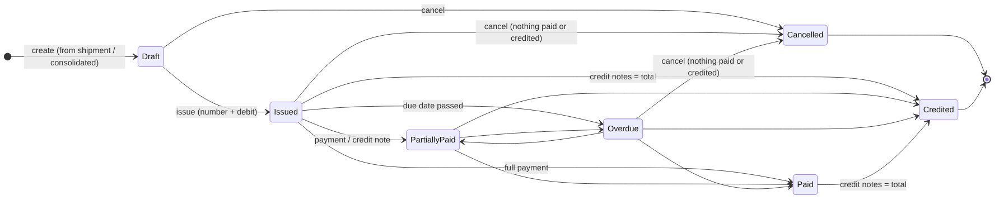
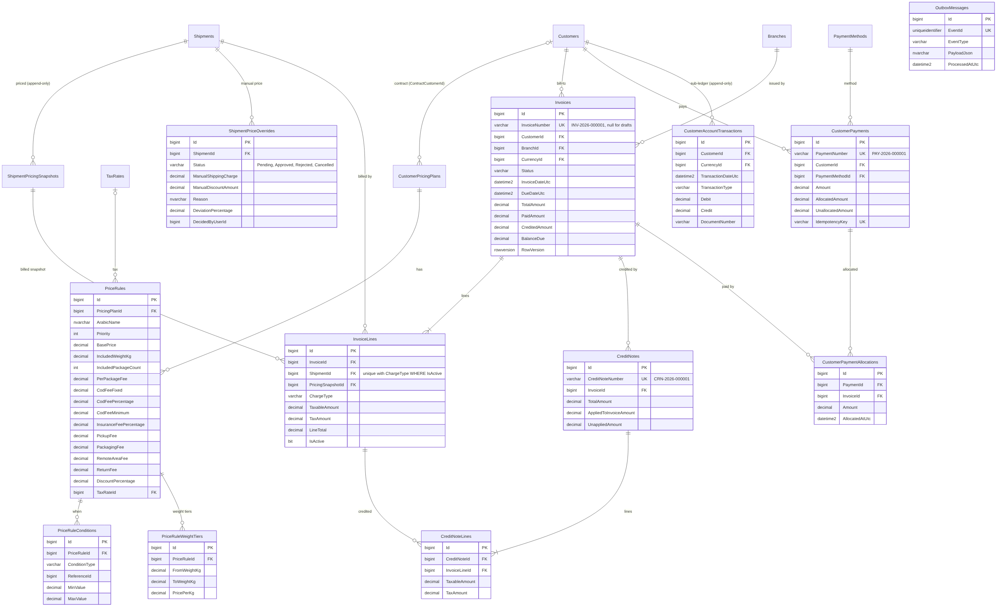
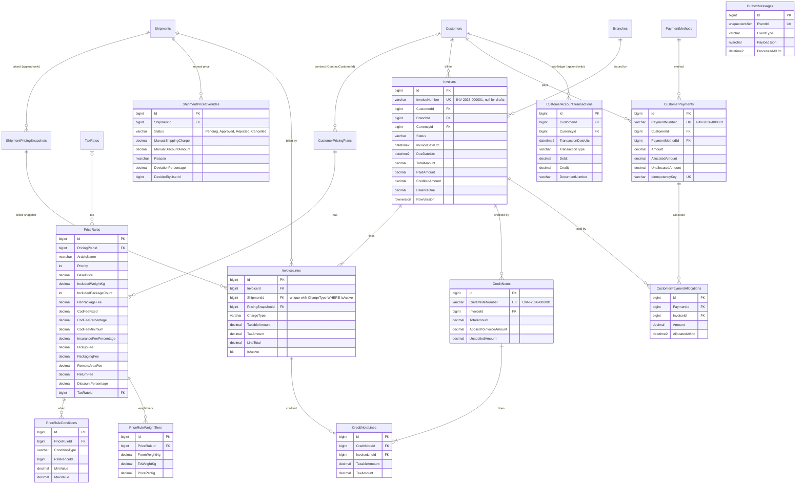

# الخطوة 5 — محرك التسعير، الفواتير، دفعات العملاء، الذمم المدينة، الإشعارات الدائنة وكشوف الحساب

> تُبنى هذه الخطوة فوق **الخطوة 4 الكاملة** (247 اختباراً ناجحاً). بعد هذه الخطوة يصبح العدد المتوقع **349 اختباراً**.
>
> **المكتبات**: لا توجد حزم NuGet جديدة. نبقى على Mapster بدل AutoMapper (الثغرة CVE-2026-32933)، ونستخدم QuestPDF وClosedXML من الخطوة 4 لفاتورة PDF وملفات Excel.
>
> **لا يوجد ترحيل إلى دفتر الأستاذ العام في هذه المرحلة**. كل حدث مالي يُحفظ في جدول `OutboxMessages` داخل المعاملة نفسها، لتقرأه وحدة المحاسبة في المرحلة القادمة.

---

## 1. ماذا بنينا؟ (شرح خطوات التنفيذ)

### 1.1 محرك التسعير

قاعدة `CustomerPricingPlanRule` من الخطوة 3 استُبدلت بثلاثة كيانات أكثر مرونة:

| الكيان | الدور |
|---|---|
| `PriceRule` | **ماذا نحسب**: السعر الأساسي، الوزن المشمول، الطرود المشمولة، الرسوم، خصم العقد، الضريبة، الأولوية، فترة السريان |
| `PriceRuleCondition` | **متى تنطبق القاعدة**: منطقة/مدينة الانطلاق، منطقة/مدينة الوصول، نوع الخدمة (بمعرّف)، أو مجال الوزن المحتسب وعدد الطرود (من - إلى) |
| `PriceRuleWeightTier` | **شرائح الوزن التصاعدية** فوق الوزن المشمول، مثل ضريبة الشرائح |

**قواعد المطابقة** (`PriceRuleMatcher` في طبقة Domain، بدون قاعدة بيانات، ولها اختبارات مباشرة):

- شروط **النوع نفسه** بديلة (أو): «منطقة الوصول = المزة **أو** المالكي».
- شروط **أنواع مختلفة** كلها مطلوبة (و): «نوع الخدمة = سريع **و** الوزن من 0 إلى 10».
- قاعدة بلا شروط تنطبق على كل الشحنات.
- عند تطابق أكثر من قاعدة: **الأعلى أولوية**، ثم **الأكثر تحديداً** (عدد أنواع الشروط)، ثم **الأقدم**.

**ترتيب الخطط**:
1. عقد العميل: خطة لها `ContractCustomerId` = المرسل، فعّالة وسارية.
2. الخطة المسندة للعميل (`Customer.PricingPlanId`).
3. الخطة الافتراضية.

أول خطة فيها قاعدة مطابقة هي التي تسعّر. لذلك العقد الذي لا يغطي خدمة معينة يرجع تلقائياً إلى الأسعار العامة.

**تفصيل السعر** (`PriceBreakdownCalculator`):

| البند | الحساب |
|---|---|
| السعر الأساسي | `BasePrice` (يغطي `IncludedWeightKg` و`IncludedPackageCount`) |
| رسم الوزن | مجموع الشرائح: كل شريحة تحسب الكيلوغرامات الواقعة داخلها وفوق الوزن المشمول |
| رسوم الخدمات | الطرود الإضافية + التأمين (نسبة، بحد أدنى) + الاستلام من المرسل + التغليف + المنطقة النائية + الإرجاع |
| الخصم | خصم العقد (نسبة من المجموع الفرعي) + الخصم اليدوي |
| **إجمالي الشحن** | المجموع الفرعي − الخصم |
| **عمولة COD** | ثابت + نسبة × مبلغ COD، بحد أدنى |
| الخاضع للضريبة | إجمالي الشحن + عمولة COD |
| الضريبة | نسبة ضريبة القاعدة، أو الضريبة الافتراضية |
| **الصافي** | الخاضع للضريبة + الضريبة |

كل بند يُقرَّب إلى منازل العملة (ليرة سورية: 0) **قبل** جمعه، فيتطابق الإجمالي المطبوع مع بنوده دائماً.

**لقطة السعر** (`ShipmentPricingSnapshot`) أصبحت كاملة وغير قابلة للتعديل: كل المدخلات (الأوزان، الطرود، التأمين، الخدمات، المنطقة النائية، الإرجاع)، وكل بند، والشرائح المطبقة (JSON)، والضريبة، والسبب اليدوي. أسبابها: `Created`، `Updated`، `Imported`، `Repriced`، `ManualOverride`.

### 1.2 السعر اليدوي والموافقة

- يحتاج دائماً صلاحية `Shipments.OverridePrice` و**سبباً**.
- نقارن «إجمالي الشحن» اليدوي بسعر القواعد:
  - إذا كان الفرق ≤ الحد (`PriceOverrideApprovalThresholdPercent`، افتراضياً **20%**، يُعدّل من `/shipping-settings`) يُطبَّق فوراً.
  - إذا كان أكبر، أو لا توجد قاعدة للمقارنة، يحتاج **موافقة**.
- `POST /shipments/{id}/apply-price`:
  - المستخدم الذي يملك `Pricing.ApproveOverride`: يُطبَّق فوراً.
  - غيره: يُسجَّل طلب `Pending` ويُرجع **202**، والسعر لا يتغير.
- `POST /price-overrides/{id}/approve` أو `/reject`: يجب أن يقرر **مستخدم آخر** غير مقدّم الطلب. الرفض يحتاج سبباً.
- عند إنشاء أو تعديل شحنة بسعر يدوي كبير بدون صلاحية الموافقة: **422**، مع إرشاد لاستخدام apply-price.
- لا يمكن إعادة تسعير شحنة **ملغاة** أو **مفوترة**.

### 1.3 الفواتير

- **إنشاء**:
  - `from-shipment/{id}`: العميل هو المرسل.
  - `consolidated`: قائمة شحنات، أو كل الشحنات المؤهلة في فترة.
  - الشحنات يجب أن تكون من المرسل نفسه وبالعملة نفسها، غير ملغاة، وبلا طلب سعر معلّق.
- **المسودة** بلا رقم. يمكن تعديل مدة السداد والملاحظات و**خصم الفاتورة**. الخصم يُوزَّع على السطور بنسبة مبالغها، ثم تُعاد ضريبة كل سطر بنسبته.
- **الإصدار**:
  - رقم آمن `INV-2026-000001` بنفس آلية `MERGE … HOLDLOCK` داخل المعاملة.
  - تاريخ الفاتورة، وتاريخ الاستحقاق = التاريخ + مدة السداد.
  - قيد **مدين** في دفتر حساب العميل، وحدث `InvoiceIssued`.
- **لا تعديل بعد الإصدار**. التصحيح بإشعار دائن، أو إلغاء الفاتورة إذا لم يُدفع منها شيء ولم يصدر عليها إشعار. الإلغاء يعكس القيد ويحرّر الشحنات.
- **منع الفوترة المزدوجة** بطبقتين:
  - الخدمة ترفض الشحنة المفوترة (**409**).
  - فهرس فريد مُرشَّح `UX_InvoiceLines_ActiveCharge` (الشحنة + نوع الرسم حيث `IsActive = 1`) يرفض الطلب الثاني إذا وصل طلبان في اللحظة نفسها.
  - السطر يصبح غير فعّال فقط عند إلغاء الفاتورة أو إشعاره بالكامل.
- **الحالات**: `InvoiceStatusRules` في Domain (الرسم أدناه). Paid وPartiallyPaid وOverdue وCredited تُحسب من المبالغ وتاريخ الاستحقاق ولا تُختار يدوياً.
- **التأخر**: مهمة خلفية كل ساعة (`InvoiceOverdueBackgroundService`) تعلّم الفواتير المتأخرة. تقرير الأعمار لا يعتمد عليها.
- **PDF** عربي A4 من اليمين لليسار، مع QR (الرقم، التاريخ، الإجمالي، الرقم الضريبي). المسودة تُطبع بعلامة «مسودة».
- **Excel** للقائمة المفلترة.



### 1.4 الإشعارات الدائنة

- `CRN-2026-000001`، لسطور محددة (مبلغ قبل الضريبة) أو `creditAll`.
- الضريبة تُعكس **بنسبة السطر نفسه**. إشعار باقي السطر يعكس باقي ضريبته بالضبط، بدون فرق تقريب.
- `AppliedToInvoiceAmount` يخفض رصيد الفاتورة. الزائد عن الرصيد (`UnappliedAmount`) يبقى **رصيداً دائناً** للعميل في دفتره.
- إذا غطت الإشعارات إجمالي الفاتورة تصبح `Credited`.

### 1.5 دفعات العملاء

- `PAY-2026-000001` بطرق نقد / تحويل / بطاقة. «الدفع عند الاستلام» و«على حساب العميل» مرفوضتان هنا.
- رقم المرجع إلزامي إذا كانت الطريقة تطلبه.
- **التخصيص**:
  - على فاتورة أو أكثر بمبالغ جزئية، أو `autoAllocate` (الأقدم استحقاقاً أولاً).
  - الباقي يبقى «غير مخصص» ويُخصص لاحقاً بـ `POST /customer-payments/{id}/allocations`.
- **منع التكرار** (`Idempotency-Key`):
  - المفتاح نفسه مع الطلب نفسه يُرجع الدفعة الأولى (200 + ترويسة `Idempotent-Replayed: true`).
  - المفتاح نفسه مع طلب مختلف يُرجع **409**.
  - فهرس فريد على المفتاح يحمي من طلبين متزامنين.
- **التزامن**: `RowVersion` على الفاتورة. دفعتان تعدّلان الفاتورة نفسها في اللحظة نفسها: الثانية تأخذ **409 CONCURRENCY_CONFLICT** بدل أن تدفع الفاتورة مرتين.

### 1.6 دفتر حساب العميل، كشف الحساب، أعمار الذمم

- `CustomerAccountTransaction` (إدراج فقط):
  - **مدين**: فاتورة صادرة.
  - **دائن**: دفعة، إشعار دائن، إلغاء فاتورة.
  - يُكتب في المعاملة نفسها مع المستند.
- **كشف الحساب** (`GET /customers/{id}/statement`):
  - عملة واحدة، رصيد افتتاحي، سطور برصيد تراكمي يستمر عبر الصفحات، إجماليات، رصيد ختامي.
  - الفواتير المفتوحة والمتأخرة، والأرصدة الدائنة غير المخصصة.
  - الرصيد الافتتاحي للعميل (`OpeningBalance`) يدخل في كشف العملة الأساسية لمن يرى كل الفروع.
- **أعمار الذمم** (`GET /reports/customer-aging`):
  - «كما في تاريخ»: الدفعات والإشعارات بعد التاريخ لا تُحسب.
  - الفئات: غير مستحق، 1-30، 31-60، 61-90، أكثر من 90.
  - الأرصدة الدائنة غير المخصصة، والصافي، وإجماليات كل العملاء.

### 1.7 التكامل مع المحاسبة (المرحلة القادمة)

- `IIntegrationEventPublisher` → `OutboxIntegrationEventPublisher` يضيف صفاً في `OutboxMessages` ضمن SaveChanges نفسه.
- الأحداث:
  - `InvoiceIssued` و`CreditNoteIssued`، مع الضريبة مجمعة حسب النسبة.
  - `InvoiceCancelled`
  - `CustomerPaymentReceived`، مع نوع طريقة الدفع لاختيار حساب النقدية أو البنك.
  - `CustomerPaymentAllocated`
- `IAccountingIntegrationHandler`: الواجهة التي ستنفذها وحدة القيود. القيود المقترحة مكتوبة في التعليق.

### 1.8 الصلاحيات الجديدة

تُمنح تلقائياً للأدوار المدمجة عند أول تشغيل:

| الصلاحية | الأدوار |
|---|---|
| `Pricing.ApproveOverride` | مدير النظام، مدير فرع |
| `Invoices.Issue`، `Invoices.Export` | محاسب، مدير فرع |
| `Invoices.Cancel`، `Invoices.CreditNotes` | محاسب |
| `Payments.View`، `Payments.Create` | محاسب، مدير فرع، موظف شحن |
| `Receivables.View` | محاسب، مدير فرع |

`Reports.ViewFinancial` (موجودة من قبل) مطلوبة لتقرير الأعمار. موظف الشحن حصل أيضاً على `Invoices.View` و`Invoices.Create`.

**الفروع**: من لا يملك `Branches.ViewAll` يرى فواتير ودفعات وإشعارات وحركات فرعه فقط، وغيرها يُرجع 404.

### 1.9 تعديلات على ملفات سابقة

- **`Shipment`**: `OriginZoneId`، `RequiresPickup`، `RequiresPackaging`، وروابط `InvoiceLines` و`PriceOverrides`.
- **`ShipmentDto`**:
  - `OriginZoneId` و`OriginZoneName`، و`RequiresPickup` و`RequiresPackaging`.
  - `ManualShippingCharge` و`ManualDiscountAmount`: أعدهما كما هما في PUT للحفاظ عليهما.
  - رقم الفاتورة، و`HasPendingPriceOverride`.
- **`SaveShipmentRequest`**: `RequiresPickup`، `RequiresPackaging`، `ManualPriceReason`.
  - `ManualShippingCharge` أصبح **المجموع الفرعي** قبل عمولة COD والضريبة.
- **`Zone.IsRemoteArea`**، و`CustomerPricingPlan.ContractCustomerId` و`ContractReference`.
- **`ShippingSettings`**: `PriceOverrideApprovalThresholdPercent` و`DefaultPaymentTermsDays`. لها قيم افتراضية في قاعدة البيانات، فيأخذ صف الإعدادات الموجود 20% و30 يوماً.
- **لا يمكن**:
  - تعديل أو إلغاء شحنة **مفوترة**.
  - حذف عميل أو فرع أو عملة أو طريقة دفع مستخدمة في فاتورة أو دفعة.
  - حذف منطقة أو مدينة أو نوع خدمة أو ضريبة مستخدمة في قاعدة تسعير.
- **البيانات التجريبية**: `DemoPricingSeeder` يضيف قواعد مكافئة للخطوة 3 (عادي، سريع، نفس اليوم) مع الرسوم الجديدة، ويجعل منطقتي اللاذقية نائيتين، وينشئ عقداً تجريبياً `CNT-MED` للعميل `CUS-00010` (خصم 10% على العادي).
  - يعمل عندما لا توجد أي قاعدة، وهذا يشمل قاعدة بياناتك الحالية بعد الـ migration، لأن الجدول القديم يُحذف.
- **حُذف** الملف `src/ShippingERP.Domain/Entities/Customers/CustomerPricingPlanRule.cs`.

---

## 2. خطوات التطبيق على جهازك (Windows PowerShell)

> استخدم النسخة **الكاملة** في مجلد جديد `ShippingERP-Step05`، ثم انسخ مجلد الـ Migrations من الخطوة 4. هذا يتجنب بقايا الملف المحذوف.

```powershell
cd "$HOME\Downloads"
$zip = Get-ChildItem "$HOME\Downloads\ShippingERP-Step05-full*.zip" | Sort-Object LastWriteTime -Descending | Select-Object -First 1
$zip.FullName
Unblock-File $zip.FullName
Expand-Archive $zip.FullName -DestinationPath "$HOME\Downloads\ShippingERP-Step05" -Force

# انسخ الـ migrations الموجودة (AddIdentityAndAudit, AddMasterData, AddShipments)
Copy-Item "$HOME\Downloads\ShippingERP-Step04\src\ShippingERP.Infrastructure\Persistence\Migrations\*" `
  "$HOME\Downloads\ShippingERP-Step05\src\ShippingERP.Infrastructure\Persistence\Migrations\" -Force

cd "$HOME\Downloads\ShippingERP-Step05"
Test-Path src\ShippingERP.Infrastructure\Billing\InvoiceService.cs                  # True
Test-Path src\ShippingERP.Domain\Entities\Customers\CustomerPricingPlanRule.cs      # False

dotnet build
dotnet test        # المتوقع: 349 ناجحاً

dotnet ef migrations add AddPricingAndBilling `
  --project src/ShippingERP.Infrastructure `
  --startup-project src/ShippingERP.API `
  --output-dir Persistence/Migrations

dotnet ef database update `
  --project src/ShippingERP.Infrastructure `
  --startup-project src/ShippingERP.API

dotnet run --project src/ShippingERP.API --launch-profile http
```

- **الـ migration**:
  - تحذف جدول `CustomerPricingPlanRules` القديم، وتنشئ 12 جدولاً جديداً، وتضيف أعمدة على `Shipments` و`Zones` و`CustomerPricingPlans` و`ShipmentPricingSnapshots` و`ShippingSettings`.
  - لقطات الأسعار القديمة تبقى كما هي (`PricingRuleId` بلا مفتاح أجنبي).
  - **قواعد الأسعار التي أدخلتها يدوياً في الخطوة 3 تُحذف**. أعد إدخالها بالشكل الجديد إن وجدت. القواعد التجريبية تُعاد تلقائياً.
- في السجل ابحث عن: `Demo price rules created (4)`.
- **سجّل الخروج ثم الدخول**، حتى يحمل الـ Token الصلاحيات الجديدة.

---

## 3. التجربة في Swagger (بالترتيب)

1. `GET /api/v1/pricing-plans/{GENERAL id}/rules`: القواعد بشروطها وشرائحها وأسماء المناطق.
2. أنشئ شحنة إلى عميل في اللاذقية (`CUS-00009`). ثم `GET /shipments/{id}/pricing`: رسم المنطقة النائية 5000.
3. `POST /shipments/{id}/calculate-price` بجسم `{}`، ثم بجسم `{ "manualShippingCharge": 30000, "reason": "تجربة" }`: قارن `rulePricing` بـ `pricing` و`deviationPercentage`.
4. بمستخدم يملك `Shipments.OverridePrice` فقط: `apply-price` بسعر كبير ← **202 Pending**. بمستخدم آخر يملك `Pricing.ApproveOverride`: `POST /price-overrides/{id}/approve`.
5. `POST /invoices/from-shipment/{shipmentId}` ← مسودة. ثم `PUT /invoices/{id}` لخصم الفاتورة، ثم `POST /invoices/{id}/issue`.
6. أعد `from-shipment` للشحنة نفسها ← **409**.
7. `GET /invoices/{id}/pdf` و`GET /invoices/export`.
8. `POST /customer-payments` مع ترويسة `Idempotency-Key: 1f6c…` ← 201. أعد الطلب نفسه ← 200 مع `Idempotent-Replayed: true`.
9. `POST /invoices/{id}/credit-notes`.
10. `GET /customers/{customerId}/statement`، ثم `GET /reports/customer-aging`.

---

## 4. مخطط قاعدة البيانات (ERD)





---

## 5. أمثلة Swagger (JSON)

### 5.1 قاعدة تسعير — `POST /api/v1/pricing-plans/{planId}/rules`

```json
{
  "arabicName": "دمشق - عادي حتى 30 كغ",
  "priority": 20,
  "conditions": [
    { "conditionType": "ServiceType", "referenceId": 1 },
    { "conditionType": "DestinationCity", "referenceId": 1 },
    { "conditionType": "ChargeableWeight", "minValue": 0, "maxValue": 30 }
  ],
  "basePrice": 12000,
  "includedWeightKg": 5,
  "weightTiers": [
    { "fromWeightKg": 5, "toWeightKg": 20, "pricePerKg": 1800 },
    { "fromWeightKg": 20, "toWeightKg": null, "pricePerKg": 1500 }
  ],
  "includedPackageCount": 1,
  "perPackageFee": 500,
  "codFeeFixed": 1500,
  "codFeePercentage": 1,
  "codFeeMinimum": 2000,
  "insuranceFeePercentage": 1,
  "insuranceFeeMinimum": 1000,
  "pickupFee": 3000,
  "packagingFee": 2500,
  "remoteAreaFee": 5000,
  "returnFee": 7500,
  "discountPercentage": 0,
  "taxRateId": null
}
```

### 5.2 عقد عميل — `POST /api/v1/pricing-plans`

```json
{ "code": "CNT-NOOR", "arabicName": "عقد متجر النور", "currencyId": 1, "isDefault": false,
  "contractCustomerId": 7, "contractReference": "CTR-2026-014", "validFromUtc": "2026-01-01T00:00:00Z" }
```

### 5.3 سعر يدوي — `POST /api/v1/shipments/{id}/apply-price`

```json
{ "manualShippingCharge": 25000, "manualDiscountAmount": 0, "reason": "شحنة بأبعاد غير معتادة" }
```

### 5.4 فاتورة مجمعة — `POST /api/v1/invoices/consolidated`

```json
{ "customerId": 3, "fromUtc": "2026-10-01T00:00:00Z", "toUtc": "2026-11-01T00:00:00Z",
  "paymentTermsDays": 30, "notes": "فاتورة شهر تشرين الأول", "issueImmediately": false }
```

### 5.5 إشعار دائن — `POST /api/v1/invoices/{id}/credit-notes`

```json
{ "reason": "تأخر التسليم 3 أيام", "creditAll": false,
  "lines": [ { "invoiceLineId": 12, "taxableAmount": 5000 } ] }
```

### 5.6 دفعة — `POST /api/v1/customer-payments` (Header: `Idempotency-Key: 9b1d6f2e-…`)

```json
{ "customerId": 3, "paymentMethodId": 3, "amount": 40000, "referenceNumber": "TRX-55871",
  "autoAllocate": false,
  "allocations": [ { "invoiceId": 5, "amount": 15000 }, { "invoiceId": 6, "amount": 20000 } ] }
```

---

## 6. ملاحظات مهمة

- **المبالغ**: كلها `decimal(18,2)`، والنسب `decimal(5,2)`. **التواريخ**: كلها UTC.
- **قاعدة المعاملات**: كل عملية مالية (الفاتورة، الإصدار، الإلغاء، الإشعار، الدفعة، التخصيص، تطبيق السعر) معاملة واحدة تشمل المستند، دفتر العميل، سجل التدقيق، وحدث الـ Outbox.
- **تقرير الأعمار** يُحسب حالياً في الذاكرة لعملة وفرع محددين، وهذا كافٍ لعشرات الآلاف من الفواتير المفتوحة. في المرحلة المحاسبية يمكن نقله إلى View أو جدول ملخص.
- **الضريبة الافتراضية** في البيانات التجريبية 0% (`EXEMPT`). لتجربة الضريبة اجعل `VAT5` افتراضية من `/api/v1/tax-rates` قبل إنشاء الشحنات.

---

## 7. الملفات الكاملة (100 ملفاً جديداً أو معدّلاً)

كل ملف كامل كما هو في المشروع. المسارات نسبية من المجلد الجذر للحل.

### 7.1 `src/ShippingERP.Domain/Authorization/Permissions.cs`

```csharp
namespace ShippingERP.Domain.Authorization;

/// <summary>
/// The single source of truth for permission codes.
///
/// - Use the constants in code: [HasPermission(Permissions.Shipments.Create)]
/// - The seeder inserts any code from <see cref="All"/> that is missing in the Permissions table,
///   so adding a permission = add a constant here + add it to All + restart the API.
/// - Never rename an existing code: role assignments and issued tokens refer to it.
/// </summary>
public static class Permissions
{
    public static class Users
    {
        public const string View = "Users.View";
        public const string Manage = "Users.Manage";
    }

    public static class Roles
    {
        public const string Manage = "Roles.Manage";
    }

    public static class Customers
    {
        public const string View = "Customers.View";
        public const string Manage = "Customers.Manage";
    }

    public static class Shipments
    {
        public const string View = "Shipments.View";
        public const string Create = "Shipments.Create";
        public const string Update = "Shipments.Update";
        public const string ChangeStatus = "Shipments.ChangeStatus";
        public const string AssignDriver = "Shipments.AssignDriver";

        // ----- Step 4 -----

        /// <summary>Cancel a shipment that has not left the origin branch.</summary>
        public const string Cancel = "Shipments.Cancel";

        /// <summary>Confirm a delivery (proof of delivery) or record a failed attempt.</summary>
        public const string ConfirmDelivery = "Shipments.ConfirmDelivery";

        /// <summary>Correct a wrong status outside the normal rules (reason required, fully audited).</summary>
        public const string CorrectStatus = "Shipments.CorrectStatus";

        /// <summary>Import shipments from Excel.</summary>
        public const string Import = "Shipments.Import";

        /// <summary>Enter a manual shipping charge (when no pricing rule applies) or give a discount (a reason is required).</summary>
        public const string OverridePrice = "Shipments.OverridePrice";
    }

    // ----- Step 4: operations -----

    /// <summary>Warehouse check-in / check-out manifests.</summary>
    public static class Warehouse
    {
        public const string ManageMovements = "Warehouse.ManageMovements";
    }

    /// <summary>Branch transfer manifests.</summary>
    public static class Transfers
    {
        public const string View = "Transfers.View";
        public const string Manage = "Transfers.Manage";
        public const string Receive = "Transfers.Receive";
    }

    /// <summary>Driver delivery manifests (drivers see their own manifests with Shipments.View).</summary>
    public static class DeliveryManifests
    {
        public const string Manage = "DeliveryManifests.Manage";
    }

    public static class Returns
    {
        public const string Manage = "Returns.Manage";
    }

    public static class DamageCases
    {
        public const string Manage = "DamageCases.Manage";
    }

    public static class Cod
    {
        public const string View = "COD.View";
        public const string Collect = "COD.Collect";
        public const string Settle = "COD.Settle";
    }

    public static class Invoices
    {
        public const string View = "Invoices.View";
        public const string Create = "Invoices.Create";

        // ----- Step 5 -----

        /// <summary>Issue a draft invoice (gives it its number and debits the customer account).</summary>
        public const string Issue = "Invoices.Issue";

        /// <summary>Cancel a draft, or an issued invoice that has no payment and no credit note.</summary>
        public const string Cancel = "Invoices.Cancel";

        /// <summary>Issue credit notes against issued invoices.</summary>
        public const string CreditNotes = "Invoices.CreditNotes";

        /// <summary>Export invoices to Excel and print / download invoice PDFs.</summary>
        public const string Export = "Invoices.Export";
    }

    // ----- Step 5: receivables -----

    /// <summary>Customer payments (سندات القبض).</summary>
    public static class Payments
    {
        public const string View = "Payments.View";
        public const string Create = "Payments.Create";
    }

    /// <summary>Customer account statements and balances.</summary>
    public static class Receivables
    {
        public const string View = "Receivables.View";
    }

    public static class Accounting
    {
        public const string View = "Accounting.View";
        public const string CreateJournal = "Accounting.CreateJournal";
        public const string ApproveJournal = "Accounting.ApproveJournal";
    }

    public static class Expenses
    {
        public const string View = "Expenses.View";
        public const string Create = "Expenses.Create";
        public const string Approve = "Expenses.Approve";
    }

    public static class Reports
    {
        public const string ViewFinancial = "Reports.ViewFinancial";
        public const string ViewOperational = "Reports.ViewOperational";
    }

    public static class Branches
    {
        /// <summary>See and manage data of every branch. Without it a user only sees their own branch.</summary>
        public const string ViewAll = "Branches.ViewAll";
        public const string Manage = "Branches.Manage";
    }

    // ----- Step 3: master data -----

    /// <summary>
    /// Reference data used by everybody: countries, cities, zones, service types, payment methods,
    /// currencies, exchange rates, tax rates, expense categories, company profile.
    /// Reading them only requires being signed in; changing them requires MasterData.Manage.
    /// </summary>
    public static class MasterData
    {
        public const string Manage = "MasterData.Manage";
    }

    public static class Pricing
    {
        public const string View = "Pricing.View";
        public const string Manage = "Pricing.Manage";

        /// <summary>Step 5: approve or reject manual prices above the approval threshold (and apply them directly).</summary>
        public const string ApproveOverride = "Pricing.ApproveOverride";
    }

    public static class Suppliers
    {
        public const string View = "Suppliers.View";
        public const string Manage = "Suppliers.Manage";
    }

    /// <summary>Employees and driver profiles.</summary>
    public static class Employees
    {
        public const string View = "Employees.View";
        public const string Manage = "Employees.Manage";
    }

    public static class Vehicles
    {
        public const string View = "Vehicles.View";
        public const string Manage = "Vehicles.Manage";
    }

    /// <summary>Every permission with its module and Arabic description.</summary>
    public static IReadOnlyList<PermissionDefinition> All { get; } = new List<PermissionDefinition>
    {
        new(Users.View, "Users", "عرض المستخدمين"),
        new(Users.Manage, "Users", "إدارة المستخدمين (إضافة، تعديل، تفعيل، إيقاف)"),
        new(Roles.Manage, "Roles", "إدارة الأدوار والصلاحيات"),

        new(Customers.View, "Customers", "عرض العملاء"),
        new(Customers.Manage, "Customers", "إدارة العملاء"),

        new(Shipments.View, "Shipments", "عرض الشحنات"),
        new(Shipments.Create, "Shipments", "إنشاء شحنة"),
        new(Shipments.Update, "Shipments", "تعديل شحنة"),
        new(Shipments.ChangeStatus, "Shipments", "تغيير حالة الشحنة"),
        new(Shipments.AssignDriver, "Shipments", "إسناد الشحنة إلى سائق"),
        new(Shipments.Cancel, "Shipments", "إلغاء شحنة"),
        new(Shipments.ConfirmDelivery, "Shipments", "تأكيد التسليم وتسجيل محاولات التسليم الفاشلة"),
        new(Shipments.CorrectStatus, "Shipments", "تصحيح حالة شحنة خارج المسار الطبيعي"),
        new(Shipments.Import, "Shipments", "استيراد الشحنات من Excel"),
        new(Shipments.OverridePrice, "Shipments", "إدخال سعر شحن يدوي ومنح خصم"),

        new(Warehouse.ManageMovements, "Warehouse", "إدخال وإخراج الشحنات من المستودع"),
        new(Transfers.View, "Transfers", "عرض التحويلات بين الفروع"),
        new(Transfers.Manage, "Transfers", "إنشاء وإرسال التحويلات بين الفروع"),
        new(Transfers.Receive, "Transfers", "استلام التحويلات الواردة"),
        new(DeliveryManifests.Manage, "DeliveryManifests", "إنشاء وإدارة بيانات التوزيع للسائقين"),
        new(Returns.Manage, "Returns", "إدارة المرتجعات"),
        new(DamageCases.Manage, "DamageCases", "إدارة حالات التلف والفقدان"),

        new(Cod.View, "COD", "عرض مبالغ الدفع عند الاستلام"),
        new(Cod.Collect, "COD", "تحصيل مبالغ الدفع عند الاستلام"),
        new(Cod.Settle, "COD", "تسوية مبالغ الدفع عند الاستلام مع العملاء"),

        new(Invoices.View, "Invoices", "عرض الفواتير"),
        new(Invoices.Create, "Invoices", "إنشاء الفواتير"),
        new(Invoices.Issue, "Invoices", "إصدار الفواتير (ترقيمها وترحيلها إلى حساب العميل)"),
        new(Invoices.Cancel, "Invoices", "إلغاء الفواتير غير المدفوعة"),
        new(Invoices.CreditNotes, "Invoices", "إصدار الإشعارات الدائنة"),
        new(Invoices.Export, "Invoices", "طباعة الفواتير وتصديرها إلى Excel"),

        new(Payments.View, "Payments", "عرض سندات القبض"),
        new(Payments.Create, "Payments", "تسجيل دفعات العملاء وتخصيصها على الفواتير"),
        new(Receivables.View, "Receivables", "عرض كشوف حسابات العملاء وأرصدتهم"),

        new(Accounting.View, "Accounting", "عرض الحسابات والقيود"),
        new(Accounting.CreateJournal, "Accounting", "إنشاء قيود يومية"),
        new(Accounting.ApproveJournal, "Accounting", "اعتماد قيود اليومية"),

        new(Expenses.View, "Expenses", "عرض المصروفات"),
        new(Expenses.Create, "Expenses", "تسجيل المصروفات"),
        new(Expenses.Approve, "Expenses", "اعتماد المصروفات"),

        new(Reports.ViewFinancial, "Reports", "عرض التقارير المالية"),
        new(Reports.ViewOperational, "Reports", "عرض التقارير التشغيلية"),

        new(Branches.ViewAll, "Branches", "الاطلاع على بيانات جميع الفروع"),
        new(Branches.Manage, "Branches", "إدارة الفروع والمستودعات"),

        new(MasterData.Manage, "MasterData", "إدارة البيانات الأساسية (الدول، المدن، المناطق، العملات، الضرائب...)"),

        new(Pricing.View, "Pricing", "عرض خطط التسعير"),
        new(Pricing.Manage, "Pricing", "إدارة خطط التسعير وقواعدها"),
        new(Pricing.ApproveOverride, "Pricing", "اعتماد تعديلات الأسعار اليدوية الكبيرة"),

        new(Suppliers.View, "Suppliers", "عرض الموردين"),
        new(Suppliers.Manage, "Suppliers", "إدارة الموردين"),

        new(Employees.View, "Employees", "عرض الموظفين والسائقين"),
        new(Employees.Manage, "Employees", "إدارة الموظفين والسائقين"),

        new(Vehicles.View, "Vehicles", "عرض المركبات"),
        new(Vehicles.Manage, "Vehicles", "إدارة المركبات")
    };

    private static readonly HashSet<string> AllCodes =
        new(All.Select(permission => permission.Code), StringComparer.Ordinal);

    /// <summary>True if the code exists in the catalog (case-sensitive).</summary>
    public static bool IsKnown(string code) => AllCodes.Contains(code);
}
```

### 7.2 `src/ShippingERP.Domain/Authorization/Roles.cs`

```csharp
using P = ShippingERP.Domain.Authorization.Permissions;

namespace ShippingERP.Domain.Authorization;

/// <summary>
/// The seven built-in roles.
///
/// DefaultPermissions are applied when the seeder creates the role for the first time. When a NEW permission
/// code is added to Permissions.cs later, the seeder also grants it to the built-in roles that list it here
/// (only on the run that creates the permission). Changes an administrator makes with
/// PUT /api/v1/roles/{id}/permissions are never overwritten. SystemAdmin always holds every permission.
///
/// Drivers: a user in the Driver role who does NOT hold Shipments.AssignDriver only sees the shipments and
/// delivery manifests assigned to his driver profile (DriverProfile.UserId).
/// </summary>
public static class Roles
{
    public const string SystemAdmin = "SystemAdmin";
    public const string Accountant = "Accountant";
    public const string BranchManager = "BranchManager";
    public const string ShippingAgent = "ShippingAgent";
    public const string WarehouseEmployee = "WarehouseEmployee";
    public const string Driver = "Driver";
    public const string Customer = "Customer";

    public static IReadOnlyList<RoleDefinition> All { get; } = new List<RoleDefinition>
    {
        new(
            SystemAdmin,
            "مدير النظام",
            "صلاحيات كاملة على جميع أجزاء النظام.",
            P.All.Select(permission => permission.Code).ToList()),

        new(
            Accountant,
            "محاسب",
            "الحسابات والقيود والفواتير والمصروفات وتسويات الدفع عند الاستلام.",
            new[]
            {
                P.Customers.View,
                P.Shipments.View,
                P.Cod.View, P.Cod.Settle,
                P.Invoices.View, P.Invoices.Create, P.Invoices.Issue, P.Invoices.Cancel, P.Invoices.CreditNotes, P.Invoices.Export,
                P.Payments.View, P.Payments.Create,
                P.Receivables.View,
                P.Accounting.View, P.Accounting.CreateJournal,
                P.Expenses.View, P.Expenses.Create,
                P.Reports.ViewFinancial,
                P.Pricing.View,
                P.Suppliers.View, P.Suppliers.Manage
            }),

        new(
            BranchManager,
            "مدير فرع",
            "إدارة عمليات الفرع وموظفيه وشحناته.",
            new[]
            {
                P.Users.View,
                P.Customers.View, P.Customers.Manage,
                P.Shipments.View, P.Shipments.Create, P.Shipments.Update,
                P.Shipments.ChangeStatus, P.Shipments.AssignDriver,
                P.Shipments.Cancel, P.Shipments.ConfirmDelivery, P.Shipments.CorrectStatus, P.Shipments.Import,
                P.Shipments.OverridePrice,
                P.Warehouse.ManageMovements,
                P.Transfers.View, P.Transfers.Manage, P.Transfers.Receive,
                P.DeliveryManifests.Manage,
                P.Returns.Manage,
                P.DamageCases.Manage,
                P.Cod.View, P.Cod.Collect,
                P.Invoices.View, P.Invoices.Create, P.Invoices.Issue, P.Invoices.Export,
                P.Payments.View, P.Payments.Create,
                P.Receivables.View,
                P.Expenses.View, P.Expenses.Create, P.Expenses.Approve,
                P.Reports.ViewOperational,
                P.Pricing.View, P.Pricing.ApproveOverride,
                P.Suppliers.View,
                P.Employees.View, P.Employees.Manage,
                P.Vehicles.View, P.Vehicles.Manage
            }),

        new(
            ShippingAgent,
            "موظف شحن",
            "استقبال الشحنات وتسجيلها وخدمة العملاء.",
            new[]
            {
                P.Customers.View, P.Customers.Manage,
                P.Shipments.View, P.Shipments.Create, P.Shipments.Update, P.Shipments.ChangeStatus,
                P.Shipments.Cancel, P.Shipments.ConfirmDelivery, P.Shipments.Import,
                P.Returns.Manage,
                P.Pricing.View,
                P.Invoices.View, P.Invoices.Create,
                P.Payments.View, P.Payments.Create
            }),

        new(
            WarehouseEmployee,
            "موظف مستودع",
            "استلام وفرز الشحنات في المستودع.",
            new[]
            {
                P.Shipments.View, P.Shipments.ChangeStatus,
                P.Warehouse.ManageMovements,
                P.Transfers.View, P.Transfers.Manage, P.Transfers.Receive,
                P.DamageCases.Manage
            }),

        new(
            Driver,
            "سائق",
            "توصيل الشحنات وتحصيل مبالغ الدفع عند الاستلام.",
            new[]
            {
                P.Shipments.View, P.Shipments.ChangeStatus, P.Shipments.ConfirmDelivery,
                P.Cod.Collect
            }),

        new(
            Customer,
            "عميل",
            "متابعة شحناته وفواتيره من بوابة العملاء.",
            new[]
            {
                P.Shipments.View,
                P.Invoices.View
            })
    };
}
```

### 7.3 `src/ShippingERP.Domain/Billing/InvoiceStatusRules.cs`

```csharp
using ShippingERP.Domain.Entities.Billing;
using ShippingERP.Domain.Enums;

namespace ShippingERP.Domain.Billing;

/// <summary>
/// Invoice state machine.
///
/// User actions: issue (Draft -> Issued) and cancel (Draft, or an open invoice without payments and credit notes
/// -> Cancelled). Every other status is DERIVED from the amounts by <see cref="Refresh"/> after a payment, a credit
/// note or the daily overdue check:
///
///   credit notes >= total               -> Credited
///   balance = 0                         -> Paid
///   balance > 0 and due date passed     -> Overdue
///   something paid or credited          -> PartiallyPaid
///   otherwise                           -> Issued
///
/// Allowed transitions:
///   Draft          -> Issued, Cancelled
///   Issued         -> PartiallyPaid, Paid, Overdue, Credited, Cancelled
///   PartiallyPaid  -> Paid, Overdue, Credited
///   Overdue        -> PartiallyPaid, Paid, Credited, Cancelled
///   Paid           -> Credited
///   Cancelled, Credited: final
/// </summary>
public static class InvoiceStatusRules
{
    private static readonly IReadOnlyDictionary<InvoiceStatus, InvoiceStatus[]> Transitions = new Dictionary<InvoiceStatus, InvoiceStatus[]>
    {
        [InvoiceStatus.Draft] = new[] { InvoiceStatus.Issued, InvoiceStatus.Cancelled },
        [InvoiceStatus.Issued] = new[] { InvoiceStatus.PartiallyPaid, InvoiceStatus.Paid, InvoiceStatus.Overdue, InvoiceStatus.Credited, InvoiceStatus.Cancelled },
        [InvoiceStatus.PartiallyPaid] = new[] { InvoiceStatus.Paid, InvoiceStatus.Overdue, InvoiceStatus.Credited },
        [InvoiceStatus.Overdue] = new[] { InvoiceStatus.PartiallyPaid, InvoiceStatus.Paid, InvoiceStatus.Credited, InvoiceStatus.Cancelled },
        [InvoiceStatus.Paid] = new[] { InvoiceStatus.Credited },
        [InvoiceStatus.Cancelled] = Array.Empty<InvoiceStatus>(),
        [InvoiceStatus.Credited] = Array.Empty<InvoiceStatus>()
    };

    /// <summary>Statuses that still expect money (payments can be allocated, the aging report shows them).</summary>
    public static readonly IReadOnlySet<InvoiceStatus> OpenStatuses =
        new HashSet<InvoiceStatus> { InvoiceStatus.Issued, InvoiceStatus.PartiallyPaid, InvoiceStatus.Overdue };

    /// <summary>Statuses of an invoice that was issued and not cancelled (it is part of the customer balance).</summary>
    public static readonly IReadOnlySet<InvoiceStatus> PostedStatuses =
        new HashSet<InvoiceStatus> { InvoiceStatus.Issued, InvoiceStatus.PartiallyPaid, InvoiceStatus.Overdue, InvoiceStatus.Paid, InvoiceStatus.Credited };

    public static IReadOnlyList<InvoiceStatus> NextStatuses(InvoiceStatus status) =>
        Transitions.TryGetValue(status, out var next) ? next : Array.Empty<InvoiceStatus>();

    public static bool CanTransition(InvoiceStatus from, InvoiceStatus to) => from == to || NextStatuses(from).Contains(to);

    public static bool IsOpen(InvoiceStatus status) => OpenStatuses.Contains(status);

    public static bool CanIssue(InvoiceStatus status) => status == InvoiceStatus.Draft;

    /// <summary>Only issued invoices can be credited; a fully credited invoice cannot be credited again.</summary>
    public static bool CanCredit(InvoiceStatus status) => IsOpen(status) || status == InvoiceStatus.Paid;

    /// <summary>A draft, or an open invoice that has no payment allocation and no credit note.</summary>
    public static bool CanCancel(Invoice invoice) =>
        invoice.Status == InvoiceStatus.Draft ||
        ((invoice.Status is InvoiceStatus.Issued or InvoiceStatus.Overdue) && invoice.PaidAmount == 0m && invoice.CreditedAmount == 0m);

    /// <summary>The status the amounts and the due date call for (Draft and Cancelled never change here).</summary>
    public static InvoiceStatus Calculate(Invoice invoice, DateTime nowUtc)
    {
        if (invoice.Status is InvoiceStatus.Draft or InvoiceStatus.Cancelled)
        {
            return invoice.Status;
        }

        var balance = Balance(invoice);

        if (invoice.TotalAmount > 0m && invoice.CreditedAmount >= invoice.TotalAmount)
        {
            return InvoiceStatus.Credited;
        }

        if (balance <= 0m)
        {
            return InvoiceStatus.Paid;
        }

        if (invoice.DueDateUtc.HasValue && invoice.DueDateUtc.Value < nowUtc)
        {
            return InvoiceStatus.Overdue;
        }

        return invoice.PaidAmount > 0m || invoice.CreditAppliedAmount > 0m
            ? InvoiceStatus.PartiallyPaid
            : InvoiceStatus.Issued;
    }

    /// <summary>TotalAmount - PaidAmount - CreditAppliedAmount (never negative).</summary>
    public static decimal Balance(Invoice invoice) =>
        Math.Max(0m, invoice.TotalAmount - invoice.PaidAmount - invoice.CreditAppliedAmount);

    /// <summary>
    /// Recalculates BalanceDue and the status. Throws when the new status is not reachable from the current one
    /// (a programming error, never a user error). Returns true when the status changed.
    /// </summary>
    public static bool Refresh(Invoice invoice, DateTime nowUtc)
    {
        invoice.BalanceDue = invoice.Status is InvoiceStatus.Draft or InvoiceStatus.Cancelled
            ? (invoice.Status == InvoiceStatus.Draft ? invoice.TotalAmount : 0m)
            : Balance(invoice);

        var next = Calculate(invoice, nowUtc);
        if (next == invoice.Status)
        {
            return false;
        }

        if (!CanTransition(invoice.Status, next))
        {
            throw new InvalidOperationException($"Invoice {invoice.Id}: transition {invoice.Status} -> {next} is not allowed.");
        }

        if (next == InvoiceStatus.Paid && invoice.PaidAtUtc is null)
        {
            invoice.PaidAtUtc = nowUtc;
        }

        invoice.Status = next;
        return true;
    }
}

/// <summary>Arabic display names of the billing enums.</summary>
public static class BillingNames
{
    public static string Arabic(InvoiceStatus status) => status switch
    {
        InvoiceStatus.Draft => "مسودة",
        InvoiceStatus.Issued => "صادرة",
        InvoiceStatus.PartiallyPaid => "مدفوعة جزئياً",
        InvoiceStatus.Paid => "مدفوعة",
        InvoiceStatus.Overdue => "متأخرة السداد",
        InvoiceStatus.Cancelled => "ملغاة",
        InvoiceStatus.Credited => "مُشعَر بها دائناً بالكامل",
        _ => status.ToString()
    };

    public static string Arabic(CustomerAccountTransactionType type) => type switch
    {
        CustomerAccountTransactionType.InvoiceIssued => "فاتورة",
        CustomerAccountTransactionType.InvoiceCancelled => "إلغاء فاتورة",
        CustomerAccountTransactionType.PaymentReceived => "سند قبض",
        CustomerAccountTransactionType.CreditNoteIssued => "إشعار دائن",
        _ => type.ToString()
    };

    public static string Arabic(PriceOverrideStatus status) => status switch
    {
        PriceOverrideStatus.Pending => "بانتظار الموافقة",
        PriceOverrideStatus.Approved => "معتمد",
        PriceOverrideStatus.Rejected => "مرفوض",
        PriceOverrideStatus.Cancelled => "ملغى",
        _ => status.ToString()
    };
}
```

### 7.4 `src/ShippingERP.Domain/Entities/Billing/CreditNote.cs`

```csharp
using ShippingERP.Domain.Common;
using ShippingERP.Domain.Entities.Customers;
using ShippingERP.Domain.Entities.MasterData;

namespace ShippingERP.Domain.Entities.Billing;

/// <summary>
/// A credit note (إشعار دائن), number CRN-2026-000001, issued against an issued invoice to reduce what the customer
/// owes (wrong price, service failure, goodwill...). It is final when created (append-only) and credits the
/// customer sub-ledger.
///
/// AppliedToInvoiceAmount reduces the invoice balance. When the invoice is already (partly) paid, the rest
/// (UnappliedAmount) stays as customer credit in the sub-ledger (refund or use is handled by accounting later).
/// </summary>
public class CreditNote : BaseEntity, IAppendOnlyEntity
{
    public string CreditNoteNumber { get; set; } = string.Empty;

    public long InvoiceId { get; set; }

    public Invoice Invoice { get; set; } = null!;

    public long CustomerId { get; set; }

    public Customer Customer { get; set; } = null!;

    public long BranchId { get; set; }

    public Branch Branch { get; set; } = null!;

    public long CurrencyId { get; set; }

    public Currency Currency { get; set; } = null!;

    public DateTime CreditNoteDateUtc { get; set; }

    public string Reason { get; set; } = string.Empty;

    public decimal TaxableAmount { get; set; }

    public decimal TaxAmount { get; set; }

    public decimal TotalAmount { get; set; }

    public decimal AppliedToInvoiceAmount { get; set; }

    public decimal UnappliedAmount { get; set; }

    public ICollection<CreditNoteLine> Lines { get; set; } = new List<CreditNoteLine>();
}
```

### 7.5 `src/ShippingERP.Domain/Entities/Billing/CreditNoteLine.cs`

```csharp
using ShippingERP.Domain.Common;

namespace ShippingERP.Domain.Entities.Billing;

/// <summary>
/// The credited part of one invoice line. TaxAmount uses the tax percentage of the invoice line, so the tax is
/// reversed at the same rate it was charged. Append-only.
/// </summary>
public class CreditNoteLine : BaseEntity, IAppendOnlyEntity
{
    public long CreditNoteId { get; set; }

    public CreditNote CreditNote { get; set; } = null!;

    public long InvoiceLineId { get; set; }

    public InvoiceLine InvoiceLine { get; set; } = null!;

    /// <summary>Copied from the invoice line for reporting.</summary>
    public long ShipmentId { get; set; }

    public string Description { get; set; } = string.Empty;

    public decimal TaxableAmount { get; set; }

    public decimal TaxPercentage { get; set; }

    public decimal TaxAmount { get; set; }

    public decimal LineTotal { get; set; }
}
```

### 7.6 `src/ShippingERP.Domain/Entities/Billing/CustomerAccountTransaction.cs`

```csharp
using ShippingERP.Domain.Common;
using ShippingERP.Domain.Entities.Customers;
using ShippingERP.Domain.Entities.MasterData;
using ShippingERP.Domain.Enums;

namespace ShippingERP.Domain.Entities.Billing;

/// <summary>
/// One entry of the customer sub-ledger (دفتر حساب العميل): the audit trail of everything that changed what a
/// customer owes. Append-only; written in the same transaction as the invoice, payment or credit note.
///
///   Debit  = the customer owes more (invoice issued).
///   Credit = the customer owes less (payment, credit note, invoice cancelled).
///   Balance of a customer = sum(Debit - Credit) per currency (positive = the customer owes us).
///
/// The general ledger is NOT posted in this phase: the same events are written to the outbox for the accounting
/// module of the next phase.
/// </summary>
public class CustomerAccountTransaction : BaseEntity, IAppendOnlyEntity
{
    public long CustomerId { get; set; }

    public Customer Customer { get; set; } = null!;

    public long BranchId { get; set; }

    public Branch Branch { get; set; } = null!;

    public long CurrencyId { get; set; }

    public Currency Currency { get; set; } = null!;

    public DateTime TransactionDateUtc { get; set; }

    public CustomerAccountTransactionType TransactionType { get; set; }

    public decimal Debit { get; set; }

    public decimal Credit { get; set; }

    /// <summary>"Invoice", "CustomerPayment" or "CreditNote".</summary>
    public string DocumentType { get; set; } = string.Empty;

    public long DocumentId { get; set; }

    public string DocumentNumber { get; set; } = string.Empty;

    public string Description { get; set; } = string.Empty;
}
```

### 7.7 `src/ShippingERP.Domain/Entities/Billing/CustomerPayment.cs`

```csharp
using ShippingERP.Domain.Common;
using ShippingERP.Domain.Entities.Customers;
using ShippingERP.Domain.Entities.MasterData;

namespace ShippingERP.Domain.Entities.Billing;

/// <summary>
/// Money received from a customer (سند قبض), number PAY-2026-000001: cash, bank transfer, card or another method.
///
/// The amount can be allocated to one or several open invoices of the same customer and currency, fully or
/// partially. What is not allocated (UnallocatedAmount) stays as customer credit and can be allocated later.
/// A payment is never edited or deleted (reversals come with accounting in the next phase).
///
/// IdempotencyKey: the client's "Idempotency-Key" header. Sending the same request twice (network retry, double
/// click) returns the first payment instead of recording the money twice. RequestHash detects a key reused with
/// a different body (409).
/// </summary>
public class CustomerPayment : BaseEntity
{
    public string PaymentNumber { get; set; } = string.Empty;

    public long CustomerId { get; set; }

    public Customer Customer { get; set; } = null!;

    public long BranchId { get; set; }

    public Branch Branch { get; set; } = null!;

    public long PaymentMethodId { get; set; }

    public PaymentMethod PaymentMethod { get; set; } = null!;

    public long CurrencyId { get; set; }

    public Currency Currency { get; set; } = null!;

    public decimal Amount { get; set; }

    public DateTime PaymentDateUtc { get; set; }

    /// <summary>Bank transfer number, card receipt number... (required when the method requires it).</summary>
    public string? ReferenceNumber { get; set; }

    public string? Notes { get; set; }

    public decimal AllocatedAmount { get; set; }

    public decimal UnallocatedAmount { get; set; }

    public string? IdempotencyKey { get; set; }

    /// <summary>SHA-256 (hex) of the normalized request.</summary>
    public string? RequestHash { get; set; }

    public ICollection<CustomerPaymentAllocation> Allocations { get; set; } = new List<CustomerPaymentAllocation>();
}
```

### 7.8 `src/ShippingERP.Domain/Entities/Billing/CustomerPaymentAllocation.cs`

```csharp
using ShippingERP.Domain.Common;

namespace ShippingERP.Domain.Entities.Billing;

/// <summary>
/// The part of a payment applied to one invoice. Append-only: allocations are never changed.
/// AllocatedAtUtc is used by the aging report "as of" a past date.
/// </summary>
public class CustomerPaymentAllocation : BaseEntity, IAppendOnlyEntity
{
    public long PaymentId { get; set; }

    public CustomerPayment Payment { get; set; } = null!;

    public long InvoiceId { get; set; }

    public Invoice Invoice { get; set; } = null!;

    public decimal Amount { get; set; }

    public DateTime AllocatedAtUtc { get; set; }
}
```

### 7.9 `src/ShippingERP.Domain/Entities/Billing/Invoice.cs`

```csharp
using ShippingERP.Domain.Common;
using ShippingERP.Domain.Entities.Customers;
using ShippingERP.Domain.Entities.MasterData;
using ShippingERP.Domain.Enums;

namespace ShippingERP.Domain.Entities.Billing;

/// <summary>
/// A customer invoice (فاتورة) for the shipping charges of one or more shipments of the same customer and currency.
///
/// - Created as a Draft (no number). A draft can still be changed (terms, due date, notes, invoice discount) or
///   cancelled. Its lines already reserve the shipments, so they cannot be put on a second invoice.
/// - Issue: gets the number INV-2026-000001 (generated safely inside the transaction), the invoice and due dates,
///   and a debit in the customer sub-ledger. From now on the invoice is never edited: mistakes are corrected with
///   credit notes, or by cancelling it while nothing was paid or credited.
/// - Payments (allocations) and credit notes reduce BalanceDue; the status follows automatically.
///
/// Amounts:
///   SubTotal          = sum of line shipping charges (gross: shipping subtotal + COD commission)
///   DiscountAmount    = LineDiscountAmount (from the shipments) + InvoiceDiscountAmount (given on the draft)
///   TaxableAmount     = SubTotal - DiscountAmount
///   TotalAmount       = TaxableAmount + TaxAmount
///   BalanceDue        = TotalAmount - PaidAmount - CreditAppliedAmount
/// RowVersion protects the balance against two payments allocated at the same moment.
/// </summary>
public class Invoice : BaseEntity
{
    /// <summary>INV-2026-000001. Null while the invoice is a draft.</summary>
    public string? InvoiceNumber { get; set; }

    public long CustomerId { get; set; }

    public Customer Customer { get; set; } = null!;

    /// <summary>Issuing branch (branch users only see the invoices of their branch).</summary>
    public long BranchId { get; set; }

    public Branch Branch { get; set; } = null!;

    public long CurrencyId { get; set; }

    public Currency Currency { get; set; } = null!;

    public InvoiceStatus Status { get; set; } = InvoiceStatus.Draft;

    /// <summary>True when created with POST /invoices/consolidated (several shipments).</summary>
    public bool IsConsolidated { get; set; }

    /// <summary>Set when issued (defaults to the issue date).</summary>
    public DateTime? InvoiceDateUtc { get; set; }

    /// <summary>Days between the invoice date and the due date (0 = due on issue).</summary>
    public int PaymentTermsDays { get; set; }

    /// <summary>Set when issued: InvoiceDateUtc + PaymentTermsDays (or the explicit due date of the draft).</summary>
    public DateTime? DueDateUtc { get; set; }

    // ---------------- Amounts ----------------

    public decimal SubTotal { get; set; }

    public decimal LineDiscountAmount { get; set; }

    public decimal InvoiceDiscountAmount { get; set; }

    public decimal DiscountAmount { get; set; }

    public decimal TaxableAmount { get; set; }

    public decimal TaxAmount { get; set; }

    public decimal TotalAmount { get; set; }

    /// <summary>Sum of the payment allocations.</summary>
    public decimal PaidAmount { get; set; }

    /// <summary>Sum of all credit note totals (may exceed the balance; the excess becomes customer credit).</summary>
    public decimal CreditedAmount { get; set; }

    /// <summary>Part of the credit notes that reduced this invoice's balance.</summary>
    public decimal CreditAppliedAmount { get; set; }

    public decimal BalanceDue { get; set; }

    public string? Notes { get; set; }

    // ---------------- Milestones ----------------

    public DateTime? IssuedAtUtc { get; set; }

    public long? IssuedByUserId { get; set; }

    /// <summary>When the balance reached 0 by payments.</summary>
    public DateTime? PaidAtUtc { get; set; }

    public DateTime? CancelledAtUtc { get; set; }

    public long? CancelledByUserId { get; set; }

    public string? CancellationReason { get; set; }

    public ICollection<InvoiceLine> Lines { get; set; } = new List<InvoiceLine>();

    public ICollection<CustomerPaymentAllocation> PaymentAllocations { get; set; } = new List<CustomerPaymentAllocation>();

    public ICollection<CreditNote> CreditNotes { get; set; } = new List<CreditNote>();
}
```

### 7.10 `src/ShippingERP.Domain/Entities/Billing/InvoiceLine.cs`

```csharp
using ShippingERP.Domain.Common;
using ShippingERP.Domain.Entities.Shipments;
using ShippingERP.Domain.Enums;

namespace ShippingERP.Domain.Entities.Billing;

/// <summary>
/// One billed charge of a shipment. Every line references a shipment and the pricing snapshot it billed.
///
/// Double billing is impossible: a unique index allows only ONE active line per (shipment, charge type).
/// The line becomes inactive only when its invoice is cancelled, which frees the shipment for a new invoice.
///
///   TaxableAmount = ShippingCharge - LineDiscountAmount - InvoiceDiscountAmount
///   LineTotal     = TaxableAmount + TaxAmount
/// </summary>
public class InvoiceLine : BaseEntity
{
    public long InvoiceId { get; set; }

    public Invoice Invoice { get; set; } = null!;

    public int LineNumber { get; set; }

    public long ShipmentId { get; set; }

    public Shipment Shipment { get; set; } = null!;

    public long PricingSnapshotId { get; set; }

    public ShipmentPricingSnapshot PricingSnapshot { get; set; } = null!;

    public InvoiceChargeType ChargeType { get; set; } = InvoiceChargeType.ShippingCharge;

    public string Description { get; set; } = string.Empty;

    /// <summary>Gross charge of the snapshot (shipping subtotal + COD commission).</summary>
    public decimal ShippingCharge { get; set; }

    /// <summary>Discount already on the shipment (contract + manual).</summary>
    public decimal LineDiscountAmount { get; set; }

    /// <summary>This line's share of the invoice discount given on the draft.</summary>
    public decimal InvoiceDiscountAmount { get; set; }

    public decimal TaxableAmount { get; set; }

    public long? TaxRateId { get; set; }

    public decimal TaxPercentage { get; set; }

    public decimal TaxAmount { get; set; }

    public decimal LineTotal { get; set; }

    /// <summary>Taxable amount already credited by credit notes.</summary>
    public decimal CreditedTaxableAmount { get; set; }

    public decimal CreditedTaxAmount { get; set; }

    /// <summary>False once the invoice is cancelled (the shipment can be invoiced again).</summary>
    public bool IsActive { get; set; } = true;
}
```

### 7.11 `src/ShippingERP.Domain/Entities/Customers/CustomerPricingPlan.cs`

```csharp
using ShippingERP.Domain.Common;
using ShippingERP.Domain.Entities.Pricing;

namespace ShippingERP.Domain.Entities.Customers;

/// <summary>
/// A price list (خطة تسعير). The prices are in its <see cref="Rules"/> (PriceRule).
///
/// Which plan prices a shipment (first match wins, each must be active and valid today):
/// 1. A customer contract: a plan whose ContractCustomerId is the sender (عقد عميل).
/// 2. The plan assigned to the sender (Customer.PricingPlanId).
/// 3. The default plan (exactly one plan is the default).
/// </summary>
public class CustomerPricingPlan : SoftDeletableEntity
{
    public string Code { get; set; } = string.Empty;

    public string ArabicName { get; set; } = string.Empty;

    public string? EnglishName { get; set; }

    /// <summary>All prices of the plan are in this currency.</summary>
    public long CurrencyId { get; set; }

    public MasterData.Currency Currency { get; set; } = null!;

    /// <summary>Only one plan can be the default. A contract plan can never be the default.</summary>
    public bool IsDefault { get; set; }

    /// <summary>
    /// Optional: makes this plan a customer-specific contract. It is used for that customer's shipments before any
    /// other plan, while it is active and valid.
    /// </summary>
    public long? ContractCustomerId { get; set; }

    public Customer? ContractCustomer { get; set; }

    /// <summary>Optional contract reference (e.g. the signed contract number).</summary>
    public string? ContractReference { get; set; }

    public DateTime? ValidFromUtc { get; set; }

    public DateTime? ValidToUtc { get; set; }

    public string? Notes { get; set; }

    public ICollection<PriceRule> Rules { get; set; } = new List<PriceRule>();
}
```

### 7.12 `src/ShippingERP.Domain/Entities/Integration/OutboxMessage.cs`

```csharp
using ShippingERP.Domain.Common;

namespace ShippingERP.Domain.Entities.Integration;

/// <summary>
/// Transactional outbox (صندوق الأحداث الصادرة). Business events for other modules (first: the accounting module of
/// the next phase, which will post journal entries) are saved here IN THE SAME TRANSACTION as the business change,
/// so an event is never lost and never published for a change that was rolled back.
///
/// A dispatcher (next phase) reads rows with ProcessedAtUtc = null in Id order, hands them to the subscribers and
/// sets ProcessedAtUtc. EventId lets subscribers ignore an event they already handled.
/// </summary>
public class OutboxMessage : BaseEntity
{
    public Guid EventId { get; set; }

    /// <summary>Event name, e.g. "InvoiceIssued".</summary>
    public string EventType { get; set; } = string.Empty;

    /// <summary>Event body (camelCase JSON).</summary>
    public string PayloadJson { get; set; } = string.Empty;

    public DateTime OccurredAtUtc { get; set; }

    public DateTime? ProcessedAtUtc { get; set; }

    public int Attempts { get; set; }

    public string? LastError { get; set; }
}
```

### 7.13 `src/ShippingERP.Domain/Entities/MasterData/Zone.cs`

```csharp
using ShippingERP.Domain.Common;

namespace ShippingERP.Domain.Entities.MasterData;

/// <summary>
/// A delivery zone / district (منطقة) inside a city. Used for pricing (origin zone -> destination zone)
/// and later for driver routes. Code is unique within its city.
/// </summary>
public class Zone : SoftDeletableEntity
{
    public long CityId { get; set; }

    public City City { get; set; } = null!;

    public string Code { get; set; } = string.Empty;

    public string ArabicName { get; set; } = string.Empty;

    public string? EnglishName { get; set; }

    /// <summary>Hard-to-reach area: shipments delivered here pay the price rule's remote area fee (step 5).</summary>
    public bool IsRemoteArea { get; set; }

    public string? Notes { get; set; }
}
```

### 7.14 `src/ShippingERP.Domain/Entities/Pricing/PriceRule.cs`

```csharp
using ShippingERP.Domain.Common;
using ShippingERP.Domain.Entities.Customers;
using ShippingERP.Domain.Entities.MasterData;

namespace ShippingERP.Domain.Entities.Pricing;

/// <summary>
/// One price rule of a pricing plan (قاعدة تسعير). Replaces the step-3 CustomerPricingPlanRule.
///
/// WHEN it applies: its <see cref="Conditions"/> (zones, cities, service type, weight range, package count).
/// When several active rules match a shipment, the highest Priority wins, then the most specific rule
/// (the one with more condition types), then the oldest rule (lowest Id).
///
/// WHAT it charges (all amounts in the plan currency):
///   Base charge      = BasePrice (covers the first IncludedWeightKg and IncludedPackageCount)
///   Weight charge    = sum of the weight tiers above IncludedWeightKg (progressive, like tax brackets)
///   Package fee      = (packages - IncludedPackageCount) x PerPackageFee
///   Insurance fee    = max(InsuranceFeeMinimum, insurance value x InsuranceFeePercentage %)   (insured shipments)
///   Pickup fee       = PickupFee        (shipments with RequiresPickup)
///   Packaging fee    = PackagingFee     (shipments with RequiresPackaging)
///   Remote area fee  = RemoteAreaFee    (destination zone marked IsRemoteArea)
///   Return fee       = ReturnFee        (shipments being returned to the sender)
///   Contract discount= DiscountPercentage % of the shipping subtotal
///   COD commission   = max(CodFeeMinimum, CodFeeFixed + COD amount x CodFeePercentage %)   (COD shipments)
///   Tax              = TaxRate (or the default tax rate when empty) on (subtotal - discount + COD commission)
///
/// Shipments keep the values used at pricing time in ShipmentPricingSnapshot, so editing a rule never changes the
/// price of an existing shipment.
/// </summary>
public class PriceRule : SoftDeletableEntity
{
    public long PricingPlanId { get; set; }

    public CustomerPricingPlan PricingPlan { get; set; } = null!;

    public string ArabicName { get; set; } = string.Empty;

    public string? EnglishName { get; set; }

    /// <summary>0 to 1000. Higher wins.</summary>
    public int Priority { get; set; }

    /// <summary>Optional validity inside the plan validity (e.g. a seasonal surcharge).</summary>
    public DateTime? ValidFromUtc { get; set; }

    public DateTime? ValidToUtc { get; set; }

    // ---------------- Base and weight ----------------

    public decimal BasePrice { get; set; }

    /// <summary>Weight covered by the base price (kg, 3 decimals). Tiers charge the weight above it.</summary>
    public decimal IncludedWeightKg { get; set; }

    // ---------------- Packages ----------------

    /// <summary>Packages covered by the base price (default 1).</summary>
    public int IncludedPackageCount { get; set; } = 1;

    public decimal PerPackageFee { get; set; }

    // ---------------- COD commission ----------------

    public decimal CodFeeFixed { get; set; }

    /// <summary>0 to 100.</summary>
    public decimal CodFeePercentage { get; set; }

    public decimal CodFeeMinimum { get; set; }

    // ---------------- Insurance ----------------

    /// <summary>0 to 100, of Shipment.InsuranceValue.</summary>
    public decimal InsuranceFeePercentage { get; set; }

    public decimal InsuranceFeeMinimum { get; set; }

    // ---------------- Optional service fees ----------------

    public decimal PickupFee { get; set; }

    public decimal PackagingFee { get; set; }

    public decimal RemoteAreaFee { get; set; }

    public decimal ReturnFee { get; set; }

    // ---------------- Discount and tax ----------------

    /// <summary>Contract discount 0 to 100 % on the shipping subtotal (base + weight + service fees).</summary>
    public decimal DiscountPercentage { get; set; }

    /// <summary>Tax rate of this rule. Null = the default tax rate.</summary>
    public long? TaxRateId { get; set; }

    public TaxRate? TaxRate { get; set; }

    public string? Notes { get; set; }

    public ICollection<PriceRuleCondition> Conditions { get; set; } = new List<PriceRuleCondition>();

    public ICollection<PriceRuleWeightTier> WeightTiers { get; set; } = new List<PriceRuleWeightTier>();
}
```

### 7.15 `src/ShippingERP.Domain/Entities/Pricing/PriceRuleCondition.cs`

```csharp
using ShippingERP.Domain.Common;
using ShippingERP.Domain.Enums;

namespace ShippingERP.Domain.Entities.Pricing;

/// <summary>
/// One condition of a price rule (شرط تسعير).
///
/// - Reference types (OriginZone, DestinationZone, OriginCity, DestinationCity, ServiceType): ReferenceId is set,
///   MinValue / MaxValue are null.
/// - Range types (ChargeableWeight, PackageCount): MinValue (inclusive) and/or MaxValue (exclusive) are set,
///   ReferenceId is null. Example: weight [5, 10) = 5 kg up to (not including) 10 kg.
///
/// Conditions of the same type are OR-ed, different types are AND-ed (see PriceConditionType).
/// The rows are replaced as a whole when the rule is saved; a shipment keeps what was applied in its snapshot.
/// </summary>
public class PriceRuleCondition : BaseEntity
{
    public long PriceRuleId { get; set; }

    public PriceRule PriceRule { get; set; } = null!;

    public PriceConditionType ConditionType { get; set; }

    /// <summary>Zone, city or service type id (reference types only). No foreign key: the type decides the table.</summary>
    public long? ReferenceId { get; set; }

    /// <summary>Inclusive lower limit (range types only), decimal(10,3).</summary>
    public decimal? MinValue { get; set; }

    /// <summary>Exclusive upper limit (range types only), decimal(10,3). Null = no upper limit.</summary>
    public decimal? MaxValue { get; set; }
}
```

### 7.16 `src/ShippingERP.Domain/Entities/Pricing/PriceRuleWeightTier.cs`

```csharp
using ShippingERP.Domain.Common;

namespace ShippingERP.Domain.Entities.Pricing;

/// <summary>
/// A weight tier of a price rule (شريحة وزن). Tiers are progressive, like tax brackets: each tier charges only the
/// kilograms that fall inside [FromWeightKg, ToWeightKg) AND above the rule's IncludedWeightKg.
///
/// Example (IncludedWeightKg = 5): [5, 20) at 2,000 / kg and [20, open) at 1,500 / kg.
/// A 25 kg shipment pays 15 x 2,000 + 5 x 1,500 on top of the base price.
///
/// Rules: tiers do not overlap, follow each other without gaps, and only the last one may be open-ended.
/// </summary>
public class PriceRuleWeightTier : BaseEntity
{
    public long PriceRuleId { get; set; }

    public PriceRule PriceRule { get; set; } = null!;

    /// <summary>Inclusive, decimal(10,3).</summary>
    public decimal FromWeightKg { get; set; }

    /// <summary>Exclusive, decimal(10,3). Null = no upper limit (last tier only).</summary>
    public decimal? ToWeightKg { get; set; }

    public decimal PricePerKg { get; set; }
}
```

### 7.17 `src/ShippingERP.Domain/Entities/Pricing/ShipmentPriceOverride.cs`

```csharp
using ShippingERP.Domain.Common;
using ShippingERP.Domain.Entities.Shipments;
using ShippingERP.Domain.Enums;

namespace ShippingERP.Domain.Entities.Pricing;

/// <summary>
/// A manual price change of a shipment (تعديل سعر يدوي): a manual shipping charge and/or a manual discount.
///
/// Every manual change through POST /shipments/{id}/apply-price is recorded here with its reason.
/// - Small changes (deviation &lt;= ShippingSettings.PriceOverrideApprovalThresholdPercent) and changes made by a
///   user holding Pricing.ApproveOverride are applied at once (Status = Approved, DecidedByUserId = the user).
/// - Bigger changes by other users stay Pending until an approver approves (applied then) or rejects them.
/// CreatedByUserId is the requester. The approver must be a different user.
/// </summary>
public class ShipmentPriceOverride : BaseEntity
{
    public long ShipmentId { get; set; }

    public Shipment Shipment { get; set; } = null!;

    public PriceOverrideStatus Status { get; set; } = PriceOverrideStatus.Pending;

    /// <summary>Requested shipping subtotal (before discount, COD commission and tax). Null = keep the rule price.</summary>
    public decimal? ManualShippingCharge { get; set; }

    /// <summary>Requested manual discount (on top of any contract discount).</summary>
    public decimal ManualDiscountAmount { get; set; }

    public string Reason { get; set; } = string.Empty;

    public long CurrencyId { get; set; }

    /// <summary>Total shipping charge (after discount, before COD commission and tax) by the rules. Null = no rule matched.</summary>
    public decimal? CalculatedTotalShippingCharge { get; set; }

    /// <summary>Total shipping charge (after discount, before COD commission and tax) with the manual values.</summary>
    public decimal ProposedTotalShippingCharge { get; set; }

    /// <summary>|proposed - calculated| / calculated x 100. Null when no rule matched (always needs approval).</summary>
    public decimal? DeviationPercentage { get; set; }

    public bool RequiresApproval { get; set; }

    public long? DecidedByUserId { get; set; }

    public DateTime? DecidedAtUtc { get; set; }

    public string? DecisionNotes { get; set; }

    /// <summary>The pricing snapshot created when the override was applied.</summary>
    public long? AppliedPricingSnapshotId { get; set; }
}
```

### 7.18 `src/ShippingERP.Domain/Entities/Settings/ShippingSettings.cs`

```csharp
using ShippingERP.Domain.Common;

namespace ShippingERP.Domain.Entities.Settings;

/// <summary>
/// Company-wide shipping settings (one row). When the row does not exist yet the defaults below are used.
/// Changed with PUT /api/v1/shipping-settings. Existing shipments keep their values (pricing snapshots).
/// </summary>
public class ShippingSettings : BaseEntity
{
    public const int DefaultVolumetricDivisor = 5000;
    public const decimal DefaultWeightRoundingStepKg = 0.5m;
    public const string DefaultTrackingNumberPrefix = "SE";
    public const int DefaultLabelWidthMm = 100;
    public const int DefaultLabelHeightMm = 150;
    public const decimal DefaultPriceOverrideApprovalThresholdPercent = 20m;
    public const int StandardPaymentTermsDays = 30;

    /// <summary>Volumetric weight = L x W x H (cm) / divisor. Common values: 4000, 5000, 6000.</summary>
    public int VolumetricDivisor { get; set; } = DefaultVolumetricDivisor;

    /// <summary>Chargeable weight is rounded UP to this step (0 = no rounding).</summary>
    public decimal WeightRoundingStepKg { get; set; } = DefaultWeightRoundingStepKg;

    /// <summary>2-4 upper-case letters in front of every tracking number, e.g. "SE".</summary>
    public string TrackingNumberPrefix { get; set; } = DefaultTrackingNumberPrefix;

    /// <summary>Thermal label size. 100 x 150 mm (4 x 6 inch) is the most common courier size.</summary>
    public int LabelWidthMm { get; set; } = DefaultLabelWidthMm;

    public int LabelHeightMm { get; set; } = DefaultLabelHeightMm;

    /// <summary>
    /// Optional public tracking page, e.g. "https://track.example.com/{trackingNumber}". When set, the QR code on
    /// the label opens this URL; otherwise the QR code contains the tracking number only.
    /// </summary>
    public string? TrackingUrlTemplate { get; set; }

    // ---------------- Step 5: pricing and invoicing ----------------

    /// <summary>
    /// A manual price / discount that changes the rule price by MORE than this percentage needs the approval of a
    /// user with Pricing.ApproveOverride (0 = every manual change needs approval).
    /// </summary>
    public decimal PriceOverrideApprovalThresholdPercent { get; set; } = DefaultPriceOverrideApprovalThresholdPercent;

    /// <summary>Payment terms of new invoices when the request does not give any (0 = due on issue).</summary>
    public int DefaultPaymentTermsDays { get; set; } = StandardPaymentTermsDays;
}
```

### 7.19 `src/ShippingERP.Domain/Entities/Shipments/Shipment.cs`

```csharp
using ShippingERP.Domain.Common;
using ShippingERP.Domain.Entities.Billing;
using ShippingERP.Domain.Entities.Customers;
using ShippingERP.Domain.Entities.HR;
using ShippingERP.Domain.Entities.MasterData;
using ShippingERP.Domain.Entities.Pricing;
using ShippingERP.Domain.Enums;

namespace ShippingERP.Domain.Entities.Shipments;

/// <summary>
/// A shipment (شحنة): one consignment from a sender to a recipient, made of one or more packages.
///
/// - ShipmentNumber (SHP-2026-000001) is the internal document number; TrackingNumber is the random, unique
///   number printed on the label and given to customers.
/// - Status only changes through the state machine (ShipmentStatusRules); every change adds an immutable
///   ShipmentStatusHistory row.
/// - Shipments are never deleted: they are cancelled.
/// - Money fields are stored only (no accounting posting and no COD settlement in this step).
/// </summary>
public class Shipment : BaseEntity
{
    public string ShipmentNumber { get; set; } = string.Empty;

    public string TrackingNumber { get; set; } = string.Empty;

    /// <summary>Optional reference from the sender (order number). Unique per sender when given.</summary>
    public string? ExternalReference { get; set; }

    // ---------------- Parties ----------------

    public long SenderCustomerId { get; set; }

    public Customer SenderCustomer { get; set; } = null!;

    public long RecipientCustomerId { get; set; }

    public Customer RecipientCustomer { get; set; } = null!;

    public long? SenderAddressId { get; set; }

    public CustomerAddress? SenderAddress { get; set; }

    public long? RecipientAddressId { get; set; }

    public CustomerAddress? RecipientAddress { get; set; }

    // ---------------- Route ----------------

    /// <summary>The branch that registered the shipment.</summary>
    public long OriginBranchId { get; set; }

    public Branch OriginBranch { get; set; } = null!;

    /// <summary>Where the shipment physically is now (changes with branch transfers).</summary>
    public long CurrentBranchId { get; set; }

    public Branch CurrentBranch { get; set; } = null!;

    /// <summary>The warehouse of the current branch while Status = InWarehouse; null otherwise.</summary>
    public long? CurrentWarehouseId { get; set; }

    public Warehouse? CurrentWarehouse { get; set; }

    /// <summary>The branch that will deliver it. Null until known (filled automatically when the city has one branch).</summary>
    public long? DestinationBranchId { get; set; }

    public Branch? DestinationBranch { get; set; }

    public long OriginCityId { get; set; }

    public City OriginCity { get; set; } = null!;

    public long DestinationCityId { get; set; }

    public City DestinationCity { get; set; } = null!;

    /// <summary>Zone of the sender address (used by the pricing engine). Step 5.</summary>
    public long? OriginZoneId { get; set; }

    public Zone? OriginZone { get; set; }

    public long? DestinationZoneId { get; set; }

    public Zone? DestinationZone { get; set; }

    public long ServiceTypeId { get; set; }

    public ServiceType ServiceType { get; set; } = null!;

    // ---------------- Operation ----------------

    /// <summary>Driver profile currently responsible (pickup or delivery).</summary>
    public long? AssignedDriverId { get; set; }

    public DriverProfile? AssignedDriver { get; set; }

    public long? VehicleId { get; set; }

    public Vehicle? Vehicle { get; set; }

    public ShipmentStatus Status { get; set; } = ShipmentStatus.Created;

    /// <summary>Number of times the shipment went out for delivery.</summary>
    public int DeliveryAttemptCount { get; set; }

    /// <summary>The branch that hands a returned shipment back to the sender (set when a return is opened).</summary>
    public long? ReturnBranchId { get; set; }

    public Branch? ReturnBranch { get; set; }

    // ---------------- Contents and weights ----------------

    public int PackageCount { get; set; }

    /// <summary>Sum of the package weights (kg, 3 decimals).</summary>
    public decimal ActualWeight { get; set; }

    /// <summary>Sum of the package volumetric weights (kg, 3 decimals).</summary>
    public decimal VolumetricWeight { get; set; }

    /// <summary>max(actual, volumetric) rounded up to the configured step: the weight used for pricing.</summary>
    public decimal ChargeableWeight { get; set; }

    public string PackageDescription { get; set; } = string.Empty;

    // ---------------- Money (stored only) ----------------

    /// <summary>Currency of every amount of this shipment (from the pricing plan, or the base currency).</summary>
    public long CurrencyId { get; set; }

    public Currency Currency { get; set; } = null!;

    public decimal DeclaredValue { get; set; }

    public decimal InsuranceValue { get; set; }

    public bool IsCOD { get; set; }

    /// <summary>Amount to collect from the recipient (0 when IsCOD = false).</summary>
    public decimal CODAmount { get; set; }

    /// <summary>A driver collects the shipment from the sender (adds the rule's pickup fee). Step 5.</summary>
    public bool RequiresPickup { get; set; }

    /// <summary>The company packs the shipment (adds the rule's packaging fee). Step 5.</summary>
    public bool RequiresPackaging { get; set; }

    /// <summary>
    /// Shipping subtotal (base + weight + service fees) + COD commission, before discount and tax.
    /// The full breakdown is in the latest ShipmentPricingSnapshot.
    /// </summary>
    public decimal ShippingCharge { get; set; }

    public decimal DiscountAmount { get; set; }

    public decimal TaxAmount { get; set; }

    /// <summary>ShippingCharge - DiscountAmount + TaxAmount.</summary>
    public decimal TotalCharge { get; set; }

    // ---------------- Notes ----------------

    /// <summary>Notes from the sender, printed on the label.</summary>
    public string? SenderNotes { get; set; }

    /// <summary>Staff-only notes, never printed.</summary>
    public string? InternalNotes { get; set; }

    public string? CancellationReason { get; set; }

    // ---------------- Milestones (UTC) ----------------

    public DateTime? PickedUpAtUtc { get; set; }

    public DateTime? DeliveredAtUtc { get; set; }

    public DateTime? ReturnedAtUtc { get; set; }

    public DateTime? CancelledAtUtc { get; set; }

    // ---------------- Children ----------------

    public ICollection<ShipmentPackage> Packages { get; set; } = new List<ShipmentPackage>();

    public ICollection<ShipmentStatusHistory> StatusHistory { get; set; } = new List<ShipmentStatusHistory>();

    public ICollection<ShipmentAttachment> Attachments { get; set; } = new List<ShipmentAttachment>();

    public ICollection<ShipmentPricingSnapshot> PricingSnapshots { get; set; } = new List<ShipmentPricingSnapshot>();

    /// <summary>Invoice lines that bill this shipment (step 5). At most one is active per charge type.</summary>
    public ICollection<InvoiceLine> InvoiceLines { get; set; } = new List<InvoiceLine>();

    /// <summary>Manual price changes requested for this shipment (step 5).</summary>
    public ICollection<ShipmentPriceOverride> PriceOverrides { get; set; } = new List<ShipmentPriceOverride>();
}
```

### 7.20 `src/ShippingERP.Domain/Entities/Shipments/ShipmentPricingSnapshot.cs`

```csharp
using ShippingERP.Domain.Common;
using ShippingERP.Domain.Enums;

namespace ShippingERP.Domain.Entities.Shipments;

/// <summary>
/// A frozen, complete copy of how the price of a shipment was calculated: the plan and rule, every input
/// (weights, packages, COD, insurance, optional services), every component of the breakdown and the tax.
/// Later changes to plans, rules, tax rates or settings never change the price of an existing shipment.
///
/// Append-only: a new snapshot is added every time the shipment is priced (Created, Updated, Imported, Repriced,
/// ManualOverride). The latest one is the current price; invoice lines point to the snapshot they billed.
///
/// Breakdown:
///   ShippingSubtotal     = BasePrice + AdditionalWeightCharge + ServiceFeesTotal      (or the manual charge)
///   DiscountAmount       = ContractDiscountAmount + ManualDiscountAmount
///   TotalShippingCharge  = ShippingSubtotal - DiscountAmount
///   TaxableAmount        = TotalShippingCharge + CodFee (COD commission)
///   TotalCharge          = TaxableAmount + TaxAmount                                  (net total)
///   ShippingCharge       = ShippingSubtotal + CodFee                                  (gross, as on the shipment)
/// </summary>
public class ShipmentPricingSnapshot : BaseEntity, IAppendOnlyEntity
{
    public long ShipmentId { get; set; }

    public Shipment Shipment { get; set; } = null!;

    /// <summary>"Created", "Updated", "Imported", "Repriced" or "ManualOverride".</summary>
    public string Reason { get; set; } = string.Empty;

    public PricingSource PricingSource { get; set; }

    public long? PricingPlanId { get; set; }

    public string? PricingPlanCode { get; set; }

    /// <summary>The PriceRule used (no foreign key: snapshots made in step 4 refer to the old rule table).</summary>
    public long? PricingRuleId { get; set; }

    public string? PricingRuleName { get; set; }

    public long CurrencyId { get; set; }

    public string CurrencyCode { get; set; } = string.Empty;

    // ---------------- Inputs ----------------

    public decimal ActualWeight { get; set; }

    public decimal VolumetricWeight { get; set; }

    public decimal ChargeableWeight { get; set; }

    public int VolumetricDivisor { get; set; }

    public decimal WeightRoundingStepKg { get; set; }

    public int PackageCount { get; set; }

    public decimal InsuranceValue { get; set; }

    public bool RequiresPickup { get; set; }

    public bool RequiresPackaging { get; set; }

    public bool IsRemoteArea { get; set; }

    public bool IsReturn { get; set; }

    // ---------------- Base and weight ----------------

    public decimal BasePrice { get; set; }

    /// <summary>Weight covered by the base price.</summary>
    public decimal IncludedWeightKg { get; set; }

    /// <summary>Kilograms charged by the weight tiers.</summary>
    public decimal AdditionalWeightKg { get; set; }

    /// <summary>Weight charge (sum of the tiers).</summary>
    public decimal AdditionalWeightCharge { get; set; }

    /// <summary>The tiers applied, as JSON: [{"fromKg":5,"toKg":20,"kg":3,"pricePerKg":2000,"charge":6000}].</summary>
    public string? WeightTiersJson { get; set; }

    // ---------------- Service fees ----------------

    public decimal PackageFee { get; set; }

    public decimal InsuranceFee { get; set; }

    public decimal PickupFee { get; set; }

    public decimal PackagingFee { get; set; }

    public decimal RemoteAreaFee { get; set; }

    public decimal ReturnFee { get; set; }

    public decimal ServiceFeesTotal { get; set; }

    // ---------------- COD commission ----------------

    public decimal CodFeeFixed { get; set; }

    public decimal CodFeePercentage { get; set; }

    public decimal CodFeeMinimum { get; set; }

    public decimal CodAmount { get; set; }

    /// <summary>COD commission.</summary>
    public decimal CodFee { get; set; }

    // ---------------- Totals ----------------

    /// <summary>Base + weight + service fees, or the manual charge.</summary>
    public decimal ShippingSubtotal { get; set; }

    /// <summary>The rule price when a manual charge was used (null when no rule matched or no manual charge).</summary>
    public decimal? CalculatedShippingSubtotal { get; set; }

    public decimal ContractDiscountPercentage { get; set; }

    public decimal ContractDiscountAmount { get; set; }

    public decimal ManualDiscountAmount { get; set; }

    public decimal DiscountAmount { get; set; }

    public decimal TotalShippingCharge { get; set; }

    public decimal TaxableAmount { get; set; }

    /// <summary>Gross charge stored on the shipment: ShippingSubtotal + COD commission.</summary>
    public decimal ShippingCharge { get; set; }

    public long? TaxRateId { get; set; }

    public decimal TaxPercentage { get; set; }

    public decimal TaxAmount { get; set; }

    /// <summary>Net total: TaxableAmount + TaxAmount.</summary>
    public decimal TotalCharge { get; set; }

    // ---------------- Manual override ----------------

    public string? OverrideReason { get; set; }

    public long? PriceOverrideId { get; set; }
}
```

### 7.21 `src/ShippingERP.Domain/Enums/AuditAction.cs`

```csharp
namespace ShippingERP.Domain.Enums;

/// <summary>
/// Security events written to the AuditLogs table. Stored as text (e.g. "LoginFailed"),
/// so never rename a value; add new ones at the end.
/// </summary>
public enum AuditAction
{
    Login = 1,
    LoginFailed = 2,
    RefreshTokenRevoked = 3,
    RefreshTokenReuseDetected = 4,
    PasswordChanged = 5,
    UserCreated = 6,
    UserUpdated = 7,
    UserActivated = 8,
    UserDeactivated = 9,
    RoleCreated = 10,
    RolePermissionsChanged = 11,

    // Master data (step 3). EntityName says which table (Branch, Customer, Vehicle...).
    MasterDataCreated = 12,
    MasterDataUpdated = 13,
    MasterDataActivated = 14,
    MasterDataDeactivated = 15,
    MasterDataDeleted = 16,

    // Shipments (step 4). Status changes are in ShipmentStatusHistory; these rows cover the other important events.
    ShipmentCreated = 17,
    ShipmentUpdated = 18,
    ShipmentCancelled = 19,
    ShipmentStatusCorrected = 20,
    ShipmentsImported = 21,
    ShipmentAttachmentUploaded = 22,
    ShipmentAttachmentDeleted = 23,
    ShipmentDriverAssigned = 24,
    ShippingSettingsChanged = 25,

    // Pricing and receivables (step 5). Money documents also have their own sub-ledger rows.
    ShipmentRepriced = 26,
    PriceOverrideRequested = 27,
    PriceOverrideApproved = 28,
    PriceOverrideRejected = 29,
    InvoiceCreated = 30,
    InvoiceUpdated = 31,
    InvoiceIssued = 32,
    InvoiceCancelled = 33,
    CreditNoteIssued = 34,
    CustomerPaymentRecorded = 35,
    CustomerPaymentAllocated = 36
}
```

### 7.22 `src/ShippingERP.Domain/Enums/BillingEnums.cs`

```csharp
namespace ShippingERP.Domain.Enums;

// Enums of customer invoicing and receivables (step 5). Stored as text, so never rename a value.

/// <summary>
/// Invoice life cycle (see Domain/Billing/InvoiceStatusRules for the allowed transitions).
///
/// Draft          -> can be changed (due date, terms, notes, invoice discount) or cancelled; has no number yet.
/// Issued         -> final: has a number and a customer-account debit. Never edited again.
/// PartiallyPaid  -> part of the balance was paid or credited.
/// Paid           -> balance = 0.
/// Overdue        -> balance > 0 and the due date has passed.
/// Cancelled      -> a draft, or an issued invoice without payments / credit notes, that was voided.
/// Credited       -> credit notes cover the whole invoice total.
/// </summary>
public enum InvoiceStatus
{
    Draft = 1,
    Issued = 2,
    PartiallyPaid = 3,
    Paid = 4,
    Overdue = 5,
    Cancelled = 6,
    Credited = 7
}

/// <summary>
/// The kind of charge an invoice line bills. A shipment can be billed once per charge type
/// (enforced by a unique index on active lines).
/// </summary>
public enum InvoiceChargeType
{
    /// <summary>The shipping charge of the shipment's current pricing snapshot (fees, COD commission, tax).</summary>
    ShippingCharge = 1
}

/// <summary>Customer sub-ledger entry types (CustomerAccountTransaction). Debit = the customer owes more.</summary>
public enum CustomerAccountTransactionType
{
    /// <summary>Debit: an invoice was issued.</summary>
    InvoiceIssued = 1,

    /// <summary>Credit: an issued invoice was cancelled (reverses InvoiceIssued).</summary>
    InvoiceCancelled = 2,

    /// <summary>Credit: the customer paid us.</summary>
    PaymentReceived = 3,

    /// <summary>Credit: a credit note reduced what the customer owes.</summary>
    CreditNoteIssued = 4
}
```

### 7.23 `src/ShippingERP.Domain/Enums/PricingEnums.cs`

```csharp
namespace ShippingERP.Domain.Enums;

// Enums of the pricing engine (step 5). Stored as text, so never rename a value.

/// <summary>
/// What a <see cref="Entities.Pricing.PriceRuleCondition"/> tests.
///
/// Reference conditions (zones, cities, service type) compare an id: ReferenceId must equal the shipment value.
/// Range conditions (weight, package count) compare a number: MinValue (inclusive) &lt;= value &lt; MaxValue (exclusive).
///
/// Several conditions of the SAME type are alternatives (OR): "destination zone = Mazzeh OR Malki".
/// Conditions of DIFFERENT types must all match (AND). A rule without conditions matches every shipment.
/// </summary>
public enum PriceConditionType
{
    OriginZone = 1,
    DestinationZone = 2,
    OriginCity = 3,
    DestinationCity = 4,
    ServiceType = 5,

    /// <summary>Chargeable weight in kg (max of actual and volumetric, rounded).</summary>
    ChargeableWeight = 6,

    /// <summary>Number of packages in the shipment.</summary>
    PackageCount = 7
}

/// <summary>Life cycle of a manual price change that needs approval.</summary>
public enum PriceOverrideStatus
{
    /// <summary>Waiting for a user with Pricing.ApproveOverride.</summary>
    Pending = 1,

    /// <summary>Approved and applied to the shipment (also used for overrides applied directly by an approver).</summary>
    Approved = 2,

    Rejected = 3,

    /// <summary>Replaced by a newer request, or the shipment can no longer be repriced.</summary>
    Cancelled = 4
}

public static class PriceConditionTypes
{
    /// <summary>True for conditions that compare an id (zones, cities, service type).</summary>
    public static bool IsReference(PriceConditionType type) =>
        type is PriceConditionType.OriginZone
            or PriceConditionType.DestinationZone
            or PriceConditionType.OriginCity
            or PriceConditionType.DestinationCity
            or PriceConditionType.ServiceType;

    /// <summary>True for conditions that compare a number with a [min, max) range.</summary>
    public static bool IsRange(PriceConditionType type) =>
        type is PriceConditionType.ChargeableWeight or PriceConditionType.PackageCount;

    public static string Arabic(PriceConditionType type) => type switch
    {
        PriceConditionType.OriginZone => "منطقة الانطلاق",
        PriceConditionType.DestinationZone => "منطقة الوصول",
        PriceConditionType.OriginCity => "مدينة الانطلاق",
        PriceConditionType.DestinationCity => "مدينة الوصول",
        PriceConditionType.ServiceType => "نوع الخدمة",
        PriceConditionType.ChargeableWeight => "الوزن المحتسب",
        PriceConditionType.PackageCount => "عدد الطرود",
        _ => type.ToString()
    };
}
```

### 7.24 `src/ShippingERP.Domain/Enums/ShipmentEnums.cs`

```csharp
namespace ShippingERP.Domain.Enums;

// Enums used by shipments and their documents (step 4). All are stored as text, so never rename a value.

/// <summary>What caused a status change. Some statuses can only be reached from a specific workflow.</summary>
public enum ShipmentStatusChangeSource
{
    /// <summary>The shipment was registered (POST /shipments).</summary>
    Creation = 1,

    /// <summary>Imported from an Excel file.</summary>
    Import = 2,

    /// <summary>A user scanned / changed the status directly (PickedUp, ReceivedAtBranch, InWarehouse).</summary>
    Manual = 3,

    /// <summary>Warehouse check-in / check-out manifest.</summary>
    WarehouseManifest = 4,

    /// <summary>Branch transfer dispatched / received.</summary>
    BranchTransfer = 5,

    /// <summary>Driver delivery manifest dispatched / closed.</summary>
    DriverManifest = 6,

    /// <summary>Delivery confirmed (proof of delivery) or delivery attempt failed.</summary>
    Delivery = 7,

    /// <summary>Return-to-sender workflow.</summary>
    Return = 8,

    /// <summary>Damage / loss case opened or resolved.</summary>
    DamageCase = 9,

    /// <summary>Shipment cancelled.</summary>
    Cancellation = 10,

    /// <summary>Explicit status correction by an authorized user (bypasses the normal rules, reason required).</summary>
    Correction = 11
}

/// <summary>Kind of file attached to a shipment.</summary>
public enum ShipmentAttachmentType
{
    Document = 1,
    PackagePhoto = 2,
    CommercialInvoice = 3,
    /// <summary>Recipient signature (proof of delivery).</summary>
    Signature = 4,
    /// <summary>Photo taken at delivery (proof of delivery).</summary>
    DeliveryPhoto = 5,
    /// <summary>Evidence for a damage / loss case.</summary>
    DamageEvidence = 6,
    Other = 99
}

/// <summary>How the shipping charge was obtained.</summary>
public enum PricingSource
{
    /// <summary>Calculated from a pricing rule of the customer's plan (or the default plan).</summary>
    PricingRule = 1,

    /// <summary>Entered manually by a user (no rule matched, or a special price).</summary>
    Manual = 2,

    /// <summary>Calculated from a rule of the sender's own contract (a pricing plan linked to that customer).</summary>
    CustomerContract = 3
}

/// <summary>Direction of a warehouse movement manifest.</summary>
public enum WarehouseMovementType
{
    /// <summary>إدخال: shipments enter the warehouse (status becomes InWarehouse).</summary>
    CheckIn = 1,

    /// <summary>إخراج: shipments leave the warehouse back to the branch floor (status becomes ReceivedAtBranch).</summary>
    CheckOut = 2
}

public enum WarehouseManifestStatus
{
    /// <summary>Items can still be added or removed.</summary>
    Draft = 1,

    /// <summary>Applied to the shipments; cannot change anymore.</summary>
    Confirmed = 2,

    Cancelled = 3
}

public enum BranchTransferStatus
{
    Draft = 1,

    /// <summary>Left the origin branch; every shipment is InTransit.</summary>
    Dispatched = 2,

    /// <summary>Every shipment was received by the destination branch.</summary>
    Received = 3,

    /// <summary>Received, but some shipments were missing.</summary>
    PartiallyReceived = 4,

    Cancelled = 5
}

public enum BranchTransferItemStatus
{
    Pending = 1,
    InTransit = 2,
    Received = 3,
    /// <summary>Not found when the transfer was received. Open a damage / loss case to follow it up.</summary>
    Missing = 4
}

public enum DriverManifestStatus
{
    Draft = 1,

    /// <summary>Handed to the driver; every shipment is OutForDelivery.</summary>
    Dispatched = 2,

    /// <summary>The driver came back; every item has a result.</summary>
    Closed = 3,

    Cancelled = 4
}

public enum DeliveryResult
{
    Pending = 1,
    Delivered = 2,
    Failed = 3
}

public enum ShipmentReturnType
{
    /// <summary>The delivery failed (absent, wrong address...).</summary>
    FailedDelivery = 1,

    /// <summary>The recipient refused the shipment.</summary>
    RecipientRefused = 2,

    /// <summary>The sender asked to get the shipment back.</summary>
    SenderRequest = 3,

    /// <summary>The recipient sends a delivered shipment back (the only way to reopen a delivered shipment).</summary>
    AfterDelivery = 4
}

public enum ShipmentReturnStatus
{
    Open = 1,
    Completed = 2,
    Cancelled = 3
}

public enum DamageCaseType
{
    Damaged = 1,
    PartiallyDamaged = 2,
    Lost = 3
}

public enum DamageCaseStatus
{
    Open = 1,
    UnderInvestigation = 2,
    Resolved = 3
}

public enum DamageCaseResolution
{
    /// <summary>The customer will be compensated (the amount is stored; accounting comes in a later step).</summary>
    Compensated = 1,

    /// <summary>The claim was rejected.</summary>
    Rejected = 2,

    /// <summary>The lost shipment was found; it goes back to ReceivedAtBranch.</summary>
    FoundAndRecovered = 3,

    /// <summary>Recorded only, no further action.</summary>
    NoAction = 4
}
```

### 7.25 `src/ShippingERP.Domain/Pricing/PricingEngine.cs`

```csharp
using ShippingERP.Domain.Entities.Pricing;
using ShippingERP.Domain.Enums;

namespace ShippingERP.Domain.Pricing;

/// <summary>The shipment facts a price rule is matched against.</summary>
public sealed class PricingContext
{
    public long? OriginZoneId { get; init; }
    public long? DestinationZoneId { get; init; }
    public long? OriginCityId { get; init; }
    public long? DestinationCityId { get; init; }
    public long ServiceTypeId { get; init; }
    public decimal ChargeableWeight { get; init; }
    public int PackageCount { get; init; }
}

/// <summary>
/// Chooses the price rule of a plan for a shipment. Pure logic (no database), so it is unit-tested directly.
///
/// A rule matches when it is active, valid at the pricing time and, for every condition TYPE it has, at least one
/// condition of that type matches (same type = OR, different types = AND). Winner: highest Priority, then the most
/// specific rule (more condition types), then the lowest Id (the oldest rule).
/// </summary>
public static class PriceRuleMatcher
{
    public static bool Matches(PriceRule rule, PricingContext context, DateTime nowUtc)
    {
        if (!rule.IsActive || rule.IsDeleted)
        {
            return false;
        }

        if ((rule.ValidFromUtc.HasValue && rule.ValidFromUtc.Value > nowUtc) ||
            (rule.ValidToUtc.HasValue && rule.ValidToUtc.Value <= nowUtc))
        {
            return false;
        }

        foreach (var group in rule.Conditions.GroupBy(x => x.ConditionType))
        {
            if (!group.Any(condition => ConditionMatches(condition, context)))
            {
                return false;
            }
        }

        return true;
    }

    public static bool ConditionMatches(PriceRuleCondition condition, PricingContext context)
    {
        return condition.ConditionType switch
        {
            PriceConditionType.OriginZone => context.OriginZoneId.HasValue && condition.ReferenceId == context.OriginZoneId,
            PriceConditionType.DestinationZone => context.DestinationZoneId.HasValue && condition.ReferenceId == context.DestinationZoneId,
            PriceConditionType.OriginCity => context.OriginCityId.HasValue && condition.ReferenceId == context.OriginCityId,
            PriceConditionType.DestinationCity => context.DestinationCityId.HasValue && condition.ReferenceId == context.DestinationCityId,
            PriceConditionType.ServiceType => condition.ReferenceId == context.ServiceTypeId,
            PriceConditionType.ChargeableWeight => InRange(context.ChargeableWeight, condition),
            PriceConditionType.PackageCount => InRange(context.PackageCount, condition),
            _ => false
        };
    }

    /// <summary>Number of different condition types (more = more specific).</summary>
    public static int Specificity(PriceRule rule) => rule.Conditions.Select(x => x.ConditionType).Distinct().Count();

    public static PriceRule? SelectBest(IEnumerable<PriceRule> rules, PricingContext context, DateTime nowUtc)
    {
        return rules
            .Where(rule => Matches(rule, context, nowUtc))
            .OrderByDescending(rule => rule.Priority)
            .ThenByDescending(Specificity)
            .ThenBy(rule => rule.Id)
            .FirstOrDefault();
    }

    private static bool InRange(decimal value, PriceRuleCondition condition) =>
        (condition.MinValue is null || value >= condition.MinValue.Value) &&
        (condition.MaxValue is null || value < condition.MaxValue.Value);
}

/// <summary>Everything besides the rule that the price depends on.</summary>
public sealed class PriceBreakdownInput
{
    public decimal ChargeableWeight { get; init; }
    public int PackageCount { get; init; }
    public bool IsCod { get; init; }
    public decimal CodAmount { get; init; }
    public decimal InsuranceValue { get; init; }
    public bool RequiresPickup { get; init; }
    public bool RequiresPackaging { get; init; }
    public bool IsRemoteArea { get; init; }
    public bool IsReturn { get; init; }

    /// <summary>Manual shipping subtotal (replaces base + weight + service fees and the contract discount).</summary>
    public decimal? ManualShippingCharge { get; init; }

    public decimal ManualDiscountAmount { get; init; }
}

/// <summary>One applied weight tier.</summary>
public sealed record WeightTierCharge(decimal FromKg, decimal? ToKg, decimal Kg, decimal PricePerKg, decimal Charge);

/// <summary>The full price breakdown (all amounts rounded to the currency decimals).</summary>
public sealed class PriceBreakdown
{
    public decimal BasePrice { get; init; }
    public decimal IncludedWeightKg { get; init; }
    public decimal AdditionalWeightKg { get; init; }
    public decimal WeightCharge { get; init; }
    public IReadOnlyList<WeightTierCharge> WeightTiers { get; init; } = Array.Empty<WeightTierCharge>();

    public decimal PackageFee { get; init; }
    public decimal InsuranceFee { get; init; }
    public decimal PickupFee { get; init; }
    public decimal PackagingFee { get; init; }
    public decimal RemoteAreaFee { get; init; }
    public decimal ReturnFee { get; init; }
    public decimal ServiceFeesTotal => PackageFee + InsuranceFee + PickupFee + PackagingFee + RemoteAreaFee + ReturnFee;

    public decimal CodFeeFixed { get; init; }
    public decimal CodFeePercentage { get; init; }
    public decimal CodFeeMinimum { get; init; }
    public decimal CodAmount { get; init; }
    public decimal CodCommission { get; init; }

    /// <summary>Base + weight + service fees, or the manual charge.</summary>
    public decimal ShippingSubtotal { get; init; }

    /// <summary>The rule subtotal when a manual charge replaced it.</summary>
    public decimal? CalculatedShippingSubtotal { get; init; }

    public decimal ContractDiscountPercentage { get; init; }
    public decimal ContractDiscountAmount { get; init; }
    public decimal ManualDiscountAmount { get; init; }
    public decimal DiscountAmount => ContractDiscountAmount + ManualDiscountAmount;

    /// <summary>ShippingSubtotal - DiscountAmount.</summary>
    public decimal TotalShippingCharge => ShippingSubtotal - DiscountAmount;

    /// <summary>TotalShippingCharge + COD commission.</summary>
    public decimal TaxableAmount => TotalShippingCharge + CodCommission;

    public decimal TaxPercentage { get; init; }
    public decimal TaxAmount { get; init; }

    /// <summary>Net total = TaxableAmount + TaxAmount.</summary>
    public decimal NetTotal => TaxableAmount + TaxAmount;

    /// <summary>Gross charge stored on the shipment: ShippingSubtotal + COD commission.</summary>
    public decimal GrossCharge => ShippingSubtotal + CodCommission;
}

/// <summary>
/// Calculates the price breakdown of a shipment from one rule (pure logic, see PriceRule for the formulas).
///
/// - With a manual charge, base / weight / service fees are not used (the manual charge is the shipping subtotal)
///   and no contract discount applies; the COD commission still comes from the rule when there is one.
/// - The tax applies to (subtotal - discount + COD commission).
/// - Every component is rounded to the currency decimals (midpoint away from zero) before it is added, so the
///   printed components always add up to the totals.
/// </summary>
public static class PriceBreakdownCalculator
{
    public static PriceBreakdown Calculate(PriceRule? rule, PriceBreakdownInput input, decimal taxPercentage, int decimals)
    {
        if (rule is null && input.ManualShippingCharge is null)
        {
            throw new InvalidOperationException("A price needs a rule or a manual shipping charge.");
        }

        decimals = Math.Clamp(decimals, 0, 4);

        // ---------------- COD commission (from the rule, also with a manual charge)
        decimal codCommission = 0m;
        if (rule is not null && input.IsCod && input.CodAmount > 0m)
        {
            var commission = rule.CodFeeFixed + (input.CodAmount * rule.CodFeePercentage / 100m);
            codCommission = Round(Math.Max(commission, rule.CodFeeMinimum), decimals);
        }

        decimal basePrice = 0m, weightCharge = 0m, additionalKg = 0m;
        decimal packageFee = 0m, insuranceFee = 0m, pickupFee = 0m, packagingFee = 0m, remoteAreaFee = 0m, returnFee = 0m;
        decimal contractDiscount = 0m, contractDiscountPercentage = 0m;
        IReadOnlyList<WeightTierCharge> tiers = Array.Empty<WeightTierCharge>();
        decimal subtotal;
        decimal? calculatedSubtotal = null;

        if (rule is not null)
        {
            basePrice = Round(rule.BasePrice, decimals);
            (tiers, additionalKg) = WeightTiers(rule, input.ChargeableWeight, decimals);
            weightCharge = tiers.Sum(x => x.Charge);

            var extraPackages = Math.Max(0, input.PackageCount - Math.Max(0, rule.IncludedPackageCount));
            packageFee = Round(extraPackages * rule.PerPackageFee, decimals);

            if (input.InsuranceValue > 0m && (rule.InsuranceFeePercentage > 0m || rule.InsuranceFeeMinimum > 0m))
            {
                var fee = input.InsuranceValue * rule.InsuranceFeePercentage / 100m;
                insuranceFee = Round(Math.Max(fee, rule.InsuranceFeeMinimum), decimals);
            }

            pickupFee = input.RequiresPickup ? Round(rule.PickupFee, decimals) : 0m;
            packagingFee = input.RequiresPackaging ? Round(rule.PackagingFee, decimals) : 0m;
            remoteAreaFee = input.IsRemoteArea ? Round(rule.RemoteAreaFee, decimals) : 0m;
            returnFee = input.IsReturn ? Round(rule.ReturnFee, decimals) : 0m;

            calculatedSubtotal = basePrice + weightCharge + packageFee + insuranceFee + pickupFee + packagingFee + remoteAreaFee + returnFee;
        }

        if (input.ManualShippingCharge.HasValue)
        {
            subtotal = Round(input.ManualShippingCharge.Value, decimals);
            basePrice = weightCharge = additionalKg = 0m;
            packageFee = insuranceFee = pickupFee = packagingFee = remoteAreaFee = returnFee = 0m;
            tiers = Array.Empty<WeightTierCharge>();
        }
        else
        {
            subtotal = calculatedSubtotal!.Value;
            calculatedSubtotal = null;
            contractDiscountPercentage = rule!.DiscountPercentage;
            contractDiscount = Round(subtotal * contractDiscountPercentage / 100m, decimals);
        }

        var manualDiscount = Round(input.ManualDiscountAmount, decimals);
        var taxable = subtotal - contractDiscount - manualDiscount + codCommission;
        var tax = Round(Math.Max(0m, taxable) * taxPercentage / 100m, decimals);

        return new PriceBreakdown
        {
            BasePrice = basePrice,
            IncludedWeightKg = input.ManualShippingCharge.HasValue ? 0m : rule?.IncludedWeightKg ?? 0m,
            AdditionalWeightKg = additionalKg,
            WeightCharge = weightCharge,
            WeightTiers = tiers,
            PackageFee = packageFee,
            InsuranceFee = insuranceFee,
            PickupFee = pickupFee,
            PackagingFee = packagingFee,
            RemoteAreaFee = remoteAreaFee,
            ReturnFee = returnFee,
            CodFeeFixed = rule?.CodFeeFixed ?? 0m,
            CodFeePercentage = rule?.CodFeePercentage ?? 0m,
            CodFeeMinimum = rule?.CodFeeMinimum ?? 0m,
            CodAmount = input.IsCod ? input.CodAmount : 0m,
            CodCommission = codCommission,
            ShippingSubtotal = subtotal,
            CalculatedShippingSubtotal = calculatedSubtotal,
            ContractDiscountPercentage = contractDiscountPercentage,
            ContractDiscountAmount = contractDiscount,
            ManualDiscountAmount = manualDiscount,
            TaxPercentage = taxPercentage,
            TaxAmount = tax
        };
    }

    /// <summary>Progressive tiers: each tier charges the kg inside [from, to) above the included weight.</summary>
    public static (IReadOnlyList<WeightTierCharge> Tiers, decimal Kg) WeightTiers(PriceRule rule, decimal chargeableWeight, int decimals)
    {
        var result = new List<WeightTierCharge>();
        var included = Math.Max(0m, rule.IncludedWeightKg);
        decimal totalKg = 0m;

        foreach (var tier in rule.WeightTiers.OrderBy(x => x.FromWeightKg))
        {
            var start = Math.Max(tier.FromWeightKg, included);
            var end = Math.Min(chargeableWeight, tier.ToWeightKg ?? decimal.MaxValue);
            var kg = end - start;
            if (kg <= 0m)
            {
                continue;
            }

            var charge = Round(kg * tier.PricePerKg, decimals);
            result.Add(new WeightTierCharge(tier.FromWeightKg, tier.ToWeightKg, kg, tier.PricePerKg, charge));
            totalKg += kg;
        }

        return (result, totalKg);
    }

    public static decimal Round(decimal value, int decimals) =>
        Math.Round(value, Math.Clamp(decimals, 0, 4), MidpointRounding.AwayFromZero);
}
```

### 7.26 `src/ShippingERP.Application/DTOs/Billing/InvoiceDtos.cs`

```csharp
using ShippingERP.Application.DTOs.Common;
using ShippingERP.Domain.Enums;

namespace ShippingERP.Application.DTOs.Billing;

// ------------------------------------------------------------------ requests

/// <summary>Options shared by both ways of creating an invoice.</summary>
public abstract class CreateInvoiceOptions
{
    /// <summary>Issuing branch. Default: the caller's branch, otherwise the origin branch of the shipments.</summary>
    public long? BranchId { get; set; }

    /// <summary>Default: ShippingSettings.DefaultPaymentTermsDays.</summary>
    public int? PaymentTermsDays { get; set; }

    public string? Notes { get; set; }

    /// <summary>Issue at once (needs Invoices.Issue). Otherwise the invoice stays a Draft.</summary>
    public bool IssueImmediately { get; set; }
}

/// <summary>Body of POST /api/v1/invoices/from-shipment/{shipmentId} (bill-to: the sender).</summary>
public sealed class CreateInvoiceFromShipmentRequest : CreateInvoiceOptions
{
}

/// <summary>
/// Body of POST /api/v1/invoices/consolidated: one invoice for several shipments of the same customer (sender)
/// and currency. Give ShipmentIds, or leave it empty to take every eligible shipment created in [FromUtc, ToUtc).
/// </summary>
public sealed class CreateConsolidatedInvoiceRequest : CreateInvoiceOptions
{
    public long CustomerId { get; set; }

    /// <summary>Up to 500 shipments. Empty = all eligible shipments of the period.</summary>
    public List<long> ShipmentIds { get; set; } = new();

    /// <summary>Required with an empty ShipmentIds (with ToUtc).</summary>
    public DateTime? FromUtc { get; set; }

    public DateTime? ToUtc { get; set; }

    /// <summary>Default: the base currency (only used with the period).</summary>
    public long? CurrencyId { get; set; }
}

/// <summary>Body of PUT /api/v1/invoices/{id} (drafts only).</summary>
public sealed class UpdateDraftInvoiceRequest
{
    public int PaymentTermsDays { get; set; }

    /// <summary>Discount on the whole invoice, spread over the lines in proportion to their amounts.</summary>
    public decimal InvoiceDiscountAmount { get; set; }

    public string? Notes { get; set; }
}

/// <summary>Body of POST /api/v1/invoices/{id}/issue.</summary>
public sealed class IssueInvoiceRequest
{
    /// <summary>Default: now. Cannot be in the future. The due date = invoice date + payment terms.</summary>
    public DateTime? InvoiceDateUtc { get; set; }
}

public sealed class CancelInvoiceRequest
{
    public string Reason { get; set; } = string.Empty;
}

public sealed class CreditNoteLineRequest
{
    public long InvoiceLineId { get; set; }

    /// <summary>Amount before tax to credit. Empty = everything not yet credited on this line.</summary>
    public decimal? TaxableAmount { get; set; }
}

/// <summary>
/// Body of POST /api/v1/invoices/{id}/credit-notes. Either CreditAll = true (every line, everything not yet
/// credited) or a list of lines. The tax is reversed at each line's tax rate.
/// </summary>
public sealed class CreateCreditNoteRequest
{
    public string Reason { get; set; } = string.Empty;

    public bool CreditAll { get; set; }

    public List<CreditNoteLineRequest> Lines { get; set; } = new();
}

/// <summary>
/// GET /api/v1/invoices (and /export). Search: invoice number, customer code / name / phone.
/// SortBy: createdAtUtc (default, newest first), invoiceDateUtc, invoiceNumber, dueDateUtc, totalAmount, balanceDue, status.
/// </summary>
public sealed class InvoiceListQuery : PagedQuery
{
    public static readonly string[] AllowedSortFields =
        { "createdAtUtc", "invoiceDateUtc", "invoiceNumber", "dueDateUtc", "totalAmount", "balanceDue", "status" };

    public InvoiceStatus? Status { get; set; }

    public long? CustomerId { get; set; }

    public long? BranchId { get; set; }

    public long? CurrencyId { get; set; }

    /// <summary>Invoices that bill this shipment.</summary>
    public long? ShipmentId { get; set; }

    /// <summary>Invoice date on or after (drafts: creation date).</summary>
    public DateTime? FromUtc { get; set; }

    public DateTime? ToUtc { get; set; }

    /// <summary>true = only invoices with a balance.</summary>
    public bool? HasBalance { get; set; }
}

/// <summary>GET /api/v1/invoices/eligible-shipments: shipments of a customer that can still be invoiced.</summary>
public sealed class EligibleShipmentsQuery : PagedQuery
{
    public static readonly string[] AllowedSortFields = { "createdAtUtc", "shipmentNumber", "totalCharge" };

    public long CustomerId { get; set; }

    public long? CurrencyId { get; set; }

    public DateTime? FromUtc { get; set; }

    public DateTime? ToUtc { get; set; }
}

// ------------------------------------------------------------------ responses

public sealed class InvoiceListItemDto
{
    public long Id { get; init; }
    public string? InvoiceNumber { get; init; }
    public InvoiceStatus Status { get; init; }
    public string StatusName { get; init; } = string.Empty;
    public long CustomerId { get; init; }
    public string CustomerCode { get; init; } = string.Empty;
    public string CustomerName { get; init; } = string.Empty;
    public long BranchId { get; init; }
    public string BranchName { get; init; } = string.Empty;
    public string CurrencyCode { get; init; } = string.Empty;
    public bool IsConsolidated { get; init; }
    public int LineCount { get; init; }
    public DateTime? InvoiceDateUtc { get; init; }
    public DateTime? DueDateUtc { get; init; }
    public decimal TotalAmount { get; init; }
    public decimal PaidAmount { get; init; }
    public decimal CreditedAmount { get; init; }
    public decimal BalanceDue { get; init; }
    public DateTime CreatedAtUtc { get; init; }
}

public sealed class InvoiceLineDto
{
    public long Id { get; init; }
    public int LineNumber { get; init; }
    public long ShipmentId { get; init; }
    public string ShipmentNumber { get; init; } = string.Empty;
    public string TrackingNumber { get; init; } = string.Empty;
    public long PricingSnapshotId { get; init; }
    public InvoiceChargeType ChargeType { get; init; }
    public string Description { get; init; } = string.Empty;
    public decimal ShippingCharge { get; init; }
    public decimal LineDiscountAmount { get; init; }
    public decimal InvoiceDiscountAmount { get; init; }
    public decimal TaxableAmount { get; init; }
    public decimal TaxPercentage { get; init; }
    public decimal TaxAmount { get; init; }
    public decimal LineTotal { get; init; }
    public decimal CreditedTaxableAmount { get; init; }
    public decimal CreditedTaxAmount { get; init; }
    /// <summary>Taxable amount that can still be credited.</summary>
    public decimal CreditableAmount { get; init; }
}

public sealed class InvoicePaymentDto
{
    public long PaymentId { get; init; }
    public string PaymentNumber { get; init; } = string.Empty;
    public string PaymentMethodName { get; init; } = string.Empty;
    public decimal Amount { get; init; }
    public DateTime AllocatedAtUtc { get; init; }
}

public sealed class CreditNoteLineDto
{
    public long Id { get; init; }
    public long InvoiceLineId { get; init; }
    public long ShipmentId { get; init; }
    public string Description { get; init; } = string.Empty;
    public decimal TaxableAmount { get; init; }
    public decimal TaxPercentage { get; init; }
    public decimal TaxAmount { get; init; }
    public decimal LineTotal { get; init; }
}

public sealed class CreditNoteDto
{
    public long Id { get; init; }
    public string CreditNoteNumber { get; init; } = string.Empty;
    public long InvoiceId { get; init; }
    public string? InvoiceNumber { get; init; }
    public long CustomerId { get; init; }
    public string CustomerName { get; init; } = string.Empty;
    public string CurrencyCode { get; init; } = string.Empty;
    public DateTime CreditNoteDateUtc { get; init; }
    public string Reason { get; init; } = string.Empty;
    public decimal TaxableAmount { get; init; }
    public decimal TaxAmount { get; init; }
    public decimal TotalAmount { get; init; }
    public decimal AppliedToInvoiceAmount { get; init; }
    public decimal UnappliedAmount { get; init; }
    public long? CreatedByUserId { get; init; }
    public IReadOnlyList<CreditNoteLineDto> Lines { get; init; } = Array.Empty<CreditNoteLineDto>();
}

public sealed class InvoiceDto
{
    public long Id { get; init; }
    public string? InvoiceNumber { get; init; }
    public InvoiceStatus Status { get; init; }
    public string StatusName { get; init; } = string.Empty;
    public IReadOnlyList<InvoiceStatus> NextStatuses { get; init; } = Array.Empty<InvoiceStatus>();
    public bool IsConsolidated { get; init; }

    public long CustomerId { get; init; }
    public string CustomerCode { get; init; } = string.Empty;
    public string CustomerName { get; init; } = string.Empty;
    public string CustomerPhone { get; init; } = string.Empty;
    public string? CustomerTaxNumber { get; init; }

    public long BranchId { get; init; }
    public string BranchName { get; init; } = string.Empty;
    public long CurrencyId { get; init; }
    public string CurrencyCode { get; init; } = string.Empty;
    public int CurrencyDecimals { get; init; }

    public DateTime? InvoiceDateUtc { get; init; }
    public int PaymentTermsDays { get; init; }
    public DateTime? DueDateUtc { get; init; }

    public decimal SubTotal { get; init; }
    public decimal LineDiscountAmount { get; init; }
    public decimal InvoiceDiscountAmount { get; init; }
    public decimal DiscountAmount { get; init; }
    public decimal TaxableAmount { get; init; }
    public decimal TaxAmount { get; init; }
    public decimal TotalAmount { get; init; }
    public decimal PaidAmount { get; init; }
    public decimal CreditedAmount { get; init; }
    public decimal CreditAppliedAmount { get; init; }
    public decimal BalanceDue { get; init; }

    public string? Notes { get; init; }
    public DateTime CreatedAtUtc { get; init; }
    public long? CreatedByUserId { get; init; }
    public DateTime? IssuedAtUtc { get; init; }
    public long? IssuedByUserId { get; init; }
    public DateTime? PaidAtUtc { get; init; }
    public DateTime? CancelledAtUtc { get; init; }
    public string? CancellationReason { get; init; }

    public IReadOnlyList<InvoiceLineDto> Lines { get; init; } = Array.Empty<InvoiceLineDto>();
    public IReadOnlyList<InvoicePaymentDto> Payments { get; init; } = Array.Empty<InvoicePaymentDto>();
    public IReadOnlyList<CreditNoteDto> CreditNotes { get; init; } = Array.Empty<CreditNoteDto>();
}

public sealed class EligibleShipmentDto
{
    public long ShipmentId { get; init; }
    public string ShipmentNumber { get; init; } = string.Empty;
    public string TrackingNumber { get; init; } = string.Empty;
    public string StatusName { get; init; } = string.Empty;
    public string RecipientName { get; init; } = string.Empty;
    public string DestinationCityName { get; init; } = string.Empty;
    public string CurrencyCode { get; init; } = string.Empty;
    public decimal ShippingCharge { get; init; }
    public decimal DiscountAmount { get; init; }
    public decimal TaxAmount { get; init; }
    public decimal TotalCharge { get; init; }
    public DateTime CreatedAtUtc { get; init; }
}
```

### 7.27 `src/ShippingERP.Application/DTOs/Billing/PaymentDtos.cs`

```csharp
using ShippingERP.Application.DTOs.Common;

namespace ShippingERP.Application.DTOs.Billing;

/// <summary>Implemented by the requests that allocate money to invoices (shared validation rules).</summary>
public interface IPaymentAllocationRequest
{
    bool AutoAllocate { get; }

    List<PaymentAllocationRequest> Allocations { get; }
}

public sealed class PaymentAllocationRequest
{
    public long InvoiceId { get; set; }

    public decimal Amount { get; set; }
}

/// <summary>
/// Body of POST /api/v1/customer-payments. Send the header "Idempotency-Key: &lt;unique value&gt;" (e.g. a GUID made
/// by the client) so a retried request never records the same money twice.
///
/// Allocation: give Allocations (invoice + amount, partial amounts allowed), or AutoAllocate = true to pay the
/// oldest open invoices first. The total allocated cannot exceed Amount; the rest stays as customer credit.
/// </summary>
public sealed class CreateCustomerPaymentRequest : IPaymentAllocationRequest
{
    public long CustomerId { get; set; }

    /// <summary>Receiving branch. Default: the caller's branch.</summary>
    public long? BranchId { get; set; }

    /// <summary>Cash, bank transfer, card... (not "cash on delivery" or "customer account").</summary>
    public long PaymentMethodId { get; set; }

    /// <summary>Default: the base currency.</summary>
    public long? CurrencyId { get; set; }

    public decimal Amount { get; set; }

    /// <summary>Default: now. Cannot be in the future.</summary>
    public DateTime? PaymentDateUtc { get; set; }

    /// <summary>Required when the payment method requires a reference.</summary>
    public string? ReferenceNumber { get; set; }

    public string? Notes { get; set; }

    public bool AutoAllocate { get; set; }

    public List<PaymentAllocationRequest> Allocations { get; set; } = new();
}

/// <summary>Body of POST /api/v1/customer-payments/{id}/allocations (allocate the unallocated amount later).</summary>
public sealed class AllocatePaymentRequest : IPaymentAllocationRequest
{
    public bool AutoAllocate { get; set; }

    public List<PaymentAllocationRequest> Allocations { get; set; } = new();
}

/// <summary>
/// GET /api/v1/customer-payments. Search: payment number, reference number, customer code / name.
/// SortBy: paymentDateUtc (default, newest first), paymentNumber, amount, unallocatedAmount.
/// </summary>
public sealed class CustomerPaymentListQuery : PagedQuery
{
    public static readonly string[] AllowedSortFields = { "paymentDateUtc", "paymentNumber", "amount", "unallocatedAmount" };

    public long? CustomerId { get; set; }

    public long? BranchId { get; set; }

    public long? PaymentMethodId { get; set; }

    public long? CurrencyId { get; set; }

    public DateTime? FromUtc { get; set; }

    public DateTime? ToUtc { get; set; }

    /// <summary>true = only payments with an unallocated amount.</summary>
    public bool? HasUnallocatedAmount { get; set; }
}

public sealed class PaymentAllocationDto
{
    public long Id { get; init; }
    public long InvoiceId { get; init; }
    public string? InvoiceNumber { get; init; }
    public decimal Amount { get; init; }
    public DateTime AllocatedAtUtc { get; init; }
    /// <summary>The invoice balance now.</summary>
    public decimal InvoiceBalanceDue { get; init; }
}

public sealed class CustomerPaymentDto
{
    public long Id { get; init; }
    public string PaymentNumber { get; init; } = string.Empty;
    public long CustomerId { get; init; }
    public string CustomerCode { get; init; } = string.Empty;
    public string CustomerName { get; init; } = string.Empty;
    public long BranchId { get; init; }
    public string BranchName { get; init; } = string.Empty;
    public long PaymentMethodId { get; init; }
    public string PaymentMethodName { get; init; } = string.Empty;
    public long CurrencyId { get; init; }
    public string CurrencyCode { get; init; } = string.Empty;
    public decimal Amount { get; init; }
    public DateTime PaymentDateUtc { get; init; }
    public string? ReferenceNumber { get; init; }
    public string? Notes { get; init; }
    public decimal AllocatedAmount { get; init; }
    public decimal UnallocatedAmount { get; init; }
    public DateTime CreatedAtUtc { get; init; }
    public long? CreatedByUserId { get; init; }
    public IReadOnlyList<PaymentAllocationDto> Allocations { get; init; } = Array.Empty<PaymentAllocationDto>();
}

public sealed class CustomerPaymentListItemDto
{
    public long Id { get; init; }
    public string PaymentNumber { get; init; } = string.Empty;
    public long CustomerId { get; init; }
    public string CustomerName { get; init; } = string.Empty;
    public string BranchName { get; init; } = string.Empty;
    public string PaymentMethodName { get; init; } = string.Empty;
    public string CurrencyCode { get; init; } = string.Empty;
    public decimal Amount { get; init; }
    public decimal AllocatedAmount { get; init; }
    public decimal UnallocatedAmount { get; init; }
    public DateTime PaymentDateUtc { get; init; }
    public string? ReferenceNumber { get; init; }
}

/// <summary>Result of POST /customer-payments: IsReplay = true when the Idempotency-Key was already used.</summary>
public sealed class CustomerPaymentCreationResult
{
    public CustomerPaymentDto Payment { get; init; } = null!;

    public bool IsReplay { get; init; }
}
```

### 7.28 `src/ShippingERP.Application/DTOs/Billing/ReceivablesDtos.cs`

```csharp
using ShippingERP.Application.Common.Models;
using ShippingERP.Application.DTOs.Common;
using ShippingERP.Domain.Enums;

namespace ShippingERP.Application.DTOs.Billing;

// ------------------------------------------------------------------ customer statement

/// <summary>
/// GET /api/v1/customers/{id}/statement?currencyId=&amp;fromUtc=&amp;toUtc=&amp;pageNumber=&amp;pageSize=
/// One currency per statement (default: the base currency). Lines are ordered by date; the running balance
/// continues across pages. Search and sorting are not used (a statement is always chronological).
/// </summary>
public sealed class CustomerStatementQuery : PagedQuery
{
    public static readonly string[] AllowedSortFields = Array.Empty<string>();

    public long? CurrencyId { get; set; }

    /// <summary>Inclusive. Default: everything (opening balance = 0).</summary>
    public DateTime? FromUtc { get; set; }

    /// <summary>Exclusive. Default: now.</summary>
    public DateTime? ToUtc { get; set; }
}

public sealed class StatementLineDto
{
    public long TransactionId { get; init; }
    public DateTime TransactionDateUtc { get; init; }
    public CustomerAccountTransactionType TransactionType { get; init; }
    public string TransactionTypeName { get; init; } = string.Empty;
    public string DocumentType { get; init; } = string.Empty;
    public long DocumentId { get; init; }
    public string DocumentNumber { get; init; } = string.Empty;
    public string Description { get; init; } = string.Empty;
    public string BranchName { get; init; } = string.Empty;
    public decimal Debit { get; init; }
    public decimal Credit { get; init; }
    /// <summary>Running balance after this line (positive = the customer owes us).</summary>
    public decimal Balance { get; init; }
}

public sealed class CustomerStatementDto
{
    public long CustomerId { get; init; }
    public string CustomerCode { get; init; } = string.Empty;
    public string CustomerName { get; init; } = string.Empty;
    public string CustomerPhone { get; init; } = string.Empty;
    public decimal CreditLimit { get; init; }
    public long CurrencyId { get; init; }
    public string CurrencyCode { get; init; } = string.Empty;
    public DateTime? FromUtc { get; init; }
    public DateTime ToUtc { get; init; }

    /// <summary>
    /// Balance before FromUtc. Includes the customer's opening balance (Customer.OpeningBalance) when the
    /// statement is in the base currency.
    /// </summary>
    public decimal OpeningBalance { get; init; }

    /// <summary>Debits / credits of the whole period (all pages).</summary>
    public decimal TotalDebit { get; init; }
    public decimal TotalCredit { get; init; }
    public decimal ClosingBalance { get; init; }

    /// <summary>Open invoices (balance &gt; 0) right now.</summary>
    public int OpenInvoiceCount { get; init; }
    public decimal OpenInvoicesBalance { get; init; }
    public decimal OverdueBalance { get; init; }

    /// <summary>Money received but not allocated + credit notes not applied to an invoice.</summary>
    public decimal UnappliedCredits { get; init; }

    /// <summary>When a branch user asks: the statement only contains that branch's documents.</summary>
    public long? BranchId { get; init; }

    public PagedResult<StatementLineDto> Lines { get; init; } = null!;
}

// ------------------------------------------------------------------ aging report

/// <summary>
/// GET /api/v1/reports/customer-aging. Ages the open invoice balances by days past the due date, as of AsOfUtc
/// (default: now), for one currency (default: the base currency).
/// Search: customer code / name / phone. SortBy: totalDue (default, highest first), customerName, overdue,
/// days90Plus.
/// </summary>
public sealed class CustomerAgingQuery : PagedQuery
{
    public static readonly string[] AllowedSortFields = { "totalDue", "customerName", "overdue", "days90Plus" };

    public DateTime? AsOfUtc { get; set; }

    public long? CurrencyId { get; set; }

    public long? BranchId { get; set; }

    public long? CustomerId { get; set; }

    /// <summary>Default true: hide customers whose total due and unapplied credits are both 0.</summary>
    public bool OnlyWithBalance { get; set; } = true;
}

public sealed class CustomerAgingRowDto
{
    public long CustomerId { get; init; }
    public string CustomerCode { get; init; } = string.Empty;
    public string CustomerName { get; init; } = string.Empty;
    public string CustomerPhone { get; init; } = string.Empty;
    public decimal CreditLimit { get; init; }

    /// <summary>Not yet due.</summary>
    public decimal Current { get; init; }
    public decimal Days1To30 { get; init; }
    public decimal Days31To60 { get; init; }
    public decimal Days61To90 { get; init; }
    public decimal Days90Plus { get; init; }

    /// <summary>Sum of the buckets past due.</summary>
    public decimal Overdue { get; init; }

    public decimal TotalDue { get; init; }

    /// <summary>Unallocated payments + unapplied credit notes (reduce what the customer owes).</summary>
    public decimal UnappliedCredits { get; init; }

    /// <summary>TotalDue - UnappliedCredits.</summary>
    public decimal NetBalance { get; init; }

    public int OpenInvoiceCount { get; init; }

    /// <summary>Days past due of the oldest unpaid invoice (0 = nothing overdue).</summary>
    public int OldestDaysPastDue { get; init; }
}

public sealed class CustomerAgingReportDto
{
    public DateTime AsOfUtc { get; init; }
    public long CurrencyId { get; init; }
    public string CurrencyCode { get; init; } = string.Empty;
    public long? BranchId { get; init; }

    /// <summary>Totals of ALL customers of the report (not only the page).</summary>
    public CustomerAgingRowDto Totals { get; init; } = null!;

    public PagedResult<CustomerAgingRowDto> Customers { get; init; } = null!;
}
```

### 7.29 `src/ShippingERP.Application/DTOs/Customers/PricingDtos.cs`

```csharp
using ShippingERP.Application.DTOs.Common;
using ShippingERP.Domain.Enums;

namespace ShippingERP.Application.DTOs.Customers;

// ------------------------------------------------------------------ pricing plans

public sealed class PricingPlanDto : MasterDataDto
{
    public string Code { get; init; } = string.Empty;
    public string ArabicName { get; init; } = string.Empty;
    public string? EnglishName { get; init; }
    public long CurrencyId { get; init; }
    public string CurrencyCode { get; init; } = string.Empty;
    public bool IsDefault { get; init; }
    /// <summary>Set when the plan is a customer-specific contract.</summary>
    public long? ContractCustomerId { get; init; }
    public string? ContractCustomerName { get; init; }
    public string? ContractReference { get; init; }
    public DateTime? ValidFromUtc { get; init; }
    public DateTime? ValidToUtc { get; init; }
    public string? Notes { get; init; }
    public int RuleCount { get; init; }
    public int CustomerCount { get; init; }
}

/// <summary>
/// Body of POST/PUT /api/v1/pricing-plans.
/// ContractCustomerId makes the plan a customer contract: it prices that customer's shipments before the plan
/// assigned to the customer and before the default plan (a contract plan cannot be the default plan).
/// </summary>
public sealed class SavePricingPlanRequest
{
    public string Code { get; set; } = string.Empty;
    public string ArabicName { get; set; } = string.Empty;
    public string? EnglishName { get; set; }
    public long CurrencyId { get; set; }
    public bool IsDefault { get; set; }
    public long? ContractCustomerId { get; set; }
    public string? ContractReference { get; set; }
    public DateTime? ValidFromUtc { get; set; }
    public DateTime? ValidToUtc { get; set; }
    public string? Notes { get; set; }
}

/// <summary>Search: code, names, contract reference. SortBy: code (default), arabicName, createdAtUtc.</summary>
public sealed class PricingPlanListQuery : MasterDataListQuery
{
    public static readonly string[] AllowedSortFields = { "code", "arabicName", "createdAtUtc" };

    public long? CurrencyId { get; set; }

    /// <summary>true = only customer contracts, false = only general plans.</summary>
    public bool? IsContract { get; set; }

    public long? ContractCustomerId { get; set; }
}

// ------------------------------------------------------------------ price rules

public sealed class PriceRuleConditionDto
{
    public long Id { get; init; }
    public PriceConditionType ConditionType { get; init; }
    public string ConditionTypeName { get; init; } = string.Empty;
    public long? ReferenceId { get; init; }
    /// <summary>Name of the zone / city / service type.</summary>
    public string? ReferenceName { get; init; }
    public decimal? MinValue { get; init; }
    public decimal? MaxValue { get; init; }
}

public sealed class PriceRuleWeightTierDto
{
    public long Id { get; init; }
    public decimal FromWeightKg { get; init; }
    public decimal? ToWeightKg { get; init; }
    public decimal PricePerKg { get; init; }
}

public sealed class PricingRuleDto
{
    public long Id { get; init; }
    public long PricingPlanId { get; init; }
    public string ArabicName { get; init; } = string.Empty;
    public string? EnglishName { get; init; }
    public int Priority { get; init; }
    public DateTime? ValidFromUtc { get; init; }
    public DateTime? ValidToUtc { get; init; }
    public decimal BasePrice { get; init; }
    public decimal IncludedWeightKg { get; init; }
    public int IncludedPackageCount { get; init; }
    public decimal PerPackageFee { get; init; }
    public decimal CodFeeFixed { get; init; }
    public decimal CodFeePercentage { get; init; }
    public decimal CodFeeMinimum { get; init; }
    public decimal InsuranceFeePercentage { get; init; }
    public decimal InsuranceFeeMinimum { get; init; }
    public decimal PickupFee { get; init; }
    public decimal PackagingFee { get; init; }
    public decimal RemoteAreaFee { get; init; }
    public decimal ReturnFee { get; init; }
    public decimal DiscountPercentage { get; init; }
    public long? TaxRateId { get; init; }
    public string? TaxRateName { get; init; }
    public string? Notes { get; init; }
    public bool IsActive { get; init; }
    public IReadOnlyList<PriceRuleConditionDto> Conditions { get; init; } = Array.Empty<PriceRuleConditionDto>();
    public IReadOnlyList<PriceRuleWeightTierDto> WeightTiers { get; init; } = Array.Empty<PriceRuleWeightTierDto>();
    public DateTime CreatedAtUtc { get; init; }
    public DateTime? UpdatedAtUtc { get; init; }
}

public sealed class SavePriceRuleConditionRequest
{
    public PriceConditionType ConditionType { get; set; }

    /// <summary>Zone / city / service type id (reference types only).</summary>
    public long? ReferenceId { get; set; }

    /// <summary>Inclusive (weight in kg, or package count). Range types only.</summary>
    public decimal? MinValue { get; set; }

    /// <summary>Exclusive. Empty = no limit. Range types only.</summary>
    public decimal? MaxValue { get; set; }
}

public sealed class SavePriceRuleWeightTierRequest
{
    public decimal FromWeightKg { get; set; }

    /// <summary>Empty = no upper limit (last tier only).</summary>
    public decimal? ToWeightKg { get; set; }

    public decimal PricePerKg { get; set; }
}

/// <summary>
/// Body of POST/PUT /api/v1/pricing-plans/{planId}/rules.
///
/// Conditions decide WHEN the rule applies (empty = every shipment); the amounts decide WHAT it charges.
/// Example "Damascus standard, up to 30 kg":
///   conditions: [{ conditionType: "ServiceType", referenceId: 1 }, { conditionType: "DestinationCity", referenceId: 1 },
///                { conditionType: "ChargeableWeight", minValue: 0, maxValue: 30 }]
///   basePrice: 15000, includedWeightKg: 5, weightTiers: [{ fromWeightKg: 5, toWeightKg: null, pricePerKg: 2000 }]
/// </summary>
public sealed class SavePricingRuleRequest
{
    public string ArabicName { get; set; } = string.Empty;
    public string? EnglishName { get; set; }

    /// <summary>0 to 1000. Higher wins when several rules match.</summary>
    public int Priority { get; set; }

    public DateTime? ValidFromUtc { get; set; }
    public DateTime? ValidToUtc { get; set; }

    public List<SavePriceRuleConditionRequest> Conditions { get; set; } = new();

    public decimal BasePrice { get; set; }

    /// <summary>Weight covered by the base price.</summary>
    public decimal IncludedWeightKg { get; set; }

    /// <summary>Progressive per-kg prices above IncludedWeightKg. Contiguous; only the last may be open-ended.</summary>
    public List<SavePriceRuleWeightTierRequest> WeightTiers { get; set; } = new();

    public int IncludedPackageCount { get; set; } = 1;
    public decimal PerPackageFee { get; set; }

    public decimal CodFeeFixed { get; set; }
    /// <summary>0 to 100.</summary>
    public decimal CodFeePercentage { get; set; }
    public decimal CodFeeMinimum { get; set; }

    /// <summary>0 to 100 (of the insurance value).</summary>
    public decimal InsuranceFeePercentage { get; set; }
    public decimal InsuranceFeeMinimum { get; set; }

    public decimal PickupFee { get; set; }
    public decimal PackagingFee { get; set; }
    public decimal RemoteAreaFee { get; set; }
    public decimal ReturnFee { get; set; }

    /// <summary>Contract discount 0 to 100 % on the shipping subtotal.</summary>
    public decimal DiscountPercentage { get; set; }

    /// <summary>Empty = the default tax rate.</summary>
    public long? TaxRateId { get; set; }

    public string? Notes { get; set; }
}
```

### 7.30 `src/ShippingERP.Application/DTOs/MasterData/GeographyDtos.cs`

```csharp
using ShippingERP.Application.DTOs.Common;

namespace ShippingERP.Application.DTOs.MasterData;

// ---------------- Country ----------------

public sealed class CountryDto : MasterDataDto
{
    public string Code { get; init; } = string.Empty;
    public string ArabicName { get; init; } = string.Empty;
    public string? EnglishName { get; init; }
    public string? PhoneCode { get; init; }
    public int CityCount { get; init; }
}

public sealed class SaveCountryRequest
{
    /// <summary>ISO code, 2 or 3 letters, e.g. "SY".</summary>
    public string Code { get; set; } = string.Empty;
    public string ArabicName { get; set; } = string.Empty;
    public string? EnglishName { get; set; }
    /// <summary>e.g. "+963".</summary>
    public string? PhoneCode { get; set; }
}

/// <summary>Search: code, names. SortBy: code, arabicName (default), englishName.</summary>
public sealed class CountryListQuery : MasterDataListQuery
{
    public static readonly string[] AllowedSortFields = { "code", "arabicName", "englishName" };
}

// ---------------- City ----------------

public sealed class CityDto : MasterDataDto
{
    public long CountryId { get; init; }
    public string CountryName { get; init; } = string.Empty;
    public string Code { get; init; } = string.Empty;
    public string ArabicName { get; init; } = string.Empty;
    public string? EnglishName { get; init; }
    public int ZoneCount { get; init; }
}

public sealed class SaveCityRequest
{
    public long CountryId { get; set; }
    /// <summary>Unique inside the country, e.g. "DAM".</summary>
    public string Code { get; set; } = string.Empty;
    public string ArabicName { get; set; } = string.Empty;
    public string? EnglishName { get; set; }
}

/// <summary>Search: code, names. SortBy: code, arabicName (default), englishName.</summary>
public sealed class CityListQuery : MasterDataListQuery
{
    public static readonly string[] AllowedSortFields = { "code", "arabicName", "englishName" };

    public long? CountryId { get; set; }
}

// ---------------- Zone ----------------

public sealed class ZoneDto : MasterDataDto
{
    public long CityId { get; init; }
    public string CityName { get; init; } = string.Empty;
    public long CountryId { get; init; }
    public string Code { get; init; } = string.Empty;
    public string ArabicName { get; init; } = string.Empty;
    public string? EnglishName { get; init; }
    /// <summary>Shipments to this zone pay the remote area fee of the price rule (step 5).</summary>
    public bool IsRemoteArea { get; init; }
    public string? Notes { get; init; }
}

public sealed class SaveZoneRequest
{
    public long CityId { get; set; }
    /// <summary>Unique inside the city, e.g. "MAZZEH".</summary>
    public string Code { get; set; } = string.Empty;
    public string ArabicName { get; set; } = string.Empty;
    public string? EnglishName { get; set; }
    /// <summary>Hard-to-reach area (remote area fee).</summary>
    public bool IsRemoteArea { get; set; }
    public string? Notes { get; set; }
}

/// <summary>Search: code, names. SortBy: code, arabicName (default), englishName.</summary>
public sealed class ZoneListQuery : MasterDataListQuery
{
    public static readonly string[] AllowedSortFields = { "code", "arabicName", "englishName" };

    public long? CityId { get; set; }

    public long? CountryId { get; set; }

    public bool? IsRemoteArea { get; set; }
}
```

### 7.31 `src/ShippingERP.Application/DTOs/Pricing/ShipmentPricingDtos.cs`

```csharp
using ShippingERP.Application.DTOs.Common;
using ShippingERP.Application.DTOs.Shipments;
using ShippingERP.Domain.Enums;

namespace ShippingERP.Application.DTOs.Pricing;

/// <summary>
/// Body of POST /api/v1/shipments/{id}/calculate-price (preview, nothing is saved) and
/// POST /api/v1/shipments/{id}/apply-price (saves a new pricing snapshot).
///
/// Empty body = recalculate from the current pricing rules (e.g. after the rules changed or a return fee applies).
/// ManualShippingCharge / ManualDiscountAmount = manual price change: requires Shipments.OverridePrice and a Reason.
/// A change bigger than the approval threshold also needs Pricing.ApproveOverride, otherwise apply-price records
/// a Pending request (202) that an approver approves or rejects.
/// </summary>
public sealed class ShipmentPriceRequest
{
    /// <summary>Manual shipping subtotal (replaces base + weight + service fees).</summary>
    public decimal? ManualShippingCharge { get; set; }

    public decimal ManualDiscountAmount { get; set; }

    /// <summary>Required with a manual charge or a discount.</summary>
    public string? Reason { get; set; }
}

/// <summary>Result of calculate-price / apply-price.</summary>
public sealed class ShipmentPriceResultDto
{
    public long ShipmentId { get; init; }

    /// <summary>The breakdown (applied, proposed or pending).</summary>
    public ShipmentPricingDto Pricing { get; init; } = null!;

    /// <summary>The breakdown of the current pricing rules without manual values (null when no rule matches).</summary>
    public ShipmentPricingDto? RulePricing { get; init; }

    public bool IsManual { get; init; }

    /// <summary>|manual - rule| / rule x 100 on the total shipping charge (null without a manual change or a rule).</summary>
    public decimal? DeviationPercentage { get; init; }

    public decimal ApprovalThresholdPercent { get; init; }

    /// <summary>True when the manual change needs an approver.</summary>
    public bool RequiresApproval { get; init; }

    /// <summary>apply-price only: true when the new price is now the shipment price.</summary>
    public bool Applied { get; init; }

    /// <summary>apply-price only: the recorded manual change (Pending when it waits for approval).</summary>
    public PriceOverrideDto? Override { get; init; }
}

public sealed class PriceOverrideDto
{
    public long Id { get; init; }
    public long ShipmentId { get; init; }
    public string ShipmentNumber { get; init; } = string.Empty;
    public string TrackingNumber { get; init; } = string.Empty;
    public string SenderName { get; init; } = string.Empty;
    public PriceOverrideStatus Status { get; init; }
    public string StatusName { get; init; } = string.Empty;
    public decimal? ManualShippingCharge { get; init; }
    public decimal ManualDiscountAmount { get; init; }
    public string Reason { get; init; } = string.Empty;
    public string CurrencyCode { get; init; } = string.Empty;
    public decimal? CalculatedTotalShippingCharge { get; init; }
    public decimal ProposedTotalShippingCharge { get; init; }
    public decimal? DeviationPercentage { get; init; }
    public bool RequiresApproval { get; init; }
    public long? RequestedByUserId { get; init; }
    public string? RequestedByUserName { get; init; }
    public DateTime RequestedAtUtc { get; init; }
    public long? DecidedByUserId { get; init; }
    public string? DecidedByUserName { get; init; }
    public DateTime? DecidedAtUtc { get; init; }
    public string? DecisionNotes { get; init; }
    public long? AppliedPricingSnapshotId { get; init; }
}

/// <summary>
/// GET /api/v1/price-overrides. Search: shipment / tracking number, sender name.
/// SortBy: createdAtUtc (default, newest first), deviationPercentage, status.
/// </summary>
public sealed class PriceOverrideListQuery : PagedQuery
{
    public static readonly string[] AllowedSortFields = { "createdAtUtc", "deviationPercentage", "status" };

    public PriceOverrideStatus? Status { get; set; }

    public long? ShipmentId { get; set; }

    public DateTime? FromUtc { get; set; }

    public DateTime? ToUtc { get; set; }
}

/// <summary>Body of POST /api/v1/price-overrides/{id}/approve and /reject (notes are required to reject).</summary>
public sealed class DecidePriceOverrideRequest
{
    public string? Notes { get; set; }
}
```

### 7.32 `src/ShippingERP.Application/DTOs/Shipments/LabelImportSettingsDtos.cs`

```csharp
namespace ShippingERP.Application.DTOs.Shipments;

// ------------------------------------------------------------------ labels

public enum LabelFormat
{
    /// <summary>A PDF page per package, at the configured thermal label size.</summary>
    Pdf = 1,

    /// <summary>A self-contained printable HTML page (inline SVG barcodes), printed from the browser.</summary>
    Html = 2
}

/// <summary>Body of POST /api/v1/shipments/labels (up to 100 shipments in one file).</summary>
public sealed class BulkLabelRequest
{
    public List<long> ShipmentIds { get; set; } = new();

    public LabelFormat Format { get; set; } = LabelFormat.Pdf;
}

// ------------------------------------------------------------------ Excel import

/// <summary>Form field sent with the Excel file.</summary>
public class ImportShipmentsRequest
{
    /// <summary>The branch registering the shipments (default: the caller's branch).</summary>
    public long? OriginBranchId { get; set; }
}

public sealed class ShipmentImportRowDto
{
    /// <summary>Excel row number (the header is row 1).</summary>
    public int RowNumber { get; init; }
    public bool IsValid { get; init; }
    public IReadOnlyList<string> Errors { get; init; } = Array.Empty<string>();
    public string? ExternalReference { get; init; }
    public string? SenderCustomerCode { get; init; }
    public string? RecipientCustomerCode { get; init; }
    public string? DestinationCityCode { get; init; }
    public string? ServiceTypeCode { get; init; }
    public int PackageCount { get; init; }
    public decimal WeightKg { get; init; }
    public bool IsCOD { get; init; }
    public decimal CODAmount { get; init; }
    /// <summary>Calculated price (valid rows only).</summary>
    public decimal? TotalCharge { get; init; }
    public string? CurrencyCode { get; init; }
}

public sealed class ShipmentImportPreviewDto
{
    public string FileName { get; init; } = string.Empty;
    public int TotalRows { get; init; }
    public int ValidRows { get; init; }
    public int InvalidRows { get; init; }
    /// <summary>True when every row is valid (the import accepts all rows or none).</summary>
    public bool CanImport { get; init; }
    public IReadOnlyList<ShipmentImportRowDto> Rows { get; init; } = Array.Empty<ShipmentImportRowDto>();
}

public sealed class ImportedShipmentDto
{
    public int RowNumber { get; init; }
    public long ShipmentId { get; init; }
    public string ShipmentNumber { get; init; } = string.Empty;
    public string TrackingNumber { get; init; } = string.Empty;
}

public sealed class ShipmentImportResultDto
{
    public int ImportedCount { get; init; }
    public IReadOnlyList<ImportedShipmentDto> Shipments { get; init; } = Array.Empty<ImportedShipmentDto>();
}

// ------------------------------------------------------------------ settings

public sealed class ShippingSettingsDto
{
    public int VolumetricDivisor { get; init; }
    public decimal WeightRoundingStepKg { get; init; }
    public string TrackingNumberPrefix { get; init; } = string.Empty;
    public int LabelWidthMm { get; init; }
    public int LabelHeightMm { get; init; }
    public string? TrackingUrlTemplate { get; init; }
    public decimal PriceOverrideApprovalThresholdPercent { get; init; }
    public int DefaultPaymentTermsDays { get; init; }
    /// <summary>True when nothing was saved yet and the defaults are used.</summary>
    public bool IsDefault { get; init; }
    public DateTime? UpdatedAtUtc { get; init; }
}

/// <summary>Body of PUT /api/v1/shipping-settings.</summary>
public sealed class SaveShippingSettingsRequest
{
    public int VolumetricDivisor { get; set; } = 5000;
    public decimal WeightRoundingStepKg { get; set; } = 0.5m;
    public string TrackingNumberPrefix { get; set; } = "SE";
    public int LabelWidthMm { get; set; } = 100;
    public int LabelHeightMm { get; set; } = 150;
    /// <summary>Optional; must contain {trackingNumber}, e.g. https://track.example.com/{trackingNumber}.</summary>
    public string? TrackingUrlTemplate { get; set; }

    /// <summary>Manual price changes above this percentage need Pricing.ApproveOverride (0 to 100).</summary>
    public decimal PriceOverrideApprovalThresholdPercent { get; set; } = 20m;

    /// <summary>Payment terms of new invoices (0 to 365 days).</summary>
    public int DefaultPaymentTermsDays { get; set; } = 30;
}
```

### 7.33 `src/ShippingERP.Application/DTOs/Shipments/ShipmentDtos.cs`

```csharp
using ShippingERP.Application.DTOs.Common;
using ShippingERP.Domain.Enums;

namespace ShippingERP.Application.DTOs.Shipments;

// ------------------------------------------------------------------ requests

/// <summary>One package of a shipment. Volumetric weight is calculated from the dimensions (all three or none).</summary>
public sealed class ShipmentPackageRequest
{
    public string? Description { get; set; }

    /// <summary>Actual weight in kg (up to 3 decimals), greater than 0.</summary>
    public decimal WeightKg { get; set; }

    public decimal? LengthCm { get; set; }

    public decimal? WidthCm { get; set; }

    public decimal? HeightCm { get; set; }
}

/// <summary>
/// Body of POST /api/v1/shipments, PUT /api/v1/shipments/{id} and POST /api/v1/shipments/quote.
///
/// Empty optional fields are filled automatically:
/// - OriginCityId: the sender address city, otherwise the origin branch city.
/// - DestinationCityId / DestinationZoneId: from the recipient address.
/// - Addresses: the default address of each customer.
/// - DestinationBranchId: the only active branch of the destination city (if there is exactly one).
/// The shipping charge is calculated from the pricing rules; ManualShippingCharge and DiscountAmount
/// require the permission Shipments.OverridePrice and a ManualPriceReason. A change bigger than the approval
/// threshold (shipping settings) also requires Pricing.ApproveOverride; other users create the shipment at the
/// rule price and request the change with POST /shipments/{id}/apply-price.
/// </summary>
public sealed class SaveShipmentRequest
{
    public long SenderCustomerId { get; set; }

    public long RecipientCustomerId { get; set; }

    public long? SenderAddressId { get; set; }

    public long? RecipientAddressId { get; set; }

    /// <summary>The branch registering the shipment. Ignored on update (the origin never changes).</summary>
    public long OriginBranchId { get; set; }

    public long? DestinationBranchId { get; set; }

    public long? OriginCityId { get; set; }

    public long? DestinationCityId { get; set; }

    public long? DestinationZoneId { get; set; }

    public long ServiceTypeId { get; set; }

    /// <summary>What is inside, e.g. "ملابس", "أدوية", "قطع إلكترونية".</summary>
    public string PackageDescription { get; set; } = string.Empty;

    /// <summary>At least one package.</summary>
    public List<ShipmentPackageRequest> Packages { get; set; } = new();

    public decimal DeclaredValue { get; set; }

    /// <summary>Cannot be more than DeclaredValue.</summary>
    public decimal InsuranceValue { get; set; }

    public bool IsCOD { get; set; }

    /// <summary>Required (> 0) when IsCOD is true; must be 0 otherwise.</summary>
    public decimal CODAmount { get; set; }

    /// <summary>A driver collects the shipment from the sender (pickup fee of the price rule).</summary>
    public bool RequiresPickup { get; set; }

    /// <summary>The company packs the shipment (packaging fee of the price rule).</summary>
    public bool RequiresPackaging { get; set; }

    /// <summary>
    /// Optional manual shipping subtotal (replaces base + weight + service fees; the COD commission and the tax are
    /// still added). Requires Shipments.OverridePrice and ManualPriceReason.
    /// </summary>
    public decimal? ManualShippingCharge { get; set; }

    /// <summary>Manual discount. Requires Shipments.OverridePrice and ManualPriceReason when greater than 0.</summary>
    public decimal DiscountAmount { get; set; }

    /// <summary>Required with a manual charge or a discount.</summary>
    public string? ManualPriceReason { get; set; }

    public string? SenderNotes { get; set; }

    public string? InternalNotes { get; set; }

    /// <summary>The sender's own order number (unique per sender).</summary>
    public string? ExternalReference { get; set; }
}

/// <summary>
/// Search: tracking number, shipment number, external reference, sender/recipient name and phone.
/// SortBy: createdAtUtc (default, newest first), shipmentNumber, trackingNumber, status, totalCharge,
/// codAmount, chargeableWeight, deliveredAtUtc.
/// </summary>
public sealed class ShipmentListQuery : PagedQuery
{
    public static readonly string[] AllowedSortFields =
    {
        "createdAtUtc", "shipmentNumber", "trackingNumber", "status", "totalCharge", "codAmount", "chargeableWeight", "deliveredAtUtc"
    };

    /// <summary>Exact tracking number.</summary>
    public string? TrackingNumber { get; set; }

    /// <summary>Exact shipment number (SHP-2026-000001).</summary>
    public string? ShipmentNumber { get; set; }

    /// <summary>Sender name contains / phone starts with this text.</summary>
    public string? Sender { get; set; }

    /// <summary>Recipient name contains / phone starts with this text.</summary>
    public string? Recipient { get; set; }

    public ShipmentStatus? Status { get; set; }

    /// <summary>Shipments whose origin, current or destination branch is this branch.</summary>
    public long? BranchId { get; set; }

    public long? OriginBranchId { get; set; }

    public long? CurrentBranchId { get; set; }

    public long? DestinationBranchId { get; set; }

    /// <summary>Assigned driver profile id.</summary>
    public long? DriverId { get; set; }

    public long? SenderCustomerId { get; set; }

    public long? RecipientCustomerId { get; set; }

    public long? OriginCityId { get; set; }

    public long? DestinationCityId { get; set; }

    public long? ServiceTypeId { get; set; }

    public bool? IsCOD { get; set; }

    /// <summary>Created on or after (UTC).</summary>
    public DateTime? CreatedFromUtc { get; set; }

    /// <summary>Created before (UTC, exclusive).</summary>
    public DateTime? CreatedToUtc { get; set; }
}

/// <summary>Body of PATCH /api/v1/shipments/{id}/status (scan-style changes only).</summary>
public sealed class ChangeShipmentStatusRequest
{
    /// <summary>PickedUp, ReceivedAtBranch or InWarehouse. Other statuses have their own workflow endpoint.</summary>
    public ShipmentStatus Status { get; set; }

    /// <summary>Required for InWarehouse: a warehouse of the shipment's current branch.</summary>
    public long? WarehouseId { get; set; }

    public string? Notes { get; set; }

    /// <summary>When it happened (default now). Cannot be in the future.</summary>
    public DateTime? OccurredAtUtc { get; set; }
}

public sealed class CancelShipmentRequest
{
    public string Reason { get; set; } = string.Empty;
}

/// <summary>Body of PATCH /api/v1/shipments/{id}/driver. DriverId = null removes the assignment.</summary>
public sealed class AssignDriverRequest
{
    public long? DriverId { get; set; }

    /// <summary>Default: the driver's default vehicle.</summary>
    public long? VehicleId { get; set; }

    public string? Notes { get; set; }
}

/// <summary>
/// Body of POST /api/v1/shipments/{id}/status-corrections. Sets any status (except Created) outside the normal
/// rules. Requires Shipments.CorrectStatus and a reason; recorded with IsCorrection = true.
/// </summary>
public sealed class CorrectShipmentStatusRequest
{
    public ShipmentStatus Status { get; set; }

    public string Reason { get; set; } = string.Empty;

    /// <summary>Optional: also correct where the shipment physically is.</summary>
    public long? CurrentBranchId { get; set; }

    /// <summary>Required when the corrected status is InWarehouse.</summary>
    public long? WarehouseId { get; set; }
}

// ------------------------------------------------------------------ responses

public sealed class ShipmentPackageDto
{
    public long Id { get; init; }
    public int SequenceNumber { get; init; }
    public string PackageBarcode { get; init; } = string.Empty;
    public string? Description { get; init; }
    public decimal WeightKg { get; init; }
    public decimal? LengthCm { get; init; }
    public decimal? WidthCm { get; init; }
    public decimal? HeightCm { get; init; }
    public decimal VolumetricWeightKg { get; init; }
}

/// <summary>One row of the shipment list.</summary>
public sealed class ShipmentListItemDto
{
    public long Id { get; init; }
    public string ShipmentNumber { get; init; } = string.Empty;
    public string TrackingNumber { get; init; } = string.Empty;
    public string? ExternalReference { get; init; }
    public ShipmentStatus Status { get; init; }
    public string StatusName { get; init; } = string.Empty;
    public long SenderCustomerId { get; init; }
    public string SenderName { get; init; } = string.Empty;
    public string SenderPhone { get; init; } = string.Empty;
    public long RecipientCustomerId { get; init; }
    public string RecipientName { get; init; } = string.Empty;
    public string RecipientPhone { get; init; } = string.Empty;
    public long OriginBranchId { get; init; }
    public string OriginBranchName { get; init; } = string.Empty;
    public long CurrentBranchId { get; init; }
    public string CurrentBranchName { get; init; } = string.Empty;
    public long? DestinationBranchId { get; init; }
    public string? DestinationBranchName { get; init; }
    public long DestinationCityId { get; init; }
    public string DestinationCityName { get; init; } = string.Empty;
    public long ServiceTypeId { get; init; }
    public string ServiceTypeName { get; init; } = string.Empty;
    public long? AssignedDriverId { get; init; }
    public string? AssignedDriverName { get; init; }
    public int PackageCount { get; init; }
    public decimal ChargeableWeight { get; init; }
    public bool IsCOD { get; init; }
    public decimal CODAmount { get; init; }
    public decimal TotalCharge { get; init; }
    public string CurrencyCode { get; init; } = string.Empty;
    public DateTime CreatedAtUtc { get; init; }
    public DateTime? DeliveredAtUtc { get; init; }
}

/// <summary>Full shipment details.</summary>
public sealed class ShipmentDto
{
    public long Id { get; init; }
    public string ShipmentNumber { get; init; } = string.Empty;
    public string TrackingNumber { get; init; } = string.Empty;
    public string? ExternalReference { get; init; }
    public ShipmentStatus Status { get; init; }
    public string StatusName { get; init; } = string.Empty;

    public long SenderCustomerId { get; init; }
    public string SenderCode { get; init; } = string.Empty;
    public string SenderName { get; init; } = string.Empty;
    public string SenderPhone { get; init; } = string.Empty;
    public long? SenderAddressId { get; init; }
    public string? SenderAddressLine { get; init; }

    public long RecipientCustomerId { get; init; }
    public string RecipientCode { get; init; } = string.Empty;
    public string RecipientName { get; init; } = string.Empty;
    public string RecipientPhone { get; init; } = string.Empty;
    public long? RecipientAddressId { get; init; }
    public string? RecipientAddressLine { get; init; }
    public string? RecipientContactPhone { get; init; }

    public long OriginBranchId { get; init; }
    public string OriginBranchName { get; init; } = string.Empty;
    public long CurrentBranchId { get; init; }
    public string CurrentBranchName { get; init; } = string.Empty;
    public long? CurrentWarehouseId { get; init; }
    public string? CurrentWarehouseName { get; init; }
    public long? DestinationBranchId { get; init; }
    public string? DestinationBranchName { get; init; }
    public long OriginCityId { get; init; }
    public string OriginCityName { get; init; } = string.Empty;
    public long DestinationCityId { get; init; }
    public string DestinationCityName { get; init; } = string.Empty;
    public long? OriginZoneId { get; init; }
    public string? OriginZoneName { get; init; }
    public long? DestinationZoneId { get; init; }
    public string? DestinationZoneName { get; init; }
    public long ServiceTypeId { get; init; }
    public string ServiceTypeName { get; init; } = string.Empty;

    public long? AssignedDriverId { get; init; }
    public string? AssignedDriverName { get; init; }
    public long? VehicleId { get; init; }
    public string? VehiclePlateNumber { get; init; }
    public int DeliveryAttemptCount { get; init; }
    public long? ReturnBranchId { get; init; }

    public int PackageCount { get; init; }
    public decimal ActualWeight { get; init; }
    public decimal VolumetricWeight { get; init; }
    public decimal ChargeableWeight { get; init; }
    public string PackageDescription { get; init; } = string.Empty;

    public long CurrencyId { get; init; }
    public string CurrencyCode { get; init; } = string.Empty;
    public decimal DeclaredValue { get; init; }
    public decimal InsuranceValue { get; init; }
    public bool IsCOD { get; init; }
    public decimal CODAmount { get; init; }
    public bool RequiresPickup { get; init; }
    public bool RequiresPackaging { get; init; }
    public decimal ShippingCharge { get; init; }
    /// <summary>Total discount (contract + manual).</summary>
    public decimal DiscountAmount { get; init; }
    public decimal TaxAmount { get; init; }
    public decimal TotalCharge { get; init; }

    /// <summary>Current manual subtotal (null = rule price). Send it back unchanged in PUT to keep it.</summary>
    public decimal? ManualShippingCharge { get; init; }
    /// <summary>Current manual discount (send it back as DiscountAmount in PUT to keep it).</summary>
    public decimal ManualDiscountAmount { get; init; }

    /// <summary>Number of the active invoice of the shipping charge (draft invoices have no number yet).</summary>
    public long? InvoiceId { get; init; }
    public string? InvoiceNumber { get; init; }
    /// <summary>True while a manual price change waits for approval.</summary>
    public bool HasPendingPriceOverride { get; init; }

    public string? SenderNotes { get; init; }
    public string? InternalNotes { get; init; }
    public string? CancellationReason { get; init; }

    public DateTime CreatedAtUtc { get; init; }
    public long? CreatedByUserId { get; init; }
    public DateTime? UpdatedAtUtc { get; init; }
    public long? UpdatedByUserId { get; init; }
    public DateTime? PickedUpAtUtc { get; init; }
    public DateTime? DeliveredAtUtc { get; init; }
    public DateTime? ReturnedAtUtc { get; init; }
    public DateTime? CancelledAtUtc { get; init; }

    public IReadOnlyList<ShipmentPackageDto> Packages { get; init; } = Array.Empty<ShipmentPackageDto>();

    /// <summary>Statuses reachable from the current one by the normal workflows.</summary>
    public IReadOnlyList<ShipmentStatus> NextStatuses { get; init; } = Array.Empty<ShipmentStatus>();
}

public sealed class ShipmentStatusHistoryDto
{
    public long Id { get; init; }
    public ShipmentStatus? FromStatus { get; init; }
    public string? FromStatusName { get; init; }
    public ShipmentStatus ToStatus { get; init; }
    public string ToStatusName { get; init; } = string.Empty;
    public ShipmentStatusChangeSource Source { get; init; }
    public DateTime OccurredAtUtc { get; init; }
    public long? BranchId { get; init; }
    public string? BranchName { get; init; }
    public long? WarehouseId { get; init; }
    public long? DriverId { get; init; }
    public string? Notes { get; init; }
    public string? ReferenceType { get; init; }
    public long? ReferenceId { get; init; }
    public string? ReferenceNumber { get; init; }
    public bool IsCorrection { get; init; }
    public long? ChangedByUserId { get; init; }
    public string? ChangedByUserName { get; init; }
    public DateTime RecordedAtUtc { get; init; }
}

/// <summary>An applied weight tier.</summary>
public sealed class PricingWeightTierDto
{
    public decimal FromKg { get; init; }
    public decimal? ToKg { get; init; }
    public decimal Kg { get; init; }
    public decimal PricePerKg { get; init; }
    public decimal Charge { get; init; }
}

/// <summary>
/// A price breakdown: a pricing snapshot, or the result of POST /shipments/quote and
/// POST /shipments/{id}/calculate-price (then Id is null).
///
///   ShippingSubtotal    = BaseCharge + WeightCharge + ServiceFeesTotal   (or the manual charge)
///   TotalShippingCharge = ShippingSubtotal - DiscountAmount
///   TaxableAmount       = TotalShippingCharge + CodCommission
///   NetTotal            = TaxableAmount + TaxAmount                      (= the shipment TotalCharge)
/// </summary>
public sealed class ShipmentPricingDto
{
    public long? Id { get; init; }
    public string Reason { get; init; } = string.Empty;
    public PricingSource PricingSource { get; init; }
    public long? PricingPlanId { get; init; }
    public string? PricingPlanCode { get; init; }
    public long? PricingRuleId { get; init; }
    public string? PricingRuleName { get; init; }
    public long CurrencyId { get; init; }
    public string CurrencyCode { get; init; } = string.Empty;

    // Inputs
    public decimal ActualWeight { get; init; }
    public decimal VolumetricWeight { get; init; }
    public decimal ChargeableWeight { get; init; }
    public int VolumetricDivisor { get; init; }
    public decimal WeightRoundingStepKg { get; init; }
    public int PackageCount { get; init; }
    public decimal InsuranceValue { get; init; }
    public bool RequiresPickup { get; init; }
    public bool RequiresPackaging { get; init; }
    public bool IsRemoteArea { get; init; }
    public bool IsReturn { get; init; }

    // Base and weight
    public decimal BaseCharge { get; init; }
    public decimal IncludedWeightKg { get; init; }
    public decimal AdditionalWeightKg { get; init; }
    public decimal WeightCharge { get; init; }
    public IReadOnlyList<PricingWeightTierDto> WeightTiers { get; init; } = Array.Empty<PricingWeightTierDto>();

    // Service fees
    public decimal PackageFee { get; init; }
    public decimal InsuranceFee { get; init; }
    public decimal PickupFee { get; init; }
    public decimal PackagingFee { get; init; }
    public decimal RemoteAreaFee { get; init; }
    public decimal ReturnFee { get; init; }
    public decimal ServiceFeesTotal { get; init; }

    // Subtotal and discount
    public decimal ShippingSubtotal { get; init; }
    /// <summary>The rule subtotal that a manual charge replaced (null otherwise).</summary>
    public decimal? CalculatedShippingSubtotal { get; init; }
    public decimal ContractDiscountPercentage { get; init; }
    public decimal ContractDiscountAmount { get; init; }
    public decimal ManualDiscountAmount { get; init; }
    public decimal DiscountAmount { get; init; }
    public decimal TotalShippingCharge { get; init; }

    // COD commission
    public decimal CodAmount { get; init; }
    public decimal CodFeeFixed { get; init; }
    public decimal CodFeePercentage { get; init; }
    public decimal CodFeeMinimum { get; init; }
    public decimal CodCommission { get; init; }

    // Tax and totals
    public decimal TaxableAmount { get; init; }
    public long? TaxRateId { get; init; }
    public decimal TaxPercentage { get; init; }
    public decimal TaxAmount { get; init; }
    public decimal NetTotal { get; init; }

    /// <summary>Gross charge stored on the shipment (ShippingSubtotal + CodCommission).</summary>
    public decimal ShippingCharge { get; init; }

    /// <summary>Same as NetTotal (kept for step-4 clients).</summary>
    public decimal TotalCharge { get; init; }

    public string? OverrideReason { get; init; }
    public long? PriceOverrideId { get; init; }
    public DateTime? CalculatedAtUtc { get; init; }
}

/// <summary>Tracking view: GET /api/v1/shipments/track/{trackingNumber}.</summary>
public sealed class ShipmentTrackingDto
{
    public long ShipmentId { get; init; }
    public string TrackingNumber { get; init; } = string.Empty;
    public string ShipmentNumber { get; init; } = string.Empty;
    public ShipmentStatus Status { get; init; }
    public string StatusName { get; init; } = string.Empty;
    public string OriginCityName { get; init; } = string.Empty;
    public string DestinationCityName { get; init; } = string.Empty;
    public string CurrentBranchName { get; init; } = string.Empty;
    public int PackageCount { get; init; }
    public DateTime CreatedAtUtc { get; init; }
    public DateTime? DeliveredAtUtc { get; init; }
    public IReadOnlyList<ShipmentTrackingEventDto> Events { get; init; } = Array.Empty<ShipmentTrackingEventDto>();
}

public sealed class ShipmentTrackingEventDto
{
    public DateTime OccurredAtUtc { get; init; }
    public ShipmentStatus Status { get; init; }
    public string StatusName { get; init; } = string.Empty;
    public string? BranchName { get; init; }
    public string? Notes { get; init; }
}
```

### 7.34 `src/ShippingERP.Application/IntegrationEvents/IntegrationEvents.cs`

```csharp
namespace ShippingERP.Application.IntegrationEvents;

/// <summary>
/// Base of the events other modules subscribe to. They are saved in the transactional outbox (OutboxMessages) in
/// the same database transaction as the business change, then delivered by a dispatcher (next phase).
/// Events are immutable facts: never change the meaning of a property, add new ones instead.
/// </summary>
public abstract record IntegrationEvent
{
    public Guid EventId { get; init; } = Guid.NewGuid();

    public DateTime OccurredAtUtc { get; init; }

    /// <summary>The user who caused the event (null for background jobs).</summary>
    public long? UserId { get; init; }

    /// <summary>Stable event name stored in OutboxMessage.EventType.</summary>
    public abstract string EventType { get; }
}

/// <summary>Adds integration events to the current unit of work (does NOT save; the caller's SaveChanges does).</summary>
public interface IIntegrationEventPublisher
{
    void Publish(IntegrationEvent integrationEvent);
}

/// <summary>
/// Contract for the accounting module of the next phase. It will turn the receivables events into journal entries,
/// for example:
///   InvoiceIssued         -> Dr Accounts receivable (TotalAmount)  Cr Shipping revenue (TaxableAmount)  Cr Tax payable (TaxAmount)
///   InvoiceCancelled      -> the reverse of InvoiceIssued
///   CreditNoteIssued      -> Dr Shipping revenue / Sales returns  Dr Tax payable  Cr Accounts receivable
///   CustomerPaymentReceived -> Dr Cash / Bank (by payment method)  Cr Accounts receivable (or Customer advances)
/// Handlers must be idempotent (use EventId): the dispatcher delivers at least once.
/// </summary>
public interface IAccountingIntegrationHandler
{
    Task HandleAsync(IntegrationEvent integrationEvent, CancellationToken cancellationToken);
}
```

### 7.35 `src/ShippingERP.Application/IntegrationEvents/ReceivablesEvents.cs`

```csharp
namespace ShippingERP.Application.IntegrationEvents;

// Receivables events (step 5) for the accounting module. Amounts are in the document currency.

public sealed record InvoiceTaxLine(long? TaxRateId, decimal TaxPercentage, decimal TaxableAmount, decimal TaxAmount);

public sealed record InvoiceIssuedEvent : IntegrationEvent
{
    public override string EventType => "InvoiceIssued";

    public long InvoiceId { get; init; }
    public string InvoiceNumber { get; init; } = string.Empty;
    public long CustomerId { get; init; }
    public long BranchId { get; init; }
    public long CurrencyId { get; init; }
    public string CurrencyCode { get; init; } = string.Empty;
    public DateTime InvoiceDateUtc { get; init; }
    public DateTime DueDateUtc { get; init; }
    public decimal SubTotal { get; init; }
    public decimal DiscountAmount { get; init; }
    public decimal TaxableAmount { get; init; }
    public decimal TaxAmount { get; init; }
    public decimal TotalAmount { get; init; }

    /// <summary>Taxable amount and tax grouped by tax rate (for the tax accounts).</summary>
    public IReadOnlyList<InvoiceTaxLine> TaxLines { get; init; } = Array.Empty<InvoiceTaxLine>();

    public IReadOnlyList<long> ShipmentIds { get; init; } = Array.Empty<long>();
}

public sealed record InvoiceCancelledEvent : IntegrationEvent
{
    public override string EventType => "InvoiceCancelled";

    public long InvoiceId { get; init; }
    public string InvoiceNumber { get; init; } = string.Empty;
    public long CustomerId { get; init; }
    public long BranchId { get; init; }
    public long CurrencyId { get; init; }
    public decimal TaxableAmount { get; init; }
    public decimal TaxAmount { get; init; }
    public decimal TotalAmount { get; init; }
    public string Reason { get; init; } = string.Empty;
}

public sealed record CreditNoteIssuedEvent : IntegrationEvent
{
    public override string EventType => "CreditNoteIssued";

    public long CreditNoteId { get; init; }
    public string CreditNoteNumber { get; init; } = string.Empty;
    public long InvoiceId { get; init; }
    public string InvoiceNumber { get; init; } = string.Empty;
    public long CustomerId { get; init; }
    public long BranchId { get; init; }
    public long CurrencyId { get; init; }
    public decimal TaxableAmount { get; init; }
    public decimal TaxAmount { get; init; }
    public decimal TotalAmount { get; init; }
    public decimal AppliedToInvoiceAmount { get; init; }
    public decimal UnappliedAmount { get; init; }
    public IReadOnlyList<InvoiceTaxLine> TaxLines { get; init; } = Array.Empty<InvoiceTaxLine>();
}

public sealed record PaymentAllocationLine(long InvoiceId, string? InvoiceNumber, decimal Amount);

public sealed record CustomerPaymentReceivedEvent : IntegrationEvent
{
    public override string EventType => "CustomerPaymentReceived";

    public long PaymentId { get; init; }
    public string PaymentNumber { get; init; } = string.Empty;
    public long CustomerId { get; init; }
    public long BranchId { get; init; }
    public long PaymentMethodId { get; init; }
    public string PaymentMethodKind { get; init; } = string.Empty;
    public long CurrencyId { get; init; }
    public decimal Amount { get; init; }
    public DateTime PaymentDateUtc { get; init; }
    public string? ReferenceNumber { get; init; }
    public IReadOnlyList<PaymentAllocationLine> Allocations { get; init; } = Array.Empty<PaymentAllocationLine>();
}

/// <summary>Allocation of an existing payment made later (no new money; receivable sub-accounts only).</summary>
public sealed record CustomerPaymentAllocatedEvent : IntegrationEvent
{
    public override string EventType => "CustomerPaymentAllocated";

    public long PaymentId { get; init; }
    public string PaymentNumber { get; init; } = string.Empty;
    public long CustomerId { get; init; }
    public long CurrencyId { get; init; }
    public IReadOnlyList<PaymentAllocationLine> Allocations { get; init; } = Array.Empty<PaymentAllocationLine>();
}
```

### 7.36 `src/ShippingERP.Application/Interfaces/Billing/IBillingServices.cs`

```csharp
using ShippingERP.Application.Common.Files;
using ShippingERP.Application.Common.Models;
using ShippingERP.Application.DTOs.Billing;

namespace ShippingERP.Application.Interfaces.Billing;

// Customer invoicing and receivables (step 5).
// Branch rule: users without Branches.ViewAll only see and create documents of their own branch; a document of
// another branch is reported as 404. Every money change runs in ONE database transaction together with its
// customer sub-ledger rows, its audit log and its outbox event.

public interface IInvoiceService
{
    Task<PagedResult<InvoiceListItemDto>> GetPagedAsync(InvoiceListQuery query, CancellationToken cancellationToken);

    Task<InvoiceDto> GetByIdAsync(long id, CancellationToken cancellationToken);

    Task<PagedResult<EligibleShipmentDto>> GetEligibleShipmentsAsync(EligibleShipmentsQuery query, CancellationToken cancellationToken);

    /// <summary>Invoice for one shipment (bill-to = the sender). 409 when the shipment is already invoiced.</summary>
    Task<InvoiceDto> CreateFromShipmentAsync(long shipmentId, CreateInvoiceFromShipmentRequest request, CancellationToken cancellationToken);

    /// <summary>One invoice for several shipments of the same customer and currency.</summary>
    Task<InvoiceDto> CreateConsolidatedAsync(CreateConsolidatedInvoiceRequest request, CancellationToken cancellationToken);

    /// <summary>Drafts only: terms, invoice discount, notes.</summary>
    Task<InvoiceDto> UpdateDraftAsync(long id, UpdateDraftInvoiceRequest request, CancellationToken cancellationToken);

    Task<InvoiceDto> IssueAsync(long id, IssueInvoiceRequest request, CancellationToken cancellationToken);

    Task<InvoiceDto> CancelAsync(long id, CancelInvoiceRequest request, CancellationToken cancellationToken);

    Task<CreditNoteDto> CreateCreditNoteAsync(long invoiceId, CreateCreditNoteRequest request, CancellationToken cancellationToken);

    Task<CreditNoteDto> GetCreditNoteAsync(long creditNoteId, CancellationToken cancellationToken);

    /// <summary>Printable A4 invoice (Arabic, right-to-left). Drafts are watermarked.</summary>
    Task<FileDownload> GetPdfAsync(long id, CancellationToken cancellationToken);

    /// <summary>The filtered list as an Excel file (no paging, up to 10,000 rows).</summary>
    Task<FileDownload> ExportAsync(InvoiceListQuery query, CancellationToken cancellationToken);

    /// <summary>Marks open invoices past their due date as Overdue (run by a background job). Returns the count.</summary>
    Task<int> RefreshOverdueAsync(CancellationToken cancellationToken);
}

public interface ICustomerPaymentService
{
    Task<PagedResult<CustomerPaymentListItemDto>> GetPagedAsync(CustomerPaymentListQuery query, CancellationToken cancellationToken);

    Task<CustomerPaymentDto> GetByIdAsync(long id, CancellationToken cancellationToken);

    /// <summary>
    /// Records a payment and its allocations in one transaction. With an idempotency key already used by the same
    /// request, returns the existing payment (IsReplay = true); with a different request, 409.
    /// </summary>
    Task<CustomerPaymentCreationResult> CreateAsync(CreateCustomerPaymentRequest request, string? idempotencyKey, CancellationToken cancellationToken);

    /// <summary>Allocates (part of) the unallocated amount of an existing payment.</summary>
    Task<CustomerPaymentDto> AllocateAsync(long paymentId, AllocatePaymentRequest request, CancellationToken cancellationToken);
}

public interface IReceivablesReportService
{
    Task<CustomerStatementDto> GetStatementAsync(long customerId, CustomerStatementQuery query, CancellationToken cancellationToken);

    /// <summary>The whole statement period as an Excel file.</summary>
    Task<FileDownload> ExportStatementAsync(long customerId, CustomerStatementQuery query, CancellationToken cancellationToken);

    Task<CustomerAgingReportDto> GetCustomerAgingAsync(CustomerAgingQuery query, CancellationToken cancellationToken);
}
```

### 7.37 `src/ShippingERP.Application/Interfaces/Pricing/IShipmentPricingService.cs`

```csharp
using ShippingERP.Application.Common.Models;
using ShippingERP.Application.DTOs.Pricing;

namespace ShippingERP.Application.Interfaces.Pricing;

/// <summary>
/// Pricing of an existing shipment (step 5): preview, apply and the approval of manual price changes.
/// The shipment visibility rules of step 4 apply (a shipment outside the caller's scope is 404).
/// </summary>
public interface IShipmentPricingService
{
    /// <summary>Calculates the price with the current rules (and optional manual values) without saving.</summary>
    Task<ShipmentPriceResultDto> CalculateAsync(long shipmentId, ShipmentPriceRequest request, CancellationToken cancellationToken);

    /// <summary>
    /// Saves the new price (new snapshot + shipment totals) in one transaction, or records a Pending override
    /// when the manual change needs approval. Refused when the shipment is cancelled or already invoiced.
    /// </summary>
    Task<ShipmentPriceResultDto> ApplyAsync(long shipmentId, ShipmentPriceRequest request, CancellationToken cancellationToken);

    Task<PagedResult<PriceOverrideDto>> GetOverridesAsync(PriceOverrideListQuery query, CancellationToken cancellationToken);

    Task<PriceOverrideDto> GetOverrideAsync(long id, CancellationToken cancellationToken);

    /// <summary>Applies a pending override (Pricing.ApproveOverride, approver != requester).</summary>
    Task<ShipmentPriceResultDto> ApproveOverrideAsync(long id, DecidePriceOverrideRequest request, CancellationToken cancellationToken);

    Task<PriceOverrideDto> RejectOverrideAsync(long id, DecidePriceOverrideRequest request, CancellationToken cancellationToken);
}
```

### 7.38 `src/ShippingERP.Application/Validators/Billing/BillingValidators.cs`

```csharp
using FluentValidation;
using ShippingERP.Application.DTOs.Billing;
using ShippingERP.Application.Validators.Common;
using ShippingERP.Application.Validators.Shipments;

namespace ShippingERP.Application.Validators.Billing;

internal static class InvoiceOptionRules
{
    public const int MaxPaymentTermsDays = 365;

    public static void Apply<T>(AbstractValidator<T> validator)
        where T : CreateInvoiceOptions
    {
        validator.RuleFor(x => x.BranchId).ValidOptionalId("الفرع غير صالح.").When(x => x.BranchId.HasValue);
        validator.RuleFor(x => x.PaymentTermsDays!.Value)
            .InclusiveBetween(0, MaxPaymentTermsDays).WithMessage($"مدة السداد يجب أن تكون بين 0 و {MaxPaymentTermsDays} يوماً.")
            .OverridePropertyName("paymentTermsDays")
            .When(x => x.PaymentTermsDays.HasValue);
        validator.RuleFor(x => x.Notes).OptionalText(1000);
    }
}

public sealed class CreateInvoiceFromShipmentRequestValidator : AbstractValidator<CreateInvoiceFromShipmentRequest>
{
    public CreateInvoiceFromShipmentRequestValidator()
    {
        InvoiceOptionRules.Apply(this);
    }
}

public sealed class CreateConsolidatedInvoiceRequestValidator : AbstractValidator<CreateConsolidatedInvoiceRequest>
{
    public const int MaxShipments = 500;

    public CreateConsolidatedInvoiceRequestValidator()
    {
        InvoiceOptionRules.Apply(this);

        RuleFor(x => x.CustomerId).ValidId("العميل مطلوب.");
        RuleFor(x => x.CurrencyId).ValidOptionalId("العملة غير صالحة.").When(x => x.CurrencyId.HasValue);

        RuleFor(x => x.ShipmentIds)
            .Must(ids => ids.Count <= MaxShipments).WithMessage($"الحد الأقصى {MaxShipments} شحنة في الفاتورة الواحدة.")
            .Must(ids => ids.All(id => id > 0)).WithMessage("أرقام الشحنات غير صالحة.")
            .Must(ids => ids.Distinct().Count() == ids.Count).WithMessage("توجد شحنة مكررة في القائمة.");

        RuleFor(x => x.FromUtc)
            .NotNull().WithMessage("حدد الشحنات، أو حدد فترة (من - إلى) لاختيار كل الشحنات المؤهلة.")
            .When(x => x.ShipmentIds.Count == 0);
        RuleFor(x => x.ToUtc)
            .NotNull().WithMessage("حدد نهاية الفترة.")
            .When(x => x.ShipmentIds.Count == 0);
        RuleFor(x => x.ToUtc)
            .GreaterThan(x => x.FromUtc!.Value).WithMessage("تاريخ النهاية يجب أن يكون بعد تاريخ البداية.")
            .When(x => x.FromUtc.HasValue && x.ToUtc.HasValue);
    }
}

public sealed class UpdateDraftInvoiceRequestValidator : AbstractValidator<UpdateDraftInvoiceRequest>
{
    public UpdateDraftInvoiceRequestValidator()
    {
        RuleFor(x => x.PaymentTermsDays)
            .InclusiveBetween(0, InvoiceOptionRules.MaxPaymentTermsDays)
            .WithMessage($"مدة السداد يجب أن تكون بين 0 و {InvoiceOptionRules.MaxPaymentTermsDays} يوماً.");
        RuleFor(x => x.InvoiceDiscountAmount).Money("خصم الفاتورة");
        RuleFor(x => x.Notes).OptionalText(1000);
    }
}

public sealed class IssueInvoiceRequestValidator : AbstractValidator<IssueInvoiceRequest>
{
    public IssueInvoiceRequestValidator()
    {
        // "Not in the future" is checked by the service with the server clock.
        RuleFor(x => x.InvoiceDateUtc)
            .GreaterThan(new DateTime(2000, 1, 1, 0, 0, 0, DateTimeKind.Utc)).WithMessage("تاريخ الفاتورة غير صالح.")
            .When(x => x.InvoiceDateUtc.HasValue);
    }
}

public sealed class CancelInvoiceRequestValidator : AbstractValidator<CancelInvoiceRequest>
{
    public CancelInvoiceRequestValidator()
    {
        RuleFor(x => x.Reason)
            .NotEmpty().WithMessage("سبب الإلغاء مطلوب.")
            .MinimumLength(5).WithMessage("اكتب سبب الإلغاء بوضوح (5 أحرف على الأقل).")
            .MaximumLength(500).WithMessage("سبب الإلغاء طويل جداً.");
    }
}

public sealed class CreditNoteLineRequestValidator : AbstractValidator<CreditNoteLineRequest>
{
    public CreditNoteLineRequestValidator()
    {
        RuleFor(x => x.InvoiceLineId).ValidId("سطر الفاتورة مطلوب.");
        RuleFor(x => x.TaxableAmount!.Value)
            .GreaterThan(0m).WithMessage("مبلغ الإشعار يجب أن يكون أكبر من صفر.")
            .Money("مبلغ الإشعار")
            .OverridePropertyName("taxableAmount")
            .When(x => x.TaxableAmount.HasValue);
    }
}

public sealed class CreateCreditNoteRequestValidator : AbstractValidator<CreateCreditNoteRequest>
{
    public const int MaxLines = 500;

    public CreateCreditNoteRequestValidator()
    {
        RuleFor(x => x.Reason)
            .NotEmpty().WithMessage("سبب الإشعار الدائن مطلوب.")
            .MinimumLength(5).WithMessage("اكتب سبب الإشعار الدائن بوضوح (5 أحرف على الأقل).")
            .MaximumLength(500).WithMessage("سبب الإشعار الدائن طويل جداً.");

        RuleFor(x => x.Lines)
            .NotEmpty().WithMessage("حدد سطور الفاتورة المراد إشعارها، أو اختر إشعار الفاتورة بالكامل.")
            .When(x => !x.CreditAll);
        RuleFor(x => x.Lines)
            .Empty().WithMessage("لا ترسل سطوراً عند اختيار إشعار الفاتورة بالكامل.")
            .When(x => x.CreditAll);
        RuleFor(x => x.Lines)
            .Must(lines => lines.Count <= MaxLines).WithMessage($"الحد الأقصى {MaxLines} سطراً.")
            .Must(lines => lines.Select(l => l.InvoiceLineId).Distinct().Count() == lines.Count).WithMessage("يوجد سطر مكرر.");
        RuleForEach(x => x.Lines).Cascade(CascadeMode.Continue).SetValidator(new CreditNoteLineRequestValidator());
    }
}

public sealed class InvoiceListQueryValidator : AbstractValidator<InvoiceListQuery>
{
    public InvoiceListQueryValidator()
    {
        Include(new PagedQueryRules<InvoiceListQuery>(InvoiceListQuery.AllowedSortFields));
        RuleFor(x => x.Status).IsInEnum().WithMessage("حالة الفاتورة غير صالحة.").When(x => x.Status.HasValue);
        RuleFor(x => x.CustomerId).ValidOptionalId("العميل غير صالح.").When(x => x.CustomerId.HasValue);
        RuleFor(x => x.BranchId).ValidOptionalId("الفرع غير صالح.").When(x => x.BranchId.HasValue);
        RuleFor(x => x.CurrencyId).ValidOptionalId("العملة غير صالحة.").When(x => x.CurrencyId.HasValue);
        RuleFor(x => x.ShipmentId).ValidOptionalId("الشحنة غير صالحة.").When(x => x.ShipmentId.HasValue);
        RuleFor(x => x.ToUtc)
            .GreaterThan(x => x.FromUtc!.Value).WithMessage("تاريخ النهاية يجب أن يكون بعد تاريخ البداية.")
            .When(x => x.FromUtc.HasValue && x.ToUtc.HasValue);
    }
}

public sealed class EligibleShipmentsQueryValidator : AbstractValidator<EligibleShipmentsQuery>
{
    public EligibleShipmentsQueryValidator()
    {
        Include(new PagedQueryRules<EligibleShipmentsQuery>(EligibleShipmentsQuery.AllowedSortFields));
        RuleFor(x => x.CustomerId).ValidId("العميل مطلوب.");
        RuleFor(x => x.CurrencyId).ValidOptionalId("العملة غير صالحة.").When(x => x.CurrencyId.HasValue);
        RuleFor(x => x.ToUtc)
            .GreaterThan(x => x.FromUtc!.Value).WithMessage("تاريخ النهاية يجب أن يكون بعد تاريخ البداية.")
            .When(x => x.FromUtc.HasValue && x.ToUtc.HasValue);
    }
}

// ------------------------------------------------------------------ payments

public sealed class PaymentAllocationRequestValidator : AbstractValidator<PaymentAllocationRequest>
{
    public PaymentAllocationRequestValidator()
    {
        RuleFor(x => x.InvoiceId).ValidId("الفاتورة مطلوبة.");
        RuleFor(x => x.Amount)
            .GreaterThan(0m).WithMessage("مبلغ التخصيص يجب أن يكون أكبر من صفر.")
            .Money("مبلغ التخصيص");
    }
}

internal static class AllocationRules
{
    public const int MaxAllocations = 200;

    public static void Apply<T>(AbstractValidator<T> validator)
        where T : IPaymentAllocationRequest
    {
        validator.RuleFor(x => x.Allocations)
            .Must(list => list.Count <= MaxAllocations).WithMessage($"الحد الأقصى {MaxAllocations} فاتورة في الدفعة الواحدة.")
            .Must(list => list.Select(a => a.InvoiceId).Distinct().Count() == list.Count).WithMessage("توجد فاتورة مكررة في التخصيص.");
        validator.RuleFor(x => x.Allocations)
            .Empty().WithMessage("اختر التخصيص التلقائي أو حدد الفواتير، وليس الاثنين معاً.")
            .When(x => x.AutoAllocate);
        validator.RuleForEach(x => x.Allocations)
            .Cascade(CascadeMode.Continue)
            .SetValidator(new PaymentAllocationRequestValidator());
    }
}

public sealed class CreateCustomerPaymentRequestValidator : AbstractValidator<CreateCustomerPaymentRequest>
{
    public CreateCustomerPaymentRequestValidator()
    {
        RuleFor(x => x.CustomerId).ValidId("العميل مطلوب.");
        RuleFor(x => x.BranchId).ValidOptionalId("الفرع غير صالح.").When(x => x.BranchId.HasValue);
        RuleFor(x => x.PaymentMethodId).ValidId("طريقة الدفع مطلوبة.");
        RuleFor(x => x.CurrencyId).ValidOptionalId("العملة غير صالحة.").When(x => x.CurrencyId.HasValue);
        RuleFor(x => x.Amount)
            .GreaterThan(0m).WithMessage("مبلغ الدفعة يجب أن يكون أكبر من صفر.")
            .Money("مبلغ الدفعة");
        RuleFor(x => x.ReferenceNumber).OptionalText(100);
        RuleFor(x => x.Notes).OptionalText(500);
        RuleFor(x => x)
            .Must(x => x.Allocations.Sum(a => a.Amount) <= x.Amount)
            .OverridePropertyName("allocations")
            .WithMessage("مجموع التخصيصات لا يمكن أن يزيد عن مبلغ الدفعة.");

        AllocationRules.Apply(this);
    }
}

public sealed class AllocatePaymentRequestValidator : AbstractValidator<AllocatePaymentRequest>
{
    public AllocatePaymentRequestValidator()
    {
        RuleFor(x => x)
            .Must(x => x.AutoAllocate || x.Allocations.Count > 0)
            .OverridePropertyName("allocations")
            .WithMessage("حدد الفواتير، أو اختر التخصيص التلقائي.");

        AllocationRules.Apply(this);
    }
}

public sealed class CustomerPaymentListQueryValidator : AbstractValidator<CustomerPaymentListQuery>
{
    public CustomerPaymentListQueryValidator()
    {
        Include(new PagedQueryRules<CustomerPaymentListQuery>(CustomerPaymentListQuery.AllowedSortFields));
        RuleFor(x => x.CustomerId).ValidOptionalId("العميل غير صالح.").When(x => x.CustomerId.HasValue);
        RuleFor(x => x.BranchId).ValidOptionalId("الفرع غير صالح.").When(x => x.BranchId.HasValue);
        RuleFor(x => x.PaymentMethodId).ValidOptionalId("طريقة الدفع غير صالحة.").When(x => x.PaymentMethodId.HasValue);
        RuleFor(x => x.CurrencyId).ValidOptionalId("العملة غير صالحة.").When(x => x.CurrencyId.HasValue);
        RuleFor(x => x.ToUtc)
            .GreaterThan(x => x.FromUtc!.Value).WithMessage("تاريخ النهاية يجب أن يكون بعد تاريخ البداية.")
            .When(x => x.FromUtc.HasValue && x.ToUtc.HasValue);
    }
}

// ------------------------------------------------------------------ reports

public sealed class CustomerStatementQueryValidator : AbstractValidator<CustomerStatementQuery>
{
    public CustomerStatementQueryValidator()
    {
        Include(new PagedQueryRules<CustomerStatementQuery>(CustomerStatementQuery.AllowedSortFields));
        RuleFor(x => x.CurrencyId).ValidOptionalId("العملة غير صالحة.").When(x => x.CurrencyId.HasValue);
        RuleFor(x => x.ToUtc)
            .GreaterThan(x => x.FromUtc!.Value).WithMessage("تاريخ النهاية يجب أن يكون بعد تاريخ البداية.")
            .When(x => x.FromUtc.HasValue && x.ToUtc.HasValue);
    }
}

public sealed class CustomerAgingQueryValidator : AbstractValidator<CustomerAgingQuery>
{
    public CustomerAgingQueryValidator()
    {
        Include(new PagedQueryRules<CustomerAgingQuery>(CustomerAgingQuery.AllowedSortFields));
        RuleFor(x => x.CurrencyId).ValidOptionalId("العملة غير صالحة.").When(x => x.CurrencyId.HasValue);
        RuleFor(x => x.BranchId).ValidOptionalId("الفرع غير صالح.").When(x => x.BranchId.HasValue);
        RuleFor(x => x.CustomerId).ValidOptionalId("العميل غير صالح.").When(x => x.CustomerId.HasValue);
    }
}
```

### 7.39 `src/ShippingERP.Application/Validators/Customers/CustomerValidators.cs`

```csharp
using FluentValidation;
using ShippingERP.Application.DTOs.Customers;
using ShippingERP.Application.Validators.Common;
using ShippingERP.Domain.Enums;

namespace ShippingERP.Application.Validators.Customers;

public sealed class SaveCustomerRequestValidator : AbstractValidator<SaveCustomerRequest>
{
    public SaveCustomerRequestValidator()
    {
        RuleFor(x => x.Code!)
            .ValidCode(20)
            .When(x => !string.IsNullOrWhiteSpace(x.Code));
        RuleFor(x => x.CustomerType).IsInEnum().WithMessage("نوع العميل غير صالح.");
        RuleFor(x => x.Roles)
            .Must(role => role is CustomerRole.Sender or CustomerRole.Recipient or CustomerRole.Both)
            .WithMessage("دور العميل يجب أن يكون Sender أو Recipient أو Both.");
        RuleFor(x => x.ArabicName).ArabicName();
        RuleFor(x => x.EnglishName).OptionalText(150);
        RuleFor(x => x.Phone).RequiredPhone();
        RuleFor(x => x.AlternatePhone).OptionalPhone();
        RuleFor(x => x.Email).OptionalEmail();
        RuleFor(x => x.NationalOrCompanyNumber).OptionalText(50);
        RuleFor(x => x.CreditLimit)
            .GreaterThanOrEqualTo(0m).WithMessage("حد الائتمان لا يمكن أن يكون سالباً.")
            .PrecisionScale(18, 2, true).WithMessage("حد الائتمان يقبل منزلتين عشريتين على الأكثر.");
        RuleFor(x => x.OpeningBalance)
            .PrecisionScale(18, 2, true).WithMessage("الرصيد الافتتاحي يقبل منزلتين عشريتين على الأكثر.");
        RuleFor(x => x.Notes).OptionalText(1000);
        RuleFor(x => x.DefaultBranchId).ValidId("الفرع الافتراضي مطلوب.");
        RuleFor(x => x.PricingPlanId).ValidOptionalId("خطة التسعير غير صالحة.").When(x => x.PricingPlanId.HasValue);
    }
}

public sealed class CustomerListQueryValidator : AbstractValidator<CustomerListQuery>
{
    public CustomerListQueryValidator()
    {
        Include(new PagedQueryRules<CustomerListQuery>(CustomerListQuery.AllowedSortFields));
    }
}

public sealed class SaveCustomerAddressRequestValidator : AbstractValidator<SaveCustomerAddressRequest>
{
    public SaveCustomerAddressRequestValidator()
    {
        RuleFor(x => x.Label)
            .NotEmpty().WithMessage("اسم العنوان مطلوب (مثل: المنزل، المكتب).")
            .MaximumLength(50).WithMessage("اسم العنوان طويل جداً.");
        RuleFor(x => x.CityId).ValidId("المدينة مطلوبة.");
        RuleFor(x => x.ZoneId).ValidOptionalId("المنطقة غير صالحة.").When(x => x.ZoneId.HasValue);
        RuleFor(x => x.AddressLine)
            .NotEmpty().WithMessage("العنوان التفصيلي مطلوب.")
            .MaximumLength(300).WithMessage("العنوان طويل جداً.");
        RuleFor(x => x.Landmark).OptionalText(200);
        RuleFor(x => x.BuildingNumber).OptionalText(20);
        RuleFor(x => x.PostalCode).OptionalText(20);
        RuleFor(x => x.ContactName).OptionalText(150);
        RuleFor(x => x.Phone).OptionalPhone();
        RuleFor(x => x.AlternatePhone).OptionalPhone();
        RuleFor(x => x.Latitude)
            .InclusiveBetween(-90m, 90m).WithMessage("خط العرض يجب أن يكون بين -90 و 90.")
            .When(x => x.Latitude.HasValue);
        RuleFor(x => x.Longitude)
            .InclusiveBetween(-180m, 180m).WithMessage("خط الطول يجب أن يكون بين -180 و 180.")
            .When(x => x.Longitude.HasValue);
        RuleFor(x => x.Longitude)
            .NotNull().WithMessage("أدخل خط الطول مع خط العرض، أو اتركهما فارغين.")
            .When(x => x.Latitude.HasValue);
        RuleFor(x => x.Latitude)
            .NotNull().WithMessage("أدخل خط العرض مع خط الطول، أو اتركهما فارغين.")
            .When(x => x.Longitude.HasValue);
    }
}

public sealed class SavePricingPlanRequestValidator : AbstractValidator<SavePricingPlanRequest>
{
    public SavePricingPlanRequestValidator()
    {
        RuleFor(x => x.Code).ValidCode(20);
        RuleFor(x => x.ArabicName).ArabicName();
        RuleFor(x => x.EnglishName).OptionalText(150);
        RuleFor(x => x.CurrencyId).ValidId("العملة مطلوبة.");
        RuleFor(x => x.ValidToUtc)
            .GreaterThan(x => x.ValidFromUtc!.Value).WithMessage("تاريخ النهاية يجب أن يكون بعد تاريخ البداية.")
            .When(x => x.ValidFromUtc.HasValue && x.ValidToUtc.HasValue);
        RuleFor(x => x.ContractCustomerId).ValidOptionalId("العميل غير صالح.").When(x => x.ContractCustomerId.HasValue);
        RuleFor(x => x.IsDefault)
            .Equal(false).WithMessage("عقد العميل لا يمكن أن يكون خطة التسعير الافتراضية.")
            .When(x => x.ContractCustomerId.HasValue);
        RuleFor(x => x.ContractReference).OptionalText(50);
        RuleFor(x => x.ContractReference)
            .Empty().WithMessage("مرجع العقد يُستخدم مع عقود العملاء فقط.")
            .When(x => !x.ContractCustomerId.HasValue);
        RuleFor(x => x.Notes).OptionalText(1000);
    }
}

public sealed class PricingPlanListQueryValidator : AbstractValidator<PricingPlanListQuery>
{
    public PricingPlanListQueryValidator()
    {
        Include(new PagedQueryRules<PricingPlanListQuery>(PricingPlanListQuery.AllowedSortFields));
        RuleFor(x => x.CurrencyId).ValidOptionalId("العملة غير صالحة.").When(x => x.CurrencyId.HasValue);
        RuleFor(x => x.ContractCustomerId).ValidOptionalId("العميل غير صالح.").When(x => x.ContractCustomerId.HasValue);
    }
}

public sealed class SavePriceRuleConditionRequestValidator : AbstractValidator<SavePriceRuleConditionRequest>
{
    public SavePriceRuleConditionRequestValidator()
    {
        RuleFor(x => x.ConditionType).IsInEnum().WithMessage("نوع الشرط غير صالح.");

        // Reference conditions: an id, no range.
        RuleFor(x => x.ReferenceId)
            .NotNull().WithMessage("حدد المنطقة / المدينة / نوع الخدمة لهذا الشرط.")
            .GreaterThan(0).WithMessage("المعرّف غير صالح.")
            .When(x => PriceConditionTypes.IsReference(x.ConditionType));
        RuleFor(x => x)
            .Must(x => x.MinValue is null && x.MaxValue is null)
            .OverridePropertyName("minValue")
            .WithMessage("شروط المناطق والمدن ونوع الخدمة لا تقبل حداً أدنى أو أعلى.")
            .When(x => PriceConditionTypes.IsReference(x.ConditionType));

        // Range conditions: min and/or max, no id.
        RuleFor(x => x.ReferenceId)
            .Null().WithMessage("شروط الوزن وعدد الطرود لا تقبل معرّفاً.")
            .When(x => PriceConditionTypes.IsRange(x.ConditionType));
        RuleFor(x => x)
            .Must(x => x.MinValue.HasValue || x.MaxValue.HasValue)
            .OverridePropertyName("minValue")
            .WithMessage("أدخل الحد الأدنى أو الحد الأعلى (أو كليهما).")
            .When(x => PriceConditionTypes.IsRange(x.ConditionType));
        RuleFor(x => x.MinValue)
            .GreaterThanOrEqualTo(0m).WithMessage("الحد الأدنى لا يمكن أن يكون سالباً.")
            .PrecisionScale(10, 3, true).WithMessage("القيمة تقبل 3 منازل عشرية على الأكثر.")
            .When(x => x.MinValue.HasValue);
        RuleFor(x => x.MaxValue)
            .GreaterThan(x => x.MinValue ?? 0m).WithMessage("الحد الأعلى يجب أن يكون أكبر من الحد الأدنى.")
            .PrecisionScale(10, 3, true).WithMessage("القيمة تقبل 3 منازل عشرية على الأكثر.")
            .When(x => x.MaxValue.HasValue);
        RuleFor(x => x)
            .Must(x => (x.MinValue is null || x.MinValue == decimal.Truncate(x.MinValue.Value)) &&
                       (x.MaxValue is null || x.MaxValue == decimal.Truncate(x.MaxValue.Value)))
            .OverridePropertyName("minValue")
            .WithMessage("عدد الطرود رقم صحيح.")
            .When(x => x.ConditionType == PriceConditionType.PackageCount);
    }
}

public sealed class SavePriceRuleWeightTierRequestValidator : AbstractValidator<SavePriceRuleWeightTierRequest>
{
    public SavePriceRuleWeightTierRequestValidator()
    {
        RuleFor(x => x.FromWeightKg)
            .GreaterThanOrEqualTo(0m).WithMessage("بداية الشريحة لا يمكن أن تكون سالبة.")
            .PrecisionScale(10, 3, true).WithMessage("الوزن يقبل 3 منازل عشرية على الأكثر.");
        RuleFor(x => x.ToWeightKg)
            .GreaterThan(x => x.FromWeightKg).WithMessage("نهاية الشريحة يجب أن تكون أكبر من بدايتها.")
            .PrecisionScale(10, 3, true).WithMessage("الوزن يقبل 3 منازل عشرية على الأكثر.")
            .When(x => x.ToWeightKg.HasValue);
        RuleFor(x => x.PricePerKg).PriceAmount("سعر الكيلو");
    }
}

public sealed class SavePricingRuleRequestValidator : AbstractValidator<SavePricingRuleRequest>
{
    public const int MaxConditions = 50;
    public const int MaxTiers = 20;

    public SavePricingRuleRequestValidator()
    {
        RuleFor(x => x.ArabicName).ArabicName();
        RuleFor(x => x.EnglishName).OptionalText(150);
        RuleFor(x => x.Priority).InclusiveBetween(0, 1000).WithMessage("الأولوية يجب أن تكون بين 0 و 1000.");
        RuleFor(x => x.ValidToUtc)
            .GreaterThan(x => x.ValidFromUtc!.Value).WithMessage("تاريخ النهاية يجب أن يكون بعد تاريخ البداية.")
            .When(x => x.ValidFromUtc.HasValue && x.ValidToUtc.HasValue);

        RuleFor(x => x.Conditions)
            .Must(list => list.Count <= MaxConditions).WithMessage($"الحد الأقصى {MaxConditions} شرطاً في القاعدة.")
            .Must(list => list.Where(c => PriceConditionTypes.IsRange(c.ConditionType)).GroupBy(c => c.ConditionType).All(g => g.Count() == 1))
            .WithMessage("شرط الوزن وشرط عدد الطرود يُدخل كل منهما مرة واحدة على الأكثر.")
            .Must(list => list.Where(c => c.ReferenceId.HasValue).GroupBy(c => new { c.ConditionType, c.ReferenceId }).All(g => g.Count() == 1))
            .WithMessage("يوجد شرط مكرر.");
        RuleForEach(x => x.Conditions).Cascade(CascadeMode.Continue).SetValidator(new SavePriceRuleConditionRequestValidator());

        RuleFor(x => x.BasePrice).PriceAmount("السعر الأساسي");
        RuleFor(x => x.IncludedWeightKg)
            .GreaterThanOrEqualTo(0m).WithMessage("الوزن المشمول لا يمكن أن يكون سالباً.")
            .LessThanOrEqualTo(10000m).WithMessage("الوزن المشمول كبير جداً.")
            .PrecisionScale(10, 3, true).WithMessage("الوزن يقبل 3 منازل عشرية على الأكثر.");

        RuleFor(x => x.WeightTiers)
            .Must(list => list.Count <= MaxTiers).WithMessage($"الحد الأقصى {MaxTiers} شريحة وزن.")
            .Must(TiersAreContiguous)
            .WithMessage("شرائح الوزن يجب أن تكون متتالية دون تداخل أو فراغ، ولا تبدأ قبل الوزن المشمول، والأخيرة فقط بلا نهاية.");
        RuleFor(x => x)
            .Must(x => x.WeightTiers.Count == 0 || x.WeightTiers.Min(t => t.FromWeightKg) <= x.IncludedWeightKg)
            .OverridePropertyName("weightTiers")
            .WithMessage("الشريحة الأولى يجب أن تبدأ من الوزن المشمول بالسعر الأساسي أو قبله.");
        RuleForEach(x => x.WeightTiers).Cascade(CascadeMode.Continue).SetValidator(new SavePriceRuleWeightTierRequestValidator());

        RuleFor(x => x.IncludedPackageCount)
            .InclusiveBetween(0, 1000).WithMessage("عدد الطرود المشمولة يجب أن يكون بين 0 و 1000.");
        RuleFor(x => x.PerPackageFee).PriceAmount("رسم الطرد الإضافي");

        RuleFor(x => x.CodFeeFixed).PriceAmount("رسوم التحصيل الثابتة");
        RuleFor(x => x.CodFeePercentage).Percentage("نسبة رسوم التحصيل");
        RuleFor(x => x.CodFeeMinimum).PriceAmount("الحد الأدنى لعمولة التحصيل");
        RuleFor(x => x.InsuranceFeePercentage).Percentage("نسبة رسوم التأمين");
        RuleFor(x => x.InsuranceFeeMinimum).PriceAmount("الحد الأدنى لرسوم التأمين");
        RuleFor(x => x.PickupFee).PriceAmount("رسم الاستلام من المرسل");
        RuleFor(x => x.PackagingFee).PriceAmount("رسم التغليف");
        RuleFor(x => x.RemoteAreaFee).PriceAmount("رسم المناطق النائية");
        RuleFor(x => x.ReturnFee).PriceAmount("رسم الإرجاع");
        RuleFor(x => x.DiscountPercentage).Percentage("نسبة خصم العقد");
        RuleFor(x => x.TaxRateId).ValidOptionalId("نسبة الضريبة غير صالحة.").When(x => x.TaxRateId.HasValue);
        RuleFor(x => x.Notes).OptionalText(500);
    }

    /// <summary>Sorted by start: each tier starts where the previous ends; only the last may be open-ended.</summary>
    private static bool TiersAreContiguous(SavePricingRuleRequest request, List<SavePriceRuleWeightTierRequest> tiers)
    {
        if (tiers.Count == 0)
        {
            return true;
        }

        var ordered = tiers.OrderBy(t => t.FromWeightKg).ToList();
        for (var i = 0; i < ordered.Count; i++)
        {
            var isLast = i == ordered.Count - 1;
            if (!isLast && ordered[i].ToWeightKg is null)
            {
                return false;
            }

            if (!isLast && ordered[i].ToWeightKg != ordered[i + 1].FromWeightKg)
            {
                return false;
            }
        }

        return true;
    }
}

/// <summary>Money and percentage rules of the pricing validators.</summary>
public static class PriceRules
{
    public static IRuleBuilderOptions<T, decimal> PriceAmount<T>(this IRuleBuilder<T, decimal> rule, string name)
    {
        return rule
            .GreaterThanOrEqualTo(0m).WithMessage($"{name} لا يمكن أن يكون سالباً.")
            .LessThanOrEqualTo(999_999_999_999m).WithMessage($"{name} كبير جداً.")
            .PrecisionScale(18, 2, true).WithMessage($"{name} يقبل منزلتين عشريتين على الأكثر.");
    }

    public static IRuleBuilderOptions<T, decimal> Percentage<T>(this IRuleBuilder<T, decimal> rule, string name)
    {
        return rule
            .InclusiveBetween(0m, 100m).WithMessage($"{name} يجب أن تكون بين 0 و 100.")
            .PrecisionScale(5, 2, true).WithMessage($"{name} تقبل منزلتين عشريتين على الأكثر.");
    }
}
```

### 7.40 `src/ShippingERP.Application/Validators/Pricing/PricingValidators.cs`

```csharp
using FluentValidation;
using ShippingERP.Application.DTOs.Pricing;
using ShippingERP.Application.Validators.Common;
using ShippingERP.Application.Validators.Shipments;

namespace ShippingERP.Application.Validators.Pricing;

public sealed class ShipmentPriceRequestValidator : AbstractValidator<ShipmentPriceRequest>
{
    public ShipmentPriceRequestValidator()
    {
        RuleFor(x => x.ManualShippingCharge!.Value)
            .Money("سعر الشحن اليدوي")
            .OverridePropertyName("manualShippingCharge")
            .When(x => x.ManualShippingCharge.HasValue);

        RuleFor(x => x.ManualDiscountAmount).Money("الخصم اليدوي");
        RuleFor(x => x.ManualDiscountAmount)
            .LessThanOrEqualTo(x => x.ManualShippingCharge!.Value)
            .WithMessage("الخصم لا يمكن أن يزيد عن سعر الشحن.")
            .When(x => x.ManualShippingCharge.HasValue);

        RuleFor(x => x.Reason)
            .NotEmpty().WithMessage("سبب تعديل السعر مطلوب.")
            .MinimumLength(5).WithMessage("اكتب سبب تعديل السعر بوضوح (5 أحرف على الأقل).")
            .When(x => x.ManualShippingCharge.HasValue || x.ManualDiscountAmount > 0m);
        RuleFor(x => x.Reason).OptionalText(500);
    }
}

public sealed class PriceOverrideListQueryValidator : AbstractValidator<PriceOverrideListQuery>
{
    public PriceOverrideListQueryValidator()
    {
        Include(new PagedQueryRules<PriceOverrideListQuery>(PriceOverrideListQuery.AllowedSortFields));
        RuleFor(x => x.Status).IsInEnum().WithMessage("الحالة غير صالحة.").When(x => x.Status.HasValue);
        RuleFor(x => x.ShipmentId).ValidOptionalId("الشحنة غير صالحة.").When(x => x.ShipmentId.HasValue);
        RuleFor(x => x.ToUtc)
            .GreaterThan(x => x.FromUtc!.Value).WithMessage("تاريخ النهاية يجب أن يكون بعد تاريخ البداية.")
            .When(x => x.FromUtc.HasValue && x.ToUtc.HasValue);
    }
}

public sealed class DecidePriceOverrideRequestValidator : AbstractValidator<DecidePriceOverrideRequest>
{
    public DecidePriceOverrideRequestValidator()
    {
        RuleFor(x => x.Notes).OptionalText(500);
    }
}
```

### 7.41 `src/ShippingERP.Application/Validators/Shipments/ShipmentValidators.cs`

```csharp
using FluentValidation;
using ShippingERP.Application.DTOs.Shipments;
using ShippingERP.Application.Validators.Common;
using ShippingERP.Domain.Enums;
using ShippingERP.Domain.Shipments;

namespace ShippingERP.Application.Validators.Shipments;

public sealed class ShipmentPackageRequestValidator : AbstractValidator<ShipmentPackageRequest>
{
    public const decimal MaxWeightKg = 10000m;
    public const decimal MaxDimensionCm = 1000m;

    public ShipmentPackageRequestValidator()
    {
        RuleFor(x => x.Description).OptionalText(200);

        RuleFor(x => x.WeightKg)
            .GreaterThan(0m).WithMessage("وزن الطرد يجب أن يكون أكبر من صفر.")
            .LessThanOrEqualTo(MaxWeightKg).WithMessage($"وزن الطرد يجب ألا يزيد عن {MaxWeightKg} كغ.")
            .PrecisionScale(10, 3, true).WithMessage("الوزن يقبل 3 منازل عشرية على الأكثر.");

        RuleFor(x => x.LengthCm).ValidDimension("الطول").When(x => x.LengthCm.HasValue);
        RuleFor(x => x.WidthCm).ValidDimension("العرض").When(x => x.WidthCm.HasValue);
        RuleFor(x => x.HeightCm).ValidDimension("الارتفاع").When(x => x.HeightCm.HasValue);

        RuleFor(x => x)
            .Must(x => (x.LengthCm.HasValue && x.WidthCm.HasValue && x.HeightCm.HasValue) ||
                       (!x.LengthCm.HasValue && !x.WidthCm.HasValue && !x.HeightCm.HasValue))
            .OverridePropertyName("dimensions")
            .WithMessage("أدخل الطول والعرض والارتفاع معاً، أو اتركها كلها فارغة.");
    }
}

internal static class DimensionRules
{
    public static IRuleBuilderOptions<T, decimal?> ValidDimension<T>(this IRuleBuilder<T, decimal?> rule, string name)
    {
        return rule
            .GreaterThan(0m).WithMessage($"{name} يجب أن يكون أكبر من صفر.")
            .LessThanOrEqualTo(ShipmentPackageRequestValidator.MaxDimensionCm)
            .WithMessage($"{name} يجب ألا يزيد عن {ShipmentPackageRequestValidator.MaxDimensionCm} سم.")
            .PrecisionScale(10, 2, true).WithMessage($"{name} يقبل منزلتين عشريتين على الأكثر.");
    }

    public static IRuleBuilderOptions<T, decimal> Money<T>(this IRuleBuilder<T, decimal> rule, string name)
    {
        return rule
            .GreaterThanOrEqualTo(0m).WithMessage($"{name} لا يمكن أن يكون سالباً.")
            .LessThanOrEqualTo(999_999_999_999m).WithMessage($"{name} كبير جداً.")
            .PrecisionScale(18, 2, true).WithMessage($"{name} يقبل منزلتين عشريتين على الأكثر.");
    }

    public static IRuleBuilderOptions<T, string?> RequiredReason<T>(this IRuleBuilder<T, string?> rule, int maxLength = 500)
    {
        return rule
            .NotEmpty().WithMessage("السبب مطلوب.")
            .MaximumLength(maxLength).WithMessage($"يجب ألا يزيد السبب عن {maxLength} حرفاً.");
    }
}

public sealed class SaveShipmentRequestValidator : AbstractValidator<SaveShipmentRequest>
{
    public const int MaxPackages = 100;

    public SaveShipmentRequestValidator()
    {
        RuleFor(x => x.SenderCustomerId).ValidId("المرسل مطلوب.");
        RuleFor(x => x.RecipientCustomerId).ValidId("المستلم مطلوب.");
        RuleFor(x => x.SenderAddressId).ValidOptionalId("عنوان المرسل غير صالح.").When(x => x.SenderAddressId.HasValue);
        RuleFor(x => x.RecipientAddressId).ValidOptionalId("عنوان المستلم غير صالح.").When(x => x.RecipientAddressId.HasValue);
        RuleFor(x => x.OriginBranchId).ValidId("فرع الإنشاء مطلوب.");
        RuleFor(x => x.DestinationBranchId).ValidOptionalId("فرع الوجهة غير صالح.").When(x => x.DestinationBranchId.HasValue);
        RuleFor(x => x.OriginCityId).ValidOptionalId("مدينة الانطلاق غير صالحة.").When(x => x.OriginCityId.HasValue);
        RuleFor(x => x.DestinationCityId).ValidOptionalId("مدينة الوجهة غير صالحة.").When(x => x.DestinationCityId.HasValue);
        RuleFor(x => x.DestinationZoneId).ValidOptionalId("منطقة الوجهة غير صالحة.").When(x => x.DestinationZoneId.HasValue);
        RuleFor(x => x.ServiceTypeId).ValidId("نوع الخدمة مطلوب.");

        RuleFor(x => x.PackageDescription)
            .NotEmpty().WithMessage("وصف المحتوى مطلوب.")
            .MaximumLength(300).WithMessage("وصف المحتوى طويل جداً.");

        RuleFor(x => x.Packages)
            .NotEmpty().WithMessage("يجب إدخال طرد واحد على الأقل.")
            .Must(packages => packages.Count <= MaxPackages).WithMessage($"الحد الأقصى {MaxPackages} طرداً في الشحنة الواحدة.");
        // Continue: report the errors of EVERY package, not only of the first invalid one
        // (the global rule-level cascade mode is Stop).
        RuleForEach(x => x.Packages).Cascade(CascadeMode.Continue).SetValidator(new ShipmentPackageRequestValidator());

        RuleFor(x => x.DeclaredValue).Money("القيمة المصرّح بها");
        RuleFor(x => x.InsuranceValue)
            .Money("قيمة التأمين")
            .LessThanOrEqualTo(x => x.DeclaredValue).WithMessage("قيمة التأمين لا يمكن أن تزيد عن القيمة المصرّح بها.");

        RuleFor(x => x.CODAmount)
            .GreaterThan(0m).WithMessage("مبلغ الدفع عند الاستلام مطلوب عندما تكون الشحنة COD.")
            .When(x => x.IsCOD);
        RuleFor(x => x.CODAmount)
            .Equal(0m).WithMessage("مبلغ الدفع عند الاستلام يجب أن يكون صفراً عندما لا تكون الشحنة COD.")
            .When(x => !x.IsCOD);
        RuleFor(x => x.CODAmount).Money("مبلغ الدفع عند الاستلام");

        RuleFor(x => x.ManualShippingCharge!.Value)
            .Money("سعر الشحن اليدوي")
            .OverridePropertyName("manualShippingCharge")
            .When(x => x.ManualShippingCharge.HasValue);

        RuleFor(x => x.DiscountAmount).Money("الخصم");
        RuleFor(x => x.DiscountAmount)
            .LessThanOrEqualTo(x => x.ManualShippingCharge!.Value)
            .WithMessage("الخصم لا يمكن أن يزيد عن سعر الشحن.")
            .When(x => x.ManualShippingCharge.HasValue);
        RuleFor(x => x.ManualPriceReason)
            .NotEmpty().WithMessage("سبب السعر اليدوي أو الخصم مطلوب.")
            .When(x => x.ManualShippingCharge.HasValue || x.DiscountAmount > 0m);
        RuleFor(x => x.ManualPriceReason).OptionalText(500);

        RuleFor(x => x.SenderNotes).OptionalText(500);
        RuleFor(x => x.InternalNotes).OptionalText(1000);
        RuleFor(x => x.ExternalReference).OptionalText(50);
    }
}

public sealed class ShipmentListQueryValidator : AbstractValidator<ShipmentListQuery>
{
    public ShipmentListQueryValidator()
    {
        Include(new PagedQueryRules<ShipmentListQuery>(ShipmentListQuery.AllowedSortFields));

        RuleFor(x => x.TrackingNumber).OptionalText(40);
        RuleFor(x => x.ShipmentNumber).OptionalText(40);
        RuleFor(x => x.Sender).OptionalText(100);
        RuleFor(x => x.Recipient).OptionalText(100);
        RuleFor(x => x.Status).IsInEnum().WithMessage("حالة الشحنة غير صالحة.").When(x => x.Status.HasValue);
        RuleFor(x => x.CreatedToUtc)
            .GreaterThan(x => x.CreatedFromUtc!.Value).WithMessage("تاريخ النهاية يجب أن يكون بعد تاريخ البداية.")
            .When(x => x.CreatedFromUtc.HasValue && x.CreatedToUtc.HasValue);
    }
}

public sealed class ChangeShipmentStatusRequestValidator : AbstractValidator<ChangeShipmentStatusRequest>
{
    public ChangeShipmentStatusRequestValidator()
    {
        RuleFor(x => x.Status)
            .Must(status => ShipmentStatusRules.ManualTargets.Contains(status))
            .WithMessage("يمكن تغيير الحالة يدوياً إلى PickedUp أو ReceivedAtBranch أو InWarehouse فقط. " +
                         "باقي الحالات لها مسارها الخاص (التحويلات، بيانات التوزيع، التسليم، المرتجعات، الإلغاء).");
        RuleFor(x => x.WarehouseId)
            .NotNull().WithMessage("المستودع مطلوب عند إدخال الشحنة إلى المستودع.")
            .When(x => x.Status == ShipmentStatus.InWarehouse);
        RuleFor(x => x.WarehouseId).ValidOptionalId("المستودع غير صالح.").When(x => x.WarehouseId.HasValue);
        RuleFor(x => x.Notes).OptionalText(500);
    }
}

public sealed class CancelShipmentRequestValidator : AbstractValidator<CancelShipmentRequest>
{
    public CancelShipmentRequestValidator()
    {
        RuleFor(x => x.Reason).RequiredReason();
    }
}

public sealed class AssignDriverRequestValidator : AbstractValidator<AssignDriverRequest>
{
    public AssignDriverRequestValidator()
    {
        RuleFor(x => x.DriverId).ValidOptionalId("السائق غير صالح.").When(x => x.DriverId.HasValue);
        RuleFor(x => x.VehicleId).ValidOptionalId("المركبة غير صالحة.").When(x => x.VehicleId.HasValue);
        RuleFor(x => x.VehicleId)
            .Null().WithMessage("لا يمكن تحديد مركبة بدون سائق.")
            .When(x => !x.DriverId.HasValue);
        RuleFor(x => x.Notes).OptionalText(500);
    }
}

public sealed class CorrectShipmentStatusRequestValidator : AbstractValidator<CorrectShipmentStatusRequest>
{
    public CorrectShipmentStatusRequestValidator()
    {
        RuleFor(x => x.Status)
            .IsInEnum().WithMessage("حالة الشحنة غير صالحة.")
            .NotEqual(ShipmentStatus.Created).WithMessage("لا يمكن إعادة الشحنة إلى حالة «تم الإنشاء».");
        RuleFor(x => x.Reason)
            .NotEmpty().WithMessage("سبب التصحيح مطلوب.")
            .MinimumLength(10).WithMessage("اكتب سبب التصحيح بوضوح (10 أحرف على الأقل).")
            .MaximumLength(500).WithMessage("سبب التصحيح طويل جداً.");
        RuleFor(x => x.CurrentBranchId).ValidOptionalId("الفرع غير صالح.").When(x => x.CurrentBranchId.HasValue);
        RuleFor(x => x.WarehouseId)
            .NotNull().WithMessage("المستودع مطلوب عند التصحيح إلى «في المستودع».")
            .When(x => x.Status == ShipmentStatus.InWarehouse);
        RuleFor(x => x.WarehouseId).ValidOptionalId("المستودع غير صالح.").When(x => x.WarehouseId.HasValue);
    }
}

public sealed class UploadShipmentAttachmentRequestValidator : AbstractValidator<UploadShipmentAttachmentRequest>
{
    public UploadShipmentAttachmentRequestValidator()
    {
        RuleFor(x => x.AttachmentType)
            .IsInEnum().WithMessage("نوع المرفق غير صالح.")
            .Must(type => type is not (ShipmentAttachmentType.Signature or ShipmentAttachmentType.DeliveryPhoto))
            .WithMessage("التوقيع وصورة التسليم تُرفع مع تأكيد التسليم فقط.");
        RuleFor(x => x.Description).OptionalText(300);
        RuleFor(x => x.DamageCaseId).ValidOptionalId("حالة التلف غير صالحة.").When(x => x.DamageCaseId.HasValue);
    }
}

public sealed class DeliverShipmentRequestValidator : AbstractValidator<DeliverShipmentRequest>
{
    public DeliverShipmentRequestValidator()
    {
        RuleFor(x => x.RecipientName)
            .NotEmpty().WithMessage("اسم المستلم مطلوب.")
            .MaximumLength(150).WithMessage("اسم المستلم طويل جداً.");
        RuleFor(x => x.RecipientRelation).OptionalText(50);
        RuleFor(x => x.Notes).OptionalText(500);
        RuleFor(x => x.Latitude)
            .InclusiveBetween(-90m, 90m).WithMessage("خط العرض يجب أن يكون بين -90 و 90.")
            .When(x => x.Latitude.HasValue);
        RuleFor(x => x.Longitude)
            .InclusiveBetween(-180m, 180m).WithMessage("خط الطول يجب أن يكون بين -180 و 180.")
            .When(x => x.Longitude.HasValue);
        RuleFor(x => x.Longitude)
            .NotNull().WithMessage("أدخل خط الطول مع خط العرض، أو اتركهما فارغين.")
            .When(x => x.Latitude.HasValue);
        RuleFor(x => x.Latitude)
            .NotNull().WithMessage("أدخل خط العرض مع خط الطول، أو اتركهما فارغين.")
            .When(x => x.Longitude.HasValue);
    }
}

public sealed class RecordDeliveryFailureRequestValidator : AbstractValidator<RecordDeliveryFailureRequest>
{
    public RecordDeliveryFailureRequestValidator()
    {
        RuleFor(x => x.Reason).RequiredReason(300);
        RuleFor(x => x.Notes).OptionalText(500);
    }
}

public sealed class BulkLabelRequestValidator : AbstractValidator<BulkLabelRequest>
{
    public const int MaxShipments = 100;

    public BulkLabelRequestValidator()
    {
        RuleFor(x => x.ShipmentIds)
            .NotEmpty().WithMessage("اختر شحنة واحدة على الأقل.")
            .Must(ids => ids.Count <= MaxShipments).WithMessage($"الحد الأقصى {MaxShipments} شحنة في الملف الواحد.")
            .Must(ids => ids.All(id => id > 0)).WithMessage("أرقام الشحنات غير صالحة.");
        RuleFor(x => x.Format).IsInEnum().WithMessage("صيغة الملصق يجب أن تكون Pdf أو Html.");
    }
}

public sealed class ImportShipmentsRequestValidator : AbstractValidator<ImportShipmentsRequest>
{
    public ImportShipmentsRequestValidator()
    {
        RuleFor(x => x.OriginBranchId).ValidOptionalId("الفرع غير صالح.").When(x => x.OriginBranchId.HasValue);
    }
}

public sealed class SaveShippingSettingsRequestValidator : AbstractValidator<SaveShippingSettingsRequest>
{
    public SaveShippingSettingsRequestValidator()
    {
        RuleFor(x => x.VolumetricDivisor)
            .InclusiveBetween(1000, 10000).WithMessage("معامل الوزن الحجمي يجب أن يكون بين 1000 و 10000 (الشائع 5000).");
        RuleFor(x => x.WeightRoundingStepKg)
            .InclusiveBetween(0m, 5m).WithMessage("خطوة تقريب الوزن يجب أن تكون بين 0 و 5 كغ.")
            .PrecisionScale(6, 3, true).WithMessage("خطوة التقريب تقبل 3 منازل عشرية على الأكثر.");
        RuleFor(x => x.TrackingNumberPrefix)
            .NotEmpty().WithMessage("بادئة رقم التتبع مطلوبة.")
            .Matches("^[A-Z]{2,4}$").WithMessage("بادئة رقم التتبع من 2 إلى 4 أحرف إنجليزية كبيرة (مثل SE).");
        RuleFor(x => x.LabelWidthMm)
            .InclusiveBetween(50, 210).WithMessage("عرض الملصق يجب أن يكون بين 50 و 210 مم.");
        RuleFor(x => x.LabelHeightMm)
            .InclusiveBetween(50, 300).WithMessage("ارتفاع الملصق يجب أن يكون بين 50 و 300 مم.");
        RuleFor(x => x.PriceOverrideApprovalThresholdPercent)
            .InclusiveBetween(0m, 100m).WithMessage("حد اعتماد تعديل الأسعار يجب أن يكون بين 0 و 100 %.")
            .PrecisionScale(5, 2, true).WithMessage("النسبة تقبل منزلتين عشريتين على الأكثر.");
        RuleFor(x => x.DefaultPaymentTermsDays)
            .InclusiveBetween(0, 365).WithMessage("مدة السداد يجب أن تكون بين 0 و 365 يوماً.");
        RuleFor(x => x.TrackingUrlTemplate)
            .MaximumLength(300).WithMessage("رابط التتبع طويل جداً.")
            .Must(BeValidTemplate)
            .WithMessage("رابط التتبع يجب أن يبدأ بـ https:// أو http:// ويحتوي على {trackingNumber}.")
            .When(x => !string.IsNullOrWhiteSpace(x.TrackingUrlTemplate));
    }

    private static bool BeValidTemplate(string? template)
    {
        if (template is null || !template.Contains("{trackingNumber}", StringComparison.Ordinal))
        {
            return false;
        }

        var sample = template.Replace("{trackingNumber}", "SE0000000000", StringComparison.Ordinal);
        return Uri.TryCreate(sample, UriKind.Absolute, out var uri) &&
               (uri.Scheme == Uri.UriSchemeHttps || uri.Scheme == Uri.UriSchemeHttp);
    }
}
```

### 7.42 `src/ShippingERP.Infrastructure/Billing/BillingAccess.cs`

```csharp
using Microsoft.Data.SqlClient;
using Microsoft.EntityFrameworkCore;
using ShippingERP.Application.Common.Exceptions;
using ShippingERP.Application.Interfaces;
using ShippingERP.Domain.Entities.Billing;
using ShippingERP.Infrastructure.Persistence;

namespace ShippingERP.Infrastructure.Billing;

public sealed record CurrencyRef(long Id, string Code, int DecimalPlaces);

/// <summary>
/// Branch scope of the receivables documents: users without Branches.ViewAll only see (and create) invoices,
/// payments, credit notes and sub-ledger rows of their own branch. A document outside the scope is reported as 404.
/// Also resolves the default branch and currency of new documents.
/// </summary>
public sealed class BillingAccess
{
    private readonly AppDbContext _dbContext;
    private readonly IBranchAccessService _branchAccess;
    private readonly ICurrentUserService _currentUser;

    private CurrencyRef? _baseCurrency;

    public BillingAccess(AppDbContext dbContext, IBranchAccessService branchAccess, ICurrentUserService currentUser)
    {
        _dbContext = dbContext;
        _branchAccess = branchAccess;
        _currentUser = currentUser;
    }

    public IBranchAccessService BranchAccess => _branchAccess;

    /// <summary>True when the caller sees every branch (or is a background job).</summary>
    public bool SeesAllBranches => !_currentUser.IsAuthenticated || _branchAccess.CanAccessAllBranches;

    public IQueryable<Invoice> Invoices(bool tracked = false)
    {
        IQueryable<Invoice> query = tracked ? _dbContext.Invoices : _dbContext.Invoices.AsNoTracking();
        if (SeesAllBranches)
        {
            return query;
        }

        var branchId = _branchAccess.CurrentBranchId;
        return query.Where(x => x.BranchId == branchId);
    }

    public IQueryable<CustomerPayment> Payments(bool tracked = false)
    {
        IQueryable<CustomerPayment> query = tracked ? _dbContext.CustomerPayments : _dbContext.CustomerPayments.AsNoTracking();
        if (SeesAllBranches)
        {
            return query;
        }

        var branchId = _branchAccess.CurrentBranchId;
        return query.Where(x => x.BranchId == branchId);
    }

    public IQueryable<CreditNote> CreditNotes()
    {
        var query = _dbContext.CreditNotes.AsNoTracking();
        if (SeesAllBranches)
        {
            return query;
        }

        var branchId = _branchAccess.CurrentBranchId;
        return query.Where(x => x.BranchId == branchId);
    }

    public IQueryable<CustomerAccountTransaction> Transactions()
    {
        var query = _dbContext.CustomerAccountTransactions.AsNoTracking();
        if (SeesAllBranches)
        {
            return query;
        }

        var branchId = _branchAccess.CurrentBranchId;
        return query.Where(x => x.BranchId == branchId);
    }

    /// <summary>
    /// The branch of a new document: the requested one, else the caller's branch, else <paramref name="fallback"/>.
    /// 403 when the caller may not use it, 400 when it does not exist or is inactive.
    /// </summary>
    public async Task<long> ResolveBranchAsync(long? requested, long? fallback, CancellationToken cancellationToken)
    {
        var branchId = requested ?? _currentUser.BranchId ?? fallback;
        if (branchId is null)
        {
            throw new RequestValidationException(new Dictionary<string, string[]> { ["branchId"] = new[] { "حدد الفرع." } });
        }

        _branchAccess.EnsureCanAccess(branchId.Value);

        var id = branchId.Value;
        var isActive = await _dbContext.Branches.AsNoTracking().Where(x => x.Id == id).Select(x => (bool?)x.IsActive).FirstOrDefaultAsync(cancellationToken);
        if (isActive is null)
        {
            throw new RequestValidationException(new Dictionary<string, string[]> { ["branchId"] = new[] { "الفرع غير موجود." } });
        }

        if (isActive == false)
        {
            throw new RequestValidationException(new Dictionary<string, string[]> { ["branchId"] = new[] { "الفرع غير مفعّل." } });
        }

        return id;
    }

    /// <summary>The requested currency, or the base currency. 400 when it does not exist.</summary>
    public async Task<CurrencyRef> GetCurrencyAsync(long? currencyId, CancellationToken cancellationToken)
    {
        if (currencyId is null)
        {
            return await GetBaseCurrencyAsync(cancellationToken);
        }

        var id = currencyId.Value;
        return await _dbContext.Currencies.AsNoTracking()
                   .Where(x => x.Id == id)
                   .Select(x => new CurrencyRef(x.Id, x.Code, x.DecimalPlaces))
                   .FirstOrDefaultAsync(cancellationToken)
               ?? throw new RequestValidationException(new Dictionary<string, string[]> { ["currencyId"] = new[] { "العملة غير موجودة." } });
    }

    public async Task<CurrencyRef> GetBaseCurrencyAsync(CancellationToken cancellationToken)
    {
        if (_baseCurrency is not null)
        {
            return _baseCurrency;
        }

        _baseCurrency = await _dbContext.Currencies.AsNoTracking()
                            .Where(x => x.IsBaseCurrency)
                            .Select(x => new CurrencyRef(x.Id, x.Code, x.DecimalPlaces))
                            .FirstOrDefaultAsync(cancellationToken)
                        ?? throw new BusinessRuleException("لا توجد عملة أساسية. عرّف العملة الأساسية في البيانات الأساسية أولاً.");
        return _baseCurrency;
    }

    public static decimal Round(decimal value, int decimals) =>
        Math.Round(value, Math.Clamp(decimals, 0, 4), MidpointRounding.AwayFromZero);

    /// <summary>True when SQL Server refused a duplicate key (unique index 2601 / unique constraint 2627).</summary>
    public static bool IsUniqueViolation(DbUpdateException exception) =>
        exception.InnerException is SqlException sql && (sql.Number == 2601 || sql.Number == 2627);
}
```

### 7.43 `src/ShippingERP.Infrastructure/Billing/BillingExcelExporter.cs`

```csharp
using ClosedXML.Excel;
using ShippingERP.Application.DTOs.Billing;

namespace ShippingERP.Infrastructure.Billing;

/// <summary>Excel files of the receivables (ClosedXML): right-to-left sheets, frozen header, number formats.</summary>
public static class BillingExcelExporter
{
    public const string ContentType = "application/vnd.openxmlformats-officedocument.spreadsheetml.sheet";

    private const string MoneyFormat = "#,##0.00";
    private const string DateFormat = "yyyy-mm-dd";

    public static byte[] Invoices(IReadOnlyList<InvoiceListItemDto> invoices)
    {
        using var workbook = new XLWorkbook();
        var sheet = workbook.Worksheets.Add("الفواتير");
        sheet.RightToLeft = true;

        var headers = new[]
        {
            "رقم الفاتورة", "الحالة", "رمز العميل", "العميل", "الفرع", "العملة", "عدد الشحنات",
            "تاريخ الفاتورة", "تاريخ الاستحقاق", "الإجمالي", "المدفوع", "الإشعارات الدائنة", "الرصيد"
        };
        WriteHeader(sheet, headers);

        var row = 2;
        foreach (var invoice in invoices)
        {
            sheet.Cell(row, 1).Value = invoice.InvoiceNumber ?? $"مسودة #{invoice.Id}";
            sheet.Cell(row, 2).Value = invoice.StatusName;
            sheet.Cell(row, 3).Value = invoice.CustomerCode;
            sheet.Cell(row, 4).Value = invoice.CustomerName;
            sheet.Cell(row, 5).Value = invoice.BranchName;
            sheet.Cell(row, 6).Value = invoice.CurrencyCode;
            sheet.Cell(row, 7).Value = invoice.LineCount;
            SetDate(sheet.Cell(row, 8), invoice.InvoiceDateUtc);
            SetDate(sheet.Cell(row, 9), invoice.DueDateUtc);
            SetMoney(sheet.Cell(row, 10), invoice.TotalAmount);
            SetMoney(sheet.Cell(row, 11), invoice.PaidAmount);
            SetMoney(sheet.Cell(row, 12), invoice.CreditedAmount);
            SetMoney(sheet.Cell(row, 13), invoice.BalanceDue);
            row++;
        }

        if (invoices.Count > 0)
        {
            sheet.Cell(row, 9).Value = "الإجمالي";
            sheet.Cell(row, 9).Style.Font.Bold = true;
            for (var column = 10; column <= 13; column++)
            {
                var letter = XLHelper.GetColumnLetterFromNumber(column);
                sheet.Cell(row, column).FormulaA1 = $"SUM({letter}2:{letter}{row - 1})";
                sheet.Cell(row, column).Style.NumberFormat.Format = MoneyFormat;
                sheet.Cell(row, column).Style.Font.Bold = true;
            }
        }

        return Save(workbook, sheet);
    }

    public static byte[] Statement(
        string customerCode,
        string customerName,
        string currencyCode,
        DateTime? fromUtc,
        DateTime toUtc,
        decimal openingBalance,
        IReadOnlyList<StatementLineDto> lines)
    {
        using var workbook = new XLWorkbook();
        var sheet = workbook.Worksheets.Add("كشف حساب");
        sheet.RightToLeft = true;

        sheet.Cell(1, 1).Value = $"كشف حساب العميل: {customerName} ({customerCode})";
        sheet.Cell(1, 1).Style.Font.Bold = true;
        sheet.Cell(1, 1).Style.Font.FontSize = 13;
        sheet.Cell(2, 1).Value = $"العملة: {currencyCode}   من: {(fromUtc.HasValue ? fromUtc.Value.ToString("yyyy-MM-dd") : "البداية")}   إلى: {toUtc:yyyy-MM-dd}";

        const int headerRow = 4;
        var headers = new[] { "التاريخ", "النوع", "رقم المستند", "البيان", "مدين", "دائن", "الرصيد" };
        for (var i = 0; i < headers.Length; i++)
        {
            var cell = sheet.Cell(headerRow, i + 1);
            cell.Value = headers[i];
            cell.Style.Font.Bold = true;
            cell.Style.Fill.BackgroundColor = XLColor.LightGray;
        }

        var row = headerRow + 1;
        sheet.Cell(row, 4).Value = "الرصيد الافتتاحي";
        SetMoney(sheet.Cell(row, 7), openingBalance);
        sheet.Row(row).Style.Font.Italic = true;
        row++;

        foreach (var line in lines)
        {
            SetDate(sheet.Cell(row, 1), line.TransactionDateUtc);
            sheet.Cell(row, 2).Value = line.TransactionTypeName;
            sheet.Cell(row, 3).Value = line.DocumentNumber;
            sheet.Cell(row, 4).Value = line.Description;
            SetMoney(sheet.Cell(row, 5), line.Debit);
            SetMoney(sheet.Cell(row, 6), line.Credit);
            SetMoney(sheet.Cell(row, 7), line.Balance);
            row++;
        }

        sheet.Cell(row, 4).Value = "الإجمالي / الرصيد الختامي";
        sheet.Cell(row, 4).Style.Font.Bold = true;
        SetMoney(sheet.Cell(row, 5), lines.Sum(x => x.Debit));
        SetMoney(sheet.Cell(row, 6), lines.Sum(x => x.Credit));
        SetMoney(sheet.Cell(row, 7), openingBalance + lines.Sum(x => x.Debit - x.Credit));
        sheet.Row(row).Style.Font.Bold = true;

        sheet.SheetView.FreezeRows(headerRow);
        sheet.Columns().AdjustToContents(1, row);
        return SaveWorkbook(workbook);
    }

    private static void WriteHeader(IXLWorksheet sheet, IReadOnlyList<string> headers)
    {
        for (var i = 0; i < headers.Count; i++)
        {
            var cell = sheet.Cell(1, i + 1);
            cell.Value = headers[i];
            cell.Style.Font.Bold = true;
            cell.Style.Fill.BackgroundColor = XLColor.LightGray;
        }

        sheet.SheetView.FreezeRows(1);
    }

    private static void SetMoney(IXLCell cell, decimal value)
    {
        cell.Value = value;
        cell.Style.NumberFormat.Format = MoneyFormat;
    }

    private static void SetDate(IXLCell cell, DateTime? value)
    {
        if (value.HasValue)
        {
            cell.Value = value.Value;
            cell.Style.DateFormat.Format = DateFormat;
        }
    }

    private static byte[] Save(XLWorkbook workbook, IXLWorksheet sheet)
    {
        sheet.Columns().AdjustToContents();
        return SaveWorkbook(workbook);
    }

    private static byte[] SaveWorkbook(XLWorkbook workbook)
    {
        using var stream = new MemoryStream();
        workbook.SaveAs(stream);
        return stream.ToArray();
    }
}
```

### 7.44 `src/ShippingERP.Infrastructure/Billing/BillingServiceRegistration.cs`

```csharp
using Microsoft.Extensions.DependencyInjection;
using ShippingERP.Application.Interfaces.Billing;
using ShippingERP.Application.Interfaces.Pricing;
using ShippingERP.Application.IntegrationEvents;
using ShippingERP.Infrastructure.Integration;
using ShippingERP.Infrastructure.Persistence.Seeding;
using ShippingERP.Infrastructure.Pricing;

namespace ShippingERP.Infrastructure.Billing;

/// <summary>Registers the pricing engine services, invoicing and receivables (step 5). Called from Infrastructure/DependencyInjection.cs.</summary>
public static class BillingServiceRegistration
{
    public static IServiceCollection AddBillingServices(this IServiceCollection services)
    {
        // Building blocks.
        services.AddScoped<IIntegrationEventPublisher, OutboxIntegrationEventPublisher>();
        services.AddScoped<BillingAccess>();
        services.AddScoped<CustomerLedger>();
        services.AddSingleton<InvoicePdfRenderer>();

        // Use cases.
        services.AddScoped<IShipmentPricingService, ShipmentPricingService>();
        services.AddScoped<IInvoiceService, InvoiceService>();
        services.AddScoped<ICustomerPaymentService, CustomerPaymentService>();
        services.AddScoped<IReceivablesReportService, ReceivablesReportService>();

        services.AddScoped<DemoPricingSeeder>();

        // The hourly overdue check (InvoiceOverdueBackgroundService) is a hosted service of the API project.
        return services;
    }
}
```

### 7.45 `src/ShippingERP.Infrastructure/Billing/CustomerLedger.cs`

```csharp
using ShippingERP.Domain.Entities.Billing;
using ShippingERP.Domain.Enums;
using ShippingERP.Infrastructure.Persistence;

namespace ShippingERP.Infrastructure.Billing;

/// <summary>
/// Writes the customer sub-ledger (CustomerAccountTransactions). Like the audit log it only ADDS rows to the
/// DbContext: the caller saves them in the same transaction as the document that caused them.
/// </summary>
public sealed class CustomerLedger
{
    public const string InvoiceDocument = "Invoice";
    public const string PaymentDocument = "CustomerPayment";
    public const string CreditNoteDocument = "CreditNote";

    private readonly AppDbContext _dbContext;

    public CustomerLedger(AppDbContext dbContext)
    {
        _dbContext = dbContext;
    }

    /// <summary>Debit: the invoice total.</summary>
    public void InvoiceIssued(Invoice invoice) => Add(
        invoice.CustomerId,
        invoice.BranchId,
        invoice.CurrencyId,
        invoice.InvoiceDateUtc!.Value,
        CustomerAccountTransactionType.InvoiceIssued,
        debit: invoice.TotalAmount,
        credit: 0m,
        InvoiceDocument,
        invoice.Id,
        invoice.InvoiceNumber!,
        $"فاتورة شحن رقم {invoice.InvoiceNumber}");

    /// <summary>Credit: reverses the invoice debit.</summary>
    public void InvoiceCancelled(Invoice invoice, DateTime dateUtc) => Add(
        invoice.CustomerId,
        invoice.BranchId,
        invoice.CurrencyId,
        dateUtc,
        CustomerAccountTransactionType.InvoiceCancelled,
        debit: 0m,
        credit: invoice.TotalAmount,
        InvoiceDocument,
        invoice.Id,
        invoice.InvoiceNumber!,
        $"إلغاء الفاتورة رقم {invoice.InvoiceNumber}");

    /// <summary>Credit: the money received (allocated or not).</summary>
    public void PaymentReceived(CustomerPayment payment, string paymentMethodName) => Add(
        payment.CustomerId,
        payment.BranchId,
        payment.CurrencyId,
        payment.PaymentDateUtc,
        CustomerAccountTransactionType.PaymentReceived,
        debit: 0m,
        credit: payment.Amount,
        PaymentDocument,
        payment.Id,
        payment.PaymentNumber,
        string.IsNullOrWhiteSpace(payment.ReferenceNumber)
            ? $"سند قبض ({paymentMethodName})"
            : $"سند قبض ({paymentMethodName}) - مرجع {payment.ReferenceNumber}");

    /// <summary>Credit: the credit note total.</summary>
    public void CreditNoteIssued(CreditNote creditNote, string? invoiceNumber) => Add(
        creditNote.CustomerId,
        creditNote.BranchId,
        creditNote.CurrencyId,
        creditNote.CreditNoteDateUtc,
        CustomerAccountTransactionType.CreditNoteIssued,
        debit: 0m,
        credit: creditNote.TotalAmount,
        CreditNoteDocument,
        creditNote.Id,
        creditNote.CreditNoteNumber,
        $"إشعار دائن على الفاتورة {invoiceNumber}: {Clip(creditNote.Reason, 200)}");

    private void Add(
        long customerId,
        long branchId,
        long currencyId,
        DateTime dateUtc,
        CustomerAccountTransactionType type,
        decimal debit,
        decimal credit,
        string documentType,
        long documentId,
        string documentNumber,
        string description)
    {
        _dbContext.CustomerAccountTransactions.Add(new CustomerAccountTransaction
        {
            CustomerId = customerId,
            BranchId = branchId,
            CurrencyId = currencyId,
            TransactionDateUtc = dateUtc,
            TransactionType = type,
            Debit = debit,
            Credit = credit,
            DocumentType = documentType,
            DocumentId = documentId,
            DocumentNumber = documentNumber,
            Description = Clip(description, 300)
        });
    }

    private static string Clip(string value, int maxLength) => value.Length <= maxLength ? value : value[..maxLength];
}
```

### 7.46 `src/ShippingERP.Infrastructure/Billing/CustomerPaymentService.cs`

```csharp
using System.Globalization;
using System.Linq.Expressions;
using System.Security.Cryptography;
using System.Text;
using System.Text.Json;
using Microsoft.EntityFrameworkCore;
using ShippingERP.Application.Common.Exceptions;
using ShippingERP.Application.Common.Models;
using ShippingERP.Application.DTOs.Billing;
using ShippingERP.Application.Interfaces.Billing;
using ShippingERP.Application.IntegrationEvents;
using ShippingERP.Domain.Billing;
using ShippingERP.Domain.Entities.Billing;
using ShippingERP.Domain.Enums;
using ShippingERP.Infrastructure.MasterData;
using ShippingERP.Infrastructure.Persistence;
using ShippingERP.Infrastructure.Shipments;

namespace ShippingERP.Infrastructure.Billing;

/// <summary>
/// Customer payments (سندات القبض) and their allocation to invoices (step 5).
///
/// One transaction = payment + allocations + invoice balances / statuses + sub-ledger credit + audit + outbox.
/// Concurrency: Invoice.RowVersion makes a second payment that changed the same invoice at the same moment fail
/// with 409 CONCURRENCY_CONFLICT instead of over-paying the invoice.
/// Idempotency: see <see cref="CreateAsync"/>.
/// </summary>
public sealed class CustomerPaymentService : ICustomerPaymentService
{
    private const string EntityName = "CustomerPayment";
    public const int MaxIdempotencyKeyLength = 100;

    private static readonly Dictionary<string, Expression<Func<CustomerPayment, object?>>> Sorts = new(StringComparer.OrdinalIgnoreCase)
    {
        ["paymentDateUtc"] = x => x.PaymentDateUtc,
        ["paymentNumber"] = x => x.PaymentNumber,
        ["amount"] = x => x.Amount,
        ["unallocatedAmount"] = x => x.UnallocatedAmount
    };

    private static readonly JsonSerializerOptions HashJsonOptions = new() { PropertyNamingPolicy = JsonNamingPolicy.CamelCase };

    private readonly MasterDataServiceDependencies _dependencies;
    private readonly BillingAccess _access;
    private readonly DocumentNumberGenerator _numbers;
    private readonly CustomerLedger _ledger;
    private readonly IIntegrationEventPublisher _events;

    public CustomerPaymentService(
        MasterDataServiceDependencies dependencies,
        BillingAccess access,
        DocumentNumberGenerator numbers,
        CustomerLedger ledger,
        IIntegrationEventPublisher events)
    {
        _dependencies = dependencies;
        _access = access;
        _numbers = numbers;
        _ledger = ledger;
        _events = events;
    }

    private AppDbContext Db => _dependencies.DbContext;

    private DateTime UtcNow => _dependencies.DateTimeProvider.UtcNow;

    // ------------------------------------------------------------------ queries

    public async Task<PagedResult<CustomerPaymentListItemDto>> GetPagedAsync(CustomerPaymentListQuery query, CancellationToken cancellationToken)
    {
        var rows = _access.Payments();

        if (query.CustomerId.HasValue)
        {
            var customerId = query.CustomerId.Value;
            rows = rows.Where(x => x.CustomerId == customerId);
        }

        if (query.BranchId.HasValue)
        {
            var branchId = query.BranchId.Value;
            rows = rows.Where(x => x.BranchId == branchId);
        }

        if (query.PaymentMethodId.HasValue)
        {
            var methodId = query.PaymentMethodId.Value;
            rows = rows.Where(x => x.PaymentMethodId == methodId);
        }

        if (query.CurrencyId.HasValue)
        {
            var currencyId = query.CurrencyId.Value;
            rows = rows.Where(x => x.CurrencyId == currencyId);
        }

        if (query.FromUtc.HasValue)
        {
            var from = query.FromUtc.Value;
            rows = rows.Where(x => x.PaymentDateUtc >= from);
        }

        if (query.ToUtc.HasValue)
        {
            var to = query.ToUtc.Value;
            rows = rows.Where(x => x.PaymentDateUtc < to);
        }

        if (query.HasUnallocatedAmount.HasValue)
        {
            rows = query.HasUnallocatedAmount.Value ? rows.Where(x => x.UnallocatedAmount > 0m) : rows.Where(x => x.UnallocatedAmount == 0m);
        }

        if (!string.IsNullOrWhiteSpace(query.Search))
        {
            var search = query.Search.Trim();
            rows = rows.Where(x =>
                x.PaymentNumber.Contains(search) ||
                (x.ReferenceNumber != null && x.ReferenceNumber.Contains(search)) ||
                x.Customer.Code.Contains(search) ||
                x.Customer.ArabicName.Contains(search));
        }

        var totalCount = await rows.CountAsync(cancellationToken);
        IOrderedQueryable<CustomerPayment> ordered = !string.IsNullOrWhiteSpace(query.SortBy) && Sorts.TryGetValue(query.SortBy, out var sort)
            ? (query.IsDescending() ? rows.OrderByDescending(sort) : rows.OrderBy(sort))
            : rows.OrderByDescending(x => x.PaymentDateUtc);

        var items = await ordered
            .ThenByDescending(x => x.Id)
            .Skip((query.PageNumber - 1) * query.PageSize)
            .Take(query.PageSize)
            .Select(x => new CustomerPaymentListItemDto
            {
                Id = x.Id,
                PaymentNumber = x.PaymentNumber,
                CustomerId = x.CustomerId,
                CustomerName = x.Customer.ArabicName,
                BranchName = x.Branch.ArabicName,
                PaymentMethodName = x.PaymentMethod.ArabicName,
                CurrencyCode = x.Currency.Code,
                Amount = x.Amount,
                AllocatedAmount = x.AllocatedAmount,
                UnallocatedAmount = x.UnallocatedAmount,
                PaymentDateUtc = x.PaymentDateUtc,
                ReferenceNumber = x.ReferenceNumber
            })
            .ToListAsync(cancellationToken);

        return new PagedResult<CustomerPaymentListItemDto>(items, query.PageNumber, query.PageSize, totalCount);
    }

    public async Task<CustomerPaymentDto> GetByIdAsync(long id, CancellationToken cancellationToken)
    {
        return await _access.Payments()
                   .Where(x => x.Id == id)
                   .Select(x => new CustomerPaymentDto
                   {
                       Id = x.Id,
                       PaymentNumber = x.PaymentNumber,
                       CustomerId = x.CustomerId,
                       CustomerCode = x.Customer.Code,
                       CustomerName = x.Customer.ArabicName,
                       BranchId = x.BranchId,
                       BranchName = x.Branch.ArabicName,
                       PaymentMethodId = x.PaymentMethodId,
                       PaymentMethodName = x.PaymentMethod.ArabicName,
                       CurrencyId = x.CurrencyId,
                       CurrencyCode = x.Currency.Code,
                       Amount = x.Amount,
                       PaymentDateUtc = x.PaymentDateUtc,
                       ReferenceNumber = x.ReferenceNumber,
                       Notes = x.Notes,
                       AllocatedAmount = x.AllocatedAmount,
                       UnallocatedAmount = x.UnallocatedAmount,
                       CreatedAtUtc = x.CreatedAtUtc,
                       CreatedByUserId = x.CreatedByUserId,
                       Allocations = x.Allocations
                           .OrderBy(a => a.Id)
                           .Select(a => new PaymentAllocationDto
                           {
                               Id = a.Id,
                               InvoiceId = a.InvoiceId,
                               InvoiceNumber = a.Invoice.InvoiceNumber,
                               Amount = a.Amount,
                               AllocatedAtUtc = a.AllocatedAtUtc,
                               InvoiceBalanceDue = a.Invoice.BalanceDue
                           })
                           .ToList()
                   })
                   .FirstOrDefaultAsync(cancellationToken)
               ?? throw new NotFoundException("سند القبض", id);
    }

    // ------------------------------------------------------------------ create

    /// <summary>
    /// Idempotency: with a key, the first request records the payment; a repeated request with the same key and
    /// the same body returns that payment (IsReplay = true, nothing is recorded again); the same key with a
    /// different body is refused (409). The unique index on IdempotencyKey also catches two identical requests
    /// arriving at the same moment.
    /// </summary>
    public async Task<CustomerPaymentCreationResult> CreateAsync(
        CreateCustomerPaymentRequest request,
        string? idempotencyKey,
        CancellationToken cancellationToken)
    {
        var key = string.IsNullOrWhiteSpace(idempotencyKey) ? null : idempotencyKey.Trim();
        if (key is not null && key.Length > MaxIdempotencyKeyLength)
        {
            throw new RequestValidationException(new Dictionary<string, string[]>
            {
                ["idempotencyKey"] = new[] { $"مفتاح Idempotency-Key يجب ألا يزيد عن {MaxIdempotencyKeyLength} حرفاً." }
            });
        }

        var hash = Hash(request);
        if (key is not null)
        {
            var replay = await FindReplayAsync(key, hash, cancellationToken);
            if (replay is not null)
            {
                return replay;
            }
        }

        // ---------------- references
        var customer = await Db.Customers.AsNoTracking()
                           .Where(x => x.Id == request.CustomerId)
                           .Select(x => new { x.Id, x.DefaultBranchId })
                           .FirstOrDefaultAsync(cancellationToken)
                       ?? throw Invalid("customerId", "العميل غير موجود.");

        var method = await Db.PaymentMethods.AsNoTracking()
                         .Where(x => x.Id == request.PaymentMethodId)
                         .Select(x => new { x.Id, x.ArabicName, x.Kind, x.IsActive, x.RequiresReference })
                         .FirstOrDefaultAsync(cancellationToken)
                     ?? throw Invalid("paymentMethodId", "طريقة الدفع غير موجودة.");

        if (!method.IsActive)
        {
            throw Invalid("paymentMethodId", "طريقة الدفع غير مفعّلة.");
        }

        if (method.Kind is PaymentMethodKind.CashOnDelivery or PaymentMethodKind.CustomerAccount)
        {
            throw Invalid("paymentMethodId", "هذه الطريقة لا تمثّل دفعة نقدية من العميل. اختر نقداً أو تحويلاً بنكياً أو بطاقة.");
        }

        if (method.RequiresReference && string.IsNullOrWhiteSpace(request.ReferenceNumber))
        {
            throw Invalid("referenceNumber", "رقم المرجع مطلوب لطريقة الدفع هذه (رقم الحوالة / إيصال البطاقة).");
        }

        var currency = await _access.GetCurrencyAsync(request.CurrencyId, cancellationToken);
        var branchId = await _access.ResolveBranchAsync(request.BranchId, customer.DefaultBranchId, cancellationToken);

        var now = UtcNow;
        var paymentDate = request.PaymentDateUtc ?? now;
        if (paymentDate > now.AddMinutes(5))
        {
            throw Invalid("paymentDateUtc", "تاريخ الدفعة لا يمكن أن يكون في المستقبل.");
        }

        var amount = BillingAccess.Round(request.Amount, currency.DecimalPlaces);
        var allocations = await PlanAllocationsAsync(customer.Id, currency, amount, request.AutoAllocate, request.Allocations, cancellationToken);

        var payment = new CustomerPayment
        {
            CustomerId = customer.Id,
            BranchId = branchId,
            PaymentMethodId = method.Id,
            CurrencyId = currency.Id,
            Amount = amount,
            PaymentDateUtc = paymentDate,
            ReferenceNumber = string.IsNullOrWhiteSpace(request.ReferenceNumber) ? null : request.ReferenceNumber.Trim(),
            Notes = string.IsNullOrWhiteSpace(request.Notes) ? null : request.Notes.Trim(),
            IdempotencyKey = key,
            RequestHash = hash
        };

        long id;
        try
        {
            id = await Db.ExecuteInTransactionAsync(async ct =>
            {
                payment.PaymentNumber = await _numbers.NextAsync(DocumentPrefixes.CustomerPayment, ct);
                ApplyAllocations(payment, allocations, now);

                Db.CustomerPayments.Add(payment);
                await Db.SaveChangesAsync(ct);

                _ledger.PaymentReceived(payment, method.ArabicName);
                _events.Publish(new CustomerPaymentReceivedEvent
                {
                    PaymentId = payment.Id,
                    PaymentNumber = payment.PaymentNumber,
                    CustomerId = payment.CustomerId,
                    BranchId = payment.BranchId,
                    PaymentMethodId = payment.PaymentMethodId,
                    PaymentMethodKind = method.Kind.ToString(),
                    CurrencyId = payment.CurrencyId,
                    Amount = payment.Amount,
                    PaymentDateUtc = payment.PaymentDateUtc,
                    ReferenceNumber = payment.ReferenceNumber,
                    Allocations = allocations.Select(x => new PaymentAllocationLine(x.Invoice.Id, x.Invoice.InvoiceNumber, x.Amount)).ToList()
                });
                _dependencies.AuditLog.Add(
                    AuditAction.CustomerPaymentRecorded,
                    entityName: EntityName,
                    entityId: payment.Id.ToString(CultureInfo.InvariantCulture),
                    details: new
                    {
                        payment.PaymentNumber,
                        payment.CustomerId,
                        payment.Amount,
                        payment.AllocatedAmount,
                        invoices = allocations.Select(x => new { x.Invoice.InvoiceNumber, x.Amount })
                    });

                await Db.SaveChangesAsync(ct);
                return payment.Id;
            }, cancellationToken);
        }
        catch (DbUpdateException exception) when (key is not null && BillingAccess.IsUniqueViolation(exception))
        {
            // The same key was saved by a parallel request a moment ago.
            Db.ChangeTracker.Clear();
            return await FindReplayAsync(key, hash, cancellationToken)
                   ?? throw new ConflictException("تعذر تسجيل الدفعة بسبب طلب متزامن. أعد المحاولة.");
        }

        return new CustomerPaymentCreationResult { Payment = await GetByIdAsync(id, cancellationToken), IsReplay = false };
    }

    public async Task<CustomerPaymentDto> AllocateAsync(long paymentId, AllocatePaymentRequest request, CancellationToken cancellationToken)
    {
        var payment = await _access.Payments(tracked: true).FirstOrDefaultAsync(x => x.Id == paymentId, cancellationToken)
                      ?? throw new NotFoundException("سند القبض", paymentId);

        if (payment.UnallocatedAmount <= 0m)
        {
            throw new BusinessRuleException("لا يوجد مبلغ غير مخصص في هذه الدفعة.");
        }

        var currency = await _access.GetCurrencyAsync(payment.CurrencyId, cancellationToken);
        var allocations = await PlanAllocationsAsync(payment.CustomerId, currency, payment.UnallocatedAmount, request.AutoAllocate, request.Allocations, cancellationToken);
        if (allocations.Count == 0)
        {
            throw new BusinessRuleException("لا توجد فواتير مفتوحة لهذا العميل بنفس العملة.");
        }

        var now = UtcNow;
        await Db.ExecuteInTransactionAsync(async ct =>
        {
            ApplyAllocations(payment, allocations, now);

            _events.Publish(new CustomerPaymentAllocatedEvent
            {
                PaymentId = payment.Id,
                PaymentNumber = payment.PaymentNumber,
                CustomerId = payment.CustomerId,
                CurrencyId = payment.CurrencyId,
                Allocations = allocations.Select(x => new PaymentAllocationLine(x.Invoice.Id, x.Invoice.InvoiceNumber, x.Amount)).ToList()
            });
            _dependencies.AuditLog.Add(
                AuditAction.CustomerPaymentAllocated,
                entityName: EntityName,
                entityId: payment.Id.ToString(CultureInfo.InvariantCulture),
                details: new { invoices = allocations.Select(x => new { x.Invoice.InvoiceNumber, x.Amount }), payment.UnallocatedAmount });

            await Db.SaveChangesAsync(ct);
            return true;
        }, cancellationToken);

        return await GetByIdAsync(paymentId, cancellationToken);
    }

    // ------------------------------------------------------------------ helpers

    private sealed record PlannedAllocation(Invoice Invoice, decimal Amount);

    /// <summary>
    /// Validates the requested allocations (or picks the oldest open invoices for AutoAllocate) and returns the
    /// tracked invoices with the amounts. Nothing is changed yet.
    /// </summary>
    private async Task<List<PlannedAllocation>> PlanAllocationsAsync(
        long customerId,
        CurrencyRef currency,
        decimal available,
        bool autoAllocate,
        IReadOnlyList<PaymentAllocationRequest> requested,
        CancellationToken cancellationToken)
    {
        var result = new List<PlannedAllocation>();

        if (autoAllocate)
        {
            var open = await _access.Invoices(tracked: true)
                .Where(x => x.CustomerId == customerId &&
                            x.CurrencyId == currency.Id &&
                            (x.Status == InvoiceStatus.Issued || x.Status == InvoiceStatus.PartiallyPaid || x.Status == InvoiceStatus.Overdue) &&
                            x.BalanceDue > 0m)
                .OrderBy(x => x.DueDateUtc)
                .ThenBy(x => x.InvoiceDateUtc)
                .ThenBy(x => x.Id)
                .ToListAsync(cancellationToken);

            var left = available;
            foreach (var invoice in open)
            {
                if (left <= 0m)
                {
                    break;
                }

                var amount = Math.Min(left, invoice.BalanceDue);
                result.Add(new PlannedAllocation(invoice, amount));
                left -= amount;
            }

            return result;
        }

        if (requested.Count == 0)
        {
            return result;
        }

        var ids = requested.Select(x => x.InvoiceId).ToList();
        var invoices = await _access.Invoices(tracked: true).Where(x => ids.Contains(x.Id)).ToDictionaryAsync(x => x.Id, cancellationToken);
        var errors = new Dictionary<string, string[]>(StringComparer.OrdinalIgnoreCase);

        for (var i = 0; i < requested.Count; i++)
        {
            var item = requested[i];
            var fieldName = $"allocations[{i}]";

            if (!invoices.TryGetValue(item.InvoiceId, out var invoice))
            {
                errors[fieldName + ".invoiceId"] = new[] { $"الفاتورة {item.InvoiceId} غير موجودة." };
                continue;
            }

            var label = invoice.InvoiceNumber ?? $"#{invoice.Id}";
            var amount = BillingAccess.Round(item.Amount, currency.DecimalPlaces);

            if (invoice.CustomerId != customerId)
            {
                errors[fieldName + ".invoiceId"] = new[] { $"الفاتورة {label} تخص عميلاً آخر." };
            }
            else if (invoice.CurrencyId != currency.Id)
            {
                errors[fieldName + ".invoiceId"] = new[] { $"عملة الفاتورة {label} تختلف عن عملة الدفعة." };
            }
            else if (!InvoiceStatusRules.IsOpen(invoice.Status))
            {
                errors[fieldName + ".invoiceId"] = new[] { $"الفاتورة {label} في حالة «{BillingNames.Arabic(invoice.Status)}» ولا تقبل دفعات." };
            }
            else if (amount > invoice.BalanceDue)
            {
                errors[fieldName + ".amount"] = new[] { $"المبلغ أكبر من رصيد الفاتورة {label} ({invoice.BalanceDue})." };
            }
            else
            {
                result.Add(new PlannedAllocation(invoice, amount));
            }
        }

        if (errors.Count > 0)
        {
            throw new RequestValidationException(errors);
        }

        if (result.Sum(x => x.Amount) > available)
        {
            throw Invalid("allocations", $"مجموع التخصيصات أكبر من المبلغ المتاح ({available}).");
        }

        return result;
    }

    /// <summary>Adds the allocation rows and updates the invoices and the payment amounts.</summary>
    private static void ApplyAllocations(CustomerPayment payment, IReadOnlyList<PlannedAllocation> allocations, DateTime nowUtc)
    {
        foreach (var allocation in allocations)
        {
            payment.Allocations.Add(new CustomerPaymentAllocation
            {
                InvoiceId = allocation.Invoice.Id,
                Amount = allocation.Amount,
                AllocatedAtUtc = nowUtc
            });

            allocation.Invoice.PaidAmount += allocation.Amount;
            InvoiceStatusRules.Refresh(allocation.Invoice, nowUtc);
        }

        payment.AllocatedAmount += allocations.Sum(x => x.Amount);
        payment.UnallocatedAmount = payment.Amount - payment.AllocatedAmount;
    }

    private async Task<CustomerPaymentCreationResult?> FindReplayAsync(string key, string hash, CancellationToken cancellationToken)
    {
        var existing = await Db.CustomerPayments.AsNoTracking()
            .Where(x => x.IdempotencyKey == key)
            .Select(x => new { x.Id, x.RequestHash, x.CreatedByUserId })
            .FirstOrDefaultAsync(cancellationToken);

        if (existing is null)
        {
            return null;
        }

        if (existing.RequestHash != hash || existing.CreatedByUserId != _dependencies.CurrentUser.UserId)
        {
            throw new ConflictException("مفتاح Idempotency-Key مستخدم من قبل لطلب مختلف. استخدم مفتاحاً جديداً لكل دفعة جديدة.");
        }

        return new CustomerPaymentCreationResult { Payment = await GetByIdAsync(existing.Id, cancellationToken), IsReplay = true };
    }

    /// <summary>SHA-256 of the request body (camelCase JSON, property order of the class) as hex.</summary>
    private static string Hash(CreateCustomerPaymentRequest request)
    {
        var json = JsonSerializer.Serialize(request, HashJsonOptions);
        return Convert.ToHexString(SHA256.HashData(Encoding.UTF8.GetBytes(json)));
    }

    private static RequestValidationException Invalid(string fieldName, string message) =>
        new(new Dictionary<string, string[]> { [fieldName] = new[] { message } });
}
```

### 7.47 `src/ShippingERP.Infrastructure/Billing/InvoicePdfRenderer.cs`

```csharp
using System.Globalization;
using QuestPDF.Fluent;
using QuestPDF.Helpers;
using QuestPDF.Infrastructure;
using ShippingERP.Application.DTOs.Billing;
using ShippingERP.Domain.Enums;
using ShippingERP.Infrastructure.Shipments.Labels;

namespace ShippingERP.Infrastructure.Billing;

public sealed record InvoiceCompanyInfo(
    string ArabicName,
    string? EnglishName,
    string? TaxNumber,
    string? CommercialRegistrationNumber,
    string? Phone,
    string? Email,
    string? Address);

/// <summary>
/// Printable A4 invoice (QuestPDF, embedded Cairo font, right-to-left). Contains the company and customer data,
/// one row per shipment, the totals, the payments / credit notes summary and a QR code with the invoice number,
/// date and total. A draft is clearly marked "مسودة - غير صالحة للتحصيل" (draft - not valid for collection).
/// </summary>
public sealed class InvoicePdfRenderer
{
    private const string Font = PdfLabelRenderer.FontFamily;

    public InvoicePdfRenderer()
    {
        PdfLabelRenderer.EnsureInitialized();
    }

    public byte[] Render(InvoiceDto invoice, InvoiceCompanyInfo company)
    {
        var decimals = Math.Clamp(invoice.CurrencyDecimals, 0, 4);
        string Money(decimal value) => value.ToString("N" + decimals, CultureInfo.InvariantCulture);
        string Date(DateTime? value) => value?.ToString("yyyy-MM-dd", CultureInfo.InvariantCulture) ?? "-";

        var isDraft = invoice.Status == InvoiceStatus.Draft;
        var qr = BarcodeGenerator.QrSvg(string.Join(
            "|",
            invoice.InvoiceNumber ?? $"DRAFT-{invoice.Id}",
            Date(invoice.InvoiceDateUtc),
            Money(invoice.TotalAmount) + " " + invoice.CurrencyCode,
            company.TaxNumber ?? string.Empty));

        var document = Document.Create(container =>
        {
            container.Page(page =>
            {
                page.Size(PageSizes.A4);
                page.Margin(14, Unit.Millimetre);
                page.ContentFromRightToLeft();
                page.DefaultTextStyle(style => style.FontFamily(Font).FontSize(9.5f).LineHeight(1.2f));

                page.Header().Column(header =>
                {
                    header.Item().Row(row =>
                    {
                        row.RelativeItem().Column(c =>
                        {
                            c.Item().Text(company.ArabicName).Bold().FontSize(15);
                            if (!string.IsNullOrWhiteSpace(company.EnglishName))
                            {
                                c.Item().Text(company.EnglishName).FontSize(9).FontColor(Colors.Grey.Darken1);
                            }

                            if (!string.IsNullOrWhiteSpace(company.Address))
                            {
                                c.Item().Text(company.Address).FontSize(8.5f);
                            }

                            c.Item().Text(text =>
                            {
                                text.DefaultTextStyle(s => s.FontSize(8.5f));
                                if (!string.IsNullOrWhiteSpace(company.Phone))
                                {
                                    text.Span("هاتف: " + company.Phone + "   ");
                                }

                                if (!string.IsNullOrWhiteSpace(company.TaxNumber))
                                {
                                    text.Span("الرقم الضريبي: " + company.TaxNumber + "   ");
                                }

                                if (!string.IsNullOrWhiteSpace(company.CommercialRegistrationNumber))
                                {
                                    text.Span("السجل التجاري: " + company.CommercialRegistrationNumber);
                                }
                            });
                        });

                        row.ConstantItem(26, Unit.Millimetre).Height(26, Unit.Millimetre).Svg(qr).FitArea();
                    });

                    header.Item().PaddingVertical(4).LineHorizontal(1).LineColor(Colors.Grey.Darken2);

                    header.Item().Row(row =>
                    {
                        row.RelativeItem().AlignMiddle().Text(invoice.TaxAmount > 0m ? "فاتورة ضريبية" : "فاتورة").Bold().FontSize(17);
                        if (isDraft)
                        {
                            row.AutoItem().Background(Colors.Red.Lighten4).Border(1).BorderColor(Colors.Red.Darken2).Padding(4)
                                .Text("مسودة - غير صالحة للتحصيل").Bold().FontColor(Colors.Red.Darken3);
                        }
                        else if (invoice.Status == InvoiceStatus.Cancelled)
                        {
                            row.AutoItem().Background(Colors.Grey.Lighten3).Border(1).Padding(4).Text("ملغاة").Bold();
                        }
                    });
                });

                page.Content().PaddingTop(6).Column(column =>
                {
                    column.Spacing(8);

                    // Invoice and customer data.
                    column.Item().Row(row =>
                    {
                        row.RelativeItem().Border(0.6f).Padding(6).Column(c =>
                        {
                            c.Item().Text("بيانات الفاتورة").Bold();
                            c.Item().Text("رقم الفاتورة: " + (invoice.InvoiceNumber ?? "-"));
                            c.Item().Text("تاريخ الفاتورة: " + Date(invoice.InvoiceDateUtc));
                            c.Item().Text("تاريخ الاستحقاق: " + Date(invoice.DueDateUtc));
                            c.Item().Text($"مدة السداد: {invoice.PaymentTermsDays} يوماً");
                            c.Item().Text("الفرع: " + invoice.BranchName);
                            c.Item().Text("العملة: " + invoice.CurrencyCode);
                        });

                        row.ConstantItem(6);

                        row.RelativeItem().Border(0.6f).Padding(6).Column(c =>
                        {
                            c.Item().Text("العميل").Bold();
                            c.Item().Text(invoice.CustomerName).SemiBold();
                            c.Item().Text("رمز العميل: " + invoice.CustomerCode);
                            c.Item().Text("الهاتف: " + invoice.CustomerPhone);
                            if (!string.IsNullOrWhiteSpace(invoice.CustomerTaxNumber))
                            {
                                c.Item().Text("الرقم الضريبي / السجل: " + invoice.CustomerTaxNumber);
                            }
                        });
                    });

                    // Lines.
                    column.Item().Table(table =>
                    {
                        table.ColumnsDefinition(columns =>
                        {
                            columns.ConstantColumn(8, Unit.Millimetre);
                            columns.RelativeColumn(4);
                            columns.RelativeColumn(1.6f);
                            columns.RelativeColumn(1.4f);
                            columns.RelativeColumn(1.6f);
                            columns.RelativeColumn(1.4f);
                            columns.RelativeColumn(1.7f);
                        });

                        table.Header(h =>
                        {
                            foreach (var title in new[] { "#", "البيان", "الأجور", "الخصم", "الخاضع للضريبة", "الضريبة", "الإجمالي" })
                            {
                                h.Cell().Background(Colors.Grey.Lighten3).Border(0.5f).Padding(3).AlignCenter().Text(title).Bold().FontSize(8.5f);
                            }
                        });

                        foreach (var line in invoice.Lines)
                        {
                            table.Cell().Border(0.5f).Padding(3).AlignCenter().Text(line.LineNumber.ToString(CultureInfo.InvariantCulture));
                            table.Cell().Border(0.5f).Padding(3).Text(line.Description).FontSize(8.5f);
                            table.Cell().Border(0.5f).Padding(3).AlignLeft().Text(Money(line.ShippingCharge));
                            table.Cell().Border(0.5f).Padding(3).AlignLeft().Text(Money(line.LineDiscountAmount + line.InvoiceDiscountAmount));
                            table.Cell().Border(0.5f).Padding(3).AlignLeft().Text(Money(line.TaxableAmount));
                            table.Cell().Border(0.5f).Padding(3).AlignLeft()
                                .Text($"{Money(line.TaxAmount)} ({line.TaxPercentage.ToString("0.##", CultureInfo.InvariantCulture)}%)").FontSize(8.5f);
                            table.Cell().Border(0.5f).Padding(3).AlignLeft().Text(Money(line.LineTotal)).SemiBold();
                        }
                    });

                    // Totals.
                    column.Item().AlignLeft().Width(85, Unit.Millimetre).Border(0.6f).Padding(6).Column(totals =>
                    {
                        void Line(string label, decimal value, bool bold = false)
                        {
                            totals.Item().Row(r =>
                            {
                                var labelText = r.RelativeItem().Text(label);
                                var valueText = r.AutoItem().Text($"{Money(value)} {invoice.CurrencyCode}");
                                if (bold)
                                {
                                    labelText.Bold();
                                    valueText.Bold();
                                }
                            });
                        }

                        Line("مجموع الأجور", invoice.SubTotal);
                        Line("الخصومات", invoice.DiscountAmount);
                        Line("الخاضع للضريبة", invoice.TaxableAmount);
                        Line("الضريبة", invoice.TaxAmount);
                        totals.Item().PaddingVertical(2).LineHorizontal(0.6f);
                        Line("إجمالي الفاتورة", invoice.TotalAmount, bold: true);
                        if (!isDraft)
                        {
                            Line("المدفوع", invoice.PaidAmount);
                            Line("الإشعارات الدائنة", invoice.CreditedAmount);
                            Line("الرصيد المستحق", invoice.BalanceDue, bold: true);
                        }
                    });

                    if (!string.IsNullOrWhiteSpace(invoice.Notes))
                    {
                        column.Item().Border(0.5f).Padding(5).Text("ملاحظات: " + invoice.Notes).FontSize(8.5f);
                    }
                });

                page.Footer().AlignCenter().Text(text =>
                {
                    text.DefaultTextStyle(s => s.FontSize(8).FontColor(Colors.Grey.Darken1));
                    text.Span("صفحة ");
                    text.CurrentPageNumber();
                    text.Span(" من ");
                    text.TotalPages();
                });
            });
        });

        return document.GeneratePdf();
    }
}
```

### 7.48 `src/ShippingERP.Infrastructure/Billing/InvoiceService.cs`

```csharp
using System.Globalization;
using System.Linq.Expressions;
using Microsoft.EntityFrameworkCore;
using ShippingERP.Application.Common.Exceptions;
using ShippingERP.Application.Common.Files;
using ShippingERP.Application.Common.Models;
using ShippingERP.Application.DTOs.Billing;
using ShippingERP.Application.Interfaces;
using ShippingERP.Application.Interfaces.Billing;
using ShippingERP.Application.IntegrationEvents;
using ShippingERP.Domain.Authorization;
using ShippingERP.Domain.Billing;
using ShippingERP.Domain.Entities.Billing;
using ShippingERP.Domain.Entities.Shipments;
using ShippingERP.Domain.Enums;
using ShippingERP.Domain.Shipments;
using ShippingERP.Infrastructure.MasterData;
using ShippingERP.Infrastructure.Persistence;
using ShippingERP.Infrastructure.Shipments;

namespace ShippingERP.Infrastructure.Billing;

/// <summary>
/// Customer invoices and credit notes (step 5).
///
/// Double billing is blocked twice: the service refuses shipments that already have an active invoice line, and
/// the unique index UX_InvoiceLines_ActiveCharge refuses the second of two simultaneous requests (409).
/// Every change of an issued invoice writes, in ONE transaction: the document, its customer sub-ledger rows, the
/// audit row and the outbox event for accounting.
/// </summary>
public sealed class InvoiceService : IInvoiceService
{
    private const string EntityName = "Invoice";
    public const int MaxExportRows = 10_000;

    private static readonly Dictionary<string, Expression<Func<Invoice, object?>>> Sorts = new(StringComparer.OrdinalIgnoreCase)
    {
        ["createdAtUtc"] = x => x.CreatedAtUtc,
        ["invoiceDateUtc"] = x => x.InvoiceDateUtc,
        ["invoiceNumber"] = x => x.InvoiceNumber,
        ["dueDateUtc"] = x => x.DueDateUtc,
        ["totalAmount"] = x => x.TotalAmount,
        ["balanceDue"] = x => x.BalanceDue,
        ["status"] = x => x.Status
    };

    private static readonly Dictionary<string, Expression<Func<Shipment, object?>>> ShipmentSorts = new(StringComparer.OrdinalIgnoreCase)
    {
        ["createdAtUtc"] = x => x.CreatedAtUtc,
        ["shipmentNumber"] = x => x.ShipmentNumber,
        ["totalCharge"] = x => x.TotalCharge
    };

    private readonly MasterDataServiceDependencies _dependencies;
    private readonly BillingAccess _access;
    private readonly ShipmentAccessService _shipmentAccess;
    private readonly ShippingSettingsService _settings;
    private readonly DocumentNumberGenerator _numbers;
    private readonly CustomerLedger _ledger;
    private readonly IIntegrationEventPublisher _events;
    private readonly InvoicePdfRenderer _pdf;

    public InvoiceService(
        MasterDataServiceDependencies dependencies,
        BillingAccess access,
        ShipmentAccessService shipmentAccess,
        ShippingSettingsService settings,
        DocumentNumberGenerator numbers,
        CustomerLedger ledger,
        IIntegrationEventPublisher events,
        InvoicePdfRenderer pdf)
    {
        _dependencies = dependencies;
        _access = access;
        _shipmentAccess = shipmentAccess;
        _settings = settings;
        _numbers = numbers;
        _ledger = ledger;
        _events = events;
        _pdf = pdf;
    }

    private AppDbContext Db => _dependencies.DbContext;

    private ICurrentUserService CurrentUser => _dependencies.CurrentUser;

    private DateTime UtcNow => _dependencies.DateTimeProvider.UtcNow;

    // ------------------------------------------------------------------ queries

    public async Task<PagedResult<InvoiceListItemDto>> GetPagedAsync(InvoiceListQuery query, CancellationToken cancellationToken)
    {
        var rows = ApplyFilters(_access.Invoices(), query);
        var totalCount = await rows.CountAsync(cancellationToken);

        var items = await Sort(rows, query)
            .Skip((query.PageNumber - 1) * query.PageSize)
            .Take(query.PageSize)
            .Select(ListItem)
            .ToListAsync(cancellationToken);

        return new PagedResult<InvoiceListItemDto>(items, query.PageNumber, query.PageSize, totalCount);
    }

    public async Task<InvoiceDto> GetByIdAsync(long id, CancellationToken cancellationToken)
    {
        var invoice = await _access.Invoices()
                          .Where(x => x.Id == id)
                          .Select(x => new
                          {
                              Invoice = x,
                              CustomerCode = x.Customer.Code,
                              CustomerName = x.Customer.ArabicName,
                              CustomerPhone = x.Customer.Phone,
                              CustomerTaxNumber = x.Customer.NationalOrCompanyNumber,
                              BranchName = x.Branch.ArabicName,
                              CurrencyCode = x.Currency.Code,
                              CurrencyDecimals = x.Currency.DecimalPlaces
                          })
                          .FirstOrDefaultAsync(cancellationToken)
                      ?? throw new NotFoundException("الفاتورة", id);

        var lines = await Db.InvoiceLines.AsNoTracking()
            .Where(x => x.InvoiceId == id)
            .OrderBy(x => x.LineNumber)
            .Select(x => new InvoiceLineDto
            {
                Id = x.Id,
                LineNumber = x.LineNumber,
                ShipmentId = x.ShipmentId,
                ShipmentNumber = x.Shipment.ShipmentNumber,
                TrackingNumber = x.Shipment.TrackingNumber,
                PricingSnapshotId = x.PricingSnapshotId,
                ChargeType = x.ChargeType,
                Description = x.Description,
                ShippingCharge = x.ShippingCharge,
                LineDiscountAmount = x.LineDiscountAmount,
                InvoiceDiscountAmount = x.InvoiceDiscountAmount,
                TaxableAmount = x.TaxableAmount,
                TaxPercentage = x.TaxPercentage,
                TaxAmount = x.TaxAmount,
                LineTotal = x.LineTotal,
                CreditedTaxableAmount = x.CreditedTaxableAmount,
                CreditedTaxAmount = x.CreditedTaxAmount,
                CreditableAmount = x.TaxableAmount - x.CreditedTaxableAmount
            })
            .ToListAsync(cancellationToken);

        var payments = await Db.CustomerPaymentAllocations.AsNoTracking()
            .Where(x => x.InvoiceId == id)
            .OrderBy(x => x.AllocatedAtUtc)
            .Select(x => new InvoicePaymentDto
            {
                PaymentId = x.PaymentId,
                PaymentNumber = x.Payment.PaymentNumber,
                PaymentMethodName = x.Payment.PaymentMethod.ArabicName,
                Amount = x.Amount,
                AllocatedAtUtc = x.AllocatedAtUtc
            })
            .ToListAsync(cancellationToken);

        var creditNoteIds = await Db.CreditNotes.AsNoTracking().Where(x => x.InvoiceId == id).OrderBy(x => x.Id).Select(x => x.Id).ToListAsync(cancellationToken);
        var creditNotes = new List<CreditNoteDto>();
        foreach (var creditNoteId in creditNoteIds)
        {
            creditNotes.Add(await LoadCreditNoteAsync(Db.CreditNotes.AsNoTracking(), creditNoteId, cancellationToken));
        }

        var inv = invoice.Invoice;
        return new InvoiceDto
        {
            Id = inv.Id,
            InvoiceNumber = inv.InvoiceNumber,
            Status = inv.Status,
            StatusName = BillingNames.Arabic(inv.Status),
            NextStatuses = InvoiceStatusRules.NextStatuses(inv.Status),
            IsConsolidated = inv.IsConsolidated,
            CustomerId = inv.CustomerId,
            CustomerCode = invoice.CustomerCode,
            CustomerName = invoice.CustomerName,
            CustomerPhone = invoice.CustomerPhone,
            CustomerTaxNumber = invoice.CustomerTaxNumber,
            BranchId = inv.BranchId,
            BranchName = invoice.BranchName,
            CurrencyId = inv.CurrencyId,
            CurrencyCode = invoice.CurrencyCode,
            CurrencyDecimals = invoice.CurrencyDecimals,
            InvoiceDateUtc = inv.InvoiceDateUtc,
            PaymentTermsDays = inv.PaymentTermsDays,
            DueDateUtc = inv.DueDateUtc,
            SubTotal = inv.SubTotal,
            LineDiscountAmount = inv.LineDiscountAmount,
            InvoiceDiscountAmount = inv.InvoiceDiscountAmount,
            DiscountAmount = inv.DiscountAmount,
            TaxableAmount = inv.TaxableAmount,
            TaxAmount = inv.TaxAmount,
            TotalAmount = inv.TotalAmount,
            PaidAmount = inv.PaidAmount,
            CreditedAmount = inv.CreditedAmount,
            CreditAppliedAmount = inv.CreditAppliedAmount,
            BalanceDue = inv.BalanceDue,
            Notes = inv.Notes,
            CreatedAtUtc = inv.CreatedAtUtc,
            CreatedByUserId = inv.CreatedByUserId,
            IssuedAtUtc = inv.IssuedAtUtc,
            IssuedByUserId = inv.IssuedByUserId,
            PaidAtUtc = inv.PaidAtUtc,
            CancelledAtUtc = inv.CancelledAtUtc,
            CancellationReason = inv.CancellationReason,
            Lines = lines,
            Payments = payments,
            CreditNotes = creditNotes
        };
    }

    public async Task<PagedResult<EligibleShipmentDto>> GetEligibleShipmentsAsync(EligibleShipmentsQuery query, CancellationToken cancellationToken)
    {
        var shipments = await EligibleShipmentsAsync(query.CustomerId, query.CurrencyId, query.FromUtc, query.ToUtc, cancellationToken);

        if (!string.IsNullOrWhiteSpace(query.Search))
        {
            var search = query.Search.Trim();
            shipments = shipments.Where(x =>
                x.ShipmentNumber.Contains(search) ||
                x.TrackingNumber.Contains(search) ||
                x.RecipientCustomer.ArabicName.Contains(search));
        }

        var totalCount = await shipments.CountAsync(cancellationToken);
        IOrderedQueryable<Shipment> ordered = !string.IsNullOrWhiteSpace(query.SortBy) && ShipmentSorts.TryGetValue(query.SortBy, out var sort)
            ? (query.IsDescending() ? shipments.OrderByDescending(sort) : shipments.OrderBy(sort))
            : shipments.OrderBy(x => x.CreatedAtUtc);

        var items = await ordered
            .ThenBy(x => x.Id)
            .Skip((query.PageNumber - 1) * query.PageSize)
            .Take(query.PageSize)
            .Select(x => new EligibleShipmentDto
            {
                ShipmentId = x.Id,
                ShipmentNumber = x.ShipmentNumber,
                TrackingNumber = x.TrackingNumber,
                StatusName = ShipmentStatusNames.Arabic(x.Status),
                RecipientName = x.RecipientCustomer.ArabicName,
                DestinationCityName = x.DestinationCity.ArabicName,
                CurrencyCode = x.Currency.Code,
                ShippingCharge = x.ShippingCharge,
                DiscountAmount = x.DiscountAmount,
                TaxAmount = x.TaxAmount,
                TotalCharge = x.TotalCharge,
                CreatedAtUtc = x.CreatedAtUtc
            })
            .ToListAsync(cancellationToken);

        return new PagedResult<EligibleShipmentDto>(items, query.PageNumber, query.PageSize, totalCount);
    }

    public async Task<CreditNoteDto> GetCreditNoteAsync(long creditNoteId, CancellationToken cancellationToken)
    {
        return await LoadCreditNoteAsync(_access.CreditNotes(), creditNoteId, cancellationToken);
    }

    // ------------------------------------------------------------------ create

    public async Task<InvoiceDto> CreateFromShipmentAsync(long shipmentId, CreateInvoiceFromShipmentRequest request, CancellationToken cancellationToken)
    {
        var shipments = await _shipmentAccess.ScopeAsync(Db.Shipments.AsNoTracking(), cancellationToken);
        var senderId = await shipments.Where(x => x.Id == shipmentId).Select(x => (long?)x.SenderCustomerId).FirstOrDefaultAsync(cancellationToken)
                       ?? throw new NotFoundException("الشحنة", shipmentId);

        return await CreateAsync(senderId, new[] { shipmentId }, request, isConsolidated: false, cancellationToken);
    }

    public async Task<InvoiceDto> CreateConsolidatedAsync(CreateConsolidatedInvoiceRequest request, CancellationToken cancellationToken)
    {
        if (!await Db.Customers.AnyAsync(x => x.Id == request.CustomerId, cancellationToken))
        {
            throw new RequestValidationException(new Dictionary<string, string[]> { ["customerId"] = new[] { "العميل غير موجود." } });
        }

        IReadOnlyList<long> shipmentIds = request.ShipmentIds;
        if (shipmentIds.Count == 0)
        {
            var currency = await _access.GetCurrencyAsync(request.CurrencyId, cancellationToken);
            var eligible = await EligibleShipmentsAsync(request.CustomerId, currency.Id, request.FromUtc, request.ToUtc, cancellationToken);
            shipmentIds = await eligible.OrderBy(x => x.CreatedAtUtc).ThenBy(x => x.Id)
                .Select(x => x.Id)
                .Take(Application.Validators.Billing.CreateConsolidatedInvoiceRequestValidator.MaxShipments + 1)
                .ToListAsync(cancellationToken);

            if (shipmentIds.Count == 0)
            {
                throw new BusinessRuleException("لا توجد شحنات قابلة للفوترة لهذا العميل في الفترة المحددة.");
            }

            if (shipmentIds.Count > Application.Validators.Billing.CreateConsolidatedInvoiceRequestValidator.MaxShipments)
            {
                throw new BusinessRuleException(
                    $"عدد الشحنات المؤهلة أكبر من {Application.Validators.Billing.CreateConsolidatedInvoiceRequestValidator.MaxShipments}. قسّم الفترة على أكثر من فاتورة.");
            }
        }

        return await CreateAsync(request.CustomerId, shipmentIds, request, isConsolidated: true, cancellationToken);
    }

    private async Task<InvoiceDto> CreateAsync(
        long customerId,
        IReadOnlyList<long> shipmentIds,
        CreateInvoiceOptions options,
        bool isConsolidated,
        CancellationToken cancellationToken)
    {
        if (options.IssueImmediately && CurrentUser.IsAuthenticated && !CurrentUser.HasPermission(Permissions.Invoices.Issue))
        {
            throw new ForbiddenException("الإصدار المباشر يحتاج صلاحية Invoices.Issue. أنشئ الفاتورة كمسودة.");
        }

        var visible = await _shipmentAccess.ScopeAsync(Db.Shipments.AsNoTracking(), cancellationToken);
        var shipments = await visible
            .Where(x => shipmentIds.Contains(x.Id))
            .Select(x => new
            {
                x.Id,
                x.ShipmentNumber,
                x.TrackingNumber,
                x.SenderCustomerId,
                x.Status,
                x.CurrencyId,
                x.OriginBranchId,
                x.TotalCharge,
                DestinationCityName = x.DestinationCity.ArabicName,
                IsInvoiced = x.InvoiceLines.Any(l => l.IsActive),
                HasPendingOverride = x.PriceOverrides.Any(o => o.Status == PriceOverrideStatus.Pending),
                Snapshot = x.PricingSnapshots.OrderByDescending(p => p.Id).FirstOrDefault()
            })
            .ToListAsync(cancellationToken);

        var missing = shipmentIds.Except(shipments.Select(x => x.Id)).ToList();
        if (missing.Count > 0)
        {
            throw new NotFoundException($"الشحنات غير موجودة: {string.Join(", ", missing)}.");
        }

        // Each problem is reported with its shipment number, so the user can fix the selection at once.
        var problems = new List<string>();
        foreach (var shipment in shipments)
        {
            if (shipment.SenderCustomerId != customerId)
            {
                problems.Add($"{shipment.ShipmentNumber}: تخص مرسلاً آخر");
            }
            else if (shipment.Status == ShipmentStatus.Cancelled)
            {
                problems.Add($"{shipment.ShipmentNumber}: ملغاة");
            }
            else if (shipment.HasPendingOverride)
            {
                problems.Add($"{shipment.ShipmentNumber}: لها تعديل سعر بانتظار الموافقة");
            }
            else if (shipment.Snapshot is null || shipment.TotalCharge <= 0m)
            {
                problems.Add($"{shipment.ShipmentNumber}: لا يوجد مبلغ للفوترة");
            }
        }

        if (problems.Count > 0)
        {
            throw new BusinessRuleException("لا يمكن فوترة بعض الشحنات: " + string.Join("؛ ", problems) + ".");
        }

        var invoiced = shipments.Where(x => x.IsInvoiced).Select(x => x.ShipmentNumber).ToList();
        if (invoiced.Count > 0)
        {
            throw new ConflictException($"الشحنات التالية مفوترة من قبل ولا يمكن فوترتها مرة ثانية: {string.Join("، ", invoiced)}.");
        }

        var currencies = shipments.Select(x => x.CurrencyId).Distinct().ToList();
        if (currencies.Count > 1)
        {
            throw new BusinessRuleException("لا يمكن جمع شحنات بعملات مختلفة في فاتورة واحدة.");
        }

        var originBranches = shipments.Select(x => x.OriginBranchId).Distinct().ToList();
        var branchId = await _access.ResolveBranchAsync(options.BranchId, originBranches.Count == 1 ? originBranches[0] : null, cancellationToken);
        var settings = await _settings.GetEffectiveAsync(cancellationToken);

        var invoice = new Invoice
        {
            CustomerId = customerId,
            BranchId = branchId,
            CurrencyId = currencies[0],
            Status = InvoiceStatus.Draft,
            IsConsolidated = isConsolidated,
            PaymentTermsDays = options.PaymentTermsDays ?? settings.DefaultPaymentTermsDays,
            Notes = string.IsNullOrWhiteSpace(options.Notes) ? null : options.Notes.Trim()
        };

        var lineNumber = 1;
        foreach (var shipment in shipments.OrderBy(x => x.ShipmentNumber, StringComparer.Ordinal))
        {
            var snapshot = shipment.Snapshot!;
            invoice.Lines.Add(new InvoiceLine
            {
                LineNumber = lineNumber++,
                ShipmentId = shipment.Id,
                PricingSnapshotId = snapshot.Id,
                ChargeType = InvoiceChargeType.ShippingCharge,
                Description = $"أجور شحن {shipment.ShipmentNumber} ({shipment.TrackingNumber}) إلى {shipment.DestinationCityName}",
                ShippingCharge = snapshot.ShippingCharge,
                LineDiscountAmount = snapshot.DiscountAmount,
                InvoiceDiscountAmount = 0m,
                TaxableAmount = snapshot.TaxableAmount,
                TaxRateId = snapshot.TaxRateId,
                TaxPercentage = snapshot.TaxPercentage,
                TaxAmount = snapshot.TaxAmount,
                LineTotal = snapshot.TotalCharge,
                IsActive = true
            });
        }

        RecalculateTotals(invoice);

        long id;
        try
        {
            id = await Db.ExecuteInTransactionAsync(async ct =>
            {
                Db.Invoices.Add(invoice);
                await Db.SaveChangesAsync(ct);

                _dependencies.AuditLog.Add(
                    AuditAction.InvoiceCreated,
                    entityName: EntityName,
                    entityId: invoice.Id.ToString(CultureInfo.InvariantCulture),
                    details: new { invoice.CustomerId, invoice.BranchId, invoice.TotalAmount, shipmentIds });

                if (options.IssueImmediately)
                {
                    await IssueCoreAsync(invoice, null, ct);
                }

                await Db.SaveChangesAsync(ct);
                return invoice.Id;
            }, cancellationToken);
        }
        catch (DbUpdateException exception) when (BillingAccess.IsUniqueViolation(exception))
        {
            // Another user invoiced one of these shipments at the same moment.
            throw new ConflictException("إحدى الشحنات فُوترت للتو بواسطة مستخدم آخر. حدّث القائمة وحاول مجدداً.");
        }

        return await GetByIdAsync(id, cancellationToken);
    }

    // ------------------------------------------------------------------ draft / issue / cancel

    public async Task<InvoiceDto> UpdateDraftAsync(long id, UpdateDraftInvoiceRequest request, CancellationToken cancellationToken)
    {
        var invoice = await LoadForUpdateAsync(id, includeLines: true, cancellationToken);
        if (invoice.Status != InvoiceStatus.Draft)
        {
            throw new BusinessRuleException("لا يمكن تعديل فاتورة صادرة. استخدم الإشعار الدائن، أو ألغِ الفاتورة إن لم تُدفع.");
        }

        var decimals = await CurrencyDecimalsAsync(invoice.CurrencyId, cancellationToken);
        var lines = invoice.Lines.Where(x => x.IsActive).OrderBy(x => x.LineNumber).ToList();
        var discountBase = lines.Sum(x => x.ShippingCharge - x.LineDiscountAmount);
        var discount = BillingAccess.Round(request.InvoiceDiscountAmount, decimals);

        if (discount > discountBase)
        {
            throw new RequestValidationException(new Dictionary<string, string[]>
            {
                ["invoiceDiscountAmount"] = new[] { $"خصم الفاتورة لا يمكن أن يزيد عن صافي السطور ({discountBase})." }
            });
        }

        AllocateInvoiceDiscount(lines, discount, decimals);

        invoice.PaymentTermsDays = request.PaymentTermsDays;
        invoice.Notes = string.IsNullOrWhiteSpace(request.Notes) ? null : request.Notes.Trim();
        RecalculateTotals(invoice);

        _dependencies.AuditLog.Add(
            AuditAction.InvoiceUpdated,
            entityName: EntityName,
            entityId: invoice.Id.ToString(CultureInfo.InvariantCulture),
            details: new { request.PaymentTermsDays, request.InvoiceDiscountAmount, invoice.TotalAmount });

        await Db.SaveChangesAsync(cancellationToken);
        return await GetByIdAsync(id, cancellationToken);
    }

    public async Task<InvoiceDto> IssueAsync(long id, IssueInvoiceRequest request, CancellationToken cancellationToken)
    {
        var invoice = await LoadForUpdateAsync(id, includeLines: true, cancellationToken);
        if (!InvoiceStatusRules.CanIssue(invoice.Status))
        {
            throw new BusinessRuleException($"لا يمكن إصدار فاتورة في حالة «{BillingNames.Arabic(invoice.Status)}». يمكن إصدار المسودات فقط.");
        }

        await Db.ExecuteInTransactionAsync(async ct =>
        {
            await IssueCoreAsync(invoice, request.InvoiceDateUtc, ct);
            await Db.SaveChangesAsync(ct);
            return true;
        }, cancellationToken);

        return await GetByIdAsync(id, cancellationToken);
    }

    /// <summary>Number, dates, status, sub-ledger debit, audit and outbox event. The caller saves.</summary>
    private async Task IssueCoreAsync(Invoice invoice, DateTime? invoiceDateUtc, CancellationToken cancellationToken)
    {
        var now = UtcNow;
        var invoiceDate = invoiceDateUtc ?? now;
        if (invoiceDate > now.AddMinutes(5))
        {
            throw new RequestValidationException(new Dictionary<string, string[]> { ["invoiceDateUtc"] = new[] { "تاريخ الفاتورة لا يمكن أن يكون في المستقبل." } });
        }

        if (invoice.TotalAmount <= 0m)
        {
            throw new BusinessRuleException("إجمالي الفاتورة صفر؛ لا يمكن إصدارها.");
        }

        var activeLines = invoice.Lines.Where(x => x.IsActive).ToList();
        var shipmentIds = activeLines.Select(x => x.ShipmentId).ToList();
        if (await Db.Shipments.AnyAsync(x => shipmentIds.Contains(x.Id) && x.Status == ShipmentStatus.Cancelled, cancellationToken))
        {
            throw new BusinessRuleException("إحدى شحنات الفاتورة ملغاة. ألغِ المسودة وأنشئ فاتورة جديدة.");
        }

        invoice.InvoiceNumber = await _numbers.NextAsync(DocumentPrefixes.Invoice, cancellationToken);
        invoice.InvoiceDateUtc = invoiceDate;
        invoice.DueDateUtc = invoiceDate.AddDays(invoice.PaymentTermsDays);
        invoice.Status = InvoiceStatus.Issued;
        invoice.IssuedAtUtc = now;
        invoice.IssuedByUserId = CurrentUser.UserId;
        InvoiceStatusRules.Refresh(invoice, now);

        _ledger.InvoiceIssued(invoice);

        var currencyCode = await Db.Currencies.AsNoTracking().IgnoreQueryFilters()
            .Where(x => x.Id == invoice.CurrencyId).Select(x => x.Code).FirstAsync(cancellationToken);

        _events.Publish(new InvoiceIssuedEvent
        {
            InvoiceId = invoice.Id,
            InvoiceNumber = invoice.InvoiceNumber,
            CustomerId = invoice.CustomerId,
            BranchId = invoice.BranchId,
            CurrencyId = invoice.CurrencyId,
            CurrencyCode = currencyCode,
            InvoiceDateUtc = invoice.InvoiceDateUtc.Value,
            DueDateUtc = invoice.DueDateUtc.Value,
            SubTotal = invoice.SubTotal,
            DiscountAmount = invoice.DiscountAmount,
            TaxableAmount = invoice.TaxableAmount,
            TaxAmount = invoice.TaxAmount,
            TotalAmount = invoice.TotalAmount,
            TaxLines = TaxLines(activeLines.Select(x => (x.TaxRateId, x.TaxPercentage, x.TaxableAmount, x.TaxAmount))),
            ShipmentIds = shipmentIds
        });

        _dependencies.AuditLog.Add(
            AuditAction.InvoiceIssued,
            entityName: EntityName,
            entityId: invoice.Id.ToString(CultureInfo.InvariantCulture),
            details: new { invoice.InvoiceNumber, invoice.TotalAmount, invoice.DueDateUtc });
    }

    public async Task<InvoiceDto> CancelAsync(long id, CancelInvoiceRequest request, CancellationToken cancellationToken)
    {
        var invoice = await LoadForUpdateAsync(id, includeLines: true, cancellationToken);
        if (!InvoiceStatusRules.CanCancel(invoice))
        {
            throw new BusinessRuleException(invoice.Status is InvoiceStatus.Cancelled or InvoiceStatus.Credited
                ? $"الفاتورة في حالة «{BillingNames.Arabic(invoice.Status)}» ولا يمكن إلغاؤها."
                : "لا يمكن إلغاء فاتورة عليها دفعات أو إشعارات دائنة. أصدر إشعاراً دائناً بالمبلغ المطلوب بدلاً من الإلغاء.");
        }

        var now = UtcNow;
        var reason = request.Reason.Trim();
        var wasIssued = invoice.Status != InvoiceStatus.Draft;

        await Db.ExecuteInTransactionAsync(async ct =>
        {
            invoice.Status = InvoiceStatus.Cancelled;
            invoice.CancelledAtUtc = now;
            invoice.CancelledByUserId = CurrentUser.UserId;
            invoice.CancellationReason = reason;
            invoice.BalanceDue = 0m;

            // Free the shipments: they can be invoiced again.
            foreach (var line in invoice.Lines)
            {
                line.IsActive = false;
            }

            if (wasIssued)
            {
                _ledger.InvoiceCancelled(invoice, now);
                _events.Publish(new InvoiceCancelledEvent
                {
                    InvoiceId = invoice.Id,
                    InvoiceNumber = invoice.InvoiceNumber!,
                    CustomerId = invoice.CustomerId,
                    BranchId = invoice.BranchId,
                    CurrencyId = invoice.CurrencyId,
                    TaxableAmount = invoice.TaxableAmount,
                    TaxAmount = invoice.TaxAmount,
                    TotalAmount = invoice.TotalAmount,
                    Reason = reason
                });
            }

            _dependencies.AuditLog.Add(
                AuditAction.InvoiceCancelled,
                entityName: EntityName,
                entityId: invoice.Id.ToString(CultureInfo.InvariantCulture),
                details: new { invoice.InvoiceNumber, wasIssued, reason });

            await Db.SaveChangesAsync(ct);
            return true;
        }, cancellationToken);

        return await GetByIdAsync(id, cancellationToken);
    }

    // ------------------------------------------------------------------ credit notes

    public async Task<CreditNoteDto> CreateCreditNoteAsync(long invoiceId, CreateCreditNoteRequest request, CancellationToken cancellationToken)
    {
        var invoice = await LoadForUpdateAsync(invoiceId, includeLines: true, cancellationToken);
        if (!InvoiceStatusRules.CanCredit(invoice.Status))
        {
            throw new BusinessRuleException($"لا يمكن إصدار إشعار دائن لفاتورة في حالة «{BillingNames.Arabic(invoice.Status)}». الإشعار الدائن للفواتير الصادرة فقط.");
        }

        var decimals = await CurrencyDecimalsAsync(invoice.CurrencyId, cancellationToken);
        var activeLines = invoice.Lines.Where(x => x.IsActive).ToDictionary(x => x.Id);
        var errors = new Dictionary<string, string[]>(StringComparer.OrdinalIgnoreCase);
        var selections = new List<(InvoiceLine Line, decimal Taxable)>();

        if (request.CreditAll)
        {
            selections.AddRange(activeLines.Values
                .OrderBy(x => x.LineNumber)
                .Select(line => (line, line.TaxableAmount - line.CreditedTaxableAmount))
                .Where(x => x.Item2 > 0m));
        }
        else
        {
            for (var i = 0; i < request.Lines.Count; i++)
            {
                var item = request.Lines[i];
                if (!activeLines.TryGetValue(item.InvoiceLineId, out var line))
                {
                    errors[$"lines[{i}].invoiceLineId"] = new[] { "السطر غير موجود في هذه الفاتورة أو أُشعر بالكامل." };
                    continue;
                }

                var remaining = line.TaxableAmount - line.CreditedTaxableAmount;
                var amount = item.TaxableAmount.HasValue ? BillingAccess.Round(item.TaxableAmount.Value, decimals) : remaining;
                if (amount <= 0m || amount > remaining)
                {
                    errors[$"lines[{i}].taxableAmount"] = new[] { $"المبلغ المتاح للإشعار في هذا السطر هو {remaining}." };
                    continue;
                }

                selections.Add((line, amount));
            }
        }

        if (errors.Count > 0)
        {
            throw new RequestValidationException(errors);
        }

        if (selections.Count == 0)
        {
            throw new BusinessRuleException("لا يوجد مبلغ متبقٍ للإشعار في هذه الفاتورة.");
        }

        var now = UtcNow;
        var creditNote = new CreditNote
        {
            InvoiceId = invoice.Id,
            CustomerId = invoice.CustomerId,
            BranchId = invoice.BranchId,
            CurrencyId = invoice.CurrencyId,
            CreditNoteDateUtc = now,
            Reason = request.Reason.Trim()
        };

        foreach (var (line, taxable) in selections)
        {
            var remainingTax = line.TaxAmount - line.CreditedTaxAmount;
            var fullLine = taxable == line.TaxableAmount - line.CreditedTaxableAmount;

            // Crediting the rest of a line reverses exactly the rest of its tax (no rounding difference left).
            var tax = fullLine ? remainingTax : Math.Min(remainingTax, BillingAccess.Round(taxable * line.TaxPercentage / 100m, decimals));

            creditNote.Lines.Add(new CreditNoteLine
            {
                InvoiceLineId = line.Id,
                ShipmentId = line.ShipmentId,
                Description = line.Description,
                TaxableAmount = taxable,
                TaxPercentage = line.TaxPercentage,
                TaxAmount = tax,
                LineTotal = taxable + tax
            });

            line.CreditedTaxableAmount += taxable;
            line.CreditedTaxAmount += tax;

            // A fully credited line no longer bills the shipment: it can be repriced and invoiced again.
            if (line.CreditedTaxableAmount >= line.TaxableAmount)
            {
                line.IsActive = false;
            }
        }

        creditNote.TaxableAmount = creditNote.Lines.Sum(x => x.TaxableAmount);
        creditNote.TaxAmount = creditNote.Lines.Sum(x => x.TaxAmount);
        creditNote.TotalAmount = creditNote.Lines.Sum(x => x.LineTotal);
        creditNote.AppliedToInvoiceAmount = Math.Min(creditNote.TotalAmount, InvoiceStatusRules.Balance(invoice));
        creditNote.UnappliedAmount = creditNote.TotalAmount - creditNote.AppliedToInvoiceAmount;

        var id = await Db.ExecuteInTransactionAsync(async ct =>
        {
            creditNote.CreditNoteNumber = await _numbers.NextAsync(DocumentPrefixes.CreditNote, ct);

            invoice.CreditedAmount += creditNote.TotalAmount;
            invoice.CreditAppliedAmount += creditNote.AppliedToInvoiceAmount;
            InvoiceStatusRules.Refresh(invoice, now);

            Db.CreditNotes.Add(creditNote);
            await Db.SaveChangesAsync(ct);

            _ledger.CreditNoteIssued(creditNote, invoice.InvoiceNumber);
            _events.Publish(new CreditNoteIssuedEvent
            {
                CreditNoteId = creditNote.Id,
                CreditNoteNumber = creditNote.CreditNoteNumber,
                InvoiceId = invoice.Id,
                InvoiceNumber = invoice.InvoiceNumber!,
                CustomerId = creditNote.CustomerId,
                BranchId = creditNote.BranchId,
                CurrencyId = creditNote.CurrencyId,
                TaxableAmount = creditNote.TaxableAmount,
                TaxAmount = creditNote.TaxAmount,
                TotalAmount = creditNote.TotalAmount,
                AppliedToInvoiceAmount = creditNote.AppliedToInvoiceAmount,
                UnappliedAmount = creditNote.UnappliedAmount,
                TaxLines = TaxLines(creditNote.Lines.Select(x => ((long?)null, x.TaxPercentage, x.TaxableAmount, x.TaxAmount)))
            });
            _dependencies.AuditLog.Add(
                AuditAction.CreditNoteIssued,
                entityName: "CreditNote",
                entityId: creditNote.Id.ToString(CultureInfo.InvariantCulture),
                details: new { creditNote.CreditNoteNumber, invoice.InvoiceNumber, creditNote.TotalAmount, creditNote.Reason });

            await Db.SaveChangesAsync(ct);
            return creditNote.Id;
        }, cancellationToken);

        return await GetCreditNoteAsync(id, cancellationToken);
    }

    // ------------------------------------------------------------------ files and jobs

    public async Task<FileDownload> GetPdfAsync(long id, CancellationToken cancellationToken)
    {
        var invoice = await GetByIdAsync(id, cancellationToken);
        var company = await Db.CompanyProfiles.AsNoTracking()
            .Select(x => new InvoiceCompanyInfo(x.ArabicName, x.EnglishName, x.TaxNumber, x.CommercialRegistrationNumber, x.Phone, x.Email, x.Address))
            .FirstOrDefaultAsync(cancellationToken)
            ?? new InvoiceCompanyInfo("شركة الشحن", null, null, null, null, null, null);

        var bytes = _pdf.Render(invoice, company);
        var name = invoice.InvoiceNumber ?? $"DRAFT-{invoice.Id}";
        return FileDownload.FromBytes(bytes, "application/pdf", $"{name}.pdf");
    }

    public async Task<FileDownload> ExportAsync(InvoiceListQuery query, CancellationToken cancellationToken)
    {
        var rows = ApplyFilters(_access.Invoices(), query);
        var items = await Sort(rows, query)
            .Take(MaxExportRows)
            .Select(ListItem)
            .ToListAsync(cancellationToken);

        var bytes = BillingExcelExporter.Invoices(items);
        var stamp = UtcNow.ToString("yyyyMMdd-HHmm", CultureInfo.InvariantCulture);
        return FileDownload.FromBytes(bytes, BillingExcelExporter.ContentType, $"invoices-{stamp}.xlsx");
    }

    public async Task<int> RefreshOverdueAsync(CancellationToken cancellationToken)
    {
        var now = UtcNow;
        var invoices = await Db.Invoices
            .Where(x => (x.Status == InvoiceStatus.Issued || x.Status == InvoiceStatus.PartiallyPaid) && x.DueDateUtc < now)
            .Take(1000)
            .ToListAsync(cancellationToken);

        var changed = invoices.Count(invoice => InvoiceStatusRules.Refresh(invoice, now));
        if (changed > 0)
        {
            await Db.SaveChangesAsync(cancellationToken);
        }

        return changed;
    }

    // ------------------------------------------------------------------ helpers

    private static readonly Expression<Func<Invoice, InvoiceListItemDto>> ListItem = x => new InvoiceListItemDto
    {
        Id = x.Id,
        InvoiceNumber = x.InvoiceNumber,
        Status = x.Status,
        StatusName = BillingNames.Arabic(x.Status),
        CustomerId = x.CustomerId,
        CustomerCode = x.Customer.Code,
        CustomerName = x.Customer.ArabicName,
        BranchId = x.BranchId,
        BranchName = x.Branch.ArabicName,
        CurrencyCode = x.Currency.Code,
        IsConsolidated = x.IsConsolidated,
        LineCount = x.Lines.Count(),
        InvoiceDateUtc = x.InvoiceDateUtc,
        DueDateUtc = x.DueDateUtc,
        TotalAmount = x.TotalAmount,
        PaidAmount = x.PaidAmount,
        CreditedAmount = x.CreditedAmount,
        BalanceDue = x.BalanceDue,
        CreatedAtUtc = x.CreatedAtUtc
    };

    private static IQueryable<Invoice> ApplyFilters(IQueryable<Invoice> query, InvoiceListQuery filter)
    {
        if (filter.Status.HasValue)
        {
            var status = filter.Status.Value;
            query = query.Where(x => x.Status == status);
        }

        if (filter.CustomerId.HasValue)
        {
            var customerId = filter.CustomerId.Value;
            query = query.Where(x => x.CustomerId == customerId);
        }

        if (filter.BranchId.HasValue)
        {
            var branchId = filter.BranchId.Value;
            query = query.Where(x => x.BranchId == branchId);
        }

        if (filter.CurrencyId.HasValue)
        {
            var currencyId = filter.CurrencyId.Value;
            query = query.Where(x => x.CurrencyId == currencyId);
        }

        if (filter.ShipmentId.HasValue)
        {
            var shipmentId = filter.ShipmentId.Value;
            query = query.Where(x => x.Lines.Any(l => l.ShipmentId == shipmentId));
        }

        if (filter.FromUtc.HasValue)
        {
            var from = filter.FromUtc.Value;
            query = query.Where(x => (x.InvoiceDateUtc ?? x.CreatedAtUtc) >= from);
        }

        if (filter.ToUtc.HasValue)
        {
            var to = filter.ToUtc.Value;
            query = query.Where(x => (x.InvoiceDateUtc ?? x.CreatedAtUtc) < to);
        }

        if (filter.HasBalance.HasValue)
        {
            query = filter.HasBalance.Value
                ? query.Where(x => x.BalanceDue > 0m && x.Status != InvoiceStatus.Draft && x.Status != InvoiceStatus.Cancelled)
                : query.Where(x => x.BalanceDue == 0m || x.Status == InvoiceStatus.Draft || x.Status == InvoiceStatus.Cancelled);
        }

        if (!string.IsNullOrWhiteSpace(filter.Search))
        {
            var search = filter.Search.Trim();
            query = query.Where(x =>
                (x.InvoiceNumber != null && x.InvoiceNumber.Contains(search)) ||
                x.Customer.Code.Contains(search) ||
                x.Customer.ArabicName.Contains(search) ||
                x.Customer.Phone.StartsWith(search));
        }

        return query;
    }

    private static IOrderedQueryable<Invoice> Sort(IQueryable<Invoice> query, InvoiceListQuery filter)
    {
        IOrderedQueryable<Invoice> ordered = !string.IsNullOrWhiteSpace(filter.SortBy) && Sorts.TryGetValue(filter.SortBy, out var sort)
            ? (filter.IsDescending() ? query.OrderByDescending(sort) : query.OrderBy(sort))
            : query.OrderByDescending(x => x.CreatedAtUtc);

        return ordered.ThenByDescending(x => x.Id);
    }

    /// <summary>Shipments of the customer (as sender) that are visible, priced, not cancelled and not invoiced.</summary>
    private async Task<IQueryable<Shipment>> EligibleShipmentsAsync(
        long customerId,
        long? currencyId,
        DateTime? fromUtc,
        DateTime? toUtc,
        CancellationToken cancellationToken)
    {
        var query = (await _shipmentAccess.ScopeAsync(Db.Shipments.AsNoTracking(), cancellationToken))
            .Where(x => x.SenderCustomerId == customerId &&
                        x.Status != ShipmentStatus.Cancelled &&
                        x.TotalCharge > 0m &&
                        !x.InvoiceLines.Any(l => l.IsActive) &&
                        !x.PriceOverrides.Any(o => o.Status == PriceOverrideStatus.Pending));

        if (currencyId.HasValue)
        {
            var id = currencyId.Value;
            query = query.Where(x => x.CurrencyId == id);
        }

        if (fromUtc.HasValue)
        {
            var from = fromUtc.Value;
            query = query.Where(x => x.CreatedAtUtc >= from);
        }

        if (toUtc.HasValue)
        {
            var to = toUtc.Value;
            query = query.Where(x => x.CreatedAtUtc < to);
        }

        return query;
    }

    private async Task<Invoice> LoadForUpdateAsync(long id, bool includeLines, CancellationToken cancellationToken)
    {
        IQueryable<Invoice> query = _access.Invoices(tracked: true);
        if (includeLines)
        {
            query = query.Include(x => x.Lines);
        }

        return await query.FirstOrDefaultAsync(x => x.Id == id, cancellationToken)
               ?? throw new NotFoundException("الفاتورة", id);
    }

    private async Task<int> CurrencyDecimalsAsync(long currencyId, CancellationToken cancellationToken) =>
        await Db.Currencies.AsNoTracking().IgnoreQueryFilters().Where(x => x.Id == currencyId).Select(x => x.DecimalPlaces).FirstOrDefaultAsync(cancellationToken);

    /// <summary>Totals = sums of the active lines.</summary>
    internal static void RecalculateTotals(Invoice invoice)
    {
        var lines = invoice.Lines.Where(x => x.IsActive).ToList();
        invoice.SubTotal = lines.Sum(x => x.ShippingCharge);
        invoice.LineDiscountAmount = lines.Sum(x => x.LineDiscountAmount);
        invoice.InvoiceDiscountAmount = lines.Sum(x => x.InvoiceDiscountAmount);
        invoice.DiscountAmount = invoice.LineDiscountAmount + invoice.InvoiceDiscountAmount;
        invoice.TaxableAmount = lines.Sum(x => x.TaxableAmount);
        invoice.TaxAmount = lines.Sum(x => x.TaxAmount);
        invoice.TotalAmount = lines.Sum(x => x.LineTotal);
        invoice.BalanceDue = invoice.Status == InvoiceStatus.Draft ? invoice.TotalAmount : InvoiceStatusRules.Balance(invoice);
    }

    /// <summary>
    /// Spreads the invoice discount over the lines in proportion to their net amounts (largest line takes the
    /// rounding difference), then recalculates each line's tax at its own rate.
    /// </summary>
    internal static void AllocateInvoiceDiscount(IReadOnlyList<InvoiceLine> lines, decimal discount, int decimals)
    {
        var total = lines.Sum(x => x.ShippingCharge - x.LineDiscountAmount);
        decimal allocated = 0m;

        foreach (var line in lines)
        {
            var net = line.ShippingCharge - line.LineDiscountAmount;
            line.InvoiceDiscountAmount = total == 0m ? 0m : BillingAccess.Round(discount * net / total, decimals);
            allocated += line.InvoiceDiscountAmount;
        }

        var difference = discount - allocated;
        if (difference != 0m && lines.Count > 0)
        {
            var largest = lines.OrderByDescending(x => x.ShippingCharge - x.LineDiscountAmount).ThenBy(x => x.LineNumber).First();
            largest.InvoiceDiscountAmount += difference;
        }

        foreach (var line in lines)
        {
            line.TaxableAmount = line.ShippingCharge - line.LineDiscountAmount - line.InvoiceDiscountAmount;
            line.TaxAmount = BillingAccess.Round(Math.Max(0m, line.TaxableAmount) * line.TaxPercentage / 100m, decimals);
            line.LineTotal = line.TaxableAmount + line.TaxAmount;
        }
    }

    private static IReadOnlyList<InvoiceTaxLine> TaxLines(IEnumerable<(long? TaxRateId, decimal TaxPercentage, decimal TaxableAmount, decimal TaxAmount)> lines) =>
        lines.GroupBy(x => new { x.TaxRateId, x.TaxPercentage })
            .Select(g => new InvoiceTaxLine(g.Key.TaxRateId, g.Key.TaxPercentage, g.Sum(x => x.TaxableAmount), g.Sum(x => x.TaxAmount)))
            .ToList();

    private static async Task<CreditNoteDto> LoadCreditNoteAsync(IQueryable<CreditNote> source, long id, CancellationToken cancellationToken)
    {
        return await source
                   .Where(x => x.Id == id)
                   .Select(x => new CreditNoteDto
                   {
                       Id = x.Id,
                       CreditNoteNumber = x.CreditNoteNumber,
                       InvoiceId = x.InvoiceId,
                       InvoiceNumber = x.Invoice.InvoiceNumber,
                       CustomerId = x.CustomerId,
                       CustomerName = x.Customer.ArabicName,
                       CurrencyCode = x.Currency.Code,
                       CreditNoteDateUtc = x.CreditNoteDateUtc,
                       Reason = x.Reason,
                       TaxableAmount = x.TaxableAmount,
                       TaxAmount = x.TaxAmount,
                       TotalAmount = x.TotalAmount,
                       AppliedToInvoiceAmount = x.AppliedToInvoiceAmount,
                       UnappliedAmount = x.UnappliedAmount,
                       CreatedByUserId = x.CreatedByUserId,
                       Lines = x.Lines
                           .OrderBy(l => l.Id)
                           .Select(l => new CreditNoteLineDto
                           {
                               Id = l.Id,
                               InvoiceLineId = l.InvoiceLineId,
                               ShipmentId = l.ShipmentId,
                               Description = l.Description,
                               TaxableAmount = l.TaxableAmount,
                               TaxPercentage = l.TaxPercentage,
                               TaxAmount = l.TaxAmount,
                               LineTotal = l.LineTotal
                           })
                           .ToList()
                   })
                   .FirstOrDefaultAsync(cancellationToken)
               ?? throw new NotFoundException("الإشعار الدائن", id);
    }
}
```

### 7.49 `src/ShippingERP.Infrastructure/Billing/ReceivablesReportService.cs`

```csharp
using System.Globalization;
using Microsoft.EntityFrameworkCore;
using ShippingERP.Application.Common.Exceptions;
using ShippingERP.Application.Common.Files;
using ShippingERP.Application.Common.Models;
using ShippingERP.Application.DTOs.Billing;
using ShippingERP.Application.Interfaces.Billing;
using ShippingERP.Domain.Billing;
using ShippingERP.Domain.Entities.Billing;
using ShippingERP.Domain.Enums;
using ShippingERP.Infrastructure.MasterData;
using ShippingERP.Infrastructure.Persistence;

namespace ShippingERP.Infrastructure.Billing;

/// <summary>
/// Customer statement (from the sub-ledger) and the customer aging report (from the invoices, as of a date).
/// Branch users only see their branch's documents; the customer's opening balance (Customer.OpeningBalance, in the
/// base currency) is only part of the statement for users who see all branches.
/// </summary>
public sealed class ReceivablesReportService : IReceivablesReportService
{
    public const int MaxExportRows = 20_000;

    private readonly MasterDataServiceDependencies _dependencies;
    private readonly BillingAccess _access;

    public ReceivablesReportService(MasterDataServiceDependencies dependencies, BillingAccess access)
    {
        _dependencies = dependencies;
        _access = access;
    }

    private AppDbContext Db => _dependencies.DbContext;

    private DateTime UtcNow => _dependencies.DateTimeProvider.UtcNow;

    // ------------------------------------------------------------------ statement

    public async Task<CustomerStatementDto> GetStatementAsync(long customerId, CustomerStatementQuery query, CancellationToken cancellationToken)
    {
        var (header, period, opening) = await PrepareStatementAsync(customerId, query, cancellationToken);
        var ordered = period.OrderBy(x => x.TransactionDateUtc).ThenBy(x => x.Id);

        var totalCount = await period.CountAsync(cancellationToken);
        var totalDebit = await period.SumAsync(x => x.Debit, cancellationToken);
        var totalCredit = await period.SumAsync(x => x.Credit, cancellationToken);

        var skip = (query.PageNumber - 1) * query.PageSize;
        var beforePage = skip == 0 ? 0m : await ordered.Take(skip).SumAsync(x => x.Debit - x.Credit, cancellationToken);

        var rows = await ordered
            .Skip(skip)
            .Take(query.PageSize)
            .Select(x => new
            {
                x.Id,
                x.TransactionDateUtc,
                x.TransactionType,
                x.DocumentType,
                x.DocumentId,
                x.DocumentNumber,
                x.Description,
                BranchName = x.Branch.ArabicName,
                x.Debit,
                x.Credit
            })
            .ToListAsync(cancellationToken);

        var balance = opening + beforePage;
        var lines = new List<StatementLineDto>(rows.Count);
        foreach (var row in rows)
        {
            balance += row.Debit - row.Credit;
            lines.Add(new StatementLineDto
            {
                TransactionId = row.Id,
                TransactionDateUtc = row.TransactionDateUtc,
                TransactionType = row.TransactionType,
                TransactionTypeName = BillingNames.Arabic(row.TransactionType),
                DocumentType = row.DocumentType,
                DocumentId = row.DocumentId,
                DocumentNumber = row.DocumentNumber,
                Description = row.Description,
                BranchName = row.BranchName,
                Debit = row.Debit,
                Credit = row.Credit,
                Balance = balance
            });
        }

        // Open documents right now (not limited to the period).
        var now = UtcNow;
        var currencyId = header.CurrencyId;
        var openInvoices = _access.Invoices()
            .Where(x => x.CustomerId == customerId && x.CurrencyId == currencyId &&
                        (x.Status == InvoiceStatus.Issued || x.Status == InvoiceStatus.PartiallyPaid || x.Status == InvoiceStatus.Overdue));
        var unallocated = await _access.Payments()
            .Where(x => x.CustomerId == customerId && x.CurrencyId == currencyId)
            .SumAsync(x => x.UnallocatedAmount, cancellationToken);
        var unapplied = await _access.CreditNotes()
            .Where(x => x.CustomerId == customerId && x.CurrencyId == currencyId)
            .SumAsync(x => x.UnappliedAmount, cancellationToken);

        return new CustomerStatementDto
        {
            CustomerId = customerId,
            CustomerCode = header.CustomerCode,
            CustomerName = header.CustomerName,
            CustomerPhone = header.CustomerPhone,
            CreditLimit = header.CreditLimit,
            CurrencyId = header.CurrencyId,
            CurrencyCode = header.CurrencyCode,
            FromUtc = query.FromUtc,
            ToUtc = header.ToUtc,
            OpeningBalance = opening,
            TotalDebit = totalDebit,
            TotalCredit = totalCredit,
            ClosingBalance = opening + totalDebit - totalCredit,
            OpenInvoiceCount = await openInvoices.CountAsync(cancellationToken),
            OpenInvoicesBalance = await openInvoices.SumAsync(x => x.BalanceDue, cancellationToken),
            OverdueBalance = await openInvoices.Where(x => x.DueDateUtc < now).SumAsync(x => x.BalanceDue, cancellationToken),
            UnappliedCredits = unallocated + unapplied,
            BranchId = _access.SeesAllBranches ? null : _access.BranchAccess.CurrentBranchId,
            Lines = new PagedResult<StatementLineDto>(lines, query.PageNumber, query.PageSize, totalCount)
        };
    }

    public async Task<FileDownload> ExportStatementAsync(long customerId, CustomerStatementQuery query, CancellationToken cancellationToken)
    {
        var (header, period, opening) = await PrepareStatementAsync(customerId, query, cancellationToken);

        var rows = await period
            .OrderBy(x => x.TransactionDateUtc)
            .ThenBy(x => x.Id)
            .Take(MaxExportRows)
            .Select(x => new { x.TransactionDateUtc, x.TransactionType, x.DocumentNumber, x.Description, x.Debit, x.Credit })
            .ToListAsync(cancellationToken);

        var balance = opening;
        var lines = rows.Select(x =>
        {
            balance += x.Debit - x.Credit;
            return new StatementLineDto
            {
                TransactionDateUtc = x.TransactionDateUtc,
                TransactionType = x.TransactionType,
                TransactionTypeName = BillingNames.Arabic(x.TransactionType),
                DocumentNumber = x.DocumentNumber,
                Description = x.Description,
                Debit = x.Debit,
                Credit = x.Credit,
                Balance = balance
            };
        }).ToList();

        var bytes = BillingExcelExporter.Statement(header.CustomerCode, header.CustomerName, header.CurrencyCode, query.FromUtc, header.ToUtc, opening, lines);
        return FileDownload.FromBytes(bytes, BillingExcelExporter.ContentType, $"statement-{header.CustomerCode}-{header.CurrencyCode}.xlsx");
    }

    private sealed record StatementHeader(
        string CustomerCode,
        string CustomerName,
        string CustomerPhone,
        decimal CreditLimit,
        long CurrencyId,
        string CurrencyCode,
        DateTime ToUtc);

    private async Task<(StatementHeader Header, IQueryable<CustomerAccountTransaction> Period, decimal Opening)> PrepareStatementAsync(
        long customerId,
        CustomerStatementQuery query,
        CancellationToken cancellationToken)
    {
        var customer = await Db.Customers.AsNoTracking()
                           .Where(x => x.Id == customerId)
                           .Select(x => new { x.Code, x.ArabicName, x.Phone, x.CreditLimit, x.OpeningBalance })
                           .FirstOrDefaultAsync(cancellationToken)
                       ?? throw new NotFoundException("العميل", customerId);

        var currency = await _access.GetCurrencyAsync(query.CurrencyId, cancellationToken);
        var baseCurrency = await _access.GetBaseCurrencyAsync(cancellationToken);
        var to = query.ToUtc ?? UtcNow.AddSeconds(1);

        var transactions = _access.Transactions().Where(x => x.CustomerId == customerId && x.CurrencyId == currency.Id);

        var opening = currency.Id == baseCurrency.Id && _access.SeesAllBranches ? customer.OpeningBalance : 0m;
        if (query.FromUtc.HasValue)
        {
            var from = query.FromUtc.Value;
            opening += await transactions.Where(x => x.TransactionDateUtc < from).SumAsync(x => x.Debit - x.Credit, cancellationToken);
            transactions = transactions.Where(x => x.TransactionDateUtc >= from);
        }

        var period = transactions.Where(x => x.TransactionDateUtc < to);
        var header = new StatementHeader(customer.Code, customer.ArabicName, customer.Phone, customer.CreditLimit, currency.Id, currency.Code, to);
        return (header, period, opening);
    }

    // ------------------------------------------------------------------ aging

    public async Task<CustomerAgingReportDto> GetCustomerAgingAsync(CustomerAgingQuery query, CancellationToken cancellationToken)
    {
        var asOf = query.AsOfUtc ?? UtcNow;
        var currency = await _access.GetCurrencyAsync(query.CurrencyId, cancellationToken);
        var currencyId = currency.Id;

        if (query.BranchId.HasValue)
        {
            _access.BranchAccess.EnsureCanAccess(query.BranchId.Value);
        }

        // ---------------- invoices issued on or before the date and not cancelled by then
        var invoices = _access.Invoices()
            .Where(x => x.CurrencyId == currencyId &&
                        x.IssuedAtUtc != null && x.InvoiceDateUtc <= asOf &&
                        (x.CancelledAtUtc == null || x.CancelledAtUtc > asOf));
        var payments = _access.Payments().Where(x => x.CurrencyId == currencyId && x.PaymentDateUtc <= asOf);
        var creditNotes = _access.CreditNotes().Where(x => x.CurrencyId == currencyId && x.CreditNoteDateUtc <= asOf);

        if (query.BranchId.HasValue)
        {
            var branchId = query.BranchId.Value;
            invoices = invoices.Where(x => x.BranchId == branchId);
            payments = payments.Where(x => x.BranchId == branchId);
            creditNotes = creditNotes.Where(x => x.BranchId == branchId);
        }

        if (query.CustomerId.HasValue)
        {
            var customerId = query.CustomerId.Value;
            invoices = invoices.Where(x => x.CustomerId == customerId);
            payments = payments.Where(x => x.CustomerId == customerId);
            creditNotes = creditNotes.Where(x => x.CustomerId == customerId);
        }

        if (!string.IsNullOrWhiteSpace(query.Search))
        {
            var search = query.Search.Trim();
            invoices = invoices.Where(x => x.Customer.Code.Contains(search) || x.Customer.ArabicName.Contains(search) || x.Customer.Phone.StartsWith(search));
            payments = payments.Where(x => x.Customer.Code.Contains(search) || x.Customer.ArabicName.Contains(search) || x.Customer.Phone.StartsWith(search));
            creditNotes = creditNotes.Where(x => x.Customer.Code.Contains(search) || x.Customer.ArabicName.Contains(search) || x.Customer.Phone.StartsWith(search));
        }

        // Balances as of the date: payments allocated and credit notes issued after it do not count yet.
        var invoiceRows = await invoices
            .Select(x => new
            {
                x.CustomerId,
                x.TotalAmount,
                x.DueDateUtc,
                Paid = x.PaymentAllocations.Where(a => a.AllocatedAtUtc <= asOf).Sum(a => (decimal?)a.Amount) ?? 0m,
                Credited = x.CreditNotes.Where(c => c.CreditNoteDateUtc <= asOf).Sum(c => (decimal?)c.AppliedToInvoiceAmount) ?? 0m
            })
            .ToListAsync(cancellationToken);

        var unallocatedRows = await payments
            .Select(x => new
            {
                x.CustomerId,
                Unallocated = x.Amount - (x.Allocations.Where(a => a.AllocatedAtUtc <= asOf).Sum(a => (decimal?)a.Amount) ?? 0m)
            })
            .ToListAsync(cancellationToken);

        var unappliedRows = await creditNotes
            .Select(x => new { x.CustomerId, x.UnappliedAmount })
            .ToListAsync(cancellationToken);

        var asOfDate = asOf.Date;
        var buckets = new Dictionary<long, AgingAccumulator>();

        AgingAccumulator For(long customerId)
        {
            if (!buckets.TryGetValue(customerId, out var accumulator))
            {
                accumulator = new AgingAccumulator();
                buckets[customerId] = accumulator;
            }

            return accumulator;
        }

        foreach (var row in invoiceRows)
        {
            var balance = row.TotalAmount - row.Paid - row.Credited;
            if (balance <= 0m)
            {
                continue;
            }

            var accumulator = For(row.CustomerId);
            var daysPastDue = row.DueDateUtc.HasValue ? (asOfDate - row.DueDateUtc.Value.Date).Days : 0;
            accumulator.Add(balance, daysPastDue);
        }

        foreach (var row in unallocatedRows.Where(x => x.Unallocated > 0m))
        {
            For(row.CustomerId).UnappliedCredits += row.Unallocated;
        }

        foreach (var row in unappliedRows.Where(x => x.UnappliedAmount > 0m))
        {
            For(row.CustomerId).UnappliedCredits += row.UnappliedAmount;
        }

        if (query.CustomerId.HasValue && !buckets.ContainsKey(query.CustomerId.Value) && !query.OnlyWithBalance)
        {
            For(query.CustomerId.Value);
        }

        var customerIds = buckets.Keys.ToList();
        var customers = await Db.Customers.AsNoTracking().IgnoreQueryFilters()
            .Where(x => customerIds.Contains(x.Id))
            .Select(x => new { x.Id, x.Code, x.ArabicName, x.Phone, x.CreditLimit })
            .ToDictionaryAsync(x => x.Id, cancellationToken);

        var allRows = buckets
            .Where(x => customers.ContainsKey(x.Key))
            .Select(x => x.Value.ToRow(x.Key, customers[x.Key].Code, customers[x.Key].ArabicName, customers[x.Key].Phone, customers[x.Key].CreditLimit))
            .Where(x => !query.OnlyWithBalance || x.TotalDue != 0m || x.UnappliedCredits != 0m)
            .ToList();

        var sorted = (query.SortBy?.ToLowerInvariant(), query.IsDescending()) switch
        {
            ("customername", true) => allRows.OrderByDescending(x => x.CustomerName, StringComparer.CurrentCulture),
            ("customername", false) => allRows.OrderBy(x => x.CustomerName, StringComparer.CurrentCulture),
            ("overdue", false) => allRows.OrderBy(x => x.Overdue),
            ("overdue", true) => allRows.OrderByDescending(x => x.Overdue),
            ("days90plus", false) => allRows.OrderBy(x => x.Days90Plus),
            ("days90plus", true) => allRows.OrderByDescending(x => x.Days90Plus),
            ("totaldue", false) => allRows.OrderBy(x => x.TotalDue),
            _ => allRows.OrderByDescending(x => x.TotalDue)
        };

        var page = sorted
            .ThenBy(x => x.CustomerCode, StringComparer.Ordinal)
            .Skip((query.PageNumber - 1) * query.PageSize)
            .Take(query.PageSize)
            .ToList();

        var totals = new CustomerAgingRowDto
        {
            CustomerCode = string.Empty,
            CustomerName = "الإجمالي",
            Current = allRows.Sum(x => x.Current),
            Days1To30 = allRows.Sum(x => x.Days1To30),
            Days31To60 = allRows.Sum(x => x.Days31To60),
            Days61To90 = allRows.Sum(x => x.Days61To90),
            Days90Plus = allRows.Sum(x => x.Days90Plus),
            Overdue = allRows.Sum(x => x.Overdue),
            TotalDue = allRows.Sum(x => x.TotalDue),
            UnappliedCredits = allRows.Sum(x => x.UnappliedCredits),
            NetBalance = allRows.Sum(x => x.NetBalance),
            OpenInvoiceCount = allRows.Sum(x => x.OpenInvoiceCount),
            OldestDaysPastDue = allRows.Count == 0 ? 0 : allRows.Max(x => x.OldestDaysPastDue)
        };

        return new CustomerAgingReportDto
        {
            AsOfUtc = asOf,
            CurrencyId = currency.Id,
            CurrencyCode = currency.Code,
            BranchId = query.BranchId ?? (_access.SeesAllBranches ? null : _access.BranchAccess.CurrentBranchId),
            Totals = totals,
            Customers = new PagedResult<CustomerAgingRowDto>(page, query.PageNumber, query.PageSize, allRows.Count)
        };
    }

    /// <summary>Buckets by days past the due date: not due, 1-30, 31-60, 61-90, more than 90.</summary>
    private sealed class AgingAccumulator
    {
        public decimal Current { get; private set; }
        public decimal Days1To30 { get; private set; }
        public decimal Days31To60 { get; private set; }
        public decimal Days61To90 { get; private set; }
        public decimal Days90Plus { get; private set; }
        public decimal UnappliedCredits { get; set; }
        public int OpenInvoiceCount { get; private set; }
        public int OldestDaysPastDue { get; private set; }

        public void Add(decimal balance, int daysPastDue)
        {
            OpenInvoiceCount++;
            OldestDaysPastDue = Math.Max(OldestDaysPastDue, Math.Max(0, daysPastDue));

            switch (daysPastDue)
            {
                case <= 0:
                    Current += balance;
                    break;
                case <= 30:
                    Days1To30 += balance;
                    break;
                case <= 60:
                    Days31To60 += balance;
                    break;
                case <= 90:
                    Days61To90 += balance;
                    break;
                default:
                    Days90Plus += balance;
                    break;
            }
        }

        public CustomerAgingRowDto ToRow(long customerId, string code, string name, string phone, decimal creditLimit)
        {
            var overdue = Days1To30 + Days31To60 + Days61To90 + Days90Plus;
            var totalDue = Current + overdue;
            return new CustomerAgingRowDto
            {
                CustomerId = customerId,
                CustomerCode = code,
                CustomerName = name,
                CustomerPhone = phone,
                CreditLimit = creditLimit,
                Current = Current,
                Days1To30 = Days1To30,
                Days31To60 = Days31To60,
                Days61To90 = Days61To90,
                Days90Plus = Days90Plus,
                Overdue = overdue,
                TotalDue = totalDue,
                UnappliedCredits = UnappliedCredits,
                NetBalance = totalDue - UnappliedCredits,
                OpenInvoiceCount = OpenInvoiceCount,
                OldestDaysPastDue = OldestDaysPastDue
            };
        }
    }
}
```

### 7.50 `src/ShippingERP.Infrastructure/Billing/ShipmentBillingGuards.cs`

```csharp
using Microsoft.EntityFrameworkCore;
using ShippingERP.Application.Common.Exceptions;
using ShippingERP.Domain.Enums;
using ShippingERP.Infrastructure.Persistence;

namespace ShippingERP.Infrastructure.Billing;

/// <summary>Rules that protect invoiced shipments (used by the shipment and pricing services).</summary>
public static class ShipmentBillingGuards
{
    /// <summary>
    /// 422 when the shipment's charge is on an active invoice (draft or issued). Its price cannot change and it
    /// cannot be cancelled until the invoice is cancelled (or credited and re-billed).
    /// </summary>
    public static async Task EnsureNotInvoicedAsync(AppDbContext dbContext, long shipmentId, string action, CancellationToken cancellationToken)
    {
        var invoice = await dbContext.InvoiceLines
            .AsNoTracking()
            .Where(x => x.ShipmentId == shipmentId && x.IsActive)
            .Select(x => new { x.InvoiceId, x.Invoice.InvoiceNumber })
            .FirstOrDefaultAsync(cancellationToken);

        if (invoice is not null)
        {
            var document = invoice.InvoiceNumber is null ? $"مسودة الفاتورة رقم {invoice.InvoiceId}" : $"الفاتورة {invoice.InvoiceNumber}";
            throw new BusinessRuleException(
                $"لا يمكن {action}: الشحنة مفوترة في {document}. ألغِ الفاتورة (إن لم تُدفع) أو أصدر إشعاراً دائناً أولاً.");
        }
    }

    /// <summary>Cancels the pending manual price request of a shipment whose price is being replaced.</summary>
    public static async Task CancelPendingOverridesAsync(
        AppDbContext dbContext,
        long shipmentId,
        long? userId,
        DateTime nowUtc,
        string note,
        CancellationToken cancellationToken)
    {
        var pending = await dbContext.ShipmentPriceOverrides
            .Where(x => x.ShipmentId == shipmentId && x.Status == PriceOverrideStatus.Pending)
            .ToListAsync(cancellationToken);

        foreach (var request in pending)
        {
            request.Status = PriceOverrideStatus.Cancelled;
            request.DecidedAtUtc = nowUtc;
            request.DecidedByUserId = userId;
            request.DecisionNotes = note;
        }
    }
}
```

### 7.51 `src/ShippingERP.Infrastructure/DependencyInjection.cs`

```csharp
using Microsoft.EntityFrameworkCore;
using Microsoft.Extensions.Configuration;
using Microsoft.Extensions.DependencyInjection;
using ShippingERP.Application.Interfaces;
using ShippingERP.Infrastructure.Billing;
using ShippingERP.Infrastructure.Identity;
using ShippingERP.Infrastructure.MasterData;
using ShippingERP.Infrastructure.Persistence;
using ShippingERP.Infrastructure.Persistence.Interceptors;
using ShippingERP.Infrastructure.Services;
using ShippingERP.Infrastructure.Shipments;

namespace ShippingERP.Infrastructure;

/// <summary>
/// Registers everything that belongs to the Infrastructure layer.
/// Called once from Program.cs: builder.Services.AddInfrastructure(builder.Configuration);
/// </summary>
public static class DependencyInjection
{
    public const string ConnectionStringName = "DefaultConnection";

    public static IServiceCollection AddInfrastructure(this IServiceCollection services, IConfiguration configuration)
    {
        // Read from appsettings.json, appsettings.{Environment}.json, user secrets,
        // or the environment variable ConnectionStrings__DefaultConnection (highest priority).
        var connectionString = configuration.GetConnectionString(ConnectionStringName);

        if (string.IsNullOrWhiteSpace(connectionString))
        {
            throw new InvalidOperationException(
                $"Connection string '{ConnectionStringName}' is missing. " +
                $"Set it in appsettings.json or the environment variable ConnectionStrings__{ConnectionStringName}.");
        }

        services.AddSingleton<IDateTimeProvider, DateTimeProvider>();
        services.AddScoped<AuditableEntityInterceptor>();

        services.AddDbContext<AppDbContext>((serviceProvider, options) =>
        {
            options.UseSqlServer(connectionString, sqlOptions =>
            {
                sqlOptions.MigrationsAssembly(typeof(AppDbContext).Assembly.FullName);
                sqlOptions.MigrationsHistoryTable("__EFMigrationsHistory", "dbo");
                sqlOptions.CommandTimeout(30);

                // Retries transient SQL errors (network blips, failover).
                // Explicit transactions MUST run inside the execution strategy:
                // use dbContext.ExecuteInTransactionAsync(...) from Persistence/DbContextTransactionExtensions.cs.
                sqlOptions.EnableRetryOnFailure(
                    maxRetryCount: 5,
                    maxRetryDelay: TimeSpan.FromSeconds(10),
                    errorNumbersToAdd: null);
            });

            options.AddInterceptors(serviceProvider.GetRequiredService<AuditableEntityInterceptor>());
        });

        // ASP.NET Core Identity, JWT, auth/user/role services and the seeder.
        services.AddIdentityServices(configuration);

        // Master data: branches, geography, customers, pricing, employees, vehicles... (step 3).
        services.AddMasterDataServices();

        // Shipments, manifests, transfers, delivery, returns, labels, Excel import, file storage (step 4).
        services.AddShipmentServices(configuration);

        // Pricing engine (repricing, price overrides), invoices, credit notes, payments, statements, aging (step 5).
        services.AddBillingServices();

        return services;
    }
}
```

### 7.52 `src/ShippingERP.Infrastructure/Integration/OutboxIntegrationEventPublisher.cs`

```csharp
using System.Text.Encodings.Web;
using System.Text.Json;
using System.Text.Json.Serialization;
using System.Text.Unicode;
using ShippingERP.Application.Interfaces;
using ShippingERP.Application.IntegrationEvents;
using ShippingERP.Domain.Entities.Integration;
using ShippingERP.Infrastructure.Persistence;

namespace ShippingERP.Infrastructure.Integration;

/// <summary>
/// Saves integration events in the transactional outbox (OutboxMessages). It only ADDS the row: the caller's
/// SaveChanges stores it in the same transaction as the business change, so the event exists exactly when the
/// change was committed. A dispatcher (next phase, accounting) delivers the unprocessed rows.
/// </summary>
public sealed class OutboxIntegrationEventPublisher : IIntegrationEventPublisher
{
    public static readonly JsonSerializerOptions JsonOptions = new()
    {
        PropertyNamingPolicy = JsonNamingPolicy.CamelCase,
        Encoder = JavaScriptEncoder.Create(UnicodeRanges.All),
        Converters = { new JsonStringEnumConverter() }
    };

    private readonly AppDbContext _dbContext;
    private readonly IDateTimeProvider _dateTimeProvider;
    private readonly ICurrentUserService _currentUser;

    public OutboxIntegrationEventPublisher(AppDbContext dbContext, IDateTimeProvider dateTimeProvider, ICurrentUserService currentUser)
    {
        _dbContext = dbContext;
        _dateTimeProvider = dateTimeProvider;
        _currentUser = currentUser;
    }

    public void Publish(IntegrationEvent integrationEvent)
    {
        var occurredAt = integrationEvent.OccurredAtUtc == default ? _dateTimeProvider.UtcNow : integrationEvent.OccurredAtUtc;
        var stamped = integrationEvent with { OccurredAtUtc = occurredAt, UserId = integrationEvent.UserId ?? _currentUser.UserId };

        _dbContext.OutboxMessages.Add(new OutboxMessage
        {
            EventId = stamped.EventId,
            EventType = stamped.EventType,
            PayloadJson = JsonSerializer.Serialize(stamped, stamped.GetType(), JsonOptions),
            OccurredAtUtc = occurredAt
        });
    }
}
```

### 7.53 `src/ShippingERP.Infrastructure/MasterData/BranchService.cs`

```csharp
using System.Linq.Expressions;
using Microsoft.EntityFrameworkCore;
using ShippingERP.Application.Common.Exceptions;
using ShippingERP.Application.DTOs.MasterData;
using ShippingERP.Application.Interfaces.MasterData;
using ShippingERP.Domain.Entities.MasterData;

namespace ShippingERP.Infrastructure.MasterData;

/// <summary>
/// Branches. Users without Branches.ViewAll only see (and can only edit) their own branch,
/// and cannot create new branches. Only one branch can be the head office.
/// </summary>
public sealed class BranchService : CrudServiceBase<Branch, BranchDto, SaveBranchRequest, BranchListQuery>, IBranchService
{
    private static readonly Dictionary<string, Expression<Func<Branch, object?>>> Sorts = new(StringComparer.OrdinalIgnoreCase)
    {
        ["code"] = x => x.Code,
        ["arabicName"] = x => x.ArabicName,
        ["englishName"] = x => x.EnglishName,
        ["createdAtUtc"] = x => x.CreatedAtUtc
    };

    public BranchService(MasterDataServiceDependencies dependencies)
        : base(dependencies)
    {
    }

    protected override string EntityName => "Branch";

    protected override string DisplayName => "الفرع";

    protected override IReadOnlyDictionary<string, Expression<Func<Branch, object?>>> SortFields => Sorts;

    protected override Expression<Func<Branch, object?>> DefaultSort => x => x.Code;

    protected override Expression<Func<Branch, long?>>? BranchSelector => x => x.Id;

    protected override Expression<Func<Branch, BranchDto>> ToDto => x => new BranchDto
    {
        Id = x.Id,
        Code = x.Code,
        ArabicName = x.ArabicName,
        EnglishName = x.EnglishName,
        CityId = x.CityId,
        CityName = x.City.ArabicName,
        Address = x.Address,
        Phone = x.Phone,
        Email = x.Email,
        IsHeadOffice = x.IsHeadOffice,
        Notes = x.Notes,
        WarehouseCount = x.Warehouses.Count(),
        IsActive = x.IsActive,
        CreatedAtUtc = x.CreatedAtUtc,
        CreatedByUserId = x.CreatedByUserId,
        UpdatedAtUtc = x.UpdatedAtUtc,
        UpdatedByUserId = x.UpdatedByUserId
    };

    protected override IQueryable<Branch> ApplyFilters(IQueryable<Branch> query, BranchListQuery filter)
    {
        if (filter.CityId.HasValue)
        {
            var cityId = filter.CityId.Value;
            query = query.Where(x => x.CityId == cityId);
        }

        if (!string.IsNullOrWhiteSpace(filter.Search))
        {
            var search = filter.Search.Trim();
            query = query.Where(x =>
                x.Code.Contains(search) ||
                x.ArabicName.Contains(search) ||
                (x.EnglishName != null && x.EnglishName.Contains(search)) ||
                (x.Phone != null && x.Phone.Contains(search)));
        }

        return query;
    }

    protected override async Task ValidateAsync(SaveBranchRequest request, Branch? existing, CancellationToken cancellationToken)
    {
        if (existing is null && !BranchAccess.CanAccessAllBranches)
        {
            throw new ForbiddenException("إنشاء فرع جديد يتطلب صلاحية الاطلاع على جميع الفروع (Branches.ViewAll).");
        }

        var code = NormalizeCode(request.Code);
        await EnsureUniqueAsync(x => x.Code == code, existing, $"رمز الفرع '{code}' مستخدم من قبل.", cancellationToken);
        await EnsureReferenceAsync<City>(request.CityId, existing?.CityId, "cityId", "المدينة", cancellationToken);
    }

    protected override void Apply(Branch entity, SaveBranchRequest request)
    {
        entity.Code = NormalizeCode(request.Code);
        entity.ArabicName = request.ArabicName.Trim();
        entity.EnglishName = Optional(request.EnglishName);
        entity.CityId = request.CityId;
        entity.Address = Optional(request.Address);
        entity.Phone = Optional(request.Phone);
        entity.Email = Optional(request.Email);
        entity.IsHeadOffice = request.IsHeadOffice;
        entity.Notes = Optional(request.Notes);
    }

    protected override async Task BeforeSaveAsync(Branch entity, bool isNew, CancellationToken cancellationToken)
    {
        if (!entity.IsHeadOffice)
        {
            return;
        }

        // Only one head office: remove the flag from the previous one.
        var others = await Db.Branches
            .Where(x => x.IsHeadOffice && x.Id != entity.Id)
            .ToListAsync(cancellationToken);

        foreach (var other in others)
        {
            other.IsHeadOffice = false;
        }
    }

    protected override async Task EnsureCanDeleteAsync(Branch entity, CancellationToken cancellationToken)
    {
        var id = entity.Id;

        if (await Db.Warehouses.AnyAsync(x => x.BranchId == id, cancellationToken))
        {
            throw InUse("مستودعات");
        }

        if (await Db.Customers.AnyAsync(x => x.DefaultBranchId == id, cancellationToken))
        {
            throw InUse("عملاء");
        }

        if (await Db.Employees.AnyAsync(x => x.BranchId == id, cancellationToken))
        {
            throw InUse("موظفين");
        }

        if (await Db.Vehicles.AnyAsync(x => x.BranchId == id, cancellationToken))
        {
            throw InUse("مركبات");
        }

        if (await Db.Users.AnyAsync(x => x.BranchId == id, cancellationToken))
        {
            throw InUse("حسابات مستخدمين");
        }

        if (await Db.Shipments.AnyAsync(
                x => x.OriginBranchId == id || x.CurrentBranchId == id || x.DestinationBranchId == id || x.ReturnBranchId == id,
                cancellationToken))
        {
            throw InUse("شحنات");
        }

        if (await Db.Invoices.AnyAsync(x => x.BranchId == id, cancellationToken) ||
            await Db.CustomerPayments.AnyAsync(x => x.BranchId == id, cancellationToken))
        {
            throw InUse("فواتير أو سندات قبض");
        }
    }
}
```

### 7.54 `src/ShippingERP.Infrastructure/MasterData/CurrencyServices.cs`

```csharp
using System.Linq.Expressions;
using Microsoft.EntityFrameworkCore;
using ShippingERP.Application.Common.Exceptions;
using ShippingERP.Application.DTOs.MasterData;
using ShippingERP.Application.Interfaces.MasterData;
using ShippingERP.Domain.Entities.MasterData;

namespace ShippingERP.Infrastructure.MasterData;

/// <summary>
/// Currencies. Exactly one base currency: the first currency becomes the base automatically, marking another
/// currency as base moves the flag, and the base currency can be neither deactivated nor deleted.
/// </summary>
public sealed class CurrencyService : CrudServiceBase<Currency, CurrencyDto, SaveCurrencyRequest, CurrencyListQuery>, ICurrencyService
{
    private static readonly Dictionary<string, Expression<Func<Currency, object?>>> Sorts = new(StringComparer.OrdinalIgnoreCase)
    {
        ["code"] = x => x.Code,
        ["arabicName"] = x => x.ArabicName
    };

    public CurrencyService(MasterDataServiceDependencies dependencies)
        : base(dependencies)
    {
    }

    protected override string EntityName => "Currency";

    protected override string DisplayName => "العملة";

    protected override IReadOnlyDictionary<string, Expression<Func<Currency, object?>>> SortFields => Sorts;

    protected override Expression<Func<Currency, object?>> DefaultSort => x => x.Code;

    protected override Expression<Func<Currency, CurrencyDto>> ToDto => x => new CurrencyDto
    {
        Id = x.Id,
        Code = x.Code,
        ArabicName = x.ArabicName,
        EnglishName = x.EnglishName,
        Symbol = x.Symbol,
        DecimalPlaces = x.DecimalPlaces,
        IsBaseCurrency = x.IsBaseCurrency,
        IsActive = x.IsActive,
        CreatedAtUtc = x.CreatedAtUtc,
        CreatedByUserId = x.CreatedByUserId,
        UpdatedAtUtc = x.UpdatedAtUtc,
        UpdatedByUserId = x.UpdatedByUserId
    };

    protected override IQueryable<Currency> ApplyFilters(IQueryable<Currency> query, CurrencyListQuery filter)
    {
        if (!string.IsNullOrWhiteSpace(filter.Search))
        {
            var search = filter.Search.Trim();
            query = query.Where(x =>
                x.Code.Contains(search) ||
                x.ArabicName.Contains(search) ||
                (x.EnglishName != null && x.EnglishName.Contains(search)));
        }

        return query;
    }

    protected override async Task ValidateAsync(SaveCurrencyRequest request, Currency? existing, CancellationToken cancellationToken)
    {
        var code = NormalizeCode(request.Code);
        await EnsureUniqueAsync(x => x.Code == code, existing, $"رمز العملة '{code}' مستخدم من قبل.", cancellationToken);

        if (existing is { IsBaseCurrency: true } && !request.IsBaseCurrency)
        {
            throw new BusinessRuleException("يجب أن تبقى عملة أساسية واحدة. اجعل عملة أخرى أساسية بدلاً من إلغاء هذه.");
        }
    }

    protected override void Apply(Currency entity, SaveCurrencyRequest request)
    {
        entity.Code = NormalizeCode(request.Code);
        entity.ArabicName = request.ArabicName.Trim();
        entity.EnglishName = Optional(request.EnglishName);
        entity.Symbol = request.Symbol.Trim();
        entity.DecimalPlaces = request.DecimalPlaces;
        entity.IsBaseCurrency = request.IsBaseCurrency;
    }

    protected override async Task BeforeSaveAsync(Currency entity, bool isNew, CancellationToken cancellationToken)
    {
        if (isNew && !entity.IsBaseCurrency && !await Db.Currencies.AnyAsync(x => x.IsBaseCurrency, cancellationToken))
        {
            // The very first currency is the base currency.
            entity.IsBaseCurrency = true;
        }

        if (!entity.IsBaseCurrency)
        {
            return;
        }

        entity.IsActive = true;

        var others = await Db.Currencies.Where(x => x.IsBaseCurrency && x.Id != entity.Id).ToListAsync(cancellationToken);
        foreach (var other in others)
        {
            other.IsBaseCurrency = false;
        }

        if (others.Count > 0)
        {
            // Clear the old base FIRST (separate statement, same transaction) so the
            // "single base currency" unique index is never violated.
            entity.IsBaseCurrency = false;
            await Db.SaveChangesAsync(cancellationToken);
            entity.IsBaseCurrency = true;
        }
    }

    protected override Task EnsureCanDeactivateAsync(Currency entity, CancellationToken cancellationToken)
    {
        if (entity.IsBaseCurrency)
        {
            throw new BusinessRuleException("لا يمكن إيقاف العملة الأساسية.");
        }

        return Task.CompletedTask;
    }

    protected override async Task EnsureCanDeleteAsync(Currency entity, CancellationToken cancellationToken)
    {
        var id = entity.Id;

        if (entity.IsBaseCurrency)
        {
            throw new BusinessRuleException("لا يمكن حذف العملة الأساسية.");
        }

        if (await Db.ExchangeRates.AnyAsync(x => x.FromCurrencyId == id || x.ToCurrencyId == id, cancellationToken))
        {
            throw InUse("أسعار صرف");
        }

        if (await Db.CustomerPricingPlans.AnyAsync(x => x.CurrencyId == id, cancellationToken))
        {
            throw InUse("خطط تسعير");
        }

        if (await Db.CompanyProfiles.AnyAsync(x => x.BaseCurrencyId == id, cancellationToken))
        {
            throw InUse("بيانات الشركة");
        }

        if (await Db.Shipments.AnyAsync(x => x.CurrencyId == id, cancellationToken))
        {
            throw InUse("شحنات");
        }

        if (await Db.Invoices.AnyAsync(x => x.CurrencyId == id, cancellationToken) ||
            await Db.CustomerPayments.AnyAsync(x => x.CurrencyId == id, cancellationToken))
        {
            throw InUse("فواتير أو سندات قبض");
        }
    }
}

/// <summary>Exchange rates, kept as history (one row per pair and start time).</summary>
public sealed class ExchangeRateService
    : CrudServiceBase<ExchangeRate, ExchangeRateDto, SaveExchangeRateRequest, ExchangeRateListQuery>, IExchangeRateService
{
    private static readonly Dictionary<string, Expression<Func<ExchangeRate, object?>>> Sorts = new(StringComparer.OrdinalIgnoreCase)
    {
        ["effectiveFromUtc"] = x => x.EffectiveFromUtc,
        ["rate"] = x => x.Rate
    };

    public ExchangeRateService(MasterDataServiceDependencies dependencies)
        : base(dependencies)
    {
    }

    protected override string EntityName => "ExchangeRate";

    protected override string DisplayName => "سعر الصرف";

    protected override IReadOnlyDictionary<string, Expression<Func<ExchangeRate, object?>>> SortFields => Sorts;

    protected override Expression<Func<ExchangeRate, object?>> DefaultSort => x => x.EffectiveFromUtc;

    protected override Expression<Func<ExchangeRate, ExchangeRateDto>> ToDto => x => new ExchangeRateDto
    {
        Id = x.Id,
        FromCurrencyId = x.FromCurrencyId,
        FromCurrencyCode = x.FromCurrency.Code,
        ToCurrencyId = x.ToCurrencyId,
        ToCurrencyCode = x.ToCurrency.Code,
        Rate = x.Rate,
        EffectiveFromUtc = x.EffectiveFromUtc,
        Notes = x.Notes,
        IsActive = x.IsActive,
        CreatedAtUtc = x.CreatedAtUtc,
        CreatedByUserId = x.CreatedByUserId,
        UpdatedAtUtc = x.UpdatedAtUtc,
        UpdatedByUserId = x.UpdatedByUserId
    };

    protected override IQueryable<ExchangeRate> ApplyFilters(IQueryable<ExchangeRate> query, ExchangeRateListQuery filter)
    {
        if (filter.FromCurrencyId.HasValue)
        {
            var fromId = filter.FromCurrencyId.Value;
            query = query.Where(x => x.FromCurrencyId == fromId);
        }

        if (filter.ToCurrencyId.HasValue)
        {
            var toId = filter.ToCurrencyId.Value;
            query = query.Where(x => x.ToCurrencyId == toId);
        }

        if (!string.IsNullOrWhiteSpace(filter.Search))
        {
            var search = filter.Search.Trim().ToUpperInvariant();
            query = query.Where(x => x.FromCurrency.Code.Contains(search) || x.ToCurrency.Code.Contains(search));
        }

        return query;
    }

    protected override async Task ValidateAsync(SaveExchangeRateRequest request, ExchangeRate? existing, CancellationToken cancellationToken)
    {
        await EnsureReferenceAsync<Currency>(request.FromCurrencyId, existing?.FromCurrencyId, "fromCurrencyId", "العملة المصدر", cancellationToken);
        await EnsureReferenceAsync<Currency>(request.ToCurrencyId, existing?.ToCurrencyId, "toCurrencyId", "العملة الهدف", cancellationToken);

        var fromId = request.FromCurrencyId;
        var toId = request.ToCurrencyId;
        var effectiveFrom = ToUtc(request.EffectiveFromUtc);

        await EnsureUniqueAsync(
            x => x.FromCurrencyId == fromId && x.ToCurrencyId == toId && x.EffectiveFromUtc == effectiveFrom,
            existing,
            "يوجد سعر صرف لنفس العملتين ونفس تاريخ بداية السريان.",
            cancellationToken);
    }

    protected override void Apply(ExchangeRate entity, SaveExchangeRateRequest request)
    {
        entity.FromCurrencyId = request.FromCurrencyId;
        entity.ToCurrencyId = request.ToCurrencyId;
        entity.Rate = request.Rate;
        entity.EffectiveFromUtc = ToUtc(request.EffectiveFromUtc);
        entity.Notes = Optional(request.Notes);
    }

    public async Task<ExchangeRateDto> GetEffectiveRateAsync(
        string fromCode,
        string toCode,
        DateTime? atUtc,
        CancellationToken cancellationToken)
    {
        var from = NormalizeCode(fromCode);
        var to = NormalizeCode(toCode);
        var at = atUtc.HasValue ? ToUtc(atUtc.Value) : UtcNow;

        var rate = await Db.ExchangeRates
            .AsNoTracking()
            .Where(x => x.IsActive &&
                        x.FromCurrency.Code == from &&
                        x.ToCurrency.Code == to &&
                        x.EffectiveFromUtc <= at)
            .OrderByDescending(x => x.EffectiveFromUtc)
            .Select(ToDto)
            .FirstOrDefaultAsync(cancellationToken);

        return rate ?? throw new NotFoundException($"لا يوجد سعر صرف ساري من {from} إلى {to} في هذا التاريخ.");
    }

    /// <summary>Dates without time zone are treated as UTC; local times are converted.</summary>
    private static DateTime ToUtc(DateTime value) => value.Kind switch
    {
        DateTimeKind.Utc => value,
        DateTimeKind.Local => value.ToUniversalTime(),
        _ => DateTime.SpecifyKind(value, DateTimeKind.Utc)
    };
}
```

### 7.55 `src/ShippingERP.Infrastructure/MasterData/CustomerService.cs`

```csharp
using System.Globalization;
using System.Linq.Expressions;
using Microsoft.EntityFrameworkCore;
using ShippingERP.Application.Common.Exceptions;
using ShippingERP.Application.DTOs.Customers;
using ShippingERP.Application.Interfaces.MasterData;
using ShippingERP.Domain.Entities.Customers;
using ShippingERP.Domain.Entities.MasterData;

namespace ShippingERP.Infrastructure.MasterData;

/// <summary>
/// Customers. Restricted to the caller's branch (DefaultBranchId) unless Branches.ViewAll.
/// The code is generated (CUS-00001, CUS-00002...) when none is given.
/// </summary>
public sealed class CustomerService : CrudServiceBase<Customer, CustomerDto, SaveCustomerRequest, CustomerListQuery>, ICustomerService
{
    public const string CodePrefix = "CUS-";

    private static readonly Dictionary<string, Expression<Func<Customer, object?>>> Sorts = new(StringComparer.OrdinalIgnoreCase)
    {
        ["code"] = x => x.Code,
        ["arabicName"] = x => x.ArabicName,
        ["englishName"] = x => x.EnglishName,
        ["createdAtUtc"] = x => x.CreatedAtUtc,
        ["creditLimit"] = x => x.CreditLimit
    };

    public CustomerService(MasterDataServiceDependencies dependencies)
        : base(dependencies)
    {
    }

    protected override string EntityName => "Customer";

    protected override string DisplayName => "العميل";

    protected override IReadOnlyDictionary<string, Expression<Func<Customer, object?>>> SortFields => Sorts;

    protected override Expression<Func<Customer, object?>> DefaultSort => x => x.Code;

    protected override Expression<Func<Customer, long?>>? BranchSelector => x => x.DefaultBranchId;

    protected override Expression<Func<Customer, CustomerDto>> ToDto => x => new CustomerDto
    {
        Id = x.Id,
        Code = x.Code,
        CustomerType = x.CustomerType,
        Roles = x.Roles,
        ArabicName = x.ArabicName,
        EnglishName = x.EnglishName,
        Phone = x.Phone,
        AlternatePhone = x.AlternatePhone,
        Email = x.Email,
        NationalOrCompanyNumber = x.NationalOrCompanyNumber,
        CreditLimit = x.CreditLimit,
        OpeningBalance = x.OpeningBalance,
        Notes = x.Notes,
        DefaultBranchId = x.DefaultBranchId,
        DefaultBranchName = x.DefaultBranch.ArabicName,
        PricingPlanId = x.PricingPlanId,
        PricingPlanName = x.PricingPlan != null ? x.PricingPlan.ArabicName : null,
        AddressCount = x.Addresses.Count(),
        IsActive = x.IsActive,
        CreatedAtUtc = x.CreatedAtUtc,
        CreatedByUserId = x.CreatedByUserId,
        UpdatedAtUtc = x.UpdatedAtUtc,
        UpdatedByUserId = x.UpdatedByUserId
    };

    protected override IQueryable<Customer> ApplyFilters(IQueryable<Customer> query, CustomerListQuery filter)
    {
        if (filter.CustomerType.HasValue)
        {
            var customerType = filter.CustomerType.Value;
            query = query.Where(x => x.CustomerType == customerType);
        }

        if (filter.Role.HasValue)
        {
            // Customers with this role: "Sender" also returns customers whose role is Both.
            var role = filter.Role.Value;
            query = query.Where(x => (x.Roles & role) == role);
        }

        if (filter.DefaultBranchId.HasValue)
        {
            var branchId = filter.DefaultBranchId.Value;
            query = query.Where(x => x.DefaultBranchId == branchId);
        }

        if (filter.PricingPlanId.HasValue)
        {
            var planId = filter.PricingPlanId.Value;
            query = query.Where(x => x.PricingPlanId == planId);
        }

        if (!string.IsNullOrWhiteSpace(filter.Search))
        {
            var search = filter.Search.Trim();
            query = query.Where(x =>
                x.Code.Contains(search) ||
                x.ArabicName.Contains(search) ||
                (x.EnglishName != null && x.EnglishName.Contains(search)) ||
                x.Phone.Contains(search) ||
                (x.AlternatePhone != null && x.AlternatePhone.Contains(search)) ||
                (x.Email != null && x.Email.Contains(search)) ||
                (x.NationalOrCompanyNumber != null && x.NationalOrCompanyNumber.Contains(search)));
        }

        return query;
    }

    protected override async Task ValidateAsync(SaveCustomerRequest request, Customer? existing, CancellationToken cancellationToken)
    {
        BranchAccess.EnsureCanAccess(request.DefaultBranchId);

        if (!string.IsNullOrWhiteSpace(request.Code))
        {
            var code = NormalizeCode(request.Code);
            await EnsureUniqueAsync(x => x.Code == code, existing, $"رمز العميل '{code}' مستخدم من قبل.", cancellationToken);
        }

        await EnsureReferenceAsync<Branch>(request.DefaultBranchId, existing?.DefaultBranchId, "defaultBranchId", "الفرع", cancellationToken);
        await EnsureReferenceAsync<CustomerPricingPlan>(request.PricingPlanId, existing?.PricingPlanId, "pricingPlanId", "خطة التسعير", cancellationToken);
    }

    protected override void Apply(Customer entity, SaveCustomerRequest request)
    {
        // An empty code on update keeps the current code; on create it is generated in BeforeSaveAsync.
        if (!string.IsNullOrWhiteSpace(request.Code))
        {
            entity.Code = NormalizeCode(request.Code);
        }

        entity.CustomerType = request.CustomerType;
        entity.Roles = request.Roles;
        entity.ArabicName = request.ArabicName.Trim();
        entity.EnglishName = Optional(request.EnglishName);
        entity.Phone = request.Phone.Trim();
        entity.AlternatePhone = Optional(request.AlternatePhone);
        entity.Email = Optional(request.Email);
        entity.NationalOrCompanyNumber = Optional(request.NationalOrCompanyNumber);
        entity.CreditLimit = request.CreditLimit;
        entity.OpeningBalance = request.OpeningBalance;
        entity.Notes = Optional(request.Notes);
        entity.DefaultBranchId = request.DefaultBranchId;
        entity.PricingPlanId = request.PricingPlanId;
    }

    protected override async Task BeforeSaveAsync(Customer entity, bool isNew, CancellationToken cancellationToken)
    {
        if (isNew && string.IsNullOrEmpty(entity.Code))
        {
            entity.Code = await GenerateCodeAsync(Db, cancellationToken);
        }
    }

    protected override async Task EnsureCanDeleteAsync(Customer entity, CancellationToken cancellationToken)
    {
        if (entity.OpeningBalance != 0m)
        {
            throw new BusinessRuleException("لا يمكن حذف عميل له رصيد افتتاحي. يمكنك إيقافه بدلاً من الحذف.");
        }

        var id = entity.Id;
        if (await Db.CustomerPricingPlans.AnyAsync(x => x.ContractCustomerId == id, cancellationToken))
        {
            throw InUse("عقود تسعير");
        }

        if (await Db.Shipments.AnyAsync(x => x.SenderCustomerId == id || x.RecipientCustomerId == id, cancellationToken))
        {
            throw InUse("شحنات");
        }

        if (await Db.Invoices.AnyAsync(x => x.CustomerId == id, cancellationToken) ||
            await Db.CustomerPayments.AnyAsync(x => x.CustomerId == id, cancellationToken))
        {
            throw InUse("فواتير أو سندات قبض");
        }

        // Checks against COD settlements will be added in the next steps.
    }

    /// <summary>Next free code CUS-00001, CUS-00002... (deleted customers keep their codes).</summary>
    public static async Task<string> GenerateCodeAsync(Persistence.AppDbContext dbContext, CancellationToken cancellationToken)
    {
        var number = await dbContext.Customers.IgnoreQueryFilters().CountAsync(cancellationToken) + 1;

        while (true)
        {
            var candidate = CodePrefix + number.ToString("D5", CultureInfo.InvariantCulture);
            if (!await dbContext.Customers.IgnoreQueryFilters().AnyAsync(x => x.Code == candidate, cancellationToken))
            {
                return candidate;
            }

            number++;
        }
    }
}
```

### 7.56 `src/ShippingERP.Infrastructure/MasterData/GeographyServices.cs`

```csharp
using System.Linq.Expressions;
using Microsoft.EntityFrameworkCore;
using ShippingERP.Application.DTOs.MasterData;
using ShippingERP.Application.Interfaces.MasterData;
using ShippingERP.Domain.Entities.MasterData;
using ShippingERP.Domain.Enums;
using ShippingERP.Infrastructure.Pricing;

namespace ShippingERP.Infrastructure.MasterData;

/// <summary>Countries (codes are global and unique).</summary>
public sealed class CountryService : CrudServiceBase<Country, CountryDto, SaveCountryRequest, CountryListQuery>, ICountryService
{
    private static readonly Dictionary<string, Expression<Func<Country, object?>>> Sorts = new(StringComparer.OrdinalIgnoreCase)
    {
        ["code"] = x => x.Code,
        ["arabicName"] = x => x.ArabicName,
        ["englishName"] = x => x.EnglishName
    };

    public CountryService(MasterDataServiceDependencies dependencies)
        : base(dependencies)
    {
    }

    protected override string EntityName => "Country";

    protected override string DisplayName => "الدولة";

    protected override IReadOnlyDictionary<string, Expression<Func<Country, object?>>> SortFields => Sorts;

    protected override Expression<Func<Country, object?>> DefaultSort => x => x.ArabicName;

    protected override Expression<Func<Country, CountryDto>> ToDto => x => new CountryDto
    {
        Id = x.Id,
        Code = x.Code,
        ArabicName = x.ArabicName,
        EnglishName = x.EnglishName,
        PhoneCode = x.PhoneCode,
        CityCount = x.Cities.Count(),
        IsActive = x.IsActive,
        CreatedAtUtc = x.CreatedAtUtc,
        CreatedByUserId = x.CreatedByUserId,
        UpdatedAtUtc = x.UpdatedAtUtc,
        UpdatedByUserId = x.UpdatedByUserId
    };

    protected override IQueryable<Country> ApplyFilters(IQueryable<Country> query, CountryListQuery filter)
    {
        if (!string.IsNullOrWhiteSpace(filter.Search))
        {
            var search = filter.Search.Trim();
            query = query.Where(x =>
                x.Code.Contains(search) ||
                x.ArabicName.Contains(search) ||
                (x.EnglishName != null && x.EnglishName.Contains(search)));
        }

        return query;
    }

    protected override async Task ValidateAsync(SaveCountryRequest request, Country? existing, CancellationToken cancellationToken)
    {
        var code = NormalizeCode(request.Code);
        await EnsureUniqueAsync(x => x.Code == code, existing, $"رمز الدولة '{code}' مستخدم من قبل.", cancellationToken);
    }

    protected override void Apply(Country entity, SaveCountryRequest request)
    {
        entity.Code = NormalizeCode(request.Code);
        entity.ArabicName = request.ArabicName.Trim();
        entity.EnglishName = Optional(request.EnglishName);
        entity.PhoneCode = Optional(request.PhoneCode);
    }

    protected override async Task EnsureCanDeleteAsync(Country entity, CancellationToken cancellationToken)
    {
        var id = entity.Id;
        if (await Db.Cities.AnyAsync(x => x.CountryId == id, cancellationToken))
        {
            throw InUse("مدن");
        }
    }
}

/// <summary>Cities (codes are unique inside their country).</summary>
public sealed class CityService : CrudServiceBase<City, CityDto, SaveCityRequest, CityListQuery>, ICityService
{
    private static readonly Dictionary<string, Expression<Func<City, object?>>> Sorts = new(StringComparer.OrdinalIgnoreCase)
    {
        ["code"] = x => x.Code,
        ["arabicName"] = x => x.ArabicName,
        ["englishName"] = x => x.EnglishName
    };

    public CityService(MasterDataServiceDependencies dependencies)
        : base(dependencies)
    {
    }

    protected override string EntityName => "City";

    protected override string DisplayName => "المدينة";

    protected override IReadOnlyDictionary<string, Expression<Func<City, object?>>> SortFields => Sorts;

    protected override Expression<Func<City, object?>> DefaultSort => x => x.ArabicName;

    protected override Expression<Func<City, CityDto>> ToDto => x => new CityDto
    {
        Id = x.Id,
        CountryId = x.CountryId,
        CountryName = x.Country.ArabicName,
        Code = x.Code,
        ArabicName = x.ArabicName,
        EnglishName = x.EnglishName,
        ZoneCount = x.Zones.Count(),
        IsActive = x.IsActive,
        CreatedAtUtc = x.CreatedAtUtc,
        CreatedByUserId = x.CreatedByUserId,
        UpdatedAtUtc = x.UpdatedAtUtc,
        UpdatedByUserId = x.UpdatedByUserId
    };

    protected override IQueryable<City> ApplyFilters(IQueryable<City> query, CityListQuery filter)
    {
        if (filter.CountryId.HasValue)
        {
            var countryId = filter.CountryId.Value;
            query = query.Where(x => x.CountryId == countryId);
        }

        if (!string.IsNullOrWhiteSpace(filter.Search))
        {
            var search = filter.Search.Trim();
            query = query.Where(x =>
                x.Code.Contains(search) ||
                x.ArabicName.Contains(search) ||
                (x.EnglishName != null && x.EnglishName.Contains(search)));
        }

        return query;
    }

    protected override async Task ValidateAsync(SaveCityRequest request, City? existing, CancellationToken cancellationToken)
    {
        await EnsureReferenceAsync<Country>(request.CountryId, existing?.CountryId, "countryId", "الدولة", cancellationToken);

        var code = NormalizeCode(request.Code);
        var countryId = request.CountryId;
        await EnsureUniqueAsync(
            x => x.CountryId == countryId && x.Code == code,
            existing,
            $"رمز المدينة '{code}' مستخدم من قبل في هذه الدولة.",
            cancellationToken);
    }

    protected override void Apply(City entity, SaveCityRequest request)
    {
        entity.CountryId = request.CountryId;
        entity.Code = NormalizeCode(request.Code);
        entity.ArabicName = request.ArabicName.Trim();
        entity.EnglishName = Optional(request.EnglishName);
    }

    protected override async Task EnsureCanDeleteAsync(City entity, CancellationToken cancellationToken)
    {
        var id = entity.Id;

        if (await Db.Zones.AnyAsync(x => x.CityId == id, cancellationToken))
        {
            throw InUse("مناطق");
        }

        if (await Db.Branches.AnyAsync(x => x.CityId == id, cancellationToken))
        {
            throw InUse("فروع");
        }

        if (await Db.CustomerAddresses.AnyAsync(x => x.CityId == id, cancellationToken))
        {
            throw InUse("عناوين عملاء");
        }

        if (await Db.Shipments.AnyAsync(x => x.OriginCityId == id || x.DestinationCityId == id, cancellationToken))
        {
            throw InUse("شحنات");
        }

        if (await PriceRuleReferences.IsUsedAsync(Db, id, cancellationToken, PriceConditionType.OriginCity, PriceConditionType.DestinationCity))
        {
            throw InUse("قواعد تسعير");
        }
    }
}

/// <summary>Zones / districts (codes are unique inside their city).</summary>
public sealed class ZoneService : CrudServiceBase<Zone, ZoneDto, SaveZoneRequest, ZoneListQuery>, IZoneService
{
    private static readonly Dictionary<string, Expression<Func<Zone, object?>>> Sorts = new(StringComparer.OrdinalIgnoreCase)
    {
        ["code"] = x => x.Code,
        ["arabicName"] = x => x.ArabicName,
        ["englishName"] = x => x.EnglishName
    };

    public ZoneService(MasterDataServiceDependencies dependencies)
        : base(dependencies)
    {
    }

    protected override string EntityName => "Zone";

    protected override string DisplayName => "المنطقة";

    protected override IReadOnlyDictionary<string, Expression<Func<Zone, object?>>> SortFields => Sorts;

    protected override Expression<Func<Zone, object?>> DefaultSort => x => x.ArabicName;

    protected override Expression<Func<Zone, ZoneDto>> ToDto => x => new ZoneDto
    {
        Id = x.Id,
        CityId = x.CityId,
        CityName = x.City.ArabicName,
        CountryId = x.City.CountryId,
        Code = x.Code,
        ArabicName = x.ArabicName,
        EnglishName = x.EnglishName,
        IsRemoteArea = x.IsRemoteArea,
        Notes = x.Notes,
        IsActive = x.IsActive,
        CreatedAtUtc = x.CreatedAtUtc,
        CreatedByUserId = x.CreatedByUserId,
        UpdatedAtUtc = x.UpdatedAtUtc,
        UpdatedByUserId = x.UpdatedByUserId
    };

    protected override IQueryable<Zone> ApplyFilters(IQueryable<Zone> query, ZoneListQuery filter)
    {
        if (filter.CityId.HasValue)
        {
            var cityId = filter.CityId.Value;
            query = query.Where(x => x.CityId == cityId);
        }

        if (filter.IsRemoteArea.HasValue)
        {
            var isRemoteArea = filter.IsRemoteArea.Value;
            query = query.Where(x => x.IsRemoteArea == isRemoteArea);
        }

        if (filter.CountryId.HasValue)
        {
            var countryId = filter.CountryId.Value;
            query = query.Where(x => x.City.CountryId == countryId);
        }

        if (!string.IsNullOrWhiteSpace(filter.Search))
        {
            var search = filter.Search.Trim();
            query = query.Where(x =>
                x.Code.Contains(search) ||
                x.ArabicName.Contains(search) ||
                (x.EnglishName != null && x.EnglishName.Contains(search)));
        }

        return query;
    }

    protected override async Task ValidateAsync(SaveZoneRequest request, Zone? existing, CancellationToken cancellationToken)
    {
        await EnsureReferenceAsync<City>(request.CityId, existing?.CityId, "cityId", "المدينة", cancellationToken);

        var code = NormalizeCode(request.Code);
        var cityId = request.CityId;
        await EnsureUniqueAsync(
            x => x.CityId == cityId && x.Code == code,
            existing,
            $"رمز المنطقة '{code}' مستخدم من قبل في هذه المدينة.",
            cancellationToken);
    }

    protected override void Apply(Zone entity, SaveZoneRequest request)
    {
        entity.CityId = request.CityId;
        entity.Code = NormalizeCode(request.Code);
        entity.ArabicName = request.ArabicName.Trim();
        entity.EnglishName = Optional(request.EnglishName);
        entity.IsRemoteArea = request.IsRemoteArea;
        entity.Notes = Optional(request.Notes);
    }

    protected override async Task EnsureCanDeleteAsync(Zone entity, CancellationToken cancellationToken)
    {
        var id = entity.Id;

        if (await Db.CustomerAddresses.AnyAsync(x => x.ZoneId == id, cancellationToken))
        {
            throw InUse("عناوين عملاء");
        }

        if (await PriceRuleReferences.IsUsedAsync(Db, id, cancellationToken, PriceConditionType.OriginZone, PriceConditionType.DestinationZone))
        {
            throw InUse("قواعد تسعير");
        }

        if (await Db.Shipments.AnyAsync(x => x.DestinationZoneId == id || x.OriginZoneId == id, cancellationToken))
        {
            throw InUse("شحنات");
        }
    }
}
```

### 7.57 `src/ShippingERP.Infrastructure/MasterData/LookupServices.cs`

```csharp
using System.Linq.Expressions;
using Microsoft.EntityFrameworkCore;
using ShippingERP.Application.DTOs.MasterData;
using ShippingERP.Application.Interfaces.MasterData;
using ShippingERP.Domain.Entities.MasterData;
using ShippingERP.Domain.Enums;
using ShippingERP.Infrastructure.Pricing;

namespace ShippingERP.Infrastructure.MasterData;

/// <summary>Service types (Standard, Express...).</summary>
public sealed class ServiceTypeService
    : CrudServiceBase<ServiceType, ServiceTypeDto, SaveServiceTypeRequest, ServiceTypeListQuery>, IServiceTypeService
{
    private static readonly Dictionary<string, Expression<Func<ServiceType, object?>>> Sorts = new(StringComparer.OrdinalIgnoreCase)
    {
        ["sortOrder"] = x => x.SortOrder,
        ["code"] = x => x.Code,
        ["arabicName"] = x => x.ArabicName
    };

    public ServiceTypeService(MasterDataServiceDependencies dependencies)
        : base(dependencies)
    {
    }

    protected override string EntityName => "ServiceType";

    protected override string DisplayName => "نوع الخدمة";

    protected override IReadOnlyDictionary<string, Expression<Func<ServiceType, object?>>> SortFields => Sorts;

    protected override Expression<Func<ServiceType, object?>> DefaultSort => x => x.SortOrder;

    protected override Expression<Func<ServiceType, ServiceTypeDto>> ToDto => x => new ServiceTypeDto
    {
        Id = x.Id,
        Code = x.Code,
        ArabicName = x.ArabicName,
        EnglishName = x.EnglishName,
        Description = x.Description,
        EstimatedDeliveryDays = x.EstimatedDeliveryDays,
        SortOrder = x.SortOrder,
        IsActive = x.IsActive,
        CreatedAtUtc = x.CreatedAtUtc,
        CreatedByUserId = x.CreatedByUserId,
        UpdatedAtUtc = x.UpdatedAtUtc,
        UpdatedByUserId = x.UpdatedByUserId
    };

    protected override IQueryable<ServiceType> ApplyFilters(IQueryable<ServiceType> query, ServiceTypeListQuery filter)
    {
        if (!string.IsNullOrWhiteSpace(filter.Search))
        {
            var search = filter.Search.Trim();
            query = query.Where(x =>
                x.Code.Contains(search) ||
                x.ArabicName.Contains(search) ||
                (x.EnglishName != null && x.EnglishName.Contains(search)));
        }

        return query;
    }

    protected override async Task ValidateAsync(SaveServiceTypeRequest request, ServiceType? existing, CancellationToken cancellationToken)
    {
        var code = NormalizeCode(request.Code);
        await EnsureUniqueAsync(x => x.Code == code, existing, $"رمز نوع الخدمة '{code}' مستخدم من قبل.", cancellationToken);
    }

    protected override void Apply(ServiceType entity, SaveServiceTypeRequest request)
    {
        entity.Code = NormalizeCode(request.Code);
        entity.ArabicName = request.ArabicName.Trim();
        entity.EnglishName = Optional(request.EnglishName);
        entity.Description = Optional(request.Description);
        entity.EstimatedDeliveryDays = request.EstimatedDeliveryDays;
        entity.SortOrder = request.SortOrder;
    }

    protected override async Task EnsureCanDeleteAsync(ServiceType entity, CancellationToken cancellationToken)
    {
        var id = entity.Id;
        if (await PriceRuleReferences.IsUsedAsync(Db, id, cancellationToken, PriceConditionType.ServiceType))
        {
            throw InUse("قواعد تسعير");
        }

        if (await Db.Shipments.AnyAsync(x => x.ServiceTypeId == id, cancellationToken))
        {
            throw InUse("شحنات");
        }
    }
}

/// <summary>Payment methods.</summary>
public sealed class PaymentMethodService
    : CrudServiceBase<PaymentMethod, PaymentMethodDto, SavePaymentMethodRequest, PaymentMethodListQuery>, IPaymentMethodService
{
    private static readonly Dictionary<string, Expression<Func<PaymentMethod, object?>>> Sorts = new(StringComparer.OrdinalIgnoreCase)
    {
        ["sortOrder"] = x => x.SortOrder,
        ["code"] = x => x.Code,
        ["arabicName"] = x => x.ArabicName
    };

    public PaymentMethodService(MasterDataServiceDependencies dependencies)
        : base(dependencies)
    {
    }

    protected override string EntityName => "PaymentMethod";

    protected override string DisplayName => "طريقة الدفع";

    protected override IReadOnlyDictionary<string, Expression<Func<PaymentMethod, object?>>> SortFields => Sorts;

    protected override Expression<Func<PaymentMethod, object?>> DefaultSort => x => x.SortOrder;

    protected override Expression<Func<PaymentMethod, PaymentMethodDto>> ToDto => x => new PaymentMethodDto
    {
        Id = x.Id,
        Code = x.Code,
        ArabicName = x.ArabicName,
        EnglishName = x.EnglishName,
        Kind = x.Kind,
        RequiresReference = x.RequiresReference,
        SortOrder = x.SortOrder,
        IsActive = x.IsActive,
        CreatedAtUtc = x.CreatedAtUtc,
        CreatedByUserId = x.CreatedByUserId,
        UpdatedAtUtc = x.UpdatedAtUtc,
        UpdatedByUserId = x.UpdatedByUserId
    };

    protected override IQueryable<PaymentMethod> ApplyFilters(IQueryable<PaymentMethod> query, PaymentMethodListQuery filter)
    {
        if (filter.Kind.HasValue)
        {
            var kind = filter.Kind.Value;
            query = query.Where(x => x.Kind == kind);
        }

        if (!string.IsNullOrWhiteSpace(filter.Search))
        {
            var search = filter.Search.Trim();
            query = query.Where(x =>
                x.Code.Contains(search) ||
                x.ArabicName.Contains(search) ||
                (x.EnglishName != null && x.EnglishName.Contains(search)));
        }

        return query;
    }

    protected override async Task ValidateAsync(SavePaymentMethodRequest request, PaymentMethod? existing, CancellationToken cancellationToken)
    {
        var code = NormalizeCode(request.Code);
        await EnsureUniqueAsync(x => x.Code == code, existing, $"رمز طريقة الدفع '{code}' مستخدم من قبل.", cancellationToken);
    }

    protected override void Apply(PaymentMethod entity, SavePaymentMethodRequest request)
    {
        entity.Code = NormalizeCode(request.Code);
        entity.ArabicName = request.ArabicName.Trim();
        entity.EnglishName = Optional(request.EnglishName);
        entity.Kind = request.Kind;
        entity.RequiresReference = request.RequiresReference;
        entity.SortOrder = request.SortOrder;
    }

    protected override async Task EnsureCanDeleteAsync(PaymentMethod entity, CancellationToken cancellationToken)
    {
        var id = entity.Id;
        if (await Db.CustomerPayments.AnyAsync(x => x.PaymentMethodId == id, cancellationToken))
        {
            throw InUse("سندات قبض");
        }
    }
}

/// <summary>Tax rates. Only one rate can be the default.</summary>
public sealed class TaxRateService : CrudServiceBase<TaxRate, TaxRateDto, SaveTaxRateRequest, TaxRateListQuery>, ITaxRateService
{
    private static readonly Dictionary<string, Expression<Func<TaxRate, object?>>> Sorts = new(StringComparer.OrdinalIgnoreCase)
    {
        ["code"] = x => x.Code,
        ["arabicName"] = x => x.ArabicName,
        ["percentage"] = x => x.Percentage
    };

    public TaxRateService(MasterDataServiceDependencies dependencies)
        : base(dependencies)
    {
    }

    protected override string EntityName => "TaxRate";

    protected override string DisplayName => "نسبة الضريبة";

    protected override IReadOnlyDictionary<string, Expression<Func<TaxRate, object?>>> SortFields => Sorts;

    protected override Expression<Func<TaxRate, object?>> DefaultSort => x => x.Code;

    protected override Expression<Func<TaxRate, TaxRateDto>> ToDto => x => new TaxRateDto
    {
        Id = x.Id,
        Code = x.Code,
        ArabicName = x.ArabicName,
        EnglishName = x.EnglishName,
        Percentage = x.Percentage,
        IsDefault = x.IsDefault,
        IsActive = x.IsActive,
        CreatedAtUtc = x.CreatedAtUtc,
        CreatedByUserId = x.CreatedByUserId,
        UpdatedAtUtc = x.UpdatedAtUtc,
        UpdatedByUserId = x.UpdatedByUserId
    };

    protected override IQueryable<TaxRate> ApplyFilters(IQueryable<TaxRate> query, TaxRateListQuery filter)
    {
        if (!string.IsNullOrWhiteSpace(filter.Search))
        {
            var search = filter.Search.Trim();
            query = query.Where(x =>
                x.Code.Contains(search) ||
                x.ArabicName.Contains(search) ||
                (x.EnglishName != null && x.EnglishName.Contains(search)));
        }

        return query;
    }

    protected override async Task ValidateAsync(SaveTaxRateRequest request, TaxRate? existing, CancellationToken cancellationToken)
    {
        var code = NormalizeCode(request.Code);
        await EnsureUniqueAsync(x => x.Code == code, existing, $"رمز الضريبة '{code}' مستخدم من قبل.", cancellationToken);
    }

    protected override void Apply(TaxRate entity, SaveTaxRateRequest request)
    {
        entity.Code = NormalizeCode(request.Code);
        entity.ArabicName = request.ArabicName.Trim();
        entity.EnglishName = Optional(request.EnglishName);
        entity.Percentage = request.Percentage;
        entity.IsDefault = request.IsDefault;
    }

    protected override async Task BeforeSaveAsync(TaxRate entity, bool isNew, CancellationToken cancellationToken)
    {
        if (!entity.IsDefault)
        {
            return;
        }

        var others = await Db.TaxRates.Where(x => x.IsDefault && x.Id != entity.Id).ToListAsync(cancellationToken);
        foreach (var other in others)
        {
            other.IsDefault = false;
        }
    }

    protected override async Task EnsureCanDeleteAsync(TaxRate entity, CancellationToken cancellationToken)
    {
        var id = entity.Id;
        if (await Db.PriceRules.AnyAsync(x => x.TaxRateId == id, cancellationToken))
        {
            throw InUse("قواعد تسعير");
        }
    }
}

/// <summary>Expense categories.</summary>
public sealed class ExpenseCategoryService
    : CrudServiceBase<ExpenseCategory, ExpenseCategoryDto, SaveExpenseCategoryRequest, ExpenseCategoryListQuery>, IExpenseCategoryService
{
    private static readonly Dictionary<string, Expression<Func<ExpenseCategory, object?>>> Sorts = new(StringComparer.OrdinalIgnoreCase)
    {
        ["code"] = x => x.Code,
        ["arabicName"] = x => x.ArabicName
    };

    public ExpenseCategoryService(MasterDataServiceDependencies dependencies)
        : base(dependencies)
    {
    }

    protected override string EntityName => "ExpenseCategory";

    protected override string DisplayName => "بند المصروف";

    protected override IReadOnlyDictionary<string, Expression<Func<ExpenseCategory, object?>>> SortFields => Sorts;

    protected override Expression<Func<ExpenseCategory, object?>> DefaultSort => x => x.Code;

    protected override Expression<Func<ExpenseCategory, ExpenseCategoryDto>> ToDto => x => new ExpenseCategoryDto
    {
        Id = x.Id,
        Code = x.Code,
        ArabicName = x.ArabicName,
        EnglishName = x.EnglishName,
        Description = x.Description,
        IsActive = x.IsActive,
        CreatedAtUtc = x.CreatedAtUtc,
        CreatedByUserId = x.CreatedByUserId,
        UpdatedAtUtc = x.UpdatedAtUtc,
        UpdatedByUserId = x.UpdatedByUserId
    };

    protected override IQueryable<ExpenseCategory> ApplyFilters(IQueryable<ExpenseCategory> query, ExpenseCategoryListQuery filter)
    {
        if (!string.IsNullOrWhiteSpace(filter.Search))
        {
            var search = filter.Search.Trim();
            query = query.Where(x =>
                x.Code.Contains(search) ||
                x.ArabicName.Contains(search) ||
                (x.EnglishName != null && x.EnglishName.Contains(search)));
        }

        return query;
    }

    protected override async Task ValidateAsync(SaveExpenseCategoryRequest request, ExpenseCategory? existing, CancellationToken cancellationToken)
    {
        var code = NormalizeCode(request.Code);
        await EnsureUniqueAsync(x => x.Code == code, existing, $"رمز بند المصروف '{code}' مستخدم من قبل.", cancellationToken);
    }

    protected override void Apply(ExpenseCategory entity, SaveExpenseCategoryRequest request)
    {
        entity.Code = NormalizeCode(request.Code);
        entity.ArabicName = request.ArabicName.Trim();
        entity.EnglishName = Optional(request.EnglishName);
        entity.Description = Optional(request.Description);
    }

    // Deletion checks against expenses will be added in the expenses step.
}
```

### 7.58 `src/ShippingERP.Infrastructure/MasterData/PricingServices.cs`

```csharp
using System.Globalization;
using System.Linq.Expressions;
using Microsoft.EntityFrameworkCore;
using ShippingERP.Application.Common.Exceptions;
using ShippingERP.Application.DTOs.Customers;
using ShippingERP.Application.Interfaces.MasterData;
using ShippingERP.Domain.Entities.Customers;
using ShippingERP.Domain.Entities.MasterData;
using ShippingERP.Domain.Entities.Pricing;
using ShippingERP.Domain.Enums;
using ShippingERP.Infrastructure.Persistence;

namespace ShippingERP.Infrastructure.MasterData;

/// <summary>
/// Pricing plans (price lists) and customer contracts. Only one plan can be the default; a contract plan
/// (ContractCustomerId set) can never be the default, and two active contracts of the same customer may not
/// overlap in time.
/// </summary>
public sealed class PricingPlanService
    : CrudServiceBase<CustomerPricingPlan, PricingPlanDto, SavePricingPlanRequest, PricingPlanListQuery>, IPricingPlanService
{
    private static readonly Dictionary<string, Expression<Func<CustomerPricingPlan, object?>>> Sorts = new(StringComparer.OrdinalIgnoreCase)
    {
        ["code"] = x => x.Code,
        ["arabicName"] = x => x.ArabicName,
        ["createdAtUtc"] = x => x.CreatedAtUtc
    };

    public PricingPlanService(MasterDataServiceDependencies dependencies)
        : base(dependencies)
    {
    }

    protected override string EntityName => "CustomerPricingPlan";

    protected override string DisplayName => "خطة التسعير";

    protected override IReadOnlyDictionary<string, Expression<Func<CustomerPricingPlan, object?>>> SortFields => Sorts;

    protected override Expression<Func<CustomerPricingPlan, object?>> DefaultSort => x => x.Code;

    protected override Expression<Func<CustomerPricingPlan, PricingPlanDto>> ToDto => x => new PricingPlanDto
    {
        Id = x.Id,
        Code = x.Code,
        ArabicName = x.ArabicName,
        EnglishName = x.EnglishName,
        CurrencyId = x.CurrencyId,
        CurrencyCode = x.Currency.Code,
        IsDefault = x.IsDefault,
        ContractCustomerId = x.ContractCustomerId,
        ContractCustomerName = x.ContractCustomer != null ? x.ContractCustomer.ArabicName : null,
        ContractReference = x.ContractReference,
        ValidFromUtc = x.ValidFromUtc,
        ValidToUtc = x.ValidToUtc,
        Notes = x.Notes,
        RuleCount = x.Rules.Count(),
        CustomerCount = Db.Customers.Count(customer => customer.PricingPlanId == x.Id),
        IsActive = x.IsActive,
        CreatedAtUtc = x.CreatedAtUtc,
        CreatedByUserId = x.CreatedByUserId,
        UpdatedAtUtc = x.UpdatedAtUtc,
        UpdatedByUserId = x.UpdatedByUserId
    };

    protected override IQueryable<CustomerPricingPlan> ApplyFilters(IQueryable<CustomerPricingPlan> query, PricingPlanListQuery filter)
    {
        if (filter.CurrencyId.HasValue)
        {
            var currencyId = filter.CurrencyId.Value;
            query = query.Where(x => x.CurrencyId == currencyId);
        }

        if (filter.IsContract.HasValue)
        {
            query = filter.IsContract.Value
                ? query.Where(x => x.ContractCustomerId != null)
                : query.Where(x => x.ContractCustomerId == null);
        }

        if (filter.ContractCustomerId.HasValue)
        {
            var customerId = filter.ContractCustomerId.Value;
            query = query.Where(x => x.ContractCustomerId == customerId);
        }

        if (!string.IsNullOrWhiteSpace(filter.Search))
        {
            var search = filter.Search.Trim();
            query = query.Where(x =>
                x.Code.Contains(search) ||
                x.ArabicName.Contains(search) ||
                (x.EnglishName != null && x.EnglishName.Contains(search)) ||
                (x.ContractReference != null && x.ContractReference.Contains(search)));
        }

        return query;
    }

    protected override async Task ValidateAsync(SavePricingPlanRequest request, CustomerPricingPlan? existing, CancellationToken cancellationToken)
    {
        var code = NormalizeCode(request.Code);
        await EnsureUniqueAsync(x => x.Code == code, existing, $"رمز خطة التسعير '{code}' مستخدم من قبل.", cancellationToken);
        await EnsureReferenceAsync<Currency>(request.CurrencyId, existing?.CurrencyId, "currencyId", "العملة", cancellationToken);
        await EnsureReferenceAsync<Customer>(request.ContractCustomerId, existing?.ContractCustomerId, "contractCustomerId", "العميل", cancellationToken);

        if (existing is { IsDefault: true } && !request.IsDefault)
        {
            throw new BusinessRuleException("يجب أن تبقى خطة تسعير افتراضية. اجعل خطة أخرى افتراضية بدلاً من إلغاء هذه.");
        }

        if (existing is not null && existing.CurrencyId != request.CurrencyId && await Db.PriceRules.AnyAsync(x => x.PricingPlanId == existing.Id, cancellationToken))
        {
            throw Invalid("currencyId", "لا يمكن تغيير عملة خطة تحتوي على قواعد أسعار.");
        }

        if (request.ContractCustomerId.HasValue)
        {
            await EnsureNoOverlappingContractAsync(request, existing?.Id ?? 0, cancellationToken);
        }
    }

    /// <summary>Two active contracts of the same customer may not be valid at the same moment.</summary>
    private async Task EnsureNoOverlappingContractAsync(SavePricingPlanRequest request, long existingId, CancellationToken cancellationToken)
    {
        var customerId = request.ContractCustomerId!.Value;
        var others = await Db.CustomerPricingPlans
            .AsNoTracking()
            .Where(x => x.ContractCustomerId == customerId && x.IsActive && x.Id != existingId)
            .Select(x => new { x.Code, x.ValidFromUtc, x.ValidToUtc })
            .ToListAsync(cancellationToken);

        var newFrom = request.ValidFromUtc ?? DateTime.MinValue;
        var newTo = request.ValidToUtc ?? DateTime.MaxValue;

        var overlapping = others.FirstOrDefault(x => (x.ValidFromUtc ?? DateTime.MinValue) < newTo && newFrom < (x.ValidToUtc ?? DateTime.MaxValue));
        if (overlapping is not null)
        {
            throw new ConflictException($"للعميل عقد تسعير آخر فعّال في نفس الفترة ({overlapping.Code}). عدّل تواريخ العقدين أو أوقف أحدهما.");
        }
    }

    protected override void Apply(CustomerPricingPlan entity, SavePricingPlanRequest request)
    {
        entity.Code = NormalizeCode(request.Code);
        entity.ArabicName = request.ArabicName.Trim();
        entity.EnglishName = Optional(request.EnglishName);
        entity.CurrencyId = request.CurrencyId;
        entity.IsDefault = request.IsDefault && request.ContractCustomerId is null;
        entity.ContractCustomerId = request.ContractCustomerId;
        entity.ContractReference = request.ContractCustomerId.HasValue ? Optional(request.ContractReference) : null;
        entity.ValidFromUtc = request.ValidFromUtc;
        entity.ValidToUtc = request.ValidToUtc;
        entity.Notes = Optional(request.Notes);
    }

    protected override async Task BeforeSaveAsync(CustomerPricingPlan entity, bool isNew, CancellationToken cancellationToken)
    {
        if (isNew && !entity.IsDefault && entity.ContractCustomerId is null && !await Db.CustomerPricingPlans.AnyAsync(x => x.IsDefault, cancellationToken))
        {
            // The first general plan is the default plan.
            entity.IsDefault = true;
        }

        if (!entity.IsDefault)
        {
            return;
        }

        entity.IsActive = true;

        var others = await Db.CustomerPricingPlans.Where(x => x.IsDefault && x.Id != entity.Id).ToListAsync(cancellationToken);
        foreach (var other in others)
        {
            other.IsDefault = false;
        }

        if (others.Count > 0)
        {
            // Clear the old default first so the "single default plan" unique index is never violated.
            entity.IsDefault = false;
            await Db.SaveChangesAsync(cancellationToken);
            entity.IsDefault = true;
        }
    }

    protected override Task EnsureCanDeactivateAsync(CustomerPricingPlan entity, CancellationToken cancellationToken)
    {
        if (entity.IsDefault)
        {
            throw new BusinessRuleException("لا يمكن إيقاف خطة التسعير الافتراضية.");
        }

        return Task.CompletedTask;
    }

    protected override async Task EnsureCanDeleteAsync(CustomerPricingPlan entity, CancellationToken cancellationToken)
    {
        if (entity.IsDefault)
        {
            throw new BusinessRuleException("لا يمكن حذف خطة التسعير الافتراضية.");
        }

        var id = entity.Id;
        if (await Db.Customers.AnyAsync(x => x.PricingPlanId == id, cancellationToken))
        {
            throw InUse("عملاء");
        }

        if (await Db.PriceRules.AnyAsync(x => x.PricingPlanId == id, cancellationToken))
        {
            throw InUse("قواعد تسعير (احذف القواعد أولاً)");
        }
    }
}

/// <summary>
/// Price rules of one plan, with their conditions and weight tiers (step 5).
///
/// Ambiguity guard: two active rules of the same plan with the same priority and the same conditions (apart from the
/// weight range) may not have overlapping weight ranges; otherwise the engine could not tell which one to use
/// (it would silently take the older one).
/// </summary>
public sealed class PricingRuleService : IPricingRuleService
{
    private const string EntityName = "PriceRule";

    private readonly MasterDataServiceDependencies _dependencies;

    public PricingRuleService(MasterDataServiceDependencies dependencies)
    {
        _dependencies = dependencies;
    }

    private AppDbContext Db => _dependencies.DbContext;

    public async Task<IReadOnlyList<PricingRuleDto>> GetAllAsync(long planId, CancellationToken cancellationToken)
    {
        await EnsurePlanExistsAsync(planId, cancellationToken);

        var rules = await Db.PriceRules
            .AsNoTracking()
            .Include(x => x.Conditions)
            .Include(x => x.WeightTiers)
            .Include(x => x.TaxRate)
            .Where(x => x.PricingPlanId == planId)
            .OrderByDescending(x => x.Priority)
            .ThenBy(x => x.Id)
            .ToListAsync(cancellationToken);

        return await ToDtosAsync(rules, cancellationToken);
    }

    public async Task<PricingRuleDto> GetByIdAsync(long planId, long ruleId, CancellationToken cancellationToken)
    {
        var rule = await Db.PriceRules
                       .AsNoTracking()
                       .Include(x => x.Conditions)
                       .Include(x => x.WeightTiers)
                       .Include(x => x.TaxRate)
                       .FirstOrDefaultAsync(x => x.PricingPlanId == planId && x.Id == ruleId, cancellationToken)
                   ?? throw new NotFoundException("قاعدة التسعير", ruleId);

        return (await ToDtosAsync(new[] { rule }, cancellationToken))[0];
    }

    public async Task<PricingRuleDto> CreateAsync(long planId, SavePricingRuleRequest request, CancellationToken cancellationToken)
    {
        await EnsurePlanExistsAsync(planId, cancellationToken);
        await ValidateAsync(planId, request, null, cancellationToken);

        var rule = new PriceRule { PricingPlanId = planId, IsActive = true };
        Apply(rule, request);

        var id = await Db.ExecuteInTransactionAsync(async ct =>
        {
            Db.PriceRules.Add(rule);
            await Db.SaveChangesAsync(ct);

            _dependencies.AuditLog.Add(
                AuditAction.MasterDataCreated,
                entityName: EntityName,
                entityId: rule.Id.ToString(CultureInfo.InvariantCulture),
                details: new { planId, request });
            await Db.SaveChangesAsync(ct);

            return rule.Id;
        }, cancellationToken);

        return await GetByIdAsync(planId, id, cancellationToken);
    }

    public async Task<PricingRuleDto> UpdateAsync(long planId, long ruleId, SavePricingRuleRequest request, CancellationToken cancellationToken)
    {
        var rule = await Db.PriceRules
                       .Include(x => x.Conditions)
                       .Include(x => x.WeightTiers)
                       .FirstOrDefaultAsync(x => x.PricingPlanId == planId && x.Id == ruleId, cancellationToken)
                   ?? throw new NotFoundException("قاعدة التسعير", ruleId);

        await ValidateAsync(planId, request, rule, cancellationToken);

        // Conditions and tiers are replaced as a whole (shipments keep what was applied in their snapshots).
        Db.PriceRuleConditions.RemoveRange(rule.Conditions);
        Db.PriceRuleWeightTiers.RemoveRange(rule.WeightTiers);
        rule.Conditions.Clear();
        rule.WeightTiers.Clear();
        Apply(rule, request);

        _dependencies.AuditLog.Add(
            AuditAction.MasterDataUpdated,
            entityName: EntityName,
            entityId: rule.Id.ToString(CultureInfo.InvariantCulture),
            details: new { planId, request });

        // One SaveChanges = one transaction (rule, children and audit row).
        await Db.SaveChangesAsync(cancellationToken);
        return await GetByIdAsync(planId, ruleId, cancellationToken);
    }

    public async Task<PricingRuleDto> SetActiveAsync(long planId, long ruleId, bool isActive, CancellationToken cancellationToken)
    {
        var rule = await FindAsync(planId, ruleId, cancellationToken);

        if (rule.IsActive != isActive)
        {
            if (isActive)
            {
                // Reactivating must not create an ambiguity with the active rules.
                var full = await Db.PriceRules.AsNoTracking()
                    .Include(x => x.Conditions)
                    .Include(x => x.WeightTiers)
                    .FirstAsync(x => x.Id == ruleId, cancellationToken);
                await EnsureNotAmbiguousAsync(planId, ruleId, full.Priority, full.ValidFromUtc, full.ValidToUtc, ToConditionRequests(full), cancellationToken);
            }

            rule.IsActive = isActive;
            _dependencies.AuditLog.Add(
                isActive ? AuditAction.MasterDataActivated : AuditAction.MasterDataDeactivated,
                entityName: EntityName,
                entityId: rule.Id.ToString(CultureInfo.InvariantCulture));
            await Db.SaveChangesAsync(cancellationToken);
        }

        return await GetByIdAsync(planId, ruleId, cancellationToken);
    }

    public async Task DeleteAsync(long planId, long ruleId, CancellationToken cancellationToken)
    {
        var rule = await FindAsync(planId, ruleId, cancellationToken);

        Db.PriceRules.Remove(rule); // soft delete: shipments priced with it keep their snapshots
        _dependencies.AuditLog.Add(
            AuditAction.MasterDataDeleted,
            entityName: EntityName,
            entityId: rule.Id.ToString(CultureInfo.InvariantCulture),
            details: new { planId });

        await Db.SaveChangesAsync(cancellationToken);
    }

    // ------------------------------------------------------------------ helpers

    private async Task<PriceRule> FindAsync(long planId, long ruleId, CancellationToken cancellationToken)
    {
        return await Db.PriceRules.FirstOrDefaultAsync(x => x.PricingPlanId == planId && x.Id == ruleId, cancellationToken)
               ?? throw new NotFoundException("قاعدة التسعير", ruleId);
    }

    private async Task EnsurePlanExistsAsync(long planId, CancellationToken cancellationToken)
    {
        if (!await Db.CustomerPricingPlans.AnyAsync(x => x.Id == planId, cancellationToken))
        {
            throw new NotFoundException("خطة التسعير", planId);
        }
    }

    private async Task ValidateAsync(long planId, SavePricingRuleRequest request, PriceRule? existing, CancellationToken cancellationToken)
    {
        var errors = new Dictionary<string, List<string>>(StringComparer.OrdinalIgnoreCase);
        var current = existing?.Conditions.Where(x => x.ReferenceId.HasValue).Select(x => (x.ConditionType, x.ReferenceId!.Value)).ToHashSet()
                      ?? new HashSet<(PriceConditionType, long)>();

        for (var i = 0; i < request.Conditions.Count; i++)
        {
            var condition = request.Conditions[i];
            if (!PriceConditionTypes.IsReference(condition.ConditionType) || condition.ReferenceId is null)
            {
                continue;
            }

            var id = condition.ReferenceId.Value;
            bool? isActive = condition.ConditionType switch
            {
                PriceConditionType.OriginZone or PriceConditionType.DestinationZone =>
                    await Db.Zones.AsNoTracking().Where(x => x.Id == id).Select(x => (bool?)x.IsActive).FirstOrDefaultAsync(cancellationToken),
                PriceConditionType.OriginCity or PriceConditionType.DestinationCity =>
                    await Db.Cities.AsNoTracking().Where(x => x.Id == id).Select(x => (bool?)x.IsActive).FirstOrDefaultAsync(cancellationToken),
                _ =>
                    await Db.ServiceTypes.AsNoTracking().Where(x => x.Id == id).Select(x => (bool?)x.IsActive).FirstOrDefaultAsync(cancellationToken)
            };

            var fieldName = $"conditions[{i}].referenceId";
            var name = PriceConditionTypes.Arabic(condition.ConditionType);
            if (isActive is null)
            {
                Add(errors, fieldName, $"{name}: السجل رقم {id} غير موجود.");
            }
            else if (isActive == false && !current.Contains((condition.ConditionType, id)))
            {
                Add(errors, fieldName, $"{name}: السجل رقم {id} غير مفعّل.");
            }
        }

        if (request.TaxRateId.HasValue)
        {
            var taxRateId = request.TaxRateId.Value;
            var tax = await Db.TaxRates.AsNoTracking().Where(x => x.Id == taxRateId).Select(x => new { x.IsActive }).FirstOrDefaultAsync(cancellationToken);
            if (tax is null)
            {
                Add(errors, "taxRateId", "نسبة الضريبة غير موجودة.");
            }
            else if (!tax.IsActive && taxRateId != existing?.TaxRateId)
            {
                Add(errors, "taxRateId", "نسبة الضريبة غير مفعّلة.");
            }
        }

        if (errors.Count > 0)
        {
            throw new RequestValidationException(errors.ToDictionary(x => x.Key, x => x.Value.ToArray(), StringComparer.OrdinalIgnoreCase));
        }

        if (existing is null || existing.IsActive)
        {
            await EnsureNotAmbiguousAsync(planId, existing?.Id ?? 0, request.Priority, request.ValidFromUtc, request.ValidToUtc, request.Conditions, cancellationToken);
        }
    }

    /// <summary>
    /// 409 when another active rule of the plan has the same priority, the same non-weight conditions, an
    /// overlapping validity and an overlapping weight range ([min, max), empty = [0, unlimited)).
    /// </summary>
    private async Task EnsureNotAmbiguousAsync(
        long planId,
        long ruleId,
        int priority,
        DateTime? validFrom,
        DateTime? validTo,
        IReadOnlyCollection<SavePriceRuleConditionRequest> conditions,
        CancellationToken cancellationToken)
    {
        var signature = Signature(conditions.Select(c => (c.ConditionType, c.ReferenceId, c.MinValue, c.MaxValue)));
        var (weightFrom, weightTo) = WeightRange(conditions.Select(c => (c.ConditionType, c.MinValue, c.MaxValue)));

        var candidates = await Db.PriceRules
            .AsNoTracking()
            .Include(x => x.Conditions)
            .Where(x => x.PricingPlanId == planId && x.Id != ruleId && x.IsActive && x.Priority == priority)
            .ToListAsync(cancellationToken);

        foreach (var other in candidates)
        {
            var otherConditions = other.Conditions.Select(c => (c.ConditionType, c.ReferenceId, c.MinValue, c.MaxValue)).ToList();
            if (Signature(otherConditions) != signature)
            {
                continue;
            }

            var validityOverlaps = (other.ValidFromUtc ?? DateTime.MinValue) < (validTo ?? DateTime.MaxValue) &&
                                   (validFrom ?? DateTime.MinValue) < (other.ValidToUtc ?? DateTime.MaxValue);
            if (!validityOverlaps)
            {
                continue;
            }

            var (otherFrom, otherTo) = WeightRange(otherConditions.Select(c => (c.ConditionType, c.MinValue, c.MaxValue)));
            if (otherFrom < weightTo && weightFrom < otherTo)
            {
                throw new ConflictException(
                    $"نطاق الوزن يتداخل مع قاعدة أخرى لها نفس الشروط والأولوية (رقم {other.Id}: «{other.ArabicName}»). " +
                    "غيّر الأولوية أو نطاق الوزن أو الشروط.");
            }
        }
    }

    /// <summary>Every condition except the weight range, in a stable order.</summary>
    private static string Signature(IEnumerable<(PriceConditionType Type, long? ReferenceId, decimal? Min, decimal? Max)> conditions)
    {
        return string.Join(
            "|",
            conditions
                .Where(c => c.Type != PriceConditionType.ChargeableWeight)
                .Select(c => string.Create(CultureInfo.InvariantCulture, $"{(int)c.Type}:{c.ReferenceId}:{c.Min}:{c.Max}"))
                .OrderBy(x => x, StringComparer.Ordinal));
    }

    private static (decimal From, decimal To) WeightRange(IEnumerable<(PriceConditionType Type, decimal? Min, decimal? Max)> conditions)
    {
        var weight = conditions.FirstOrDefault(c => c.Type == PriceConditionType.ChargeableWeight);
        return weight.Type == PriceConditionType.ChargeableWeight
            ? (weight.Min ?? 0m, weight.Max ?? decimal.MaxValue)
            : (0m, decimal.MaxValue);
    }

    private static List<SavePriceRuleConditionRequest> ToConditionRequests(PriceRule rule) =>
        rule.Conditions
            .Select(c => new SavePriceRuleConditionRequest { ConditionType = c.ConditionType, ReferenceId = c.ReferenceId, MinValue = c.MinValue, MaxValue = c.MaxValue })
            .ToList();

    private static void Add(Dictionary<string, List<string>> errors, string fieldName, string message)
    {
        if (!errors.TryGetValue(fieldName, out var list))
        {
            list = new List<string>();
            errors[fieldName] = list;
        }

        list.Add(message);
    }

    private static void Apply(PriceRule rule, SavePricingRuleRequest request)
    {
        rule.ArabicName = request.ArabicName.Trim();
        rule.EnglishName = string.IsNullOrWhiteSpace(request.EnglishName) ? null : request.EnglishName.Trim();
        rule.Priority = request.Priority;
        rule.ValidFromUtc = request.ValidFromUtc;
        rule.ValidToUtc = request.ValidToUtc;
        rule.BasePrice = request.BasePrice;
        rule.IncludedWeightKg = request.IncludedWeightKg;
        rule.IncludedPackageCount = request.IncludedPackageCount;
        rule.PerPackageFee = request.PerPackageFee;
        rule.CodFeeFixed = request.CodFeeFixed;
        rule.CodFeePercentage = request.CodFeePercentage;
        rule.CodFeeMinimum = request.CodFeeMinimum;
        rule.InsuranceFeePercentage = request.InsuranceFeePercentage;
        rule.InsuranceFeeMinimum = request.InsuranceFeeMinimum;
        rule.PickupFee = request.PickupFee;
        rule.PackagingFee = request.PackagingFee;
        rule.RemoteAreaFee = request.RemoteAreaFee;
        rule.ReturnFee = request.ReturnFee;
        rule.DiscountPercentage = request.DiscountPercentage;
        rule.TaxRateId = request.TaxRateId;
        rule.Notes = string.IsNullOrWhiteSpace(request.Notes) ? null : request.Notes.Trim();

        foreach (var condition in request.Conditions)
        {
            var isReference = PriceConditionTypes.IsReference(condition.ConditionType);
            rule.Conditions.Add(new PriceRuleCondition
            {
                ConditionType = condition.ConditionType,
                ReferenceId = isReference ? condition.ReferenceId : null,
                MinValue = isReference ? null : condition.MinValue,
                MaxValue = isReference ? null : condition.MaxValue
            });
        }

        foreach (var tier in request.WeightTiers.OrderBy(x => x.FromWeightKg))
        {
            rule.WeightTiers.Add(new PriceRuleWeightTier
            {
                FromWeightKg = tier.FromWeightKg,
                ToWeightKg = tier.ToWeightKg,
                PricePerKg = tier.PricePerKg
            });
        }
    }

    private async Task<IReadOnlyList<PricingRuleDto>> ToDtosAsync(IReadOnlyCollection<PriceRule> rules, CancellationToken cancellationToken)
    {
        var conditions = rules.SelectMany(x => x.Conditions).Where(x => x.ReferenceId.HasValue).ToList();
        var zoneIds = conditions.Where(x => x.ConditionType is PriceConditionType.OriginZone or PriceConditionType.DestinationZone).Select(x => x.ReferenceId!.Value).Distinct().ToList();
        var cityIds = conditions.Where(x => x.ConditionType is PriceConditionType.OriginCity or PriceConditionType.DestinationCity).Select(x => x.ReferenceId!.Value).Distinct().ToList();
        var serviceIds = conditions.Where(x => x.ConditionType == PriceConditionType.ServiceType).Select(x => x.ReferenceId!.Value).Distinct().ToList();

        var zones = zoneIds.Count == 0
            ? new Dictionary<long, string>()
            : await Db.Zones.AsNoTracking().IgnoreQueryFilters().Where(x => zoneIds.Contains(x.Id)).ToDictionaryAsync(x => x.Id, x => x.ArabicName, cancellationToken);
        var cities = cityIds.Count == 0
            ? new Dictionary<long, string>()
            : await Db.Cities.AsNoTracking().IgnoreQueryFilters().Where(x => cityIds.Contains(x.Id)).ToDictionaryAsync(x => x.Id, x => x.ArabicName, cancellationToken);
        var services = serviceIds.Count == 0
            ? new Dictionary<long, string>()
            : await Db.ServiceTypes.AsNoTracking().IgnoreQueryFilters().Where(x => serviceIds.Contains(x.Id)).ToDictionaryAsync(x => x.Id, x => x.ArabicName, cancellationToken);

        string? NameOf(PriceRuleCondition condition)
        {
            if (condition.ReferenceId is not { } id)
            {
                return null;
            }

            var source = condition.ConditionType switch
            {
                PriceConditionType.OriginZone or PriceConditionType.DestinationZone => zones,
                PriceConditionType.OriginCity or PriceConditionType.DestinationCity => cities,
                _ => services
            };

            return source.TryGetValue(id, out var name) ? name : null;
        }

        return rules.Select(x => new PricingRuleDto
        {
            Id = x.Id,
            PricingPlanId = x.PricingPlanId,
            ArabicName = x.ArabicName,
            EnglishName = x.EnglishName,
            Priority = x.Priority,
            ValidFromUtc = x.ValidFromUtc,
            ValidToUtc = x.ValidToUtc,
            BasePrice = x.BasePrice,
            IncludedWeightKg = x.IncludedWeightKg,
            IncludedPackageCount = x.IncludedPackageCount,
            PerPackageFee = x.PerPackageFee,
            CodFeeFixed = x.CodFeeFixed,
            CodFeePercentage = x.CodFeePercentage,
            CodFeeMinimum = x.CodFeeMinimum,
            InsuranceFeePercentage = x.InsuranceFeePercentage,
            InsuranceFeeMinimum = x.InsuranceFeeMinimum,
            PickupFee = x.PickupFee,
            PackagingFee = x.PackagingFee,
            RemoteAreaFee = x.RemoteAreaFee,
            ReturnFee = x.ReturnFee,
            DiscountPercentage = x.DiscountPercentage,
            TaxRateId = x.TaxRateId,
            TaxRateName = x.TaxRate?.ArabicName,
            Notes = x.Notes,
            IsActive = x.IsActive,
            Conditions = x.Conditions
                .OrderBy(c => c.ConditionType)
                .ThenBy(c => c.Id)
                .Select(c => new PriceRuleConditionDto
                {
                    Id = c.Id,
                    ConditionType = c.ConditionType,
                    ConditionTypeName = PriceConditionTypes.Arabic(c.ConditionType),
                    ReferenceId = c.ReferenceId,
                    ReferenceName = NameOf(c),
                    MinValue = c.MinValue,
                    MaxValue = c.MaxValue
                })
                .ToList(),
            WeightTiers = x.WeightTiers
                .OrderBy(t => t.FromWeightKg)
                .Select(t => new PriceRuleWeightTierDto { Id = t.Id, FromWeightKg = t.FromWeightKg, ToWeightKg = t.ToWeightKg, PricePerKg = t.PricePerKg })
                .ToList(),
            CreatedAtUtc = x.CreatedAtUtc,
            UpdatedAtUtc = x.UpdatedAtUtc
        }).ToList();
    }
}
```

### 7.59 `src/ShippingERP.Infrastructure/Persistence/AppDbContext.cs`

```csharp
using System.Linq.Expressions;
using Microsoft.AspNetCore.Identity;
using Microsoft.AspNetCore.Identity.EntityFrameworkCore;
using Microsoft.EntityFrameworkCore;
using ShippingERP.Domain.Common;
using ShippingERP.Domain.Entities.Auditing;
using ShippingERP.Domain.Entities.Billing;
using ShippingERP.Domain.Entities.Customers;
using ShippingERP.Domain.Entities.HR;
using ShippingERP.Domain.Entities.Identity;
using ShippingERP.Domain.Entities.Integration;
using ShippingERP.Domain.Entities.MasterData;
using ShippingERP.Domain.Entities.Numbering;
using ShippingERP.Domain.Entities.Pricing;
using ShippingERP.Domain.Entities.Settings;
using ShippingERP.Domain.Entities.Shipments;
using ShippingERP.Infrastructure.Persistence.Converters;

namespace ShippingERP.Infrastructure.Persistence;

/// <summary>
/// The single EF Core DbContext for the ERP.
///
/// It inherits IdentityDbContext so ASP.NET Core Identity stores users, roles and their links in the
/// same database (and the same transactions) as the business data. Keys are bigint (long).
///
/// - Each entity has its own configuration class in Persistence/Configurations
///   (IEntityTypeConfiguration&lt;T&gt;); they are picked up automatically by ApplyConfigurationsFromAssembly.
/// - Audit fields and soft delete are handled by AuditableEntityInterceptor, not here.
/// </summary>
public class AppDbContext : IdentityDbContext<ApplicationUser, ApplicationRole, long>
{
    public AppDbContext(DbContextOptions<AppDbContext> options)
        : base(options)
    {
    }

    // Users, Roles, UserRoles, UserClaims... are inherited from IdentityDbContext.

    public DbSet<Permission> Permissions => Set<Permission>();

    public DbSet<RolePermission> RolePermissions => Set<RolePermission>();

    public DbSet<RefreshToken> RefreshTokens => Set<RefreshToken>();

    public DbSet<AuditLog> AuditLogs => Set<AuditLog>();

    // ----- Master data (step 3) -----

    public DbSet<CompanyProfile> CompanyProfiles => Set<CompanyProfile>();

    public DbSet<Branch> Branches => Set<Branch>();

    public DbSet<Warehouse> Warehouses => Set<Warehouse>();

    public DbSet<Country> Countries => Set<Country>();

    public DbSet<City> Cities => Set<City>();

    public DbSet<Zone> Zones => Set<Zone>();

    public DbSet<ServiceType> ServiceTypes => Set<ServiceType>();

    public DbSet<PaymentMethod> PaymentMethods => Set<PaymentMethod>();

    public DbSet<Currency> Currencies => Set<Currency>();

    public DbSet<ExchangeRate> ExchangeRates => Set<ExchangeRate>();

    public DbSet<TaxRate> TaxRates => Set<TaxRate>();

    public DbSet<ExpenseCategory> ExpenseCategories => Set<ExpenseCategory>();

    public DbSet<Supplier> Suppliers => Set<Supplier>();

    public DbSet<Vehicle> Vehicles => Set<Vehicle>();

    public DbSet<Customer> Customers => Set<Customer>();

    public DbSet<CustomerAddress> CustomerAddresses => Set<CustomerAddress>();

    public DbSet<CustomerPricingPlan> CustomerPricingPlans => Set<CustomerPricingPlan>();


    public DbSet<Employee> Employees => Set<Employee>();

    public DbSet<DriverProfile> DriverProfiles => Set<DriverProfile>();

    // ----- Shipments and operations (step 4) -----

    public DbSet<Shipment> Shipments => Set<Shipment>();

    public DbSet<ShipmentPackage> ShipmentPackages => Set<ShipmentPackage>();

    public DbSet<ShipmentStatusHistory> ShipmentStatusHistory => Set<ShipmentStatusHistory>();

    public DbSet<ShipmentAttachment> ShipmentAttachments => Set<ShipmentAttachment>();

    public DbSet<ShipmentPricingSnapshot> ShipmentPricingSnapshots => Set<ShipmentPricingSnapshot>();

    public DbSet<ShipmentManifest> ShipmentManifests => Set<ShipmentManifest>();

    public DbSet<ShipmentManifestItem> ShipmentManifestItems => Set<ShipmentManifestItem>();

    public DbSet<BranchTransfer> BranchTransfers => Set<BranchTransfer>();

    public DbSet<BranchTransferItem> BranchTransferItems => Set<BranchTransferItem>();

    public DbSet<DriverDeliveryManifest> DriverDeliveryManifests => Set<DriverDeliveryManifest>();

    public DbSet<DriverDeliveryManifestItem> DriverDeliveryManifestItems => Set<DriverDeliveryManifestItem>();

    public DbSet<ProofOfDelivery> ProofsOfDelivery => Set<ProofOfDelivery>();

    public DbSet<ShipmentReturn> ShipmentReturns => Set<ShipmentReturn>();

    public DbSet<ShipmentDamageOrLossCase> ShipmentDamageOrLossCases => Set<ShipmentDamageOrLossCase>();

    public DbSet<ShippingSettings> ShippingSettings => Set<ShippingSettings>();

    public DbSet<DocumentSequence> DocumentSequences => Set<DocumentSequence>();

    // ----- Pricing engine (step 5) -----

    public DbSet<PriceRule> PriceRules => Set<PriceRule>();

    public DbSet<PriceRuleCondition> PriceRuleConditions => Set<PriceRuleCondition>();

    public DbSet<PriceRuleWeightTier> PriceRuleWeightTiers => Set<PriceRuleWeightTier>();

    public DbSet<ShipmentPriceOverride> ShipmentPriceOverrides => Set<ShipmentPriceOverride>();

    // ----- Invoicing and receivables (step 5) -----

    public DbSet<Invoice> Invoices => Set<Invoice>();

    public DbSet<InvoiceLine> InvoiceLines => Set<InvoiceLine>();

    public DbSet<CreditNote> CreditNotes => Set<CreditNote>();

    public DbSet<CreditNoteLine> CreditNoteLines => Set<CreditNoteLine>();

    public DbSet<CustomerPayment> CustomerPayments => Set<CustomerPayment>();

    public DbSet<CustomerPaymentAllocation> CustomerPaymentAllocations => Set<CustomerPaymentAllocation>();

    public DbSet<CustomerAccountTransaction> CustomerAccountTransactions => Set<CustomerAccountTransaction>();

    public DbSet<OutboxMessage> OutboxMessages => Set<OutboxMessage>();

    protected override void OnModelCreating(ModelBuilder modelBuilder)
    {
        // MUST run first: creates the Identity tables and keys.
        base.OnModelCreating(modelBuilder);

        RenameIdentityTables(modelBuilder);

        // Loads every IEntityTypeConfiguration<T> in this assembly (Persistence/Configurations folder).
        modelBuilder.ApplyConfigurationsFromAssembly(typeof(AppDbContext).Assembly);

        ApplyBaseEntityConventions(modelBuilder);
    }

    protected override void ConfigureConventions(ModelConfigurationBuilder configurationBuilder)
    {
        base.ConfigureConventions(configurationBuilder);

        // Money: decimal(18,2) by default. Override per property when more precision is needed
        // (e.g. exchange rates: builder.Property(x => x.Rate).HasPrecision(18, 6)).
        configurationBuilder.Properties<decimal>().HavePrecision(18, 2);

        // All DateTime (and DateTime?) values are stored and read as UTC.
        configurationBuilder.Properties<DateTime>()
            .HaveConversion<UtcDateTimeConverter>()
            .HaveColumnType("datetime2");
    }

    /// <summary>
    /// Identity's default names are "AspNetUsers", "AspNetRoles"... We use shorter names.
    /// ApplicationUser and ApplicationRole are renamed in their own configuration classes.
    /// </summary>
    private static void RenameIdentityTables(ModelBuilder modelBuilder)
    {
        modelBuilder.Entity<IdentityUserRole<long>>().ToTable("UserRoles");
        modelBuilder.Entity<IdentityUserClaim<long>>().ToTable("UserClaims");
        modelBuilder.Entity<IdentityUserLogin<long>>().ToTable("UserLogins");
        modelBuilder.Entity<IdentityUserToken<long>>().ToTable("UserTokens");
        modelBuilder.Entity<IdentityRoleClaim<long>>().ToTable("RoleClaims");
    }

    /// <summary>
    /// Applies the shared rules to every entity that inherits BaseEntity / implements ISoftDeletable,
    /// so individual configuration classes don't have to repeat them.
    /// </summary>
    private static void ApplyBaseEntityConventions(ModelBuilder modelBuilder)
    {
        foreach (var entityType in modelBuilder.Model.GetEntityTypes())
        {
            // Skip owned types and derived types in an inheritance hierarchy (filters must be on the root type).
            if (entityType.IsOwned() || entityType.BaseType is not null)
            {
                continue;
            }

            var clrType = entityType.ClrType;

            if (typeof(BaseEntity).IsAssignableFrom(clrType))
            {
                var entity = modelBuilder.Entity(clrType);

                entity.HasKey(nameof(BaseEntity.Id));
                entity.Property(nameof(BaseEntity.Id)).UseIdentityColumn();
                entity.Property(nameof(BaseEntity.RowVersion)).IsRowVersion();
                entity.Property(nameof(BaseEntity.CreatedAtUtc)).IsRequired();
            }

            if (typeof(ISoftDeletable).IsAssignableFrom(clrType))
            {
                // Builds: e => e.IsDeleted == false
                var parameter = Expression.Parameter(clrType, "e");
                var isDeletedProperty = Expression.Property(parameter, nameof(ISoftDeletable.IsDeleted));
                var filterBody = Expression.Equal(isDeletedProperty, Expression.Constant(false));
                var filter = Expression.Lambda(filterBody, parameter);

                modelBuilder.Entity(clrType).HasQueryFilter(filter);
                modelBuilder.Entity(clrType).HasIndex(nameof(ISoftDeletable.IsDeleted));
            }
        }
    }
}
```

### 7.60 `src/ShippingERP.Infrastructure/Persistence/Configurations/Billing/BillingConfigurations.cs`

```csharp
using Microsoft.EntityFrameworkCore;
using Microsoft.EntityFrameworkCore.Metadata.Builders;
using ShippingERP.Domain.Entities.Billing;
using ShippingERP.Domain.Entities.Integration;

namespace ShippingERP.Infrastructure.Persistence.Configurations.Billing;

/// <summary>
/// Invoices. Every foreign key is RESTRICT and nothing is ever deleted: invoices are cancelled or credited.
/// The invoice number is unique once given (drafts have none).
/// </summary>
public sealed class InvoiceConfiguration : IEntityTypeConfiguration<Invoice>
{
    public void Configure(EntityTypeBuilder<Invoice> builder)
    {
        builder.ToTable("Invoices", table => table.HasCheckConstraint(
            "CK_Invoices_Amounts",
            "[PaidAmount] >= 0 AND [CreditAppliedAmount] >= 0 AND [BalanceDue] >= 0 AND [PaidAmount] + [CreditAppliedAmount] <= [TotalAmount]"));

        builder.Property(x => x.InvoiceNumber).HasMaxLength(20).IsUnicode(false);
        builder.Property(x => x.Status).HasConversion<string>().HasMaxLength(20).IsUnicode(false);
        builder.Property(x => x.Notes).HasMaxLength(1000);
        builder.Property(x => x.CancellationReason).HasMaxLength(500);

        builder.HasIndex(x => x.InvoiceNumber)
            .IsUnique()
            .HasFilter("[InvoiceNumber] IS NOT NULL")
            .HasDatabaseName("UX_Invoices_InvoiceNumber");

        builder.HasIndex(x => new { x.CustomerId, x.Status });
        builder.HasIndex(x => new { x.BranchId, x.CreatedAtUtc });
        builder.HasIndex(x => new { x.Status, x.DueDateUtc });
        builder.HasIndex(x => x.InvoiceDateUtc);

        builder.HasOne(x => x.Customer).WithMany().HasForeignKey(x => x.CustomerId).OnDelete(DeleteBehavior.Restrict);
        builder.HasOne(x => x.Branch).WithMany().HasForeignKey(x => x.BranchId).OnDelete(DeleteBehavior.Restrict);
        builder.HasOne(x => x.Currency).WithMany().HasForeignKey(x => x.CurrencyId).OnDelete(DeleteBehavior.Restrict);

        builder.HasMany(x => x.Lines).WithOne(x => x.Invoice).HasForeignKey(x => x.InvoiceId).OnDelete(DeleteBehavior.Restrict);
        builder.HasMany(x => x.PaymentAllocations).WithOne(x => x.Invoice).HasForeignKey(x => x.InvoiceId).OnDelete(DeleteBehavior.Restrict);
        builder.HasMany(x => x.CreditNotes).WithOne(x => x.Invoice).HasForeignKey(x => x.InvoiceId).OnDelete(DeleteBehavior.Restrict);
    }
}

public sealed class InvoiceLineConfiguration : IEntityTypeConfiguration<InvoiceLine>
{
    public void Configure(EntityTypeBuilder<InvoiceLine> builder)
    {
        builder.ToTable("InvoiceLines");

        builder.Property(x => x.ChargeType).HasConversion<string>().HasMaxLength(30).IsUnicode(false);
        builder.Property(x => x.Description).HasMaxLength(300).IsRequired();
        builder.Property(x => x.TaxPercentage).HasPrecision(5, 2);

        builder.HasIndex(x => x.InvoiceId);

        // THE double-billing guard: one active line per shipment and charge type, across all invoices.
        // Lines of cancelled invoices are inactive, so the shipment can be invoiced again.
        builder.HasIndex(x => new { x.ShipmentId, x.ChargeType })
            .IsUnique()
            .HasFilter("[IsActive] = 1")
            .HasDatabaseName("UX_InvoiceLines_ActiveCharge");

        builder.HasOne(x => x.Shipment).WithMany(x => x.InvoiceLines).HasForeignKey(x => x.ShipmentId).OnDelete(DeleteBehavior.Restrict);
        builder.HasOne(x => x.PricingSnapshot).WithMany().HasForeignKey(x => x.PricingSnapshotId).OnDelete(DeleteBehavior.Restrict);
        builder.HasOne<Domain.Entities.MasterData.TaxRate>().WithMany().HasForeignKey(x => x.TaxRateId).OnDelete(DeleteBehavior.Restrict);
    }
}

public sealed class CreditNoteConfiguration : IEntityTypeConfiguration<CreditNote>
{
    public void Configure(EntityTypeBuilder<CreditNote> builder)
    {
        builder.ToTable("CreditNotes");

        builder.Property(x => x.CreditNoteNumber).HasMaxLength(20).IsUnicode(false).IsRequired();
        builder.Property(x => x.Reason).HasMaxLength(500).IsRequired();

        builder.HasIndex(x => x.CreditNoteNumber).IsUnique();
        builder.HasIndex(x => x.InvoiceId);
        builder.HasIndex(x => new { x.CustomerId, x.CreditNoteDateUtc });

        builder.HasOne(x => x.Customer).WithMany().HasForeignKey(x => x.CustomerId).OnDelete(DeleteBehavior.Restrict);
        builder.HasOne(x => x.Branch).WithMany().HasForeignKey(x => x.BranchId).OnDelete(DeleteBehavior.Restrict);
        builder.HasOne(x => x.Currency).WithMany().HasForeignKey(x => x.CurrencyId).OnDelete(DeleteBehavior.Restrict);
        builder.HasMany(x => x.Lines).WithOne(x => x.CreditNote).HasForeignKey(x => x.CreditNoteId).OnDelete(DeleteBehavior.Restrict);
    }
}

public sealed class CreditNoteLineConfiguration : IEntityTypeConfiguration<CreditNoteLine>
{
    public void Configure(EntityTypeBuilder<CreditNoteLine> builder)
    {
        builder.ToTable("CreditNoteLines");

        builder.Property(x => x.Description).HasMaxLength(300).IsRequired();
        builder.Property(x => x.TaxPercentage).HasPrecision(5, 2);

        builder.HasIndex(x => x.CreditNoteId);
        builder.HasIndex(x => x.InvoiceLineId);

        builder.HasOne(x => x.InvoiceLine).WithMany().HasForeignKey(x => x.InvoiceLineId).OnDelete(DeleteBehavior.Restrict);
        builder.HasOne<Domain.Entities.Shipments.Shipment>().WithMany().HasForeignKey(x => x.ShipmentId).OnDelete(DeleteBehavior.Restrict);
    }
}

public sealed class CustomerPaymentConfiguration : IEntityTypeConfiguration<CustomerPayment>
{
    public void Configure(EntityTypeBuilder<CustomerPayment> builder)
    {
        builder.ToTable("CustomerPayments", table => table.HasCheckConstraint(
            "CK_CustomerPayments_Amounts",
            "[Amount] > 0 AND [AllocatedAmount] >= 0 AND [UnallocatedAmount] >= 0 AND [AllocatedAmount] + [UnallocatedAmount] = [Amount]"));

        builder.Property(x => x.PaymentNumber).HasMaxLength(20).IsUnicode(false).IsRequired();
        builder.Property(x => x.ReferenceNumber).HasMaxLength(100);
        builder.Property(x => x.Notes).HasMaxLength(500);
        builder.Property(x => x.IdempotencyKey).HasMaxLength(100).IsUnicode(false);
        builder.Property(x => x.RequestHash).HasMaxLength(64).IsUnicode(false);

        builder.HasIndex(x => x.PaymentNumber).IsUnique();

        // Two requests with the same key can never both be saved, even at the same millisecond.
        builder.HasIndex(x => x.IdempotencyKey)
            .IsUnique()
            .HasFilter("[IdempotencyKey] IS NOT NULL")
            .HasDatabaseName("UX_CustomerPayments_IdempotencyKey");

        builder.HasIndex(x => new { x.CustomerId, x.PaymentDateUtc });
        builder.HasIndex(x => new { x.BranchId, x.PaymentDateUtc });

        builder.HasOne(x => x.Customer).WithMany().HasForeignKey(x => x.CustomerId).OnDelete(DeleteBehavior.Restrict);
        builder.HasOne(x => x.Branch).WithMany().HasForeignKey(x => x.BranchId).OnDelete(DeleteBehavior.Restrict);
        builder.HasOne(x => x.PaymentMethod).WithMany().HasForeignKey(x => x.PaymentMethodId).OnDelete(DeleteBehavior.Restrict);
        builder.HasOne(x => x.Currency).WithMany().HasForeignKey(x => x.CurrencyId).OnDelete(DeleteBehavior.Restrict);
        builder.HasMany(x => x.Allocations).WithOne(x => x.Payment).HasForeignKey(x => x.PaymentId).OnDelete(DeleteBehavior.Restrict);
    }
}

public sealed class CustomerPaymentAllocationConfiguration : IEntityTypeConfiguration<CustomerPaymentAllocation>
{
    public void Configure(EntityTypeBuilder<CustomerPaymentAllocation> builder)
    {
        builder.ToTable("CustomerPaymentAllocations", table => table.HasCheckConstraint(
            "CK_CustomerPaymentAllocations_Amount", "[Amount] > 0"));

        builder.HasIndex(x => x.PaymentId);
        builder.HasIndex(x => new { x.InvoiceId, x.AllocatedAtUtc });
    }
}

public sealed class CustomerAccountTransactionConfiguration : IEntityTypeConfiguration<CustomerAccountTransaction>
{
    public void Configure(EntityTypeBuilder<CustomerAccountTransaction> builder)
    {
        builder.ToTable("CustomerAccountTransactions", table => table.HasCheckConstraint(
            "CK_CustomerAccountTransactions_DebitOrCredit",
            "[Debit] >= 0 AND [Credit] >= 0 AND ([Debit] = 0 OR [Credit] = 0)"));

        builder.Property(x => x.TransactionType).HasConversion<string>().HasMaxLength(30).IsUnicode(false);
        builder.Property(x => x.DocumentType).HasMaxLength(30).IsUnicode(false).IsRequired();
        builder.Property(x => x.DocumentNumber).HasMaxLength(20).IsUnicode(false).IsRequired();
        builder.Property(x => x.Description).HasMaxLength(300).IsRequired();

        // Statement: one customer, one currency, by date.
        builder.HasIndex(x => new { x.CustomerId, x.CurrencyId, x.TransactionDateUtc });
        builder.HasIndex(x => new { x.DocumentType, x.DocumentId });
        builder.HasIndex(x => new { x.BranchId, x.TransactionDateUtc });

        builder.HasOne(x => x.Customer).WithMany().HasForeignKey(x => x.CustomerId).OnDelete(DeleteBehavior.Restrict);
        builder.HasOne(x => x.Branch).WithMany().HasForeignKey(x => x.BranchId).OnDelete(DeleteBehavior.Restrict);
        builder.HasOne(x => x.Currency).WithMany().HasForeignKey(x => x.CurrencyId).OnDelete(DeleteBehavior.Restrict);
    }
}

public sealed class OutboxMessageConfiguration : IEntityTypeConfiguration<OutboxMessage>
{
    public void Configure(EntityTypeBuilder<OutboxMessage> builder)
    {
        builder.ToTable("OutboxMessages");

        builder.Property(x => x.EventType).HasMaxLength(100).IsUnicode(false).IsRequired();
        builder.Property(x => x.PayloadJson).IsRequired();
        builder.Property(x => x.LastError).HasMaxLength(2000);

        builder.HasIndex(x => x.EventId).IsUnique();

        // The dispatcher reads the unprocessed messages in order.
        builder.HasIndex(x => x.Id)
            .HasFilter("[ProcessedAtUtc] IS NULL")
            .HasDatabaseName("IX_OutboxMessages_Unprocessed");
    }
}
```

### 7.61 `src/ShippingERP.Infrastructure/Persistence/Configurations/Customers/CustomerConfigurations.cs`

```csharp
using Microsoft.EntityFrameworkCore;
using Microsoft.EntityFrameworkCore.Metadata.Builders;
using ShippingERP.Domain.Entities.Customers;
using ShippingERP.Infrastructure.Persistence.Configurations.MasterData;

namespace ShippingERP.Infrastructure.Persistence.Configurations.Customers;

public sealed class CustomerConfiguration : IEntityTypeConfiguration<Customer>
{
    public void Configure(EntityTypeBuilder<Customer> builder)
    {
        builder.ToTable("Customers");

        builder.ConfigureCodeAndNames(x => x.Code, x => x.ArabicName, x => x.EnglishName, codeLength: 20, nameLength: 150);
        builder.Property(x => x.CustomerType).HasConversion<string>().HasMaxLength(20).IsUnicode(false);
        builder.Property(x => x.Roles); // stored as int (flags)
        builder.Property(x => x.Phone).HasMaxLength(20).IsUnicode(false).IsRequired();
        builder.Property(x => x.AlternatePhone).HasMaxLength(20).IsUnicode(false);
        builder.Property(x => x.Email).HasMaxLength(256);
        builder.Property(x => x.NationalOrCompanyNumber).HasMaxLength(50);
        builder.Property(x => x.Notes).HasMaxLength(1000);

        // Phone search when creating a shipment ("who is this caller?").
        builder.HasIndex(x => x.Phone);
        builder.HasIndex(x => x.AlternatePhone);
        builder.HasIndex(x => x.NationalOrCompanyNumber);

        builder.HasOne(x => x.DefaultBranch)
            .WithMany()
            .HasForeignKey(x => x.DefaultBranchId)
            .OnDelete(DeleteBehavior.Restrict);

        builder.HasOne(x => x.PricingPlan)
            .WithMany()
            .HasForeignKey(x => x.PricingPlanId)
            .OnDelete(DeleteBehavior.Restrict);

        builder.HasMany(x => x.Addresses)
            .WithOne(x => x.Customer)
            .HasForeignKey(x => x.CustomerId)
            .OnDelete(DeleteBehavior.Restrict);
    }
}

public sealed class CustomerAddressConfiguration : IEntityTypeConfiguration<CustomerAddress>
{
    public void Configure(EntityTypeBuilder<CustomerAddress> builder)
    {
        builder.ToTable("CustomerAddresses");

        builder.Property(x => x.Label).HasMaxLength(50).IsRequired();
        builder.Property(x => x.AddressLine).HasMaxLength(300).IsRequired();
        builder.Property(x => x.Landmark).HasMaxLength(200);
        builder.Property(x => x.BuildingNumber).HasMaxLength(20);
        builder.Property(x => x.PostalCode).HasMaxLength(20).IsUnicode(false);
        builder.Property(x => x.ContactName).HasMaxLength(150);
        builder.Property(x => x.Phone).HasMaxLength(20).IsUnicode(false);
        builder.Property(x => x.AlternatePhone).HasMaxLength(20).IsUnicode(false);
        builder.Property(x => x.Latitude).HasPrecision(9, 6);
        builder.Property(x => x.Longitude).HasPrecision(9, 6);

        builder.HasIndex(x => x.Phone);

        // At most one default address per customer.
        builder.HasIndex(x => x.CustomerId)
            .IsUnique()
            .HasFilter("[IsDefault] = 1 AND [IsDeleted] = 0")
            .HasDatabaseName("UX_CustomerAddresses_SingleDefault");

        builder.HasOne(x => x.City)
            .WithMany()
            .HasForeignKey(x => x.CityId)
            .OnDelete(DeleteBehavior.Restrict);

        builder.HasOne(x => x.Zone)
            .WithMany()
            .HasForeignKey(x => x.ZoneId)
            .OnDelete(DeleteBehavior.Restrict);
    }
}

public sealed class CustomerPricingPlanConfiguration : IEntityTypeConfiguration<CustomerPricingPlan>
{
    public void Configure(EntityTypeBuilder<CustomerPricingPlan> builder)
    {
        builder.ToTable("CustomerPricingPlans");

        builder.ConfigureCodeAndNames(x => x.Code, x => x.ArabicName, x => x.EnglishName, codeLength: 20, nameLength: 150);
        builder.Property(x => x.ContractReference).HasMaxLength(50);
        builder.Property(x => x.Notes).HasMaxLength(1000);

        builder.HasIndex(x => x.IsDefault)
            .IsUnique()
            .HasFilter("[IsDefault] = 1 AND [IsDeleted] = 0")
            .HasDatabaseName("UX_CustomerPricingPlans_SingleDefault");

        // The pricing engine looks for the contract of the sender first.
        builder.HasIndex(x => x.ContractCustomerId);

        builder.HasOne(x => x.Currency)
            .WithMany()
            .HasForeignKey(x => x.CurrencyId)
            .OnDelete(DeleteBehavior.Restrict);

        builder.HasOne(x => x.ContractCustomer)
            .WithMany()
            .HasForeignKey(x => x.ContractCustomerId)
            .OnDelete(DeleteBehavior.Restrict);

        builder.HasMany(x => x.Rules)
            .WithOne(x => x.PricingPlan)
            .HasForeignKey(x => x.PricingPlanId)
            .OnDelete(DeleteBehavior.Restrict);
    }
}
```

### 7.62 `src/ShippingERP.Infrastructure/Persistence/Configurations/Pricing/PricingConfigurations.cs`

```csharp
using Microsoft.EntityFrameworkCore;
using Microsoft.EntityFrameworkCore.Metadata.Builders;
using ShippingERP.Domain.Entities.MasterData;
using ShippingERP.Domain.Entities.Pricing;

namespace ShippingERP.Infrastructure.Persistence.Configurations.Pricing;

public sealed class PriceRuleConfiguration : IEntityTypeConfiguration<PriceRule>
{
    public void Configure(EntityTypeBuilder<PriceRule> builder)
    {
        builder.ToTable("PriceRules");

        builder.Property(x => x.ArabicName).HasMaxLength(150).IsRequired();
        builder.Property(x => x.EnglishName).HasMaxLength(150);
        builder.Property(x => x.IncludedWeightKg).HasPrecision(10, 3);
        builder.Property(x => x.CodFeePercentage).HasPrecision(5, 2);
        builder.Property(x => x.InsuranceFeePercentage).HasPrecision(5, 2);
        builder.Property(x => x.DiscountPercentage).HasPrecision(5, 2);
        builder.Property(x => x.Notes).HasMaxLength(500);

        // The engine loads the active rules of one plan.
        builder.HasIndex(x => new { x.PricingPlanId, x.IsActive, x.Priority });

        builder.HasOne(x => x.TaxRate).WithMany().HasForeignKey(x => x.TaxRateId).OnDelete(DeleteBehavior.Restrict);

        // Conditions and tiers belong to the rule; they are replaced when the rule is saved.
        builder.HasMany(x => x.Conditions).WithOne(x => x.PriceRule).HasForeignKey(x => x.PriceRuleId).OnDelete(DeleteBehavior.Cascade);
        builder.HasMany(x => x.WeightTiers).WithOne(x => x.PriceRule).HasForeignKey(x => x.PriceRuleId).OnDelete(DeleteBehavior.Cascade);
    }
}

public sealed class PriceRuleConditionConfiguration : IEntityTypeConfiguration<PriceRuleCondition>
{
    public void Configure(EntityTypeBuilder<PriceRuleCondition> builder)
    {

        builder.Property(x => x.ConditionType).HasConversion<string>().HasMaxLength(30).IsUnicode(false);
        builder.Property(x => x.MinValue).HasPrecision(10, 3);
        builder.Property(x => x.MaxValue).HasPrecision(10, 3);

        builder.HasIndex(x => x.PriceRuleId);

        // "Is this zone / city / service type used by a rule?" (delete guards of the master data).
        builder.HasIndex(x => new { x.ConditionType, x.ReferenceId });

        // ReferenceId has no foreign key on purpose: depending on ConditionType it points to Zones, Cities or ServiceTypes.
        builder.ToTable("PriceRuleConditions", table => table.HasCheckConstraint(
            "CK_PriceRuleConditions_Shape",
            "([ReferenceId] IS NOT NULL AND [MinValue] IS NULL AND [MaxValue] IS NULL) OR " +
            "([ReferenceId] IS NULL AND ([MinValue] IS NOT NULL OR [MaxValue] IS NOT NULL))"));
    }
}

public sealed class PriceRuleWeightTierConfiguration : IEntityTypeConfiguration<PriceRuleWeightTier>
{
    public void Configure(EntityTypeBuilder<PriceRuleWeightTier> builder)
    {

        builder.Property(x => x.FromWeightKg).HasPrecision(10, 3);
        builder.Property(x => x.ToWeightKg).HasPrecision(10, 3);

        builder.HasIndex(x => new { x.PriceRuleId, x.FromWeightKg }).IsUnique();

        builder.ToTable("PriceRuleWeightTiers", table => table.HasCheckConstraint(
            "CK_PriceRuleWeightTiers_Range",
            "[ToWeightKg] IS NULL OR [ToWeightKg] > [FromWeightKg]"));
    }
}

public sealed class ShipmentPriceOverrideConfiguration : IEntityTypeConfiguration<ShipmentPriceOverride>
{
    public void Configure(EntityTypeBuilder<ShipmentPriceOverride> builder)
    {
        builder.ToTable("ShipmentPriceOverrides");

        builder.Property(x => x.Status).HasConversion<string>().HasMaxLength(20).IsUnicode(false);
        builder.Property(x => x.Reason).HasMaxLength(500).IsRequired();
        builder.Property(x => x.DecisionNotes).HasMaxLength(500);
        builder.Property(x => x.DeviationPercentage).HasPrecision(9, 2);

        builder.HasIndex(x => new { x.Status, x.CreatedAtUtc });
        builder.HasIndex(x => x.ShipmentId);

        // At most one pending request per shipment.
        builder.HasIndex(x => x.ShipmentId, "UX_ShipmentPriceOverrides_OnePending")
            .IsUnique()
            .HasFilter("[Status] = 'Pending'");

        builder.HasOne(x => x.Shipment).WithMany(x => x.PriceOverrides).HasForeignKey(x => x.ShipmentId).OnDelete(DeleteBehavior.Restrict);
        builder.HasOne<Currency>().WithMany().HasForeignKey(x => x.CurrencyId).OnDelete(DeleteBehavior.Restrict);
    }
}
```

### 7.63 `src/ShippingERP.Infrastructure/Persistence/Configurations/Shipments/OperationConfigurations.cs`

```csharp
using Microsoft.EntityFrameworkCore;
using Microsoft.EntityFrameworkCore.Metadata.Builders;
using ShippingERP.Domain.Entities.Numbering;
using ShippingERP.Domain.Entities.Settings;
using ShippingERP.Domain.Entities.Shipments;

namespace ShippingERP.Infrastructure.Persistence.Configurations.Shipments;

public sealed class ShipmentManifestConfiguration : IEntityTypeConfiguration<ShipmentManifest>
{
    public void Configure(EntityTypeBuilder<ShipmentManifest> builder)
    {
        builder.ToTable("ShipmentManifests");

        builder.Property(x => x.ManifestNumber).HasMaxLength(20).IsUnicode(false).IsRequired();
        builder.Property(x => x.MovementType).HasConversion<string>().HasMaxLength(20).IsUnicode(false);
        builder.Property(x => x.Status).HasConversion<string>().HasMaxLength(20).IsUnicode(false);
        builder.Property(x => x.Notes).HasMaxLength(500);

        builder.HasIndex(x => x.ManifestNumber).IsUnique();
        builder.HasIndex(x => new { x.BranchId, x.Status });
        builder.HasIndex(x => x.CreatedAtUtc);

        builder.HasOne(x => x.Branch).WithMany().HasForeignKey(x => x.BranchId).OnDelete(DeleteBehavior.Restrict);
        builder.HasOne(x => x.Warehouse).WithMany().HasForeignKey(x => x.WarehouseId).OnDelete(DeleteBehavior.Restrict);
        builder.HasMany(x => x.Items).WithOne(x => x.Manifest).HasForeignKey(x => x.ManifestId).OnDelete(DeleteBehavior.Cascade);
    }
}

public sealed class ShipmentManifestItemConfiguration : IEntityTypeConfiguration<ShipmentManifestItem>
{
    public void Configure(EntityTypeBuilder<ShipmentManifestItem> builder)
    {
        builder.ToTable("ShipmentManifestItems");

        builder.Property(x => x.PreviousStatus).HasConversion<string>().HasMaxLength(30).IsUnicode(false);

        builder.HasIndex(x => new { x.ManifestId, x.ShipmentId }).IsUnique();
        builder.HasIndex(x => x.ShipmentId);

        builder.HasOne(x => x.Shipment).WithMany().HasForeignKey(x => x.ShipmentId).OnDelete(DeleteBehavior.Restrict);
    }
}

public sealed class BranchTransferConfiguration : IEntityTypeConfiguration<BranchTransfer>
{
    public void Configure(EntityTypeBuilder<BranchTransfer> builder)
    {
        builder.ToTable("BranchTransfers");

        builder.Property(x => x.TransferNumber).HasMaxLength(20).IsUnicode(false).IsRequired();
        builder.Property(x => x.Status).HasConversion<string>().HasMaxLength(20).IsUnicode(false);
        builder.Property(x => x.SealNumber).HasMaxLength(50);
        builder.Property(x => x.Notes).HasMaxLength(500);

        builder.HasIndex(x => x.TransferNumber).IsUnique();
        builder.HasIndex(x => new { x.FromBranchId, x.Status });
        builder.HasIndex(x => new { x.ToBranchId, x.Status });
        builder.HasIndex(x => x.CreatedAtUtc);

        builder.HasOne(x => x.FromBranch).WithMany().HasForeignKey(x => x.FromBranchId).OnDelete(DeleteBehavior.Restrict);
        builder.HasOne(x => x.ToBranch).WithMany().HasForeignKey(x => x.ToBranchId).OnDelete(DeleteBehavior.Restrict);
        builder.HasOne(x => x.Vehicle).WithMany().HasForeignKey(x => x.VehicleId).OnDelete(DeleteBehavior.Restrict);
        builder.HasOne(x => x.Driver).WithMany().HasForeignKey(x => x.DriverId).OnDelete(DeleteBehavior.Restrict);
        builder.HasMany(x => x.Items).WithOne(x => x.BranchTransfer).HasForeignKey(x => x.BranchTransferId).OnDelete(DeleteBehavior.Cascade);
    }
}

public sealed class BranchTransferItemConfiguration : IEntityTypeConfiguration<BranchTransferItem>
{
    public void Configure(EntityTypeBuilder<BranchTransferItem> builder)
    {
        builder.ToTable("BranchTransferItems");

        builder.Property(x => x.ItemStatus).HasConversion<string>().HasMaxLength(20).IsUnicode(false);
        builder.Property(x => x.Notes).HasMaxLength(500);

        builder.HasIndex(x => new { x.BranchTransferId, x.ShipmentId }).IsUnique();
        builder.HasIndex(x => new { x.ShipmentId, x.ItemStatus });

        builder.HasOne(x => x.Shipment).WithMany().HasForeignKey(x => x.ShipmentId).OnDelete(DeleteBehavior.Restrict);
    }
}

public sealed class DriverDeliveryManifestConfiguration : IEntityTypeConfiguration<DriverDeliveryManifest>
{
    public void Configure(EntityTypeBuilder<DriverDeliveryManifest> builder)
    {
        builder.ToTable("DriverDeliveryManifests");

        builder.Property(x => x.ManifestNumber).HasMaxLength(20).IsUnicode(false).IsRequired();
        builder.Property(x => x.Status).HasConversion<string>().HasMaxLength(20).IsUnicode(false);
        builder.Property(x => x.Notes).HasMaxLength(500);

        builder.HasIndex(x => x.ManifestNumber).IsUnique();
        builder.HasIndex(x => new { x.DriverId, x.Status });
        builder.HasIndex(x => new { x.BranchId, x.ManifestDateUtc });

        builder.HasOne(x => x.Branch).WithMany().HasForeignKey(x => x.BranchId).OnDelete(DeleteBehavior.Restrict);
        builder.HasOne(x => x.Driver).WithMany().HasForeignKey(x => x.DriverId).OnDelete(DeleteBehavior.Restrict);
        builder.HasOne(x => x.Vehicle).WithMany().HasForeignKey(x => x.VehicleId).OnDelete(DeleteBehavior.Restrict);
        builder.HasMany(x => x.Items).WithOne(x => x.Manifest).HasForeignKey(x => x.ManifestId).OnDelete(DeleteBehavior.Cascade);
    }
}

public sealed class DriverDeliveryManifestItemConfiguration : IEntityTypeConfiguration<DriverDeliveryManifestItem>
{
    public void Configure(EntityTypeBuilder<DriverDeliveryManifestItem> builder)
    {
        builder.ToTable("DriverDeliveryManifestItems");

        builder.Property(x => x.Result).HasConversion<string>().HasMaxLength(20).IsUnicode(false);
        builder.Property(x => x.FailureReason).HasMaxLength(300);

        builder.HasIndex(x => new { x.ManifestId, x.ShipmentId }).IsUnique();
        builder.HasIndex(x => new { x.ShipmentId, x.Result });

        builder.HasOne(x => x.Shipment).WithMany().HasForeignKey(x => x.ShipmentId).OnDelete(DeleteBehavior.Restrict);
        builder.HasOne(x => x.ProofOfDelivery).WithMany().HasForeignKey(x => x.ProofOfDeliveryId).OnDelete(DeleteBehavior.Restrict);
    }
}

public sealed class ShipmentReturnConfiguration : IEntityTypeConfiguration<ShipmentReturn>
{
    public void Configure(EntityTypeBuilder<ShipmentReturn> builder)
    {
        builder.ToTable("ShipmentReturns");

        builder.Property(x => x.ReturnNumber).HasMaxLength(20).IsUnicode(false).IsRequired();
        builder.Property(x => x.ReturnType).HasConversion<string>().HasMaxLength(30).IsUnicode(false);
        builder.Property(x => x.Status).HasConversion<string>().HasMaxLength(20).IsUnicode(false);
        builder.Property(x => x.Reason).HasMaxLength(500).IsRequired();
        builder.Property(x => x.Notes).HasMaxLength(500);

        builder.HasIndex(x => x.ReturnNumber).IsUnique();
        builder.HasIndex(x => x.ShipmentId);
        builder.HasIndex(x => new { x.ReturnBranchId, x.Status });

        // At most one open return per shipment.
        builder.HasIndex(x => x.ShipmentId, "UX_ShipmentReturns_SingleOpen")
            .IsUnique()
            .HasFilter("[Status] = 'Open'");

        builder.HasOne(x => x.Shipment).WithMany().HasForeignKey(x => x.ShipmentId).OnDelete(DeleteBehavior.Restrict);
        builder.HasOne(x => x.ReturnBranch).WithMany().HasForeignKey(x => x.ReturnBranchId).OnDelete(DeleteBehavior.Restrict);
    }
}

public sealed class ShipmentDamageOrLossCaseConfiguration : IEntityTypeConfiguration<ShipmentDamageOrLossCase>
{
    public void Configure(EntityTypeBuilder<ShipmentDamageOrLossCase> builder)
    {
        builder.ToTable("ShipmentDamageOrLossCases");

        builder.Property(x => x.CaseNumber).HasMaxLength(20).IsUnicode(false).IsRequired();
        builder.Property(x => x.CaseType).HasConversion<string>().HasMaxLength(30).IsUnicode(false);
        builder.Property(x => x.Status).HasConversion<string>().HasMaxLength(30).IsUnicode(false);
        builder.Property(x => x.Resolution).HasConversion<string>().HasMaxLength(30).IsUnicode(false);
        builder.Property(x => x.ShipmentStatusBefore).HasConversion<string>().HasMaxLength(30).IsUnicode(false);
        builder.Property(x => x.Description).HasMaxLength(1000).IsRequired();
        builder.Property(x => x.ResolutionNotes).HasMaxLength(1000);

        builder.HasIndex(x => x.CaseNumber).IsUnique();
        builder.HasIndex(x => x.ShipmentId);
        builder.HasIndex(x => new { x.BranchId, x.Status });

        builder.HasOne(x => x.Shipment).WithMany().HasForeignKey(x => x.ShipmentId).OnDelete(DeleteBehavior.Restrict);
        builder.HasOne(x => x.Branch).WithMany().HasForeignKey(x => x.BranchId).OnDelete(DeleteBehavior.Restrict);
    }
}

public sealed class ShippingSettingsConfiguration : IEntityTypeConfiguration<ShippingSettings>
{
    public void Configure(EntityTypeBuilder<ShippingSettings> builder)
    {
        builder.ToTable("ShippingSettings");

        builder.Property(x => x.TrackingNumberPrefix).HasMaxLength(4).IsUnicode(false).IsRequired();
        builder.Property(x => x.WeightRoundingStepKg).HasPrecision(6, 3);
        builder.Property(x => x.TrackingUrlTemplate).HasMaxLength(300);

        // Step 5. The column defaults fill the existing settings row when the migration runs; the sentinel -1 tells
        // EF Core that 0 is a real value (a threshold of 0 % or terms of 0 days must be saved as 0, not the default).
        builder.Property(x => x.PriceOverrideApprovalThresholdPercent)
            .HasPrecision(5, 2)
            .HasDefaultValue(ShippingSettings.DefaultPriceOverrideApprovalThresholdPercent)
            .HasSentinel(-1m);
        builder.Property(x => x.DefaultPaymentTermsDays)
            .HasDefaultValue(ShippingSettings.StandardPaymentTermsDays)
            .HasSentinel(-1);
    }
}

public sealed class DocumentSequenceConfiguration : IEntityTypeConfiguration<DocumentSequence>
{
    public void Configure(EntityTypeBuilder<DocumentSequence> builder)
    {
        builder.ToTable("DocumentSequences");

        builder.Property(x => x.Name).HasMaxLength(10).IsUnicode(false).IsRequired();

        builder.HasIndex(x => new { x.Name, x.Year }).IsUnique();
    }
}
```

### 7.64 `src/ShippingERP.Infrastructure/Persistence/Configurations/Shipments/ShipmentConfigurations.cs`

```csharp
using Microsoft.EntityFrameworkCore;
using Microsoft.EntityFrameworkCore.Metadata.Builders;
using ShippingERP.Domain.Entities.Customers;
using ShippingERP.Domain.Entities.HR;
using ShippingERP.Domain.Entities.MasterData;
using ShippingERP.Domain.Entities.Shipments;

namespace ShippingERP.Infrastructure.Persistence.Configurations.Shipments;

/// <summary>
/// Shipments table. Indexes follow the list filters: status, branches (origin / current / destination),
/// driver, customers, cities, service type, COD flag and creation date.
/// Every foreign key is RESTRICT: nothing that a shipment uses can be deleted physically.
/// </summary>
public sealed class ShipmentConfiguration : IEntityTypeConfiguration<Shipment>
{
    public void Configure(EntityTypeBuilder<Shipment> builder)
    {
        builder.ToTable("Shipments");

        builder.Property(x => x.ShipmentNumber).HasMaxLength(20).IsUnicode(false).IsRequired();
        builder.Property(x => x.TrackingNumber).HasMaxLength(20).IsUnicode(false).IsRequired();
        builder.Property(x => x.ExternalReference).HasMaxLength(50);
        builder.Property(x => x.Status).HasConversion<string>().HasMaxLength(30).IsUnicode(false);
        builder.Property(x => x.ActualWeight).HasPrecision(10, 3);
        builder.Property(x => x.VolumetricWeight).HasPrecision(10, 3);
        builder.Property(x => x.ChargeableWeight).HasPrecision(10, 3);
        builder.Property(x => x.PackageDescription).HasMaxLength(300).IsRequired();
        builder.Property(x => x.SenderNotes).HasMaxLength(500);
        builder.Property(x => x.InternalNotes).HasMaxLength(1000);
        builder.Property(x => x.CancellationReason).HasMaxLength(500);

        builder.HasIndex(x => x.ShipmentNumber).IsUnique();
        builder.HasIndex(x => x.TrackingNumber).IsUnique();
        builder.HasIndex(x => new { x.SenderCustomerId, x.ExternalReference })
            .IsUnique()
            .HasFilter("[ExternalReference] IS NOT NULL")
            .HasDatabaseName("UX_Shipments_Sender_ExternalReference");

        builder.HasIndex(x => x.Status);
        builder.HasIndex(x => x.CreatedAtUtc);
        builder.HasIndex(x => new { x.OriginBranchId, x.CreatedAtUtc });
        builder.HasIndex(x => new { x.CurrentBranchId, x.Status });
        builder.HasIndex(x => new { x.DestinationBranchId, x.Status });
        builder.HasIndex(x => new { x.AssignedDriverId, x.Status });
        builder.HasIndex(x => x.SenderCustomerId);
        builder.HasIndex(x => x.RecipientCustomerId);
        builder.HasIndex(x => x.DestinationCityId);
        builder.HasIndex(x => x.ServiceTypeId);
        builder.HasIndex(x => x.IsCOD).HasFilter("[IsCOD] = 1");

        builder.HasOne(x => x.SenderCustomer).WithMany().HasForeignKey(x => x.SenderCustomerId).OnDelete(DeleteBehavior.Restrict);
        builder.HasOne(x => x.RecipientCustomer).WithMany().HasForeignKey(x => x.RecipientCustomerId).OnDelete(DeleteBehavior.Restrict);
        builder.HasOne(x => x.SenderAddress).WithMany().HasForeignKey(x => x.SenderAddressId).OnDelete(DeleteBehavior.Restrict);
        builder.HasOne(x => x.RecipientAddress).WithMany().HasForeignKey(x => x.RecipientAddressId).OnDelete(DeleteBehavior.Restrict);
        builder.HasOne(x => x.OriginBranch).WithMany().HasForeignKey(x => x.OriginBranchId).OnDelete(DeleteBehavior.Restrict);
        builder.HasOne(x => x.CurrentBranch).WithMany().HasForeignKey(x => x.CurrentBranchId).OnDelete(DeleteBehavior.Restrict);
        builder.HasOne(x => x.CurrentWarehouse).WithMany().HasForeignKey(x => x.CurrentWarehouseId).OnDelete(DeleteBehavior.Restrict);
        builder.HasOne(x => x.DestinationBranch).WithMany().HasForeignKey(x => x.DestinationBranchId).OnDelete(DeleteBehavior.Restrict);
        builder.HasOne(x => x.ReturnBranch).WithMany().HasForeignKey(x => x.ReturnBranchId).OnDelete(DeleteBehavior.Restrict);
        builder.HasOne(x => x.OriginCity).WithMany().HasForeignKey(x => x.OriginCityId).OnDelete(DeleteBehavior.Restrict);
        builder.HasOne(x => x.DestinationCity).WithMany().HasForeignKey(x => x.DestinationCityId).OnDelete(DeleteBehavior.Restrict);
        builder.HasOne(x => x.OriginZone).WithMany().HasForeignKey(x => x.OriginZoneId).OnDelete(DeleteBehavior.Restrict);
        builder.HasOne(x => x.DestinationZone).WithMany().HasForeignKey(x => x.DestinationZoneId).OnDelete(DeleteBehavior.Restrict);
        builder.HasOne(x => x.ServiceType).WithMany().HasForeignKey(x => x.ServiceTypeId).OnDelete(DeleteBehavior.Restrict);
        builder.HasOne(x => x.AssignedDriver).WithMany().HasForeignKey(x => x.AssignedDriverId).OnDelete(DeleteBehavior.Restrict);
        builder.HasOne(x => x.Vehicle).WithMany().HasForeignKey(x => x.VehicleId).OnDelete(DeleteBehavior.Restrict);
        builder.HasOne(x => x.Currency).WithMany().HasForeignKey(x => x.CurrencyId).OnDelete(DeleteBehavior.Restrict);

        // Packages are replaced while the shipment is editable, so they are the only cascading child.
        builder.HasMany(x => x.Packages).WithOne(x => x.Shipment).HasForeignKey(x => x.ShipmentId).OnDelete(DeleteBehavior.Cascade);
        builder.HasMany(x => x.StatusHistory).WithOne(x => x.Shipment).HasForeignKey(x => x.ShipmentId).OnDelete(DeleteBehavior.Restrict);
        builder.HasMany(x => x.Attachments).WithOne(x => x.Shipment).HasForeignKey(x => x.ShipmentId).OnDelete(DeleteBehavior.Restrict);
        builder.HasMany(x => x.PricingSnapshots).WithOne(x => x.Shipment).HasForeignKey(x => x.ShipmentId).OnDelete(DeleteBehavior.Restrict);
    }
}

public sealed class ShipmentPackageConfiguration : IEntityTypeConfiguration<ShipmentPackage>
{
    public void Configure(EntityTypeBuilder<ShipmentPackage> builder)
    {
        builder.ToTable("ShipmentPackages");

        builder.Property(x => x.PackageBarcode).HasMaxLength(30).IsUnicode(false).IsRequired();
        builder.Property(x => x.Description).HasMaxLength(200);
        builder.Property(x => x.WeightKg).HasPrecision(10, 3);
        builder.Property(x => x.VolumetricWeightKg).HasPrecision(10, 3);
        builder.Property(x => x.LengthCm).HasPrecision(10, 2);
        builder.Property(x => x.WidthCm).HasPrecision(10, 2);
        builder.Property(x => x.HeightCm).HasPrecision(10, 2);

        builder.HasIndex(x => x.PackageBarcode).IsUnique();
        builder.HasIndex(x => new { x.ShipmentId, x.SequenceNumber }).IsUnique();
    }
}

public sealed class ShipmentStatusHistoryConfiguration : IEntityTypeConfiguration<ShipmentStatusHistory>
{
    public void Configure(EntityTypeBuilder<ShipmentStatusHistory> builder)
    {
        builder.ToTable("ShipmentStatusHistory");

        builder.Property(x => x.FromStatus).HasConversion<string>().HasMaxLength(30).IsUnicode(false);
        builder.Property(x => x.ToStatus).HasConversion<string>().HasMaxLength(30).IsUnicode(false);
        builder.Property(x => x.Source).HasConversion<string>().HasMaxLength(30).IsUnicode(false);
        builder.Property(x => x.Notes).HasMaxLength(500);
        builder.Property(x => x.ReferenceType).HasMaxLength(50).IsUnicode(false);
        builder.Property(x => x.ReferenceNumber).HasMaxLength(30).IsUnicode(false);

        builder.HasIndex(x => new { x.ShipmentId, x.OccurredAtUtc });

        // Foreign keys without navigation properties: integrity only.
        builder.HasOne<Branch>().WithMany().HasForeignKey(x => x.BranchId).OnDelete(DeleteBehavior.Restrict);
        builder.HasOne<Warehouse>().WithMany().HasForeignKey(x => x.WarehouseId).OnDelete(DeleteBehavior.Restrict);
        builder.HasOne<DriverProfile>().WithMany().HasForeignKey(x => x.DriverId).OnDelete(DeleteBehavior.Restrict);
    }
}

public sealed class ShipmentAttachmentConfiguration : IEntityTypeConfiguration<ShipmentAttachment>
{
    public void Configure(EntityTypeBuilder<ShipmentAttachment> builder)
    {
        builder.ToTable("ShipmentAttachments");

        builder.Property(x => x.AttachmentType).HasConversion<string>().HasMaxLength(30).IsUnicode(false);
        builder.Property(x => x.OriginalFileName).HasMaxLength(255).IsRequired();
        builder.Property(x => x.StorageKey).HasMaxLength(300).IsUnicode(false).IsRequired();
        builder.Property(x => x.ContentType).HasMaxLength(100).IsUnicode(false).IsRequired();
        builder.Property(x => x.Sha256).HasMaxLength(64).IsUnicode(false).IsFixedLength().IsRequired();
        builder.Property(x => x.Description).HasMaxLength(300);

        builder.HasIndex(x => x.StorageKey).IsUnique();
        builder.HasIndex(x => x.ShipmentId);

        builder.HasOne(x => x.DamageCase).WithMany().HasForeignKey(x => x.DamageCaseId).OnDelete(DeleteBehavior.Restrict);
    }
}

public sealed class ShipmentPricingSnapshotConfiguration : IEntityTypeConfiguration<ShipmentPricingSnapshot>
{
    public void Configure(EntityTypeBuilder<ShipmentPricingSnapshot> builder)
    {
        builder.ToTable("ShipmentPricingSnapshots");

        builder.Property(x => x.Reason).HasMaxLength(30).IsUnicode(false).IsRequired();
        builder.Property(x => x.PricingSource).HasConversion<string>().HasMaxLength(20).IsUnicode(false);
        builder.Property(x => x.PricingPlanCode).HasMaxLength(20);
        builder.Property(x => x.PricingRuleName).HasMaxLength(150);
        builder.Property(x => x.CurrencyCode).HasMaxLength(10).IsUnicode(false).IsRequired();
        builder.Property(x => x.ActualWeight).HasPrecision(10, 3);
        builder.Property(x => x.VolumetricWeight).HasPrecision(10, 3);
        builder.Property(x => x.ChargeableWeight).HasPrecision(10, 3);
        builder.Property(x => x.WeightRoundingStepKg).HasPrecision(6, 3);
        builder.Property(x => x.IncludedWeightKg).HasPrecision(10, 3);
        builder.Property(x => x.AdditionalWeightKg).HasPrecision(10, 3);
        builder.Property(x => x.WeightTiersJson).HasMaxLength(4000);
        builder.Property(x => x.CodFeePercentage).HasPrecision(5, 2);
        builder.Property(x => x.ContractDiscountPercentage).HasPrecision(5, 2);
        builder.Property(x => x.TaxPercentage).HasPrecision(5, 2);
        builder.Property(x => x.OverrideReason).HasMaxLength(500);

        builder.HasIndex(x => x.ShipmentId);

        // No foreign key to the price rule: snapshots from step 4 point to the old CustomerPricingPlanRules table.
        builder.HasOne<CustomerPricingPlan>().WithMany().HasForeignKey(x => x.PricingPlanId).OnDelete(DeleteBehavior.Restrict);
        builder.HasOne<Currency>().WithMany().HasForeignKey(x => x.CurrencyId).OnDelete(DeleteBehavior.Restrict);
        builder.HasOne<TaxRate>().WithMany().HasForeignKey(x => x.TaxRateId).OnDelete(DeleteBehavior.Restrict);
    }
}

public sealed class ProofOfDeliveryConfiguration : IEntityTypeConfiguration<ProofOfDelivery>
{
    public void Configure(EntityTypeBuilder<ProofOfDelivery> builder)
    {
        builder.ToTable("ProofsOfDelivery");

        builder.Property(x => x.RecipientName).HasMaxLength(150).IsRequired();
        builder.Property(x => x.RecipientRelation).HasMaxLength(50);
        builder.Property(x => x.Notes).HasMaxLength(500);
        builder.Property(x => x.Latitude).HasPrecision(9, 6);
        builder.Property(x => x.Longitude).HasPrecision(9, 6);

        builder.HasIndex(x => x.ShipmentId);

        builder.HasOne(x => x.Shipment).WithMany().HasForeignKey(x => x.ShipmentId).OnDelete(DeleteBehavior.Restrict);
        builder.HasOne(x => x.Driver).WithMany().HasForeignKey(x => x.DriverId).OnDelete(DeleteBehavior.Restrict);
        builder.HasOne(x => x.SignatureAttachment).WithMany().HasForeignKey(x => x.SignatureAttachmentId).OnDelete(DeleteBehavior.Restrict);
        builder.HasOne(x => x.PhotoAttachment).WithMany().HasForeignKey(x => x.PhotoAttachmentId).OnDelete(DeleteBehavior.Restrict);
        builder.HasOne<DriverDeliveryManifest>().WithMany().HasForeignKey(x => x.DriverManifestId).OnDelete(DeleteBehavior.Restrict);
    }
}
```

### 7.65 `src/ShippingERP.Infrastructure/Persistence/Seeding/DemoDataSeeder.cs`

```csharp
using System.Globalization;
using Microsoft.EntityFrameworkCore;
using Microsoft.Extensions.Logging;
using Microsoft.Extensions.Options;
using ShippingERP.Application.Interfaces;
using ShippingERP.Domain.Entities.Customers;
using ShippingERP.Domain.Entities.HR;
using ShippingERP.Domain.Entities.MasterData;
using ShippingERP.Domain.Enums;
using ShippingERP.Infrastructure.Identity;

namespace ShippingERP.Infrastructure.Persistence.Seeding;

/// <summary>
/// Inserts realistic DEMO master data so the system can be tried immediately:
/// 1 company, 2 countries, 5 cities, 13 zones, 2 branches, 3 warehouses, 3 service types, 5 payment methods,
/// 3 currencies + 2 exchange rates, 3 tax rates, 7 expense categories, 1 pricing plan (its price rules are added by
/// DemoPricingSeeder, step 5),
/// 10 customers (each with an address), 2 suppliers, 3 employees, 2 drivers and 2 vehicles.
///
/// Runs only when Seed:DemoData = true (Development) AND the database has no branch yet, so it never
/// touches real data. All names, phone numbers and rates are fictional examples.
/// </summary>
public sealed class DemoDataSeeder
{
    private readonly AppDbContext _dbContext;
    private readonly IDateTimeProvider _dateTimeProvider;
    private readonly SeedOptions _options;
    private readonly ILogger<DemoDataSeeder> _logger;

    public DemoDataSeeder(
        AppDbContext dbContext,
        IDateTimeProvider dateTimeProvider,
        IOptions<SeedOptions> options,
        ILogger<DemoDataSeeder> logger)
    {
        _dbContext = dbContext;
        _dateTimeProvider = dateTimeProvider;
        _options = options.Value;
        _logger = logger;
    }

    /// <param name="force">Ignore Seed:DemoData (used by tests).</param>
    public async Task SeedAsync(bool force = false, CancellationToken cancellationToken = default)
    {
        if (!force && (!_options.Enabled || !_options.DemoData))
        {
            return;
        }

        if (_dbContext.Database.IsRelational() &&
            (await _dbContext.Database.GetPendingMigrationsAsync(cancellationToken)).Any())
        {
            _logger.LogWarning("Demo data skipped: there are pending migrations");
            return;
        }

        if (await _dbContext.Branches.IgnoreQueryFilters().AnyAsync(cancellationToken))
        {
            _logger.LogDebug("Demo data skipped: branches already exist");
            return;
        }

        await _dbContext.ExecuteInTransactionAsync(async ct =>
        {
            await SeedAllAsync(ct);
            return true;
        }, cancellationToken);

        _logger.LogInformation("Demo master data created (2 branches, 10 customers, 3 employees, 2 drivers, 2 vehicles)");
    }

    private async Task SeedAllAsync(CancellationToken ct)
    {
        var now = _dateTimeProvider.UtcNow;

        // ---------------- Currencies, rates, taxes ----------------
        var syp = new Currency { Code = "SYP", ArabicName = "ليرة سورية", EnglishName = "Syrian Pound", Symbol = "ل.س", DecimalPlaces = 0, IsBaseCurrency = true, IsActive = true };
        var usd = new Currency { Code = "USD", ArabicName = "دولار أمريكي", EnglishName = "US Dollar", Symbol = "$", DecimalPlaces = 2, IsActive = true };
        var eur = new Currency { Code = "EUR", ArabicName = "يورو", EnglishName = "Euro", Symbol = "€", DecimalPlaces = 2, IsActive = true };
        _dbContext.Currencies.AddRange(syp, usd, eur);
        await _dbContext.SaveChangesAsync(ct);

        var rateDate = new DateTime(now.Year, now.Month, now.Day, 0, 0, 0, DateTimeKind.Utc);
        _dbContext.ExchangeRates.AddRange(
            new ExchangeRate { FromCurrencyId = usd.Id, ToCurrencyId = syp.Id, Rate = 13000m, EffectiveFromUtc = rateDate, Notes = "سعر تجريبي للعرض فقط", IsActive = true },
            new ExchangeRate { FromCurrencyId = eur.Id, ToCurrencyId = syp.Id, Rate = 14100m, EffectiveFromUtc = rateDate, Notes = "سعر تجريبي للعرض فقط", IsActive = true });

        _dbContext.TaxRates.AddRange(
            new TaxRate { Code = "EXEMPT", ArabicName = "معفى من الضريبة", EnglishName = "Exempt", Percentage = 0m, IsDefault = true, IsActive = true },
            new TaxRate { Code = "VAT5", ArabicName = "ضريبة 5%", EnglishName = "VAT 5%", Percentage = 5m, IsActive = true },
            new TaxRate { Code = "VAT10", ArabicName = "ضريبة 10%", EnglishName = "VAT 10%", Percentage = 10m, IsActive = true });

        // ---------------- Company ----------------
        _dbContext.CompanyProfiles.Add(new CompanyProfile
        {
            ArabicName = "شركة البرق للشحن السريع (بيانات تجريبية)",
            EnglishName = "Al-Barq Express Shipping (demo)",
            CommercialRegistrationNumber = "CR-000000",
            TaxNumber = "TX-000000",
            Phone = "+963 11 000 0000",
            Email = "info@albarq-express.example",
            Website = "https://albarq-express.example",
            Address = "دمشق - المزة - أوتوستراد المزة",
            BaseCurrencyId = syp.Id
        });

        // ---------------- Geography ----------------
        var syria = new Country { Code = "SY", ArabicName = "سوريا", EnglishName = "Syria", PhoneCode = "+963", IsActive = true };
        var lebanon = new Country { Code = "LB", ArabicName = "لبنان", EnglishName = "Lebanon", PhoneCode = "+961", IsActive = true };
        _dbContext.Countries.AddRange(syria, lebanon);
        await _dbContext.SaveChangesAsync(ct);

        var damascus = NewCity(syria, "DAM", "دمشق", "Damascus");
        var aleppo = NewCity(syria, "ALP", "حلب", "Aleppo");
        var homs = NewCity(syria, "HMS", "حمص", "Homs");
        var latakia = NewCity(syria, "LTK", "اللاذقية", "Latakia");
        var beirut = NewCity(lebanon, "BEY", "بيروت", "Beirut");
        _dbContext.Cities.AddRange(damascus, aleppo, homs, latakia, beirut);
        await _dbContext.SaveChangesAsync(ct);

        var mazzeh = NewZone(damascus, "MAZZEH", "المزة", "Mazzeh");
        var malki = NewZone(damascus, "MALKI", "المالكي", "Malki");
        var babTouma = NewZone(damascus, "BABTOUMA", "باب توما", "Bab Touma");
        var midan = NewZone(damascus, "MIDAN", "الميدان", "Midan");
        var kafrSousa = NewZone(damascus, "KAFRSOUSA", "كفرسوسة", "Kafr Sousa");
        var aziziyeh = NewZone(aleppo, "AZIZIYEH", "العزيزية", "Aziziyeh");
        var jamiliyeh = NewZone(aleppo, "JAMILIYEH", "الجميلية", "Jamiliyeh");
        var hamdaniyeh = NewZone(aleppo, "HAMDANIYEH", "الحمدانية", "Hamdaniyeh");
        var inshaat = NewZone(homs, "INSHAAT", "الإنشاءات", "Inshaat");
        var waer = NewZone(homs, "WAER", "الوعر", "Waer");
        var ziraa = NewZone(latakia, "ZIRAA", "الزراعة", "Ziraa");
        var sheikhDaher = NewZone(latakia, "SHEIKHDAHER", "الشيخ ضاهر", "Sheikh Daher");
        var hamra = NewZone(beirut, "HAMRA", "الحمرا", "Hamra");
        _dbContext.Zones.AddRange(mazzeh, malki, babTouma, midan, kafrSousa, aziziyeh, jamiliyeh, hamdaniyeh, inshaat, waer, ziraa, sheikhDaher, hamra);

        // ---------------- Branches & warehouses ----------------
        var damascusBranch = new Branch
        {
            Code = "DAM", ArabicName = "فرع دمشق", EnglishName = "Damascus Branch", CityId = damascus.Id,
            Address = "دمشق - المزة - شارع الجلاء", Phone = "+963 11 000 0001", IsHeadOffice = true, IsActive = true
        };
        var aleppoBranch = new Branch
        {
            Code = "ALP", ArabicName = "فرع حلب", EnglishName = "Aleppo Branch", CityId = aleppo.Id,
            Address = "حلب - العزيزية - شارع القوتلي", Phone = "+963 21 000 0002", IsActive = true
        };
        _dbContext.Branches.AddRange(damascusBranch, aleppoBranch);
        await _dbContext.SaveChangesAsync(ct);

        _dbContext.Warehouses.AddRange(
            new Warehouse { Code = "DAM-WH1", ArabicName = "مستودع دمشق الرئيسي", EnglishName = "Damascus Main Warehouse", BranchId = damascusBranch.Id, Address = "دمشق - القدم - المنطقة الصناعية", CapacityCubicMeters = 1200m, IsActive = true },
            new Warehouse { Code = "DAM-WH2", ArabicName = "مستودع المزة", EnglishName = "Mazzeh Warehouse", BranchId = damascusBranch.Id, Address = "دمشق - المزة جبل", CapacityCubicMeters = 300m, IsActive = true },
            new Warehouse { Code = "ALP-WH1", ArabicName = "مستودع حلب", EnglishName = "Aleppo Warehouse", BranchId = aleppoBranch.Id, Address = "حلب - الشيخ نجار - المدينة الصناعية", CapacityCubicMeters = 800m, IsActive = true });

        // ---------------- Lookups ----------------
        var standard = new ServiceType { Code = "STD", ArabicName = "توصيل عادي", EnglishName = "Standard", EstimatedDeliveryDays = 3, SortOrder = 1, IsActive = true };
        var express = new ServiceType { Code = "EXP", ArabicName = "توصيل سريع", EnglishName = "Express", EstimatedDeliveryDays = 1, SortOrder = 2, IsActive = true };
        var sameDay = new ServiceType { Code = "SDD", ArabicName = "توصيل في نفس اليوم", EnglishName = "Same day", EstimatedDeliveryDays = 0, SortOrder = 3, IsActive = true };
        _dbContext.ServiceTypes.AddRange(standard, express, sameDay);

        _dbContext.PaymentMethods.AddRange(
            new PaymentMethod { Code = "CASH", ArabicName = "نقداً", EnglishName = "Cash", Kind = PaymentMethodKind.Cash, SortOrder = 1, IsActive = true },
            new PaymentMethod { Code = "COD", ArabicName = "الدفع عند الاستلام", EnglishName = "Cash on delivery", Kind = PaymentMethodKind.CashOnDelivery, SortOrder = 2, IsActive = true },
            new PaymentMethod { Code = "BANK", ArabicName = "تحويل بنكي", EnglishName = "Bank transfer", Kind = PaymentMethodKind.BankTransfer, RequiresReference = true, SortOrder = 3, IsActive = true },
            new PaymentMethod { Code = "CARD", ArabicName = "بطاقة", EnglishName = "Card", Kind = PaymentMethodKind.Card, RequiresReference = true, SortOrder = 4, IsActive = true },
            new PaymentMethod { Code = "ACCOUNT", ArabicName = "على حساب العميل", EnglishName = "Customer account", Kind = PaymentMethodKind.CustomerAccount, SortOrder = 5, IsActive = true });

        _dbContext.ExpenseCategories.AddRange(
            new ExpenseCategory { Code = "FUEL", ArabicName = "وقود", EnglishName = "Fuel", IsActive = true },
            new ExpenseCategory { Code = "MAINT", ArabicName = "صيانة مركبات", EnglishName = "Vehicle maintenance", IsActive = true },
            new ExpenseCategory { Code = "SALARY", ArabicName = "رواتب وأجور", EnglishName = "Salaries", IsActive = true },
            new ExpenseCategory { Code = "RENT", ArabicName = "إيجارات", EnglishName = "Rent", IsActive = true },
            new ExpenseCategory { Code = "UTIL", ArabicName = "كهرباء ومياه واتصالات", EnglishName = "Utilities", IsActive = true },
            new ExpenseCategory { Code = "OFFICE", ArabicName = "قرطاسية ومستلزمات مكتبية", EnglishName = "Office supplies", IsActive = true },
            new ExpenseCategory { Code = "TOLLS", ArabicName = "رسوم طرق ومواقف", EnglishName = "Tolls and parking", IsActive = true });

        _dbContext.Suppliers.AddRange(
            new Supplier { Code = "SUP-001", ArabicName = "محطة وقود الربوة (تجريبي)", Phone = "+963 11 000 0101", ContactPerson = "أبو سليم", IsActive = true },
            new Supplier { Code = "SUP-002", ArabicName = "مركز الأمانة لصيانة السيارات (تجريبي)", Phone = "+963 11 000 0102", ContactPerson = "م. فادي", IsActive = true });
        await _dbContext.SaveChangesAsync(ct);

        // ---------------- Pricing ----------------
        var generalPlan = new CustomerPricingPlan
        {
            Code = "GENERAL", ArabicName = "الأسعار العامة", EnglishName = "General prices",
            CurrencyId = syp.Id, IsDefault = true, ValidFromUtc = rateDate, IsActive = true
        };
        _dbContext.CustomerPricingPlans.Add(generalPlan);
        await _dbContext.SaveChangesAsync(ct);

        // ---------------- Customers (each with one default address) ----------------
        var customers = new (string Name, CustomerType Type, CustomerRole Role, Branch Branch, string Phone, decimal Credit, City City, Zone Zone, string Address)[]
        {
            ("أحمد محمود الخطيب", CustomerType.Individual, CustomerRole.Both, damascusBranch, "+963944000101", 0m, damascus, mazzeh, "شارع الشيخ سعد، بناء 12"),
            ("سارة يوسف العلي", CustomerType.Individual, CustomerRole.Recipient, damascusBranch, "+963944000102", 0m, damascus, malki, "جادة الرئيس، بناء 4"),
            ("شركة الياسمين للتجارة", CustomerType.Business, CustomerRole.Sender, damascusBranch, "+963113000103", 500000m, damascus, babTouma, "شارع باب توما الرئيسي، محل 7"),
            ("محمد خالد الحلبي", CustomerType.Individual, CustomerRole.Both, aleppoBranch, "+963933000104", 0m, aleppo, aziziyeh, "شارع فيصل، بناء 20"),
            ("مؤسسة الشهباء للألبسة", CustomerType.Business, CustomerRole.Sender, aleppoBranch, "+963212000105", 750000m, aleppo, jamiliyeh, "سوق الجميلية، محل 15"),
            ("ريم عبد الله حداد", CustomerType.Individual, CustomerRole.Recipient, aleppoBranch, "+963933000106", 0m, aleppo, hamdaniyeh, "الحمدانية، الحي الثالث، بناء 9"),
            ("متجر النور الإلكتروني", CustomerType.Business, CustomerRole.Both, damascusBranch, "+963944000107", 1000000m, damascus, kafrSousa, "كفرسوسة، مجمع الأمويين، مكتب 3"),
            ("خالد إبراهيم السوري", CustomerType.Individual, CustomerRole.Recipient, damascusBranch, "+963955000108", 0m, homs, inshaat, "الإنشاءات، شارع البرازيل، بناء 5"),
            ("ليلى حسن مراد", CustomerType.Individual, CustomerRole.Recipient, aleppoBranch, "+963955000109", 0m, latakia, ziraa, "حي الزراعة، قرب الجامعة، بناء 11"),
            ("شركة المتوسط للصيدليات", CustomerType.Business, CustomerRole.Both, damascusBranch, "+963113000110", 2000000m, damascus, midan, "الميدان، شارع الحقلة، بناء 2")
        };

        for (var i = 0; i < customers.Length; i++)
        {
            var data = customers[i];
            var customer = new Customer
            {
                Code = "CUS-" + (i + 1).ToString("D5", CultureInfo.InvariantCulture),
                CustomerType = data.Type,
                Roles = data.Role,
                ArabicName = data.Name,
                Phone = data.Phone,
                CreditLimit = data.Credit,
                DefaultBranchId = data.Branch.Id,
                Notes = "عميل تجريبي",
                IsActive = true
            };

            customer.Addresses.Add(new CustomerAddress
            {
                Label = data.Type == CustomerType.Business ? "مقر الشركة" : "المنزل",
                CityId = data.City.Id,
                ZoneId = data.Zone.Id,
                AddressLine = data.Address,
                ContactName = data.Name,
                Phone = data.Phone,
                IsDefault = true,
                IsActive = true
            });

            _dbContext.Customers.Add(customer);
        }

        // ---------------- Employees, vehicles, drivers ----------------
        var manager = new Employee { Code = "EMP-001", ArabicName = "سامر نعيم", EnglishName = "Samer Naeem", BranchId = damascusBranch.Id, JobTitle = "مدير فرع", Phone = "+963944100001", HireDateUtc = rateDate.AddYears(-5), IsActive = true };
        var driverDamascus = new Employee { Code = "EMP-002", ArabicName = "علي حسين", EnglishName = "Ali Hussein", BranchId = damascusBranch.Id, JobTitle = "سائق", Phone = "+963944100002", HireDateUtc = rateDate.AddYears(-2), IsActive = true };
        var driverAleppo = new Employee { Code = "EMP-003", ArabicName = "عمر يوسف", EnglishName = "Omar Youssef", BranchId = aleppoBranch.Id, JobTitle = "سائق", Phone = "+963933100003", HireDateUtc = rateDate.AddYears(-1), IsActive = true };
        _dbContext.Employees.AddRange(manager, driverDamascus, driverAleppo);

        var van = new Vehicle { PlateNumber = "DAM 123-456", Model = "Hyundai H100", VehicleType = VehicleType.Van, CapacityKg = 1000m, BranchId = damascusBranch.Id, IsActive = true };
        var motorcycle = new Vehicle { PlateNumber = "ALP 654-321", Model = "Honda CG 150", VehicleType = VehicleType.Motorcycle, CapacityKg = 150m, BranchId = aleppoBranch.Id, IsActive = true };
        _dbContext.Vehicles.AddRange(van, motorcycle);
        await _dbContext.SaveChangesAsync(ct);

        _dbContext.DriverProfiles.AddRange(
            new DriverProfile { EmployeeId = driverDamascus.Id, LicenseNumber = "DL-100200", LicenseCategory = "C", LicenseExpiryDateUtc = rateDate.AddYears(2), DefaultVehicleId = van.Id, IsActive = true },
            new DriverProfile { EmployeeId = driverAleppo.Id, LicenseNumber = "DL-100300", LicenseCategory = "A", LicenseExpiryDateUtc = rateDate.AddDays(20), DefaultVehicleId = motorcycle.Id, Notes = "الرخصة تنتهي قريباً (لتجربة التنبيه)", IsActive = true });
        await _dbContext.SaveChangesAsync(ct);
    }

    private static City NewCity(Country country, string code, string arabicName, string englishName) =>
        new() { CountryId = country.Id, Code = code, ArabicName = arabicName, EnglishName = englishName, IsActive = true };

    private static Zone NewZone(City city, string code, string arabicName, string englishName) =>
        new() { CityId = city.Id, Code = code, ArabicName = arabicName, EnglishName = englishName, IsActive = true };
}
```

### 7.66 `src/ShippingERP.Infrastructure/Persistence/Seeding/DemoPricingSeeder.cs`

```csharp
using Microsoft.EntityFrameworkCore;
using Microsoft.Extensions.Logging;
using Microsoft.Extensions.Options;
using ShippingERP.Domain.Entities.Customers;
using ShippingERP.Domain.Entities.Pricing;
using ShippingERP.Domain.Enums;
using ShippingERP.Infrastructure.Identity;

namespace ShippingERP.Infrastructure.Persistence.Seeding;

/// <summary>
/// DEMO price rules of the step-5 pricing engine (fictional prices in SYP):
///
///   Standard  : 15,000 for the first 5 kg, then 2,000 / kg
///   Express   : 30,000 + 3,000 / kg from the first kg, 1,000 per package after the first
///   Same day  : 45,000 + 4,000 / kg, only up to 10 kg (weight condition)
///   All rules : COD commission 2,000 + 1 % of the COD amount, insurance 1 % (min 1,000), pickup 3,000,
///               packaging 2,500, remote area 5,000, return fee 7,500
///
/// It also marks the Latakia zones as remote areas and creates a customer contract "CNT-MED" for the pharmacy
/// company (CUS-00010): standard shipments with a 10 % contract discount and a cheaper COD commission.
///
/// Runs only when Seed:DemoData = true, the demo pricing plan "GENERAL" exists and there is NO price rule yet.
/// That also covers databases created with step 3 / 4: the migration of step 5 replaces the old rule table, and
/// this seeder puts equivalent demo rules back.
/// </summary>
public sealed class DemoPricingSeeder
{
    private readonly AppDbContext _dbContext;
    private readonly SeedOptions _options;
    private readonly ILogger<DemoPricingSeeder> _logger;

    public DemoPricingSeeder(AppDbContext dbContext, IOptions<SeedOptions> options, ILogger<DemoPricingSeeder> logger)
    {
        _dbContext = dbContext;
        _options = options.Value;
        _logger = logger;
    }

    /// <param name="force">Ignore Seed:DemoData (used by tests).</param>
    /// <returns>The number of rules created.</returns>
    public async Task<int> SeedAsync(bool force = false, CancellationToken cancellationToken = default)
    {
        if (!force && (!_options.Enabled || !_options.DemoData))
        {
            return 0;
        }

        if (_dbContext.Database.IsRelational() &&
            (await _dbContext.Database.GetPendingMigrationsAsync(cancellationToken)).Any())
        {
            _logger.LogWarning("Demo price rules skipped: there are pending migrations");
            return 0;
        }

        if (await _dbContext.PriceRules.IgnoreQueryFilters().AnyAsync(cancellationToken))
        {
            _logger.LogDebug("Demo price rules skipped: price rules already exist");
            return 0;
        }

        var plan = await _dbContext.CustomerPricingPlans.FirstOrDefaultAsync(x => x.Code == "GENERAL", cancellationToken);
        var services = await _dbContext.ServiceTypes
            .Where(x => x.Code == "STD" || x.Code == "EXP" || x.Code == "SDD")
            .ToDictionaryAsync(x => x.Code, x => x.Id, cancellationToken);

        if (plan is null || services.Count != 3)
        {
            _logger.LogDebug("Demo price rules skipped: the demo master data of step 3 was not found");
            return 0;
        }

        var count = await _dbContext.ExecuteInTransactionAsync(async ct =>
        {
            var rules = new List<PriceRule>
            {
                Rule(plan.Id, "عادي - أول 5 كغ مشمولة", services["STD"], basePrice: 15000m, includedKg: 5m, pricePerKg: 2000m),
                Rule(plan.Id, "سريع", services["EXP"], basePrice: 30000m, includedKg: 0m, pricePerKg: 3000m, perPackageFee: 1000m),
                Rule(plan.Id, "نفس اليوم - حتى 10 كغ", services["SDD"], basePrice: 45000m, includedKg: 0m, pricePerKg: 4000m, maxWeightKg: 10m)
            };
            _dbContext.PriceRules.AddRange(rules);

            // Remote areas (only when the user did not mark any zone yet).
            if (!await _dbContext.Zones.AnyAsync(x => x.IsRemoteArea, ct))
            {
                var remote = await _dbContext.Zones.Where(x => x.Code == "ZIRAA" || x.Code == "SHEIKHDAHER").ToListAsync(ct);
                foreach (var zone in remote)
                {
                    zone.IsRemoteArea = true;
                }
            }

            // A customer contract (only when the demo customer exists and has no contract yet).
            var pharmacy = await _dbContext.Customers.FirstOrDefaultAsync(x => x.Code == "CUS-00010", ct);
            if (pharmacy is not null && !await _dbContext.CustomerPricingPlans.AnyAsync(x => x.ContractCustomerId == pharmacy.Id, ct))
            {
                var contract = new CustomerPricingPlan
                {
                    Code = "CNT-MED",
                    ArabicName = "عقد شركة المتوسط للصيدليات",
                    EnglishName = "Al-Mutawasset pharmacies contract",
                    CurrencyId = plan.CurrencyId,
                    ContractCustomerId = pharmacy.Id,
                    ContractReference = "CTR-2026-001",
                    ValidFromUtc = plan.ValidFromUtc,
                    Notes = "عقد تجريبي: خصم 10% على التوصيل العادي وعمولة تحصيل مخفضة",
                    IsActive = true
                };
                _dbContext.CustomerPricingPlans.Add(contract);
                await _dbContext.SaveChangesAsync(ct);

                var contractRule = Rule(contract.Id, "عقد - توصيل عادي", services["STD"], basePrice: 15000m, includedKg: 5m, pricePerKg: 2000m);
                contractRule.DiscountPercentage = 10m;
                contractRule.CodFeeFixed = 1500m;
                contractRule.CodFeePercentage = 0.75m;
                contractRule.Priority = 20;
                _dbContext.PriceRules.Add(contractRule);
                rules.Add(contractRule);
            }

            await _dbContext.SaveChangesAsync(ct);
            return rules.Count;
        }, cancellationToken);

        _logger.LogInformation("Demo price rules created ({Count})", count);
        return count;
    }

    private static PriceRule Rule(
        long planId,
        string name,
        long serviceTypeId,
        decimal basePrice,
        decimal includedKg,
        decimal pricePerKg,
        decimal perPackageFee = 0m,
        decimal? maxWeightKg = null)
    {
        var rule = new PriceRule
        {
            PricingPlanId = planId,
            ArabicName = name,
            Priority = 10,
            BasePrice = basePrice,
            IncludedWeightKg = includedKg,
            IncludedPackageCount = 1,
            PerPackageFee = perPackageFee,
            CodFeeFixed = 2000m,
            CodFeePercentage = 1m,
            InsuranceFeePercentage = 1m,
            InsuranceFeeMinimum = 1000m,
            PickupFee = 3000m,
            PackagingFee = 2500m,
            RemoteAreaFee = 5000m,
            ReturnFee = 7500m,
            IsActive = true
        };

        rule.Conditions.Add(new PriceRuleCondition { ConditionType = PriceConditionType.ServiceType, ReferenceId = serviceTypeId });
        if (maxWeightKg.HasValue)
        {
            rule.Conditions.Add(new PriceRuleCondition { ConditionType = PriceConditionType.ChargeableWeight, MinValue = 0m, MaxValue = maxWeightKg });
        }

        rule.WeightTiers.Add(new PriceRuleWeightTier { FromWeightKg = includedKg, ToWeightKg = null, PricePerKg = pricePerKg });
        return rule;
    }
}
```

### 7.67 `src/ShippingERP.Infrastructure/Pricing/PriceRuleReferences.cs`

```csharp
using Microsoft.EntityFrameworkCore;
using ShippingERP.Domain.Enums;
using ShippingERP.Infrastructure.Persistence;

namespace ShippingERP.Infrastructure.Pricing;

/// <summary>
/// Price rule conditions point to zones, cities and service types by id WITHOUT a foreign key (the condition type
/// decides the table). The master-data services call this before deleting such a record.
/// Only conditions of rules that are not deleted count.
/// </summary>
public static class PriceRuleReferences
{
    public static Task<bool> IsUsedAsync(AppDbContext dbContext, long referenceId, CancellationToken cancellationToken, params PriceConditionType[] types)
    {
        return dbContext.PriceRuleConditions
            .AsNoTracking()
            .AnyAsync(
                x => x.ReferenceId == referenceId &&
                     types.Contains(x.ConditionType) &&
                     !x.PriceRule.IsDeleted,
                cancellationToken);
    }
}
```

### 7.68 `src/ShippingERP.Infrastructure/Pricing/ShipmentPricingService.cs`

```csharp
using System.Globalization;
using Microsoft.EntityFrameworkCore;
using ShippingERP.Application.Common.Exceptions;
using ShippingERP.Application.Common.Models;
using ShippingERP.Application.DTOs.Pricing;
using ShippingERP.Application.Interfaces.Pricing;
using ShippingERP.Domain.Authorization;
using ShippingERP.Domain.Billing;
using ShippingERP.Domain.Entities.Pricing;
using ShippingERP.Domain.Entities.Settings;
using ShippingERP.Domain.Entities.Shipments;
using ShippingERP.Domain.Enums;
using ShippingERP.Infrastructure.Billing;
using ShippingERP.Infrastructure.MasterData;
using ShippingERP.Infrastructure.Persistence;
using ShippingERP.Infrastructure.Shipments;

namespace ShippingERP.Infrastructure.Pricing;

/// <summary>
/// Repricing of existing shipments and the approval of manual price changes (step 5).
///
/// - calculate-price: preview only.
/// - apply-price without manual values: recalculates from the current rules (snapshot "Repriced").
/// - apply-price with manual values (Shipments.OverridePrice + reason):
///     * small change (deviation &lt;= threshold) or caller holds Pricing.ApproveOverride -> applied at once
///       (snapshot "ManualOverride", override row Approved);
///     * otherwise -> override row Pending, the shipment price does not change until an approver approves.
/// A new apply-price replaces (cancels) the shipment's pending request. Cancelled or invoiced shipments cannot be
/// repriced. Every write is one transaction with its audit row.
/// </summary>
public sealed class ShipmentPricingService : IShipmentPricingService
{
    private const string EntityName = "Shipment";

    private static readonly Dictionary<string, Func<IQueryable<ShipmentPriceOverride>, bool, IOrderedQueryable<ShipmentPriceOverride>>> Sorts =
        new(StringComparer.OrdinalIgnoreCase)
        {
            ["createdAtUtc"] = (q, desc) => desc ? q.OrderByDescending(x => x.CreatedAtUtc) : q.OrderBy(x => x.CreatedAtUtc),
            ["deviationPercentage"] = (q, desc) => desc ? q.OrderByDescending(x => x.DeviationPercentage) : q.OrderBy(x => x.DeviationPercentage),
            ["status"] = (q, desc) => desc ? q.OrderByDescending(x => x.Status) : q.OrderBy(x => x.Status)
        };

    private readonly MasterDataServiceDependencies _dependencies;
    private readonly ShipmentAccessService _access;
    private readonly ShipmentPricingCalculator _calculator;
    private readonly ShippingSettingsService _settings;

    public ShipmentPricingService(
        MasterDataServiceDependencies dependencies,
        ShipmentAccessService access,
        ShipmentPricingCalculator calculator,
        ShippingSettingsService settings)
    {
        _dependencies = dependencies;
        _access = access;
        _calculator = calculator;
        _settings = settings;
    }

    private AppDbContext Db => _dependencies.DbContext;

    // ------------------------------------------------------------------ calculate / apply

    public async Task<ShipmentPriceResultDto> CalculateAsync(long shipmentId, ShipmentPriceRequest request, CancellationToken cancellationToken)
    {
        var query = await _access.ScopeAsync(Db.Shipments.AsNoTracking(), cancellationToken);
        var shipment = await query.FirstOrDefaultAsync(x => x.Id == shipmentId, cancellationToken)
                       ?? throw new NotFoundException("الشحنة", shipmentId);

        var settings = await _settings.GetEffectiveAsync(cancellationToken);
        var result = await PriceAsync(shipment, request.ManualShippingCharge, request.ManualDiscountAmount, settings, cancellationToken);
        var evaluation = PriceOverrideEvaluation.From(result, settings.PriceOverrideApprovalThresholdPercent);

        return ToResult(shipment.Id, result, evaluation, settings, applied: false, overrideDto: null, reason: "Preview");
    }

    public async Task<ShipmentPriceResultDto> ApplyAsync(long shipmentId, ShipmentPriceRequest request, CancellationToken cancellationToken)
    {
        var shipment = await _access.FindForUpdateAsync(shipmentId, cancellationToken);
        await EnsureCanRepriceAsync(shipment, cancellationToken);

        var isManual = request.ManualShippingCharge.HasValue || request.ManualDiscountAmount > 0m;
        // Code without a signed-in user (seeding, jobs) is trusted like everywhere else.
        var user = _dependencies.CurrentUser;
        if (isManual && user.IsAuthenticated && !user.HasPermission(Permissions.Shipments.OverridePrice))
        {
            throw new ForbiddenException("إدخال سعر يدوي أو خصم يحتاج صلاحية Shipments.OverridePrice.");
        }

        var settings = await _settings.GetEffectiveAsync(cancellationToken);
        var result = await PriceAsync(shipment, request.ManualShippingCharge, request.ManualDiscountAmount, settings, cancellationToken);
        var evaluation = PriceOverrideEvaluation.From(result, settings.PriceOverrideApprovalThresholdPercent);
        var reason = string.IsNullOrWhiteSpace(request.Reason) ? null : request.Reason.Trim();
        var now = _dependencies.DateTimeProvider.UtcNow;
        var userId = _dependencies.CurrentUser.UserId;

        if (!isManual)
        {
            await Db.ExecuteInTransactionAsync(async ct =>
            {
                await ShipmentBillingGuards.CancelPendingOverridesAsync(Db, shipment.Id, userId, now, "أُلغي: أُعيد تسعير الشحنة بالقواعد.", ct);
                var before = new { shipment.ShippingCharge, shipment.DiscountAmount, shipment.TaxAmount, shipment.TotalCharge };

                ApplyToShipment(shipment, result);
                Db.ShipmentPricingSnapshots.Add(result.ToSnapshot(shipment, "Repriced"));
                _dependencies.AuditLog.Add(
                    AuditAction.ShipmentRepriced,
                    entityName: EntityName,
                    entityId: shipment.Id.ToString(CultureInfo.InvariantCulture),
                    details: new { before, after = new { shipment.ShippingCharge, shipment.DiscountAmount, shipment.TaxAmount, shipment.TotalCharge } });

                await Db.SaveChangesAsync(ct);
                return true;
            }, cancellationToken);

            return ToResult(shipment.Id, result, evaluation, settings, applied: true, overrideDto: null, reason: "Repriced");
        }

        var canApprove = !user.IsAuthenticated || user.HasPermission(Permissions.Pricing.ApproveOverride);
        var applyNow = !evaluation.RequiresApproval || canApprove;

        var overrideId = await Db.ExecuteInTransactionAsync(async ct =>
        {
            await ShipmentBillingGuards.CancelPendingOverridesAsync(Db, shipment.Id, userId, now, "أُلغي: حلّ محله طلب أحدث.", ct);

            // Save the cancellation first: the unique index allows only one pending request per shipment.
            await Db.SaveChangesAsync(ct);

            var priceOverride = new ShipmentPriceOverride
            {
                ShipmentId = shipment.Id,
                Status = applyNow ? PriceOverrideStatus.Approved : PriceOverrideStatus.Pending,
                ManualShippingCharge = request.ManualShippingCharge,
                ManualDiscountAmount = request.ManualDiscountAmount,
                Reason = reason ?? string.Empty,
                CurrencyId = result.CurrencyId,
                CalculatedTotalShippingCharge = evaluation.RuleTotalShippingCharge,
                ProposedTotalShippingCharge = evaluation.ProposedTotalShippingCharge,
                DeviationPercentage = evaluation.DeviationPercentage,
                RequiresApproval = evaluation.RequiresApproval,
                DecidedByUserId = applyNow ? userId : null,
                DecidedAtUtc = applyNow ? now : null,
                DecisionNotes = applyNow
                    ? (evaluation.RequiresApproval ? "طُبّق مباشرة: المستخدم يملك صلاحية الاعتماد." : "طُبّق مباشرة: ضمن الحد المسموح.")
                    : null
            };
            Db.ShipmentPriceOverrides.Add(priceOverride);
            await Db.SaveChangesAsync(ct);

            if (applyNow)
            {
                await ApplyOverrideAsync(shipment, priceOverride, result, ct);
            }

            _dependencies.AuditLog.Add(
                applyNow ? AuditAction.PriceOverrideApproved : AuditAction.PriceOverrideRequested,
                entityName: EntityName,
                entityId: shipment.Id.ToString(CultureInfo.InvariantCulture),
                details: new
                {
                    overrideId = priceOverride.Id,
                    request.ManualShippingCharge,
                    request.ManualDiscountAmount,
                    reason,
                    evaluation.RuleTotalShippingCharge,
                    evaluation.ProposedTotalShippingCharge,
                    evaluation.DeviationPercentage
                });
            await Db.SaveChangesAsync(ct);

            return priceOverride.Id;
        }, cancellationToken);

        var dto = await GetOverrideAsync(overrideId, cancellationToken);
        return ToResult(shipment.Id, result, evaluation, settings, applied: applyNow, overrideDto: dto, reason: applyNow ? "ManualOverride" : "Pending");
    }

    // ------------------------------------------------------------------ approval

    public async Task<PagedResult<PriceOverrideDto>> GetOverridesAsync(PriceOverrideListQuery query, CancellationToken cancellationToken)
    {
        var rows = await VisibleOverridesAsync(cancellationToken);

        if (query.Status.HasValue)
        {
            var status = query.Status.Value;
            rows = rows.Where(x => x.Status == status);
        }

        if (query.ShipmentId.HasValue)
        {
            var shipmentId = query.ShipmentId.Value;
            rows = rows.Where(x => x.ShipmentId == shipmentId);
        }

        if (query.FromUtc.HasValue)
        {
            var from = query.FromUtc.Value;
            rows = rows.Where(x => x.CreatedAtUtc >= from);
        }

        if (query.ToUtc.HasValue)
        {
            var to = query.ToUtc.Value;
            rows = rows.Where(x => x.CreatedAtUtc < to);
        }

        if (!string.IsNullOrWhiteSpace(query.Search))
        {
            var search = query.Search.Trim();
            rows = rows.Where(x =>
                x.Shipment.ShipmentNumber.Contains(search) ||
                x.Shipment.TrackingNumber.Contains(search) ||
                x.Shipment.SenderCustomer.ArabicName.Contains(search));
        }

        var totalCount = await rows.CountAsync(cancellationToken);
        var ordered = !string.IsNullOrWhiteSpace(query.SortBy) && Sorts.TryGetValue(query.SortBy, out var sort)
            ? sort(rows, query.IsDescending())
            : rows.OrderByDescending(x => x.CreatedAtUtc);

        var items = await Project(ordered.ThenByDescending(x => x.Id)
                .Skip((query.PageNumber - 1) * query.PageSize)
                .Take(query.PageSize))
            .ToListAsync(cancellationToken);

        return new PagedResult<PriceOverrideDto>(items, query.PageNumber, query.PageSize, totalCount);
    }

    public async Task<PriceOverrideDto> GetOverrideAsync(long id, CancellationToken cancellationToken)
    {
        var rows = await VisibleOverridesAsync(cancellationToken);
        return await Project(rows.Where(x => x.Id == id)).FirstOrDefaultAsync(cancellationToken)
               ?? throw new NotFoundException("طلب تعديل السعر", id);
    }

    public async Task<ShipmentPriceResultDto> ApproveOverrideAsync(long id, DecidePriceOverrideRequest request, CancellationToken cancellationToken)
    {
        var priceOverride = await FindPendingAsync(id, cancellationToken);
        var shipment = await _access.FindForUpdateAsync(priceOverride.ShipmentId, cancellationToken);
        await EnsureCanRepriceAsync(shipment, cancellationToken);

        var settings = await _settings.GetEffectiveAsync(cancellationToken);
        var result = await PriceAsync(shipment, priceOverride.ManualShippingCharge, priceOverride.ManualDiscountAmount, settings, cancellationToken);
        var evaluation = PriceOverrideEvaluation.From(result, settings.PriceOverrideApprovalThresholdPercent);
        var now = _dependencies.DateTimeProvider.UtcNow;

        await Db.ExecuteInTransactionAsync(async ct =>
        {
            priceOverride.Status = PriceOverrideStatus.Approved;
            priceOverride.DecidedByUserId = _dependencies.CurrentUser.UserId;
            priceOverride.DecidedAtUtc = now;
            priceOverride.DecisionNotes = Optional(request.Notes);
            priceOverride.CalculatedTotalShippingCharge = evaluation.RuleTotalShippingCharge;
            priceOverride.ProposedTotalShippingCharge = evaluation.ProposedTotalShippingCharge;
            priceOverride.DeviationPercentage = evaluation.DeviationPercentage;

            await ApplyOverrideAsync(shipment, priceOverride, result, ct);

            _dependencies.AuditLog.Add(
                AuditAction.PriceOverrideApproved,
                entityName: EntityName,
                entityId: shipment.Id.ToString(CultureInfo.InvariantCulture),
                details: new { overrideId = priceOverride.Id, request.Notes, shipment.TotalCharge });
            await Db.SaveChangesAsync(ct);
            return true;
        }, cancellationToken);

        var dto = await GetOverrideAsync(id, cancellationToken);
        return ToResult(shipment.Id, result, evaluation, settings, applied: true, overrideDto: dto, reason: "ManualOverride");
    }

    public async Task<PriceOverrideDto> RejectOverrideAsync(long id, DecidePriceOverrideRequest request, CancellationToken cancellationToken)
    {
        if (string.IsNullOrWhiteSpace(request.Notes))
        {
            throw new RequestValidationException(new Dictionary<string, string[]> { ["notes"] = new[] { "سبب الرفض مطلوب." } });
        }

        var priceOverride = await FindPendingAsync(id, cancellationToken);

        priceOverride.Status = PriceOverrideStatus.Rejected;
        priceOverride.DecidedByUserId = _dependencies.CurrentUser.UserId;
        priceOverride.DecidedAtUtc = _dependencies.DateTimeProvider.UtcNow;
        priceOverride.DecisionNotes = request.Notes.Trim();

        _dependencies.AuditLog.Add(
            AuditAction.PriceOverrideRejected,
            entityName: EntityName,
            entityId: priceOverride.ShipmentId.ToString(CultureInfo.InvariantCulture),
            details: new { overrideId = priceOverride.Id, request.Notes });

        await Db.SaveChangesAsync(cancellationToken);
        return await GetOverrideAsync(id, cancellationToken);
    }

    // ------------------------------------------------------------------ helpers

    private async Task<PricingResult> PriceAsync(
        Shipment shipment,
        decimal? manualShippingCharge,
        decimal manualDiscountAmount,
        ShippingSettings settings,
        CancellationToken cancellationToken)
    {
        var shipmentId = shipment.Id;
        var senderId = shipment.SenderCustomerId;

        var senderPlanId = await Db.Customers.AsNoTracking().IgnoreQueryFilters()
            .Where(x => x.Id == senderId)
            .Select(x => x.PricingPlanId)
            .FirstOrDefaultAsync(cancellationToken);

        var isReturn = await Db.ShipmentReturns.AsNoTracking()
            .AnyAsync(x => x.ShipmentId == shipmentId && x.Status != ShipmentReturnStatus.Cancelled, cancellationToken);

        return await _calculator.CalculateAsync(
            new PricingInput
            {
                SenderCustomerId = senderId,
                CustomerPricingPlanId = senderPlanId,
                OriginZoneId = shipment.OriginZoneId,
                DestinationZoneId = shipment.DestinationZoneId,
                OriginCityId = shipment.OriginCityId,
                DestinationCityId = shipment.DestinationCityId,
                ServiceTypeId = shipment.ServiceTypeId,
                ActualWeight = shipment.ActualWeight,
                VolumetricWeight = shipment.VolumetricWeight,
                ChargeableWeight = shipment.ChargeableWeight,
                PackageCount = shipment.PackageCount,
                IsCod = shipment.IsCOD,
                CodAmount = shipment.CODAmount,
                InsuranceValue = shipment.InsuranceValue,
                RequiresPickup = shipment.RequiresPickup,
                RequiresPackaging = shipment.RequiresPackaging,
                IsReturn = isReturn,
                ManualShippingCharge = manualShippingCharge,
                ManualDiscountAmount = manualDiscountAmount
            },
            settings,
            cancellationToken);
    }

    /// <summary>Cancelled and invoiced shipments keep their price.</summary>
    private async Task EnsureCanRepriceAsync(Shipment shipment, CancellationToken cancellationToken)
    {
        if (shipment.Status == ShipmentStatus.Cancelled)
        {
            throw new BusinessRuleException("لا يمكن تسعير شحنة ملغاة.");
        }

        await ShipmentBillingGuards.EnsureNotInvoicedAsync(Db, shipment.Id, "تغيير سعر الشحنة", cancellationToken);
    }

    /// <summary>Writes the new price on the shipment and its snapshot; links the snapshot to the override.</summary>
    private async Task ApplyOverrideAsync(Shipment shipment, ShipmentPriceOverride priceOverride, PricingResult result, CancellationToken cancellationToken)
    {
        ApplyToShipment(shipment, result);

        var snapshot = result.ToSnapshot(shipment, "ManualOverride", priceOverride.Reason, priceOverride.Id);
        Db.ShipmentPricingSnapshots.Add(snapshot);
        await Db.SaveChangesAsync(cancellationToken);

        priceOverride.AppliedPricingSnapshotId = snapshot.Id;
    }

    private static void ApplyToShipment(Shipment shipment, PricingResult result)
    {
        shipment.CurrencyId = result.CurrencyId;
        shipment.ShippingCharge = result.ShippingCharge;
        shipment.DiscountAmount = result.DiscountAmount;
        shipment.TaxAmount = result.TaxAmount;
        shipment.TotalCharge = result.TotalCharge;
    }

    private async Task<ShipmentPriceOverride> FindPendingAsync(long id, CancellationToken cancellationToken)
    {
        var rows = await VisibleOverridesAsync(cancellationToken, tracked: true);
        var priceOverride = await rows.FirstOrDefaultAsync(x => x.Id == id, cancellationToken)
                            ?? throw new NotFoundException("طلب تعديل السعر", id);

        if (priceOverride.Status != PriceOverrideStatus.Pending)
        {
            throw new BusinessRuleException($"الطلب ليس بانتظار الموافقة (الحالة: {BillingNames.Arabic(priceOverride.Status)}).");
        }

        var userId = _dependencies.CurrentUser.UserId;
        if (userId.HasValue && priceOverride.CreatedByUserId == userId)
        {
            throw new BusinessRuleException("لا يمكن اعتماد أو رفض طلب تعديل السعر الذي قدّمته بنفسك؛ يجب أن يقرره مستخدم آخر.");
        }

        return priceOverride;
    }

    /// <summary>Overrides of the shipments the caller can see.</summary>
    private async Task<IQueryable<ShipmentPriceOverride>> VisibleOverridesAsync(CancellationToken cancellationToken, bool tracked = false)
    {
        var shipments = await _access.ScopeAsync(Db.Shipments.AsNoTracking(), cancellationToken);
        var overrides = tracked ? Db.ShipmentPriceOverrides : Db.ShipmentPriceOverrides.AsNoTracking();
        return overrides.Where(x => shipments.Any(s => s.Id == x.ShipmentId));
    }

    private IQueryable<PriceOverrideDto> Project(IQueryable<ShipmentPriceOverride> query) => query.Select(x => new PriceOverrideDto
    {
        Id = x.Id,
        ShipmentId = x.ShipmentId,
        ShipmentNumber = x.Shipment.ShipmentNumber,
        TrackingNumber = x.Shipment.TrackingNumber,
        SenderName = x.Shipment.SenderCustomer.ArabicName,
        Status = x.Status,
        StatusName = BillingNames.Arabic(x.Status),
        ManualShippingCharge = x.ManualShippingCharge,
        ManualDiscountAmount = x.ManualDiscountAmount,
        Reason = x.Reason,
        CurrencyCode = Db.Currencies.IgnoreQueryFilters().Where(c => c.Id == x.CurrencyId).Select(c => c.Code).FirstOrDefault() ?? string.Empty,
        CalculatedTotalShippingCharge = x.CalculatedTotalShippingCharge,
        ProposedTotalShippingCharge = x.ProposedTotalShippingCharge,
        DeviationPercentage = x.DeviationPercentage,
        RequiresApproval = x.RequiresApproval,
        RequestedByUserId = x.CreatedByUserId,
        RequestedByUserName = Db.Users.Where(u => u.Id == x.CreatedByUserId).Select(u => u.FullName).FirstOrDefault(),
        RequestedAtUtc = x.CreatedAtUtc,
        DecidedByUserId = x.DecidedByUserId,
        DecidedByUserName = Db.Users.Where(u => u.Id == x.DecidedByUserId).Select(u => u.FullName).FirstOrDefault(),
        DecidedAtUtc = x.DecidedAtUtc,
        DecisionNotes = x.DecisionNotes,
        AppliedPricingSnapshotId = x.AppliedPricingSnapshotId
    });

    private static ShipmentPriceResultDto ToResult(
        long shipmentId,
        PricingResult result,
        PriceOverrideEvaluation evaluation,
        ShippingSettings settings,
        bool applied,
        PriceOverrideDto? overrideDto,
        string reason) => new()
    {
        ShipmentId = shipmentId,
        Pricing = result.ToDto(reason),
        RulePricing = result.ToRuleDto(),
        IsManual = evaluation.IsManual,
        DeviationPercentage = evaluation.DeviationPercentage,
        ApprovalThresholdPercent = settings.PriceOverrideApprovalThresholdPercent,
        RequiresApproval = evaluation.RequiresApproval,
        Applied = applied,
        Override = overrideDto
    };

    private static string? Optional(string? value) => string.IsNullOrWhiteSpace(value) ? null : value.Trim();
}
```

### 7.69 `src/ShippingERP.Infrastructure/Shipments/DocumentNumberGenerator.cs`

```csharp
using System.Data;
using System.Data.Common;
using System.Globalization;
using Microsoft.EntityFrameworkCore;
using Microsoft.EntityFrameworkCore.Storage;
using ShippingERP.Application.Interfaces;
using ShippingERP.Domain.Entities.Numbering;
using ShippingERP.Infrastructure.Persistence;

namespace ShippingERP.Infrastructure.Shipments;

/// <summary>Prefixes of the document numbers (steps 4 and 5).</summary>
public static class DocumentPrefixes
{
    public const string Shipment = "SHP";
    public const string WarehouseManifest = "WHM";
    public const string BranchTransfer = "BTR";
    public const string DriverManifest = "DDM";
    public const string ShipmentReturn = "RET";
    public const string DamageCase = "DLC";

    // Step 5: receivables.
    public const string Invoice = "INV";
    public const string CreditNote = "CRN";
    public const string CustomerPayment = "PAY";
}

/// <summary>
/// Generates document numbers such as SHP-2026-000001 (a new series every year).
///
/// SQL Server: one atomic MERGE ... WITH (HOLDLOCK) statement increments the counter row and returns the new
/// value. It runs on the caller's connection and transaction, so the row stays locked until the caller
/// commits: two users can never receive the same number. If the caller's transaction rolls back, the number is
/// simply not used (gaps are possible, duplicates are not).
///
/// Other providers (the in-memory database used by unit tests) use a normal read + update.
/// Always call this BEFORE adding the new entity to the DbContext.
/// </summary>
public sealed class DocumentNumberGenerator
{
    private const string MergeSql = """
        DECLARE @result TABLE ([LastNumber] bigint);
        MERGE [dbo].[DocumentSequences] WITH (HOLDLOCK) AS target
        USING (SELECT @name AS [Name], @year AS [Year]) AS source
            ON target.[Name] = source.[Name] AND target.[Year] = source.[Year]
        WHEN MATCHED THEN
            UPDATE SET target.[LastNumber] = target.[LastNumber] + 1, target.[UpdatedAtUtc] = @now
        WHEN NOT MATCHED THEN
            INSERT ([Name], [Year], [LastNumber], [CreatedAtUtc]) VALUES (source.[Name], source.[Year], 1, @now)
        OUTPUT inserted.[LastNumber] INTO @result;
        SELECT TOP (1) [LastNumber] FROM @result;
        """;

    private readonly AppDbContext _dbContext;
    private readonly IDateTimeProvider _dateTimeProvider;

    public DocumentNumberGenerator(AppDbContext dbContext, IDateTimeProvider dateTimeProvider)
    {
        _dbContext = dbContext;
        _dateTimeProvider = dateTimeProvider;
    }

    public async Task<string> NextAsync(string prefix, CancellationToken cancellationToken)
    {
        var now = _dateTimeProvider.UtcNow;
        var year = now.Year;

        var number = _dbContext.Database.IsSqlServer()
            ? await NextSqlServerAsync(prefix, year, now, cancellationToken)
            : await NextGenericAsync(prefix, year, cancellationToken);

        return Format(prefix, year, number);
    }

    /// <summary>"SHP", 2026, 15 -> "SHP-2026-000015".</summary>
    public static string Format(string prefix, int year, long number) =>
        string.Create(CultureInfo.InvariantCulture, $"{prefix}-{year}-{number:D6}");

    private async Task<long> NextSqlServerAsync(string prefix, int year, DateTime now, CancellationToken cancellationToken)
    {
        var connection = _dbContext.Database.GetDbConnection();
        var openedHere = connection.State != ConnectionState.Open;

        if (openedHere)
        {
            await _dbContext.Database.OpenConnectionAsync(cancellationToken);
        }

        try
        {
            await using var command = connection.CreateCommand();
            command.CommandText = MergeSql;
            command.Transaction = _dbContext.Database.CurrentTransaction?.GetDbTransaction();
            AddParameter(command, "@name", DbType.AnsiString, prefix);
            AddParameter(command, "@year", DbType.Int32, year);
            AddParameter(command, "@now", DbType.DateTime2, now);

            var result = await command.ExecuteScalarAsync(cancellationToken);
            return Convert.ToInt64(result, CultureInfo.InvariantCulture);
        }
        finally
        {
            if (openedHere)
            {
                await _dbContext.Database.CloseConnectionAsync();
            }
        }
    }

    private async Task<long> NextGenericAsync(string prefix, int year, CancellationToken cancellationToken)
    {
        var sequence = await _dbContext.DocumentSequences
            .FirstOrDefaultAsync(x => x.Name == prefix && x.Year == year, cancellationToken);

        if (sequence is null)
        {
            sequence = new DocumentSequence { Name = prefix, Year = year };
            _dbContext.DocumentSequences.Add(sequence);
        }

        sequence.LastNumber++;
        await _dbContext.SaveChangesAsync(cancellationToken);
        return sequence.LastNumber;
    }

    private static void AddParameter(DbCommand command, string name, DbType type, object value)
    {
        var parameter = command.CreateParameter();
        parameter.ParameterName = name;
        parameter.DbType = type;
        parameter.Value = value;
        command.Parameters.Add(parameter);
    }
}
```

### 7.70 `src/ShippingERP.Infrastructure/Shipments/Labels/PdfLabelRenderer.cs`

```csharp
using System.Globalization;
using QuestPDF.Drawing;
using QuestPDF.Fluent;
using QuestPDF.Helpers;
using QuestPDF.Infrastructure;

namespace ShippingERP.Infrastructure.Shipments.Labels;

/// <summary>
/// Thermal shipping labels as PDF (QuestPDF). One page per package, page size = configured label size
/// (default 100 x 150 mm), right-to-left layout with the embedded Cairo font (Arabic + Latin), so the output is
/// identical on Windows, Linux and Docker images without installed fonts.
///
/// QuestPDF license: the Community license is free for companies with less than USD 1M annual revenue;
/// larger companies need a commercial license (https://www.questpdf.com/license/).
/// </summary>
public sealed class PdfLabelRenderer
{
    public const string FontFamily = "Cairo";

    private static readonly object InitLock = new();
    private static bool _initialized;

    public PdfLabelRenderer()
    {
        EnsureInitialized();
    }

    public byte[] Render(IReadOnlyList<ShipmentLabelData> labels, LabelOptions options)
    {
        var scale = options.Scale;

        var document = Document.Create(container =>
        {
            foreach (var label in labels)
            {
                var barcode = BarcodeGenerator.Code128Svg(label.TrackingNumber);
                var qr = BarcodeGenerator.QrSvg(options.QrContent(label.TrackingNumber));

                foreach (var package in label.Packages)
                {
                    container.Page(page =>
                    {
                        page.Size(options.WidthMm, options.HeightMm, Unit.Millimetre);
                        page.Margin(3, Unit.Millimetre);
                        page.ContentFromRightToLeft();
                        page.DefaultTextStyle(style => style.FontFamily(FontFamily).FontSize(8 * scale).LineHeight(1.1f));
                        page.Content().ScaleToFit().Column(column => Compose(column, label, package, barcode, qr, options, scale));
                    });
                }
            }
        });

        return document.GeneratePdf();
    }

    private static void Compose(
        ColumnDescriptor column,
        ShipmentLabelData label,
        ShipmentLabelPackage package,
        string barcodeSvg,
        string qrSvg,
        LabelOptions options,
        float scale)
    {
        column.Spacing(1.5f, Unit.Millimetre);

        // Header: company + service type.
        column.Item().Row(row =>
        {
            row.RelativeItem().AlignMiddle().Text(LabelText.Clip(label.CompanyName, 40)).Bold().FontSize(9 * scale);
            row.AutoItem().Border(0.8f).PaddingHorizontal(2, Unit.Millimetre).AlignMiddle()
                .Text(LabelText.Clip(label.ServiceTypeName, 20)).Bold().FontSize(9 * scale);
        });

        // Tracking barcode + number.
        column.Item().Height(options.HeightMm * 0.11f, Unit.Millimetre).Svg(barcodeSvg).FitArea();
        column.Item().AlignCenter().Text(label.TrackingNumber).Bold().FontSize(13 * scale).LetterSpacing(0.08f);

        column.Item().Row(row =>
        {
            row.RelativeItem().Text(text =>
            {
                text.Span("رقم الشحنة: ");
                text.Span(label.ShipmentNumber).Bold();
            });
            row.AutoItem().Text(label.CreatedAtUtc.ToString("yyyy-MM-dd", CultureInfo.InvariantCulture));
        });

        // Recipient (the most important block) + destination branch code.
        column.Item().Border(1).Padding(1.5f, Unit.Millimetre).Row(row =>
        {
            row.RelativeItem().Column(recipient =>
            {
                recipient.Item().Text("إلى (المستلم)").FontSize(7 * scale);
                recipient.Item().Text(LabelText.Clip(label.RecipientName, 45)).Bold().FontSize(11 * scale);
                recipient.Item().Text(label.RecipientPhone).FontSize(10 * scale);
                if (!string.IsNullOrWhiteSpace(label.RecipientAddressLine))
                {
                    recipient.Item().Text(LabelText.Clip(label.RecipientAddressLine, 90));
                }

                if (!string.IsNullOrWhiteSpace(label.RecipientLandmark))
                {
                    recipient.Item().Text("قرب: " + LabelText.Clip(label.RecipientLandmark, 50)).FontSize(7 * scale);
                }

                recipient.Item().Text(LabelText.Clip(label.DestinationText, 60)).Bold().FontSize(10 * scale);
            });

            row.ConstantItem(options.WidthMm * 0.22f, Unit.Millimetre).Background(Colors.Black).AlignCenter().AlignMiddle()
                .Text(label.DestinationBranchCode ?? "--").FontColor(Colors.White).Bold().FontSize(16 * scale);
        });

        // Sender.
        column.Item().Border(0.5f).Padding(1.5f, Unit.Millimetre).Column(sender =>
        {
            sender.Item().Text("من (المرسل)").FontSize(7 * scale);
            sender.Item().Text(text =>
            {
                text.Span(LabelText.Clip(label.SenderName, 40)).SemiBold();
                text.Span("  " + label.SenderPhone);
            });
            sender.Item().Text($"{label.OriginCityName} - {label.OriginBranchCode}").FontSize(7 * scale);
        });

        // Package and weight.
        column.Item().Row(row =>
        {
            row.RelativeItem().Text(text =>
            {
                text.Span($"الطرد {package.SequenceNumber} من {label.PackageCount}").Bold();
                text.Span("   " + package.PackageBarcode).FontSize(7 * scale);
            });
            row.AutoItem().Text("الوزن المحتسب: " + LabelText.Weight(label.ChargeableWeight));
        });

        // COD (inverted, very visible) or "no collection".
        if (label.IsCod)
        {
            column.Item().Background(Colors.Black).Padding(1.5f, Unit.Millimetre).Column(cod =>
            {
                cod.Item().AlignCenter().Text("الدفع عند الاستلام - COD").FontColor(Colors.White).Bold().FontSize(10 * scale);
                cod.Item().AlignCenter().Text(label.CodText).FontColor(Colors.White).Bold().FontSize(14 * scale);
            });
        }
        else
        {
            column.Item().Border(0.5f).Padding(1, Unit.Millimetre).AlignCenter()
                .Text("لا يوجد مبلغ للتحصيل").FontSize(8 * scale);
        }

        // QR + content / notes.
        column.Item().Row(row =>
        {
            row.ConstantItem(options.HeightMm * 0.13f, Unit.Millimetre)
                .Height(options.HeightMm * 0.13f, Unit.Millimetre)
                .Svg(qrSvg).FitArea();

            row.RelativeItem().PaddingRight(2, Unit.Millimetre).Column(notes =>
            {
                notes.Item().Text("المحتوى: " + LabelText.Clip(label.PackageDescription, 60)).FontSize(7 * scale);
                if (!string.IsNullOrWhiteSpace(label.SenderNotes))
                {
                    notes.Item().Text("ملاحظات: " + LabelText.Clip(label.SenderNotes, 100)).FontSize(7 * scale);
                }
            });
        });
    }

    /// <summary>License + embedded fonts, once per process (also used by the invoice PDF).</summary>
    internal static void EnsureInitialized()
    {
        if (_initialized)
        {
            return;
        }

        lock (InitLock)
        {
            if (_initialized)
            {
                return;
            }

            QuestPDF.Settings.License = LicenseType.Community;

            // User text may contain characters the font does not have (emoji...): print a box instead of failing.
            QuestPDF.Settings.CheckIfAllTextGlyphsAreAvailable = false;

            var assembly = typeof(PdfLabelRenderer).Assembly;
            foreach (var resourceName in assembly.GetManifestResourceNames().Where(x => x.EndsWith(".ttf", StringComparison.OrdinalIgnoreCase)))
            {
                using var stream = assembly.GetManifestResourceStream(resourceName);
                if (stream is not null)
                {
                    FontManager.RegisterFont(stream);
                }
            }

            _initialized = true;
        }
    }
}
```

### 7.71 `src/ShippingERP.Infrastructure/Shipments/ShipmentBuilder.cs`

```csharp
using System.Globalization;
using Microsoft.EntityFrameworkCore;
using ShippingERP.Application.Common.Exceptions;
using ShippingERP.Application.DTOs.Shipments;
using ShippingERP.Application.Interfaces;
using ShippingERP.Domain.Authorization;
using ShippingERP.Domain.Entities.Settings;
using ShippingERP.Domain.Entities.Shipments;
using ShippingERP.Domain.Enums;
using ShippingERP.Domain.Shipments;
using ShippingERP.Infrastructure.Persistence;

namespace ShippingERP.Infrastructure.Shipments;

/// <summary>A validated shipment request with every reference resolved and the price calculated.</summary>
public sealed class ShipmentDraft
{
    public long OriginBranchId { get; init; }
    public long SenderCustomerId { get; init; }
    public long RecipientCustomerId { get; init; }
    public long? SenderAddressId { get; init; }
    public long? RecipientAddressId { get; init; }
    public long? DestinationBranchId { get; init; }
    public long OriginCityId { get; init; }
    public long DestinationCityId { get; init; }
    public long? OriginZoneId { get; init; }
    public long? DestinationZoneId { get; init; }
    public long ServiceTypeId { get; init; }
    public string PackageDescription { get; init; } = string.Empty;
    public IReadOnlyList<PackageDraft> Packages { get; init; } = Array.Empty<PackageDraft>();
    public decimal ActualWeight { get; init; }
    public decimal VolumetricWeight { get; init; }
    public decimal ChargeableWeight { get; init; }
    public decimal DeclaredValue { get; init; }
    public decimal InsuranceValue { get; init; }
    public bool IsCod { get; init; }
    public decimal CodAmount { get; init; }
    public bool RequiresPickup { get; init; }
    public bool RequiresPackaging { get; init; }
    public string? SenderNotes { get; init; }
    public string? InternalNotes { get; init; }
    public string? ExternalReference { get; init; }
    public PricingResult Pricing { get; init; } = null!;

    /// <summary>Reason of a manual charge / discount (stored in the pricing snapshot).</summary>
    public string? ManualPriceReason { get; init; }
}

public sealed record PackageDraft(
    int SequenceNumber,
    string? Description,
    decimal WeightKg,
    decimal? LengthCm,
    decimal? WidthCm,
    decimal? HeightCm,
    decimal VolumetricWeightKg);

/// <summary>
/// Turns a SaveShipmentRequest into a validated <see cref="ShipmentDraft"/> and applies it to a Shipment.
/// Used by create, update, quote and the Excel import, so every path follows exactly the same rules.
///
/// Reference data (customers, addresses, branches, cities, zones, service types) is cached for the lifetime of
/// the scope, so importing hundreds of rows does not repeat the same queries.
/// </summary>
public sealed class ShipmentBuilder
{
    private readonly AppDbContext _dbContext;
    private readonly ICurrentUserService _currentUser;
    private readonly IBranchAccessService _branchAccess;
    private readonly ShipmentPricingCalculator _pricing;
    private readonly DocumentNumberGenerator _numbers;
    private readonly TrackingNumberGenerator _trackingNumbers;
    private readonly ShipmentStatusChanger _statusChanger;

    private readonly Dictionary<long, BranchInfo?> _branches = new();
    private readonly Dictionary<long, CustomerInfo?> _customers = new();
    private readonly Dictionary<long, AddressInfo?> _addresses = new();
    private readonly Dictionary<long, AddressInfo?> _defaultAddresses = new();
    private readonly Dictionary<long, bool?> _cities = new();
    private readonly Dictionary<long, ZoneInfo?> _zones = new();
    private readonly Dictionary<long, bool?> _serviceTypes = new();
    private readonly Dictionary<long, long?> _singleBranchByCity = new();

    public ShipmentBuilder(
        AppDbContext dbContext,
        ICurrentUserService currentUser,
        IBranchAccessService branchAccess,
        ShipmentPricingCalculator pricing,
        DocumentNumberGenerator numbers,
        TrackingNumberGenerator trackingNumbers,
        ShipmentStatusChanger statusChanger)
    {
        _dbContext = dbContext;
        _currentUser = currentUser;
        _branchAccess = branchAccess;
        _pricing = pricing;
        _numbers = numbers;
        _trackingNumbers = trackingNumbers;
        _statusChanger = statusChanger;
    }

    /// <summary>
    /// Validates the references and business rules and calculates the price.
    /// Throws RequestValidationException (400), ForbiddenException (403) or BusinessRuleException (422).
    /// </summary>
    /// <param name="existing">The shipment being updated, or null for a new one.</param>
    public async Task<ShipmentDraft> PrepareAsync(
        SaveShipmentRequest request,
        Shipment? existing,
        ShippingSettings settings,
        CancellationToken cancellationToken)
    {
        var errors = new ErrorBag();

        // ---------------- origin branch (fixed after creation)
        var originBranchId = existing?.OriginBranchId ?? request.OriginBranchId;
        if (existing is null)
        {
            _branchAccess.EnsureCanAccess(originBranchId);
        }

        var originBranch = await GetBranchAsync(originBranchId, cancellationToken);
        if (originBranch is null)
        {
            errors.Add("originBranchId", "الفرع غير موجود.");
        }
        else if (existing is null && !originBranch.IsActive)
        {
            errors.Add("originBranchId", "الفرع غير مفعّل.");
        }

        // ---------------- customers
        var sender = await GetCustomerAsync(request.SenderCustomerId, cancellationToken);
        if (sender is null)
        {
            errors.Add("senderCustomerId", "المرسل غير موجود.");
        }
        else
        {
            if (!sender.IsActive && request.SenderCustomerId != existing?.SenderCustomerId)
            {
                errors.Add("senderCustomerId", "المرسل غير مفعّل.");
            }

            if ((sender.Roles & CustomerRole.Sender) != CustomerRole.Sender)
            {
                errors.Add("senderCustomerId", "العميل المحدد غير مسجّل كمرسل (دوره مستلم فقط).");
            }
        }

        var recipient = await GetCustomerAsync(request.RecipientCustomerId, cancellationToken);
        if (recipient is null)
        {
            errors.Add("recipientCustomerId", "المستلم غير موجود.");
        }
        else
        {
            if (!recipient.IsActive && request.RecipientCustomerId != existing?.RecipientCustomerId)
            {
                errors.Add("recipientCustomerId", "المستلم غير مفعّل.");
            }

            if ((recipient.Roles & CustomerRole.Recipient) != CustomerRole.Recipient)
            {
                errors.Add("recipientCustomerId", "العميل المحدد غير مسجّل كمستلم (دوره مرسل فقط).");
            }
        }

        // ---------------- addresses (default address when not given)
        var senderAddress = await ResolveAddressAsync(
            request.SenderAddressId, request.SenderCustomerId, existing?.SenderAddressId, "senderAddressId", "عنوان المرسل", errors, cancellationToken);
        var recipientAddress = await ResolveAddressAsync(
            request.RecipientAddressId, request.RecipientCustomerId, existing?.RecipientAddressId, "recipientAddressId", "عنوان المستلم", errors, cancellationToken);

        // ---------------- cities and zone
        var originCityId = request.OriginCityId ?? senderAddress?.CityId ?? originBranch?.CityId;
        if (originCityId is null)
        {
            errors.Add("originCityId", "حدد مدينة الانطلاق.");
        }
        else
        {
            await CheckCityAsync(originCityId.Value, existing?.OriginCityId, "originCityId", errors, cancellationToken);
        }

        var destinationCityId = request.DestinationCityId ?? recipientAddress?.CityId;
        if (destinationCityId is null)
        {
            errors.Add("destinationCityId", "حدد مدينة الوجهة، أو أضف عنواناً للمستلم.");
        }
        else
        {
            await CheckCityAsync(destinationCityId.Value, existing?.DestinationCityId, "destinationCityId", errors, cancellationToken);

            if (request.RecipientAddressId.HasValue && recipientAddress is not null && recipientAddress.CityId != destinationCityId)
            {
                errors.Add("recipientAddressId", "عنوان المستلم في مدينة غير مدينة الوجهة.");
            }
        }

        var destinationZoneId = request.DestinationZoneId ??
                                (recipientAddress is not null && recipientAddress.CityId == destinationCityId ? recipientAddress.ZoneId : null);
        if (destinationZoneId.HasValue)
        {
            var zone = await GetZoneAsync(destinationZoneId.Value, cancellationToken);
            if (zone is null)
            {
                errors.Add("destinationZoneId", "المنطقة غير موجودة.");
            }
            else
            {
                if (zone.CityId != destinationCityId)
                {
                    errors.Add("destinationZoneId", "المنطقة لا تتبع مدينة الوجهة.");
                }

                if (!zone.IsActive && destinationZoneId != existing?.DestinationZoneId)
                {
                    errors.Add("destinationZoneId", "المنطقة غير مفعّلة.");
                }
            }
        }

        // ---------------- destination branch (automatic when the city has exactly one branch)
        var destinationBranchId = request.DestinationBranchId;
        if (destinationBranchId.HasValue)
        {
            var destinationBranch = await GetBranchAsync(destinationBranchId.Value, cancellationToken);
            if (destinationBranch is null)
            {
                errors.Add("destinationBranchId", "فرع الوجهة غير موجود.");
            }
            else if (!destinationBranch.IsActive && destinationBranchId != existing?.DestinationBranchId)
            {
                errors.Add("destinationBranchId", "فرع الوجهة غير مفعّل.");
            }
        }
        else if (destinationCityId.HasValue)
        {
            destinationBranchId = await GetSingleBranchOfCityAsync(destinationCityId.Value, cancellationToken);
        }

        // ---------------- service type
        if (!_serviceTypes.TryGetValue(request.ServiceTypeId, out var serviceTypeActive))
        {
            var serviceTypeId = request.ServiceTypeId;
            serviceTypeActive = await _dbContext.ServiceTypes.AsNoTracking()
                .Where(x => x.Id == serviceTypeId)
                .Select(x => (bool?)x.IsActive)
                .FirstOrDefaultAsync(cancellationToken);
            _serviceTypes[request.ServiceTypeId] = serviceTypeActive;
        }

        if (serviceTypeActive is null)
        {
            errors.Add("serviceTypeId", "نوع الخدمة غير موجود.");
        }
        else if (serviceTypeActive == false && request.ServiceTypeId != existing?.ServiceTypeId)
        {
            errors.Add("serviceTypeId", "نوع الخدمة غير مفعّل.");
        }

        // ---------------- external reference (unique per sender)
        var externalReference = Optional(request.ExternalReference);
        if (externalReference is not null)
        {
            var senderId = request.SenderCustomerId;
            var existingId = existing?.Id ?? 0;
            if (await _dbContext.Shipments.AnyAsync(
                    x => x.SenderCustomerId == senderId && x.ExternalReference == externalReference && x.Id != existingId,
                    cancellationToken))
            {
                errors.Add("externalReference", $"المرجع '{externalReference}' مستخدم في شحنة أخرى لنفس المرسل.");
            }
        }

        errors.ThrowIfAny();

        // ---------------- price override permission
        var changesPrice = await EnsureCanOverridePriceAsync(request, existing, cancellationToken);

        // ---------------- packages and weights
        var divisor = settings.VolumetricDivisor;
        var packages = request.Packages
            .Select((package, index) => new PackageDraft(
                index + 1,
                Optional(package.Description),
                package.WeightKg,
                package.LengthCm,
                package.WidthCm,
                package.HeightCm,
                ShipmentWeightCalculator.VolumetricWeight(package.LengthCm, package.WidthCm, package.HeightCm, divisor)))
            .ToList();

        var actualWeight = Math.Round(packages.Sum(x => x.WeightKg), ShipmentWeightCalculator.WeightDecimals);
        var volumetricWeight = Math.Round(packages.Sum(x => x.VolumetricWeightKg), ShipmentWeightCalculator.WeightDecimals);
        var chargeableWeight = ShipmentWeightCalculator.ChargeableWeight(actualWeight, volumetricWeight, settings.WeightRoundingStepKg);

        var codAmount = request.IsCOD ? request.CODAmount : 0m;
        var originZoneId = senderAddress is not null && senderAddress.CityId == originCityId ? senderAddress.ZoneId : null;

        var pricing = await _pricing.CalculateAsync(
            new PricingInput
            {
                SenderCustomerId = sender!.Id,
                CustomerPricingPlanId = sender.PricingPlanId,
                OriginZoneId = originZoneId,
                DestinationZoneId = destinationZoneId,
                OriginCityId = originCityId,
                DestinationCityId = destinationCityId,
                ServiceTypeId = request.ServiceTypeId,
                ActualWeight = actualWeight,
                VolumetricWeight = volumetricWeight,
                ChargeableWeight = chargeableWeight,
                PackageCount = packages.Count,
                IsCod = request.IsCOD,
                CodAmount = codAmount,
                InsuranceValue = request.InsuranceValue,
                RequiresPickup = request.RequiresPickup,
                RequiresPackaging = request.RequiresPackaging,
                ManualShippingCharge = request.ManualShippingCharge,
                ManualDiscountAmount = request.DiscountAmount
            },
            settings,
            cancellationToken);

        // ---------------- big manual changes need an approver
        if (changesPrice && _currentUser.IsAuthenticated)
        {
            var evaluation = PriceOverrideEvaluation.From(pricing, settings.PriceOverrideApprovalThresholdPercent);
            if (evaluation.RequiresApproval && !_currentUser.HasPermission(Permissions.Pricing.ApproveOverride))
            {
                var size = evaluation.DeviationPercentage.HasValue
                    ? $"يغيّر السعر بنسبة {evaluation.DeviationPercentage.Value.ToString("0.##", CultureInfo.InvariantCulture)}%"
                    : "لا توجد قاعدة تسعير للمقارنة";
                throw new BusinessRuleException(
                    $"السعر اليدوي {size}، وهذا أكبر من الحد المسموح ({settings.PriceOverrideApprovalThresholdPercent.ToString("0.##", CultureInfo.InvariantCulture)}%) " +
                    "ويحتاج موافقة مستخدم يملك صلاحية Pricing.ApproveOverride. احفظ الشحنة بسعر القواعد ثم اطلب التعديل عبر " +
                    "POST /api/v1/shipments/{id}/apply-price ليُعتمد لاحقاً.");
            }
        }

        return new ShipmentDraft
        {
            OriginBranchId = originBranchId,
            SenderCustomerId = request.SenderCustomerId,
            RecipientCustomerId = request.RecipientCustomerId,
            SenderAddressId = senderAddress?.Id,
            RecipientAddressId = recipientAddress?.Id,
            DestinationBranchId = destinationBranchId,
            OriginCityId = originCityId!.Value,
            DestinationCityId = destinationCityId!.Value,
            OriginZoneId = originZoneId,
            DestinationZoneId = destinationZoneId,
            ServiceTypeId = request.ServiceTypeId,
            PackageDescription = request.PackageDescription.Trim(),
            Packages = packages,
            ActualWeight = actualWeight,
            VolumetricWeight = volumetricWeight,
            ChargeableWeight = chargeableWeight,
            DeclaredValue = request.DeclaredValue,
            InsuranceValue = request.InsuranceValue,
            IsCod = request.IsCOD,
            CodAmount = codAmount,
            RequiresPickup = request.RequiresPickup,
            RequiresPackaging = request.RequiresPackaging,
            SenderNotes = Optional(request.SenderNotes),
            InternalNotes = Optional(request.InternalNotes),
            ExternalReference = externalReference,
            Pricing = pricing,
            ManualPriceReason = pricing.Input.IsManual ? Optional(request.ManualPriceReason) : null
        };
    }

    /// <summary>
    /// Creates a new shipment from a draft (numbers, packages, first history row, pricing snapshot) and adds it to
    /// the DbContext. The caller saves inside its transaction.
    /// </summary>
    public async Task<Shipment> AddNewAsync(
        ShipmentDraft draft,
        ShippingSettings settings,
        ShipmentStatusChangeSource source,
        string pricingReason,
        ISet<string>? reservedTrackingNumbers,
        CancellationToken cancellationToken)
    {
        // Numbers first: the generic sequence path may call SaveChanges.
        var shipmentNumber = await _numbers.NextAsync(DocumentPrefixes.Shipment, cancellationToken);
        var trackingNumber = await _trackingNumbers.NextAsync(settings.TrackingNumberPrefix, reservedTrackingNumbers, cancellationToken);

        var shipment = new Shipment
        {
            ShipmentNumber = shipmentNumber,
            TrackingNumber = trackingNumber,
            Status = ShipmentStatus.Created,
            OriginBranchId = draft.OriginBranchId,
            CurrentBranchId = draft.OriginBranchId
        };

        Apply(shipment, draft);

        _dbContext.Shipments.Add(shipment);
        _statusChanger.RecordCreation(shipment, source);
        _dbContext.ShipmentPricingSnapshots.Add(draft.Pricing.ToSnapshot(shipment, pricingReason, draft.ManualPriceReason));

        return shipment;
    }

    /// <summary>Copies the draft into the shipment. Packages are updated in place (same barcodes), added or removed.</summary>
    public void Apply(Shipment shipment, ShipmentDraft draft)
    {
        shipment.SenderCustomerId = draft.SenderCustomerId;
        shipment.RecipientCustomerId = draft.RecipientCustomerId;
        shipment.SenderAddressId = draft.SenderAddressId;
        shipment.RecipientAddressId = draft.RecipientAddressId;
        shipment.DestinationBranchId = draft.DestinationBranchId;
        shipment.OriginCityId = draft.OriginCityId;
        shipment.DestinationCityId = draft.DestinationCityId;
        shipment.OriginZoneId = draft.OriginZoneId;
        shipment.DestinationZoneId = draft.DestinationZoneId;
        shipment.ServiceTypeId = draft.ServiceTypeId;
        shipment.PackageDescription = draft.PackageDescription;
        shipment.PackageCount = draft.Packages.Count;
        shipment.ActualWeight = draft.ActualWeight;
        shipment.VolumetricWeight = draft.VolumetricWeight;
        shipment.ChargeableWeight = draft.ChargeableWeight;
        shipment.DeclaredValue = draft.DeclaredValue;
        shipment.InsuranceValue = draft.InsuranceValue;
        shipment.IsCOD = draft.IsCod;
        shipment.CODAmount = draft.CodAmount;
        shipment.RequiresPickup = draft.RequiresPickup;
        shipment.RequiresPackaging = draft.RequiresPackaging;
        shipment.SenderNotes = draft.SenderNotes;
        shipment.InternalNotes = draft.InternalNotes;
        shipment.ExternalReference = draft.ExternalReference;
        shipment.CurrencyId = draft.Pricing.CurrencyId;
        shipment.ShippingCharge = draft.Pricing.ShippingCharge;
        shipment.DiscountAmount = draft.Pricing.DiscountAmount;
        shipment.TaxAmount = draft.Pricing.TaxAmount;
        shipment.TotalCharge = draft.Pricing.TotalCharge;

        var current = shipment.Packages.OrderBy(x => x.SequenceNumber).ToList();

        foreach (var packageDraft in draft.Packages)
        {
            var index = packageDraft.SequenceNumber - 1;
            ShipmentPackage package;

            if (index < current.Count)
            {
                package = current[index];
            }
            else
            {
                package = new ShipmentPackage { SequenceNumber = packageDraft.SequenceNumber };
                shipment.Packages.Add(package);
            }

            package.PackageBarcode = PackageBarcode(shipment.TrackingNumber, packageDraft.SequenceNumber);
            package.Description = packageDraft.Description;
            package.WeightKg = packageDraft.WeightKg;
            package.LengthCm = packageDraft.LengthCm;
            package.WidthCm = packageDraft.WidthCm;
            package.HeightCm = packageDraft.HeightCm;
            package.VolumetricWeightKg = packageDraft.VolumetricWeightKg;
        }

        foreach (var removed in current.Skip(draft.Packages.Count))
        {
            shipment.Packages.Remove(removed);
            _dbContext.ShipmentPackages.Remove(removed);
        }
    }

    public static string PackageBarcode(string trackingNumber, int sequenceNumber) =>
        string.Create(CultureInfo.InvariantCulture, $"{trackingNumber}-{sequenceNumber:D3}");

    // ------------------------------------------------------------------ helpers

    /// <summary>
    /// A manual charge or a manual discount (new, or different from the shipment's current manual values) needs
    /// Shipments.OverridePrice. Returns true when the request changes the manual values.
    /// </summary>
    private async Task<bool> EnsureCanOverridePriceAsync(SaveShipmentRequest request, Shipment? existing, CancellationToken cancellationToken)
    {
        bool changesPrice;

        if (existing is null)
        {
            changesPrice = request.ManualShippingCharge.HasValue || request.DiscountAmount > 0m;
        }
        else
        {
            var existingId = existing.Id;
            var last = await _dbContext.ShipmentPricingSnapshots.AsNoTracking()
                .Where(x => x.ShipmentId == existingId)
                .OrderByDescending(x => x.Id)
                .Select(x => new { x.PricingSource, x.ShippingSubtotal, x.ManualDiscountAmount })
                .FirstOrDefaultAsync(cancellationToken);
            decimal? existingManual = last?.PricingSource == PricingSource.Manual ? last.ShippingSubtotal : null;
            var existingDiscount = last?.ManualDiscountAmount ?? 0m;

            changesPrice = request.ManualShippingCharge != existingManual || request.DiscountAmount != existingDiscount;
        }

        if (changesPrice && !_currentUser.HasPermission(Permissions.Shipments.OverridePrice) && _currentUser.IsAuthenticated)
        {
            throw new ForbiddenException("إدخال سعر يدوي أو خصم يحتاج صلاحية Shipments.OverridePrice.");
        }

        return changesPrice;
    }

    private async Task<AddressInfo?> ResolveAddressAsync(
        long? addressId,
        long customerId,
        long? currentAddressId,
        string fieldName,
        string displayName,
        ErrorBag errors,
        CancellationToken cancellationToken)
    {
        if (addressId is null)
        {
            if (!_defaultAddresses.TryGetValue(customerId, out var defaultAddress))
            {
                defaultAddress = await _dbContext.CustomerAddresses.AsNoTracking()
                    .Where(x => x.CustomerId == customerId && x.IsActive)
                    .OrderByDescending(x => x.IsDefault)
                    .ThenBy(x => x.Id)
                    .Select(x => new AddressInfo(x.Id, x.CustomerId, x.CityId, x.ZoneId, x.IsActive))
                    .FirstOrDefaultAsync(cancellationToken);
                _defaultAddresses[customerId] = defaultAddress;
            }

            return defaultAddress;
        }

        if (!_addresses.TryGetValue(addressId.Value, out var address))
        {
            var id = addressId.Value;
            address = await _dbContext.CustomerAddresses.AsNoTracking()
                .Where(x => x.Id == id)
                .Select(x => new AddressInfo(x.Id, x.CustomerId, x.CityId, x.ZoneId, x.IsActive))
                .FirstOrDefaultAsync(cancellationToken);
            _addresses[addressId.Value] = address;
        }

        if (address is null || address.CustomerId != customerId)
        {
            errors.Add(fieldName, $"{displayName} غير موجود أو لا يخص هذا العميل.");
            return null;
        }

        if (!address.IsActive && addressId != currentAddressId)
        {
            errors.Add(fieldName, $"{displayName} غير مفعّل.");
        }

        return address;
    }

    private async Task CheckCityAsync(long cityId, long? currentCityId, string fieldName, ErrorBag errors, CancellationToken cancellationToken)
    {
        if (!_cities.TryGetValue(cityId, out var isActive))
        {
            isActive = await _dbContext.Cities.AsNoTracking()
                .Where(x => x.Id == cityId)
                .Select(x => (bool?)x.IsActive)
                .FirstOrDefaultAsync(cancellationToken);
            _cities[cityId] = isActive;
        }

        if (isActive is null)
        {
            errors.Add(fieldName, "المدينة غير موجودة.");
        }
        else if (isActive == false && cityId != currentCityId)
        {
            errors.Add(fieldName, "المدينة غير مفعّلة.");
        }
    }

    private async Task<BranchInfo?> GetBranchAsync(long branchId, CancellationToken cancellationToken)
    {
        if (!_branches.TryGetValue(branchId, out var branch))
        {
            branch = await _dbContext.Branches.AsNoTracking()
                .Where(x => x.Id == branchId)
                .Select(x => new BranchInfo(x.Id, x.CityId, x.IsActive))
                .FirstOrDefaultAsync(cancellationToken);
            _branches[branchId] = branch;
        }

        return branch;
    }

    private async Task<CustomerInfo?> GetCustomerAsync(long customerId, CancellationToken cancellationToken)
    {
        if (!_customers.TryGetValue(customerId, out var customer))
        {
            customer = await _dbContext.Customers.AsNoTracking()
                .Where(x => x.Id == customerId)
                .Select(x => new CustomerInfo(x.Id, x.Roles, x.IsActive, x.PricingPlanId))
                .FirstOrDefaultAsync(cancellationToken);
            _customers[customerId] = customer;
        }

        return customer;
    }

    private async Task<ZoneInfo?> GetZoneAsync(long zoneId, CancellationToken cancellationToken)
    {
        if (!_zones.TryGetValue(zoneId, out var zone))
        {
            zone = await _dbContext.Zones.AsNoTracking()
                .Where(x => x.Id == zoneId)
                .Select(x => new ZoneInfo(x.Id, x.CityId, x.IsActive))
                .FirstOrDefaultAsync(cancellationToken);
            _zones[zoneId] = zone;
        }

        return zone;
    }

    private async Task<long?> GetSingleBranchOfCityAsync(long cityId, CancellationToken cancellationToken)
    {
        if (!_singleBranchByCity.TryGetValue(cityId, out var branchId))
        {
            var branchIds = await _dbContext.Branches.AsNoTracking()
                .Where(x => x.CityId == cityId && x.IsActive)
                .Select(x => x.Id)
                .Take(2)
                .ToListAsync(cancellationToken);
            branchId = branchIds.Count == 1 ? branchIds[0] : null;
            _singleBranchByCity[cityId] = branchId;
        }

        return branchId;
    }

    private static string? Optional(string? value) => string.IsNullOrWhiteSpace(value) ? null : value.Trim();

    private sealed record BranchInfo(long Id, long CityId, bool IsActive);

    private sealed record CustomerInfo(long Id, CustomerRole Roles, bool IsActive, long? PricingPlanId);

    private sealed record AddressInfo(long Id, long CustomerId, long CityId, long? ZoneId, bool IsActive);

    private sealed record ZoneInfo(long Id, long CityId, bool IsActive);
}
```

### 7.72 `src/ShippingERP.Infrastructure/Shipments/ShipmentPricingCalculator.cs`

```csharp
using System.Text.Encodings.Web;
using System.Text.Json;
using System.Text.Unicode;
using Microsoft.EntityFrameworkCore;
using ShippingERP.Application.Common.Exceptions;
using ShippingERP.Application.DTOs.Shipments;
using ShippingERP.Application.Interfaces;
using ShippingERP.Domain.Entities.Pricing;
using ShippingERP.Domain.Entities.Settings;
using ShippingERP.Domain.Entities.Shipments;
using ShippingERP.Domain.Enums;
using ShippingERP.Domain.Pricing;
using ShippingERP.Infrastructure.Persistence;

namespace ShippingERP.Infrastructure.Shipments;

/// <summary>Everything the price of a shipment depends on.</summary>
public sealed class PricingInput
{
    public long SenderCustomerId { get; init; }

    /// <summary>The plan assigned to the sender (Customer.PricingPlanId).</summary>
    public long? CustomerPricingPlanId { get; init; }

    public long? OriginZoneId { get; init; }
    public long? DestinationZoneId { get; init; }
    public long? OriginCityId { get; init; }
    public long? DestinationCityId { get; init; }
    public long ServiceTypeId { get; init; }
    public decimal ActualWeight { get; init; }
    public decimal VolumetricWeight { get; init; }
    public decimal ChargeableWeight { get; init; }
    public int PackageCount { get; init; }
    public bool IsCod { get; init; }
    public decimal CodAmount { get; init; }
    public decimal InsuranceValue { get; init; }
    public bool RequiresPickup { get; init; }
    public bool RequiresPackaging { get; init; }

    /// <summary>The shipment is being returned to the sender (return fee).</summary>
    public bool IsReturn { get; init; }

    public decimal? ManualShippingCharge { get; init; }
    public decimal ManualDiscountAmount { get; init; }

    public bool IsManual => ManualShippingCharge.HasValue || ManualDiscountAmount > 0m;
}

/// <summary>Result of a price calculation; becomes a ShipmentPricingSnapshot.</summary>
public sealed class PricingResult
{
    private static readonly JsonSerializerOptions JsonOptions = new()
    {
        PropertyNamingPolicy = JsonNamingPolicy.CamelCase,
        Encoder = JavaScriptEncoder.Create(UnicodeRanges.All)
    };

    public PricingSource PricingSource { get; init; }
    public long? PricingPlanId { get; init; }
    public string? PricingPlanCode { get; init; }
    public long? PricingRuleId { get; init; }
    public string? PricingRuleName { get; init; }
    public long CurrencyId { get; init; }
    public string CurrencyCode { get; init; } = string.Empty;
    public int CurrencyDecimals { get; init; }
    public int VolumetricDivisor { get; init; }
    public decimal WeightRoundingStepKg { get; init; }
    public PricingInput Input { get; init; } = null!;
    public bool IsRemoteArea { get; init; }
    public long? TaxRateId { get; init; }
    public PriceBreakdown Breakdown { get; init; } = null!;

    /// <summary>The same shipment priced by the rule only (no manual values). Null when no rule matched.</summary>
    public PriceBreakdown? RuleBreakdown { get; init; }

    // Shortcuts used by the shipment.
    public decimal ShippingCharge => Breakdown.GrossCharge;
    public decimal DiscountAmount => Breakdown.DiscountAmount;
    public decimal TaxAmount => Breakdown.TaxAmount;
    public decimal TotalCharge => Breakdown.NetTotal;

    public ShipmentPricingSnapshot ToSnapshot(Shipment shipment, string reason, string? overrideReason = null, long? priceOverrideId = null)
    {
        var b = Breakdown;
        return new ShipmentPricingSnapshot
        {
            Shipment = shipment,
            Reason = reason,
            PricingSource = PricingSource,
            PricingPlanId = PricingPlanId,
            PricingPlanCode = PricingPlanCode,
            PricingRuleId = PricingRuleId,
            PricingRuleName = PricingRuleName,
            CurrencyId = CurrencyId,
            CurrencyCode = CurrencyCode,
            ActualWeight = Input.ActualWeight,
            VolumetricWeight = Input.VolumetricWeight,
            ChargeableWeight = Input.ChargeableWeight,
            VolumetricDivisor = VolumetricDivisor,
            WeightRoundingStepKg = WeightRoundingStepKg,
            PackageCount = Input.PackageCount,
            InsuranceValue = Input.InsuranceValue,
            RequiresPickup = Input.RequiresPickup,
            RequiresPackaging = Input.RequiresPackaging,
            IsRemoteArea = IsRemoteArea,
            IsReturn = Input.IsReturn,
            BasePrice = b.BasePrice,
            IncludedWeightKg = b.IncludedWeightKg,
            AdditionalWeightKg = b.AdditionalWeightKg,
            AdditionalWeightCharge = b.WeightCharge,
            WeightTiersJson = b.WeightTiers.Count == 0 ? null : JsonSerializer.Serialize(b.WeightTiers, JsonOptions),
            PackageFee = b.PackageFee,
            InsuranceFee = b.InsuranceFee,
            PickupFee = b.PickupFee,
            PackagingFee = b.PackagingFee,
            RemoteAreaFee = b.RemoteAreaFee,
            ReturnFee = b.ReturnFee,
            ServiceFeesTotal = b.ServiceFeesTotal,
            CodFeeFixed = b.CodFeeFixed,
            CodFeePercentage = b.CodFeePercentage,
            CodFeeMinimum = b.CodFeeMinimum,
            CodAmount = b.CodAmount,
            CodFee = b.CodCommission,
            ShippingSubtotal = b.ShippingSubtotal,
            CalculatedShippingSubtotal = b.CalculatedShippingSubtotal,
            ContractDiscountPercentage = b.ContractDiscountPercentage,
            ContractDiscountAmount = b.ContractDiscountAmount,
            ManualDiscountAmount = b.ManualDiscountAmount,
            DiscountAmount = b.DiscountAmount,
            TotalShippingCharge = b.TotalShippingCharge,
            TaxableAmount = b.TaxableAmount,
            ShippingCharge = b.GrossCharge,
            TaxRateId = TaxRateId,
            TaxPercentage = b.TaxPercentage,
            TaxAmount = b.TaxAmount,
            TotalCharge = b.NetTotal,
            OverrideReason = overrideReason,
            PriceOverrideId = priceOverrideId
        };
    }

    public ShipmentPricingDto ToDto(string reason) => ToDto(Breakdown, PricingSource, reason);

    /// <summary>The rule-only breakdown as a DTO (null when no rule matched).</summary>
    public ShipmentPricingDto? ToRuleDto() =>
        RuleBreakdown is null
            ? null
            : ToDto(RuleBreakdown, PricingSource == PricingSource.Manual ? PricingSource.PricingRule : PricingSource, "Rule");

    private ShipmentPricingDto ToDto(PriceBreakdown b, PricingSource source, string reason) => new()
    {
        Reason = reason,
        PricingSource = source,
        PricingPlanId = PricingPlanId,
        PricingPlanCode = PricingPlanCode,
        PricingRuleId = PricingRuleId,
        PricingRuleName = PricingRuleName,
        CurrencyId = CurrencyId,
        CurrencyCode = CurrencyCode,
        ActualWeight = Input.ActualWeight,
        VolumetricWeight = Input.VolumetricWeight,
        ChargeableWeight = Input.ChargeableWeight,
        VolumetricDivisor = VolumetricDivisor,
        WeightRoundingStepKg = WeightRoundingStepKg,
        PackageCount = Input.PackageCount,
        InsuranceValue = Input.InsuranceValue,
        RequiresPickup = Input.RequiresPickup,
        RequiresPackaging = Input.RequiresPackaging,
        IsRemoteArea = IsRemoteArea,
        IsReturn = Input.IsReturn,
        BaseCharge = b.BasePrice,
        IncludedWeightKg = b.IncludedWeightKg,
        AdditionalWeightKg = b.AdditionalWeightKg,
        WeightCharge = b.WeightCharge,
        WeightTiers = b.WeightTiers
            .Select(t => new PricingWeightTierDto { FromKg = t.FromKg, ToKg = t.ToKg, Kg = t.Kg, PricePerKg = t.PricePerKg, Charge = t.Charge })
            .ToList(),
        PackageFee = b.PackageFee,
        InsuranceFee = b.InsuranceFee,
        PickupFee = b.PickupFee,
        PackagingFee = b.PackagingFee,
        RemoteAreaFee = b.RemoteAreaFee,
        ReturnFee = b.ReturnFee,
        ServiceFeesTotal = b.ServiceFeesTotal,
        ShippingSubtotal = b.ShippingSubtotal,
        CalculatedShippingSubtotal = b.CalculatedShippingSubtotal,
        ContractDiscountPercentage = b.ContractDiscountPercentage,
        ContractDiscountAmount = b.ContractDiscountAmount,
        ManualDiscountAmount = b.ManualDiscountAmount,
        DiscountAmount = b.DiscountAmount,
        TotalShippingCharge = b.TotalShippingCharge,
        CodAmount = b.CodAmount,
        CodFeeFixed = b.CodFeeFixed,
        CodFeePercentage = b.CodFeePercentage,
        CodFeeMinimum = b.CodFeeMinimum,
        CodCommission = b.CodCommission,
        TaxableAmount = b.TaxableAmount,
        TaxRateId = TaxRateId,
        TaxPercentage = b.TaxPercentage,
        TaxAmount = b.TaxAmount,
        NetTotal = b.NetTotal,
        ShippingCharge = b.GrossCharge,
        TotalCharge = b.NetTotal
    };
}

/// <summary>How big a manual price change is, and whether it needs an approver.</summary>
public sealed record PriceOverrideEvaluation(bool IsManual, decimal? RuleTotalShippingCharge, decimal ProposedTotalShippingCharge, decimal? DeviationPercentage, bool RequiresApproval)
{
    /// <summary>
    /// Compares the total shipping charge (after discounts, before COD commission and tax) with and without the
    /// manual values. No rule (nothing to compare with) or a rule price of 0 always needs approval.
    /// </summary>
    public static PriceOverrideEvaluation From(PricingResult result, decimal thresholdPercent)
    {
        var proposed = result.Breakdown.TotalShippingCharge;
        if (!result.Input.IsManual)
        {
            return new PriceOverrideEvaluation(false, proposed, proposed, null, false);
        }

        var rule = result.RuleBreakdown?.TotalShippingCharge;
        decimal? deviation = rule is > 0m
            ? Math.Round(Math.Abs(proposed - rule.Value) / rule.Value * 100m, 2, MidpointRounding.AwayFromZero)
            : null;

        var requiresApproval = deviation is null || deviation.Value > thresholdPercent;
        return new PriceOverrideEvaluation(true, rule, proposed, deviation, requiresApproval);
    }
}

/// <summary>
/// The pricing engine (step 5). Loads the data, then delegates the arithmetic to the pure Domain classes
/// (PriceRuleMatcher, PriceBreakdownCalculator).
///
/// 1. Plans, in order: the sender's active and valid contract plan, the plan assigned to the sender, the default
///    plan. The FIRST plan that has a matching rule prices the shipment (a contract that does not cover this
///    service / route falls back to the normal prices).
/// 2. Rule: the best matching active rule of that plan (priority, specificity, oldest).
/// 3. Breakdown: base + weight tiers + service fees - discounts + COD commission + tax (see PriceRule).
/// 4. Manual values (a manual subtotal and/or a manual discount) replace / extend the rule price; the rule-only
///    price is kept in RuleBreakdown so the size of the change can be judged.
///
/// Plans, rules, zones, currencies and tax rates are cached for the lifetime of the scope (one HTTP request),
/// which keeps the Excel import fast.
/// </summary>
public sealed class ShipmentPricingCalculator
{
    private readonly AppDbContext _dbContext;
    private readonly IDateTimeProvider _dateTimeProvider;

    private readonly Dictionary<long, PlanInfo?> _plans = new();
    private readonly Dictionary<long, PlanInfo?> _contracts = new();
    private PlanInfo? _defaultPlan;
    private bool _defaultPlanLoaded;
    private CurrencyInfo? _baseCurrency;
    private readonly Dictionary<long, CurrencyInfo> _currencies = new();
    private readonly Dictionary<long, decimal?> _taxRates = new();
    private TaxInfo? _defaultTax;
    private bool _defaultTaxLoaded;
    private readonly Dictionary<long, bool> _remoteZones = new();

    public ShipmentPricingCalculator(AppDbContext dbContext, IDateTimeProvider dateTimeProvider)
    {
        _dbContext = dbContext;
        _dateTimeProvider = dateTimeProvider;
    }

    public async Task<PricingResult> CalculateAsync(PricingInput input, ShippingSettings settings, CancellationToken cancellationToken)
    {
        var now = _dateTimeProvider.UtcNow;

        var context = new PricingContext
        {
            OriginZoneId = input.OriginZoneId,
            DestinationZoneId = input.DestinationZoneId,
            OriginCityId = input.OriginCityId,
            DestinationCityId = input.DestinationCityId,
            ServiceTypeId = input.ServiceTypeId,
            ChargeableWeight = input.ChargeableWeight,
            PackageCount = input.PackageCount
        };

        // The first plan (contract -> assigned -> default) that has a matching rule prices the shipment.
        // A contract that does not cover this kind of shipment therefore falls back to the normal prices.
        var candidates = await ResolvePlansAsync(input.SenderCustomerId, input.CustomerPricingPlanId, now, cancellationToken);
        PlanInfo? plan = null;
        PriceRule? rule = null;
        var source = PricingSource.PricingRule;

        foreach (var (candidate, candidateSource) in candidates)
        {
            var match = PriceRuleMatcher.SelectBest(candidate.Rules, context, now);
            if (match is not null)
            {
                (plan, rule, source) = (candidate, match, candidateSource);
                break;
            }
        }

        // No rule anywhere: a manual price uses the currency of the first applicable plan.
        if (plan is null && candidates.Count > 0)
        {
            (plan, source) = candidates[0];
        }

        var currency = plan is not null
            ? await GetCurrencyAsync(plan.CurrencyId, cancellationToken)
            : await GetBaseCurrencyAsync(cancellationToken);
        var decimals = Math.Clamp(currency.DecimalPlaces, 0, 4);

        if (rule is null && input.ManualShippingCharge is null)
        {
            throw new BusinessRuleException(
                "لا توجد قاعدة تسعير مناسبة لهذه الشحنة (نوع الخدمة، المناطق، الوزن، عدد الطرود). " +
                "أضف قاعدة في خطة التسعير، أو أدخل سعراً يدوياً بواسطة مستخدم يملك صلاحية Shipments.OverridePrice.");
        }

        var isRemoteArea = input.DestinationZoneId.HasValue && await IsRemoteZoneAsync(input.DestinationZoneId.Value, cancellationToken);
        var (taxRateId, taxPercentage) = await ResolveTaxAsync(rule?.TaxRateId, cancellationToken);

        var breakdownInput = new PriceBreakdownInput
        {
            ChargeableWeight = input.ChargeableWeight,
            PackageCount = input.PackageCount,
            IsCod = input.IsCod,
            CodAmount = input.IsCod ? input.CodAmount : 0m,
            InsuranceValue = input.InsuranceValue,
            RequiresPickup = input.RequiresPickup,
            RequiresPackaging = input.RequiresPackaging,
            IsRemoteArea = isRemoteArea,
            IsReturn = input.IsReturn,
            ManualShippingCharge = input.ManualShippingCharge,
            ManualDiscountAmount = input.ManualDiscountAmount
        };

        var breakdown = PriceBreakdownCalculator.Calculate(rule, breakdownInput, taxPercentage, decimals);

        if (breakdown.DiscountAmount > breakdown.ShippingSubtotal)
        {
            throw new RequestValidationException(new Dictionary<string, string[]>
            {
                ["discountAmount"] = new[] { $"الخصم لا يمكن أن يزيد عن سعر الشحن ({breakdown.ShippingSubtotal - breakdown.ContractDiscountAmount})." }
            });
        }

        var ruleBreakdown = rule is null
            ? null
            : input.IsManual
                ? PriceBreakdownCalculator.Calculate(rule, new PriceBreakdownInput
                {
                    ChargeableWeight = breakdownInput.ChargeableWeight,
                    PackageCount = breakdownInput.PackageCount,
                    IsCod = breakdownInput.IsCod,
                    CodAmount = breakdownInput.CodAmount,
                    InsuranceValue = breakdownInput.InsuranceValue,
                    RequiresPickup = breakdownInput.RequiresPickup,
                    RequiresPackaging = breakdownInput.RequiresPackaging,
                    IsRemoteArea = breakdownInput.IsRemoteArea,
                    IsReturn = breakdownInput.IsReturn
                }, taxPercentage, decimals)
                : breakdown;

        return new PricingResult
        {
            PricingSource = input.ManualShippingCharge.HasValue ? PricingSource.Manual : source,
            PricingPlanId = plan?.Id,
            PricingPlanCode = plan?.Code,
            PricingRuleId = rule?.Id,
            PricingRuleName = rule?.ArabicName,
            CurrencyId = currency.Id,
            CurrencyCode = currency.Code,
            CurrencyDecimals = decimals,
            VolumetricDivisor = settings.VolumetricDivisor,
            WeightRoundingStepKg = settings.WeightRoundingStepKg,
            Input = input,
            IsRemoteArea = isRemoteArea,
            TaxRateId = taxRateId,
            Breakdown = breakdown,
            RuleBreakdown = ruleBreakdown
        };
    }

    // ------------------------------------------------------------------ plan

    /// <summary>Applicable plans in priority order: the sender's contract, the assigned plan, the default plan.</summary>
    private async Task<List<(PlanInfo Plan, PricingSource Source)>> ResolvePlansAsync(
        long senderId,
        long? assignedPlanId,
        DateTime now,
        CancellationToken cancellationToken)
    {
        var result = new List<(PlanInfo Plan, PricingSource Source)>();

        if (!_contracts.TryGetValue(senderId, out var contract))
        {
            var contractId = await _dbContext.CustomerPricingPlans
                .AsNoTracking()
                .Where(x => x.ContractCustomerId == senderId && x.IsActive &&
                            (x.ValidFromUtc == null || x.ValidFromUtc <= now) &&
                            (x.ValidToUtc == null || x.ValidToUtc > now))
                .OrderByDescending(x => x.ValidFromUtc)
                .ThenByDescending(x => x.Id)
                .Select(x => (long?)x.Id)
                .FirstOrDefaultAsync(cancellationToken);

            contract = contractId.HasValue ? await GetPlanAsync(contractId.Value, cancellationToken) : null;
            _contracts[senderId] = contract;
        }

        if (contract is not null && IsValid(contract, now))
        {
            result.Add((contract, PricingSource.CustomerContract));
        }

        if (assignedPlanId.HasValue && result.All(x => x.Plan.Id != assignedPlanId.Value))
        {
            var assigned = await GetPlanAsync(assignedPlanId.Value, cancellationToken);
            if (assigned is not null && IsValid(assigned, now) && (assigned.ContractCustomerId is null || assigned.ContractCustomerId == senderId))
            {
                result.Add((assigned, assigned.ContractCustomerId.HasValue ? PricingSource.CustomerContract : PricingSource.PricingRule));
            }
        }

        if (!_defaultPlanLoaded)
        {
            var defaultId = await _dbContext.CustomerPricingPlans
                .AsNoTracking()
                .Where(x => x.IsDefault && x.IsActive)
                .Select(x => (long?)x.Id)
                .FirstOrDefaultAsync(cancellationToken);

            _defaultPlan = defaultId.HasValue ? await GetPlanAsync(defaultId.Value, cancellationToken) : null;
            _defaultPlanLoaded = true;
        }

        if (_defaultPlan is not null && IsValid(_defaultPlan, now) && result.All(x => x.Plan.Id != _defaultPlan.Id))
        {
            result.Add((_defaultPlan, PricingSource.PricingRule));
        }

        return result;
    }

    private static bool IsValid(PlanInfo plan, DateTime now) =>
        plan.IsActive &&
        (plan.ValidFromUtc is null || plan.ValidFromUtc <= now) &&
        (plan.ValidToUtc is null || plan.ValidToUtc > now);

    private async Task<PlanInfo?> GetPlanAsync(long planId, CancellationToken cancellationToken)
    {
        if (_plans.TryGetValue(planId, out var cached))
        {
            return cached;
        }

        var plan = await _dbContext.CustomerPricingPlans
            .AsNoTracking()
            .Where(x => x.Id == planId)
            .Select(x => new PlanInfo(x.Id, x.Code, x.CurrencyId, x.IsActive, x.ValidFromUtc, x.ValidToUtc, x.ContractCustomerId))
            .FirstOrDefaultAsync(cancellationToken);

        if (plan is not null)
        {
            plan.Rules = await _dbContext.PriceRules
                .AsNoTracking()
                .Include(x => x.Conditions)
                .Include(x => x.WeightTiers)
                .Where(x => x.PricingPlanId == planId && x.IsActive)
                .ToListAsync(cancellationToken);
        }

        _plans[planId] = plan;
        return plan;
    }

    // ------------------------------------------------------------------ reference data

    private async Task<bool> IsRemoteZoneAsync(long zoneId, CancellationToken cancellationToken)
    {
        if (!_remoteZones.TryGetValue(zoneId, out var isRemote))
        {
            isRemote = await _dbContext.Zones
                .AsNoTracking()
                .IgnoreQueryFilters()
                .Where(x => x.Id == zoneId)
                .Select(x => x.IsRemoteArea)
                .FirstOrDefaultAsync(cancellationToken);
            _remoteZones[zoneId] = isRemote;
        }

        return isRemote;
    }

    /// <summary>The rule's tax rate when set (and not deleted), otherwise the default tax rate (or 0 %).</summary>
    private async Task<(long? TaxRateId, decimal Percentage)> ResolveTaxAsync(long? ruleTaxRateId, CancellationToken cancellationToken)
    {
        if (ruleTaxRateId.HasValue)
        {
            if (!_taxRates.TryGetValue(ruleTaxRateId.Value, out var percentage))
            {
                var id = ruleTaxRateId.Value;
                percentage = await _dbContext.TaxRates
                    .AsNoTracking()
                    .Where(x => x.Id == id)
                    .Select(x => (decimal?)x.Percentage)
                    .FirstOrDefaultAsync(cancellationToken);
                _taxRates[ruleTaxRateId.Value] = percentage;
            }

            if (percentage.HasValue)
            {
                return (ruleTaxRateId, percentage.Value);
            }
        }

        if (!_defaultTaxLoaded)
        {
            _defaultTax = await _dbContext.TaxRates
                .AsNoTracking()
                .Where(x => x.IsDefault && x.IsActive)
                .Select(x => new TaxInfo(x.Id, x.Percentage))
                .FirstOrDefaultAsync(cancellationToken);
            _defaultTaxLoaded = true;
        }

        return (_defaultTax?.Id, _defaultTax?.Percentage ?? 0m);
    }

    private async Task<CurrencyInfo> GetCurrencyAsync(long currencyId, CancellationToken cancellationToken)
    {
        if (_currencies.TryGetValue(currencyId, out var cached))
        {
            return cached;
        }

        var currency = await _dbContext.Currencies
                           .AsNoTracking()
                           .IgnoreQueryFilters()
                           .Where(x => x.Id == currencyId)
                           .Select(x => new CurrencyInfo(x.Id, x.Code, x.DecimalPlaces))
                           .FirstOrDefaultAsync(cancellationToken)
                       ?? throw new BusinessRuleException("عملة خطة التسعير غير موجودة.");

        _currencies[currencyId] = currency;
        return currency;
    }

    private async Task<CurrencyInfo> GetBaseCurrencyAsync(CancellationToken cancellationToken)
    {
        if (_baseCurrency is not null)
        {
            return _baseCurrency;
        }

        var baseCurrencyId = await _dbContext.Currencies
            .AsNoTracking()
            .Where(x => x.IsBaseCurrency && x.IsActive)
            .Select(x => (long?)x.Id)
            .FirstOrDefaultAsync(cancellationToken);

        baseCurrencyId ??= await _dbContext.CompanyProfiles
            .AsNoTracking()
            .Select(x => (long?)x.BaseCurrencyId)
            .FirstOrDefaultAsync(cancellationToken);

        if (baseCurrencyId is null)
        {
            throw new BusinessRuleException("لا توجد عملة أساسية. عرّف العملة الأساسية في البيانات الأساسية أولاً.");
        }

        _baseCurrency = await GetCurrencyAsync(baseCurrencyId.Value, cancellationToken);
        return _baseCurrency;
    }

    private sealed record PlanInfo(long Id, string Code, long CurrencyId, bool IsActive, DateTime? ValidFromUtc, DateTime? ValidToUtc, long? ContractCustomerId)
    {
        public List<PriceRule> Rules { get; set; } = new();
    }

    private sealed record CurrencyInfo(long Id, string Code, int DecimalPlaces);

    private sealed record TaxInfo(long Id, decimal Percentage);
}
```

### 7.73 `src/ShippingERP.Infrastructure/Shipments/ShipmentProjections.cs`

```csharp
using System.Linq.Expressions;
using ShippingERP.Application.DTOs.Shipments;
using ShippingERP.Domain.Entities.Shipments;
using ShippingERP.Domain.Enums;
using ShippingERP.Domain.Shipments;

namespace ShippingERP.Infrastructure.Shipments;

/// <summary>Entity -> DTO projections translated to SQL (only the needed columns are read).</summary>
public static class ShipmentProjections
{
    public static readonly Expression<Func<Shipment, ShipmentListItemDto>> ListItem = x => new ShipmentListItemDto
    {
        Id = x.Id,
        ShipmentNumber = x.ShipmentNumber,
        TrackingNumber = x.TrackingNumber,
        ExternalReference = x.ExternalReference,
        Status = x.Status,
        StatusName = ShipmentStatusNames.Arabic(x.Status),
        SenderCustomerId = x.SenderCustomerId,
        SenderName = x.SenderCustomer.ArabicName,
        SenderPhone = x.SenderCustomer.Phone,
        RecipientCustomerId = x.RecipientCustomerId,
        RecipientName = x.RecipientCustomer.ArabicName,
        RecipientPhone = x.RecipientCustomer.Phone,
        OriginBranchId = x.OriginBranchId,
        OriginBranchName = x.OriginBranch.ArabicName,
        CurrentBranchId = x.CurrentBranchId,
        CurrentBranchName = x.CurrentBranch.ArabicName,
        DestinationBranchId = x.DestinationBranchId,
        DestinationBranchName = x.DestinationBranch != null ? x.DestinationBranch.ArabicName : null,
        DestinationCityId = x.DestinationCityId,
        DestinationCityName = x.DestinationCity.ArabicName,
        ServiceTypeId = x.ServiceTypeId,
        ServiceTypeName = x.ServiceType.ArabicName,
        AssignedDriverId = x.AssignedDriverId,
        AssignedDriverName = x.AssignedDriver != null ? x.AssignedDriver.Employee.ArabicName : null,
        PackageCount = x.PackageCount,
        ChargeableWeight = x.ChargeableWeight,
        IsCOD = x.IsCOD,
        CODAmount = x.CODAmount,
        TotalCharge = x.TotalCharge,
        CurrencyCode = x.Currency.Code,
        CreatedAtUtc = x.CreatedAtUtc,
        DeliveredAtUtc = x.DeliveredAtUtc
    };

    public static readonly Expression<Func<Shipment, ShipmentDto>> Detail = x => new ShipmentDto
    {
        Id = x.Id,
        ShipmentNumber = x.ShipmentNumber,
        TrackingNumber = x.TrackingNumber,
        ExternalReference = x.ExternalReference,
        Status = x.Status,
        StatusName = ShipmentStatusNames.Arabic(x.Status),

        SenderCustomerId = x.SenderCustomerId,
        SenderCode = x.SenderCustomer.Code,
        SenderName = x.SenderCustomer.ArabicName,
        SenderPhone = x.SenderCustomer.Phone,
        SenderAddressId = x.SenderAddressId,
        SenderAddressLine = x.SenderAddress != null ? x.SenderAddress.AddressLine : null,

        RecipientCustomerId = x.RecipientCustomerId,
        RecipientCode = x.RecipientCustomer.Code,
        RecipientName = x.RecipientCustomer.ArabicName,
        RecipientPhone = x.RecipientCustomer.Phone,
        RecipientAddressId = x.RecipientAddressId,
        RecipientAddressLine = x.RecipientAddress != null ? x.RecipientAddress.AddressLine : null,
        RecipientContactPhone = x.RecipientAddress != null ? x.RecipientAddress.Phone : null,

        OriginBranchId = x.OriginBranchId,
        OriginBranchName = x.OriginBranch.ArabicName,
        CurrentBranchId = x.CurrentBranchId,
        CurrentBranchName = x.CurrentBranch.ArabicName,
        CurrentWarehouseId = x.CurrentWarehouseId,
        CurrentWarehouseName = x.CurrentWarehouse != null ? x.CurrentWarehouse.ArabicName : null,
        DestinationBranchId = x.DestinationBranchId,
        DestinationBranchName = x.DestinationBranch != null ? x.DestinationBranch.ArabicName : null,
        OriginCityId = x.OriginCityId,
        OriginCityName = x.OriginCity.ArabicName,
        DestinationCityId = x.DestinationCityId,
        DestinationCityName = x.DestinationCity.ArabicName,
        OriginZoneId = x.OriginZoneId,
        OriginZoneName = x.OriginZone != null ? x.OriginZone.ArabicName : null,
        DestinationZoneId = x.DestinationZoneId,
        DestinationZoneName = x.DestinationZone != null ? x.DestinationZone.ArabicName : null,
        ServiceTypeId = x.ServiceTypeId,
        ServiceTypeName = x.ServiceType.ArabicName,

        AssignedDriverId = x.AssignedDriverId,
        AssignedDriverName = x.AssignedDriver != null ? x.AssignedDriver.Employee.ArabicName : null,
        VehicleId = x.VehicleId,
        VehiclePlateNumber = x.Vehicle != null ? x.Vehicle.PlateNumber : null,
        DeliveryAttemptCount = x.DeliveryAttemptCount,
        ReturnBranchId = x.ReturnBranchId,

        PackageCount = x.PackageCount,
        ActualWeight = x.ActualWeight,
        VolumetricWeight = x.VolumetricWeight,
        ChargeableWeight = x.ChargeableWeight,
        PackageDescription = x.PackageDescription,

        CurrencyId = x.CurrencyId,
        CurrencyCode = x.Currency.Code,
        DeclaredValue = x.DeclaredValue,
        InsuranceValue = x.InsuranceValue,
        IsCOD = x.IsCOD,
        CODAmount = x.CODAmount,
        RequiresPickup = x.RequiresPickup,
        RequiresPackaging = x.RequiresPackaging,
        ShippingCharge = x.ShippingCharge,
        DiscountAmount = x.DiscountAmount,
        TaxAmount = x.TaxAmount,
        TotalCharge = x.TotalCharge,
        ManualShippingCharge = x.PricingSnapshots
            .OrderByDescending(p => p.Id)
            .Select(p => p.PricingSource == PricingSource.Manual ? (decimal?)p.ShippingSubtotal : null)
            .FirstOrDefault(),
        ManualDiscountAmount = x.PricingSnapshots
            .OrderByDescending(p => p.Id)
            .Select(p => p.ManualDiscountAmount)
            .FirstOrDefault(),
        InvoiceId = x.InvoiceLines.Where(l => l.IsActive).Select(l => (long?)l.InvoiceId).FirstOrDefault(),
        InvoiceNumber = x.InvoiceLines.Where(l => l.IsActive).Select(l => l.Invoice.InvoiceNumber).FirstOrDefault(),
        HasPendingPriceOverride = x.PriceOverrides.Any(o => o.Status == PriceOverrideStatus.Pending),

        SenderNotes = x.SenderNotes,
        InternalNotes = x.InternalNotes,
        CancellationReason = x.CancellationReason,

        CreatedAtUtc = x.CreatedAtUtc,
        CreatedByUserId = x.CreatedByUserId,
        UpdatedAtUtc = x.UpdatedAtUtc,
        UpdatedByUserId = x.UpdatedByUserId,
        PickedUpAtUtc = x.PickedUpAtUtc,
        DeliveredAtUtc = x.DeliveredAtUtc,
        ReturnedAtUtc = x.ReturnedAtUtc,
        CancelledAtUtc = x.CancelledAtUtc,

        Packages = x.Packages
            .OrderBy(p => p.SequenceNumber)
            .Select(p => new ShipmentPackageDto
            {
                Id = p.Id,
                SequenceNumber = p.SequenceNumber,
                PackageBarcode = p.PackageBarcode,
                Description = p.Description,
                WeightKg = p.WeightKg,
                LengthCm = p.LengthCm,
                WidthCm = p.WidthCm,
                HeightCm = p.HeightCm,
                VolumetricWeightKg = p.VolumetricWeightKg
            })
            .ToList(),

        NextStatuses = ShipmentStatusRules.NextStatuses(x.Status).ToList()
    };

    private static readonly System.Text.Json.JsonSerializerOptions TierJsonOptions = new()
    {
        PropertyNameCaseInsensitive = true
    };

    /// <summary>Snapshot -> breakdown DTO (in memory: the weight tiers are stored as JSON).</summary>
    public static ShipmentPricingDto ToPricingDto(ShipmentPricingSnapshot x) => new()
    {
        Id = x.Id,
        Reason = x.Reason,
        PricingSource = x.PricingSource,
        PricingPlanId = x.PricingPlanId,
        PricingPlanCode = x.PricingPlanCode,
        PricingRuleId = x.PricingRuleId,
        PricingRuleName = x.PricingRuleName,
        CurrencyId = x.CurrencyId,
        CurrencyCode = x.CurrencyCode,
        ActualWeight = x.ActualWeight,
        VolumetricWeight = x.VolumetricWeight,
        ChargeableWeight = x.ChargeableWeight,
        VolumetricDivisor = x.VolumetricDivisor,
        WeightRoundingStepKg = x.WeightRoundingStepKg,
        PackageCount = x.PackageCount,
        InsuranceValue = x.InsuranceValue,
        RequiresPickup = x.RequiresPickup,
        RequiresPackaging = x.RequiresPackaging,
        IsRemoteArea = x.IsRemoteArea,
        IsReturn = x.IsReturn,
        BaseCharge = x.BasePrice,
        IncludedWeightKg = x.IncludedWeightKg,
        AdditionalWeightKg = x.AdditionalWeightKg,
        WeightCharge = x.AdditionalWeightCharge,
        WeightTiers = ParseTiers(x.WeightTiersJson),
        PackageFee = x.PackageFee,
        InsuranceFee = x.InsuranceFee,
        PickupFee = x.PickupFee,
        PackagingFee = x.PackagingFee,
        RemoteAreaFee = x.RemoteAreaFee,
        ReturnFee = x.ReturnFee,
        ServiceFeesTotal = x.ServiceFeesTotal,
        ShippingSubtotal = x.ShippingSubtotal,
        CalculatedShippingSubtotal = x.CalculatedShippingSubtotal,
        ContractDiscountPercentage = x.ContractDiscountPercentage,
        ContractDiscountAmount = x.ContractDiscountAmount,
        ManualDiscountAmount = x.ManualDiscountAmount,
        DiscountAmount = x.DiscountAmount,
        TotalShippingCharge = x.TotalShippingCharge,
        CodAmount = x.CodAmount,
        CodFeeFixed = x.CodFeeFixed,
        CodFeePercentage = x.CodFeePercentage,
        CodFeeMinimum = x.CodFeeMinimum,
        CodCommission = x.CodFee,
        TaxableAmount = x.TaxableAmount,
        TaxRateId = x.TaxRateId,
        TaxPercentage = x.TaxPercentage,
        TaxAmount = x.TaxAmount,
        NetTotal = x.TotalCharge,
        ShippingCharge = x.ShippingCharge,
        TotalCharge = x.TotalCharge,
        OverrideReason = x.OverrideReason,
        PriceOverrideId = x.PriceOverrideId,
        CalculatedAtUtc = x.CreatedAtUtc
    };

    private static IReadOnlyList<PricingWeightTierDto> ParseTiers(string? json) =>
        string.IsNullOrWhiteSpace(json)
            ? Array.Empty<PricingWeightTierDto>()
            : System.Text.Json.JsonSerializer.Deserialize<List<PricingWeightTierDto>>(json, TierJsonOptions) ?? new List<PricingWeightTierDto>();

    /// <summary>A shipment line on a manifest (without the item fields).</summary>
    public static readonly Expression<Func<Shipment, ManifestShipmentDto>> ManifestLine = x => new ManifestShipmentDto
    {
        ShipmentId = x.Id,
        ShipmentNumber = x.ShipmentNumber,
        TrackingNumber = x.TrackingNumber,
        ShipmentStatus = x.Status,
        ShipmentStatusName = ShipmentStatusNames.Arabic(x.Status),
        RecipientName = x.RecipientCustomer.ArabicName,
        RecipientPhone = x.RecipientCustomer.Phone,
        DestinationCityName = x.DestinationCity.ArabicName,
        DestinationZoneName = x.DestinationZone != null ? x.DestinationZone.ArabicName : null,
        PackageCount = x.PackageCount,
        ChargeableWeight = x.ChargeableWeight,
        IsCOD = x.IsCOD,
        CODAmount = x.CODAmount
    };
}
```

### 7.74 `src/ShippingERP.Infrastructure/Shipments/ShipmentService.cs`

```csharp
using System.Linq.Expressions;
using Microsoft.EntityFrameworkCore;
using ShippingERP.Application.Common.Exceptions;
using ShippingERP.Application.Common.Models;
using ShippingERP.Application.DTOs.Shipments;
using ShippingERP.Application.Interfaces.Shipments;
using ShippingERP.Domain.Entities.Shipments;
using ShippingERP.Domain.Enums;
using ShippingERP.Domain.Shipments;
using ShippingERP.Infrastructure.Billing;
using ShippingERP.Infrastructure.MasterData;
using ShippingERP.Infrastructure.Persistence;

namespace ShippingERP.Infrastructure.Shipments;

/// <summary>
/// Shipment registration, search, tracking and the simple status operations (scan, cancel, driver assignment,
/// correction). Workflow statuses (transfers, delivery manifests, delivery, returns, damage) have their own services.
/// </summary>
public sealed class ShipmentService : IShipmentService
{
    private const string EntityName = "Shipment";

    private static readonly Dictionary<string, Expression<Func<Shipment, object?>>> Sorts = new(StringComparer.OrdinalIgnoreCase)
    {
        ["createdAtUtc"] = x => x.CreatedAtUtc,
        ["shipmentNumber"] = x => x.ShipmentNumber,
        ["trackingNumber"] = x => x.TrackingNumber,
        ["status"] = x => x.Status,
        ["totalCharge"] = x => x.TotalCharge,
        ["codAmount"] = x => x.CODAmount,
        ["chargeableWeight"] = x => x.ChargeableWeight,
        ["deliveredAtUtc"] = x => x.DeliveredAtUtc
    };

    private readonly MasterDataServiceDependencies _dependencies;
    private readonly ShipmentAccessService _access;
    private readonly ShipmentBuilder _builder;
    private readonly ShipmentStatusChanger _statusChanger;
    private readonly ShippingSettingsService _settings;

    public ShipmentService(
        MasterDataServiceDependencies dependencies,
        ShipmentAccessService access,
        ShipmentBuilder builder,
        ShipmentStatusChanger statusChanger,
        ShippingSettingsService settings)
    {
        _dependencies = dependencies;
        _access = access;
        _builder = builder;
        _statusChanger = statusChanger;
        _settings = settings;
    }

    private AppDbContext Db => _dependencies.DbContext;

    // ------------------------------------------------------------------ queries

    public async Task<PagedResult<ShipmentListItemDto>> GetPagedAsync(ShipmentListQuery query, CancellationToken cancellationToken)
    {
        var rows = ApplyFilters(await _access.ScopeAsync(Db.Shipments.AsNoTracking(), cancellationToken), query);

        var totalCount = await rows.CountAsync(cancellationToken);

        IOrderedQueryable<Shipment> ordered;
        if (string.IsNullOrWhiteSpace(query.SortBy) || !Sorts.TryGetValue(query.SortBy, out var sort))
        {
            // Default: newest first.
            ordered = rows.OrderByDescending(x => x.CreatedAtUtc);
        }
        else
        {
            ordered = query.IsDescending() ? rows.OrderByDescending(sort) : rows.OrderBy(sort);
        }

        var items = await ordered
            .ThenByDescending(x => x.Id)
            .Skip((query.PageNumber - 1) * query.PageSize)
            .Take(query.PageSize)
            .Select(ShipmentProjections.ListItem)
            .ToListAsync(cancellationToken);

        return new PagedResult<ShipmentListItemDto>(items, query.PageNumber, query.PageSize, totalCount);
    }

    public async Task<ShipmentDto> GetByIdAsync(long id, CancellationToken cancellationToken)
    {
        var query = await _access.ScopeAsync(Db.Shipments.AsNoTracking(), cancellationToken);

        return await query
                   .Where(x => x.Id == id)
                   .Select(ShipmentProjections.Detail)
                   .FirstOrDefaultAsync(cancellationToken)
               ?? throw new NotFoundException("الشحنة", id);
    }

    public async Task<ShipmentTrackingDto> TrackAsync(string code, CancellationToken cancellationToken)
    {
        var normalized = (code ?? string.Empty).Trim().ToUpperInvariant();
        var query = await _access.ScopeAsync(Db.Shipments.AsNoTracking(), cancellationToken);

        var shipment = await query
            .Where(x => x.TrackingNumber == normalized ||
                        x.ShipmentNumber == normalized ||
                        x.Packages.Any(p => p.PackageBarcode == normalized))
            .Select(x => new
            {
                x.Id,
                x.TrackingNumber,
                x.ShipmentNumber,
                x.Status,
                OriginCityName = x.OriginCity.ArabicName,
                DestinationCityName = x.DestinationCity.ArabicName,
                CurrentBranchName = x.CurrentBranch.ArabicName,
                x.PackageCount,
                x.CreatedAtUtc,
                x.DeliveredAtUtc
            })
            .FirstOrDefaultAsync(cancellationToken)
            ?? throw new NotFoundException($"لم يتم العثور على شحنة برقم التتبع ({normalized}).");

        var shipmentId = shipment.Id;
        var events = await Db.ShipmentStatusHistory.AsNoTracking()
            .Where(x => x.ShipmentId == shipmentId)
            .OrderBy(x => x.OccurredAtUtc)
            .ThenBy(x => x.Id)
            .Select(x => new ShipmentTrackingEventDto
            {
                OccurredAtUtc = x.OccurredAtUtc,
                Status = x.ToStatus,
                StatusName = ShipmentStatusNames.Arabic(x.ToStatus),
                BranchName = Db.Branches.Where(b => b.Id == x.BranchId).Select(b => b.ArabicName).FirstOrDefault(),
                Notes = x.Notes
            })
            .ToListAsync(cancellationToken);

        return new ShipmentTrackingDto
        {
            ShipmentId = shipment.Id,
            TrackingNumber = shipment.TrackingNumber,
            ShipmentNumber = shipment.ShipmentNumber,
            Status = shipment.Status,
            StatusName = ShipmentStatusNames.Arabic(shipment.Status),
            OriginCityName = shipment.OriginCityName,
            DestinationCityName = shipment.DestinationCityName,
            CurrentBranchName = shipment.CurrentBranchName,
            PackageCount = shipment.PackageCount,
            CreatedAtUtc = shipment.CreatedAtUtc,
            DeliveredAtUtc = shipment.DeliveredAtUtc,
            Events = events
        };
    }

    public async Task<IReadOnlyList<ShipmentStatusHistoryDto>> GetHistoryAsync(long id, CancellationToken cancellationToken)
    {
        await _access.EnsureVisibleAsync(id, cancellationToken);

        return await Db.ShipmentStatusHistory.AsNoTracking()
            .Where(x => x.ShipmentId == id)
            .OrderBy(x => x.OccurredAtUtc)
            .ThenBy(x => x.Id)
            .Select(x => new ShipmentStatusHistoryDto
            {
                Id = x.Id,
                FromStatus = x.FromStatus,
                FromStatusName = x.FromStatus.HasValue ? ShipmentStatusNames.Arabic(x.FromStatus.Value) : null,
                ToStatus = x.ToStatus,
                ToStatusName = ShipmentStatusNames.Arabic(x.ToStatus),
                Source = x.Source,
                OccurredAtUtc = x.OccurredAtUtc,
                BranchId = x.BranchId,
                BranchName = Db.Branches.Where(b => b.Id == x.BranchId).Select(b => b.ArabicName).FirstOrDefault(),
                WarehouseId = x.WarehouseId,
                DriverId = x.DriverId,
                Notes = x.Notes,
                ReferenceType = x.ReferenceType,
                ReferenceId = x.ReferenceId,
                ReferenceNumber = x.ReferenceNumber,
                IsCorrection = x.IsCorrection,
                ChangedByUserId = x.CreatedByUserId,
                ChangedByUserName = Db.Users.Where(u => u.Id == x.CreatedByUserId).Select(u => u.FullName).FirstOrDefault(),
                RecordedAtUtc = x.CreatedAtUtc
            })
            .ToListAsync(cancellationToken);
    }

    public async Task<IReadOnlyList<ShipmentPricingDto>> GetPricingHistoryAsync(long id, CancellationToken cancellationToken)
    {
        await _access.EnsureVisibleAsync(id, cancellationToken);

        var snapshots = await Db.ShipmentPricingSnapshots.AsNoTracking()
            .Where(x => x.ShipmentId == id)
            .OrderBy(x => x.Id)
            .ToListAsync(cancellationToken);

        return snapshots.Select(ShipmentProjections.ToPricingDto).ToList();
    }

    // ------------------------------------------------------------------ create / update / quote

    public async Task<ShipmentPricingDto> QuoteAsync(SaveShipmentRequest request, CancellationToken cancellationToken)
    {
        var settings = await _settings.GetEffectiveAsync(cancellationToken);
        var draft = await _builder.PrepareAsync(request, null, settings, cancellationToken);
        return draft.Pricing.ToDto("Quote");
    }

    public async Task<ShipmentDto> CreateAsync(SaveShipmentRequest request, CancellationToken cancellationToken)
    {
        var settings = await _settings.GetEffectiveAsync(cancellationToken);
        var draft = await _builder.PrepareAsync(request, null, settings, cancellationToken);

        var id = await Db.ExecuteInTransactionAsync(async ct =>
        {
            var shipment = await _builder.AddNewAsync(draft, settings, ShipmentStatusChangeSource.Creation, "Created", null, ct);
            await Db.SaveChangesAsync(ct);

            _dependencies.AuditLog.Add(
                AuditAction.ShipmentCreated,
                entityName: EntityName,
                entityId: shipment.Id.ToString(),
                details: new { shipment.ShipmentNumber, shipment.TrackingNumber, shipment.TotalCharge, shipment.IsCOD, shipment.CODAmount });
            await Db.SaveChangesAsync(ct);

            return shipment.Id;
        }, cancellationToken);

        return await GetByIdAsync(id, cancellationToken);
    }

    public async Task<ShipmentDto> UpdateAsync(long id, SaveShipmentRequest request, CancellationToken cancellationToken)
    {
        var shipment = await _access.FindForUpdateAsync(id, cancellationToken, includePackages: true);
        _access.EnsureCanOperate(shipment);

        if (!ShipmentStatusRules.EditableStatuses.Contains(shipment.Status))
        {
            throw new BusinessRuleException(
                $"لا يمكن تعديل الشحنة وهي في حالة «{ShipmentStatusNames.Arabic(shipment.Status)}». " +
                "التعديل مسموح فقط قبل خروجها من فرع الإنشاء.");
        }

        await ShipmentBillingGuards.EnsureNotInvoicedAsync(Db, shipment.Id, "تعديل الشحنة", cancellationToken);

        var settings = await _settings.GetEffectiveAsync(cancellationToken);
        var draft = await _builder.PrepareAsync(request, shipment, settings, cancellationToken);

        var before = new { shipment.TotalCharge, shipment.ChargeableWeight, shipment.RecipientCustomerId, shipment.DestinationCityId, shipment.CODAmount };
        var priceChanged =
            shipment.ShippingCharge != draft.Pricing.ShippingCharge ||
            shipment.DiscountAmount != draft.Pricing.DiscountAmount ||
            shipment.TaxAmount != draft.Pricing.TaxAmount ||
            shipment.ChargeableWeight != draft.ChargeableWeight ||
            shipment.CODAmount != draft.CodAmount ||
            shipment.PackageCount != draft.Packages.Count ||
            shipment.InsuranceValue != draft.InsuranceValue ||
            shipment.RequiresPickup != draft.RequiresPickup ||
            shipment.RequiresPackaging != draft.RequiresPackaging ||
            shipment.DestinationZoneId != draft.DestinationZoneId;

        await Db.ExecuteInTransactionAsync(async ct =>
        {
            _builder.Apply(shipment, draft);

            if (priceChanged)
            {
                Db.ShipmentPricingSnapshots.Add(draft.Pricing.ToSnapshot(shipment, "Updated", draft.ManualPriceReason));

                // A pending manual price was calculated for the old data.
                await ShipmentBillingGuards.CancelPendingOverridesAsync(
                    Db, shipment.Id, _dependencies.CurrentUser.UserId, _dependencies.DateTimeProvider.UtcNow, "أُلغي تلقائياً: تم تعديل بيانات الشحنة.", ct);
            }

            _dependencies.AuditLog.Add(
                AuditAction.ShipmentUpdated,
                entityName: EntityName,
                entityId: shipment.Id.ToString(),
                details: new
                {
                    before,
                    after = new { shipment.TotalCharge, shipment.ChargeableWeight, shipment.RecipientCustomerId, shipment.DestinationCityId, shipment.CODAmount },
                    priceChanged
                });

            await Db.SaveChangesAsync(ct);
            return true;
        }, cancellationToken);

        return await GetByIdAsync(id, cancellationToken);
    }

    // ------------------------------------------------------------------ status operations

    public async Task<ShipmentDto> ChangeStatusAsync(long id, ChangeShipmentStatusRequest request, CancellationToken cancellationToken)
    {
        var shipment = await _access.FindForUpdateAsync(id, cancellationToken);
        _access.EnsureCanOperate(shipment);

        if (_access.IsDriverOnly && request.Status != ShipmentStatus.PickedUp)
        {
            throw new ForbiddenException("السائق يمكنه تسجيل الاستلام من المرسل (PickedUp) فقط.");
        }

        if (request.Status == ShipmentStatus.InWarehouse)
        {
            await EnsureWarehouseOfBranchAsync(request.WarehouseId!.Value, shipment.CurrentBranchId, cancellationToken);
        }

        _statusChanger.Change(shipment, request.Status, new StatusChange(ShipmentStatusChangeSource.Manual)
        {
            OccurredAtUtc = request.OccurredAtUtc,
            WarehouseId = request.Status == ShipmentStatus.InWarehouse ? request.WarehouseId : null,
            Notes = request.Notes
        });

        await Db.SaveChangesAsync(cancellationToken);
        return await GetByIdAsync(id, cancellationToken);
    }

    public async Task<ShipmentDto> CancelAsync(long id, CancelShipmentRequest request, CancellationToken cancellationToken)
    {
        var shipment = await _access.FindForUpdateAsync(id, cancellationToken);
        _access.EnsureCanOperate(shipment);

        if (!ShipmentStatusRules.CancellableStatuses.Contains(shipment.Status))
        {
            throw new BusinessRuleException(
                $"لا يمكن إلغاء الشحنة وهي في حالة «{ShipmentStatusNames.Arabic(shipment.Status)}». " +
                "الإلغاء مسموح فقط قبل خروجها من فرع الإنشاء؛ استخدم المرتجعات بعد ذلك.");
        }

        await ShipmentDocumentGuards.EnsureNotOnOpenDocumentAsync(Db, shipment, cancellationToken);
        await ShipmentBillingGuards.EnsureNotInvoicedAsync(Db, shipment.Id, "إلغاء الشحنة", cancellationToken);
        await ShipmentBillingGuards.CancelPendingOverridesAsync(
            Db, shipment.Id, _dependencies.CurrentUser.UserId, _dependencies.DateTimeProvider.UtcNow, "أُلغي تلقائياً: أُلغيت الشحنة.", cancellationToken);

        var reason = request.Reason.Trim();
        shipment.CancellationReason = reason;
        _statusChanger.Change(shipment, ShipmentStatus.Cancelled, new StatusChange(ShipmentStatusChangeSource.Cancellation) { Notes = reason });

        _dependencies.AuditLog.Add(
            AuditAction.ShipmentCancelled,
            entityName: EntityName,
            entityId: shipment.Id.ToString(),
            details: new { shipment.ShipmentNumber, reason });

        await Db.SaveChangesAsync(cancellationToken);
        return await GetByIdAsync(id, cancellationToken);
    }

    public async Task<ShipmentDto> AssignDriverAsync(long id, AssignDriverRequest request, CancellationToken cancellationToken)
    {
        var shipment = await _access.FindForUpdateAsync(id, cancellationToken);
        _access.EnsureCanOperate(shipment);

        if (ShipmentStatusRules.IsFinal(shipment.Status) || shipment.Status is ShipmentStatus.OutForDelivery or ShipmentStatus.InTransit)
        {
            throw new BusinessRuleException(
                $"لا يمكن تغيير السائق والشحنة في حالة «{ShipmentStatusNames.Arabic(shipment.Status)}». " +
                "الشحنات الخارجة للتوصيل تُدار من بيان التوزيع.");
        }

        var before = new { shipment.AssignedDriverId, shipment.VehicleId };

        if (request.DriverId is null)
        {
            shipment.AssignedDriverId = null;
            shipment.VehicleId = null;
        }
        else
        {
            var driver = await DriverRules.GetUsableDriverAsync(Db, request.DriverId.Value, shipment.CurrentBranchId, _dependencies.DateTimeProvider.UtcNow, cancellationToken);
            var vehicleId = request.VehicleId ?? driver.DefaultVehicleId;
            if (vehicleId.HasValue)
            {
                await DriverRules.EnsureUsableVehicleAsync(Db, vehicleId.Value, shipment.CurrentBranchId, cancellationToken);
            }

            shipment.AssignedDriverId = driver.Id;
            shipment.VehicleId = vehicleId;
        }

        _dependencies.AuditLog.Add(
            AuditAction.ShipmentDriverAssigned,
            entityName: EntityName,
            entityId: shipment.Id.ToString(),
            details: new { before, after = new { shipment.AssignedDriverId, shipment.VehicleId }, request.Notes });

        await Db.SaveChangesAsync(cancellationToken);
        return await GetByIdAsync(id, cancellationToken);
    }

    public async Task<ShipmentDto> CorrectStatusAsync(long id, CorrectShipmentStatusRequest request, CancellationToken cancellationToken)
    {
        var shipment = await _access.FindForUpdateAsync(id, cancellationToken);
        _access.EnsureCanOperate(shipment);

        if (shipment.Status == request.Status && request.CurrentBranchId is null && request.Status != ShipmentStatus.InWarehouse)
        {
            throw new BusinessRuleException("الشحنة في هذه الحالة أصلاً.");
        }

        await ShipmentDocumentGuards.EnsureNotOnDispatchedDocumentAsync(Db, shipment, cancellationToken);

        var before = new { shipment.Status, shipment.CurrentBranchId, shipment.CurrentWarehouseId };

        if (request.CurrentBranchId.HasValue && request.CurrentBranchId != shipment.CurrentBranchId)
        {
            var branchId = request.CurrentBranchId.Value;
            _access.BranchAccess.EnsureCanAccess(branchId);
            if (!await Db.Branches.AnyAsync(x => x.Id == branchId, cancellationToken))
            {
                throw new RequestValidationException(new Dictionary<string, string[]>
                {
                    ["currentBranchId"] = new[] { "الفرع غير موجود." }
                });
            }

            shipment.CurrentBranchId = branchId;
        }

        if (request.Status == ShipmentStatus.InWarehouse)
        {
            await EnsureWarehouseOfBranchAsync(request.WarehouseId!.Value, shipment.CurrentBranchId, cancellationToken);
        }

        if (shipment.Status != request.Status)
        {
            _statusChanger.Change(shipment, request.Status, new StatusChange(ShipmentStatusChangeSource.Correction)
            {
                WarehouseId = request.WarehouseId,
                Notes = request.Reason
            });
        }
        else
        {
            // Same status: only the branch and/or warehouse is corrected. Still recorded in the history.
            shipment.CurrentWarehouseId = request.Status == ShipmentStatus.InWarehouse ? request.WarehouseId : null;
            Db.ShipmentStatusHistory.Add(new ShipmentStatusHistory
            {
                Shipment = shipment,
                FromStatus = shipment.Status,
                ToStatus = shipment.Status,
                Source = ShipmentStatusChangeSource.Correction,
                OccurredAtUtc = _dependencies.DateTimeProvider.UtcNow,
                BranchId = shipment.CurrentBranchId,
                WarehouseId = shipment.CurrentWarehouseId,
                Notes = request.Reason.Trim(),
                IsCorrection = true
            });
        }

        _dependencies.AuditLog.Add(
            AuditAction.ShipmentStatusCorrected,
            entityName: EntityName,
            entityId: shipment.Id.ToString(),
            details: new { before, after = new { shipment.Status, shipment.CurrentBranchId, shipment.CurrentWarehouseId }, request.Reason });

        await Db.SaveChangesAsync(cancellationToken);
        return await GetByIdAsync(id, cancellationToken);
    }

    // ------------------------------------------------------------------ helpers

    private async Task EnsureWarehouseOfBranchAsync(long warehouseId, long branchId, CancellationToken cancellationToken)
    {
        var warehouse = await Db.Warehouses.AsNoTracking()
            .Where(x => x.Id == warehouseId)
            .Select(x => new { x.BranchId, x.IsActive })
            .FirstOrDefaultAsync(cancellationToken);

        if (warehouse is null || !warehouse.IsActive)
        {
            throw new RequestValidationException(new Dictionary<string, string[]>
            {
                ["warehouseId"] = new[] { "المستودع غير موجود أو غير مفعّل." }
            });
        }

        if (warehouse.BranchId != branchId)
        {
            throw new RequestValidationException(new Dictionary<string, string[]>
            {
                ["warehouseId"] = new[] { "المستودع لا يتبع الفرع الموجودة فيه الشحنة." }
            });
        }
    }

    private static IQueryable<Shipment> ApplyFilters(IQueryable<Shipment> query, ShipmentListQuery filter)
    {
        if (!string.IsNullOrWhiteSpace(filter.TrackingNumber))
        {
            var trackingNumber = filter.TrackingNumber.Trim().ToUpperInvariant();
            query = query.Where(x => x.TrackingNumber == trackingNumber);
        }

        if (!string.IsNullOrWhiteSpace(filter.ShipmentNumber))
        {
            var shipmentNumber = filter.ShipmentNumber.Trim().ToUpperInvariant();
            query = query.Where(x => x.ShipmentNumber == shipmentNumber);
        }

        if (!string.IsNullOrWhiteSpace(filter.Sender))
        {
            var sender = filter.Sender.Trim();
            query = query.Where(x => x.SenderCustomer.ArabicName.Contains(sender) ||
                                     (x.SenderCustomer.EnglishName != null && x.SenderCustomer.EnglishName.Contains(sender)) ||
                                     x.SenderCustomer.Phone.Contains(sender));
        }

        if (!string.IsNullOrWhiteSpace(filter.Recipient))
        {
            var recipient = filter.Recipient.Trim();
            query = query.Where(x => x.RecipientCustomer.ArabicName.Contains(recipient) ||
                                     (x.RecipientCustomer.EnglishName != null && x.RecipientCustomer.EnglishName.Contains(recipient)) ||
                                     x.RecipientCustomer.Phone.Contains(recipient));
        }

        if (filter.Status.HasValue)
        {
            var status = filter.Status.Value;
            query = query.Where(x => x.Status == status);
        }

        if (filter.BranchId.HasValue)
        {
            var branchId = filter.BranchId.Value;
            query = query.Where(x => x.OriginBranchId == branchId || x.CurrentBranchId == branchId || x.DestinationBranchId == branchId);
        }

        if (filter.OriginBranchId.HasValue)
        {
            var branchId = filter.OriginBranchId.Value;
            query = query.Where(x => x.OriginBranchId == branchId);
        }

        if (filter.CurrentBranchId.HasValue)
        {
            var branchId = filter.CurrentBranchId.Value;
            query = query.Where(x => x.CurrentBranchId == branchId);
        }

        if (filter.DestinationBranchId.HasValue)
        {
            var branchId = filter.DestinationBranchId.Value;
            query = query.Where(x => x.DestinationBranchId == branchId);
        }

        if (filter.DriverId.HasValue)
        {
            var driverId = filter.DriverId.Value;
            query = query.Where(x => x.AssignedDriverId == driverId);
        }

        if (filter.SenderCustomerId.HasValue)
        {
            var customerId = filter.SenderCustomerId.Value;
            query = query.Where(x => x.SenderCustomerId == customerId);
        }

        if (filter.RecipientCustomerId.HasValue)
        {
            var customerId = filter.RecipientCustomerId.Value;
            query = query.Where(x => x.RecipientCustomerId == customerId);
        }

        if (filter.OriginCityId.HasValue)
        {
            var cityId = filter.OriginCityId.Value;
            query = query.Where(x => x.OriginCityId == cityId);
        }

        if (filter.DestinationCityId.HasValue)
        {
            var cityId = filter.DestinationCityId.Value;
            query = query.Where(x => x.DestinationCityId == cityId);
        }

        if (filter.ServiceTypeId.HasValue)
        {
            var serviceTypeId = filter.ServiceTypeId.Value;
            query = query.Where(x => x.ServiceTypeId == serviceTypeId);
        }

        if (filter.IsCOD.HasValue)
        {
            var isCod = filter.IsCOD.Value;
            query = query.Where(x => x.IsCOD == isCod);
        }

        if (filter.CreatedFromUtc.HasValue)
        {
            var from = filter.CreatedFromUtc.Value;
            query = query.Where(x => x.CreatedAtUtc >= from);
        }

        if (filter.CreatedToUtc.HasValue)
        {
            var to = filter.CreatedToUtc.Value;
            query = query.Where(x => x.CreatedAtUtc < to);
        }

        if (!string.IsNullOrWhiteSpace(filter.Search))
        {
            var search = filter.Search.Trim();
            var upper = search.ToUpperInvariant();
            query = query.Where(x =>
                x.TrackingNumber == upper ||
                x.ShipmentNumber == upper ||
                x.ExternalReference == search ||
                x.SenderCustomer.ArabicName.Contains(search) ||
                x.SenderCustomer.Phone.Contains(search) ||
                x.RecipientCustomer.ArabicName.Contains(search) ||
                x.RecipientCustomer.Phone.Contains(search));
        }

        return query;
    }
}
```

### 7.75 `src/ShippingERP.Infrastructure/Shipments/ShippingSettingsService.cs`

```csharp
using Microsoft.EntityFrameworkCore;
using ShippingERP.Application.DTOs.Shipments;
using ShippingERP.Application.Interfaces.Shipments;
using ShippingERP.Domain.Entities.Settings;
using ShippingERP.Domain.Enums;
using ShippingERP.Infrastructure.MasterData;
using ShippingERP.Infrastructure.Persistence;

namespace ShippingERP.Infrastructure.Shipments;

/// <summary>The single shipping settings row (defaults are used until the first PUT).</summary>
public sealed class ShippingSettingsService : IShippingSettingsService
{
    private readonly MasterDataServiceDependencies _dependencies;

    public ShippingSettingsService(MasterDataServiceDependencies dependencies)
    {
        _dependencies = dependencies;
    }

    private AppDbContext Db => _dependencies.DbContext;

    /// <summary>The saved settings, or a new (not saved) object with the default values.</summary>
    public async Task<ShippingSettings> GetEffectiveAsync(CancellationToken cancellationToken)
    {
        return await Db.ShippingSettings.AsNoTracking().OrderBy(x => x.Id).FirstOrDefaultAsync(cancellationToken)
               ?? new ShippingSettings();
    }

    public async Task<ShippingSettingsDto> GetAsync(CancellationToken cancellationToken)
    {
        return ToDto(await GetEffectiveAsync(cancellationToken));
    }

    public async Task<ShippingSettingsDto> SaveAsync(SaveShippingSettingsRequest request, CancellationToken cancellationToken)
    {
        var settings = await Db.ShippingSettings.OrderBy(x => x.Id).FirstOrDefaultAsync(cancellationToken);
        var isNew = settings is null;
        settings ??= new ShippingSettings();

        var before = new
        {
            settings.VolumetricDivisor,
            settings.WeightRoundingStepKg,
            settings.TrackingNumberPrefix,
            settings.LabelWidthMm,
            settings.LabelHeightMm,
            settings.TrackingUrlTemplate,
            settings.PriceOverrideApprovalThresholdPercent,
            settings.DefaultPaymentTermsDays
        };

        settings.VolumetricDivisor = request.VolumetricDivisor;
        settings.WeightRoundingStepKg = request.WeightRoundingStepKg;
        settings.TrackingNumberPrefix = request.TrackingNumberPrefix.Trim().ToUpperInvariant();
        settings.LabelWidthMm = request.LabelWidthMm;
        settings.LabelHeightMm = request.LabelHeightMm;
        settings.TrackingUrlTemplate = string.IsNullOrWhiteSpace(request.TrackingUrlTemplate) ? null : request.TrackingUrlTemplate.Trim();
        settings.PriceOverrideApprovalThresholdPercent = request.PriceOverrideApprovalThresholdPercent;
        settings.DefaultPaymentTermsDays = request.DefaultPaymentTermsDays;

        if (isNew)
        {
            Db.ShippingSettings.Add(settings);
        }

        _dependencies.AuditLog.Add(
            AuditAction.ShippingSettingsChanged,
            entityName: "ShippingSettings",
            details: new { before, after = request });

        // One SaveChanges = one transaction (settings + audit row).
        await Db.SaveChangesAsync(cancellationToken);

        return ToDto(settings);
    }

    private static ShippingSettingsDto ToDto(ShippingSettings settings) => new()
    {
        VolumetricDivisor = settings.VolumetricDivisor,
        WeightRoundingStepKg = settings.WeightRoundingStepKg,
        TrackingNumberPrefix = settings.TrackingNumberPrefix,
        LabelWidthMm = settings.LabelWidthMm,
        LabelHeightMm = settings.LabelHeightMm,
        TrackingUrlTemplate = settings.TrackingUrlTemplate,
        PriceOverrideApprovalThresholdPercent = settings.PriceOverrideApprovalThresholdPercent,
        DefaultPaymentTermsDays = settings.DefaultPaymentTermsDays,
        IsDefault = settings.Id == 0,
        UpdatedAtUtc = settings.UpdatedAtUtc ?? (settings.Id == 0 ? null : settings.CreatedAtUtc)
    };
}
```

### 7.76 `src/ShippingERP.API/BackgroundJobs/InvoiceOverdueBackgroundService.cs`

```csharp
using Microsoft.Extensions.Options;
using ShippingERP.Application.Interfaces.Billing;

namespace ShippingERP.API.BackgroundJobs;

/// <summary>Billing section of appsettings.json.</summary>
public sealed class BillingOptions
{
    public const string SectionName = "Billing";

    /// <summary>Run the overdue check in the background (disable it in tests or on secondary instances).</summary>
    public bool OverdueCheckEnabled { get; set; } = true;

    /// <summary>Minutes between two checks (default 60).</summary>
    public int OverdueCheckIntervalMinutes { get; set; } = 60;

    /// <summary>Delay after start-up before the first check (default 2 minutes), so the start-up stays fast.</summary>
    public int OverdueCheckStartDelaySeconds { get; set; } = 120;
}

/// <summary>
/// Marks issued / partially paid invoices whose due date has passed as Overdue, every hour.
/// Errors are logged and never stop the application (the next run tries again). The aging report does not
/// depend on this job: it ages invoices by their due date directly.
/// </summary>
public sealed class InvoiceOverdueBackgroundService : BackgroundService
{
    private readonly IServiceScopeFactory _scopeFactory;
    private readonly BillingOptions _options;
    private readonly ILogger<InvoiceOverdueBackgroundService> _logger;

    public InvoiceOverdueBackgroundService(
        IServiceScopeFactory scopeFactory,
        IOptions<BillingOptions> options,
        ILogger<InvoiceOverdueBackgroundService> logger)
    {
        _scopeFactory = scopeFactory;
        _options = options.Value;
        _logger = logger;
    }

    protected override async Task ExecuteAsync(CancellationToken stoppingToken)
    {
        if (!_options.OverdueCheckEnabled)
        {
            _logger.LogInformation("Invoice overdue check is disabled (Billing:OverdueCheckEnabled = false)");
            return;
        }

        try
        {
            await Task.Delay(TimeSpan.FromSeconds(Math.Max(0, _options.OverdueCheckStartDelaySeconds)), stoppingToken);
        }
        catch (OperationCanceledException)
        {
            return;
        }

        var interval = TimeSpan.FromMinutes(Math.Max(1, _options.OverdueCheckIntervalMinutes));
        using var timer = new PeriodicTimer(interval);

        do
        {
            try
            {
                await using var scope = _scopeFactory.CreateAsyncScope();
                var invoices = scope.ServiceProvider.GetRequiredService<IInvoiceService>();
                var count = await invoices.RefreshOverdueAsync(stoppingToken);
                if (count > 0)
                {
                    _logger.LogInformation("Invoice overdue check: {Count} invoice(s) marked Overdue", count);
                }
            }
            catch (OperationCanceledException) when (stoppingToken.IsCancellationRequested)
            {
                return;
            }
            catch (Exception exception)
            {
                _logger.LogError(exception, "Invoice overdue check failed; it will run again in {Interval}", interval);
            }
        }
        while (await WaitAsync(timer, stoppingToken));
    }

    private static async Task<bool> WaitAsync(PeriodicTimer timer, CancellationToken stoppingToken)
    {
        try
        {
            return await timer.WaitForNextTickAsync(stoppingToken);
        }
        catch (OperationCanceledException)
        {
            return false;
        }
    }
}
```

### 7.77 `src/ShippingERP.API/Controllers/V1/Billing/CustomerPaymentsController.cs`

```csharp
using Asp.Versioning;
using Microsoft.AspNetCore.Mvc;
using ShippingERP.API.Extensions;
using ShippingERP.API.Security;
using ShippingERP.Application.Common.Models;
using ShippingERP.Application.DTOs.Billing;
using ShippingERP.Application.Interfaces.Billing;
using ShippingERP.Domain.Authorization;

namespace ShippingERP.API.Controllers.V1.Billing;

/// <summary>
/// دفعات العملاء / سندات القبض (Customer payments).
///
/// POST accepts the header "Idempotency-Key": repeat a request with the same key (network retry, double click) and
/// the first payment is returned with 200 and the header "Idempotent-Replayed: true" instead of recording the money
/// twice. The same key with a different body gives 409.
/// Branch users only see the payments of their branch.
/// </summary>
[ApiVersion("1.0")]
[Route("api/v{version:apiVersion}/customer-payments")]
[HasPermission(Permissions.Payments.View)]
public sealed class CustomerPaymentsController : ApiControllerBase
{
    public const string IdempotencyKeyHeader = "Idempotency-Key";
    public const string ReplayedHeader = "Idempotent-Replayed";

    private readonly ICustomerPaymentService _payments;

    public CustomerPaymentsController(ICustomerPaymentService payments)
    {
        _payments = payments;
    }

    [HttpGet]
    [ProducesResponseType(typeof(ApiResponse<PagedResult<CustomerPaymentListItemDto>>), StatusCodes.Status200OK)]
    [ProducesResponseType(typeof(ApiResponse<object>), StatusCodes.Status400BadRequest)]
    public async Task<ActionResult<ApiResponse<PagedResult<CustomerPaymentListItemDto>>>> GetAll(
        [FromQuery] CustomerPaymentListQuery query,
        CancellationToken cancellationToken)
    {
        return OkResponse(await _payments.GetPagedAsync(query, cancellationToken));
    }

    [HttpGet("{id:long}")]
    [ProducesResponseType(typeof(ApiResponse<CustomerPaymentDto>), StatusCodes.Status200OK)]
    [ProducesResponseType(typeof(ApiResponse<object>), StatusCodes.Status404NotFound)]
    public async Task<ActionResult<ApiResponse<CustomerPaymentDto>>> GetById(long id, CancellationToken cancellationToken)
    {
        return OkResponse(await _payments.GetByIdAsync(id, cancellationToken));
    }

    /// <summary>Records a payment and allocates it to one or several invoices (partial amounts allowed).</summary>
    [HttpPost]
    [HasPermission(Permissions.Payments.Create)]
    [ProducesResponseType(typeof(ApiResponse<CustomerPaymentDto>), StatusCodes.Status201Created)]
    [ProducesResponseType(typeof(ApiResponse<CustomerPaymentDto>), StatusCodes.Status200OK)]
    [ProducesResponseType(typeof(ApiResponse<object>), StatusCodes.Status400BadRequest)]
    [ProducesResponseType(typeof(ApiResponse<object>), StatusCodes.Status409Conflict)]
    [ProducesResponseType(typeof(ApiResponse<object>), StatusCodes.Status422UnprocessableEntity)]
    public async Task<ActionResult<ApiResponse<CustomerPaymentDto>>> Create(
        [FromBody] CreateCustomerPaymentRequest request,
        [FromHeader(Name = IdempotencyKeyHeader)] string? idempotencyKey,
        CancellationToken cancellationToken)
    {
        var result = await _payments.CreateAsync(request, idempotencyKey, cancellationToken);

        if (result.IsReplay)
        {
            Response.Headers[ReplayedHeader] = "true";
            return Ok(ApiResponse<CustomerPaymentDto>.Ok(result.Payment, "هذه الدفعة مسجلة من قبل بنفس مفتاح Idempotency-Key", HttpContext.GetTraceId()));
        }

        return CreatedResponse(nameof(GetById), new { id = result.Payment.Id, version = "1" }, result.Payment, "تم تسجيل الدفعة");
    }

    /// <summary>Allocates the unallocated part of a payment to open invoices.</summary>
    [HttpPost("{id:long}/allocations")]
    [HasPermission(Permissions.Payments.Create)]
    [ProducesResponseType(typeof(ApiResponse<CustomerPaymentDto>), StatusCodes.Status200OK)]
    [ProducesResponseType(typeof(ApiResponse<object>), StatusCodes.Status400BadRequest)]
    [ProducesResponseType(typeof(ApiResponse<object>), StatusCodes.Status404NotFound)]
    [ProducesResponseType(typeof(ApiResponse<object>), StatusCodes.Status422UnprocessableEntity)]
    public async Task<ActionResult<ApiResponse<CustomerPaymentDto>>> Allocate(
        long id,
        [FromBody] AllocatePaymentRequest request,
        CancellationToken cancellationToken)
    {
        return OkResponse(await _payments.AllocateAsync(id, request, cancellationToken), "تم تخصيص الدفعة");
    }
}
```

### 7.78 `src/ShippingERP.API/Controllers/V1/Billing/CustomerStatementsController.cs`

```csharp
using Asp.Versioning;
using Microsoft.AspNetCore.Mvc;
using ShippingERP.API.Security;
using ShippingERP.Application.Common.Models;
using ShippingERP.Application.DTOs.Billing;
using ShippingERP.Application.Interfaces.Billing;
using ShippingERP.Domain.Authorization;

namespace ShippingERP.API.Controllers.V1.Billing;

/// <summary>
/// كشف حساب العميل (Customer account statement) from the customer sub-ledger: opening balance, every invoice,
/// payment, credit note and cancellation with a running balance, closing balance and open documents.
/// Requires Receivables.View. Branch users see only their branch's documents.
/// </summary>
[ApiVersion("1.0")]
[Route("api/v{version:apiVersion}/customers/{customerId:long}/statement")]
[HasPermission(Permissions.Receivables.View)]
public sealed class CustomerStatementsController : ApiControllerBase
{
    private readonly IReceivablesReportService _reports;

    public CustomerStatementsController(IReceivablesReportService reports)
    {
        _reports = reports;
    }

    [HttpGet]
    [ProducesResponseType(typeof(ApiResponse<CustomerStatementDto>), StatusCodes.Status200OK)]
    [ProducesResponseType(typeof(ApiResponse<object>), StatusCodes.Status400BadRequest)]
    [ProducesResponseType(typeof(ApiResponse<object>), StatusCodes.Status404NotFound)]
    public async Task<ActionResult<ApiResponse<CustomerStatementDto>>> Get(
        long customerId,
        [FromQuery] CustomerStatementQuery query,
        CancellationToken cancellationToken)
    {
        return OkResponse(await _reports.GetStatementAsync(customerId, query, cancellationToken));
    }

    /// <summary>The whole period as an Excel file (paging is ignored).</summary>
    [HttpGet("export")]
    [Produces("application/vnd.openxmlformats-officedocument.spreadsheetml.sheet", "application/json")]
    [ProducesResponseType(typeof(FileStreamResult), StatusCodes.Status200OK)]
    [ProducesResponseType(typeof(ApiResponse<object>), StatusCodes.Status404NotFound)]
    public async Task<IActionResult> Export(long customerId, [FromQuery] CustomerStatementQuery query, CancellationToken cancellationToken)
    {
        return FileDownloadResult(await _reports.ExportStatementAsync(customerId, query, cancellationToken));
    }
}
```

### 7.79 `src/ShippingERP.API/Controllers/V1/Billing/InvoicesController.cs`

```csharp
using Asp.Versioning;
using Microsoft.AspNetCore.Mvc;
using Microsoft.AspNetCore.Mvc.ModelBinding;
using ShippingERP.API.Security;
using ShippingERP.Application.Common.Models;
using ShippingERP.Application.DTOs.Billing;
using ShippingERP.Application.Interfaces.Billing;
using ShippingERP.Domain.Authorization;

namespace ShippingERP.API.Controllers.V1.Billing;

/// <summary>
/// الفواتير والإشعارات الدائنة (Invoices and credit notes).
///
/// Life cycle: create (Draft) -> issue (number INV-yyyy-nnnnnn, customer account debited) -> payments / credit notes.
/// An issued invoice is never edited: use a credit note, or cancel it while nothing is paid or credited.
/// A shipment charge can be on only ONE active invoice (409 when it is already invoiced).
/// Branch users only see the invoices of their branch.
/// </summary>
[ApiVersion("1.0")]
[Route("api/v{version:apiVersion}/invoices")]
[HasPermission(Permissions.Invoices.View)]
public sealed class InvoicesController : ApiControllerBase
{
    private readonly IInvoiceService _invoices;

    public InvoicesController(IInvoiceService invoices)
    {
        _invoices = invoices;
    }

    /// <summary>Search / filter / sort / page (search: invoice number, customer code / name / phone).</summary>
    [HttpGet]
    [ProducesResponseType(typeof(ApiResponse<PagedResult<InvoiceListItemDto>>), StatusCodes.Status200OK)]
    [ProducesResponseType(typeof(ApiResponse<object>), StatusCodes.Status400BadRequest)]
    public async Task<ActionResult<ApiResponse<PagedResult<InvoiceListItemDto>>>> GetAll(
        [FromQuery] InvoiceListQuery query,
        CancellationToken cancellationToken)
    {
        return OkResponse(await _invoices.GetPagedAsync(query, cancellationToken));
    }

    [HttpGet("{id:long}")]
    [ProducesResponseType(typeof(ApiResponse<InvoiceDto>), StatusCodes.Status200OK)]
    [ProducesResponseType(typeof(ApiResponse<object>), StatusCodes.Status404NotFound)]
    public async Task<ActionResult<ApiResponse<InvoiceDto>>> GetById(long id, CancellationToken cancellationToken)
    {
        return OkResponse(await _invoices.GetByIdAsync(id, cancellationToken));
    }

    /// <summary>Shipments of a customer (as sender) that can still be invoiced.</summary>
    [HttpGet("eligible-shipments")]
    [HasPermission(Permissions.Invoices.Create)]
    [ProducesResponseType(typeof(ApiResponse<PagedResult<EligibleShipmentDto>>), StatusCodes.Status200OK)]
    [ProducesResponseType(typeof(ApiResponse<object>), StatusCodes.Status400BadRequest)]
    public async Task<ActionResult<ApiResponse<PagedResult<EligibleShipmentDto>>>> GetEligibleShipments(
        [FromQuery] EligibleShipmentsQuery query,
        CancellationToken cancellationToken)
    {
        return OkResponse(await _invoices.GetEligibleShipmentsAsync(query, cancellationToken));
    }

    /// <summary>Invoice for one shipment; the customer is the sender.</summary>
    [HttpPost("from-shipment/{shipmentId:long}")]
    [HasPermission(Permissions.Invoices.Create)]
    [ProducesResponseType(typeof(ApiResponse<InvoiceDto>), StatusCodes.Status201Created)]
    [ProducesResponseType(typeof(ApiResponse<object>), StatusCodes.Status404NotFound)]
    [ProducesResponseType(typeof(ApiResponse<object>), StatusCodes.Status409Conflict)]
    [ProducesResponseType(typeof(ApiResponse<object>), StatusCodes.Status422UnprocessableEntity)]
    public async Task<ActionResult<ApiResponse<InvoiceDto>>> CreateFromShipment(
        long shipmentId,
        [FromBody(EmptyBodyBehavior = EmptyBodyBehavior.Allow)] CreateInvoiceFromShipmentRequest? request,
        CancellationToken cancellationToken)
    {
        var created = await _invoices.CreateFromShipmentAsync(shipmentId, request ?? new CreateInvoiceFromShipmentRequest(), cancellationToken);
        return CreatedResponse(nameof(GetById), new { id = created.Id, version = "1" }, created, "تم إنشاء الفاتورة");
    }

    /// <summary>One invoice for several shipments of the same customer and currency (list or period).</summary>
    [HttpPost("consolidated")]
    [HasPermission(Permissions.Invoices.Create)]
    [ProducesResponseType(typeof(ApiResponse<InvoiceDto>), StatusCodes.Status201Created)]
    [ProducesResponseType(typeof(ApiResponse<object>), StatusCodes.Status400BadRequest)]
    [ProducesResponseType(typeof(ApiResponse<object>), StatusCodes.Status409Conflict)]
    [ProducesResponseType(typeof(ApiResponse<object>), StatusCodes.Status422UnprocessableEntity)]
    public async Task<ActionResult<ApiResponse<InvoiceDto>>> CreateConsolidated(
        [FromBody] CreateConsolidatedInvoiceRequest request,
        CancellationToken cancellationToken)
    {
        var created = await _invoices.CreateConsolidatedAsync(request, cancellationToken);
        return CreatedResponse(nameof(GetById), new { id = created.Id, version = "1" }, created, "تم إنشاء الفاتورة المجمعة");
    }

    /// <summary>Drafts only: payment terms, invoice discount, notes.</summary>
    [HttpPut("{id:long}")]
    [HasPermission(Permissions.Invoices.Create)]
    [ProducesResponseType(typeof(ApiResponse<InvoiceDto>), StatusCodes.Status200OK)]
    [ProducesResponseType(typeof(ApiResponse<object>), StatusCodes.Status400BadRequest)]
    [ProducesResponseType(typeof(ApiResponse<object>), StatusCodes.Status422UnprocessableEntity)]
    public async Task<ActionResult<ApiResponse<InvoiceDto>>> UpdateDraft(
        long id,
        [FromBody] UpdateDraftInvoiceRequest request,
        CancellationToken cancellationToken)
    {
        return OkResponse(await _invoices.UpdateDraftAsync(id, request, cancellationToken), "تم حفظ المسودة");
    }

    /// <summary>Gives the number and the due date, and debits the customer account. Body optional.</summary>
    [HttpPost("{id:long}/issue")]
    [HasPermission(Permissions.Invoices.Issue)]
    [ProducesResponseType(typeof(ApiResponse<InvoiceDto>), StatusCodes.Status200OK)]
    [ProducesResponseType(typeof(ApiResponse<object>), StatusCodes.Status404NotFound)]
    [ProducesResponseType(typeof(ApiResponse<object>), StatusCodes.Status422UnprocessableEntity)]
    public async Task<ActionResult<ApiResponse<InvoiceDto>>> Issue(
        long id,
        [FromBody(EmptyBodyBehavior = EmptyBodyBehavior.Allow)] IssueInvoiceRequest? request,
        CancellationToken cancellationToken)
    {
        return OkResponse(await _invoices.IssueAsync(id, request ?? new IssueInvoiceRequest(), cancellationToken), "تم إصدار الفاتورة");
    }

    /// <summary>Cancels a draft, or an issued invoice without payments and credit notes (frees its shipments).</summary>
    [HttpPost("{id:long}/cancel")]
    [HasPermission(Permissions.Invoices.Cancel)]
    [ProducesResponseType(typeof(ApiResponse<InvoiceDto>), StatusCodes.Status200OK)]
    [ProducesResponseType(typeof(ApiResponse<object>), StatusCodes.Status400BadRequest)]
    [ProducesResponseType(typeof(ApiResponse<object>), StatusCodes.Status422UnprocessableEntity)]
    public async Task<ActionResult<ApiResponse<InvoiceDto>>> Cancel(
        long id,
        [FromBody] CancelInvoiceRequest request,
        CancellationToken cancellationToken)
    {
        return OkResponse(await _invoices.CancelAsync(id, request, cancellationToken), "تم إلغاء الفاتورة");
    }

    /// <summary>Credit note (CRN-yyyy-nnnnnn) for some lines or the whole invoice.</summary>
    [HttpPost("{id:long}/credit-notes")]
    [HasPermission(Permissions.Invoices.CreditNotes)]
    [ProducesResponseType(typeof(ApiResponse<CreditNoteDto>), StatusCodes.Status201Created)]
    [ProducesResponseType(typeof(ApiResponse<object>), StatusCodes.Status400BadRequest)]
    [ProducesResponseType(typeof(ApiResponse<object>), StatusCodes.Status422UnprocessableEntity)]
    public async Task<ActionResult<ApiResponse<CreditNoteDto>>> CreateCreditNote(
        long id,
        [FromBody] CreateCreditNoteRequest request,
        CancellationToken cancellationToken)
    {
        var created = await _invoices.CreateCreditNoteAsync(id, request, cancellationToken);
        return CreatedResponse(nameof(GetCreditNote), new { creditNoteId = created.Id, version = "1" }, created, "تم إصدار الإشعار الدائن");
    }

    [HttpGet("credit-notes/{creditNoteId:long}")]
    [ProducesResponseType(typeof(ApiResponse<CreditNoteDto>), StatusCodes.Status200OK)]
    [ProducesResponseType(typeof(ApiResponse<object>), StatusCodes.Status404NotFound)]
    public async Task<ActionResult<ApiResponse<CreditNoteDto>>> GetCreditNote(long creditNoteId, CancellationToken cancellationToken)
    {
        return OkResponse(await _invoices.GetCreditNoteAsync(creditNoteId, cancellationToken));
    }

    /// <summary>Printable A4 PDF (Arabic, right-to-left). Drafts are marked as drafts.</summary>
    [HttpGet("{id:long}/pdf")]
    [HasPermission(Permissions.Invoices.Export)]
    [Produces("application/pdf", "application/json")]
    [ProducesResponseType(typeof(FileStreamResult), StatusCodes.Status200OK)]
    [ProducesResponseType(typeof(ApiResponse<object>), StatusCodes.Status404NotFound)]
    public async Task<IActionResult> GetPdf(long id, CancellationToken cancellationToken)
    {
        return FileDownloadResult(await _invoices.GetPdfAsync(id, cancellationToken));
    }

    /// <summary>The filtered list as Excel (same filters as GET /invoices, no paging, up to 10,000 rows).</summary>
    [HttpGet("export")]
    [HasPermission(Permissions.Invoices.Export)]
    [Produces("application/vnd.openxmlformats-officedocument.spreadsheetml.sheet", "application/json")]
    [ProducesResponseType(typeof(FileStreamResult), StatusCodes.Status200OK)]
    [ProducesResponseType(typeof(ApiResponse<object>), StatusCodes.Status400BadRequest)]
    public async Task<IActionResult> Export([FromQuery] InvoiceListQuery query, CancellationToken cancellationToken)
    {
        return FileDownloadResult(await _invoices.ExportAsync(query, cancellationToken));
    }
}
```

### 7.80 `src/ShippingERP.API/Controllers/V1/Billing/ReportsController.cs`

```csharp
using Asp.Versioning;
using Microsoft.AspNetCore.Mvc;
using ShippingERP.API.Security;
using ShippingERP.Application.Common.Models;
using ShippingERP.Application.DTOs.Billing;
using ShippingERP.Application.Interfaces.Billing;
using ShippingERP.Domain.Authorization;

namespace ShippingERP.API.Controllers.V1.Billing;

/// <summary>التقارير المالية (Financial reports). Requires Reports.ViewFinancial.</summary>
[ApiVersion("1.0")]
[Route("api/v{version:apiVersion}/reports")]
[HasPermission(Permissions.Reports.ViewFinancial)]
public sealed class ReportsController : ApiControllerBase
{
    private readonly IReceivablesReportService _reports;

    public ReportsController(IReceivablesReportService reports)
    {
        _reports = reports;
    }

    /// <summary>
    /// أعمار الذمم (customer aging): open invoice balances by days past due (current, 1-30, 31-60, 61-90, 90+),
    /// unapplied credits and net balance per customer, as of a date, in one currency, with grand totals.
    /// </summary>
    [HttpGet("customer-aging")]
    [ProducesResponseType(typeof(ApiResponse<CustomerAgingReportDto>), StatusCodes.Status200OK)]
    [ProducesResponseType(typeof(ApiResponse<object>), StatusCodes.Status400BadRequest)]
    public async Task<ActionResult<ApiResponse<CustomerAgingReportDto>>> CustomerAging(
        [FromQuery] CustomerAgingQuery query,
        CancellationToken cancellationToken)
    {
        return OkResponse(await _reports.GetCustomerAgingAsync(query, cancellationToken));
    }
}
```

### 7.81 `src/ShippingERP.API/Controllers/V1/MasterData/PricingRulesController.cs`

```csharp
using Asp.Versioning;
using Microsoft.AspNetCore.Mvc;
using ShippingERP.API.Security;
using ShippingERP.Application.Common.Models;
using ShippingERP.Application.DTOs.Customers;
using ShippingERP.Application.Interfaces.MasterData;
using ShippingERP.Domain.Authorization;

namespace ShippingERP.API.Controllers.V1.MasterData;

/// <summary>
/// Price rules of a pricing plan (قواعد التسعير), step 5 engine: conditions (zones, cities, service type, weight
/// range, package count), base price + weight tiers, per-package / COD / insurance / pickup / packaging /
/// remote area / return fees, contract discount and tax rate.
/// Reading requires Pricing.View; changing requires Pricing.Manage.
/// </summary>
[ApiVersion("1.0")]
[Route("api/v{version:apiVersion}/pricing-plans/{planId:long}/rules")]
[HasPermission(Permissions.Pricing.View)]
public sealed class PricingRulesController : ApiControllerBase
{
    private readonly IPricingRuleService _service;

    public PricingRulesController(IPricingRuleService service)
    {
        _service = service;
    }

    /// <summary>All rules of the plan, highest priority first.</summary>
    [HttpGet]
    [ProducesResponseType(typeof(ApiResponse<IReadOnlyList<PricingRuleDto>>), StatusCodes.Status200OK)]
    [ProducesResponseType(typeof(ApiResponse<object>), StatusCodes.Status404NotFound)]
    public async Task<ActionResult<ApiResponse<IReadOnlyList<PricingRuleDto>>>> GetAll(long planId, CancellationToken cancellationToken)
    {
        return OkResponse(await _service.GetAllAsync(planId, cancellationToken));
    }

    [HttpGet("{ruleId:long}")]
    [ProducesResponseType(typeof(ApiResponse<PricingRuleDto>), StatusCodes.Status200OK)]
    [ProducesResponseType(typeof(ApiResponse<object>), StatusCodes.Status404NotFound)]
    public async Task<ActionResult<ApiResponse<PricingRuleDto>>> GetById(long planId, long ruleId, CancellationToken cancellationToken)
    {
        return OkResponse(await _service.GetByIdAsync(planId, ruleId, cancellationToken));
    }

    /// <summary>
    /// Adds a rule. 409 when an active rule of the plan has the same priority, the same conditions and an
    /// overlapping weight range (the engine could not choose between them).
    /// </summary>
    [HttpPost]
    [HasPermission(Permissions.Pricing.Manage)]
    [ProducesResponseType(typeof(ApiResponse<PricingRuleDto>), StatusCodes.Status201Created)]
    [ProducesResponseType(typeof(ApiResponse<object>), StatusCodes.Status400BadRequest)]
    [ProducesResponseType(typeof(ApiResponse<object>), StatusCodes.Status409Conflict)]
    public async Task<ActionResult<ApiResponse<PricingRuleDto>>> Create(
        long planId,
        [FromBody] SavePricingRuleRequest request,
        CancellationToken cancellationToken)
    {
        var created = await _service.CreateAsync(planId, request, cancellationToken);
        return CreatedResponse(nameof(GetById), new { planId, ruleId = created.Id, version = "1" }, created, "تمت إضافة قاعدة التسعير");
    }

    [HttpPut("{ruleId:long}")]
    [HasPermission(Permissions.Pricing.Manage)]
    [ProducesResponseType(typeof(ApiResponse<PricingRuleDto>), StatusCodes.Status200OK)]
    [ProducesResponseType(typeof(ApiResponse<object>), StatusCodes.Status400BadRequest)]
    [ProducesResponseType(typeof(ApiResponse<object>), StatusCodes.Status404NotFound)]
    [ProducesResponseType(typeof(ApiResponse<object>), StatusCodes.Status409Conflict)]
    public async Task<ActionResult<ApiResponse<PricingRuleDto>>> Update(
        long planId,
        long ruleId,
        [FromBody] SavePricingRuleRequest request,
        CancellationToken cancellationToken)
    {
        return OkResponse(await _service.UpdateAsync(planId, ruleId, request, cancellationToken), "تم حفظ قاعدة التسعير");
    }

    [HttpPatch("{ruleId:long}/activate")]
    [HasPermission(Permissions.Pricing.Manage)]
    [ProducesResponseType(typeof(ApiResponse<PricingRuleDto>), StatusCodes.Status200OK)]
    public async Task<ActionResult<ApiResponse<PricingRuleDto>>> Activate(long planId, long ruleId, CancellationToken cancellationToken)
    {
        return OkResponse(await _service.SetActiveAsync(planId, ruleId, true, cancellationToken), "تم التفعيل");
    }

    [HttpPatch("{ruleId:long}/deactivate")]
    [HasPermission(Permissions.Pricing.Manage)]
    [ProducesResponseType(typeof(ApiResponse<PricingRuleDto>), StatusCodes.Status200OK)]
    public async Task<ActionResult<ApiResponse<PricingRuleDto>>> Deactivate(long planId, long ruleId, CancellationToken cancellationToken)
    {
        return OkResponse(await _service.SetActiveAsync(planId, ruleId, false, cancellationToken), "تم الإيقاف");
    }

    [HttpDelete("{ruleId:long}")]
    [HasPermission(Permissions.Pricing.Manage)]
    [ProducesResponseType(typeof(ApiResponse<object>), StatusCodes.Status200OK)]
    public async Task<ActionResult<ApiResponse<object>>> Delete(long planId, long ruleId, CancellationToken cancellationToken)
    {
        await _service.DeleteAsync(planId, ruleId, cancellationToken);
        return OkMessage("تم حذف قاعدة التسعير");
    }
}
```

### 7.82 `src/ShippingERP.API/Controllers/V1/Pricing/PriceOverridesController.cs`

```csharp
using Asp.Versioning;
using Microsoft.AspNetCore.Mvc;
using ShippingERP.API.Security;
using ShippingERP.Application.Common.Models;
using ShippingERP.Application.DTOs.Pricing;
using ShippingERP.Application.Interfaces.Pricing;
using ShippingERP.Domain.Authorization;

namespace ShippingERP.API.Controllers.V1.Pricing;

/// <summary>
/// طلبات تعديل الأسعار (manual price changes). Reading requires Pricing.View; approving or rejecting requires
/// Pricing.ApproveOverride, and the approver must be another user than the requester.
/// Only requests of shipments the caller can see are listed.
/// </summary>
[ApiVersion("1.0")]
[Route("api/v{version:apiVersion}/price-overrides")]
[HasPermission(Permissions.Pricing.View)]
public sealed class PriceOverridesController : ApiControllerBase
{
    private readonly IShipmentPricingService _pricing;

    public PriceOverridesController(IShipmentPricingService pricing)
    {
        _pricing = pricing;
    }

    [HttpGet]
    [ProducesResponseType(typeof(ApiResponse<PagedResult<PriceOverrideDto>>), StatusCodes.Status200OK)]
    [ProducesResponseType(typeof(ApiResponse<object>), StatusCodes.Status400BadRequest)]
    public async Task<ActionResult<ApiResponse<PagedResult<PriceOverrideDto>>>> GetAll(
        [FromQuery] PriceOverrideListQuery query,
        CancellationToken cancellationToken)
    {
        return OkResponse(await _pricing.GetOverridesAsync(query, cancellationToken));
    }

    [HttpGet("{id:long}")]
    [ProducesResponseType(typeof(ApiResponse<PriceOverrideDto>), StatusCodes.Status200OK)]
    [ProducesResponseType(typeof(ApiResponse<object>), StatusCodes.Status404NotFound)]
    public async Task<ActionResult<ApiResponse<PriceOverrideDto>>> GetById(long id, CancellationToken cancellationToken)
    {
        return OkResponse(await _pricing.GetOverrideAsync(id, cancellationToken));
    }

    /// <summary>Applies the requested price to the shipment (new pricing snapshot).</summary>
    [HttpPost("{id:long}/approve")]
    [HasPermission(Permissions.Pricing.ApproveOverride)]
    [ProducesResponseType(typeof(ApiResponse<ShipmentPriceResultDto>), StatusCodes.Status200OK)]
    [ProducesResponseType(typeof(ApiResponse<object>), StatusCodes.Status404NotFound)]
    [ProducesResponseType(typeof(ApiResponse<object>), StatusCodes.Status422UnprocessableEntity)]
    public async Task<ActionResult<ApiResponse<ShipmentPriceResultDto>>> Approve(
        long id,
        [FromBody] DecidePriceOverrideRequest request,
        CancellationToken cancellationToken)
    {
        return OkResponse(await _pricing.ApproveOverrideAsync(id, request, cancellationToken), "تم اعتماد السعر وتطبيقه على الشحنة");
    }

    /// <summary>Rejects the request (Notes = the reason, required). The shipment keeps its price.</summary>
    [HttpPost("{id:long}/reject")]
    [HasPermission(Permissions.Pricing.ApproveOverride)]
    [ProducesResponseType(typeof(ApiResponse<PriceOverrideDto>), StatusCodes.Status200OK)]
    [ProducesResponseType(typeof(ApiResponse<object>), StatusCodes.Status400BadRequest)]
    [ProducesResponseType(typeof(ApiResponse<object>), StatusCodes.Status404NotFound)]
    [ProducesResponseType(typeof(ApiResponse<object>), StatusCodes.Status422UnprocessableEntity)]
    public async Task<ActionResult<ApiResponse<PriceOverrideDto>>> Reject(
        long id,
        [FromBody] DecidePriceOverrideRequest request,
        CancellationToken cancellationToken)
    {
        return OkResponse(await _pricing.RejectOverrideAsync(id, request, cancellationToken), "تم رفض طلب تعديل السعر");
    }
}
```

### 7.83 `src/ShippingERP.API/Controllers/V1/Pricing/ShipmentPricingController.cs`

```csharp
using Asp.Versioning;
using Microsoft.AspNetCore.Mvc;
using ShippingERP.API.Extensions;
using ShippingERP.API.Security;
using ShippingERP.Application.Common.Models;
using ShippingERP.Application.DTOs.Pricing;
using ShippingERP.Application.Interfaces.Pricing;
using ShippingERP.Domain.Authorization;

namespace ShippingERP.API.Controllers.V1.Pricing;

/// <summary>
/// تسعير شحنة قائمة (Pricing of an existing shipment).
///
/// - calculate-price: shows the full breakdown with the current rules (and optional manual values); nothing is saved.
/// - apply-price: saves the new price. A manual price / discount needs Shipments.OverridePrice and a reason; a change
///   above the approval threshold by a user without Pricing.ApproveOverride is stored as a pending request (202).
/// Cancelled or invoiced shipments cannot be repriced (422).
/// </summary>
[ApiVersion("1.0")]
[Route("api/v{version:apiVersion}/shipments/{shipmentId:long}")]
[HasPermission(Permissions.Shipments.View)]
public sealed class ShipmentPricingController : ApiControllerBase
{
    private readonly IShipmentPricingService _pricing;

    public ShipmentPricingController(IShipmentPricingService pricing)
    {
        _pricing = pricing;
    }

    /// <summary>Price breakdown preview: base, weight, service fees, discount, tax, total shipping charge, COD commission, net total.</summary>
    [HttpPost("calculate-price")]
    [ProducesResponseType(typeof(ApiResponse<ShipmentPriceResultDto>), StatusCodes.Status200OK)]
    [ProducesResponseType(typeof(ApiResponse<object>), StatusCodes.Status400BadRequest)]
    [ProducesResponseType(typeof(ApiResponse<object>), StatusCodes.Status404NotFound)]
    [ProducesResponseType(typeof(ApiResponse<object>), StatusCodes.Status422UnprocessableEntity)]
    public async Task<ActionResult<ApiResponse<ShipmentPriceResultDto>>> Calculate(
        long shipmentId,
        [FromBody] ShipmentPriceRequest request,
        CancellationToken cancellationToken)
    {
        return OkResponse(await _pricing.CalculateAsync(shipmentId, request, cancellationToken));
    }

    /// <summary>
    /// Applies the price. 200 = applied (new pricing snapshot); 202 = the manual change waits for approval
    /// (GET /api/v1/price-overrides?status=Pending).
    /// </summary>
    [HttpPost("apply-price")]
    [HasPermission(Permissions.Shipments.Update)]
    [ProducesResponseType(typeof(ApiResponse<ShipmentPriceResultDto>), StatusCodes.Status200OK)]
    [ProducesResponseType(typeof(ApiResponse<ShipmentPriceResultDto>), StatusCodes.Status202Accepted)]
    [ProducesResponseType(typeof(ApiResponse<object>), StatusCodes.Status400BadRequest)]
    [ProducesResponseType(typeof(ApiResponse<object>), StatusCodes.Status403Forbidden)]
    [ProducesResponseType(typeof(ApiResponse<object>), StatusCodes.Status404NotFound)]
    [ProducesResponseType(typeof(ApiResponse<object>), StatusCodes.Status422UnprocessableEntity)]
    public async Task<ActionResult<ApiResponse<ShipmentPriceResultDto>>> Apply(
        long shipmentId,
        [FromBody] ShipmentPriceRequest request,
        CancellationToken cancellationToken)
    {
        var result = await _pricing.ApplyAsync(shipmentId, request, cancellationToken);
        if (result.Applied)
        {
            return OkResponse(result, "تم تطبيق السعر");
        }

        return Accepted(ApiResponse<ShipmentPriceResultDto>.Ok(
            result,
            "تم تسجيل طلب تعديل السعر، وهو بانتظار موافقة مستخدم يملك صلاحية Pricing.ApproveOverride",
            HttpContext.GetTraceId()));
    }
}
```

### 7.84 `src/ShippingERP.API/Extensions/ApiServiceCollectionExtensions.cs`

```csharp
using System.Globalization;
using System.Reflection;
using System.Text.Encodings.Web;
using System.Text.Json.Serialization;
using System.Text.Unicode;
using System.Threading.RateLimiting;
using Asp.Versioning;
using Microsoft.AspNetCore.Authorization;
using Microsoft.AspNetCore.Mvc;
using Microsoft.Extensions.Diagnostics.HealthChecks;
using Microsoft.OpenApi.Models;
using ShippingERP.API.BackgroundJobs;
using ShippingERP.API.Filters;
using ShippingERP.API.HealthChecks;
using ShippingERP.API.Security;
using ShippingERP.API.Services;
using ShippingERP.API.Swagger;
using ShippingERP.Application.Common.Exceptions;
using ShippingERP.Application.Common.Models;
using ShippingERP.Application.Interfaces;

namespace ShippingERP.API.Extensions;

/// <summary>
/// Registers all API-layer services. Each concern has its own small method so a junior developer
/// can find "where is CORS configured?" quickly.
/// </summary>
public static class ApiServiceCollectionExtensions
{
    public static IServiceCollection AddApiServices(
        this IServiceCollection services,
        IConfiguration configuration,
        IHostEnvironment environment)
    {
        services.AddHttpContextAccessor();
        services.AddScoped<ICurrentUserService, CurrentUserService>();

        services.AddControllersWithStandardResponses();
        services.AddApiVersioningConfiguration();
        services.AddSwaggerConfiguration();
        services.AddCorsConfiguration(configuration, environment);
        services.AddHealthCheckConfiguration();
        services.AddJwtAuthentication();
        services.AddPermissionAuthorization();
        services.AddRateLimitingConfiguration();
        services.AddBackgroundJobs(configuration);

        return services;
    }

    /// <summary>Hosted services. Step 5: the hourly invoice overdue check (Billing section of appsettings.json).</summary>
    private static void AddBackgroundJobs(this IServiceCollection services, IConfiguration configuration)
    {
        services.Configure<BillingOptions>(configuration.GetSection(BillingOptions.SectionName));
        services.AddHostedService<InvoiceOverdueBackgroundService>();
    }

    private static void AddControllersWithStandardResponses(this IServiceCollection services)
    {
        services
            .AddControllers(options =>
            {
                // Runs FluentValidation validators for every action argument (see Filters/ValidationFilter.cs).
                options.Filters.Add<ValidationFilter>();

                // FluentValidation is the single source of input rules (Arabic messages, camelCase field names).
                // Without this, MVC would also treat every non-nullable string as [Required] with English messages.
                options.SuppressImplicitRequiredAttributeForNonNullableReferenceTypes = true;
            })
            .AddJsonOptions(options =>
            {
                // Without this, Arabic text is escaped as ال... in JSON responses.
                options.JsonSerializerOptions.Encoder = JavaScriptEncoder.Create(UnicodeRanges.All);
                options.JsonSerializerOptions.PropertyNamingPolicy = System.Text.Json.JsonNamingPolicy.CamelCase;
                options.JsonSerializerOptions.DefaultIgnoreCondition = JsonIgnoreCondition.WhenWritingNull;
                options.JsonSerializerOptions.Converters.Add(new JsonStringEnumConverter());
            })
            .ConfigureApiBehaviorOptions(options =>
            {
                // Model-binding errors (bad JSON, wrong types, [Required] attributes) use the same format as everything else.
                options.InvalidModelStateResponseFactory = context =>
                {
                    var errors = context.ModelState
                        .Where(entry => entry.Value is { Errors.Count: > 0 })
                        .ToDictionary(
                            entry => entry.Key,
                            entry => entry.Value!.Errors
                                .Select(error => string.IsNullOrWhiteSpace(error.ErrorMessage)
                                    ? "القيمة المدخلة غير صالحة."
                                    : error.ErrorMessage)
                                .ToArray());

                    var response = ApiResponse<object>.Fail(
                        ErrorCodes.ValidationError,
                        RequestValidationException.DefaultMessage,
                        errors,
                        context.HttpContext.GetTraceId());

                    return new BadRequestObjectResult(response);
                };
            });
    }

    private static void AddApiVersioningConfiguration(this IServiceCollection services)
    {
        services
            .AddApiVersioning(options =>
            {
                options.DefaultApiVersion = new ApiVersion(1, 0);
                options.AssumeDefaultVersionWhenUnspecified = true;
                options.ReportApiVersions = true; // adds "api-supported-versions" header
                options.ApiVersionReader = new UrlSegmentApiVersionReader(); // version comes from /api/v1/...
            })
            .AddMvc()
            .AddApiExplorer(options =>
            {
                options.GroupNameFormat = "'v'VVV"; // v1, v1.1, v2
                options.SubstituteApiVersionInUrl = true; // Swagger shows /api/v1/... instead of /api/v{version}/...
            });
    }

    private static void AddSwaggerConfiguration(this IServiceCollection services)
    {
        services.AddEndpointsApiExplorer();
        services.AddSwaggerGen(options =>
        {
            var xmlFile = $"{Assembly.GetExecutingAssembly().GetName().Name}.xml";
            var xmlPath = Path.Combine(AppContext.BaseDirectory, xmlFile);
            if (File.Exists(xmlPath))
            {
                options.IncludeXmlComments(xmlPath);
            }

            // The "Authorize" button: paste the accessToken from POST /api/v1/auth/login (without the word Bearer).
            options.AddSecurityDefinition("Bearer", new OpenApiSecurityScheme
            {
                Name = "Authorization",
                Type = SecuritySchemeType.Http,
                Scheme = "bearer",
                BearerFormat = "JWT",
                In = ParameterLocation.Header,
                Description = "الصق قيمة accessToken الناتجة من POST /api/v1/auth/login (بدون كلمة Bearer)."
            });

            options.AddSecurityRequirement(new OpenApiSecurityRequirement
            {
                {
                    new OpenApiSecurityScheme
                    {
                        Reference = new OpenApiReference { Type = ReferenceType.SecurityScheme, Id = "Bearer" }
                    },
                    Array.Empty<string>()
                }
            });
        });
        services.ConfigureOptions<ConfigureSwaggerOptions>();
    }

    private static void AddCorsConfiguration(
        this IServiceCollection services,
        IConfiguration configuration,
        IHostEnvironment environment)
    {
        var allowedOrigins = configuration.GetSection("Cors:AllowedOrigins").Get<string[]>() ?? Array.Empty<string>();

        if (allowedOrigins.Length == 0 && environment.IsDevelopment())
        {
            // Common local frontend dev servers (React/Vite/Angular).
            allowedOrigins = new[]
            {
                "http://localhost:3000",
                "http://localhost:5173",
                "http://localhost:4200"
            };
        }

        services.AddCors(options =>
        {
            options.AddPolicy(ApiConstants.CorsPolicyName, policy =>
            {
                policy
                    .WithOrigins(allowedOrigins)
                    .AllowAnyHeader()
                    .AllowAnyMethod()
                    .AllowCredentials()
                    .WithExposedHeaders(
                        "X-Trace-Id",
                        JwtAuthenticationSetup.TokenExpiredHeader,
                        "Retry-After",
                        "api-supported-versions",
                        "Content-Disposition");
            });
        });
    }

    private static void AddHealthCheckConfiguration(this IServiceCollection services)
    {
        services
            .AddHealthChecks()
            .AddCheck<DatabaseHealthCheck>(
                name: ApiConstants.DatabaseHealthCheckName,
                failureStatus: HealthStatus.Unhealthy,
                tags: new[] { ApiConstants.ReadyHealthCheckTag, "db", "sql" });
    }

    /// <summary>Permission-based authorization: [HasPermission("Shipments.Create")].</summary>
    private static void AddPermissionAuthorization(this IServiceCollection services)
    {
        services.AddAuthorization();
        services.AddSingleton<IAuthorizationPolicyProvider, PermissionPolicyProvider>();
        services.AddSingleton<IAuthorizationHandler, PermissionAuthorizationHandler>();
    }

    /// <summary>
    /// Limits sign-in, refresh, revoke and change-password calls per IP address (brute-force protection,
    /// in addition to Identity's account lockout). Defaults: 10 requests per 60 seconds.
    /// Configure with RateLimiting:AuthPermitLimit and RateLimiting:AuthWindowSeconds.
    /// </summary>
    private static void AddRateLimitingConfiguration(this IServiceCollection services)
    {
        services.AddRateLimiter(options =>
        {
            options.RejectionStatusCode = StatusCodes.Status429TooManyRequests;

            options.AddPolicy(ApiConstants.AuthRateLimitPolicy, httpContext =>
            {
                var configuration = httpContext.RequestServices.GetRequiredService<IConfiguration>();
                var permitLimit = configuration.GetValue("RateLimiting:AuthPermitLimit", 10);
                var windowSeconds = configuration.GetValue("RateLimiting:AuthWindowSeconds", 60);
                var clientIp = httpContext.Connection.RemoteIpAddress?.ToString() ?? "unknown";

                return RateLimitPartition.GetFixedWindowLimiter(clientIp, _ => new FixedWindowRateLimiterOptions
                {
                    PermitLimit = permitLimit,
                    Window = TimeSpan.FromSeconds(windowSeconds),
                    QueueLimit = 0,
                    AutoReplenishment = true
                });
            });

            options.OnRejected = async (context, _) =>
            {
                if (context.Lease.TryGetMetadata(MetadataName.RetryAfter, out var retryAfter))
                {
                    context.HttpContext.Response.Headers.RetryAfter =
                        ((int)Math.Ceiling(retryAfter.TotalSeconds)).ToString(CultureInfo.InvariantCulture);
                }

                var response = ApiResponse<object>.Fail(
                    ErrorCodes.TooManyRequests,
                    "عدد كبير من المحاولات. يرجى الانتظار قليلاً ثم المحاولة مرة أخرى.",
                    null,
                    context.HttpContext.GetTraceId());

                await context.HttpContext.WriteApiResponseAsync(StatusCodes.Status429TooManyRequests, response);
            };
        });
    }
}
```

### 7.85 `src/ShippingERP.API/Extensions/WebApplicationExtensions.cs`

```csharp
using System.Text.Json;
using Microsoft.AspNetCore.Diagnostics;
using Microsoft.AspNetCore.Diagnostics.HealthChecks;
using Microsoft.EntityFrameworkCore;
using Microsoft.Extensions.Diagnostics.HealthChecks;
using Microsoft.Extensions.Options;
using Serilog;
using ShippingERP.API.Middleware;
using ShippingERP.Application.Common.Models;
using ShippingERP.Infrastructure.Persistence;
using ShippingERP.Infrastructure.Persistence.Seeding;
using MvcJsonOptions = Microsoft.AspNetCore.Mvc.JsonOptions;

namespace ShippingERP.API.Extensions;

/// <summary>
/// Configures the HTTP request pipeline. ORDER MATTERS: middleware runs top to bottom for requests.
/// </summary>
public static class WebApplicationExtensions
{
    public static WebApplication UseApiPipeline(this WebApplication app)
    {
        // 1. Trace id first, so every following log line and error response carries it.
        app.UseMiddleware<TraceIdMiddleware>();

        // 2. One summary log line per request: "HTTP GET /api/v1/system/health responded 200 in 12 ms".
        app.UseSerilogRequestLogging();

        // 3. Catch all exceptions thrown by anything below.
        app.UseMiddleware<ExceptionHandlingMiddleware>();

        // 4. Empty 404/405/401/403 responses get the standard JSON body.
        app.UseStatusCodePages(WriteStatusCodePageAsync);

        // 5. Swagger (Development, or when Swagger:Enabled = true).
        if (app.Environment.IsDevelopment() || app.Configuration.GetValue<bool>("Swagger:Enabled"))
        {
            app.UseSwagger();
            app.UseSwaggerUI(options =>
            {
                foreach (var description in app.DescribeApiVersions())
                {
                    options.SwaggerEndpoint(
                        $"/swagger/{description.GroupName}/swagger.json",
                        description.GroupName.ToUpperInvariant());
                }

                options.DocumentTitle = "Shipping ERP API";
                options.DisplayRequestDuration();
            });
        }

        // 6. HTTPS redirection only when explicitly enabled. In Docker/production TLS usually ends at a reverse proxy.
        if (app.Configuration.GetValue<bool>("Hosting:UseHttpsRedirection"))
        {
            app.UseHsts();
            app.UseHttpsRedirection();
        }

        app.UseRouting();
        app.UseCors(ApiConstants.CorsPolicyName);

        // 7. Rate limits ([EnableRateLimiting("auth")] on sign-in endpoints). Must come after UseRouting.
        app.UseRateLimiter();

        // 8. Who is calling? (validates the JWT) then: are they allowed? ([Authorize] / [HasPermission]).
        app.UseAuthentication();
        app.UseAuthorization();

        app.MapControllers();

        // Liveness: is the process running? (does NOT touch the database)
        app.MapHealthChecks("/health/live", new HealthCheckOptions
        {
            Predicate = _ => false,
            ResponseWriter = WriteHealthReportAsync
        }).AllowAnonymous();

        // Readiness: can the app serve traffic? (checks SQL Server). Returns 503 when unhealthy.
        app.MapHealthChecks("/health/ready", new HealthCheckOptions
        {
            Predicate = registration => registration.Tags.Contains(ApiConstants.ReadyHealthCheckTag),
            ResponseWriter = WriteHealthReportAsync
        }).AllowAnonymous();

        return app;
    }

    /// <summary>
    /// Applies pending EF Core migrations at startup when Database:ApplyMigrationsOnStartup = true.
    /// Enabled in Docker Compose for convenience. In real production, prefer running migrations
    /// as a separate deployment step (SQL script or migration bundle).
    /// </summary>
    public static async Task ApplyDatabaseMigrationsAsync(this WebApplication app)
    {
        if (!app.Configuration.GetValue<bool>("Database:ApplyMigrationsOnStartup"))
        {
            return;
        }

        await using var scope = app.Services.CreateAsyncScope();
        var dbContext = scope.ServiceProvider.GetRequiredService<AppDbContext>();
        var logger = scope.ServiceProvider.GetRequiredService<ILogger<AppDbContext>>();

        var pendingMigrations = (await dbContext.Database.GetPendingMigrationsAsync()).ToList();
        if (pendingMigrations.Count == 0)
        {
            logger.LogInformation("Database is up to date. No pending migrations");
            return;
        }

        logger.LogInformation(
            "Applying {Count} pending migration(s): {Migrations}",
            pendingMigrations.Count,
            string.Join(", ", pendingMigrations));

        await dbContext.Database.MigrateAsync();

        logger.LogInformation("Database migrations applied successfully");
    }

    /// <summary>
    /// Creates permissions, built-in roles and (once) the first administrator from environment variables,
    /// then the demo master data when enabled. See Persistence/Seeding. Disabled with Seed:Enabled = false.
    /// </summary>
    public static async Task SeedDatabaseAsync(this WebApplication app)
    {
        await using var scope = app.Services.CreateAsyncScope();
        var seeder = scope.ServiceProvider.GetRequiredService<IdentitySeeder>();
        await seeder.SeedAsync(app.Lifetime.ApplicationStopping);

        // Demo master data (only when Seed:DemoData = true and the database has no branch yet).
        var demoSeeder = scope.ServiceProvider.GetRequiredService<DemoDataSeeder>();
        await demoSeeder.SeedAsync(force: false, app.Lifetime.ApplicationStopping);

        // Demo price rules of the step-5 engine (only with Seed:DemoData = true, the demo plan present and no rule yet).
        var demoPricingSeeder = scope.ServiceProvider.GetRequiredService<DemoPricingSeeder>();
        await demoPricingSeeder.SeedAsync(force: false, app.Lifetime.ApplicationStopping);

        // Demo shipments (only with Seed:DemoData = true, the demo customers present and no shipment yet).
        var demoShipmentSeeder = scope.ServiceProvider.GetRequiredService<DemoShipmentSeeder>();
        await demoShipmentSeeder.SeedAsync(force: false, app.Lifetime.ApplicationStopping);
    }

    private static async Task WriteStatusCodePageAsync(StatusCodeContext statusCodeContext)
    {
        var httpContext = statusCodeContext.HttpContext;
        var statusCode = httpContext.Response.StatusCode;

        // 499 = client went away; nothing to write.
        if (statusCode == 499)
        {
            return;
        }

        var (errorCode, message) = statusCode switch
        {
            StatusCodes.Status401Unauthorized => (ErrorCodes.Unauthorized, "يجب تسجيل الدخول للوصول إلى هذا المورد."),
            StatusCodes.Status403Forbidden => (ErrorCodes.Forbidden, "ليس لديك صلاحية لتنفيذ هذه العملية."),
            StatusCodes.Status404NotFound => (ErrorCodes.NotFound, "المسار المطلوب غير موجود."),
            StatusCodes.Status405MethodNotAllowed => (ErrorCodes.MethodNotAllowed, "طريقة الطلب غير مسموحة لهذا المسار."),
            _ => (ErrorCodes.HttpError, "تعذر تنفيذ الطلب.")
        };

        var response = ApiResponse<object>.Fail(errorCode, message, null, httpContext.GetTraceId());
        await httpContext.WriteApiResponseAsync(statusCode, response);
    }

    private static async Task WriteHealthReportAsync(HttpContext context, HealthReport report)
    {
        var jsonOptions = context.RequestServices
            .GetRequiredService<IOptions<MvcJsonOptions>>()
            .Value
            .JsonSerializerOptions;

        var body = new
        {
            status = report.Status.ToString(),
            totalDurationMs = Math.Round(report.TotalDuration.TotalMilliseconds, 2),
            timestampUtc = DateTime.UtcNow,
            traceId = context.GetTraceId(),
            checks = report.Entries.Select(entry => new
            {
                name = entry.Key,
                status = entry.Value.Status.ToString(),
                durationMs = Math.Round(entry.Value.Duration.TotalMilliseconds, 2),
                description = entry.Value.Description
            })
        };

        context.Response.ContentType = "application/json; charset=utf-8";
        await JsonSerializer.SerializeAsync(context.Response.Body, body, jsonOptions, context.RequestAborted);
    }
}
```

### 7.86 `src/ShippingERP.API/appsettings.json`

```json
{
  "ConnectionStrings": {
    "DefaultConnection": "Server=.;Database=ShippingERP;Trusted_Connection=True;TrustServerCertificate=True;MultipleActiveResultSets=True"
  },
  "Database": {
    "ApplyMigrationsOnStartup": false
  },
  "Jwt": {
    "Issuer": "ShippingERP",
    "Audience": "ShippingERP.Clients",
    "SecretKey": "",
    "AccessTokenMinutes": 15,
    "RefreshTokenDays": 7,
    "UserStateCacheSeconds": 30
  },
  "Seed": {
    "Enabled": true,
    "AdminUserName": "",
    "AdminEmail": "",
    "AdminPassword": "",
    "AdminFullName": "System Administrator",
    "AdminArabicFullName": "مدير النظام",
    "DemoData": false
  },
  "FileStorage": {
    "RootPath": "App_Data/uploads",
    "MaxFileSizeBytes": 5242880
  },
  "Billing": {
    "OverdueCheckEnabled": true,
    "OverdueCheckIntervalMinutes": 60,
    "OverdueCheckStartDelaySeconds": 120
  },
  "RateLimiting": {
    "AuthPermitLimit": 10,
    "AuthWindowSeconds": 60
  },
  "Swagger": {
    "Enabled": false
  },
  "Hosting": {
    "UseHttpsRedirection": false
  },
  "Cors": {
    "AllowedOrigins": []
  },
  "Serilog": {
    "Using": [ "Serilog.Sinks.Console", "Serilog.Sinks.File" ],
    "MinimumLevel": {
      "Default": "Information",
      "Override": {
        "Microsoft": "Warning",
        "Microsoft.AspNetCore": "Warning",
        "Microsoft.EntityFrameworkCore": "Warning",
        "Microsoft.Hosting.Lifetime": "Information",
        "System": "Warning"
      }
    },
    "WriteTo": [
      {
        "Name": "Console",
        "Args": {
          "outputTemplate": "[{Timestamp:HH:mm:ss} {Level:u3}] [{TraceId}] {SourceContext}: {Message:lj}{NewLine}{Exception}"
        }
      },
      {
        "Name": "File",
        "Args": {
          "path": "logs/shippingerp-.log",
          "rollingInterval": "Day",
          "retainedFileCountLimit": 30,
          "fileSizeLimitBytes": 52428800,
          "rollOnFileSizeLimit": true,
          "shared": true,
          "outputTemplate": "{Timestamp:yyyy-MM-dd HH:mm:ss.fff zzz} [{Level:u3}] [{TraceId}] [{MachineName}] [{ThreadId}] {SourceContext}: {Message:lj}{NewLine}{Exception}"
        }
      }
    ],
    "Enrich": [ "FromLogContext", "WithMachineName", "WithThreadId" ],
    "Properties": {
      "Application": "ShippingERP.API"
    }
  },
  "AllowedHosts": "*"
}
```

### 7.87 `tests/ShippingERP.Tests/Common/BillingTestData.cs`

```csharp
using Microsoft.EntityFrameworkCore;
using ShippingERP.Application.DTOs.Billing;
using ShippingERP.Application.Interfaces.Billing;

namespace ShippingERP.Tests.Common;

/// <summary>Helpers shared by the invoicing / payment tests (step 5).</summary>
public static class BillingTestData
{
    /// <summary>Makes the tax rate with this code the default one (demo: EXEMPT 0 %, VAT5, VAT10).</summary>
    public static Task SetDefaultTaxAsync(IdentityTestContext context, string code) =>
        context.QueryAsync(async db =>
        {
            foreach (var tax in await db.TaxRates.ToListAsync())
            {
                tax.IsDefault = tax.Code == code;
            }

            return await db.SaveChangesAsync();
        });

    public static Task<long> PaymentMethodIdAsync(IdentityTestContext context, string code) =>
        context.QueryAsync(db => db.PaymentMethods.Where(x => x.Code == code).Select(x => x.Id).SingleAsync());

    public static Task<InvoiceDto> InvoiceShipmentAsync(IdentityTestContext context, long shipmentId, bool issue = false, int? paymentTermsDays = null) =>
        context.UseAsync<IInvoiceService, InvoiceDto>(s => s.CreateFromShipmentAsync(
            shipmentId,
            new CreateInvoiceFromShipmentRequest { IssueImmediately = issue, PaymentTermsDays = paymentTermsDays },
            CancellationToken.None));

    public static Task<InvoiceDto> IssueAsync(IdentityTestContext context, long invoiceId) =>
        context.UseAsync<IInvoiceService, InvoiceDto>(s => s.IssueAsync(invoiceId, new IssueInvoiceRequest(), CancellationToken.None));

    public static Task<InvoiceDto> GetInvoiceAsync(IdentityTestContext context, long invoiceId) =>
        context.UseAsync<IInvoiceService, InvoiceDto>(s => s.GetByIdAsync(invoiceId, CancellationToken.None));

    public static async Task<CustomerPaymentCreationResult> PayAsync(
        IdentityTestContext context,
        long customerId,
        decimal amount,
        string methodCode = "CASH",
        string? idempotencyKey = null,
        bool autoAllocate = false,
        (long InvoiceId, decimal Amount)[]? allocations = null)
    {
        var methodId = await PaymentMethodIdAsync(context, methodCode);
        var request = new CreateCustomerPaymentRequest
        {
            CustomerId = customerId,
            PaymentMethodId = methodId,
            Amount = amount,
            AutoAllocate = autoAllocate,
            ReferenceNumber = methodCode == "CASH" ? null : "TRX-1001",
            Allocations = (allocations ?? Array.Empty<(long InvoiceId, decimal Amount)>()).Select(x => new PaymentAllocationRequest { InvoiceId = x.InvoiceId, Amount = x.Amount }).ToList()
        };

        return await context.UseAsync<ICustomerPaymentService, CustomerPaymentCreationResult>(s =>
            s.CreateAsync(request, idempotencyKey, CancellationToken.None));
    }
}
```

### 7.88 `tests/ShippingERP.Tests/Common/CustomWebApplicationFactory.cs`

```csharp
using Microsoft.AspNetCore.Hosting;
using Microsoft.AspNetCore.Mvc.Testing;
using Microsoft.Extensions.DependencyInjection;
using Microsoft.Extensions.DependencyInjection.Extensions;
using Microsoft.Extensions.Diagnostics.HealthChecks;
using ShippingERP.API;
using ShippingERP.Application.Interfaces.Identity;

namespace ShippingERP.Tests.Common;

/// <summary>
/// Starts the real API in memory for integration tests, WITHOUT SQL Server:
/// - the database health check is replaced by a fake "healthy" check,
/// - seeding and the background jobs (invoice overdue check) are disabled,
/// - the per-request user check (IsActive + security stamp) uses <see cref="FakeUserSessionCache"/>,
///   so tests can send real signed JWTs to protected endpoints.
/// </summary>
public sealed class CustomWebApplicationFactory : WebApplicationFactory<Program>
{
    public FakeUserSessionCache SessionCache { get; } = new();

    protected override void ConfigureWebHost(IWebHostBuilder builder)
    {
        builder.UseEnvironment("Testing");
        builder.UseSetting("Database:ApplyMigrationsOnStartup", "false");
        builder.UseSetting("Seed:Enabled", "false");
        builder.UseSetting("Swagger:Enabled", "true");
        builder.UseSetting("Jwt:SecretKey", TestSettings.JwtSecretKey);
        builder.UseSetting("RateLimiting:AuthPermitLimit", "1000");
        builder.UseSetting("Billing:OverdueCheckEnabled", "false");

        builder.ConfigureServices(services =>
        {
            services.RemoveAll<IUserSessionCache>();
            services.AddSingleton<IUserSessionCache>(SessionCache);

            services.Configure<HealthCheckServiceOptions>(options =>
            {
                var databaseCheck = options.Registrations
                    .FirstOrDefault(r => r.Name == ApiConstants.DatabaseHealthCheckName);

                if (databaseCheck is not null)
                {
                    options.Registrations.Remove(databaseCheck);
                }

                options.Registrations.Add(new HealthCheckRegistration(
                    ApiConstants.DatabaseHealthCheckName,
                    _ => new AlwaysHealthyCheck(),
                    failureStatus: null,
                    tags: new[] { ApiConstants.ReadyHealthCheckTag }));
            });
        });
    }

    private sealed class AlwaysHealthyCheck : IHealthCheck
    {
        public Task<HealthCheckResult> CheckHealthAsync(
            HealthCheckContext context,
            CancellationToken cancellationToken = default)
        {
            return Task.FromResult(HealthCheckResult.Healthy("Fake database check for tests"));
        }
    }
}
```

### 7.89 `tests/ShippingERP.Tests/Common/IdentityTestContext.cs`

```csharp
using Microsoft.AspNetCore.Identity;
using Microsoft.EntityFrameworkCore;
using Microsoft.EntityFrameworkCore.Diagnostics;
using Microsoft.Extensions.Configuration;
using Microsoft.Extensions.DependencyInjection;
using ShippingERP.Application;
using ShippingERP.Application.Interfaces;
using ShippingERP.Domain.Entities.Identity;
using ShippingERP.Infrastructure.Billing;
using ShippingERP.Infrastructure.Identity;
using ShippingERP.Infrastructure.MasterData;
using ShippingERP.Infrastructure.Persistence;
using ShippingERP.Infrastructure.Persistence.Interceptors;
using ShippingERP.Infrastructure.Persistence.Seeding;
using ShippingERP.Infrastructure.Shipments;

namespace ShippingERP.Tests.Common;

/// <summary>
/// Builds the REAL identity, master-data, shipment and billing services (UserManager, AuthService, BranchService,
/// CustomerService, ShipmentService, manifests, labels, import, pricing, invoices, payments...) on top of a private
/// EF Core in-memory database and a private temporary upload folder. One instance = one empty database.
/// </summary>
public sealed class IdentityTestContext : IAsyncDisposable
{
    public IdentityTestContext()
    {
        UploadsRoot = Path.Combine(Path.GetTempPath(), "shippingerp-tests", Guid.NewGuid().ToString("N"));

        var configuration = new ConfigurationBuilder()
            .AddInMemoryCollection(new Dictionary<string, string?>
            {
                ["Jwt:SecretKey"] = TestSettings.JwtSecretKey,
                ["Jwt:AccessTokenMinutes"] = "15",
                ["Jwt:RefreshTokenDays"] = "7",
                ["Jwt:UserStateCacheSeconds"] = "0",
                ["FileStorage:RootPath"] = UploadsRoot,
                ["FileStorage:MaxFileSizeBytes"] = "1048576"
            })
            .Build();

        var databaseName = $"identity-tests-{Guid.NewGuid():N}";

        var services = new ServiceCollection();
        services.AddLogging();
        services.AddSingleton<IConfiguration>(configuration);
        services.AddSingleton<IDateTimeProvider>(Clock);
        services.AddSingleton<ICurrentUserService>(CurrentUser);
        services.AddScoped<AuditableEntityInterceptor>();
        services.AddDbContext<AppDbContext>((serviceProvider, options) => options
            .UseInMemoryDatabase(databaseName)
            // The in-memory provider has no transactions; ExecuteInTransactionAsync still works, the warning is ignored.
            .ConfigureWarnings(warnings => warnings.Ignore(InMemoryEventId.TransactionIgnoredWarning))
            .AddInterceptors(serviceProvider.GetRequiredService<AuditableEntityInterceptor>()));
        // Validators (FluentValidation) and mapping, as in the API. The shipment import validates rows with them.
        services.AddApplication();
        services.AddIdentityServices(configuration);
        services.AddMasterDataServices();
        services.AddShipmentServices(configuration);
        services.AddBillingServices();

        Services = services.BuildServiceProvider(validateScopes: true);
    }

    public TestClock Clock { get; } = new();

    /// <summary>Temporary folder of the uploaded files of this test (deleted on dispose).</summary>
    public string UploadsRoot { get; }

    public TestCurrentUser CurrentUser { get; } = new();

    public ServiceProvider Services { get; }

    public AsyncServiceScope CreateScope() => Services.CreateAsyncScope();

    /// <summary>Creates the permissions and the seven built-in roles.</summary>
    public async Task SeedRolesAndPermissionsAsync()
    {
        await using var scope = CreateScope();
        await scope.ServiceProvider.GetRequiredService<IdentitySeeder>().SeedAsync();
    }

    /// <summary>Creates a user through UserManager (real password hashing) and returns its id.</summary>
    public async Task<long> CreateUserAsync(
        string userName,
        string role,
        string password = TestSettings.StrongPassword,
        bool isActive = true,
        long? branchId = null)
    {
        await using var scope = CreateScope();
        var userManager = scope.ServiceProvider.GetRequiredService<UserManager<ApplicationUser>>();

        var user = new ApplicationUser
        {
            UserName = userName,
            Email = $"{userName}@test.local",
            EmailConfirmed = true,
            FullName = $"{userName} full name",
            ArabicFullName = "مستخدم اختبار",
            BranchId = branchId,
            IsActive = isActive,
            LockoutEnabled = true
        };

        var createResult = await userManager.CreateAsync(user, password);
        Assert.True(createResult.Succeeded, string.Join(", ", createResult.Errors.Select(e => e.Code)));

        var roleResult = await userManager.AddToRoleAsync(user, role);
        Assert.True(roleResult.Succeeded, string.Join(", ", roleResult.Errors.Select(e => e.Code)));

        return user.Id;
    }

    /// <summary>Creates the demo master data (2 branches, 10 customers...) and the demo price rules (step 5).</summary>
    public async Task SeedDemoDataAsync()
    {
        await using (var scope = CreateScope())
        {
            await scope.ServiceProvider.GetRequiredService<DemoDataSeeder>().SeedAsync(force: true);
        }

        await using (var scope = CreateScope())
        {
            await scope.ServiceProvider.GetRequiredService<DemoPricingSeeder>().SeedAsync(force: true);
        }
    }

    /// <summary>Creates the 6 demo shipments (needs <see cref="SeedDemoDataAsync"/> first).</summary>
    public async Task<int> SeedDemoShipmentsAsync()
    {
        await using var scope = CreateScope();
        return await scope.ServiceProvider.GetRequiredService<DemoShipmentSeeder>().SeedAsync(force: true);
    }

    /// <summary>Resolves a service in a fresh scope and runs an action with it.</summary>
    public async Task<T> UseAsync<TService, T>(Func<TService, Task<T>> action)
        where TService : notnull
    {
        await using var scope = CreateScope();
        return await action(scope.ServiceProvider.GetRequiredService<TService>());
    }

    /// <summary>Same as <see cref="UseAsync{TService,T}"/> for actions without a result.</summary>
    public async Task UseAsync<TService>(Func<TService, Task> action)
        where TService : notnull
    {
        await using var scope = CreateScope();
        await action(scope.ServiceProvider.GetRequiredService<TService>());
    }

    /// <summary>Runs code with a fresh DbContext (like a new HTTP request).</summary>
    public async Task<T> QueryAsync<T>(Func<AppDbContext, Task<T>> query)
    {
        await using var scope = CreateScope();
        return await query(scope.ServiceProvider.GetRequiredService<AppDbContext>());
    }

    public async ValueTask DisposeAsync()
    {
        await Services.DisposeAsync();

        try
        {
            if (Directory.Exists(UploadsRoot))
            {
                Directory.Delete(UploadsRoot, recursive: true);
            }
        }
        catch (IOException)
        {
            // A file still open by the OS; the temp folder is cleaned later.
        }
    }
}
```

### 7.90 `tests/ShippingERP.Tests/Integration/BillingEndpointTests.cs`

```csharp
using System.Net;
using System.Net.Http.Headers;
using System.Net.Http.Json;
using System.Text.Json;
using Microsoft.Extensions.DependencyInjection;
using Microsoft.Extensions.Options;
using ShippingERP.Application.DTOs.Auth;
using ShippingERP.Domain.Authorization;
using ShippingERP.Infrastructure.Identity;
using ShippingERP.Tests.Common;

namespace ShippingERP.Tests.Integration;

/// <summary>
/// Authorization and validation of the pricing, invoice, payment and report endpoints (step 5) through the real
/// HTTP pipeline. Every request here is rejected before any database access, so no SQL Server is needed.
/// The controllers require their "View" permission on every action PLUS the action permission.
/// </summary>
public sealed class BillingEndpointTests : IClassFixture<CustomWebApplicationFactory>
{
    private readonly CustomWebApplicationFactory _factory;
    private readonly HttpClient _client;

    public BillingEndpointTests(CustomWebApplicationFactory factory)
    {
        _factory = factory;
        _client = factory.CreateClient();
    }

    private string Token(long userId, params string[] permissions)
    {
        var tokenService = new JwtTokenService(_factory.Services.GetRequiredService<IOptions<JwtOptions>>(), new TestClock());
        return tokenService.CreateAccessToken(new TokenUserInfo(
            userId, $"user{userId}", "Test User", 1, FakeUserSessionCache.DefaultSecurityStamp, new[] { "CustomRole" }, permissions)).Token;
    }

    private async Task<HttpResponseMessage> SendAsync(HttpMethod method, string url, string? token, object? body = null)
    {
        using var request = new HttpRequestMessage(method, url);
        if (token is not null)
        {
            request.Headers.Authorization = new AuthenticationHeaderValue("Bearer", token);
        }

        if (body is not null)
        {
            request.Content = JsonContent.Create(body);
        }

        return await _client.SendAsync(request);
    }

    private static async Task<JsonElement> DetailsAsync(HttpResponseMessage response) =>
        (await response.Content.ReadFromJsonAsync<JsonElement>()).GetProperty("error").GetProperty("details");

    [Theory]
    [InlineData("/api/v1/invoices")]
    [InlineData("/api/v1/invoices/1/pdf")]
    [InlineData("/api/v1/customer-payments")]
    [InlineData("/api/v1/customers/1/statement")]
    [InlineData("/api/v1/reports/customer-aging")]
    [InlineData("/api/v1/price-overrides")]
    public async Task BillingEndpoints_WithoutToken_Return401(string url)
    {
        var response = await SendAsync(HttpMethod.Get, url, null);

        Assert.Equal(HttpStatusCode.Unauthorized, response.StatusCode);
    }

    [Theory]
    [InlineData("POST", "/api/v1/invoices/from-shipment/1")]
    [InlineData("POST", "/api/v1/invoices/consolidated")]
    [InlineData("PUT", "/api/v1/invoices/1")]
    [InlineData("POST", "/api/v1/invoices/1/issue")]
    [InlineData("POST", "/api/v1/invoices/1/cancel")]
    [InlineData("POST", "/api/v1/invoices/1/credit-notes")]
    [InlineData("GET", "/api/v1/invoices/export")]
    [InlineData("POST", "/api/v1/customer-payments")]
    [InlineData("POST", "/api/v1/customer-payments/1/allocations")]
    [InlineData("POST", "/api/v1/shipments/1/apply-price")]
    [InlineData("POST", "/api/v1/price-overrides/1/approve")]
    [InlineData("POST", "/api/v1/price-overrides/1/reject")]
    public async Task ChangingEndpoints_WithViewPermissionsOnly_Return403(string method, string url)
    {
        var token = Token(500, Permissions.Invoices.View, Permissions.Payments.View, Permissions.Shipments.View, Permissions.Pricing.View);

        var response = await SendAsync(new HttpMethod(method), url, token, method == "GET" ? null : new { });

        Assert.Equal(HttpStatusCode.Forbidden, response.StatusCode);
    }

    [Fact]
    public async Task Reports_RequireTheirOwnPermissions()
    {
        var token = Token(501, Permissions.Invoices.View, Permissions.Payments.View);

        Assert.Equal(HttpStatusCode.Forbidden, (await SendAsync(HttpMethod.Get, "/api/v1/reports/customer-aging", token)).StatusCode);
        Assert.Equal(HttpStatusCode.Forbidden, (await SendAsync(HttpMethod.Get, "/api/v1/customers/1/statement", token)).StatusCode);
    }

    [Fact]
    public async Task CreatePayment_WithZeroAmountAndAllocationsAboveTheAmount_Returns400WithFieldErrors()
    {
        var token = Token(502, Permissions.Payments.View, Permissions.Payments.Create);

        var response = await SendAsync(HttpMethod.Post, "/api/v1/customer-payments", token, new
        {
            customerId = 0,
            paymentMethodId = 1,
            amount = 0,
            allocations = new[] { new { invoiceId = 1, amount = 500 } }
        });

        Assert.Equal(HttpStatusCode.BadRequest, response.StatusCode);
        var details = await DetailsAsync(response);
        Assert.True(details.TryGetProperty("customerId", out _));
        Assert.True(details.TryGetProperty("amount", out _));
        Assert.True(details.TryGetProperty("allocations", out _));
    }

    [Fact]
    public async Task CreditNote_WithoutReasonOrLines_Returns400()
    {
        var token = Token(503, Permissions.Invoices.View, Permissions.Invoices.CreditNotes);

        var response = await SendAsync(HttpMethod.Post, "/api/v1/invoices/1/credit-notes", token, new { reason = "" });

        Assert.Equal(HttpStatusCode.BadRequest, response.StatusCode);
        var details = await DetailsAsync(response);
        Assert.True(details.TryGetProperty("reason", out _));
        Assert.True(details.TryGetProperty("lines", out _));
    }

    [Fact]
    public async Task CalculatePrice_ManualDiscountWithoutReason_Returns400()
    {
        var token = Token(504, Permissions.Shipments.View);

        var response = await SendAsync(HttpMethod.Post, "/api/v1/shipments/1/calculate-price", token, new { manualDiscountAmount = 1000 });

        Assert.Equal(HttpStatusCode.BadRequest, response.StatusCode);
        Assert.True((await DetailsAsync(response)).TryGetProperty("reason", out _));
    }

    [Fact]
    public async Task InvoiceList_WithAnUnknownSortField_Returns400()
    {
        var response = await SendAsync(HttpMethod.Get, "/api/v1/invoices?sortBy=customerPassword", Token(505, Permissions.Invoices.View));

        Assert.Equal(HttpStatusCode.BadRequest, response.StatusCode);
    }
}
```

### 7.91 `tests/ShippingERP.Tests/Unit/Billing/CustomerPaymentTests.cs`

```csharp
using Microsoft.EntityFrameworkCore;
using ShippingERP.Application.Common.Exceptions;
using ShippingERP.Application.DTOs.Billing;
using ShippingERP.Application.Interfaces.Billing;
using ShippingERP.Domain.Authorization;
using ShippingERP.Domain.Enums;
using ShippingERP.Tests.Common;

namespace ShippingERP.Tests.Unit.Billing;

/// <summary>Customer payments: partial payments, allocation rules, auto-allocation, idempotency, payment methods.</summary>
public sealed class CustomerPaymentTests : IAsyncLifetime
{
    private readonly IdentityTestContext _context = new();
    private DemoIds _ids = null!;

    public async Task InitializeAsync()
    {
        await _context.SeedDemoDataAsync();
        _ids = await ShipmentTestData.LoadIdsAsync(_context);
    }

    public Task DisposeAsync() => _context.DisposeAsync().AsTask();

    /// <summary>An issued invoice of 15,000 (standard 2.5 kg) for CUS-00003.</summary>
    private async Task<InvoiceDto> IssuedInvoiceAsync(decimal weightKg = 2.5m, int? paymentTermsDays = null)
    {
        var shipment = await ShipmentTestData.CreateAsync(_context, ShipmentTestData.NewRequest(_ids, weightKg: weightKg));
        return await BillingTestData.InvoiceShipmentAsync(_context, shipment.Id, issue: true, paymentTermsDays: paymentTermsDays);
    }

    [Fact]
    public async Task PartialPayments_MoveTheInvoiceToPartiallyPaid_ThenToPaid()
    {
        var invoice = await IssuedInvoiceAsync();

        var first = await BillingTestData.PayAsync(_context, invoice.CustomerId, 6000m, allocations: new[] { (invoice.Id, 6000m) });
        Assert.StartsWith("PAY-", first.Payment.PaymentNumber);
        Assert.Equal(6000m, first.Payment.AllocatedAmount);
        var afterFirst = await BillingTestData.GetInvoiceAsync(_context, invoice.Id);
        Assert.Equal(InvoiceStatus.PartiallyPaid, afterFirst.Status);
        Assert.Equal(9000m, afterFirst.BalanceDue);

        await BillingTestData.PayAsync(_context, invoice.CustomerId, 9000m, allocations: new[] { (invoice.Id, 9000m) });
        var afterSecond = await BillingTestData.GetInvoiceAsync(_context, invoice.Id);
        Assert.Equal(InvoiceStatus.Paid, afterSecond.Status);
        Assert.Equal(0m, afterSecond.BalanceDue);
        Assert.NotNull(afterSecond.PaidAtUtc);
        Assert.Equal(2, afterSecond.Payments.Count);

        // Sub-ledger: invoice debit 15,000 and two credits; the customer owes nothing.
        var ledger = await _context.QueryAsync(db => db.CustomerAccountTransactions.ToListAsync());
        Assert.Equal(3, ledger.Count);
        Assert.Equal(0m, ledger.Sum(x => x.Debit - x.Credit));
        Assert.Equal(2, await _context.QueryAsync(db => db.OutboxMessages.CountAsync(x => x.EventType == "CustomerPaymentReceived")));
    }

    [Fact]
    public async Task OnePayment_CanPaySeveralInvoices_AndKeepTheRestAsUnallocated()
    {
        var a = await IssuedInvoiceAsync();
        var b = await IssuedInvoiceAsync(weightKg: 9m); // 23,000

        var result = await BillingTestData.PayAsync(_context, a.CustomerId, 40000m, allocations: new[] { (a.Id, 15000m), (b.Id, 20000m) });

        Assert.Equal(35000m, result.Payment.AllocatedAmount);
        Assert.Equal(5000m, result.Payment.UnallocatedAmount);
        Assert.Equal(2, result.Payment.Allocations.Count);
        Assert.Equal(InvoiceStatus.Paid, (await BillingTestData.GetInvoiceAsync(_context, a.Id)).Status);
        Assert.Equal(3000m, (await BillingTestData.GetInvoiceAsync(_context, b.Id)).BalanceDue);
    }

    [Fact]
    public async Task Allocation_AboveTheInvoiceBalance_IsRejected_AndNothingIsSaved()
    {
        var invoice = await IssuedInvoiceAsync();

        var exception = await Assert.ThrowsAsync<RequestValidationException>(() =>
            BillingTestData.PayAsync(_context, invoice.CustomerId, 20000m, allocations: new[] { (invoice.Id, 16000m) }));

        Assert.True(exception.Errors.ContainsKey("allocations[0].amount"));
        Assert.Equal(0, await _context.QueryAsync(db => db.CustomerPayments.CountAsync()));
    }

    [Fact]
    public async Task Allocation_ToADraftOrToAnotherCustomersInvoice_IsRejected()
    {
        var shipment = await ShipmentTestData.CreateAsync(_context, ShipmentTestData.NewRequest(_ids));
        var draft = await BillingTestData.InvoiceShipmentAsync(_context, shipment.Id);
        var otherCustomer = _ids.Customer("CUS-00007");

        var draftError = await Assert.ThrowsAsync<RequestValidationException>(() =>
            BillingTestData.PayAsync(_context, draft.CustomerId, 1000m, allocations: new[] { (draft.Id, 1000m) }));
        var customerError = await Assert.ThrowsAsync<RequestValidationException>(() =>
            BillingTestData.PayAsync(_context, otherCustomer, 1000m, allocations: new[] { (draft.Id, 1000m) }));

        Assert.True(draftError.Errors.ContainsKey("allocations[0].invoiceId"));
        Assert.True(customerError.Errors.ContainsKey("allocations[0].invoiceId"));
    }

    [Fact]
    public async Task AutoAllocate_PaysTheInvoiceThatIsDueFirst()
    {
        var later = await IssuedInvoiceAsync(paymentTermsDays: 30);
        var sooner = await IssuedInvoiceAsync(paymentTermsDays: 5);

        var result = await BillingTestData.PayAsync(_context, later.CustomerId, 20000m, autoAllocate: true);

        Assert.Equal(20000m, result.Payment.AllocatedAmount);
        Assert.Equal(InvoiceStatus.Paid, (await BillingTestData.GetInvoiceAsync(_context, sooner.Id)).Status);
        Assert.Equal(10000m, (await BillingTestData.GetInvoiceAsync(_context, later.Id)).BalanceDue);
    }

    [Fact]
    public async Task UnallocatedMoney_CanBeAllocatedLater()
    {
        var advance = await BillingTestData.PayAsync(_context, _ids.Customer("CUS-00003"), 10000m);
        Assert.Equal(10000m, advance.Payment.UnallocatedAmount);

        var invoice = await IssuedInvoiceAsync();
        var allocated = await _context.UseAsync<ICustomerPaymentService, CustomerPaymentDto>(s => s.AllocateAsync(
            advance.Payment.Id, new AllocatePaymentRequest { AutoAllocate = true }, CancellationToken.None));

        Assert.Equal(0m, allocated.UnallocatedAmount);
        Assert.Equal(5000m, (await BillingTestData.GetInvoiceAsync(_context, invoice.Id)).BalanceDue);
        Assert.Contains(await _context.QueryAsync(db => db.OutboxMessages.Select(x => x.EventType).ToListAsync()), x => x == "CustomerPaymentAllocated");

        // Allocating does not move money: the ledger still has one invoice debit and one payment credit.
        Assert.Equal(2, await _context.QueryAsync(db => db.CustomerAccountTransactions.CountAsync()));
    }

    [Fact]
    public async Task SameIdempotencyKey_ReturnsTheFirstPayment_InsteadOfRecordingTheMoneyTwice()
    {
        var invoice = await IssuedInvoiceAsync();
        var key = Guid.NewGuid().ToString();

        var first = await BillingTestData.PayAsync(_context, invoice.CustomerId, 5000m, idempotencyKey: key, allocations: new[] { (invoice.Id, 5000m) });
        var retry = await BillingTestData.PayAsync(_context, invoice.CustomerId, 5000m, idempotencyKey: key, allocations: new[] { (invoice.Id, 5000m) });

        Assert.False(first.IsReplay);
        Assert.True(retry.IsReplay);
        Assert.Equal(first.Payment.Id, retry.Payment.Id);
        Assert.Equal(1, await _context.QueryAsync(db => db.CustomerPayments.CountAsync()));
        Assert.Equal(10000m, (await BillingTestData.GetInvoiceAsync(_context, invoice.Id)).BalanceDue);

        // The same key with another body is a client error.
        await Assert.ThrowsAsync<ConflictException>(() =>
            BillingTestData.PayAsync(_context, invoice.CustomerId, 6000m, idempotencyKey: key, allocations: new[] { (invoice.Id, 6000m) }));
    }

    [Fact]
    public async Task CashOnDeliveryMethod_IsNotACustomerPayment_AndBankTransferNeedsAReference()
    {
        var customerId = _ids.Customer("CUS-00003");

        var cod = await Assert.ThrowsAsync<RequestValidationException>(() => BillingTestData.PayAsync(_context, customerId, 1000m, methodCode: "COD"));
        Assert.True(cod.Errors.ContainsKey("paymentMethodId"));

        var bankId = await BillingTestData.PaymentMethodIdAsync(_context, "BANK");
        var bank = await Assert.ThrowsAsync<RequestValidationException>(() => _context.UseAsync<ICustomerPaymentService, CustomerPaymentCreationResult>(s =>
            s.CreateAsync(new CreateCustomerPaymentRequest { CustomerId = customerId, PaymentMethodId = bankId, Amount = 1000m }, null, CancellationToken.None)));
        Assert.True(bank.Errors.ContainsKey("referenceNumber"));
    }

    [Fact]
    public async Task BranchUsers_OnlySeeThePaymentsOfTheirBranch()
    {
        var invoice = await IssuedInvoiceAsync();
        var payment = await BillingTestData.PayAsync(_context, invoice.CustomerId, 1000m, allocations: new[] { (invoice.Id, 1000m) });

        _context.CurrentUser.SignInAs(30, _ids.Aleppo, Permissions.Payments.View);
        await Assert.ThrowsAsync<NotFoundException>(() => _context.UseAsync<ICustomerPaymentService, CustomerPaymentDto>(s =>
            s.GetByIdAsync(payment.Payment.Id, CancellationToken.None)));
        var list = await _context.UseAsync<ICustomerPaymentService, Application.Common.Models.PagedResult<CustomerPaymentListItemDto>>(s =>
            s.GetPagedAsync(new CustomerPaymentListQuery(), CancellationToken.None));
        Assert.Equal(0, list.TotalCount);

        _context.CurrentUser.SignInAs(31, _ids.Damascus, Permissions.Payments.View);
        Assert.Equal(payment.Payment.Id, (await _context.UseAsync<ICustomerPaymentService, CustomerPaymentDto>(s =>
            s.GetByIdAsync(payment.Payment.Id, CancellationToken.None))).Id);
    }
}
```

### 7.92 `tests/ShippingERP.Tests/Unit/Billing/InvoiceServiceTests.cs`

```csharp
using System.Text;
using Microsoft.EntityFrameworkCore;
using ShippingERP.Application.Common.Exceptions;
using ShippingERP.Application.Common.Files;
using ShippingERP.Application.Common.Models;
using ShippingERP.Application.DTOs.Billing;
using ShippingERP.Application.DTOs.Shipments;
using ShippingERP.Application.Interfaces.Billing;
using ShippingERP.Application.Interfaces.Shipments;
using ShippingERP.Domain.Enums;
using ShippingERP.Tests.Common;

namespace ShippingERP.Tests.Unit.Billing;

/// <summary>
/// Invoices and credit notes: drafts, issuing, duplicate prevention, consolidation, cancellation, credit notes,
/// overdue status, PDF and Excel. Demo standard shipment (2.5 kg) = 15,000 SYP before tax.
/// </summary>
public sealed class InvoiceServiceTests : IAsyncLifetime
{
    private readonly IdentityTestContext _context = new();
    private DemoIds _ids = null!;

    public async Task InitializeAsync()
    {
        await _context.SeedDemoDataAsync();
        _ids = await ShipmentTestData.LoadIdsAsync(_context);
    }

    public Task DisposeAsync() => _context.DisposeAsync().AsTask();

    private Task<T> Use<T>(Func<IInvoiceService, Task<T>> action) => _context.UseAsync(action);

    private async Task<ShipmentDto> NewShipmentAsync(decimal weightKg = 2.5m, string sender = "CUS-00003") =>
        await ShipmentTestData.CreateAsync(_context, ShipmentTestData.NewRequest(_ids, sender: sender, weightKg: weightKg));

    [Fact]
    public async Task FromShipment_CreatesADraft_ThenIssueGivesTheNumber_DebitsTheAccount_AndPublishesTheEvent()
    {
        await BillingTestData.SetDefaultTaxAsync(_context, "VAT5");
        var shipment = await NewShipmentAsync();

        var draft = await BillingTestData.InvoiceShipmentAsync(_context, shipment.Id);

        Assert.Equal(InvoiceStatus.Draft, draft.Status);
        Assert.Null(draft.InvoiceNumber);
        var line = Assert.Single(draft.Lines);
        Assert.Equal(shipment.Id, line.ShipmentId);
        Assert.Equal(15000m, line.TaxableAmount);
        Assert.Equal(750m, line.TaxAmount);
        Assert.Equal(15750m, draft.TotalAmount);
        Assert.Equal(15750m, draft.BalanceDue);
        Assert.Equal(0, await _context.QueryAsync(db => db.CustomerAccountTransactions.CountAsync()));

        var issued = await BillingTestData.IssueAsync(_context, draft.Id);

        Assert.Equal(InvoiceStatus.Issued, issued.Status);
        Assert.Equal($"INV-{_context.Clock.UtcNow.Year}-000001", issued.InvoiceNumber);
        Assert.Equal(issued.InvoiceDateUtc!.Value.AddDays(30), issued.DueDateUtc);

        var ledger = await _context.QueryAsync(db => db.CustomerAccountTransactions.ToListAsync());
        var debit = Assert.Single(ledger);
        Assert.Equal(CustomerAccountTransactionType.InvoiceIssued, debit.TransactionType);
        Assert.Equal(15750m, debit.Debit);
        Assert.Equal(issued.InvoiceNumber, debit.DocumentNumber);

        var outbox = Assert.Single(await _context.QueryAsync(db => db.OutboxMessages.ToListAsync()));
        Assert.Equal("InvoiceIssued", outbox.EventType);
        Assert.Contains(issued.InvoiceNumber!, outbox.PayloadJson);
        Assert.Null(outbox.ProcessedAtUtc);
    }

    [Fact]
    public async Task Shipment_CannotBeInvoicedTwice_UntilTheFirstInvoiceIsCancelled()
    {
        var shipment = await NewShipmentAsync();
        var first = await BillingTestData.InvoiceShipmentAsync(_context, shipment.Id);

        await Assert.ThrowsAsync<ConflictException>(() => BillingTestData.InvoiceShipmentAsync(_context, shipment.Id));
        await Assert.ThrowsAsync<ConflictException>(() => Use(s => s.CreateConsolidatedAsync(
            new CreateConsolidatedInvoiceRequest { CustomerId = shipment.SenderCustomerId, ShipmentIds = new List<long> { shipment.Id } },
            CancellationToken.None)));

        await Use(s => s.CancelAsync(first.Id, new CancelInvoiceRequest { Reason = "أُنشئت بالخطأ" }, CancellationToken.None));

        var second = await BillingTestData.InvoiceShipmentAsync(_context, shipment.Id);
        Assert.NotEqual(first.Id, second.Id);
        Assert.Equal(1, await _context.QueryAsync(db => db.InvoiceLines.CountAsync(x => x.ShipmentId == shipment.Id && x.IsActive)));
    }

    [Fact]
    public async Task Consolidated_BillsSeveralShipmentsOfTheSameSender_InOneInvoice()
    {
        var a = await NewShipmentAsync();
        var b = await NewShipmentAsync(weightKg: 9m);

        var invoice = await Use(s => s.CreateConsolidatedAsync(
            new CreateConsolidatedInvoiceRequest { CustomerId = a.SenderCustomerId, ShipmentIds = new List<long> { a.Id, b.Id }, IssueImmediately = true },
            CancellationToken.None));

        Assert.True(invoice.IsConsolidated);
        Assert.Equal(InvoiceStatus.Issued, invoice.Status);
        Assert.Equal(2, invoice.Lines.Count);
        Assert.Equal(38000m, invoice.TotalAmount); // 15,000 + 23,000
    }

    [Fact]
    public async Task Consolidated_WithAShipmentOfAnotherSender_IsRefused()
    {
        var mine = await NewShipmentAsync();
        var other = await NewShipmentAsync(sender: "CUS-00007");

        await Assert.ThrowsAsync<BusinessRuleException>(() => Use(s => s.CreateConsolidatedAsync(
            new CreateConsolidatedInvoiceRequest { CustomerId = mine.SenderCustomerId, ShipmentIds = new List<long> { mine.Id, other.Id } },
            CancellationToken.None)));
    }

    [Fact]
    public async Task Consolidated_ByPeriod_TakesEveryShipmentThatIsNotInvoicedYet()
    {
        var from = _context.Clock.UtcNow.AddMinutes(-1);
        var invoiced = await NewShipmentAsync();
        await BillingTestData.InvoiceShipmentAsync(_context, invoiced.Id);
        await NewShipmentAsync();
        await NewShipmentAsync(weightKg: 7m);

        var eligible = await Use(s => s.GetEligibleShipmentsAsync(
            new EligibleShipmentsQuery { CustomerId = invoiced.SenderCustomerId }, CancellationToken.None));
        Assert.Equal(2, eligible.TotalCount);

        var invoice = await Use(s => s.CreateConsolidatedAsync(
            new CreateConsolidatedInvoiceRequest { CustomerId = invoiced.SenderCustomerId, FromUtc = from, ToUtc = _context.Clock.UtcNow.AddMinutes(1) },
            CancellationToken.None));

        Assert.Equal(2, invoice.Lines.Count);
        Assert.Equal(34000m, invoice.TotalAmount); // 15,000 + 19,000
    }

    [Fact]
    public async Task DraftInvoiceDiscount_IsSpreadOverTheLines_AndTheTaxIsRecalculated()
    {
        await BillingTestData.SetDefaultTaxAsync(_context, "VAT5");
        var a = await NewShipmentAsync();            // 15,000 + 750 tax
        var b = await NewShipmentAsync(weightKg: 9m); // 23,000 + 1,150 tax
        var draft = await Use(s => s.CreateConsolidatedAsync(
            new CreateConsolidatedInvoiceRequest { CustomerId = a.SenderCustomerId, ShipmentIds = new List<long> { a.Id, b.Id } },
            CancellationToken.None));
        Assert.Equal(39900m, draft.TotalAmount);

        var updated = await Use(s => s.UpdateDraftAsync(
            draft.Id,
            new UpdateDraftInvoiceRequest { PaymentTermsDays = 15, InvoiceDiscountAmount = 3800m, Notes = "خصم نهاية الشهر" },
            CancellationToken.None));

        // 10 % of each line: 1,500 and 2,300; tax 5 % of 13,500 and 20,700.
        Assert.Equal(new[] { 1500m, 2300m }, updated.Lines.OrderBy(x => x.LineNumber).Select(x => x.InvoiceDiscountAmount).ToArray());
        Assert.Equal(3800m, updated.InvoiceDiscountAmount);
        Assert.Equal(34200m, updated.TaxableAmount);
        Assert.Equal(1710m, updated.TaxAmount);
        Assert.Equal(35910m, updated.TotalAmount);
        Assert.Equal(15, updated.PaymentTermsDays);
    }

    [Fact]
    public async Task IssuedInvoice_CannotBeEdited_OrIssuedAgain()
    {
        var shipment = await NewShipmentAsync();
        var invoice = await BillingTestData.InvoiceShipmentAsync(_context, shipment.Id, issue: true);

        await Assert.ThrowsAsync<BusinessRuleException>(() => Use(s => s.UpdateDraftAsync(
            invoice.Id, new UpdateDraftInvoiceRequest { PaymentTermsDays = 10 }, CancellationToken.None)));
        await Assert.ThrowsAsync<BusinessRuleException>(() => BillingTestData.IssueAsync(_context, invoice.Id));
    }

    [Fact]
    public async Task CancellingAnIssuedInvoice_ReversesTheDebit_AndFreesTheShipment()
    {
        var shipment = await NewShipmentAsync();
        var invoice = await BillingTestData.InvoiceShipmentAsync(_context, shipment.Id, issue: true);

        var cancelled = await Use(s => s.CancelAsync(invoice.Id, new CancelInvoiceRequest { Reason = "عنوان الفوترة خاطئ" }, CancellationToken.None));

        Assert.Equal(InvoiceStatus.Cancelled, cancelled.Status);
        Assert.Equal(0m, cancelled.BalanceDue);
        var ledger = await _context.QueryAsync(db => db.CustomerAccountTransactions.OrderBy(x => x.Id).ToListAsync());
        Assert.Equal(new[] { CustomerAccountTransactionType.InvoiceIssued, CustomerAccountTransactionType.InvoiceCancelled }, ledger.Select(x => x.TransactionType).ToArray());
        Assert.Equal(0m, ledger.Sum(x => x.Debit - x.Credit));
        Assert.Contains(await _context.QueryAsync(db => db.OutboxMessages.Select(x => x.EventType).ToListAsync()), x => x == "InvoiceCancelled");

        var again = await BillingTestData.InvoiceShipmentAsync(_context, shipment.Id);
        Assert.Equal(InvoiceStatus.Draft, again.Status);
    }

    [Fact]
    public async Task CancellingAnInvoiceWithAPayment_IsRefused()
    {
        var shipment = await NewShipmentAsync();
        var invoice = await BillingTestData.InvoiceShipmentAsync(_context, shipment.Id, issue: true);
        await BillingTestData.PayAsync(_context, invoice.CustomerId, 1000m, allocations: new[] { (invoice.Id, 1000m) });

        await Assert.ThrowsAsync<BusinessRuleException>(() => Use(s => s.CancelAsync(
            invoice.Id, new CancelInvoiceRequest { Reason = "محاولة إلغاء" }, CancellationToken.None)));
    }

    [Fact]
    public async Task CancellingAnInvoicedShipment_IsRefused()
    {
        var shipment = await NewShipmentAsync();
        await BillingTestData.InvoiceShipmentAsync(_context, shipment.Id);

        await Assert.ThrowsAsync<BusinessRuleException>(() => _context.UseAsync<IShipmentService, ShipmentDto>(s =>
            s.CancelAsync(shipment.Id, new CancelShipmentRequest { Reason = "طلب العميل" }, CancellationToken.None)));
    }

    [Fact]
    public async Task PartialCreditNote_ReversesTheTaxAtTheLineRate_AndReducesTheBalance()
    {
        await BillingTestData.SetDefaultTaxAsync(_context, "VAT5");
        var shipment = await NewShipmentAsync();
        var invoice = await BillingTestData.InvoiceShipmentAsync(_context, shipment.Id, issue: true);
        var line = Assert.Single(invoice.Lines);

        var creditNote = await Use(s => s.CreateCreditNoteAsync(invoice.Id, new CreateCreditNoteRequest
        {
            Reason = "تأخر التسليم",
            Lines = new List<CreditNoteLineRequest> { new() { InvoiceLineId = line.Id, TaxableAmount = 5000m } }
        }, CancellationToken.None));

        Assert.Equal($"CRN-{_context.Clock.UtcNow.Year}-000001", creditNote.CreditNoteNumber);
        Assert.Equal(5000m, creditNote.TaxableAmount);
        Assert.Equal(250m, creditNote.TaxAmount);
        Assert.Equal(5250m, creditNote.TotalAmount);
        Assert.Equal(5250m, creditNote.AppliedToInvoiceAmount);

        var after = await BillingTestData.GetInvoiceAsync(_context, invoice.Id);
        Assert.Equal(InvoiceStatus.PartiallyPaid, after.Status);
        Assert.Equal(10500m, after.BalanceDue);
        Assert.Equal(10000m, Assert.Single(after.Lines).CreditableAmount);
        Assert.Single(after.CreditNotes);
    }

    [Fact]
    public async Task CreditAll_MakesTheInvoiceCredited_AndTheShipmentCanBeBilledAgain()
    {
        var shipment = await NewShipmentAsync();
        var invoice = await BillingTestData.InvoiceShipmentAsync(_context, shipment.Id, issue: true);

        await Use(s => s.CreateCreditNoteAsync(invoice.Id, new CreateCreditNoteRequest { Reason = "الشحنة لم تُنفذ", CreditAll = true }, CancellationToken.None));

        var after = await BillingTestData.GetInvoiceAsync(_context, invoice.Id);
        Assert.Equal(InvoiceStatus.Credited, after.Status);
        Assert.Equal(0m, after.BalanceDue);
        Assert.Equal(0m, await _context.QueryAsync(db => db.CustomerAccountTransactions.SumAsync(x => x.Debit - x.Credit)));

        // Nothing left to credit.
        await Assert.ThrowsAsync<BusinessRuleException>(() => Use(s => s.CreateCreditNoteAsync(
            invoice.Id, new CreateCreditNoteRequest { Reason = "مرة ثانية", CreditAll = true }, CancellationToken.None)));

        var rebilled = await BillingTestData.InvoiceShipmentAsync(_context, shipment.Id);
        Assert.Equal(InvoiceStatus.Draft, rebilled.Status);
    }

    [Fact]
    public async Task CreditNote_LargerThanWhatIsLeftOnTheLine_IsRejected()
    {
        var shipment = await NewShipmentAsync();
        var invoice = await BillingTestData.InvoiceShipmentAsync(_context, shipment.Id, issue: true);
        var lineId = Assert.Single(invoice.Lines).Id;

        await Use(s => s.CreateCreditNoteAsync(invoice.Id, new CreateCreditNoteRequest
        {
            Reason = "خصم أول",
            Lines = new List<CreditNoteLineRequest> { new() { InvoiceLineId = lineId, TaxableAmount = 5000m } }
        }, CancellationToken.None));

        var exception = await Assert.ThrowsAsync<RequestValidationException>(() => Use(s => s.CreateCreditNoteAsync(invoice.Id, new CreateCreditNoteRequest
        {
            Reason = "خصم ثانٍ",
            Lines = new List<CreditNoteLineRequest> { new() { InvoiceLineId = lineId, TaxableAmount = 10001m } }
        }, CancellationToken.None)));

        Assert.True(exception.Errors.ContainsKey("lines[0].taxableAmount"));
    }

    [Fact]
    public async Task CreditNote_OnAPaidInvoice_BecomesUnappliedCustomerCredit()
    {
        var shipment = await NewShipmentAsync();
        var invoice = await BillingTestData.InvoiceShipmentAsync(_context, shipment.Id, issue: true);
        await BillingTestData.PayAsync(_context, invoice.CustomerId, 15000m, allocations: new[] { (invoice.Id, 15000m) });

        var creditNote = await Use(s => s.CreateCreditNoteAsync(invoice.Id, new CreateCreditNoteRequest
        {
            Reason = "تعويض عن تأخير",
            Lines = new List<CreditNoteLineRequest> { new() { InvoiceLineId = invoice.Lines[0].Id, TaxableAmount = 2000m } }
        }, CancellationToken.None));

        Assert.Equal(0m, creditNote.AppliedToInvoiceAmount);
        Assert.Equal(2000m, creditNote.UnappliedAmount);
        Assert.Equal(InvoiceStatus.Paid, (await BillingTestData.GetInvoiceAsync(_context, invoice.Id)).Status);

        // The customer is now in credit by 2,000 (we owe him).
        Assert.Equal(-2000m, await _context.QueryAsync(db => db.CustomerAccountTransactions.SumAsync(x => x.Debit - x.Credit)));
    }

    [Fact]
    public async Task CreditNote_OnADraft_IsRefused()
    {
        var shipment = await NewShipmentAsync();
        var draft = await BillingTestData.InvoiceShipmentAsync(_context, shipment.Id);

        await Assert.ThrowsAsync<BusinessRuleException>(() => Use(s => s.CreateCreditNoteAsync(
            draft.Id, new CreateCreditNoteRequest { Reason = "مسودة", CreditAll = true }, CancellationToken.None)));
    }

    [Fact]
    public async Task OverdueJob_MarksOpenInvoicesPastTheirDueDate()
    {
        var shipment = await NewShipmentAsync();
        var invoice = await BillingTestData.InvoiceShipmentAsync(_context, shipment.Id, issue: true, paymentTermsDays: 10);

        Assert.Equal(0, await Use(s => s.RefreshOverdueAsync(CancellationToken.None)));

        _context.Clock.Advance(TimeSpan.FromDays(11));
        Assert.Equal(1, await Use(s => s.RefreshOverdueAsync(CancellationToken.None)));
        Assert.Equal(InvoiceStatus.Overdue, (await BillingTestData.GetInvoiceAsync(_context, invoice.Id)).Status);

        var overdue = await Use(s => s.GetPagedAsync(new InvoiceListQuery { Status = InvoiceStatus.Overdue }, CancellationToken.None));
        Assert.Equal(1, overdue.TotalCount);
    }

    [Fact]
    public async Task InvoiceList_SupportsFiltersSearchAndSorting()
    {
        var a = await NewShipmentAsync();
        var b = await NewShipmentAsync(weightKg: 9m);
        var issued = await BillingTestData.InvoiceShipmentAsync(_context, a.Id, issue: true);
        await BillingTestData.InvoiceShipmentAsync(_context, b.Id);

        var drafts = await Use(s => s.GetPagedAsync(new InvoiceListQuery { Status = InvoiceStatus.Draft }, CancellationToken.None));
        var bySearch = await Use(s => s.GetPagedAsync(new InvoiceListQuery { Search = issued.InvoiceNumber }, CancellationToken.None));
        var byAmount = await Use(s => s.GetPagedAsync(new InvoiceListQuery { SortBy = "totalAmount", SortDirection = "desc" }, CancellationToken.None));
        var withBalance = await Use(s => s.GetPagedAsync(new InvoiceListQuery { HasBalance = true }, CancellationToken.None));
        var byShipment = await Use(s => s.GetPagedAsync(new InvoiceListQuery { ShipmentId = b.Id }, CancellationToken.None));

        Assert.Equal(1, drafts.TotalCount);
        Assert.Equal(issued.Id, Assert.Single(bySearch.Items).Id);
        Assert.Equal(new[] { 23000m, 15000m }, byAmount.Items.Select(x => x.TotalAmount).ToArray());
        Assert.Equal(issued.Id, Assert.Single(withBalance.Items).Id);
        Assert.Equal(InvoiceStatus.Draft, Assert.Single(byShipment.Items).Status);
    }

    [Fact]
    public async Task Pdf_AndExcelExport_AreGenerated()
    {
        var shipment = await NewShipmentAsync();
        var invoice = await BillingTestData.InvoiceShipmentAsync(_context, shipment.Id, issue: true);

        var pdf = await Use(s => s.GetPdfAsync(invoice.Id, CancellationToken.None));
        var excel = await Use(s => s.ExportAsync(new InvoiceListQuery(), CancellationToken.None));

        Assert.Equal("application/pdf", pdf.ContentType);
        Assert.Equal($"{invoice.InvoiceNumber}.pdf", pdf.FileName);
        Assert.Equal("%PDF", await Header(pdf, 4));
        Assert.EndsWith(".xlsx", excel.FileName);
        Assert.Equal("PK", await Header(excel, 2));
    }

    private static async Task<string> Header(FileDownload file, int length)
    {
        await using var stream = file.Content;
        var buffer = new byte[length];
        var read = await stream.ReadAsync(buffer);
        return Encoding.ASCII.GetString(buffer, 0, read);
    }
}
```

### 7.93 `tests/ShippingERP.Tests/Unit/Billing/InvoiceStatusRulesTests.cs`

```csharp
using ShippingERP.Domain.Billing;
using ShippingERP.Domain.Entities.Billing;
using ShippingERP.Domain.Enums;

namespace ShippingERP.Tests.Unit.Billing;

/// <summary>The invoice state machine (pure rules, no database).</summary>
public sealed class InvoiceStatusRulesTests
{
    private static readonly DateTime Now = new(2026, 6, 1, 10, 0, 0, DateTimeKind.Utc);

    private static Invoice Issued(decimal total, DateTime? dueDate = null) => new()
    {
        Id = 1,
        Status = InvoiceStatus.Issued,
        TotalAmount = total,
        BalanceDue = total,
        DueDateUtc = dueDate ?? Now.AddDays(30)
    };

    [Theory]
    [InlineData(InvoiceStatus.Draft, InvoiceStatus.Issued, true)]
    [InlineData(InvoiceStatus.Draft, InvoiceStatus.Cancelled, true)]
    [InlineData(InvoiceStatus.Draft, InvoiceStatus.Paid, false)]
    [InlineData(InvoiceStatus.Issued, InvoiceStatus.PartiallyPaid, true)]
    [InlineData(InvoiceStatus.Issued, InvoiceStatus.Overdue, true)]
    [InlineData(InvoiceStatus.Issued, InvoiceStatus.Draft, false)]
    [InlineData(InvoiceStatus.PartiallyPaid, InvoiceStatus.Paid, true)]
    [InlineData(InvoiceStatus.PartiallyPaid, InvoiceStatus.Cancelled, false)]
    [InlineData(InvoiceStatus.Overdue, InvoiceStatus.Paid, true)]
    [InlineData(InvoiceStatus.Paid, InvoiceStatus.Credited, true)]
    [InlineData(InvoiceStatus.Paid, InvoiceStatus.Issued, false)]
    [InlineData(InvoiceStatus.Cancelled, InvoiceStatus.Issued, false)]
    [InlineData(InvoiceStatus.Credited, InvoiceStatus.Paid, false)]
    public void Transitions_FollowTheStateMachine(InvoiceStatus from, InvoiceStatus to, bool allowed)
    {
        Assert.Equal(allowed, InvoiceStatusRules.CanTransition(from, to));
    }

    [Fact]
    public void PartialPayment_ThenFullPayment_MovesIssuedToPartiallyPaidToPaid()
    {
        var invoice = Issued(10000m);

        invoice.PaidAmount = 4000m;
        Assert.True(InvoiceStatusRules.Refresh(invoice, Now));
        Assert.Equal(InvoiceStatus.PartiallyPaid, invoice.Status);
        Assert.Equal(6000m, invoice.BalanceDue);

        invoice.PaidAmount = 10000m;
        Assert.True(InvoiceStatusRules.Refresh(invoice, Now));
        Assert.Equal(InvoiceStatus.Paid, invoice.Status);
        Assert.Equal(0m, invoice.BalanceDue);
        Assert.Equal(Now, invoice.PaidAtUtc);
    }

    [Fact]
    public void PastTheDueDate_AnOpenInvoiceIsOverdue_EvenWhenPartlyPaid()
    {
        var invoice = Issued(10000m, dueDate: Now.AddDays(-1));
        invoice.PaidAmount = 2500m;

        InvoiceStatusRules.Refresh(invoice, Now);

        Assert.Equal(InvoiceStatus.Overdue, invoice.Status);
        Assert.Equal(7500m, invoice.BalanceDue);
    }

    [Fact]
    public void CreditNotesCoveringTheTotal_MakeTheInvoiceCredited_EvenAfterPayment()
    {
        var invoice = Issued(10000m);
        invoice.PaidAmount = 10000m;
        InvoiceStatusRules.Refresh(invoice, Now);
        Assert.Equal(InvoiceStatus.Paid, invoice.Status);

        invoice.CreditedAmount = 10000m;
        InvoiceStatusRules.Refresh(invoice, Now);
        Assert.Equal(InvoiceStatus.Credited, invoice.Status);
    }

    [Fact]
    public void DraftsAndCancelledInvoices_NeverChangeByThemselves()
    {
        var draft = new Invoice { Status = InvoiceStatus.Draft, TotalAmount = 5000m, DueDateUtc = Now.AddDays(-10) };
        var cancelled = new Invoice { Status = InvoiceStatus.Cancelled, TotalAmount = 5000m, DueDateUtc = Now.AddDays(-10) };

        Assert.False(InvoiceStatusRules.Refresh(draft, Now));
        Assert.False(InvoiceStatusRules.Refresh(cancelled, Now));
        Assert.Equal(5000m, draft.BalanceDue);
        Assert.Equal(0m, cancelled.BalanceDue);
    }

    [Fact]
    public void Cancel_IsOnlyAllowedForDrafts_OrOpenInvoicesWithoutPaymentsAndCreditNotes()
    {
        Assert.True(InvoiceStatusRules.CanCancel(new Invoice { Status = InvoiceStatus.Draft }));
        Assert.True(InvoiceStatusRules.CanCancel(Issued(1000m)));

        var paid = Issued(1000m);
        paid.PaidAmount = 100m;
        Assert.False(InvoiceStatusRules.CanCancel(paid));

        var credited = Issued(1000m);
        credited.CreditedAmount = 100m;
        Assert.False(InvoiceStatusRules.CanCancel(credited));

        Assert.False(InvoiceStatusRules.CanCancel(new Invoice { Status = InvoiceStatus.Paid }));
    }
}
```

### 7.94 `tests/ShippingERP.Tests/Unit/Billing/PricingEngineTests.cs`

```csharp
using ShippingERP.Domain.Entities.Pricing;
using ShippingERP.Domain.Enums;
using ShippingERP.Domain.Pricing;

namespace ShippingERP.Tests.Unit.Billing;

/// <summary>The pure pricing engine: rule matching and the price breakdown (no database).</summary>
public sealed class PricingEngineTests
{
    private static readonly DateTime Now = new(2026, 6, 1, 10, 0, 0, DateTimeKind.Utc);

    private static PriceRule Rule(long id, int priority = 10, params PriceRuleCondition[] conditions)
    {
        var rule = new PriceRule { Id = id, ArabicName = $"R{id}", Priority = priority, IsActive = true, IncludedPackageCount = 1 };
        foreach (var condition in conditions)
        {
            rule.Conditions.Add(condition);
        }

        return rule;
    }

    private static PriceRuleCondition Ref(PriceConditionType type, long id) => new() { ConditionType = type, ReferenceId = id };

    private static PriceRuleCondition Range(PriceConditionType type, decimal? min, decimal? max) => new() { ConditionType = type, MinValue = min, MaxValue = max };

    private static PricingContext Context(long serviceType = 1, long? destinationZone = 100, decimal weight = 3m, int packages = 1) => new()
    {
        ServiceTypeId = serviceType,
        DestinationZoneId = destinationZone,
        OriginZoneId = 200,
        OriginCityId = 10,
        DestinationCityId = 20,
        ChargeableWeight = weight,
        PackageCount = packages
    };

    // ------------------------------------------------------------------ matching

    [Fact]
    public void Conditions_OfTheSameType_AreAlternatives_DifferentTypes_MustAllMatch()
    {
        var rule = Rule(1, 10,
            Ref(PriceConditionType.DestinationZone, 100),
            Ref(PriceConditionType.DestinationZone, 101),
            Ref(PriceConditionType.ServiceType, 1));

        Assert.True(PriceRuleMatcher.Matches(rule, Context(destinationZone: 100), Now));
        Assert.True(PriceRuleMatcher.Matches(rule, Context(destinationZone: 101), Now));
        Assert.False(PriceRuleMatcher.Matches(rule, Context(destinationZone: 102), Now));
        Assert.False(PriceRuleMatcher.Matches(rule, Context(serviceType: 2, destinationZone: 100), Now));

        // A zone condition never matches a shipment without a zone.
        Assert.False(PriceRuleMatcher.Matches(rule, Context(destinationZone: null), Now));
    }

    [Fact]
    public void RangeConditions_AreInclusiveMinAndExclusiveMax()
    {
        var rule = Rule(1, 10, Range(PriceConditionType.ChargeableWeight, 5m, 10m), Range(PriceConditionType.PackageCount, 2m, null));

        Assert.True(PriceRuleMatcher.Matches(rule, Context(weight: 5m, packages: 2), Now));
        Assert.True(PriceRuleMatcher.Matches(rule, Context(weight: 9.999m, packages: 50), Now));
        Assert.False(PriceRuleMatcher.Matches(rule, Context(weight: 10m, packages: 2), Now));
        Assert.False(PriceRuleMatcher.Matches(rule, Context(weight: 6m, packages: 1), Now));
    }

    [Fact]
    public void SelectBest_PrefersPriority_ThenSpecificity_ThenTheOldestRule()
    {
        var general = Rule(1, 10);
        var specific = Rule(2, 10, Ref(PriceConditionType.ServiceType, 1), Ref(PriceConditionType.DestinationZone, 100));
        var otherSpecific = Rule(3, 10, Ref(PriceConditionType.ServiceType, 1), Ref(PriceConditionType.OriginZone, 200));
        var promotion = Rule(4, 50, Range(PriceConditionType.ChargeableWeight, 0m, 2m));

        var rules = new[] { general, specific, otherSpecific, promotion };

        // Weight 3: the promotion does not match; two rules with 2 condition types: the older one (Id 2) wins.
        Assert.Same(specific, PriceRuleMatcher.SelectBest(rules, Context(weight: 3m), Now));

        // Weight 1: the higher priority wins although it is less specific.
        Assert.Same(promotion, PriceRuleMatcher.SelectBest(rules, Context(weight: 1m), Now));
    }

    [Fact]
    public void InactiveRules_AndRulesOutsideTheirValidity_NeverMatch()
    {
        var inactive = Rule(1);
        inactive.IsActive = false;
        var future = Rule(2);
        future.ValidFromUtc = Now.AddDays(1);
        var expired = Rule(3);
        expired.ValidToUtc = Now;

        Assert.Null(PriceRuleMatcher.SelectBest(new[] { inactive, future, expired }, Context(), Now));
    }

    // ------------------------------------------------------------------ breakdown

    private static PriceRule DemoStandard()
    {
        var rule = Rule(1);
        rule.BasePrice = 15000m;
        rule.IncludedWeightKg = 5m;
        rule.WeightTiers.Add(new PriceRuleWeightTier { FromWeightKg = 5m, ToWeightKg = 20m, PricePerKg = 2000m });
        rule.WeightTiers.Add(new PriceRuleWeightTier { FromWeightKg = 20m, ToWeightKg = null, PricePerKg = 1500m });
        rule.CodFeeFixed = 2000m;
        rule.CodFeePercentage = 1m;
        return rule;
    }

    [Theory]
    [InlineData(2.5, 15000, 0)]
    [InlineData(5, 15000, 0)]
    [InlineData(9, 23000, 8000)]
    [InlineData(25, 52500, 37500)] // 15 x 2,000 + 5 x 1,500
    public void WeightTiers_AreProgressive_AboveTheIncludedWeight(decimal weight, decimal subtotal, decimal weightCharge)
    {
        var breakdown = PriceBreakdownCalculator.Calculate(DemoStandard(), new PriceBreakdownInput { ChargeableWeight = weight, PackageCount = 1 }, 0m, 0);

        Assert.Equal(15000m, breakdown.BasePrice);
        Assert.Equal(weightCharge, breakdown.WeightCharge);
        Assert.Equal(subtotal, breakdown.ShippingSubtotal);
        Assert.Equal(subtotal, breakdown.NetTotal);
    }

    [Fact]
    public void ServiceFees_DiscountCodCommissionAndTax_FollowTheDocumentedFormula()
    {
        var rule = DemoStandard();
        rule.IncludedPackageCount = 1;
        rule.PerPackageFee = 1000m;
        rule.InsuranceFeePercentage = 1m;
        rule.InsuranceFeeMinimum = 1000m;
        rule.PickupFee = 3000m;
        rule.PackagingFee = 2500m;
        rule.RemoteAreaFee = 5000m;
        rule.ReturnFee = 7500m;
        rule.DiscountPercentage = 10m;

        var breakdown = PriceBreakdownCalculator.Calculate(rule, new PriceBreakdownInput
        {
            ChargeableWeight = 6m,
            PackageCount = 3,
            InsuranceValue = 300000m,
            RequiresPickup = true,
            RequiresPackaging = true,
            IsRemoteArea = true,
            IsReturn = false,
            IsCod = true,
            CodAmount = 100000m
        }, taxPercentage: 5m, decimals: 0);

        Assert.Equal(15000m, breakdown.BasePrice);
        Assert.Equal(2000m, breakdown.WeightCharge);          // 1 kg above 5
        Assert.Equal(2000m, breakdown.PackageFee);            // 2 extra packages
        Assert.Equal(3000m, breakdown.InsuranceFee);          // 1 % of 300,000
        Assert.Equal(3000m, breakdown.PickupFee);
        Assert.Equal(2500m, breakdown.PackagingFee);
        Assert.Equal(5000m, breakdown.RemoteAreaFee);
        Assert.Equal(0m, breakdown.ReturnFee);
        Assert.Equal(15500m, breakdown.ServiceFeesTotal);
        Assert.Equal(32500m, breakdown.ShippingSubtotal);
        Assert.Equal(3250m, breakdown.ContractDiscountAmount); // 10 %
        Assert.Equal(29250m, breakdown.TotalShippingCharge);
        Assert.Equal(3000m, breakdown.CodCommission);         // 2,000 + 1 % x 100,000
        Assert.Equal(32250m, breakdown.TaxableAmount);
        Assert.Equal(1613m, breakdown.TaxAmount);             // 5 % = 1,612.5 -> 1,613 (SYP, 0 decimals, away from zero)
        Assert.Equal(33863m, breakdown.NetTotal);
        Assert.Equal(35500m, breakdown.GrossCharge);          // subtotal + COD commission
    }

    [Fact]
    public void Minimums_ApplyToSmallInsuranceAndCodAmounts()
    {
        var rule = DemoStandard();
        rule.InsuranceFeePercentage = 1m;
        rule.InsuranceFeeMinimum = 1000m;
        rule.CodFeeFixed = 0m;
        rule.CodFeePercentage = 1m;
        rule.CodFeeMinimum = 2500m;

        var breakdown = PriceBreakdownCalculator.Calculate(rule, new PriceBreakdownInput
        {
            ChargeableWeight = 1m,
            PackageCount = 1,
            InsuranceValue = 20000m,
            IsCod = true,
            CodAmount = 50000m
        }, 0m, 0);

        Assert.Equal(1000m, breakdown.InsuranceFee);
        Assert.Equal(2500m, breakdown.CodCommission);
    }

    [Fact]
    public void ManualCharge_ReplacesTheRuleSubtotal_ButKeepsTheCodCommission()
    {
        var rule = DemoStandard();
        rule.DiscountPercentage = 10m;

        var breakdown = PriceBreakdownCalculator.Calculate(rule, new PriceBreakdownInput
        {
            ChargeableWeight = 9m,
            PackageCount = 1,
            IsCod = true,
            CodAmount = 10000m,
            ManualShippingCharge = 20000m,
            ManualDiscountAmount = 1000m
        }, 0m, 0);

        Assert.Equal(20000m, breakdown.ShippingSubtotal);
        Assert.Equal(23000m, breakdown.CalculatedShippingSubtotal);
        Assert.Equal(0m, breakdown.ContractDiscountAmount);   // no contract discount on a manual price
        Assert.Equal(1000m, breakdown.ManualDiscountAmount);
        Assert.Equal(2100m, breakdown.CodCommission);
        Assert.Equal(21100m, breakdown.NetTotal);
    }

    [Fact]
    public void Amounts_AreRoundedToTheCurrencyDecimals()
    {
        var rule = Rule(1);
        rule.BasePrice = 10m;
        rule.WeightTiers.Add(new PriceRuleWeightTier { FromWeightKg = 0m, PricePerKg = 0.333m });

        var breakdown = PriceBreakdownCalculator.Calculate(rule, new PriceBreakdownInput { ChargeableWeight = 2.5m, PackageCount = 1 }, 15m, 2);

        Assert.Equal(0.83m, breakdown.WeightCharge);          // 0.8325
        Assert.Equal(10.83m, breakdown.ShippingSubtotal);
        Assert.Equal(1.62m, breakdown.TaxAmount);             // 1.6245
        Assert.Equal(12.45m, breakdown.NetTotal);
    }

    [Fact]
    public void WithoutRuleAndWithoutManualCharge_TheEngineRefuses()
    {
        Assert.Throws<InvalidOperationException>(() =>
            PriceBreakdownCalculator.Calculate(null, new PriceBreakdownInput { ChargeableWeight = 1m, PackageCount = 1 }, 0m, 0));
    }
}
```

### 7.95 `tests/ShippingERP.Tests/Unit/Billing/ReceivablesReportTests.cs`

```csharp
using ShippingERP.Application.DTOs.Billing;
using ShippingERP.Application.Interfaces.Billing;
using ShippingERP.Domain.Authorization;
using ShippingERP.Domain.Enums;
using ShippingERP.Tests.Common;

namespace ShippingERP.Tests.Unit.Billing;

/// <summary>Customer account statement and customer aging report.</summary>
public sealed class ReceivablesReportTests : IAsyncLifetime
{
    private readonly IdentityTestContext _context = new();
    private DemoIds _ids = null!;

    public async Task InitializeAsync()
    {
        await _context.SeedDemoDataAsync();
        _ids = await ShipmentTestData.LoadIdsAsync(_context);
    }

    public Task DisposeAsync() => _context.DisposeAsync().AsTask();

    private long Sender => _ids.Customer("CUS-00003");

    private async Task<InvoiceDto> IssuedInvoiceAsync(decimal weightKg = 2.5m, int paymentTermsDays = 30)
    {
        var shipment = await ShipmentTestData.CreateAsync(_context, ShipmentTestData.NewRequest(_ids, weightKg: weightKg));
        return await BillingTestData.InvoiceShipmentAsync(_context, shipment.Id, issue: true, paymentTermsDays: paymentTermsDays);
    }

    private Task<CustomerStatementDto> Statement(CustomerStatementQuery query) =>
        _context.UseAsync<IReceivablesReportService, CustomerStatementDto>(s => s.GetStatementAsync(Sender, query, CancellationToken.None));

    private Task<CustomerAgingReportDto> Aging(CustomerAgingQuery query) =>
        _context.UseAsync<IReceivablesReportService, CustomerAgingReportDto>(s => s.GetCustomerAgingAsync(query, CancellationToken.None));

    [Fact]
    public async Task Statement_ShowsEveryDocumentWithARunningBalance_AcrossPages()
    {
        var a = await IssuedInvoiceAsync();                 // +15,000
        _context.Clock.Advance(TimeSpan.FromHours(1));
        var b = await IssuedInvoiceAsync(weightKg: 9m);     // +23,000
        _context.Clock.Advance(TimeSpan.FromHours(1));
        await BillingTestData.PayAsync(_context, Sender, 20000m, allocations: new[] { (a.Id, 15000m), (b.Id, 5000m) }); // -20,000
        _context.Clock.Advance(TimeSpan.FromHours(1));
        await _context.UseAsync<IInvoiceService, CreditNoteDto>(s => s.CreateCreditNoteAsync(b.Id, new CreateCreditNoteRequest
        {
            Reason = "خصم لاحق",
            Lines = new List<CreditNoteLineRequest> { new() { InvoiceLineId = b.Lines[0].Id, TaxableAmount = 3000m } }
        }, CancellationToken.None));                         // -3,000

        var all = await Statement(new CustomerStatementQuery());

        Assert.Equal(0m, all.OpeningBalance);
        Assert.Equal(new[] { 15000m, 38000m, 18000m, 15000m }, all.Lines.Items.Select(x => x.Balance).ToArray());
        Assert.Equal(38000m, all.TotalDebit);
        Assert.Equal(23000m, all.TotalCredit);
        Assert.Equal(15000m, all.ClosingBalance);
        Assert.Equal(1, all.OpenInvoiceCount);
        Assert.Equal(15000m, all.OpenInvoicesBalance);
        Assert.Equal(new[] { "فاتورة", "فاتورة", "سند قبض", "إشعار دائن" }, all.Lines.Items.Select(x => x.TransactionTypeName).ToArray());

        // Page 2 of size 2 continues the running balance of page 1.
        var page2 = await Statement(new CustomerStatementQuery { PageNumber = 2, PageSize = 2 });
        Assert.Equal(new[] { 18000m, 15000m }, page2.Lines.Items.Select(x => x.Balance).ToArray());
        Assert.Equal(4, page2.Lines.TotalCount);
    }

    [Fact]
    public async Task Statement_WithAPeriod_StartsFromTheOpeningBalance()
    {
        await IssuedInvoiceAsync();
        _context.Clock.Advance(TimeSpan.FromDays(2));
        var from = _context.Clock.UtcNow.AddMinutes(-1);
        await IssuedInvoiceAsync(weightKg: 9m);

        var statement = await Statement(new CustomerStatementQuery { FromUtc = from });

        Assert.Equal(15000m, statement.OpeningBalance);
        var line = Assert.Single(statement.Lines.Items);
        Assert.Equal(38000m, line.Balance);
        Assert.Equal(38000m, statement.ClosingBalance);
    }

    [Fact]
    public async Task Aging_PutsEachOpenBalanceInTheBucketOfItsDaysPastDue()
    {
        var start = _context.Clock.UtcNow;
        var old = await IssuedInvoiceAsync(paymentTermsDays: 0);          // due at start
        _context.Clock.Advance(TimeSpan.FromDays(40));
        var recent = await IssuedInvoiceAsync(weightKg: 9m, paymentTermsDays: 30); // due at start + 70 days
        _context.Clock.Advance(TimeSpan.FromDays(5));
        await BillingTestData.PayAsync(_context, Sender, 6000m, allocations: new[] { (old.Id, 5000m) }); // 1,000 unallocated

        var today = await Aging(new CustomerAgingQuery());
        var row = Assert.Single(today.Customers.Items);

        Assert.Equal(10000m, row.Days31To60);   // old: 45 days past due, 15,000 - 5,000
        Assert.Equal(23000m, row.Current);      // recent: not due yet
        Assert.Equal(10000m, row.Overdue);
        Assert.Equal(33000m, row.TotalDue);
        Assert.Equal(1000m, row.UnappliedCredits);
        Assert.Equal(32000m, row.NetBalance);
        Assert.Equal(2, row.OpenInvoiceCount);
        Assert.Equal(45, row.OldestDaysPastDue);
        Assert.Equal(33000m, today.Totals.TotalDue);
        Assert.Equal("SYP", today.CurrencyCode);

        // As of day 40 the payment did not exist yet: the full 15,000 is 31-60 days old.
        var past = await Aging(new CustomerAgingQuery { AsOfUtc = start.AddDays(40) });
        var pastRow = Assert.Single(past.Customers.Items);
        Assert.Equal(15000m, pastRow.Days31To60);
        Assert.Equal(23000m, pastRow.Current);
        Assert.Equal(0m, pastRow.UnappliedCredits);

        // As of day 100 everything is overdue: old 100 days (90+), recent 30 days (1-30).
        var future = await Aging(new CustomerAgingQuery { AsOfUtc = start.AddDays(100) });
        var futureRow = Assert.Single(future.Customers.Items);
        Assert.Equal(10000m, futureRow.Days90Plus);
        Assert.Equal(23000m, futureRow.Days1To30);
    }

    [Fact]
    public async Task Aging_IgnoresCancelledAndPaidInvoices_AndRespectsTheBranchScope()
    {
        var paid = await IssuedInvoiceAsync();
        await BillingTestData.PayAsync(_context, Sender, 15000m, allocations: new[] { (paid.Id, 15000m) });
        var cancelled = await IssuedInvoiceAsync();
        await _context.UseAsync<IInvoiceService, InvoiceDto>(s => s.CancelAsync(cancelled.Id, new CancelInvoiceRequest { Reason = "فاتورة خاطئة" }, CancellationToken.None));
        await IssuedInvoiceAsync(weightKg: 9m);

        var report = await Aging(new CustomerAgingQuery());
        Assert.Equal(23000m, Assert.Single(report.Customers.Items).TotalDue);

        // An Aleppo user does not see the Damascus invoices.
        _context.CurrentUser.SignInAs(40, _ids.Aleppo, Permissions.Reports.ViewFinancial);
        var aleppo = await Aging(new CustomerAgingQuery());
        Assert.Empty(aleppo.Customers.Items);
        Assert.Equal(0m, aleppo.Totals.TotalDue);
    }

    [Fact]
    public async Task StatementExport_IsAnExcelFile()
    {
        await IssuedInvoiceAsync();

        var file = await _context.UseAsync<IReceivablesReportService, Application.Common.Files.FileDownload>(s =>
            s.ExportStatementAsync(Sender, new CustomerStatementQuery(), CancellationToken.None));

        Assert.EndsWith(".xlsx", file.FileName);
        Assert.True(file.Content.Length > 0);
        await file.Content.DisposeAsync();
    }

    [Fact]
    public async Task AccountTransactions_AreAppendOnly()
    {
        await IssuedInvoiceAsync();

        await Assert.ThrowsAsync<InvalidOperationException>(() => _context.QueryAsync(async db =>
        {
            var row = db.CustomerAccountTransactions.Single();
            row.Debit = 1m;
            return await db.SaveChangesAsync();
        }));

        Assert.Equal(CustomerAccountTransactionType.InvoiceIssued, await _context.QueryAsync(db => Task.FromResult(db.CustomerAccountTransactions.Single().TransactionType)));
    }
}
```

### 7.96 `tests/ShippingERP.Tests/Unit/Billing/ShipmentPricingServiceTests.cs`

```csharp
using Microsoft.EntityFrameworkCore;
using ShippingERP.Application.Common.Exceptions;
using ShippingERP.Application.DTOs.Pricing;
using ShippingERP.Application.DTOs.Shipments;
using ShippingERP.Application.Interfaces.Pricing;
using ShippingERP.Application.Interfaces.Shipments;
using ShippingERP.Domain.Authorization;
using ShippingERP.Domain.Enums;
using ShippingERP.Tests.Common;

namespace ShippingERP.Tests.Unit.Billing;

/// <summary>
/// The pricing engine with the demo rules (step 5): fees, contracts, repricing and the approval of manual prices.
/// Demo prices: standard 15,000 for 5 kg then 2,000 / kg; express 30,000 + 3,000 / kg, 1,000 per extra package;
/// pickup 3,000; packaging 2,500; insurance 1 % (min 1,000); remote area 5,000; return 7,500; tax 0 %.
/// </summary>
public sealed class ShipmentPricingServiceTests : IAsyncLifetime
{
    private readonly IdentityTestContext _context = new();
    private DemoIds _ids = null!;

    public async Task InitializeAsync()
    {
        await _context.SeedDemoDataAsync();
        _ids = await ShipmentTestData.LoadIdsAsync(_context);
    }

    public Task DisposeAsync() => _context.DisposeAsync().AsTask();

    private Task<ShipmentPriceResultDto> Calculate(long shipmentId, ShipmentPriceRequest request) =>
        _context.UseAsync<IShipmentPricingService, ShipmentPriceResultDto>(s => s.CalculateAsync(shipmentId, request, CancellationToken.None));

    private Task<ShipmentPriceResultDto> Apply(long shipmentId, ShipmentPriceRequest request) =>
        _context.UseAsync<IShipmentPricingService, ShipmentPriceResultDto>(s => s.ApplyAsync(shipmentId, request, CancellationToken.None));

    private Task<IReadOnlyList<ShipmentPricingDto>> History(long shipmentId) =>
        _context.UseAsync<IShipmentService, IReadOnlyList<ShipmentPricingDto>>(s => s.GetPricingHistoryAsync(shipmentId, CancellationToken.None));

    [Fact]
    public async Task Create_ToARemoteZone_AddsTheRemoteAreaFee()
    {
        // CUS-00009 lives in Latakia / Ziraa, a remote area in the demo data.
        var shipment = await ShipmentTestData.CreateAsync(_context, ShipmentTestData.NewRequest(_ids, recipient: "CUS-00009"));

        var pricing = Assert.Single(await History(shipment.Id));
        Assert.True(pricing.IsRemoteArea);
        Assert.Equal(5000m, pricing.RemoteAreaFee);
        Assert.Equal(20000m, shipment.TotalCharge);
    }

    [Fact]
    public async Task Create_WithOptionalServicesInsuranceAndExtraPackages_ShowsEveryFeeInTheBreakdown()
    {
        var request = ShipmentTestData.NewRequest(_ids, weightKg: 1m, serviceTypeId: _ids.Express);
        request.Packages.Add(new ShipmentPackageRequest { WeightKg = 1m });
        request.Packages.Add(new ShipmentPackageRequest { WeightKg = 1m });
        request.DeclaredValue = 50000m;
        request.InsuranceValue = 50000m;
        request.RequiresPickup = true;
        request.RequiresPackaging = true;

        var shipment = await ShipmentTestData.CreateAsync(_context, request);
        var pricing = Assert.Single(await History(shipment.Id));

        Assert.Equal(30000m, pricing.BaseCharge);
        Assert.Equal(9000m, pricing.WeightCharge);        // 3 kg x 3,000
        Assert.Equal(2000m, pricing.PackageFee);          // 2 extra packages
        Assert.Equal(1000m, pricing.InsuranceFee);        // 1 % of 50,000 = 500 -> minimum 1,000
        Assert.Equal(3000m, pricing.PickupFee);
        Assert.Equal(2500m, pricing.PackagingFee);
        Assert.Equal(8500m, pricing.ServiceFeesTotal);
        Assert.Equal(47500m, pricing.ShippingSubtotal);
        Assert.Equal(47500m, pricing.NetTotal);
        Assert.Single(pricing.WeightTiers);
        Assert.True(shipment.RequiresPickup);
        Assert.Equal(47500m, shipment.TotalCharge);
    }

    [Fact]
    public async Task CustomerContract_PricesTheCustomersShipments_AndOtherServicesFallBackToTheGeneralPlan()
    {
        // CUS-00010 has the demo contract CNT-MED: standard shipments with a 10 % discount.
        var standard = await ShipmentTestData.CreateAsync(_context, ShipmentTestData.NewRequest(_ids, sender: "CUS-00010"));
        var express = await ShipmentTestData.CreateAsync(_context, ShipmentTestData.NewRequest(_ids, sender: "CUS-00010", weightKg: 1m, serviceTypeId: _ids.Express));

        var contractPricing = Assert.Single(await History(standard.Id));
        Assert.Equal(PricingSource.CustomerContract, contractPricing.PricingSource);
        Assert.Equal("CNT-MED", contractPricing.PricingPlanCode);
        Assert.Equal(1500m, contractPricing.ContractDiscountAmount);
        Assert.Equal(13500m, standard.TotalCharge);

        var generalPricing = Assert.Single(await History(express.Id));
        Assert.Equal(PricingSource.PricingRule, generalPricing.PricingSource);
        Assert.Equal("GENERAL", generalPricing.PricingPlanCode);
        Assert.Equal(33000m, express.TotalCharge);
    }

    [Fact]
    public async Task CalculatePrice_ShowsTheRuleAndTheManualBreakdown_WithoutSavingAnything()
    {
        var shipment = await ShipmentTestData.CreateAsync(_context, ShipmentTestData.NewRequest(_ids));

        var result = await Calculate(shipment.Id, new ShipmentPriceRequest { ManualShippingCharge = 20000m, Reason = "معاينة" });

        Assert.True(result.IsManual);
        Assert.Equal(15000m, result.RulePricing!.NetTotal);
        Assert.Equal(20000m, result.Pricing.NetTotal);
        Assert.Equal(33.33m, result.DeviationPercentage);
        Assert.True(result.RequiresApproval);
        Assert.False(result.Applied);
        Assert.Single(await History(shipment.Id));
    }

    [Fact]
    public async Task ApplyPrice_WithoutManualValues_RecalculatesWithTheCurrentRules()
    {
        var shipment = await ShipmentTestData.CreateAsync(_context, ShipmentTestData.NewRequest(_ids));
        await _context.QueryAsync(async db =>
        {
            var rule = await db.PriceRules.SingleAsync(x => x.ArabicName == "عادي - أول 5 كغ مشمولة");
            rule.BasePrice = 16000m;
            return await db.SaveChangesAsync();
        });

        // The existing shipment keeps its price until it is repriced.
        Assert.Equal(15000m, (await ShipmentTestData.GetAsync(_context, shipment.Id)).TotalCharge);

        var result = await Apply(shipment.Id, new ShipmentPriceRequest());

        Assert.True(result.Applied);
        Assert.Equal(16000m, (await ShipmentTestData.GetAsync(_context, shipment.Id)).TotalCharge);
        var history = await History(shipment.Id);
        Assert.Equal(new[] { "Created", "Repriced" }, history.Select(x => x.Reason).ToArray());
    }

    [Fact]
    public async Task ApplyPrice_BigManualChange_WaitsForApproval_ThenAnotherUserApproves()
    {
        var shipment = await ShipmentTestData.CreateAsync(_context, ShipmentTestData.NewRequest(_ids));

        _context.CurrentUser.SignInAs(20, _ids.Damascus,
            Permissions.Shipments.View, Permissions.Shipments.Update, Permissions.Shipments.OverridePrice);
        var requested = await Apply(shipment.Id, new ShipmentPriceRequest { ManualShippingCharge = 30000m, Reason = "شحنة بأبعاد خاصة" });

        Assert.False(requested.Applied);
        Assert.Equal(PriceOverrideStatus.Pending, requested.Override!.Status);
        Assert.Equal(100m, requested.Override.DeviationPercentage);
        Assert.Equal(15000m, (await ShipmentTestData.GetAsync(_context, shipment.Id)).TotalCharge);
        Assert.True((await ShipmentTestData.GetAsync(_context, shipment.Id)).HasPendingPriceOverride);

        // The requester cannot approve his own request, even with the permission.
        _context.CurrentUser.SignInAs(20, _ids.Damascus, Permissions.Shipments.View, Permissions.Pricing.View, Permissions.Pricing.ApproveOverride);
        await Assert.ThrowsAsync<BusinessRuleException>(() => _context.UseAsync<IShipmentPricingService, ShipmentPriceResultDto>(s =>
            s.ApproveOverrideAsync(requested.Override.Id, new DecidePriceOverrideRequest(), CancellationToken.None)));

        _context.CurrentUser.SignInAs(21, _ids.Damascus, Permissions.Shipments.View, Permissions.Pricing.View, Permissions.Pricing.ApproveOverride);
        var approved = await _context.UseAsync<IShipmentPricingService, ShipmentPriceResultDto>(s =>
            s.ApproveOverrideAsync(requested.Override.Id, new DecidePriceOverrideRequest { Notes = "موافق" }, CancellationToken.None));

        Assert.True(approved.Applied);
        Assert.Equal(PriceOverrideStatus.Approved, approved.Override!.Status);
        Assert.Equal(21L, approved.Override.DecidedByUserId);
        var updated = await ShipmentTestData.GetAsync(_context, shipment.Id);
        Assert.Equal(30000m, updated.TotalCharge);
        Assert.False(updated.HasPendingPriceOverride);

        var last = (await History(shipment.Id)).Last();
        Assert.Equal("ManualOverride", last.Reason);
        Assert.Equal(PricingSource.Manual, last.PricingSource);
        Assert.Equal(requested.Override.Id, last.PriceOverrideId);
        Assert.Equal("شحنة بأبعاد خاصة", last.OverrideReason);
    }

    [Fact]
    public async Task ApplyPrice_SmallManualDiscount_IsAppliedAtOnce_AndRecorded()
    {
        var shipment = await ShipmentTestData.CreateAsync(_context, ShipmentTestData.NewRequest(_ids));

        _context.CurrentUser.SignInAs(20, _ids.Damascus,
            Permissions.Shipments.View, Permissions.Shipments.Update, Permissions.Shipments.OverridePrice);
        var result = await Apply(shipment.Id, new ShipmentPriceRequest { ManualDiscountAmount = 1500m, Reason = "تعويض تأخير سابق" });

        Assert.True(result.Applied);
        Assert.False(result.RequiresApproval);
        Assert.Equal(10m, result.DeviationPercentage);
        Assert.Equal(PriceOverrideStatus.Approved, result.Override!.Status);
        Assert.Equal(13500m, (await ShipmentTestData.GetAsync(_context, shipment.Id)).TotalCharge);
    }

    [Fact]
    public async Task ApplyPrice_ManualWithoutOverridePermission_IsForbidden()
    {
        var shipment = await ShipmentTestData.CreateAsync(_context, ShipmentTestData.NewRequest(_ids));

        _context.CurrentUser.SignInAs(20, _ids.Damascus, Permissions.Shipments.View, Permissions.Shipments.Update);

        await Assert.ThrowsAsync<ForbiddenException>(() => Apply(shipment.Id, new ShipmentPriceRequest { ManualDiscountAmount = 100m, Reason = "خصم صغير" }));
    }

    [Fact]
    public async Task RejectOverride_NeedsAReason_AndKeepsThePrice()
    {
        var shipment = await ShipmentTestData.CreateAsync(_context, ShipmentTestData.NewRequest(_ids));
        _context.CurrentUser.SignInAs(20, _ids.Damascus,
            Permissions.Shipments.View, Permissions.Shipments.Update, Permissions.Shipments.OverridePrice);
        var requested = await Apply(shipment.Id, new ShipmentPriceRequest { ManualShippingCharge = 5000m, Reason = "طلب العميل" });

        _context.CurrentUser.SignInAs(21, _ids.Damascus, Permissions.Shipments.View, Permissions.Pricing.View, Permissions.Pricing.ApproveOverride);
        await Assert.ThrowsAsync<RequestValidationException>(() => _context.UseAsync<IShipmentPricingService, PriceOverrideDto>(s =>
            s.RejectOverrideAsync(requested.Override!.Id, new DecidePriceOverrideRequest(), CancellationToken.None)));

        var rejected = await _context.UseAsync<IShipmentPricingService, PriceOverrideDto>(s =>
            s.RejectOverrideAsync(requested.Override!.Id, new DecidePriceOverrideRequest { Notes = "السعر أقل من التكلفة" }, CancellationToken.None));

        Assert.Equal(PriceOverrideStatus.Rejected, rejected.Status);
        Assert.Equal(15000m, (await ShipmentTestData.GetAsync(_context, shipment.Id)).TotalCharge);
    }

    [Fact]
    public async Task ApplyPrice_IsRefused_ForAnInvoicedShipment()
    {
        var shipment = await ShipmentTestData.CreateAsync(_context, ShipmentTestData.NewRequest(_ids));
        await BillingTestData.InvoiceShipmentAsync(_context, shipment.Id);

        await Assert.ThrowsAsync<BusinessRuleException>(() => Apply(shipment.Id, new ShipmentPriceRequest()));
    }

    [Fact]
    public async Task ReturnFee_IsAdded_WhenTheShipmentIsBeingReturned()
    {
        var shipment = await ShipmentTestData.CreateAsync(_context, ShipmentTestData.NewRequest(_ids));
        await ShipmentTestData.ReceiveAtBranchAsync(_context, shipment.Id);
        await _context.UseAsync<IShipmentReturnService, ShipmentReturnDto>(s => s.CreateAsync(
            new CreateShipmentReturnRequest { ShipmentId = shipment.Id, ReturnType = ShipmentReturnType.SenderRequest, Reason = "طلب المرسل" },
            CancellationToken.None));

        var result = await Calculate(shipment.Id, new ShipmentPriceRequest());

        Assert.True(result.Pricing.IsReturn);
        Assert.Equal(7500m, result.Pricing.ReturnFee);
        Assert.Equal(22500m, result.Pricing.NetTotal);
    }
}
```

### 7.97 `tests/ShippingERP.Tests/Unit/MasterData/FinanceAndPricingTests.cs`

```csharp
using Microsoft.EntityFrameworkCore;
using ShippingERP.Application.Common.Exceptions;
using ShippingERP.Application.DTOs.Customers;
using ShippingERP.Application.DTOs.MasterData;
using ShippingERP.Application.Interfaces.MasterData;
using ShippingERP.Domain.Enums;
using ShippingERP.Tests.Common;

namespace ShippingERP.Tests.Unit.MasterData;

/// <summary>Currencies, exchange rates, tax rates, pricing plans and pricing rules.</summary>
public sealed class FinanceAndPricingTests : IAsyncLifetime
{
    private readonly IdentityTestContext _context = new();

    public Task InitializeAsync() => Task.CompletedTask;

    public Task DisposeAsync() => _context.DisposeAsync().AsTask();

    private Task<CurrencyDto> CreateCurrencyAsync(string code, bool isBase = false) =>
        _context.UseAsync<ICurrencyService, CurrencyDto>(service => service.CreateAsync(
            new SaveCurrencyRequest { Code = code, ArabicName = code, Symbol = code, DecimalPlaces = 2, IsBaseCurrency = isBase },
            CancellationToken.None));

    [Fact]
    public async Task FirstCurrency_BecomesBase_AndMarkingAnotherAsBaseMovesTheFlag()
    {
        var syp = await CreateCurrencyAsync("SYP");
        var usd = await CreateCurrencyAsync("USD");

        Assert.True(syp.IsBaseCurrency);
        Assert.False(usd.IsBaseCurrency);

        await _context.UseAsync<ICurrencyService, CurrencyDto>(service => service.UpdateAsync(
            usd.Id,
            new SaveCurrencyRequest { Code = "USD", ArabicName = "دولار", Symbol = "$", DecimalPlaces = 2, IsBaseCurrency = true },
            CancellationToken.None));

        var baseCodes = await _context.QueryAsync(db => db.Currencies.Where(c => c.IsBaseCurrency).Select(c => c.Code).ToListAsync());
        Assert.Equal(new[] { "USD" }, baseCodes);
    }

    [Fact]
    public async Task BaseCurrency_CannotBeDeactivatedOrDeleted()
    {
        var syp = await CreateCurrencyAsync("SYP");

        await Assert.ThrowsAsync<BusinessRuleException>(() =>
            _context.UseAsync<ICurrencyService, CurrencyDto>(service => service.SetActiveAsync(syp.Id, false, CancellationToken.None)));
        await Assert.ThrowsAsync<BusinessRuleException>(() =>
            _context.UseAsync<ICurrencyService>(service => service.DeleteAsync(syp.Id, CancellationToken.None)));
    }

    [Fact]
    public async Task EffectiveRate_IsTheLatestRateNotAfterTheRequestedDate()
    {
        var syp = await CreateCurrencyAsync("SYP");
        var usd = await CreateCurrencyAsync("USD");
        var january = new DateTime(2026, 1, 1, 0, 0, 0, DateTimeKind.Utc);
        var june = new DateTime(2026, 6, 1, 0, 0, 0, DateTimeKind.Utc);

        foreach (var (date, rate) in new[] { (january, 12000m), (june, 13000m) })
        {
            await _context.UseAsync<IExchangeRateService, ExchangeRateDto>(service => service.CreateAsync(
                new SaveExchangeRateRequest { FromCurrencyId = usd.Id, ToCurrencyId = syp.Id, Rate = rate, EffectiveFromUtc = date },
                CancellationToken.None));
        }

        var march = await _context.UseAsync<IExchangeRateService, ExchangeRateDto>(service =>
            service.GetEffectiveRateAsync("usd", "syp", new DateTime(2026, 3, 15, 0, 0, 0, DateTimeKind.Utc), CancellationToken.None));
        var july = await _context.UseAsync<IExchangeRateService, ExchangeRateDto>(service =>
            service.GetEffectiveRateAsync("USD", "SYP", new DateTime(2026, 7, 1, 0, 0, 0, DateTimeKind.Utc), CancellationToken.None));

        Assert.Equal(12000m, march.Rate);
        Assert.Equal(13000m, july.Rate);
        Assert.Equal("USD", july.FromCurrencyCode);

        await Assert.ThrowsAsync<NotFoundException>(() =>
            _context.UseAsync<IExchangeRateService, ExchangeRateDto>(service =>
                service.GetEffectiveRateAsync("USD", "SYP", new DateTime(2025, 1, 1, 0, 0, 0, DateTimeKind.Utc), CancellationToken.None)));
    }

    [Fact]
    public async Task DuplicateExchangeRate_ForTheSamePairAndDate_IsRejected()
    {
        var syp = await CreateCurrencyAsync("SYP");
        var usd = await CreateCurrencyAsync("USD");
        var request = new SaveExchangeRateRequest
        {
            FromCurrencyId = usd.Id,
            ToCurrencyId = syp.Id,
            Rate = 13000m,
            EffectiveFromUtc = new DateTime(2026, 1, 1, 0, 0, 0, DateTimeKind.Utc)
        };

        await _context.UseAsync<IExchangeRateService, ExchangeRateDto>(service => service.CreateAsync(request, CancellationToken.None));

        await Assert.ThrowsAsync<ConflictException>(() =>
            _context.UseAsync<IExchangeRateService, ExchangeRateDto>(service => service.CreateAsync(request, CancellationToken.None)));
    }

    [Fact]
    public async Task OnlyOneTaxRate_IsTheDefault()
    {
        await _context.UseAsync<ITaxRateService, TaxRateDto>(service => service.CreateAsync(
            new SaveTaxRateRequest { Code = "EXEMPT", ArabicName = "معفى", Percentage = 0m, IsDefault = true }, CancellationToken.None));
        await _context.UseAsync<ITaxRateService, TaxRateDto>(service => service.CreateAsync(
            new SaveTaxRateRequest { Code = "VAT5", ArabicName = "ضريبة 5%", Percentage = 5m, IsDefault = true }, CancellationToken.None));

        var defaults = await _context.QueryAsync(db => db.TaxRates.Where(t => t.IsDefault).Select(t => t.Code).ToListAsync());
        Assert.Equal(new[] { "VAT5" }, defaults);
    }

    [Fact]
    public async Task PricingRules_WithTheSameConditionsAndPriority_CannotOverlap_ButTouchingRangesAreAllowed()
    {
        await _context.SeedDemoDataAsync();
        var (planId, expressId) = await _context.QueryAsync(async db => (
            await db.CustomerPricingPlans.Where(p => p.Code == "GENERAL").Select(p => p.Id).SingleAsync(),
            await db.ServiceTypes.Where(s => s.Code == "EXP").Select(s => s.Id).SingleAsync()));

        SavePricingRuleRequest Rule(int priority, decimal? min, decimal? max, long? originZoneId = null)
        {
            var request = new SavePricingRuleRequest { ArabicName = "قاعدة اختبار", Priority = priority, BasePrice = 1000m };
            request.Conditions.Add(new SavePriceRuleConditionRequest { ConditionType = PriceConditionType.ServiceType, ReferenceId = expressId });
            if (originZoneId.HasValue)
            {
                request.Conditions.Add(new SavePriceRuleConditionRequest { ConditionType = PriceConditionType.OriginZone, ReferenceId = originZoneId });
            }

            if (min.HasValue || max.HasValue)
            {
                request.Conditions.Add(new SavePriceRuleConditionRequest { ConditionType = PriceConditionType.ChargeableWeight, MinValue = min, MaxValue = max });
            }

            return request;
        }

        Task<PricingRuleDto> Create(SavePricingRuleRequest request) =>
            _context.UseAsync<IPricingRuleService, PricingRuleDto>(service => service.CreateAsync(planId, request, CancellationToken.None));

        // The demo plan already has "Express, any weight" with priority 10: 20-30 kg with the same priority overlaps.
        await Assert.ThrowsAsync<ConflictException>(() => Create(Rule(10, 20m, 30m)));

        // Another priority is not ambiguous (the higher one wins).
        var higher = await Create(Rule(20, 20m, 30m));
        Assert.Equal(20, higher.Priority);

        // A new condition combination (specific origin zone) starts a separate set of ranges.
        var zoneId = await _context.QueryAsync(db => db.Zones.Where(z => z.Code == "MAZZEH").Select(z => z.Id).SingleAsync());
        var first = await Create(Rule(30, 0m, 5m, zoneId));
        var touching = await Create(Rule(30, 5m, 10m, zoneId));

        Assert.Contains(first.Conditions, c => c.ConditionType == PriceConditionType.OriginZone && c.ReferenceName == "المزة");
        Assert.Equal(5m, touching.Conditions.Single(c => c.ConditionType == PriceConditionType.ChargeableWeight).MinValue);

        await Assert.ThrowsAsync<ConflictException>(() => Create(Rule(30, 4m, 6m, zoneId)));
    }

    [Fact]
    public async Task PricingRule_WithAnUnknownZone_IsRejected()
    {
        await _context.SeedDemoDataAsync();
        var planId = await _context.QueryAsync(db => db.CustomerPricingPlans.Where(p => p.Code == "GENERAL").Select(p => p.Id).SingleAsync());

        var request = new SavePricingRuleRequest { ArabicName = "منطقة خاطئة", BasePrice = 1000m };
        request.Conditions.Add(new SavePriceRuleConditionRequest { ConditionType = PriceConditionType.DestinationZone, ReferenceId = 999_999 });

        var exception = await Assert.ThrowsAsync<RequestValidationException>(() =>
            _context.UseAsync<IPricingRuleService, PricingRuleDto>(service => service.CreateAsync(planId, request, CancellationToken.None)));

        Assert.True(exception.Errors.ContainsKey("conditions[0].referenceId"));
    }

    [Fact]
    public async Task DefaultPricingPlan_CannotBeDeleted()
    {
        await _context.SeedDemoDataAsync();
        var planId = await _context.QueryAsync(db => db.CustomerPricingPlans.Where(p => p.IsDefault).Select(p => p.Id).SingleAsync());

        await Assert.ThrowsAsync<BusinessRuleException>(() =>
            _context.UseAsync<IPricingPlanService>(service => service.DeleteAsync(planId, CancellationToken.None)));
    }

    [Fact]
    public async Task PricingPlan_ShowsRuleAndCustomerCounts()
    {
        await _context.SeedDemoDataAsync();
        var planId = await _context.QueryAsync(db => db.CustomerPricingPlans.Where(p => p.IsDefault).Select(p => p.Id).SingleAsync());

        var plan = await _context.UseAsync<IPricingPlanService, PricingPlanDto>(service => service.GetByIdAsync(planId, CancellationToken.None));

        Assert.Equal(4, plan.RuleCount);
        Assert.Equal(0, plan.CustomerCount);
        Assert.Equal("SYP", plan.CurrencyCode);
    }
}
```

### 7.98 `tests/ShippingERP.Tests/Unit/MasterData/MasterDataValidatorTests.cs`

```csharp
using FluentValidation.Results;
using ShippingERP.Application.DTOs.Customers;
using ShippingERP.Application.DTOs.MasterData;
using ShippingERP.Application.Validators.Customers;
using ShippingERP.Application.Validators.MasterData;
using ShippingERP.Domain.Enums;

namespace ShippingERP.Tests.Unit.MasterData;

/// <summary>Input rules that are checked before any database access.</summary>
public sealed class MasterDataValidatorTests
{
    private static bool HasError(ValidationResult result, string property) =>
        result.Errors.Any(error => string.Equals(error.PropertyName, property, StringComparison.OrdinalIgnoreCase));

    [Fact]
    public void Customer_InvalidPhone_NegativeCreditLimit_AndInvalidRole_AreRejected()
    {
        var result = new SaveCustomerRequestValidator().Validate(new SaveCustomerRequest
        {
            ArabicName = "عميل",
            Phone = "abc",
            CreditLimit = -1m,
            Roles = (CustomerRole)0,
            DefaultBranchId = 1
        });

        Assert.True(HasError(result, "phone"));
        Assert.True(HasError(result, "creditLimit"));
        Assert.True(HasError(result, "roles"));
    }

    [Fact]
    public void Customer_ValidRequest_Passes()
    {
        var result = new SaveCustomerRequestValidator().Validate(new SaveCustomerRequest
        {
            ArabicName = "أحمد",
            Phone = "+963944000101",
            Email = "ahmad@example.com",
            CreditLimit = 100000m,
            Roles = CustomerRole.Both,
            DefaultBranchId = 1
        });

        Assert.True(result.IsValid, string.Join(" | ", result.Errors.Select(e => e.ErrorMessage)));
    }

    [Fact]
    public void PricingRule_WeightConditionMaxMustBeAboveMin()
    {
        var request = new SavePricingRuleRequest { ArabicName = "قاعدة", BasePrice = 1000m };
        request.Conditions.Add(new SavePriceRuleConditionRequest { ConditionType = PriceConditionType.ChargeableWeight, MinValue = 10m, MaxValue = 5m });

        var result = new SavePricingRuleRequestValidator().Validate(request);

        Assert.True(HasError(result, "conditions[0].maxValue"));
    }

    [Fact]
    public void PricingRule_CodPercentageAbove100_IsRejected()
    {
        var result = new SavePricingRuleRequestValidator().Validate(new SavePricingRuleRequest
        {
            ArabicName = "قاعدة",
            BasePrice = 1000m,
            CodFeePercentage = 120m
        });

        Assert.True(HasError(result, "codFeePercentage"));
    }

    [Fact]
    public void PricingRule_WeightTiersWithAGap_OrAnOpenTierInTheMiddle_AreRejected()
    {
        var gap = new SavePricingRuleRequest { ArabicName = "قاعدة", IncludedWeightKg = 5m };
        gap.WeightTiers.Add(new SavePriceRuleWeightTierRequest { FromWeightKg = 5m, ToWeightKg = 10m, PricePerKg = 1000m });
        gap.WeightTiers.Add(new SavePriceRuleWeightTierRequest { FromWeightKg = 12m, ToWeightKg = null, PricePerKg = 800m });

        var openMiddle = new SavePricingRuleRequest { ArabicName = "قاعدة", IncludedWeightKg = 0m };
        openMiddle.WeightTiers.Add(new SavePriceRuleWeightTierRequest { FromWeightKg = 0m, ToWeightKg = null, PricePerKg = 1000m });
        openMiddle.WeightTiers.Add(new SavePriceRuleWeightTierRequest { FromWeightKg = 10m, ToWeightKg = null, PricePerKg = 800m });

        var valid = new SavePricingRuleRequest { ArabicName = "قاعدة", IncludedWeightKg = 5m };
        valid.WeightTiers.Add(new SavePriceRuleWeightTierRequest { FromWeightKg = 5m, ToWeightKg = 20m, PricePerKg = 2000m });
        valid.WeightTiers.Add(new SavePriceRuleWeightTierRequest { FromWeightKg = 20m, ToWeightKg = null, PricePerKg = 1500m });

        var validator = new SavePricingRuleRequestValidator();
        Assert.True(HasError(validator.Validate(gap), "weightTiers"));
        Assert.True(HasError(validator.Validate(openMiddle), "weightTiers"));
        Assert.True(validator.Validate(valid).IsValid);
    }

    [Fact]
    public void PricingRule_ReferenceConditionWithoutId_AndRangeConditionWithId_AreRejected()
    {
        var request = new SavePricingRuleRequest { ArabicName = "قاعدة" };
        request.Conditions.Add(new SavePriceRuleConditionRequest { ConditionType = PriceConditionType.DestinationZone });
        request.Conditions.Add(new SavePriceRuleConditionRequest { ConditionType = PriceConditionType.PackageCount, ReferenceId = 3, MinValue = 2m });

        var result = new SavePricingRuleRequestValidator().Validate(request);

        Assert.True(HasError(result, "conditions[0].referenceId"));
        Assert.True(HasError(result, "conditions[1].referenceId"));
    }

    [Fact]
    public void ExchangeRate_SameCurrency_AndZeroRate_AreRejected()
    {
        var result = new SaveExchangeRateRequestValidator().Validate(new SaveExchangeRateRequest
        {
            FromCurrencyId = 1,
            ToCurrencyId = 1,
            Rate = 0m,
            EffectiveFromUtc = DateTime.UtcNow
        });

        Assert.True(HasError(result, "toCurrencyId"));
        Assert.True(HasError(result, "rate"));
    }

    [Fact]
    public void Address_LatitudeWithoutLongitude_IsRejected()
    {
        var result = new SaveCustomerAddressRequestValidator().Validate(new SaveCustomerAddressRequest
        {
            Label = "المنزل",
            CityId = 1,
            AddressLine = "شارع",
            Latitude = 33.5m
        });

        Assert.True(HasError(result, "longitude"));
    }

    [Theory]
    [InlineData("SYR1")]
    [InlineData("S")]
    [InlineData("س")]
    public void Country_InvalidIsoCode_IsRejected(string code)
    {
        var result = new SaveCountryRequestValidator().Validate(new SaveCountryRequest { Code = code, ArabicName = "دولة" });

        Assert.True(HasError(result, "code"));
    }

    [Fact]
    public void Code_WithSpacesOrArabicLetters_IsRejected()
    {
        var result = new SaveBranchRequestValidator().Validate(new SaveBranchRequest { Code = "فرع 1", ArabicName = "فرع", CityId = 1 });

        Assert.True(HasError(result, "code"));
    }
}
```

### 7.99 `tests/ShippingERP.Tests/Unit/Shipments/ShipmentServiceTests.cs`

```csharp
using Microsoft.EntityFrameworkCore;
using ShippingERP.Application.Common.Exceptions;
using ShippingERP.Application.Common.Models;
using ShippingERP.Application.DTOs.Shipments;
using ShippingERP.Application.Interfaces.Shipments;
using ShippingERP.Domain.Authorization;
using ShippingERP.Domain.Enums;
using ShippingERP.Tests.Common;

namespace ShippingERP.Tests.Unit.Shipments;

/// <summary>Registration, pricing, numbering, editing, scanning, cancelling and correcting shipments.</summary>
public sealed class ShipmentServiceTests : IAsyncLifetime
{
    private readonly IdentityTestContext _context = new();
    private DemoIds _ids = null!;

    public async Task InitializeAsync()
    {
        await _context.SeedDemoDataAsync();
        _ids = await ShipmentTestData.LoadIdsAsync(_context);
    }

    public Task DisposeAsync() => _context.DisposeAsync().AsTask();

    private Task<T> Use<T>(Func<IShipmentService, Task<T>> action) => _context.UseAsync(action);

    [Fact]
    public async Task Create_GeneratesNumbersPackagesHistoryAndPrice()
    {
        var shipment = await ShipmentTestData.CreateAsync(_context, ShipmentTestData.NewRequest(_ids, codAmount: 125000m));

        Assert.Equal($"SHP-{_context.Clock.UtcNow.Year}-000001", shipment.ShipmentNumber);
        Assert.StartsWith("SE", shipment.TrackingNumber);
        Assert.Equal(13, shipment.TrackingNumber.Length);
        Assert.Equal(ShipmentStatus.Created, shipment.Status);
        Assert.Equal("تم الإنشاء", shipment.StatusName);
        Assert.Equal(_ids.Damascus, shipment.CurrentBranchId);
        Assert.Equal(1, shipment.PackageCount);
        Assert.Equal($"{shipment.TrackingNumber}-001", Assert.Single(shipment.Packages).PackageBarcode);

        // Standard 0-5 kg = 15,000; COD fee = 2,000 + 1% x 125,000 = 3,250; default tax = 0%.
        Assert.Equal(2.5m, shipment.ChargeableWeight);
        Assert.Equal(18250m, shipment.ShippingCharge);
        Assert.Equal(0m, shipment.TaxAmount);
        Assert.Equal(18250m, shipment.TotalCharge);
        Assert.Equal("SYP", shipment.CurrencyCode);

        var history = await Use(s => s.GetHistoryAsync(shipment.Id, CancellationToken.None));
        var created = Assert.Single(history);
        Assert.Null(created.FromStatus);
        Assert.Equal(ShipmentStatus.Created, created.ToStatus);

        var pricing = Assert.Single(await Use(s => s.GetPricingHistoryAsync(shipment.Id, CancellationToken.None)));
        Assert.Equal(PricingSource.PricingRule, pricing.PricingSource);
        Assert.Equal(3250m, pricing.CodFee);
    }

    [Fact]
    public async Task Create_TwoShipments_GetConsecutiveNumbersAndDifferentTrackingNumbers()
    {
        var first = await ShipmentTestData.CreateAsync(_context, ShipmentTestData.NewRequest(_ids));
        var second = await ShipmentTestData.CreateAsync(_context, ShipmentTestData.NewRequest(_ids));

        Assert.EndsWith("-000001", first.ShipmentNumber);
        Assert.EndsWith("-000002", second.ShipmentNumber);
        Assert.NotEqual(first.TrackingNumber, second.TrackingNumber);
    }

    [Fact]
    public async Task Create_FillsAddressesCitiesAndDestinationBranchAutomatically()
    {
        var shipment = await ShipmentTestData.CreateAsync(_context, ShipmentTestData.NewRequest(_ids, recipient: "CUS-00006"));

        // CUS-00006 lives in Aleppo (Hamdaniyeh); Aleppo has exactly one branch.
        Assert.NotNull(shipment.RecipientAddressId);
        Assert.Equal("حلب", shipment.DestinationCityName);
        Assert.Equal("الحمدانية", shipment.DestinationZoneName);
        Assert.Equal(_ids.Aleppo, shipment.DestinationBranchId);
        Assert.Equal("دمشق", shipment.OriginCityName);
    }

    [Fact]
    public async Task Create_UsesTheVolumetricWeight_WhenItIsBigger()
    {
        var request = ShipmentTestData.NewRequest(_ids, weightKg: 2m);
        request.Packages[0].LengthCm = 50m;
        request.Packages[0].WidthCm = 40m;
        request.Packages[0].HeightCm = 30m;

        var shipment = await ShipmentTestData.CreateAsync(_context, request);

        // 50 x 40 x 30 / 5000 = 12 kg. Standard 5+ kg: 15,000 + (12 - 5) x 2,000 = 29,000.
        Assert.Equal(2m, shipment.ActualWeight);
        Assert.Equal(12m, shipment.VolumetricWeight);
        Assert.Equal(12m, shipment.ChargeableWeight);
        Assert.Equal(29000m, shipment.TotalCharge);
    }

    [Fact]
    public async Task Create_WithRecipientOnlyCustomerAsSender_IsRejected()
    {
        var request = ShipmentTestData.NewRequest(_ids, sender: "CUS-00002", recipient: "CUS-00001");

        var exception = await Assert.ThrowsAsync<RequestValidationException>(() => ShipmentTestData.CreateAsync(_context, request));

        Assert.True(exception.Errors.ContainsKey("senderCustomerId"));
    }

    [Fact]
    public async Task Create_WhenNoPricingRuleMatches_IsABusinessRuleViolation()
    {
        // Same-day service is priced only up to 10 kg in the demo plan.
        var request = ShipmentTestData.NewRequest(_ids, weightKg: 15m, serviceTypeId: _ids.SameDay);

        await Assert.ThrowsAsync<BusinessRuleException>(() => ShipmentTestData.CreateAsync(_context, request));
    }

    [Fact]
    public async Task Create_ManualPrice_RequiresOverridePricePermission_AndApprovalWhenTheChangeIsBig()
    {
        var request = ShipmentTestData.NewRequest(_ids);
        request.ManualShippingCharge = 50000m;
        request.DiscountAmount = 5000m;
        request.ManualPriceReason = "سعر خاص متفق عليه مع العميل";

        _context.CurrentUser.SignInAs(10, _ids.Damascus, Permissions.Shipments.Create, Permissions.Shipments.View);
        await Assert.ThrowsAsync<ForbiddenException>(() => ShipmentTestData.CreateAsync(_context, request));

        // 45,000 instead of the rule price 15,000 (+200 %) is above the 20 % threshold: an approver is needed.
        _context.CurrentUser.SignInAs(10, _ids.Damascus, Permissions.Shipments.Create, Permissions.Shipments.View, Permissions.Shipments.OverridePrice);
        await Assert.ThrowsAsync<BusinessRuleException>(() => ShipmentTestData.CreateAsync(_context, request));

        _context.CurrentUser.SignInAs(10, _ids.Damascus, Permissions.Shipments.Create, Permissions.Shipments.View, Permissions.Shipments.OverridePrice,
            Permissions.Pricing.ApproveOverride);
        var shipment = await ShipmentTestData.CreateAsync(_context, request);

        Assert.Equal(50000m, shipment.ShippingCharge);
        Assert.Equal(5000m, shipment.DiscountAmount);
        Assert.Equal(45000m, shipment.TotalCharge);
        Assert.Equal(50000m, shipment.ManualShippingCharge);
        var pricing = Assert.Single(await Use(s => s.GetPricingHistoryAsync(shipment.Id, CancellationToken.None)));
        Assert.Equal(PricingSource.Manual, pricing.PricingSource);
        Assert.Equal("سعر خاص متفق عليه مع العميل", pricing.OverrideReason);
    }

    [Fact]
    public async Task Create_SmallManualDiscount_IsAppliedWithOverridePriceOnly()
    {
        var request = ShipmentTestData.NewRequest(_ids);
        request.DiscountAmount = 1500m; // 10 % of 15,000: below the 20 % threshold
        request.ManualPriceReason = "عميل دائم";

        _context.CurrentUser.SignInAs(10, _ids.Damascus, Permissions.Shipments.Create, Permissions.Shipments.View, Permissions.Shipments.OverridePrice);
        var shipment = await ShipmentTestData.CreateAsync(_context, request);

        Assert.Equal(15000m, shipment.ShippingCharge);
        Assert.Equal(1500m, shipment.DiscountAmount);
        Assert.Equal(13500m, shipment.TotalCharge);
    }

    [Fact]
    public async Task Create_InAnotherBranch_WithoutViewAll_IsForbidden()
    {
        _context.CurrentUser.SignInAs(11, _ids.Damascus, Permissions.Shipments.Create);

        await Assert.ThrowsAsync<ForbiddenException>(() =>
            ShipmentTestData.CreateAsync(_context, ShipmentTestData.NewRequest(_ids, sender: "CUS-00005", originBranchId: _ids.Aleppo)));
    }

    [Fact]
    public async Task Create_WithDuplicateExternalReferenceForTheSameSender_IsRejected()
    {
        await ShipmentTestData.CreateAsync(_context, ShipmentTestData.NewRequest(_ids, externalReference: "ORD-1"));

        var exception = await Assert.ThrowsAsync<RequestValidationException>(() =>
            ShipmentTestData.CreateAsync(_context, ShipmentTestData.NewRequest(_ids, externalReference: "ORD-1")));
        Assert.True(exception.Errors.ContainsKey("externalReference"));

        // Another sender may use the same reference.
        await ShipmentTestData.CreateAsync(_context, ShipmentTestData.NewRequest(_ids, sender: "CUS-00007", externalReference: "ORD-1"));
    }

    [Fact]
    public async Task Quote_CalculatesWithoutSaving()
    {
        var quote = await Use(s => s.QuoteAsync(ShipmentTestData.NewRequest(_ids, weightKg: 7m), CancellationToken.None));

        // 15,000 + (7 - 5) x 2,000
        Assert.Equal(19000m, quote.TotalCharge);
        Assert.Equal(0, await _context.QueryAsync(db => db.Shipments.CountAsync()));
    }

    [Fact]
    public async Task Update_RecalculatesThePriceAndAddsASnapshot()
    {
        var shipment = await ShipmentTestData.CreateAsync(_context, ShipmentTestData.NewRequest(_ids));
        var request = ShipmentTestData.NewRequest(_ids, weightKg: 8m);
        request.Packages.Add(new ShipmentPackageRequest { WeightKg = 1m });

        var updated = await Use(s => s.UpdateAsync(shipment.Id, request, CancellationToken.None));

        Assert.Equal(2, updated.PackageCount);
        Assert.Equal(9m, updated.ChargeableWeight);
        Assert.Equal(23000m, updated.TotalCharge);
        Assert.Equal(new[] { 1, 2 }, updated.Packages.Select(p => p.SequenceNumber).ToArray());
        Assert.Equal(2, (await Use(s => s.GetPricingHistoryAsync(shipment.Id, CancellationToken.None))).Count);
    }

    [Fact]
    public async Task ManualScan_PickedUp_SetsTheMilestoneAndTheHistory()
    {
        var shipment = await ShipmentTestData.CreateAsync(_context, ShipmentTestData.NewRequest(_ids));

        var updated = await Use(s => s.ChangeStatusAsync(
            shipment.Id,
            new ChangeShipmentStatusRequest { Status = ShipmentStatus.PickedUp, Notes = "استلام من المرسل" },
            CancellationToken.None));

        Assert.Equal(ShipmentStatus.PickedUp, updated.Status);
        Assert.NotNull(updated.PickedUpAtUtc);
        var history = await Use(s => s.GetHistoryAsync(shipment.Id, CancellationToken.None));
        Assert.Equal(2, history.Count);
        Assert.Equal(ShipmentStatusChangeSource.Manual, history[1].Source);
        Assert.Equal("استلام من المرسل", history[1].Notes);
    }

    [Fact]
    public async Task ManualScan_ToAWarehouseOfAnotherBranch_IsRejected()
    {
        var shipment = await ShipmentTestData.CreateAsync(_context, ShipmentTestData.NewRequest(_ids));

        var exception = await Assert.ThrowsAsync<RequestValidationException>(() => Use(s => s.ChangeStatusAsync(
            shipment.Id,
            new ChangeShipmentStatusRequest { Status = ShipmentStatus.InWarehouse, WarehouseId = _ids.AleppoWarehouse },
            CancellationToken.None)));

        Assert.True(exception.Errors.ContainsKey("warehouseId"));
    }

    [Fact]
    public async Task Cancel_IsFinal_AndBlocksEditing()
    {
        var shipment = await ShipmentTestData.CreateAsync(_context, ShipmentTestData.NewRequest(_ids));

        var cancelled = await Use(s => s.CancelAsync(shipment.Id, new CancelShipmentRequest { Reason = "طلب المرسل" }, CancellationToken.None));

        Assert.Equal(ShipmentStatus.Cancelled, cancelled.Status);
        Assert.Equal("طلب المرسل", cancelled.CancellationReason);
        Assert.NotNull(cancelled.CancelledAtUtc);
        Assert.Empty(cancelled.NextStatuses);

        await Assert.ThrowsAsync<BusinessRuleException>(() =>
            Use(s => s.CancelAsync(shipment.Id, new CancelShipmentRequest { Reason = "مرة ثانية" }, CancellationToken.None)));
        await Assert.ThrowsAsync<BusinessRuleException>(() =>
            Use(s => s.UpdateAsync(shipment.Id, ShipmentTestData.NewRequest(_ids), CancellationToken.None)));
    }

    [Fact]
    public async Task Correction_CanReopenACancelledShipment_AndIsMarkedInTheHistory()
    {
        var shipment = await ShipmentTestData.CreateAsync(_context, ShipmentTestData.NewRequest(_ids));
        await Use(s => s.CancelAsync(shipment.Id, new CancelShipmentRequest { Reason = "خطأ" }, CancellationToken.None));

        var corrected = await Use(s => s.CorrectStatusAsync(
            shipment.Id,
            new CorrectShipmentStatusRequest { Status = ShipmentStatus.ReceivedAtBranch, Reason = "أُلغيت بالخطأ من موظف الاستقبال" },
            CancellationToken.None));

        Assert.Equal(ShipmentStatus.ReceivedAtBranch, corrected.Status);
        Assert.Null(corrected.CancelledAtUtc);
        Assert.Null(corrected.CancellationReason);
        var last = (await Use(s => s.GetHistoryAsync(shipment.Id, CancellationToken.None))).Last();
        Assert.True(last.IsCorrection);
        Assert.Equal(ShipmentStatusChangeSource.Correction, last.Source);
    }

    [Fact]
    public async Task StatusHistory_IsAppendOnly()
    {
        var shipment = await ShipmentTestData.CreateAsync(_context, ShipmentTestData.NewRequest(_ids));

        await Assert.ThrowsAsync<InvalidOperationException>(() => _context.QueryAsync(async db =>
        {
            var row = await db.ShipmentStatusHistory.FirstAsync(x => x.ShipmentId == shipment.Id);
            row.Notes = "edited";
            return await db.SaveChangesAsync();
        }));
    }

    [Fact]
    public async Task AssignDriver_FromAnotherBranch_IsRejected_AndSameBranchWorks()
    {
        var shipment = await ShipmentTestData.CreateAsync(_context, ShipmentTestData.NewRequest(_ids));

        await Assert.ThrowsAsync<BusinessRuleException>(() => Use(s => s.AssignDriverAsync(
            shipment.Id, new AssignDriverRequest { DriverId = _ids.AleppoDriver }, CancellationToken.None)));

        var assigned = await Use(s => s.AssignDriverAsync(
            shipment.Id, new AssignDriverRequest { DriverId = _ids.DamascusDriver }, CancellationToken.None));

        Assert.Equal(_ids.DamascusDriver, assigned.AssignedDriverId);
        Assert.Equal(_ids.Van, assigned.VehicleId); // the driver's default vehicle
        Assert.Equal("علي حسين", assigned.AssignedDriverName);
    }

    [Fact]
    public async Task List_FiltersSearchesAndRestrictsToTheCallersBranch()
    {
        Assert.Equal(6, await _context.SeedDemoShipmentsAsync());

        Task<PagedResult<ShipmentListItemDto>> List(ShipmentListQuery query) =>
            Use(s => s.GetPagedAsync(query, CancellationToken.None));

        Assert.Equal(6, (await List(new ShipmentListQuery())).TotalCount);
        Assert.Equal(3, (await List(new ShipmentListQuery { IsCOD = true })).TotalCount);
        Assert.Equal(3, (await List(new ShipmentListQuery { Status = ShipmentStatus.Created })).TotalCount);
        Assert.Equal(1, (await List(new ShipmentListQuery { Search = "NOOR-5521" })).TotalCount);
        Assert.Equal(2, (await List(new ShipmentListQuery { Recipient = "سارة" })).TotalCount);
        Assert.Equal(2, (await List(new ShipmentListQuery { OriginBranchId = _ids.Aleppo })).TotalCount);

        // An Aleppo user sees the Aleppo shipments plus the Damascus shipment going to Aleppo.
        _context.CurrentUser.SignInAs(20, _ids.Aleppo, Permissions.Shipments.View);
        var aleppo = await List(new ShipmentListQuery());
        Assert.Equal(3, aleppo.TotalCount);
        Assert.Contains(aleppo.Items, x => x.ExternalReference == "NOOR-5521");
    }

    [Fact]
    public async Task Track_FindsTheShipmentByPackageBarcode()
    {
        var shipment = await ShipmentTestData.CreateAsync(_context, ShipmentTestData.NewRequest(_ids));

        var tracking = await Use(s => s.TrackAsync(shipment.Packages[0].PackageBarcode.ToLowerInvariant(), CancellationToken.None));

        Assert.Equal(shipment.ShipmentNumber, tracking.ShipmentNumber);
        Assert.Single(tracking.Events);
    }

    [Fact]
    public async Task DriverOnlyUser_SeesOnlyShipmentsAssignedToHisProfile()
    {
        await _context.SeedRolesAndPermissionsAsync();
        await _context.SeedDemoShipmentsAsync();
        var assigned = await ShipmentTestData.CreateAsync(_context, ShipmentTestData.NewRequest(_ids));
        await Use(s => s.AssignDriverAsync(assigned.Id, new AssignDriverRequest { DriverId = _ids.DamascusDriver }, CancellationToken.None));

        var userId = await _context.CreateUserAsync("driver.ali", Roles.Driver, branchId: _ids.Damascus);
        await _context.QueryAsync(async db =>
        {
            var profile = await db.DriverProfiles.FirstAsync(x => x.Id == _ids.DamascusDriver);
            profile.UserId = userId;
            return await db.SaveChangesAsync();
        });

        _context.CurrentUser.SignInWithRole(userId, _ids.Damascus, Roles.Driver, Permissions.Shipments.View, Permissions.Shipments.ChangeStatus);

        var visible = await Use(s => s.GetPagedAsync(new ShipmentListQuery(), CancellationToken.None));
        Assert.Equal(assigned.Id, Assert.Single(visible.Items).Id);

        var other = await _context.QueryAsync(db => db.Shipments.Where(x => x.Id != assigned.Id).Select(x => x.Id).FirstAsync());
        await Assert.ThrowsAsync<NotFoundException>(() => Use(s => s.GetByIdAsync(other, CancellationToken.None)));
    }
}
```

### 7.100 `README.md`

````markdown
# ShippingERP — نظام إدارة الشحن والخدمات اللوجستية (Backend)

واجهة برمجية (ASP.NET Core 8 Web API) لشركة شحن سريع، مبنية بنمط Clean Architecture.
واجهة المستخدم الأساسية عربية (RTL) مع دعم اختياري للإنجليزية.

> **الخطوة الحالية: الخطوة 5** — محرك التسعير، الفواتير، دفعات العملاء، الذمم المدينة، الإشعارات الدائنة،
> كشوف الحساب وتقرير أعمار الذمم (فوق الخطوات 1-4: الهيكل، المصادقة والصلاحيات، البيانات الأساسية، الشحنات والعمليات).
> لا يوجد ترحيل إلى دفتر الأستاذ العام بعد: الأحداث المحاسبية تُحفظ في جدول `OutboxMessages` للمرحلة القادمة.

---

## 1. المتطلبات على Windows 11

| الأداة | ملاحظات |
|---|---|
| .NET 8 SDK | `dotnet --list-sdks` يجب أن يُظهر إصداراً يبدأ بـ `8.0` |
| SQL Server 2019/2022 (Express أو Developer) | للتشغيل المحلي بدون Docker |
| Docker Desktop (WSL 2) | للتشغيل عبر Docker Compose |
| Visual Studio 2022 17.8+ أو VS Code أو Rider | اختياري |

---

## 2. بنية الطبقات (Clean Architecture)

```
ShippingERP.API  ──►  ShippingERP.Application  ──►  ShippingERP.Domain
       │                        ▲
       └──►  ShippingERP.Infrastructure ──┘
```

| المشروع | المسؤولية | يعتمد على |
|---|---|---|
| **Domain** | الكيانات (Entities)، التعدادات (Enums)، قواعد العمل الأساسية | لا شيء |
| **Application** | DTOs، الخدمات (Use Cases)، Validators، Mapster، الواجهات (Interfaces) | Domain |
| **Infrastructure** | EF Core، AppDbContext، المستودعات، تنفيذ الواجهات | Application |
| **API** | Controllers، Middleware، Swagger، Serilog، تسجيل الخدمات | Application + Infrastructure |
| **Tests** | اختبارات xUnit واختبارات التكامل | كل المشاريع |

القاعدة الذهبية: **الـ Controllers لا تستخدم `AppDbContext` مباشرة ولا تُرجع كيانات EF Core** — فقط DTOs عبر خدمات Application.

---

## 3. الإعدادات (Configuration)

ترتيب الأولوية (الأخير يتغلب):
1. `appsettings.json`
2. `appsettings.{Environment}.json`
3. User Secrets (في Development فقط)
4. **متغيرات البيئة** — مثلاً `ConnectionStrings__DefaultConnection`

| المفتاح | الوصف |
|---|---|
| `ConnectionStrings:DefaultConnection` | سلسلة الاتصال بـ SQL Server |
| `Database:ApplyMigrationsOnStartup` | تطبيق الـ migrations تلقائياً عند التشغيل (مفعّل في Docker فقط) |
| `Swagger:Enabled` | تفعيل Swagger خارج بيئة Development |
| `Cors:AllowedOrigins` | قائمة عناوين الواجهة الأمامية المسموح بها |
| `Hosting:UseHttpsRedirection` | إعادة التوجيه إلى HTTPS |

> إذا كان SQL Server مثبتاً كـ **Named Instance** (مثل SQL Express)، غيّر `Server=.` إلى `Server=.\SQLEXPRESS`.

---

## 4. الأوامر (Windows PowerShell)

> نفّذ جميع الأوامر من **المجلد الجذر للحل** (المجلد الذي يحتوي `ShippingERP.sln`).

### 4.1 الاستعادة والبناء والاختبار

```powershell
dotnet tool restore
dotnet restore
dotnet build
dotnet test
```

### 4.2 إنشاء Migration

```powershell
dotnet tool restore
dotnet ef migrations add InitialCreate `
  --project src/ShippingERP.Infrastructure `
  --startup-project src/ShippingERP.API `
  --output-dir Persistence/Migrations
```

> في هذه الخطوة لا توجد كيانات بعد، لذلك ستكون الـ migration الأولى فارغة تقريباً. هذا طبيعي: الهدف هو التأكد من أن أدوات EF Core تعمل.

### 4.3 تحديث قاعدة البيانات

```powershell
dotnet ef database update `
  --project src/ShippingERP.Infrastructure `
  --startup-project src/ShippingERP.API
```

لاستخدام سلسلة اتصال مختلفة مؤقتاً دون تعديل الملفات:

```powershell
$env:ConnectionStrings__DefaultConnection = "Server=.\SQLEXPRESS;Database=ShippingERP_Dev;Trusted_Connection=True;TrustServerCertificate=True;MultipleActiveResultSets=True"
dotnet ef database update --project src/ShippingERP.Infrastructure --startup-project src/ShippingERP.API
Remove-Item Env:ConnectionStrings__DefaultConnection
```

### 4.4 التشغيل محلياً

```powershell
dotnet run --project src/ShippingERP.API --launch-profile http
```

- Swagger: <http://localhost:5080/swagger>
- Health: <http://localhost:5080/api/v1/system/health>

### 4.5 التشغيل عبر Docker Compose

```powershell
Copy-Item .env.example .env
notepad .env          # غيّر MSSQL_SA_PASSWORD إلى كلمة مرور قوية
docker compose up --build -d
docker compose ps
docker compose logs -f api
```

- Swagger: <http://localhost:5080/swagger>
- SQL Server من SSMS: الخادم `localhost,14333` — المستخدم `sa` — كلمة المرور من ملف `.env`

> **مهم:** أنشئ الـ migration (الخطوة 4.2) **قبل** `docker compose up --build`، لأن الحاوية تطبّق الـ migrations الموجودة داخل الكود.

الإيقاف:

```powershell
docker compose down        # يحافظ على البيانات
docker compose down -v     # يحذف قاعدة البيانات والسجلات نهائياً
```

### 4.6 عرض Swagger

افتح <http://localhost:5080/swagger> واختر **V1** من القائمة في الأعلى.

---

## 5. نقاط الصحة (Health Endpoints)

| المسار | الاستخدام | يفحص قاعدة البيانات؟ | عند الفشل |
|---|---|---|---|
| `GET /api/v1/system/health` | للواجهة الأمامية ولوحة التحكم | نعم | 200 مع `status: Unhealthy` |
| `GET /health/live` | هل العملية تعمل؟ | لا | — |
| `GET /health/ready` | هل التطبيق جاهز لاستقبال الطلبات؟ | نعم | 503 |

---

## 6. صيغة الاستجابة الموحدة

نجاح:

```json
{
  "success": true,
  "message": "النظام يعمل بشكل طبيعي",
  "data": { "status": "Healthy", "serverTimeUtc": "2026-10-07T08:00:00.000Z" },
  "traceId": "4bf92f3577b34da6a3ce929d0e0e4736",
  "timestampUtc": "2026-10-07T08:00:00.000Z"
}
```

خطأ:

```json
{
  "success": false,
  "message": "المسار المطلوب غير موجود.",
  "error": { "code": "NOT_FOUND", "message": "المسار المطلوب غير موجود." },
  "traceId": "4bf92f3577b34da6a3ce929d0e0e4736",
  "timestampUtc": "2026-10-07T08:00:00.000Z"
}
```

`traceId` يظهر أيضاً في ترويسة `X-Trace-Id` وفي كل سطر في السجلات (`logs/shippingerp-YYYYMMDD.log`).

| الاستثناء | HTTP | `error.code` |
|---|---|---|
| `RequestValidationException` | 400 | `VALIDATION_ERROR` |
| `NotFoundException` | 404 | `NOT_FOUND` |
| `ConflictException` | 409 | `CONFLICT` |
| `DbUpdateConcurrencyException` | 409 | `CONCURRENCY_CONFLICT` |
| `ForbiddenException` | 403 | `FORBIDDEN` |
| `BusinessRuleException` | 422 | `BUSINESS_RULE_VIOLATION` |
| أي استثناء آخر | 500 | `INTERNAL_SERVER_ERROR` |

---

## 7. تصميم الكيانات الأساسية (BaseEntity) والحذف المنطقي

| النوع | الحقول | يُستخدم لـ |
|---|---|---|
| `BaseEntity` | `Id`, `CreatedAtUtc`, `CreatedByUserId`, `UpdatedAtUtc`, `UpdatedByUserId`, `RowVersion` | كل الجداول |
| `SoftDeletableEntity` | + `IsActive`, `IsDeleted`, `DeletedAtUtc`, `DeletedByUserId` | البيانات المرجعية (الفروع، المدن، العملاء، المناطق، الأسعار، المركبات) |
| `IAppendOnlyEntity` | علامة: إدراج فقط، لا تعديل ولا حذف | السجلات المالية والتاريخية |

- **`IsActive`**: مفتاح عمل (الفرع موقوف). يبقى ظاهراً في القوائم والتقارير.
- **`IsDeleted`**: حذف منطقي (أُدخل بالخطأ). يُخفى تلقائياً بفلتر عام في EF Core.
- حقول التدقيق تُملأ تلقائياً عبر `AuditableEntityInterceptor` — لا تضبطها يدوياً.

### كيانات يجب ألا تستخدم الحذف المنطقي

| الكيان (لاحقاً) | السبب | البديل |
|---|---|---|
| قيود اليومية وسطورها | السجل المحاسبي يجب أن يكون غير قابل للتغيير | قيد عكسي (Reversing Entry) |
| معاملات تحصيل COD وتسوياتها | أموال نقدية حقيقية؛ أي حذف يكسر المطابقة | معاملة عكسية بسبب موثّق |
| سندات القبض والصرف بعد الترحيل | إثبات مالي | إلغاء عبر سند عكسي |
| الفواتير المصدرة | متطلبات قانونية وضريبية | حالة "ملغاة" + إشعار دائن |
| سجل حالات الشحنة (Tracking Events) | تاريخ الشحنة يجب أن يبقى كاملاً | إضافة حدث تصحيحي |
| سجل التدقيق (Audit Log) | يفقد قيمته إن أمكن حذفه | لا شيء — إدراج فقط |
| Refresh Tokens | بيانات أمنية مؤقتة | إبطال (Revoke) ثم حذف فعلي بمهمة تنظيف |
| حركات الخزنة والعهدة | يجب أن يساوي الرصيد مجموع الحركات | حركة عكسية |

---

## 8. ملاحظة مهمة للخطوات القادمة (المعاملات)

`EnableRetryOnFailure` مفعّل في SQL Server. لذلك أي معاملة يدوية (المحاسبة، COD) **يجب** أن تُكتب هكذا:

```csharp
var strategy = dbContext.Database.CreateExecutionStrategy();
await strategy.ExecuteAsync(async () =>
{
    await using var transaction = await dbContext.Database.BeginTransactionAsync(cancellationToken);
    // ... إنشاء السجلات المرتبطة ...
    await dbContext.SaveChangesAsync(cancellationToken);
    await transaction.CommitAsync(cancellationToken);
});
```

وإلا سيرمي EF Core استثناءً من نوع `InvalidOperationException`.

## 9. المصادقة والصلاحيات (الخطوة 2)

- ASP.NET Core Identity (المستخدمون والأدوار وتشفير كلمات المرور والقفل بعد 5 محاولات فاشلة لمدة 15 دقيقة).
- رمز دخول JWT صالح 15 دقيقة + رمز تحديث (Refresh Token) صالح 7 أيام، يُخزَّن في قاعدة البيانات كـ SHA-256 فقط، ويتغير عند كل استخدام.
- الصلاحيات معرفة في `src/ShippingERP.Domain/Authorization/Permissions.cs` والأدوار في `Roles.cs`، وتُستخدم في الكود هكذا: `[HasPermission("Shipments.Create")]`.
- سجل تدقيق `AuditLogs` لتسجيل الدخول والمحاولات الفاشلة وإلغاء الرموز وتغيير كلمة المرور وتعديل المستخدمين والأدوار.

### 9.1 الأسرار (لا تُكتب في الكود أبداً)

| المتغير | الوصف |
|---|---|
| `Jwt__SecretKey` | مفتاح توقيع JWT (32 حرفاً عشوائياً على الأقل). بدونه لا يبدأ التطبيق. |
| `Seed__AdminUserName` | اسم مستخدم أول مدير نظام (يُستخدم مرة واحدة فقط). |
| `Seed__AdminEmail` | بريد أول مدير نظام. |
| `Seed__AdminPassword` | كلمة مرور أول مدير نظام. احذفها من البيئة بعد أول تشغيل ناجح. |

في Docker Compose توضع القيم في ملف `.env` (انظر `.env.example`).

### 9.2 نقاط النهاية

| الطريقة | المسار | الصلاحية |
|---|---|---|
| POST | `/api/v1/auth/login` | بدون |
| POST | `/api/v1/auth/refresh-token` | بدون |
| POST | `/api/v1/auth/revoke-token` | بدون |
| POST | `/api/v1/auth/change-password` | مستخدم مسجل |
| GET | `/api/v1/auth/me` | مستخدم مسجل |
| GET | `/api/v1/users` , `/api/v1/users/{id}` | `Users.View` |
| POST, PUT | `/api/v1/users` , `/api/v1/users/{id}` | `Users.Manage` |
| PATCH | `/api/v1/users/{id}/activate` , `/deactivate` | `Users.Manage` |
| GET | `/api/v1/roles` , `/api/v1/roles/{id}` | `Roles.Manage` أو `Users.View` |
| GET | `/api/v1/roles/permissions` | `Roles.Manage` |
| POST | `/api/v1/roles` | `Roles.Manage` |
| PUT | `/api/v1/roles/{id}/permissions` | `Roles.Manage` |

## 10. البيانات الأساسية وإدارة العملاء (الخطوة 3)

- 20 جدولاً: بيانات الشركة، الفروع، المستودعات، الدول، المدن، المناطق، أنواع الخدمة، طرق الدفع، العملات، أسعار الصرف، الضرائب، بنود المصروفات، الموردون، المركبات، العملاء، عناوين العملاء، خطط التسعير وقواعدها، الموظفون، ملفات السائقين.
- كل قائمة تدعم: `pageNumber`، `pageSize`، `search`، `sortBy`، `sortDirection`، `isActive` وفلاتر خاصة بكل جدول.
- كل جدول يدعم: إضافة، تعديل، تفعيل، إيقاف، وحذف منطقي فقط (يُرفض الحذف بـ 422 إذا كان السجل مستخدماً).
- من لا يملك `Branches.ViewAll` يرى ويدير بيانات فرعه فقط (الفروع، المستودعات، العملاء، الموظفون، السائقون، المركبات).
- بيانات تجريبية تُنشأ تلقائياً في بيئة التطوير عندما لا يوجد أي فرع (`Seed:DemoData = true`).
- كل إضافة وتعديل وتفعيل وإيقاف وحذف تُسجَّل في `AuditLogs`.

## 11. الشحنات والعمليات (الخطوة 4)

- **الشحنة**: رقم داخلي `SHP-2026-000001` (عدّاد سنوي ذري في SQL Server) ورقم تتبع عشوائي برقم تحقق `SE48213907651`.
- **دورة الحياة**: `Created → PickedUp → ReceivedAtBranch → InWarehouse → InTransit → ArrivedAtDestination → OutForDelivery → Delivered`،
  مع `DeliveryFailed` و `Returned` و `Cancelled` و `LostOrDamaged`. كل تغيير يمر عبر `ShipmentStatusRules` ويُكتب في `ShipmentStatusHistory` (إدراج فقط).
- الحالات الخاصة لها مسارها فقط: `InTransit` بالتحويلات، `OutForDelivery` ببيانات التوزيع، `Delivered` بإثبات التسليم،
  `Returned` بالمرتجعات، `LostOrDamaged` بحالات التلف. الخروج من `Delivered` فقط بمرتجع «بعد التسليم» أو تصحيح حالة (`Shipments.CorrectStatus`).
- **الوزن**: حجمي = الطول × العرض × الارتفاع ÷ المعامل (افتراضياً 5000)، والمحتسب = الأكبر مقرباً للأعلى (0.5 كغ). الإعدادات في `/api/v1/shipping-settings`.
- **السعر**: من خطة تسعير المرسل (أو الافتراضية) وتُحفظ لقطة سعر غير قابلة للتعديل `ShipmentPricingSnapshots`. السعر اليدوي والخصم بصلاحية `Shipments.OverridePrice`.
- **المستندات**: بيان حركة مستودع `WHM-`، تحويل بين الفروع `BTR-`، بيان توزيع للسائق `DDM-`، مرتجع `RET-`، حالة تلف/فقدان `DLC-`.
- **السائق** (دور Driver بدون `Shipments.AssignDriver`) يرى شحناته وبيانات توزيعه فقط.
- **الملفات**: JPEG/PNG/WEBP/PDF حتى 5MB، يُفحص المحتوى الحقيقي، وتُحفظ بأسماء مولّدة خارج wwwroot (`FileStorage:RootPath`)، وتُنزّل عبر الـ API فقط.
- **الملصقات**: PDF (QuestPDF) أو HTML قابل للطباعة، 100×150 مم افتراضياً، Code128 + QR، صفحة لكل طرد.
- **الاستيراد من Excel**: قالب ← معاينة بأخطاء كل صف ← استيراد كامل في معاملة واحدة (كل الصفوف أو لا شيء).

| الطريقة | المسار | الصلاحية |
|---|---|---|
| GET | `/api/v1/shipments` , `/{id}` , `/track/{code}` , `/{id}/history` , `/{id}/pricing` | `Shipments.View` |
| POST | `/api/v1/shipments` | `Shipments.Create` |
| POST | `/api/v1/shipments/quote` | `Shipments.Create` أو `Shipments.Update` |
| PUT | `/api/v1/shipments/{id}` | `Shipments.Update` |
| PATCH | `/api/v1/shipments/{id}/status` | `Shipments.ChangeStatus` |
| POST | `/api/v1/shipments/{id}/cancel` | `Shipments.Cancel` |
| PATCH | `/api/v1/shipments/{id}/driver` | `Shipments.AssignDriver` |
| POST | `/api/v1/shipments/{id}/status-corrections` | `Shipments.CorrectStatus` |
| POST | `/api/v1/shipments/{id}/deliver` , `/delivery-failed` | `Shipments.ConfirmDelivery` |
| GET | `/api/v1/shipments/{id}/label?format=Pdf` , POST `/api/v1/shipments/labels` | `Shipments.View` |
| GET, POST, DELETE | `/api/v1/shipments/{id}/attachments` | `Shipments.View` / `Shipments.Update` |
| GET, POST | `/api/v1/shipments/import/template` , `/preview` , `/import` | `Shipments.Import` |
| * | `/api/v1/warehouse-manifests` | `Warehouse.ManageMovements` |
| GET / * | `/api/v1/branch-transfers` | `Transfers.View` / `Transfers.Manage` / `Transfers.Receive` |
| GET / * | `/api/v1/driver-manifests` | `Shipments.View` / `DeliveryManifests.Manage` |
| GET / * | `/api/v1/shipment-returns` | `Shipments.View` / `Returns.Manage` |
| GET / * | `/api/v1/damage-cases` | `Shipments.View` / `DamageCases.Manage` |
| GET / PUT | `/api/v1/shipping-settings` | مستخدم مسجل / `MasterData.Manage` |

المكتبات الجديدة: ClosedXML 0.104.2 (MIT)، QuestPDF 2025.12.4 (رخصة Community مجانية للشركات بإيراد أقل من مليون دولار سنوياً)، ZXing.Net 0.16.9 (Apache-2.0)، وخط Cairo (OFL) مضمّن للعربية.

## 12. التسعير والفواتير والذمم المدينة (الخطوة 5)

- **محرك التسعير** (`PriceRule` + `PriceRuleCondition` + `PriceRuleWeightTier`): شروط (مناطق ومدن الانطلاق والوصول، نوع الخدمة،
  مجال الوزن المحتسب، عدد الطرود)، سعر أساسي يشمل وزناً محدداً، شرائح وزن تصاعدية، رسم الطرد الإضافي، عمولة COD (ثابت + نسبة + حد أدنى)،
  رسم التأمين (نسبة + حد أدنى)، الاستلام من المرسل، التغليف، المناطق النائية (`Zone.IsRemoteArea`)، الإرجاع، خصم العقد، ونسبة ضريبة لكل قاعدة.
- **ترتيب الخطط**: عقد العميل (`ContractCustomerId`) ← الخطة المسندة للعميل ← الخطة الافتراضية. أول خطة فيها قاعدة مطابقة هي التي تسعّر.
- **التفصيل**: السعر الأساسي + الوزن + رسوم الخدمات − الخصم = إجمالي الشحن؛ + عمولة COD = الخاضع للضريبة؛ + الضريبة = الصافي.
  يُحفظ كاملاً في `ShipmentPricingSnapshots` (لقطة لا تتغير).
- **السعر اليدوي**: صلاحية `Shipments.OverridePrice` + سبب إلزامي. إذا زاد الفرق عن الحد (`PriceOverrideApprovalThresholdPercent`، افتراضياً 20%)
  يحتاج موافقة مستخدم آخر يملك `Pricing.ApproveOverride` (`ShipmentPriceOverrides`).
- **الفاتورة** `INV-2026-000001`: مسودة بلا رقم ← إصدار (رقم آمن، تاريخ استحقاق، قيد مدين في حساب العميل) ← دفعات / إشعارات دائنة.
  الحالات: `Draft, Issued, PartiallyPaid, Paid, Overdue, Cancelled, Credited`. الفاتورة الصادرة لا تُعدّل أبداً.
- **منع الفوترة المزدوجة**: فهرس فريد `UX_InvoiceLines_ActiveCharge` على (الشحنة، نوع الرسم) للسطور الفعّالة + فحص في الخدمة (409).
- **الإشعار الدائن** `CRN-`: لسطر أو أكثر أو للفاتورة كاملة، مع عكس الضريبة بنسبة السطر. الزائد عن رصيد الفاتورة يبقى رصيداً دائناً للعميل.
- **الدفعات** `PAY-`: نقداً / تحويل / بطاقة، تخصيص على فاتورة أو أكثر أو تلقائياً (الأقدم استحقاقاً أولاً)، دفعات جزئية،
  ومنع التكرار بالترويسة `Idempotency-Key`.
- **دفتر حساب العميل** `CustomerAccountTransactions` (إدراج فقط) ← كشف الحساب برصيد تراكمي، وتقرير أعمار الذمم (حالي، 1-30، 31-60، 61-90، +90).
- **التكامل المحاسبي**: أحداث `InvoiceIssued`, `InvoiceCancelled`, `CreditNoteIssued`, `CustomerPaymentReceived`, `CustomerPaymentAllocated`
  تُحفظ في `OutboxMessages` في المعاملة نفسها، والواجهة `IAccountingIntegrationHandler` جاهزة للمرحلة القادمة.
- **مهمة خلفية** كل ساعة تجعل الفواتير المتأخرة `Overdue` (القسم `Billing` في appsettings.json).

| الطريقة | المسار | الصلاحية |
|---|---|---|
| GET, POST, PUT, PATCH, DELETE | `/api/v1/pricing-plans` , `/api/v1/pricing-plans/{planId}/rules` | `Pricing.View` / `Pricing.Manage` |
| POST | `/api/v1/shipments/{id}/calculate-price` | `Shipments.View` |
| POST | `/api/v1/shipments/{id}/apply-price` (200 طُبّق، 202 بانتظار الموافقة) | `Shipments.Update` (+ `Shipments.OverridePrice` لليدوي) |
| GET / POST | `/api/v1/price-overrides` , `/{id}/approve` , `/{id}/reject` | `Pricing.View` / `Pricing.ApproveOverride` |
| GET | `/api/v1/invoices` , `/{id}` , `/credit-notes/{id}` | `Invoices.View` |
| GET | `/api/v1/invoices/eligible-shipments` | `Invoices.Create` |
| POST | `/api/v1/invoices/from-shipment/{shipmentId}` , `/consolidated` ; PUT `/{id}` (مسودة) | `Invoices.Create` |
| POST | `/api/v1/invoices/{id}/issue` | `Invoices.Issue` |
| POST | `/api/v1/invoices/{id}/cancel` | `Invoices.Cancel` |
| POST | `/api/v1/invoices/{id}/credit-notes` | `Invoices.CreditNotes` |
| GET | `/api/v1/invoices/{id}/pdf` , `/api/v1/invoices/export` | `Invoices.Export` |
| GET / POST | `/api/v1/customer-payments` , `/{id}/allocations` | `Payments.View` / `Payments.Create` |
| GET | `/api/v1/customers/{id}/statement` , `/statement/export` | `Receivables.View` |
| GET | `/api/v1/reports/customer-aging` | `Reports.ViewFinancial` |
````

