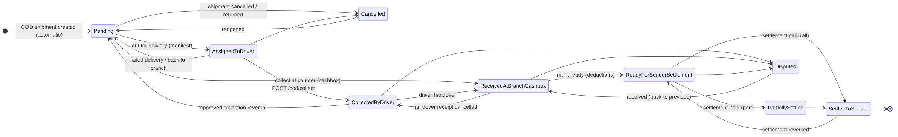
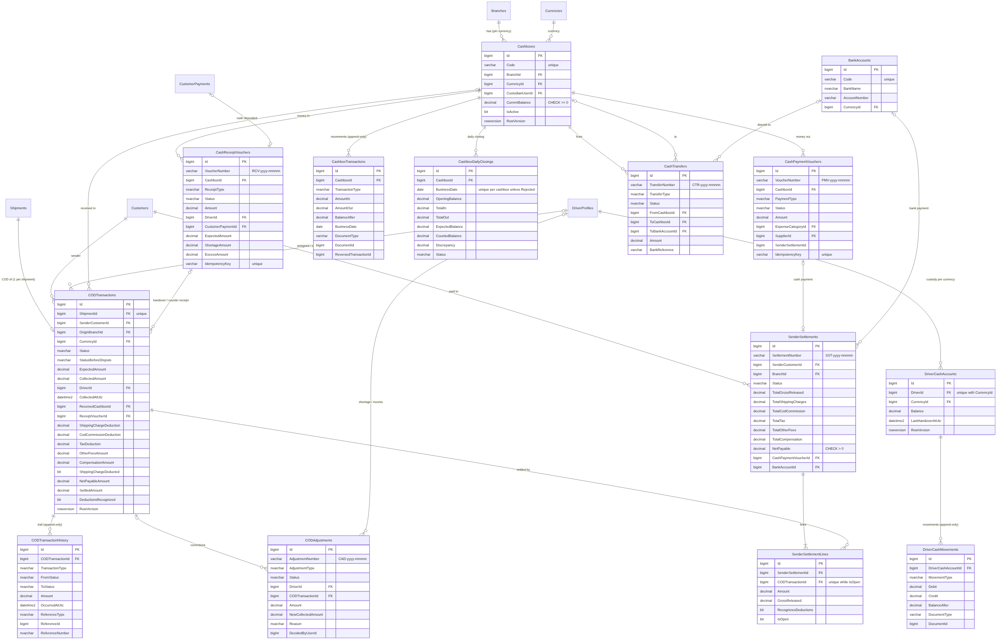
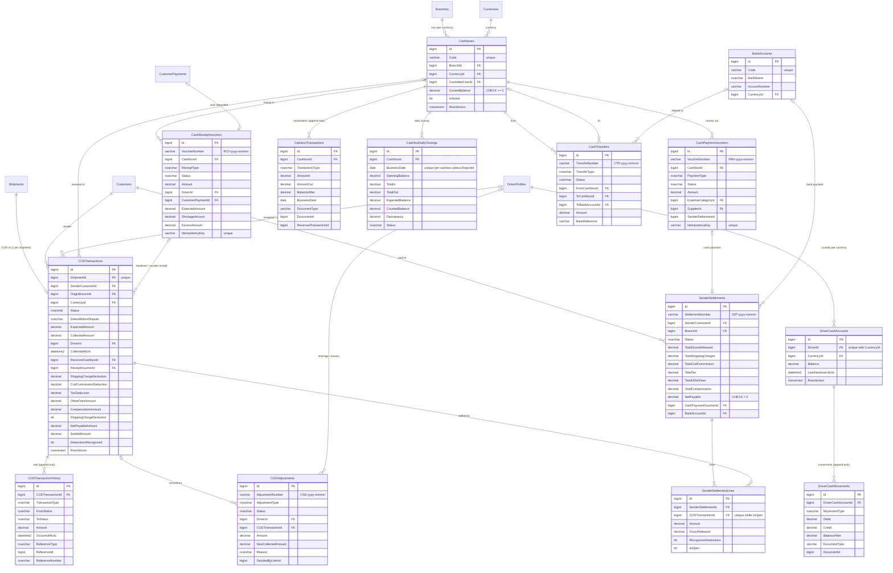

# الخطوة 6 — الدفع عند الاستلام (COD)، عهدة السائقين، صناديق النقدية، تسويات المرسلين، سندات القبض والصرف والتحويلات النقدية

> تُبنى هذه الخطوة فوق **الخطوة 5 الكاملة** (349 اختباراً ناجحاً). بعد هذه الخطوة يصبح العدد المتوقع **486 اختباراً**.
>
> **المكتبات**: لا توجد حزم NuGet جديدة. نبقى على Mapster بدل AutoMapper (الثغرة CVE-2026-32933)، ونستخدم QuestPDF من الخطوة 4 لطباعة السندات وكشف التسوية.
>
> **لا يوجد ترحيل إلى دفتر الأستاذ العام في هذه المرحلة**. كل عملية مالية تُنشئ `AccountingIntegrationEvent` يحمل `AccountingPostingRequest` (قيد مقترح متوازن: مدين = دائن)، ويُحفظ في `OutboxMessages` داخل المعاملة نفسها، لتنفذه وحدة المحاسبة لاحقاً.

---

## 1. ماذا بنينا؟ (شرح خطوات التنفيذ)

### 1.1 القاعدة الذهبية: لمن هذا المال؟

| المال | أين يُسجَّل | هل هو إيراد؟ |
|---|---|---|
| مبلغ COD المحصَّل | التزام للمرسل (`CodPayableToSenders`) | **لا، أبداً**. هو مال المرسل |
| النقد في يد السائق | `DriverCashAccount` (ذمة على السائق) | لا |
| النقد في الصندوق | `Cashbox` و`CashboxTransaction` | لا |
| أجور الشحن المخصومة من COD | تصبح إيراداً **عند دفع التسوية فقط** | نعم، عند التسوية |
| عمولة COD والضريبة | إيراد عمولة / ضريبة مستحقة **عند التسوية** | نعم، عند التسوية |
| صافي المرسل | يُدفع نقداً أو بتحويل بنكي | لا |

**الصافي** (`CodSettlementMath` في طبقة Domain، باختبارات مباشرة):

```
الصافي = المحصَّل − أجور الشحن − عمولة COD − الضريبة − رسوم أخرى + تعويضات
```

- الخصومات تؤخذ من **آخر لقطة سعر** للشحنة (`TotalShippingCharge` و`CodFee` و`TaxAmount`) عند «جاهز للتسوية».
- إذا كانت الشحنة **مفوترة** (الخطوة 5): الخصومات = 0، لأن العميل سيدفعها بالفاتورة.
- إذا خُصمت أجور الشحن من COD: **لا يمكن فوترة الشحنة ولا إعادة تسعيرها** (منع التحصيل مرتين).

### 1.2 سجل COD ودورة حياته

- `CODTransaction`: سجل **واحد لكل شحنة COD** (فهرس فريد على `ShipmentId`).
- `CodShipmentSyncInterceptor` ينشئه ويحدّثه تلقائياً عند إنشاء الشحنة أو تعديلها أو إسنادها لسائق أو إلغائها. يلمس فقط الحالات Pending وAssignedToDriver وCancelled، ولا يغيّر أبداً سجلاً فيه مال.
- `CODTransactionHistory`: سجل **إدراج فقط** لكل حركة (نوعها `CODTransactionType`، من حالة، إلى حالة، المبلغ، المستند المرجعي).
- **الشحنات القديمة**: `CodBackfillSeeder` ينشئ سجلات COD لشحنات الخطوات السابقة عند أول تشغيل.



| الحالة | المعنى |
|---|---|
| `Pending` | شحنة COD لم تُسند لسائق |
| `AssignedToDriver` | مع سائق للتوصيل |
| `CollectedByDriver` | السائق حصّل المبلغ، وهو في عهدته |
| `ReceivedAtBranchCashbox` | سُلِّم إلى صندوق الفرع (أو حُصِّل في الكاونتر مباشرة) |
| `ReadyForSenderSettlement` | رُوجع، وثُبّتت خصوماته |
| `PartiallySettled` | دُفع جزء من صافيه |
| `SettledToSender` | دُفع كامل صافيه |
| `Cancelled` | الشحنة أُلغيت قبل التحصيل |
| `Disputed` | نزاع مفتوح (لا تسوية حتى يُحل) |

الانتقالات مسموحة فقط وفق جدول `CodStatusRules`، وكل انتقال آخر يُرجع **409**.

### 1.3 التحصيل وتسليم السائق

- **`POST /cod/collect`**:
  - الشحنة يجب أن تكون **مُسلَّمة** (`Delivered`) وفيها مبلغ COD.
  - **بسائق**: المبلغ يدخل عهدة السائق (`DriverCashMovement` مدين) والحالة `CollectedByDriver`. السائق نفسه يسجّل التحصيل في عهدته فقط.
  - **في الكاونتر** (`cashboxId` بدل `driverId`): سند قبض `CounterCodCollection` ويدخل الصندوق مباشرة.
  - المبلغ المختلف عن المتوقع يحتاج **سبب الفرق**.
  - تسجيل التحصيل مرتين للشحنة نفسها: **409**.
- **`POST /cod/driver-handover`** (يقبل `Idempotency-Key`):
  - لا يتجاوز **رصيد السائق**. الزيادة تحتاج تسوية `DriverExcessCash` معتمدة أولاً.
  - يمكن تحديد شحنات بعينها (`codTransactionIds`). بدونها: كل ما حصّله السائق بعملة الصندوق.
  - السند يحفظ **المتوقع** (مجموع الشحنات) و**العجز** أو **الزيادة**؛ العجز يبقى ديناً على السائق حتى يسدده أو يُشطب بتسوية معتمدة.
  - ينشئ **سند قبض** `RCV-2026-000001` من نوع `DriverHandover`، وحركة دائن على حساب السائق، وحركة دخول في الصندوق، والحالة `ReceivedAtBranchCashbox`.
  - الرد **201** مع رابط السند. تكرار الطلب بالمفتاح نفسه: **200** + `Idempotent-Replayed: true`.
- **`POST /cod/mark-ready`**: المراجعة. تثبّت الخصومات وتجعل الحالة `ReadyForSenderSettlement`.

### 1.4 النزاعات والتسويات (Adjustments)

- `POST /cod/{id}/dispute` (سبب إلزامي) ← `Disputed`. `POST /cod/{id}/resolve-dispute` يعيدها إلى حالتها قبل النزاع.
- `POST /cod/adjustments`: طلب تصحيح **بسبب**، ولا يغيّر شيئاً حتى **يوافق مستخدم آخر**:

| النوع | الاستخدام |
|---|---|
| `DriverShortageWriteOff` | عجز في عهدة السائق يُشطب |
| `DriverExcessCash` | زيادة نقدية أحضرها السائق |
| `CollectionCorrection` | تصحيح المبلغ المحصَّل لشحنة ما زالت مع السائق |
| `CollectionReversal` | تحصيل سُجّل على شحنة خاطئة (يعود إلى Pending) |
| `SenderFee` | رسم إضافي على المرسل (مرتجع، تخزين، بضاعة تالفة) |
| `SenderCompensation` | تعويض للمرسل (تلف، فقدان، تأخير) |

- عند الموافقة تُعاد كل الفحوص (ربما تغيّر الوضع)، ثم يُطبَّق التصحيح مع حركات الدفاتر والسجل والتدقيق والقيد المقترح، في معاملة واحدة.

### 1.5 تسويات المرسلين

- **`POST /cod/settlements`** ← `SST-2026-000001` (مسودة):
  - الشحنات المؤهلة فقط: `ReadyForSenderSettlement` أو `PartiallySettled`، غير محجوزة في تسوية مفتوحة أخرى.
  - سطور بمبالغ جزئية، أو `codTransactionIds` (الباقي كاملاً)، أو بدونهما: كل الجاهز للمرسل بالعملة.
  - **الخصومات تُحتسب مرة واحدة**، على أول سطر للشحنة.
  - **منع التسوية المزدوجة**: فهرس فريد مُرشَّح `UX_SenderSettlementLines_OpenCod` (الشحنة حيث `IsOpen = 1`).
- **`/approve`**: مستخدم **غير المنشئ**.
- **`/pay`**:
  - **نقداً**: من صندوق بالعملة نفسها ورصيد كافٍ ← سند صرف `PMV-…` من نوع `SenderSettlement`.
  - **تحويل بنكي**: حساب بنكي بالعملة نفسها ورقم مرجع.
  - الشحنات تصبح `SettledToSender` أو `PartiallySettled`، ويُنشأ القيد الذي يحوّل الخصومات إلى إيراد.
- **`/cancel`** للمسودة أو المعتمدة (تحرير الشحنات). **`/reverse`** للمدفوعة بالخطأ (إعادة المال والشحنات).
- **`GET /cod/settlements/{id}/pdf`**: كشف تسوية المرسل.

### 1.6 الصناديق

- **عدة صناديق** لكل فرع وعملة (`DAM-SYP-01`، `DAM-USD-01`…)، ولكل صندوق أمين اختياري.
- `CurrentBalance` مع قيد `CHECK >= 0` و`RowVersion`: لا رصيد سالب، وعمليتان متزامنتان على الصندوق نفسه: الثانية تأخذ **409**.
- كل حركة تُسجَّل في `CashboxTransaction` (داخل، خارج، الرصيد بعد الحركة، يوم العمل). **لا حذف ولا تعديل**: الإلغاء حركة عكسية (`ReversedTransactionId`).
- **يوم العمل** بالتوقيت المحلي (`Cash:BusinessTimeZoneId`، افتراضياً `Asia/Damascus`).
- **الإقفال اليومي** `POST /cashboxes/{id}/daily-closings`:
  - الرصيد الافتتاحي، الداخل، الخارج، المتوقع، **المعدود**، **الفرق**.
  - بدون فرق: `Closed` مباشرة. بفرق: سبب إلزامي و`PendingApproval`.
  - موافقة مستخدم آخر تُسجّل حركة عجز أو زيادة. الرفض يعيد فتح اليوم.
  - **اليوم المقفل لا يقبل حركات جديدة**.

### 1.7 سندات القبض والصرف والتحويلات

- **سند قبض** `RCV-…` (`POST /cash-receipts`، يقبل `Idempotency-Key`). الأنواع اليدوية: `CustomerPayment`، `OtherIncome`، `Other`. الأنواع النظامية (`DriverHandover`، `CounterCodCollection`) تُنشأ من عمليات COD فقط.
- **سند صرف** `PMV-…` (`POST /cash-payments`): مصروف، دفعة مورد، سلفة موظف، استرداد لعميل، أخرى. يُرفض إذا لم يكفِ الرصيد.
- **الإلغاء** بسبب وصلاحية `CashVouchers.Cancel`: حركة عكسية في الصندوق وقيد عكسي.
- **تحويل** `CTR-…` (`POST /cash-transfers`):
  - من صندوق إلى صندوق (الفرع نفسه أو فرع آخر) أو إلى حساب بنكي. **العملة نفسها فقط** في هذه المرحلة.
  - `PendingApproval` ← **موافقة مستخدم آخر** (المال يخرج من المصدر):
    - الفرع نفسه أو البنك: `Completed`.
    - فرع آخر: `InTransit` ثم `/receive` في الفرع المستلم ← `Completed`.
  - رفض أو إلغاء قبل الموافقة.

### 1.8 مبدأ «أربع عيون» (Four-eyes)

- الموافقة على التسوية والتصحيح والإقفال بفرق والتحويل: **مستخدم غير مقدّم الطلب**.
- `Cash:AllowSelfApproval` = `false` افتراضياً. في `appsettings.Development.json` = `true`، حتى تجرّب وحدك بالمستخدم admin. **لا تفعّلها في الإنتاج.**

### 1.9 التقارير ولوحة المعلومات

| الطلب | المحتوى |
|---|---|
| `GET /cod/dashboard` | عدد ومبلغ كل حالة COD، المسلَّم غير المحصَّل، عهد السائقين، أرصدة الصناديق، صافي المرسلين غير المسوّى، الموافقات المعلّقة |
| `GET /cod/driver-balances` | رصيد كل سائق، عدد شحناته في العهدة، أقدم تحصيل |
| `GET /cod/driver-balances/{driverId}/movements` | كشف عهدة السائق برصيد تراكمي |
| `GET /cod/sender-balances` | مستحقات كل مرسل: المحصَّل، الخصومات، الصافي، المدفوع، الباقي |
| `GET /cod/aging` | أعمار COD غير المسوّى لكل مرسل: 0-7، 8-15، 16-30، 31-60، أكثر من 60 يوماً |
| `GET /cashboxes/{id}/transactions` | كشف الصندوق |
| `GET /reports/daily-cash-movement` | حركة النقدية اليومية لكل صندوق: افتتاحي، داخل حسب النوع، خارج حسب النوع، ختامي، الإقفال |
| `GET /reports/driver-collections` | تحصيلات السائقين في فترة |
| `GET /reports/sender-settlements` | التسويات المدفوعة في فترة مع الإجماليات |

الفترة الافتراضية: آخر 30 يوم عمل حتى نهاية اليوم الحالي.

### 1.10 الطباعة (PDF عربي من اليمين لليسار)

| المستند | الطلب | المقاس |
|---|---|---|
| سند قبض / إيصال تسليم السائق | `GET /cash-receipts/{id}/pdf` | A5 |
| سند صرف | `GET /cash-payments/{id}/pdf` | A5 |
| كشف تسوية مرسل | `GET /cod/settlements/{id}/pdf` | A4 أفقي |

كل مستند يحمل:

- الرقم، التاريخ والوقت **بالتوقيت المحلي**، الفرع، الصندوق، العملة.
- **المبلغ رقماً وكتابةً بالعربية** («مئة ألف ليرة سورية فقط لا غير»).
- رمز QR (الرقم، التاريخ، المبلغ).
- أماكن التوقيع: المستلم، الدافع، أمين الصندوق، المحاسب.
- علامة «ملغى» على السند الملغى.
- إيصال السائق يُدرج الشحنات المسلّمة. كشف التسوية يُدرج كل شحنة مع خصوماتها والصافي.

### 1.11 القيود المقترحة (بدون ترحيل)

| الحدث | القيد المقترح |
|---|---|
| `CodCollected` | مدين: عهدة السائق — دائن: مستحقات المرسلين |
| `DriverCashHandedOver` | مدين: الصندوق — دائن: عهدة السائق |
| `SenderSettlementPaid` | مدين: مستحقات المرسلين — دائن: الصندوق / البنك + إيراد الشحن + إيراد عمولة COD + ضريبة مستحقة |
| `CashReceiptPosted` / `CashPaymentPosted` | الصندوق مقابل حساب نوع السند |
| `CashTransferApproved` / `Received` | نقدية في الطريق، ثم الصندوق المستلم |
| `CashboxDiscrepancyPosted` | عجز / زيادة الصندوق |
| `…Reversed` / `CashVoucherCancelled` | القيد العكسي |

### 1.12 الصلاحيات الجديدة

| الصلاحية | الأدوار |
|---|---|
| `COD.Handover` | محاسب، مدير فرع، موظف شحن |
| `COD.ApproveSettlement`، `COD.ApproveAdjustment` | مدير فرع |
| `COD.PaySettlement`، `COD.Adjust` | محاسب، مدير فرع |
| `Cashboxes.View` | محاسب، مدير فرع، موظف شحن |
| `Cashboxes.Manage` | محاسب |
| `Cashboxes.Close` | محاسب، مدير فرع |
| `Cashboxes.ApproveClosing` | مدير فرع |
| `CashVouchers.Create` | محاسب، مدير فرع |
| `CashVouchers.Cancel` | مدير فرع |
| `CashTransfers.Create`، `CashTransfers.Receive` | محاسب، مدير فرع |
| `CashTransfers.Approve` | مدير فرع |

- مدير النظام يملك كل شيء.
- السائق حصل على `COD.View`. هذه المنحة للأدوار **الموجودة** تتم فقط في قاعدة بيانات جديدة؛ في قاعدتك الحالية أضفها من شاشة الأدوار إذا احتجتها.
- **الفروع**: من لا يملك `Branches.ViewAll` يرى صناديق وسندات وتسويات وشحنات COD فرعه فقط، وغيرها يُرجع 404.

### 1.13 تعديلات على ملفات سابقة

- **`Shipment`**: رابط `CodTransaction`. **`ShipmentDto`**: `CodTransactionId` و`CodStatus` و`CodCollectedAmount`.
- **الفواتير**: شحنة خُصمت أجورها من COD لا تُفوتر ولا يُعاد تسعيرها (`ShipmentBillingGuards` و`InvoiceService`).
- **منع الحذف**: فرع، عملة، عميل، طريقة دفع، فئة مصروف، مورد، سائق مستخدم في صندوق أو سند أو COD.
- **`DocumentNumberGenerator`**: البادئات `RCV`، `PMV`، `CTR`، `SST`، `CAD`.
- **`appsettings.json`**: قسم `Cash`.
- **البيانات التجريبية** (`DemoCashSeeder`، عندما لا يوجد أي صندوق):
  - `DAM-SYP-01` برصيد افتتاحي 500,000 ل.س.
  - `DAM-USD-01` بالدولار.
  - `ALP-SYP-01` برصيد 250,000 ل.س.
  - الحساب البنكي `BNK-CBS-SYP`.

---

## 2. خطوات التطبيق على جهازك (Windows PowerShell)

> استخدم النسخة **الكاملة** في مجلد جديد `ShippingERP-Step06`، ثم انسخ مجلد الـ Migrations من الخطوة 5.

```powershell
cd "$HOME\Downloads"
$zip = Get-ChildItem "$HOME\Downloads\ShippingERP-Step06-full*.zip" | Sort-Object LastWriteTime -Descending | Select-Object -First 1
$zip.FullName
Unblock-File $zip.FullName
Expand-Archive $zip.FullName -DestinationPath "$HOME\Downloads\ShippingERP-Step06" -Force

# انسخ الـ migrations الموجودة (AddIdentityAndAudit, AddMasterData, AddShipments, AddPricingAndBilling)
Copy-Item "$HOME\Downloads\ShippingERP-Step05\src\ShippingERP.Infrastructure\Persistence\Migrations\*" `
  "$HOME\Downloads\ShippingERP-Step06\src\ShippingERP.Infrastructure\Persistence\Migrations\" -Force

cd "$HOME\Downloads\ShippingERP-Step06"
Test-Path src\ShippingERP.Infrastructure\Cod\CodService.cs                                   # True
Test-Path src\ShippingERP.Infrastructure\Cash\CashLedger.cs                                  # True
Test-Path src\ShippingERP.Infrastructure\Persistence\Migrations\AppDbContextModelSnapshot.cs # True

dotnet build
dotnet test        # المتوقع: 486 ناجحاً

dotnet ef migrations add AddCodAndCash `
  --project src/ShippingERP.Infrastructure `
  --startup-project src/ShippingERP.API `
  --output-dir Persistence/Migrations

dotnet ef database update `
  --project src/ShippingERP.Infrastructure `
  --startup-project src/ShippingERP.API

dotnet run --project src/ShippingERP.API --launch-profile http
```

- **الـ migration** تنشئ 14 جدولاً جديداً، ولا تحذف أي بيانات.
- في السجل ابحث عن:
  - `COD backfill: N COD record(s) created for existing shipments`
  - `Demo cashboxes created (3) and 1 bank account`
- **سجّل الخروج ثم الدخول**، حتى يحمل الـ Token الصلاحيات الجديدة.

---

## 3. التجربة في Swagger (بالترتيب)

1. `GET /api/v1/cashboxes`: الصناديق التجريبية وأرصدتها.
2. أنشئ شحنة COD بمبلغ 100000، أسندها لسائق، ثم غيّر حالتها حتى `Delivered`. ثم `GET /cod/by-shipment/{shipmentId}` ← `AssignedToDriver`.
3. `POST /cod/collect` بمعرّف السائق ← `CollectedByDriver`. أعد الطلب ← **409**.
4. `GET /cod/driver-balances`: رصيد السائق 100000.
5. `POST /cod/driver-handover` بمبلغ 150000 ← **422** (أكبر من الرصيد). ثم بمبلغ 100000 مع `Idempotency-Key` ← 201. أعده ← 200 + `Idempotent-Replayed`.
6. `GET /cash-receipts/{id}/pdf`: إيصال تسليم السائق.
7. `POST /cod/mark-ready` ← `ReadyForSenderSettlement`. ثم `GET /cod/settlements/candidates?senderCustomerId=…`: الخصومات والصافي.
8. `POST /cod/settlements` بسطر جزئي، ثم `/approve` ثم `/pay` نقداً من الصندوق.
9. `GET /cod/settlements/{id}/pdf`، و`GET /cod/sender-balances`، و`GET /cod/aging`.
10. `POST /cash-payments` (مصروف)، و`POST /cash-transfers` إلى صندوق حلب ثم `/approve` ثم `/receive`.
11. `POST /cashboxes/{id}/daily-closings` بمبلغ معدود أقل بـ 500 مع سبب ← `PendingApproval`، ثم `/approve`.
12. `GET /cashboxes/{id}/transactions` و`GET /reports/daily-cash-movement`.

---

## 4. مخطط قاعدة البيانات (ERD)





---

## 5. أمثلة Swagger (JSON)

### 5.1 تحصيل بسائق — `POST /api/v1/cod/collect`

```json
{ "shipmentId": 42, "amount": 100000, "driverId": 5, "notes": "تحصيل كامل" }
```

تحصيل في الكاونتر بمبلغ مختلف:

```json
{ "trackingNumber": "SY260000042", "amount": 95000, "cashboxId": 1,
  "differenceReason": "اتفاق المرسل مع المستلم على خصم 5000" }
```

### 5.2 تسليم السائق — `POST /api/v1/cod/driver-handover` (Header: `Idempotency-Key: 7c2e…`)

```json
{ "driverId": 5, "cashboxId": 1, "amount": 100000, "codTransactionIds": [ 17 ], "notes": "تسليم نهاية الوردية" }
```

### 5.3 جاهز للتسوية — `POST /api/v1/cod/mark-ready`

```json
{ "codTransactionIds": [ 17, 18, 21 ] }
```

### 5.4 تسوية مرسل — `POST /api/v1/cod/settlements`

```json
{ "senderCustomerId": 3, "currencyId": 1,
  "lines": [ { "codTransactionId": 17, "amount": 50000 }, { "codTransactionId": 18 } ],
  "notes": "تسوية أسبوعية" }
```

### 5.5 دفع التسوية — `POST /api/v1/cod/settlements/{id}/pay`

```json
{ "paymentMethodId": 1, "cashboxId": 1 }
```

بتحويل بنكي:

```json
{ "paymentMethodId": 2, "bankAccountId": 1, "referenceNumber": "TRF-2026-8812" }
```

### 5.6 تصحيح — `POST /api/v1/cod/adjustments`

```json
{ "adjustmentType": "DriverShortageWriteOff", "driverId": 5, "amount": 2000,
  "reason": "عجز في عهدة السائق بعد الجرد، يُخصم من راتبه" }
```

### 5.7 صندوق — `POST /api/v1/cashboxes`

```json
{ "code": "DAM-SYP-02", "arabicName": "صندوق دمشق 2", "branchId": 1, "currencyId": 1,
  "custodianUserId": 4, "openingBalance": 100000 }
```

### 5.8 سند قبض — `POST /api/v1/cash-receipts` (Header: `Idempotency-Key: …`)

```json
{ "cashboxId": 1, "receiptType": "OtherIncome", "amount": 25000,
  "receivedFrom": "مستأجر المستودع", "description": "إيجار ركن في المستودع لشهر تشرين الأول" }
```

### 5.9 سند صرف — `POST /api/v1/cash-payments`

```json
{ "cashboxId": 1, "paymentType": "Expense", "amount": 15000, "paidTo": "محطة وقود الربوة",
  "description": "وقود سيارة التوزيع", "expenseCategoryId": 2, "referenceNumber": "F-9912" }
```

### 5.10 تحويل — `POST /api/v1/cash-transfers`

```json
{ "fromCashboxId": 1, "toCashboxId": 3, "amount": 200000, "reason": "تغذية صندوق حلب" }
```

### 5.11 إقفال يومي — `POST /api/v1/cashboxes/{id}/daily-closings`

```json
{ "businessDate": "2026-10-12", "countedBalance": 409500, "discrepancyReason": "عجز 500 ليرة في الفكة" }
```

---

## 6. ملاحظات مهمة

- **المبالغ**: كلها `decimal(18,2)`. **التواريخ**: كلها UTC، ويوم العمل (`BusinessDate`) تاريخ محلي فقط.
- **قاعدة المعاملات**: كل عملية (تحصيل، تسليم، تسوية، دفع، سند، تحويل، إقفال، تصحيح) معاملة واحدة تشمل: المستند، سجل COD، دفتر السائق، دفتر الصندوق، التدقيق، وحدث المحاسبة.
- **سجل لا يُعدّل**: `CODTransactionHistory` و`DriverCashMovement` و`CashboxTransaction` إدراج فقط؛ أي تصحيح يكون بحركة جديدة بسبب وموافقة.
- **عملة واحدة لكل عملية**: لا صرف عملات في هذه المرحلة.
- **`AllowSelfApproval`**: يبقى `false` في الإنتاج.
- **المحاسبة**: القيود المقترحة جاهزة في `OutboxMessages`؛ ستُرحّل إلى دفتر الأستاذ في المرحلة القادمة.

---

## 7. الملفات الكاملة (92 ملفاً جديداً أو معدّلاً)

كل ملف كامل كما هو في المشروع. المسارات نسبية من المجلد الجذر للحل.

### 7.1 `src/ShippingERP.Domain/Authorization/Permissions.cs`

```csharp
namespace ShippingERP.Domain.Authorization;

/// <summary>
/// The single source of truth for permission codes.
///
/// - Use the constants in code: [HasPermission(Permissions.Shipments.Create)]
/// - The seeder inserts any code from <see cref="All"/> that is missing in the Permissions table,
///   so adding a permission = add a constant here + add it to All + restart the API.
/// - Never rename an existing code: role assignments and issued tokens refer to it.
/// </summary>
public static class Permissions
{
    public static class Users
    {
        public const string View = "Users.View";
        public const string Manage = "Users.Manage";
    }

    public static class Roles
    {
        public const string Manage = "Roles.Manage";
    }

    public static class Customers
    {
        public const string View = "Customers.View";
        public const string Manage = "Customers.Manage";
    }

    public static class Shipments
    {
        public const string View = "Shipments.View";
        public const string Create = "Shipments.Create";
        public const string Update = "Shipments.Update";
        public const string ChangeStatus = "Shipments.ChangeStatus";
        public const string AssignDriver = "Shipments.AssignDriver";

        // ----- Step 4 -----

        /// <summary>Cancel a shipment that has not left the origin branch.</summary>
        public const string Cancel = "Shipments.Cancel";

        /// <summary>Confirm a delivery (proof of delivery) or record a failed attempt.</summary>
        public const string ConfirmDelivery = "Shipments.ConfirmDelivery";

        /// <summary>Correct a wrong status outside the normal rules (reason required, fully audited).</summary>
        public const string CorrectStatus = "Shipments.CorrectStatus";

        /// <summary>Import shipments from Excel.</summary>
        public const string Import = "Shipments.Import";

        /// <summary>Enter a manual shipping charge (when no pricing rule applies) or give a discount (a reason is required).</summary>
        public const string OverridePrice = "Shipments.OverridePrice";
    }

    // ----- Step 4: operations -----

    /// <summary>Warehouse check-in / check-out manifests.</summary>
    public static class Warehouse
    {
        public const string ManageMovements = "Warehouse.ManageMovements";
    }

    /// <summary>Branch transfer manifests.</summary>
    public static class Transfers
    {
        public const string View = "Transfers.View";
        public const string Manage = "Transfers.Manage";
        public const string Receive = "Transfers.Receive";
    }

    /// <summary>Driver delivery manifests (drivers see their own manifests with Shipments.View).</summary>
    public static class DeliveryManifests
    {
        public const string Manage = "DeliveryManifests.Manage";
    }

    public static class Returns
    {
        public const string Manage = "Returns.Manage";
    }

    public static class DamageCases
    {
        public const string Manage = "DamageCases.Manage";
    }

    /// <summary>
    /// Cash on delivery. Step 6 adds the handover, approval and adjustment permissions. A driver-only user (Driver
    /// role without Shipments.AssignDriver) sees only his own COD shipments and his own cash balance.
    /// </summary>
    public static class Cod
    {
        public const string View = "COD.View";

        /// <summary>Record the COD amount collected from the recipient.</summary>
        public const string Collect = "COD.Collect";

        /// <summary>Mark received COD ready for settlement and create sender settlements (step 6 meaning).</summary>
        public const string Settle = "COD.Settle";

        // ----- Step 6 -----

        /// <summary>Receive a driver's cash into a cashbox (driver handover) or a counter COD collection.</summary>
        public const string Handover = "COD.Handover";

        /// <summary>Approve, cancel or reverse sender settlements.</summary>
        public const string ApproveSettlement = "COD.ApproveSettlement";

        /// <summary>Pay an approved sender settlement (cash from a cashbox or bank transfer).</summary>
        public const string PaySettlement = "COD.PaySettlement";

        /// <summary>Request COD / driver cash adjustments and open disputes.</summary>
        public const string Adjust = "COD.Adjust";

        /// <summary>Approve or reject adjustments and resolve disputes.</summary>
        public const string ApproveAdjustment = "COD.ApproveAdjustment";
    }

    // ----- Step 6: cash management -----

    /// <summary>Branch cashboxes, their transactions, daily closings and bank accounts.</summary>
    public static class Cashboxes
    {
        public const string View = "Cashboxes.View";

        /// <summary>Create and edit cashboxes and bank accounts.</summary>
        public const string Manage = "Cashboxes.Manage";

        /// <summary>Close the day of a cashbox (count the cash).</summary>
        public const string Close = "Cashboxes.Close";

        /// <summary>Approve or reject a closing with a cash difference.</summary>
        public const string ApproveClosing = "Cashboxes.ApproveClosing";
    }

    /// <summary>Cash receipt and payment vouchers (سندات القبض والصرف النقدية).</summary>
    public static class CashVouchers
    {
        public const string Create = "CashVouchers.Create";

        /// <summary>Cancel a posted voucher (adds a reversing cashbox transaction).</summary>
        public const string Cancel = "CashVouchers.Cancel";
    }

    public static class CashTransfers
    {
        public const string Create = "CashTransfers.Create";
        public const string Approve = "CashTransfers.Approve";
        public const string Receive = "CashTransfers.Receive";
    }

    public static class Invoices
    {
        public const string View = "Invoices.View";
        public const string Create = "Invoices.Create";

        // ----- Step 5 -----

        /// <summary>Issue a draft invoice (gives it its number and debits the customer account).</summary>
        public const string Issue = "Invoices.Issue";

        /// <summary>Cancel a draft, or an issued invoice that has no payment and no credit note.</summary>
        public const string Cancel = "Invoices.Cancel";

        /// <summary>Issue credit notes against issued invoices.</summary>
        public const string CreditNotes = "Invoices.CreditNotes";

        /// <summary>Export invoices to Excel and print / download invoice PDFs.</summary>
        public const string Export = "Invoices.Export";
    }

    // ----- Step 5: receivables -----

    /// <summary>Customer payments (سندات القبض).</summary>
    public static class Payments
    {
        public const string View = "Payments.View";
        public const string Create = "Payments.Create";
    }

    /// <summary>Customer account statements and balances.</summary>
    public static class Receivables
    {
        public const string View = "Receivables.View";
    }

    public static class Accounting
    {
        public const string View = "Accounting.View";
        public const string CreateJournal = "Accounting.CreateJournal";
        public const string ApproveJournal = "Accounting.ApproveJournal";
    }

    public static class Expenses
    {
        public const string View = "Expenses.View";
        public const string Create = "Expenses.Create";
        public const string Approve = "Expenses.Approve";
    }

    public static class Reports
    {
        public const string ViewFinancial = "Reports.ViewFinancial";
        public const string ViewOperational = "Reports.ViewOperational";
    }

    public static class Branches
    {
        /// <summary>See and manage data of every branch. Without it a user only sees their own branch.</summary>
        public const string ViewAll = "Branches.ViewAll";
        public const string Manage = "Branches.Manage";
    }

    // ----- Step 3: master data -----

    /// <summary>
    /// Reference data used by everybody: countries, cities, zones, service types, payment methods,
    /// currencies, exchange rates, tax rates, expense categories, company profile.
    /// Reading them only requires being signed in; changing them requires MasterData.Manage.
    /// </summary>
    public static class MasterData
    {
        public const string Manage = "MasterData.Manage";
    }

    public static class Pricing
    {
        public const string View = "Pricing.View";
        public const string Manage = "Pricing.Manage";

        /// <summary>Step 5: approve or reject manual prices above the approval threshold (and apply them directly).</summary>
        public const string ApproveOverride = "Pricing.ApproveOverride";
    }

    public static class Suppliers
    {
        public const string View = "Suppliers.View";
        public const string Manage = "Suppliers.Manage";
    }

    /// <summary>Employees and driver profiles.</summary>
    public static class Employees
    {
        public const string View = "Employees.View";
        public const string Manage = "Employees.Manage";
    }

    public static class Vehicles
    {
        public const string View = "Vehicles.View";
        public const string Manage = "Vehicles.Manage";
    }

    /// <summary>Every permission with its module and Arabic description.</summary>
    public static IReadOnlyList<PermissionDefinition> All { get; } = new List<PermissionDefinition>
    {
        new(Users.View, "Users", "عرض المستخدمين"),
        new(Users.Manage, "Users", "إدارة المستخدمين (إضافة، تعديل، تفعيل، إيقاف)"),
        new(Roles.Manage, "Roles", "إدارة الأدوار والصلاحيات"),

        new(Customers.View, "Customers", "عرض العملاء"),
        new(Customers.Manage, "Customers", "إدارة العملاء"),

        new(Shipments.View, "Shipments", "عرض الشحنات"),
        new(Shipments.Create, "Shipments", "إنشاء شحنة"),
        new(Shipments.Update, "Shipments", "تعديل شحنة"),
        new(Shipments.ChangeStatus, "Shipments", "تغيير حالة الشحنة"),
        new(Shipments.AssignDriver, "Shipments", "إسناد الشحنة إلى سائق"),
        new(Shipments.Cancel, "Shipments", "إلغاء شحنة"),
        new(Shipments.ConfirmDelivery, "Shipments", "تأكيد التسليم وتسجيل محاولات التسليم الفاشلة"),
        new(Shipments.CorrectStatus, "Shipments", "تصحيح حالة شحنة خارج المسار الطبيعي"),
        new(Shipments.Import, "Shipments", "استيراد الشحنات من Excel"),
        new(Shipments.OverridePrice, "Shipments", "إدخال سعر شحن يدوي ومنح خصم"),

        new(Warehouse.ManageMovements, "Warehouse", "إدخال وإخراج الشحنات من المستودع"),
        new(Transfers.View, "Transfers", "عرض التحويلات بين الفروع"),
        new(Transfers.Manage, "Transfers", "إنشاء وإرسال التحويلات بين الفروع"),
        new(Transfers.Receive, "Transfers", "استلام التحويلات الواردة"),
        new(DeliveryManifests.Manage, "DeliveryManifests", "إنشاء وإدارة بيانات التوزيع للسائقين"),
        new(Returns.Manage, "Returns", "إدارة المرتجعات"),
        new(DamageCases.Manage, "DamageCases", "إدارة حالات التلف والفقدان"),

        new(Cod.View, "COD", "عرض مبالغ الدفع عند الاستلام"),
        new(Cod.Collect, "COD", "تحصيل مبالغ الدفع عند الاستلام"),
        new(Cod.Settle, "COD", "تسوية مبالغ الدفع عند الاستلام مع العملاء"),
        new(Cod.Handover, "COD", "استلام نقدية السائقين والتحصيل في الفرع إلى الصندوق"),
        new(Cod.ApproveSettlement, "COD", "اعتماد تسويات المرسلين وإلغاؤها وعكسها"),
        new(Cod.PaySettlement, "COD", "دفع تسويات المرسلين"),
        new(Cod.Adjust, "COD", "طلب تسويات التحصيل وعهدة السائقين وفتح النزاعات"),
        new(Cod.ApproveAdjustment, "COD", "اعتماد تسويات التحصيل وحل النزاعات"),

        new(Cashboxes.View, "Cashboxes", "عرض الصناديق وحركاتها وتقارير النقدية"),
        new(Cashboxes.Manage, "Cashboxes", "إدارة الصناديق والحسابات البنكية"),
        new(Cashboxes.Close, "Cashboxes", "الإقفال اليومي للصناديق"),
        new(Cashboxes.ApproveClosing, "Cashboxes", "اعتماد فروقات الإقفال اليومي"),
        new(CashVouchers.Create, "CashVouchers", "تسجيل سندات القبض والصرف النقدية"),
        new(CashVouchers.Cancel, "CashVouchers", "إلغاء سندات القبض والصرف النقدية"),
        new(CashTransfers.Create, "CashTransfers", "طلب تحويلات النقدية"),
        new(CashTransfers.Approve, "CashTransfers", "اعتماد تحويلات النقدية أو رفضها"),
        new(CashTransfers.Receive, "CashTransfers", "استلام تحويلات النقدية الواردة"),

        new(Invoices.View, "Invoices", "عرض الفواتير"),
        new(Invoices.Create, "Invoices", "إنشاء الفواتير"),
        new(Invoices.Issue, "Invoices", "إصدار الفواتير (ترقيمها وترحيلها إلى حساب العميل)"),
        new(Invoices.Cancel, "Invoices", "إلغاء الفواتير غير المدفوعة"),
        new(Invoices.CreditNotes, "Invoices", "إصدار الإشعارات الدائنة"),
        new(Invoices.Export, "Invoices", "طباعة الفواتير وتصديرها إلى Excel"),

        new(Payments.View, "Payments", "عرض سندات القبض"),
        new(Payments.Create, "Payments", "تسجيل دفعات العملاء وتخصيصها على الفواتير"),
        new(Receivables.View, "Receivables", "عرض كشوف حسابات العملاء وأرصدتهم"),

        new(Accounting.View, "Accounting", "عرض الحسابات والقيود"),
        new(Accounting.CreateJournal, "Accounting", "إنشاء قيود يومية"),
        new(Accounting.ApproveJournal, "Accounting", "اعتماد قيود اليومية"),

        new(Expenses.View, "Expenses", "عرض المصروفات"),
        new(Expenses.Create, "Expenses", "تسجيل المصروفات"),
        new(Expenses.Approve, "Expenses", "اعتماد المصروفات"),

        new(Reports.ViewFinancial, "Reports", "عرض التقارير المالية"),
        new(Reports.ViewOperational, "Reports", "عرض التقارير التشغيلية"),

        new(Branches.ViewAll, "Branches", "الاطلاع على بيانات جميع الفروع"),
        new(Branches.Manage, "Branches", "إدارة الفروع والمستودعات"),

        new(MasterData.Manage, "MasterData", "إدارة البيانات الأساسية (الدول، المدن، المناطق، العملات، الضرائب...)"),

        new(Pricing.View, "Pricing", "عرض خطط التسعير"),
        new(Pricing.Manage, "Pricing", "إدارة خطط التسعير وقواعدها"),
        new(Pricing.ApproveOverride, "Pricing", "اعتماد تعديلات الأسعار اليدوية الكبيرة"),

        new(Suppliers.View, "Suppliers", "عرض الموردين"),
        new(Suppliers.Manage, "Suppliers", "إدارة الموردين"),

        new(Employees.View, "Employees", "عرض الموظفين والسائقين"),
        new(Employees.Manage, "Employees", "إدارة الموظفين والسائقين"),

        new(Vehicles.View, "Vehicles", "عرض المركبات"),
        new(Vehicles.Manage, "Vehicles", "إدارة المركبات")
    };

    private static readonly HashSet<string> AllCodes =
        new(All.Select(permission => permission.Code), StringComparer.Ordinal);

    /// <summary>True if the code exists in the catalog (case-sensitive).</summary>
    public static bool IsKnown(string code) => AllCodes.Contains(code);
}
```

### 7.2 `src/ShippingERP.Domain/Authorization/Roles.cs`

```csharp
using P = ShippingERP.Domain.Authorization.Permissions;

namespace ShippingERP.Domain.Authorization;

/// <summary>
/// The seven built-in roles.
///
/// DefaultPermissions are applied when the seeder creates the role for the first time. When a NEW permission
/// code is added to Permissions.cs later, the seeder also grants it to the built-in roles that list it here
/// (only on the run that creates the permission). Changes an administrator makes with
/// PUT /api/v1/roles/{id}/permissions are never overwritten. SystemAdmin always holds every permission.
///
/// Drivers: a user in the Driver role who does NOT hold Shipments.AssignDriver only sees the shipments and
/// delivery manifests assigned to his driver profile (DriverProfile.UserId).
/// </summary>
public static class Roles
{
    public const string SystemAdmin = "SystemAdmin";
    public const string Accountant = "Accountant";
    public const string BranchManager = "BranchManager";
    public const string ShippingAgent = "ShippingAgent";
    public const string WarehouseEmployee = "WarehouseEmployee";
    public const string Driver = "Driver";
    public const string Customer = "Customer";

    public static IReadOnlyList<RoleDefinition> All { get; } = new List<RoleDefinition>
    {
        new(
            SystemAdmin,
            "مدير النظام",
            "صلاحيات كاملة على جميع أجزاء النظام.",
            P.All.Select(permission => permission.Code).ToList()),

        new(
            Accountant,
            "محاسب",
            "الحسابات والقيود والفواتير والمصروفات والصناديق وتسويات الدفع عند الاستلام.",
            new[]
            {
                P.Customers.View,
                P.Shipments.View,
                P.Cod.View, P.Cod.Settle, P.Cod.Handover, P.Cod.PaySettlement, P.Cod.Adjust,
                P.Cashboxes.View, P.Cashboxes.Manage, P.Cashboxes.Close,
                P.CashVouchers.Create,
                P.CashTransfers.Create, P.CashTransfers.Receive,
                P.Invoices.View, P.Invoices.Create, P.Invoices.Issue, P.Invoices.Cancel, P.Invoices.CreditNotes, P.Invoices.Export,
                P.Payments.View, P.Payments.Create,
                P.Receivables.View,
                P.Accounting.View, P.Accounting.CreateJournal,
                P.Expenses.View, P.Expenses.Create,
                P.Reports.ViewFinancial,
                P.Pricing.View,
                P.Suppliers.View, P.Suppliers.Manage
            }),

        new(
            BranchManager,
            "مدير فرع",
            "إدارة عمليات الفرع وموظفيه وشحناته.",
            new[]
            {
                P.Users.View,
                P.Customers.View, P.Customers.Manage,
                P.Shipments.View, P.Shipments.Create, P.Shipments.Update,
                P.Shipments.ChangeStatus, P.Shipments.AssignDriver,
                P.Shipments.Cancel, P.Shipments.ConfirmDelivery, P.Shipments.CorrectStatus, P.Shipments.Import,
                P.Shipments.OverridePrice,
                P.Warehouse.ManageMovements,
                P.Transfers.View, P.Transfers.Manage, P.Transfers.Receive,
                P.DeliveryManifests.Manage,
                P.Returns.Manage,
                P.DamageCases.Manage,
                P.Cod.View, P.Cod.Collect, P.Cod.Handover, P.Cod.Settle, P.Cod.ApproveSettlement, P.Cod.PaySettlement,
                P.Cod.Adjust, P.Cod.ApproveAdjustment,
                P.Cashboxes.View, P.Cashboxes.Close, P.Cashboxes.ApproveClosing,
                P.CashVouchers.Create, P.CashVouchers.Cancel,
                P.CashTransfers.Create, P.CashTransfers.Approve, P.CashTransfers.Receive,
                P.Invoices.View, P.Invoices.Create, P.Invoices.Issue, P.Invoices.Export,
                P.Payments.View, P.Payments.Create,
                P.Receivables.View,
                P.Expenses.View, P.Expenses.Create, P.Expenses.Approve,
                P.Reports.ViewOperational,
                P.Pricing.View, P.Pricing.ApproveOverride,
                P.Suppliers.View,
                P.Employees.View, P.Employees.Manage,
                P.Vehicles.View, P.Vehicles.Manage
            }),

        new(
            ShippingAgent,
            "موظف شحن",
            "استقبال الشحنات وتسجيلها وخدمة العملاء.",
            new[]
            {
                P.Customers.View, P.Customers.Manage,
                P.Shipments.View, P.Shipments.Create, P.Shipments.Update, P.Shipments.ChangeStatus,
                P.Shipments.Cancel, P.Shipments.ConfirmDelivery, P.Shipments.Import,
                P.Returns.Manage,
                P.Pricing.View,
                P.Invoices.View, P.Invoices.Create,
                P.Payments.View, P.Payments.Create,
                P.Cod.View, P.Cod.Collect, P.Cod.Handover,
                P.Cashboxes.View
            }),

        new(
            WarehouseEmployee,
            "موظف مستودع",
            "استلام وفرز الشحنات في المستودع.",
            new[]
            {
                P.Shipments.View, P.Shipments.ChangeStatus,
                P.Warehouse.ManageMovements,
                P.Transfers.View, P.Transfers.Manage, P.Transfers.Receive,
                P.DamageCases.Manage
            }),

        new(
            Driver,
            "سائق",
            "توصيل الشحنات وتحصيل مبالغ الدفع عند الاستلام.",
            new[]
            {
                P.Shipments.View, P.Shipments.ChangeStatus, P.Shipments.ConfirmDelivery,
                P.Cod.View, P.Cod.Collect
            }),

        new(
            Customer,
            "عميل",
            "متابعة شحناته وفواتيره من بوابة العملاء.",
            new[]
            {
                P.Shipments.View,
                P.Invoices.View
            })
    };
}
```

### 7.3 `src/ShippingERP.Domain/Cod/ArabicAmountInWords.cs`

```csharp
using System.Globalization;

namespace ShippingERP.Domain.Cod;

/// <summary>
/// Writes an amount in Arabic words for printed vouchers (التفقيط), e.g.
/// 125500 SYP -> "فقط مائة وخمسة وعشرون ألفاً وخمسمائة ليرة سورية لا غير".
///
/// Numbers are written in the masculine counting form commonly used on Syrian cash vouchers; the fraction of
/// currencies with decimals is written as digits ("و 50/100"). Supports up to 999,999,999,999.
/// </summary>
public static class ArabicAmountInWords
{
    private static readonly string[] Units =
    {
        string.Empty, "واحد", "اثنان", "ثلاثة", "أربعة", "خمسة", "ستة", "سبعة", "ثمانية", "تسعة", "عشرة",
        "أحد عشر", "اثنا عشر", "ثلاثة عشر", "أربعة عشر", "خمسة عشر", "ستة عشر", "سبعة عشر", "ثمانية عشر", "تسعة عشر"
    };

    private static readonly string[] Tens =
    {
        string.Empty, string.Empty, "عشرون", "ثلاثون", "أربعون", "خمسون", "ستون", "سبعون", "ثمانون", "تسعون"
    };

    private static readonly string[] Hundreds =
    {
        string.Empty, "مائة", "مائتان", "ثلاثمائة", "أربعمائة", "خمسمائة", "ستمائة", "سبعمائة", "ثمانمائة", "تسعمائة"
    };

    /// <summary>Scale words: singular, dual, plural (3-10), accusative singular (11-99).</summary>
    private static readonly (string One, string Two, string Plural, string Accusative)[] Scales =
    {
        ("ألف", "ألفان", "آلاف", "ألفاً"),
        ("مليون", "مليونان", "ملايين", "مليوناً"),
        ("مليار", "ملياران", "مليارات", "ملياراً")
    };

    /// <summary>The full printed sentence with the currency name.</summary>
    public static string Format(decimal amount, string currencyName, int decimals)
    {
        var value = Math.Abs(Math.Round(amount, Math.Clamp(decimals, 0, 4), MidpointRounding.AwayFromZero));
        var integer = (long)Math.Truncate(value);
        var words = ToWords(integer);

        var fraction = value - integer;
        var fractionText = string.Empty;
        if (decimals > 0 && fraction > 0m)
        {
            var scale = (long)Math.Pow(10, decimals);
            var digits = (long)Math.Round(fraction * scale, MidpointRounding.AwayFromZero);
            fractionText = string.Create(CultureInfo.InvariantCulture, $" و {digits}/{scale}");
        }

        var sign = amount < 0m ? "سالب " : string.Empty;
        return $"فقط {sign}{words}{fractionText} {currencyName} لا غير";
    }

    /// <summary>The number in words (0 -> "صفر").</summary>
    public static string ToWords(long number)
    {
        if (number == 0)
        {
            return "صفر";
        }

        if (number < 0 || number > 999_999_999_999)
        {
            return number.ToString("N0", CultureInfo.InvariantCulture);
        }

        var parts = new List<string>();
        var groups = new[]
        {
            (int)(number / 1_000_000_000 % 1000),
            (int)(number / 1_000_000 % 1000),
            (int)(number / 1000 % 1000),
            (int)(number % 1000)
        };

        for (var i = 0; i < 3; i++)
        {
            var group = groups[i];
            if (group == 0)
            {
                continue;
            }

            parts.Add(ScaledGroup(group, Scales[2 - i]));
        }

        if (groups[3] > 0)
        {
            parts.Add(Group(groups[3]));
        }

        return string.Join(" و", parts);
    }

    private static string ScaledGroup(int group, (string One, string Two, string Plural, string Accusative) scale)
    {
        if (group == 1)
        {
            return scale.One;
        }

        if (group == 2)
        {
            return scale.Two;
        }

        var lastTwo = group % 100;
        if (group < 100)
        {
            return group <= 10 ? $"{Group(group)} {scale.Plural}" : $"{Group(group)} {scale.Accusative}";
        }

        // 100 and above: the noun follows the last two digits.
        var noun = lastTwo switch
        {
            0 => scale.One,
            <= 2 => scale.One,
            <= 10 => scale.Plural,
            _ => scale.Accusative
        };

        return $"{Group(group)} {noun}";
    }

    /// <summary>1..999 in words.</summary>
    private static string Group(int value)
    {
        var hundreds = value / 100;
        var rest = value % 100;
        var parts = new List<string>();

        if (hundreds > 0)
        {
            parts.Add(Hundreds[hundreds]);
        }

        if (rest > 0)
        {
            if (rest < 20)
            {
                parts.Add(Units[rest]);
            }
            else
            {
                var unit = rest % 10;
                var ten = rest / 10;
                parts.Add(unit == 0 ? Tens[ten] : $"{Units[unit]} و{Tens[ten]}");
            }
        }

        return string.Join(" و", parts);
    }
}
```

### 7.4 `src/ShippingERP.Domain/Cod/CodNames.cs`

```csharp
using ShippingERP.Domain.Enums;

namespace ShippingERP.Domain.Cod;

/// <summary>Arabic display names of the COD and cash enums (DTOs, PDFs, error messages).</summary>
public static class CodNames
{
    public static string Arabic(CODStatus status) => status switch
    {
        CODStatus.Pending => "بانتظار التوصيل",
        CODStatus.AssignedToDriver => "مع السائق للتوصيل",
        CODStatus.CollectedByDriver => "محصّل لدى السائق",
        CODStatus.ReceivedAtBranchCashbox => "مستلم في صندوق الفرع",
        CODStatus.ReadyForSenderSettlement => "جاهز للتسوية مع المرسل",
        CODStatus.PartiallySettled => "مسوّى جزئياً",
        CODStatus.SettledToSender => "مسوّى مع المرسل",
        CODStatus.Cancelled => "ملغى",
        CODStatus.Disputed => "متنازع عليه",
        _ => status.ToString()
    };

    public static string Arabic(CODTransactionType type) => type switch
    {
        CODTransactionType.Registered => "تسجيل مبلغ التحصيل",
        CODTransactionType.AssignedToDriver => "خروج مع السائق",
        CODTransactionType.Unassigned => "عودة إلى الانتظار",
        CODTransactionType.ExpectedAmountChanged => "تعديل مبلغ التحصيل",
        CODTransactionType.Cancelled => "إلغاء",
        CODTransactionType.Reopened => "إعادة تفعيل",
        CODTransactionType.Collected => "تحصيل من المستلم",
        CODTransactionType.CollectedAtCounter => "تحصيل في الفرع",
        CODTransactionType.HandedOver => "تسليم للصندوق",
        CODTransactionType.HandoverReversed => "إلغاء الاستلام في الصندوق",
        CODTransactionType.MarkedReady => "جاهز للتسوية",
        CODTransactionType.SettlementPaid => "دفع للمرسل",
        CODTransactionType.SettlementReversed => "عكس تسوية",
        CODTransactionType.CollectionCorrected => "تصحيح المبلغ المحصّل",
        CODTransactionType.CollectionReversed => "إلغاء التحصيل",
        CODTransactionType.SenderFeeAdded => "رسم إضافي على المرسل",
        CODTransactionType.SenderCompensationAdded => "تعويض للمرسل",
        CODTransactionType.DisputeOpened => "فتح نزاع",
        CODTransactionType.DisputeResolved => "حل النزاع",
        _ => type.ToString()
    };

    public static string Arabic(CODAdjustmentType type) => type switch
    {
        CODAdjustmentType.DriverShortageWriteOff => "شطب عجز سائق",
        CODAdjustmentType.DriverExcessCash => "زيادة نقدية لدى السائق",
        CODAdjustmentType.CollectionCorrection => "تصحيح مبلغ محصّل",
        CODAdjustmentType.CollectionReversal => "إلغاء تحصيل مسجّل بالخطأ",
        CODAdjustmentType.SenderFee => "رسم إضافي على المرسل",
        CODAdjustmentType.SenderCompensation => "تعويض للمرسل",
        _ => type.ToString()
    };

    public static string Arabic(CODAdjustmentStatus status) => status switch
    {
        CODAdjustmentStatus.PendingApproval => "بانتظار الموافقة",
        CODAdjustmentStatus.Approved => "معتمدة",
        CODAdjustmentStatus.Rejected => "مرفوضة",
        _ => status.ToString()
    };

    public static string Arabic(SettlementStatus status) => status switch
    {
        SettlementStatus.Draft => "مسودة",
        SettlementStatus.Approved => "معتمدة",
        SettlementStatus.Paid => "مدفوعة",
        SettlementStatus.Cancelled => "ملغاة",
        SettlementStatus.Reversed => "معكوسة",
        _ => status.ToString()
    };

    public static string Arabic(DriverCashMovementType type) => type switch
    {
        DriverCashMovementType.CodCollected => "تحصيل",
        DriverCashMovementType.Handover => "تسليم للصندوق",
        DriverCashMovementType.HandoverReversed => "إلغاء تسليم",
        DriverCashMovementType.CollectionCorrected => "تصحيح تحصيل",
        DriverCashMovementType.CollectionReversed => "إلغاء تحصيل",
        DriverCashMovementType.ShortageWrittenOff => "شطب عجز",
        DriverCashMovementType.ExcessRecorded => "تسجيل زيادة",
        _ => type.ToString()
    };

    public static string Arabic(CashboxTransactionType type) => type switch
    {
        CashboxTransactionType.OpeningBalance => "رصيد افتتاحي",
        CashboxTransactionType.DriverHandover => "استلام من سائق",
        CashboxTransactionType.CounterCodCollection => "تحصيل في الفرع",
        CashboxTransactionType.CashReceipt => "سند قبض",
        CashboxTransactionType.CashPayment => "سند صرف",
        CashboxTransactionType.SenderSettlementPayment => "دفع تسوية مرسل",
        CashboxTransactionType.TransferOut => "تحويل صادر",
        CashboxTransactionType.TransferIn => "تحويل وارد",
        CashboxTransactionType.ClosingShortage => "عجز إقفال",
        CashboxTransactionType.ClosingExcess => "زيادة إقفال",
        CashboxTransactionType.Reversal => "عكس حركة",
        _ => type.ToString()
    };

    public static string Arabic(CashReceiptType type) => type switch
    {
        CashReceiptType.DriverHandover => "استلام عهدة سائق",
        CashReceiptType.CounterCodCollection => "تحصيل دفع عند الاستلام في الفرع",
        CashReceiptType.CustomerPayment => "دفعة عميل نقدية",
        CashReceiptType.OtherIncome => "إيراد آخر",
        CashReceiptType.Other => "أخرى",
        _ => type.ToString()
    };

    public static string Arabic(CashPaymentType type) => type switch
    {
        CashPaymentType.SenderSettlement => "تسوية مبالغ تحصيل لمرسل",
        CashPaymentType.Expense => "مصروف",
        CashPaymentType.SupplierPayment => "دفعة لمورد",
        CashPaymentType.EmployeeAdvance => "سلفة موظف",
        CashPaymentType.CustomerRefund => "رد مبلغ لعميل",
        CashPaymentType.Other => "أخرى",
        _ => type.ToString()
    };

    public static string Arabic(CashVoucherStatus status) => status == CashVoucherStatus.Posted ? "مرحّل" : "ملغى";

    public static string Arabic(CashTransferType type) => type switch
    {
        CashTransferType.BetweenCashboxes => "بين صناديق الفرع",
        CashTransferType.BetweenBranches => "بين الفروع",
        CashTransferType.CashboxToBank => "إيداع في البنك",
        _ => type.ToString()
    };

    public static string Arabic(CashTransferStatus status) => status switch
    {
        CashTransferStatus.PendingApproval => "بانتظار الموافقة",
        CashTransferStatus.InTransit => "قيد النقل",
        CashTransferStatus.Completed => "مكتمل",
        CashTransferStatus.Rejected => "مرفوض",
        CashTransferStatus.Cancelled => "ملغى",
        _ => status.ToString()
    };

    public static string Arabic(CashboxClosingStatus status) => status switch
    {
        CashboxClosingStatus.Closed => "مقفل",
        CashboxClosingStatus.PendingApproval => "فرق بانتظار الموافقة",
        CashboxClosingStatus.Approved => "مقفل بفرق معتمد",
        CashboxClosingStatus.Rejected => "مرفوض (يُعاد العد)",
        _ => status.ToString()
    };
}
```

### 7.5 `src/ShippingERP.Domain/Cod/CodSettlementMath.cs`

```csharp
namespace ShippingERP.Domain.Cod;

/// <summary>What is deducted from (or added to) the COD collected for a sender.</summary>
public sealed record CodDeductions(decimal ShippingCharge, decimal CodCommission, decimal Tax, decimal OtherFees, decimal Compensation)
{
    public static CodDeductions None { get; } = new(0m, 0m, 0m, 0m, 0m);

    /// <summary>Everything kept by the company (not the compensation).</summary>
    public decimal TotalDeductions => ShippingCharge + CodCommission + Tax + OtherFees;
}

/// <summary>The amounts of one sender settlement line (see SenderSettlementLine).</summary>
public sealed record SettlementLinePlan(
    decimal RemainingBefore,
    decimal Amount,
    bool RecognizesDeductions,
    CodDeductions Recognized,
    decimal GrossReleased);

/// <summary>
/// The money arithmetic of COD settlements (pure functions, unit-tested).
///
///   Net payable to the sender = collected - shipping charge - COD commission - tax - other fees + compensation
///
/// A COD can be settled in several parts. Its deductions are recognized once, on the first line, so that over
/// all its lines: sum(GrossReleased) = collected and sum(Amount) = net payable.
/// </summary>
public static class CodSettlementMath
{
    public static decimal NetPayable(decimal collected, CodDeductions deductions) =>
        collected - deductions.TotalDeductions + deductions.Compensation;

    /// <summary>
    /// Plans a settlement line. <paramref name="requestedAmount"/> null = the whole remaining amount.
    /// Returns null and an Arabic error when the request is not possible.
    /// </summary>
    public static SettlementLinePlan? PlanLine(
        decimal netPayable,
        decimal settledAmount,
        bool deductionsRecognized,
        CodDeductions deductions,
        decimal? requestedAmount,
        out string? error)
    {
        error = null;
        var remaining = netPayable - settledAmount;

        if (remaining == 0m)
        {
            error = "لا يوجد مبلغ متبقٍ للتسوية.";
            return null;
        }

        decimal amount;
        if (remaining < 0m)
        {
            // The charges are higher than the money collected: the line reduces the settlement and cannot be split.
            if (requestedAmount.HasValue && requestedAmount.Value != remaining)
            {
                error = $"صافي هذه الشحنة سالب ({remaining}): الرسوم أكبر من المبلغ المحصّل، ويُخصم كاملاً ولا يُجزّأ.";
                return null;
            }

            amount = remaining;
        }
        else
        {
            amount = requestedAmount ?? remaining;
            if (amount <= 0m || amount > remaining)
            {
                error = $"المبلغ يجب أن يكون أكبر من صفر ولا يتجاوز المتبقي ({remaining}).";
                return null;
            }
        }

        var recognizes = !deductionsRecognized;
        var recognized = recognizes ? deductions : CodDeductions.None;
        var gross = amount + recognized.TotalDeductions - recognized.Compensation;

        return new SettlementLinePlan(remaining, amount, recognizes, recognized, gross);
    }
}
```

### 7.6 `src/ShippingERP.Domain/Cod/CodStatusRules.cs`

```csharp
using ShippingERP.Domain.Enums;
using S = ShippingERP.Domain.Enums.CODStatus;

namespace ShippingERP.Domain.Cod;

/// <summary>
/// State machine of the COD money of a shipment (pure rules, no database: unit-tested directly).
///
///   Pending <-> AssignedToDriver -> CollectedByDriver -> ReceivedAtBranchCashbox -> ReadyForSenderSettlement
///                                       (or counter collection straight to ReceivedAtBranchCashbox)
///   ReadyForSenderSettlement -> PartiallySettled -> SettledToSender (payments; a reversal goes back)
///   Any collected state -> Disputed -> back to the state before the dispute
///   Pending / AssignedToDriver -> Cancelled -> Pending (reopened)
/// Corrections go backwards only through their own workflows (cancelled handover voucher, approved collection
/// reversal, reversed settlement).
/// </summary>
public static class CodStatusRules
{
    private static readonly IReadOnlyDictionary<S, S[]> Allowed = new Dictionary<S, S[]>
    {
        [S.Pending] = new[] { S.AssignedToDriver, S.CollectedByDriver, S.ReceivedAtBranchCashbox, S.Cancelled },
        [S.AssignedToDriver] = new[] { S.Pending, S.CollectedByDriver, S.ReceivedAtBranchCashbox, S.Cancelled },
        [S.CollectedByDriver] = new[] { S.ReceivedAtBranchCashbox, S.Disputed, S.Pending, S.AssignedToDriver },
        [S.ReceivedAtBranchCashbox] = new[] { S.ReadyForSenderSettlement, S.Disputed, S.CollectedByDriver, S.Pending, S.AssignedToDriver },
        [S.ReadyForSenderSettlement] = new[] { S.PartiallySettled, S.SettledToSender, S.Disputed },
        [S.PartiallySettled] = new[] { S.PartiallySettled, S.SettledToSender, S.ReadyForSenderSettlement, S.Disputed },
        [S.SettledToSender] = new[] { S.PartiallySettled, S.ReadyForSenderSettlement },
        [S.Disputed] = new[] { S.CollectedByDriver, S.ReceivedAtBranchCashbox, S.ReadyForSenderSettlement, S.PartiallySettled, S.Pending, S.AssignedToDriver },
        [S.Cancelled] = new[] { S.Pending, S.AssignedToDriver }
    };

    /// <summary>Statuses the automatic shipment synchronization may change (nothing collected yet).</summary>
    public static IReadOnlyCollection<S> NotCollectedStatuses { get; } = new[] { S.Pending, S.AssignedToDriver, S.Cancelled };

    /// <summary>Statuses where the money is out of the recipient's hands and not fully paid to the sender.</summary>
    public static IReadOnlyCollection<S> HeldStatuses { get; } =
        new[] { S.CollectedByDriver, S.ReceivedAtBranchCashbox, S.ReadyForSenderSettlement, S.PartiallySettled, S.Disputed };

    /// <summary>Statuses whose remaining net amount can be put in a sender settlement.</summary>
    public static IReadOnlyCollection<S> SettleableStatuses { get; } = new[] { S.ReadyForSenderSettlement, S.PartiallySettled };

    /// <summary>Statuses from which a dispute can be opened.</summary>
    public static IReadOnlyCollection<S> DisputableStatuses { get; } =
        new[] { S.CollectedByDriver, S.ReceivedAtBranchCashbox, S.ReadyForSenderSettlement, S.PartiallySettled };

    public static bool CanTransition(S from, S to) => Allowed.TryGetValue(from, out var targets) && targets.Contains(to);

    public static bool IsNotCollected(S status) => NotCollectedStatuses.Contains(status);

    public static bool CanDispute(S status) => DisputableStatuses.Contains(status);

    public static bool IsSettleable(S status) => SettleableStatuses.Contains(status);

    /// <summary>
    /// True while the collection itself can still be corrected or reversed: the money is with the driver
    /// (directly, or disputed while with the driver).
    /// </summary>
    public static bool IsWithDriver(S status, S? statusBeforeDispute) =>
        status == S.CollectedByDriver || (status == S.Disputed && statusBeforeDispute == S.CollectedByDriver);

    /// <summary>The status a not-collected COD should have for its shipment (used by the synchronization).</summary>
    public static S NotCollectedStatusFor(ShipmentStatus shipmentStatus, bool hasDriver, S current) =>
        shipmentStatus switch
        {
            ShipmentStatus.OutForDelivery when hasDriver => S.AssignedToDriver,

            // Delivered: the driver still has to record the money; keep who had it.
            ShipmentStatus.Delivered => current == S.Cancelled ? S.Pending : current,

            _ => S.Pending
        };
}
```

### 7.7 `src/ShippingERP.Domain/Entities/Cash/BankAccount.cs`

```csharp
using ShippingERP.Domain.Common;
using ShippingERP.Domain.Entities.MasterData;

namespace ShippingERP.Domain.Entities.Cash;

/// <summary>
/// A company bank account (حساب بنكي), used for cash deposits (cashbox -> bank transfers) and sender settlements
/// paid by bank transfer. Its balance belongs to the accounting module (bank reconciliation, next phase); here it
/// is only a reference with a currency.
/// </summary>
public class BankAccount : SoftDeletableEntity
{
    public string Code { get; set; } = string.Empty;

    public string ArabicName { get; set; } = string.Empty;

    public string BankName { get; set; } = string.Empty;

    public string AccountNumber { get; set; } = string.Empty;

    public string? Iban { get; set; }

    public long CurrencyId { get; set; }

    public Currency Currency { get; set; } = null!;

    /// <summary>Optional: the branch that normally uses the account (null = all branches).</summary>
    public long? BranchId { get; set; }

    public Branch? Branch { get; set; }

    public string? Notes { get; set; }
}
```

### 7.8 `src/ShippingERP.Domain/Entities/Cash/CashPaymentVoucher.cs`

```csharp
using ShippingERP.Domain.Common;
using ShippingERP.Domain.Entities.Customers;
using ShippingERP.Domain.Entities.HR;
using ShippingERP.Domain.Entities.MasterData;
using ShippingERP.Domain.Enums;

namespace ShippingERP.Domain.Entities.Cash;

/// <summary>
/// Cash payment voucher (سند صرف نقدي), number PMV-2026-000001: money that left a cashbox.
/// Type SenderSettlement is created when a settlement is paid in cash (and is cancelled only by reversing that
/// settlement). The other types are entered with POST /cash-payments. The cashbox balance must cover the amount.
/// </summary>
public class CashPaymentVoucher : BaseEntity
{
    public string VoucherNumber { get; set; } = string.Empty;

    public long CashboxId { get; set; }

    public Cashbox Cashbox { get; set; } = null!;

    public long BranchId { get; set; }

    public Branch Branch { get; set; } = null!;

    public long CurrencyId { get; set; }

    public Currency Currency { get; set; } = null!;

    public CashPaymentType PaymentType { get; set; }

    public CashVoucherStatus Status { get; set; } = CashVoucherStatus.Posted;

    public DateTime VoucherDateUtc { get; set; }

    public decimal Amount { get; set; }

    /// <summary>Name of the receiver as printed.</summary>
    public string PaidTo { get; set; } = string.Empty;

    public string Description { get; set; } = string.Empty;

    /// <summary>Invoice number of the supplier, receipt number...</summary>
    public string? ReferenceNumber { get; set; }

    // ---------------- Links (by type) ----------------

    public long? ExpenseCategoryId { get; set; }

    public ExpenseCategory? ExpenseCategory { get; set; }

    public long? SupplierId { get; set; }

    public Supplier? Supplier { get; set; }

    public long? EmployeeId { get; set; }

    public Employee? Employee { get; set; }

    public long? CustomerId { get; set; }

    public Customer? Customer { get; set; }

    public long? SenderSettlementId { get; set; }

    // ---------------- Cancellation ----------------

    public DateTime? CancelledAtUtc { get; set; }

    public long? CancelledByUserId { get; set; }

    public string? CancellationReason { get; set; }

    // ---------------- Idempotency ----------------

    public string? IdempotencyKey { get; set; }

    public string? RequestHash { get; set; }
}
```

### 7.9 `src/ShippingERP.Domain/Entities/Cash/CashReceiptVoucher.cs`

```csharp
using ShippingERP.Domain.Common;
using ShippingERP.Domain.Entities.Billing;
using ShippingERP.Domain.Entities.Customers;
using ShippingERP.Domain.Entities.HR;
using ShippingERP.Domain.Entities.MasterData;
using ShippingERP.Domain.Enums;

namespace ShippingERP.Domain.Entities.Cash;

/// <summary>
/// Cash receipt voucher (سند قبض نقدي), number RCV-2026-000001: money that entered a cashbox.
///
/// Types DriverHandover and CounterCodCollection are created by the COD workflow (a driver handover receipt is a
/// receipt voucher with the driver, the expected amount and the shortage / excess). The other types are entered
/// with POST /cash-receipts. A posted voucher is never edited: it is cancelled with a reason, which adds a
/// reversing cashbox transaction (and, for COD vouchers, gives the money back to the driver / COD workflow).
/// </summary>
public class CashReceiptVoucher : BaseEntity
{
    public string VoucherNumber { get; set; } = string.Empty;

    public long CashboxId { get; set; }

    public Cashbox Cashbox { get; set; } = null!;

    public long BranchId { get; set; }

    public Branch Branch { get; set; } = null!;

    public long CurrencyId { get; set; }

    public Currency Currency { get; set; } = null!;

    public CashReceiptType ReceiptType { get; set; }

    public CashVoucherStatus Status { get; set; } = CashVoucherStatus.Posted;

    public DateTime VoucherDateUtc { get; set; }

    public decimal Amount { get; set; }

    /// <summary>Name of the payer as printed (driver, customer, other).</summary>
    public string ReceivedFrom { get; set; } = string.Empty;

    public string Description { get; set; } = string.Empty;

    public string? ReferenceNumber { get; set; }

    // ---------------- Links ----------------

    public long? DriverId { get; set; }

    public DriverProfile? Driver { get; set; }

    public long? CustomerId { get; set; }

    public Customer? Customer { get; set; }

    /// <summary>CustomerPayment type: the step-5 cash payment whose money is deposited here (once).</summary>
    public long? CustomerPaymentId { get; set; }

    public CustomerPayment? CustomerPayment { get; set; }

    // ---------------- Driver handover ----------------

    /// <summary>Handover: the total collected amount of the COD shipments handed over.</summary>
    public decimal? ExpectedAmount { get; set; }

    /// <summary>Handover: expected - counted when the driver brought less (stays on his balance).</summary>
    public decimal ShortageAmount { get; set; }

    /// <summary>Handover: counted - expected when the driver brought more (covers his older balance).</summary>
    public decimal ExcessAmount { get; set; }

    // ---------------- Cancellation ----------------

    public DateTime? CancelledAtUtc { get; set; }

    public long? CancelledByUserId { get; set; }

    public string? CancellationReason { get; set; }

    // ---------------- Idempotency ----------------

    public string? IdempotencyKey { get; set; }

    public string? RequestHash { get; set; }
}
```

### 7.10 `src/ShippingERP.Domain/Entities/Cash/CashTransfer.cs`

```csharp
using ShippingERP.Domain.Common;
using ShippingERP.Domain.Entities.MasterData;
using ShippingERP.Domain.Enums;

namespace ShippingERP.Domain.Entities.Cash;

/// <summary>
/// Cash transfer (تحويل نقدية), number CTR-2026-000001, between two cashboxes of the same currency (same branch or
/// another branch) or from a cashbox to a bank account.
///
/// PendingApproval: nothing moved yet. A SECOND user approves it: the money leaves the source cashbox.
///  - same branch: it enters the destination at once (Completed);
///  - another branch: it is "in transit" until the destination branch confirms receipt (Completed);
///  - bank: Completed, with the bank deposit reference.
/// Pending transfers can be rejected (approver) or cancelled (requester).
/// </summary>
public class CashTransfer : BaseEntity
{
    public string TransferNumber { get; set; } = string.Empty;

    public CashTransferType TransferType { get; set; }

    public CashTransferStatus Status { get; set; } = CashTransferStatus.PendingApproval;

    public long FromCashboxId { get; set; }

    public Cashbox FromCashbox { get; set; } = null!;

    public long FromBranchId { get; set; }

    public long? ToCashboxId { get; set; }

    public Cashbox? ToCashbox { get; set; }

    public long? ToBranchId { get; set; }

    public long? ToBankAccountId { get; set; }

    public BankAccount? ToBankAccount { get; set; }

    public long CurrencyId { get; set; }

    public Currency Currency { get; set; } = null!;

    public decimal Amount { get; set; }

    public string Reason { get; set; } = string.Empty;

    /// <summary>Bank deposit slip number (bank transfers).</summary>
    public string? BankReference { get; set; }

    public long? DecidedByUserId { get; set; }

    public DateTime? DecidedAtUtc { get; set; }

    /// <summary>Rejection or cancellation reason.</summary>
    public string? DecisionNotes { get; set; }

    public DateTime? SentAtUtc { get; set; }

    public DateTime? ReceivedAtUtc { get; set; }

    public long? ReceivedByUserId { get; set; }
}
```

### 7.11 `src/ShippingERP.Domain/Entities/Cash/Cashbox.cs`

```csharp
using ShippingERP.Domain.Common;
using ShippingERP.Domain.Entities.Identity;
using ShippingERP.Domain.Entities.MasterData;

namespace ShippingERP.Domain.Entities.Cash;

/// <summary>
/// A branch cashbox (صندوق نقدية), code e.g. "DAM-SYP-01". A branch can have several cashboxes, each in ONE
/// currency. CurrentBalance = sum(AmountIn - AmountOut) of its CashboxTransactions; it is kept here for fast
/// reads and protected by RowVersion, so two operations on the same cashbox at the same moment cannot both
/// succeed (the second gets 409). The balance can never become negative.
///
/// Branch and currency cannot change after creation. A cashbox is never deleted; it can be deactivated when its
/// balance is zero.
/// </summary>
public class Cashbox : SoftDeletableEntity
{
    public string Code { get; set; } = string.Empty;

    public string ArabicName { get; set; } = string.Empty;

    public string? EnglishName { get; set; }

    public long BranchId { get; set; }

    public Branch Branch { get; set; } = null!;

    public long CurrencyId { get; set; }

    public Currency Currency { get; set; } = null!;

    /// <summary>The cashier responsible for the cash (أمين الصندوق). Optional.</summary>
    public long? CustodianUserId { get; set; }

    public ApplicationUser? CustodianUser { get; set; }

    public decimal CurrentBalance { get; set; }

    public DateTime? LastTransactionAtUtc { get; set; }

    public string? Notes { get; set; }

    public ICollection<CashboxTransaction> Transactions { get; set; } = new List<CashboxTransaction>();
}
```

### 7.12 `src/ShippingERP.Domain/Entities/Cash/CashboxDailyClosing.cs`

```csharp
using ShippingERP.Domain.Common;
using ShippingERP.Domain.Enums;

namespace ShippingERP.Domain.Entities.Cash;

/// <summary>
/// Daily closing of a cashbox (إقفال يومي): the opening balance, the day's total in / out, the expected balance
/// and the cash really counted.
///
/// - Counted = expected: Closed.
/// - A difference needs a reason and goes to PendingApproval; a second user approves it (the difference is posted
///   as ClosingShortage / ClosingExcess and becomes Approved) or rejects it (Rejected: count again).
/// - Once a day is closed (anything but Rejected) no other money can move through the cashbox on that day.
/// One active closing per cashbox and day (filtered unique index).
/// </summary>
public class CashboxDailyClosing : BaseEntity
{
    public long CashboxId { get; set; }

    public Cashbox Cashbox { get; set; } = null!;

    /// <summary>The local business day (date only).</summary>
    public DateTime BusinessDate { get; set; }

    public decimal OpeningBalance { get; set; }

    public decimal TotalIn { get; set; }

    public decimal TotalOut { get; set; }

    public decimal ExpectedBalance { get; set; }

    public decimal CountedBalance { get; set; }

    /// <summary>Counted - expected: negative = shortage (عجز), positive = excess (زيادة).</summary>
    public decimal Discrepancy { get; set; }

    public CashboxClosingStatus Status { get; set; }

    public string? Notes { get; set; }

    public string? DiscrepancyReason { get; set; }

    public long? DecidedByUserId { get; set; }

    public DateTime? DecidedAtUtc { get; set; }

    public string? DecisionNotes { get; set; }

    /// <summary>The ClosingShortage / ClosingExcess transaction posted on approval.</summary>
    public long? AdjustmentTransactionId { get; set; }
}
```

### 7.13 `src/ShippingERP.Domain/Entities/Cash/CashboxTransaction.cs`

```csharp
using ShippingERP.Domain.Common;
using ShippingERP.Domain.Enums;

namespace ShippingERP.Domain.Entities.Cash;

/// <summary>
/// One movement of a cashbox (حركة صندوق). Append-only: a mistake is corrected by a Reversal row, never by an
/// edit. BalanceAfter gives the running balance for the cashbox statement and the daily closing.
/// BusinessDate is the local business day (Cash:BusinessTimeZoneId, default Asia/Damascus) at midnight, stored
/// as a date; TransactionDateUtc is the exact UTC time.
/// </summary>
public class CashboxTransaction : BaseEntity, IAppendOnlyEntity
{
    public long CashboxId { get; set; }

    public Cashbox Cashbox { get; set; } = null!;

    /// <summary>Copied from the cashbox for reports.</summary>
    public long BranchId { get; set; }

    public long CurrencyId { get; set; }

    public CashboxTransactionType TransactionType { get; set; }

    public decimal AmountIn { get; set; }

    public decimal AmountOut { get; set; }

    public decimal BalanceAfter { get; set; }

    public DateTime TransactionDateUtc { get; set; }

    public DateTime BusinessDate { get; set; }

    /// <summary>"CashReceiptVoucher", "CashPaymentVoucher", "CashTransfer", "SenderSettlement", "CashboxDailyClosing", "Cashbox".</summary>
    public string DocumentType { get; set; } = string.Empty;

    public long DocumentId { get; set; }

    public string DocumentNumber { get; set; } = string.Empty;

    public string Description { get; set; } = string.Empty;

    /// <summary>Who paid / was paid (driver, customer, supplier...).</summary>
    public string? CounterpartyName { get; set; }

    /// <summary>For Reversal rows: the transaction that is cancelled.</summary>
    public long? ReversedTransactionId { get; set; }
}
```

### 7.14 `src/ShippingERP.Domain/Entities/Cod/CODAdjustment.cs`

```csharp
using ShippingERP.Domain.Common;
using ShippingERP.Domain.Entities.HR;
using ShippingERP.Domain.Entities.MasterData;
using ShippingERP.Domain.Enums;

namespace ShippingERP.Domain.Entities.Cod;

/// <summary>
/// A correction of COD / driver cash (تسوية), number CAD-2026-000001: shortage write-off, excess cash, wrong
/// collected amount, collection on the wrong shipment, extra fee or compensation for the sender.
///
/// Requested with a reason (PendingApproval); nothing changes until ANOTHER user approves it. The approval
/// applies the change, its sub-ledger rows, history and accounting event in one transaction. Never deleted.
/// </summary>
public class CODAdjustment : BaseEntity
{
    public string AdjustmentNumber { get; set; } = string.Empty;

    public CODAdjustmentType AdjustmentType { get; set; }

    public CODAdjustmentStatus Status { get; set; } = CODAdjustmentStatus.PendingApproval;

    public long BranchId { get; set; }

    public Branch Branch { get; set; } = null!;

    public long CurrencyId { get; set; }

    public Currency Currency { get; set; } = null!;

    /// <summary>Driver adjustments (and collection corrections: the collecting driver).</summary>
    public long? DriverId { get; set; }

    public DriverProfile? Driver { get; set; }

    public long? CODTransactionId { get; set; }

    public CODTransaction? CODTransaction { get; set; }

    /// <summary>Always positive. For CollectionCorrection: |new - previous|.</summary>
    public decimal Amount { get; set; }

    /// <summary>CollectionCorrection only.</summary>
    public decimal? PreviousCollectedAmount { get; set; }

    /// <summary>CollectionCorrection only.</summary>
    public decimal? NewCollectedAmount { get; set; }

    public string Reason { get; set; } = string.Empty;

    public long? DecidedByUserId { get; set; }

    public DateTime? DecidedAtUtc { get; set; }

    public string? DecisionNotes { get; set; }
}
```

### 7.15 `src/ShippingERP.Domain/Entities/Cod/CODTransaction.cs`

```csharp
using ShippingERP.Domain.Common;
using ShippingERP.Domain.Entities.Cash;
using ShippingERP.Domain.Entities.Customers;
using ShippingERP.Domain.Entities.HR;
using ShippingERP.Domain.Entities.MasterData;
using ShippingERP.Domain.Entities.Shipments;
using ShippingERP.Domain.Enums;

namespace ShippingERP.Domain.Entities.Cod;

/// <summary>
/// The COD (الدفع عند الاستلام) amount of one shipment and where that money is now: one row per COD shipment.
///
/// It is created and kept in sync AUTOMATICALLY with the shipment (CodShipmentSyncInterceptor) while nothing is
/// collected: Pending / AssignedToDriver / Cancelled. From collection on, only the COD services change it, and
/// every change adds an immutable CODTransactionHistory row. Money is never stored here twice: the driver,
/// cashbox and sender amounts live in their own sub-ledgers (DriverCashMovement, CashboxTransaction,
/// SenderSettlementLine); this row only keeps the per-shipment summary used by the workflow and the reports.
///
/// The COD amount is NEVER company revenue: it is money held on behalf of the sender. Only the deductions
/// (shipping charge, COD commission, tax, approved fees) become revenue, when the settlement is paid.
///
/// Net payable to the sender = CollectedAmount - ShippingChargeDeduction - CodCommissionDeduction - TaxDeduction
///                             - OtherFeesAmount + CompensationAmount   (calculated when marked ready).
/// </summary>
public class CODTransaction : BaseEntity
{
    public long ShipmentId { get; set; }

    public Shipment Shipment { get; set; } = null!;

    public long SenderCustomerId { get; set; }

    public Customer SenderCustomer { get; set; } = null!;

    /// <summary>The shipment's origin branch: the branch that settles with the sender by default.</summary>
    public long OriginBranchId { get; set; }

    public Branch OriginBranch { get; set; } = null!;

    public long CurrencyId { get; set; }

    public Currency Currency { get; set; } = null!;

    public CODStatus Status { get; set; } = CODStatus.Pending;

    /// <summary>The status to go back to when a dispute is resolved (null when not disputed).</summary>
    public CODStatus? StatusBeforeDispute { get; set; }

    /// <summary>Shipment.CODAmount: what the recipient must pay.</summary>
    public decimal ExpectedAmount { get; set; }

    // ---------------- Collection ----------------

    /// <summary>What was really collected (0 before collection).</summary>
    public decimal CollectedAmount { get; set; }

    public DateTime? CollectedAtUtc { get; set; }

    /// <summary>The driver who has the shipment (AssignedToDriver) or collected the money. Null for counter collections.</summary>
    public long? DriverId { get; set; }

    public DriverProfile? Driver { get; set; }

    /// <summary>The user who recorded the collection (the driver himself or branch staff).</summary>
    public long? CollectedByUserId { get; set; }

    /// <summary>Required when the collected amount differs from the expected amount (the COD is then Disputed).</summary>
    public string? CollectionDifferenceReason { get; set; }

    // ---------------- Cashbox ----------------

    public long? ReceivedCashboxId { get; set; }

    public Cashbox? ReceivedCashbox { get; set; }

    /// <summary>The receipt voucher (driver handover or counter collection) that brought the money into the cashbox.</summary>
    public long? ReceiptVoucherId { get; set; }

    public CashReceiptVoucher? ReceiptVoucher { get; set; }

    public DateTime? ReceivedAtUtc { get; set; }

    // ---------------- Deductions and net (calculated when marked ready) ----------------

    /// <summary>Shipping charge after discount (0 when the shipment is billed on an invoice instead).</summary>
    public decimal ShippingChargeDeduction { get; set; }

    public decimal CodCommissionDeduction { get; set; }

    public decimal TaxDeduction { get; set; }

    /// <summary>Sum of the approved SenderFee adjustments.</summary>
    public decimal OtherFeesAmount { get; set; }

    /// <summary>Sum of the approved SenderCompensation adjustments.</summary>
    public decimal CompensationAmount { get; set; }

    /// <summary>
    /// True when the shipment charge is collected through this COD (deducted from the sender's money). Such a
    /// shipment can no longer be invoiced or repriced.
    /// </summary>
    public bool ShippingChargeDeducted { get; set; }

    public decimal NetPayableAmount { get; set; }

    public DateTime? ReadyAtUtc { get; set; }

    // ---------------- Settlement ----------------

    /// <summary>Sum of the paid settlement lines.</summary>
    public decimal SettledAmount { get; set; }

    /// <summary>True once a paid settlement line recognized the deductions (they are recognized only once).</summary>
    public bool DeductionsRecognized { get; set; }

    public DateTime? SettledAtUtc { get; set; }

    // ---------------- Dispute / cancellation ----------------

    public string? DisputeReason { get; set; }

    public DateTime? DisputedAtUtc { get; set; }

    public DateTime? CancelledAtUtc { get; set; }

    public ICollection<CODTransactionHistory> History { get; set; } = new List<CODTransactionHistory>();

    public ICollection<SenderSettlementLine> SettlementLines { get; set; } = new List<SenderSettlementLine>();
}
```

### 7.16 `src/ShippingERP.Domain/Entities/Cod/CODTransactionHistory.cs`

```csharp
using ShippingERP.Domain.Common;
using ShippingERP.Domain.Enums;

namespace ShippingERP.Domain.Entities.Cod;

/// <summary>
/// Immutable trail of a COD transaction (سجل حركة مبلغ التحصيل): one row per event, with the status before and
/// after, the amount involved and the document that caused it. Append-only.
/// </summary>
public class CODTransactionHistory : BaseEntity, IAppendOnlyEntity
{
    public long CODTransactionId { get; set; }

    public CODTransaction CODTransaction { get; set; } = null!;

    public CODTransactionType TransactionType { get; set; }

    public CODStatus? FromStatus { get; set; }

    public CODStatus ToStatus { get; set; }

    /// <summary>The amount of the event (collected, handed over, settled, fee...). 0 when not relevant.</summary>
    public decimal Amount { get; set; }

    public DateTime OccurredAtUtc { get; set; }

    public long? DriverId { get; set; }

    public long? CashboxId { get; set; }

    /// <summary>"CashReceiptVoucher", "SenderSettlement", "CODAdjustment", "Shipment"...</summary>
    public string? ReferenceType { get; set; }

    public long? ReferenceId { get; set; }

    public string? ReferenceNumber { get; set; }

    public string? Notes { get; set; }
}
```

### 7.17 `src/ShippingERP.Domain/Entities/Cod/DriverCashAccount.cs`

```csharp
using ShippingERP.Domain.Common;
using ShippingERP.Domain.Entities.HR;
using ShippingERP.Domain.Entities.MasterData;

namespace ShippingERP.Domain.Entities.Cod;

/// <summary>
/// The cash a driver holds for the company (عهدة السائق), one account per driver and currency, created on the
/// first movement. Balance = sum(Debit - Credit) of its DriverCashMovements, kept here for fast reads and
/// protected by RowVersion: two operations changing the same balance at the same moment cannot both succeed.
/// A positive balance is money the driver must hand over; a negative one is money the company owes him.
/// </summary>
public class DriverCashAccount : BaseEntity
{
    public long DriverId { get; set; }

    public DriverProfile Driver { get; set; } = null!;

    public long CurrencyId { get; set; }

    public Currency Currency { get; set; } = null!;

    public decimal Balance { get; set; }

    public DateTime? LastMovementAtUtc { get; set; }

    public DateTime? LastHandoverAtUtc { get; set; }

    public bool IsActive { get; set; } = true;

    public ICollection<DriverCashMovement> Movements { get; set; } = new List<DriverCashMovement>();
}
```

### 7.18 `src/ShippingERP.Domain/Entities/Cod/DriverCashMovement.cs`

```csharp
using ShippingERP.Domain.Common;
using ShippingERP.Domain.Enums;

namespace ShippingERP.Domain.Entities.Cod;

/// <summary>
/// One entry of the driver cash sub-ledger (حركة عهدة السائق). Append-only; written in the same transaction as
/// the collection, handover or approved adjustment that caused it.
///   Debit  = the driver holds more (COD collected, excess recorded, handover reversed)
///   Credit = the driver holds less (handover, shortage written off, collection reversed)
/// </summary>
public class DriverCashMovement : BaseEntity, IAppendOnlyEntity
{
    public long DriverCashAccountId { get; set; }

    public DriverCashAccount DriverCashAccount { get; set; } = null!;

    /// <summary>Copied from the account for reports.</summary>
    public long DriverId { get; set; }

    public long CurrencyId { get; set; }

    public DriverCashMovementType MovementType { get; set; }

    public decimal Debit { get; set; }

    public decimal Credit { get; set; }

    /// <summary>The account balance right after this movement.</summary>
    public decimal BalanceAfter { get; set; }

    public DateTime MovementDateUtc { get; set; }

    public long? CODTransactionId { get; set; }

    /// <summary>"CODTransaction", "CashReceiptVoucher" or "CODAdjustment".</summary>
    public string DocumentType { get; set; } = string.Empty;

    public long DocumentId { get; set; }

    public string DocumentNumber { get; set; } = string.Empty;

    public string Description { get; set; } = string.Empty;
}
```

### 7.19 `src/ShippingERP.Domain/Entities/Cod/SenderSettlement.cs`

```csharp
using ShippingERP.Domain.Common;
using ShippingERP.Domain.Entities.Cash;
using ShippingERP.Domain.Entities.Customers;
using ShippingERP.Domain.Entities.MasterData;
using ShippingERP.Domain.Enums;

namespace ShippingERP.Domain.Entities.Cod;

/// <summary>
/// Sender settlement (تسوية مبالغ التحصيل مع المرسل), number SST-2026-000001: pays a sender the net amount of
/// one or more ready COD shipments, fully or partially.
///
/// Draft (created, CODs reserved) -> Approved (by another user) -> Paid (cash from a cashbox, or bank transfer).
/// Draft / Approved -> Cancelled. Paid -> Reversed (only the latest payment of its CODs, with a reason).
///
/// Totals are the sums of the lines. NetPayable = TotalGrossReleased - deductions + TotalCompensation, i.e. the
/// money that leaves the company. The deductions become company revenue when the settlement is paid.
/// </summary>
public class SenderSettlement : BaseEntity
{
    public string SettlementNumber { get; set; } = string.Empty;

    public long SenderCustomerId { get; set; }

    public Customer SenderCustomer { get; set; } = null!;

    /// <summary>The branch that pays the sender.</summary>
    public long BranchId { get; set; }

    public Branch Branch { get; set; } = null!;

    public long CurrencyId { get; set; }

    public Currency Currency { get; set; } = null!;

    public SettlementStatus Status { get; set; } = SettlementStatus.Draft;

    public DateTime SettlementDateUtc { get; set; }

    // ---------------- Totals ----------------

    /// <summary>Sender money (COD collected) released by this settlement.</summary>
    public decimal TotalGrossReleased { get; set; }

    public decimal TotalShippingCharges { get; set; }

    public decimal TotalCodCommission { get; set; }

    public decimal TotalTax { get; set; }

    public decimal TotalOtherFees { get; set; }

    public decimal TotalCompensation { get; set; }

    /// <summary>The amount paid to the sender (always &gt; 0).</summary>
    public decimal NetPayable { get; set; }

    public string? Notes { get; set; }

    // ---------------- Approval ----------------

    public long? ApprovedByUserId { get; set; }

    public DateTime? ApprovedAtUtc { get; set; }

    // ---------------- Payment ----------------

    public long? PaymentMethodId { get; set; }

    public PaymentMethod? PaymentMethod { get; set; }

    /// <summary>Cash payments: the cashbox the money left.</summary>
    public long? CashboxId { get; set; }

    public Cashbox? Cashbox { get; set; }

    /// <summary>Bank payments: the company account the transfer was made from.</summary>
    public long? BankAccountId { get; set; }

    public BankAccount? BankAccount { get; set; }

    public string? PaymentReference { get; set; }

    /// <summary>Cash payments: the payment voucher printed for the sender.</summary>
    public long? CashPaymentVoucherId { get; set; }

    public CashPaymentVoucher? CashPaymentVoucher { get; set; }

    public DateTime? PaidAtUtc { get; set; }

    public long? PaidByUserId { get; set; }

    // ---------------- Cancellation / reversal ----------------

    public DateTime? CancelledAtUtc { get; set; }

    public string? CancellationReason { get; set; }

    public DateTime? ReversedAtUtc { get; set; }

    public long? ReversedByUserId { get; set; }

    public string? ReversalReason { get; set; }

    public ICollection<SenderSettlementLine> Lines { get; set; } = new List<SenderSettlementLine>();
}
```

### 7.20 `src/ShippingERP.Domain/Entities/Cod/SenderSettlementLine.cs`

```csharp
using ShippingERP.Domain.Common;

namespace ShippingERP.Domain.Entities.Cod;

/// <summary>
/// One COD shipment in a sender settlement.
///
/// Amount = what this settlement pays for that COD (all or part of its remaining net amount; a negative remaining
/// amount, i.e. the charges are higher than the collected money, is always taken in full and reduces the total).
/// The deductions and compensation of a COD are recognized ONCE, on its first settlement line; later lines of a
/// partially settled COD carry zeros. GrossReleased = Amount + recognized deductions - recognized compensation:
/// the part of the money held for the sender that this line releases.
///
/// IsOpen = the settlement is Draft or Approved. A COD can be in only one open line at a time (filtered unique
/// index), so the same money can never be promised to the sender twice.
/// </summary>
public class SenderSettlementLine : BaseEntity
{
    public long SenderSettlementId { get; set; }

    public SenderSettlement SenderSettlement { get; set; } = null!;

    public long CODTransactionId { get; set; }

    public CODTransaction CODTransaction { get; set; } = null!;

    public long ShipmentId { get; set; }

    /// <summary>The COD collected amount (information).</summary>
    public decimal CollectedAmount { get; set; }

    /// <summary>The remaining net amount of the COD when the line was created.</summary>
    public decimal RemainingBefore { get; set; }

    public decimal ShippingCharge { get; set; }

    public decimal CodCommission { get; set; }

    public decimal Tax { get; set; }

    public decimal OtherFees { get; set; }

    public decimal Compensation { get; set; }

    /// <summary>True when this line recognizes the COD's deductions (its first settlement).</summary>
    public bool RecognizesDeductions { get; set; }

    public decimal Amount { get; set; }

    public decimal GrossReleased { get; set; }

    public bool IsOpen { get; set; } = true;
}
```

### 7.21 `src/ShippingERP.Domain/Entities/Shipments/Shipment.cs`

```csharp
using ShippingERP.Domain.Common;
using ShippingERP.Domain.Entities.Billing;
using ShippingERP.Domain.Entities.Cod;
using ShippingERP.Domain.Entities.Customers;
using ShippingERP.Domain.Entities.HR;
using ShippingERP.Domain.Entities.MasterData;
using ShippingERP.Domain.Entities.Pricing;
using ShippingERP.Domain.Enums;

namespace ShippingERP.Domain.Entities.Shipments;

/// <summary>
/// A shipment (شحنة): one consignment from a sender to a recipient, made of one or more packages.
///
/// - ShipmentNumber (SHP-2026-000001) is the internal document number; TrackingNumber is the random, unique
///   number printed on the label and given to customers.
/// - Status only changes through the state machine (ShipmentStatusRules); every change adds an immutable
///   ShipmentStatusHistory row.
/// - Shipments are never deleted: they are cancelled.
/// - Money fields are stored only (no accounting posting). The COD money of a COD shipment is followed by its
///   CODTransaction (step 6), created and kept in sync automatically.
/// </summary>
public class Shipment : BaseEntity
{
    public string ShipmentNumber { get; set; } = string.Empty;

    public string TrackingNumber { get; set; } = string.Empty;

    /// <summary>Optional reference from the sender (order number). Unique per sender when given.</summary>
    public string? ExternalReference { get; set; }

    // ---------------- Parties ----------------

    public long SenderCustomerId { get; set; }

    public Customer SenderCustomer { get; set; } = null!;

    public long RecipientCustomerId { get; set; }

    public Customer RecipientCustomer { get; set; } = null!;

    public long? SenderAddressId { get; set; }

    public CustomerAddress? SenderAddress { get; set; }

    public long? RecipientAddressId { get; set; }

    public CustomerAddress? RecipientAddress { get; set; }

    // ---------------- Route ----------------

    /// <summary>The branch that registered the shipment.</summary>
    public long OriginBranchId { get; set; }

    public Branch OriginBranch { get; set; } = null!;

    /// <summary>Where the shipment physically is now (changes with branch transfers).</summary>
    public long CurrentBranchId { get; set; }

    public Branch CurrentBranch { get; set; } = null!;

    /// <summary>The warehouse of the current branch while Status = InWarehouse; null otherwise.</summary>
    public long? CurrentWarehouseId { get; set; }

    public Warehouse? CurrentWarehouse { get; set; }

    /// <summary>The branch that will deliver it. Null until known (filled automatically when the city has one branch).</summary>
    public long? DestinationBranchId { get; set; }

    public Branch? DestinationBranch { get; set; }

    public long OriginCityId { get; set; }

    public City OriginCity { get; set; } = null!;

    public long DestinationCityId { get; set; }

    public City DestinationCity { get; set; } = null!;

    /// <summary>Zone of the sender address (used by the pricing engine). Step 5.</summary>
    public long? OriginZoneId { get; set; }

    public Zone? OriginZone { get; set; }

    public long? DestinationZoneId { get; set; }

    public Zone? DestinationZone { get; set; }

    public long ServiceTypeId { get; set; }

    public ServiceType ServiceType { get; set; } = null!;

    // ---------------- Operation ----------------

    /// <summary>Driver profile currently responsible (pickup or delivery).</summary>
    public long? AssignedDriverId { get; set; }

    public DriverProfile? AssignedDriver { get; set; }

    public long? VehicleId { get; set; }

    public Vehicle? Vehicle { get; set; }

    public ShipmentStatus Status { get; set; } = ShipmentStatus.Created;

    /// <summary>Number of times the shipment went out for delivery.</summary>
    public int DeliveryAttemptCount { get; set; }

    /// <summary>The branch that hands a returned shipment back to the sender (set when a return is opened).</summary>
    public long? ReturnBranchId { get; set; }

    public Branch? ReturnBranch { get; set; }

    // ---------------- Contents and weights ----------------

    public int PackageCount { get; set; }

    /// <summary>Sum of the package weights (kg, 3 decimals).</summary>
    public decimal ActualWeight { get; set; }

    /// <summary>Sum of the package volumetric weights (kg, 3 decimals).</summary>
    public decimal VolumetricWeight { get; set; }

    /// <summary>max(actual, volumetric) rounded up to the configured step: the weight used for pricing.</summary>
    public decimal ChargeableWeight { get; set; }

    public string PackageDescription { get; set; } = string.Empty;

    // ---------------- Money (stored only) ----------------

    /// <summary>Currency of every amount of this shipment (from the pricing plan, or the base currency).</summary>
    public long CurrencyId { get; set; }

    public Currency Currency { get; set; } = null!;

    public decimal DeclaredValue { get; set; }

    public decimal InsuranceValue { get; set; }

    public bool IsCOD { get; set; }

    /// <summary>Amount to collect from the recipient (0 when IsCOD = false).</summary>
    public decimal CODAmount { get; set; }

    /// <summary>A driver collects the shipment from the sender (adds the rule's pickup fee). Step 5.</summary>
    public bool RequiresPickup { get; set; }

    /// <summary>The company packs the shipment (adds the rule's packaging fee). Step 5.</summary>
    public bool RequiresPackaging { get; set; }

    /// <summary>
    /// Shipping subtotal (base + weight + service fees) + COD commission, before discount and tax.
    /// The full breakdown is in the latest ShipmentPricingSnapshot.
    /// </summary>
    public decimal ShippingCharge { get; set; }

    public decimal DiscountAmount { get; set; }

    public decimal TaxAmount { get; set; }

    /// <summary>ShippingCharge - DiscountAmount + TaxAmount.</summary>
    public decimal TotalCharge { get; set; }

    // ---------------- Notes ----------------

    /// <summary>Notes from the sender, printed on the label.</summary>
    public string? SenderNotes { get; set; }

    /// <summary>Staff-only notes, never printed.</summary>
    public string? InternalNotes { get; set; }

    public string? CancellationReason { get; set; }

    // ---------------- Milestones (UTC) ----------------

    public DateTime? PickedUpAtUtc { get; set; }

    public DateTime? DeliveredAtUtc { get; set; }

    public DateTime? ReturnedAtUtc { get; set; }

    public DateTime? CancelledAtUtc { get; set; }

    // ---------------- Children ----------------

    public ICollection<ShipmentPackage> Packages { get; set; } = new List<ShipmentPackage>();

    public ICollection<ShipmentStatusHistory> StatusHistory { get; set; } = new List<ShipmentStatusHistory>();

    public ICollection<ShipmentAttachment> Attachments { get; set; } = new List<ShipmentAttachment>();

    public ICollection<ShipmentPricingSnapshot> PricingSnapshots { get; set; } = new List<ShipmentPricingSnapshot>();

    /// <summary>Invoice lines that bill this shipment (step 5). At most one is active per charge type.</summary>
    public ICollection<InvoiceLine> InvoiceLines { get; set; } = new List<InvoiceLine>();

    /// <summary>Manual price changes requested for this shipment (step 5).</summary>
    public ICollection<ShipmentPriceOverride> PriceOverrides { get; set; } = new List<ShipmentPriceOverride>();

    /// <summary>The COD money of this shipment (step 6). Null when the shipment was never a COD shipment.</summary>
    public CODTransaction? CodTransaction { get; set; }
}
```

### 7.22 `src/ShippingERP.Domain/Enums/AuditAction.cs`

```csharp
namespace ShippingERP.Domain.Enums;

/// <summary>
/// Security events written to the AuditLogs table. Stored as text (e.g. "LoginFailed"),
/// so never rename a value; add new ones at the end.
/// </summary>
public enum AuditAction
{
    Login = 1,
    LoginFailed = 2,
    RefreshTokenRevoked = 3,
    RefreshTokenReuseDetected = 4,
    PasswordChanged = 5,
    UserCreated = 6,
    UserUpdated = 7,
    UserActivated = 8,
    UserDeactivated = 9,
    RoleCreated = 10,
    RolePermissionsChanged = 11,

    // Master data (step 3). EntityName says which table (Branch, Customer, Vehicle...).
    MasterDataCreated = 12,
    MasterDataUpdated = 13,
    MasterDataActivated = 14,
    MasterDataDeactivated = 15,
    MasterDataDeleted = 16,

    // Shipments (step 4). Status changes are in ShipmentStatusHistory; these rows cover the other important events.
    ShipmentCreated = 17,
    ShipmentUpdated = 18,
    ShipmentCancelled = 19,
    ShipmentStatusCorrected = 20,
    ShipmentsImported = 21,
    ShipmentAttachmentUploaded = 22,
    ShipmentAttachmentDeleted = 23,
    ShipmentDriverAssigned = 24,
    ShippingSettingsChanged = 25,

    // Pricing and receivables (step 5). Money documents also have their own sub-ledger rows.
    ShipmentRepriced = 26,
    PriceOverrideRequested = 27,
    PriceOverrideApproved = 28,
    PriceOverrideRejected = 29,
    InvoiceCreated = 30,
    InvoiceUpdated = 31,
    InvoiceIssued = 32,
    InvoiceCancelled = 33,
    CreditNoteIssued = 34,
    CustomerPaymentRecorded = 35,
    CustomerPaymentAllocated = 36,

    // COD and cash (step 6). Every money movement also has its own immutable sub-ledger rows
    // (CODTransactionHistory, DriverCashMovement, CashboxTransaction).
    CodCollected = 37,
    DriverCashHandedOver = 38,
    CodMarkedReady = 39,
    CodDisputeOpened = 40,
    CodDisputeResolved = 41,
    CodAdjustmentRequested = 42,
    CodAdjustmentApproved = 43,
    CodAdjustmentRejected = 44,
    SenderSettlementCreated = 45,
    SenderSettlementApproved = 46,
    SenderSettlementPaid = 47,
    SenderSettlementCancelled = 48,
    SenderSettlementReversed = 49,
    CashboxCreated = 50,
    CashboxUpdated = 51,
    CashReceiptPosted = 52,
    CashPaymentPosted = 53,
    CashVoucherCancelled = 54,
    CashTransferRequested = 55,
    CashTransferApproved = 56,
    CashTransferRejected = 57,
    CashTransferReceived = 58,
    CashTransferCancelled = 59,
    CashboxDayClosed = 60,
    CashboxClosingApproved = 61,
    CashboxClosingRejected = 62,
    BankAccountSaved = 63
}
```

### 7.23 `src/ShippingERP.Domain/Enums/CashEnums.cs`

```csharp
namespace ShippingERP.Domain.Enums;

// Enums of cashboxes, cash vouchers and cash transfers (step 6). Stored as text, so never rename a value.

/// <summary>Cashbox sub-ledger entries (CashboxTransaction). In = AmountIn, Out = AmountOut.</summary>
public enum CashboxTransactionType
{
    /// <summary>In: the balance entered when the cashbox was created.</summary>
    OpeningBalance = 1,

    /// <summary>In: a driver handed over collected COD cash.</summary>
    DriverHandover = 2,

    /// <summary>In: a recipient paid COD at the branch counter.</summary>
    CounterCodCollection = 3,

    /// <summary>In: a cash receipt voucher (customer cash payment, other income...).</summary>
    CashReceipt = 4,

    /// <summary>Out: a cash payment voucher (expense, supplier...).</summary>
    CashPayment = 5,

    /// <summary>Out: net COD amount paid to a sender.</summary>
    SenderSettlementPayment = 6,

    /// <summary>Out: cash sent to another cashbox, branch or bank.</summary>
    TransferOut = 7,

    /// <summary>In: cash received from another cashbox or branch.</summary>
    TransferIn = 8,

    /// <summary>Out: approved shortage found at the daily closing count.</summary>
    ClosingShortage = 9,

    /// <summary>In: approved excess found at the daily closing count.</summary>
    ClosingExcess = 10,

    /// <summary>In or out: cancels an earlier transaction (cancelled voucher, reversed settlement...).</summary>
    Reversal = 11
}

/// <summary>Why money entered the cashbox (سند قبض).</summary>
public enum CashReceiptType
{
    /// <summary>System: created by POST /cod/driver-handover.</summary>
    DriverHandover = 1,

    /// <summary>System: created by POST /cod/collect with a cashbox (recipient paid at the counter).</summary>
    CounterCodCollection = 2,

    /// <summary>Deposits the cash of an existing customer payment (step 5) into this cashbox.</summary>
    CustomerPayment = 3,

    OtherIncome = 4,

    Other = 99
}

/// <summary>Why money left the cashbox (سند صرف).</summary>
public enum CashPaymentType
{
    /// <summary>System: created by POST /cod/settlements/{id}/pay.</summary>
    SenderSettlement = 1,

    Expense = 2,

    SupplierPayment = 3,

    EmployeeAdvance = 4,

    CustomerRefund = 5,

    Other = 99
}

public enum CashVoucherStatus
{
    Posted = 1,

    /// <summary>Cancelled with a reason; a reversing cashbox transaction was added.</summary>
    Cancelled = 2
}

public enum CashTransferType
{
    /// <summary>Two cashboxes of the same branch: completed when approved.</summary>
    BetweenCashboxes = 1,

    /// <summary>To a cashbox of another branch: in transit until the destination branch receives it.</summary>
    BetweenBranches = 2,

    /// <summary>Cash deposited into a bank account: completed when approved (bank deposit reference required).</summary>
    CashboxToBank = 3
}

/// <summary>
/// PendingApproval -> Approved by a second user (money leaves the source cashbox) -> InTransit (another branch) ->
/// Completed when received. Same-branch and bank transfers go straight to Completed on approval.
/// PendingApproval -> Rejected / Cancelled.
/// </summary>
public enum CashTransferStatus
{
    PendingApproval = 1,
    InTransit = 2,
    Completed = 3,
    Rejected = 4,
    Cancelled = 5
}

/// <summary>
/// Daily closing of a cashbox. Closed = counted = expected. A difference needs a reason and a second user's
/// approval (PendingApproval); approval posts the difference (Approved), rejection asks for a new count (Rejected).
/// </summary>
public enum CashboxClosingStatus
{
    Closed = 1,
    PendingApproval = 2,
    Approved = 3,
    Rejected = 4
}
```

### 7.24 `src/ShippingERP.Domain/Enums/CodEnums.cs`

```csharp
namespace ShippingERP.Domain.Enums;

// Enums of cash on delivery (step 6). All are stored as text, so never rename a value; add new ones at the end.

/// <summary>
/// Life cycle of the COD amount of one shipment (see Domain/Cod/CodStatusRules for the allowed changes).
///
/// Pending                  -> the shipment is not out for delivery yet (or came back from a failed attempt).
/// AssignedToDriver         -> the shipment is out for delivery with a driver (driver manifest dispatched).
/// CollectedByDriver        -> the driver recorded the money; it is in the driver's custody (عهدة السائق).
/// ReceivedAtBranchCashbox  -> the money was handed over to a branch cashbox (or collected at the counter).
/// ReadyForSenderSettlement -> reviewed: the deductions are calculated and the net can be paid to the sender.
/// PartiallySettled         -> part of the net amount was paid to the sender.
/// SettledToSender          -> the whole net amount was paid to the sender.
/// Cancelled                -> the shipment was cancelled / returned before collection, or COD was removed.
/// Disputed                 -> blocked until a supervisor resolves it (wrong amount, customer complaint...).
/// </summary>
public enum CODStatus
{
    Pending = 1,
    AssignedToDriver = 2,
    CollectedByDriver = 3,
    ReceivedAtBranchCashbox = 4,
    ReadyForSenderSettlement = 5,
    PartiallySettled = 6,
    SettledToSender = 7,
    Cancelled = 8,
    Disputed = 9
}

/// <summary>What happened to a COD transaction (one immutable CODTransactionHistory row per event).</summary>
public enum CODTransactionType
{
    /// <summary>The COD shipment was registered (created automatically with the shipment).</summary>
    Registered = 1,

    AssignedToDriver = 2,

    /// <summary>Back to Pending (failed delivery, back in the warehouse...).</summary>
    Unassigned = 3,

    /// <summary>The COD amount of the shipment changed before collection.</summary>
    ExpectedAmountChanged = 4,

    Cancelled = 5,

    /// <summary>A cancelled COD became active again (the shipment or its COD flag was restored).</summary>
    Reopened = 6,

    /// <summary>The driver recorded the collected money.</summary>
    Collected = 7,

    /// <summary>The recipient paid at the branch counter (straight into a cashbox).</summary>
    CollectedAtCounter = 8,

    /// <summary>The driver handed the money over to a cashbox.</summary>
    HandedOver = 9,

    /// <summary>The handover / counter receipt voucher was cancelled.</summary>
    HandoverReversed = 10,

    MarkedReady = 11,

    SettlementPaid = 12,

    SettlementReversed = 13,

    /// <summary>Approved adjustment: the collected amount was corrected.</summary>
    CollectionCorrected = 14,

    /// <summary>Approved adjustment: the collection was recorded by mistake and removed.</summary>
    CollectionReversed = 15,

    /// <summary>Approved adjustment: an extra fee will be deducted from the sender (return, storage, damage...).</summary>
    SenderFeeAdded = 16,

    /// <summary>Approved adjustment: an extra amount will be paid to the sender (compensation).</summary>
    SenderCompensationAdded = 17,

    DisputeOpened = 18,

    DisputeResolved = 19
}

/// <summary>Driver cash sub-ledger entries. Debit = the driver holds more money of the company.</summary>
public enum DriverCashMovementType
{
    /// <summary>Debit: COD collected from a recipient.</summary>
    CodCollected = 1,

    /// <summary>Credit: cash handed over to a cashbox.</summary>
    Handover = 2,

    /// <summary>Debit: a handover voucher was cancelled; the money is again with the driver.</summary>
    HandoverReversed = 3,

    /// <summary>Debit or credit: approved correction of a collected amount.</summary>
    CollectionCorrected = 4,

    /// <summary>Credit: approved removal of a collection recorded by mistake.</summary>
    CollectionReversed = 5,

    /// <summary>Credit: approved write-off of a cash shortage (charged to the driver or a loss, decided by accounting).</summary>
    ShortageWrittenOff = 6,

    /// <summary>Debit: approved excess cash the driver brought (so it can be handed over).</summary>
    ExcessRecorded = 7
}

/// <summary>Corrections that need a reason and the approval of a second user.</summary>
public enum CODAdjustmentType
{
    /// <summary>Reduces the driver balance (missing cash written off). Needs DriverId.</summary>
    DriverShortageWriteOff = 1,

    /// <summary>Increases the driver balance (the driver brought more cash than recorded). Needs DriverId.</summary>
    DriverExcessCash = 2,

    /// <summary>Changes the collected amount of a COD still with the driver. Needs CODTransactionId + NewCollectedAmount.</summary>
    CollectionCorrection = 3,

    /// <summary>Removes a collection recorded on the wrong shipment (COD back to Pending). Needs CODTransactionId.</summary>
    CollectionReversal = 4,

    /// <summary>Extra fee deducted from the sender's net amount (return, storage, damaged goods...). Needs CODTransactionId.</summary>
    SenderFee = 5,

    /// <summary>Extra amount added to the sender's net amount (compensation for damage / delay). Needs CODTransactionId.</summary>
    SenderCompensation = 6
}

public enum CODAdjustmentStatus
{
    PendingApproval = 1,
    Approved = 2,
    Rejected = 3
}

/// <summary>
/// Sender settlement (تسوية المرسل) life cycle.
/// Draft -> Approved -> Paid. Draft / Approved -> Cancelled. Paid -> Reversed (payment recorded by mistake).
/// </summary>
public enum SettlementStatus
{
    Draft = 1,
    Approved = 2,
    Paid = 3,
    Cancelled = 4,
    Reversed = 5
}
```

### 7.25 `src/ShippingERP.Application/DTOs/Cash/CashDtos.cs`

```csharp
using ShippingERP.Application.DTOs.Common;
using ShippingERP.Domain.Enums;

namespace ShippingERP.Application.DTOs.Cash;

// ============================================================ cashboxes

/// <summary>GET /api/v1/cashboxes. Search: code / name. SortBy: code (default), arabicName, currentBalance.</summary>
public sealed class CashboxListQuery : PagedQuery
{
    public static readonly string[] AllowedSortFields = { "code", "arabicName", "currentBalance" };

    public long? BranchId { get; set; }

    public long? CurrencyId { get; set; }

    public bool? IsActive { get; set; }
}

/// <summary>Body of POST /api/v1/cashboxes. Branch and currency cannot change later.</summary>
public sealed class CreateCashboxRequest
{
    /// <summary>Unique, e.g. "DAM-SYP-01" (upper case letters, digits, '-' and '_').</summary>
    public string Code { get; set; } = string.Empty;

    public string ArabicName { get; set; } = string.Empty;

    public string? EnglishName { get; set; }

    public long BranchId { get; set; }

    public long CurrencyId { get; set; }

    public long? CustodianUserId { get; set; }

    /// <summary>Cash already in the box (posted as an opening-balance transaction).</summary>
    public decimal OpeningBalance { get; set; }

    public string? Notes { get; set; }
}

/// <summary>Body of PUT /api/v1/cashboxes/{id}. Deactivation needs a zero balance.</summary>
public sealed class UpdateCashboxRequest
{
    public string ArabicName { get; set; } = string.Empty;

    public string? EnglishName { get; set; }

    public long? CustodianUserId { get; set; }

    public bool IsActive { get; set; } = true;

    public string? Notes { get; set; }
}

public sealed class CashboxDto
{
    public long Id { get; init; }
    public string Code { get; init; } = string.Empty;
    public string ArabicName { get; init; } = string.Empty;
    public string? EnglishName { get; init; }
    public long BranchId { get; init; }
    public string BranchName { get; init; } = string.Empty;
    public long CurrencyId { get; init; }
    public string CurrencyCode { get; init; } = string.Empty;
    public int CurrencyDecimals { get; init; }
    public long? CustodianUserId { get; init; }
    public string? CustodianName { get; init; }
    public decimal CurrentBalance { get; init; }
    public DateTime? LastTransactionAtUtc { get; init; }
    public bool IsActive { get; init; }
    public string? Notes { get; init; }
    public DateTime CreatedAtUtc { get; init; }
    public long? CreatedByUserId { get; init; }
    public DateTime? UpdatedAtUtc { get; init; }
    public long? UpdatedByUserId { get; init; }
}

/// <summary>
/// GET /api/v1/cashboxes/{id}/transactions (newest first). Search: document number, description, counterparty.
/// FromDate / ToDate are local business dates (inclusive).
/// </summary>
public sealed class CashboxTransactionQuery : PagedQuery
{
    public DateTime? FromDate { get; set; }

    public DateTime? ToDate { get; set; }

    public CashboxTransactionType? TransactionType { get; set; }
}

public sealed class CashboxTransactionDto
{
    public long Id { get; init; }
    public CashboxTransactionType TransactionType { get; init; }
    public string TransactionTypeName { get; init; } = string.Empty;
    public decimal AmountIn { get; init; }
    public decimal AmountOut { get; init; }
    public decimal BalanceAfter { get; init; }
    public DateTime TransactionDateUtc { get; init; }
    public DateTime BusinessDate { get; init; }
    public string DocumentType { get; init; } = string.Empty;
    public long DocumentId { get; init; }
    public string DocumentNumber { get; init; } = string.Empty;
    public string Description { get; init; } = string.Empty;
    public string? CounterpartyName { get; init; }
    public long? ReversedTransactionId { get; init; }
    public long? CreatedByUserId { get; init; }
}

// ============================================================ daily closing

/// <summary>
/// Body of POST /api/v1/cashboxes/{id}/daily-closings. BusinessDate = the local day being closed (default today).
/// A difference between CountedBalance and the expected balance needs DiscrepancyReason and a second user's approval.
/// </summary>
public sealed class CloseCashboxDayRequest
{
    public DateTime? BusinessDate { get; set; }

    public decimal CountedBalance { get; set; }

    public string? DiscrepancyReason { get; set; }

    public string? Notes { get; set; }
}

/// <summary>Approve (notes optional) or reject (notes required) a closing difference.</summary>
public sealed class DecideCashboxClosingRequest
{
    public string? Notes { get; set; }
}

/// <summary>
/// GET /api/v1/cashboxes/daily-closings (all cashboxes in scope) and /cashboxes/{id}/daily-closings.
/// HasDiscrepancy = true gives the cash discrepancy report. Newest day first.
/// </summary>
public sealed class CashboxClosingQuery : PagedQuery
{
    public long? CashboxId { get; set; }

    public long? BranchId { get; set; }

    public CashboxClosingStatus? Status { get; set; }

    public DateTime? FromDate { get; set; }

    public DateTime? ToDate { get; set; }

    public bool? HasDiscrepancy { get; set; }
}

public sealed class CashboxDailyClosingDto
{
    public long Id { get; init; }
    public long CashboxId { get; init; }
    public string CashboxCode { get; init; } = string.Empty;
    public string CashboxName { get; init; } = string.Empty;
    public string BranchName { get; init; } = string.Empty;
    public string CurrencyCode { get; init; } = string.Empty;
    public DateTime BusinessDate { get; init; }
    public decimal OpeningBalance { get; init; }
    public decimal TotalIn { get; init; }
    public decimal TotalOut { get; init; }
    public decimal ExpectedBalance { get; init; }
    public decimal CountedBalance { get; init; }
    public decimal Discrepancy { get; init; }
    public CashboxClosingStatus Status { get; init; }
    public string StatusName { get; init; } = string.Empty;
    public string? DiscrepancyReason { get; init; }
    public string? Notes { get; init; }
    public long? ClosedByUserId { get; init; }
    public DateTime CreatedAtUtc { get; init; }
    public long? DecidedByUserId { get; init; }
    public DateTime? DecidedAtUtc { get; init; }
    public string? DecisionNotes { get; init; }
    public long? AdjustmentTransactionId { get; init; }
}

// ============================================================ bank accounts

/// <summary>GET /api/v1/bank-accounts. Search: code, name, bank name, account number.</summary>
public sealed class BankAccountListQuery : PagedQuery
{
    public long? CurrencyId { get; set; }

    public long? BranchId { get; set; }

    public bool? IsActive { get; set; }
}

/// <summary>Body of POST / PUT /api/v1/bank-accounts. The currency cannot change once the account is used.</summary>
public sealed class SaveBankAccountRequest
{
    public string Code { get; set; } = string.Empty;

    public string ArabicName { get; set; } = string.Empty;

    public string BankName { get; set; } = string.Empty;

    public string AccountNumber { get; set; } = string.Empty;

    public string? Iban { get; set; }

    public long CurrencyId { get; set; }

    public long? BranchId { get; set; }

    public bool IsActive { get; set; } = true;

    public string? Notes { get; set; }
}

public sealed class BankAccountDto
{
    public long Id { get; init; }
    public string Code { get; init; } = string.Empty;
    public string ArabicName { get; init; } = string.Empty;
    public string BankName { get; init; } = string.Empty;
    public string AccountNumber { get; init; } = string.Empty;
    public string? Iban { get; init; }
    public long CurrencyId { get; init; }
    public string CurrencyCode { get; init; } = string.Empty;
    public long? BranchId { get; init; }
    public string? BranchName { get; init; }
    public bool IsActive { get; init; }
    public string? Notes { get; init; }
    public DateTime CreatedAtUtc { get; init; }
}

// ============================================================ vouchers

/// <summary>
/// Body of POST /api/v1/cash-receipts (send an "Idempotency-Key" header). Types: CustomerPayment (deposits the
/// cash of an existing step-5 cash payment: CustomerPaymentId, Amount = its amount), OtherIncome, Other.
/// DriverHandover / CounterCodCollection vouchers are created by the COD endpoints only.
/// </summary>
public sealed class CreateCashReceiptRequest
{
    public long CashboxId { get; set; }

    public CashReceiptType ReceiptType { get; set; }

    public decimal Amount { get; set; }

    public string ReceivedFrom { get; set; } = string.Empty;

    public string Description { get; set; } = string.Empty;

    public string? ReferenceNumber { get; set; }

    public long? CustomerId { get; set; }

    public long? CustomerPaymentId { get; set; }
}

/// <summary>
/// Body of POST /api/v1/cash-payments (send an "Idempotency-Key" header). Types and their link:
/// Expense (ExpenseCategoryId), SupplierPayment (SupplierId), EmployeeAdvance (EmployeeId), CustomerRefund
/// (CustomerId), Other. SenderSettlement vouchers are created by POST /cod/settlements/{id}/pay only.
/// </summary>
public sealed class CreateCashPaymentRequest
{
    public long CashboxId { get; set; }

    public CashPaymentType PaymentType { get; set; }

    public decimal Amount { get; set; }

    public string PaidTo { get; set; } = string.Empty;

    public string Description { get; set; } = string.Empty;

    public string? ReferenceNumber { get; set; }

    public long? ExpenseCategoryId { get; set; }

    public long? SupplierId { get; set; }

    public long? EmployeeId { get; set; }

    public long? CustomerId { get; set; }
}

public sealed class CancelCashVoucherRequest
{
    public string Reason { get; set; } = string.Empty;
}

/// <summary>
/// GET /api/v1/cash-receipts and /cash-payments. Search: voucher number, name, description, reference.
/// SortBy: voucherDateUtc (default, newest first), voucherNumber, amount.
/// </summary>
public sealed class CashVoucherListQuery : PagedQuery
{
    public static readonly string[] AllowedSortFields = { "voucherDateUtc", "voucherNumber", "amount" };

    public long? CashboxId { get; set; }

    public long? BranchId { get; set; }

    public CashVoucherStatus? Status { get; set; }

    /// <summary>Receipts: a CashReceiptType name; payments: a CashPaymentType name (e.g. "Expense").</summary>
    public string? Type { get; set; }

    public long? DriverId { get; set; }

    public DateTime? FromUtc { get; set; }

    public DateTime? ToUtc { get; set; }
}

public sealed class HandoverCodLineDto
{
    public long CodTransactionId { get; init; }
    public string ShipmentNumber { get; init; } = string.Empty;
    public string TrackingNumber { get; init; } = string.Empty;
    public string SenderName { get; init; } = string.Empty;
    public decimal Amount { get; init; }
}

public sealed class CashReceiptVoucherDto
{
    public long Id { get; init; }
    public string VoucherNumber { get; init; } = string.Empty;
    public long CashboxId { get; init; }
    public string CashboxCode { get; init; } = string.Empty;
    public string CashboxName { get; init; } = string.Empty;
    public long BranchId { get; init; }
    public string BranchName { get; init; } = string.Empty;
    public long CurrencyId { get; init; }
    public string CurrencyCode { get; init; } = string.Empty;
    public string CurrencyName { get; init; } = string.Empty;
    public int CurrencyDecimals { get; init; }
    public CashReceiptType ReceiptType { get; init; }
    public string ReceiptTypeName { get; init; } = string.Empty;
    public CashVoucherStatus Status { get; init; }
    public string StatusName { get; init; } = string.Empty;
    public DateTime VoucherDateUtc { get; init; }
    public decimal Amount { get; init; }
    public string AmountInWords { get; init; } = string.Empty;
    public string ReceivedFrom { get; init; } = string.Empty;
    public string Description { get; init; } = string.Empty;
    public string? ReferenceNumber { get; init; }
    public long? DriverId { get; init; }
    public string? DriverName { get; init; }
    public long? CustomerId { get; init; }
    public string? CustomerName { get; init; }
    public long? CustomerPaymentId { get; init; }
    public string? CustomerPaymentNumber { get; init; }
    public decimal? ExpectedAmount { get; init; }
    public decimal ShortageAmount { get; init; }
    public decimal ExcessAmount { get; init; }
    /// <summary>Driver handover: the driver's balance right after this handover.</summary>
    public decimal? DriverBalanceAfter { get; init; }
    public DateTime? CancelledAtUtc { get; init; }
    public long? CancelledByUserId { get; init; }
    public string? CancellationReason { get; init; }
    public DateTime CreatedAtUtc { get; init; }
    public long? CreatedByUserId { get; init; }
    public IReadOnlyList<HandoverCodLineDto> CodLines { get; init; } = Array.Empty<HandoverCodLineDto>();
}

public sealed class CashPaymentVoucherDto
{
    public long Id { get; init; }
    public string VoucherNumber { get; init; } = string.Empty;
    public long CashboxId { get; init; }
    public string CashboxCode { get; init; } = string.Empty;
    public string CashboxName { get; init; } = string.Empty;
    public long BranchId { get; init; }
    public string BranchName { get; init; } = string.Empty;
    public long CurrencyId { get; init; }
    public string CurrencyCode { get; init; } = string.Empty;
    public string CurrencyName { get; init; } = string.Empty;
    public int CurrencyDecimals { get; init; }
    public CashPaymentType PaymentType { get; init; }
    public string PaymentTypeName { get; init; } = string.Empty;
    public CashVoucherStatus Status { get; init; }
    public string StatusName { get; init; } = string.Empty;
    public DateTime VoucherDateUtc { get; init; }
    public decimal Amount { get; init; }
    public string AmountInWords { get; init; } = string.Empty;
    public string PaidTo { get; init; } = string.Empty;
    public string Description { get; init; } = string.Empty;
    public string? ReferenceNumber { get; init; }
    public long? ExpenseCategoryId { get; init; }
    public string? ExpenseCategoryName { get; init; }
    public long? SupplierId { get; init; }
    public string? SupplierName { get; init; }
    public long? EmployeeId { get; init; }
    public string? EmployeeName { get; init; }
    public long? CustomerId { get; init; }
    public string? CustomerName { get; init; }
    public long? SenderSettlementId { get; init; }
    public DateTime? CancelledAtUtc { get; init; }
    public long? CancelledByUserId { get; init; }
    public string? CancellationReason { get; init; }
    public DateTime CreatedAtUtc { get; init; }
    public long? CreatedByUserId { get; init; }
}

/// <summary>Result of a voucher POST: IsReplay = true when the Idempotency-Key was already used.</summary>
public sealed class CashVoucherCreationResult<T>
{
    public T Voucher { get; init; } = default!;

    public bool IsReplay { get; init; }
}

// ============================================================ transfers

/// <summary>
/// Body of POST /api/v1/cash-transfers: ToCashboxId (same currency; same or another branch) or ToBankAccountId
/// (same currency; BankReference required now or at approval). Nothing moves before approval.
/// </summary>
public sealed class CreateCashTransferRequest
{
    public long FromCashboxId { get; set; }

    public long? ToCashboxId { get; set; }

    public long? ToBankAccountId { get; set; }

    public decimal Amount { get; set; }

    public string Reason { get; set; } = string.Empty;

    public string? BankReference { get; set; }
}

public sealed class ApproveCashTransferRequest
{
    /// <summary>Bank deposit reference (bank transfers, when not given at creation).</summary>
    public string? BankReference { get; set; }

    public string? Notes { get; set; }
}

public sealed class CashTransferReasonRequest
{
    public string Reason { get; set; } = string.Empty;
}

/// <summary>
/// GET /api/v1/cash-transfers (transfers from or to the caller's branch). Search: transfer number, reason.
/// SortBy: createdAtUtc (default, newest first), amount, transferNumber.
/// </summary>
public sealed class CashTransferListQuery : PagedQuery
{
    public static readonly string[] AllowedSortFields = { "createdAtUtc", "amount", "transferNumber" };

    public CashTransferStatus? Status { get; set; }

    public CashTransferType? TransferType { get; set; }

    public long? CashboxId { get; set; }

    public long? BranchId { get; set; }

    public DateTime? FromUtc { get; set; }

    public DateTime? ToUtc { get; set; }
}

public sealed class CashTransferDto
{
    public long Id { get; init; }
    public string TransferNumber { get; init; } = string.Empty;
    public CashTransferType TransferType { get; init; }
    public string TransferTypeName { get; init; } = string.Empty;
    public CashTransferStatus Status { get; init; }
    public string StatusName { get; init; } = string.Empty;
    public long FromCashboxId { get; init; }
    public string FromCashboxName { get; init; } = string.Empty;
    public long FromBranchId { get; init; }
    public string FromBranchName { get; init; } = string.Empty;
    public long? ToCashboxId { get; init; }
    public string? ToCashboxName { get; init; }
    public long? ToBranchId { get; init; }
    public string? ToBranchName { get; init; }
    public long? ToBankAccountId { get; init; }
    public string? ToBankAccountName { get; init; }
    public long CurrencyId { get; init; }
    public string CurrencyCode { get; init; } = string.Empty;
    public decimal Amount { get; init; }
    public string Reason { get; init; } = string.Empty;
    public string? BankReference { get; init; }
    public long? RequestedByUserId { get; init; }
    public DateTime CreatedAtUtc { get; init; }
    public long? DecidedByUserId { get; init; }
    public DateTime? DecidedAtUtc { get; init; }
    public string? DecisionNotes { get; init; }
    public DateTime? SentAtUtc { get; init; }
    public DateTime? ReceivedAtUtc { get; init; }
    public long? ReceivedByUserId { get; init; }
}

// ============================================================ reports

/// <summary>
/// GET /api/v1/reports/daily-cash-movement: one row per cashbox and local business day (max 62 days):
/// opening balance, money in / out by kind, closing balance and the closing status.
/// </summary>
public sealed class DailyCashMovementQuery
{
    /// <summary>Default: 6 days before ToDate.</summary>
    public DateTime? FromDate { get; set; }

    /// <summary>Default: today.</summary>
    public DateTime? ToDate { get; set; }

    public long? CashboxId { get; set; }

    public long? BranchId { get; set; }

    public long? CurrencyId { get; set; }

    /// <summary>Default false: days without any movement are skipped.</summary>
    public bool IncludeEmptyDays { get; set; }
}

public sealed class DailyCashMovementRowDto
{
    public long CashboxId { get; init; }
    public string CashboxCode { get; init; } = string.Empty;
    public string CashboxName { get; init; } = string.Empty;
    public string BranchName { get; init; } = string.Empty;
    public string CurrencyCode { get; init; } = string.Empty;
    public DateTime BusinessDate { get; init; }
    public decimal OpeningBalance { get; init; }
    public decimal DriverHandovers { get; init; }
    public decimal CounterCollections { get; init; }
    public decimal Receipts { get; init; }
    public decimal TransfersIn { get; init; }
    public decimal OtherIn { get; init; }
    public decimal TotalIn { get; init; }
    public decimal SettlementPayments { get; init; }
    public decimal Payments { get; init; }
    public decimal TransfersOut { get; init; }
    public decimal OtherOut { get; init; }
    public decimal TotalOut { get; init; }
    public decimal ClosingBalance { get; init; }
    public int TransactionCount { get; init; }
    public CashboxClosingStatus? ClosingStatus { get; init; }
    public decimal? CountedBalance { get; init; }
    public decimal? Discrepancy { get; init; }
}

public sealed class DailyCashCurrencyTotalDto
{
    public string CurrencyCode { get; init; } = string.Empty;
    public decimal TotalIn { get; init; }
    public decimal TotalOut { get; init; }
    public decimal Net { get; init; }
}

public sealed class DailyCashMovementReportDto
{
    public DateTime FromDate { get; init; }
    public DateTime ToDate { get; init; }
    public string TimeZoneId { get; init; } = string.Empty;
    public IReadOnlyList<DailyCashMovementRowDto> Rows { get; init; } = Array.Empty<DailyCashMovementRowDto>();
    public IReadOnlyList<DailyCashCurrencyTotalDto> Totals { get; init; } = Array.Empty<DailyCashCurrencyTotalDto>();
}
```

### 7.26 `src/ShippingERP.Application/DTOs/Cod/CodDtos.cs`

```csharp
using ShippingERP.Application.DTOs.Common;
using ShippingERP.Domain.Enums;

namespace ShippingERP.Application.DTOs.Cod;

// ============================================================ COD transactions

/// <summary>
/// GET /api/v1/cod. Search: shipment number, tracking number, sender code / name.
/// SortBy: createdAtUtc (default, newest first), collectedAtUtc, expectedAmount, collectedAmount, netPayableAmount, status.
/// </summary>
public sealed class CodTransactionListQuery : PagedQuery
{
    public static readonly string[] AllowedSortFields =
        { "createdAtUtc", "collectedAtUtc", "expectedAmount", "collectedAmount", "netPayableAmount", "status" };

    public CODStatus? Status { get; set; }

    public long? SenderCustomerId { get; set; }

    public long? DriverId { get; set; }

    /// <summary>Origin branch of the shipment.</summary>
    public long? BranchId { get; set; }

    public long? CurrencyId { get; set; }

    public long? CashboxId { get; set; }

    public DateTime? CollectedFromUtc { get; set; }

    public DateTime? CollectedToUtc { get; set; }

    /// <summary>true = only CODs with a net amount still to pay to the sender.</summary>
    public bool? HasRemainingPayable { get; set; }
}

public sealed class CodTransactionListItemDto
{
    public long Id { get; init; }
    public long ShipmentId { get; init; }
    public string ShipmentNumber { get; init; } = string.Empty;
    public string TrackingNumber { get; init; } = string.Empty;
    public ShipmentStatus ShipmentStatus { get; init; }
    public long SenderCustomerId { get; init; }
    public string SenderName { get; init; } = string.Empty;
    public long? DriverId { get; init; }
    public string? DriverName { get; init; }
    public long CurrencyId { get; init; }
    public string CurrencyCode { get; init; } = string.Empty;
    public CODStatus Status { get; init; }
    public string StatusName { get; init; } = string.Empty;
    public decimal ExpectedAmount { get; init; }
    public decimal CollectedAmount { get; init; }
    public decimal NetPayableAmount { get; init; }
    public decimal SettledAmount { get; init; }
    public decimal RemainingPayable { get; init; }
    public DateTime? CollectedAtUtc { get; init; }
    public DateTime? ReceivedAtUtc { get; init; }
    public DateTime CreatedAtUtc { get; init; }
}

public sealed class CodHistoryDto
{
    public long Id { get; init; }
    public CODTransactionType TransactionType { get; init; }
    public string TransactionTypeName { get; init; } = string.Empty;
    public CODStatus? FromStatus { get; init; }
    public CODStatus ToStatus { get; init; }
    public decimal Amount { get; init; }
    public DateTime OccurredAtUtc { get; init; }
    public long? DriverId { get; init; }
    public long? CashboxId { get; init; }
    public string? ReferenceType { get; init; }
    public long? ReferenceId { get; init; }
    public string? ReferenceNumber { get; init; }
    public string? Notes { get; init; }
    public long? CreatedByUserId { get; init; }
}

public sealed class CodTransactionDto
{
    public long Id { get; init; }
    public long ShipmentId { get; init; }
    public string ShipmentNumber { get; init; } = string.Empty;
    public string TrackingNumber { get; init; } = string.Empty;
    public ShipmentStatus ShipmentStatus { get; init; }
    public long SenderCustomerId { get; init; }
    public string SenderCode { get; init; } = string.Empty;
    public string SenderName { get; init; } = string.Empty;
    public long OriginBranchId { get; init; }
    public string OriginBranchName { get; init; } = string.Empty;
    public long CurrencyId { get; init; }
    public string CurrencyCode { get; init; } = string.Empty;
    public CODStatus Status { get; init; }
    public string StatusName { get; init; } = string.Empty;
    public CODStatus? StatusBeforeDispute { get; init; }

    public decimal ExpectedAmount { get; init; }
    public decimal CollectedAmount { get; init; }
    public DateTime? CollectedAtUtc { get; init; }
    public long? DriverId { get; init; }
    public string? DriverName { get; init; }
    public long? CollectedByUserId { get; init; }
    public string? CollectionDifferenceReason { get; init; }

    public long? ReceivedCashboxId { get; init; }
    public string? ReceivedCashboxName { get; init; }
    public long? ReceiptVoucherId { get; init; }
    public string? ReceiptVoucherNumber { get; init; }
    public DateTime? ReceivedAtUtc { get; init; }

    public decimal ShippingChargeDeduction { get; init; }
    public decimal CodCommissionDeduction { get; init; }
    public decimal TaxDeduction { get; init; }
    public decimal OtherFeesAmount { get; init; }
    public decimal CompensationAmount { get; init; }
    public bool ShippingChargeDeducted { get; init; }
    public decimal NetPayableAmount { get; init; }
    public DateTime? ReadyAtUtc { get; init; }

    public decimal SettledAmount { get; init; }
    public decimal RemainingPayable { get; init; }
    public bool DeductionsRecognized { get; init; }
    public DateTime? SettledAtUtc { get; init; }

    /// <summary>The Draft / Approved settlement that currently reserves this COD.</summary>
    public long? OpenSettlementId { get; init; }
    public string? OpenSettlementNumber { get; init; }

    public string? DisputeReason { get; init; }
    public DateTime? DisputedAtUtc { get; init; }
    public DateTime? CancelledAtUtc { get; init; }
    public DateTime CreatedAtUtc { get; init; }

    public IReadOnlyList<CodHistoryDto> History { get; init; } = Array.Empty<CodHistoryDto>();
}

/// <summary>
/// Body of POST /api/v1/cod/collect: the money collected from the recipient of a DELIVERED COD shipment.
///
/// Give the shipment by ShipmentId or TrackingNumber (scanned label).
/// - Driver collection (no CashboxId): the money goes to the driver's cash balance. DriverId is optional (default:
///   the driver of the proof of delivery / the shipment); a driver user always collects for himself.
/// - Counter collection (CashboxId): the recipient paid at the branch, the money goes straight into the cashbox
///   (needs COD.Handover).
/// An amount different from the shipment's COD amount needs DifferenceReason, and the COD becomes Disputed until
/// a supervisor resolves it.
/// </summary>
public sealed class CollectCodRequest
{
    public long? ShipmentId { get; set; }

    public string? TrackingNumber { get; set; }

    public decimal Amount { get; set; }

    /// <summary>Default: now. Cannot be in the future or before the delivery.</summary>
    public DateTime? CollectedAtUtc { get; set; }

    public long? DriverId { get; set; }

    public long? CashboxId { get; set; }

    public string? DifferenceReason { get; set; }

    public string? Notes { get; set; }
}

/// <summary>
/// Body of POST /api/v1/cod/driver-handover (send an "Idempotency-Key" header): the cash a driver hands over.
///
/// CodTransactionIds = the COD shipments handed over (default: all COD shipments the driver collected in the
/// cashbox currency). Amount = the cash really counted. It cannot exceed the driver's balance (record an approved
/// DriverExcessCash adjustment first). Less than the COD total = shortage (stays on the driver's balance), more =
/// covers the driver's older balance.
/// </summary>
public sealed class DriverHandoverRequest
{
    public long DriverId { get; set; }

    public long CashboxId { get; set; }

    public decimal Amount { get; set; }

    public List<long> CodTransactionIds { get; set; } = new();

    public string? Notes { get; set; }
}

/// <summary>
/// Body of POST /api/v1/cod/mark-ready: reviewed COD shipments received in a cashbox become ready for the sender
/// settlement (the deductions and net amount are calculated now). Give CodTransactionIds, or SenderCustomerId to
/// take every received COD of that sender.
/// </summary>
public sealed class MarkCodReadyRequest
{
    public List<long> CodTransactionIds { get; set; } = new();

    public long? SenderCustomerId { get; set; }
}

public sealed class OpenCodDisputeRequest
{
    public string Reason { get; set; } = string.Empty;
}

public sealed class ResolveCodDisputeRequest
{
    public string Notes { get; set; } = string.Empty;
}

// ============================================================ adjustments

/// <summary>
/// Body of POST /api/v1/cod/adjustments. Fields by type:
///   DriverShortageWriteOff / DriverExcessCash : DriverId, Amount, CurrencyId (default: base currency)
///   CollectionCorrection                      : CodTransactionId, NewCollectedAmount
///   CollectionReversal                        : CodTransactionId
///   SenderFee / SenderCompensation            : CodTransactionId, Amount
/// Reason is always required. Nothing changes until another user approves it.
/// </summary>
public sealed class CreateCodAdjustmentRequest
{
    public CODAdjustmentType AdjustmentType { get; set; }

    public long? DriverId { get; set; }

    public long? CodTransactionId { get; set; }

    public long? CurrencyId { get; set; }

    public decimal? Amount { get; set; }

    public decimal? NewCollectedAmount { get; set; }

    public string Reason { get; set; } = string.Empty;
}

/// <summary>Approve (notes optional) or reject (notes required) an adjustment.</summary>
public sealed class DecideCodAdjustmentRequest
{
    public string? Notes { get; set; }
}

/// <summary>GET /api/v1/cod/adjustments. SortBy: createdAtUtc (default), amount.</summary>
public sealed class CodAdjustmentListQuery : PagedQuery
{
    public static readonly string[] AllowedSortFields = { "createdAtUtc", "amount" };

    public CODAdjustmentStatus? Status { get; set; }

    public CODAdjustmentType? AdjustmentType { get; set; }

    public long? DriverId { get; set; }

    public long? CodTransactionId { get; set; }

    public long? BranchId { get; set; }

    public DateTime? FromUtc { get; set; }

    public DateTime? ToUtc { get; set; }
}

public sealed class CodAdjustmentDto
{
    public long Id { get; init; }
    public string AdjustmentNumber { get; init; } = string.Empty;
    public CODAdjustmentType AdjustmentType { get; init; }
    public string AdjustmentTypeName { get; init; } = string.Empty;
    public CODAdjustmentStatus Status { get; init; }
    public string StatusName { get; init; } = string.Empty;
    public long BranchId { get; init; }
    public string BranchName { get; init; } = string.Empty;
    public long CurrencyId { get; init; }
    public string CurrencyCode { get; init; } = string.Empty;
    public long? DriverId { get; init; }
    public string? DriverName { get; init; }
    public long? CodTransactionId { get; init; }
    public string? ShipmentNumber { get; init; }
    public decimal Amount { get; init; }
    public decimal? PreviousCollectedAmount { get; init; }
    public decimal? NewCollectedAmount { get; init; }
    public string Reason { get; init; } = string.Empty;
    public long? RequestedByUserId { get; init; }
    public DateTime CreatedAtUtc { get; init; }
    public long? DecidedByUserId { get; init; }
    public DateTime? DecidedAtUtc { get; init; }
    public string? DecisionNotes { get; init; }
}

// ============================================================ driver balances

/// <summary>
/// GET /api/v1/cod/driver-balances. A driver user sees only his own accounts.
/// SortBy: balance (default, highest first), driverName, lastMovementAtUtc.
/// </summary>
public sealed class DriverBalanceQuery : PagedQuery
{
    public static readonly string[] AllowedSortFields = { "balance", "driverName", "lastMovementAtUtc" };

    public long? BranchId { get; set; }

    public long? CurrencyId { get; set; }

    public long? DriverId { get; set; }

    /// <summary>Default true: only accounts whose balance is not zero.</summary>
    public bool OnlyOutstanding { get; set; } = true;
}

public sealed class DriverBalanceDto
{
    public long DriverId { get; init; }
    public string DriverName { get; init; } = string.Empty;
    public string EmployeeCode { get; init; } = string.Empty;
    public long BranchId { get; init; }
    public string BranchName { get; init; } = string.Empty;
    public long CurrencyId { get; init; }
    public string CurrencyCode { get; init; } = string.Empty;
    public decimal Balance { get; init; }

    /// <summary>COD shipments collected by the driver and not handed over yet.</summary>
    public int UnhandedCodCount { get; init; }
    public decimal UnhandedCodAmount { get; init; }
    public DateTime? OldestUnhandedCollectionAtUtc { get; init; }

    public DateTime? LastHandoverAtUtc { get; init; }
    public DateTime? LastMovementAtUtc { get; init; }
}

/// <summary>GET /api/v1/cod/driver-balances/{driverId}/movements (newest first).</summary>
public sealed class DriverMovementQuery : PagedQuery
{
    public long? CurrencyId { get; set; }

    public DriverCashMovementType? MovementType { get; set; }

    public DateTime? FromUtc { get; set; }

    public DateTime? ToUtc { get; set; }
}

public sealed class DriverCashMovementDto
{
    public long Id { get; init; }
    public DriverCashMovementType MovementType { get; init; }
    public string MovementTypeName { get; init; } = string.Empty;
    public string CurrencyCode { get; init; } = string.Empty;
    public decimal Debit { get; init; }
    public decimal Credit { get; init; }
    public decimal BalanceAfter { get; init; }
    public DateTime MovementDateUtc { get; init; }
    public long? CodTransactionId { get; init; }
    public string DocumentType { get; init; } = string.Empty;
    public long DocumentId { get; init; }
    public string DocumentNumber { get; init; } = string.Empty;
    public string Description { get; init; } = string.Empty;
    public long? CreatedByUserId { get; init; }
}

// ============================================================ sender balances, aging, dashboard

/// <summary>
/// GET /api/v1/cod/sender-balances: what the company holds for each sender, by stage.
/// Search: sender code / name. SortBy: totalHeldAmount (default, highest first), senderName, readyNetAmount.
/// </summary>
public sealed class SenderBalanceQuery : PagedQuery
{
    public static readonly string[] AllowedSortFields = { "totalHeldAmount", "senderName", "readyNetAmount" };

    public long? SenderCustomerId { get; set; }

    public long? CurrencyId { get; set; }

    /// <summary>Origin branch of the shipments.</summary>
    public long? BranchId { get; set; }

    /// <summary>Default true: only senders with something pending or held.</summary>
    public bool OnlyWithBalance { get; set; } = true;
}

public sealed class SenderBalanceDto
{
    public long SenderCustomerId { get; init; }
    public string SenderCode { get; init; } = string.Empty;
    public string SenderName { get; init; } = string.Empty;
    public long CurrencyId { get; init; }
    public string CurrencyCode { get; init; } = string.Empty;

    /// <summary>Not collected yet (Pending / AssignedToDriver): expected amounts.</summary>
    public int PendingCount { get; init; }
    public decimal PendingAmount { get; init; }

    /// <summary>Collected, still with the drivers.</summary>
    public decimal WithDriversAmount { get; init; }

    /// <summary>In branch cashboxes, not reviewed yet.</summary>
    public decimal InCashboxAmount { get; init; }

    /// <summary>Remaining NET amount ready to pay (ready + partially settled).</summary>
    public decimal ReadyNetAmount { get; init; }

    public decimal DisputedAmount { get; init; }

    /// <summary>Sender money held by the company (drivers + cashboxes + ready + disputed).</summary>
    public decimal TotalHeldAmount { get; init; }

    /// <summary>Amount reserved in Draft / Approved settlements.</summary>
    public decimal OpenSettlementAmount { get; init; }
}

/// <summary>GET /api/v1/cod/aging: outstanding COD (delivered, not paid to the sender) by age, as of a date.</summary>
public sealed class CodAgingQuery
{
    /// <summary>Default: now.</summary>
    public DateTime? AsOfUtc { get; set; }

    /// <summary>Default: the base currency.</summary>
    public long? CurrencyId { get; set; }

    public long? BranchId { get; set; }

    public long? SenderCustomerId { get; set; }
}

public sealed class CodAgingRowDto
{
    public long SenderCustomerId { get; init; }
    public string SenderCode { get; init; } = string.Empty;
    public string SenderName { get; init; } = string.Empty;
    public int Count { get; init; }

    // Amounts by age (days since collection; since delivery for delivered COD not collected yet).
    public decimal Days0To7 { get; init; }
    public decimal Days8To15 { get; init; }
    public decimal Days16To30 { get; init; }
    public decimal Days31To60 { get; init; }
    public decimal Over60Days { get; init; }
    public decimal Total { get; init; }

    // The same total by stage.
    public decimal DeliveredNotCollected { get; init; }
    public decimal WithDrivers { get; init; }
    public decimal InCashboxes { get; init; }
    public decimal ReadyForSettlement { get; init; }
    public decimal Disputed { get; init; }

    public DateTime? OldestDateUtc { get; init; }
}

public sealed class CodAgingReportDto
{
    public DateTime AsOfUtc { get; init; }
    public long CurrencyId { get; init; }
    public string CurrencyCode { get; init; } = string.Empty;
    public IReadOnlyList<CodAgingRowDto> Rows { get; init; } = Array.Empty<CodAgingRowDto>();
    public CodAgingRowDto Totals { get; init; } = new();
}

/// <summary>GET /api/v1/cod/dashboard.</summary>
public sealed class CodDashboardQuery
{
    public long? BranchId { get; set; }

    /// <summary>Default: the base currency.</summary>
    public long? CurrencyId { get; set; }
}

public sealed class CodStageSummaryDto
{
    public CODStatus Status { get; init; }
    public string StatusName { get; init; } = string.Empty;
    public int Count { get; init; }

    /// <summary>Expected amount (not collected), collected amount, or remaining net amount (ready / partial).</summary>
    public decimal Amount { get; init; }
}

public sealed class CodDashboardDto
{
    public DateTime AsOfUtc { get; init; }
    public long CurrencyId { get; init; }
    public string CurrencyCode { get; init; } = string.Empty;
    public IReadOnlyList<CodStageSummaryDto> Stages { get; init; } = Array.Empty<CodStageSummaryDto>();

    /// <summary>Delivered shipments whose COD was not recorded yet (follow up with the drivers).</summary>
    public int DeliveredNotCollectedCount { get; init; }
    public decimal DeliveredNotCollectedAmount { get; init; }

    public int DriversWithBalance { get; init; }
    public decimal DriversOutstandingTotal { get; init; }

    public int CashboxCount { get; init; }
    public decimal CashboxBalanceTotal { get; init; }

    public decimal UnsettledSenderNet { get; init; }

    public int OpenSettlementsCount { get; init; }
    public decimal OpenSettlementsAmount { get; init; }

    public int PendingAdjustments { get; init; }
    public int PendingTransfers { get; init; }
    public decimal InTransitTransfersAmount { get; init; }
    public int PendingClosingApprovals { get; init; }
}

/// <summary>GET /api/v1/reports/driver-collections: collections and handovers per driver in a period.</summary>
public sealed class DriverCollectionReportQuery
{
    /// <summary>Default: the start of the local business day 29 days before the end (30 days in all).</summary>
    public DateTime? FromUtc { get; set; }

    /// <summary>Exclusive. Default: the end of today (local business day).</summary>
    public DateTime? ToUtc { get; set; }

    /// <summary>Default: the base currency.</summary>
    public long? CurrencyId { get; set; }

    public long? BranchId { get; set; }

    public long? DriverId { get; set; }
}

public sealed class DriverCollectionRowDto
{
    public long DriverId { get; init; }
    public string DriverName { get; init; } = string.Empty;
    public string BranchName { get; init; } = string.Empty;
    public decimal OpeningBalance { get; init; }
    public int CollectedCount { get; init; }
    public decimal CollectedAmount { get; init; }
    public int HandoverCount { get; init; }
    public decimal HandedOverAmount { get; init; }
    public decimal ShortageWrittenOff { get; init; }
    public decimal ExcessRecorded { get; init; }
    /// <summary>Corrections, reversals and cancelled handovers (signed: + the driver holds more).</summary>
    public decimal OtherMovements { get; init; }
    public decimal ClosingBalance { get; init; }
}

public sealed class DriverCollectionReportDto
{
    public DateTime FromUtc { get; init; }
    public DateTime ToUtc { get; init; }
    public long CurrencyId { get; init; }
    public string CurrencyCode { get; init; } = string.Empty;
    public IReadOnlyList<DriverCollectionRowDto> Rows { get; init; } = Array.Empty<DriverCollectionRowDto>();
    public DriverCollectionRowDto Totals { get; init; } = new();
}
```

### 7.27 `src/ShippingERP.Application/DTOs/Cod/SettlementDtos.cs`

```csharp
using ShippingERP.Application.DTOs.Common;
using ShippingERP.Domain.Enums;

namespace ShippingERP.Application.DTOs.Cod;

public sealed class SettlementLineRequest
{
    public long CodTransactionId { get; set; }

    /// <summary>Null = the whole remaining net amount. Less = partial settlement of this COD.</summary>
    public decimal? Amount { get; set; }
}

/// <summary>
/// Body of POST /api/v1/cod/settlements. Choose the COD shipments with Lines (partial amounts allowed) or
/// CodTransactionIds (whole remaining amounts). Without both, every ready COD of the sender in the currency is
/// taken. Only ReadyForSenderSettlement / PartiallySettled CODs not reserved by another open settlement qualify.
/// </summary>
public sealed class CreateSenderSettlementRequest
{
    public long SenderCustomerId { get; set; }

    /// <summary>Default: the base currency.</summary>
    public long? CurrencyId { get; set; }

    /// <summary>The paying branch. Default: the caller's branch, else the sender's branch.</summary>
    public long? BranchId { get; set; }

    public List<long> CodTransactionIds { get; set; } = new();

    public List<SettlementLineRequest> Lines { get; set; } = new();

    public string? Notes { get; set; }
}

public sealed class ApproveSenderSettlementRequest
{
    public string? Notes { get; set; }
}

/// <summary>
/// Body of POST /api/v1/cod/settlements/{id}/pay.
/// Cash method: CashboxId (same currency, enough balance) - a payment voucher is created.
/// Bank transfer method: BankAccountId (same currency) and ReferenceNumber.
/// </summary>
public sealed class PaySenderSettlementRequest
{
    public long PaymentMethodId { get; set; }

    public long? CashboxId { get; set; }

    public long? BankAccountId { get; set; }

    public string? ReferenceNumber { get; set; }

    /// <summary>Default: now. Cannot be in the future.</summary>
    public DateTime? PaidAtUtc { get; set; }
}

/// <summary>Cancel (Draft / Approved) or reverse (Paid) a settlement.</summary>
public sealed class SettlementReasonRequest
{
    public string Reason { get; set; } = string.Empty;
}

/// <summary>
/// GET /api/v1/cod/settlements. Search: settlement number, sender code / name.
/// SortBy: settlementDateUtc (default, newest first), settlementNumber, netPayable.
/// </summary>
public sealed class SenderSettlementListQuery : PagedQuery
{
    public static readonly string[] AllowedSortFields = { "settlementDateUtc", "settlementNumber", "netPayable" };

    public SettlementStatus? Status { get; set; }

    public long? SenderCustomerId { get; set; }

    public long? BranchId { get; set; }

    public long? CurrencyId { get; set; }

    public DateTime? FromUtc { get; set; }

    public DateTime? ToUtc { get; set; }
}

/// <summary>GET /api/v1/cod/settlements/candidates: what can be settled now for a sender.</summary>
public sealed class SettlementCandidatesQuery
{
    public long SenderCustomerId { get; set; }

    /// <summary>Default: the base currency.</summary>
    public long? CurrencyId { get; set; }
}

public sealed class SettlementCandidateDto
{
    public long CodTransactionId { get; init; }
    public long ShipmentId { get; init; }
    public string ShipmentNumber { get; init; } = string.Empty;
    public string TrackingNumber { get; init; } = string.Empty;
    public CODStatus Status { get; init; }
    public decimal CollectedAmount { get; init; }
    public decimal ShippingChargeDeduction { get; init; }
    public decimal CodCommissionDeduction { get; init; }
    public decimal TaxDeduction { get; init; }
    public decimal OtherFeesAmount { get; init; }
    public decimal CompensationAmount { get; init; }
    public decimal NetPayableAmount { get; init; }
    public decimal SettledAmount { get; init; }
    public decimal RemainingPayable { get; init; }
    public DateTime? CollectedAtUtc { get; init; }
}

public sealed class SenderSettlementLineDto
{
    public long Id { get; init; }
    public long CodTransactionId { get; init; }
    public long ShipmentId { get; init; }
    public string ShipmentNumber { get; init; } = string.Empty;
    public string TrackingNumber { get; init; } = string.Empty;
    public string RecipientName { get; init; } = string.Empty;
    public DateTime? DeliveredAtUtc { get; init; }
    public decimal CollectedAmount { get; init; }
    public decimal RemainingBefore { get; init; }
    public decimal ShippingCharge { get; init; }
    public decimal CodCommission { get; init; }
    public decimal Tax { get; init; }
    public decimal OtherFees { get; init; }
    public decimal Compensation { get; init; }
    public bool RecognizesDeductions { get; init; }
    public decimal Amount { get; init; }
    public decimal GrossReleased { get; init; }
}

public sealed class SenderSettlementListItemDto
{
    public long Id { get; init; }
    public string SettlementNumber { get; init; } = string.Empty;
    public long SenderCustomerId { get; init; }
    public string SenderName { get; init; } = string.Empty;
    public string BranchName { get; init; } = string.Empty;
    public string CurrencyCode { get; init; } = string.Empty;
    public SettlementStatus Status { get; init; }
    public string StatusName { get; init; } = string.Empty;
    public DateTime SettlementDateUtc { get; init; }
    public int LineCount { get; init; }
    public decimal TotalGrossReleased { get; init; }
    public decimal TotalDeductions { get; init; }
    public decimal NetPayable { get; init; }
    public DateTime? PaidAtUtc { get; init; }
}

public sealed class SenderSettlementDto
{
    public long Id { get; init; }
    public string SettlementNumber { get; init; } = string.Empty;
    public long SenderCustomerId { get; init; }
    public string SenderCode { get; init; } = string.Empty;
    public string SenderName { get; init; } = string.Empty;
    public string? SenderPhone { get; init; }
    public long BranchId { get; init; }
    public string BranchName { get; init; } = string.Empty;
    public long CurrencyId { get; init; }
    public string CurrencyCode { get; init; } = string.Empty;
    public string CurrencyName { get; init; } = string.Empty;
    public int CurrencyDecimals { get; init; }
    public SettlementStatus Status { get; init; }
    public string StatusName { get; init; } = string.Empty;
    public DateTime SettlementDateUtc { get; init; }

    public decimal TotalGrossReleased { get; init; }
    public decimal TotalShippingCharges { get; init; }
    public decimal TotalCodCommission { get; init; }
    public decimal TotalTax { get; init; }
    public decimal TotalOtherFees { get; init; }
    public decimal TotalCompensation { get; init; }
    public decimal NetPayable { get; init; }
    public string? Notes { get; init; }

    public long? CreatedByUserId { get; init; }
    public long? ApprovedByUserId { get; init; }
    public DateTime? ApprovedAtUtc { get; init; }

    public long? PaymentMethodId { get; init; }
    public string? PaymentMethodName { get; init; }
    public long? CashboxId { get; init; }
    public string? CashboxName { get; init; }
    public long? BankAccountId { get; init; }
    public string? BankAccountName { get; init; }
    public string? PaymentReference { get; init; }
    public long? CashPaymentVoucherId { get; init; }
    public string? CashPaymentVoucherNumber { get; init; }
    public DateTime? PaidAtUtc { get; init; }
    public long? PaidByUserId { get; init; }

    public DateTime? CancelledAtUtc { get; init; }
    public string? CancellationReason { get; init; }
    public DateTime? ReversedAtUtc { get; init; }
    public string? ReversalReason { get; init; }

    public IReadOnlyList<SenderSettlementLineDto> Lines { get; init; } = Array.Empty<SenderSettlementLineDto>();
}

/// <summary>GET /api/v1/reports/sender-settlements: settlements of a period with totals.</summary>
public sealed class SenderSettlementReportQuery
{
    /// <summary>Default: the start of the local business day 29 days before the end (30 days in all).</summary>
    public DateTime? FromUtc { get; set; }

    /// <summary>Exclusive. Default: the end of today (local business day).</summary>
    public DateTime? ToUtc { get; set; }

    /// <summary>Default: the base currency.</summary>
    public long? CurrencyId { get; set; }

    public long? BranchId { get; set; }

    public long? SenderCustomerId { get; set; }

    /// <summary>Default: Paid.</summary>
    public SettlementStatus? Status { get; set; }
}

public sealed class SenderSettlementReportDto
{
    public DateTime FromUtc { get; init; }
    public DateTime ToUtc { get; init; }
    public string CurrencyCode { get; init; } = string.Empty;
    public SettlementStatus Status { get; init; }
    public IReadOnlyList<SenderSettlementListItemDto> Rows { get; init; } = Array.Empty<SenderSettlementListItemDto>();
    public int SettlementCount { get; init; }
    public int ShipmentCount { get; init; }
    public decimal TotalGrossReleased { get; init; }
    public decimal TotalShippingCharges { get; init; }
    public decimal TotalCodCommission { get; init; }
    public decimal TotalTax { get; init; }
    public decimal TotalOtherFees { get; init; }
    public decimal TotalCompensation { get; init; }
    public decimal TotalNetPaid { get; init; }
}
```

### 7.28 `src/ShippingERP.Application/DTOs/Shipments/ShipmentDtos.cs`

```csharp
using ShippingERP.Application.DTOs.Common;
using ShippingERP.Domain.Enums;

namespace ShippingERP.Application.DTOs.Shipments;

// ------------------------------------------------------------------ requests

/// <summary>One package of a shipment. Volumetric weight is calculated from the dimensions (all three or none).</summary>
public sealed class ShipmentPackageRequest
{
    public string? Description { get; set; }

    /// <summary>Actual weight in kg (up to 3 decimals), greater than 0.</summary>
    public decimal WeightKg { get; set; }

    public decimal? LengthCm { get; set; }

    public decimal? WidthCm { get; set; }

    public decimal? HeightCm { get; set; }
}

/// <summary>
/// Body of POST /api/v1/shipments, PUT /api/v1/shipments/{id} and POST /api/v1/shipments/quote.
///
/// Empty optional fields are filled automatically:
/// - OriginCityId: the sender address city, otherwise the origin branch city.
/// - DestinationCityId / DestinationZoneId: from the recipient address.
/// - Addresses: the default address of each customer.
/// - DestinationBranchId: the only active branch of the destination city (if there is exactly one).
/// The shipping charge is calculated from the pricing rules; ManualShippingCharge and DiscountAmount
/// require the permission Shipments.OverridePrice and a ManualPriceReason. A change bigger than the approval
/// threshold (shipping settings) also requires Pricing.ApproveOverride; other users create the shipment at the
/// rule price and request the change with POST /shipments/{id}/apply-price.
/// </summary>
public sealed class SaveShipmentRequest
{
    public long SenderCustomerId { get; set; }

    public long RecipientCustomerId { get; set; }

    public long? SenderAddressId { get; set; }

    public long? RecipientAddressId { get; set; }

    /// <summary>The branch registering the shipment. Ignored on update (the origin never changes).</summary>
    public long OriginBranchId { get; set; }

    public long? DestinationBranchId { get; set; }

    public long? OriginCityId { get; set; }

    public long? DestinationCityId { get; set; }

    public long? DestinationZoneId { get; set; }

    public long ServiceTypeId { get; set; }

    /// <summary>What is inside, e.g. "ملابس", "أدوية", "قطع إلكترونية".</summary>
    public string PackageDescription { get; set; } = string.Empty;

    /// <summary>At least one package.</summary>
    public List<ShipmentPackageRequest> Packages { get; set; } = new();

    public decimal DeclaredValue { get; set; }

    /// <summary>Cannot be more than DeclaredValue.</summary>
    public decimal InsuranceValue { get; set; }

    public bool IsCOD { get; set; }

    /// <summary>Required (> 0) when IsCOD is true; must be 0 otherwise.</summary>
    public decimal CODAmount { get; set; }

    /// <summary>A driver collects the shipment from the sender (pickup fee of the price rule).</summary>
    public bool RequiresPickup { get; set; }

    /// <summary>The company packs the shipment (packaging fee of the price rule).</summary>
    public bool RequiresPackaging { get; set; }

    /// <summary>
    /// Optional manual shipping subtotal (replaces base + weight + service fees; the COD commission and the tax are
    /// still added). Requires Shipments.OverridePrice and ManualPriceReason.
    /// </summary>
    public decimal? ManualShippingCharge { get; set; }

    /// <summary>Manual discount. Requires Shipments.OverridePrice and ManualPriceReason when greater than 0.</summary>
    public decimal DiscountAmount { get; set; }

    /// <summary>Required with a manual charge or a discount.</summary>
    public string? ManualPriceReason { get; set; }

    public string? SenderNotes { get; set; }

    public string? InternalNotes { get; set; }

    /// <summary>The sender's own order number (unique per sender).</summary>
    public string? ExternalReference { get; set; }
}

/// <summary>
/// Search: tracking number, shipment number, external reference, sender/recipient name and phone.
/// SortBy: createdAtUtc (default, newest first), shipmentNumber, trackingNumber, status, totalCharge,
/// codAmount, chargeableWeight, deliveredAtUtc.
/// </summary>
public sealed class ShipmentListQuery : PagedQuery
{
    public static readonly string[] AllowedSortFields =
    {
        "createdAtUtc", "shipmentNumber", "trackingNumber", "status", "totalCharge", "codAmount", "chargeableWeight", "deliveredAtUtc"
    };

    /// <summary>Exact tracking number.</summary>
    public string? TrackingNumber { get; set; }

    /// <summary>Exact shipment number (SHP-2026-000001).</summary>
    public string? ShipmentNumber { get; set; }

    /// <summary>Sender name contains / phone starts with this text.</summary>
    public string? Sender { get; set; }

    /// <summary>Recipient name contains / phone starts with this text.</summary>
    public string? Recipient { get; set; }

    public ShipmentStatus? Status { get; set; }

    /// <summary>Shipments whose origin, current or destination branch is this branch.</summary>
    public long? BranchId { get; set; }

    public long? OriginBranchId { get; set; }

    public long? CurrentBranchId { get; set; }

    public long? DestinationBranchId { get; set; }

    /// <summary>Assigned driver profile id.</summary>
    public long? DriverId { get; set; }

    public long? SenderCustomerId { get; set; }

    public long? RecipientCustomerId { get; set; }

    public long? OriginCityId { get; set; }

    public long? DestinationCityId { get; set; }

    public long? ServiceTypeId { get; set; }

    public bool? IsCOD { get; set; }

    /// <summary>Created on or after (UTC).</summary>
    public DateTime? CreatedFromUtc { get; set; }

    /// <summary>Created before (UTC, exclusive).</summary>
    public DateTime? CreatedToUtc { get; set; }
}

/// <summary>Body of PATCH /api/v1/shipments/{id}/status (scan-style changes only).</summary>
public sealed class ChangeShipmentStatusRequest
{
    /// <summary>PickedUp, ReceivedAtBranch or InWarehouse. Other statuses have their own workflow endpoint.</summary>
    public ShipmentStatus Status { get; set; }

    /// <summary>Required for InWarehouse: a warehouse of the shipment's current branch.</summary>
    public long? WarehouseId { get; set; }

    public string? Notes { get; set; }

    /// <summary>When it happened (default now). Cannot be in the future.</summary>
    public DateTime? OccurredAtUtc { get; set; }
}

public sealed class CancelShipmentRequest
{
    public string Reason { get; set; } = string.Empty;
}

/// <summary>Body of PATCH /api/v1/shipments/{id}/driver. DriverId = null removes the assignment.</summary>
public sealed class AssignDriverRequest
{
    public long? DriverId { get; set; }

    /// <summary>Default: the driver's default vehicle.</summary>
    public long? VehicleId { get; set; }

    public string? Notes { get; set; }
}

/// <summary>
/// Body of POST /api/v1/shipments/{id}/status-corrections. Sets any status (except Created) outside the normal
/// rules. Requires Shipments.CorrectStatus and a reason; recorded with IsCorrection = true.
/// </summary>
public sealed class CorrectShipmentStatusRequest
{
    public ShipmentStatus Status { get; set; }

    public string Reason { get; set; } = string.Empty;

    /// <summary>Optional: also correct where the shipment physically is.</summary>
    public long? CurrentBranchId { get; set; }

    /// <summary>Required when the corrected status is InWarehouse.</summary>
    public long? WarehouseId { get; set; }
}

// ------------------------------------------------------------------ responses

public sealed class ShipmentPackageDto
{
    public long Id { get; init; }
    public int SequenceNumber { get; init; }
    public string PackageBarcode { get; init; } = string.Empty;
    public string? Description { get; init; }
    public decimal WeightKg { get; init; }
    public decimal? LengthCm { get; init; }
    public decimal? WidthCm { get; init; }
    public decimal? HeightCm { get; init; }
    public decimal VolumetricWeightKg { get; init; }
}

/// <summary>One row of the shipment list.</summary>
public sealed class ShipmentListItemDto
{
    public long Id { get; init; }
    public string ShipmentNumber { get; init; } = string.Empty;
    public string TrackingNumber { get; init; } = string.Empty;
    public string? ExternalReference { get; init; }
    public ShipmentStatus Status { get; init; }
    public string StatusName { get; init; } = string.Empty;
    public long SenderCustomerId { get; init; }
    public string SenderName { get; init; } = string.Empty;
    public string SenderPhone { get; init; } = string.Empty;
    public long RecipientCustomerId { get; init; }
    public string RecipientName { get; init; } = string.Empty;
    public string RecipientPhone { get; init; } = string.Empty;
    public long OriginBranchId { get; init; }
    public string OriginBranchName { get; init; } = string.Empty;
    public long CurrentBranchId { get; init; }
    public string CurrentBranchName { get; init; } = string.Empty;
    public long? DestinationBranchId { get; init; }
    public string? DestinationBranchName { get; init; }
    public long DestinationCityId { get; init; }
    public string DestinationCityName { get; init; } = string.Empty;
    public long ServiceTypeId { get; init; }
    public string ServiceTypeName { get; init; } = string.Empty;
    public long? AssignedDriverId { get; init; }
    public string? AssignedDriverName { get; init; }
    public int PackageCount { get; init; }
    public decimal ChargeableWeight { get; init; }
    public bool IsCOD { get; init; }
    public decimal CODAmount { get; init; }
    public decimal TotalCharge { get; init; }
    public string CurrencyCode { get; init; } = string.Empty;
    public DateTime CreatedAtUtc { get; init; }
    public DateTime? DeliveredAtUtc { get; init; }
}

/// <summary>Full shipment details.</summary>
public sealed class ShipmentDto
{
    public long Id { get; init; }
    public string ShipmentNumber { get; init; } = string.Empty;
    public string TrackingNumber { get; init; } = string.Empty;
    public string? ExternalReference { get; init; }
    public ShipmentStatus Status { get; init; }
    public string StatusName { get; init; } = string.Empty;

    public long SenderCustomerId { get; init; }
    public string SenderCode { get; init; } = string.Empty;
    public string SenderName { get; init; } = string.Empty;
    public string SenderPhone { get; init; } = string.Empty;
    public long? SenderAddressId { get; init; }
    public string? SenderAddressLine { get; init; }

    public long RecipientCustomerId { get; init; }
    public string RecipientCode { get; init; } = string.Empty;
    public string RecipientName { get; init; } = string.Empty;
    public string RecipientPhone { get; init; } = string.Empty;
    public long? RecipientAddressId { get; init; }
    public string? RecipientAddressLine { get; init; }
    public string? RecipientContactPhone { get; init; }

    public long OriginBranchId { get; init; }
    public string OriginBranchName { get; init; } = string.Empty;
    public long CurrentBranchId { get; init; }
    public string CurrentBranchName { get; init; } = string.Empty;
    public long? CurrentWarehouseId { get; init; }
    public string? CurrentWarehouseName { get; init; }
    public long? DestinationBranchId { get; init; }
    public string? DestinationBranchName { get; init; }
    public long OriginCityId { get; init; }
    public string OriginCityName { get; init; } = string.Empty;
    public long DestinationCityId { get; init; }
    public string DestinationCityName { get; init; } = string.Empty;
    public long? OriginZoneId { get; init; }
    public string? OriginZoneName { get; init; }
    public long? DestinationZoneId { get; init; }
    public string? DestinationZoneName { get; init; }
    public long ServiceTypeId { get; init; }
    public string ServiceTypeName { get; init; } = string.Empty;

    public long? AssignedDriverId { get; init; }
    public string? AssignedDriverName { get; init; }
    public long? VehicleId { get; init; }
    public string? VehiclePlateNumber { get; init; }
    public int DeliveryAttemptCount { get; init; }
    public long? ReturnBranchId { get; init; }

    public int PackageCount { get; init; }
    public decimal ActualWeight { get; init; }
    public decimal VolumetricWeight { get; init; }
    public decimal ChargeableWeight { get; init; }
    public string PackageDescription { get; init; } = string.Empty;

    public long CurrencyId { get; init; }
    public string CurrencyCode { get; init; } = string.Empty;
    public decimal DeclaredValue { get; init; }
    public decimal InsuranceValue { get; init; }
    public bool IsCOD { get; init; }
    public decimal CODAmount { get; init; }
    public bool RequiresPickup { get; init; }
    public bool RequiresPackaging { get; init; }
    public decimal ShippingCharge { get; init; }
    /// <summary>Total discount (contract + manual).</summary>
    public decimal DiscountAmount { get; init; }
    public decimal TaxAmount { get; init; }
    public decimal TotalCharge { get; init; }

    /// <summary>Current manual subtotal (null = rule price). Send it back unchanged in PUT to keep it.</summary>
    public decimal? ManualShippingCharge { get; init; }
    /// <summary>Current manual discount (send it back as DiscountAmount in PUT to keep it).</summary>
    public decimal ManualDiscountAmount { get; init; }

    /// <summary>Number of the active invoice of the shipping charge (draft invoices have no number yet).</summary>
    public long? InvoiceId { get; init; }
    public string? InvoiceNumber { get; init; }
    /// <summary>True while a manual price change waits for approval.</summary>
    public bool HasPendingPriceOverride { get; init; }

    /// <summary>Step 6: the COD record of the shipment (null when it was never a COD shipment).</summary>
    public long? CodTransactionId { get; init; }
    public CODStatus? CodStatus { get; init; }
    public decimal? CodCollectedAmount { get; init; }

    public string? SenderNotes { get; init; }
    public string? InternalNotes { get; init; }
    public string? CancellationReason { get; init; }

    public DateTime CreatedAtUtc { get; init; }
    public long? CreatedByUserId { get; init; }
    public DateTime? UpdatedAtUtc { get; init; }
    public long? UpdatedByUserId { get; init; }
    public DateTime? PickedUpAtUtc { get; init; }
    public DateTime? DeliveredAtUtc { get; init; }
    public DateTime? ReturnedAtUtc { get; init; }
    public DateTime? CancelledAtUtc { get; init; }

    public IReadOnlyList<ShipmentPackageDto> Packages { get; init; } = Array.Empty<ShipmentPackageDto>();

    /// <summary>Statuses reachable from the current one by the normal workflows.</summary>
    public IReadOnlyList<ShipmentStatus> NextStatuses { get; init; } = Array.Empty<ShipmentStatus>();
}

public sealed class ShipmentStatusHistoryDto
{
    public long Id { get; init; }
    public ShipmentStatus? FromStatus { get; init; }
    public string? FromStatusName { get; init; }
    public ShipmentStatus ToStatus { get; init; }
    public string ToStatusName { get; init; } = string.Empty;
    public ShipmentStatusChangeSource Source { get; init; }
    public DateTime OccurredAtUtc { get; init; }
    public long? BranchId { get; init; }
    public string? BranchName { get; init; }
    public long? WarehouseId { get; init; }
    public long? DriverId { get; init; }
    public string? Notes { get; init; }
    public string? ReferenceType { get; init; }
    public long? ReferenceId { get; init; }
    public string? ReferenceNumber { get; init; }
    public bool IsCorrection { get; init; }
    public long? ChangedByUserId { get; init; }
    public string? ChangedByUserName { get; init; }
    public DateTime RecordedAtUtc { get; init; }
}

/// <summary>An applied weight tier.</summary>
public sealed class PricingWeightTierDto
{
    public decimal FromKg { get; init; }
    public decimal? ToKg { get; init; }
    public decimal Kg { get; init; }
    public decimal PricePerKg { get; init; }
    public decimal Charge { get; init; }
}

/// <summary>
/// A price breakdown: a pricing snapshot, or the result of POST /shipments/quote and
/// POST /shipments/{id}/calculate-price (then Id is null).
///
///   ShippingSubtotal    = BaseCharge + WeightCharge + ServiceFeesTotal   (or the manual charge)
///   TotalShippingCharge = ShippingSubtotal - DiscountAmount
///   TaxableAmount       = TotalShippingCharge + CodCommission
///   NetTotal            = TaxableAmount + TaxAmount                      (= the shipment TotalCharge)
/// </summary>
public sealed class ShipmentPricingDto
{
    public long? Id { get; init; }
    public string Reason { get; init; } = string.Empty;
    public PricingSource PricingSource { get; init; }
    public long? PricingPlanId { get; init; }
    public string? PricingPlanCode { get; init; }
    public long? PricingRuleId { get; init; }
    public string? PricingRuleName { get; init; }
    public long CurrencyId { get; init; }
    public string CurrencyCode { get; init; } = string.Empty;

    // Inputs
    public decimal ActualWeight { get; init; }
    public decimal VolumetricWeight { get; init; }
    public decimal ChargeableWeight { get; init; }
    public int VolumetricDivisor { get; init; }
    public decimal WeightRoundingStepKg { get; init; }
    public int PackageCount { get; init; }
    public decimal InsuranceValue { get; init; }
    public bool RequiresPickup { get; init; }
    public bool RequiresPackaging { get; init; }
    public bool IsRemoteArea { get; init; }
    public bool IsReturn { get; init; }

    // Base and weight
    public decimal BaseCharge { get; init; }
    public decimal IncludedWeightKg { get; init; }
    public decimal AdditionalWeightKg { get; init; }
    public decimal WeightCharge { get; init; }
    public IReadOnlyList<PricingWeightTierDto> WeightTiers { get; init; } = Array.Empty<PricingWeightTierDto>();

    // Service fees
    public decimal PackageFee { get; init; }
    public decimal InsuranceFee { get; init; }
    public decimal PickupFee { get; init; }
    public decimal PackagingFee { get; init; }
    public decimal RemoteAreaFee { get; init; }
    public decimal ReturnFee { get; init; }
    public decimal ServiceFeesTotal { get; init; }

    // Subtotal and discount
    public decimal ShippingSubtotal { get; init; }
    /// <summary>The rule subtotal that a manual charge replaced (null otherwise).</summary>
    public decimal? CalculatedShippingSubtotal { get; init; }
    public decimal ContractDiscountPercentage { get; init; }
    public decimal ContractDiscountAmount { get; init; }
    public decimal ManualDiscountAmount { get; init; }
    public decimal DiscountAmount { get; init; }
    public decimal TotalShippingCharge { get; init; }

    // COD commission
    public decimal CodAmount { get; init; }
    public decimal CodFeeFixed { get; init; }
    public decimal CodFeePercentage { get; init; }
    public decimal CodFeeMinimum { get; init; }
    public decimal CodCommission { get; init; }

    // Tax and totals
    public decimal TaxableAmount { get; init; }
    public long? TaxRateId { get; init; }
    public decimal TaxPercentage { get; init; }
    public decimal TaxAmount { get; init; }
    public decimal NetTotal { get; init; }

    /// <summary>Gross charge stored on the shipment (ShippingSubtotal + CodCommission).</summary>
    public decimal ShippingCharge { get; init; }

    /// <summary>Same as NetTotal (kept for step-4 clients).</summary>
    public decimal TotalCharge { get; init; }

    public string? OverrideReason { get; init; }
    public long? PriceOverrideId { get; init; }
    public DateTime? CalculatedAtUtc { get; init; }
}

/// <summary>Tracking view: GET /api/v1/shipments/track/{trackingNumber}.</summary>
public sealed class ShipmentTrackingDto
{
    public long ShipmentId { get; init; }
    public string TrackingNumber { get; init; } = string.Empty;
    public string ShipmentNumber { get; init; } = string.Empty;
    public ShipmentStatus Status { get; init; }
    public string StatusName { get; init; } = string.Empty;
    public string OriginCityName { get; init; } = string.Empty;
    public string DestinationCityName { get; init; } = string.Empty;
    public string CurrentBranchName { get; init; } = string.Empty;
    public int PackageCount { get; init; }
    public DateTime CreatedAtUtc { get; init; }
    public DateTime? DeliveredAtUtc { get; init; }
    public IReadOnlyList<ShipmentTrackingEventDto> Events { get; init; } = Array.Empty<ShipmentTrackingEventDto>();
}

public sealed class ShipmentTrackingEventDto
{
    public DateTime OccurredAtUtc { get; init; }
    public ShipmentStatus Status { get; init; }
    public string StatusName { get; init; } = string.Empty;
    public string? BranchName { get; init; }
    public string? Notes { get; init; }
}
```

### 7.29 `src/ShippingERP.Application/IntegrationEvents/AccountingPosting.cs`

```csharp
namespace ShippingERP.Application.IntegrationEvents;

/// <summary>
/// The operational "accounts" a posting request uses (step 6). They are ROLES, not general-ledger account numbers:
/// the accounting module of the next phase maps each role (plus the branch / cashbox / bank / driver / customer of
/// the line) to a real GL account. Keeping roles here means this step never needs the chart of accounts.
/// </summary>
public static class AccountRoles
{
    /// <summary>Cash in a branch cashbox (line has CashboxId).</summary>
    public const string CashOnHand = "CashOnHand";

    /// <summary>Cash sent to another branch and not received yet.</summary>
    public const string CashInTransit = "CashInTransit";

    /// <summary>A company bank account (line has BankAccountId).</summary>
    public const string Bank = "Bank";

    /// <summary>Cash held by a driver (عهدة السائقين, line has DriverId).</summary>
    public const string DriverCustody = "DriverCustody";

    /// <summary>COD money held on behalf of senders (أمانات المرسلين - a liability, line has CustomerId).</summary>
    public const string CodPayableToSenders = "CodPayableToSenders";

    public const string ShippingRevenue = "ShippingRevenue";

    public const string CodCommissionRevenue = "CodCommissionRevenue";

    public const string TaxPayable = "TaxPayable";

    /// <summary>Approved extra fees deducted from senders (return, storage, damaged goods...).</summary>
    public const string OtherFeesRevenue = "OtherFeesRevenue";

    /// <summary>Approved compensation paid to senders.</summary>
    public const string SenderCompensationExpense = "SenderCompensationExpense";

    /// <summary>Driver shortage written off (loss, or a receivable from the employee: decided by accounting).</summary>
    public const string DriverShortageLoss = "DriverShortageLoss";

    /// <summary>Cash over / short (فروقات النقدية): excess cash of drivers and cashbox count differences.</summary>
    public const string CashOverShort = "CashOverShort";

    /// <summary>Customer cash payments of step 5 waiting to be deposited in a cashbox.</summary>
    public const string CashClearing = "CashClearing";

    public const string OtherIncome = "OtherIncome";

    /// <summary>Expense of an expense category (line has ExpenseCategoryId).</summary>
    public const string Expense = "Expense";

    /// <summary>Supplier payable (line has SupplierId).</summary>
    public const string AccountsPayable = "AccountsPayable";

    /// <summary>Employee advances (line has EmployeeId).</summary>
    public const string EmployeeAdvances = "EmployeeAdvances";

    /// <summary>Customer advances / refunds (line has CustomerId).</summary>
    public const string CustomerAdvances = "CustomerAdvances";

    /// <summary>Opening balances entered when a cashbox is created.</summary>
    public const string OpeningBalanceEquity = "OpeningBalanceEquity";

    /// <summary>Anything that needs a manual classification by the accountant.</summary>
    public const string Suspense = "Suspense";
}

/// <summary>One line of a posting request. Exactly one of Debit / Credit is &gt; 0.</summary>
public sealed record PostingLine
{
    public string AccountRole { get; init; } = string.Empty;

    public decimal Debit { get; init; }

    public decimal Credit { get; init; }

    public long? BranchId { get; init; }

    public long? CashboxId { get; init; }

    public long? BankAccountId { get; init; }

    public long? DriverId { get; init; }

    public long? CustomerId { get; init; }

    public long? SupplierId { get; init; }

    public long? EmployeeId { get; init; }

    public long? ExpenseCategoryId { get; init; }

    public string? Description { get; init; }
}

/// <summary>
/// A balanced journal entry PROPOSED by an operational document (AccountingPostingRequest). The operations
/// module never writes the general ledger: it attaches this request to its integration event (in the outbox, in
/// the same transaction as the money movement), and the accounting module of the next phase turns it into a
/// journal entry. Sum(Debit) always equals Sum(Credit): <see cref="Create"/> refuses anything else.
/// </summary>
public sealed record AccountingPostingRequest
{
    /// <summary>"CashReceiptVoucher", "SenderSettlement", "CashTransfer"...</summary>
    public string SourceType { get; init; } = string.Empty;

    public long SourceId { get; init; }

    public string SourceNumber { get; init; } = string.Empty;

    public long CurrencyId { get; init; }

    public DateTime PostingDateUtc { get; init; }

    public string Description { get; init; } = string.Empty;

    /// <summary>True when this request cancels an earlier one (cancelled voucher, reversed settlement...).</summary>
    public bool IsReversal { get; init; }

    public IReadOnlyList<PostingLine> Lines { get; init; } = Array.Empty<PostingLine>();

    public decimal TotalDebit => Lines.Sum(x => x.Debit);

    public decimal TotalCredit => Lines.Sum(x => x.Credit);

    /// <summary>
    /// Builds a request from lines; zero lines are dropped and a line with a negative amount is moved to the other
    /// side. Throws when the result is not balanced (a programming error, never a user error).
    /// </summary>
    public static AccountingPostingRequest Create(
        string sourceType,
        long sourceId,
        string sourceNumber,
        long currencyId,
        DateTime postingDateUtc,
        string description,
        IEnumerable<PostingLine> lines,
        bool isReversal = false)
    {
        var normalized = new List<PostingLine>();
        foreach (var line in lines)
        {
            var net = line.Debit - line.Credit;
            if (net == 0m)
            {
                continue;
            }

            normalized.Add(net > 0m ? line with { Debit = net, Credit = 0m } : line with { Debit = 0m, Credit = -net });
        }

        var request = new AccountingPostingRequest
        {
            SourceType = sourceType,
            SourceId = sourceId,
            SourceNumber = sourceNumber,
            CurrencyId = currencyId,
            PostingDateUtc = postingDateUtc,
            Description = description,
            IsReversal = isReversal,
            Lines = normalized
        };

        if (request.TotalDebit != request.TotalCredit)
        {
            throw new InvalidOperationException(
                $"Unbalanced posting request for {sourceType} {sourceNumber}: debit {request.TotalDebit} <> credit {request.TotalCredit}.");
        }

        return request;
    }

    /// <summary>The opposite entry (debits become credits), for cancellations and reversals.</summary>
    public AccountingPostingRequest Reverse(string description, DateTime postingDateUtc) => this with
    {
        Description = description,
        PostingDateUtc = postingDateUtc,
        IsReversal = !IsReversal,
        Lines = Lines.Select(x => x with { Debit = x.Credit, Credit = x.Debit }).ToList()
    };

    public static PostingLine Debit(string role, decimal amount, long? branchId = null) =>
        new() { AccountRole = role, Debit = amount, BranchId = branchId };

    public static PostingLine Credit(string role, decimal amount, long? branchId = null) =>
        new() { AccountRole = role, Credit = amount, BranchId = branchId };
}

/// <summary>
/// Base of the step-6 money events. Every operational money movement (collection, handover, voucher, transfer,
/// settlement, cash difference) publishes one, carrying the proposed journal entry. The accounting handler
/// (IAccountingIntegrationHandler, next phase) posts <see cref="Posting"/> once per EventId.
/// </summary>
public abstract record AccountingIntegrationEvent : IntegrationEvent
{
    public AccountingPostingRequest Posting { get; init; } = new();
}
```

### 7.30 `src/ShippingERP.Application/IntegrationEvents/CodCashEvents.cs`

```csharp
namespace ShippingERP.Application.IntegrationEvents;

// COD and cash events (step 6). Each one carries the proposed journal entry (Posting). Amounts are in the
// document currency. Accounting meaning of the main postings:
//
//   COD collected by a driver      Dr DriverCustody            Cr CodPayableToSenders
//   COD collected at the counter   Dr CashOnHand               Cr CodPayableToSenders
//   Driver handover                Dr CashOnHand               Cr DriverCustody
//   Sender settlement paid         Dr CodPayableToSenders (gross released) + Dr SenderCompensationExpense
//                                  Cr ShippingRevenue + CodCommissionRevenue + TaxPayable + OtherFeesRevenue
//                                  Cr CashOnHand / Bank (net paid)
//   => the COD amount itself is never revenue; only the deductions are.

/// <summary>COD money recorded as collected (by a driver, or at a branch counter straight into a cashbox).</summary>
public sealed record CodCollectedEvent : AccountingIntegrationEvent
{
    public override string EventType => "CodCollected";

    public long CodTransactionId { get; init; }
    public long ShipmentId { get; init; }
    public string ShipmentNumber { get; init; } = string.Empty;
    public long SenderCustomerId { get; init; }
    public long? DriverId { get; init; }
    public long? CashboxId { get; init; }
    public long? ReceiptVoucherId { get; init; }
    public long CurrencyId { get; init; }
    public decimal ExpectedAmount { get; init; }
    public decimal CollectedAmount { get; init; }
    public DateTime CollectedAtUtc { get; init; }
}

/// <summary>An approved correction or reversal of a collection still held by the driver.</summary>
public sealed record CodCollectionAdjustedEvent : AccountingIntegrationEvent
{
    public override string EventType => "CodCollectionAdjusted";

    public long AdjustmentId { get; init; }
    public string AdjustmentNumber { get; init; } = string.Empty;
    public string AdjustmentType { get; init; } = string.Empty;
    public long CodTransactionId { get; init; }
    public long SenderCustomerId { get; init; }
    public long DriverId { get; init; }
    public long CurrencyId { get; init; }
    public decimal PreviousAmount { get; init; }
    public decimal NewAmount { get; init; }
}

/// <summary>A driver handed cash over to a cashbox (driver handover receipt).</summary>
public sealed record DriverCashHandedOverEvent : AccountingIntegrationEvent
{
    public override string EventType => "DriverCashHandedOver";

    public long ReceiptVoucherId { get; init; }
    public string VoucherNumber { get; init; } = string.Empty;
    public long DriverId { get; init; }
    public long CashboxId { get; init; }
    public long BranchId { get; init; }
    public long CurrencyId { get; init; }
    public decimal Amount { get; init; }
    public decimal ExpectedAmount { get; init; }
    public decimal ShortageAmount { get; init; }
    public decimal ExcessAmount { get; init; }
    public IReadOnlyList<long> CodTransactionIds { get; init; } = Array.Empty<long>();
}

/// <summary>An approved driver shortage write-off or excess cash.</summary>
public sealed record DriverCashAdjustedEvent : AccountingIntegrationEvent
{
    public override string EventType => "DriverCashAdjusted";

    public long AdjustmentId { get; init; }
    public string AdjustmentNumber { get; init; } = string.Empty;
    public string AdjustmentType { get; init; } = string.Empty;
    public long DriverId { get; init; }
    public long CurrencyId { get; init; }
    public decimal Amount { get; init; }
    public string Reason { get; init; } = string.Empty;
}

public sealed record SettlementEventLine(long CodTransactionId, long ShipmentId, decimal Amount, decimal GrossReleased, bool RecognizesDeductions);

/// <summary>A sender settlement was paid (cash or bank).</summary>
public sealed record SenderSettlementPaidEvent : AccountingIntegrationEvent
{
    public override string EventType => "SenderSettlementPaid";

    public long SettlementId { get; init; }
    public string SettlementNumber { get; init; } = string.Empty;
    public long SenderCustomerId { get; init; }
    public long BranchId { get; init; }
    public long CurrencyId { get; init; }
    public string PaymentMethodKind { get; init; } = string.Empty;
    public long? CashboxId { get; init; }
    public long? BankAccountId { get; init; }
    public long? CashPaymentVoucherId { get; init; }
    public string? PaymentReference { get; init; }
    public decimal TotalGrossReleased { get; init; }
    public decimal TotalShippingCharges { get; init; }
    public decimal TotalCodCommission { get; init; }
    public decimal TotalTax { get; init; }
    public decimal TotalOtherFees { get; init; }
    public decimal TotalCompensation { get; init; }
    public decimal NetPayable { get; init; }
    public DateTime PaidAtUtc { get; init; }
    public IReadOnlyList<SettlementEventLine> Lines { get; init; } = Array.Empty<SettlementEventLine>();
}

/// <summary>A paid settlement was reversed (its posting is the opposite of SenderSettlementPaid).</summary>
public sealed record SenderSettlementReversedEvent : AccountingIntegrationEvent
{
    public override string EventType => "SenderSettlementReversed";

    public long SettlementId { get; init; }
    public string SettlementNumber { get; init; } = string.Empty;
    public long SenderCustomerId { get; init; }
    public long CurrencyId { get; init; }
    public decimal NetPayable { get; init; }
    public string Reason { get; init; } = string.Empty;
}

/// <summary>A manual cash receipt voucher (customer cash deposit, other income...).</summary>
public sealed record CashReceiptPostedEvent : AccountingIntegrationEvent
{
    public override string EventType => "CashReceiptPosted";

    public long VoucherId { get; init; }
    public string VoucherNumber { get; init; } = string.Empty;
    public string ReceiptType { get; init; } = string.Empty;
    public long CashboxId { get; init; }
    public long BranchId { get; init; }
    public long CurrencyId { get; init; }
    public decimal Amount { get; init; }
    public long? CustomerId { get; init; }
    public long? CustomerPaymentId { get; init; }
}

/// <summary>A manual cash payment voucher (expense, supplier, advance...).</summary>
public sealed record CashPaymentPostedEvent : AccountingIntegrationEvent
{
    public override string EventType => "CashPaymentPosted";

    public long VoucherId { get; init; }
    public string VoucherNumber { get; init; } = string.Empty;
    public string PaymentType { get; init; } = string.Empty;
    public long CashboxId { get; init; }
    public long BranchId { get; init; }
    public long CurrencyId { get; init; }
    public decimal Amount { get; init; }
    public long? ExpenseCategoryId { get; init; }
    public long? SupplierId { get; init; }
    public long? EmployeeId { get; init; }
    public long? CustomerId { get; init; }
}

/// <summary>A receipt or payment voucher was cancelled (its posting reverses the original one).</summary>
public sealed record CashVoucherCancelledEvent : AccountingIntegrationEvent
{
    public override string EventType => "CashVoucherCancelled";

    /// <summary>"CashReceiptVoucher" or "CashPaymentVoucher".</summary>
    public string VoucherKind { get; init; } = string.Empty;
    public long VoucherId { get; init; }
    public string VoucherNumber { get; init; } = string.Empty;
    public string VoucherType { get; init; } = string.Empty;
    public long CashboxId { get; init; }
    public long CurrencyId { get; init; }
    public decimal Amount { get; init; }
    public string Reason { get; init; } = string.Empty;
}

/// <summary>A cash transfer was approved: the money left the source cashbox.</summary>
public sealed record CashTransferApprovedEvent : AccountingIntegrationEvent
{
    public override string EventType => "CashTransferApproved";

    public long TransferId { get; init; }
    public string TransferNumber { get; init; } = string.Empty;
    public string TransferType { get; init; } = string.Empty;
    public long FromCashboxId { get; init; }
    public long? ToCashboxId { get; init; }
    public long? ToBankAccountId { get; init; }
    public long CurrencyId { get; init; }
    public decimal Amount { get; init; }
    public bool Completed { get; init; }
}

/// <summary>The destination branch received a transfer that was in transit.</summary>
public sealed record CashTransferReceivedEvent : AccountingIntegrationEvent
{
    public override string EventType => "CashTransferReceived";

    public long TransferId { get; init; }
    public string TransferNumber { get; init; } = string.Empty;
    public long ToCashboxId { get; init; }
    public long CurrencyId { get; init; }
    public decimal Amount { get; init; }
}

/// <summary>The opening balance of a new cashbox.</summary>
public sealed record CashboxOpeningBalanceEvent : AccountingIntegrationEvent
{
    public override string EventType => "CashboxOpeningBalance";

    public long CashboxId { get; init; }
    public string CashboxCode { get; init; } = string.Empty;
    public long BranchId { get; init; }
    public long CurrencyId { get; init; }
    public decimal Amount { get; init; }
}

/// <summary>An approved difference between the counted and expected cash of a daily closing.</summary>
public sealed record CashboxDiscrepancyPostedEvent : AccountingIntegrationEvent
{
    public override string EventType => "CashboxDiscrepancyPosted";

    public long ClosingId { get; init; }
    public long CashboxId { get; init; }
    public long CurrencyId { get; init; }
    public DateTime BusinessDate { get; init; }
    public decimal Discrepancy { get; init; }
    public string Reason { get; init; } = string.Empty;
}
```

### 7.31 `src/ShippingERP.Application/IntegrationEvents/IntegrationEvents.cs`

```csharp
namespace ShippingERP.Application.IntegrationEvents;

/// <summary>
/// Base of the events other modules subscribe to. They are saved in the transactional outbox (OutboxMessages) in
/// the same database transaction as the business change, then delivered by a dispatcher (next phase).
/// Events are immutable facts: never change the meaning of a property, add new ones instead.
/// </summary>
public abstract record IntegrationEvent
{
    public Guid EventId { get; init; } = Guid.NewGuid();

    public DateTime OccurredAtUtc { get; init; }

    /// <summary>The user who caused the event (null for background jobs).</summary>
    public long? UserId { get; init; }

    /// <summary>Stable event name stored in OutboxMessage.EventType.</summary>
    public abstract string EventType { get; }
}

/// <summary>Adds integration events to the current unit of work (does NOT save; the caller's SaveChanges does).</summary>
public interface IIntegrationEventPublisher
{
    void Publish(IntegrationEvent integrationEvent);
}

/// <summary>
/// Contract for the accounting module of the next phase. It will turn the receivables events into journal entries,
/// for example:
///   InvoiceIssued         -> Dr Accounts receivable (TotalAmount)  Cr Shipping revenue (TaxableAmount)  Cr Tax payable (TaxAmount)
///   InvoiceCancelled      -> the reverse of InvoiceIssued
///   CreditNoteIssued      -> Dr Shipping revenue / Sales returns  Dr Tax payable  Cr Accounts receivable
///   CustomerPaymentReceived -> Dr Cash / Bank (by payment method)  Cr Accounts receivable (or Customer advances)
///                              (step 6: post CASH payments to the CashClearing role; the cash receipt voucher of type
///                              CustomerPayment then moves them from CashClearing into the cashbox)
/// Step 6 events derive from <see cref="AccountingIntegrationEvent"/> and already carry a balanced
/// <see cref="AccountingPostingRequest"/> (account roles, not GL numbers): the handler maps the roles to accounts.
/// Handlers must be idempotent (use EventId): the dispatcher delivers at least once.
/// </summary>
public interface IAccountingIntegrationHandler
{
    Task HandleAsync(IntegrationEvent integrationEvent, CancellationToken cancellationToken);
}
```

### 7.32 `src/ShippingERP.Application/Interfaces/Cash/ICashServices.cs`

```csharp
using ShippingERP.Application.Common.Files;
using ShippingERP.Application.Common.Models;
using ShippingERP.Application.DTOs.Cash;

namespace ShippingERP.Application.Interfaces.Cash;

// Cash management (step 6). Branch users only see cashboxes, vouchers and closings of their branch, and transfers
// from or to it. Every cashbox movement is an append-only CashboxTransaction written in the same transaction as
// its document, together with the audit log and the outbox event; the cashbox balance can never go below zero
// and a closed day cannot receive new movements.

public interface ICashboxService
{
    Task<PagedResult<CashboxDto>> GetPagedAsync(CashboxListQuery query, CancellationToken cancellationToken);

    Task<CashboxDto> GetByIdAsync(long id, CancellationToken cancellationToken);

    Task<CashboxDto> CreateAsync(CreateCashboxRequest request, CancellationToken cancellationToken);

    Task<CashboxDto> UpdateAsync(long id, UpdateCashboxRequest request, CancellationToken cancellationToken);

    Task<PagedResult<CashboxTransactionDto>> GetTransactionsAsync(long id, CashboxTransactionQuery query, CancellationToken cancellationToken);

    Task<CashboxDailyClosingDto> CloseDayAsync(long id, CloseCashboxDayRequest request, CancellationToken cancellationToken);

    Task<PagedResult<CashboxDailyClosingDto>> GetClosingsAsync(CashboxClosingQuery query, CancellationToken cancellationToken);

    /// <summary>Posts the counted difference (another user than the one who closed).</summary>
    Task<CashboxDailyClosingDto> ApproveClosingAsync(long closingId, DecideCashboxClosingRequest request, CancellationToken cancellationToken);

    /// <summary>Rejects the count: the day is open again and must be counted again.</summary>
    Task<CashboxDailyClosingDto> RejectClosingAsync(long closingId, DecideCashboxClosingRequest request, CancellationToken cancellationToken);
}

public interface IBankAccountService
{
    Task<PagedResult<BankAccountDto>> GetPagedAsync(BankAccountListQuery query, CancellationToken cancellationToken);

    Task<BankAccountDto> GetByIdAsync(long id, CancellationToken cancellationToken);

    Task<BankAccountDto> CreateAsync(SaveBankAccountRequest request, CancellationToken cancellationToken);

    Task<BankAccountDto> UpdateAsync(long id, SaveBankAccountRequest request, CancellationToken cancellationToken);
}

public interface ICashVoucherService
{
    Task<PagedResult<CashReceiptVoucherDto>> GetReceiptsAsync(CashVoucherListQuery query, CancellationToken cancellationToken);

    Task<CashReceiptVoucherDto> GetReceiptAsync(long id, CancellationToken cancellationToken);

    Task<CashVoucherCreationResult<CashReceiptVoucherDto>> CreateReceiptAsync(CreateCashReceiptRequest request, string? idempotencyKey, CancellationToken cancellationToken);

    /// <summary>
    /// Cancels a receipt voucher (reversing cashbox transaction). A driver handover gives the money back to the
    /// driver and the CODs back to "collected by driver"; a counter COD collection sends the COD back to pending.
    /// </summary>
    Task<CashReceiptVoucherDto> CancelReceiptAsync(long id, CancelCashVoucherRequest request, CancellationToken cancellationToken);

    Task<FileDownload> GetReceiptPdfAsync(long id, CancellationToken cancellationToken);

    Task<PagedResult<CashPaymentVoucherDto>> GetPaymentsAsync(CashVoucherListQuery query, CancellationToken cancellationToken);

    Task<CashPaymentVoucherDto> GetPaymentAsync(long id, CancellationToken cancellationToken);

    Task<CashVoucherCreationResult<CashPaymentVoucherDto>> CreatePaymentAsync(CreateCashPaymentRequest request, string? idempotencyKey, CancellationToken cancellationToken);

    /// <summary>Cancels a payment voucher (the money returns to the cashbox). Settlement vouchers: reverse the settlement instead.</summary>
    Task<CashPaymentVoucherDto> CancelPaymentAsync(long id, CancelCashVoucherRequest request, CancellationToken cancellationToken);

    Task<FileDownload> GetPaymentPdfAsync(long id, CancellationToken cancellationToken);
}

public interface ICashTransferService
{
    Task<PagedResult<CashTransferDto>> GetPagedAsync(CashTransferListQuery query, CancellationToken cancellationToken);

    Task<CashTransferDto> GetByIdAsync(long id, CancellationToken cancellationToken);

    Task<CashTransferDto> CreateAsync(CreateCashTransferRequest request, CancellationToken cancellationToken);

    Task<CashTransferDto> ApproveAsync(long id, ApproveCashTransferRequest request, CancellationToken cancellationToken);

    Task<CashTransferDto> RejectAsync(long id, CashTransferReasonRequest request, CancellationToken cancellationToken);

    Task<CashTransferDto> CancelAsync(long id, CashTransferReasonRequest request, CancellationToken cancellationToken);

    /// <summary>The destination branch confirms an inter-branch transfer that is in transit.</summary>
    Task<CashTransferDto> ReceiveAsync(long id, CancellationToken cancellationToken);
}

public interface ICashReportService
{
    Task<DailyCashMovementReportDto> GetDailyCashMovementAsync(DailyCashMovementQuery query, CancellationToken cancellationToken);
}
```

### 7.33 `src/ShippingERP.Application/Interfaces/Cod/ICodServices.cs`

```csharp
using ShippingERP.Application.Common.Files;
using ShippingERP.Application.Common.Models;
using ShippingERP.Application.DTOs.Cash;
using ShippingERP.Application.DTOs.Cod;

namespace ShippingERP.Application.Interfaces.Cod;

// Cash on delivery (step 6).
// Scope: a driver-only user sees his own COD shipments and balance; branch users see COD of shipments that start,
// end or are in their branch; Branches.ViewAll sees everything. Records outside the scope are reported as 404.
// Every money change runs in ONE database transaction with its sub-ledger rows, history, audit log and outbox event.

public interface ICodService
{
    Task<PagedResult<CodTransactionListItemDto>> GetPagedAsync(CodTransactionListQuery query, CancellationToken cancellationToken);

    Task<CodTransactionDto> GetByIdAsync(long id, CancellationToken cancellationToken);

    Task<CodTransactionDto> GetByShipmentAsync(long shipmentId, CancellationToken cancellationToken);

    /// <summary>Records the money collected from the recipient of a delivered COD shipment (driver or counter).</summary>
    Task<CodTransactionDto> CollectAsync(CollectCodRequest request, CancellationToken cancellationToken);

    /// <summary>
    /// A driver hands cash over to a cashbox: receipt voucher + cashbox in + driver balance out + CODs received.
    /// Same Idempotency-Key and body = the first voucher (IsReplay); same key, other body = 409.
    /// </summary>
    Task<CashVoucherCreationResult<CashReceiptVoucherDto>> HandoverAsync(DriverHandoverRequest request, string? idempotencyKey, CancellationToken cancellationToken);

    /// <summary>Calculates the deductions and net amount of received CODs and makes them ready for settlement.</summary>
    Task<IReadOnlyList<CodTransactionListItemDto>> MarkReadyAsync(MarkCodReadyRequest request, CancellationToken cancellationToken);

    Task<CodTransactionDto> OpenDisputeAsync(long id, OpenCodDisputeRequest request, CancellationToken cancellationToken);

    Task<CodTransactionDto> ResolveDisputeAsync(long id, ResolveCodDisputeRequest request, CancellationToken cancellationToken);
}

public interface ICodAdjustmentService
{
    Task<PagedResult<CodAdjustmentDto>> GetPagedAsync(CodAdjustmentListQuery query, CancellationToken cancellationToken);

    Task<CodAdjustmentDto> GetByIdAsync(long id, CancellationToken cancellationToken);

    /// <summary>Records the request (PendingApproval). Nothing changes until another user approves it.</summary>
    Task<CodAdjustmentDto> CreateAsync(CreateCodAdjustmentRequest request, CancellationToken cancellationToken);

    /// <summary>Applies the adjustment (driver balance, COD amounts, history, event) in one transaction.</summary>
    Task<CodAdjustmentDto> ApproveAsync(long id, DecideCodAdjustmentRequest request, CancellationToken cancellationToken);

    Task<CodAdjustmentDto> RejectAsync(long id, DecideCodAdjustmentRequest request, CancellationToken cancellationToken);
}

public interface ISenderSettlementService
{
    Task<PagedResult<SenderSettlementListItemDto>> GetPagedAsync(SenderSettlementListQuery query, CancellationToken cancellationToken);

    Task<SenderSettlementDto> GetByIdAsync(long id, CancellationToken cancellationToken);

    Task<IReadOnlyList<SettlementCandidateDto>> GetCandidatesAsync(SettlementCandidatesQuery query, CancellationToken cancellationToken);

    Task<SenderSettlementDto> CreateAsync(CreateSenderSettlementRequest request, CancellationToken cancellationToken);

    /// <summary>Draft -> Approved, by a user other than the creator.</summary>
    Task<SenderSettlementDto> ApproveAsync(long id, ApproveSenderSettlementRequest request, CancellationToken cancellationToken);

    /// <summary>Approved -> Paid: cash (payment voucher + cashbox out) or bank transfer; CODs settled; event.</summary>
    Task<SenderSettlementDto> PayAsync(long id, PaySenderSettlementRequest request, CancellationToken cancellationToken);

    /// <summary>Draft / Approved -> Cancelled (the CODs are released).</summary>
    Task<SenderSettlementDto> CancelAsync(long id, SettlementReasonRequest request, CancellationToken cancellationToken);

    /// <summary>Paid -> Reversed: the payment is undone and the CODs are payable again.</summary>
    Task<SenderSettlementDto> ReverseAsync(long id, SettlementReasonRequest request, CancellationToken cancellationToken);

    /// <summary>Printable sender settlement statement (A4, Arabic).</summary>
    Task<FileDownload> GetPdfAsync(long id, CancellationToken cancellationToken);
}

public interface ICodReportService
{
    Task<PagedResult<DriverBalanceDto>> GetDriverBalancesAsync(DriverBalanceQuery query, CancellationToken cancellationToken);

    Task<PagedResult<DriverCashMovementDto>> GetDriverMovementsAsync(long driverId, DriverMovementQuery query, CancellationToken cancellationToken);

    Task<PagedResult<SenderBalanceDto>> GetSenderBalancesAsync(SenderBalanceQuery query, CancellationToken cancellationToken);

    Task<CodAgingReportDto> GetAgingAsync(CodAgingQuery query, CancellationToken cancellationToken);

    Task<CodDashboardDto> GetDashboardAsync(CodDashboardQuery query, CancellationToken cancellationToken);

    Task<DriverCollectionReportDto> GetDriverCollectionReportAsync(DriverCollectionReportQuery query, CancellationToken cancellationToken);

    Task<SenderSettlementReportDto> GetSenderSettlementReportAsync(SenderSettlementReportQuery query, CancellationToken cancellationToken);
}
```

### 7.34 `src/ShippingERP.Application/Validators/Cash/CashValidators.cs`

```csharp
using FluentValidation;
using ShippingERP.Application.DTOs.Cash;
using ShippingERP.Application.Validators.Cod;
using ShippingERP.Application.Validators.Common;
using ShippingERP.Application.Validators.Shipments;
using ShippingERP.Domain.Enums;

namespace ShippingERP.Application.Validators.Cash;

public sealed class CashboxListQueryValidator : AbstractValidator<CashboxListQuery>
{
    public CashboxListQueryValidator()
    {
        Include(new PagedQueryRules<CashboxListQuery>(CashboxListQuery.AllowedSortFields));
        RuleFor(x => x.BranchId).ValidOptionalId("الفرع غير صالح.").When(x => x.BranchId.HasValue);
        RuleFor(x => x.CurrencyId).ValidOptionalId("العملة غير صالحة.").When(x => x.CurrencyId.HasValue);
    }
}

public sealed class CreateCashboxRequestValidator : AbstractValidator<CreateCashboxRequest>
{
    public CreateCashboxRequestValidator()
    {
        RuleFor(x => x.Code).ValidCode(30);
        RuleFor(x => x.ArabicName).ArabicName();
        RuleFor(x => x.EnglishName).OptionalText(150);
        RuleFor(x => x.BranchId).ValidId("الفرع مطلوب.");
        RuleFor(x => x.CurrencyId).ValidId("العملة مطلوبة.");
        RuleFor(x => x.CustodianUserId).ValidOptionalId("أمين الصندوق غير صالح.").When(x => x.CustodianUserId.HasValue);
        RuleFor(x => x.OpeningBalance).Money("الرصيد الافتتاحي");
        RuleFor(x => x.Notes).OptionalText(500);
    }
}

public sealed class UpdateCashboxRequestValidator : AbstractValidator<UpdateCashboxRequest>
{
    public UpdateCashboxRequestValidator()
    {
        RuleFor(x => x.ArabicName).ArabicName();
        RuleFor(x => x.EnglishName).OptionalText(150);
        RuleFor(x => x.CustodianUserId).ValidOptionalId("أمين الصندوق غير صالح.").When(x => x.CustodianUserId.HasValue);
        RuleFor(x => x.Notes).OptionalText(500);
    }
}

public sealed class CashboxTransactionQueryValidator : AbstractValidator<CashboxTransactionQuery>
{
    public CashboxTransactionQueryValidator()
    {
        Include(new PagedQueryRules<CashboxTransactionQuery>(Array.Empty<string>()));
        RuleFor(x => x.TransactionType).IsInEnum().WithMessage("نوع الحركة غير صالح.").When(x => x.TransactionType.HasValue);
        RuleFor(x => x.ToDate)
            .GreaterThanOrEqualTo(x => x.FromDate!.Value).WithMessage("تاريخ النهاية يجب ألا يسبق تاريخ البداية.")
            .When(x => x.FromDate.HasValue && x.ToDate.HasValue);
    }
}

public sealed class CloseCashboxDayRequestValidator : AbstractValidator<CloseCashboxDayRequest>
{
    public CloseCashboxDayRequestValidator()
    {
        RuleFor(x => x.BusinessDate).ValidOptionalDate("تاريخ اليوم غير صالح.");
        RuleFor(x => x.CountedBalance).Money("المبلغ المعدود");
        RuleFor(x => x.DiscrepancyReason).OptionalText(500);
        RuleFor(x => x.Notes).OptionalText(500);
    }
}

public sealed class DecideCashboxClosingRequestValidator : AbstractValidator<DecideCashboxClosingRequest>
{
    public DecideCashboxClosingRequestValidator()
    {
        RuleFor(x => x.Notes).OptionalText(500);
    }
}

public sealed class CashboxClosingQueryValidator : AbstractValidator<CashboxClosingQuery>
{
    public CashboxClosingQueryValidator()
    {
        Include(new PagedQueryRules<CashboxClosingQuery>(Array.Empty<string>()));
        RuleFor(x => x.Status).IsInEnum().WithMessage("حالة الإقفال غير صالحة.").When(x => x.Status.HasValue);
        RuleFor(x => x.ToDate)
            .GreaterThanOrEqualTo(x => x.FromDate!.Value).WithMessage("تاريخ النهاية يجب ألا يسبق تاريخ البداية.")
            .When(x => x.FromDate.HasValue && x.ToDate.HasValue);
    }
}

public sealed class BankAccountListQueryValidator : AbstractValidator<BankAccountListQuery>
{
    public BankAccountListQueryValidator()
    {
        Include(new PagedQueryRules<BankAccountListQuery>(Array.Empty<string>()));
    }
}

public sealed class SaveBankAccountRequestValidator : AbstractValidator<SaveBankAccountRequest>
{
    public SaveBankAccountRequestValidator()
    {
        RuleFor(x => x.Code).ValidCode(30);
        RuleFor(x => x.ArabicName).ArabicName();
        RuleFor(x => x.BankName).NotEmpty().WithMessage("اسم البنك مطلوب.").MaximumLength(150).WithMessage("اسم البنك طويل جداً.");
        RuleFor(x => x.AccountNumber)
            .NotEmpty().WithMessage("رقم الحساب مطلوب.")
            .MaximumLength(50).WithMessage("رقم الحساب طويل جداً.")
            .Matches("^[A-Za-z0-9 -]+$").WithMessage("رقم الحساب يقبل الحروف الإنجليزية والأرقام والمسافة و - فقط.");
        RuleFor(x => x.Iban)
            .Matches("^[A-Z]{2}[0-9]{2}[A-Z0-9]{10,30}$").WithMessage("رقم IBAN غير صالح (حرفان ثم رقمان ثم حتى 30 حرفاً/رقماً بلا مسافات).")
            .When(x => !string.IsNullOrWhiteSpace(x.Iban));
        RuleFor(x => x.CurrencyId).ValidId("العملة مطلوبة.");
        RuleFor(x => x.BranchId).ValidOptionalId("الفرع غير صالح.").When(x => x.BranchId.HasValue);
        RuleFor(x => x.Notes).OptionalText(500);
    }
}

public sealed class CreateCashReceiptRequestValidator : AbstractValidator<CreateCashReceiptRequest>
{
    public CreateCashReceiptRequestValidator()
    {
        RuleFor(x => x.CashboxId).ValidId("الصندوق مطلوب.");
        RuleFor(x => x.ReceiptType)
            .IsInEnum().WithMessage("نوع سند القبض غير صالح.")
            .Must(t => t is not (CashReceiptType.DriverHandover or CashReceiptType.CounterCodCollection))
            .WithMessage("سندات استلام السائقين والتحصيل في الفرع تُنشأ من شاشات الدفع عند الاستلام فقط.");
        RuleFor(x => x.Amount).PositiveMoney("المبلغ");
        RuleFor(x => x.ReceivedFrom).NotEmpty().WithMessage("اسم الدافع مطلوب.").MaximumLength(150).WithMessage("اسم الدافع طويل جداً.");
        RuleFor(x => x.Description).NotEmpty().WithMessage("البيان مطلوب.").MaximumLength(500).WithMessage("البيان طويل جداً.");
        RuleFor(x => x.ReferenceNumber).OptionalText(100);
        RuleFor(x => x.CustomerPaymentId)
            .NotNull().WithMessage("حدد دفعة العميل النقدية (سند القبض PAY) المراد إيداعها في الصندوق.")
            .When(x => x.ReceiptType == CashReceiptType.CustomerPayment);
        RuleFor(x => x.CustomerPaymentId)
            .Null().WithMessage("دفعة العميل تخص نوع «دفعة عميل نقدية» فقط.")
            .When(x => x.ReceiptType != CashReceiptType.CustomerPayment);
        RuleFor(x => x.CustomerId).ValidOptionalId("العميل غير صالح.").When(x => x.CustomerId.HasValue);
    }
}

public sealed class CreateCashPaymentRequestValidator : AbstractValidator<CreateCashPaymentRequest>
{
    public CreateCashPaymentRequestValidator()
    {
        RuleFor(x => x.CashboxId).ValidId("الصندوق مطلوب.");
        RuleFor(x => x.PaymentType)
            .IsInEnum().WithMessage("نوع سند الصرف غير صالح.")
            .Must(t => t != CashPaymentType.SenderSettlement)
            .WithMessage("سندات صرف تسويات المرسلين تُنشأ عند دفع التسوية فقط.");
        RuleFor(x => x.Amount).PositiveMoney("المبلغ");
        RuleFor(x => x.PaidTo).NotEmpty().WithMessage("اسم المستلم مطلوب.").MaximumLength(150).WithMessage("اسم المستلم طويل جداً.");
        RuleFor(x => x.Description).NotEmpty().WithMessage("البيان مطلوب.").MaximumLength(500).WithMessage("البيان طويل جداً.");
        RuleFor(x => x.ReferenceNumber).OptionalText(100);

        RuleFor(x => x.ExpenseCategoryId).NotNull().WithMessage("بند المصروف مطلوب.").When(x => x.PaymentType == CashPaymentType.Expense);
        RuleFor(x => x.SupplierId).NotNull().WithMessage("المورد مطلوب.").When(x => x.PaymentType == CashPaymentType.SupplierPayment);
        RuleFor(x => x.EmployeeId).NotNull().WithMessage("الموظف مطلوب.").When(x => x.PaymentType == CashPaymentType.EmployeeAdvance);
        RuleFor(x => x.CustomerId).NotNull().WithMessage("العميل مطلوب.").When(x => x.PaymentType == CashPaymentType.CustomerRefund);

        RuleFor(x => x.ExpenseCategoryId).ValidOptionalId("بند المصروف غير صالح.").When(x => x.ExpenseCategoryId.HasValue);
        RuleFor(x => x.SupplierId).ValidOptionalId("المورد غير صالح.").When(x => x.SupplierId.HasValue);
        RuleFor(x => x.EmployeeId).ValidOptionalId("الموظف غير صالح.").When(x => x.EmployeeId.HasValue);
        RuleFor(x => x.CustomerId).ValidOptionalId("العميل غير صالح.").When(x => x.CustomerId.HasValue);
    }
}

public sealed class CancelCashVoucherRequestValidator : AbstractValidator<CancelCashVoucherRequest>
{
    public CancelCashVoucherRequestValidator()
    {
        RuleFor(x => x.Reason).ClearReason("سبب الإلغاء");
    }
}

public sealed class CashVoucherListQueryValidator : AbstractValidator<CashVoucherListQuery>
{
    public CashVoucherListQueryValidator()
    {
        Include(new PagedQueryRules<CashVoucherListQuery>(CashVoucherListQuery.AllowedSortFields));
        RuleFor(x => x.Status).IsInEnum().WithMessage("حالة السند غير صالحة.").When(x => x.Status.HasValue);
        RuleFor(x => x.Type)
            .Must(t => string.IsNullOrWhiteSpace(t) ||
                       Enum.TryParse<CashReceiptType>(t, true, out _) ||
                       Enum.TryParse<CashPaymentType>(t, true, out _))
            .WithMessage("نوع السند غير صالح.");
        RuleFor(x => x.ToUtc)
            .GreaterThan(x => x.FromUtc!.Value).WithMessage("تاريخ النهاية يجب أن يكون بعد تاريخ البداية.")
            .When(x => x.FromUtc.HasValue && x.ToUtc.HasValue);
    }
}

public sealed class CreateCashTransferRequestValidator : AbstractValidator<CreateCashTransferRequest>
{
    public CreateCashTransferRequestValidator()
    {
        RuleFor(x => x.FromCashboxId).ValidId("الصندوق المحوِّل مطلوب.");
        RuleFor(x => x)
            .Must(x => x.ToCashboxId.HasValue ^ x.ToBankAccountId.HasValue)
            .WithMessage("حدد صندوق الوجهة أو الحساب البنكي (واحداً فقط).")
            .OverridePropertyName("toCashboxId");
        RuleFor(x => x.ToCashboxId)
            .NotEqual(x => x.FromCashboxId).WithMessage("لا يمكن التحويل إلى الصندوق نفسه.")
            .When(x => x.ToCashboxId.HasValue);
        RuleFor(x => x.Amount).PositiveMoney("مبلغ التحويل");
        RuleFor(x => x.Reason).ClearReason("سبب التحويل");
        RuleFor(x => x.BankReference).OptionalText(100);
    }
}

public sealed class ApproveCashTransferRequestValidator : AbstractValidator<ApproveCashTransferRequest>
{
    public ApproveCashTransferRequestValidator()
    {
        RuleFor(x => x.BankReference).OptionalText(100);
        RuleFor(x => x.Notes).OptionalText(500);
    }
}

public sealed class CashTransferReasonRequestValidator : AbstractValidator<CashTransferReasonRequest>
{
    public CashTransferReasonRequestValidator()
    {
        RuleFor(x => x.Reason).ClearReason();
    }
}

public sealed class CashTransferListQueryValidator : AbstractValidator<CashTransferListQuery>
{
    public CashTransferListQueryValidator()
    {
        Include(new PagedQueryRules<CashTransferListQuery>(CashTransferListQuery.AllowedSortFields));
        RuleFor(x => x.Status).IsInEnum().WithMessage("حالة التحويل غير صالحة.").When(x => x.Status.HasValue);
        RuleFor(x => x.TransferType).IsInEnum().WithMessage("نوع التحويل غير صالح.").When(x => x.TransferType.HasValue);
    }
}

public sealed class DailyCashMovementQueryValidator : AbstractValidator<DailyCashMovementQuery>
{
    public const int MaxDays = 62;

    public DailyCashMovementQueryValidator()
    {
        RuleFor(x => x.ToDate)
            .GreaterThanOrEqualTo(x => x.FromDate!.Value).WithMessage("تاريخ النهاية يجب ألا يسبق تاريخ البداية.")
            .When(x => x.FromDate.HasValue && x.ToDate.HasValue);
        RuleFor(x => x)
            .Must(x => x.FromDate is null || x.ToDate is null || (x.ToDate.Value.Date - x.FromDate.Value.Date).TotalDays < MaxDays)
            .WithMessage($"الفترة القصوى {MaxDays} يوماً.")
            .OverridePropertyName("toDate");
        RuleFor(x => x.CashboxId).ValidOptionalId("الصندوق غير صالح.").When(x => x.CashboxId.HasValue);
        RuleFor(x => x.BranchId).ValidOptionalId("الفرع غير صالح.").When(x => x.BranchId.HasValue);
        RuleFor(x => x.CurrencyId).ValidOptionalId("العملة غير صالحة.").When(x => x.CurrencyId.HasValue);
    }
}
```

### 7.35 `src/ShippingERP.Application/Validators/Cod/CodValidators.cs`

```csharp
using FluentValidation;
using ShippingERP.Application.DTOs.Cod;
using ShippingERP.Application.Validators.Common;
using ShippingERP.Application.Validators.Shipments;
using ShippingERP.Domain.Enums;

namespace ShippingERP.Application.Validators.Cod;

/// <summary>Rules shared by the COD and cash validators (step 6).</summary>
public static class CashRules
{
    public const int MaxDocumentsPerRequest = 500;

    /// <summary>A money amount that must be greater than zero (max 2 decimals).</summary>
    public static IRuleBuilderOptions<T, decimal> PositiveMoney<T>(this IRuleBuilder<T, decimal> rule, string name)
    {
        return rule
            .GreaterThan(0m).WithMessage($"{name} يجب أن يكون أكبر من صفر.")
            .Money(name);
    }

    /// <summary>A clear reason: required, 5 to 500 characters.</summary>
    public static IRuleBuilderOptions<T, string> ClearReason<T>(this IRuleBuilder<T, string> rule, string what = "السبب")
    {
        return rule
            .NotEmpty().WithMessage($"{what} مطلوب.")
            .MinimumLength(5).WithMessage($"اكتب {what} بوضوح (5 أحرف على الأقل).")
            .MaximumLength(500).WithMessage($"{what} طويل جداً (500 حرف على الأكثر).");
    }

    public static IRuleBuilderOptions<T, List<long>> ValidIdList<T>(this IRuleBuilder<T, List<long>> rule, string what)
    {
        return rule
            .Must(ids => ids.Count <= MaxDocumentsPerRequest).WithMessage($"الحد الأقصى {MaxDocumentsPerRequest} {what} في الطلب الواحد.")
            .Must(ids => ids.All(id => id > 0)).WithMessage($"أرقام {what} غير صالحة.")
            .Must(ids => ids.Distinct().Count() == ids.Count).WithMessage($"يوجد تكرار في {what}.");
    }

    public static IRuleBuilderOptions<T, DateTime?> ValidOptionalDate<T>(this IRuleBuilder<T, DateTime?> rule, string message)
    {
        return rule.Must(value => value is null || value.Value > new DateTime(2000, 1, 1, 0, 0, 0, DateTimeKind.Utc)).WithMessage(message);
    }
}

public sealed class CodTransactionListQueryValidator : AbstractValidator<CodTransactionListQuery>
{
    public CodTransactionListQueryValidator()
    {
        Include(new PagedQueryRules<CodTransactionListQuery>(CodTransactionListQuery.AllowedSortFields));
        RuleFor(x => x.Status).IsInEnum().WithMessage("حالة التحصيل غير صالحة.").When(x => x.Status.HasValue);
        RuleFor(x => x.SenderCustomerId).ValidOptionalId("المرسل غير صالح.").When(x => x.SenderCustomerId.HasValue);
        RuleFor(x => x.DriverId).ValidOptionalId("السائق غير صالح.").When(x => x.DriverId.HasValue);
        RuleFor(x => x.BranchId).ValidOptionalId("الفرع غير صالح.").When(x => x.BranchId.HasValue);
        RuleFor(x => x.CurrencyId).ValidOptionalId("العملة غير صالحة.").When(x => x.CurrencyId.HasValue);
        RuleFor(x => x.CashboxId).ValidOptionalId("الصندوق غير صالح.").When(x => x.CashboxId.HasValue);
        RuleFor(x => x.CollectedToUtc)
            .GreaterThan(x => x.CollectedFromUtc!.Value).WithMessage("تاريخ النهاية يجب أن يكون بعد تاريخ البداية.")
            .When(x => x.CollectedFromUtc.HasValue && x.CollectedToUtc.HasValue);
    }
}

public sealed class CollectCodRequestValidator : AbstractValidator<CollectCodRequest>
{
    public CollectCodRequestValidator()
    {
        RuleFor(x => x.ShipmentId)
            .NotNull().WithMessage("حدد الشحنة برقمها أو برقم التتبع.")
            .When(x => string.IsNullOrWhiteSpace(x.TrackingNumber));
        RuleFor(x => x.ShipmentId).ValidOptionalId("الشحنة غير صالحة.").When(x => x.ShipmentId.HasValue);
        RuleFor(x => x.TrackingNumber).MaximumLength(30).WithMessage("رقم التتبع طويل جداً.");
        RuleFor(x => x.Amount).PositiveMoney("المبلغ المحصّل");
        RuleFor(x => x.CollectedAtUtc).ValidOptionalDate("وقت التحصيل غير صالح.");
        RuleFor(x => x.DriverId).ValidOptionalId("السائق غير صالح.").When(x => x.DriverId.HasValue);
        RuleFor(x => x.CashboxId).ValidOptionalId("الصندوق غير صالح.").When(x => x.CashboxId.HasValue);
        RuleFor(x => x.DriverId)
            .Null().WithMessage("التحصيل في الفرع (صندوق) لا يحتاج سائقاً. أرسل السائق أو الصندوق، وليس كليهما.")
            .When(x => x.CashboxId.HasValue);
        RuleFor(x => x.DifferenceReason).OptionalText(500);
        RuleFor(x => x.Notes).OptionalText(500);
    }
}

public sealed class DriverHandoverRequestValidator : AbstractValidator<DriverHandoverRequest>
{
    public DriverHandoverRequestValidator()
    {
        RuleFor(x => x.DriverId).ValidId("السائق مطلوب.");
        RuleFor(x => x.CashboxId).ValidId("الصندوق مطلوب.");
        RuleFor(x => x.Amount).PositiveMoney("المبلغ المسلّم");
        RuleFor(x => x.CodTransactionIds).ValidIdList("شحنات التحصيل");
        RuleFor(x => x.Notes).OptionalText(500);
    }
}

public sealed class MarkCodReadyRequestValidator : AbstractValidator<MarkCodReadyRequest>
{
    public MarkCodReadyRequestValidator()
    {
        RuleFor(x => x.CodTransactionIds).ValidIdList("شحنات التحصيل");
        RuleFor(x => x.CodTransactionIds)
            .NotEmpty().WithMessage("حدد شحنات التحصيل، أو حدد المرسل لاختيار كل شحناته المستلمة.")
            .When(x => x.SenderCustomerId is null);
        RuleFor(x => x.SenderCustomerId).ValidOptionalId("المرسل غير صالح.").When(x => x.SenderCustomerId.HasValue);
    }
}

public sealed class OpenCodDisputeRequestValidator : AbstractValidator<OpenCodDisputeRequest>
{
    public OpenCodDisputeRequestValidator()
    {
        RuleFor(x => x.Reason).ClearReason("سبب النزاع");
    }
}

public sealed class ResolveCodDisputeRequestValidator : AbstractValidator<ResolveCodDisputeRequest>
{
    public ResolveCodDisputeRequestValidator()
    {
        RuleFor(x => x.Notes).ClearReason("ملاحظات الحل");
    }
}

public sealed class CreateCodAdjustmentRequestValidator : AbstractValidator<CreateCodAdjustmentRequest>
{
    public CreateCodAdjustmentRequestValidator()
    {
        RuleFor(x => x.AdjustmentType).IsInEnum().WithMessage("نوع التسوية غير صالح.");
        RuleFor(x => x.Reason).ClearReason("سبب التسوية");
        RuleFor(x => x.CurrencyId).ValidOptionalId("العملة غير صالحة.").When(x => x.CurrencyId.HasValue);

        // Driver adjustments.
        When(x => x.AdjustmentType is CODAdjustmentType.DriverShortageWriteOff or CODAdjustmentType.DriverExcessCash, () =>
        {
            RuleFor(x => x.DriverId).NotNull().WithMessage("السائق مطلوب لهذا النوع.");
            RuleFor(x => x.DriverId).ValidOptionalId("السائق غير صالح.").When(x => x.DriverId.HasValue);
            RuleFor(x => x.CodTransactionId).Null().WithMessage("هذا النوع لا يرتبط بشحنة تحصيل.");
            RuleFor(x => x.Amount).NotNull().WithMessage("المبلغ مطلوب.");
            RuleFor(x => x.Amount!.Value).PositiveMoney("المبلغ").OverridePropertyName("amount").When(x => x.Amount.HasValue);
        });

        // COD adjustments.
        When(x => x.AdjustmentType is CODAdjustmentType.CollectionCorrection or CODAdjustmentType.CollectionReversal
                      or CODAdjustmentType.SenderFee or CODAdjustmentType.SenderCompensation, () =>
        {
            RuleFor(x => x.CodTransactionId).NotNull().WithMessage("شحنة التحصيل مطلوبة لهذا النوع.");
            RuleFor(x => x.CodTransactionId).ValidOptionalId("شحنة التحصيل غير صالحة.").When(x => x.CodTransactionId.HasValue);
            RuleFor(x => x.DriverId).Null().WithMessage("السائق يُحدد تلقائياً من شحنة التحصيل.");
        });

        When(x => x.AdjustmentType == CODAdjustmentType.CollectionCorrection, () =>
        {
            RuleFor(x => x.NewCollectedAmount).NotNull().WithMessage("المبلغ المحصّل الصحيح مطلوب.");
            RuleFor(x => x.NewCollectedAmount!.Value).PositiveMoney("المبلغ المحصّل الصحيح")
                .OverridePropertyName("newCollectedAmount").When(x => x.NewCollectedAmount.HasValue);
            RuleFor(x => x.Amount).Null().WithMessage("أرسل المبلغ المحصّل الصحيح فقط (newCollectedAmount).");
        });

        When(x => x.AdjustmentType == CODAdjustmentType.CollectionReversal, () =>
        {
            RuleFor(x => x.Amount).Null().WithMessage("إلغاء التحصيل يلغي المبلغ كاملاً؛ لا ترسل مبلغاً.");
            RuleFor(x => x.NewCollectedAmount).Null().WithMessage("إلغاء التحصيل يلغي المبلغ كاملاً؛ لا ترسل مبلغاً.");
        });

        When(x => x.AdjustmentType is CODAdjustmentType.SenderFee or CODAdjustmentType.SenderCompensation, () =>
        {
            RuleFor(x => x.Amount).NotNull().WithMessage("المبلغ مطلوب.");
            RuleFor(x => x.Amount!.Value).PositiveMoney("المبلغ").OverridePropertyName("amount").When(x => x.Amount.HasValue);
            RuleFor(x => x.NewCollectedAmount).Null().WithMessage("هذا الحقل لتصحيح التحصيل فقط.");
        });
    }
}

public sealed class CodAdjustmentListQueryValidator : AbstractValidator<CodAdjustmentListQuery>
{
    public CodAdjustmentListQueryValidator()
    {
        Include(new PagedQueryRules<CodAdjustmentListQuery>(CodAdjustmentListQuery.AllowedSortFields));
        RuleFor(x => x.Status).IsInEnum().WithMessage("حالة التسوية غير صالحة.").When(x => x.Status.HasValue);
        RuleFor(x => x.AdjustmentType).IsInEnum().WithMessage("نوع التسوية غير صالح.").When(x => x.AdjustmentType.HasValue);
        RuleFor(x => x.ToUtc)
            .GreaterThan(x => x.FromUtc!.Value).WithMessage("تاريخ النهاية يجب أن يكون بعد تاريخ البداية.")
            .When(x => x.FromUtc.HasValue && x.ToUtc.HasValue);
    }
}

public sealed class DriverBalanceQueryValidator : AbstractValidator<DriverBalanceQuery>
{
    public DriverBalanceQueryValidator()
    {
        Include(new PagedQueryRules<DriverBalanceQuery>(DriverBalanceQuery.AllowedSortFields));
        RuleFor(x => x.BranchId).ValidOptionalId("الفرع غير صالح.").When(x => x.BranchId.HasValue);
        RuleFor(x => x.CurrencyId).ValidOptionalId("العملة غير صالحة.").When(x => x.CurrencyId.HasValue);
        RuleFor(x => x.DriverId).ValidOptionalId("السائق غير صالح.").When(x => x.DriverId.HasValue);
    }
}

public sealed class DriverMovementQueryValidator : AbstractValidator<DriverMovementQuery>
{
    public DriverMovementQueryValidator()
    {
        Include(new PagedQueryRules<DriverMovementQuery>(Array.Empty<string>()));
        RuleFor(x => x.MovementType).IsInEnum().WithMessage("نوع الحركة غير صالح.").When(x => x.MovementType.HasValue);
        RuleFor(x => x.ToUtc)
            .GreaterThan(x => x.FromUtc!.Value).WithMessage("تاريخ النهاية يجب أن يكون بعد تاريخ البداية.")
            .When(x => x.FromUtc.HasValue && x.ToUtc.HasValue);
    }
}

public sealed class SenderBalanceQueryValidator : AbstractValidator<SenderBalanceQuery>
{
    public SenderBalanceQueryValidator()
    {
        Include(new PagedQueryRules<SenderBalanceQuery>(SenderBalanceQuery.AllowedSortFields));
        RuleFor(x => x.SenderCustomerId).ValidOptionalId("المرسل غير صالح.").When(x => x.SenderCustomerId.HasValue);
        RuleFor(x => x.CurrencyId).ValidOptionalId("العملة غير صالحة.").When(x => x.CurrencyId.HasValue);
        RuleFor(x => x.BranchId).ValidOptionalId("الفرع غير صالح.").When(x => x.BranchId.HasValue);
    }
}

public sealed class CodAgingQueryValidator : AbstractValidator<CodAgingQuery>
{
    public CodAgingQueryValidator()
    {
        RuleFor(x => x.AsOfUtc).ValidOptionalDate("التاريخ غير صالح.");
        RuleFor(x => x.CurrencyId).ValidOptionalId("العملة غير صالحة.").When(x => x.CurrencyId.HasValue);
        RuleFor(x => x.BranchId).ValidOptionalId("الفرع غير صالح.").When(x => x.BranchId.HasValue);
        RuleFor(x => x.SenderCustomerId).ValidOptionalId("المرسل غير صالح.").When(x => x.SenderCustomerId.HasValue);
    }
}

public sealed class DriverCollectionReportQueryValidator : AbstractValidator<DriverCollectionReportQuery>
{
    public DriverCollectionReportQueryValidator()
    {
        RuleFor(x => x.ToUtc)
            .GreaterThan(x => x.FromUtc!.Value).WithMessage("تاريخ النهاية يجب أن يكون بعد تاريخ البداية.")
            .When(x => x.FromUtc.HasValue && x.ToUtc.HasValue);
        RuleFor(x => x)
            .Must(x => x.FromUtc is null || x.ToUtc is null || (x.ToUtc.Value - x.FromUtc.Value).TotalDays <= 366)
            .WithMessage("الفترة القصوى سنة واحدة.")
            .OverridePropertyName("toUtc");
        RuleFor(x => x.CurrencyId).ValidOptionalId("العملة غير صالحة.").When(x => x.CurrencyId.HasValue);
        RuleFor(x => x.DriverId).ValidOptionalId("السائق غير صالح.").When(x => x.DriverId.HasValue);
    }
}

// ============================================================ settlements

public sealed class SettlementLineRequestValidator : AbstractValidator<SettlementLineRequest>
{
    public SettlementLineRequestValidator()
    {
        RuleFor(x => x.CodTransactionId).ValidId("شحنة التحصيل مطلوبة.");
        RuleFor(x => x.Amount!.Value).Money("المبلغ").OverridePropertyName("amount").When(x => x.Amount.HasValue && x.Amount.Value >= 0m);
        RuleFor(x => x.Amount).Must(a => a is null || a.Value != 0m).WithMessage("المبلغ لا يمكن أن يكون صفراً.");
    }
}

public sealed class CreateSenderSettlementRequestValidator : AbstractValidator<CreateSenderSettlementRequest>
{
    public CreateSenderSettlementRequestValidator()
    {
        RuleFor(x => x.SenderCustomerId).ValidId("المرسل مطلوب.");
        RuleFor(x => x.CurrencyId).ValidOptionalId("العملة غير صالحة.").When(x => x.CurrencyId.HasValue);
        RuleFor(x => x.BranchId).ValidOptionalId("الفرع غير صالح.").When(x => x.BranchId.HasValue);
        RuleFor(x => x.CodTransactionIds).ValidIdList("شحنات التحصيل");
        RuleFor(x => x.Lines)
            .Must(lines => lines.Count <= CashRules.MaxDocumentsPerRequest).WithMessage($"الحد الأقصى {CashRules.MaxDocumentsPerRequest} سطراً.")
            .Must(lines => lines.Select(l => l.CodTransactionId).Distinct().Count() == lines.Count).WithMessage("توجد شحنة مكررة في السطور.");
        RuleFor(x => x.Lines)
            .Empty().WithMessage("أرسل السطور (lines) أو أرقام شحنات التحصيل (codTransactionIds)، وليس كليهما.")
            .When(x => x.CodTransactionIds.Count > 0);
        RuleForEach(x => x.Lines).SetValidator(new SettlementLineRequestValidator());
        RuleFor(x => x.Notes).OptionalText(1000);
    }
}

public sealed class ApproveSenderSettlementRequestValidator : AbstractValidator<ApproveSenderSettlementRequest>
{
    public ApproveSenderSettlementRequestValidator()
    {
        RuleFor(x => x.Notes).OptionalText(500);
    }
}

public sealed class PaySenderSettlementRequestValidator : AbstractValidator<PaySenderSettlementRequest>
{
    public PaySenderSettlementRequestValidator()
    {
        RuleFor(x => x.PaymentMethodId).ValidId("طريقة الدفع مطلوبة.");
        RuleFor(x => x.CashboxId).ValidOptionalId("الصندوق غير صالح.").When(x => x.CashboxId.HasValue);
        RuleFor(x => x.BankAccountId).ValidOptionalId("الحساب البنكي غير صالح.").When(x => x.BankAccountId.HasValue);
        RuleFor(x => x)
            .Must(x => !(x.CashboxId.HasValue && x.BankAccountId.HasValue))
            .WithMessage("حدد الصندوق (دفع نقدي) أو الحساب البنكي (تحويل)، وليس كليهما.")
            .OverridePropertyName("cashboxId");
        RuleFor(x => x.ReferenceNumber).OptionalText(100);
        RuleFor(x => x.PaidAtUtc).ValidOptionalDate("تاريخ الدفع غير صالح.");
    }
}

public sealed class SettlementReasonRequestValidator : AbstractValidator<SettlementReasonRequest>
{
    public SettlementReasonRequestValidator()
    {
        RuleFor(x => x.Reason).ClearReason();
    }
}

public sealed class SenderSettlementListQueryValidator : AbstractValidator<SenderSettlementListQuery>
{
    public SenderSettlementListQueryValidator()
    {
        Include(new PagedQueryRules<SenderSettlementListQuery>(SenderSettlementListQuery.AllowedSortFields));
        RuleFor(x => x.Status).IsInEnum().WithMessage("حالة التسوية غير صالحة.").When(x => x.Status.HasValue);
        RuleFor(x => x.SenderCustomerId).ValidOptionalId("المرسل غير صالح.").When(x => x.SenderCustomerId.HasValue);
        RuleFor(x => x.ToUtc)
            .GreaterThan(x => x.FromUtc!.Value).WithMessage("تاريخ النهاية يجب أن يكون بعد تاريخ البداية.")
            .When(x => x.FromUtc.HasValue && x.ToUtc.HasValue);
    }
}

public sealed class SettlementCandidatesQueryValidator : AbstractValidator<SettlementCandidatesQuery>
{
    public SettlementCandidatesQueryValidator()
    {
        RuleFor(x => x.SenderCustomerId).ValidId("المرسل مطلوب.");
        RuleFor(x => x.CurrencyId).ValidOptionalId("العملة غير صالحة.").When(x => x.CurrencyId.HasValue);
    }
}

public sealed class SenderSettlementReportQueryValidator : AbstractValidator<SenderSettlementReportQuery>
{
    public SenderSettlementReportQueryValidator()
    {
        RuleFor(x => x.ToUtc)
            .GreaterThan(x => x.FromUtc!.Value).WithMessage("تاريخ النهاية يجب أن يكون بعد تاريخ البداية.")
            .When(x => x.FromUtc.HasValue && x.ToUtc.HasValue);
        RuleFor(x => x)
            .Must(x => x.FromUtc is null || x.ToUtc is null || (x.ToUtc.Value - x.FromUtc.Value).TotalDays <= 366)
            .WithMessage("الفترة القصوى سنة واحدة.")
            .OverridePropertyName("toUtc");
        RuleFor(x => x.Status).IsInEnum().WithMessage("حالة التسوية غير صالحة.").When(x => x.Status.HasValue);
    }
}
```

### 7.36 `src/ShippingERP.Infrastructure/Billing/InvoiceService.cs`

```csharp
using System.Globalization;
using System.Linq.Expressions;
using Microsoft.EntityFrameworkCore;
using ShippingERP.Application.Common.Exceptions;
using ShippingERP.Application.Common.Files;
using ShippingERP.Application.Common.Models;
using ShippingERP.Application.DTOs.Billing;
using ShippingERP.Application.Interfaces;
using ShippingERP.Application.Interfaces.Billing;
using ShippingERP.Application.IntegrationEvents;
using ShippingERP.Domain.Authorization;
using ShippingERP.Domain.Billing;
using ShippingERP.Domain.Entities.Billing;
using ShippingERP.Domain.Entities.Shipments;
using ShippingERP.Domain.Enums;
using ShippingERP.Domain.Shipments;
using ShippingERP.Infrastructure.MasterData;
using ShippingERP.Infrastructure.Persistence;
using ShippingERP.Infrastructure.Shipments;

namespace ShippingERP.Infrastructure.Billing;

/// <summary>
/// Customer invoices and credit notes (step 5).
///
/// Double billing is blocked twice: the service refuses shipments that already have an active invoice line, and
/// the unique index UX_InvoiceLines_ActiveCharge refuses the second of two simultaneous requests (409).
/// Every change of an issued invoice writes, in ONE transaction: the document, its customer sub-ledger rows, the
/// audit row and the outbox event for accounting.
/// </summary>
public sealed class InvoiceService : IInvoiceService
{
    private const string EntityName = "Invoice";
    public const int MaxExportRows = 10_000;

    private static readonly Dictionary<string, Expression<Func<Invoice, object?>>> Sorts = new(StringComparer.OrdinalIgnoreCase)
    {
        ["createdAtUtc"] = x => x.CreatedAtUtc,
        ["invoiceDateUtc"] = x => x.InvoiceDateUtc,
        ["invoiceNumber"] = x => x.InvoiceNumber,
        ["dueDateUtc"] = x => x.DueDateUtc,
        ["totalAmount"] = x => x.TotalAmount,
        ["balanceDue"] = x => x.BalanceDue,
        ["status"] = x => x.Status
    };

    private static readonly Dictionary<string, Expression<Func<Shipment, object?>>> ShipmentSorts = new(StringComparer.OrdinalIgnoreCase)
    {
        ["createdAtUtc"] = x => x.CreatedAtUtc,
        ["shipmentNumber"] = x => x.ShipmentNumber,
        ["totalCharge"] = x => x.TotalCharge
    };

    private readonly MasterDataServiceDependencies _dependencies;
    private readonly BillingAccess _access;
    private readonly ShipmentAccessService _shipmentAccess;
    private readonly ShippingSettingsService _settings;
    private readonly DocumentNumberGenerator _numbers;
    private readonly CustomerLedger _ledger;
    private readonly IIntegrationEventPublisher _events;
    private readonly InvoicePdfRenderer _pdf;

    public InvoiceService(
        MasterDataServiceDependencies dependencies,
        BillingAccess access,
        ShipmentAccessService shipmentAccess,
        ShippingSettingsService settings,
        DocumentNumberGenerator numbers,
        CustomerLedger ledger,
        IIntegrationEventPublisher events,
        InvoicePdfRenderer pdf)
    {
        _dependencies = dependencies;
        _access = access;
        _shipmentAccess = shipmentAccess;
        _settings = settings;
        _numbers = numbers;
        _ledger = ledger;
        _events = events;
        _pdf = pdf;
    }

    private AppDbContext Db => _dependencies.DbContext;

    private ICurrentUserService CurrentUser => _dependencies.CurrentUser;

    private DateTime UtcNow => _dependencies.DateTimeProvider.UtcNow;

    // ------------------------------------------------------------------ queries

    public async Task<PagedResult<InvoiceListItemDto>> GetPagedAsync(InvoiceListQuery query, CancellationToken cancellationToken)
    {
        var rows = ApplyFilters(_access.Invoices(), query);
        var totalCount = await rows.CountAsync(cancellationToken);

        var items = await Sort(rows, query)
            .Skip((query.PageNumber - 1) * query.PageSize)
            .Take(query.PageSize)
            .Select(ListItem)
            .ToListAsync(cancellationToken);

        return new PagedResult<InvoiceListItemDto>(items, query.PageNumber, query.PageSize, totalCount);
    }

    public async Task<InvoiceDto> GetByIdAsync(long id, CancellationToken cancellationToken)
    {
        var invoice = await _access.Invoices()
                          .Where(x => x.Id == id)
                          .Select(x => new
                          {
                              Invoice = x,
                              CustomerCode = x.Customer.Code,
                              CustomerName = x.Customer.ArabicName,
                              CustomerPhone = x.Customer.Phone,
                              CustomerTaxNumber = x.Customer.NationalOrCompanyNumber,
                              BranchName = x.Branch.ArabicName,
                              CurrencyCode = x.Currency.Code,
                              CurrencyDecimals = x.Currency.DecimalPlaces
                          })
                          .FirstOrDefaultAsync(cancellationToken)
                      ?? throw new NotFoundException("الفاتورة", id);

        var lines = await Db.InvoiceLines.AsNoTracking()
            .Where(x => x.InvoiceId == id)
            .OrderBy(x => x.LineNumber)
            .Select(x => new InvoiceLineDto
            {
                Id = x.Id,
                LineNumber = x.LineNumber,
                ShipmentId = x.ShipmentId,
                ShipmentNumber = x.Shipment.ShipmentNumber,
                TrackingNumber = x.Shipment.TrackingNumber,
                PricingSnapshotId = x.PricingSnapshotId,
                ChargeType = x.ChargeType,
                Description = x.Description,
                ShippingCharge = x.ShippingCharge,
                LineDiscountAmount = x.LineDiscountAmount,
                InvoiceDiscountAmount = x.InvoiceDiscountAmount,
                TaxableAmount = x.TaxableAmount,
                TaxPercentage = x.TaxPercentage,
                TaxAmount = x.TaxAmount,
                LineTotal = x.LineTotal,
                CreditedTaxableAmount = x.CreditedTaxableAmount,
                CreditedTaxAmount = x.CreditedTaxAmount,
                CreditableAmount = x.TaxableAmount - x.CreditedTaxableAmount
            })
            .ToListAsync(cancellationToken);

        var payments = await Db.CustomerPaymentAllocations.AsNoTracking()
            .Where(x => x.InvoiceId == id)
            .OrderBy(x => x.AllocatedAtUtc)
            .Select(x => new InvoicePaymentDto
            {
                PaymentId = x.PaymentId,
                PaymentNumber = x.Payment.PaymentNumber,
                PaymentMethodName = x.Payment.PaymentMethod.ArabicName,
                Amount = x.Amount,
                AllocatedAtUtc = x.AllocatedAtUtc
            })
            .ToListAsync(cancellationToken);

        var creditNoteIds = await Db.CreditNotes.AsNoTracking().Where(x => x.InvoiceId == id).OrderBy(x => x.Id).Select(x => x.Id).ToListAsync(cancellationToken);
        var creditNotes = new List<CreditNoteDto>();
        foreach (var creditNoteId in creditNoteIds)
        {
            creditNotes.Add(await LoadCreditNoteAsync(Db.CreditNotes.AsNoTracking(), creditNoteId, cancellationToken));
        }

        var inv = invoice.Invoice;
        return new InvoiceDto
        {
            Id = inv.Id,
            InvoiceNumber = inv.InvoiceNumber,
            Status = inv.Status,
            StatusName = BillingNames.Arabic(inv.Status),
            NextStatuses = InvoiceStatusRules.NextStatuses(inv.Status),
            IsConsolidated = inv.IsConsolidated,
            CustomerId = inv.CustomerId,
            CustomerCode = invoice.CustomerCode,
            CustomerName = invoice.CustomerName,
            CustomerPhone = invoice.CustomerPhone,
            CustomerTaxNumber = invoice.CustomerTaxNumber,
            BranchId = inv.BranchId,
            BranchName = invoice.BranchName,
            CurrencyId = inv.CurrencyId,
            CurrencyCode = invoice.CurrencyCode,
            CurrencyDecimals = invoice.CurrencyDecimals,
            InvoiceDateUtc = inv.InvoiceDateUtc,
            PaymentTermsDays = inv.PaymentTermsDays,
            DueDateUtc = inv.DueDateUtc,
            SubTotal = inv.SubTotal,
            LineDiscountAmount = inv.LineDiscountAmount,
            InvoiceDiscountAmount = inv.InvoiceDiscountAmount,
            DiscountAmount = inv.DiscountAmount,
            TaxableAmount = inv.TaxableAmount,
            TaxAmount = inv.TaxAmount,
            TotalAmount = inv.TotalAmount,
            PaidAmount = inv.PaidAmount,
            CreditedAmount = inv.CreditedAmount,
            CreditAppliedAmount = inv.CreditAppliedAmount,
            BalanceDue = inv.BalanceDue,
            Notes = inv.Notes,
            CreatedAtUtc = inv.CreatedAtUtc,
            CreatedByUserId = inv.CreatedByUserId,
            IssuedAtUtc = inv.IssuedAtUtc,
            IssuedByUserId = inv.IssuedByUserId,
            PaidAtUtc = inv.PaidAtUtc,
            CancelledAtUtc = inv.CancelledAtUtc,
            CancellationReason = inv.CancellationReason,
            Lines = lines,
            Payments = payments,
            CreditNotes = creditNotes
        };
    }

    public async Task<PagedResult<EligibleShipmentDto>> GetEligibleShipmentsAsync(EligibleShipmentsQuery query, CancellationToken cancellationToken)
    {
        var shipments = await EligibleShipmentsAsync(query.CustomerId, query.CurrencyId, query.FromUtc, query.ToUtc, cancellationToken);

        if (!string.IsNullOrWhiteSpace(query.Search))
        {
            var search = query.Search.Trim();
            shipments = shipments.Where(x =>
                x.ShipmentNumber.Contains(search) ||
                x.TrackingNumber.Contains(search) ||
                x.RecipientCustomer.ArabicName.Contains(search));
        }

        var totalCount = await shipments.CountAsync(cancellationToken);
        IOrderedQueryable<Shipment> ordered = !string.IsNullOrWhiteSpace(query.SortBy) && ShipmentSorts.TryGetValue(query.SortBy, out var sort)
            ? (query.IsDescending() ? shipments.OrderByDescending(sort) : shipments.OrderBy(sort))
            : shipments.OrderBy(x => x.CreatedAtUtc);

        var items = await ordered
            .ThenBy(x => x.Id)
            .Skip((query.PageNumber - 1) * query.PageSize)
            .Take(query.PageSize)
            .Select(x => new EligibleShipmentDto
            {
                ShipmentId = x.Id,
                ShipmentNumber = x.ShipmentNumber,
                TrackingNumber = x.TrackingNumber,
                StatusName = ShipmentStatusNames.Arabic(x.Status),
                RecipientName = x.RecipientCustomer.ArabicName,
                DestinationCityName = x.DestinationCity.ArabicName,
                CurrencyCode = x.Currency.Code,
                ShippingCharge = x.ShippingCharge,
                DiscountAmount = x.DiscountAmount,
                TaxAmount = x.TaxAmount,
                TotalCharge = x.TotalCharge,
                CreatedAtUtc = x.CreatedAtUtc
            })
            .ToListAsync(cancellationToken);

        return new PagedResult<EligibleShipmentDto>(items, query.PageNumber, query.PageSize, totalCount);
    }

    public async Task<CreditNoteDto> GetCreditNoteAsync(long creditNoteId, CancellationToken cancellationToken)
    {
        return await LoadCreditNoteAsync(_access.CreditNotes(), creditNoteId, cancellationToken);
    }

    // ------------------------------------------------------------------ create

    public async Task<InvoiceDto> CreateFromShipmentAsync(long shipmentId, CreateInvoiceFromShipmentRequest request, CancellationToken cancellationToken)
    {
        var shipments = await _shipmentAccess.ScopeAsync(Db.Shipments.AsNoTracking(), cancellationToken);
        var senderId = await shipments.Where(x => x.Id == shipmentId).Select(x => (long?)x.SenderCustomerId).FirstOrDefaultAsync(cancellationToken)
                       ?? throw new NotFoundException("الشحنة", shipmentId);

        return await CreateAsync(senderId, new[] { shipmentId }, request, isConsolidated: false, cancellationToken);
    }

    public async Task<InvoiceDto> CreateConsolidatedAsync(CreateConsolidatedInvoiceRequest request, CancellationToken cancellationToken)
    {
        if (!await Db.Customers.AnyAsync(x => x.Id == request.CustomerId, cancellationToken))
        {
            throw new RequestValidationException(new Dictionary<string, string[]> { ["customerId"] = new[] { "العميل غير موجود." } });
        }

        IReadOnlyList<long> shipmentIds = request.ShipmentIds;
        if (shipmentIds.Count == 0)
        {
            var currency = await _access.GetCurrencyAsync(request.CurrencyId, cancellationToken);
            var eligible = await EligibleShipmentsAsync(request.CustomerId, currency.Id, request.FromUtc, request.ToUtc, cancellationToken);
            shipmentIds = await eligible.OrderBy(x => x.CreatedAtUtc).ThenBy(x => x.Id)
                .Select(x => x.Id)
                .Take(Application.Validators.Billing.CreateConsolidatedInvoiceRequestValidator.MaxShipments + 1)
                .ToListAsync(cancellationToken);

            if (shipmentIds.Count == 0)
            {
                throw new BusinessRuleException("لا توجد شحنات قابلة للفوترة لهذا العميل في الفترة المحددة.");
            }

            if (shipmentIds.Count > Application.Validators.Billing.CreateConsolidatedInvoiceRequestValidator.MaxShipments)
            {
                throw new BusinessRuleException(
                    $"عدد الشحنات المؤهلة أكبر من {Application.Validators.Billing.CreateConsolidatedInvoiceRequestValidator.MaxShipments}. قسّم الفترة على أكثر من فاتورة.");
            }
        }

        return await CreateAsync(request.CustomerId, shipmentIds, request, isConsolidated: true, cancellationToken);
    }

    private async Task<InvoiceDto> CreateAsync(
        long customerId,
        IReadOnlyList<long> shipmentIds,
        CreateInvoiceOptions options,
        bool isConsolidated,
        CancellationToken cancellationToken)
    {
        if (options.IssueImmediately && CurrentUser.IsAuthenticated && !CurrentUser.HasPermission(Permissions.Invoices.Issue))
        {
            throw new ForbiddenException("الإصدار المباشر يحتاج صلاحية Invoices.Issue. أنشئ الفاتورة كمسودة.");
        }

        var visible = await _shipmentAccess.ScopeAsync(Db.Shipments.AsNoTracking(), cancellationToken);
        var shipments = await visible
            .Where(x => shipmentIds.Contains(x.Id))
            .Select(x => new
            {
                x.Id,
                x.ShipmentNumber,
                x.TrackingNumber,
                x.SenderCustomerId,
                x.Status,
                x.CurrencyId,
                x.OriginBranchId,
                x.TotalCharge,
                DestinationCityName = x.DestinationCity.ArabicName,
                IsInvoiced = x.InvoiceLines.Any(l => l.IsActive),
                HasPendingOverride = x.PriceOverrides.Any(o => o.Status == PriceOverrideStatus.Pending),
                ChargeDeductedFromCod = x.CodTransaction != null && x.CodTransaction.ShippingChargeDeducted,
                Snapshot = x.PricingSnapshots.OrderByDescending(p => p.Id).FirstOrDefault()
            })
            .ToListAsync(cancellationToken);

        var missing = shipmentIds.Except(shipments.Select(x => x.Id)).ToList();
        if (missing.Count > 0)
        {
            throw new NotFoundException($"الشحنات غير موجودة: {string.Join(", ", missing)}.");
        }

        // Each problem is reported with its shipment number, so the user can fix the selection at once.
        var problems = new List<string>();
        foreach (var shipment in shipments)
        {
            if (shipment.SenderCustomerId != customerId)
            {
                problems.Add($"{shipment.ShipmentNumber}: تخص مرسلاً آخر");
            }
            else if (shipment.Status == ShipmentStatus.Cancelled)
            {
                problems.Add($"{shipment.ShipmentNumber}: ملغاة");
            }
            else if (shipment.HasPendingOverride)
            {
                problems.Add($"{shipment.ShipmentNumber}: لها تعديل سعر بانتظار الموافقة");
            }
            else if (shipment.ChargeDeductedFromCod)
            {
                problems.Add($"{shipment.ShipmentNumber}: أجورها تُخصم من مبلغ الدفع عند الاستلام في تسوية المرسل");
            }
            else if (shipment.Snapshot is null || shipment.TotalCharge <= 0m)
            {
                problems.Add($"{shipment.ShipmentNumber}: لا يوجد مبلغ للفوترة");
            }
        }

        if (problems.Count > 0)
        {
            throw new BusinessRuleException("لا يمكن فوترة بعض الشحنات: " + string.Join("؛ ", problems) + ".");
        }

        var invoiced = shipments.Where(x => x.IsInvoiced).Select(x => x.ShipmentNumber).ToList();
        if (invoiced.Count > 0)
        {
            throw new ConflictException($"الشحنات التالية مفوترة من قبل ولا يمكن فوترتها مرة ثانية: {string.Join("، ", invoiced)}.");
        }

        var currencies = shipments.Select(x => x.CurrencyId).Distinct().ToList();
        if (currencies.Count > 1)
        {
            throw new BusinessRuleException("لا يمكن جمع شحنات بعملات مختلفة في فاتورة واحدة.");
        }

        var originBranches = shipments.Select(x => x.OriginBranchId).Distinct().ToList();
        var branchId = await _access.ResolveBranchAsync(options.BranchId, originBranches.Count == 1 ? originBranches[0] : null, cancellationToken);
        var settings = await _settings.GetEffectiveAsync(cancellationToken);

        var invoice = new Invoice
        {
            CustomerId = customerId,
            BranchId = branchId,
            CurrencyId = currencies[0],
            Status = InvoiceStatus.Draft,
            IsConsolidated = isConsolidated,
            PaymentTermsDays = options.PaymentTermsDays ?? settings.DefaultPaymentTermsDays,
            Notes = string.IsNullOrWhiteSpace(options.Notes) ? null : options.Notes.Trim()
        };

        var lineNumber = 1;
        foreach (var shipment in shipments.OrderBy(x => x.ShipmentNumber, StringComparer.Ordinal))
        {
            var snapshot = shipment.Snapshot!;
            invoice.Lines.Add(new InvoiceLine
            {
                LineNumber = lineNumber++,
                ShipmentId = shipment.Id,
                PricingSnapshotId = snapshot.Id,
                ChargeType = InvoiceChargeType.ShippingCharge,
                Description = $"أجور شحن {shipment.ShipmentNumber} ({shipment.TrackingNumber}) إلى {shipment.DestinationCityName}",
                ShippingCharge = snapshot.ShippingCharge,
                LineDiscountAmount = snapshot.DiscountAmount,
                InvoiceDiscountAmount = 0m,
                TaxableAmount = snapshot.TaxableAmount,
                TaxRateId = snapshot.TaxRateId,
                TaxPercentage = snapshot.TaxPercentage,
                TaxAmount = snapshot.TaxAmount,
                LineTotal = snapshot.TotalCharge,
                IsActive = true
            });
        }

        RecalculateTotals(invoice);

        long id;
        try
        {
            id = await Db.ExecuteInTransactionAsync(async ct =>
            {
                Db.Invoices.Add(invoice);
                await Db.SaveChangesAsync(ct);

                _dependencies.AuditLog.Add(
                    AuditAction.InvoiceCreated,
                    entityName: EntityName,
                    entityId: invoice.Id.ToString(CultureInfo.InvariantCulture),
                    details: new { invoice.CustomerId, invoice.BranchId, invoice.TotalAmount, shipmentIds });

                if (options.IssueImmediately)
                {
                    await IssueCoreAsync(invoice, null, ct);
                }

                await Db.SaveChangesAsync(ct);
                return invoice.Id;
            }, cancellationToken);
        }
        catch (DbUpdateException exception) when (BillingAccess.IsUniqueViolation(exception))
        {
            // Another user invoiced one of these shipments at the same moment.
            throw new ConflictException("إحدى الشحنات فُوترت للتو بواسطة مستخدم آخر. حدّث القائمة وحاول مجدداً.");
        }

        return await GetByIdAsync(id, cancellationToken);
    }

    // ------------------------------------------------------------------ draft / issue / cancel

    public async Task<InvoiceDto> UpdateDraftAsync(long id, UpdateDraftInvoiceRequest request, CancellationToken cancellationToken)
    {
        var invoice = await LoadForUpdateAsync(id, includeLines: true, cancellationToken);
        if (invoice.Status != InvoiceStatus.Draft)
        {
            throw new BusinessRuleException("لا يمكن تعديل فاتورة صادرة. استخدم الإشعار الدائن، أو ألغِ الفاتورة إن لم تُدفع.");
        }

        var decimals = await CurrencyDecimalsAsync(invoice.CurrencyId, cancellationToken);
        var lines = invoice.Lines.Where(x => x.IsActive).OrderBy(x => x.LineNumber).ToList();
        var discountBase = lines.Sum(x => x.ShippingCharge - x.LineDiscountAmount);
        var discount = BillingAccess.Round(request.InvoiceDiscountAmount, decimals);

        if (discount > discountBase)
        {
            throw new RequestValidationException(new Dictionary<string, string[]>
            {
                ["invoiceDiscountAmount"] = new[] { $"خصم الفاتورة لا يمكن أن يزيد عن صافي السطور ({discountBase})." }
            });
        }

        AllocateInvoiceDiscount(lines, discount, decimals);

        invoice.PaymentTermsDays = request.PaymentTermsDays;
        invoice.Notes = string.IsNullOrWhiteSpace(request.Notes) ? null : request.Notes.Trim();
        RecalculateTotals(invoice);

        _dependencies.AuditLog.Add(
            AuditAction.InvoiceUpdated,
            entityName: EntityName,
            entityId: invoice.Id.ToString(CultureInfo.InvariantCulture),
            details: new { request.PaymentTermsDays, request.InvoiceDiscountAmount, invoice.TotalAmount });

        await Db.SaveChangesAsync(cancellationToken);
        return await GetByIdAsync(id, cancellationToken);
    }

    public async Task<InvoiceDto> IssueAsync(long id, IssueInvoiceRequest request, CancellationToken cancellationToken)
    {
        var invoice = await LoadForUpdateAsync(id, includeLines: true, cancellationToken);
        if (!InvoiceStatusRules.CanIssue(invoice.Status))
        {
            throw new BusinessRuleException($"لا يمكن إصدار فاتورة في حالة «{BillingNames.Arabic(invoice.Status)}». يمكن إصدار المسودات فقط.");
        }

        await Db.ExecuteInTransactionAsync(async ct =>
        {
            await IssueCoreAsync(invoice, request.InvoiceDateUtc, ct);
            await Db.SaveChangesAsync(ct);
            return true;
        }, cancellationToken);

        return await GetByIdAsync(id, cancellationToken);
    }

    /// <summary>Number, dates, status, sub-ledger debit, audit and outbox event. The caller saves.</summary>
    private async Task IssueCoreAsync(Invoice invoice, DateTime? invoiceDateUtc, CancellationToken cancellationToken)
    {
        var now = UtcNow;
        var invoiceDate = invoiceDateUtc ?? now;
        if (invoiceDate > now.AddMinutes(5))
        {
            throw new RequestValidationException(new Dictionary<string, string[]> { ["invoiceDateUtc"] = new[] { "تاريخ الفاتورة لا يمكن أن يكون في المستقبل." } });
        }

        if (invoice.TotalAmount <= 0m)
        {
            throw new BusinessRuleException("إجمالي الفاتورة صفر؛ لا يمكن إصدارها.");
        }

        var activeLines = invoice.Lines.Where(x => x.IsActive).ToList();
        var shipmentIds = activeLines.Select(x => x.ShipmentId).ToList();
        if (await Db.Shipments.AnyAsync(x => shipmentIds.Contains(x.Id) && x.Status == ShipmentStatus.Cancelled, cancellationToken))
        {
            throw new BusinessRuleException("إحدى شحنات الفاتورة ملغاة. ألغِ المسودة وأنشئ فاتورة جديدة.");
        }

        invoice.InvoiceNumber = await _numbers.NextAsync(DocumentPrefixes.Invoice, cancellationToken);
        invoice.InvoiceDateUtc = invoiceDate;
        invoice.DueDateUtc = invoiceDate.AddDays(invoice.PaymentTermsDays);
        invoice.Status = InvoiceStatus.Issued;
        invoice.IssuedAtUtc = now;
        invoice.IssuedByUserId = CurrentUser.UserId;
        InvoiceStatusRules.Refresh(invoice, now);

        _ledger.InvoiceIssued(invoice);

        var currencyCode = await Db.Currencies.AsNoTracking().IgnoreQueryFilters()
            .Where(x => x.Id == invoice.CurrencyId).Select(x => x.Code).FirstAsync(cancellationToken);

        _events.Publish(new InvoiceIssuedEvent
        {
            InvoiceId = invoice.Id,
            InvoiceNumber = invoice.InvoiceNumber,
            CustomerId = invoice.CustomerId,
            BranchId = invoice.BranchId,
            CurrencyId = invoice.CurrencyId,
            CurrencyCode = currencyCode,
            InvoiceDateUtc = invoice.InvoiceDateUtc.Value,
            DueDateUtc = invoice.DueDateUtc.Value,
            SubTotal = invoice.SubTotal,
            DiscountAmount = invoice.DiscountAmount,
            TaxableAmount = invoice.TaxableAmount,
            TaxAmount = invoice.TaxAmount,
            TotalAmount = invoice.TotalAmount,
            TaxLines = TaxLines(activeLines.Select(x => (x.TaxRateId, x.TaxPercentage, x.TaxableAmount, x.TaxAmount))),
            ShipmentIds = shipmentIds
        });

        _dependencies.AuditLog.Add(
            AuditAction.InvoiceIssued,
            entityName: EntityName,
            entityId: invoice.Id.ToString(CultureInfo.InvariantCulture),
            details: new { invoice.InvoiceNumber, invoice.TotalAmount, invoice.DueDateUtc });
    }

    public async Task<InvoiceDto> CancelAsync(long id, CancelInvoiceRequest request, CancellationToken cancellationToken)
    {
        var invoice = await LoadForUpdateAsync(id, includeLines: true, cancellationToken);
        if (!InvoiceStatusRules.CanCancel(invoice))
        {
            throw new BusinessRuleException(invoice.Status is InvoiceStatus.Cancelled or InvoiceStatus.Credited
                ? $"الفاتورة في حالة «{BillingNames.Arabic(invoice.Status)}» ولا يمكن إلغاؤها."
                : "لا يمكن إلغاء فاتورة عليها دفعات أو إشعارات دائنة. أصدر إشعاراً دائناً بالمبلغ المطلوب بدلاً من الإلغاء.");
        }

        var now = UtcNow;
        var reason = request.Reason.Trim();
        var wasIssued = invoice.Status != InvoiceStatus.Draft;

        await Db.ExecuteInTransactionAsync(async ct =>
        {
            invoice.Status = InvoiceStatus.Cancelled;
            invoice.CancelledAtUtc = now;
            invoice.CancelledByUserId = CurrentUser.UserId;
            invoice.CancellationReason = reason;
            invoice.BalanceDue = 0m;

            // Free the shipments: they can be invoiced again.
            foreach (var line in invoice.Lines)
            {
                line.IsActive = false;
            }

            if (wasIssued)
            {
                _ledger.InvoiceCancelled(invoice, now);
                _events.Publish(new InvoiceCancelledEvent
                {
                    InvoiceId = invoice.Id,
                    InvoiceNumber = invoice.InvoiceNumber!,
                    CustomerId = invoice.CustomerId,
                    BranchId = invoice.BranchId,
                    CurrencyId = invoice.CurrencyId,
                    TaxableAmount = invoice.TaxableAmount,
                    TaxAmount = invoice.TaxAmount,
                    TotalAmount = invoice.TotalAmount,
                    Reason = reason
                });
            }

            _dependencies.AuditLog.Add(
                AuditAction.InvoiceCancelled,
                entityName: EntityName,
                entityId: invoice.Id.ToString(CultureInfo.InvariantCulture),
                details: new { invoice.InvoiceNumber, wasIssued, reason });

            await Db.SaveChangesAsync(ct);
            return true;
        }, cancellationToken);

        return await GetByIdAsync(id, cancellationToken);
    }

    // ------------------------------------------------------------------ credit notes

    public async Task<CreditNoteDto> CreateCreditNoteAsync(long invoiceId, CreateCreditNoteRequest request, CancellationToken cancellationToken)
    {
        var invoice = await LoadForUpdateAsync(invoiceId, includeLines: true, cancellationToken);
        if (!InvoiceStatusRules.CanCredit(invoice.Status))
        {
            throw new BusinessRuleException($"لا يمكن إصدار إشعار دائن لفاتورة في حالة «{BillingNames.Arabic(invoice.Status)}». الإشعار الدائن للفواتير الصادرة فقط.");
        }

        var decimals = await CurrencyDecimalsAsync(invoice.CurrencyId, cancellationToken);
        var activeLines = invoice.Lines.Where(x => x.IsActive).ToDictionary(x => x.Id);
        var errors = new Dictionary<string, string[]>(StringComparer.OrdinalIgnoreCase);
        var selections = new List<(InvoiceLine Line, decimal Taxable)>();

        if (request.CreditAll)
        {
            selections.AddRange(activeLines.Values
                .OrderBy(x => x.LineNumber)
                .Select(line => (line, line.TaxableAmount - line.CreditedTaxableAmount))
                .Where(x => x.Item2 > 0m));
        }
        else
        {
            for (var i = 0; i < request.Lines.Count; i++)
            {
                var item = request.Lines[i];
                if (!activeLines.TryGetValue(item.InvoiceLineId, out var line))
                {
                    errors[$"lines[{i}].invoiceLineId"] = new[] { "السطر غير موجود في هذه الفاتورة أو أُشعر بالكامل." };
                    continue;
                }

                var remaining = line.TaxableAmount - line.CreditedTaxableAmount;
                var amount = item.TaxableAmount.HasValue ? BillingAccess.Round(item.TaxableAmount.Value, decimals) : remaining;
                if (amount <= 0m || amount > remaining)
                {
                    errors[$"lines[{i}].taxableAmount"] = new[] { $"المبلغ المتاح للإشعار في هذا السطر هو {remaining}." };
                    continue;
                }

                selections.Add((line, amount));
            }
        }

        if (errors.Count > 0)
        {
            throw new RequestValidationException(errors);
        }

        if (selections.Count == 0)
        {
            throw new BusinessRuleException("لا يوجد مبلغ متبقٍ للإشعار في هذه الفاتورة.");
        }

        var now = UtcNow;
        var creditNote = new CreditNote
        {
            InvoiceId = invoice.Id,
            CustomerId = invoice.CustomerId,
            BranchId = invoice.BranchId,
            CurrencyId = invoice.CurrencyId,
            CreditNoteDateUtc = now,
            Reason = request.Reason.Trim()
        };

        foreach (var (line, taxable) in selections)
        {
            var remainingTax = line.TaxAmount - line.CreditedTaxAmount;
            var fullLine = taxable == line.TaxableAmount - line.CreditedTaxableAmount;

            // Crediting the rest of a line reverses exactly the rest of its tax (no rounding difference left).
            var tax = fullLine ? remainingTax : Math.Min(remainingTax, BillingAccess.Round(taxable * line.TaxPercentage / 100m, decimals));

            creditNote.Lines.Add(new CreditNoteLine
            {
                InvoiceLineId = line.Id,
                ShipmentId = line.ShipmentId,
                Description = line.Description,
                TaxableAmount = taxable,
                TaxPercentage = line.TaxPercentage,
                TaxAmount = tax,
                LineTotal = taxable + tax
            });

            line.CreditedTaxableAmount += taxable;
            line.CreditedTaxAmount += tax;

            // A fully credited line no longer bills the shipment: it can be repriced and invoiced again.
            if (line.CreditedTaxableAmount >= line.TaxableAmount)
            {
                line.IsActive = false;
            }
        }

        creditNote.TaxableAmount = creditNote.Lines.Sum(x => x.TaxableAmount);
        creditNote.TaxAmount = creditNote.Lines.Sum(x => x.TaxAmount);
        creditNote.TotalAmount = creditNote.Lines.Sum(x => x.LineTotal);
        creditNote.AppliedToInvoiceAmount = Math.Min(creditNote.TotalAmount, InvoiceStatusRules.Balance(invoice));
        creditNote.UnappliedAmount = creditNote.TotalAmount - creditNote.AppliedToInvoiceAmount;

        var id = await Db.ExecuteInTransactionAsync(async ct =>
        {
            creditNote.CreditNoteNumber = await _numbers.NextAsync(DocumentPrefixes.CreditNote, ct);

            invoice.CreditedAmount += creditNote.TotalAmount;
            invoice.CreditAppliedAmount += creditNote.AppliedToInvoiceAmount;
            InvoiceStatusRules.Refresh(invoice, now);

            Db.CreditNotes.Add(creditNote);
            await Db.SaveChangesAsync(ct);

            _ledger.CreditNoteIssued(creditNote, invoice.InvoiceNumber);
            _events.Publish(new CreditNoteIssuedEvent
            {
                CreditNoteId = creditNote.Id,
                CreditNoteNumber = creditNote.CreditNoteNumber,
                InvoiceId = invoice.Id,
                InvoiceNumber = invoice.InvoiceNumber!,
                CustomerId = creditNote.CustomerId,
                BranchId = creditNote.BranchId,
                CurrencyId = creditNote.CurrencyId,
                TaxableAmount = creditNote.TaxableAmount,
                TaxAmount = creditNote.TaxAmount,
                TotalAmount = creditNote.TotalAmount,
                AppliedToInvoiceAmount = creditNote.AppliedToInvoiceAmount,
                UnappliedAmount = creditNote.UnappliedAmount,
                TaxLines = TaxLines(creditNote.Lines.Select(x => ((long?)null, x.TaxPercentage, x.TaxableAmount, x.TaxAmount)))
            });
            _dependencies.AuditLog.Add(
                AuditAction.CreditNoteIssued,
                entityName: "CreditNote",
                entityId: creditNote.Id.ToString(CultureInfo.InvariantCulture),
                details: new { creditNote.CreditNoteNumber, invoice.InvoiceNumber, creditNote.TotalAmount, creditNote.Reason });

            await Db.SaveChangesAsync(ct);
            return creditNote.Id;
        }, cancellationToken);

        return await GetCreditNoteAsync(id, cancellationToken);
    }

    // ------------------------------------------------------------------ files and jobs

    public async Task<FileDownload> GetPdfAsync(long id, CancellationToken cancellationToken)
    {
        var invoice = await GetByIdAsync(id, cancellationToken);
        var company = await Db.CompanyProfiles.AsNoTracking()
            .Select(x => new InvoiceCompanyInfo(x.ArabicName, x.EnglishName, x.TaxNumber, x.CommercialRegistrationNumber, x.Phone, x.Email, x.Address))
            .FirstOrDefaultAsync(cancellationToken)
            ?? new InvoiceCompanyInfo("شركة الشحن", null, null, null, null, null, null);

        var bytes = _pdf.Render(invoice, company);
        var name = invoice.InvoiceNumber ?? $"DRAFT-{invoice.Id}";
        return FileDownload.FromBytes(bytes, "application/pdf", $"{name}.pdf");
    }

    public async Task<FileDownload> ExportAsync(InvoiceListQuery query, CancellationToken cancellationToken)
    {
        var rows = ApplyFilters(_access.Invoices(), query);
        var items = await Sort(rows, query)
            .Take(MaxExportRows)
            .Select(ListItem)
            .ToListAsync(cancellationToken);

        var bytes = BillingExcelExporter.Invoices(items);
        var stamp = UtcNow.ToString("yyyyMMdd-HHmm", CultureInfo.InvariantCulture);
        return FileDownload.FromBytes(bytes, BillingExcelExporter.ContentType, $"invoices-{stamp}.xlsx");
    }

    public async Task<int> RefreshOverdueAsync(CancellationToken cancellationToken)
    {
        var now = UtcNow;
        var invoices = await Db.Invoices
            .Where(x => (x.Status == InvoiceStatus.Issued || x.Status == InvoiceStatus.PartiallyPaid) && x.DueDateUtc < now)
            .Take(1000)
            .ToListAsync(cancellationToken);

        var changed = invoices.Count(invoice => InvoiceStatusRules.Refresh(invoice, now));
        if (changed > 0)
        {
            await Db.SaveChangesAsync(cancellationToken);
        }

        return changed;
    }

    // ------------------------------------------------------------------ helpers

    private static readonly Expression<Func<Invoice, InvoiceListItemDto>> ListItem = x => new InvoiceListItemDto
    {
        Id = x.Id,
        InvoiceNumber = x.InvoiceNumber,
        Status = x.Status,
        StatusName = BillingNames.Arabic(x.Status),
        CustomerId = x.CustomerId,
        CustomerCode = x.Customer.Code,
        CustomerName = x.Customer.ArabicName,
        BranchId = x.BranchId,
        BranchName = x.Branch.ArabicName,
        CurrencyCode = x.Currency.Code,
        IsConsolidated = x.IsConsolidated,
        LineCount = x.Lines.Count(),
        InvoiceDateUtc = x.InvoiceDateUtc,
        DueDateUtc = x.DueDateUtc,
        TotalAmount = x.TotalAmount,
        PaidAmount = x.PaidAmount,
        CreditedAmount = x.CreditedAmount,
        BalanceDue = x.BalanceDue,
        CreatedAtUtc = x.CreatedAtUtc
    };

    private static IQueryable<Invoice> ApplyFilters(IQueryable<Invoice> query, InvoiceListQuery filter)
    {
        if (filter.Status.HasValue)
        {
            var status = filter.Status.Value;
            query = query.Where(x => x.Status == status);
        }

        if (filter.CustomerId.HasValue)
        {
            var customerId = filter.CustomerId.Value;
            query = query.Where(x => x.CustomerId == customerId);
        }

        if (filter.BranchId.HasValue)
        {
            var branchId = filter.BranchId.Value;
            query = query.Where(x => x.BranchId == branchId);
        }

        if (filter.CurrencyId.HasValue)
        {
            var currencyId = filter.CurrencyId.Value;
            query = query.Where(x => x.CurrencyId == currencyId);
        }

        if (filter.ShipmentId.HasValue)
        {
            var shipmentId = filter.ShipmentId.Value;
            query = query.Where(x => x.Lines.Any(l => l.ShipmentId == shipmentId));
        }

        if (filter.FromUtc.HasValue)
        {
            var from = filter.FromUtc.Value;
            query = query.Where(x => (x.InvoiceDateUtc ?? x.CreatedAtUtc) >= from);
        }

        if (filter.ToUtc.HasValue)
        {
            var to = filter.ToUtc.Value;
            query = query.Where(x => (x.InvoiceDateUtc ?? x.CreatedAtUtc) < to);
        }

        if (filter.HasBalance.HasValue)
        {
            query = filter.HasBalance.Value
                ? query.Where(x => x.BalanceDue > 0m && x.Status != InvoiceStatus.Draft && x.Status != InvoiceStatus.Cancelled)
                : query.Where(x => x.BalanceDue == 0m || x.Status == InvoiceStatus.Draft || x.Status == InvoiceStatus.Cancelled);
        }

        if (!string.IsNullOrWhiteSpace(filter.Search))
        {
            var search = filter.Search.Trim();
            query = query.Where(x =>
                (x.InvoiceNumber != null && x.InvoiceNumber.Contains(search)) ||
                x.Customer.Code.Contains(search) ||
                x.Customer.ArabicName.Contains(search) ||
                x.Customer.Phone.StartsWith(search));
        }

        return query;
    }

    private static IOrderedQueryable<Invoice> Sort(IQueryable<Invoice> query, InvoiceListQuery filter)
    {
        IOrderedQueryable<Invoice> ordered = !string.IsNullOrWhiteSpace(filter.SortBy) && Sorts.TryGetValue(filter.SortBy, out var sort)
            ? (filter.IsDescending() ? query.OrderByDescending(sort) : query.OrderBy(sort))
            : query.OrderByDescending(x => x.CreatedAtUtc);

        return ordered.ThenByDescending(x => x.Id);
    }

    /// <summary>Shipments of the customer (as sender) that are visible, priced, not cancelled, not invoiced and whose charge is not deducted from their COD (step 6).</summary>
    private async Task<IQueryable<Shipment>> EligibleShipmentsAsync(
        long customerId,
        long? currencyId,
        DateTime? fromUtc,
        DateTime? toUtc,
        CancellationToken cancellationToken)
    {
        var query = (await _shipmentAccess.ScopeAsync(Db.Shipments.AsNoTracking(), cancellationToken))
            .Where(x => x.SenderCustomerId == customerId &&
                        x.Status != ShipmentStatus.Cancelled &&
                        x.TotalCharge > 0m &&
                        !x.InvoiceLines.Any(l => l.IsActive) &&
                        !x.PriceOverrides.Any(o => o.Status == PriceOverrideStatus.Pending) &&
                        !(x.CodTransaction != null && x.CodTransaction.ShippingChargeDeducted));

        if (currencyId.HasValue)
        {
            var id = currencyId.Value;
            query = query.Where(x => x.CurrencyId == id);
        }

        if (fromUtc.HasValue)
        {
            var from = fromUtc.Value;
            query = query.Where(x => x.CreatedAtUtc >= from);
        }

        if (toUtc.HasValue)
        {
            var to = toUtc.Value;
            query = query.Where(x => x.CreatedAtUtc < to);
        }

        return query;
    }

    private async Task<Invoice> LoadForUpdateAsync(long id, bool includeLines, CancellationToken cancellationToken)
    {
        IQueryable<Invoice> query = _access.Invoices(tracked: true);
        if (includeLines)
        {
            query = query.Include(x => x.Lines);
        }

        return await query.FirstOrDefaultAsync(x => x.Id == id, cancellationToken)
               ?? throw new NotFoundException("الفاتورة", id);
    }

    private async Task<int> CurrencyDecimalsAsync(long currencyId, CancellationToken cancellationToken) =>
        await Db.Currencies.AsNoTracking().IgnoreQueryFilters().Where(x => x.Id == currencyId).Select(x => x.DecimalPlaces).FirstOrDefaultAsync(cancellationToken);

    /// <summary>Totals = sums of the active lines.</summary>
    internal static void RecalculateTotals(Invoice invoice)
    {
        var lines = invoice.Lines.Where(x => x.IsActive).ToList();
        invoice.SubTotal = lines.Sum(x => x.ShippingCharge);
        invoice.LineDiscountAmount = lines.Sum(x => x.LineDiscountAmount);
        invoice.InvoiceDiscountAmount = lines.Sum(x => x.InvoiceDiscountAmount);
        invoice.DiscountAmount = invoice.LineDiscountAmount + invoice.InvoiceDiscountAmount;
        invoice.TaxableAmount = lines.Sum(x => x.TaxableAmount);
        invoice.TaxAmount = lines.Sum(x => x.TaxAmount);
        invoice.TotalAmount = lines.Sum(x => x.LineTotal);
        invoice.BalanceDue = invoice.Status == InvoiceStatus.Draft ? invoice.TotalAmount : InvoiceStatusRules.Balance(invoice);
    }

    /// <summary>
    /// Spreads the invoice discount over the lines in proportion to their net amounts (largest line takes the
    /// rounding difference), then recalculates each line's tax at its own rate.
    /// </summary>
    internal static void AllocateInvoiceDiscount(IReadOnlyList<InvoiceLine> lines, decimal discount, int decimals)
    {
        var total = lines.Sum(x => x.ShippingCharge - x.LineDiscountAmount);
        decimal allocated = 0m;

        foreach (var line in lines)
        {
            var net = line.ShippingCharge - line.LineDiscountAmount;
            line.InvoiceDiscountAmount = total == 0m ? 0m : BillingAccess.Round(discount * net / total, decimals);
            allocated += line.InvoiceDiscountAmount;
        }

        var difference = discount - allocated;
        if (difference != 0m && lines.Count > 0)
        {
            var largest = lines.OrderByDescending(x => x.ShippingCharge - x.LineDiscountAmount).ThenBy(x => x.LineNumber).First();
            largest.InvoiceDiscountAmount += difference;
        }

        foreach (var line in lines)
        {
            line.TaxableAmount = line.ShippingCharge - line.LineDiscountAmount - line.InvoiceDiscountAmount;
            line.TaxAmount = BillingAccess.Round(Math.Max(0m, line.TaxableAmount) * line.TaxPercentage / 100m, decimals);
            line.LineTotal = line.TaxableAmount + line.TaxAmount;
        }
    }

    private static IReadOnlyList<InvoiceTaxLine> TaxLines(IEnumerable<(long? TaxRateId, decimal TaxPercentage, decimal TaxableAmount, decimal TaxAmount)> lines) =>
        lines.GroupBy(x => new { x.TaxRateId, x.TaxPercentage })
            .Select(g => new InvoiceTaxLine(g.Key.TaxRateId, g.Key.TaxPercentage, g.Sum(x => x.TaxableAmount), g.Sum(x => x.TaxAmount)))
            .ToList();

    private static async Task<CreditNoteDto> LoadCreditNoteAsync(IQueryable<CreditNote> source, long id, CancellationToken cancellationToken)
    {
        return await source
                   .Where(x => x.Id == id)
                   .Select(x => new CreditNoteDto
                   {
                       Id = x.Id,
                       CreditNoteNumber = x.CreditNoteNumber,
                       InvoiceId = x.InvoiceId,
                       InvoiceNumber = x.Invoice.InvoiceNumber,
                       CustomerId = x.CustomerId,
                       CustomerName = x.Customer.ArabicName,
                       CurrencyCode = x.Currency.Code,
                       CreditNoteDateUtc = x.CreditNoteDateUtc,
                       Reason = x.Reason,
                       TaxableAmount = x.TaxableAmount,
                       TaxAmount = x.TaxAmount,
                       TotalAmount = x.TotalAmount,
                       AppliedToInvoiceAmount = x.AppliedToInvoiceAmount,
                       UnappliedAmount = x.UnappliedAmount,
                       CreatedByUserId = x.CreatedByUserId,
                       Lines = x.Lines
                           .OrderBy(l => l.Id)
                           .Select(l => new CreditNoteLineDto
                           {
                               Id = l.Id,
                               InvoiceLineId = l.InvoiceLineId,
                               ShipmentId = l.ShipmentId,
                               Description = l.Description,
                               TaxableAmount = l.TaxableAmount,
                               TaxPercentage = l.TaxPercentage,
                               TaxAmount = l.TaxAmount,
                               LineTotal = l.LineTotal
                           })
                           .ToList()
                   })
                   .FirstOrDefaultAsync(cancellationToken)
               ?? throw new NotFoundException("الإشعار الدائن", id);
    }
}
```

### 7.37 `src/ShippingERP.Infrastructure/Billing/ShipmentBillingGuards.cs`

```csharp
using Microsoft.EntityFrameworkCore;
using ShippingERP.Application.Common.Exceptions;
using ShippingERP.Domain.Enums;
using ShippingERP.Infrastructure.Persistence;

namespace ShippingERP.Infrastructure.Billing;

/// <summary>Rules that protect invoiced shipments (used by the shipment and pricing services).</summary>
public static class ShipmentBillingGuards
{
    /// <summary>
    /// 422 when the shipment's charge is on an active invoice (draft or issued), or (step 6) is deducted from its
    /// COD amount in a sender settlement. Its price cannot change and it cannot be cancelled until the invoice is
    /// cancelled (or credited and re-billed).
    /// </summary>
    public static async Task EnsureNotInvoicedAsync(AppDbContext dbContext, long shipmentId, string action, CancellationToken cancellationToken)
    {
        var invoice = await dbContext.InvoiceLines
            .AsNoTracking()
            .Where(x => x.ShipmentId == shipmentId && x.IsActive)
            .Select(x => new { x.InvoiceId, x.Invoice.InvoiceNumber })
            .FirstOrDefaultAsync(cancellationToken);

        if (invoice is not null)
        {
            var document = invoice.InvoiceNumber is null ? $"مسودة الفاتورة رقم {invoice.InvoiceId}" : $"الفاتورة {invoice.InvoiceNumber}";
            throw new BusinessRuleException(
                $"لا يمكن {action}: الشحنة مفوترة في {document}. ألغِ الفاتورة (إن لم تُدفع) أو أصدر إشعاراً دائناً أولاً.");
        }

        // Step 6: the charge is collected through the COD (deducted from the sender's money).
        var deducted = await dbContext.CODTransactions
            .AsNoTracking()
            .AnyAsync(x => x.ShipmentId == shipmentId && x.ShippingChargeDeducted, cancellationToken);

        if (deducted)
        {
            throw new BusinessRuleException(
                $"لا يمكن {action}: أجور الشحنة تُخصم من مبلغ الدفع عند الاستلام (جاهزة للتسوية أو مسوّاة مع المرسل).");
        }
    }

    /// <summary>Cancels the pending manual price request of a shipment whose price is being replaced.</summary>
    public static async Task CancelPendingOverridesAsync(
        AppDbContext dbContext,
        long shipmentId,
        long? userId,
        DateTime nowUtc,
        string note,
        CancellationToken cancellationToken)
    {
        var pending = await dbContext.ShipmentPriceOverrides
            .Where(x => x.ShipmentId == shipmentId && x.Status == PriceOverrideStatus.Pending)
            .ToListAsync(cancellationToken);

        foreach (var request in pending)
        {
            request.Status = PriceOverrideStatus.Cancelled;
            request.DecidedAtUtc = nowUtc;
            request.DecidedByUserId = userId;
            request.DecisionNotes = note;
        }
    }
}
```

### 7.38 `src/ShippingERP.Infrastructure/Cash/BankAccountService.cs`

```csharp
using System.Globalization;
using System.Linq.Expressions;
using Microsoft.EntityFrameworkCore;
using ShippingERP.Application.Common.Exceptions;
using ShippingERP.Application.Common.Models;
using ShippingERP.Application.DTOs.Cash;
using ShippingERP.Application.Interfaces.Cash;
using ShippingERP.Domain.Entities.Cash;
using ShippingERP.Domain.Enums;
using ShippingERP.Infrastructure.MasterData;
using ShippingERP.Infrastructure.Persistence;

namespace ShippingERP.Infrastructure.Cash;

/// <summary>Company bank accounts (step 6): the destinations of cash deposits and the source of bank settlements.</summary>
public sealed class BankAccountService : IBankAccountService
{
    private readonly MasterDataServiceDependencies _dependencies;

    public BankAccountService(MasterDataServiceDependencies dependencies)
    {
        _dependencies = dependencies;
    }

    private AppDbContext Db => _dependencies.DbContext;

    public async Task<PagedResult<BankAccountDto>> GetPagedAsync(BankAccountListQuery query, CancellationToken cancellationToken)
    {
        var rows = Db.BankAccounts.AsNoTracking();

        if (query.CurrencyId.HasValue)
        {
            var currencyId = query.CurrencyId.Value;
            rows = rows.Where(x => x.CurrencyId == currencyId);
        }

        if (query.BranchId.HasValue)
        {
            var branchId = query.BranchId.Value;
            rows = rows.Where(x => x.BranchId == null || x.BranchId == branchId);
        }

        if (query.IsActive.HasValue)
        {
            var isActive = query.IsActive.Value;
            rows = rows.Where(x => x.IsActive == isActive);
        }

        if (!string.IsNullOrWhiteSpace(query.Search))
        {
            var search = query.Search.Trim();
            rows = rows.Where(x => x.Code.Contains(search) || x.ArabicName.Contains(search) || x.BankName.Contains(search) || x.AccountNumber.Contains(search));
        }

        var totalCount = await rows.CountAsync(cancellationToken);
        var items = await rows
            .OrderBy(x => x.Code)
            .Skip((query.PageNumber - 1) * query.PageSize)
            .Take(query.PageSize)
            .Select(Projection)
            .ToListAsync(cancellationToken);

        return new PagedResult<BankAccountDto>(items, query.PageNumber, query.PageSize, totalCount);
    }

    public async Task<BankAccountDto> GetByIdAsync(long id, CancellationToken cancellationToken) =>
        await Db.BankAccounts.AsNoTracking().Where(x => x.Id == id).Select(Projection).FirstOrDefaultAsync(cancellationToken)
        ?? throw new NotFoundException("الحساب البنكي", id);

    public async Task<BankAccountDto> CreateAsync(SaveBankAccountRequest request, CancellationToken cancellationToken)
    {
        var code = request.Code.Trim().ToUpperInvariant();
        if (await Db.BankAccounts.IgnoreQueryFilters().AnyAsync(x => x.Code == code, cancellationToken))
        {
            throw new ConflictException($"رمز الحساب البنكي {code} مستخدم من قبل.");
        }

        await ValidateAsync(request, cancellationToken);

        var account = new BankAccount { Code = code };
        Apply(account, request);
        Db.BankAccounts.Add(account);
        await Db.SaveChangesAsync(cancellationToken);

        Audit(account);
        await Db.SaveChangesAsync(cancellationToken);
        return await GetByIdAsync(account.Id, cancellationToken);
    }

    public async Task<BankAccountDto> UpdateAsync(long id, SaveBankAccountRequest request, CancellationToken cancellationToken)
    {
        var account = await Db.BankAccounts.FirstOrDefaultAsync(x => x.Id == id, cancellationToken)
                      ?? throw new NotFoundException("الحساب البنكي", id);

        var code = request.Code.Trim().ToUpperInvariant();
        if (code != account.Code && await Db.BankAccounts.IgnoreQueryFilters().AnyAsync(x => x.Code == code, cancellationToken))
        {
            throw new ConflictException($"رمز الحساب البنكي {code} مستخدم من قبل.");
        }

        await ValidateAsync(request, cancellationToken);

        if (request.CurrencyId != account.CurrencyId)
        {
            var used = await Db.CashTransfers.AnyAsync(x => x.ToBankAccountId == id, cancellationToken) ||
                       await Db.SenderSettlements.AnyAsync(x => x.BankAccountId == id, cancellationToken);
            if (used)
            {
                throw new BusinessRuleException("لا يمكن تغيير عملة حساب بنكي استُخدم في تحويلات أو تسويات.");
            }
        }

        account.Code = code;
        Apply(account, request);
        Audit(account);
        await Db.SaveChangesAsync(cancellationToken);
        return await GetByIdAsync(id, cancellationToken);
    }

    private async Task ValidateAsync(SaveBankAccountRequest request, CancellationToken cancellationToken)
    {
        if (!await Db.Currencies.AsNoTracking().AnyAsync(x => x.Id == request.CurrencyId && x.IsActive, cancellationToken))
        {
            throw CashAccess.Invalid("currencyId", "العملة غير موجودة أو غير مفعّلة.");
        }

        if (request.BranchId.HasValue && !await Db.Branches.AsNoTracking().AnyAsync(x => x.Id == request.BranchId.Value, cancellationToken))
        {
            throw CashAccess.Invalid("branchId", "الفرع غير موجود.");
        }
    }

    private static void Apply(BankAccount account, SaveBankAccountRequest request)
    {
        account.ArabicName = request.ArabicName.Trim();
        account.BankName = request.BankName.Trim();
        account.AccountNumber = request.AccountNumber.Trim();
        account.Iban = string.IsNullOrWhiteSpace(request.Iban) ? null : request.Iban.Trim().ToUpperInvariant();
        account.CurrencyId = request.CurrencyId;
        account.BranchId = request.BranchId;
        account.IsActive = request.IsActive;
        account.Notes = string.IsNullOrWhiteSpace(request.Notes) ? null : request.Notes.Trim();
    }

    private void Audit(BankAccount account) =>
        _dependencies.AuditLog.Add(AuditAction.BankAccountSaved, entityName: "BankAccount",
            entityId: account.Id.ToString(CultureInfo.InvariantCulture),
            details: new { account.Code, account.BankName, account.CurrencyId, account.IsActive });

    private static readonly Expression<Func<BankAccount, BankAccountDto>> Projection = x => new BankAccountDto
    {
        Id = x.Id,
        Code = x.Code,
        ArabicName = x.ArabicName,
        BankName = x.BankName,
        AccountNumber = x.AccountNumber,
        Iban = x.Iban,
        CurrencyId = x.CurrencyId,
        CurrencyCode = x.Currency.Code,
        BranchId = x.BranchId,
        BranchName = x.Branch != null ? x.Branch.ArabicName : null,
        IsActive = x.IsActive,
        Notes = x.Notes,
        CreatedAtUtc = x.CreatedAtUtc
    };
}
```

### 7.39 `src/ShippingERP.Infrastructure/Cash/CashAccess.cs`

```csharp
using Microsoft.EntityFrameworkCore;
using Microsoft.Extensions.Options;
using ShippingERP.Application.Common.Exceptions;
using ShippingERP.Application.Interfaces;
using ShippingERP.Domain.Entities.Cash;
using ShippingERP.Domain.Entities.Cod;
using ShippingERP.Infrastructure.Billing;
using ShippingERP.Infrastructure.Persistence;
using ShippingERP.Infrastructure.Shipments;

namespace ShippingERP.Infrastructure.Cash;

/// <summary>
/// Visibility and approval rules of the COD and cash documents (step 6).
///
/// - Not signed in (seeding, background jobs) or Branches.ViewAll: everything.
/// - Driver-only user (Driver role without Shipments.AssignDriver): only his own COD records and cash account.
/// - Other users: their branch only. A COD belongs to the branches of its shipment (origin, current, destination)
///   and to the branch of the cashbox that received it; transfers belong to both their source and destination.
/// Documents outside the scope are reported as 404, never 403.
///
/// Approvals ("four eyes"): the approver must be another user than the requester, unless
/// Cash:AllowSelfApproval = true.
/// </summary>
public sealed class CashAccess
{
    private readonly AppDbContext _dbContext;
    private readonly IBranchAccessService _branchAccess;
    private readonly ICurrentUserService _currentUser;
    private readonly ShipmentAccessService _shipmentAccess;
    private readonly CashOptions _options;

    public CashAccess(
        AppDbContext dbContext,
        IBranchAccessService branchAccess,
        ICurrentUserService currentUser,
        ShipmentAccessService shipmentAccess,
        BillingAccess billing,
        IOptions<CashOptions> options)
    {
        _dbContext = dbContext;
        _branchAccess = branchAccess;
        _currentUser = currentUser;
        _shipmentAccess = shipmentAccess;
        Billing = billing;
        _options = options.Value;
    }

    /// <summary>Branch / currency helpers shared with the billing services.</summary>
    public BillingAccess Billing { get; }

    public IBranchAccessService BranchAccess => _branchAccess;

    public ICurrentUserService CurrentUser => _currentUser;

    public bool SeesAllBranches => !_currentUser.IsAuthenticated || _branchAccess.CanAccessAllBranches;

    public bool IsDriverOnly => _shipmentAccess.IsDriverOnly;

    private long? BranchId => _branchAccess.CurrentBranchId;

    public Task<long?> CurrentDriverIdAsync(CancellationToken cancellationToken) => _shipmentAccess.GetCurrentDriverIdAsync(cancellationToken);

    // ------------------------------------------------------------------ scopes

    public async Task<IQueryable<CODTransaction>> CodsAsync(bool tracked, CancellationToken cancellationToken)
    {
        IQueryable<CODTransaction> query = tracked ? _dbContext.CODTransactions : _dbContext.CODTransactions.AsNoTracking();

        if (IsDriverOnly)
        {
            var driverId = await CurrentDriverIdAsync(cancellationToken);
            return driverId is null ? query.Where(_ => false) : query.Where(x => x.DriverId == driverId);
        }

        if (SeesAllBranches)
        {
            return query;
        }

        var branchId = BranchId;
        return query.Where(x =>
            x.OriginBranchId == branchId ||
            x.Shipment.CurrentBranchId == branchId ||
            x.Shipment.DestinationBranchId == branchId ||
            (x.ReceivedCashboxId != null && x.ReceivedCashbox!.BranchId == branchId));
    }

    public async Task<IQueryable<DriverCashAccount>> DriverAccountsAsync(CancellationToken cancellationToken)
    {
        var query = _dbContext.DriverCashAccounts.AsNoTracking();

        if (IsDriverOnly)
        {
            var driverId = await CurrentDriverIdAsync(cancellationToken);
            return driverId is null ? query.Where(_ => false) : query.Where(x => x.DriverId == driverId);
        }

        if (SeesAllBranches)
        {
            return query;
        }

        var branchId = BranchId;
        return query.Where(x => x.Driver.Employee.BranchId == branchId);
    }

    public IQueryable<Cashbox> Cashboxes(bool tracked = false)
    {
        IQueryable<Cashbox> query = tracked ? _dbContext.Cashboxes : _dbContext.Cashboxes.AsNoTracking();
        if (SeesAllBranches)
        {
            return query;
        }

        var branchId = BranchId;
        return query.Where(x => x.BranchId == branchId);
    }

    public IQueryable<CashReceiptVoucher> Receipts(bool tracked = false)
    {
        IQueryable<CashReceiptVoucher> query = tracked ? _dbContext.CashReceiptVouchers : _dbContext.CashReceiptVouchers.AsNoTracking();
        if (SeesAllBranches)
        {
            return query;
        }

        var branchId = BranchId;
        return query.Where(x => x.BranchId == branchId);
    }

    public IQueryable<CashPaymentVoucher> Payments(bool tracked = false)
    {
        IQueryable<CashPaymentVoucher> query = tracked ? _dbContext.CashPaymentVouchers : _dbContext.CashPaymentVouchers.AsNoTracking();
        if (SeesAllBranches)
        {
            return query;
        }

        var branchId = BranchId;
        return query.Where(x => x.BranchId == branchId);
    }

    public IQueryable<CashTransfer> Transfers(bool tracked = false)
    {
        IQueryable<CashTransfer> query = tracked ? _dbContext.CashTransfers : _dbContext.CashTransfers.AsNoTracking();
        if (SeesAllBranches)
        {
            return query;
        }

        var branchId = BranchId;
        return query.Where(x => x.FromBranchId == branchId || x.ToBranchId == branchId);
    }

    public IQueryable<CashboxDailyClosing> Closings(bool tracked = false)
    {
        IQueryable<CashboxDailyClosing> query = tracked ? _dbContext.CashboxDailyClosings : _dbContext.CashboxDailyClosings.AsNoTracking();
        if (SeesAllBranches)
        {
            return query;
        }

        var branchId = BranchId;
        return query.Where(x => x.Cashbox.BranchId == branchId);
    }

    public IQueryable<SenderSettlement> Settlements(bool tracked = false)
    {
        IQueryable<SenderSettlement> query = tracked ? _dbContext.SenderSettlements : _dbContext.SenderSettlements.AsNoTracking();
        if (SeesAllBranches)
        {
            return query;
        }

        var branchId = BranchId;
        return query.Where(x => x.BranchId == branchId);
    }

    public IQueryable<CODAdjustment> Adjustments(bool tracked = false)
    {
        IQueryable<CODAdjustment> query = tracked ? _dbContext.CODAdjustments : _dbContext.CODAdjustments.AsNoTracking();
        if (SeesAllBranches)
        {
            return query;
        }

        var branchId = BranchId;
        return query.Where(x => x.BranchId == branchId);
    }

    // ------------------------------------------------------------------ loading for money operations

    /// <summary>
    /// A cashbox the caller may move money with (tracked): visible, active and, when given, in the expected
    /// currency. 400 with the field name otherwise.
    /// </summary>
    public async Task<Cashbox> CashboxForPostingAsync(long cashboxId, long? expectedCurrencyId, string fieldName, CancellationToken cancellationToken)
    {
        var cashbox = await Cashboxes(tracked: true).Include(x => x.Currency).FirstOrDefaultAsync(x => x.Id == cashboxId, cancellationToken)
                      ?? throw Invalid(fieldName, "الصندوق غير موجود أو لا تملك صلاحية عليه.");

        if (!cashbox.IsActive)
        {
            throw Invalid(fieldName, $"الصندوق {cashbox.Code} غير مفعّل.");
        }

        if (expectedCurrencyId.HasValue && cashbox.CurrencyId != expectedCurrencyId.Value)
        {
            throw Invalid(fieldName, $"عملة الصندوق {cashbox.Code} ({cashbox.Currency.Code}) تختلف عن عملة العملية.");
        }

        return cashbox;
    }

    // ------------------------------------------------------------------ rules

    /// <summary>403 when a signed-in caller lacks an extra permission the operation needs.</summary>
    public void EnsurePermission(string permission, string message)
    {
        if (_currentUser.IsAuthenticated && !_currentUser.HasPermission(permission))
        {
            throw new ForbiddenException(message);
        }
    }

    /// <summary>422 when the caller approves his own request (four-eyes rule).</summary>
    public void EnsureOtherApprover(long? requestedByUserId, string what)
    {
        if (_options.AllowSelfApproval || !_currentUser.IsAuthenticated || requestedByUserId is null)
        {
            return;
        }

        if (requestedByUserId == _currentUser.UserId)
        {
            throw new BusinessRuleException($"لا يمكنك اعتماد {what} بنفسك: يجب أن يعتمدها مستخدم آخر غير مقدّم الطلب.");
        }
    }

    public static RequestValidationException Invalid(string fieldName, string message) =>
        new(new Dictionary<string, string[]> { [fieldName] = new[] { message } });
}
```

### 7.40 `src/ShippingERP.Infrastructure/Cash/CashDocumentPdfRenderer.cs`

```csharp
using System.Globalization;
using Microsoft.EntityFrameworkCore;
using QuestPDF.Fluent;
using QuestPDF.Helpers;
using QuestPDF.Infrastructure;
using ShippingERP.Application.DTOs.Cash;
using ShippingERP.Application.DTOs.Cod;
using ShippingERP.Domain.Cod;
using ShippingERP.Domain.Enums;
using ShippingERP.Infrastructure.Billing;
using ShippingERP.Infrastructure.Persistence;
using ShippingERP.Infrastructure.Shipments.Labels;

namespace ShippingERP.Infrastructure.Cash;

/// <summary>
/// Printable cash documents (QuestPDF, embedded Cairo font, right-to-left), with the company header, a QR code
/// (number | date | amount), the amount in figures AND in Arabic words, and signature boxes:
///   - cash receipt voucher (A5)            سند قبض نقدي
///   - driver handover receipt (A5 / A4)    إيصال استلام عهدة سائق: the COD shipments, expected / counted / shortage
///   - counter COD collection receipt (A5)  إيصال تحصيل في الفرع
///   - cash payment voucher (A5)            سند صرف نقدي
///   - sender settlement statement (A4)     كشف تسوية مبالغ التحصيل: one row per shipment with every deduction
/// Times are printed in the business time zone (Cash:BusinessTimeZoneId). Cancelled / draft documents are marked.
/// </summary>
public sealed class CashDocumentPdfRenderer
{
    private const string Font = PdfLabelRenderer.FontFamily;

    private readonly BusinessCalendar _calendar;

    public CashDocumentPdfRenderer(BusinessCalendar calendar)
    {
        _calendar = calendar;
        PdfLabelRenderer.EnsureInitialized();
    }

    public static async Task<InvoiceCompanyInfo> LoadCompanyAsync(AppDbContext dbContext, CancellationToken cancellationToken) =>
        await dbContext.CompanyProfiles.AsNoTracking()
            .Select(x => new InvoiceCompanyInfo(x.ArabicName, x.EnglishName, x.TaxNumber, x.CommercialRegistrationNumber, x.Phone, x.Email, x.Address))
            .FirstOrDefaultAsync(cancellationToken)
        ?? new InvoiceCompanyInfo("شركة الشحن", null, null, null, null, null, null);

    // ------------------------------------------------------------------ receipt / handover

    public byte[] RenderReceipt(CashReceiptVoucherDto voucher, InvoiceCompanyInfo company)
    {
        string Money(decimal value) => FormatMoney(value, voucher.CurrencyDecimals);

        var title = voucher.ReceiptType switch
        {
            CashReceiptType.DriverHandover => "إيصال استلام عهدة سائق",
            CashReceiptType.CounterCodCollection => "إيصال تحصيل دفع عند الاستلام في الفرع",
            _ => "سند قبض نقدي"
        };

        var hasLines = voucher.CodLines.Count > 0;
        var qr = BarcodeGenerator.QrSvg(string.Join("|", voucher.VoucherNumber, LocalTime(voucher.VoucherDateUtc), Money(voucher.Amount) + " " + voucher.CurrencyCode));

        var document = Document.Create(container =>
        {
            container.Page(page =>
            {
                page.Size(hasLines && voucher.CodLines.Count > 8 ? PageSizes.A4 : PageSizes.A5.Landscape());
                page.Margin(10, Unit.Millimetre);
                page.ContentFromRightToLeft();
                page.DefaultTextStyle(style => style.FontFamily(Font).FontSize(9.5f).LineHeight(1.2f));

                page.Header().Element(c => Header(c, company, title, voucher.VoucherNumber, qr, voucher.Status == CashVoucherStatus.Cancelled ? "ملغى" : null));

                page.Content().PaddingTop(5).Column(column =>
                {
                    column.Spacing(5);

                    column.Item().Row(row =>
                    {
                        row.RelativeItem().Border(0.6f).Padding(5).Column(c =>
                        {
                            c.Item().Text("التاريخ: " + LocalTime(voucher.VoucherDateUtc));
                            c.Item().Text($"الصندوق: {voucher.CashboxName} ({voucher.CashboxCode})");
                            c.Item().Text("الفرع: " + voucher.BranchName);
                        });
                        row.ConstantItem(5);
                        row.RelativeItem().Border(0.6f).Padding(5).Column(c =>
                        {
                            c.Item().Text("استلمنا من: " + voucher.ReceivedFrom).SemiBold();
                            c.Item().Text("نوع القبض: " + voucher.ReceiptTypeName);
                            if (!string.IsNullOrWhiteSpace(voucher.ReferenceNumber))
                            {
                                c.Item().Text("المرجع: " + voucher.ReferenceNumber);
                            }

                            if (!string.IsNullOrWhiteSpace(voucher.CustomerPaymentNumber))
                            {
                                c.Item().Text("دفعة العميل: " + voucher.CustomerPaymentNumber);
                            }
                        });
                    });

                    column.Item().Element(c => AmountBox(c, Money(voucher.Amount), voucher.CurrencyCode, voucher.AmountInWords));
                    column.Item().Text("البيان: " + voucher.Description);

                    if (hasLines)
                    {
                        column.Item().Table(table =>
                        {
                            table.ColumnsDefinition(columns =>
                            {
                                columns.ConstantColumn(8, Unit.Millimetre);
                                columns.RelativeColumn(2);
                                columns.RelativeColumn(2);
                                columns.RelativeColumn(3);
                                columns.RelativeColumn(2);
                            });

                            table.Header(h =>
                            {
                                foreach (var t in new[] { "#", "رقم الشحنة", "رقم التتبع", "المرسل", "المبلغ المحصّل" })
                                {
                                    h.Cell().Background(Colors.Grey.Lighten3).Border(0.5f).Padding(2).AlignCenter().Text(t).Bold().FontSize(8.5f);
                                }
                            });

                            var n = 1;
                            foreach (var line in voucher.CodLines)
                            {
                                table.Cell().Border(0.5f).Padding(2).AlignCenter().Text((n++).ToString(CultureInfo.InvariantCulture)).FontSize(8.5f);
                                table.Cell().Border(0.5f).Padding(2).Text(line.ShipmentNumber).FontSize(8.5f);
                                table.Cell().Border(0.5f).Padding(2).Text(line.TrackingNumber).FontSize(8.5f);
                                table.Cell().Border(0.5f).Padding(2).Text(line.SenderName).FontSize(8.5f);
                                table.Cell().Border(0.5f).Padding(2).AlignLeft().Text(Money(line.Amount)).FontSize(8.5f);
                            }
                        });
                    }

                    if (voucher.ReceiptType == CashReceiptType.DriverHandover)
                    {
                        column.Item().Border(0.6f).Padding(5).Column(c =>
                        {
                            c.Item().Text("السائق: " + voucher.DriverName).SemiBold();
                            c.Item().Text($"مجموع التحصيل المسلَّم: {Money(voucher.ExpectedAmount ?? 0m)}   المبلغ المعدود: {Money(voucher.Amount)}");
                            if (voucher.ShortageAmount > 0m)
                            {
                                c.Item().Text($"العجز: {Money(voucher.ShortageAmount)} (يبقى ذمة على السائق)").FontColor(Colors.Red.Darken2).SemiBold();
                            }

                            if (voucher.ExcessAmount > 0m)
                            {
                                c.Item().Text($"الزيادة: {Money(voucher.ExcessAmount)} (تسديد من رصيد سابق)");
                            }

                            if (voucher.DriverBalanceAfter.HasValue)
                            {
                                c.Item().Text($"رصيد عهدة السائق بعد التسليم: {Money(voucher.DriverBalanceAfter.Value)} {voucher.CurrencyCode}");
                            }
                        });
                    }

                    if (voucher.Status == CashVoucherStatus.Cancelled)
                    {
                        column.Item().Text($"أُلغي السند في {LocalTime(voucher.CancelledAtUtc)}: {voucher.CancellationReason}").FontColor(Colors.Red.Darken2);
                    }

                    var deliverer = voucher.ReceiptType == CashReceiptType.DriverHandover ? "المسلِّم (السائق)" : "الدافع";
                    column.Item().PaddingTop(8).Element(c => Signatures(c, deliverer, "المستلم (أمين الصندوق)", "المحاسب"));
                });

                page.Footer().Element(Footer);
            });
        });

        return document.GeneratePdf();
    }

    // ------------------------------------------------------------------ payment

    public byte[] RenderPayment(CashPaymentVoucherDto voucher, InvoiceCompanyInfo company)
    {
        string Money(decimal value) => FormatMoney(value, voucher.CurrencyDecimals);
        var qr = BarcodeGenerator.QrSvg(string.Join("|", voucher.VoucherNumber, LocalTime(voucher.VoucherDateUtc), Money(voucher.Amount) + " " + voucher.CurrencyCode));

        var link = voucher.ExpenseCategoryName ?? voucher.SupplierName ?? voucher.EmployeeName ?? voucher.CustomerName;

        var document = Document.Create(container =>
        {
            container.Page(page =>
            {
                page.Size(PageSizes.A5.Landscape());
                page.Margin(10, Unit.Millimetre);
                page.ContentFromRightToLeft();
                page.DefaultTextStyle(style => style.FontFamily(Font).FontSize(9.5f).LineHeight(1.2f));

                page.Header().Element(c => Header(c, company, "سند صرف نقدي", voucher.VoucherNumber, qr, voucher.Status == CashVoucherStatus.Cancelled ? "ملغى" : null));

                page.Content().PaddingTop(5).Column(column =>
                {
                    column.Spacing(5);

                    column.Item().Row(row =>
                    {
                        row.RelativeItem().Border(0.6f).Padding(5).Column(c =>
                        {
                            c.Item().Text("التاريخ: " + LocalTime(voucher.VoucherDateUtc));
                            c.Item().Text($"الصندوق: {voucher.CashboxName} ({voucher.CashboxCode})");
                            c.Item().Text("الفرع: " + voucher.BranchName);
                        });
                        row.ConstantItem(5);
                        row.RelativeItem().Border(0.6f).Padding(5).Column(c =>
                        {
                            c.Item().Text("صرفنا إلى: " + voucher.PaidTo).SemiBold();
                            c.Item().Text("نوع الصرف: " + voucher.PaymentTypeName + (link is null ? string.Empty : " - " + link));
                            if (!string.IsNullOrWhiteSpace(voucher.ReferenceNumber))
                            {
                                c.Item().Text("المرجع: " + voucher.ReferenceNumber);
                            }
                        });
                    });

                    column.Item().Element(c => AmountBox(c, Money(voucher.Amount), voucher.CurrencyCode, voucher.AmountInWords));
                    column.Item().Text("البيان: " + voucher.Description);

                    if (voucher.Status == CashVoucherStatus.Cancelled)
                    {
                        column.Item().Text($"أُلغي السند في {LocalTime(voucher.CancelledAtUtc)}: {voucher.CancellationReason}").FontColor(Colors.Red.Darken2);
                    }

                    column.Item().PaddingTop(10).Element(c => Signatures(c, "المستلم", "أمين الصندوق", "المدير / المحاسب"));
                });

                page.Footer().Element(Footer);
            });
        });

        return document.GeneratePdf();
    }

    // ------------------------------------------------------------------ settlement statement

    public byte[] RenderSettlement(SenderSettlementDto settlement, InvoiceCompanyInfo company)
    {
        string Money(decimal value) => FormatMoney(value, settlement.CurrencyDecimals);
        var qr = BarcodeGenerator.QrSvg(string.Join("|", settlement.SettlementNumber, LocalTime(settlement.SettlementDateUtc), Money(settlement.NetPayable) + " " + settlement.CurrencyCode));

        var mark = settlement.Status switch
        {
            SettlementStatus.Draft => "مسودة - بانتظار الاعتماد",
            SettlementStatus.Approved => "معتمدة - غير مدفوعة",
            SettlementStatus.Cancelled => "ملغاة",
            SettlementStatus.Reversed => "معكوسة",
            _ => null
        };

        var words = ArabicAmountInWords.Format(settlement.NetPayable, settlement.CurrencyName, settlement.CurrencyDecimals);

        var document = Document.Create(container =>
        {
            container.Page(page =>
            {
                page.Size(PageSizes.A4.Landscape());
                page.Margin(10, Unit.Millimetre);
                page.ContentFromRightToLeft();
                page.DefaultTextStyle(style => style.FontFamily(Font).FontSize(9f).LineHeight(1.2f));

                page.Header().Element(c => Header(c, company, "كشف تسوية مبالغ الدفع عند الاستلام", settlement.SettlementNumber, qr, mark));

                page.Content().PaddingTop(5).Column(column =>
                {
                    column.Spacing(6);

                    column.Item().Row(row =>
                    {
                        row.RelativeItem().Border(0.6f).Padding(5).Column(c =>
                        {
                            c.Item().Text("المرسل").Bold();
                            c.Item().Text($"{settlement.SenderName} ({settlement.SenderCode})").SemiBold();
                            if (!string.IsNullOrWhiteSpace(settlement.SenderPhone))
                            {
                                c.Item().Text("الهاتف: " + settlement.SenderPhone);
                            }
                        });
                        row.ConstantItem(5);
                        row.RelativeItem().Border(0.6f).Padding(5).Column(c =>
                        {
                            c.Item().Text("تاريخ التسوية: " + LocalTime(settlement.SettlementDateUtc));
                            c.Item().Text("الفرع: " + settlement.BranchName);
                            c.Item().Text("العملة: " + settlement.CurrencyCode);
                            c.Item().Text("الحالة: " + settlement.StatusName);
                        });
                        row.ConstantItem(5);
                        row.RelativeItem().Border(0.6f).Padding(5).Column(c =>
                        {
                            c.Item().Text("الدفع").Bold();
                            c.Item().Text("الطريقة: " + (settlement.PaymentMethodName ?? "-"));
                            c.Item().Text("من: " + (settlement.CashboxName ?? settlement.BankAccountName ?? "-"));
                            c.Item().Text("المرجع / السند: " + (settlement.PaymentReference ?? settlement.CashPaymentVoucherNumber ?? "-"));
                            c.Item().Text("تاريخ الدفع: " + LocalTime(settlement.PaidAtUtc));
                        });
                    });

                    column.Item().Table(table =>
                    {
                        table.ColumnsDefinition(columns =>
                        {
                            columns.ConstantColumn(7, Unit.Millimetre);
                            columns.RelativeColumn(2.2f);
                            columns.RelativeColumn(2.2f);
                            columns.RelativeColumn(2.6f);
                            columns.RelativeColumn(1.6f);
                            columns.RelativeColumn(1.6f);
                            columns.RelativeColumn(1.5f);
                            columns.RelativeColumn(1.5f);
                            columns.RelativeColumn(1.2f);
                            columns.RelativeColumn(1.3f);
                            columns.RelativeColumn(1.3f);
                            columns.RelativeColumn(1.8f);
                        });

                        table.Header(h =>
                        {
                            foreach (var t in new[] { "#", "رقم الشحنة", "رقم التتبع", "المستلم", "تاريخ التسليم", "المبلغ المحصّل", "أجور الشحن", "عمولة التحصيل", "الضريبة", "رسوم أخرى", "تعويض", "المبلغ المدفوع" })
                            {
                                h.Cell().Background(Colors.Grey.Lighten3).Border(0.5f).Padding(2).AlignCenter().Text(t).Bold().FontSize(8f);
                            }
                        });

                        var n = 1;
                        foreach (var line in settlement.Lines)
                        {
                            table.Cell().Border(0.5f).Padding(2).AlignCenter().Text((n++).ToString(CultureInfo.InvariantCulture)).FontSize(8f);
                            table.Cell().Border(0.5f).Padding(2).Text(line.ShipmentNumber).FontSize(8f);
                            table.Cell().Border(0.5f).Padding(2).Text(line.TrackingNumber).FontSize(8f);
                            table.Cell().Border(0.5f).Padding(2).Text(line.RecipientName).FontSize(8f);
                            table.Cell().Border(0.5f).Padding(2).AlignCenter().Text(LocalDate(line.DeliveredAtUtc)).FontSize(8f);
                            table.Cell().Border(0.5f).Padding(2).AlignLeft().Text(Money(line.CollectedAmount)).FontSize(8f);
                            table.Cell().Border(0.5f).Padding(2).AlignLeft().Text(Money(line.ShippingCharge)).FontSize(8f);
                            table.Cell().Border(0.5f).Padding(2).AlignLeft().Text(Money(line.CodCommission)).FontSize(8f);
                            table.Cell().Border(0.5f).Padding(2).AlignLeft().Text(Money(line.Tax)).FontSize(8f);
                            table.Cell().Border(0.5f).Padding(2).AlignLeft().Text(Money(line.OtherFees)).FontSize(8f);
                            table.Cell().Border(0.5f).Padding(2).AlignLeft().Text(Money(line.Compensation)).FontSize(8f);
                            table.Cell().Border(0.5f).Padding(2).AlignLeft().Text(Money(line.Amount)).SemiBold().FontSize(8f);
                        }
                    });

                    column.Item().Row(row =>
                    {
                        row.RelativeItem().Column(c =>
                        {
                            c.Item().Text("ملاحظة: المبالغ المحصّلة أمانة للمرسل؛ تُخصم منها أجور الشحن وعمولة التحصيل والضريبة والرسوم المعتمدة، ويُدفع الصافي.").FontSize(8).FontColor(Colors.Grey.Darken2);
                            if (!string.IsNullOrWhiteSpace(settlement.Notes))
                            {
                                c.Item().Text("ملاحظات: " + settlement.Notes).FontSize(8.5f);
                            }

                            if (settlement.Status == SettlementStatus.Reversed)
                            {
                                c.Item().Text("سبب العكس: " + settlement.ReversalReason).FontColor(Colors.Red.Darken2);
                            }

                            if (settlement.Status == SettlementStatus.Cancelled)
                            {
                                c.Item().Text("سبب الإلغاء: " + settlement.CancellationReason).FontColor(Colors.Red.Darken2);
                            }
                        });

                        row.ConstantItem(6);

                        row.ConstantItem(90, Unit.Millimetre).Border(0.6f).Padding(5).Column(totals =>
                        {
                            void Line(string label, decimal value, bool bold = false)
                            {
                                totals.Item().Row(r =>
                                {
                                    var l = r.RelativeItem().Text(label);
                                    var v = r.AutoItem().Text($"{Money(value)} {settlement.CurrencyCode}");
                                    if (bold)
                                    {
                                        l.Bold();
                                        v.Bold();
                                    }
                                });
                            }

                            Line("المبالغ المحرّرة من الأمانة", settlement.TotalGrossReleased);
                            Line("أجور الشحن", settlement.TotalShippingCharges);
                            Line("عمولة التحصيل", settlement.TotalCodCommission);
                            Line("الضريبة", settlement.TotalTax);
                            Line("رسوم أخرى معتمدة", settlement.TotalOtherFees);
                            Line("تعويضات للمرسل", settlement.TotalCompensation);
                            totals.Item().PaddingVertical(2).LineHorizontal(0.6f);
                            Line("الصافي المستحق للمرسل", settlement.NetPayable, bold: true);
                        });
                    });

                    column.Item().Text(words).SemiBold();
                    column.Item().PaddingTop(8).Element(c => Signatures(c, "المرسل / المستلم", "أمين الصندوق", "المحاسب", "المدير"));
                });

                page.Footer().Element(Footer);
            });
        });

        return document.GeneratePdf();
    }

    // ------------------------------------------------------------------ parts

    private static void Header(IContainer container, InvoiceCompanyInfo company, string title, string number, string qrSvg, string? mark)
    {
        container.Column(header =>
        {
            header.Item().Row(row =>
            {
                row.RelativeItem().Column(c =>
                {
                    c.Item().Text(company.ArabicName).Bold().FontSize(13);
                    if (!string.IsNullOrWhiteSpace(company.Address))
                    {
                        c.Item().Text(company.Address).FontSize(8);
                    }

                    if (!string.IsNullOrWhiteSpace(company.Phone))
                    {
                        c.Item().Text("هاتف: " + company.Phone).FontSize(8);
                    }
                });

                row.RelativeItem().AlignCenter().AlignMiddle().Column(c =>
                {
                    c.Item().AlignCenter().Text(title).Bold().FontSize(14);
                    c.Item().AlignCenter().Text("رقم: " + number).SemiBold();
                });

                row.ConstantItem(20, Unit.Millimetre).Height(20, Unit.Millimetre).Svg(qrSvg).FitArea();
            });

            if (mark is not null)
            {
                header.Item().AlignCenter().Background(Colors.Red.Lighten4).Border(1).BorderColor(Colors.Red.Darken2).PaddingHorizontal(8).PaddingVertical(2)
                    .Text(mark).Bold().FontColor(Colors.Red.Darken3);
            }

            header.Item().PaddingVertical(3).LineHorizontal(1).LineColor(Colors.Grey.Darken2);
        });
    }

    private static void AmountBox(IContainer container, string amount, string currencyCode, string words)
    {
        container.Border(1).Background(Colors.Grey.Lighten4).Padding(6).Row(row =>
        {
            row.AutoItem().AlignMiddle().Text($"المبلغ: {amount} {currencyCode}").Bold().FontSize(12);
            row.ConstantItem(10);
            row.RelativeItem().AlignMiddle().Text(words).SemiBold();
        });
    }

    private static void Signatures(IContainer container, params string[] titles)
    {
        container.Row(row =>
        {
            foreach (var title in titles)
            {
                row.RelativeItem().Column(c =>
                {
                    c.Item().AlignCenter().Text(title).SemiBold();
                    c.Item().PaddingTop(16).PaddingHorizontal(10).LineHorizontal(0.6f);
                    c.Item().AlignCenter().Text("الاسم والتوقيع").FontSize(7.5f).FontColor(Colors.Grey.Darken1);
                });
            }
        });
    }

    private static void Footer(IContainer container)
    {
        container.AlignCenter().Text(text =>
        {
            text.DefaultTextStyle(s => s.FontSize(7.5f).FontColor(Colors.Grey.Darken1));
            text.Span("صفحة ");
            text.CurrentPageNumber();
            text.Span(" من ");
            text.TotalPages();
        });
    }

    private string LocalTime(DateTime? utc) =>
        utc is null
            ? "-"
            : TimeZoneInfo.ConvertTimeFromUtc(DateTime.SpecifyKind(utc.Value, DateTimeKind.Utc), _calendar.Zone).ToString("yyyy-MM-dd HH:mm", CultureInfo.InvariantCulture);

    private string LocalDate(DateTime? utc) =>
        utc is null
            ? "-"
            : TimeZoneInfo.ConvertTimeFromUtc(DateTime.SpecifyKind(utc.Value, DateTimeKind.Utc), _calendar.Zone).ToString("yyyy-MM-dd", CultureInfo.InvariantCulture);

    private static string FormatMoney(decimal value, int decimals) =>
        value.ToString("N" + Math.Clamp(decimals, 0, 4), CultureInfo.InvariantCulture);
}
```

### 7.41 `src/ShippingERP.Infrastructure/Cash/CashLedger.cs`

```csharp
using Microsoft.EntityFrameworkCore;
using ShippingERP.Application.Common.Exceptions;
using ShippingERP.Application.Interfaces;
using ShippingERP.Domain.Cod;
using ShippingERP.Domain.Entities.Cash;
using ShippingERP.Domain.Entities.Cod;
using ShippingERP.Domain.Enums;
using ShippingERP.Infrastructure.Persistence;

namespace ShippingERP.Infrastructure.Cash;

/// <summary>
/// Writes the three operational sub-ledgers of step 6 - cashbox transactions, driver cash movements and COD
/// history - and keeps the stored balances in step. Like CustomerLedger it only ADDS rows / changes tracked
/// entities: the caller saves everything in ONE transaction together with its document, audit log and event.
///
/// Safety rules enforced here, for every caller:
///   - a cashbox balance never goes below zero,
///   - an inactive cashbox or a closed business day accepts no movement,
///   - a COD status only changes along CodStatusRules,
///   - balances are guarded by RowVersion (Cashbox, DriverCashAccount): a parallel change of the same balance
///     makes SaveChanges fail with 409 instead of losing an update.
/// </summary>
public sealed class CashLedger
{
    public const string CashboxDocument = "Cashbox";
    public const string ReceiptDocument = "CashReceiptVoucher";
    public const string PaymentDocument = "CashPaymentVoucher";
    public const string TransferDocument = "CashTransfer";
    public const string SettlementDocument = "SenderSettlement";
    public const string ClosingDocument = "CashboxDailyClosing";
    public const string AdjustmentDocument = "CODAdjustment";
    public const string CodDocument = "CODTransaction";

    private readonly AppDbContext _dbContext;
    private readonly IDateTimeProvider _dateTimeProvider;
    private readonly BusinessCalendar _calendar;

    public CashLedger(AppDbContext dbContext, IDateTimeProvider dateTimeProvider, BusinessCalendar calendar)
    {
        _dbContext = dbContext;
        _dateTimeProvider = dateTimeProvider;
        _calendar = calendar;
    }

    public BusinessCalendar Calendar => _calendar;

    // ------------------------------------------------------------------ cashboxes

    /// <summary>
    /// Adds a cashbox movement and updates the balance. <paramref name="allowClosedDay"/> is only used by the
    /// approval of a closing difference (the movement belongs to the closing itself).
    /// </summary>
    public async Task<CashboxTransaction> PostCashboxAsync(
        Cashbox cashbox,
        CashboxTransactionType type,
        decimal amountIn,
        decimal amountOut,
        string documentType,
        long documentId,
        string documentNumber,
        string description,
        string? counterpartyName,
        CancellationToken cancellationToken,
        bool allowClosedDay = false,
        long? reversedTransactionId = null)
    {
        if (amountIn < 0m || amountOut < 0m || (amountIn > 0m && amountOut > 0m) || amountIn + amountOut == 0m)
        {
            throw new InvalidOperationException("A cashbox transaction is either an amount in or an amount out, greater than zero.");
        }

        if (!cashbox.IsActive && type != CashboxTransactionType.Reversal)
        {
            throw new BusinessRuleException($"الصندوق {cashbox.Code} غير مفعّل.");
        }

        var now = _dateTimeProvider.UtcNow;
        var businessDate = _calendar.BusinessDate(now);

        if (!allowClosedDay)
        {
            await EnsureDayOpenAsync(cashbox, businessDate, cancellationToken);
        }

        var newBalance = cashbox.CurrentBalance + amountIn - amountOut;
        if (newBalance < 0m)
        {
            throw new BusinessRuleException(
                $"رصيد الصندوق {cashbox.Code} غير كافٍ: الرصيد الحالي {cashbox.CurrentBalance} والمطلوب صرفه {amountOut}.");
        }

        cashbox.CurrentBalance = newBalance;
        cashbox.LastTransactionAtUtc = now;

        var transaction = new CashboxTransaction
        {
            Cashbox = cashbox,
            BranchId = cashbox.BranchId,
            CurrencyId = cashbox.CurrencyId,
            TransactionType = type,
            AmountIn = amountIn,
            AmountOut = amountOut,
            BalanceAfter = newBalance,
            TransactionDateUtc = now,
            BusinessDate = businessDate,
            DocumentType = documentType,
            DocumentId = documentId,
            DocumentNumber = documentNumber,
            Description = Clip(description, 300),
            CounterpartyName = string.IsNullOrWhiteSpace(counterpartyName) ? null : Clip(counterpartyName.Trim(), 150),
            ReversedTransactionId = reversedTransactionId
        };

        _dbContext.CashboxTransactions.Add(transaction);
        return transaction;
    }

    /// <summary>Reverses every transaction of a document on this cashbox (cancelled voucher, reversed settlement...).</summary>
    public async Task<IReadOnlyList<CashboxTransaction>> ReverseDocumentAsync(
        Cashbox cashbox,
        string documentType,
        long documentId,
        string description,
        CancellationToken cancellationToken)
    {
        var originals = await _dbContext.CashboxTransactions.AsNoTracking()
            .Where(x => x.CashboxId == cashbox.Id &&
                        x.DocumentType == documentType &&
                        x.DocumentId == documentId &&
                        x.TransactionType != CashboxTransactionType.Reversal)
            .OrderBy(x => x.Id)
            .ToListAsync(cancellationToken);

        var reversedIds = await _dbContext.CashboxTransactions.AsNoTracking()
            .Where(x => x.CashboxId == cashbox.Id && x.ReversedTransactionId != null &&
                        x.DocumentType == documentType && x.DocumentId == documentId)
            .Select(x => x.ReversedTransactionId!.Value)
            .ToListAsync(cancellationToken);

        var result = new List<CashboxTransaction>();
        foreach (var original in originals.Where(x => !reversedIds.Contains(x.Id)))
        {
            result.Add(await PostCashboxAsync(
                cashbox,
                CashboxTransactionType.Reversal,
                amountIn: original.AmountOut,
                amountOut: original.AmountIn,
                documentType,
                documentId,
                original.DocumentNumber,
                description,
                original.CounterpartyName,
                cancellationToken,
                reversedTransactionId: original.Id));
        }

        return result;
    }

    /// <summary>422 when the business day of the cashbox is already closed (or its closing waits for approval).</summary>
    public async Task EnsureDayOpenAsync(Cashbox cashbox, DateTime businessDate, CancellationToken cancellationToken)
    {
        var closed = await _dbContext.CashboxDailyClosings.AsNoTracking()
            .AnyAsync(x => x.CashboxId == cashbox.Id && x.BusinessDate == businessDate && x.Status != CashboxClosingStatus.Rejected, cancellationToken);

        if (closed)
        {
            throw new BusinessRuleException(
                $"تم إقفال يوم {businessDate:yyyy-MM-dd} للصندوق {cashbox.Code}؛ لا يمكن تسجيل حركات جديدة عليه اليوم. " +
                "استخدم صندوقاً آخر، أو اطلب رفض الإقفال لإعادة فتح اليوم.");
        }
    }

    // ------------------------------------------------------------------ drivers

    /// <summary>The driver's cash account in the currency (tracked; created when missing).</summary>
    public async Task<DriverCashAccount> DriverAccountAsync(long driverId, long currencyId, CancellationToken cancellationToken)
    {
        var account = _dbContext.DriverCashAccounts.Local.FirstOrDefault(x => x.DriverId == driverId && x.CurrencyId == currencyId)
                      ?? await _dbContext.DriverCashAccounts.FirstOrDefaultAsync(x => x.DriverId == driverId && x.CurrencyId == currencyId, cancellationToken);

        if (account is null)
        {
            account = new DriverCashAccount { DriverId = driverId, CurrencyId = currencyId, Balance = 0m, IsActive = true };
            _dbContext.DriverCashAccounts.Add(account);
        }

        return account;
    }

    /// <summary>Adds a driver cash movement and updates the account balance.</summary>
    public DriverCashMovement PostDriver(
        DriverCashAccount account,
        DriverCashMovementType type,
        decimal debit,
        decimal credit,
        long? codTransactionId,
        string documentType,
        long documentId,
        string documentNumber,
        string description)
    {
        if (debit < 0m || credit < 0m || (debit > 0m && credit > 0m) || debit + credit == 0m)
        {
            throw new InvalidOperationException("A driver cash movement is either a debit or a credit, greater than zero.");
        }

        var now = _dateTimeProvider.UtcNow;
        account.Balance += debit - credit;
        account.LastMovementAtUtc = now;
        if (type == DriverCashMovementType.Handover)
        {
            account.LastHandoverAtUtc = now;
        }

        var movement = new DriverCashMovement
        {
            DriverCashAccount = account,
            DriverId = account.DriverId,
            CurrencyId = account.CurrencyId,
            MovementType = type,
            Debit = debit,
            Credit = credit,
            BalanceAfter = account.Balance,
            MovementDateUtc = now,
            CODTransactionId = codTransactionId,
            DocumentType = documentType,
            DocumentId = documentId,
            DocumentNumber = documentNumber,
            Description = Clip(description, 300)
        };

        _dbContext.DriverCashMovements.Add(movement);
        return movement;
    }

    // ------------------------------------------------------------------ COD

    /// <summary>Changes the COD status (checked against CodStatusRules) and adds the history row.</summary>
    public void MoveCod(CODTransaction cod, CODStatus to, CODTransactionType type, decimal amount, CodReference reference, string? notes = null)
    {
        if (!CodStatusRules.CanTransition(cod.Status, to))
        {
            throw new BusinessRuleException(
                $"لا يمكن نقل مبلغ التحصيل للشحنة من «{CodNames.Arabic(cod.Status)}» إلى «{CodNames.Arabic(to)}».");
        }

        var from = cod.Status;
        cod.Status = to;
        AddCodHistory(cod, type, from, to, amount, reference, notes);
    }

    /// <summary>Adds a COD history row without a status change (fees, amount corrections...).</summary>
    public void AddCodHistory(CODTransaction cod, CODTransactionType type, CODStatus? from, CODStatus to, decimal amount, CodReference reference, string? notes = null)
    {
        _dbContext.CODTransactionHistory.Add(new CODTransactionHistory
        {
            CODTransaction = cod,
            TransactionType = type,
            FromStatus = from,
            ToStatus = to,
            Amount = amount,
            OccurredAtUtc = _dateTimeProvider.UtcNow,
            DriverId = reference.DriverId,
            CashboxId = reference.CashboxId,
            ReferenceType = reference.DocumentType,
            ReferenceId = reference.DocumentId,
            ReferenceNumber = reference.DocumentNumber,
            Notes = string.IsNullOrWhiteSpace(notes) ? null : Clip(notes.Trim(), 500)
        });
    }

    private static string Clip(string value, int maxLength) => value.Length <= maxLength ? value : value[..maxLength];
}

/// <summary>The document behind a COD history row.</summary>
public sealed record CodReference(string? DocumentType, long? DocumentId, string? DocumentNumber, long? DriverId = null, long? CashboxId = null)
{
    public static CodReference None { get; } = new(null, null, null);
}
```

### 7.42 `src/ShippingERP.Infrastructure/Cash/CashOptions.cs`

```csharp
using Microsoft.Extensions.Options;

namespace ShippingERP.Infrastructure.Cash;

/// <summary>Settings of the cash module (appsettings section "Cash").</summary>
public sealed class CashOptions
{
    public const string SectionName = "Cash";

    /// <summary>
    /// IANA time zone of the business day used by cashbox closings and the daily cash report. All dates are stored
    /// in UTC; only the "which day does this belong to" question uses this zone. Unknown zone = UTC.
    /// </summary>
    public string BusinessTimeZoneId { get; set; } = "Asia/Damascus";

    /// <summary>
    /// False (default, recommended): approvals (settlements, adjustments, transfers, closing differences) must be
    /// made by a user other than the requester. True only for a one-person test installation.
    /// </summary>
    public bool AllowSelfApproval { get; set; }
}

/// <summary>Converts UTC instants to local business days and back (see <see cref="CashOptions.BusinessTimeZoneId"/>).</summary>
public sealed class BusinessCalendar
{
    public BusinessCalendar(IOptions<CashOptions> options)
    {
        var id = options.Value.BusinessTimeZoneId;
        try
        {
            Zone = string.IsNullOrWhiteSpace(id) ? TimeZoneInfo.Utc : TimeZoneInfo.FindSystemTimeZoneById(id);
        }
        catch (Exception exception) when (exception is TimeZoneNotFoundException or InvalidTimeZoneException)
        {
            Zone = TimeZoneInfo.Utc;
        }
    }

    public TimeZoneInfo Zone { get; }

    public string ZoneId => Zone.Id;

    /// <summary>The local business day of a UTC instant, as a date (kind Utc so it is stored unchanged).</summary>
    public DateTime BusinessDate(DateTime utc)
    {
        var instant = utc.Kind == DateTimeKind.Unspecified ? DateTime.SpecifyKind(utc, DateTimeKind.Utc) : utc.ToUniversalTime();
        var local = TimeZoneInfo.ConvertTimeFromUtc(instant, Zone);
        return DateTime.SpecifyKind(local.Date, DateTimeKind.Utc);
    }

    /// <summary>A date (any kind; only Y-M-D is used) normalized like <see cref="BusinessDate"/>.</summary>
    public static DateTime AsDate(DateTime date) => DateTime.SpecifyKind(date.Date, DateTimeKind.Utc);

    /// <summary>The UTC instants [start, end) of a local business day.</summary>
    public (DateTime StartUtc, DateTime EndUtc) DayRangeUtc(DateTime businessDate) =>
        (LocalMidnightToUtc(businessDate.Date), LocalMidnightToUtc(businessDate.Date.AddDays(1)));

    private DateTime LocalMidnightToUtc(DateTime date)
    {
        var local = DateTime.SpecifyKind(date, DateTimeKind.Unspecified);

        // Some zones start daylight saving time at midnight: that local time does not exist, use the next valid hour.
        while (Zone.IsInvalidTime(local))
        {
            local = local.AddHours(1);
        }

        return DateTime.SpecifyKind(TimeZoneInfo.ConvertTimeToUtc(local, Zone), DateTimeKind.Utc);
    }
}
```

### 7.43 `src/ShippingERP.Infrastructure/Cash/CashPostings.cs`

```csharp
using ShippingERP.Application.IntegrationEvents;
using ShippingERP.Domain.Enums;
using R = ShippingERP.Application.IntegrationEvents.AccountRoles;

namespace ShippingERP.Infrastructure.Cash;

/// <summary>
/// Builds the proposed journal entries (AccountingPostingRequest) of the step-6 money movements. Pure functions:
/// the unit tests check that each one is balanced and uses the right account roles. The general ledger itself is
/// written by the accounting module of the next phase.
/// </summary>
public static class CashPostings
{
    /// <summary>COD collected: the money now belongs to the sender and sits with the driver (or in a cashbox).</summary>
    public static AccountingPostingRequest CodCollected(
        long codId, string shipmentNumber, long currencyId, DateTime dateUtc, decimal amount,
        long senderCustomerId, long branchId, long? driverId, long? cashboxId)
    {
        var holder = cashboxId.HasValue
            ? new PostingLine { AccountRole = R.CashOnHand, Debit = amount, BranchId = branchId, CashboxId = cashboxId }
            : new PostingLine { AccountRole = R.DriverCustody, Debit = amount, BranchId = branchId, DriverId = driverId };

        return AccountingPostingRequest.Create(
            CashLedger.CodDocument, codId, shipmentNumber, currencyId, dateUtc,
            $"تحصيل مبلغ الدفع عند الاستلام للشحنة {shipmentNumber}",
            new[]
            {
                holder,
                new PostingLine { AccountRole = R.CodPayableToSenders, Credit = amount, BranchId = branchId, CustomerId = senderCustomerId }
            });
    }

    /// <summary>Collection corrected (delta &gt; 0: the driver holds more) or reversed (delta = -collected).</summary>
    public static AccountingPostingRequest CodCollectionAdjusted(
        long adjustmentId, string adjustmentNumber, long currencyId, DateTime dateUtc, decimal delta,
        long senderCustomerId, long branchId, long driverId)
    {
        return AccountingPostingRequest.Create(
            CashLedger.AdjustmentDocument, adjustmentId, adjustmentNumber, currencyId, dateUtc,
            $"تسوية مبلغ محصّل {adjustmentNumber}",
            new[]
            {
                new PostingLine { AccountRole = R.DriverCustody, Debit = delta, BranchId = branchId, DriverId = driverId },
                new PostingLine { AccountRole = R.CodPayableToSenders, Credit = delta, BranchId = branchId, CustomerId = senderCustomerId }
            });
    }

    /// <summary>Driver handover: cash moves from the driver's custody into the cashbox.</summary>
    public static AccountingPostingRequest DriverHandover(
        long voucherId, string voucherNumber, long currencyId, DateTime dateUtc, decimal amount,
        long branchId, long cashboxId, long driverId)
    {
        return AccountingPostingRequest.Create(
            CashLedger.ReceiptDocument, voucherId, voucherNumber, currencyId, dateUtc,
            $"استلام عهدة سائق بالسند {voucherNumber}",
            new[]
            {
                new PostingLine { AccountRole = R.CashOnHand, Debit = amount, BranchId = branchId, CashboxId = cashboxId },
                new PostingLine { AccountRole = R.DriverCustody, Credit = amount, BranchId = branchId, DriverId = driverId }
            });
    }

    /// <summary>Driver shortage written off (credit custody) or excess recorded (debit custody).</summary>
    public static AccountingPostingRequest DriverCashAdjusted(
        long adjustmentId, string adjustmentNumber, CODAdjustmentType type, long currencyId, DateTime dateUtc,
        decimal amount, long branchId, long driverId)
    {
        var custody = new PostingLine { AccountRole = R.DriverCustody, BranchId = branchId, DriverId = driverId };
        var lines = type == CODAdjustmentType.DriverShortageWriteOff
            ? new[]
            {
                new PostingLine { AccountRole = R.DriverShortageLoss, Debit = amount, BranchId = branchId, DriverId = driverId },
                custody with { Credit = amount }
            }
            : new[]
            {
                custody with { Debit = amount },
                new PostingLine { AccountRole = R.CashOverShort, Credit = amount, BranchId = branchId }
            };

        return AccountingPostingRequest.Create(
            CashLedger.AdjustmentDocument, adjustmentId, adjustmentNumber, currencyId, dateUtc,
            $"تسوية عهدة سائق {adjustmentNumber}", lines);
    }

    /// <summary>Manual cash receipt voucher.</summary>
    public static AccountingPostingRequest CashReceipt(
        long voucherId, string voucherNumber, CashReceiptType type, long currencyId, DateTime dateUtc, decimal amount,
        long branchId, long cashboxId, long? customerId)
    {
        var source = type switch
        {
            CashReceiptType.CustomerPayment => new PostingLine { AccountRole = R.CashClearing, Credit = amount, BranchId = branchId, CustomerId = customerId },
            CashReceiptType.OtherIncome => new PostingLine { AccountRole = R.OtherIncome, Credit = amount, BranchId = branchId },
            _ => new PostingLine { AccountRole = R.Suspense, Credit = amount, BranchId = branchId, CustomerId = customerId }
        };

        return AccountingPostingRequest.Create(
            CashLedger.ReceiptDocument, voucherId, voucherNumber, currencyId, dateUtc,
            $"سند قبض نقدي {voucherNumber}",
            new[] { new PostingLine { AccountRole = R.CashOnHand, Debit = amount, BranchId = branchId, CashboxId = cashboxId }, source });
    }

    /// <summary>Manual cash payment voucher.</summary>
    public static AccountingPostingRequest CashPayment(
        long voucherId, string voucherNumber, CashPaymentType type, long currencyId, DateTime dateUtc, decimal amount,
        long branchId, long cashboxId, long? expenseCategoryId, long? supplierId, long? employeeId, long? customerId)
    {
        var target = type switch
        {
            CashPaymentType.Expense => new PostingLine { AccountRole = R.Expense, Debit = amount, BranchId = branchId, ExpenseCategoryId = expenseCategoryId },
            CashPaymentType.SupplierPayment => new PostingLine { AccountRole = R.AccountsPayable, Debit = amount, BranchId = branchId, SupplierId = supplierId },
            CashPaymentType.EmployeeAdvance => new PostingLine { AccountRole = R.EmployeeAdvances, Debit = amount, BranchId = branchId, EmployeeId = employeeId },
            CashPaymentType.CustomerRefund => new PostingLine { AccountRole = R.CustomerAdvances, Debit = amount, BranchId = branchId, CustomerId = customerId },
            _ => new PostingLine { AccountRole = R.Suspense, Debit = amount, BranchId = branchId }
        };

        return AccountingPostingRequest.Create(
            CashLedger.PaymentDocument, voucherId, voucherNumber, currencyId, dateUtc,
            $"سند صرف نقدي {voucherNumber}",
            new[] { target, new PostingLine { AccountRole = R.CashOnHand, Credit = amount, BranchId = branchId, CashboxId = cashboxId } });
    }

    /// <summary>Sender settlement paid: release the sender money, recognize the deductions, pay the net.</summary>
    public static AccountingPostingRequest SettlementPaid(
        long settlementId, string settlementNumber, long currencyId, DateTime dateUtc, long branchId, long senderCustomerId,
        decimal grossReleased, decimal shipping, decimal commission, decimal tax, decimal otherFees, decimal compensation,
        decimal netPaid, long? cashboxId, long? bankAccountId)
    {
        var payment = cashboxId.HasValue
            ? new PostingLine { AccountRole = R.CashOnHand, Credit = netPaid, BranchId = branchId, CashboxId = cashboxId }
            : new PostingLine { AccountRole = R.Bank, Credit = netPaid, BranchId = branchId, BankAccountId = bankAccountId };

        return AccountingPostingRequest.Create(
            CashLedger.SettlementDocument, settlementId, settlementNumber, currencyId, dateUtc,
            $"تسوية مبالغ التحصيل مع المرسل {settlementNumber}",
            new[]
            {
                new PostingLine { AccountRole = R.CodPayableToSenders, Debit = grossReleased, BranchId = branchId, CustomerId = senderCustomerId },
                new PostingLine { AccountRole = R.SenderCompensationExpense, Debit = compensation, BranchId = branchId, CustomerId = senderCustomerId },
                new PostingLine { AccountRole = R.ShippingRevenue, Credit = shipping, BranchId = branchId, CustomerId = senderCustomerId },
                new PostingLine { AccountRole = R.CodCommissionRevenue, Credit = commission, BranchId = branchId, CustomerId = senderCustomerId },
                new PostingLine { AccountRole = R.TaxPayable, Credit = tax, BranchId = branchId },
                new PostingLine { AccountRole = R.OtherFeesRevenue, Credit = otherFees, BranchId = branchId, CustomerId = senderCustomerId },
                payment
            });
    }

    /// <summary>Approved transfer: money leaves the source cashbox.</summary>
    public static AccountingPostingRequest TransferApproved(
        long transferId, string transferNumber, CashTransferType type, long currencyId, DateTime dateUtc, decimal amount,
        long fromBranchId, long fromCashboxId, long? toBranchId, long? toCashboxId, long? toBankAccountId)
    {
        var destination = type switch
        {
            CashTransferType.BetweenCashboxes => new PostingLine { AccountRole = R.CashOnHand, Debit = amount, BranchId = toBranchId, CashboxId = toCashboxId },
            CashTransferType.BetweenBranches => new PostingLine { AccountRole = R.CashInTransit, Debit = amount, BranchId = fromBranchId },
            _ => new PostingLine { AccountRole = R.Bank, Debit = amount, BranchId = fromBranchId, BankAccountId = toBankAccountId }
        };

        return AccountingPostingRequest.Create(
            CashLedger.TransferDocument, transferId, transferNumber, currencyId, dateUtc,
            $"تحويل نقدية {transferNumber}",
            new[] { destination, new PostingLine { AccountRole = R.CashOnHand, Credit = amount, BranchId = fromBranchId, CashboxId = fromCashboxId } });
    }

    /// <summary>Inter-branch transfer received at the destination.</summary>
    public static AccountingPostingRequest TransferReceived(
        long transferId, string transferNumber, long currencyId, DateTime dateUtc, decimal amount,
        long fromBranchId, long toBranchId, long toCashboxId)
    {
        return AccountingPostingRequest.Create(
            CashLedger.TransferDocument, transferId, transferNumber, currencyId, dateUtc,
            $"استلام تحويل نقدية {transferNumber}",
            new[]
            {
                new PostingLine { AccountRole = R.CashOnHand, Debit = amount, BranchId = toBranchId, CashboxId = toCashboxId },
                new PostingLine { AccountRole = R.CashInTransit, Credit = amount, BranchId = fromBranchId }
            });
    }

    public static AccountingPostingRequest OpeningBalance(
        long cashboxId, string cashboxCode, long currencyId, DateTime dateUtc, decimal amount, long branchId)
    {
        return AccountingPostingRequest.Create(
            CashLedger.CashboxDocument, cashboxId, cashboxCode, currencyId, dateUtc,
            $"رصيد افتتاحي للصندوق {cashboxCode}",
            new[]
            {
                new PostingLine { AccountRole = R.CashOnHand, Debit = amount, BranchId = branchId, CashboxId = cashboxId },
                new PostingLine { AccountRole = R.OpeningBalanceEquity, Credit = amount, BranchId = branchId }
            });
    }

    /// <summary>Approved closing difference: discrepancy &lt; 0 = shortage, &gt; 0 = excess.</summary>
    public static AccountingPostingRequest ClosingDiscrepancy(
        long closingId, string reference, long currencyId, DateTime dateUtc, decimal discrepancy, long branchId, long cashboxId)
    {
        return AccountingPostingRequest.Create(
            CashLedger.ClosingDocument, closingId, reference, currencyId, dateUtc,
            $"فرق الإقفال اليومي {reference}",
            new[]
            {
                new PostingLine { AccountRole = R.CashOnHand, Debit = discrepancy, BranchId = branchId, CashboxId = cashboxId },
                new PostingLine { AccountRole = R.CashOverShort, Credit = discrepancy, BranchId = branchId }
            });
    }
}
```

### 7.44 `src/ShippingERP.Infrastructure/Cash/CashReportService.cs`

```csharp
using Microsoft.EntityFrameworkCore;
using ShippingERP.Application.DTOs.Cash;
using ShippingERP.Application.Interfaces.Cash;
using ShippingERP.Domain.Enums;
using ShippingERP.Infrastructure.MasterData;
using ShippingERP.Infrastructure.Persistence;

namespace ShippingERP.Infrastructure.Cash;

/// <summary>
/// Daily cash movement report (step 6): for every visible cashbox and local business day, the opening balance,
/// the money in and out by kind, the closing balance and the result of the daily count.
/// Built from the append-only cashbox transactions, so it always matches the cashbox statements.
/// </summary>
public sealed class CashReportService : ICashReportService
{
    private readonly MasterDataServiceDependencies _dependencies;
    private readonly CashAccess _access;
    private readonly BusinessCalendar _calendar;

    public CashReportService(MasterDataServiceDependencies dependencies, CashAccess access, BusinessCalendar calendar)
    {
        _dependencies = dependencies;
        _access = access;
        _calendar = calendar;
    }

    private AppDbContext Db => _dependencies.DbContext;

    public async Task<DailyCashMovementReportDto> GetDailyCashMovementAsync(DailyCashMovementQuery query, CancellationToken cancellationToken)
    {
        var today = _calendar.BusinessDate(_dependencies.DateTimeProvider.UtcNow);
        var to = query.ToDate.HasValue ? BusinessCalendar.AsDate(query.ToDate.Value) : today;
        var from = query.FromDate.HasValue ? BusinessCalendar.AsDate(query.FromDate.Value) : to.AddDays(-6);

        var cashboxQuery = _access.Cashboxes();
        if (query.CashboxId.HasValue)
        {
            var cashboxId = query.CashboxId.Value;
            cashboxQuery = cashboxQuery.Where(x => x.Id == cashboxId);
        }

        if (query.BranchId.HasValue)
        {
            var branchId = query.BranchId.Value;
            cashboxQuery = cashboxQuery.Where(x => x.BranchId == branchId);
        }

        if (query.CurrencyId.HasValue)
        {
            var currencyId = query.CurrencyId.Value;
            cashboxQuery = cashboxQuery.Where(x => x.CurrencyId == currencyId);
        }

        var cashboxes = await cashboxQuery
            .OrderBy(x => x.Code)
            .Select(x => new { x.Id, x.Code, x.ArabicName, BranchName = x.Branch.ArabicName, CurrencyCode = x.Currency.Code })
            .ToListAsync(cancellationToken);
        var ids = cashboxes.Select(x => x.Id).ToList();

        // Opening balance of the first day = balance after the last transaction before it.
        var lastBefore = await Db.CashboxTransactions.AsNoTracking()
            .Where(x => ids.Contains(x.CashboxId) && x.BusinessDate < from)
            .GroupBy(x => x.CashboxId)
            .Select(g => g.Max(x => x.Id))
            .ToListAsync(cancellationToken);
        var openings = await Db.CashboxTransactions.AsNoTracking()
            .Where(x => lastBefore.Contains(x.Id))
            .ToDictionaryAsync(x => x.CashboxId, x => x.BalanceAfter, cancellationToken);

        var transactions = await Db.CashboxTransactions.AsNoTracking()
            .Where(x => ids.Contains(x.CashboxId) && x.BusinessDate >= from && x.BusinessDate <= to)
            .Select(x => new { x.CashboxId, x.BusinessDate, x.TransactionType, x.AmountIn, x.AmountOut })
            .ToListAsync(cancellationToken);

        var closings = await Db.CashboxDailyClosings.AsNoTracking()
            .Where(x => ids.Contains(x.CashboxId) && x.BusinessDate >= from && x.BusinessDate <= to && x.Status != CashboxClosingStatus.Rejected)
            .Select(x => new { x.CashboxId, x.BusinessDate, x.Status, x.CountedBalance, x.Discrepancy })
            .ToListAsync(cancellationToken);

        var rows = new List<DailyCashMovementRowDto>();
        foreach (var cashbox in cashboxes)
        {
            var balance = openings.TryGetValue(cashbox.Id, out var opening) ? opening : 0m;

            for (var day = from; day <= to; day = day.AddDays(1))
            {
                var dayRows = transactions.Where(x => x.CashboxId == cashbox.Id && x.BusinessDate == day).ToList();
                var closing = closings.FirstOrDefault(x => x.CashboxId == cashbox.Id && x.BusinessDate == day);

                decimal In(params CashboxTransactionType[] types) => dayRows.Where(x => types.Contains(x.TransactionType)).Sum(x => x.AmountIn);
                decimal Out(params CashboxTransactionType[] types) => dayRows.Where(x => types.Contains(x.TransactionType)).Sum(x => x.AmountOut);

                var totalIn = dayRows.Sum(x => x.AmountIn);
                var totalOut = dayRows.Sum(x => x.AmountOut);
                var handovers = In(CashboxTransactionType.DriverHandover);
                var counter = In(CashboxTransactionType.CounterCodCollection);
                var receipts = In(CashboxTransactionType.CashReceipt);
                var transfersIn = In(CashboxTransactionType.TransferIn);
                var settlements = Out(CashboxTransactionType.SenderSettlementPayment);
                var payments = Out(CashboxTransactionType.CashPayment);
                var transfersOut = Out(CashboxTransactionType.TransferOut);

                var openingOfDay = balance;
                balance += totalIn - totalOut;

                if (!query.IncludeEmptyDays && dayRows.Count == 0 && closing is null)
                {
                    continue;
                }

                rows.Add(new DailyCashMovementRowDto
                {
                    CashboxId = cashbox.Id,
                    CashboxCode = cashbox.Code,
                    CashboxName = cashbox.ArabicName,
                    BranchName = cashbox.BranchName,
                    CurrencyCode = cashbox.CurrencyCode,
                    BusinessDate = day,
                    OpeningBalance = openingOfDay,
                    DriverHandovers = handovers,
                    CounterCollections = counter,
                    Receipts = receipts,
                    TransfersIn = transfersIn,
                    OtherIn = totalIn - handovers - counter - receipts - transfersIn,
                    TotalIn = totalIn,
                    SettlementPayments = settlements,
                    Payments = payments,
                    TransfersOut = transfersOut,
                    OtherOut = totalOut - settlements - payments - transfersOut,
                    TotalOut = totalOut,
                    ClosingBalance = balance,
                    TransactionCount = dayRows.Count,
                    ClosingStatus = closing?.Status,
                    CountedBalance = closing?.CountedBalance,
                    Discrepancy = closing?.Discrepancy
                });
            }
        }

        var totals = rows
            .GroupBy(x => x.CurrencyCode)
            .Select(g => new DailyCashCurrencyTotalDto
            {
                CurrencyCode = g.Key,
                TotalIn = g.Sum(x => x.TotalIn),
                TotalOut = g.Sum(x => x.TotalOut),
                Net = g.Sum(x => x.TotalIn - x.TotalOut)
            })
            .OrderBy(x => x.CurrencyCode, StringComparer.Ordinal)
            .ToList();

        return new DailyCashMovementReportDto { FromDate = from, ToDate = to, TimeZoneId = _calendar.ZoneId, Rows = rows, Totals = totals };
    }
}
```

### 7.45 `src/ShippingERP.Infrastructure/Cash/CashTransferService.cs`

```csharp
using System.Globalization;
using System.Linq.Expressions;
using Microsoft.EntityFrameworkCore;
using ShippingERP.Application.Common.Exceptions;
using ShippingERP.Application.Common.Models;
using ShippingERP.Application.DTOs.Cash;
using ShippingERP.Application.Interfaces.Cash;
using ShippingERP.Application.IntegrationEvents;
using ShippingERP.Domain.Authorization;
using ShippingERP.Domain.Cod;
using ShippingERP.Domain.Entities.Cash;
using ShippingERP.Domain.Enums;
using ShippingERP.Infrastructure.Billing;
using ShippingERP.Infrastructure.MasterData;
using ShippingERP.Infrastructure.Persistence;
using ShippingERP.Infrastructure.Shipments;

namespace ShippingERP.Infrastructure.Cash;

/// <summary>
/// Cash transfers between cashboxes, between branches and from a cashbox to the bank (step 6).
/// Requested -> approved by ANOTHER user (money leaves the source) -> received by the destination branch when it
/// is another branch. Same currency only (no exchange in this phase).
/// </summary>
public sealed class CashTransferService : ICashTransferService
{
    private static readonly Dictionary<string, Expression<Func<CashTransfer, object?>>> Sorts = new(StringComparer.OrdinalIgnoreCase)
    {
        ["createdAtUtc"] = x => x.CreatedAtUtc,
        ["amount"] = x => x.Amount,
        ["transferNumber"] = x => x.TransferNumber
    };

    private readonly MasterDataServiceDependencies _dependencies;
    private readonly CashAccess _access;
    private readonly CashLedger _ledger;
    private readonly DocumentNumberGenerator _numbers;
    private readonly IIntegrationEventPublisher _events;

    public CashTransferService(
        MasterDataServiceDependencies dependencies,
        CashAccess access,
        CashLedger ledger,
        DocumentNumberGenerator numbers,
        IIntegrationEventPublisher events)
    {
        _dependencies = dependencies;
        _access = access;
        _ledger = ledger;
        _numbers = numbers;
        _events = events;
    }

    private AppDbContext Db => _dependencies.DbContext;

    private DateTime UtcNow => _dependencies.DateTimeProvider.UtcNow;

    public async Task<PagedResult<CashTransferDto>> GetPagedAsync(CashTransferListQuery query, CancellationToken cancellationToken)
    {
        var rows = _access.Transfers();

        if (query.Status.HasValue)
        {
            var status = query.Status.Value;
            rows = rows.Where(x => x.Status == status);
        }

        if (query.TransferType.HasValue)
        {
            var type = query.TransferType.Value;
            rows = rows.Where(x => x.TransferType == type);
        }

        if (query.CashboxId.HasValue)
        {
            var cashboxId = query.CashboxId.Value;
            rows = rows.Where(x => x.FromCashboxId == cashboxId || x.ToCashboxId == cashboxId);
        }

        if (query.BranchId.HasValue)
        {
            var branchId = query.BranchId.Value;
            rows = rows.Where(x => x.FromBranchId == branchId || x.ToBranchId == branchId);
        }

        if (query.FromUtc.HasValue)
        {
            var from = query.FromUtc.Value;
            rows = rows.Where(x => x.CreatedAtUtc >= from);
        }

        if (query.ToUtc.HasValue)
        {
            var to = query.ToUtc.Value;
            rows = rows.Where(x => x.CreatedAtUtc < to);
        }

        if (!string.IsNullOrWhiteSpace(query.Search))
        {
            var search = query.Search.Trim();
            rows = rows.Where(x => x.TransferNumber.Contains(search) || x.Reason.Contains(search));
        }

        var totalCount = await rows.CountAsync(cancellationToken);
        IOrderedQueryable<CashTransfer> ordered = !string.IsNullOrWhiteSpace(query.SortBy) && Sorts.TryGetValue(query.SortBy, out var sort)
            ? (query.IsDescending() ? rows.OrderByDescending(sort) : rows.OrderBy(sort))
            : rows.OrderByDescending(x => x.CreatedAtUtc);

        var items = await ordered
            .ThenByDescending(x => x.Id)
            .Skip((query.PageNumber - 1) * query.PageSize)
            .Take(query.PageSize)
            .Select(Projection)
            .ToListAsync(cancellationToken);

        return new PagedResult<CashTransferDto>(items.Select(WithNames).ToList(), query.PageNumber, query.PageSize, totalCount);
    }

    public async Task<CashTransferDto> GetByIdAsync(long id, CancellationToken cancellationToken)
    {
        var dto = await _access.Transfers().Where(x => x.Id == id).Select(Projection).FirstOrDefaultAsync(cancellationToken)
                  ?? throw new NotFoundException("التحويل", id);
        return WithNames(dto);
    }

    public async Task<CashTransferDto> CreateAsync(CreateCashTransferRequest request, CancellationToken cancellationToken)
    {
        var from = await _access.CashboxForPostingAsync(request.FromCashboxId, null, "fromCashboxId", cancellationToken);
        var amount = BillingAccess.Round(request.Amount, from.Currency.DecimalPlaces);

        if (amount > from.CurrentBalance)
        {
            throw new BusinessRuleException($"رصيد الصندوق {from.Code} ({from.CurrentBalance}) لا يكفي للتحويل ({amount}).");
        }

        var transfer = new CashTransfer
        {
            FromCashboxId = from.Id,
            FromBranchId = from.BranchId,
            CurrencyId = from.CurrencyId,
            Amount = amount,
            Reason = request.Reason.Trim(),
            BankReference = string.IsNullOrWhiteSpace(request.BankReference) ? null : request.BankReference.Trim(),
            Status = CashTransferStatus.PendingApproval
        };

        if (request.ToCashboxId.HasValue)
        {
            var to = await Db.Cashboxes.AsNoTracking()
                         .Where(x => x.Id == request.ToCashboxId.Value)
                         .Select(x => new { x.Id, x.Code, x.BranchId, x.CurrencyId, x.IsActive })
                         .FirstOrDefaultAsync(cancellationToken)
                     ?? throw CashAccess.Invalid("toCashboxId", "صندوق الوجهة غير موجود.");

            if (!to.IsActive)
            {
                throw CashAccess.Invalid("toCashboxId", $"صندوق الوجهة {to.Code} غير مفعّل.");
            }

            if (to.CurrencyId != from.CurrencyId)
            {
                throw CashAccess.Invalid("toCashboxId", "التحويل بين عملتين مختلفتين غير مدعوم في هذه المرحلة.");
            }

            transfer.ToCashboxId = to.Id;
            transfer.ToBranchId = to.BranchId;
            transfer.TransferType = to.BranchId == from.BranchId ? CashTransferType.BetweenCashboxes : CashTransferType.BetweenBranches;
        }
        else
        {
            var bank = await Db.BankAccounts.AsNoTracking()
                           .Where(x => x.Id == request.ToBankAccountId!.Value)
                           .Select(x => new { x.Id, x.Code, x.CurrencyId, x.IsActive })
                           .FirstOrDefaultAsync(cancellationToken)
                       ?? throw CashAccess.Invalid("toBankAccountId", "الحساب البنكي غير موجود.");

            if (!bank.IsActive)
            {
                throw CashAccess.Invalid("toBankAccountId", $"الحساب البنكي {bank.Code} غير مفعّل.");
            }

            if (bank.CurrencyId != from.CurrencyId)
            {
                throw CashAccess.Invalid("toBankAccountId", "عملة الحساب البنكي تختلف عن عملة الصندوق.");
            }

            transfer.ToBankAccountId = bank.Id;
            transfer.TransferType = CashTransferType.CashboxToBank;
        }

        await Db.ExecuteInTransactionAsync(async ct =>
        {
            transfer.TransferNumber = await _numbers.NextAsync(DocumentPrefixes.CashTransfer, ct);
            Db.CashTransfers.Add(transfer);
            await Db.SaveChangesAsync(ct);

            Audit(AuditAction.CashTransferRequested, transfer.Id, new { transfer.TransferNumber, transfer.TransferType, from = from.Code, transfer.ToCashboxId, transfer.ToBankAccountId, amount });
            await Db.SaveChangesAsync(ct);
            return true;
        }, cancellationToken);

        return await GetByIdAsync(transfer.Id, cancellationToken);
    }

    public async Task<CashTransferDto> ApproveAsync(long id, ApproveCashTransferRequest request, CancellationToken cancellationToken)
    {
        var transfer = await FindAsync(id, cancellationToken);
        _access.BranchAccess.EnsureCanAccess(transfer.FromBranchId);
        EnsurePending(transfer);
        _access.EnsureOtherApprover(transfer.CreatedByUserId, "التحويل");

        if (transfer.TransferType == CashTransferType.CashboxToBank)
        {
            var reference = string.IsNullOrWhiteSpace(request.BankReference) ? transfer.BankReference : request.BankReference.Trim();
            if (string.IsNullOrWhiteSpace(reference))
            {
                throw CashAccess.Invalid("bankReference", "رقم إشعار الإيداع البنكي مطلوب لاعتماد الإيداع.");
            }

            transfer.BankReference = reference;
        }

        var from = await Db.Cashboxes.FirstAsync(x => x.Id == transfer.FromCashboxId, cancellationToken);
        var to = transfer.ToCashboxId.HasValue ? await Db.Cashboxes.FirstAsync(x => x.Id == transfer.ToCashboxId.Value, cancellationToken) : null;

        if (to is not null && !to.IsActive)
        {
            throw new BusinessRuleException($"صندوق الوجهة {to.Code} غير مفعّل.");
        }

        await Db.ExecuteInTransactionAsync(async ct =>
        {
            var now = UtcNow;
            var description = DescribeOut(transfer, to);
            await _ledger.PostCashboxAsync(from, CashboxTransactionType.TransferOut, 0m, transfer.Amount,
                CashLedger.TransferDocument, transfer.Id, transfer.TransferNumber, description, to?.ArabicName, ct);

            transfer.SentAtUtc = now;
            transfer.DecidedByUserId = _dependencies.CurrentUser.UserId;
            transfer.DecidedAtUtc = now;
            transfer.DecisionNotes = string.IsNullOrWhiteSpace(request.Notes) ? null : request.Notes.Trim();

            if (transfer.TransferType == CashTransferType.BetweenCashboxes)
            {
                await _ledger.PostCashboxAsync(to!, CashboxTransactionType.TransferIn, transfer.Amount, 0m,
                    CashLedger.TransferDocument, transfer.Id, transfer.TransferNumber, $"تحويل وارد من الصندوق {from.Code}", from.ArabicName, ct);
                transfer.Status = CashTransferStatus.Completed;
                transfer.ReceivedAtUtc = now;
                transfer.ReceivedByUserId = _dependencies.CurrentUser.UserId;
            }
            else
            {
                transfer.Status = transfer.TransferType == CashTransferType.BetweenBranches ? CashTransferStatus.InTransit : CashTransferStatus.Completed;
            }

            _events.Publish(new CashTransferApprovedEvent
            {
                TransferId = transfer.Id,
                TransferNumber = transfer.TransferNumber,
                TransferType = transfer.TransferType.ToString(),
                FromCashboxId = transfer.FromCashboxId,
                ToCashboxId = transfer.ToCashboxId,
                ToBankAccountId = transfer.ToBankAccountId,
                CurrencyId = transfer.CurrencyId,
                Amount = transfer.Amount,
                Completed = transfer.Status == CashTransferStatus.Completed,
                Posting = CashPostings.TransferApproved(transfer.Id, transfer.TransferNumber, transfer.TransferType, transfer.CurrencyId, now,
                    transfer.Amount, transfer.FromBranchId, transfer.FromCashboxId, transfer.ToBranchId, transfer.ToCashboxId, transfer.ToBankAccountId)
            });
            Audit(AuditAction.CashTransferApproved, transfer.Id, new { transfer.TransferNumber, transfer.Status, transfer.Amount, transfer.BankReference });

            await Db.SaveChangesAsync(ct);
            return true;
        }, cancellationToken);

        return await GetByIdAsync(id, cancellationToken);
    }

    public async Task<CashTransferDto> RejectAsync(long id, CashTransferReasonRequest request, CancellationToken cancellationToken)
    {
        var transfer = await FindAsync(id, cancellationToken);
        _access.BranchAccess.EnsureCanAccess(transfer.FromBranchId);
        EnsurePending(transfer);
        _access.EnsureOtherApprover(transfer.CreatedByUserId, "رفض التحويل (ألغِه بدلاً من ذلك)");

        transfer.Status = CashTransferStatus.Rejected;
        transfer.DecidedByUserId = _dependencies.CurrentUser.UserId;
        transfer.DecidedAtUtc = UtcNow;
        transfer.DecisionNotes = request.Reason.Trim();

        Audit(AuditAction.CashTransferRejected, transfer.Id, new { transfer.TransferNumber, reason = transfer.DecisionNotes });
        await Db.SaveChangesAsync(cancellationToken);
        return await GetByIdAsync(id, cancellationToken);
    }

    public async Task<CashTransferDto> CancelAsync(long id, CashTransferReasonRequest request, CancellationToken cancellationToken)
    {
        var transfer = await FindAsync(id, cancellationToken);
        EnsurePending(transfer);

        var user = _dependencies.CurrentUser;
        if (user.IsAuthenticated && transfer.CreatedByUserId != user.UserId && !user.HasPermission(Permissions.CashTransfers.Approve))
        {
            throw new ForbiddenException("يلغي التحويل مقدّم الطلب أو من يملك صلاحية اعتماد التحويلات.");
        }

        transfer.Status = CashTransferStatus.Cancelled;
        transfer.DecidedByUserId = user.UserId;
        transfer.DecidedAtUtc = UtcNow;
        transfer.DecisionNotes = request.Reason.Trim();

        Audit(AuditAction.CashTransferCancelled, transfer.Id, new { transfer.TransferNumber, reason = transfer.DecisionNotes });
        await Db.SaveChangesAsync(cancellationToken);
        return await GetByIdAsync(id, cancellationToken);
    }

    public async Task<CashTransferDto> ReceiveAsync(long id, CancellationToken cancellationToken)
    {
        var transfer = await FindAsync(id, cancellationToken);

        if (transfer.Status != CashTransferStatus.InTransit)
        {
            throw new BusinessRuleException($"التحويل في حالة «{CodNames.Arabic(transfer.Status)}»؛ الاستلام للتحويلات قيد النقل فقط.");
        }

        _access.BranchAccess.EnsureCanAccess(transfer.ToBranchId);
        var to = await Db.Cashboxes.FirstAsync(x => x.Id == transfer.ToCashboxId!.Value, cancellationToken);
        var fromCode = await Db.Cashboxes.AsNoTracking().Where(x => x.Id == transfer.FromCashboxId).Select(x => x.Code).FirstAsync(cancellationToken);

        await Db.ExecuteInTransactionAsync(async ct =>
        {
            var now = UtcNow;
            await _ledger.PostCashboxAsync(to, CashboxTransactionType.TransferIn, transfer.Amount, 0m,
                CashLedger.TransferDocument, transfer.Id, transfer.TransferNumber, $"تحويل وارد من الصندوق {fromCode}", fromCode, ct);

            transfer.Status = CashTransferStatus.Completed;
            transfer.ReceivedAtUtc = now;
            transfer.ReceivedByUserId = _dependencies.CurrentUser.UserId;

            _events.Publish(new CashTransferReceivedEvent
            {
                TransferId = transfer.Id,
                TransferNumber = transfer.TransferNumber,
                ToCashboxId = to.Id,
                CurrencyId = transfer.CurrencyId,
                Amount = transfer.Amount,
                Posting = CashPostings.TransferReceived(transfer.Id, transfer.TransferNumber, transfer.CurrencyId, now, transfer.Amount,
                    transfer.FromBranchId, to.BranchId, to.Id)
            });
            Audit(AuditAction.CashTransferReceived, transfer.Id, new { transfer.TransferNumber, transfer.Amount, to = to.Code });

            await Db.SaveChangesAsync(ct);
            return true;
        }, cancellationToken);

        return await GetByIdAsync(id, cancellationToken);
    }

    // ------------------------------------------------------------------ helpers

    private async Task<CashTransfer> FindAsync(long id, CancellationToken cancellationToken) =>
        await _access.Transfers(tracked: true).FirstOrDefaultAsync(x => x.Id == id, cancellationToken)
        ?? throw new NotFoundException("التحويل", id);

    private static void EnsurePending(CashTransfer transfer)
    {
        if (transfer.Status != CashTransferStatus.PendingApproval)
        {
            throw new BusinessRuleException($"التحويل {transfer.TransferNumber} في حالة «{CodNames.Arabic(transfer.Status)}» ولم يعد بانتظار الموافقة.");
        }
    }

    private static string DescribeOut(CashTransfer transfer, Cashbox? to) => transfer.TransferType switch
    {
        CashTransferType.CashboxToBank => $"إيداع في البنك - إشعار {transfer.BankReference}",
        CashTransferType.BetweenBranches => $"تحويل صادر إلى صندوق {to?.Code} (فرع آخر - قيد النقل)",
        _ => $"تحويل صادر إلى الصندوق {to?.Code}"
    };

    private void Audit(AuditAction action, long id, object details) =>
        _dependencies.AuditLog.Add(action, entityName: CashLedger.TransferDocument, entityId: id.ToString(CultureInfo.InvariantCulture), details: details);

    private static readonly Expression<Func<CashTransfer, CashTransferDto>> Projection = x => new CashTransferDto
    {
        Id = x.Id,
        TransferNumber = x.TransferNumber,
        TransferType = x.TransferType,
        Status = x.Status,
        FromCashboxId = x.FromCashboxId,
        FromCashboxName = x.FromCashbox.ArabicName,
        FromBranchId = x.FromBranchId,
        FromBranchName = x.FromCashbox.Branch.ArabicName,
        ToCashboxId = x.ToCashboxId,
        ToCashboxName = x.ToCashbox != null ? x.ToCashbox.ArabicName : null,
        ToBranchId = x.ToBranchId,
        ToBranchName = x.ToCashbox != null ? x.ToCashbox.Branch.ArabicName : null,
        ToBankAccountId = x.ToBankAccountId,
        ToBankAccountName = x.ToBankAccount != null ? x.ToBankAccount.ArabicName : null,
        CurrencyId = x.CurrencyId,
        CurrencyCode = x.Currency.Code,
        Amount = x.Amount,
        Reason = x.Reason,
        BankReference = x.BankReference,
        RequestedByUserId = x.CreatedByUserId,
        CreatedAtUtc = x.CreatedAtUtc,
        DecidedByUserId = x.DecidedByUserId,
        DecidedAtUtc = x.DecidedAtUtc,
        DecisionNotes = x.DecisionNotes,
        SentAtUtc = x.SentAtUtc,
        ReceivedAtUtc = x.ReceivedAtUtc,
        ReceivedByUserId = x.ReceivedByUserId
    };

    private static CashTransferDto WithNames(CashTransferDto x) => new()
    {
        Id = x.Id,
        TransferNumber = x.TransferNumber,
        TransferType = x.TransferType,
        TransferTypeName = CodNames.Arabic(x.TransferType),
        Status = x.Status,
        StatusName = CodNames.Arabic(x.Status),
        FromCashboxId = x.FromCashboxId,
        FromCashboxName = x.FromCashboxName,
        FromBranchId = x.FromBranchId,
        FromBranchName = x.FromBranchName,
        ToCashboxId = x.ToCashboxId,
        ToCashboxName = x.ToCashboxName,
        ToBranchId = x.ToBranchId,
        ToBranchName = x.ToBranchName,
        ToBankAccountId = x.ToBankAccountId,
        ToBankAccountName = x.ToBankAccountName,
        CurrencyId = x.CurrencyId,
        CurrencyCode = x.CurrencyCode,
        Amount = x.Amount,
        Reason = x.Reason,
        BankReference = x.BankReference,
        RequestedByUserId = x.RequestedByUserId,
        CreatedAtUtc = x.CreatedAtUtc,
        DecidedByUserId = x.DecidedByUserId,
        DecidedAtUtc = x.DecidedAtUtc,
        DecisionNotes = x.DecisionNotes,
        SentAtUtc = x.SentAtUtc,
        ReceivedAtUtc = x.ReceivedAtUtc,
        ReceivedByUserId = x.ReceivedByUserId
    };
}
```

### 7.46 `src/ShippingERP.Infrastructure/Cash/CashVoucherService.cs`

```csharp
using System.Globalization;
using System.Linq.Expressions;
using Microsoft.EntityFrameworkCore;
using ShippingERP.Application.Common.Exceptions;
using ShippingERP.Application.Common.Files;
using ShippingERP.Application.Common.Models;
using ShippingERP.Application.DTOs.Cash;
using ShippingERP.Application.Interfaces.Cash;
using ShippingERP.Application.IntegrationEvents;
using ShippingERP.Domain.Cod;
using ShippingERP.Domain.Entities.Cash;
using ShippingERP.Domain.Entities.Cod;
using ShippingERP.Domain.Enums;
using ShippingERP.Infrastructure.Billing;
using ShippingERP.Infrastructure.MasterData;
using ShippingERP.Infrastructure.Persistence;
using ShippingERP.Infrastructure.Shipments;

namespace ShippingERP.Infrastructure.Cash;

/// <summary>
/// Cash receipt vouchers (سندات القبض) and cash payment vouchers (سندات الصرف) of the cashboxes (step 6).
///
/// Posting = voucher + cashbox transaction + audit + outbox event (with its proposed journal entry), in one
/// database transaction. A posted voucher is never edited: cancelling it adds a reversing cashbox transaction
/// and the opposite journal entry. Cancelling a driver handover gives the money back to the driver and the COD
/// shipments back to "collected by driver"; cancelling a counter COD collection sends the COD back to pending.
/// </summary>
public sealed class CashVoucherService : ICashVoucherService
{
    private static readonly Dictionary<string, Expression<Func<CashReceiptVoucher, object?>>> ReceiptSorts = new(StringComparer.OrdinalIgnoreCase)
    {
        ["voucherDateUtc"] = x => x.VoucherDateUtc,
        ["voucherNumber"] = x => x.VoucherNumber,
        ["amount"] = x => x.Amount
    };

    private static readonly Dictionary<string, Expression<Func<CashPaymentVoucher, object?>>> PaymentSorts = new(StringComparer.OrdinalIgnoreCase)
    {
        ["voucherDateUtc"] = x => x.VoucherDateUtc,
        ["voucherNumber"] = x => x.VoucherNumber,
        ["amount"] = x => x.Amount
    };

    private readonly MasterDataServiceDependencies _dependencies;
    private readonly CashAccess _access;
    private readonly CashLedger _ledger;
    private readonly DocumentNumberGenerator _numbers;
    private readonly IIntegrationEventPublisher _events;
    private readonly CashDocumentPdfRenderer _pdf;

    public CashVoucherService(
        MasterDataServiceDependencies dependencies,
        CashAccess access,
        CashLedger ledger,
        DocumentNumberGenerator numbers,
        IIntegrationEventPublisher events,
        CashDocumentPdfRenderer pdf)
    {
        _dependencies = dependencies;
        _access = access;
        _ledger = ledger;
        _numbers = numbers;
        _events = events;
        _pdf = pdf;
    }

    private AppDbContext Db => _dependencies.DbContext;

    private DateTime UtcNow => _dependencies.DateTimeProvider.UtcNow;

    // ================================================================== receipts

    public async Task<PagedResult<CashReceiptVoucherDto>> GetReceiptsAsync(CashVoucherListQuery query, CancellationToken cancellationToken)
    {
        var rows = _access.Receipts();

        if (query.CashboxId.HasValue)
        {
            var cashboxId = query.CashboxId.Value;
            rows = rows.Where(x => x.CashboxId == cashboxId);
        }

        if (query.BranchId.HasValue)
        {
            var branchId = query.BranchId.Value;
            rows = rows.Where(x => x.BranchId == branchId);
        }

        if (query.Status.HasValue)
        {
            var status = query.Status.Value;
            rows = rows.Where(x => x.Status == status);
        }

        if (!string.IsNullOrWhiteSpace(query.Type))
        {
            if (!Enum.TryParse<CashReceiptType>(query.Type, true, out var type))
            {
                throw CashAccess.Invalid("type", "نوع سند القبض غير صالح.");
            }

            rows = rows.Where(x => x.ReceiptType == type);
        }

        if (query.DriverId.HasValue)
        {
            var driverId = query.DriverId.Value;
            rows = rows.Where(x => x.DriverId == driverId);
        }

        if (query.FromUtc.HasValue)
        {
            var from = query.FromUtc.Value;
            rows = rows.Where(x => x.VoucherDateUtc >= from);
        }

        if (query.ToUtc.HasValue)
        {
            var to = query.ToUtc.Value;
            rows = rows.Where(x => x.VoucherDateUtc < to);
        }

        if (!string.IsNullOrWhiteSpace(query.Search))
        {
            var search = query.Search.Trim();
            rows = rows.Where(x =>
                x.VoucherNumber.Contains(search) ||
                x.ReceivedFrom.Contains(search) ||
                x.Description.Contains(search) ||
                (x.ReferenceNumber != null && x.ReferenceNumber.Contains(search)));
        }

        var totalCount = await rows.CountAsync(cancellationToken);
        IOrderedQueryable<CashReceiptVoucher> ordered = !string.IsNullOrWhiteSpace(query.SortBy) && ReceiptSorts.TryGetValue(query.SortBy, out var sort)
            ? (query.IsDescending() ? rows.OrderByDescending(sort) : rows.OrderBy(sort))
            : rows.OrderByDescending(x => x.VoucherDateUtc);

        var items = await ordered
            .ThenByDescending(x => x.Id)
            .Skip((query.PageNumber - 1) * query.PageSize)
            .Take(query.PageSize)
            .Select(ReceiptProjection)
            .ToListAsync(cancellationToken);

        return new PagedResult<CashReceiptVoucherDto>(items.Select(x => CompleteReceipt(x, Array.Empty<HandoverCodLineDto>(), null)).ToList(),
            query.PageNumber, query.PageSize, totalCount);
    }

    public async Task<CashReceiptVoucherDto> GetReceiptAsync(long id, CancellationToken cancellationToken)
    {
        var dto = await _access.Receipts().Where(x => x.Id == id).Select(ReceiptProjection).FirstOrDefaultAsync(cancellationToken)
                  ?? throw new NotFoundException("سند القبض", id);

        IReadOnlyList<HandoverCodLineDto> codLines = Array.Empty<HandoverCodLineDto>();
        decimal? driverBalanceAfter = null;

        if (dto.ReceiptType is CashReceiptType.DriverHandover or CashReceiptType.CounterCodCollection)
        {
            // The history keeps the list even after the voucher is cancelled.
            codLines = await Db.CODTransactionHistory.AsNoTracking()
                .Where(x => x.ReferenceType == CashLedger.ReceiptDocument &&
                            x.ReferenceId == id &&
                            (x.TransactionType == CODTransactionType.HandedOver || x.TransactionType == CODTransactionType.CollectedAtCounter))
                .OrderBy(x => x.Id)
                .Select(x => new HandoverCodLineDto
                {
                    CodTransactionId = x.CODTransactionId,
                    ShipmentNumber = x.CODTransaction.Shipment.ShipmentNumber,
                    TrackingNumber = x.CODTransaction.Shipment.TrackingNumber,
                    SenderName = x.CODTransaction.SenderCustomer.ArabicName,
                    Amount = x.Amount
                })
                .ToListAsync(cancellationToken);

            if (dto.ReceiptType == CashReceiptType.DriverHandover)
            {
                driverBalanceAfter = await Db.DriverCashMovements.AsNoTracking()
                    .Where(x => x.DocumentType == CashLedger.ReceiptDocument && x.DocumentId == id && x.MovementType == DriverCashMovementType.Handover)
                    .Select(x => (decimal?)x.BalanceAfter)
                    .FirstOrDefaultAsync(cancellationToken);
            }
        }

        return CompleteReceipt(dto, codLines, driverBalanceAfter);
    }

    public async Task<CashVoucherCreationResult<CashReceiptVoucherDto>> CreateReceiptAsync(
        CreateCashReceiptRequest request,
        string? idempotencyKey,
        CancellationToken cancellationToken)
    {
        var key = Idempotency.NormalizeKey(idempotencyKey);
        var hash = Idempotency.Hash(request);
        if (key is not null)
        {
            var replay = await FindReceiptReplayAsync(key, hash, cancellationToken);
            if (replay is not null)
            {
                return replay;
            }
        }

        var cashbox = await _access.CashboxForPostingAsync(request.CashboxId, null, "cashboxId", cancellationToken);
        var amount = BillingAccess.Round(request.Amount, cashbox.Currency.DecimalPlaces);
        var customerId = request.CustomerId;

        if (request.ReceiptType == CashReceiptType.CustomerPayment)
        {
            var paymentId = request.CustomerPaymentId!.Value;
            var payment = await Db.CustomerPayments.AsNoTracking()
                              .Where(x => x.Id == paymentId)
                              .Select(x => new { x.Id, x.PaymentNumber, x.CustomerId, x.CurrencyId, x.Amount, Kind = x.PaymentMethod.Kind })
                              .FirstOrDefaultAsync(cancellationToken)
                          ?? throw CashAccess.Invalid("customerPaymentId", "دفعة العميل غير موجودة.");

            if (payment.Kind != PaymentMethodKind.Cash)
            {
                throw CashAccess.Invalid("customerPaymentId", $"الدفعة {payment.PaymentNumber} ليست نقدية؛ لا تُودع في صندوق.");
            }

            if (payment.CurrencyId != cashbox.CurrencyId)
            {
                throw CashAccess.Invalid("customerPaymentId", $"عملة الدفعة {payment.PaymentNumber} تختلف عن عملة الصندوق.");
            }

            if (payment.Amount != amount)
            {
                throw CashAccess.Invalid("amount", $"مبلغ السند يجب أن يساوي مبلغ الدفعة {payment.PaymentNumber} ({payment.Amount}).");
            }

            if (customerId.HasValue && customerId.Value != payment.CustomerId)
            {
                throw CashAccess.Invalid("customerId", "العميل لا يطابق عميل الدفعة.");
            }

            if (await Db.CashReceiptVouchers.AnyAsync(x => x.CustomerPaymentId == paymentId && x.Status == CashVoucherStatus.Posted, cancellationToken))
            {
                throw new ConflictException($"نقدية الدفعة {payment.PaymentNumber} مودعة في صندوق من قبل.");
            }

            customerId = payment.CustomerId;
        }
        else if (customerId.HasValue && !await Db.Customers.AsNoTracking().AnyAsync(x => x.Id == customerId.Value, cancellationToken))
        {
            throw CashAccess.Invalid("customerId", "العميل غير موجود.");
        }

        var voucher = new CashReceiptVoucher
        {
            CashboxId = cashbox.Id,
            BranchId = cashbox.BranchId,
            CurrencyId = cashbox.CurrencyId,
            ReceiptType = request.ReceiptType,
            Status = CashVoucherStatus.Posted,
            VoucherDateUtc = UtcNow,
            Amount = amount,
            ReceivedFrom = request.ReceivedFrom.Trim(),
            Description = request.Description.Trim(),
            ReferenceNumber = string.IsNullOrWhiteSpace(request.ReferenceNumber) ? null : request.ReferenceNumber.Trim(),
            CustomerId = customerId,
            CustomerPaymentId = request.CustomerPaymentId,
            IdempotencyKey = key,
            RequestHash = hash
        };

        long id;
        try
        {
            id = await Db.ExecuteInTransactionAsync(async ct =>
            {
                voucher.VoucherNumber = await _numbers.NextAsync(DocumentPrefixes.CashReceipt, ct);
                Db.CashReceiptVouchers.Add(voucher);
                await Db.SaveChangesAsync(ct);

                await _ledger.PostCashboxAsync(cashbox, CashboxTransactionType.CashReceipt, amount, 0m,
                    CashLedger.ReceiptDocument, voucher.Id, voucher.VoucherNumber, voucher.Description, voucher.ReceivedFrom, ct);

                _events.Publish(new CashReceiptPostedEvent
                {
                    VoucherId = voucher.Id,
                    VoucherNumber = voucher.VoucherNumber,
                    ReceiptType = voucher.ReceiptType.ToString(),
                    CashboxId = cashbox.Id,
                    BranchId = cashbox.BranchId,
                    CurrencyId = cashbox.CurrencyId,
                    Amount = amount,
                    CustomerId = customerId,
                    CustomerPaymentId = voucher.CustomerPaymentId,
                    Posting = ReceiptPosting(voucher)
                });
                Audit(AuditAction.CashReceiptPosted, CashLedger.ReceiptDocument, voucher.Id,
                    new { voucher.VoucherNumber, voucher.ReceiptType, cashbox = cashbox.Code, amount, voucher.ReceivedFrom });

                await Db.SaveChangesAsync(ct);
                return voucher.Id;
            }, cancellationToken);
        }
        catch (DbUpdateException exception) when (key is not null && BillingAccess.IsUniqueViolation(exception))
        {
            Db.ChangeTracker.Clear();
            return await FindReceiptReplayAsync(key, hash, cancellationToken)
                   ?? throw new ConflictException("تعذر تسجيل السند بسبب طلب متزامن. أعد المحاولة.");
        }

        return new CashVoucherCreationResult<CashReceiptVoucherDto> { Voucher = await GetReceiptAsync(id, cancellationToken), IsReplay = false };
    }

    public async Task<CashReceiptVoucherDto> CancelReceiptAsync(long id, CancelCashVoucherRequest request, CancellationToken cancellationToken)
    {
        var voucher = await _access.Receipts(tracked: true).FirstOrDefaultAsync(x => x.Id == id, cancellationToken)
                      ?? throw new NotFoundException("سند القبض", id);

        if (voucher.Status != CashVoucherStatus.Posted)
        {
            throw new ConflictException($"السند {voucher.VoucherNumber} ملغى من قبل.");
        }

        var cashbox = await Db.Cashboxes.FirstAsync(x => x.Id == voucher.CashboxId, cancellationToken);
        var reason = request.Reason.Trim();

        List<CODTransaction> cods = new();
        if (voucher.ReceiptType is CashReceiptType.DriverHandover or CashReceiptType.CounterCodCollection)
        {
            cods = await Db.CODTransactions.Include(x => x.Shipment).Where(x => x.ReceiptVoucherId == voucher.Id).ToListAsync(cancellationToken);
            var moved = cods.Where(x => x.Status != CODStatus.ReceivedAtBranchCashbox).Select(x => $"{x.Shipment.ShipmentNumber} («{CodNames.Arabic(x.Status)}»)").ToList();
            if (moved.Count > 0)
            {
                throw new BusinessRuleException(
                    "لا يمكن إلغاء السند: بعض شحناته تجاوزت مرحلة الاستلام في الصندوق: " + string.Join("، ", moved) + ".");
            }
        }

        await Db.ExecuteInTransactionAsync(async ct =>
        {
            var now = UtcNow;
            await _ledger.ReverseDocumentAsync(cashbox, CashLedger.ReceiptDocument, voucher.Id, $"إلغاء سند القبض {voucher.VoucherNumber}: {reason}", ct);

            AccountingPostingRequest original;
            var reference = new CodReference(CashLedger.ReceiptDocument, voucher.Id, voucher.VoucherNumber, voucher.DriverId, cashbox.Id);

            if (voucher.ReceiptType == CashReceiptType.DriverHandover)
            {
                var account = await _ledger.DriverAccountAsync(voucher.DriverId!.Value, voucher.CurrencyId, ct);
                _ledger.PostDriver(account, DriverCashMovementType.HandoverReversed, debit: voucher.Amount, credit: 0m, null,
                    CashLedger.ReceiptDocument, voucher.Id, voucher.VoucherNumber, $"إلغاء سند الاستلام {voucher.VoucherNumber}: {reason}");

                foreach (var cod in cods)
                {
                    cod.ReceivedCashboxId = null;
                    cod.ReceiptVoucherId = null;
                    cod.ReceivedAtUtc = null;
                    _ledger.MoveCod(cod, CODStatus.CollectedByDriver, CODTransactionType.HandoverReversed, cod.CollectedAmount, reference, reason);
                }

                original = CashPostings.DriverHandover(voucher.Id, voucher.VoucherNumber, voucher.CurrencyId, voucher.VoucherDateUtc,
                    voucher.Amount, voucher.BranchId, cashbox.Id, voucher.DriverId!.Value);
            }
            else if (voucher.ReceiptType == CashReceiptType.CounterCodCollection)
            {
                var cod = cods.Single();
                var collected = cod.CollectedAmount;
                cod.CollectedAmount = 0m;
                cod.CollectedAtUtc = null;
                cod.CollectedByUserId = null;
                cod.CollectionDifferenceReason = null;
                cod.ReceivedCashboxId = null;
                cod.ReceiptVoucherId = null;
                cod.ReceivedAtUtc = null;
                _ledger.MoveCod(cod, CODStatus.Pending, CODTransactionType.HandoverReversed, collected, reference, $"إلغاء التحصيل في الفرع: {reason}");

                original = CashPostings.CodCollected(cod.Id, cod.Shipment.ShipmentNumber, voucher.CurrencyId, voucher.VoucherDateUtc,
                    collected, cod.SenderCustomerId, voucher.BranchId, null, cashbox.Id);
            }
            else
            {
                original = ReceiptPosting(voucher);
            }

            voucher.Status = CashVoucherStatus.Cancelled;
            voucher.CancelledAtUtc = now;
            voucher.CancelledByUserId = _dependencies.CurrentUser.UserId;
            voucher.CancellationReason = reason;

            _events.Publish(new CashVoucherCancelledEvent
            {
                VoucherKind = CashLedger.ReceiptDocument,
                VoucherId = voucher.Id,
                VoucherNumber = voucher.VoucherNumber,
                VoucherType = voucher.ReceiptType.ToString(),
                CashboxId = cashbox.Id,
                CurrencyId = voucher.CurrencyId,
                Amount = voucher.Amount,
                Reason = reason,
                Posting = original.Reverse($"إلغاء سند القبض {voucher.VoucherNumber}", now)
            });
            Audit(AuditAction.CashVoucherCancelled, CashLedger.ReceiptDocument, voucher.Id,
                new { voucher.VoucherNumber, voucher.ReceiptType, voucher.Amount, reason, shipments = cods.Select(x => x.Shipment.ShipmentNumber) });

            await Db.SaveChangesAsync(ct);
            return true;
        }, cancellationToken);

        return await GetReceiptAsync(id, cancellationToken);
    }

    public async Task<FileDownload> GetReceiptPdfAsync(long id, CancellationToken cancellationToken)
    {
        var voucher = await GetReceiptAsync(id, cancellationToken);
        var company = await CashDocumentPdfRenderer.LoadCompanyAsync(Db, cancellationToken);
        return FileDownload.FromBytes(_pdf.RenderReceipt(voucher, company), "application/pdf", $"{voucher.VoucherNumber}.pdf");
    }

    // ================================================================== payments

    public async Task<PagedResult<CashPaymentVoucherDto>> GetPaymentsAsync(CashVoucherListQuery query, CancellationToken cancellationToken)
    {
        var rows = _access.Payments();

        if (query.CashboxId.HasValue)
        {
            var cashboxId = query.CashboxId.Value;
            rows = rows.Where(x => x.CashboxId == cashboxId);
        }

        if (query.BranchId.HasValue)
        {
            var branchId = query.BranchId.Value;
            rows = rows.Where(x => x.BranchId == branchId);
        }

        if (query.Status.HasValue)
        {
            var status = query.Status.Value;
            rows = rows.Where(x => x.Status == status);
        }

        if (!string.IsNullOrWhiteSpace(query.Type))
        {
            if (!Enum.TryParse<CashPaymentType>(query.Type, true, out var type))
            {
                throw CashAccess.Invalid("type", "نوع سند الصرف غير صالح.");
            }

            rows = rows.Where(x => x.PaymentType == type);
        }

        if (query.FromUtc.HasValue)
        {
            var from = query.FromUtc.Value;
            rows = rows.Where(x => x.VoucherDateUtc >= from);
        }

        if (query.ToUtc.HasValue)
        {
            var to = query.ToUtc.Value;
            rows = rows.Where(x => x.VoucherDateUtc < to);
        }

        if (!string.IsNullOrWhiteSpace(query.Search))
        {
            var search = query.Search.Trim();
            rows = rows.Where(x =>
                x.VoucherNumber.Contains(search) ||
                x.PaidTo.Contains(search) ||
                x.Description.Contains(search) ||
                (x.ReferenceNumber != null && x.ReferenceNumber.Contains(search)));
        }

        var totalCount = await rows.CountAsync(cancellationToken);
        IOrderedQueryable<CashPaymentVoucher> ordered = !string.IsNullOrWhiteSpace(query.SortBy) && PaymentSorts.TryGetValue(query.SortBy, out var sort)
            ? (query.IsDescending() ? rows.OrderByDescending(sort) : rows.OrderBy(sort))
            : rows.OrderByDescending(x => x.VoucherDateUtc);

        var items = await ordered
            .ThenByDescending(x => x.Id)
            .Skip((query.PageNumber - 1) * query.PageSize)
            .Take(query.PageSize)
            .Select(PaymentProjection)
            .ToListAsync(cancellationToken);

        return new PagedResult<CashPaymentVoucherDto>(items.Select(CompletePayment).ToList(), query.PageNumber, query.PageSize, totalCount);
    }

    public async Task<CashPaymentVoucherDto> GetPaymentAsync(long id, CancellationToken cancellationToken)
    {
        var dto = await _access.Payments().Where(x => x.Id == id).Select(PaymentProjection).FirstOrDefaultAsync(cancellationToken)
                  ?? throw new NotFoundException("سند الصرف", id);
        return CompletePayment(dto);
    }

    public async Task<CashVoucherCreationResult<CashPaymentVoucherDto>> CreatePaymentAsync(
        CreateCashPaymentRequest request,
        string? idempotencyKey,
        CancellationToken cancellationToken)
    {
        var key = Idempotency.NormalizeKey(idempotencyKey);
        var hash = Idempotency.Hash(request);
        if (key is not null)
        {
            var replay = await FindPaymentReplayAsync(key, hash, cancellationToken);
            if (replay is not null)
            {
                return replay;
            }
        }

        var cashbox = await _access.CashboxForPostingAsync(request.CashboxId, null, "cashboxId", cancellationToken);
        var amount = BillingAccess.Round(request.Amount, cashbox.Currency.DecimalPlaces);
        await ValidatePaymentLinksAsync(request, cancellationToken);

        if (amount > cashbox.CurrentBalance)
        {
            throw new BusinessRuleException($"رصيد الصندوق {cashbox.Code} ({cashbox.CurrentBalance}) لا يكفي لصرف {amount}.");
        }

        var voucher = new CashPaymentVoucher
        {
            CashboxId = cashbox.Id,
            BranchId = cashbox.BranchId,
            CurrencyId = cashbox.CurrencyId,
            PaymentType = request.PaymentType,
            Status = CashVoucherStatus.Posted,
            VoucherDateUtc = UtcNow,
            Amount = amount,
            PaidTo = request.PaidTo.Trim(),
            Description = request.Description.Trim(),
            ReferenceNumber = string.IsNullOrWhiteSpace(request.ReferenceNumber) ? null : request.ReferenceNumber.Trim(),
            ExpenseCategoryId = request.PaymentType == CashPaymentType.Expense ? request.ExpenseCategoryId : null,
            SupplierId = request.PaymentType == CashPaymentType.SupplierPayment ? request.SupplierId : null,
            EmployeeId = request.PaymentType == CashPaymentType.EmployeeAdvance ? request.EmployeeId : null,
            CustomerId = request.PaymentType == CashPaymentType.CustomerRefund ? request.CustomerId : null,
            IdempotencyKey = key,
            RequestHash = hash
        };

        long id;
        try
        {
            id = await Db.ExecuteInTransactionAsync(async ct =>
            {
                voucher.VoucherNumber = await _numbers.NextAsync(DocumentPrefixes.CashPayment, ct);
                Db.CashPaymentVouchers.Add(voucher);
                await Db.SaveChangesAsync(ct);

                await _ledger.PostCashboxAsync(cashbox, CashboxTransactionType.CashPayment, 0m, amount,
                    CashLedger.PaymentDocument, voucher.Id, voucher.VoucherNumber, voucher.Description, voucher.PaidTo, ct);

                _events.Publish(new CashPaymentPostedEvent
                {
                    VoucherId = voucher.Id,
                    VoucherNumber = voucher.VoucherNumber,
                    PaymentType = voucher.PaymentType.ToString(),
                    CashboxId = cashbox.Id,
                    BranchId = cashbox.BranchId,
                    CurrencyId = cashbox.CurrencyId,
                    Amount = amount,
                    ExpenseCategoryId = voucher.ExpenseCategoryId,
                    SupplierId = voucher.SupplierId,
                    EmployeeId = voucher.EmployeeId,
                    CustomerId = voucher.CustomerId,
                    Posting = PaymentPosting(voucher)
                });
                Audit(AuditAction.CashPaymentPosted, CashLedger.PaymentDocument, voucher.Id,
                    new { voucher.VoucherNumber, voucher.PaymentType, cashbox = cashbox.Code, amount, voucher.PaidTo });

                await Db.SaveChangesAsync(ct);
                return voucher.Id;
            }, cancellationToken);
        }
        catch (DbUpdateException exception) when (key is not null && BillingAccess.IsUniqueViolation(exception))
        {
            Db.ChangeTracker.Clear();
            return await FindPaymentReplayAsync(key, hash, cancellationToken)
                   ?? throw new ConflictException("تعذر تسجيل السند بسبب طلب متزامن. أعد المحاولة.");
        }

        return new CashVoucherCreationResult<CashPaymentVoucherDto> { Voucher = await GetPaymentAsync(id, cancellationToken), IsReplay = false };
    }

    public async Task<CashPaymentVoucherDto> CancelPaymentAsync(long id, CancelCashVoucherRequest request, CancellationToken cancellationToken)
    {
        var voucher = await _access.Payments(tracked: true).FirstOrDefaultAsync(x => x.Id == id, cancellationToken)
                      ?? throw new NotFoundException("سند الصرف", id);

        if (voucher.Status != CashVoucherStatus.Posted)
        {
            throw new ConflictException($"السند {voucher.VoucherNumber} ملغى من قبل.");
        }

        if (voucher.PaymentType == CashPaymentType.SenderSettlement)
        {
            throw new BusinessRuleException("هذا سند دفع تسوية مرسل: اعكس التسوية نفسها (POST /cod/settlements/{id}/reverse) لإلغائه.");
        }

        var cashbox = await Db.Cashboxes.FirstAsync(x => x.Id == voucher.CashboxId, cancellationToken);
        var reason = request.Reason.Trim();

        await Db.ExecuteInTransactionAsync(async ct =>
        {
            var now = UtcNow;
            await _ledger.ReverseDocumentAsync(cashbox, CashLedger.PaymentDocument, voucher.Id, $"إلغاء سند الصرف {voucher.VoucherNumber}: {reason}", ct);

            voucher.Status = CashVoucherStatus.Cancelled;
            voucher.CancelledAtUtc = now;
            voucher.CancelledByUserId = _dependencies.CurrentUser.UserId;
            voucher.CancellationReason = reason;

            _events.Publish(new CashVoucherCancelledEvent
            {
                VoucherKind = CashLedger.PaymentDocument,
                VoucherId = voucher.Id,
                VoucherNumber = voucher.VoucherNumber,
                VoucherType = voucher.PaymentType.ToString(),
                CashboxId = cashbox.Id,
                CurrencyId = voucher.CurrencyId,
                Amount = voucher.Amount,
                Reason = reason,
                Posting = PaymentPosting(voucher).Reverse($"إلغاء سند الصرف {voucher.VoucherNumber}", now)
            });
            Audit(AuditAction.CashVoucherCancelled, CashLedger.PaymentDocument, voucher.Id, new { voucher.VoucherNumber, voucher.PaymentType, voucher.Amount, reason });

            await Db.SaveChangesAsync(ct);
            return true;
        }, cancellationToken);

        return await GetPaymentAsync(id, cancellationToken);
    }

    public async Task<FileDownload> GetPaymentPdfAsync(long id, CancellationToken cancellationToken)
    {
        var voucher = await GetPaymentAsync(id, cancellationToken);
        var company = await CashDocumentPdfRenderer.LoadCompanyAsync(Db, cancellationToken);
        return FileDownload.FromBytes(_pdf.RenderPayment(voucher, company), "application/pdf", $"{voucher.VoucherNumber}.pdf");
    }

    // ================================================================== helpers

    private async Task ValidatePaymentLinksAsync(CreateCashPaymentRequest request, CancellationToken cancellationToken)
    {
        switch (request.PaymentType)
        {
            case CashPaymentType.Expense:
                var category = await Db.ExpenseCategories.AsNoTracking().Where(x => x.Id == request.ExpenseCategoryId).Select(x => (bool?)x.IsActive).FirstOrDefaultAsync(cancellationToken);
                if (category is null)
                {
                    throw CashAccess.Invalid("expenseCategoryId", "بند المصروف غير موجود.");
                }

                if (category == false)
                {
                    throw CashAccess.Invalid("expenseCategoryId", "بند المصروف غير مفعّل.");
                }

                break;

            case CashPaymentType.SupplierPayment:
                if (!await Db.Suppliers.AsNoTracking().AnyAsync(x => x.Id == request.SupplierId, cancellationToken))
                {
                    throw CashAccess.Invalid("supplierId", "المورد غير موجود.");
                }

                break;

            case CashPaymentType.EmployeeAdvance:
                if (!await Db.Employees.AsNoTracking().AnyAsync(x => x.Id == request.EmployeeId && x.IsActive, cancellationToken))
                {
                    throw CashAccess.Invalid("employeeId", "الموظف غير موجود أو غير مفعّل.");
                }

                break;

            case CashPaymentType.CustomerRefund:
                if (!await Db.Customers.AsNoTracking().AnyAsync(x => x.Id == request.CustomerId, cancellationToken))
                {
                    throw CashAccess.Invalid("customerId", "العميل غير موجود.");
                }

                break;
        }
    }

    private static AccountingPostingRequest ReceiptPosting(CashReceiptVoucher voucher) =>
        CashPostings.CashReceipt(voucher.Id, voucher.VoucherNumber, voucher.ReceiptType, voucher.CurrencyId, voucher.VoucherDateUtc,
            voucher.Amount, voucher.BranchId, voucher.CashboxId, voucher.CustomerId);

    private static AccountingPostingRequest PaymentPosting(CashPaymentVoucher voucher) =>
        CashPostings.CashPayment(voucher.Id, voucher.VoucherNumber, voucher.PaymentType, voucher.CurrencyId, voucher.VoucherDateUtc,
            voucher.Amount, voucher.BranchId, voucher.CashboxId, voucher.ExpenseCategoryId, voucher.SupplierId, voucher.EmployeeId, voucher.CustomerId);

    private async Task<CashVoucherCreationResult<CashReceiptVoucherDto>?> FindReceiptReplayAsync(string key, string hash, CancellationToken cancellationToken)
    {
        var existing = await Db.CashReceiptVouchers.AsNoTracking()
            .Where(x => x.IdempotencyKey == key)
            .Select(x => new { x.Id, x.RequestHash, x.CreatedByUserId })
            .FirstOrDefaultAsync(cancellationToken);

        if (existing is null)
        {
            return null;
        }

        Idempotency.EnsureSameRequest(existing.RequestHash ?? string.Empty, existing.CreatedByUserId, hash, _dependencies.CurrentUser.UserId);
        return new CashVoucherCreationResult<CashReceiptVoucherDto> { Voucher = await GetReceiptAsync(existing.Id, cancellationToken), IsReplay = true };
    }

    private async Task<CashVoucherCreationResult<CashPaymentVoucherDto>?> FindPaymentReplayAsync(string key, string hash, CancellationToken cancellationToken)
    {
        var existing = await Db.CashPaymentVouchers.AsNoTracking()
            .Where(x => x.IdempotencyKey == key)
            .Select(x => new { x.Id, x.RequestHash, x.CreatedByUserId })
            .FirstOrDefaultAsync(cancellationToken);

        if (existing is null)
        {
            return null;
        }

        Idempotency.EnsureSameRequest(existing.RequestHash ?? string.Empty, existing.CreatedByUserId, hash, _dependencies.CurrentUser.UserId);
        return new CashVoucherCreationResult<CashPaymentVoucherDto> { Voucher = await GetPaymentAsync(existing.Id, cancellationToken), IsReplay = true };
    }

    private void Audit(AuditAction action, string entityName, long id, object details) =>
        _dependencies.AuditLog.Add(action, entityName: entityName, entityId: id.ToString(CultureInfo.InvariantCulture), details: details);

    // ------------------------------------------------------------------ projections

    private static readonly Expression<Func<CashReceiptVoucher, CashReceiptVoucherDto>> ReceiptProjection = x => new CashReceiptVoucherDto
    {
        Id = x.Id,
        VoucherNumber = x.VoucherNumber,
        CashboxId = x.CashboxId,
        CashboxCode = x.Cashbox.Code,
        CashboxName = x.Cashbox.ArabicName,
        BranchId = x.BranchId,
        BranchName = x.Branch.ArabicName,
        CurrencyId = x.CurrencyId,
        CurrencyCode = x.Currency.Code,
        CurrencyName = x.Currency.ArabicName,
        CurrencyDecimals = x.Currency.DecimalPlaces,
        ReceiptType = x.ReceiptType,
        Status = x.Status,
        VoucherDateUtc = x.VoucherDateUtc,
        Amount = x.Amount,
        ReceivedFrom = x.ReceivedFrom,
        Description = x.Description,
        ReferenceNumber = x.ReferenceNumber,
        DriverId = x.DriverId,
        DriverName = x.Driver != null ? x.Driver.Employee.ArabicName : null,
        CustomerId = x.CustomerId,
        CustomerName = x.Customer != null ? x.Customer.ArabicName : null,
        CustomerPaymentId = x.CustomerPaymentId,
        CustomerPaymentNumber = x.CustomerPayment != null ? x.CustomerPayment.PaymentNumber : null,
        ExpectedAmount = x.ExpectedAmount,
        ShortageAmount = x.ShortageAmount,
        ExcessAmount = x.ExcessAmount,
        CancelledAtUtc = x.CancelledAtUtc,
        CancelledByUserId = x.CancelledByUserId,
        CancellationReason = x.CancellationReason,
        CreatedAtUtc = x.CreatedAtUtc,
        CreatedByUserId = x.CreatedByUserId
    };

    private static readonly Expression<Func<CashPaymentVoucher, CashPaymentVoucherDto>> PaymentProjection = x => new CashPaymentVoucherDto
    {
        Id = x.Id,
        VoucherNumber = x.VoucherNumber,
        CashboxId = x.CashboxId,
        CashboxCode = x.Cashbox.Code,
        CashboxName = x.Cashbox.ArabicName,
        BranchId = x.BranchId,
        BranchName = x.Branch.ArabicName,
        CurrencyId = x.CurrencyId,
        CurrencyCode = x.Currency.Code,
        CurrencyName = x.Currency.ArabicName,
        CurrencyDecimals = x.Currency.DecimalPlaces,
        PaymentType = x.PaymentType,
        Status = x.Status,
        VoucherDateUtc = x.VoucherDateUtc,
        Amount = x.Amount,
        PaidTo = x.PaidTo,
        Description = x.Description,
        ReferenceNumber = x.ReferenceNumber,
        ExpenseCategoryId = x.ExpenseCategoryId,
        ExpenseCategoryName = x.ExpenseCategory != null ? x.ExpenseCategory.ArabicName : null,
        SupplierId = x.SupplierId,
        SupplierName = x.Supplier != null ? x.Supplier.ArabicName : null,
        EmployeeId = x.EmployeeId,
        EmployeeName = x.Employee != null ? x.Employee.ArabicName : null,
        CustomerId = x.CustomerId,
        CustomerName = x.Customer != null ? x.Customer.ArabicName : null,
        SenderSettlementId = x.SenderSettlementId,
        CancelledAtUtc = x.CancelledAtUtc,
        CancelledByUserId = x.CancelledByUserId,
        CancellationReason = x.CancellationReason,
        CreatedAtUtc = x.CreatedAtUtc,
        CreatedByUserId = x.CreatedByUserId
    };

    private static CashReceiptVoucherDto CompleteReceipt(CashReceiptVoucherDto x, IReadOnlyList<HandoverCodLineDto> codLines, decimal? driverBalanceAfter) => new()
    {
        Id = x.Id,
        VoucherNumber = x.VoucherNumber,
        CashboxId = x.CashboxId,
        CashboxCode = x.CashboxCode,
        CashboxName = x.CashboxName,
        BranchId = x.BranchId,
        BranchName = x.BranchName,
        CurrencyId = x.CurrencyId,
        CurrencyCode = x.CurrencyCode,
        CurrencyName = x.CurrencyName,
        CurrencyDecimals = x.CurrencyDecimals,
        ReceiptType = x.ReceiptType,
        ReceiptTypeName = CodNames.Arabic(x.ReceiptType),
        Status = x.Status,
        StatusName = CodNames.Arabic(x.Status),
        VoucherDateUtc = x.VoucherDateUtc,
        Amount = x.Amount,
        AmountInWords = ArabicAmountInWords.Format(x.Amount, x.CurrencyName, x.CurrencyDecimals),
        ReceivedFrom = x.ReceivedFrom,
        Description = x.Description,
        ReferenceNumber = x.ReferenceNumber,
        DriverId = x.DriverId,
        DriverName = x.DriverName,
        CustomerId = x.CustomerId,
        CustomerName = x.CustomerName,
        CustomerPaymentId = x.CustomerPaymentId,
        CustomerPaymentNumber = x.CustomerPaymentNumber,
        ExpectedAmount = x.ExpectedAmount,
        ShortageAmount = x.ShortageAmount,
        ExcessAmount = x.ExcessAmount,
        DriverBalanceAfter = driverBalanceAfter,
        CancelledAtUtc = x.CancelledAtUtc,
        CancelledByUserId = x.CancelledByUserId,
        CancellationReason = x.CancellationReason,
        CreatedAtUtc = x.CreatedAtUtc,
        CreatedByUserId = x.CreatedByUserId,
        CodLines = codLines
    };

    private static CashPaymentVoucherDto CompletePayment(CashPaymentVoucherDto x) => new()
    {
        Id = x.Id,
        VoucherNumber = x.VoucherNumber,
        CashboxId = x.CashboxId,
        CashboxCode = x.CashboxCode,
        CashboxName = x.CashboxName,
        BranchId = x.BranchId,
        BranchName = x.BranchName,
        CurrencyId = x.CurrencyId,
        CurrencyCode = x.CurrencyCode,
        CurrencyName = x.CurrencyName,
        CurrencyDecimals = x.CurrencyDecimals,
        PaymentType = x.PaymentType,
        PaymentTypeName = CodNames.Arabic(x.PaymentType),
        Status = x.Status,
        StatusName = CodNames.Arabic(x.Status),
        VoucherDateUtc = x.VoucherDateUtc,
        Amount = x.Amount,
        AmountInWords = ArabicAmountInWords.Format(x.Amount, x.CurrencyName, x.CurrencyDecimals),
        PaidTo = x.PaidTo,
        Description = x.Description,
        ReferenceNumber = x.ReferenceNumber,
        ExpenseCategoryId = x.ExpenseCategoryId,
        ExpenseCategoryName = x.ExpenseCategoryName,
        SupplierId = x.SupplierId,
        SupplierName = x.SupplierName,
        EmployeeId = x.EmployeeId,
        EmployeeName = x.EmployeeName,
        CustomerId = x.CustomerId,
        CustomerName = x.CustomerName,
        SenderSettlementId = x.SenderSettlementId,
        CancelledAtUtc = x.CancelledAtUtc,
        CancelledByUserId = x.CancelledByUserId,
        CancellationReason = x.CancellationReason,
        CreatedAtUtc = x.CreatedAtUtc,
        CreatedByUserId = x.CreatedByUserId
    };
}
```

### 7.47 `src/ShippingERP.Infrastructure/Cash/CashboxService.cs`

```csharp
using System.Globalization;
using System.Linq.Expressions;
using Microsoft.EntityFrameworkCore;
using ShippingERP.Application.Common.Exceptions;
using ShippingERP.Application.Common.Models;
using ShippingERP.Application.DTOs.Cash;
using ShippingERP.Application.Interfaces.Cash;
using ShippingERP.Application.IntegrationEvents;
using ShippingERP.Domain.Cod;
using ShippingERP.Domain.Entities.Cash;
using ShippingERP.Domain.Enums;
using ShippingERP.Infrastructure.Billing;
using ShippingERP.Infrastructure.MasterData;
using ShippingERP.Infrastructure.Persistence;

namespace ShippingERP.Infrastructure.Cash;

/// <summary>
/// Cashboxes (صناديق النقدية): creation with an opening balance, the cashbox statement (its transactions with the
/// running balance) and the daily closing with discrepancy approval (step 6).
/// </summary>
public sealed class CashboxService : ICashboxService
{
    private const string EntityName = "Cashbox";

    private static readonly Dictionary<string, Expression<Func<Cashbox, object?>>> Sorts = new(StringComparer.OrdinalIgnoreCase)
    {
        ["code"] = x => x.Code,
        ["arabicName"] = x => x.ArabicName,
        ["currentBalance"] = x => x.CurrentBalance
    };

    private readonly MasterDataServiceDependencies _dependencies;
    private readonly CashAccess _access;
    private readonly CashLedger _ledger;
    private readonly IIntegrationEventPublisher _events;

    public CashboxService(MasterDataServiceDependencies dependencies, CashAccess access, CashLedger ledger, IIntegrationEventPublisher events)
    {
        _dependencies = dependencies;
        _access = access;
        _ledger = ledger;
        _events = events;
    }

    private AppDbContext Db => _dependencies.DbContext;

    private DateTime UtcNow => _dependencies.DateTimeProvider.UtcNow;

    // ------------------------------------------------------------------ cashboxes

    public async Task<PagedResult<CashboxDto>> GetPagedAsync(CashboxListQuery query, CancellationToken cancellationToken)
    {
        var rows = _access.Cashboxes();

        if (query.BranchId.HasValue)
        {
            var branchId = query.BranchId.Value;
            rows = rows.Where(x => x.BranchId == branchId);
        }

        if (query.CurrencyId.HasValue)
        {
            var currencyId = query.CurrencyId.Value;
            rows = rows.Where(x => x.CurrencyId == currencyId);
        }

        if (query.IsActive.HasValue)
        {
            var isActive = query.IsActive.Value;
            rows = rows.Where(x => x.IsActive == isActive);
        }

        if (!string.IsNullOrWhiteSpace(query.Search))
        {
            var search = query.Search.Trim();
            rows = rows.Where(x => x.Code.Contains(search) || x.ArabicName.Contains(search) || (x.EnglishName != null && x.EnglishName.Contains(search)));
        }

        var totalCount = await rows.CountAsync(cancellationToken);
        IOrderedQueryable<Cashbox> ordered = !string.IsNullOrWhiteSpace(query.SortBy) && Sorts.TryGetValue(query.SortBy, out var sort)
            ? (query.IsDescending() ? rows.OrderByDescending(sort) : rows.OrderBy(sort))
            : rows.OrderBy(x => x.Code);

        var items = await ordered
            .ThenBy(x => x.Id)
            .Skip((query.PageNumber - 1) * query.PageSize)
            .Take(query.PageSize)
            .Select(Projection)
            .ToListAsync(cancellationToken);

        return new PagedResult<CashboxDto>(items, query.PageNumber, query.PageSize, totalCount);
    }

    public async Task<CashboxDto> GetByIdAsync(long id, CancellationToken cancellationToken) =>
        await _access.Cashboxes().Where(x => x.Id == id).Select(Projection).FirstOrDefaultAsync(cancellationToken)
        ?? throw new NotFoundException("الصندوق", id);

    public async Task<CashboxDto> CreateAsync(CreateCashboxRequest request, CancellationToken cancellationToken)
    {
        var code = request.Code.Trim().ToUpperInvariant();
        if (await Db.Cashboxes.IgnoreQueryFilters().AnyAsync(x => x.Code == code, cancellationToken))
        {
            throw new ConflictException($"رمز الصندوق {code} مستخدم من قبل.");
        }

        _access.BranchAccess.EnsureCanAccess(request.BranchId);
        var branch = await Db.Branches.AsNoTracking().Where(x => x.Id == request.BranchId).Select(x => new { x.Id, x.IsActive }).FirstOrDefaultAsync(cancellationToken)
                     ?? throw CashAccess.Invalid("branchId", "الفرع غير موجود.");
        if (!branch.IsActive)
        {
            throw CashAccess.Invalid("branchId", "الفرع غير مفعّل.");
        }

        var currency = await Db.Currencies.AsNoTracking().Where(x => x.Id == request.CurrencyId).Select(x => new { x.Id, x.IsActive, x.DecimalPlaces }).FirstOrDefaultAsync(cancellationToken)
                       ?? throw CashAccess.Invalid("currencyId", "العملة غير موجودة.");
        if (!currency.IsActive)
        {
            throw CashAccess.Invalid("currencyId", "العملة غير مفعّلة.");
        }

        await EnsureCustodianAsync(request.CustodianUserId, cancellationToken);

        var opening = BillingAccess.Round(request.OpeningBalance, currency.DecimalPlaces);
        var cashbox = new Cashbox
        {
            Code = code,
            ArabicName = request.ArabicName.Trim(),
            EnglishName = string.IsNullOrWhiteSpace(request.EnglishName) ? null : request.EnglishName.Trim(),
            BranchId = branch.Id,
            CurrencyId = currency.Id,
            CustodianUserId = request.CustodianUserId,
            CurrentBalance = 0m,
            Notes = string.IsNullOrWhiteSpace(request.Notes) ? null : request.Notes.Trim(),
            IsActive = true
        };

        await Db.ExecuteInTransactionAsync(async ct =>
        {
            Db.Cashboxes.Add(cashbox);
            await Db.SaveChangesAsync(ct);

            if (opening > 0m)
            {
                await _ledger.PostCashboxAsync(cashbox, CashboxTransactionType.OpeningBalance, opening, 0m,
                    CashLedger.CashboxDocument, cashbox.Id, cashbox.Code, $"الرصيد الافتتاحي للصندوق {cashbox.Code}", null, ct);

                _events.Publish(new CashboxOpeningBalanceEvent
                {
                    CashboxId = cashbox.Id,
                    CashboxCode = cashbox.Code,
                    BranchId = cashbox.BranchId,
                    CurrencyId = cashbox.CurrencyId,
                    Amount = opening,
                    Posting = CashPostings.OpeningBalance(cashbox.Id, cashbox.Code, cashbox.CurrencyId, UtcNow, opening, cashbox.BranchId)
                });
            }

            Audit(AuditAction.CashboxCreated, cashbox.Id, new { cashbox.Code, cashbox.BranchId, cashbox.CurrencyId, opening });
            await Db.SaveChangesAsync(ct);
            return true;
        }, cancellationToken);

        return await GetByIdAsync(cashbox.Id, cancellationToken);
    }

    public async Task<CashboxDto> UpdateAsync(long id, UpdateCashboxRequest request, CancellationToken cancellationToken)
    {
        var cashbox = await _access.Cashboxes(tracked: true).FirstOrDefaultAsync(x => x.Id == id, cancellationToken)
                      ?? throw new NotFoundException("الصندوق", id);

        await EnsureCustodianAsync(request.CustodianUserId, cancellationToken);

        if (cashbox.IsActive && !request.IsActive)
        {
            if (cashbox.CurrentBalance != 0m)
            {
                throw new BusinessRuleException($"لا يمكن إيقاف الصندوق {cashbox.Code} ورصيده {cashbox.CurrentBalance}. حوّل الرصيد إلى صندوق آخر أولاً.");
            }

            var hasOpenTransfers = await Db.CashTransfers.AnyAsync(
                x => (x.FromCashboxId == id || x.ToCashboxId == id) &&
                     (x.Status == CashTransferStatus.PendingApproval || x.Status == CashTransferStatus.InTransit),
                cancellationToken);
            if (hasOpenTransfers)
            {
                throw new BusinessRuleException("للصندوق تحويلات معلقة أو قيد النقل. أنهها أولاً.");
            }
        }

        var before = new { cashbox.ArabicName, cashbox.CustodianUserId, cashbox.IsActive };
        cashbox.ArabicName = request.ArabicName.Trim();
        cashbox.EnglishName = string.IsNullOrWhiteSpace(request.EnglishName) ? null : request.EnglishName.Trim();
        cashbox.CustodianUserId = request.CustodianUserId;
        cashbox.IsActive = request.IsActive;
        cashbox.Notes = string.IsNullOrWhiteSpace(request.Notes) ? null : request.Notes.Trim();

        Audit(AuditAction.CashboxUpdated, cashbox.Id, new { before, after = new { cashbox.ArabicName, cashbox.CustodianUserId, cashbox.IsActive } });
        await Db.SaveChangesAsync(cancellationToken);

        return await GetByIdAsync(id, cancellationToken);
    }

    public async Task<PagedResult<CashboxTransactionDto>> GetTransactionsAsync(long id, CashboxTransactionQuery query, CancellationToken cancellationToken)
    {
        if (!await _access.Cashboxes().AnyAsync(x => x.Id == id, cancellationToken))
        {
            throw new NotFoundException("الصندوق", id);
        }

        var rows = Db.CashboxTransactions.AsNoTracking().Where(x => x.CashboxId == id);

        if (query.FromDate.HasValue)
        {
            var from = BusinessCalendar.AsDate(query.FromDate.Value);
            rows = rows.Where(x => x.BusinessDate >= from);
        }

        if (query.ToDate.HasValue)
        {
            var to = BusinessCalendar.AsDate(query.ToDate.Value);
            rows = rows.Where(x => x.BusinessDate <= to);
        }

        if (query.TransactionType.HasValue)
        {
            var type = query.TransactionType.Value;
            rows = rows.Where(x => x.TransactionType == type);
        }

        if (!string.IsNullOrWhiteSpace(query.Search))
        {
            var search = query.Search.Trim();
            rows = rows.Where(x =>
                x.DocumentNumber.Contains(search) ||
                x.Description.Contains(search) ||
                (x.CounterpartyName != null && x.CounterpartyName.Contains(search)));
        }

        var totalCount = await rows.CountAsync(cancellationToken);
        var items = await rows
            .OrderByDescending(x => x.Id)
            .Skip((query.PageNumber - 1) * query.PageSize)
            .Take(query.PageSize)
            .Select(x => new CashboxTransactionDto
            {
                Id = x.Id,
                TransactionType = x.TransactionType,
                AmountIn = x.AmountIn,
                AmountOut = x.AmountOut,
                BalanceAfter = x.BalanceAfter,
                TransactionDateUtc = x.TransactionDateUtc,
                BusinessDate = x.BusinessDate,
                DocumentType = x.DocumentType,
                DocumentId = x.DocumentId,
                DocumentNumber = x.DocumentNumber,
                Description = x.Description,
                CounterpartyName = x.CounterpartyName,
                ReversedTransactionId = x.ReversedTransactionId,
                CreatedByUserId = x.CreatedByUserId
            })
            .ToListAsync(cancellationToken);

        var named = items.Select(x => new CashboxTransactionDto
        {
            Id = x.Id,
            TransactionType = x.TransactionType,
            TransactionTypeName = CodNames.Arabic(x.TransactionType),
            AmountIn = x.AmountIn,
            AmountOut = x.AmountOut,
            BalanceAfter = x.BalanceAfter,
            TransactionDateUtc = x.TransactionDateUtc,
            BusinessDate = x.BusinessDate,
            DocumentType = x.DocumentType,
            DocumentId = x.DocumentId,
            DocumentNumber = x.DocumentNumber,
            Description = x.Description,
            CounterpartyName = x.CounterpartyName,
            ReversedTransactionId = x.ReversedTransactionId,
            CreatedByUserId = x.CreatedByUserId
        }).ToList();

        return new PagedResult<CashboxTransactionDto>(named, query.PageNumber, query.PageSize, totalCount);
    }

    // ------------------------------------------------------------------ daily closing

    public async Task<CashboxDailyClosingDto> CloseDayAsync(long id, CloseCashboxDayRequest request, CancellationToken cancellationToken)
    {
        var cashbox = await _access.Cashboxes().Include(x => x.Currency).FirstOrDefaultAsync(x => x.Id == id, cancellationToken)
                      ?? throw new NotFoundException("الصندوق", id);

        var today = _ledger.Calendar.BusinessDate(UtcNow);
        var date = request.BusinessDate.HasValue ? BusinessCalendar.AsDate(request.BusinessDate.Value) : today;
        if (date > today)
        {
            throw CashAccess.Invalid("businessDate", "لا يمكن إقفال يوم لم يأت بعد.");
        }

        if (await Db.CashboxDailyClosings.AnyAsync(x => x.CashboxId == id && x.BusinessDate == date && x.Status != CashboxClosingStatus.Rejected, cancellationToken))
        {
            throw new ConflictException($"يوم {date:yyyy-MM-dd} مقفل من قبل لهذا الصندوق (أو إقفاله بانتظار الموافقة).");
        }

        var opening = await Db.CashboxTransactions.AsNoTracking()
            .Where(x => x.CashboxId == id && x.BusinessDate < date)
            .OrderByDescending(x => x.Id)
            .Select(x => (decimal?)x.BalanceAfter)
            .FirstOrDefaultAsync(cancellationToken) ?? 0m;

        var dayRows = Db.CashboxTransactions.AsNoTracking().Where(x => x.CashboxId == id && x.BusinessDate == date);
        var totalIn = await dayRows.SumAsync(x => x.AmountIn, cancellationToken);
        var totalOut = await dayRows.SumAsync(x => x.AmountOut, cancellationToken);
        var expected = opening + totalIn - totalOut;
        var counted = BillingAccess.Round(request.CountedBalance, cashbox.Currency.DecimalPlaces);
        var discrepancy = counted - expected;

        if (discrepancy != 0m && string.IsNullOrWhiteSpace(request.DiscrepancyReason))
        {
            throw CashAccess.Invalid("discrepancyReason",
                $"المبلغ المعدود ({counted}) يختلف عن الرصيد المتوقع ({expected}): الفرق {discrepancy}. اكتب سبب الفرق.");
        }

        var closing = new CashboxDailyClosing
        {
            CashboxId = id,
            BusinessDate = date,
            OpeningBalance = opening,
            TotalIn = totalIn,
            TotalOut = totalOut,
            ExpectedBalance = expected,
            CountedBalance = counted,
            Discrepancy = discrepancy,
            Status = discrepancy == 0m ? CashboxClosingStatus.Closed : CashboxClosingStatus.PendingApproval,
            DiscrepancyReason = discrepancy == 0m ? null : request.DiscrepancyReason!.Trim(),
            Notes = string.IsNullOrWhiteSpace(request.Notes) ? null : request.Notes.Trim()
        };

        Db.CashboxDailyClosings.Add(closing);
        await Db.SaveChangesAsync(cancellationToken);

        _dependencies.AuditLog.Add(AuditAction.CashboxDayClosed, entityName: CashLedger.ClosingDocument,
            entityId: closing.Id.ToString(CultureInfo.InvariantCulture),
            details: new { cashbox = cashbox.Code, date = date.ToString("yyyy-MM-dd", CultureInfo.InvariantCulture), expected, counted, discrepancy });
        await Db.SaveChangesAsync(cancellationToken);

        return await GetClosingAsync(closing.Id, cancellationToken);
    }

    public async Task<PagedResult<CashboxDailyClosingDto>> GetClosingsAsync(CashboxClosingQuery query, CancellationToken cancellationToken)
    {
        var rows = _access.Closings();

        if (query.CashboxId.HasValue)
        {
            var cashboxId = query.CashboxId.Value;
            rows = rows.Where(x => x.CashboxId == cashboxId);
        }

        if (query.BranchId.HasValue)
        {
            var branchId = query.BranchId.Value;
            rows = rows.Where(x => x.Cashbox.BranchId == branchId);
        }

        if (query.Status.HasValue)
        {
            var status = query.Status.Value;
            rows = rows.Where(x => x.Status == status);
        }

        if (query.FromDate.HasValue)
        {
            var from = BusinessCalendar.AsDate(query.FromDate.Value);
            rows = rows.Where(x => x.BusinessDate >= from);
        }

        if (query.ToDate.HasValue)
        {
            var to = BusinessCalendar.AsDate(query.ToDate.Value);
            rows = rows.Where(x => x.BusinessDate <= to);
        }

        if (query.HasDiscrepancy.HasValue)
        {
            rows = query.HasDiscrepancy.Value ? rows.Where(x => x.Discrepancy != 0m) : rows.Where(x => x.Discrepancy == 0m);
        }

        if (!string.IsNullOrWhiteSpace(query.Search))
        {
            var search = query.Search.Trim();
            rows = rows.Where(x => x.Cashbox.Code.Contains(search) || x.Cashbox.ArabicName.Contains(search));
        }

        var totalCount = await rows.CountAsync(cancellationToken);
        var items = await rows
            .OrderByDescending(x => x.BusinessDate)
            .ThenByDescending(x => x.Id)
            .Skip((query.PageNumber - 1) * query.PageSize)
            .Take(query.PageSize)
            .Select(ClosingProjection)
            .ToListAsync(cancellationToken);

        return new PagedResult<CashboxDailyClosingDto>(items.Select(WithName).ToList(), query.PageNumber, query.PageSize, totalCount);
    }

    public async Task<CashboxDailyClosingDto> ApproveClosingAsync(long closingId, DecideCashboxClosingRequest request, CancellationToken cancellationToken)
    {
        var closing = await _access.Closings(tracked: true).FirstOrDefaultAsync(x => x.Id == closingId, cancellationToken)
                      ?? throw new NotFoundException("الإقفال", closingId);

        if (closing.Status != CashboxClosingStatus.PendingApproval)
        {
            throw new BusinessRuleException($"الإقفال في حالة «{CodNames.Arabic(closing.Status)}» ولا ينتظر موافقة.");
        }

        _access.EnsureOtherApprover(closing.CreatedByUserId, "فرق الإقفال");

        var cashbox = await Db.Cashboxes.FirstAsync(x => x.Id == closing.CashboxId, cancellationToken);
        var reference = $"{cashbox.Code}-{closing.BusinessDate:yyyyMMdd}";

        await Db.ExecuteInTransactionAsync(async ct =>
        {
            var now = UtcNow;
            var shortage = closing.Discrepancy < 0m;
            var transaction = await _ledger.PostCashboxAsync(
                cashbox,
                shortage ? CashboxTransactionType.ClosingShortage : CashboxTransactionType.ClosingExcess,
                amountIn: shortage ? 0m : closing.Discrepancy,
                amountOut: shortage ? -closing.Discrepancy : 0m,
                CashLedger.ClosingDocument,
                closing.Id,
                reference,
                $"{(shortage ? "عجز" : "زيادة")} إقفال يوم {closing.BusinessDate:yyyy-MM-dd}: {closing.DiscrepancyReason}",
                null,
                ct,
                allowClosedDay: true);

            await Db.SaveChangesAsync(ct);

            closing.Status = CashboxClosingStatus.Approved;
            closing.DecidedByUserId = _dependencies.CurrentUser.UserId;
            closing.DecidedAtUtc = now;
            closing.DecisionNotes = string.IsNullOrWhiteSpace(request.Notes) ? null : request.Notes.Trim();
            closing.AdjustmentTransactionId = transaction.Id;

            _events.Publish(new CashboxDiscrepancyPostedEvent
            {
                ClosingId = closing.Id,
                CashboxId = cashbox.Id,
                CurrencyId = cashbox.CurrencyId,
                BusinessDate = closing.BusinessDate,
                Discrepancy = closing.Discrepancy,
                Reason = closing.DiscrepancyReason ?? string.Empty,
                Posting = CashPostings.ClosingDiscrepancy(closing.Id, reference, cashbox.CurrencyId, now, closing.Discrepancy, cashbox.BranchId, cashbox.Id)
            });
            _dependencies.AuditLog.Add(AuditAction.CashboxClosingApproved, entityName: CashLedger.ClosingDocument,
                entityId: closing.Id.ToString(CultureInfo.InvariantCulture), details: new { reference, closing.Discrepancy });

            await Db.SaveChangesAsync(ct);
            return true;
        }, cancellationToken);

        return await GetClosingAsync(closingId, cancellationToken);
    }

    public async Task<CashboxDailyClosingDto> RejectClosingAsync(long closingId, DecideCashboxClosingRequest request, CancellationToken cancellationToken)
    {
        var closing = await _access.Closings(tracked: true).FirstOrDefaultAsync(x => x.Id == closingId, cancellationToken)
                      ?? throw new NotFoundException("الإقفال", closingId);

        if (closing.Status != CashboxClosingStatus.PendingApproval)
        {
            throw new BusinessRuleException($"الإقفال في حالة «{CodNames.Arabic(closing.Status)}» ولا ينتظر موافقة.");
        }

        if (string.IsNullOrWhiteSpace(request.Notes))
        {
            throw CashAccess.Invalid("notes", "اكتب سبب الرفض (مثلاً: أعد العد بحضور المدير).");
        }

        _access.EnsureOtherApprover(closing.CreatedByUserId, "فرق الإقفال");

        closing.Status = CashboxClosingStatus.Rejected;
        closing.DecidedByUserId = _dependencies.CurrentUser.UserId;
        closing.DecidedAtUtc = UtcNow;
        closing.DecisionNotes = request.Notes.Trim();

        _dependencies.AuditLog.Add(AuditAction.CashboxClosingRejected, entityName: CashLedger.ClosingDocument,
            entityId: closing.Id.ToString(CultureInfo.InvariantCulture), details: new { closing.Discrepancy, notes = closing.DecisionNotes });
        await Db.SaveChangesAsync(cancellationToken);

        return await GetClosingAsync(closingId, cancellationToken);
    }

    // ------------------------------------------------------------------ helpers

    private async Task<CashboxDailyClosingDto> GetClosingAsync(long id, CancellationToken cancellationToken)
    {
        var dto = await _access.Closings().Where(x => x.Id == id).Select(ClosingProjection).FirstOrDefaultAsync(cancellationToken)
                  ?? throw new NotFoundException("الإقفال", id);
        return WithName(dto);
    }

    private async Task EnsureCustodianAsync(long? userId, CancellationToken cancellationToken)
    {
        if (userId is null)
        {
            return;
        }

        var active = await Db.Users.AsNoTracking().Where(x => x.Id == userId).Select(x => (bool?)x.IsActive).FirstOrDefaultAsync(cancellationToken);
        if (active is null)
        {
            throw CashAccess.Invalid("custodianUserId", "المستخدم غير موجود.");
        }

        if (active == false)
        {
            throw CashAccess.Invalid("custodianUserId", "المستخدم غير مفعّل.");
        }
    }

    private void Audit(AuditAction action, long id, object details) =>
        _dependencies.AuditLog.Add(action, entityName: EntityName, entityId: id.ToString(CultureInfo.InvariantCulture), details: details);

    private static readonly Expression<Func<Cashbox, CashboxDto>> Projection = x => new CashboxDto
    {
        Id = x.Id,
        Code = x.Code,
        ArabicName = x.ArabicName,
        EnglishName = x.EnglishName,
        BranchId = x.BranchId,
        BranchName = x.Branch.ArabicName,
        CurrencyId = x.CurrencyId,
        CurrencyCode = x.Currency.Code,
        CurrencyDecimals = x.Currency.DecimalPlaces,
        CustodianUserId = x.CustodianUserId,
        CustodianName = x.CustodianUser != null ? x.CustodianUser.ArabicFullName : null,
        CurrentBalance = x.CurrentBalance,
        LastTransactionAtUtc = x.LastTransactionAtUtc,
        IsActive = x.IsActive,
        Notes = x.Notes,
        CreatedAtUtc = x.CreatedAtUtc,
        CreatedByUserId = x.CreatedByUserId,
        UpdatedAtUtc = x.UpdatedAtUtc,
        UpdatedByUserId = x.UpdatedByUserId
    };

    private static readonly Expression<Func<CashboxDailyClosing, CashboxDailyClosingDto>> ClosingProjection = x => new CashboxDailyClosingDto
    {
        Id = x.Id,
        CashboxId = x.CashboxId,
        CashboxCode = x.Cashbox.Code,
        CashboxName = x.Cashbox.ArabicName,
        BranchName = x.Cashbox.Branch.ArabicName,
        CurrencyCode = x.Cashbox.Currency.Code,
        BusinessDate = x.BusinessDate,
        OpeningBalance = x.OpeningBalance,
        TotalIn = x.TotalIn,
        TotalOut = x.TotalOut,
        ExpectedBalance = x.ExpectedBalance,
        CountedBalance = x.CountedBalance,
        Discrepancy = x.Discrepancy,
        Status = x.Status,
        DiscrepancyReason = x.DiscrepancyReason,
        Notes = x.Notes,
        ClosedByUserId = x.CreatedByUserId,
        CreatedAtUtc = x.CreatedAtUtc,
        DecidedByUserId = x.DecidedByUserId,
        DecidedAtUtc = x.DecidedAtUtc,
        DecisionNotes = x.DecisionNotes,
        AdjustmentTransactionId = x.AdjustmentTransactionId
    };

    private static CashboxDailyClosingDto WithName(CashboxDailyClosingDto x) => new()
    {
        Id = x.Id,
        CashboxId = x.CashboxId,
        CashboxCode = x.CashboxCode,
        CashboxName = x.CashboxName,
        BranchName = x.BranchName,
        CurrencyCode = x.CurrencyCode,
        BusinessDate = x.BusinessDate,
        OpeningBalance = x.OpeningBalance,
        TotalIn = x.TotalIn,
        TotalOut = x.TotalOut,
        ExpectedBalance = x.ExpectedBalance,
        CountedBalance = x.CountedBalance,
        Discrepancy = x.Discrepancy,
        Status = x.Status,
        StatusName = CodNames.Arabic(x.Status),
        DiscrepancyReason = x.DiscrepancyReason,
        Notes = x.Notes,
        ClosedByUserId = x.ClosedByUserId,
        CreatedAtUtc = x.CreatedAtUtc,
        DecidedByUserId = x.DecidedByUserId,
        DecidedAtUtc = x.DecidedAtUtc,
        DecisionNotes = x.DecisionNotes,
        AdjustmentTransactionId = x.AdjustmentTransactionId
    };
}
```

### 7.48 `src/ShippingERP.Infrastructure/Cash/Idempotency.cs`

```csharp
using System.Security.Cryptography;
using System.Text;
using System.Text.Json;
using ShippingERP.Application.Common.Exceptions;

namespace ShippingERP.Infrastructure.Cash;

/// <summary>
/// Idempotency-Key handling shared by the money POSTs of step 6 (driver handover, cash receipts, cash payments),
/// the same rules as the customer payments of step 5:
///   same key + same body (same user)  -> the first document is returned, nothing is recorded again;
///   same key + different body / user  -> 409;
///   two identical requests at the same moment -> the unique index on the key lets only one be saved.
/// </summary>
public static class Idempotency
{
    public const int MaxKeyLength = 100;

    private static readonly JsonSerializerOptions HashJsonOptions = new() { PropertyNamingPolicy = JsonNamingPolicy.CamelCase };

    /// <summary>Trimmed key, null when absent. 400 when too long.</summary>
    public static string? NormalizeKey(string? idempotencyKey)
    {
        var key = string.IsNullOrWhiteSpace(idempotencyKey) ? null : idempotencyKey.Trim();
        if (key is not null && key.Length > MaxKeyLength)
        {
            throw new RequestValidationException(new Dictionary<string, string[]>
            {
                ["idempotencyKey"] = new[] { $"مفتاح Idempotency-Key يجب ألا يزيد عن {MaxKeyLength} حرفاً." }
            });
        }

        return key;
    }

    /// <summary>SHA-256 (hex) of the request body serialized as camelCase JSON.</summary>
    public static string Hash<T>(T request)
    {
        var json = JsonSerializer.Serialize(request, HashJsonOptions);
        return Convert.ToHexString(SHA256.HashData(Encoding.UTF8.GetBytes(json)));
    }

    /// <summary>409 when an existing document with the key was made by another request or another user.</summary>
    public static void EnsureSameRequest(string storedHash, long? storedUserId, string hash, long? currentUserId)
    {
        if (storedHash != hash || storedUserId != currentUserId)
        {
            throw new ConflictException("مفتاح Idempotency-Key مستخدم من قبل لطلب مختلف. استخدم مفتاحاً جديداً لكل عملية جديدة.");
        }
    }
}
```

### 7.49 `src/ShippingERP.Infrastructure/Cod/CodAdjustmentService.cs`

```csharp
using System.Globalization;
using System.Linq.Expressions;
using Microsoft.EntityFrameworkCore;
using ShippingERP.Application.Common.Exceptions;
using ShippingERP.Application.Common.Models;
using ShippingERP.Application.DTOs.Cod;
using ShippingERP.Application.Interfaces.Cod;
using ShippingERP.Application.IntegrationEvents;
using ShippingERP.Domain.Cod;
using ShippingERP.Domain.Entities.Cod;
using ShippingERP.Domain.Enums;
using ShippingERP.Infrastructure.Billing;
using ShippingERP.Infrastructure.Cash;
using ShippingERP.Infrastructure.MasterData;
using ShippingERP.Infrastructure.Persistence;
using ShippingERP.Infrastructure.Shipments;

namespace ShippingERP.Infrastructure.Cod;

/// <summary>
/// COD / driver cash corrections with a reason and the approval of a second user (step 6):
///
///   DriverShortageWriteOff : missing cash written off the driver's balance (loss or employee receivable)
///   DriverExcessCash       : extra cash the driver brought (so it can be handed over)
///   CollectionCorrection   : the collected amount of a COD still with the driver was wrong
///   CollectionReversal     : a collection recorded on the wrong shipment (COD back to pending)
///   SenderFee              : extra fee deducted from the sender (return, storage, damaged goods...)
///   SenderCompensation     : amount added for the sender (damage / delay compensation)
///
/// The request changes nothing. The approval re-checks every rule (the situation may have changed) and applies
/// the change with its sub-ledger rows, history, audit and accounting event in one transaction.
/// </summary>
public sealed class CodAdjustmentService : ICodAdjustmentService
{
    private const string EntityName = "CODAdjustment";

    private static readonly Dictionary<string, Expression<Func<CODAdjustment, object?>>> Sorts = new(StringComparer.OrdinalIgnoreCase)
    {
        ["createdAtUtc"] = x => x.CreatedAtUtc,
        ["amount"] = x => x.Amount
    };

    private readonly MasterDataServiceDependencies _dependencies;
    private readonly CashAccess _access;
    private readonly CashLedger _ledger;
    private readonly DocumentNumberGenerator _numbers;
    private readonly IIntegrationEventPublisher _events;

    public CodAdjustmentService(
        MasterDataServiceDependencies dependencies,
        CashAccess access,
        CashLedger ledger,
        DocumentNumberGenerator numbers,
        IIntegrationEventPublisher events)
    {
        _dependencies = dependencies;
        _access = access;
        _ledger = ledger;
        _numbers = numbers;
        _events = events;
    }

    private AppDbContext Db => _dependencies.DbContext;

    private DateTime UtcNow => _dependencies.DateTimeProvider.UtcNow;

    // ------------------------------------------------------------------ queries

    public async Task<PagedResult<CodAdjustmentDto>> GetPagedAsync(CodAdjustmentListQuery query, CancellationToken cancellationToken)
    {
        var rows = _access.Adjustments();

        if (query.Status.HasValue)
        {
            var status = query.Status.Value;
            rows = rows.Where(x => x.Status == status);
        }

        if (query.AdjustmentType.HasValue)
        {
            var type = query.AdjustmentType.Value;
            rows = rows.Where(x => x.AdjustmentType == type);
        }

        if (query.DriverId.HasValue)
        {
            var driverId = query.DriverId.Value;
            rows = rows.Where(x => x.DriverId == driverId);
        }

        if (query.CodTransactionId.HasValue)
        {
            var codId = query.CodTransactionId.Value;
            rows = rows.Where(x => x.CODTransactionId == codId);
        }

        if (query.BranchId.HasValue)
        {
            var branchId = query.BranchId.Value;
            rows = rows.Where(x => x.BranchId == branchId);
        }

        if (query.FromUtc.HasValue)
        {
            var from = query.FromUtc.Value;
            rows = rows.Where(x => x.CreatedAtUtc >= from);
        }

        if (query.ToUtc.HasValue)
        {
            var to = query.ToUtc.Value;
            rows = rows.Where(x => x.CreatedAtUtc < to);
        }

        if (!string.IsNullOrWhiteSpace(query.Search))
        {
            var search = query.Search.Trim();
            rows = rows.Where(x => x.AdjustmentNumber.Contains(search) || x.Reason.Contains(search));
        }

        var totalCount = await rows.CountAsync(cancellationToken);
        IOrderedQueryable<CODAdjustment> ordered = !string.IsNullOrWhiteSpace(query.SortBy) && Sorts.TryGetValue(query.SortBy, out var sort)
            ? (query.IsDescending() ? rows.OrderByDescending(sort) : rows.OrderBy(sort))
            : rows.OrderByDescending(x => x.CreatedAtUtc);

        var items = await ordered
            .ThenByDescending(x => x.Id)
            .Skip((query.PageNumber - 1) * query.PageSize)
            .Take(query.PageSize)
            .Select(Projection)
            .ToListAsync(cancellationToken);

        return new PagedResult<CodAdjustmentDto>(items.Select(WithNames).ToList(), query.PageNumber, query.PageSize, totalCount);
    }

    public async Task<CodAdjustmentDto> GetByIdAsync(long id, CancellationToken cancellationToken)
    {
        var dto = await _access.Adjustments().Where(x => x.Id == id).Select(Projection).FirstOrDefaultAsync(cancellationToken)
                  ?? throw new NotFoundException("التسوية", id);
        return WithNames(dto);
    }

    // ------------------------------------------------------------------ request

    public async Task<CodAdjustmentDto> CreateAsync(CreateCodAdjustmentRequest request, CancellationToken cancellationToken)
    {
        var adjustment = new CODAdjustment
        {
            AdjustmentType = request.AdjustmentType,
            Status = CODAdjustmentStatus.PendingApproval,
            Reason = request.Reason.Trim()
        };

        switch (request.AdjustmentType)
        {
            case CODAdjustmentType.DriverShortageWriteOff:
            case CODAdjustmentType.DriverExcessCash:
            {
                var driver = await DriverAsync(request.DriverId!.Value, cancellationToken);
                var currency = await _access.Billing.GetCurrencyAsync(request.CurrencyId, cancellationToken);
                _access.BranchAccess.EnsureCanAccess(driver.BranchId);

                adjustment.DriverId = driver.Id;
                adjustment.BranchId = driver.BranchId;
                adjustment.CurrencyId = currency.Id;
                adjustment.Amount = BillingAccess.Round(request.Amount!.Value, currency.DecimalPlaces);

                if (request.AdjustmentType == CODAdjustmentType.DriverShortageWriteOff)
                {
                    var balance = await DriverBalanceAsync(driver.Id, currency.Id, cancellationToken);
                    if (adjustment.Amount > balance)
                    {
                        throw new BusinessRuleException($"مبلغ الشطب ({adjustment.Amount}) أكبر من رصيد عهدة السائق ({balance}).");
                    }
                }

                break;
            }

            default:
            {
                var scope = await _access.CodsAsync(tracked: false, cancellationToken);
                var cod = await scope.Include(x => x.Shipment).FirstOrDefaultAsync(x => x.Id == request.CodTransactionId!.Value, cancellationToken)
                          ?? throw new NotFoundException("مبلغ التحصيل", request.CodTransactionId!.Value);

                adjustment.CODTransactionId = cod.Id;
                adjustment.CurrencyId = cod.CurrencyId;
                var currency = await _access.Billing.GetCurrencyAsync(cod.CurrencyId, cancellationToken);

                if (request.AdjustmentType is CODAdjustmentType.CollectionCorrection or CODAdjustmentType.CollectionReversal)
                {
                    EnsureWithDriver(cod);
                    var driver = await DriverAsync(cod.DriverId!.Value, cancellationToken);
                    adjustment.DriverId = driver.Id;
                    adjustment.BranchId = driver.BranchId;
                    adjustment.PreviousCollectedAmount = cod.CollectedAmount;

                    if (request.AdjustmentType == CODAdjustmentType.CollectionCorrection)
                    {
                        var newAmount = BillingAccess.Round(request.NewCollectedAmount!.Value, currency.DecimalPlaces);
                        if (newAmount == cod.CollectedAmount)
                        {
                            throw CashAccess.Invalid("newCollectedAmount", "المبلغ الجديد يساوي المبلغ المسجّل؛ لا يوجد ما يُصحَّح.");
                        }

                        adjustment.NewCollectedAmount = newAmount;
                        adjustment.Amount = Math.Abs(newAmount - cod.CollectedAmount);
                    }
                    else
                    {
                        adjustment.NewCollectedAmount = 0m;
                        adjustment.Amount = cod.CollectedAmount;
                    }

                    var pending = await Db.CODAdjustments.AnyAsync(
                        x => x.CODTransactionId == cod.Id &&
                             x.Status == CODAdjustmentStatus.PendingApproval &&
                             (x.AdjustmentType == CODAdjustmentType.CollectionCorrection || x.AdjustmentType == CODAdjustmentType.CollectionReversal),
                        cancellationToken);
                    if (pending)
                    {
                        throw new ConflictException("يوجد طلب تصحيح أو إلغاء تحصيل بانتظار الموافقة لهذه الشحنة.");
                    }
                }
                else
                {
                    await EnsureSenderAdjustableAsync(cod, cancellationToken);
                    adjustment.BranchId = cod.OriginBranchId;
                    adjustment.Amount = BillingAccess.Round(request.Amount!.Value, currency.DecimalPlaces);
                }

                break;
            }
        }

        await Db.ExecuteInTransactionAsync(async ct =>
        {
            adjustment.AdjustmentNumber = await _numbers.NextAsync(DocumentPrefixes.CodAdjustment, ct);
            Db.CODAdjustments.Add(adjustment);
            await Db.SaveChangesAsync(ct);

            Audit(AuditAction.CodAdjustmentRequested, adjustment.Id, new
            {
                adjustment.AdjustmentNumber,
                adjustment.AdjustmentType,
                adjustment.DriverId,
                adjustment.CODTransactionId,
                adjustment.Amount,
                adjustment.Reason
            });
            await Db.SaveChangesAsync(ct);
            return true;
        }, cancellationToken);

        return await GetByIdAsync(adjustment.Id, cancellationToken);
    }

    // ------------------------------------------------------------------ approve / reject

    public async Task<CodAdjustmentDto> ApproveAsync(long id, DecideCodAdjustmentRequest request, CancellationToken cancellationToken)
    {
        var adjustment = await FindPendingAsync(id, cancellationToken);
        _access.EnsureOtherApprover(adjustment.CreatedByUserId, "التسوية");

        var now = UtcNow;
        var reference = new CodReference(CashLedger.AdjustmentDocument, adjustment.Id, adjustment.AdjustmentNumber, adjustment.DriverId);

        await Db.ExecuteInTransactionAsync(async ct =>
        {
            switch (adjustment.AdjustmentType)
            {
                case CODAdjustmentType.DriverShortageWriteOff:
                case CODAdjustmentType.DriverExcessCash:
                    await ApplyDriverAdjustmentAsync(adjustment, now, ct);
                    break;

                case CODAdjustmentType.CollectionCorrection:
                case CODAdjustmentType.CollectionReversal:
                    await ApplyCollectionAdjustmentAsync(adjustment, reference, now, ct);
                    break;

                default:
                    await ApplySenderAdjustmentAsync(adjustment, reference, ct);
                    break;
            }

            adjustment.Status = CODAdjustmentStatus.Approved;
            adjustment.DecidedByUserId = _dependencies.CurrentUser.UserId;
            adjustment.DecidedAtUtc = now;
            adjustment.DecisionNotes = string.IsNullOrWhiteSpace(request.Notes) ? null : request.Notes.Trim();

            Audit(AuditAction.CodAdjustmentApproved, adjustment.Id, new { adjustment.AdjustmentNumber, adjustment.AdjustmentType, adjustment.Amount });
            await Db.SaveChangesAsync(ct);
            return true;
        }, cancellationToken);

        return await GetByIdAsync(id, cancellationToken);
    }

    public async Task<CodAdjustmentDto> RejectAsync(long id, DecideCodAdjustmentRequest request, CancellationToken cancellationToken)
    {
        var adjustment = await FindPendingAsync(id, cancellationToken);

        if (string.IsNullOrWhiteSpace(request.Notes))
        {
            throw CashAccess.Invalid("notes", "اكتب سبب الرفض.");
        }

        _access.EnsureOtherApprover(adjustment.CreatedByUserId, "التسوية");

        adjustment.Status = CODAdjustmentStatus.Rejected;
        adjustment.DecidedByUserId = _dependencies.CurrentUser.UserId;
        adjustment.DecidedAtUtc = UtcNow;
        adjustment.DecisionNotes = request.Notes.Trim();

        Audit(AuditAction.CodAdjustmentRejected, adjustment.Id, new { adjustment.AdjustmentNumber, notes = adjustment.DecisionNotes });
        await Db.SaveChangesAsync(cancellationToken);
        return await GetByIdAsync(id, cancellationToken);
    }

    // ------------------------------------------------------------------ apply

    private async Task ApplyDriverAdjustmentAsync(CODAdjustment adjustment, DateTime now, CancellationToken cancellationToken)
    {
        var account = await _ledger.DriverAccountAsync(adjustment.DriverId!.Value, adjustment.CurrencyId, cancellationToken);
        var shortage = adjustment.AdjustmentType == CODAdjustmentType.DriverShortageWriteOff;

        if (shortage && adjustment.Amount > account.Balance)
        {
            throw new BusinessRuleException($"رصيد عهدة السائق الآن ({account.Balance}) أقل من مبلغ الشطب ({adjustment.Amount}).");
        }

        _ledger.PostDriver(
            account,
            shortage ? DriverCashMovementType.ShortageWrittenOff : DriverCashMovementType.ExcessRecorded,
            debit: shortage ? 0m : adjustment.Amount,
            credit: shortage ? adjustment.Amount : 0m,
            null,
            CashLedger.AdjustmentDocument,
            adjustment.Id,
            adjustment.AdjustmentNumber,
            $"{CodNames.Arabic(adjustment.AdjustmentType)}: {adjustment.Reason}");

        _events.Publish(new DriverCashAdjustedEvent
        {
            AdjustmentId = adjustment.Id,
            AdjustmentNumber = adjustment.AdjustmentNumber,
            AdjustmentType = adjustment.AdjustmentType.ToString(),
            DriverId = adjustment.DriverId!.Value,
            CurrencyId = adjustment.CurrencyId,
            Amount = adjustment.Amount,
            Reason = adjustment.Reason,
            Posting = CashPostings.DriverCashAdjusted(adjustment.Id, adjustment.AdjustmentNumber, adjustment.AdjustmentType,
                adjustment.CurrencyId, now, adjustment.Amount, adjustment.BranchId, adjustment.DriverId!.Value)
        });
    }

    private async Task ApplyCollectionAdjustmentAsync(CODAdjustment adjustment, CodReference reference, DateTime now, CancellationToken cancellationToken)
    {
        var cod = await Db.CODTransactions.Include(x => x.Shipment).FirstAsync(x => x.Id == adjustment.CODTransactionId!.Value, cancellationToken);
        EnsureWithDriver(cod);

        if (cod.CollectedAmount != adjustment.PreviousCollectedAmount || cod.DriverId != adjustment.DriverId)
        {
            throw new ConflictException("تغيّر المبلغ المحصّل أو السائق بعد تقديم الطلب. ارفض الطلب وقدّم طلباً جديداً.");
        }

        var previous = cod.CollectedAmount;
        var next = adjustment.AdjustmentType == CODAdjustmentType.CollectionReversal ? 0m : adjustment.NewCollectedAmount!.Value;
        var delta = next - previous;

        var account = await _ledger.DriverAccountAsync(cod.DriverId!.Value, cod.CurrencyId, cancellationToken);
        _ledger.PostDriver(
            account,
            adjustment.AdjustmentType == CODAdjustmentType.CollectionReversal ? DriverCashMovementType.CollectionReversed : DriverCashMovementType.CollectionCorrected,
            debit: delta > 0m ? delta : 0m,
            credit: delta < 0m ? -delta : 0m,
            cod.Id,
            CashLedger.AdjustmentDocument,
            adjustment.Id,
            adjustment.AdjustmentNumber,
            $"{CodNames.Arabic(adjustment.AdjustmentType)} للشحنة {cod.Shipment.ShipmentNumber}: {adjustment.Reason}");

        if (adjustment.AdjustmentType == CODAdjustmentType.CollectionReversal)
        {
            var target = cod.Shipment.Status == ShipmentStatus.OutForDelivery && cod.Shipment.AssignedDriverId.HasValue
                ? CODStatus.AssignedToDriver
                : CODStatus.Pending;

            cod.CollectedAmount = 0m;
            cod.CollectedAtUtc = null;
            cod.CollectedByUserId = null;
            cod.CollectionDifferenceReason = null;
            cod.StatusBeforeDispute = null;
            cod.DriverId = target == CODStatus.AssignedToDriver ? cod.Shipment.AssignedDriverId : null;
            _ledger.MoveCod(cod, target, CODTransactionType.CollectionReversed, previous, reference, adjustment.Reason);
        }
        else
        {
            cod.CollectedAmount = next;
            _ledger.AddCodHistory(cod, CODTransactionType.CollectionCorrected, cod.Status, cod.Status, next, reference,
                $"من {previous} إلى {next}: {adjustment.Reason}");
        }

        _events.Publish(new CodCollectionAdjustedEvent
        {
            AdjustmentId = adjustment.Id,
            AdjustmentNumber = adjustment.AdjustmentNumber,
            AdjustmentType = adjustment.AdjustmentType.ToString(),
            CodTransactionId = cod.Id,
            SenderCustomerId = cod.SenderCustomerId,
            DriverId = adjustment.DriverId!.Value,
            CurrencyId = cod.CurrencyId,
            PreviousAmount = previous,
            NewAmount = next,
            Posting = CashPostings.CodCollectionAdjusted(adjustment.Id, adjustment.AdjustmentNumber, cod.CurrencyId, now, delta,
                cod.SenderCustomerId, cod.OriginBranchId, adjustment.DriverId!.Value)
        });
    }

    private async Task ApplySenderAdjustmentAsync(CODAdjustment adjustment, CodReference reference, CancellationToken cancellationToken)
    {
        var cod = await Db.CODTransactions.FirstAsync(x => x.Id == adjustment.CODTransactionId!.Value, cancellationToken);
        await EnsureSenderAdjustableAsync(cod, cancellationToken);

        var fee = adjustment.AdjustmentType == CODAdjustmentType.SenderFee;
        if (fee)
        {
            cod.OtherFeesAmount += adjustment.Amount;
        }
        else
        {
            cod.CompensationAmount += adjustment.Amount;
        }

        // Already reviewed: the net amount follows at once (nothing was paid yet, see EnsureSenderAdjustableAsync).
        if (cod.ReadyAtUtc.HasValue)
        {
            cod.NetPayableAmount = CodSettlementMath.NetPayable(cod.CollectedAmount, CodService.Deductions(cod));
        }

        _ledger.AddCodHistory(cod, fee ? CODTransactionType.SenderFeeAdded : CODTransactionType.SenderCompensationAdded,
            cod.Status, cod.Status, adjustment.Amount, reference with { DriverId = null }, adjustment.Reason);
    }

    // ------------------------------------------------------------------ rules

    private static void EnsureWithDriver(CODTransaction cod)
    {
        if (!CodStatusRules.IsWithDriver(cod.Status, cod.StatusBeforeDispute) || cod.DriverId is null)
        {
            throw new BusinessRuleException(
                $"تصحيح أو إلغاء التحصيل ممكن فقط والمبلغ ما زال لدى السائق (الحالة الآن: «{CodNames.Arabic(cod.Status)}»). " +
                "إذا سُلّم المبلغ للصندوق فألغِ سند الاستلام أولاً.");
        }
    }

    private async Task EnsureSenderAdjustableAsync(CODTransaction cod, CancellationToken cancellationToken)
    {
        var effective = cod.Status == CODStatus.Disputed ? cod.StatusBeforeDispute : cod.Status;
        if (effective is not (CODStatus.ReceivedAtBranchCashbox or CODStatus.ReadyForSenderSettlement) || cod.DeductionsRecognized)
        {
            throw new BusinessRuleException(
                $"الرسوم والتعويضات تُضاف بعد استلام المبلغ في الصندوق وقبل أول دفعة للمرسل (الحالة الآن: «{CodNames.Arabic(cod.Status)}»).");
        }

        if (await Db.SenderSettlementLines.AnyAsync(x => x.CODTransactionId == cod.Id && x.IsOpen, cancellationToken))
        {
            throw new BusinessRuleException("المبلغ محجوز في تسوية مفتوحة. ألغِ التسوية أولاً.");
        }
    }

    private async Task<(long Id, long BranchId)> DriverAsync(long driverId, CancellationToken cancellationToken)
    {
        var driver = await Db.DriverProfiles.AsNoTracking()
                         .Where(x => x.Id == driverId)
                         .Select(x => new { x.Id, x.Employee.BranchId })
                         .FirstOrDefaultAsync(cancellationToken)
                     ?? throw CashAccess.Invalid("driverId", "السائق غير موجود.");
        return (driver.Id, driver.BranchId);
    }

    private async Task<decimal> DriverBalanceAsync(long driverId, long currencyId, CancellationToken cancellationToken) =>
        await Db.DriverCashAccounts.AsNoTracking()
            .Where(x => x.DriverId == driverId && x.CurrencyId == currencyId)
            .Select(x => (decimal?)x.Balance)
            .FirstOrDefaultAsync(cancellationToken) ?? 0m;

    private async Task<CODAdjustment> FindPendingAsync(long id, CancellationToken cancellationToken)
    {
        var adjustment = await _access.Adjustments(tracked: true).FirstOrDefaultAsync(x => x.Id == id, cancellationToken)
                         ?? throw new NotFoundException("التسوية", id);

        if (adjustment.Status != CODAdjustmentStatus.PendingApproval)
        {
            throw new BusinessRuleException($"التسوية {adjustment.AdjustmentNumber} في حالة «{CodNames.Arabic(adjustment.Status)}».");
        }

        return adjustment;
    }

    private void Audit(AuditAction action, long id, object details) =>
        _dependencies.AuditLog.Add(action, entityName: EntityName, entityId: id.ToString(CultureInfo.InvariantCulture), details: details);

    private static readonly Expression<Func<CODAdjustment, CodAdjustmentDto>> Projection = x => new CodAdjustmentDto
    {
        Id = x.Id,
        AdjustmentNumber = x.AdjustmentNumber,
        AdjustmentType = x.AdjustmentType,
        Status = x.Status,
        BranchId = x.BranchId,
        BranchName = x.Branch.ArabicName,
        CurrencyId = x.CurrencyId,
        CurrencyCode = x.Currency.Code,
        DriverId = x.DriverId,
        DriverName = x.Driver != null ? x.Driver.Employee.ArabicName : null,
        CodTransactionId = x.CODTransactionId,
        ShipmentNumber = x.CODTransaction != null ? x.CODTransaction.Shipment.ShipmentNumber : null,
        Amount = x.Amount,
        PreviousCollectedAmount = x.PreviousCollectedAmount,
        NewCollectedAmount = x.NewCollectedAmount,
        Reason = x.Reason,
        RequestedByUserId = x.CreatedByUserId,
        CreatedAtUtc = x.CreatedAtUtc,
        DecidedByUserId = x.DecidedByUserId,
        DecidedAtUtc = x.DecidedAtUtc,
        DecisionNotes = x.DecisionNotes
    };

    private static CodAdjustmentDto WithNames(CodAdjustmentDto x) => new()
    {
        Id = x.Id,
        AdjustmentNumber = x.AdjustmentNumber,
        AdjustmentType = x.AdjustmentType,
        AdjustmentTypeName = CodNames.Arabic(x.AdjustmentType),
        Status = x.Status,
        StatusName = CodNames.Arabic(x.Status),
        BranchId = x.BranchId,
        BranchName = x.BranchName,
        CurrencyId = x.CurrencyId,
        CurrencyCode = x.CurrencyCode,
        DriverId = x.DriverId,
        DriverName = x.DriverName,
        CodTransactionId = x.CodTransactionId,
        ShipmentNumber = x.ShipmentNumber,
        Amount = x.Amount,
        PreviousCollectedAmount = x.PreviousCollectedAmount,
        NewCollectedAmount = x.NewCollectedAmount,
        Reason = x.Reason,
        RequestedByUserId = x.RequestedByUserId,
        CreatedAtUtc = x.CreatedAtUtc,
        DecidedByUserId = x.DecidedByUserId,
        DecidedAtUtc = x.DecidedAtUtc,
        DecisionNotes = x.DecisionNotes
    };
}
```

### 7.50 `src/ShippingERP.Infrastructure/Cod/CodProjections.cs`

```csharp
using System.Linq.Expressions;
using ShippingERP.Application.DTOs.Cod;
using ShippingERP.Domain.Cod;
using ShippingERP.Domain.Entities.Cod;

namespace ShippingERP.Infrastructure.Cod;

/// <summary>EF Core projections of the COD records (translated to SQL; the Arabic names are added in memory).</summary>
public static class CodProjections
{
    public static readonly Expression<Func<CODTransaction, CodTransactionListItemDto>> ListItem = x => new CodTransactionListItemDto
    {
        Id = x.Id,
        ShipmentId = x.ShipmentId,
        ShipmentNumber = x.Shipment.ShipmentNumber,
        TrackingNumber = x.Shipment.TrackingNumber,
        ShipmentStatus = x.Shipment.Status,
        SenderCustomerId = x.SenderCustomerId,
        SenderName = x.SenderCustomer.ArabicName,
        DriverId = x.DriverId,
        DriverName = x.Driver != null ? x.Driver.Employee.ArabicName : null,
        CurrencyId = x.CurrencyId,
        CurrencyCode = x.Currency.Code,
        Status = x.Status,
        ExpectedAmount = x.ExpectedAmount,
        CollectedAmount = x.CollectedAmount,
        NetPayableAmount = x.NetPayableAmount,
        SettledAmount = x.SettledAmount,
        RemainingPayable = x.NetPayableAmount - x.SettledAmount,
        CollectedAtUtc = x.CollectedAtUtc,
        ReceivedAtUtc = x.ReceivedAtUtc,
        CreatedAtUtc = x.CreatedAtUtc
    };

    public static readonly Expression<Func<CODTransaction, CodTransactionDto>> Detail = x => new CodTransactionDto
    {
        Id = x.Id,
        ShipmentId = x.ShipmentId,
        ShipmentNumber = x.Shipment.ShipmentNumber,
        TrackingNumber = x.Shipment.TrackingNumber,
        ShipmentStatus = x.Shipment.Status,
        SenderCustomerId = x.SenderCustomerId,
        SenderCode = x.SenderCustomer.Code,
        SenderName = x.SenderCustomer.ArabicName,
        OriginBranchId = x.OriginBranchId,
        OriginBranchName = x.OriginBranch.ArabicName,
        CurrencyId = x.CurrencyId,
        CurrencyCode = x.Currency.Code,
        Status = x.Status,
        StatusBeforeDispute = x.StatusBeforeDispute,
        ExpectedAmount = x.ExpectedAmount,
        CollectedAmount = x.CollectedAmount,
        CollectedAtUtc = x.CollectedAtUtc,
        DriverId = x.DriverId,
        DriverName = x.Driver != null ? x.Driver.Employee.ArabicName : null,
        CollectedByUserId = x.CollectedByUserId,
        CollectionDifferenceReason = x.CollectionDifferenceReason,
        ReceivedCashboxId = x.ReceivedCashboxId,
        ReceivedCashboxName = x.ReceivedCashbox != null ? x.ReceivedCashbox.ArabicName : null,
        ReceiptVoucherId = x.ReceiptVoucherId,
        ReceiptVoucherNumber = x.ReceiptVoucher != null ? x.ReceiptVoucher.VoucherNumber : null,
        ReceivedAtUtc = x.ReceivedAtUtc,
        ShippingChargeDeduction = x.ShippingChargeDeduction,
        CodCommissionDeduction = x.CodCommissionDeduction,
        TaxDeduction = x.TaxDeduction,
        OtherFeesAmount = x.OtherFeesAmount,
        CompensationAmount = x.CompensationAmount,
        ShippingChargeDeducted = x.ShippingChargeDeducted,
        NetPayableAmount = x.NetPayableAmount,
        ReadyAtUtc = x.ReadyAtUtc,
        SettledAmount = x.SettledAmount,
        RemainingPayable = x.NetPayableAmount - x.SettledAmount,
        DeductionsRecognized = x.DeductionsRecognized,
        SettledAtUtc = x.SettledAtUtc,
        OpenSettlementId = x.SettlementLines.Where(l => l.IsOpen).Select(l => (long?)l.SenderSettlementId).FirstOrDefault(),
        OpenSettlementNumber = x.SettlementLines.Where(l => l.IsOpen).Select(l => l.SenderSettlement.SettlementNumber).FirstOrDefault(),
        DisputeReason = x.DisputeReason,
        DisputedAtUtc = x.DisputedAtUtc,
        CancelledAtUtc = x.CancelledAtUtc,
        CreatedAtUtc = x.CreatedAtUtc,
        History = x.History
            .OrderBy(h => h.OccurredAtUtc)
            .ThenBy(h => h.Id)
            .Select(h => new CodHistoryDto
            {
                Id = h.Id,
                TransactionType = h.TransactionType,
                FromStatus = h.FromStatus,
                ToStatus = h.ToStatus,
                Amount = h.Amount,
                OccurredAtUtc = h.OccurredAtUtc,
                DriverId = h.DriverId,
                CashboxId = h.CashboxId,
                ReferenceType = h.ReferenceType,
                ReferenceId = h.ReferenceId,
                ReferenceNumber = h.ReferenceNumber,
                Notes = h.Notes,
                CreatedByUserId = h.CreatedByUserId
            })
            .ToList()
    };

    /// <summary>Adds the Arabic status names (not translatable to SQL).</summary>
    public static CodTransactionListItemDto WithNames(CodTransactionListItemDto dto) => new()
    {
        Id = dto.Id,
        ShipmentId = dto.ShipmentId,
        ShipmentNumber = dto.ShipmentNumber,
        TrackingNumber = dto.TrackingNumber,
        ShipmentStatus = dto.ShipmentStatus,
        SenderCustomerId = dto.SenderCustomerId,
        SenderName = dto.SenderName,
        DriverId = dto.DriverId,
        DriverName = dto.DriverName,
        CurrencyId = dto.CurrencyId,
        CurrencyCode = dto.CurrencyCode,
        Status = dto.Status,
        StatusName = CodNames.Arabic(dto.Status),
        ExpectedAmount = dto.ExpectedAmount,
        CollectedAmount = dto.CollectedAmount,
        NetPayableAmount = dto.NetPayableAmount,
        SettledAmount = dto.SettledAmount,
        RemainingPayable = dto.RemainingPayable,
        CollectedAtUtc = dto.CollectedAtUtc,
        ReceivedAtUtc = dto.ReceivedAtUtc,
        CreatedAtUtc = dto.CreatedAtUtc
    };

    public static CodTransactionDto WithNames(CodTransactionDto dto) => new()
    {
        Id = dto.Id,
        ShipmentId = dto.ShipmentId,
        ShipmentNumber = dto.ShipmentNumber,
        TrackingNumber = dto.TrackingNumber,
        ShipmentStatus = dto.ShipmentStatus,
        SenderCustomerId = dto.SenderCustomerId,
        SenderCode = dto.SenderCode,
        SenderName = dto.SenderName,
        OriginBranchId = dto.OriginBranchId,
        OriginBranchName = dto.OriginBranchName,
        CurrencyId = dto.CurrencyId,
        CurrencyCode = dto.CurrencyCode,
        Status = dto.Status,
        StatusName = CodNames.Arabic(dto.Status),
        StatusBeforeDispute = dto.StatusBeforeDispute,
        ExpectedAmount = dto.ExpectedAmount,
        CollectedAmount = dto.CollectedAmount,
        CollectedAtUtc = dto.CollectedAtUtc,
        DriverId = dto.DriverId,
        DriverName = dto.DriverName,
        CollectedByUserId = dto.CollectedByUserId,
        CollectionDifferenceReason = dto.CollectionDifferenceReason,
        ReceivedCashboxId = dto.ReceivedCashboxId,
        ReceivedCashboxName = dto.ReceivedCashboxName,
        ReceiptVoucherId = dto.ReceiptVoucherId,
        ReceiptVoucherNumber = dto.ReceiptVoucherNumber,
        ReceivedAtUtc = dto.ReceivedAtUtc,
        ShippingChargeDeduction = dto.ShippingChargeDeduction,
        CodCommissionDeduction = dto.CodCommissionDeduction,
        TaxDeduction = dto.TaxDeduction,
        OtherFeesAmount = dto.OtherFeesAmount,
        CompensationAmount = dto.CompensationAmount,
        ShippingChargeDeducted = dto.ShippingChargeDeducted,
        NetPayableAmount = dto.NetPayableAmount,
        ReadyAtUtc = dto.ReadyAtUtc,
        SettledAmount = dto.SettledAmount,
        RemainingPayable = dto.RemainingPayable,
        DeductionsRecognized = dto.DeductionsRecognized,
        SettledAtUtc = dto.SettledAtUtc,
        OpenSettlementId = dto.OpenSettlementId,
        OpenSettlementNumber = dto.OpenSettlementNumber,
        DisputeReason = dto.DisputeReason,
        DisputedAtUtc = dto.DisputedAtUtc,
        CancelledAtUtc = dto.CancelledAtUtc,
        CreatedAtUtc = dto.CreatedAtUtc,
        History = dto.History.Select(h => new CodHistoryDto
        {
            Id = h.Id,
            TransactionType = h.TransactionType,
            TransactionTypeName = CodNames.Arabic(h.TransactionType),
            FromStatus = h.FromStatus,
            ToStatus = h.ToStatus,
            Amount = h.Amount,
            OccurredAtUtc = h.OccurredAtUtc,
            DriverId = h.DriverId,
            CashboxId = h.CashboxId,
            ReferenceType = h.ReferenceType,
            ReferenceId = h.ReferenceId,
            ReferenceNumber = h.ReferenceNumber,
            Notes = h.Notes,
            CreatedByUserId = h.CreatedByUserId
        }).ToList()
    };
}
```

### 7.51 `src/ShippingERP.Infrastructure/Cod/CodReportService.cs`

```csharp
using Microsoft.EntityFrameworkCore;
using ShippingERP.Application.Common.Exceptions;
using ShippingERP.Application.Common.Models;
using ShippingERP.Application.DTOs.Cod;
using ShippingERP.Application.Interfaces.Cod;
using ShippingERP.Domain.Cod;
using ShippingERP.Domain.Enums;
using ShippingERP.Infrastructure.Cash;
using ShippingERP.Infrastructure.MasterData;
using ShippingERP.Infrastructure.Persistence;

namespace ShippingERP.Infrastructure.Cod;

/// <summary>
/// COD dashboards and reports (step 6): driver balances and movements, sender balances, COD aging, the COD
/// dashboard, the driver collection / handover report and the sender settlement report. Read-only; every query
/// applies the same visibility rules as the documents (CashAccess).
///
/// Amount meaning by stage (also used by the dashboard):
///   not collected (Pending / AssignedToDriver) -> expected COD amount
///   collected / in cashbox / disputed          -> collected amount (sender money held)
///   ready / partially settled                  -> remaining NET amount to pay
/// </summary>
public sealed class CodReportService : ICodReportService
{
    private const int MaxReportRows = 5000;

    private readonly MasterDataServiceDependencies _dependencies;
    private readonly CashAccess _access;
    private readonly BusinessCalendar _calendar;

    public CodReportService(MasterDataServiceDependencies dependencies, CashAccess access, BusinessCalendar calendar)
    {
        _dependencies = dependencies;
        _access = access;
        _calendar = calendar;
    }

    /// <summary>Default period: the last 30 local business days, today included (end = end of today).</summary>
    private (DateTime From, DateTime To) Period(DateTime? fromUtc, DateTime? toUtc)
    {
        var to = toUtc ?? _calendar.DayRangeUtc(_calendar.BusinessDate(UtcNow)).EndUtc;
        var from = fromUtc ?? _calendar.DayRangeUtc(_calendar.BusinessDate(to.AddTicks(-1)).AddDays(-29)).StartUtc;
        return (from, to);
    }

    private AppDbContext Db => _dependencies.DbContext;

    private DateTime UtcNow => _dependencies.DateTimeProvider.UtcNow;

    // ------------------------------------------------------------------ drivers

    public async Task<PagedResult<DriverBalanceDto>> GetDriverBalancesAsync(DriverBalanceQuery query, CancellationToken cancellationToken)
    {
        var rows = await _access.DriverAccountsAsync(cancellationToken);

        if (query.BranchId.HasValue)
        {
            var branchId = query.BranchId.Value;
            rows = rows.Where(x => x.Driver.Employee.BranchId == branchId);
        }

        if (query.CurrencyId.HasValue)
        {
            var currencyId = query.CurrencyId.Value;
            rows = rows.Where(x => x.CurrencyId == currencyId);
        }

        if (query.DriverId.HasValue)
        {
            var driverId = query.DriverId.Value;
            rows = rows.Where(x => x.DriverId == driverId);
        }

        if (query.OnlyOutstanding)
        {
            rows = rows.Where(x => x.Balance != 0m);
        }

        if (!string.IsNullOrWhiteSpace(query.Search))
        {
            var search = query.Search.Trim();
            rows = rows.Where(x => x.Driver.Employee.ArabicName.Contains(search) || x.Driver.Employee.Code.Contains(search));
        }

        var totalCount = await rows.CountAsync(cancellationToken);
        var descending = query.SortDirection is null || query.IsDescending();
        var ordered = (query.SortBy ?? "balance").ToLowerInvariant() switch
        {
            "drivername" => query.IsDescending() ? rows.OrderByDescending(x => x.Driver.Employee.ArabicName) : rows.OrderBy(x => x.Driver.Employee.ArabicName),
            "lastmovementatutc" => descending ? rows.OrderByDescending(x => x.LastMovementAtUtc) : rows.OrderBy(x => x.LastMovementAtUtc),
            _ => descending ? rows.OrderByDescending(x => x.Balance) : rows.OrderBy(x => x.Balance)
        };

        var page = await ordered
            .ThenBy(x => x.Id)
            .Skip((query.PageNumber - 1) * query.PageSize)
            .Take(query.PageSize)
            .Select(x => new
            {
                x.DriverId,
                DriverName = x.Driver.Employee.ArabicName,
                EmployeeCode = x.Driver.Employee.Code,
                x.Driver.Employee.BranchId,
                BranchName = x.Driver.Employee.Branch.ArabicName,
                x.CurrencyId,
                CurrencyCode = x.Currency.Code,
                x.Balance,
                x.LastHandoverAtUtc,
                x.LastMovementAtUtc
            })
            .ToListAsync(cancellationToken);

        var driverIds = page.Select(x => (long?)x.DriverId).Distinct().ToList();
        var unhanded = await Db.CODTransactions.AsNoTracking()
            .Where(x => x.Status == CODStatus.CollectedByDriver && driverIds.Contains(x.DriverId))
            .GroupBy(x => new { x.DriverId, x.CurrencyId })
            .Select(g => new { g.Key.DriverId, g.Key.CurrencyId, Count = g.Count(), Amount = g.Sum(x => x.CollectedAmount), Oldest = g.Min(x => x.CollectedAtUtc) })
            .ToListAsync(cancellationToken);

        var items = page.Select(x =>
        {
            var open = unhanded.FirstOrDefault(u => u.DriverId == x.DriverId && u.CurrencyId == x.CurrencyId);
            return new DriverBalanceDto
            {
                DriverId = x.DriverId,
                DriverName = x.DriverName,
                EmployeeCode = x.EmployeeCode,
                BranchId = x.BranchId,
                BranchName = x.BranchName,
                CurrencyId = x.CurrencyId,
                CurrencyCode = x.CurrencyCode,
                Balance = x.Balance,
                UnhandedCodCount = open?.Count ?? 0,
                UnhandedCodAmount = open?.Amount ?? 0m,
                OldestUnhandedCollectionAtUtc = open?.Oldest,
                LastHandoverAtUtc = x.LastHandoverAtUtc,
                LastMovementAtUtc = x.LastMovementAtUtc
            };
        }).ToList();

        return new PagedResult<DriverBalanceDto>(items, query.PageNumber, query.PageSize, totalCount);
    }

    public async Task<PagedResult<DriverCashMovementDto>> GetDriverMovementsAsync(long driverId, DriverMovementQuery query, CancellationToken cancellationToken)
    {
        await EnsureDriverVisibleAsync(driverId, cancellationToken);

        var rows = Db.DriverCashMovements.AsNoTracking().Where(x => x.DriverId == driverId);

        if (query.CurrencyId.HasValue)
        {
            var currencyId = query.CurrencyId.Value;
            rows = rows.Where(x => x.CurrencyId == currencyId);
        }

        if (query.MovementType.HasValue)
        {
            var type = query.MovementType.Value;
            rows = rows.Where(x => x.MovementType == type);
        }

        if (query.FromUtc.HasValue)
        {
            var from = query.FromUtc.Value;
            rows = rows.Where(x => x.MovementDateUtc >= from);
        }

        if (query.ToUtc.HasValue)
        {
            var to = query.ToUtc.Value;
            rows = rows.Where(x => x.MovementDateUtc < to);
        }

        if (!string.IsNullOrWhiteSpace(query.Search))
        {
            var search = query.Search.Trim();
            rows = rows.Where(x => x.DocumentNumber.Contains(search) || x.Description.Contains(search));
        }

        var totalCount = await rows.CountAsync(cancellationToken);
        var items = await rows
            .OrderByDescending(x => x.Id)
            .Skip((query.PageNumber - 1) * query.PageSize)
            .Take(query.PageSize)
            .Select(x => new DriverCashMovementDto
            {
                Id = x.Id,
                MovementType = x.MovementType,
                CurrencyCode = x.DriverCashAccount.Currency.Code,
                Debit = x.Debit,
                Credit = x.Credit,
                BalanceAfter = x.BalanceAfter,
                MovementDateUtc = x.MovementDateUtc,
                CodTransactionId = x.CODTransactionId,
                DocumentType = x.DocumentType,
                DocumentId = x.DocumentId,
                DocumentNumber = x.DocumentNumber,
                Description = x.Description,
                CreatedByUserId = x.CreatedByUserId
            })
            .ToListAsync(cancellationToken);

        var named = items.Select(x => new DriverCashMovementDto
        {
            Id = x.Id,
            MovementType = x.MovementType,
            MovementTypeName = CodNames.Arabic(x.MovementType),
            CurrencyCode = x.CurrencyCode,
            Debit = x.Debit,
            Credit = x.Credit,
            BalanceAfter = x.BalanceAfter,
            MovementDateUtc = x.MovementDateUtc,
            CodTransactionId = x.CodTransactionId,
            DocumentType = x.DocumentType,
            DocumentId = x.DocumentId,
            DocumentNumber = x.DocumentNumber,
            Description = x.Description,
            CreatedByUserId = x.CreatedByUserId
        }).ToList();

        return new PagedResult<DriverCashMovementDto>(named, query.PageNumber, query.PageSize, totalCount);
    }

    private async Task EnsureDriverVisibleAsync(long driverId, CancellationToken cancellationToken)
    {
        if (_access.IsDriverOnly)
        {
            if (await _access.CurrentDriverIdAsync(cancellationToken) != driverId)
            {
                throw new NotFoundException("السائق", driverId);
            }

            return;
        }

        var drivers = Db.DriverProfiles.AsNoTracking().Where(x => x.Id == driverId);
        if (!_access.SeesAllBranches)
        {
            var branchId = _access.BranchAccess.CurrentBranchId;
            drivers = drivers.Where(x => x.Employee.BranchId == branchId);
        }

        if (!await drivers.AnyAsync(cancellationToken))
        {
            throw new NotFoundException("السائق", driverId);
        }
    }

    // ------------------------------------------------------------------ senders

    public async Task<PagedResult<SenderBalanceDto>> GetSenderBalancesAsync(SenderBalanceQuery query, CancellationToken cancellationToken)
    {
        var cods = (await _access.CodsAsync(tracked: false, cancellationToken))
            .Where(x => x.Status != CODStatus.Cancelled && x.Status != CODStatus.SettledToSender);

        if (query.SenderCustomerId.HasValue)
        {
            var senderId = query.SenderCustomerId.Value;
            cods = cods.Where(x => x.SenderCustomerId == senderId);
        }

        if (query.CurrencyId.HasValue)
        {
            var currencyId = query.CurrencyId.Value;
            cods = cods.Where(x => x.CurrencyId == currencyId);
        }

        if (query.BranchId.HasValue)
        {
            var branchId = query.BranchId.Value;
            cods = cods.Where(x => x.OriginBranchId == branchId);
        }

        if (!string.IsNullOrWhiteSpace(query.Search))
        {
            var search = query.Search.Trim();
            cods = cods.Where(x => x.SenderCustomer.Code.Contains(search) || x.SenderCustomer.ArabicName.Contains(search));
        }

        var groups = await cods
            .GroupBy(x => new { x.SenderCustomerId, x.CurrencyId })
            .Select(g => new
            {
                g.Key.SenderCustomerId,
                g.Key.CurrencyId,
                PendingCount = g.Count(x => x.Status == CODStatus.Pending || x.Status == CODStatus.AssignedToDriver),
                PendingAmount = g.Sum(x => x.Status == CODStatus.Pending || x.Status == CODStatus.AssignedToDriver ? x.ExpectedAmount : 0m),
                WithDrivers = g.Sum(x => x.Status == CODStatus.CollectedByDriver ? x.CollectedAmount : 0m),
                InCashbox = g.Sum(x => x.Status == CODStatus.ReceivedAtBranchCashbox ? x.CollectedAmount : 0m),
                ReadyNet = g.Sum(x => x.Status == CODStatus.ReadyForSenderSettlement || x.Status == CODStatus.PartiallySettled ? x.NetPayableAmount - x.SettledAmount : 0m),
                Disputed = g.Sum(x => x.Status == CODStatus.Disputed ? x.CollectedAmount : 0m),
                Held = g.Sum(x => x.Status == CODStatus.Pending || x.Status == CODStatus.AssignedToDriver
                    ? 0m
                    : x.DeductionsRecognized ? x.NetPayableAmount - x.SettledAmount : x.CollectedAmount)
            })
            .ToListAsync(cancellationToken);

        if (query.OnlyWithBalance)
        {
            groups = groups.Where(x => x.PendingCount > 0 || x.Held != 0m).ToList();
        }

        var senderIds = groups.Select(x => x.SenderCustomerId).Distinct().ToList();
        var senders = await Db.Customers.AsNoTracking().Where(x => senderIds.Contains(x.Id)).ToDictionaryAsync(x => x.Id, x => new { x.Code, x.ArabicName }, cancellationToken);
        var currencies = await Db.Currencies.AsNoTracking().ToDictionaryAsync(x => x.Id, x => x.Code, cancellationToken);

        var openReserved = await Db.SenderSettlementLines.AsNoTracking()
            .Where(x => x.IsOpen && senderIds.Contains(x.SenderSettlement.SenderCustomerId))
            .GroupBy(x => new { x.SenderSettlement.SenderCustomerId, x.SenderSettlement.CurrencyId })
            .Select(g => new { g.Key.SenderCustomerId, g.Key.CurrencyId, Amount = g.Sum(x => x.Amount) })
            .ToListAsync(cancellationToken);

        var all = groups.Select(x => new SenderBalanceDto
        {
            SenderCustomerId = x.SenderCustomerId,
            SenderCode = senders.TryGetValue(x.SenderCustomerId, out var s) ? s.Code : string.Empty,
            SenderName = s?.ArabicName ?? string.Empty,
            CurrencyId = x.CurrencyId,
            CurrencyCode = currencies.TryGetValue(x.CurrencyId, out var c) ? c : string.Empty,
            PendingCount = x.PendingCount,
            PendingAmount = x.PendingAmount,
            WithDriversAmount = x.WithDrivers,
            InCashboxAmount = x.InCashbox,
            ReadyNetAmount = x.ReadyNet,
            DisputedAmount = x.Disputed,
            TotalHeldAmount = x.Held,
            OpenSettlementAmount = openReserved.FirstOrDefault(o => o.SenderCustomerId == x.SenderCustomerId && o.CurrencyId == x.CurrencyId)?.Amount ?? 0m
        }).ToList();

        var descending = query.SortDirection is null || query.IsDescending();
        IOrderedEnumerable<SenderBalanceDto> sorted = (query.SortBy ?? "totalHeldAmount").ToLowerInvariant() switch
        {
            "sendername" => query.IsDescending() ? all.OrderByDescending(x => x.SenderName) : all.OrderBy(x => x.SenderName),
            "readynetamount" => descending ? all.OrderByDescending(x => x.ReadyNetAmount) : all.OrderBy(x => x.ReadyNetAmount),
            _ => descending ? all.OrderByDescending(x => x.TotalHeldAmount) : all.OrderBy(x => x.TotalHeldAmount)
        };

        var items = sorted.ThenBy(x => x.SenderCode, StringComparer.Ordinal)
            .Skip((query.PageNumber - 1) * query.PageSize)
            .Take(query.PageSize)
            .ToList();

        return new PagedResult<SenderBalanceDto>(items, query.PageNumber, query.PageSize, all.Count);
    }

    // ------------------------------------------------------------------ aging

    public async Task<CodAgingReportDto> GetAgingAsync(CodAgingQuery query, CancellationToken cancellationToken)
    {
        var asOf = query.AsOfUtc ?? UtcNow;
        var currency = await _access.Billing.GetCurrencyAsync(query.CurrencyId, cancellationToken);

        var cods = (await _access.CodsAsync(tracked: false, cancellationToken))
            .Where(x => x.CurrencyId == currency.Id &&
                        (x.Status == CODStatus.CollectedByDriver ||
                         x.Status == CODStatus.ReceivedAtBranchCashbox ||
                         x.Status == CODStatus.ReadyForSenderSettlement ||
                         x.Status == CODStatus.PartiallySettled ||
                         x.Status == CODStatus.Disputed ||
                         ((x.Status == CODStatus.Pending || x.Status == CODStatus.AssignedToDriver) && x.Shipment.Status == ShipmentStatus.Delivered)));

        if (query.BranchId.HasValue)
        {
            var branchId = query.BranchId.Value;
            cods = cods.Where(x => x.OriginBranchId == branchId);
        }

        if (query.SenderCustomerId.HasValue)
        {
            var senderId = query.SenderCustomerId.Value;
            cods = cods.Where(x => x.SenderCustomerId == senderId);
        }

        var rows = await cods
            .Select(x => new
            {
                x.SenderCustomerId,
                SenderCode = x.SenderCustomer.Code,
                SenderName = x.SenderCustomer.ArabicName,
                x.Status,
                x.StatusBeforeDispute,
                x.ExpectedAmount,
                x.CollectedAmount,
                x.NetPayableAmount,
                x.SettledAmount,
                x.DeductionsRecognized,
                x.CollectedAtUtc,
                x.Shipment.DeliveredAtUtc
            })
            .ToListAsync(cancellationToken);

        var items = rows
            .Select(x =>
            {
                var notCollected = x.Status is CODStatus.Pending or CODStatus.AssignedToDriver;
                var date = notCollected ? x.DeliveredAtUtc : x.CollectedAtUtc;
                var amount = notCollected
                    ? x.ExpectedAmount
                    : x.DeductionsRecognized ? x.NetPayableAmount - x.SettledAmount : x.CollectedAmount;
                return new { x.SenderCustomerId, x.SenderCode, x.SenderName, x.Status, Date = date ?? asOf, Amount = amount };
            })
            .Where(x => x.Date <= asOf && x.Amount != 0m)
            .ToList();

        var report = items
            .GroupBy(x => new { x.SenderCustomerId, x.SenderCode, x.SenderName })
            .Select(g =>
            {
                decimal Bucket(int fromDays, int? toDays) => g
                    .Where(x =>
                    {
                        var days = (int)Math.Floor((asOf - x.Date).TotalDays);
                        return days >= fromDays && (toDays is null || days <= toDays.Value);
                    })
                    .Sum(x => x.Amount);

                return new CodAgingRowDto
                {
                    SenderCustomerId = g.Key.SenderCustomerId,
                    SenderCode = g.Key.SenderCode,
                    SenderName = g.Key.SenderName,
                    Count = g.Count(),
                    Days0To7 = Bucket(0, 7),
                    Days8To15 = Bucket(8, 15),
                    Days16To30 = Bucket(16, 30),
                    Days31To60 = Bucket(31, 60),
                    Over60Days = Bucket(61, null),
                    Total = g.Sum(x => x.Amount),
                    DeliveredNotCollected = g.Where(x => x.Status is CODStatus.Pending or CODStatus.AssignedToDriver).Sum(x => x.Amount),
                    WithDrivers = g.Where(x => x.Status == CODStatus.CollectedByDriver).Sum(x => x.Amount),
                    InCashboxes = g.Where(x => x.Status == CODStatus.ReceivedAtBranchCashbox).Sum(x => x.Amount),
                    ReadyForSettlement = g.Where(x => x.Status is CODStatus.ReadyForSenderSettlement or CODStatus.PartiallySettled).Sum(x => x.Amount),
                    Disputed = g.Where(x => x.Status == CODStatus.Disputed).Sum(x => x.Amount),
                    OldestDateUtc = g.Min(x => x.Date)
                };
            })
            .OrderByDescending(x => x.Total)
            .ThenBy(x => x.SenderCode, StringComparer.Ordinal)
            .ToList();

        var totals = new CodAgingRowDto
        {
            SenderName = "الإجمالي",
            Count = report.Sum(x => x.Count),
            Days0To7 = report.Sum(x => x.Days0To7),
            Days8To15 = report.Sum(x => x.Days8To15),
            Days16To30 = report.Sum(x => x.Days16To30),
            Days31To60 = report.Sum(x => x.Days31To60),
            Over60Days = report.Sum(x => x.Over60Days),
            Total = report.Sum(x => x.Total),
            DeliveredNotCollected = report.Sum(x => x.DeliveredNotCollected),
            WithDrivers = report.Sum(x => x.WithDrivers),
            InCashboxes = report.Sum(x => x.InCashboxes),
            ReadyForSettlement = report.Sum(x => x.ReadyForSettlement),
            Disputed = report.Sum(x => x.Disputed),
            OldestDateUtc = report.Count == 0 ? null : report.Min(x => x.OldestDateUtc)
        };

        return new CodAgingReportDto { AsOfUtc = asOf, CurrencyId = currency.Id, CurrencyCode = currency.Code, Rows = report, Totals = totals };
    }

    // ------------------------------------------------------------------ dashboard

    public async Task<CodDashboardDto> GetDashboardAsync(CodDashboardQuery query, CancellationToken cancellationToken)
    {
        var currency = await _access.Billing.GetCurrencyAsync(query.CurrencyId, cancellationToken);
        if (query.BranchId.HasValue)
        {
            _access.BranchAccess.EnsureCanAccess(query.BranchId.Value);
        }

        var branchId = query.BranchId;
        var cods = (await _access.CodsAsync(tracked: false, cancellationToken)).Where(x => x.CurrencyId == currency.Id);
        if (branchId.HasValue)
        {
            cods = cods.Where(x => x.OriginBranchId == branchId.Value);
        }

        var stages = await cods
            .GroupBy(x => x.Status)
            .Select(g => new
            {
                Status = g.Key,
                Count = g.Count(),
                Expected = g.Sum(x => x.ExpectedAmount),
                Collected = g.Sum(x => x.CollectedAmount),
                Remaining = g.Sum(x => x.NetPayableAmount - x.SettledAmount)
            })
            .ToListAsync(cancellationToken);

        var deliveredNotCollected = cods
            .Where(x => (x.Status == CODStatus.Pending || x.Status == CODStatus.AssignedToDriver) && x.Shipment.Status == ShipmentStatus.Delivered);

        var drivers = (await _access.DriverAccountsAsync(cancellationToken)).Where(x => x.CurrencyId == currency.Id && x.Balance != 0m);
        if (branchId.HasValue)
        {
            drivers = drivers.Where(x => x.Driver.Employee.BranchId == branchId.Value);
        }

        var cashboxes = _access.Cashboxes().Where(x => x.CurrencyId == currency.Id && x.IsActive);
        var settlements = _access.Settlements().Where(x => x.CurrencyId == currency.Id && (x.Status == SettlementStatus.Draft || x.Status == SettlementStatus.Approved));
        var adjustments = _access.Adjustments().Where(x => x.Status == CODAdjustmentStatus.PendingApproval);
        var transfers = _access.Transfers().Where(x => x.CurrencyId == currency.Id);
        var closings = _access.Closings().Where(x => x.Status == CashboxClosingStatus.PendingApproval);

        if (branchId.HasValue)
        {
            var id = branchId.Value;
            cashboxes = cashboxes.Where(x => x.BranchId == id);
            settlements = settlements.Where(x => x.BranchId == id);
            adjustments = adjustments.Where(x => x.BranchId == id);
            transfers = transfers.Where(x => x.FromBranchId == id || x.ToBranchId == id);
            closings = closings.Where(x => x.Cashbox.BranchId == id);
        }

        var stageList = Enum.GetValues<CODStatus>()
            .Select(status =>
            {
                var row = stages.FirstOrDefault(x => x.Status == status);
                var amount = row is null
                    ? 0m
                    : status switch
                    {
                        CODStatus.Pending or CODStatus.AssignedToDriver or CODStatus.Cancelled => row.Expected,
                        CODStatus.ReadyForSenderSettlement or CODStatus.PartiallySettled => row.Remaining,
                        _ => row.Collected
                    };
                return new CodStageSummaryDto { Status = status, StatusName = CodNames.Arabic(status), Count = row?.Count ?? 0, Amount = amount };
            })
            .ToList();

        return new CodDashboardDto
        {
            AsOfUtc = UtcNow,
            CurrencyId = currency.Id,
            CurrencyCode = currency.Code,
            Stages = stageList,
            DeliveredNotCollectedCount = await deliveredNotCollected.CountAsync(cancellationToken),
            DeliveredNotCollectedAmount = await deliveredNotCollected.SumAsync(x => x.ExpectedAmount, cancellationToken),
            DriversWithBalance = await drivers.CountAsync(cancellationToken),
            DriversOutstandingTotal = await drivers.SumAsync(x => x.Balance, cancellationToken),
            CashboxCount = await cashboxes.CountAsync(cancellationToken),
            CashboxBalanceTotal = await cashboxes.SumAsync(x => x.CurrentBalance, cancellationToken),
            UnsettledSenderNet = stageList.Where(x => x.Status is CODStatus.ReadyForSenderSettlement or CODStatus.PartiallySettled).Sum(x => x.Amount),
            OpenSettlementsCount = await settlements.CountAsync(cancellationToken),
            OpenSettlementsAmount = await settlements.SumAsync(x => x.NetPayable, cancellationToken),
            PendingAdjustments = await adjustments.CountAsync(cancellationToken),
            PendingTransfers = await transfers.CountAsync(x => x.Status == CashTransferStatus.PendingApproval, cancellationToken),
            InTransitTransfersAmount = await transfers.Where(x => x.Status == CashTransferStatus.InTransit).SumAsync(x => x.Amount, cancellationToken),
            PendingClosingApprovals = await closings.CountAsync(cancellationToken)
        };
    }

    // ------------------------------------------------------------------ period reports

    public async Task<DriverCollectionReportDto> GetDriverCollectionReportAsync(DriverCollectionReportQuery query, CancellationToken cancellationToken)
    {
        var (from, to) = Period(query.FromUtc, query.ToUtc);
        var currency = await _access.Billing.GetCurrencyAsync(query.CurrencyId, cancellationToken);

        var accounts = (await _access.DriverAccountsAsync(cancellationToken)).Where(x => x.CurrencyId == currency.Id);
        if (query.BranchId.HasValue)
        {
            var branchId = query.BranchId.Value;
            accounts = accounts.Where(x => x.Driver.Employee.BranchId == branchId);
        }

        if (query.DriverId.HasValue)
        {
            var driverId = query.DriverId.Value;
            accounts = accounts.Where(x => x.DriverId == driverId);
        }

        var drivers = await accounts
            .Select(x => new { x.Id, x.DriverId, Name = x.Driver.Employee.ArabicName, BranchName = x.Driver.Employee.Branch.ArabicName })
            .ToListAsync(cancellationToken);
        var accountIds = drivers.Select(x => x.Id).ToList();

        var movements = await Db.DriverCashMovements.AsNoTracking()
            .Where(x => accountIds.Contains(x.DriverCashAccountId) && x.MovementDateUtc < to)
            .Select(x => new { x.Id, x.DriverCashAccountId, x.MovementType, x.Debit, x.Credit, x.BalanceAfter, x.MovementDateUtc })
            .ToListAsync(cancellationToken);

        var rows = new List<DriverCollectionRowDto>();
        foreach (var driver in drivers.OrderBy(x => x.Name, StringComparer.Ordinal))
        {
            var own = movements.Where(x => x.DriverCashAccountId == driver.Id).OrderBy(x => x.Id).ToList();
            var opening = own.LastOrDefault(x => x.MovementDateUtc < from)?.BalanceAfter ?? 0m;
            var period = own.Where(x => x.MovementDateUtc >= from).ToList();

            if (opening == 0m && period.Count == 0)
            {
                continue;
            }

            var collected = period.Where(x => x.MovementType == DriverCashMovementType.CodCollected).ToList();
            var handovers = period.Where(x => x.MovementType == DriverCashMovementType.Handover).ToList();
            var others = period.Where(x => x.MovementType is DriverCashMovementType.HandoverReversed or DriverCashMovementType.CollectionCorrected or DriverCashMovementType.CollectionReversed);

            rows.Add(new DriverCollectionRowDto
            {
                DriverId = driver.DriverId,
                DriverName = driver.Name,
                BranchName = driver.BranchName,
                OpeningBalance = opening,
                CollectedCount = collected.Count,
                CollectedAmount = collected.Sum(x => x.Debit),
                HandoverCount = handovers.Count,
                HandedOverAmount = handovers.Sum(x => x.Credit),
                ShortageWrittenOff = period.Where(x => x.MovementType == DriverCashMovementType.ShortageWrittenOff).Sum(x => x.Credit),
                ExcessRecorded = period.Where(x => x.MovementType == DriverCashMovementType.ExcessRecorded).Sum(x => x.Debit),
                OtherMovements = others.Sum(x => x.Debit - x.Credit),
                ClosingBalance = opening + period.Sum(x => x.Debit - x.Credit)
            });
        }

        var totals = new DriverCollectionRowDto
        {
            DriverName = "الإجمالي",
            OpeningBalance = rows.Sum(x => x.OpeningBalance),
            CollectedCount = rows.Sum(x => x.CollectedCount),
            CollectedAmount = rows.Sum(x => x.CollectedAmount),
            HandoverCount = rows.Sum(x => x.HandoverCount),
            HandedOverAmount = rows.Sum(x => x.HandedOverAmount),
            ShortageWrittenOff = rows.Sum(x => x.ShortageWrittenOff),
            ExcessRecorded = rows.Sum(x => x.ExcessRecorded),
            OtherMovements = rows.Sum(x => x.OtherMovements),
            ClosingBalance = rows.Sum(x => x.ClosingBalance)
        };

        return new DriverCollectionReportDto { FromUtc = from, ToUtc = to, CurrencyId = currency.Id, CurrencyCode = currency.Code, Rows = rows, Totals = totals };
    }

    public async Task<SenderSettlementReportDto> GetSenderSettlementReportAsync(SenderSettlementReportQuery query, CancellationToken cancellationToken)
    {
        var (from, to) = Period(query.FromUtc, query.ToUtc);
        var status = query.Status ?? SettlementStatus.Paid;
        var currency = await _access.Billing.GetCurrencyAsync(query.CurrencyId, cancellationToken);

        var rows = SenderSettlementService.Filter(_access.Settlements(), status, query.SenderCustomerId, query.BranchId, currency.Id, null, null);
        rows = status == SettlementStatus.Paid
            ? rows.Where(x => x.PaidAtUtc >= from && x.PaidAtUtc < to)
            : rows.Where(x => x.SettlementDateUtc >= from && x.SettlementDateUtc < to);

        var settlementCount = await rows.CountAsync(cancellationToken);
        var shipmentCount = await rows.SelectMany(x => x.Lines).CountAsync(cancellationToken);
        var gross = await rows.SumAsync(x => x.TotalGrossReleased, cancellationToken);
        var shipping = await rows.SumAsync(x => x.TotalShippingCharges, cancellationToken);
        var commission = await rows.SumAsync(x => x.TotalCodCommission, cancellationToken);
        var tax = await rows.SumAsync(x => x.TotalTax, cancellationToken);
        var otherFees = await rows.SumAsync(x => x.TotalOtherFees, cancellationToken);
        var compensation = await rows.SumAsync(x => x.TotalCompensation, cancellationToken);
        var net = await rows.SumAsync(x => x.NetPayable, cancellationToken);

        var items = await rows
            .OrderByDescending(x => x.PaidAtUtc ?? x.SettlementDateUtc)
            .ThenByDescending(x => x.Id)
            .Take(MaxReportRows)
            .Select(SenderSettlementService.ListProjection)
            .ToListAsync(cancellationToken);

        return new SenderSettlementReportDto
        {
            FromUtc = from,
            ToUtc = to,
            CurrencyCode = currency.Code,
            Status = status,
            Rows = items.Select(SenderSettlementService.WithName).ToList(),
            SettlementCount = settlementCount,
            ShipmentCount = shipmentCount,
            TotalGrossReleased = gross,
            TotalShippingCharges = shipping,
            TotalCodCommission = commission,
            TotalTax = tax,
            TotalOtherFees = otherFees,
            TotalCompensation = compensation,
            TotalNetPaid = net
        };
    }
}
```

### 7.52 `src/ShippingERP.Infrastructure/Cod/CodService.cs`

```csharp
using System.Globalization;
using System.Linq.Expressions;
using Microsoft.EntityFrameworkCore;
using ShippingERP.Application.Common.Exceptions;
using ShippingERP.Application.Common.Models;
using ShippingERP.Application.DTOs.Cash;
using ShippingERP.Application.DTOs.Cod;
using ShippingERP.Application.Interfaces.Cash;
using ShippingERP.Application.Interfaces.Cod;
using ShippingERP.Application.IntegrationEvents;
using ShippingERP.Domain.Authorization;
using ShippingERP.Domain.Cod;
using ShippingERP.Domain.Entities.Cash;
using ShippingERP.Domain.Entities.Cod;
using ShippingERP.Domain.Enums;
using ShippingERP.Infrastructure.Billing;
using ShippingERP.Infrastructure.Cash;
using ShippingERP.Infrastructure.MasterData;
using ShippingERP.Infrastructure.Persistence;
using ShippingERP.Infrastructure.Shipments;

namespace ShippingERP.Infrastructure.Cod;

/// <summary>
/// The COD workflow (step 6): collection, driver handover, review (ready for settlement) and disputes.
///
/// Money rule: the COD amount is the SENDER's money. Collecting it creates a debt of the driver (driver cash
/// account) and a liability to the sender (posting CodPayableToSenders); the handover moves the cash into a
/// cashbox; only the settlement turns the deductions into company revenue.
/// Every operation is one database transaction: COD change + history + sub-ledgers + voucher + audit + outbox event.
/// </summary>
public sealed class CodService : ICodService
{
    private const string EntityName = "CODTransaction";
    private static readonly TimeSpan ClockTolerance = TimeSpan.FromMinutes(5);

    private static readonly Dictionary<string, Expression<Func<CODTransaction, object?>>> Sorts = new(StringComparer.OrdinalIgnoreCase)
    {
        ["createdAtUtc"] = x => x.CreatedAtUtc,
        ["collectedAtUtc"] = x => x.CollectedAtUtc,
        ["expectedAmount"] = x => x.ExpectedAmount,
        ["collectedAmount"] = x => x.CollectedAmount,
        ["netPayableAmount"] = x => x.NetPayableAmount,
        ["status"] = x => x.Status
    };

    private readonly MasterDataServiceDependencies _dependencies;
    private readonly CashAccess _access;
    private readonly CashLedger _ledger;
    private readonly ShipmentAccessService _shipments;
    private readonly DocumentNumberGenerator _numbers;
    private readonly IIntegrationEventPublisher _events;
    private readonly ICashVoucherService _vouchers;

    public CodService(
        MasterDataServiceDependencies dependencies,
        CashAccess access,
        CashLedger ledger,
        ShipmentAccessService shipments,
        DocumentNumberGenerator numbers,
        IIntegrationEventPublisher events,
        ICashVoucherService vouchers)
    {
        _dependencies = dependencies;
        _access = access;
        _ledger = ledger;
        _shipments = shipments;
        _numbers = numbers;
        _events = events;
        _vouchers = vouchers;
    }

    private AppDbContext Db => _dependencies.DbContext;

    private DateTime UtcNow => _dependencies.DateTimeProvider.UtcNow;

    // ------------------------------------------------------------------ queries

    public async Task<PagedResult<CodTransactionListItemDto>> GetPagedAsync(CodTransactionListQuery query, CancellationToken cancellationToken)
    {
        var rows = await _access.CodsAsync(tracked: false, cancellationToken);

        if (query.Status.HasValue)
        {
            var status = query.Status.Value;
            rows = rows.Where(x => x.Status == status);
        }

        if (query.SenderCustomerId.HasValue)
        {
            var senderId = query.SenderCustomerId.Value;
            rows = rows.Where(x => x.SenderCustomerId == senderId);
        }

        if (query.DriverId.HasValue)
        {
            var driverId = query.DriverId.Value;
            rows = rows.Where(x => x.DriverId == driverId);
        }

        if (query.BranchId.HasValue)
        {
            var branchId = query.BranchId.Value;
            rows = rows.Where(x => x.OriginBranchId == branchId);
        }

        if (query.CurrencyId.HasValue)
        {
            var currencyId = query.CurrencyId.Value;
            rows = rows.Where(x => x.CurrencyId == currencyId);
        }

        if (query.CashboxId.HasValue)
        {
            var cashboxId = query.CashboxId.Value;
            rows = rows.Where(x => x.ReceivedCashboxId == cashboxId);
        }

        if (query.CollectedFromUtc.HasValue)
        {
            var from = query.CollectedFromUtc.Value;
            rows = rows.Where(x => x.CollectedAtUtc >= from);
        }

        if (query.CollectedToUtc.HasValue)
        {
            var to = query.CollectedToUtc.Value;
            rows = rows.Where(x => x.CollectedAtUtc < to);
        }

        if (query.HasRemainingPayable.HasValue)
        {
            rows = query.HasRemainingPayable.Value
                ? rows.Where(x => (x.Status == CODStatus.ReadyForSenderSettlement || x.Status == CODStatus.PartiallySettled) && x.NetPayableAmount != x.SettledAmount)
                : rows.Where(x => !((x.Status == CODStatus.ReadyForSenderSettlement || x.Status == CODStatus.PartiallySettled) && x.NetPayableAmount != x.SettledAmount));
        }

        if (!string.IsNullOrWhiteSpace(query.Search))
        {
            var search = query.Search.Trim();
            rows = rows.Where(x =>
                x.Shipment.ShipmentNumber.Contains(search) ||
                x.Shipment.TrackingNumber.Contains(search) ||
                x.SenderCustomer.Code.Contains(search) ||
                x.SenderCustomer.ArabicName.Contains(search));
        }

        var totalCount = await rows.CountAsync(cancellationToken);
        IOrderedQueryable<CODTransaction> ordered = !string.IsNullOrWhiteSpace(query.SortBy) && Sorts.TryGetValue(query.SortBy, out var sort)
            ? (query.IsDescending() ? rows.OrderByDescending(sort) : rows.OrderBy(sort))
            : rows.OrderByDescending(x => x.CreatedAtUtc);

        var items = await ordered
            .ThenByDescending(x => x.Id)
            .Skip((query.PageNumber - 1) * query.PageSize)
            .Take(query.PageSize)
            .Select(CodProjections.ListItem)
            .ToListAsync(cancellationToken);

        return new PagedResult<CodTransactionListItemDto>(items.Select(CodProjections.WithNames).ToList(), query.PageNumber, query.PageSize, totalCount);
    }

    public async Task<CodTransactionDto> GetByIdAsync(long id, CancellationToken cancellationToken)
    {
        var rows = await _access.CodsAsync(tracked: false, cancellationToken);
        var dto = await rows.Where(x => x.Id == id).Select(CodProjections.Detail).FirstOrDefaultAsync(cancellationToken)
                  ?? throw new NotFoundException("مبلغ التحصيل", id);
        return CodProjections.WithNames(dto);
    }

    public async Task<CodTransactionDto> GetByShipmentAsync(long shipmentId, CancellationToken cancellationToken)
    {
        await _shipments.EnsureVisibleAsync(shipmentId, cancellationToken);

        var id = await Db.CODTransactions.AsNoTracking()
                     .Where(x => x.ShipmentId == shipmentId)
                     .Select(x => (long?)x.Id)
                     .FirstOrDefaultAsync(cancellationToken)
                 ?? throw new NotFoundException("هذه الشحنة ليست شحنة دفع عند الاستلام.");

        var dto = await Db.CODTransactions.AsNoTracking().Where(x => x.Id == id).Select(CodProjections.Detail).FirstAsync(cancellationToken);
        return CodProjections.WithNames(dto);
    }

    // ------------------------------------------------------------------ collect

    public async Task<CodTransactionDto> CollectAsync(CollectCodRequest request, CancellationToken cancellationToken)
    {
        var visible = await _shipments.ScopeAsync(Db.Shipments.AsNoTracking(), cancellationToken);
        if (request.ShipmentId.HasValue)
        {
            var shipmentId = request.ShipmentId.Value;
            visible = visible.Where(x => x.Id == shipmentId);
        }
        else
        {
            var trackingNumber = request.TrackingNumber!.Trim();
            visible = visible.Where(x => x.TrackingNumber == trackingNumber);
        }

        var shipment = await visible
                           .Select(x => new
                           {
                               x.Id,
                               x.ShipmentNumber,
                               x.IsCOD,
                               x.CODAmount,
                               x.Status,
                               x.CurrentBranchId,
                               x.OriginBranchId,
                               x.SenderCustomerId,
                               x.RecipientCustomerId,
                               x.CurrencyId,
                               x.AssignedDriverId,
                               x.DeliveredAtUtc,
                               x.CreatedAtUtc,
                               RecipientName = x.RecipientCustomer.ArabicName
                           })
                           .FirstOrDefaultAsync(cancellationToken)
                       ?? throw new NotFoundException("الشحنة غير موجودة.");

        if (!shipment.IsCOD || shipment.CODAmount <= 0m)
        {
            throw new BusinessRuleException($"الشحنة {shipment.ShipmentNumber} ليست شحنة دفع عند الاستلام.");
        }

        if (shipment.Status != ShipmentStatus.Delivered)
        {
            throw new BusinessRuleException(
                $"لا يمكن تسجيل التحصيل قبل تأكيد تسليم الشحنة {shipment.ShipmentNumber}. سجّل إثبات التسليم أولاً.");
        }

        var cod = await Db.CODTransactions.FirstOrDefaultAsync(x => x.ShipmentId == shipment.Id, cancellationToken);
        if (cod is null)
        {
            // A COD shipment from before step 6 that the startup backfill did not reach yet.
            cod = new CODTransaction
            {
                ShipmentId = shipment.Id,
                SenderCustomerId = shipment.SenderCustomerId,
                OriginBranchId = shipment.OriginBranchId,
                CurrencyId = shipment.CurrencyId,
                ExpectedAmount = shipment.CODAmount,
                Status = CODStatus.Pending
            };
            Db.CODTransactions.Add(cod);
            _ledger.AddCodHistory(cod, CODTransactionType.Registered, null, CODStatus.Pending, shipment.CODAmount,
                new CodReference("Shipment", shipment.Id, shipment.ShipmentNumber));
        }

        if (cod.Status == CODStatus.Cancelled)
        {
            throw new BusinessRuleException($"مبلغ التحصيل للشحنة {shipment.ShipmentNumber} ملغى.");
        }

        if (!CodStatusRules.IsNotCollected(cod.Status))
        {
            throw new ConflictException(
                $"تم تسجيل تحصيل الشحنة {shipment.ShipmentNumber} من قبل (الحالة: {CodNames.Arabic(cod.Status)}). " +
                "لتصحيح المبلغ اطلب تسوية «تصحيح مبلغ محصّل».");
        }

        var currency = await _access.Billing.GetCurrencyAsync(cod.CurrencyId, cancellationToken);
        var amount = BillingAccess.Round(request.Amount, currency.DecimalPlaces);
        var hasDifference = amount != cod.ExpectedAmount;
        if (hasDifference && string.IsNullOrWhiteSpace(request.DifferenceReason))
        {
            throw CashAccess.Invalid("differenceReason",
                $"المبلغ المحصّل ({amount}) يختلف عن مبلغ التحصيل في الشحنة ({cod.ExpectedAmount}). اكتب سبب الفرق.");
        }

        var now = UtcNow;
        var collectedAt = request.CollectedAtUtc ?? now;
        var earliest = (shipment.DeliveredAtUtc ?? shipment.CreatedAtUtc) - ClockTolerance;
        if (collectedAt > now + ClockTolerance || collectedAt < earliest)
        {
            throw CashAccess.Invalid("collectedAtUtc", "وقت التحصيل يجب أن يكون بين وقت التسليم والآن.");
        }

        if (request.CashboxId.HasValue)
        {
            if (_access.IsDriverOnly)
            {
                throw new ForbiddenException("السائق يسجّل التحصيل في عهدته فقط؛ الاستلام في الصندوق يتم في الفرع.");
            }

            _access.EnsurePermission(Permissions.Cod.Handover, "التحصيل في الفرع مباشرة إلى الصندوق يحتاج صلاحية COD.Handover.");
            var cashbox = await _access.CashboxForPostingAsync(request.CashboxId.Value, cod.CurrencyId, "cashboxId", cancellationToken);

            await CollectAtCounterAsync(cod, shipment.ShipmentNumber, shipment.RecipientCustomerId, shipment.RecipientName, cashbox, amount, collectedAt,
                hasDifference, request, cancellationToken);
        }
        else
        {
            var driverId = await ResolveCollectingDriverAsync(cod, shipment.Id, shipment.AssignedDriverId, shipment.CurrentBranchId, request.DriverId, cancellationToken);
            await CollectByDriverAsync(cod, shipment.ShipmentNumber, driverId, amount, collectedAt, hasDifference, request, cancellationToken);
        }

        return await GetByIdAsync(cod.Id, cancellationToken);
    }

    private async Task<long> ResolveCollectingDriverAsync(
        CODTransaction cod,
        long shipmentId,
        long? assignedDriverId,
        long currentBranchId,
        long? requestedDriverId,
        CancellationToken cancellationToken)
    {
        if (_access.IsDriverOnly)
        {
            var myDriverId = await _access.CurrentDriverIdAsync(cancellationToken)
                             ?? throw new ForbiddenException("حسابك غير مرتبط بملف سائق فعّال.");

            if (requestedDriverId.HasValue && requestedDriverId.Value != myDriverId)
            {
                throw new ForbiddenException("السائق يسجّل التحصيل باسمه فقط.");
            }

            return myDriverId;
        }

        _access.BranchAccess.EnsureCanAccess(currentBranchId);

        var proofDriverId = await Db.ProofsOfDelivery.AsNoTracking()
            .Where(x => x.ShipmentId == shipmentId)
            .OrderByDescending(x => x.Id)
            .Select(x => x.DriverId)
            .FirstOrDefaultAsync(cancellationToken);

        var driverId = requestedDriverId ?? proofDriverId ?? cod.DriverId ?? assignedDriverId
                       ?? throw CashAccess.Invalid("driverId",
                           "لا يوجد سائق لهذه الشحنة (سُلّمت في الفرع). حدد السائق، أو حدد الصندوق لتسجيل التحصيل في الفرع.");

        var exists = await Db.DriverProfiles.AsNoTracking().AnyAsync(x => x.Id == driverId && x.IsActive, cancellationToken);
        if (!exists)
        {
            throw CashAccess.Invalid("driverId", "السائق غير موجود أو غير مفعّل.");
        }

        return driverId;
    }

    private async Task CollectByDriverAsync(
        CODTransaction cod,
        string shipmentNumber,
        long driverId,
        decimal amount,
        DateTime collectedAt,
        bool hasDifference,
        CollectCodRequest request,
        CancellationToken cancellationToken)
    {
        await Db.ExecuteInTransactionAsync(async ct =>
        {
            var account = await _ledger.DriverAccountAsync(driverId, cod.CurrencyId, ct);

            cod.CollectedAmount = amount;
            cod.CollectedAtUtc = collectedAt;
            cod.DriverId = driverId;
            cod.CollectedByUserId = _dependencies.CurrentUser.UserId;
            cod.CollectionDifferenceReason = hasDifference ? request.DifferenceReason!.Trim() : null;

            var reference = new CodReference(CashLedger.CodDocument, cod.Id == 0 ? null : cod.Id, shipmentNumber, DriverId: driverId);
            _ledger.MoveCod(cod, CODStatus.CollectedByDriver, CODTransactionType.Collected, amount, reference, request.Notes);
            await Db.SaveChangesAsync(ct);

            _ledger.PostDriver(account, DriverCashMovementType.CodCollected, debit: amount, credit: 0m, cod.Id,
                CashLedger.CodDocument, cod.Id, shipmentNumber, $"تحصيل الشحنة {shipmentNumber}");

            if (hasDifference)
            {
                OpenDispute(cod, $"فرق في المبلغ المحصّل: {request.DifferenceReason!.Trim()}", reference);
            }

            _events.Publish(new CodCollectedEvent
            {
                CodTransactionId = cod.Id,
                ShipmentId = cod.ShipmentId,
                ShipmentNumber = shipmentNumber,
                SenderCustomerId = cod.SenderCustomerId,
                DriverId = driverId,
                CurrencyId = cod.CurrencyId,
                ExpectedAmount = cod.ExpectedAmount,
                CollectedAmount = amount,
                CollectedAtUtc = collectedAt,
                Posting = CashPostings.CodCollected(cod.Id, shipmentNumber, cod.CurrencyId, collectedAt, amount,
                    cod.SenderCustomerId, cod.OriginBranchId, driverId, null)
            });
            Audit(AuditAction.CodCollected, cod.Id, new { shipmentNumber, driverId, amount, cod.ExpectedAmount, hasDifference });

            await Db.SaveChangesAsync(ct);
            return true;
        }, cancellationToken);
    }

    private async Task CollectAtCounterAsync(
        CODTransaction cod,
        string shipmentNumber,
        long recipientCustomerId,
        string recipientName,
        Cashbox cashbox,
        decimal amount,
        DateTime collectedAt,
        bool hasDifference,
        CollectCodRequest request,
        CancellationToken cancellationToken)
    {
        await Db.ExecuteInTransactionAsync(async ct =>
        {
            var voucher = new CashReceiptVoucher
            {
                VoucherNumber = await _numbers.NextAsync(DocumentPrefixes.CashReceipt, ct),
                CashboxId = cashbox.Id,
                BranchId = cashbox.BranchId,
                CurrencyId = cashbox.CurrencyId,
                ReceiptType = CashReceiptType.CounterCodCollection,
                Status = CashVoucherStatus.Posted,
                VoucherDateUtc = collectedAt,
                Amount = amount,
                ReceivedFrom = Clip(recipientName, 150),
                Description = $"تحصيل الدفع عند الاستلام للشحنة {shipmentNumber} في الفرع",
                CustomerId = recipientCustomerId,
                ExpectedAmount = cod.ExpectedAmount
            };
            Db.CashReceiptVouchers.Add(voucher);
            await Db.SaveChangesAsync(ct);

            await _ledger.PostCashboxAsync(cashbox, CashboxTransactionType.CounterCodCollection, amount, 0m,
                CashLedger.ReceiptDocument, voucher.Id, voucher.VoucherNumber, voucher.Description, voucher.ReceivedFrom, ct);

            cod.CollectedAmount = amount;
            cod.CollectedAtUtc = collectedAt;
            cod.DriverId = null;
            cod.CollectedByUserId = _dependencies.CurrentUser.UserId;
            cod.CollectionDifferenceReason = hasDifference ? request.DifferenceReason!.Trim() : null;
            cod.ReceivedCashboxId = cashbox.Id;
            cod.ReceiptVoucherId = voucher.Id;
            cod.ReceivedAtUtc = UtcNow;

            var reference = new CodReference(CashLedger.ReceiptDocument, voucher.Id, voucher.VoucherNumber, CashboxId: cashbox.Id);
            _ledger.MoveCod(cod, CODStatus.ReceivedAtBranchCashbox, CODTransactionType.CollectedAtCounter, amount, reference, request.Notes);

            if (hasDifference)
            {
                OpenDispute(cod, $"فرق في المبلغ المحصّل: {request.DifferenceReason!.Trim()}", reference);
            }

            await Db.SaveChangesAsync(ct);

            _events.Publish(new CodCollectedEvent
            {
                CodTransactionId = cod.Id,
                ShipmentId = cod.ShipmentId,
                ShipmentNumber = shipmentNumber,
                SenderCustomerId = cod.SenderCustomerId,
                CashboxId = cashbox.Id,
                ReceiptVoucherId = voucher.Id,
                CurrencyId = cod.CurrencyId,
                ExpectedAmount = cod.ExpectedAmount,
                CollectedAmount = amount,
                CollectedAtUtc = collectedAt,
                Posting = CashPostings.CodCollected(cod.Id, shipmentNumber, cod.CurrencyId, collectedAt, amount,
                    cod.SenderCustomerId, cashbox.BranchId, null, cashbox.Id)
            });
            Audit(AuditAction.CodCollected, cod.Id, new { shipmentNumber, cashbox = cashbox.Code, voucher.VoucherNumber, amount, cod.ExpectedAmount, hasDifference });

            await Db.SaveChangesAsync(ct);
            return true;
        }, cancellationToken);
    }

    // ------------------------------------------------------------------ handover

    public async Task<CashVoucherCreationResult<CashReceiptVoucherDto>> HandoverAsync(
        DriverHandoverRequest request,
        string? idempotencyKey,
        CancellationToken cancellationToken)
    {
        var key = Idempotency.NormalizeKey(idempotencyKey);
        var hash = Idempotency.Hash(request);
        if (key is not null)
        {
            var replay = await FindReplayAsync(key, hash, cancellationToken);
            if (replay is not null)
            {
                return replay;
            }
        }

        var driver = await Db.DriverProfiles.AsNoTracking()
                         .Where(x => x.Id == request.DriverId)
                         .Select(x => new { x.Id, x.IsActive, Name = x.Employee.ArabicName })
                         .FirstOrDefaultAsync(cancellationToken)
                     ?? throw CashAccess.Invalid("driverId", "السائق غير موجود.");

        var cashbox = await _access.CashboxForPostingAsync(request.CashboxId, null, "cashboxId", cancellationToken);
        var decimals = cashbox.Currency.DecimalPlaces;
        var amount = BillingAccess.Round(request.Amount, decimals);

        var account = await Db.DriverCashAccounts.FirstOrDefaultAsync(x => x.DriverId == driver.Id && x.CurrencyId == cashbox.CurrencyId, cancellationToken);
        var balance = account?.Balance ?? 0m;
        if (amount > balance)
        {
            throw new BusinessRuleException(
                $"المبلغ المسلّم ({amount}) أكبر من رصيد عهدة السائق {driver.Name} ({balance} {cashbox.Currency.Code}). " +
                "إذا كانت الزيادة صحيحة فسجّل تسوية «زيادة نقدية لدى السائق» واعتمدها أولاً.");
        }

        // The COD shipments handed over (default: everything the driver collected in this currency).
        List<CODTransaction> cods;
        if (request.CodTransactionIds.Count > 0)
        {
            cods = await Db.CODTransactions.Include(x => x.Shipment)
                .Where(x => request.CodTransactionIds.Contains(x.Id))
                .ToListAsync(cancellationToken);

            var missing = request.CodTransactionIds.Except(cods.Select(x => x.Id)).ToList();
            if (missing.Count > 0)
            {
                throw new NotFoundException($"شحنات التحصيل غير موجودة: {string.Join(", ", missing)}.");
            }

            var problems = cods
                .Where(x => x.Status != CODStatus.CollectedByDriver || x.DriverId != driver.Id || x.CurrencyId != cashbox.CurrencyId)
                .Select(x => x.Status != CODStatus.CollectedByDriver
                    ? $"{x.Shipment.ShipmentNumber}: الحالة «{CodNames.Arabic(x.Status)}»"
                    : x.DriverId != driver.Id ? $"{x.Shipment.ShipmentNumber}: محصّلة بواسطة سائق آخر" : $"{x.Shipment.ShipmentNumber}: بعملة أخرى")
                .ToList();

            if (problems.Count > 0)
            {
                throw new BusinessRuleException("لا يمكن تسليم بعض الشحنات: " + string.Join("؛ ", problems) + ".");
            }
        }
        else
        {
            cods = await Db.CODTransactions.Include(x => x.Shipment)
                .Where(x => x.DriverId == driver.Id && x.Status == CODStatus.CollectedByDriver && x.CurrencyId == cashbox.CurrencyId)
                .OrderBy(x => x.CollectedAtUtc)
                .ToListAsync(cancellationToken);
        }

        var expected = cods.Sum(x => x.CollectedAmount);
        var shortage = Math.Max(expected - amount, 0m);
        var excess = Math.Max(amount - expected, 0m);

        var voucher = new CashReceiptVoucher
        {
            CashboxId = cashbox.Id,
            BranchId = cashbox.BranchId,
            CurrencyId = cashbox.CurrencyId,
            ReceiptType = CashReceiptType.DriverHandover,
            Status = CashVoucherStatus.Posted,
            VoucherDateUtc = UtcNow,
            Amount = amount,
            ReceivedFrom = Clip(driver.Name, 150),
            Description = cods.Count == 0
                ? $"استلام نقدية من السائق {driver.Name} (تسديد رصيد سابق)"
                : $"استلام عهدة السائق {driver.Name}: {cods.Count} شحنة دفع عند الاستلام",
            ReferenceNumber = null,
            DriverId = driver.Id,
            ExpectedAmount = expected,
            ShortageAmount = shortage,
            ExcessAmount = excess,
            IdempotencyKey = key,
            RequestHash = hash
        };
        if (!string.IsNullOrWhiteSpace(request.Notes))
        {
            voucher.Description = Clip($"{voucher.Description} - {request.Notes.Trim()}", 500);
        }

        long id;
        try
        {
            id = await Db.ExecuteInTransactionAsync(async ct =>
            {
                voucher.VoucherNumber = await _numbers.NextAsync(DocumentPrefixes.CashReceipt, ct);
                Db.CashReceiptVouchers.Add(voucher);
                await Db.SaveChangesAsync(ct);

                await _ledger.PostCashboxAsync(cashbox, CashboxTransactionType.DriverHandover, amount, 0m,
                    CashLedger.ReceiptDocument, voucher.Id, voucher.VoucherNumber, voucher.Description, driver.Name, ct);

                var driverAccount = await _ledger.DriverAccountAsync(driver.Id, cashbox.CurrencyId, ct);
                _ledger.PostDriver(driverAccount, DriverCashMovementType.Handover, debit: 0m, credit: amount, null,
                    CashLedger.ReceiptDocument, voucher.Id, voucher.VoucherNumber, $"تسليم نقدية للصندوق {cashbox.Code} بالسند {voucher.VoucherNumber}");

                var now = UtcNow;
                var reference = new CodReference(CashLedger.ReceiptDocument, voucher.Id, voucher.VoucherNumber, driver.Id, cashbox.Id);
                foreach (var cod in cods)
                {
                    cod.ReceivedCashboxId = cashbox.Id;
                    cod.ReceiptVoucherId = voucher.Id;
                    cod.ReceivedAtUtc = now;
                    _ledger.MoveCod(cod, CODStatus.ReceivedAtBranchCashbox, CODTransactionType.HandedOver, cod.CollectedAmount, reference);
                }

                _events.Publish(new DriverCashHandedOverEvent
                {
                    ReceiptVoucherId = voucher.Id,
                    VoucherNumber = voucher.VoucherNumber,
                    DriverId = driver.Id,
                    CashboxId = cashbox.Id,
                    BranchId = cashbox.BranchId,
                    CurrencyId = cashbox.CurrencyId,
                    Amount = amount,
                    ExpectedAmount = expected,
                    ShortageAmount = shortage,
                    ExcessAmount = excess,
                    CodTransactionIds = cods.Select(x => x.Id).ToList(),
                    Posting = CashPostings.DriverHandover(voucher.Id, voucher.VoucherNumber, cashbox.CurrencyId, now, amount, cashbox.BranchId, cashbox.Id, driver.Id)
                });
                _dependencies.AuditLog.Add(
                    AuditAction.DriverCashHandedOver,
                    entityName: CashLedger.ReceiptDocument,
                    entityId: voucher.Id.ToString(CultureInfo.InvariantCulture),
                    details: new
                    {
                        voucher.VoucherNumber,
                        driverId = driver.Id,
                        cashbox = cashbox.Code,
                        amount,
                        expected,
                        shortage,
                        excess,
                        shipments = cods.Select(x => x.Shipment.ShipmentNumber)
                    });

                await Db.SaveChangesAsync(ct);
                return voucher.Id;
            }, cancellationToken);
        }
        catch (DbUpdateException exception) when (key is not null && BillingAccess.IsUniqueViolation(exception))
        {
            Db.ChangeTracker.Clear();
            return await FindReplayAsync(key, hash, cancellationToken)
                   ?? throw new ConflictException("تعذر تسجيل الاستلام بسبب طلب متزامن. أعد المحاولة.");
        }

        return new CashVoucherCreationResult<CashReceiptVoucherDto> { Voucher = await _vouchers.GetReceiptAsync(id, cancellationToken), IsReplay = false };
    }

    private async Task<CashVoucherCreationResult<CashReceiptVoucherDto>?> FindReplayAsync(string key, string hash, CancellationToken cancellationToken)
    {
        var existing = await Db.CashReceiptVouchers.AsNoTracking()
            .Where(x => x.IdempotencyKey == key)
            .Select(x => new { x.Id, x.RequestHash, x.CreatedByUserId })
            .FirstOrDefaultAsync(cancellationToken);

        if (existing is null)
        {
            return null;
        }

        Idempotency.EnsureSameRequest(existing.RequestHash ?? string.Empty, existing.CreatedByUserId, hash, _dependencies.CurrentUser.UserId);
        return new CashVoucherCreationResult<CashReceiptVoucherDto> { Voucher = await _vouchers.GetReceiptAsync(existing.Id, cancellationToken), IsReplay = true };
    }

    // ------------------------------------------------------------------ ready for settlement

    public async Task<IReadOnlyList<CodTransactionListItemDto>> MarkReadyAsync(MarkCodReadyRequest request, CancellationToken cancellationToken)
    {
        var scope = await _access.CodsAsync(tracked: true, cancellationToken);
        List<CODTransaction> cods;

        if (request.CodTransactionIds.Count > 0)
        {
            cods = await scope.Where(x => request.CodTransactionIds.Contains(x.Id)).ToListAsync(cancellationToken);
            var missing = request.CodTransactionIds.Except(cods.Select(x => x.Id)).ToList();
            if (missing.Count > 0)
            {
                throw new NotFoundException($"شحنات التحصيل غير موجودة: {string.Join(", ", missing)}.");
            }

            if (request.SenderCustomerId.HasValue && cods.Any(x => x.SenderCustomerId != request.SenderCustomerId.Value))
            {
                throw new BusinessRuleException("بعض الشحنات المحددة تخص مرسلاً آخر.");
            }
        }
        else
        {
            var senderId = request.SenderCustomerId!.Value;
            cods = await scope.Where(x => x.SenderCustomerId == senderId && x.Status == CODStatus.ReceivedAtBranchCashbox).ToListAsync(cancellationToken);
            if (cods.Count == 0)
            {
                throw new BusinessRuleException("لا توجد شحنات دفع عند الاستلام مستلمة في الصناديق لهذا المرسل.");
            }
        }

        var shipmentIds = cods.Select(x => x.ShipmentId).ToList();
        var shipments = await Db.Shipments.AsNoTracking()
            .Where(x => shipmentIds.Contains(x.Id))
            .Select(x => new
            {
                x.Id,
                x.ShipmentNumber,
                x.Status,
                IsInvoiced = x.InvoiceLines.Any(l => l.IsActive),
                HasPendingOverride = x.PriceOverrides.Any(o => o.Status == PriceOverrideStatus.Pending),
                Snapshot = x.PricingSnapshots
                    .OrderByDescending(p => p.Id)
                    .Select(p => new { p.TotalShippingCharge, p.CodFee, p.TaxAmount })
                    .FirstOrDefault()
            })
            .ToDictionaryAsync(x => x.Id, cancellationToken);

        var problems = new List<string>();
        foreach (var cod in cods)
        {
            var shipment = shipments[cod.ShipmentId];
            if (cod.Status != CODStatus.ReceivedAtBranchCashbox)
            {
                problems.Add($"{shipment.ShipmentNumber}: الحالة «{CodNames.Arabic(cod.Status)}» (المطلوب: مستلم في صندوق الفرع)");
            }
            else if (shipment.Status != ShipmentStatus.Delivered)
            {
                problems.Add($"{shipment.ShipmentNumber}: الشحنة لم تعد مسلّمة (مرتجع أو تصحيح حالة)؛ افتح نزاعاً لمعالجتها");
            }
            else if (shipment.HasPendingOverride)
            {
                problems.Add($"{shipment.ShipmentNumber}: لها تعديل سعر بانتظار الموافقة");
            }
        }

        if (problems.Count > 0)
        {
            throw new BusinessRuleException("لا يمكن تجهيز بعض الشحنات للتسوية: " + string.Join("؛ ", problems) + ".");
        }

        var currencies = await Db.Currencies.AsNoTracking().ToDictionaryAsync(x => x.Id, x => x.DecimalPlaces, cancellationToken);

        await Db.ExecuteInTransactionAsync(async ct =>
        {
            var now = UtcNow;
            foreach (var cod in cods)
            {
                var shipment = shipments[cod.ShipmentId];
                var decimals = currencies.TryGetValue(cod.CurrencyId, out var d) ? d : 2;

                // An invoiced shipment pays its charge through the invoice: nothing is deducted here.
                var deducted = !shipment.IsInvoiced && shipment.Snapshot is not null;
                cod.ShippingChargeDeduction = deducted ? BillingAccess.Round(shipment.Snapshot!.TotalShippingCharge, decimals) : 0m;
                cod.CodCommissionDeduction = deducted ? BillingAccess.Round(shipment.Snapshot!.CodFee, decimals) : 0m;
                cod.TaxDeduction = deducted ? BillingAccess.Round(shipment.Snapshot!.TaxAmount, decimals) : 0m;
                cod.ShippingChargeDeducted = deducted && cod.ShippingChargeDeduction + cod.CodCommissionDeduction + cod.TaxDeduction > 0m;
                cod.NetPayableAmount = CodSettlementMath.NetPayable(cod.CollectedAmount, Deductions(cod));
                cod.ReadyAtUtc = now;

                _ledger.MoveCod(cod, CODStatus.ReadyForSenderSettlement, CODTransactionType.MarkedReady, cod.NetPayableAmount,
                    new CodReference(CashLedger.CodDocument, cod.Id, shipment.ShipmentNumber),
                    shipment.IsInvoiced ? "أجور الشحن مفوترة على فاتورة؛ لا تُخصم من مبلغ التحصيل." : null);
            }

            _dependencies.AuditLog.Add(
                AuditAction.CodMarkedReady,
                entityName: EntityName,
                entityId: cods.Count == 1 ? cods[0].Id.ToString(CultureInfo.InvariantCulture) : null,
                details: cods.Select(x => new { x.Id, x.CollectedAmount, x.NetPayableAmount, x.ShippingChargeDeducted }));

            await Db.SaveChangesAsync(ct);
            return true;
        }, cancellationToken);

        var ids = cods.Select(x => x.Id).ToList();
        var items = await Db.CODTransactions.AsNoTracking()
            .Where(x => ids.Contains(x.Id))
            .OrderBy(x => x.Id)
            .Select(CodProjections.ListItem)
            .ToListAsync(cancellationToken);
        return items.Select(CodProjections.WithNames).ToList();
    }

    // ------------------------------------------------------------------ disputes

    public async Task<CodTransactionDto> OpenDisputeAsync(long id, OpenCodDisputeRequest request, CancellationToken cancellationToken)
    {
        var cod = await FindForUpdateAsync(id, cancellationToken);

        if (!CodStatusRules.CanDispute(cod.Status))
        {
            throw new BusinessRuleException($"لا يمكن فتح نزاع على مبلغ في حالة «{CodNames.Arabic(cod.Status)}».");
        }

        if (await Db.SenderSettlementLines.AnyAsync(x => x.CODTransactionId == cod.Id && x.IsOpen, cancellationToken))
        {
            throw new BusinessRuleException("المبلغ محجوز في تسوية مفتوحة. ألغِ التسوية أولاً ثم افتح النزاع.");
        }

        await Db.ExecuteInTransactionAsync(async ct =>
        {
            OpenDispute(cod, request.Reason.Trim(), new CodReference(CashLedger.CodDocument, cod.Id, null));
            Audit(AuditAction.CodDisputeOpened, cod.Id, new { reason = request.Reason.Trim(), cod.StatusBeforeDispute });
            await Db.SaveChangesAsync(ct);
            return true;
        }, cancellationToken);

        return await GetByIdAsync(id, cancellationToken);
    }

    public async Task<CodTransactionDto> ResolveDisputeAsync(long id, ResolveCodDisputeRequest request, CancellationToken cancellationToken)
    {
        var cod = await FindForUpdateAsync(id, cancellationToken);

        if (cod.Status != CODStatus.Disputed)
        {
            throw new BusinessRuleException("المبلغ ليس في حالة نزاع.");
        }

        var openedBy = await Db.CODTransactionHistory.AsNoTracking()
            .Where(x => x.CODTransactionId == cod.Id && x.TransactionType == CODTransactionType.DisputeOpened)
            .OrderByDescending(x => x.Id)
            .Select(x => x.CreatedByUserId)
            .FirstOrDefaultAsync(cancellationToken);
        _access.EnsureOtherApprover(openedBy, "حل النزاع");

        var target = cod.StatusBeforeDispute ?? CODStatus.ReceivedAtBranchCashbox;

        await Db.ExecuteInTransactionAsync(async ct =>
        {
            _ledger.MoveCod(cod, target, CODTransactionType.DisputeResolved, 0m, new CodReference(CashLedger.CodDocument, cod.Id, null), request.Notes.Trim());
            cod.StatusBeforeDispute = null;
            Audit(AuditAction.CodDisputeResolved, cod.Id, new { notes = request.Notes.Trim(), status = target });
            await Db.SaveChangesAsync(ct);
            return true;
        }, cancellationToken);

        return await GetByIdAsync(id, cancellationToken);
    }

    // ------------------------------------------------------------------ helpers

    public static CodDeductions Deductions(CODTransaction cod) =>
        new(cod.ShippingChargeDeduction, cod.CodCommissionDeduction, cod.TaxDeduction, cod.OtherFeesAmount, cod.CompensationAmount);

    private void OpenDispute(CODTransaction cod, string reason, CodReference reference)
    {
        cod.StatusBeforeDispute = cod.Status;
        cod.DisputeReason = Clip(reason, 500);
        cod.DisputedAtUtc = UtcNow;
        _ledger.MoveCod(cod, CODStatus.Disputed, CODTransactionType.DisputeOpened, 0m, reference, reason);
    }

    private async Task<CODTransaction> FindForUpdateAsync(long id, CancellationToken cancellationToken)
    {
        var scope = await _access.CodsAsync(tracked: true, cancellationToken);
        return await scope.FirstOrDefaultAsync(x => x.Id == id, cancellationToken)
               ?? throw new NotFoundException("مبلغ التحصيل", id);
    }

    private void Audit(AuditAction action, long codId, object details) =>
        _dependencies.AuditLog.Add(action, entityName: EntityName, entityId: codId.ToString(CultureInfo.InvariantCulture), details: details);

    private static string Clip(string value, int maxLength) => value.Length <= maxLength ? value : value[..maxLength];
}
```

### 7.53 `src/ShippingERP.Infrastructure/Cod/CodServiceRegistration.cs`

```csharp
using Microsoft.Extensions.Configuration;
using Microsoft.Extensions.DependencyInjection;
using ShippingERP.Application.Interfaces.Cash;
using ShippingERP.Application.Interfaces.Cod;
using ShippingERP.Infrastructure.Cash;
using ShippingERP.Infrastructure.Persistence.Interceptors;
using ShippingERP.Infrastructure.Persistence.Seeding;

namespace ShippingERP.Infrastructure.Cod;

/// <summary>
/// Registers cash on delivery and cash management (step 6). Called from Infrastructure/DependencyInjection.cs.
/// The COD synchronization interceptor itself is attached to the DbContext there (before the audit interceptor).
/// </summary>
public static class CodServiceRegistration
{
    public static IServiceCollection AddCodAndCashServices(this IServiceCollection services, IConfiguration configuration)
    {
        services.Configure<CashOptions>(configuration.GetSection(CashOptions.SectionName));

        // Building blocks.
        services.AddSingleton<BusinessCalendar>();
        services.AddSingleton<CashDocumentPdfRenderer>();
        services.AddScoped<CodShipmentSyncInterceptor>();
        services.AddScoped<CashAccess>();
        services.AddScoped<CashLedger>();

        // Use cases.
        services.AddScoped<ICodService, CodService>();
        services.AddScoped<ICodAdjustmentService, CodAdjustmentService>();
        services.AddScoped<ISenderSettlementService, SenderSettlementService>();
        services.AddScoped<ICodReportService, CodReportService>();
        services.AddScoped<ICashboxService, CashboxService>();
        services.AddScoped<IBankAccountService, BankAccountService>();
        services.AddScoped<ICashVoucherService, CashVoucherService>();
        services.AddScoped<ICashTransferService, CashTransferService>();
        services.AddScoped<ICashReportService, CashReportService>();

        // Startup data.
        services.AddScoped<CodBackfillSeeder>();
        services.AddScoped<DemoCashSeeder>();

        return services;
    }
}
```

### 7.54 `src/ShippingERP.Infrastructure/Cod/SenderSettlementService.cs`

```csharp
using System.Globalization;
using System.Linq.Expressions;
using Microsoft.EntityFrameworkCore;
using ShippingERP.Application.Common.Exceptions;
using ShippingERP.Application.Common.Files;
using ShippingERP.Application.Common.Models;
using ShippingERP.Application.DTOs.Cod;
using ShippingERP.Application.Interfaces.Cod;
using ShippingERP.Application.IntegrationEvents;
using ShippingERP.Domain.Authorization;
using ShippingERP.Domain.Cod;
using ShippingERP.Domain.Entities.Cash;
using ShippingERP.Domain.Entities.Cod;
using ShippingERP.Domain.Enums;
using ShippingERP.Infrastructure.Billing;
using ShippingERP.Infrastructure.Cash;
using ShippingERP.Infrastructure.MasterData;
using ShippingERP.Infrastructure.Persistence;
using ShippingERP.Infrastructure.Shipments;

namespace ShippingERP.Infrastructure.Cod;

/// <summary>
/// Sender settlements (step 6): pay senders the NET amount of their collected COD.
///
///   Draft    : the ready COD shipments (or parts of them) are reserved; the totals and deductions are fixed.
///   Approved : by a user other than the creator.
///   Paid     : cash (payment voucher + cashbox out) or bank transfer; the CODs become (partially) settled; the
///              event carries the journal entry that turns the deductions into revenue.
///   Cancelled: Draft / Approved; the CODs are released.
///   Reversed : Paid, by mistake; only the latest payment of its CODs; the money comes back and the CODs are
///              payable again.
/// </summary>
public sealed class SenderSettlementService : ISenderSettlementService
{
    private const string EntityName = "SenderSettlement";

    private static readonly Dictionary<string, Expression<Func<SenderSettlement, object?>>> Sorts = new(StringComparer.OrdinalIgnoreCase)
    {
        ["settlementDateUtc"] = x => x.SettlementDateUtc,
        ["settlementNumber"] = x => x.SettlementNumber,
        ["netPayable"] = x => x.NetPayable
    };

    private readonly MasterDataServiceDependencies _dependencies;
    private readonly CashAccess _access;
    private readonly CashLedger _ledger;
    private readonly DocumentNumberGenerator _numbers;
    private readonly IIntegrationEventPublisher _events;
    private readonly CashDocumentPdfRenderer _pdf;

    public SenderSettlementService(
        MasterDataServiceDependencies dependencies,
        CashAccess access,
        CashLedger ledger,
        DocumentNumberGenerator numbers,
        IIntegrationEventPublisher events,
        CashDocumentPdfRenderer pdf)
    {
        _dependencies = dependencies;
        _access = access;
        _ledger = ledger;
        _numbers = numbers;
        _events = events;
        _pdf = pdf;
    }

    private AppDbContext Db => _dependencies.DbContext;

    private DateTime UtcNow => _dependencies.DateTimeProvider.UtcNow;

    // ------------------------------------------------------------------ queries

    public async Task<PagedResult<SenderSettlementListItemDto>> GetPagedAsync(SenderSettlementListQuery query, CancellationToken cancellationToken)
    {
        var rows = Filter(_access.Settlements(), query.Status, query.SenderCustomerId, query.BranchId, query.CurrencyId, query.FromUtc, query.ToUtc);

        if (!string.IsNullOrWhiteSpace(query.Search))
        {
            var search = query.Search.Trim();
            rows = rows.Where(x => x.SettlementNumber.Contains(search) || x.SenderCustomer.Code.Contains(search) || x.SenderCustomer.ArabicName.Contains(search));
        }

        var totalCount = await rows.CountAsync(cancellationToken);
        IOrderedQueryable<SenderSettlement> ordered = !string.IsNullOrWhiteSpace(query.SortBy) && Sorts.TryGetValue(query.SortBy, out var sort)
            ? (query.IsDescending() ? rows.OrderByDescending(sort) : rows.OrderBy(sort))
            : rows.OrderByDescending(x => x.SettlementDateUtc);

        var items = await ordered
            .ThenByDescending(x => x.Id)
            .Skip((query.PageNumber - 1) * query.PageSize)
            .Take(query.PageSize)
            .Select(ListProjection)
            .ToListAsync(cancellationToken);

        return new PagedResult<SenderSettlementListItemDto>(items.Select(WithName).ToList(), query.PageNumber, query.PageSize, totalCount);
    }

    public static IQueryable<SenderSettlement> Filter(
        IQueryable<SenderSettlement> rows,
        SettlementStatus? status,
        long? senderCustomerId,
        long? branchId,
        long? currencyId,
        DateTime? fromUtc,
        DateTime? toUtc)
    {
        if (status.HasValue)
        {
            var value = status.Value;
            rows = rows.Where(x => x.Status == value);
        }

        if (senderCustomerId.HasValue)
        {
            var value = senderCustomerId.Value;
            rows = rows.Where(x => x.SenderCustomerId == value);
        }

        if (branchId.HasValue)
        {
            var value = branchId.Value;
            rows = rows.Where(x => x.BranchId == value);
        }

        if (currencyId.HasValue)
        {
            var value = currencyId.Value;
            rows = rows.Where(x => x.CurrencyId == value);
        }

        if (fromUtc.HasValue)
        {
            var value = fromUtc.Value;
            rows = rows.Where(x => x.SettlementDateUtc >= value);
        }

        if (toUtc.HasValue)
        {
            var value = toUtc.Value;
            rows = rows.Where(x => x.SettlementDateUtc < value);
        }

        return rows;
    }

    public async Task<SenderSettlementDto> GetByIdAsync(long id, CancellationToken cancellationToken)
    {
        var dto = await _access.Settlements().Where(x => x.Id == id).Select(DetailProjection).FirstOrDefaultAsync(cancellationToken)
                  ?? throw new NotFoundException("التسوية", id);
        return WithName(dto);
    }

    public async Task<IReadOnlyList<SettlementCandidateDto>> GetCandidatesAsync(SettlementCandidatesQuery query, CancellationToken cancellationToken)
    {
        var currency = await _access.Billing.GetCurrencyAsync(query.CurrencyId, cancellationToken);
        var scope = await _access.CodsAsync(tracked: false, cancellationToken);

        return await scope
            .Where(x => x.SenderCustomerId == query.SenderCustomerId &&
                        x.CurrencyId == currency.Id &&
                        (x.Status == CODStatus.ReadyForSenderSettlement || x.Status == CODStatus.PartiallySettled) &&
                        x.NetPayableAmount != x.SettledAmount &&
                        !x.SettlementLines.Any(l => l.IsOpen))
            .OrderBy(x => x.CollectedAtUtc)
            .ThenBy(x => x.Id)
            .Select(x => new SettlementCandidateDto
            {
                CodTransactionId = x.Id,
                ShipmentId = x.ShipmentId,
                ShipmentNumber = x.Shipment.ShipmentNumber,
                TrackingNumber = x.Shipment.TrackingNumber,
                Status = x.Status,
                CollectedAmount = x.CollectedAmount,
                ShippingChargeDeduction = x.ShippingChargeDeduction,
                CodCommissionDeduction = x.CodCommissionDeduction,
                TaxDeduction = x.TaxDeduction,
                OtherFeesAmount = x.OtherFeesAmount,
                CompensationAmount = x.CompensationAmount,
                NetPayableAmount = x.NetPayableAmount,
                SettledAmount = x.SettledAmount,
                RemainingPayable = x.NetPayableAmount - x.SettledAmount,
                CollectedAtUtc = x.CollectedAtUtc
            })
            .ToListAsync(cancellationToken);
    }

    // ------------------------------------------------------------------ create

    public async Task<SenderSettlementDto> CreateAsync(CreateSenderSettlementRequest request, CancellationToken cancellationToken)
    {
        var sender = await Db.Customers.AsNoTracking()
                         .Where(x => x.Id == request.SenderCustomerId)
                         .Select(x => new { x.Id, x.DefaultBranchId })
                         .FirstOrDefaultAsync(cancellationToken)
                     ?? throw CashAccess.Invalid("senderCustomerId", "المرسل غير موجود.");

        var currency = await _access.Billing.GetCurrencyAsync(request.CurrencyId, cancellationToken);
        var branchId = await _access.Billing.ResolveBranchAsync(request.BranchId, sender.DefaultBranchId, cancellationToken);
        var scope = await _access.CodsAsync(tracked: true, cancellationToken);

        // What was requested: id -> amount (null = everything remaining).
        Dictionary<long, decimal?> requested;
        List<CODTransaction> cods;

        if (request.Lines.Count > 0 || request.CodTransactionIds.Count > 0)
        {
            requested = request.Lines.Count > 0
                ? request.Lines.ToDictionary(x => x.CodTransactionId, x => x.Amount)
                : request.CodTransactionIds.ToDictionary(x => x, _ => (decimal?)null);

            var ids = requested.Keys.ToList();
            cods = await scope.Include(x => x.Shipment).Where(x => ids.Contains(x.Id)).ToListAsync(cancellationToken);

            var missing = ids.Except(cods.Select(x => x.Id)).ToList();
            if (missing.Count > 0)
            {
                throw new NotFoundException($"شحنات التحصيل غير موجودة: {string.Join(", ", missing)}.");
            }
        }
        else
        {
            cods = await scope.Include(x => x.Shipment)
                .Where(x => x.SenderCustomerId == sender.Id &&
                            x.CurrencyId == currency.Id &&
                            (x.Status == CODStatus.ReadyForSenderSettlement || x.Status == CODStatus.PartiallySettled) &&
                            x.NetPayableAmount != x.SettledAmount &&
                            !x.SettlementLines.Any(l => l.IsOpen))
                .OrderBy(x => x.CollectedAtUtc)
                .ThenBy(x => x.Id)
                .ToListAsync(cancellationToken);
            requested = cods.ToDictionary(x => x.Id, _ => (decimal?)null);
        }

        var codIds = cods.Select(x => x.Id).ToList();
        var reserved = await Db.SenderSettlementLines.AsNoTracking()
            .Where(x => x.IsOpen && codIds.Contains(x.CODTransactionId))
            .Select(x => new { x.CODTransactionId, x.SenderSettlement.SettlementNumber })
            .ToListAsync(cancellationToken);

        var problems = new List<string>();
        var lines = new List<(CODTransaction Cod, SettlementLinePlan Plan)>();

        foreach (var cod in cods)
        {
            var label = cod.Shipment.ShipmentNumber;
            var reservedBy = reserved.FirstOrDefault(x => x.CODTransactionId == cod.Id);

            if (cod.SenderCustomerId != sender.Id)
            {
                problems.Add($"{label}: تخص مرسلاً آخر");
            }
            else if (cod.CurrencyId != currency.Id)
            {
                problems.Add($"{label}: بعملة أخرى");
            }
            else if (!CodStatusRules.IsSettleable(cod.Status))
            {
                problems.Add($"{label}: الحالة «{CodNames.Arabic(cod.Status)}» (يجب أن تكون جاهزة للتسوية)");
            }
            else if (reservedBy is not null)
            {
                problems.Add($"{label}: محجوزة في التسوية {reservedBy.SettlementNumber}");
            }
            else
            {
                var requestedAmount = requested[cod.Id];
                var plan = CodSettlementMath.PlanLine(
                    cod.NetPayableAmount,
                    cod.SettledAmount,
                    cod.DeductionsRecognized,
                    CodService.Deductions(cod),
                    requestedAmount.HasValue ? BillingAccess.Round(requestedAmount.Value, currency.DecimalPlaces) : null,
                    out var error);

                if (plan is null)
                {
                    problems.Add($"{label}: {error}");
                }
                else
                {
                    lines.Add((cod, plan));
                }
            }
        }

        if (problems.Count > 0)
        {
            throw new BusinessRuleException("لا يمكن إنشاء التسوية: " + string.Join("؛ ", problems) + ".");
        }

        if (lines.Count == 0)
        {
            throw new BusinessRuleException("لا توجد مبالغ جاهزة للتسوية لهذا المرسل بهذه العملة.");
        }

        var net = lines.Sum(x => x.Plan.Amount);
        if (net <= 0m)
        {
            throw new BusinessRuleException(
                $"صافي التسوية ({net}) يجب أن يكون أكبر من صفر: الرسوم المستحقة على المرسل أكبر من المبالغ المحصّلة. أضف شحنات أخرى أو فوتر الرسوم.");
        }

        var settlement = new SenderSettlement
        {
            SenderCustomerId = sender.Id,
            BranchId = branchId,
            CurrencyId = currency.Id,
            Status = SettlementStatus.Draft,
            SettlementDateUtc = UtcNow,
            TotalGrossReleased = lines.Sum(x => x.Plan.GrossReleased),
            TotalShippingCharges = lines.Sum(x => x.Plan.Recognized.ShippingCharge),
            TotalCodCommission = lines.Sum(x => x.Plan.Recognized.CodCommission),
            TotalTax = lines.Sum(x => x.Plan.Recognized.Tax),
            TotalOtherFees = lines.Sum(x => x.Plan.Recognized.OtherFees),
            TotalCompensation = lines.Sum(x => x.Plan.Recognized.Compensation),
            NetPayable = net,
            Notes = string.IsNullOrWhiteSpace(request.Notes) ? null : request.Notes.Trim()
        };

        foreach (var (cod, plan) in lines)
        {
            settlement.Lines.Add(new SenderSettlementLine
            {
                CODTransactionId = cod.Id,
                ShipmentId = cod.ShipmentId,
                CollectedAmount = cod.CollectedAmount,
                RemainingBefore = plan.RemainingBefore,
                ShippingCharge = plan.Recognized.ShippingCharge,
                CodCommission = plan.Recognized.CodCommission,
                Tax = plan.Recognized.Tax,
                OtherFees = plan.Recognized.OtherFees,
                Compensation = plan.Recognized.Compensation,
                RecognizesDeductions = plan.RecognizesDeductions,
                Amount = plan.Amount,
                GrossReleased = plan.GrossReleased,
                IsOpen = true
            });
        }

        try
        {
            await Db.ExecuteInTransactionAsync(async ct =>
            {
                settlement.SettlementNumber = await _numbers.NextAsync(DocumentPrefixes.SenderSettlement, ct);
                Db.SenderSettlements.Add(settlement);
                await Db.SaveChangesAsync(ct);

                Audit(AuditAction.SenderSettlementCreated, settlement.Id, new
                {
                    settlement.SettlementNumber,
                    settlement.SenderCustomerId,
                    settlement.NetPayable,
                    shipments = lines.Select(x => new { x.Cod.Shipment.ShipmentNumber, x.Plan.Amount })
                });
                await Db.SaveChangesAsync(ct);
                return true;
            }, cancellationToken);
        }
        catch (DbUpdateException exception) when (BillingAccess.IsUniqueViolation(exception))
        {
            // UX_SenderSettlementLines_OpenCod: another settlement reserved one of the CODs a moment ago.
            throw new ConflictException("إحدى الشحنات حُجزت للتو في تسوية أخرى. حدّث القائمة وأعد المحاولة.");
        }

        return await GetByIdAsync(settlement.Id, cancellationToken);
    }

    // ------------------------------------------------------------------ approve / pay

    public async Task<SenderSettlementDto> ApproveAsync(long id, ApproveSenderSettlementRequest request, CancellationToken cancellationToken)
    {
        var settlement = await FindAsync(id, cancellationToken);

        if (settlement.Status != SettlementStatus.Draft)
        {
            throw new BusinessRuleException($"التسوية في حالة «{CodNames.Arabic(settlement.Status)}»؛ الاعتماد للمسودات فقط.");
        }

        _access.EnsureOtherApprover(settlement.CreatedByUserId, "التسوية");
        await EnsureLinesStillValidAsync(settlement, cancellationToken);

        settlement.Status = SettlementStatus.Approved;
        settlement.ApprovedByUserId = _dependencies.CurrentUser.UserId;
        settlement.ApprovedAtUtc = UtcNow;
        if (!string.IsNullOrWhiteSpace(request.Notes))
        {
            settlement.Notes = Clip(string.IsNullOrWhiteSpace(settlement.Notes) ? request.Notes.Trim() : $"{settlement.Notes} | {request.Notes.Trim()}", 1000);
        }

        Audit(AuditAction.SenderSettlementApproved, settlement.Id, new { settlement.SettlementNumber, settlement.NetPayable });
        await Db.SaveChangesAsync(cancellationToken);
        return await GetByIdAsync(id, cancellationToken);
    }

    public async Task<SenderSettlementDto> PayAsync(long id, PaySenderSettlementRequest request, CancellationToken cancellationToken)
    {
        var settlement = await FindAsync(id, cancellationToken);

        if (settlement.Status != SettlementStatus.Approved)
        {
            throw new BusinessRuleException(settlement.Status == SettlementStatus.Draft
                ? "اعتمد التسوية أولاً، ثم ادفعها."
                : $"التسوية في حالة «{CodNames.Arabic(settlement.Status)}» ولا يمكن دفعها.");
        }

        var method = await Db.PaymentMethods.AsNoTracking()
                         .Where(x => x.Id == request.PaymentMethodId)
                         .Select(x => new { x.Id, x.Kind, x.IsActive, x.RequiresReference, x.ArabicName })
                         .FirstOrDefaultAsync(cancellationToken)
                     ?? throw CashAccess.Invalid("paymentMethodId", "طريقة الدفع غير موجودة.");

        if (!method.IsActive)
        {
            throw CashAccess.Invalid("paymentMethodId", "طريقة الدفع غير مفعّلة.");
        }

        if (method.Kind is not (PaymentMethodKind.Cash or PaymentMethodKind.BankTransfer))
        {
            throw CashAccess.Invalid("paymentMethodId", "تُدفع التسوية نقداً من صندوق أو بتحويل بنكي فقط.");
        }

        var reference = string.IsNullOrWhiteSpace(request.ReferenceNumber) ? null : request.ReferenceNumber.Trim();
        Cashbox? cashbox = null;
        BankAccount? bank = null;

        if (method.Kind == PaymentMethodKind.Cash)
        {
            if (request.CashboxId is null)
            {
                throw CashAccess.Invalid("cashboxId", "حدد الصندوق الذي يُدفع منه.");
            }

            cashbox = await _access.CashboxForPostingAsync(request.CashboxId.Value, settlement.CurrencyId, "cashboxId", cancellationToken);
            if (cashbox.CurrentBalance < settlement.NetPayable)
            {
                throw new BusinessRuleException(
                    $"رصيد الصندوق {cashbox.Code} ({cashbox.CurrentBalance}) لا يكفي لدفع التسوية ({settlement.NetPayable}). حوّل نقدية إلى الصندوق أو ادفع بتحويل بنكي.");
            }
        }
        else
        {
            if (request.BankAccountId is null)
            {
                throw CashAccess.Invalid("bankAccountId", "حدد الحساب البنكي الذي حُوّل منه المبلغ.");
            }

            bank = await Db.BankAccounts.FirstOrDefaultAsync(x => x.Id == request.BankAccountId.Value, cancellationToken)
                   ?? throw CashAccess.Invalid("bankAccountId", "الحساب البنكي غير موجود.");

            if (!bank.IsActive || bank.CurrencyId != settlement.CurrencyId)
            {
                throw CashAccess.Invalid("bankAccountId", "الحساب البنكي غير مفعّل أو بعملة أخرى.");
            }

            if (reference is null)
            {
                throw CashAccess.Invalid("referenceNumber", "رقم الحوالة البنكية مطلوب.");
            }
        }

        var now = UtcNow;
        var paidAt = request.PaidAtUtc ?? now;
        if (paidAt > now.AddMinutes(5) || paidAt < settlement.SettlementDateUtc.AddMinutes(-5))
        {
            throw CashAccess.Invalid("paidAtUtc", "تاريخ الدفع يجب أن يكون بين تاريخ التسوية والآن.");
        }

        await EnsureLinesStillValidAsync(settlement, cancellationToken);

        var codIds = settlement.Lines.Select(x => x.CODTransactionId).ToList();
        var cods = await Db.CODTransactions.Include(x => x.Shipment).Where(x => codIds.Contains(x.Id)).ToDictionaryAsync(x => x.Id, cancellationToken);
        var senderName = await Db.Customers.AsNoTracking().Where(x => x.Id == settlement.SenderCustomerId).Select(x => x.ArabicName).FirstAsync(cancellationToken);

        await Db.ExecuteInTransactionAsync(async ct =>
        {
            if (cashbox is not null)
            {
                var voucher = new CashPaymentVoucher
                {
                    VoucherNumber = await _numbers.NextAsync(DocumentPrefixes.CashPayment, ct),
                    CashboxId = cashbox.Id,
                    BranchId = cashbox.BranchId,
                    CurrencyId = cashbox.CurrencyId,
                    PaymentType = CashPaymentType.SenderSettlement,
                    Status = CashVoucherStatus.Posted,
                    VoucherDateUtc = paidAt,
                    Amount = settlement.NetPayable,
                    PaidTo = Clip(senderName, 150),
                    Description = $"دفع تسوية مبالغ التحصيل {settlement.SettlementNumber} ({settlement.Lines.Count} شحنة)",
                    ReferenceNumber = reference,
                    CustomerId = settlement.SenderCustomerId,
                    SenderSettlementId = settlement.Id
                };
                Db.CashPaymentVouchers.Add(voucher);
                await Db.SaveChangesAsync(ct);

                await _ledger.PostCashboxAsync(cashbox, CashboxTransactionType.SenderSettlementPayment, 0m, settlement.NetPayable,
                    CashLedger.PaymentDocument, voucher.Id, voucher.VoucherNumber, voucher.Description, senderName, ct);

                settlement.CashPaymentVoucherId = voucher.Id;
                settlement.CashboxId = cashbox.Id;
            }
            else
            {
                settlement.BankAccountId = bank!.Id;
            }

            var codReference = new CodReference(CashLedger.SettlementDocument, settlement.Id, settlement.SettlementNumber, CashboxId: cashbox?.Id);
            foreach (var line in settlement.Lines)
            {
                var cod = cods[line.CODTransactionId];
                cod.SettledAmount += line.Amount;
                if (line.RecognizesDeductions)
                {
                    cod.DeductionsRecognized = true;
                }

                var fullySettled = cod.SettledAmount == cod.NetPayableAmount;
                if (fullySettled)
                {
                    cod.SettledAtUtc = paidAt;
                }

                _ledger.MoveCod(cod, fullySettled ? CODStatus.SettledToSender : CODStatus.PartiallySettled, CODTransactionType.SettlementPaid, line.Amount, codReference);
                line.IsOpen = false;
            }

            settlement.Status = SettlementStatus.Paid;
            settlement.PaymentMethodId = method.Id;
            settlement.PaymentReference = reference;
            settlement.PaidAtUtc = paidAt;
            settlement.PaidByUserId = _dependencies.CurrentUser.UserId;

            _events.Publish(new SenderSettlementPaidEvent
            {
                SettlementId = settlement.Id,
                SettlementNumber = settlement.SettlementNumber,
                SenderCustomerId = settlement.SenderCustomerId,
                BranchId = settlement.BranchId,
                CurrencyId = settlement.CurrencyId,
                PaymentMethodKind = method.Kind.ToString(),
                CashboxId = settlement.CashboxId,
                BankAccountId = settlement.BankAccountId,
                CashPaymentVoucherId = settlement.CashPaymentVoucherId,
                PaymentReference = reference,
                TotalGrossReleased = settlement.TotalGrossReleased,
                TotalShippingCharges = settlement.TotalShippingCharges,
                TotalCodCommission = settlement.TotalCodCommission,
                TotalTax = settlement.TotalTax,
                TotalOtherFees = settlement.TotalOtherFees,
                TotalCompensation = settlement.TotalCompensation,
                NetPayable = settlement.NetPayable,
                PaidAtUtc = paidAt,
                Lines = settlement.Lines.Select(x => new SettlementEventLine(x.CODTransactionId, x.ShipmentId, x.Amount, x.GrossReleased, x.RecognizesDeductions)).ToList(),
                Posting = Posting(settlement, paidAt)
            });
            Audit(AuditAction.SenderSettlementPaid, settlement.Id, new { settlement.SettlementNumber, settlement.NetPayable, method = method.Kind, settlement.CashboxId, settlement.BankAccountId, reference });

            await Db.SaveChangesAsync(ct);
            return true;
        }, cancellationToken);

        return await GetByIdAsync(id, cancellationToken);
    }

    // ------------------------------------------------------------------ cancel / reverse

    public async Task<SenderSettlementDto> CancelAsync(long id, SettlementReasonRequest request, CancellationToken cancellationToken)
    {
        var settlement = await FindAsync(id, cancellationToken);

        if (settlement.Status is not (SettlementStatus.Draft or SettlementStatus.Approved))
        {
            throw new BusinessRuleException(settlement.Status == SettlementStatus.Paid
                ? "التسوية مدفوعة: استخدم عكس التسوية بدلاً من الإلغاء."
                : $"التسوية في حالة «{CodNames.Arabic(settlement.Status)}».");
        }

        if (settlement.Status == SettlementStatus.Approved)
        {
            _access.EnsurePermission(Permissions.Cod.ApproveSettlement, "إلغاء تسوية معتمدة يحتاج صلاحية COD.ApproveSettlement.");
        }

        foreach (var line in settlement.Lines)
        {
            line.IsOpen = false;
        }

        settlement.Status = SettlementStatus.Cancelled;
        settlement.CancelledAtUtc = UtcNow;
        settlement.CancellationReason = request.Reason.Trim();

        Audit(AuditAction.SenderSettlementCancelled, settlement.Id, new { settlement.SettlementNumber, reason = settlement.CancellationReason });
        await Db.SaveChangesAsync(cancellationToken);
        return await GetByIdAsync(id, cancellationToken);
    }

    public async Task<SenderSettlementDto> ReverseAsync(long id, SettlementReasonRequest request, CancellationToken cancellationToken)
    {
        var settlement = await FindAsync(id, cancellationToken);

        if (settlement.Status != SettlementStatus.Paid)
        {
            throw new BusinessRuleException("يمكن عكس التسويات المدفوعة فقط.");
        }

        var codIds = settlement.Lines.Select(x => x.CODTransactionId).ToList();
        var later = await Db.SenderSettlementLines.AsNoTracking()
            .Where(x => codIds.Contains(x.CODTransactionId) &&
                        x.SenderSettlementId != settlement.Id &&
                        (x.IsOpen || (x.SenderSettlement.Status == SettlementStatus.Paid && x.SenderSettlement.PaidAtUtc > settlement.PaidAtUtc)))
            .Select(x => x.SenderSettlement.SettlementNumber)
            .Distinct()
            .ToListAsync(cancellationToken);

        if (later.Count > 0)
        {
            throw new BusinessRuleException($"لا يمكن عكس التسوية: شحناتها مشمولة بتسويات لاحقة ({string.Join("، ", later)}). اعكس/ألغِ التسويات اللاحقة أولاً.");
        }

        var cods = await Db.CODTransactions.Where(x => codIds.Contains(x.Id)).ToDictionaryAsync(x => x.Id, cancellationToken);
        if (cods.Values.Any(x => x.Status == CODStatus.Disputed))
        {
            throw new BusinessRuleException("إحدى شحنات التسوية في نزاع؛ احسم النزاع أولاً.");
        }

        var reason = request.Reason.Trim();
        CashPaymentVoucher? voucher = settlement.CashPaymentVoucherId.HasValue
            ? await Db.CashPaymentVouchers.FirstAsync(x => x.Id == settlement.CashPaymentVoucherId.Value, cancellationToken)
            : null;
        var cashbox = voucher is not null ? await Db.Cashboxes.FirstAsync(x => x.Id == voucher.CashboxId, cancellationToken) : null;

        await Db.ExecuteInTransactionAsync(async ct =>
        {
            var now = UtcNow;

            if (voucher is not null && cashbox is not null)
            {
                await _ledger.ReverseDocumentAsync(cashbox, CashLedger.PaymentDocument, voucher.Id, $"عكس التسوية {settlement.SettlementNumber}: {reason}", ct);
                voucher.Status = CashVoucherStatus.Cancelled;
                voucher.CancelledAtUtc = now;
                voucher.CancelledByUserId = _dependencies.CurrentUser.UserId;
                voucher.CancellationReason = $"عكس التسوية {settlement.SettlementNumber}: {reason}";
            }

            var codReference = new CodReference(CashLedger.SettlementDocument, settlement.Id, settlement.SettlementNumber, CashboxId: cashbox?.Id);
            foreach (var line in settlement.Lines)
            {
                var cod = cods[line.CODTransactionId];
                cod.SettledAmount -= line.Amount;
                if (line.RecognizesDeductions)
                {
                    cod.DeductionsRecognized = false;
                }

                cod.SettledAtUtc = null;
                _ledger.MoveCod(cod, cod.SettledAmount == 0m ? CODStatus.ReadyForSenderSettlement : CODStatus.PartiallySettled,
                    CODTransactionType.SettlementReversed, line.Amount, codReference, reason);
            }

            settlement.Status = SettlementStatus.Reversed;
            settlement.ReversedAtUtc = now;
            settlement.ReversedByUserId = _dependencies.CurrentUser.UserId;
            settlement.ReversalReason = reason;

            _events.Publish(new SenderSettlementReversedEvent
            {
                SettlementId = settlement.Id,
                SettlementNumber = settlement.SettlementNumber,
                SenderCustomerId = settlement.SenderCustomerId,
                CurrencyId = settlement.CurrencyId,
                NetPayable = settlement.NetPayable,
                Reason = reason,
                Posting = Posting(settlement, settlement.PaidAtUtc ?? now).Reverse($"عكس التسوية {settlement.SettlementNumber}", now)
            });
            Audit(AuditAction.SenderSettlementReversed, settlement.Id, new { settlement.SettlementNumber, settlement.NetPayable, reason });

            await Db.SaveChangesAsync(ct);
            return true;
        }, cancellationToken);

        return await GetByIdAsync(id, cancellationToken);
    }

    public async Task<FileDownload> GetPdfAsync(long id, CancellationToken cancellationToken)
    {
        var settlement = await GetByIdAsync(id, cancellationToken);
        var company = await CashDocumentPdfRenderer.LoadCompanyAsync(Db, cancellationToken);
        return FileDownload.FromBytes(_pdf.RenderSettlement(settlement, company), "application/pdf", $"{settlement.SettlementNumber}.pdf");
    }

    // ------------------------------------------------------------------ helpers

    private async Task<SenderSettlement> FindAsync(long id, CancellationToken cancellationToken) =>
        await _access.Settlements(tracked: true).Include(x => x.Lines).FirstOrDefaultAsync(x => x.Id == id, cancellationToken)
        ?? throw new NotFoundException("التسوية", id);

    /// <summary>The reserved CODs must still be settleable with the same remaining amount as when the line was made.</summary>
    private async Task EnsureLinesStillValidAsync(SenderSettlement settlement, CancellationToken cancellationToken)
    {
        var ids = settlement.Lines.Select(x => x.CODTransactionId).ToList();
        var cods = await Db.CODTransactions.AsNoTracking()
            .Where(x => ids.Contains(x.Id))
            .Select(x => new { x.Id, x.Status, x.NetPayableAmount, x.SettledAmount, x.Shipment.ShipmentNumber })
            .ToDictionaryAsync(x => x.Id, cancellationToken);

        var changed = settlement.Lines
            .Where(line => !CodStatusRules.IsSettleable(cods[line.CODTransactionId].Status) ||
                           cods[line.CODTransactionId].NetPayableAmount - cods[line.CODTransactionId].SettledAmount != line.RemainingBefore)
            .Select(line => cods[line.CODTransactionId].ShipmentNumber)
            .ToList();

        if (changed.Count > 0)
        {
            throw new ConflictException($"تغيّرت مبالغ أو حالات بعض الشحنات بعد إنشاء التسوية ({string.Join("، ", changed)}). ألغِ التسوية وأنشئ تسوية جديدة.");
        }
    }

    private static AccountingPostingRequest Posting(SenderSettlement settlement, DateTime dateUtc) =>
        CashPostings.SettlementPaid(
            settlement.Id, settlement.SettlementNumber, settlement.CurrencyId, dateUtc, settlement.BranchId, settlement.SenderCustomerId,
            settlement.TotalGrossReleased, settlement.TotalShippingCharges, settlement.TotalCodCommission, settlement.TotalTax,
            settlement.TotalOtherFees, settlement.TotalCompensation, settlement.NetPayable, settlement.CashboxId, settlement.BankAccountId);

    private void Audit(AuditAction action, long id, object details) =>
        _dependencies.AuditLog.Add(action, entityName: EntityName, entityId: id.ToString(CultureInfo.InvariantCulture), details: details);

    private static string Clip(string value, int maxLength) => value.Length <= maxLength ? value : value[..maxLength];

    // ------------------------------------------------------------------ projections

    public static readonly Expression<Func<SenderSettlement, SenderSettlementListItemDto>> ListProjection = x => new SenderSettlementListItemDto
    {
        Id = x.Id,
        SettlementNumber = x.SettlementNumber,
        SenderCustomerId = x.SenderCustomerId,
        SenderName = x.SenderCustomer.ArabicName,
        BranchName = x.Branch.ArabicName,
        CurrencyCode = x.Currency.Code,
        Status = x.Status,
        SettlementDateUtc = x.SettlementDateUtc,
        LineCount = x.Lines.Count,
        TotalGrossReleased = x.TotalGrossReleased,
        TotalDeductions = x.TotalShippingCharges + x.TotalCodCommission + x.TotalTax + x.TotalOtherFees,
        NetPayable = x.NetPayable,
        PaidAtUtc = x.PaidAtUtc
    };

    private static readonly Expression<Func<SenderSettlement, SenderSettlementDto>> DetailProjection = x => new SenderSettlementDto
    {
        Id = x.Id,
        SettlementNumber = x.SettlementNumber,
        SenderCustomerId = x.SenderCustomerId,
        SenderCode = x.SenderCustomer.Code,
        SenderName = x.SenderCustomer.ArabicName,
        SenderPhone = x.SenderCustomer.Phone,
        BranchId = x.BranchId,
        BranchName = x.Branch.ArabicName,
        CurrencyId = x.CurrencyId,
        CurrencyCode = x.Currency.Code,
        CurrencyName = x.Currency.ArabicName,
        CurrencyDecimals = x.Currency.DecimalPlaces,
        Status = x.Status,
        SettlementDateUtc = x.SettlementDateUtc,
        TotalGrossReleased = x.TotalGrossReleased,
        TotalShippingCharges = x.TotalShippingCharges,
        TotalCodCommission = x.TotalCodCommission,
        TotalTax = x.TotalTax,
        TotalOtherFees = x.TotalOtherFees,
        TotalCompensation = x.TotalCompensation,
        NetPayable = x.NetPayable,
        Notes = x.Notes,
        CreatedByUserId = x.CreatedByUserId,
        ApprovedByUserId = x.ApprovedByUserId,
        ApprovedAtUtc = x.ApprovedAtUtc,
        PaymentMethodId = x.PaymentMethodId,
        PaymentMethodName = x.PaymentMethod != null ? x.PaymentMethod.ArabicName : null,
        CashboxId = x.CashboxId,
        CashboxName = x.Cashbox != null ? x.Cashbox.ArabicName : null,
        BankAccountId = x.BankAccountId,
        BankAccountName = x.BankAccount != null ? x.BankAccount.ArabicName : null,
        PaymentReference = x.PaymentReference,
        CashPaymentVoucherId = x.CashPaymentVoucherId,
        CashPaymentVoucherNumber = x.CashPaymentVoucher != null ? x.CashPaymentVoucher.VoucherNumber : null,
        PaidAtUtc = x.PaidAtUtc,
        PaidByUserId = x.PaidByUserId,
        CancelledAtUtc = x.CancelledAtUtc,
        CancellationReason = x.CancellationReason,
        ReversedAtUtc = x.ReversedAtUtc,
        ReversalReason = x.ReversalReason,
        Lines = x.Lines
            .OrderBy(l => l.Id)
            .Select(l => new SenderSettlementLineDto
            {
                Id = l.Id,
                CodTransactionId = l.CODTransactionId,
                ShipmentId = l.ShipmentId,
                ShipmentNumber = l.CODTransaction.Shipment.ShipmentNumber,
                TrackingNumber = l.CODTransaction.Shipment.TrackingNumber,
                RecipientName = l.CODTransaction.Shipment.RecipientCustomer.ArabicName,
                DeliveredAtUtc = l.CODTransaction.Shipment.DeliveredAtUtc,
                CollectedAmount = l.CollectedAmount,
                RemainingBefore = l.RemainingBefore,
                ShippingCharge = l.ShippingCharge,
                CodCommission = l.CodCommission,
                Tax = l.Tax,
                OtherFees = l.OtherFees,
                Compensation = l.Compensation,
                RecognizesDeductions = l.RecognizesDeductions,
                Amount = l.Amount,
                GrossReleased = l.GrossReleased
            })
            .ToList()
    };

    public static SenderSettlementListItemDto WithName(SenderSettlementListItemDto x) => new()
    {
        Id = x.Id,
        SettlementNumber = x.SettlementNumber,
        SenderCustomerId = x.SenderCustomerId,
        SenderName = x.SenderName,
        BranchName = x.BranchName,
        CurrencyCode = x.CurrencyCode,
        Status = x.Status,
        StatusName = CodNames.Arabic(x.Status),
        SettlementDateUtc = x.SettlementDateUtc,
        LineCount = x.LineCount,
        TotalGrossReleased = x.TotalGrossReleased,
        TotalDeductions = x.TotalDeductions,
        NetPayable = x.NetPayable,
        PaidAtUtc = x.PaidAtUtc
    };

    private static SenderSettlementDto WithName(SenderSettlementDto x) => new()
    {
        Id = x.Id,
        SettlementNumber = x.SettlementNumber,
        SenderCustomerId = x.SenderCustomerId,
        SenderCode = x.SenderCode,
        SenderName = x.SenderName,
        SenderPhone = x.SenderPhone,
        BranchId = x.BranchId,
        BranchName = x.BranchName,
        CurrencyId = x.CurrencyId,
        CurrencyCode = x.CurrencyCode,
        CurrencyName = x.CurrencyName,
        CurrencyDecimals = x.CurrencyDecimals,
        Status = x.Status,
        StatusName = CodNames.Arabic(x.Status),
        SettlementDateUtc = x.SettlementDateUtc,
        TotalGrossReleased = x.TotalGrossReleased,
        TotalShippingCharges = x.TotalShippingCharges,
        TotalCodCommission = x.TotalCodCommission,
        TotalTax = x.TotalTax,
        TotalOtherFees = x.TotalOtherFees,
        TotalCompensation = x.TotalCompensation,
        NetPayable = x.NetPayable,
        Notes = x.Notes,
        CreatedByUserId = x.CreatedByUserId,
        ApprovedByUserId = x.ApprovedByUserId,
        ApprovedAtUtc = x.ApprovedAtUtc,
        PaymentMethodId = x.PaymentMethodId,
        PaymentMethodName = x.PaymentMethodName,
        CashboxId = x.CashboxId,
        CashboxName = x.CashboxName,
        BankAccountId = x.BankAccountId,
        BankAccountName = x.BankAccountName,
        PaymentReference = x.PaymentReference,
        CashPaymentVoucherId = x.CashPaymentVoucherId,
        CashPaymentVoucherNumber = x.CashPaymentVoucherNumber,
        PaidAtUtc = x.PaidAtUtc,
        PaidByUserId = x.PaidByUserId,
        CancelledAtUtc = x.CancelledAtUtc,
        CancellationReason = x.CancellationReason,
        ReversedAtUtc = x.ReversedAtUtc,
        ReversalReason = x.ReversalReason,
        Lines = x.Lines
    };
}
```

### 7.55 `src/ShippingERP.Infrastructure/DependencyInjection.cs`

```csharp
using Microsoft.EntityFrameworkCore;
using Microsoft.EntityFrameworkCore.Diagnostics;
using Microsoft.Extensions.Configuration;
using Microsoft.Extensions.DependencyInjection;
using ShippingERP.Application.Interfaces;
using ShippingERP.Infrastructure.Billing;
using ShippingERP.Infrastructure.Cod;
using ShippingERP.Infrastructure.Identity;
using ShippingERP.Infrastructure.MasterData;
using ShippingERP.Infrastructure.Persistence;
using ShippingERP.Infrastructure.Persistence.Interceptors;
using ShippingERP.Infrastructure.Services;
using ShippingERP.Infrastructure.Shipments;

namespace ShippingERP.Infrastructure;

/// <summary>
/// Registers everything that belongs to the Infrastructure layer.
/// Called once from Program.cs: builder.Services.AddInfrastructure(builder.Configuration);
/// </summary>
public static class DependencyInjection
{
    public const string ConnectionStringName = "DefaultConnection";

    public static IServiceCollection AddInfrastructure(this IServiceCollection services, IConfiguration configuration)
    {
        // Read from appsettings.json, appsettings.{Environment}.json, user secrets,
        // or the environment variable ConnectionStrings__DefaultConnection (highest priority).
        var connectionString = configuration.GetConnectionString(ConnectionStringName);

        if (string.IsNullOrWhiteSpace(connectionString))
        {
            throw new InvalidOperationException(
                $"Connection string '{ConnectionStringName}' is missing. " +
                $"Set it in appsettings.json or the environment variable ConnectionStrings__{ConnectionStringName}.");
        }

        services.AddSingleton<IDateTimeProvider, DateTimeProvider>();
        services.AddScoped<AuditableEntityInterceptor>();

        services.AddDbContext<AppDbContext>((serviceProvider, options) =>
        {
            options.UseSqlServer(connectionString, sqlOptions =>
            {
                sqlOptions.MigrationsAssembly(typeof(AppDbContext).Assembly.FullName);
                sqlOptions.MigrationsHistoryTable("__EFMigrationsHistory", "dbo");
                sqlOptions.CommandTimeout(30);

                // Retries transient SQL errors (network blips, failover).
                // Explicit transactions MUST run inside the execution strategy:
                // use dbContext.ExecuteInTransactionAsync(...) from Persistence/DbContextTransactionExtensions.cs.
                sqlOptions.EnableRetryOnFailure(
                    maxRetryCount: 5,
                    maxRetryDelay: TimeSpan.FromSeconds(10),
                    errorNumbersToAdd: null);
            });

            // Order matters: the COD synchronization adds rows that the audit interceptor then stamps.
            options.AddInterceptors(
                serviceProvider.GetRequiredService<CodShipmentSyncInterceptor>(),
                serviceProvider.GetRequiredService<AuditableEntityInterceptor>());

            // Soft-deleted master data (branch, customer, currency...) can never be referenced by a document: the
            // delete guards refuse it. The model warning about required navigations to filtered entities is
            // therefore expected and not useful in the logs.
            options.ConfigureWarnings(warnings =>
                warnings.Ignore(CoreEventId.PossibleIncorrectRequiredNavigationWithQueryFilterInteractionWarning));
        });

        // ASP.NET Core Identity, JWT, auth/user/role services and the seeder.
        services.AddIdentityServices(configuration);

        // Master data: branches, geography, customers, pricing, employees, vehicles... (step 3).
        services.AddMasterDataServices();

        // Shipments, manifests, transfers, delivery, returns, labels, Excel import, file storage (step 4).
        services.AddShipmentServices(configuration);

        // Pricing engine (repricing, price overrides), invoices, credit notes, payments, statements, aging (step 5).
        services.AddBillingServices();

        // Cash on delivery, driver cash, cashboxes, vouchers, transfers, sender settlements (step 6).
        services.AddCodAndCashServices(configuration);

        return services;
    }
}
```

### 7.56 `src/ShippingERP.Infrastructure/MasterData/BranchService.cs`

```csharp
using System.Linq.Expressions;
using Microsoft.EntityFrameworkCore;
using ShippingERP.Application.Common.Exceptions;
using ShippingERP.Application.DTOs.MasterData;
using ShippingERP.Application.Interfaces.MasterData;
using ShippingERP.Domain.Entities.MasterData;

namespace ShippingERP.Infrastructure.MasterData;

/// <summary>
/// Branches. Users without Branches.ViewAll only see (and can only edit) their own branch,
/// and cannot create new branches. Only one branch can be the head office.
/// </summary>
public sealed class BranchService : CrudServiceBase<Branch, BranchDto, SaveBranchRequest, BranchListQuery>, IBranchService
{
    private static readonly Dictionary<string, Expression<Func<Branch, object?>>> Sorts = new(StringComparer.OrdinalIgnoreCase)
    {
        ["code"] = x => x.Code,
        ["arabicName"] = x => x.ArabicName,
        ["englishName"] = x => x.EnglishName,
        ["createdAtUtc"] = x => x.CreatedAtUtc
    };

    public BranchService(MasterDataServiceDependencies dependencies)
        : base(dependencies)
    {
    }

    protected override string EntityName => "Branch";

    protected override string DisplayName => "الفرع";

    protected override IReadOnlyDictionary<string, Expression<Func<Branch, object?>>> SortFields => Sorts;

    protected override Expression<Func<Branch, object?>> DefaultSort => x => x.Code;

    protected override Expression<Func<Branch, long?>>? BranchSelector => x => x.Id;

    protected override Expression<Func<Branch, BranchDto>> ToDto => x => new BranchDto
    {
        Id = x.Id,
        Code = x.Code,
        ArabicName = x.ArabicName,
        EnglishName = x.EnglishName,
        CityId = x.CityId,
        CityName = x.City.ArabicName,
        Address = x.Address,
        Phone = x.Phone,
        Email = x.Email,
        IsHeadOffice = x.IsHeadOffice,
        Notes = x.Notes,
        WarehouseCount = x.Warehouses.Count(),
        IsActive = x.IsActive,
        CreatedAtUtc = x.CreatedAtUtc,
        CreatedByUserId = x.CreatedByUserId,
        UpdatedAtUtc = x.UpdatedAtUtc,
        UpdatedByUserId = x.UpdatedByUserId
    };

    protected override IQueryable<Branch> ApplyFilters(IQueryable<Branch> query, BranchListQuery filter)
    {
        if (filter.CityId.HasValue)
        {
            var cityId = filter.CityId.Value;
            query = query.Where(x => x.CityId == cityId);
        }

        if (!string.IsNullOrWhiteSpace(filter.Search))
        {
            var search = filter.Search.Trim();
            query = query.Where(x =>
                x.Code.Contains(search) ||
                x.ArabicName.Contains(search) ||
                (x.EnglishName != null && x.EnglishName.Contains(search)) ||
                (x.Phone != null && x.Phone.Contains(search)));
        }

        return query;
    }

    protected override async Task ValidateAsync(SaveBranchRequest request, Branch? existing, CancellationToken cancellationToken)
    {
        if (existing is null && !BranchAccess.CanAccessAllBranches)
        {
            throw new ForbiddenException("إنشاء فرع جديد يتطلب صلاحية الاطلاع على جميع الفروع (Branches.ViewAll).");
        }

        var code = NormalizeCode(request.Code);
        await EnsureUniqueAsync(x => x.Code == code, existing, $"رمز الفرع '{code}' مستخدم من قبل.", cancellationToken);
        await EnsureReferenceAsync<City>(request.CityId, existing?.CityId, "cityId", "المدينة", cancellationToken);
    }

    protected override void Apply(Branch entity, SaveBranchRequest request)
    {
        entity.Code = NormalizeCode(request.Code);
        entity.ArabicName = request.ArabicName.Trim();
        entity.EnglishName = Optional(request.EnglishName);
        entity.CityId = request.CityId;
        entity.Address = Optional(request.Address);
        entity.Phone = Optional(request.Phone);
        entity.Email = Optional(request.Email);
        entity.IsHeadOffice = request.IsHeadOffice;
        entity.Notes = Optional(request.Notes);
    }

    protected override async Task BeforeSaveAsync(Branch entity, bool isNew, CancellationToken cancellationToken)
    {
        if (!entity.IsHeadOffice)
        {
            return;
        }

        // Only one head office: remove the flag from the previous one.
        var others = await Db.Branches
            .Where(x => x.IsHeadOffice && x.Id != entity.Id)
            .ToListAsync(cancellationToken);

        foreach (var other in others)
        {
            other.IsHeadOffice = false;
        }
    }

    protected override async Task EnsureCanDeleteAsync(Branch entity, CancellationToken cancellationToken)
    {
        var id = entity.Id;

        if (await Db.Warehouses.AnyAsync(x => x.BranchId == id, cancellationToken))
        {
            throw InUse("مستودعات");
        }

        if (await Db.Customers.AnyAsync(x => x.DefaultBranchId == id, cancellationToken))
        {
            throw InUse("عملاء");
        }

        if (await Db.Employees.AnyAsync(x => x.BranchId == id, cancellationToken))
        {
            throw InUse("موظفين");
        }

        if (await Db.Vehicles.AnyAsync(x => x.BranchId == id, cancellationToken))
        {
            throw InUse("مركبات");
        }

        if (await Db.Users.AnyAsync(x => x.BranchId == id, cancellationToken))
        {
            throw InUse("حسابات مستخدمين");
        }

        if (await Db.Shipments.AnyAsync(
                x => x.OriginBranchId == id || x.CurrentBranchId == id || x.DestinationBranchId == id || x.ReturnBranchId == id,
                cancellationToken))
        {
            throw InUse("شحنات");
        }

        if (await Db.Invoices.AnyAsync(x => x.BranchId == id, cancellationToken) ||
            await Db.CustomerPayments.AnyAsync(x => x.BranchId == id, cancellationToken))
        {
            throw InUse("فواتير أو سندات قبض");
        }

        // Step 6: cash.
        if (await Db.Cashboxes.IgnoreQueryFilters().AnyAsync(x => x.BranchId == id, cancellationToken) ||
            await Db.SenderSettlements.AnyAsync(x => x.BranchId == id, cancellationToken))
        {
            throw InUse("صناديق أو تسويات مرسلين");
        }
    }
}
```

### 7.57 `src/ShippingERP.Infrastructure/MasterData/CurrencyServices.cs`

```csharp
using System.Linq.Expressions;
using Microsoft.EntityFrameworkCore;
using ShippingERP.Application.Common.Exceptions;
using ShippingERP.Application.DTOs.MasterData;
using ShippingERP.Application.Interfaces.MasterData;
using ShippingERP.Domain.Entities.MasterData;

namespace ShippingERP.Infrastructure.MasterData;

/// <summary>
/// Currencies. Exactly one base currency: the first currency becomes the base automatically, marking another
/// currency as base moves the flag, and the base currency can be neither deactivated nor deleted.
/// </summary>
public sealed class CurrencyService : CrudServiceBase<Currency, CurrencyDto, SaveCurrencyRequest, CurrencyListQuery>, ICurrencyService
{
    private static readonly Dictionary<string, Expression<Func<Currency, object?>>> Sorts = new(StringComparer.OrdinalIgnoreCase)
    {
        ["code"] = x => x.Code,
        ["arabicName"] = x => x.ArabicName
    };

    public CurrencyService(MasterDataServiceDependencies dependencies)
        : base(dependencies)
    {
    }

    protected override string EntityName => "Currency";

    protected override string DisplayName => "العملة";

    protected override IReadOnlyDictionary<string, Expression<Func<Currency, object?>>> SortFields => Sorts;

    protected override Expression<Func<Currency, object?>> DefaultSort => x => x.Code;

    protected override Expression<Func<Currency, CurrencyDto>> ToDto => x => new CurrencyDto
    {
        Id = x.Id,
        Code = x.Code,
        ArabicName = x.ArabicName,
        EnglishName = x.EnglishName,
        Symbol = x.Symbol,
        DecimalPlaces = x.DecimalPlaces,
        IsBaseCurrency = x.IsBaseCurrency,
        IsActive = x.IsActive,
        CreatedAtUtc = x.CreatedAtUtc,
        CreatedByUserId = x.CreatedByUserId,
        UpdatedAtUtc = x.UpdatedAtUtc,
        UpdatedByUserId = x.UpdatedByUserId
    };

    protected override IQueryable<Currency> ApplyFilters(IQueryable<Currency> query, CurrencyListQuery filter)
    {
        if (!string.IsNullOrWhiteSpace(filter.Search))
        {
            var search = filter.Search.Trim();
            query = query.Where(x =>
                x.Code.Contains(search) ||
                x.ArabicName.Contains(search) ||
                (x.EnglishName != null && x.EnglishName.Contains(search)));
        }

        return query;
    }

    protected override async Task ValidateAsync(SaveCurrencyRequest request, Currency? existing, CancellationToken cancellationToken)
    {
        var code = NormalizeCode(request.Code);
        await EnsureUniqueAsync(x => x.Code == code, existing, $"رمز العملة '{code}' مستخدم من قبل.", cancellationToken);

        if (existing is { IsBaseCurrency: true } && !request.IsBaseCurrency)
        {
            throw new BusinessRuleException("يجب أن تبقى عملة أساسية واحدة. اجعل عملة أخرى أساسية بدلاً من إلغاء هذه.");
        }
    }

    protected override void Apply(Currency entity, SaveCurrencyRequest request)
    {
        entity.Code = NormalizeCode(request.Code);
        entity.ArabicName = request.ArabicName.Trim();
        entity.EnglishName = Optional(request.EnglishName);
        entity.Symbol = request.Symbol.Trim();
        entity.DecimalPlaces = request.DecimalPlaces;
        entity.IsBaseCurrency = request.IsBaseCurrency;
    }

    protected override async Task BeforeSaveAsync(Currency entity, bool isNew, CancellationToken cancellationToken)
    {
        if (isNew && !entity.IsBaseCurrency && !await Db.Currencies.AnyAsync(x => x.IsBaseCurrency, cancellationToken))
        {
            // The very first currency is the base currency.
            entity.IsBaseCurrency = true;
        }

        if (!entity.IsBaseCurrency)
        {
            return;
        }

        entity.IsActive = true;

        var others = await Db.Currencies.Where(x => x.IsBaseCurrency && x.Id != entity.Id).ToListAsync(cancellationToken);
        foreach (var other in others)
        {
            other.IsBaseCurrency = false;
        }

        if (others.Count > 0)
        {
            // Clear the old base FIRST (separate statement, same transaction) so the
            // "single base currency" unique index is never violated.
            entity.IsBaseCurrency = false;
            await Db.SaveChangesAsync(cancellationToken);
            entity.IsBaseCurrency = true;
        }
    }

    protected override Task EnsureCanDeactivateAsync(Currency entity, CancellationToken cancellationToken)
    {
        if (entity.IsBaseCurrency)
        {
            throw new BusinessRuleException("لا يمكن إيقاف العملة الأساسية.");
        }

        return Task.CompletedTask;
    }

    protected override async Task EnsureCanDeleteAsync(Currency entity, CancellationToken cancellationToken)
    {
        var id = entity.Id;

        if (entity.IsBaseCurrency)
        {
            throw new BusinessRuleException("لا يمكن حذف العملة الأساسية.");
        }

        if (await Db.ExchangeRates.AnyAsync(x => x.FromCurrencyId == id || x.ToCurrencyId == id, cancellationToken))
        {
            throw InUse("أسعار صرف");
        }

        if (await Db.CustomerPricingPlans.AnyAsync(x => x.CurrencyId == id, cancellationToken))
        {
            throw InUse("خطط تسعير");
        }

        if (await Db.CompanyProfiles.AnyAsync(x => x.BaseCurrencyId == id, cancellationToken))
        {
            throw InUse("بيانات الشركة");
        }

        if (await Db.Shipments.AnyAsync(x => x.CurrencyId == id, cancellationToken))
        {
            throw InUse("شحنات");
        }

        if (await Db.Invoices.AnyAsync(x => x.CurrencyId == id, cancellationToken) ||
            await Db.CustomerPayments.AnyAsync(x => x.CurrencyId == id, cancellationToken))
        {
            throw InUse("فواتير أو سندات قبض");
        }

        // Step 6: cash.
        if (await Db.Cashboxes.IgnoreQueryFilters().AnyAsync(x => x.CurrencyId == id, cancellationToken) ||
            await Db.BankAccounts.IgnoreQueryFilters().AnyAsync(x => x.CurrencyId == id, cancellationToken) ||
            await Db.DriverCashAccounts.AnyAsync(x => x.CurrencyId == id, cancellationToken))
        {
            throw InUse("صناديق أو حسابات بنكية أو عهد سائقين");
        }
    }
}

/// <summary>Exchange rates, kept as history (one row per pair and start time).</summary>
public sealed class ExchangeRateService
    : CrudServiceBase<ExchangeRate, ExchangeRateDto, SaveExchangeRateRequest, ExchangeRateListQuery>, IExchangeRateService
{
    private static readonly Dictionary<string, Expression<Func<ExchangeRate, object?>>> Sorts = new(StringComparer.OrdinalIgnoreCase)
    {
        ["effectiveFromUtc"] = x => x.EffectiveFromUtc,
        ["rate"] = x => x.Rate
    };

    public ExchangeRateService(MasterDataServiceDependencies dependencies)
        : base(dependencies)
    {
    }

    protected override string EntityName => "ExchangeRate";

    protected override string DisplayName => "سعر الصرف";

    protected override IReadOnlyDictionary<string, Expression<Func<ExchangeRate, object?>>> SortFields => Sorts;

    protected override Expression<Func<ExchangeRate, object?>> DefaultSort => x => x.EffectiveFromUtc;

    protected override Expression<Func<ExchangeRate, ExchangeRateDto>> ToDto => x => new ExchangeRateDto
    {
        Id = x.Id,
        FromCurrencyId = x.FromCurrencyId,
        FromCurrencyCode = x.FromCurrency.Code,
        ToCurrencyId = x.ToCurrencyId,
        ToCurrencyCode = x.ToCurrency.Code,
        Rate = x.Rate,
        EffectiveFromUtc = x.EffectiveFromUtc,
        Notes = x.Notes,
        IsActive = x.IsActive,
        CreatedAtUtc = x.CreatedAtUtc,
        CreatedByUserId = x.CreatedByUserId,
        UpdatedAtUtc = x.UpdatedAtUtc,
        UpdatedByUserId = x.UpdatedByUserId
    };

    protected override IQueryable<ExchangeRate> ApplyFilters(IQueryable<ExchangeRate> query, ExchangeRateListQuery filter)
    {
        if (filter.FromCurrencyId.HasValue)
        {
            var fromId = filter.FromCurrencyId.Value;
            query = query.Where(x => x.FromCurrencyId == fromId);
        }

        if (filter.ToCurrencyId.HasValue)
        {
            var toId = filter.ToCurrencyId.Value;
            query = query.Where(x => x.ToCurrencyId == toId);
        }

        if (!string.IsNullOrWhiteSpace(filter.Search))
        {
            var search = filter.Search.Trim().ToUpperInvariant();
            query = query.Where(x => x.FromCurrency.Code.Contains(search) || x.ToCurrency.Code.Contains(search));
        }

        return query;
    }

    protected override async Task ValidateAsync(SaveExchangeRateRequest request, ExchangeRate? existing, CancellationToken cancellationToken)
    {
        await EnsureReferenceAsync<Currency>(request.FromCurrencyId, existing?.FromCurrencyId, "fromCurrencyId", "العملة المصدر", cancellationToken);
        await EnsureReferenceAsync<Currency>(request.ToCurrencyId, existing?.ToCurrencyId, "toCurrencyId", "العملة الهدف", cancellationToken);

        var fromId = request.FromCurrencyId;
        var toId = request.ToCurrencyId;
        var effectiveFrom = ToUtc(request.EffectiveFromUtc);

        await EnsureUniqueAsync(
            x => x.FromCurrencyId == fromId && x.ToCurrencyId == toId && x.EffectiveFromUtc == effectiveFrom,
            existing,
            "يوجد سعر صرف لنفس العملتين ونفس تاريخ بداية السريان.",
            cancellationToken);
    }

    protected override void Apply(ExchangeRate entity, SaveExchangeRateRequest request)
    {
        entity.FromCurrencyId = request.FromCurrencyId;
        entity.ToCurrencyId = request.ToCurrencyId;
        entity.Rate = request.Rate;
        entity.EffectiveFromUtc = ToUtc(request.EffectiveFromUtc);
        entity.Notes = Optional(request.Notes);
    }

    public async Task<ExchangeRateDto> GetEffectiveRateAsync(
        string fromCode,
        string toCode,
        DateTime? atUtc,
        CancellationToken cancellationToken)
    {
        var from = NormalizeCode(fromCode);
        var to = NormalizeCode(toCode);
        var at = atUtc.HasValue ? ToUtc(atUtc.Value) : UtcNow;

        var rate = await Db.ExchangeRates
            .AsNoTracking()
            .Where(x => x.IsActive &&
                        x.FromCurrency.Code == from &&
                        x.ToCurrency.Code == to &&
                        x.EffectiveFromUtc <= at)
            .OrderByDescending(x => x.EffectiveFromUtc)
            .Select(ToDto)
            .FirstOrDefaultAsync(cancellationToken);

        return rate ?? throw new NotFoundException($"لا يوجد سعر صرف ساري من {from} إلى {to} في هذا التاريخ.");
    }

    /// <summary>Dates without time zone are treated as UTC; local times are converted.</summary>
    private static DateTime ToUtc(DateTime value) => value.Kind switch
    {
        DateTimeKind.Utc => value,
        DateTimeKind.Local => value.ToUniversalTime(),
        _ => DateTime.SpecifyKind(value, DateTimeKind.Utc)
    };
}
```

### 7.58 `src/ShippingERP.Infrastructure/MasterData/CustomerService.cs`

```csharp
using System.Globalization;
using System.Linq.Expressions;
using Microsoft.EntityFrameworkCore;
using ShippingERP.Application.Common.Exceptions;
using ShippingERP.Application.DTOs.Customers;
using ShippingERP.Application.Interfaces.MasterData;
using ShippingERP.Domain.Entities.Customers;
using ShippingERP.Domain.Entities.MasterData;

namespace ShippingERP.Infrastructure.MasterData;

/// <summary>
/// Customers. Restricted to the caller's branch (DefaultBranchId) unless Branches.ViewAll.
/// The code is generated (CUS-00001, CUS-00002...) when none is given.
/// </summary>
public sealed class CustomerService : CrudServiceBase<Customer, CustomerDto, SaveCustomerRequest, CustomerListQuery>, ICustomerService
{
    public const string CodePrefix = "CUS-";

    private static readonly Dictionary<string, Expression<Func<Customer, object?>>> Sorts = new(StringComparer.OrdinalIgnoreCase)
    {
        ["code"] = x => x.Code,
        ["arabicName"] = x => x.ArabicName,
        ["englishName"] = x => x.EnglishName,
        ["createdAtUtc"] = x => x.CreatedAtUtc,
        ["creditLimit"] = x => x.CreditLimit
    };

    public CustomerService(MasterDataServiceDependencies dependencies)
        : base(dependencies)
    {
    }

    protected override string EntityName => "Customer";

    protected override string DisplayName => "العميل";

    protected override IReadOnlyDictionary<string, Expression<Func<Customer, object?>>> SortFields => Sorts;

    protected override Expression<Func<Customer, object?>> DefaultSort => x => x.Code;

    protected override Expression<Func<Customer, long?>>? BranchSelector => x => x.DefaultBranchId;

    protected override Expression<Func<Customer, CustomerDto>> ToDto => x => new CustomerDto
    {
        Id = x.Id,
        Code = x.Code,
        CustomerType = x.CustomerType,
        Roles = x.Roles,
        ArabicName = x.ArabicName,
        EnglishName = x.EnglishName,
        Phone = x.Phone,
        AlternatePhone = x.AlternatePhone,
        Email = x.Email,
        NationalOrCompanyNumber = x.NationalOrCompanyNumber,
        CreditLimit = x.CreditLimit,
        OpeningBalance = x.OpeningBalance,
        Notes = x.Notes,
        DefaultBranchId = x.DefaultBranchId,
        DefaultBranchName = x.DefaultBranch.ArabicName,
        PricingPlanId = x.PricingPlanId,
        PricingPlanName = x.PricingPlan != null ? x.PricingPlan.ArabicName : null,
        AddressCount = x.Addresses.Count(),
        IsActive = x.IsActive,
        CreatedAtUtc = x.CreatedAtUtc,
        CreatedByUserId = x.CreatedByUserId,
        UpdatedAtUtc = x.UpdatedAtUtc,
        UpdatedByUserId = x.UpdatedByUserId
    };

    protected override IQueryable<Customer> ApplyFilters(IQueryable<Customer> query, CustomerListQuery filter)
    {
        if (filter.CustomerType.HasValue)
        {
            var customerType = filter.CustomerType.Value;
            query = query.Where(x => x.CustomerType == customerType);
        }

        if (filter.Role.HasValue)
        {
            // Customers with this role: "Sender" also returns customers whose role is Both.
            var role = filter.Role.Value;
            query = query.Where(x => (x.Roles & role) == role);
        }

        if (filter.DefaultBranchId.HasValue)
        {
            var branchId = filter.DefaultBranchId.Value;
            query = query.Where(x => x.DefaultBranchId == branchId);
        }

        if (filter.PricingPlanId.HasValue)
        {
            var planId = filter.PricingPlanId.Value;
            query = query.Where(x => x.PricingPlanId == planId);
        }

        if (!string.IsNullOrWhiteSpace(filter.Search))
        {
            var search = filter.Search.Trim();
            query = query.Where(x =>
                x.Code.Contains(search) ||
                x.ArabicName.Contains(search) ||
                (x.EnglishName != null && x.EnglishName.Contains(search)) ||
                x.Phone.Contains(search) ||
                (x.AlternatePhone != null && x.AlternatePhone.Contains(search)) ||
                (x.Email != null && x.Email.Contains(search)) ||
                (x.NationalOrCompanyNumber != null && x.NationalOrCompanyNumber.Contains(search)));
        }

        return query;
    }

    protected override async Task ValidateAsync(SaveCustomerRequest request, Customer? existing, CancellationToken cancellationToken)
    {
        BranchAccess.EnsureCanAccess(request.DefaultBranchId);

        if (!string.IsNullOrWhiteSpace(request.Code))
        {
            var code = NormalizeCode(request.Code);
            await EnsureUniqueAsync(x => x.Code == code, existing, $"رمز العميل '{code}' مستخدم من قبل.", cancellationToken);
        }

        await EnsureReferenceAsync<Branch>(request.DefaultBranchId, existing?.DefaultBranchId, "defaultBranchId", "الفرع", cancellationToken);
        await EnsureReferenceAsync<CustomerPricingPlan>(request.PricingPlanId, existing?.PricingPlanId, "pricingPlanId", "خطة التسعير", cancellationToken);
    }

    protected override void Apply(Customer entity, SaveCustomerRequest request)
    {
        // An empty code on update keeps the current code; on create it is generated in BeforeSaveAsync.
        if (!string.IsNullOrWhiteSpace(request.Code))
        {
            entity.Code = NormalizeCode(request.Code);
        }

        entity.CustomerType = request.CustomerType;
        entity.Roles = request.Roles;
        entity.ArabicName = request.ArabicName.Trim();
        entity.EnglishName = Optional(request.EnglishName);
        entity.Phone = request.Phone.Trim();
        entity.AlternatePhone = Optional(request.AlternatePhone);
        entity.Email = Optional(request.Email);
        entity.NationalOrCompanyNumber = Optional(request.NationalOrCompanyNumber);
        entity.CreditLimit = request.CreditLimit;
        entity.OpeningBalance = request.OpeningBalance;
        entity.Notes = Optional(request.Notes);
        entity.DefaultBranchId = request.DefaultBranchId;
        entity.PricingPlanId = request.PricingPlanId;
    }

    protected override async Task BeforeSaveAsync(Customer entity, bool isNew, CancellationToken cancellationToken)
    {
        if (isNew && string.IsNullOrEmpty(entity.Code))
        {
            entity.Code = await GenerateCodeAsync(Db, cancellationToken);
        }
    }

    protected override async Task EnsureCanDeleteAsync(Customer entity, CancellationToken cancellationToken)
    {
        if (entity.OpeningBalance != 0m)
        {
            throw new BusinessRuleException("لا يمكن حذف عميل له رصيد افتتاحي. يمكنك إيقافه بدلاً من الحذف.");
        }

        var id = entity.Id;
        if (await Db.CustomerPricingPlans.AnyAsync(x => x.ContractCustomerId == id, cancellationToken))
        {
            throw InUse("عقود تسعير");
        }

        if (await Db.Shipments.AnyAsync(x => x.SenderCustomerId == id || x.RecipientCustomerId == id, cancellationToken))
        {
            throw InUse("شحنات");
        }

        if (await Db.Invoices.AnyAsync(x => x.CustomerId == id, cancellationToken) ||
            await Db.CustomerPayments.AnyAsync(x => x.CustomerId == id, cancellationToken))
        {
            throw InUse("فواتير أو سندات قبض");
        }

        // Step 6: COD settlements and cash vouchers.
        if (await Db.SenderSettlements.AnyAsync(x => x.SenderCustomerId == id, cancellationToken) ||
            await Db.CashReceiptVouchers.AnyAsync(x => x.CustomerId == id, cancellationToken) ||
            await Db.CashPaymentVouchers.AnyAsync(x => x.CustomerId == id, cancellationToken))
        {
            throw InUse("تسويات دفع عند الاستلام أو سندات نقدية");
        }
    }

    /// <summary>Next free code CUS-00001, CUS-00002... (deleted customers keep their codes).</summary>
    public static async Task<string> GenerateCodeAsync(Persistence.AppDbContext dbContext, CancellationToken cancellationToken)
    {
        var number = await dbContext.Customers.IgnoreQueryFilters().CountAsync(cancellationToken) + 1;

        while (true)
        {
            var candidate = CodePrefix + number.ToString("D5", CultureInfo.InvariantCulture);
            if (!await dbContext.Customers.IgnoreQueryFilters().AnyAsync(x => x.Code == candidate, cancellationToken))
            {
                return candidate;
            }

            number++;
        }
    }
}
```

### 7.59 `src/ShippingERP.Infrastructure/MasterData/EmployeeServices.cs`

```csharp
using System.Linq.Expressions;
using Microsoft.EntityFrameworkCore;
using ShippingERP.Application.DTOs.HR;
using ShippingERP.Application.Interfaces.MasterData;
using ShippingERP.Domain.Entities.HR;
using ShippingERP.Domain.Entities.MasterData;

namespace ShippingERP.Infrastructure.MasterData;

/// <summary>Employees. Restricted to the caller's branch unless Branches.ViewAll. One system user per employee.</summary>
public sealed class EmployeeService : CrudServiceBase<Employee, EmployeeDto, SaveEmployeeRequest, EmployeeListQuery>, IEmployeeService
{
    private static readonly Dictionary<string, Expression<Func<Employee, object?>>> Sorts = new(StringComparer.OrdinalIgnoreCase)
    {
        ["code"] = x => x.Code,
        ["arabicName"] = x => x.ArabicName,
        ["hireDateUtc"] = x => x.HireDateUtc,
        ["createdAtUtc"] = x => x.CreatedAtUtc
    };

    public EmployeeService(MasterDataServiceDependencies dependencies)
        : base(dependencies)
    {
    }

    protected override string EntityName => "Employee";

    protected override string DisplayName => "الموظف";

    protected override IReadOnlyDictionary<string, Expression<Func<Employee, object?>>> SortFields => Sorts;

    protected override Expression<Func<Employee, object?>> DefaultSort => x => x.Code;

    protected override Expression<Func<Employee, long?>>? BranchSelector => x => x.BranchId;

    protected override Expression<Func<Employee, EmployeeDto>> ToDto => x => new EmployeeDto
    {
        Id = x.Id,
        Code = x.Code,
        ArabicName = x.ArabicName,
        EnglishName = x.EnglishName,
        BranchId = x.BranchId,
        BranchName = x.Branch.ArabicName,
        JobTitle = x.JobTitle,
        Phone = x.Phone,
        Email = x.Email,
        NationalId = x.NationalId,
        HireDateUtc = x.HireDateUtc,
        UserId = x.UserId,
        UserName = x.User != null ? x.User.UserName : null,
        IsDriver = x.DriverProfile != null,
        Notes = x.Notes,
        IsActive = x.IsActive,
        CreatedAtUtc = x.CreatedAtUtc,
        CreatedByUserId = x.CreatedByUserId,
        UpdatedAtUtc = x.UpdatedAtUtc,
        UpdatedByUserId = x.UpdatedByUserId
    };

    protected override IQueryable<Employee> ApplyFilters(IQueryable<Employee> query, EmployeeListQuery filter)
    {
        if (filter.BranchId.HasValue)
        {
            var branchId = filter.BranchId.Value;
            query = query.Where(x => x.BranchId == branchId);
        }

        if (filter.HasUser.HasValue)
        {
            query = filter.HasUser.Value
                ? query.Where(x => x.UserId != null)
                : query.Where(x => x.UserId == null);
        }

        if (!string.IsNullOrWhiteSpace(filter.Search))
        {
            var search = filter.Search.Trim();
            query = query.Where(x =>
                x.Code.Contains(search) ||
                x.ArabicName.Contains(search) ||
                (x.EnglishName != null && x.EnglishName.Contains(search)) ||
                (x.Phone != null && x.Phone.Contains(search)) ||
                (x.JobTitle != null && x.JobTitle.Contains(search)));
        }

        return query;
    }

    protected override async Task ValidateAsync(SaveEmployeeRequest request, Employee? existing, CancellationToken cancellationToken)
    {
        BranchAccess.EnsureCanAccess(request.BranchId);

        var code = NormalizeCode(request.Code);
        await EnsureUniqueAsync(x => x.Code == code, existing, $"الرقم الوظيفي '{code}' مستخدم من قبل.", cancellationToken);
        await EnsureReferenceAsync<Branch>(request.BranchId, existing?.BranchId, "branchId", "الفرع", cancellationToken);

        if (request.UserId.HasValue)
        {
            var userId = request.UserId.Value;
            if (!await Db.Users.AnyAsync(x => x.Id == userId, cancellationToken))
            {
                throw Invalid("userId", "المستخدم غير موجود.");
            }

            await EnsureUniqueAsync(x => x.UserId == userId, existing, "هذا المستخدم مرتبط بموظف آخر.", cancellationToken);
        }

        if (existing is not null && existing.BranchId != request.BranchId)
        {
            var employeeId = existing.Id;
            var vehicleBranchMismatch = await Db.DriverProfiles.AnyAsync(
                x => x.EmployeeId == employeeId && x.DefaultVehicleId != null && x.DefaultVehicle!.BranchId != request.BranchId,
                cancellationToken);

            if (vehicleBranchMismatch)
            {
                throw Invalid("branchId", "للموظف ملف سائق بمركبة من فرعه الحالي. غيّر مركبة السائق أولاً.");
            }
        }
    }

    protected override void Apply(Employee entity, SaveEmployeeRequest request)
    {
        entity.Code = NormalizeCode(request.Code);
        entity.ArabicName = request.ArabicName.Trim();
        entity.EnglishName = Optional(request.EnglishName);
        entity.BranchId = request.BranchId;
        entity.JobTitle = Optional(request.JobTitle);
        entity.Phone = Optional(request.Phone);
        entity.Email = Optional(request.Email);
        entity.NationalId = Optional(request.NationalId);
        entity.HireDateUtc = request.HireDateUtc;
        entity.UserId = request.UserId;
        entity.Notes = Optional(request.Notes);
    }

    protected override async Task EnsureCanDeleteAsync(Employee entity, CancellationToken cancellationToken)
    {
        var id = entity.Id;
        if (await Db.DriverProfiles.AnyAsync(x => x.EmployeeId == id, cancellationToken))
        {
            throw InUse("ملف سائق");
        }
    }
}

/// <summary>
/// Driver profiles. A driver is always an employee (one profile per employee); the branch is the employee's branch.
/// </summary>
public sealed class DriverService : CrudServiceBase<DriverProfile, DriverDto, SaveDriverRequest, DriverListQuery>, IDriverService
{
    private static readonly Dictionary<string, Expression<Func<DriverProfile, object?>>> Sorts = new(StringComparer.OrdinalIgnoreCase)
    {
        ["employeeName"] = x => x.Employee.ArabicName,
        ["licenseExpiryDateUtc"] = x => x.LicenseExpiryDateUtc
    };

    public DriverService(MasterDataServiceDependencies dependencies)
        : base(dependencies)
    {
    }

    protected override string EntityName => "DriverProfile";

    protected override string DisplayName => "ملف السائق";

    protected override IReadOnlyDictionary<string, Expression<Func<DriverProfile, object?>>> SortFields => Sorts;

    protected override Expression<Func<DriverProfile, object?>> DefaultSort => x => x.Employee.ArabicName;

    protected override Expression<Func<DriverProfile, long?>>? BranchSelector => x => x.Employee.BranchId;

    protected override Expression<Func<DriverProfile, DriverDto>> ToDto
    {
        get
        {
            var now = UtcNow;
            return x => new DriverDto
            {
                Id = x.Id,
                EmployeeId = x.EmployeeId,
                EmployeeCode = x.Employee.Code,
                EmployeeName = x.Employee.ArabicName,
                BranchId = x.Employee.BranchId,
                BranchName = x.Employee.Branch.ArabicName,
                Phone = x.Employee.Phone,
                UserId = x.UserId,
                UserName = x.User != null ? x.User.UserName : null,
                LicenseNumber = x.LicenseNumber,
                LicenseCategory = x.LicenseCategory,
                LicenseExpiryDateUtc = x.LicenseExpiryDateUtc,
                IsLicenseExpired = x.LicenseExpiryDateUtc < now,
                DefaultVehicleId = x.DefaultVehicleId,
                DefaultVehiclePlate = x.DefaultVehicle != null ? x.DefaultVehicle.PlateNumber : null,
                Notes = x.Notes,
                IsActive = x.IsActive,
                CreatedAtUtc = x.CreatedAtUtc,
                CreatedByUserId = x.CreatedByUserId,
                UpdatedAtUtc = x.UpdatedAtUtc,
                UpdatedByUserId = x.UpdatedByUserId
            };
        }
    }

    protected override IQueryable<DriverProfile> ApplyFilters(IQueryable<DriverProfile> query, DriverListQuery filter)
    {
        if (filter.BranchId.HasValue)
        {
            var branchId = filter.BranchId.Value;
            query = query.Where(x => x.Employee.BranchId == branchId);
        }

        if (filter.LicenseExpiringSoon.HasValue)
        {
            var limit = UtcNow.AddDays(30);
            query = filter.LicenseExpiringSoon.Value
                ? query.Where(x => x.LicenseExpiryDateUtc < limit)
                : query.Where(x => x.LicenseExpiryDateUtc >= limit);
        }

        if (!string.IsNullOrWhiteSpace(filter.Search))
        {
            var search = filter.Search.Trim();
            query = query.Where(x =>
                x.LicenseNumber.Contains(search) ||
                x.Employee.Code.Contains(search) ||
                x.Employee.ArabicName.Contains(search) ||
                (x.Employee.EnglishName != null && x.Employee.EnglishName.Contains(search)) ||
                (x.Employee.Phone != null && x.Employee.Phone.Contains(search)));
        }

        return query;
    }

    protected override async Task ValidateAsync(SaveDriverRequest request, DriverProfile? existing, CancellationToken cancellationToken)
    {
        var employee = await Db.Employees
            .AsNoTracking()
            .Where(x => x.Id == request.EmployeeId)
            .Select(x => new { x.Id, x.BranchId, x.IsActive, x.UserId })
            .FirstOrDefaultAsync(cancellationToken);

        if (employee is null)
        {
            throw Invalid("employeeId", "الموظف غير موجود.");
        }

        if (!employee.IsActive && existing?.EmployeeId != employee.Id)
        {
            throw Invalid("employeeId", "الموظف غير مفعّل.");
        }

        BranchAccess.EnsureCanAccess(employee.BranchId);

        var employeeId = employee.Id;
        await EnsureUniqueAsync(x => x.EmployeeId == employeeId, existing, "لهذا الموظف ملف سائق مسبقاً.", cancellationToken);

        var licenseNumber = request.LicenseNumber.Trim().ToUpperInvariant();
        await EnsureUniqueAsync(x => x.LicenseNumber == licenseNumber, existing, $"رقم الرخصة '{licenseNumber}' مسجل لسائق آخر.", cancellationToken);

        var userId = request.UserId ?? employee.UserId;
        if (userId.HasValue)
        {
            var id = userId.Value;
            if (!await Db.Users.AnyAsync(x => x.Id == id, cancellationToken))
            {
                throw Invalid("userId", "المستخدم غير موجود.");
            }

            await EnsureUniqueAsync(x => x.UserId == id, existing, "هذا المستخدم مرتبط بسائق آخر.", cancellationToken);
        }

        if (request.DefaultVehicleId.HasValue)
        {
            var vehicleId = request.DefaultVehicleId.Value;
            var vehicle = await Db.Vehicles
                .AsNoTracking()
                .Where(x => x.Id == vehicleId)
                .Select(x => new { x.BranchId, x.IsActive })
                .FirstOrDefaultAsync(cancellationToken);

            if (vehicle is null)
            {
                throw Invalid("defaultVehicleId", "المركبة غير موجودة.");
            }

            if (!vehicle.IsActive && existing?.DefaultVehicleId != vehicleId)
            {
                throw Invalid("defaultVehicleId", "المركبة غير مفعّلة.");
            }

            if (vehicle.BranchId != employee.BranchId)
            {
                throw Invalid("defaultVehicleId", "المركبة يجب أن تتبع نفس فرع السائق.");
            }
        }
    }

    protected override void Apply(DriverProfile entity, SaveDriverRequest request)
    {
        entity.EmployeeId = request.EmployeeId;
        entity.UserId = request.UserId;
        entity.LicenseNumber = request.LicenseNumber.Trim().ToUpperInvariant();
        entity.LicenseCategory = Optional(request.LicenseCategory);
        entity.LicenseExpiryDateUtc = request.LicenseExpiryDateUtc;
        entity.DefaultVehicleId = request.DefaultVehicleId;
        entity.Notes = Optional(request.Notes);
    }

    protected override async Task BeforeSaveAsync(DriverProfile entity, bool isNew, CancellationToken cancellationToken)
    {
        // No user given: use the employee's own user account (if any) for the driver app.
        if (entity.UserId is null)
        {
            var employeeId = entity.EmployeeId;
            entity.UserId = await Db.Employees
                .Where(x => x.Id == employeeId)
                .Select(x => x.UserId)
                .FirstOrDefaultAsync(cancellationToken);
        }
    }

    protected override async Task EnsureCanDeleteAsync(DriverProfile entity, CancellationToken cancellationToken)
    {
        var id = entity.Id;

        if (await Db.Shipments.AnyAsync(x => x.AssignedDriverId == id, cancellationToken) ||
            await Db.DriverDeliveryManifests.AnyAsync(x => x.DriverId == id, cancellationToken) ||
            await Db.BranchTransfers.AnyAsync(x => x.DriverId == id, cancellationToken))
        {
            throw InUse("شحنات أو بيانات توزيع");
        }

        // Step 6: a driver with a cash account (even settled) keeps his history.
        if (await Db.DriverCashAccounts.AnyAsync(x => x.DriverId == id, cancellationToken) ||
            await Db.CODTransactions.AnyAsync(x => x.DriverId == id, cancellationToken))
        {
            throw InUse("عهدة نقدية أو مبالغ تحصيل");
        }
    }
}
```

### 7.60 `src/ShippingERP.Infrastructure/MasterData/LookupServices.cs`

```csharp
using System.Linq.Expressions;
using Microsoft.EntityFrameworkCore;
using ShippingERP.Application.DTOs.MasterData;
using ShippingERP.Application.Interfaces.MasterData;
using ShippingERP.Domain.Entities.MasterData;
using ShippingERP.Domain.Enums;
using ShippingERP.Infrastructure.Pricing;

namespace ShippingERP.Infrastructure.MasterData;

/// <summary>Service types (Standard, Express...).</summary>
public sealed class ServiceTypeService
    : CrudServiceBase<ServiceType, ServiceTypeDto, SaveServiceTypeRequest, ServiceTypeListQuery>, IServiceTypeService
{
    private static readonly Dictionary<string, Expression<Func<ServiceType, object?>>> Sorts = new(StringComparer.OrdinalIgnoreCase)
    {
        ["sortOrder"] = x => x.SortOrder,
        ["code"] = x => x.Code,
        ["arabicName"] = x => x.ArabicName
    };

    public ServiceTypeService(MasterDataServiceDependencies dependencies)
        : base(dependencies)
    {
    }

    protected override string EntityName => "ServiceType";

    protected override string DisplayName => "نوع الخدمة";

    protected override IReadOnlyDictionary<string, Expression<Func<ServiceType, object?>>> SortFields => Sorts;

    protected override Expression<Func<ServiceType, object?>> DefaultSort => x => x.SortOrder;

    protected override Expression<Func<ServiceType, ServiceTypeDto>> ToDto => x => new ServiceTypeDto
    {
        Id = x.Id,
        Code = x.Code,
        ArabicName = x.ArabicName,
        EnglishName = x.EnglishName,
        Description = x.Description,
        EstimatedDeliveryDays = x.EstimatedDeliveryDays,
        SortOrder = x.SortOrder,
        IsActive = x.IsActive,
        CreatedAtUtc = x.CreatedAtUtc,
        CreatedByUserId = x.CreatedByUserId,
        UpdatedAtUtc = x.UpdatedAtUtc,
        UpdatedByUserId = x.UpdatedByUserId
    };

    protected override IQueryable<ServiceType> ApplyFilters(IQueryable<ServiceType> query, ServiceTypeListQuery filter)
    {
        if (!string.IsNullOrWhiteSpace(filter.Search))
        {
            var search = filter.Search.Trim();
            query = query.Where(x =>
                x.Code.Contains(search) ||
                x.ArabicName.Contains(search) ||
                (x.EnglishName != null && x.EnglishName.Contains(search)));
        }

        return query;
    }

    protected override async Task ValidateAsync(SaveServiceTypeRequest request, ServiceType? existing, CancellationToken cancellationToken)
    {
        var code = NormalizeCode(request.Code);
        await EnsureUniqueAsync(x => x.Code == code, existing, $"رمز نوع الخدمة '{code}' مستخدم من قبل.", cancellationToken);
    }

    protected override void Apply(ServiceType entity, SaveServiceTypeRequest request)
    {
        entity.Code = NormalizeCode(request.Code);
        entity.ArabicName = request.ArabicName.Trim();
        entity.EnglishName = Optional(request.EnglishName);
        entity.Description = Optional(request.Description);
        entity.EstimatedDeliveryDays = request.EstimatedDeliveryDays;
        entity.SortOrder = request.SortOrder;
    }

    protected override async Task EnsureCanDeleteAsync(ServiceType entity, CancellationToken cancellationToken)
    {
        var id = entity.Id;
        if (await PriceRuleReferences.IsUsedAsync(Db, id, cancellationToken, PriceConditionType.ServiceType))
        {
            throw InUse("قواعد تسعير");
        }

        if (await Db.Shipments.AnyAsync(x => x.ServiceTypeId == id, cancellationToken))
        {
            throw InUse("شحنات");
        }
    }
}

/// <summary>Payment methods.</summary>
public sealed class PaymentMethodService
    : CrudServiceBase<PaymentMethod, PaymentMethodDto, SavePaymentMethodRequest, PaymentMethodListQuery>, IPaymentMethodService
{
    private static readonly Dictionary<string, Expression<Func<PaymentMethod, object?>>> Sorts = new(StringComparer.OrdinalIgnoreCase)
    {
        ["sortOrder"] = x => x.SortOrder,
        ["code"] = x => x.Code,
        ["arabicName"] = x => x.ArabicName
    };

    public PaymentMethodService(MasterDataServiceDependencies dependencies)
        : base(dependencies)
    {
    }

    protected override string EntityName => "PaymentMethod";

    protected override string DisplayName => "طريقة الدفع";

    protected override IReadOnlyDictionary<string, Expression<Func<PaymentMethod, object?>>> SortFields => Sorts;

    protected override Expression<Func<PaymentMethod, object?>> DefaultSort => x => x.SortOrder;

    protected override Expression<Func<PaymentMethod, PaymentMethodDto>> ToDto => x => new PaymentMethodDto
    {
        Id = x.Id,
        Code = x.Code,
        ArabicName = x.ArabicName,
        EnglishName = x.EnglishName,
        Kind = x.Kind,
        RequiresReference = x.RequiresReference,
        SortOrder = x.SortOrder,
        IsActive = x.IsActive,
        CreatedAtUtc = x.CreatedAtUtc,
        CreatedByUserId = x.CreatedByUserId,
        UpdatedAtUtc = x.UpdatedAtUtc,
        UpdatedByUserId = x.UpdatedByUserId
    };

    protected override IQueryable<PaymentMethod> ApplyFilters(IQueryable<PaymentMethod> query, PaymentMethodListQuery filter)
    {
        if (filter.Kind.HasValue)
        {
            var kind = filter.Kind.Value;
            query = query.Where(x => x.Kind == kind);
        }

        if (!string.IsNullOrWhiteSpace(filter.Search))
        {
            var search = filter.Search.Trim();
            query = query.Where(x =>
                x.Code.Contains(search) ||
                x.ArabicName.Contains(search) ||
                (x.EnglishName != null && x.EnglishName.Contains(search)));
        }

        return query;
    }

    protected override async Task ValidateAsync(SavePaymentMethodRequest request, PaymentMethod? existing, CancellationToken cancellationToken)
    {
        var code = NormalizeCode(request.Code);
        await EnsureUniqueAsync(x => x.Code == code, existing, $"رمز طريقة الدفع '{code}' مستخدم من قبل.", cancellationToken);
    }

    protected override void Apply(PaymentMethod entity, SavePaymentMethodRequest request)
    {
        entity.Code = NormalizeCode(request.Code);
        entity.ArabicName = request.ArabicName.Trim();
        entity.EnglishName = Optional(request.EnglishName);
        entity.Kind = request.Kind;
        entity.RequiresReference = request.RequiresReference;
        entity.SortOrder = request.SortOrder;
    }

    protected override async Task EnsureCanDeleteAsync(PaymentMethod entity, CancellationToken cancellationToken)
    {
        var id = entity.Id;
        if (await Db.CustomerPayments.AnyAsync(x => x.PaymentMethodId == id, cancellationToken) ||
            await Db.SenderSettlements.AnyAsync(x => x.PaymentMethodId == id, cancellationToken))
        {
            throw InUse("سندات قبض أو تسويات مرسلين");
        }
    }
}

/// <summary>Tax rates. Only one rate can be the default.</summary>
public sealed class TaxRateService : CrudServiceBase<TaxRate, TaxRateDto, SaveTaxRateRequest, TaxRateListQuery>, ITaxRateService
{
    private static readonly Dictionary<string, Expression<Func<TaxRate, object?>>> Sorts = new(StringComparer.OrdinalIgnoreCase)
    {
        ["code"] = x => x.Code,
        ["arabicName"] = x => x.ArabicName,
        ["percentage"] = x => x.Percentage
    };

    public TaxRateService(MasterDataServiceDependencies dependencies)
        : base(dependencies)
    {
    }

    protected override string EntityName => "TaxRate";

    protected override string DisplayName => "نسبة الضريبة";

    protected override IReadOnlyDictionary<string, Expression<Func<TaxRate, object?>>> SortFields => Sorts;

    protected override Expression<Func<TaxRate, object?>> DefaultSort => x => x.Code;

    protected override Expression<Func<TaxRate, TaxRateDto>> ToDto => x => new TaxRateDto
    {
        Id = x.Id,
        Code = x.Code,
        ArabicName = x.ArabicName,
        EnglishName = x.EnglishName,
        Percentage = x.Percentage,
        IsDefault = x.IsDefault,
        IsActive = x.IsActive,
        CreatedAtUtc = x.CreatedAtUtc,
        CreatedByUserId = x.CreatedByUserId,
        UpdatedAtUtc = x.UpdatedAtUtc,
        UpdatedByUserId = x.UpdatedByUserId
    };

    protected override IQueryable<TaxRate> ApplyFilters(IQueryable<TaxRate> query, TaxRateListQuery filter)
    {
        if (!string.IsNullOrWhiteSpace(filter.Search))
        {
            var search = filter.Search.Trim();
            query = query.Where(x =>
                x.Code.Contains(search) ||
                x.ArabicName.Contains(search) ||
                (x.EnglishName != null && x.EnglishName.Contains(search)));
        }

        return query;
    }

    protected override async Task ValidateAsync(SaveTaxRateRequest request, TaxRate? existing, CancellationToken cancellationToken)
    {
        var code = NormalizeCode(request.Code);
        await EnsureUniqueAsync(x => x.Code == code, existing, $"رمز الضريبة '{code}' مستخدم من قبل.", cancellationToken);
    }

    protected override void Apply(TaxRate entity, SaveTaxRateRequest request)
    {
        entity.Code = NormalizeCode(request.Code);
        entity.ArabicName = request.ArabicName.Trim();
        entity.EnglishName = Optional(request.EnglishName);
        entity.Percentage = request.Percentage;
        entity.IsDefault = request.IsDefault;
    }

    protected override async Task BeforeSaveAsync(TaxRate entity, bool isNew, CancellationToken cancellationToken)
    {
        if (!entity.IsDefault)
        {
            return;
        }

        var others = await Db.TaxRates.Where(x => x.IsDefault && x.Id != entity.Id).ToListAsync(cancellationToken);
        foreach (var other in others)
        {
            other.IsDefault = false;
        }
    }

    protected override async Task EnsureCanDeleteAsync(TaxRate entity, CancellationToken cancellationToken)
    {
        var id = entity.Id;
        if (await Db.PriceRules.AnyAsync(x => x.TaxRateId == id, cancellationToken))
        {
            throw InUse("قواعد تسعير");
        }
    }
}

/// <summary>Expense categories.</summary>
public sealed class ExpenseCategoryService
    : CrudServiceBase<ExpenseCategory, ExpenseCategoryDto, SaveExpenseCategoryRequest, ExpenseCategoryListQuery>, IExpenseCategoryService
{
    private static readonly Dictionary<string, Expression<Func<ExpenseCategory, object?>>> Sorts = new(StringComparer.OrdinalIgnoreCase)
    {
        ["code"] = x => x.Code,
        ["arabicName"] = x => x.ArabicName
    };

    public ExpenseCategoryService(MasterDataServiceDependencies dependencies)
        : base(dependencies)
    {
    }

    protected override string EntityName => "ExpenseCategory";

    protected override string DisplayName => "بند المصروف";

    protected override IReadOnlyDictionary<string, Expression<Func<ExpenseCategory, object?>>> SortFields => Sorts;

    protected override Expression<Func<ExpenseCategory, object?>> DefaultSort => x => x.Code;

    protected override Expression<Func<ExpenseCategory, ExpenseCategoryDto>> ToDto => x => new ExpenseCategoryDto
    {
        Id = x.Id,
        Code = x.Code,
        ArabicName = x.ArabicName,
        EnglishName = x.EnglishName,
        Description = x.Description,
        IsActive = x.IsActive,
        CreatedAtUtc = x.CreatedAtUtc,
        CreatedByUserId = x.CreatedByUserId,
        UpdatedAtUtc = x.UpdatedAtUtc,
        UpdatedByUserId = x.UpdatedByUserId
    };

    protected override IQueryable<ExpenseCategory> ApplyFilters(IQueryable<ExpenseCategory> query, ExpenseCategoryListQuery filter)
    {
        if (!string.IsNullOrWhiteSpace(filter.Search))
        {
            var search = filter.Search.Trim();
            query = query.Where(x =>
                x.Code.Contains(search) ||
                x.ArabicName.Contains(search) ||
                (x.EnglishName != null && x.EnglishName.Contains(search)));
        }

        return query;
    }

    protected override async Task ValidateAsync(SaveExpenseCategoryRequest request, ExpenseCategory? existing, CancellationToken cancellationToken)
    {
        var code = NormalizeCode(request.Code);
        await EnsureUniqueAsync(x => x.Code == code, existing, $"رمز بند المصروف '{code}' مستخدم من قبل.", cancellationToken);
    }

    protected override void Apply(ExpenseCategory entity, SaveExpenseCategoryRequest request)
    {
        entity.Code = NormalizeCode(request.Code);
        entity.ArabicName = request.ArabicName.Trim();
        entity.EnglishName = Optional(request.EnglishName);
        entity.Description = Optional(request.Description);
    }

    protected override async Task EnsureCanDeleteAsync(ExpenseCategory entity, CancellationToken cancellationToken)
    {
        var id = entity.Id;
        if (await Db.CashPaymentVouchers.AnyAsync(x => x.ExpenseCategoryId == id, cancellationToken))
        {
            throw InUse("سندات صرف نقدية");
        }

        // Checks against the expenses module will be added in the expenses step.
    }
}
```

### 7.61 `src/ShippingERP.Infrastructure/MasterData/SupplierVehicleServices.cs`

```csharp
using System.Linq.Expressions;
using System.Text.RegularExpressions;
using Microsoft.EntityFrameworkCore;
using ShippingERP.Application.Common.Exceptions;
using ShippingERP.Application.DTOs.MasterData;
using ShippingERP.Application.Interfaces.MasterData;
using ShippingERP.Domain.Entities.MasterData;

namespace ShippingERP.Infrastructure.MasterData;

/// <summary>Suppliers (company-wide, not branch-restricted).</summary>
public sealed class SupplierService : CrudServiceBase<Supplier, SupplierDto, SaveSupplierRequest, SupplierListQuery>, ISupplierService
{
    private static readonly Dictionary<string, Expression<Func<Supplier, object?>>> Sorts = new(StringComparer.OrdinalIgnoreCase)
    {
        ["code"] = x => x.Code,
        ["arabicName"] = x => x.ArabicName,
        ["createdAtUtc"] = x => x.CreatedAtUtc
    };

    public SupplierService(MasterDataServiceDependencies dependencies)
        : base(dependencies)
    {
    }

    protected override string EntityName => "Supplier";

    protected override string DisplayName => "المورد";

    protected override IReadOnlyDictionary<string, Expression<Func<Supplier, object?>>> SortFields => Sorts;

    protected override Expression<Func<Supplier, object?>> DefaultSort => x => x.Code;

    protected override Expression<Func<Supplier, SupplierDto>> ToDto => x => new SupplierDto
    {
        Id = x.Id,
        Code = x.Code,
        ArabicName = x.ArabicName,
        EnglishName = x.EnglishName,
        ContactPerson = x.ContactPerson,
        Phone = x.Phone,
        AlternatePhone = x.AlternatePhone,
        Email = x.Email,
        TaxNumber = x.TaxNumber,
        Address = x.Address,
        OpeningBalance = x.OpeningBalance,
        Notes = x.Notes,
        IsActive = x.IsActive,
        CreatedAtUtc = x.CreatedAtUtc,
        CreatedByUserId = x.CreatedByUserId,
        UpdatedAtUtc = x.UpdatedAtUtc,
        UpdatedByUserId = x.UpdatedByUserId
    };

    protected override IQueryable<Supplier> ApplyFilters(IQueryable<Supplier> query, SupplierListQuery filter)
    {
        if (!string.IsNullOrWhiteSpace(filter.Search))
        {
            var search = filter.Search.Trim();
            query = query.Where(x =>
                x.Code.Contains(search) ||
                x.ArabicName.Contains(search) ||
                (x.EnglishName != null && x.EnglishName.Contains(search)) ||
                x.Phone.Contains(search) ||
                (x.AlternatePhone != null && x.AlternatePhone.Contains(search)) ||
                (x.ContactPerson != null && x.ContactPerson.Contains(search)));
        }

        return query;
    }

    protected override async Task ValidateAsync(SaveSupplierRequest request, Supplier? existing, CancellationToken cancellationToken)
    {
        var code = NormalizeCode(request.Code);
        await EnsureUniqueAsync(x => x.Code == code, existing, $"رمز المورد '{code}' مستخدم من قبل.", cancellationToken);
    }

    protected override void Apply(Supplier entity, SaveSupplierRequest request)
    {
        entity.Code = NormalizeCode(request.Code);
        entity.ArabicName = request.ArabicName.Trim();
        entity.EnglishName = Optional(request.EnglishName);
        entity.ContactPerson = Optional(request.ContactPerson);
        entity.Phone = request.Phone.Trim();
        entity.AlternatePhone = Optional(request.AlternatePhone);
        entity.Email = Optional(request.Email);
        entity.TaxNumber = Optional(request.TaxNumber);
        entity.Address = Optional(request.Address);
        entity.OpeningBalance = request.OpeningBalance;
        entity.Notes = Optional(request.Notes);
    }

    protected override async Task EnsureCanDeleteAsync(Supplier entity, CancellationToken cancellationToken)
    {
        if (entity.OpeningBalance != 0m)
        {
            throw new BusinessRuleException("لا يمكن حذف مورد له رصيد افتتاحي. يمكنك إيقافه بدلاً من الحذف.");
        }

        var id = entity.Id;
        if (await Db.CashPaymentVouchers.AnyAsync(x => x.SupplierId == id, cancellationToken))
        {
            throw InUse("سندات صرف نقدية");
        }

        // Checks against supplier invoices will be added in the accounting step.
    }
}

/// <summary>Vehicles. Restricted to the caller's branch unless Branches.ViewAll. Plate numbers are unique.</summary>
public sealed class VehicleService : CrudServiceBase<Vehicle, VehicleDto, SaveVehicleRequest, VehicleListQuery>, IVehicleService
{
    private static readonly Regex Spaces = new(@"\s+", RegexOptions.Compiled);

    private static readonly Dictionary<string, Expression<Func<Vehicle, object?>>> Sorts = new(StringComparer.OrdinalIgnoreCase)
    {
        ["plateNumber"] = x => x.PlateNumber,
        ["model"] = x => x.Model,
        ["capacityKg"] = x => x.CapacityKg,
        ["createdAtUtc"] = x => x.CreatedAtUtc
    };

    public VehicleService(MasterDataServiceDependencies dependencies)
        : base(dependencies)
    {
    }

    protected override string EntityName => "Vehicle";

    protected override string DisplayName => "المركبة";

    protected override IReadOnlyDictionary<string, Expression<Func<Vehicle, object?>>> SortFields => Sorts;

    protected override Expression<Func<Vehicle, object?>> DefaultSort => x => x.PlateNumber;

    protected override Expression<Func<Vehicle, long?>>? BranchSelector => x => x.BranchId;

    protected override Expression<Func<Vehicle, VehicleDto>> ToDto => x => new VehicleDto
    {
        Id = x.Id,
        PlateNumber = x.PlateNumber,
        Model = x.Model,
        VehicleType = x.VehicleType,
        CapacityKg = x.CapacityKg,
        BranchId = x.BranchId,
        BranchName = x.Branch.ArabicName,
        Notes = x.Notes,
        IsActive = x.IsActive,
        CreatedAtUtc = x.CreatedAtUtc,
        CreatedByUserId = x.CreatedByUserId,
        UpdatedAtUtc = x.UpdatedAtUtc,
        UpdatedByUserId = x.UpdatedByUserId
    };

    /// <summary>"  dam  123-456 " -> "DAM 123-456".</summary>
    public static string NormalizePlate(string plateNumber) =>
        Spaces.Replace(plateNumber.Trim(), " ").ToUpperInvariant();

    protected override IQueryable<Vehicle> ApplyFilters(IQueryable<Vehicle> query, VehicleListQuery filter)
    {
        if (filter.BranchId.HasValue)
        {
            var branchId = filter.BranchId.Value;
            query = query.Where(x => x.BranchId == branchId);
        }

        if (filter.VehicleType.HasValue)
        {
            var vehicleType = filter.VehicleType.Value;
            query = query.Where(x => x.VehicleType == vehicleType);
        }

        if (!string.IsNullOrWhiteSpace(filter.Search))
        {
            var search = filter.Search.Trim();
            query = query.Where(x => x.PlateNumber.Contains(search) || x.Model.Contains(search));
        }

        return query;
    }

    protected override async Task ValidateAsync(SaveVehicleRequest request, Vehicle? existing, CancellationToken cancellationToken)
    {
        BranchAccess.EnsureCanAccess(request.BranchId);

        var plate = NormalizePlate(request.PlateNumber);
        await EnsureUniqueAsync(x => x.PlateNumber == plate, existing, $"رقم اللوحة '{plate}' مسجل لمركبة أخرى.", cancellationToken);
        await EnsureReferenceAsync<Branch>(request.BranchId, existing?.BranchId, "branchId", "الفرع", cancellationToken);

        if (existing is not null && existing.BranchId != request.BranchId)
        {
            var id = existing.Id;
            if (await Db.DriverProfiles.AnyAsync(x => x.DefaultVehicleId == id, cancellationToken))
            {
                throw Invalid("branchId", "لا يمكن نقل المركبة إلى فرع آخر وهي مركبة افتراضية لسائق. غيّر مركبة السائق أولاً.");
            }
        }
    }

    protected override void Apply(Vehicle entity, SaveVehicleRequest request)
    {
        entity.PlateNumber = NormalizePlate(request.PlateNumber);
        entity.Model = request.Model.Trim();
        entity.VehicleType = request.VehicleType;
        entity.CapacityKg = request.CapacityKg;
        entity.BranchId = request.BranchId;
        entity.Notes = Optional(request.Notes);
    }

    protected override async Task EnsureCanDeleteAsync(Vehicle entity, CancellationToken cancellationToken)
    {
        var id = entity.Id;
        if (await Db.DriverProfiles.AnyAsync(x => x.DefaultVehicleId == id, cancellationToken))
        {
            throw InUse("ملفات السائقين");
        }

        if (await Db.Shipments.AnyAsync(x => x.VehicleId == id, cancellationToken) ||
            await Db.BranchTransfers.AnyAsync(x => x.VehicleId == id, cancellationToken) ||
            await Db.DriverDeliveryManifests.AnyAsync(x => x.VehicleId == id, cancellationToken))
        {
            throw InUse("شحنات أو بيانات نقل");
        }
    }
}
```

### 7.62 `src/ShippingERP.Infrastructure/Persistence/AppDbContext.cs`

```csharp
using System.Linq.Expressions;
using Microsoft.AspNetCore.Identity;
using Microsoft.AspNetCore.Identity.EntityFrameworkCore;
using Microsoft.EntityFrameworkCore;
using ShippingERP.Domain.Common;
using ShippingERP.Domain.Entities.Auditing;
using ShippingERP.Domain.Entities.Billing;
using ShippingERP.Domain.Entities.Cash;
using ShippingERP.Domain.Entities.Cod;
using ShippingERP.Domain.Entities.Customers;
using ShippingERP.Domain.Entities.HR;
using ShippingERP.Domain.Entities.Identity;
using ShippingERP.Domain.Entities.Integration;
using ShippingERP.Domain.Entities.MasterData;
using ShippingERP.Domain.Entities.Numbering;
using ShippingERP.Domain.Entities.Pricing;
using ShippingERP.Domain.Entities.Settings;
using ShippingERP.Domain.Entities.Shipments;
using ShippingERP.Infrastructure.Persistence.Converters;

namespace ShippingERP.Infrastructure.Persistence;

/// <summary>
/// The single EF Core DbContext for the ERP.
///
/// It inherits IdentityDbContext so ASP.NET Core Identity stores users, roles and their links in the
/// same database (and the same transactions) as the business data. Keys are bigint (long).
///
/// - Each entity has its own configuration class in Persistence/Configurations
///   (IEntityTypeConfiguration&lt;T&gt;); they are picked up automatically by ApplyConfigurationsFromAssembly.
/// - Audit fields and soft delete are handled by AuditableEntityInterceptor, not here.
/// </summary>
public class AppDbContext : IdentityDbContext<ApplicationUser, ApplicationRole, long>
{
    public AppDbContext(DbContextOptions<AppDbContext> options)
        : base(options)
    {
    }

    // Users, Roles, UserRoles, UserClaims... are inherited from IdentityDbContext.

    public DbSet<Permission> Permissions => Set<Permission>();

    public DbSet<RolePermission> RolePermissions => Set<RolePermission>();

    public DbSet<RefreshToken> RefreshTokens => Set<RefreshToken>();

    public DbSet<AuditLog> AuditLogs => Set<AuditLog>();

    // ----- Master data (step 3) -----

    public DbSet<CompanyProfile> CompanyProfiles => Set<CompanyProfile>();

    public DbSet<Branch> Branches => Set<Branch>();

    public DbSet<Warehouse> Warehouses => Set<Warehouse>();

    public DbSet<Country> Countries => Set<Country>();

    public DbSet<City> Cities => Set<City>();

    public DbSet<Zone> Zones => Set<Zone>();

    public DbSet<ServiceType> ServiceTypes => Set<ServiceType>();

    public DbSet<PaymentMethod> PaymentMethods => Set<PaymentMethod>();

    public DbSet<Currency> Currencies => Set<Currency>();

    public DbSet<ExchangeRate> ExchangeRates => Set<ExchangeRate>();

    public DbSet<TaxRate> TaxRates => Set<TaxRate>();

    public DbSet<ExpenseCategory> ExpenseCategories => Set<ExpenseCategory>();

    public DbSet<Supplier> Suppliers => Set<Supplier>();

    public DbSet<Vehicle> Vehicles => Set<Vehicle>();

    public DbSet<Customer> Customers => Set<Customer>();

    public DbSet<CustomerAddress> CustomerAddresses => Set<CustomerAddress>();

    public DbSet<CustomerPricingPlan> CustomerPricingPlans => Set<CustomerPricingPlan>();


    public DbSet<Employee> Employees => Set<Employee>();

    public DbSet<DriverProfile> DriverProfiles => Set<DriverProfile>();

    // ----- Shipments and operations (step 4) -----

    public DbSet<Shipment> Shipments => Set<Shipment>();

    public DbSet<ShipmentPackage> ShipmentPackages => Set<ShipmentPackage>();

    public DbSet<ShipmentStatusHistory> ShipmentStatusHistory => Set<ShipmentStatusHistory>();

    public DbSet<ShipmentAttachment> ShipmentAttachments => Set<ShipmentAttachment>();

    public DbSet<ShipmentPricingSnapshot> ShipmentPricingSnapshots => Set<ShipmentPricingSnapshot>();

    public DbSet<ShipmentManifest> ShipmentManifests => Set<ShipmentManifest>();

    public DbSet<ShipmentManifestItem> ShipmentManifestItems => Set<ShipmentManifestItem>();

    public DbSet<BranchTransfer> BranchTransfers => Set<BranchTransfer>();

    public DbSet<BranchTransferItem> BranchTransferItems => Set<BranchTransferItem>();

    public DbSet<DriverDeliveryManifest> DriverDeliveryManifests => Set<DriverDeliveryManifest>();

    public DbSet<DriverDeliveryManifestItem> DriverDeliveryManifestItems => Set<DriverDeliveryManifestItem>();

    public DbSet<ProofOfDelivery> ProofsOfDelivery => Set<ProofOfDelivery>();

    public DbSet<ShipmentReturn> ShipmentReturns => Set<ShipmentReturn>();

    public DbSet<ShipmentDamageOrLossCase> ShipmentDamageOrLossCases => Set<ShipmentDamageOrLossCase>();

    public DbSet<ShippingSettings> ShippingSettings => Set<ShippingSettings>();

    public DbSet<DocumentSequence> DocumentSequences => Set<DocumentSequence>();

    // ----- Pricing engine (step 5) -----

    public DbSet<PriceRule> PriceRules => Set<PriceRule>();

    public DbSet<PriceRuleCondition> PriceRuleConditions => Set<PriceRuleCondition>();

    public DbSet<PriceRuleWeightTier> PriceRuleWeightTiers => Set<PriceRuleWeightTier>();

    public DbSet<ShipmentPriceOverride> ShipmentPriceOverrides => Set<ShipmentPriceOverride>();

    // ----- Invoicing and receivables (step 5) -----

    public DbSet<Invoice> Invoices => Set<Invoice>();

    public DbSet<InvoiceLine> InvoiceLines => Set<InvoiceLine>();

    public DbSet<CreditNote> CreditNotes => Set<CreditNote>();

    public DbSet<CreditNoteLine> CreditNoteLines => Set<CreditNoteLine>();

    public DbSet<CustomerPayment> CustomerPayments => Set<CustomerPayment>();

    public DbSet<CustomerPaymentAllocation> CustomerPaymentAllocations => Set<CustomerPaymentAllocation>();

    public DbSet<CustomerAccountTransaction> CustomerAccountTransactions => Set<CustomerAccountTransaction>();

    public DbSet<OutboxMessage> OutboxMessages => Set<OutboxMessage>();

    // ----- Cash on delivery and cash management (step 6) -----

    public DbSet<CODTransaction> CODTransactions => Set<CODTransaction>();

    public DbSet<CODTransactionHistory> CODTransactionHistory => Set<CODTransactionHistory>();

    public DbSet<CODAdjustment> CODAdjustments => Set<CODAdjustment>();

    public DbSet<DriverCashAccount> DriverCashAccounts => Set<DriverCashAccount>();

    public DbSet<DriverCashMovement> DriverCashMovements => Set<DriverCashMovement>();

    public DbSet<SenderSettlement> SenderSettlements => Set<SenderSettlement>();

    public DbSet<SenderSettlementLine> SenderSettlementLines => Set<SenderSettlementLine>();

    public DbSet<Cashbox> Cashboxes => Set<Cashbox>();

    public DbSet<CashboxTransaction> CashboxTransactions => Set<CashboxTransaction>();

    public DbSet<CashboxDailyClosing> CashboxDailyClosings => Set<CashboxDailyClosing>();

    public DbSet<CashReceiptVoucher> CashReceiptVouchers => Set<CashReceiptVoucher>();

    public DbSet<CashPaymentVoucher> CashPaymentVouchers => Set<CashPaymentVoucher>();

    public DbSet<CashTransfer> CashTransfers => Set<CashTransfer>();

    public DbSet<BankAccount> BankAccounts => Set<BankAccount>();

    protected override void OnModelCreating(ModelBuilder modelBuilder)
    {
        // MUST run first: creates the Identity tables and keys.
        base.OnModelCreating(modelBuilder);

        RenameIdentityTables(modelBuilder);

        // Loads every IEntityTypeConfiguration<T> in this assembly (Persistence/Configurations folder).
        modelBuilder.ApplyConfigurationsFromAssembly(typeof(AppDbContext).Assembly);

        ApplyBaseEntityConventions(modelBuilder);
    }

    protected override void ConfigureConventions(ModelConfigurationBuilder configurationBuilder)
    {
        base.ConfigureConventions(configurationBuilder);

        // Money: decimal(18,2) by default. Override per property when more precision is needed
        // (e.g. exchange rates: builder.Property(x => x.Rate).HasPrecision(18, 6)).
        configurationBuilder.Properties<decimal>().HavePrecision(18, 2);

        // All DateTime (and DateTime?) values are stored and read as UTC.
        configurationBuilder.Properties<DateTime>()
            .HaveConversion<UtcDateTimeConverter>()
            .HaveColumnType("datetime2");
    }

    /// <summary>
    /// Identity's default names are "AspNetUsers", "AspNetRoles"... We use shorter names.
    /// ApplicationUser and ApplicationRole are renamed in their own configuration classes.
    /// </summary>
    private static void RenameIdentityTables(ModelBuilder modelBuilder)
    {
        modelBuilder.Entity<IdentityUserRole<long>>().ToTable("UserRoles");
        modelBuilder.Entity<IdentityUserClaim<long>>().ToTable("UserClaims");
        modelBuilder.Entity<IdentityUserLogin<long>>().ToTable("UserLogins");
        modelBuilder.Entity<IdentityUserToken<long>>().ToTable("UserTokens");
        modelBuilder.Entity<IdentityRoleClaim<long>>().ToTable("RoleClaims");
    }

    /// <summary>
    /// Applies the shared rules to every entity that inherits BaseEntity / implements ISoftDeletable,
    /// so individual configuration classes don't have to repeat them.
    /// </summary>
    private static void ApplyBaseEntityConventions(ModelBuilder modelBuilder)
    {
        foreach (var entityType in modelBuilder.Model.GetEntityTypes())
        {
            // Skip owned types and derived types in an inheritance hierarchy (filters must be on the root type).
            if (entityType.IsOwned() || entityType.BaseType is not null)
            {
                continue;
            }

            var clrType = entityType.ClrType;

            if (typeof(BaseEntity).IsAssignableFrom(clrType))
            {
                var entity = modelBuilder.Entity(clrType);

                entity.HasKey(nameof(BaseEntity.Id));
                entity.Property(nameof(BaseEntity.Id)).UseIdentityColumn();
                entity.Property(nameof(BaseEntity.RowVersion)).IsRowVersion();
                entity.Property(nameof(BaseEntity.CreatedAtUtc)).IsRequired();
            }

            if (typeof(ISoftDeletable).IsAssignableFrom(clrType))
            {
                // Builds: e => e.IsDeleted == false
                var parameter = Expression.Parameter(clrType, "e");
                var isDeletedProperty = Expression.Property(parameter, nameof(ISoftDeletable.IsDeleted));
                var filterBody = Expression.Equal(isDeletedProperty, Expression.Constant(false));
                var filter = Expression.Lambda(filterBody, parameter);

                modelBuilder.Entity(clrType).HasQueryFilter(filter);
                modelBuilder.Entity(clrType).HasIndex(nameof(ISoftDeletable.IsDeleted));
            }
        }
    }
}
```

### 7.63 `src/ShippingERP.Infrastructure/Persistence/Configurations/Cash/CashConfigurations.cs`

```csharp
using Microsoft.EntityFrameworkCore;
using Microsoft.EntityFrameworkCore.Metadata.Builders;
using ShippingERP.Domain.Entities.Cash;
using ShippingERP.Infrastructure.Persistence.Configurations.MasterData;

namespace ShippingERP.Infrastructure.Persistence.Configurations.Cash;

/// <summary>
/// Cashboxes, their append-only transactions, daily closings, vouchers, transfers and bank accounts (step 6).
/// Check constraints make the database itself refuse a negative cashbox balance.
/// </summary>
public sealed class CashboxConfiguration : IEntityTypeConfiguration<Cashbox>
{
    public void Configure(EntityTypeBuilder<Cashbox> builder)
    {
        builder.ToTable("Cashboxes", table => table.HasCheckConstraint("CK_Cashboxes_Balance", "[CurrentBalance] >= 0"));

        builder.ConfigureCodeAndNames(x => x.Code, x => x.ArabicName, x => x.EnglishName, codeLength: 30, nameLength: 150);
        builder.Property(x => x.Notes).HasMaxLength(500);

        builder.HasIndex(x => new { x.BranchId, x.CurrencyId });

        builder.HasOne(x => x.Branch).WithMany().HasForeignKey(x => x.BranchId).OnDelete(DeleteBehavior.Restrict);
        builder.HasOne(x => x.Currency).WithMany().HasForeignKey(x => x.CurrencyId).OnDelete(DeleteBehavior.Restrict);
        builder.HasOne(x => x.CustodianUser).WithMany().HasForeignKey(x => x.CustodianUserId).OnDelete(DeleteBehavior.Restrict);
        builder.HasMany(x => x.Transactions).WithOne(x => x.Cashbox).HasForeignKey(x => x.CashboxId).OnDelete(DeleteBehavior.Restrict);
    }
}

public sealed class CashboxTransactionConfiguration : IEntityTypeConfiguration<CashboxTransaction>
{
    public void Configure(EntityTypeBuilder<CashboxTransaction> builder)
    {
        builder.ToTable("CashboxTransactions", table => table.HasCheckConstraint(
            "CK_CashboxTransactions_InOrOut",
            "[AmountIn] >= 0 AND [AmountOut] >= 0 AND ([AmountIn] = 0 OR [AmountOut] = 0) AND [BalanceAfter] >= 0"));

        builder.Property(x => x.TransactionType).HasConversion<string>().HasMaxLength(30).IsUnicode(false);
        builder.Property(x => x.BusinessDate).HasColumnType("date");
        builder.Property(x => x.DocumentType).HasMaxLength(30).IsUnicode(false).IsRequired();
        builder.Property(x => x.DocumentNumber).HasMaxLength(50).IsUnicode(false).IsRequired();
        builder.Property(x => x.Description).HasMaxLength(300).IsRequired();
        builder.Property(x => x.CounterpartyName).HasMaxLength(150);

        // Statement and daily closing: one cashbox, in order.
        builder.HasIndex(x => new { x.CashboxId, x.BusinessDate });
        builder.HasIndex(x => new { x.BranchId, x.BusinessDate });
        builder.HasIndex(x => new { x.DocumentType, x.DocumentId });
    }
}

public sealed class CashboxDailyClosingConfiguration : IEntityTypeConfiguration<CashboxDailyClosing>
{
    public void Configure(EntityTypeBuilder<CashboxDailyClosing> builder)
    {
        builder.ToTable("CashboxDailyClosings", table => table.HasCheckConstraint(
            "CK_CashboxDailyClosings_Counted", "[CountedBalance] >= 0"));

        builder.Property(x => x.BusinessDate).HasColumnType("date");
        builder.Property(x => x.Status).HasConversion<string>().HasMaxLength(20).IsUnicode(false);
        builder.Property(x => x.Notes).HasMaxLength(500);
        builder.Property(x => x.DiscrepancyReason).HasMaxLength(500);
        builder.Property(x => x.DecisionNotes).HasMaxLength(500);

        // One active closing per cashbox and day; a rejected count can be redone.
        builder.HasIndex(x => new { x.CashboxId, x.BusinessDate })
            .IsUnique()
            .HasFilter("[Status] <> 'Rejected'")
            .HasDatabaseName("UX_CashboxDailyClosings_ActiveDay");

        builder.HasIndex(x => new { x.Status, x.BusinessDate });

        builder.HasOne(x => x.Cashbox).WithMany().HasForeignKey(x => x.CashboxId).OnDelete(DeleteBehavior.Restrict);
    }
}

public sealed class CashReceiptVoucherConfiguration : IEntityTypeConfiguration<CashReceiptVoucher>
{
    public void Configure(EntityTypeBuilder<CashReceiptVoucher> builder)
    {
        builder.ToTable("CashReceiptVouchers", table => table.HasCheckConstraint(
            "CK_CashReceiptVouchers_Amounts", "[Amount] > 0 AND [ShortageAmount] >= 0 AND [ExcessAmount] >= 0"));

        builder.Property(x => x.VoucherNumber).HasMaxLength(20).IsUnicode(false).IsRequired();
        builder.Property(x => x.ReceiptType).HasConversion<string>().HasMaxLength(30).IsUnicode(false);
        builder.Property(x => x.Status).HasConversion<string>().HasMaxLength(20).IsUnicode(false);
        builder.Property(x => x.ReceivedFrom).HasMaxLength(150).IsRequired();
        builder.Property(x => x.Description).HasMaxLength(500).IsRequired();
        builder.Property(x => x.ReferenceNumber).HasMaxLength(100);
        builder.Property(x => x.CancellationReason).HasMaxLength(500);
        builder.Property(x => x.IdempotencyKey).HasMaxLength(100).IsUnicode(false);
        builder.Property(x => x.RequestHash).HasMaxLength(64).IsUnicode(false);

        builder.HasIndex(x => x.VoucherNumber).IsUnique();
        builder.HasIndex(x => x.IdempotencyKey)
            .IsUnique()
            .HasFilter("[IdempotencyKey] IS NOT NULL")
            .HasDatabaseName("UX_CashReceiptVouchers_IdempotencyKey");

        // A customer cash payment is deposited into a cashbox only once.
        builder.HasIndex(x => x.CustomerPaymentId)
            .IsUnique()
            .HasFilter("[CustomerPaymentId] IS NOT NULL AND [Status] = 'Posted'")
            .HasDatabaseName("UX_CashReceiptVouchers_CustomerPayment");

        builder.HasIndex(x => new { x.CashboxId, x.VoucherDateUtc });
        builder.HasIndex(x => new { x.BranchId, x.VoucherDateUtc });
        builder.HasIndex(x => x.DriverId);

        builder.HasOne(x => x.Cashbox).WithMany().HasForeignKey(x => x.CashboxId).OnDelete(DeleteBehavior.Restrict);
        builder.HasOne(x => x.Branch).WithMany().HasForeignKey(x => x.BranchId).OnDelete(DeleteBehavior.Restrict);
        builder.HasOne(x => x.Currency).WithMany().HasForeignKey(x => x.CurrencyId).OnDelete(DeleteBehavior.Restrict);
        builder.HasOne(x => x.Driver).WithMany().HasForeignKey(x => x.DriverId).OnDelete(DeleteBehavior.Restrict);
        builder.HasOne(x => x.Customer).WithMany().HasForeignKey(x => x.CustomerId).OnDelete(DeleteBehavior.Restrict);
        builder.HasOne(x => x.CustomerPayment).WithMany().HasForeignKey(x => x.CustomerPaymentId).OnDelete(DeleteBehavior.Restrict);
    }
}

public sealed class CashPaymentVoucherConfiguration : IEntityTypeConfiguration<CashPaymentVoucher>
{
    public void Configure(EntityTypeBuilder<CashPaymentVoucher> builder)
    {
        builder.ToTable("CashPaymentVouchers", table => table.HasCheckConstraint("CK_CashPaymentVouchers_Amount", "[Amount] > 0"));

        builder.Property(x => x.VoucherNumber).HasMaxLength(20).IsUnicode(false).IsRequired();
        builder.Property(x => x.PaymentType).HasConversion<string>().HasMaxLength(30).IsUnicode(false);
        builder.Property(x => x.Status).HasConversion<string>().HasMaxLength(20).IsUnicode(false);
        builder.Property(x => x.PaidTo).HasMaxLength(150).IsRequired();
        builder.Property(x => x.Description).HasMaxLength(500).IsRequired();
        builder.Property(x => x.ReferenceNumber).HasMaxLength(100);
        builder.Property(x => x.CancellationReason).HasMaxLength(500);
        builder.Property(x => x.IdempotencyKey).HasMaxLength(100).IsUnicode(false);
        builder.Property(x => x.RequestHash).HasMaxLength(64).IsUnicode(false);

        builder.HasIndex(x => x.VoucherNumber).IsUnique();
        builder.HasIndex(x => x.IdempotencyKey)
            .IsUnique()
            .HasFilter("[IdempotencyKey] IS NOT NULL")
            .HasDatabaseName("UX_CashPaymentVouchers_IdempotencyKey");
        builder.HasIndex(x => new { x.CashboxId, x.VoucherDateUtc });
        builder.HasIndex(x => new { x.BranchId, x.VoucherDateUtc });
        builder.HasIndex(x => x.SenderSettlementId);

        builder.HasOne(x => x.Cashbox).WithMany().HasForeignKey(x => x.CashboxId).OnDelete(DeleteBehavior.Restrict);
        builder.HasOne(x => x.Branch).WithMany().HasForeignKey(x => x.BranchId).OnDelete(DeleteBehavior.Restrict);
        builder.HasOne(x => x.Currency).WithMany().HasForeignKey(x => x.CurrencyId).OnDelete(DeleteBehavior.Restrict);
        builder.HasOne(x => x.ExpenseCategory).WithMany().HasForeignKey(x => x.ExpenseCategoryId).OnDelete(DeleteBehavior.Restrict);
        builder.HasOne(x => x.Supplier).WithMany().HasForeignKey(x => x.SupplierId).OnDelete(DeleteBehavior.Restrict);
        builder.HasOne(x => x.Employee).WithMany().HasForeignKey(x => x.EmployeeId).OnDelete(DeleteBehavior.Restrict);
        builder.HasOne(x => x.Customer).WithMany().HasForeignKey(x => x.CustomerId).OnDelete(DeleteBehavior.Restrict);
    }
}

public sealed class CashTransferConfiguration : IEntityTypeConfiguration<CashTransfer>
{
    public void Configure(EntityTypeBuilder<CashTransfer> builder)
    {
        builder.ToTable("CashTransfers", table => table.HasCheckConstraint(
            "CK_CashTransfers_Target",
            "[Amount] > 0 AND (([ToCashboxId] IS NOT NULL AND [ToBankAccountId] IS NULL) OR ([ToCashboxId] IS NULL AND [ToBankAccountId] IS NOT NULL))"));

        builder.Property(x => x.TransferNumber).HasMaxLength(20).IsUnicode(false).IsRequired();
        builder.Property(x => x.TransferType).HasConversion<string>().HasMaxLength(30).IsUnicode(false);
        builder.Property(x => x.Status).HasConversion<string>().HasMaxLength(20).IsUnicode(false);
        builder.Property(x => x.Reason).HasMaxLength(500).IsRequired();
        builder.Property(x => x.BankReference).HasMaxLength(100);
        builder.Property(x => x.DecisionNotes).HasMaxLength(500);

        builder.HasIndex(x => x.TransferNumber).IsUnique();
        builder.HasIndex(x => new { x.Status, x.FromBranchId });
        builder.HasIndex(x => new { x.Status, x.ToBranchId });

        builder.HasOne(x => x.FromCashbox).WithMany().HasForeignKey(x => x.FromCashboxId).OnDelete(DeleteBehavior.Restrict);
        builder.HasOne(x => x.ToCashbox).WithMany().HasForeignKey(x => x.ToCashboxId).OnDelete(DeleteBehavior.Restrict);
        builder.HasOne(x => x.ToBankAccount).WithMany().HasForeignKey(x => x.ToBankAccountId).OnDelete(DeleteBehavior.Restrict);
        builder.HasOne(x => x.Currency).WithMany().HasForeignKey(x => x.CurrencyId).OnDelete(DeleteBehavior.Restrict);
        builder.HasOne<Domain.Entities.MasterData.Branch>().WithMany().HasForeignKey(x => x.FromBranchId).OnDelete(DeleteBehavior.Restrict);
        builder.HasOne<Domain.Entities.MasterData.Branch>().WithMany().HasForeignKey(x => x.ToBranchId).OnDelete(DeleteBehavior.Restrict);
    }
}

public sealed class BankAccountConfiguration : IEntityTypeConfiguration<BankAccount>
{
    public void Configure(EntityTypeBuilder<BankAccount> builder)
    {
        builder.ToTable("BankAccounts");

        builder.Property(x => x.Code).HasMaxLength(30).IsUnicode(false).IsRequired();
        builder.Property(x => x.ArabicName).HasMaxLength(150).IsRequired();
        builder.Property(x => x.BankName).HasMaxLength(150).IsRequired();
        builder.Property(x => x.AccountNumber).HasMaxLength(50).IsUnicode(false).IsRequired();
        builder.Property(x => x.Iban).HasMaxLength(40).IsUnicode(false);
        builder.Property(x => x.Notes).HasMaxLength(500);

        builder.HasIndex(x => x.Code).IsUnique();
        builder.HasIndex(x => x.IsActive);

        builder.HasOne(x => x.Currency).WithMany().HasForeignKey(x => x.CurrencyId).OnDelete(DeleteBehavior.Restrict);
        builder.HasOne(x => x.Branch).WithMany().HasForeignKey(x => x.BranchId).OnDelete(DeleteBehavior.Restrict);
    }
}
```

### 7.64 `src/ShippingERP.Infrastructure/Persistence/Configurations/Cod/CodConfigurations.cs`

```csharp
using Microsoft.EntityFrameworkCore;
using Microsoft.EntityFrameworkCore.Metadata.Builders;
using ShippingERP.Domain.Entities.Cod;

namespace ShippingERP.Infrastructure.Persistence.Configurations.Cod;

/// <summary>
/// COD transactions (step 6). One row per COD shipment (unique ShipmentId). Every foreign key is RESTRICT and
/// nothing is deleted: money documents are cancelled or reversed.
/// </summary>
public sealed class CODTransactionConfiguration : IEntityTypeConfiguration<CODTransaction>
{
    public void Configure(EntityTypeBuilder<CODTransaction> builder)
    {
        builder.ToTable("CODTransactions", table => table.HasCheckConstraint(
            "CK_CODTransactions_Amounts",
            "[ExpectedAmount] >= 0 AND [CollectedAmount] >= 0 AND [ShippingChargeDeduction] >= 0 AND [CodCommissionDeduction] >= 0 " +
            "AND [TaxDeduction] >= 0 AND [OtherFeesAmount] >= 0 AND [CompensationAmount] >= 0"));

        builder.Property(x => x.Status).HasConversion<string>().HasMaxLength(30).IsUnicode(false);
        builder.Property(x => x.StatusBeforeDispute).HasConversion<string>().HasMaxLength(30).IsUnicode(false);
        builder.Property(x => x.CollectionDifferenceReason).HasMaxLength(500);
        builder.Property(x => x.DisputeReason).HasMaxLength(500);

        // One COD record per shipment.
        builder.HasIndex(x => x.ShipmentId).IsUnique();

        builder.HasIndex(x => new { x.Status, x.CurrencyId });
        builder.HasIndex(x => new { x.SenderCustomerId, x.Status });
        builder.HasIndex(x => new { x.DriverId, x.Status });
        builder.HasIndex(x => new { x.OriginBranchId, x.Status });
        builder.HasIndex(x => x.ReceiptVoucherId);
        builder.HasIndex(x => x.CollectedAtUtc);

        builder.HasOne(x => x.Shipment).WithOne(x => x.CodTransaction).HasForeignKey<CODTransaction>(x => x.ShipmentId).OnDelete(DeleteBehavior.Restrict);
        builder.HasOne(x => x.SenderCustomer).WithMany().HasForeignKey(x => x.SenderCustomerId).OnDelete(DeleteBehavior.Restrict);
        builder.HasOne(x => x.OriginBranch).WithMany().HasForeignKey(x => x.OriginBranchId).OnDelete(DeleteBehavior.Restrict);
        builder.HasOne(x => x.Currency).WithMany().HasForeignKey(x => x.CurrencyId).OnDelete(DeleteBehavior.Restrict);
        builder.HasOne(x => x.Driver).WithMany().HasForeignKey(x => x.DriverId).OnDelete(DeleteBehavior.Restrict);
        builder.HasOne(x => x.ReceivedCashbox).WithMany().HasForeignKey(x => x.ReceivedCashboxId).OnDelete(DeleteBehavior.Restrict);
        builder.HasOne(x => x.ReceiptVoucher).WithMany().HasForeignKey(x => x.ReceiptVoucherId).OnDelete(DeleteBehavior.Restrict);

        builder.HasMany(x => x.History).WithOne(x => x.CODTransaction).HasForeignKey(x => x.CODTransactionId).OnDelete(DeleteBehavior.Restrict);
        builder.HasMany(x => x.SettlementLines).WithOne(x => x.CODTransaction).HasForeignKey(x => x.CODTransactionId).OnDelete(DeleteBehavior.Restrict);
    }
}

public sealed class CODTransactionHistoryConfiguration : IEntityTypeConfiguration<CODTransactionHistory>
{
    public void Configure(EntityTypeBuilder<CODTransactionHistory> builder)
    {
        builder.ToTable("CODTransactionHistory");

        builder.Property(x => x.TransactionType).HasConversion<string>().HasMaxLength(40).IsUnicode(false);
        builder.Property(x => x.FromStatus).HasConversion<string>().HasMaxLength(30).IsUnicode(false);
        builder.Property(x => x.ToStatus).HasConversion<string>().HasMaxLength(30).IsUnicode(false);
        builder.Property(x => x.ReferenceType).HasMaxLength(40).IsUnicode(false);
        builder.Property(x => x.ReferenceNumber).HasMaxLength(50).IsUnicode(false);
        builder.Property(x => x.Notes).HasMaxLength(500);

        builder.HasIndex(x => new { x.CODTransactionId, x.OccurredAtUtc });
        builder.HasIndex(x => new { x.ReferenceType, x.ReferenceId });
    }
}

public sealed class CODAdjustmentConfiguration : IEntityTypeConfiguration<CODAdjustment>
{
    public void Configure(EntityTypeBuilder<CODAdjustment> builder)
    {
        builder.ToTable("CODAdjustments", table => table.HasCheckConstraint("CK_CODAdjustments_Amount", "[Amount] >= 0"));

        builder.Property(x => x.AdjustmentNumber).HasMaxLength(20).IsUnicode(false).IsRequired();
        builder.Property(x => x.AdjustmentType).HasConversion<string>().HasMaxLength(40).IsUnicode(false);
        builder.Property(x => x.Status).HasConversion<string>().HasMaxLength(20).IsUnicode(false);
        builder.Property(x => x.Reason).HasMaxLength(500).IsRequired();
        builder.Property(x => x.DecisionNotes).HasMaxLength(500);

        builder.HasIndex(x => x.AdjustmentNumber).IsUnique();
        builder.HasIndex(x => new { x.Status, x.BranchId });
        builder.HasIndex(x => x.CODTransactionId);
        builder.HasIndex(x => x.DriverId);

        builder.HasOne(x => x.Branch).WithMany().HasForeignKey(x => x.BranchId).OnDelete(DeleteBehavior.Restrict);
        builder.HasOne(x => x.Currency).WithMany().HasForeignKey(x => x.CurrencyId).OnDelete(DeleteBehavior.Restrict);
        builder.HasOne(x => x.Driver).WithMany().HasForeignKey(x => x.DriverId).OnDelete(DeleteBehavior.Restrict);
        builder.HasOne(x => x.CODTransaction).WithMany().HasForeignKey(x => x.CODTransactionId).OnDelete(DeleteBehavior.Restrict);
    }
}

public sealed class DriverCashAccountConfiguration : IEntityTypeConfiguration<DriverCashAccount>
{
    public void Configure(EntityTypeBuilder<DriverCashAccount> builder)
    {
        builder.ToTable("DriverCashAccounts");

        // One account per driver and currency.
        builder.HasIndex(x => new { x.DriverId, x.CurrencyId }).IsUnique();

        builder.HasOne(x => x.Driver).WithMany().HasForeignKey(x => x.DriverId).OnDelete(DeleteBehavior.Restrict);
        builder.HasOne(x => x.Currency).WithMany().HasForeignKey(x => x.CurrencyId).OnDelete(DeleteBehavior.Restrict);
        builder.HasMany(x => x.Movements).WithOne(x => x.DriverCashAccount).HasForeignKey(x => x.DriverCashAccountId).OnDelete(DeleteBehavior.Restrict);
    }
}

public sealed class DriverCashMovementConfiguration : IEntityTypeConfiguration<DriverCashMovement>
{
    public void Configure(EntityTypeBuilder<DriverCashMovement> builder)
    {
        builder.ToTable("DriverCashMovements", table => table.HasCheckConstraint(
            "CK_DriverCashMovements_DebitOrCredit",
            "[Debit] >= 0 AND [Credit] >= 0 AND ([Debit] = 0 OR [Credit] = 0)"));

        builder.Property(x => x.MovementType).HasConversion<string>().HasMaxLength(30).IsUnicode(false);
        builder.Property(x => x.DocumentType).HasMaxLength(30).IsUnicode(false).IsRequired();
        builder.Property(x => x.DocumentNumber).HasMaxLength(50).IsUnicode(false).IsRequired();
        builder.Property(x => x.Description).HasMaxLength(300).IsRequired();

        builder.HasIndex(x => new { x.DriverId, x.CurrencyId, x.MovementDateUtc });
        builder.HasIndex(x => new { x.DocumentType, x.DocumentId });
        builder.HasIndex(x => x.CODTransactionId);
    }
}

public sealed class SenderSettlementConfiguration : IEntityTypeConfiguration<SenderSettlement>
{
    public void Configure(EntityTypeBuilder<SenderSettlement> builder)
    {
        builder.ToTable("SenderSettlements", table => table.HasCheckConstraint("CK_SenderSettlements_NetPayable", "[NetPayable] > 0"));

        builder.Property(x => x.SettlementNumber).HasMaxLength(20).IsUnicode(false).IsRequired();
        builder.Property(x => x.Status).HasConversion<string>().HasMaxLength(20).IsUnicode(false);
        builder.Property(x => x.Notes).HasMaxLength(1000);
        builder.Property(x => x.PaymentReference).HasMaxLength(100);
        builder.Property(x => x.CancellationReason).HasMaxLength(500);
        builder.Property(x => x.ReversalReason).HasMaxLength(500);

        builder.HasIndex(x => x.SettlementNumber).IsUnique();
        builder.HasIndex(x => new { x.SenderCustomerId, x.Status });
        builder.HasIndex(x => new { x.BranchId, x.SettlementDateUtc });
        builder.HasIndex(x => x.PaidAtUtc);

        builder.HasOne(x => x.SenderCustomer).WithMany().HasForeignKey(x => x.SenderCustomerId).OnDelete(DeleteBehavior.Restrict);
        builder.HasOne(x => x.Branch).WithMany().HasForeignKey(x => x.BranchId).OnDelete(DeleteBehavior.Restrict);
        builder.HasOne(x => x.Currency).WithMany().HasForeignKey(x => x.CurrencyId).OnDelete(DeleteBehavior.Restrict);
        builder.HasOne(x => x.PaymentMethod).WithMany().HasForeignKey(x => x.PaymentMethodId).OnDelete(DeleteBehavior.Restrict);
        builder.HasOne(x => x.Cashbox).WithMany().HasForeignKey(x => x.CashboxId).OnDelete(DeleteBehavior.Restrict);
        builder.HasOne(x => x.BankAccount).WithMany().HasForeignKey(x => x.BankAccountId).OnDelete(DeleteBehavior.Restrict);
        builder.HasOne(x => x.CashPaymentVoucher).WithMany().HasForeignKey(x => x.CashPaymentVoucherId).OnDelete(DeleteBehavior.Restrict);

        builder.HasMany(x => x.Lines).WithOne(x => x.SenderSettlement).HasForeignKey(x => x.SenderSettlementId).OnDelete(DeleteBehavior.Restrict);
    }
}

public sealed class SenderSettlementLineConfiguration : IEntityTypeConfiguration<SenderSettlementLine>
{
    public void Configure(EntityTypeBuilder<SenderSettlementLine> builder)
    {
        builder.ToTable("SenderSettlementLines");

        builder.HasIndex(x => x.SenderSettlementId);

        // THE double-settlement guard: a COD can be reserved by only one open (Draft / Approved) settlement.
        builder.HasIndex(x => x.CODTransactionId)
            .IsUnique()
            .HasFilter("[IsOpen] = 1")
            .HasDatabaseName("UX_SenderSettlementLines_OpenCod");

        builder.HasOne<Domain.Entities.Shipments.Shipment>().WithMany().HasForeignKey(x => x.ShipmentId).OnDelete(DeleteBehavior.Restrict);
    }
}
```

### 7.65 `src/ShippingERP.Infrastructure/Persistence/Interceptors/CodShipmentSyncInterceptor.cs`

```csharp
using Microsoft.EntityFrameworkCore;
using Microsoft.EntityFrameworkCore.ChangeTracking;
using Microsoft.EntityFrameworkCore.Diagnostics;
using ShippingERP.Application.Interfaces;
using ShippingERP.Domain.Cod;
using ShippingERP.Domain.Entities.Cod;
using ShippingERP.Domain.Entities.Shipments;
using ShippingERP.Domain.Enums;

namespace ShippingERP.Infrastructure.Persistence.Interceptors;

/// <summary>
/// Keeps the CODTransaction of every COD shipment in step with the shipment, inside the SAME SaveChanges (and so
/// the same database transaction) as the shipment change. This covers every place that creates or moves a
/// shipment (create, Excel import, edit, cancel, driver manifests, delivery, failed delivery, returns,
/// corrections) without each of them having to remember it.
///
/// It only touches CODs whose money was not collected yet (Pending / AssignedToDriver / Cancelled):
///   - new COD shipment                -> CODTransaction Pending (or AssignedToDriver), history "Registered"
///   - out for delivery with a driver  -> AssignedToDriver
///   - back at a branch / failed       -> Pending
///   - COD amount edited               -> ExpectedAmount updated (history "ExpectedAmountChanged")
///   - cancelled, returned, COD removed-> Cancelled; restored later -> Reopened
/// Once money is involved, only the COD services change the record.
///
/// Registered BEFORE AuditableEntityInterceptor so the rows it adds get their audit columns.
/// </summary>
public sealed class CodShipmentSyncInterceptor : SaveChangesInterceptor
{
    private static readonly string[] WatchedProperties =
    {
        nameof(Shipment.Status), nameof(Shipment.IsCOD), nameof(Shipment.CODAmount), nameof(Shipment.AssignedDriverId),
        nameof(Shipment.CurrencyId), nameof(Shipment.SenderCustomerId), nameof(Shipment.OriginBranchId)
    };

    private readonly IDateTimeProvider _dateTimeProvider;

    public CodShipmentSyncInterceptor(IDateTimeProvider dateTimeProvider)
    {
        _dateTimeProvider = dateTimeProvider;
    }

    public override InterceptionResult<int> SavingChanges(DbContextEventData eventData, InterceptionResult<int> result)
    {
        if (eventData.Context is { } context)
        {
            var shipments = ChangedShipments(context);
            if (shipments.Count > 0)
            {
                var ids = PersistedIds(context, shipments);
                var loaded = ids.Count == 0
                    ? new List<CODTransaction>()
                    : context.Set<CODTransaction>().Where(x => ids.Contains(x.ShipmentId)).ToList();
                Apply(context, shipments, loaded);
            }
        }

        return base.SavingChanges(eventData, result);
    }

    public override async ValueTask<InterceptionResult<int>> SavingChangesAsync(
        DbContextEventData eventData,
        InterceptionResult<int> result,
        CancellationToken cancellationToken = default)
    {
        if (eventData.Context is { } context)
        {
            var shipments = ChangedShipments(context);
            if (shipments.Count > 0)
            {
                var ids = PersistedIds(context, shipments);
                var loaded = ids.Count == 0
                    ? new List<CODTransaction>()
                    : await context.Set<CODTransaction>().Where(x => ids.Contains(x.ShipmentId)).ToListAsync(cancellationToken);
                Apply(context, shipments, loaded);
            }
        }

        return await base.SavingChangesAsync(eventData, result, cancellationToken);
    }

    private static List<EntityEntry<Shipment>> ChangedShipments(DbContext context) =>
        context.ChangeTracker.Entries<Shipment>()
            .Where(entry => entry.State == EntityState.Added ||
                            (entry.State == EntityState.Modified && WatchedProperties.Any(p => entry.Property(p).IsModified)))
            .ToList();

    private static List<long> PersistedIds(DbContext context, IEnumerable<EntityEntry<Shipment>> entries)
    {
        var tracked = context.ChangeTracker.Entries<CODTransaction>().Select(x => x.Entity.ShipmentId).ToHashSet();
        return entries
            .Where(x => x.State != EntityState.Added && x.Entity.CodTransaction is null && !tracked.Contains(x.Entity.Id))
            .Select(x => x.Entity.Id)
            .ToList();
    }

    private void Apply(DbContext context, IReadOnlyList<EntityEntry<Shipment>> entries, IReadOnlyCollection<CODTransaction> loaded)
    {
        var byShipment = context.ChangeTracker.Entries<CODTransaction>()
            .Select(x => x.Entity)
            .Concat(loaded)
            .Where(x => x.ShipmentId > 0)
            .GroupBy(x => x.ShipmentId)
            .ToDictionary(x => x.Key, x => x.First());

        var now = _dateTimeProvider.UtcNow;
        foreach (var entry in entries)
        {
            var shipment = entry.Entity;
            var cod = shipment.CodTransaction;
            if (cod is null && entry.State != EntityState.Added)
            {
                byShipment.TryGetValue(shipment.Id, out cod);
            }

            Sync(context, shipment, cod, entry.State == EntityState.Added, now);
        }
    }

    private static void Sync(DbContext context, Shipment shipment, CODTransaction? cod, bool isNewShipment, DateTime now)
    {
        var active = shipment.IsCOD &&
                     shipment.CODAmount > 0m &&
                     shipment.Status is not (ShipmentStatus.Cancelled or ShipmentStatus.Returned);
        var hasDriver = shipment.AssignedDriverId.HasValue;

        if (cod is null)
        {
            if (!active)
            {
                return;
            }

            var initial = CodStatusRules.NotCollectedStatusFor(shipment.Status, hasDriver, CODStatus.Pending);
            cod = new CODTransaction
            {
                Shipment = shipment,
                SenderCustomerId = shipment.SenderCustomerId,
                OriginBranchId = shipment.OriginBranchId,
                CurrencyId = shipment.CurrencyId,
                ExpectedAmount = shipment.CODAmount,
                Status = CODStatus.Pending,
                DriverId = null
            };
            shipment.CodTransaction = cod;
            context.Add(cod);
            AddHistory(context, cod, shipment, isNewShipment, CODTransactionType.Registered, null, CODStatus.Pending, shipment.CODAmount, now, "تسجيل مبلغ التحصيل مع الشحنة");

            if (initial == CODStatus.AssignedToDriver)
            {
                Move(context, cod, shipment, isNewShipment, CODStatus.AssignedToDriver, CODTransactionType.AssignedToDriver, now, null);
                cod.DriverId = shipment.AssignedDriverId;
            }

            return;
        }

        // Money is involved: only the COD workflows may change the record.
        if (!CodStatusRules.IsNotCollected(cod.Status))
        {
            return;
        }

        if (!active)
        {
            if (cod.Status != CODStatus.Cancelled)
            {
                var reason = !shipment.IsCOD || shipment.CODAmount <= 0m ? "أُلغي الدفع عند الاستلام من الشحنة" : "أُلغيت الشحنة أو أعيدت للمرسل قبل التحصيل";
                Move(context, cod, shipment, isNewShipment, CODStatus.Cancelled, CODTransactionType.Cancelled, now, reason);
                cod.CancelledAtUtc = now;
                cod.DriverId = null;
            }

            return;
        }

        if (cod.Status == CODStatus.Cancelled)
        {
            Move(context, cod, shipment, isNewShipment, CODStatus.Pending, CODTransactionType.Reopened, now, "أعيد تفعيل مبلغ التحصيل");
            cod.CancelledAtUtc = null;
        }

        if (cod.ExpectedAmount != shipment.CODAmount || cod.CurrencyId != shipment.CurrencyId ||
            cod.SenderCustomerId != shipment.SenderCustomerId || cod.OriginBranchId != shipment.OriginBranchId)
        {
            var amountChanged = cod.ExpectedAmount != shipment.CODAmount;
            cod.ExpectedAmount = shipment.CODAmount;
            cod.CurrencyId = shipment.CurrencyId;
            cod.SenderCustomerId = shipment.SenderCustomerId;
            cod.OriginBranchId = shipment.OriginBranchId;

            if (amountChanged)
            {
                AddHistory(context, cod, shipment, isNewShipment, CODTransactionType.ExpectedAmountChanged, cod.Status, cod.Status, shipment.CODAmount, now, "تعديل مبلغ التحصيل في الشحنة");
            }
        }

        var target = CodStatusRules.NotCollectedStatusFor(shipment.Status, hasDriver, cod.Status);
        if (target == CODStatus.AssignedToDriver)
        {
            if (cod.Status != CODStatus.AssignedToDriver || cod.DriverId != shipment.AssignedDriverId)
            {
                Move(context, cod, shipment, isNewShipment, CODStatus.AssignedToDriver, CODTransactionType.AssignedToDriver, now, null);
            }

            cod.DriverId = shipment.AssignedDriverId;
        }
        else if (target == CODStatus.Pending && cod.Status != CODStatus.Pending)
        {
            Move(context, cod, shipment, isNewShipment, CODStatus.Pending, CODTransactionType.Unassigned, now, null);
            cod.DriverId = null;
        }
    }

    private static void Move(
        DbContext context,
        CODTransaction cod,
        Shipment shipment,
        bool isNewShipment,
        CODStatus to,
        CODTransactionType type,
        DateTime now,
        string? notes)
    {
        var from = cod.Status;
        cod.Status = to;
        AddHistory(context, cod, shipment, isNewShipment, type, from, to, type == CODTransactionType.AssignedToDriver ? cod.ExpectedAmount : 0m, now, notes);
    }

    private static void AddHistory(
        DbContext context,
        CODTransaction cod,
        Shipment shipment,
        bool isNewShipment,
        CODTransactionType type,
        CODStatus? from,
        CODStatus to,
        decimal amount,
        DateTime now,
        string? notes)
    {
        context.Add(new CODTransactionHistory
        {
            CODTransaction = cod,
            TransactionType = type,
            FromStatus = from,
            ToStatus = to,
            Amount = amount,
            OccurredAtUtc = now,
            DriverId = type == CODTransactionType.AssignedToDriver ? shipment.AssignedDriverId : null,
            ReferenceType = "Shipment",
            ReferenceId = isNewShipment ? null : shipment.Id,
            ReferenceNumber = string.IsNullOrEmpty(shipment.ShipmentNumber) ? null : shipment.ShipmentNumber,
            Notes = notes
        });
    }
}
```

### 7.66 `src/ShippingERP.Infrastructure/Persistence/Seeding/CodBackfillSeeder.cs`

```csharp
using Microsoft.EntityFrameworkCore;
using Microsoft.Extensions.Logging;
using ShippingERP.Application.Interfaces;
using ShippingERP.Domain.Cod;
using ShippingERP.Domain.Entities.Cod;
using ShippingERP.Domain.Enums;

namespace ShippingERP.Infrastructure.Persistence.Seeding;

/// <summary>
/// Creates the missing CODTransaction rows of COD shipments that existed before step 6 (runs at every start,
/// demo data or not, and does nothing when every COD shipment already has its row). New shipments get their row
/// automatically from CodShipmentSyncInterceptor.
///
/// Delivered shipments are created as Pending: their money was never recorded in the system, so it is recorded
/// with POST /cod/collect (driver or counter) like any other delivered COD shipment.
/// </summary>
public sealed class CodBackfillSeeder
{
    private const int BatchSize = 500;

    private readonly AppDbContext _dbContext;
    private readonly IDateTimeProvider _dateTimeProvider;
    private readonly ILogger<CodBackfillSeeder> _logger;

    public CodBackfillSeeder(AppDbContext dbContext, IDateTimeProvider dateTimeProvider, ILogger<CodBackfillSeeder> logger)
    {
        _dbContext = dbContext;
        _dateTimeProvider = dateTimeProvider;
        _logger = logger;
    }

    public async Task<int> RunAsync(CancellationToken cancellationToken = default)
    {
        if (_dbContext.Database.IsRelational() &&
            (await _dbContext.Database.GetPendingMigrationsAsync(cancellationToken)).Any())
        {
            _logger.LogWarning("COD backfill skipped: there are pending migrations");
            return 0;
        }

        var created = 0;
        while (true)
        {
            var shipments = await _dbContext.Shipments.AsNoTracking()
                .Where(x => x.IsCOD &&
                            x.CODAmount > 0m &&
                            x.Status != ShipmentStatus.Cancelled &&
                            x.Status != ShipmentStatus.Returned &&
                            x.CodTransaction == null)
                .OrderBy(x => x.Id)
                .Take(BatchSize)
                .Select(x => new
                {
                    x.Id,
                    x.ShipmentNumber,
                    x.SenderCustomerId,
                    x.OriginBranchId,
                    x.CurrencyId,
                    x.CODAmount,
                    x.Status,
                    x.AssignedDriverId
                })
                .ToListAsync(cancellationToken);

            if (shipments.Count == 0)
            {
                break;
            }

            var now = _dateTimeProvider.UtcNow;
            foreach (var shipment in shipments)
            {
                var status = CodStatusRules.NotCollectedStatusFor(shipment.Status, shipment.AssignedDriverId.HasValue, CODStatus.Pending);
                var cod = new CODTransaction
                {
                    ShipmentId = shipment.Id,
                    SenderCustomerId = shipment.SenderCustomerId,
                    OriginBranchId = shipment.OriginBranchId,
                    CurrencyId = shipment.CurrencyId,
                    ExpectedAmount = shipment.CODAmount,
                    Status = status,
                    DriverId = status == CODStatus.AssignedToDriver ? shipment.AssignedDriverId : null
                };

                _dbContext.CODTransactions.Add(cod);
                _dbContext.CODTransactionHistory.Add(new CODTransactionHistory
                {
                    CODTransaction = cod,
                    TransactionType = CODTransactionType.Registered,
                    FromStatus = null,
                    ToStatus = status,
                    Amount = shipment.CODAmount,
                    OccurredAtUtc = now,
                    DriverId = cod.DriverId,
                    ReferenceType = "Shipment",
                    ReferenceId = shipment.Id,
                    ReferenceNumber = shipment.ShipmentNumber,
                    Notes = "إنشاء تلقائي لشحنة دفع عند الاستلام سابقة للخطوة 6"
                });
            }

            await _dbContext.SaveChangesAsync(cancellationToken);
            _dbContext.ChangeTracker.Clear();
            created += shipments.Count;
        }

        if (created > 0)
        {
            _logger.LogInformation("COD backfill: {Count} COD record(s) created for existing shipments", created);
        }

        return created;
    }
}
```

### 7.67 `src/ShippingERP.Infrastructure/Persistence/Seeding/DemoCashSeeder.cs`

```csharp
using Microsoft.EntityFrameworkCore;
using Microsoft.Extensions.Logging;
using Microsoft.Extensions.Options;
using ShippingERP.Application.DTOs.Cash;
using ShippingERP.Application.Interfaces.Cash;
using ShippingERP.Infrastructure.Identity;

namespace ShippingERP.Infrastructure.Persistence.Seeding;

/// <summary>
/// Demo cash setup (step 6), only with Seed:DemoData = true, the demo branches present and no cashbox yet:
///   DAM-SYP-01  صندوق دمشق الرئيسي   (SYP, opening 500,000)
///   DAM-USD-01  صندوق دمشق بالدولار  (USD, opening 0)
///   ALP-SYP-01  صندوق حلب الرئيسي    (SYP, opening 250,000)
///   BNK-CBS-SYP المصرف التجاري السوري (bank account, SYP)
/// It uses the real services, so the opening balances have their cashbox transactions and accounting events.
/// </summary>
public sealed class DemoCashSeeder
{
    private readonly AppDbContext _dbContext;
    private readonly ICashboxService _cashboxes;
    private readonly IBankAccountService _bankAccounts;
    private readonly SeedOptions _options;
    private readonly ILogger<DemoCashSeeder> _logger;

    public DemoCashSeeder(
        AppDbContext dbContext,
        ICashboxService cashboxes,
        IBankAccountService bankAccounts,
        IOptions<SeedOptions> options,
        ILogger<DemoCashSeeder> logger)
    {
        _dbContext = dbContext;
        _cashboxes = cashboxes;
        _bankAccounts = bankAccounts;
        _options = options.Value;
        _logger = logger;
    }

    public async Task<int> SeedAsync(bool force = false, CancellationToken cancellationToken = default)
    {
        if (!force && (!_options.Enabled || !_options.DemoData))
        {
            return 0;
        }

        if (_dbContext.Database.IsRelational() &&
            (await _dbContext.Database.GetPendingMigrationsAsync(cancellationToken)).Any())
        {
            _logger.LogWarning("Demo cashboxes skipped: there are pending migrations");
            return 0;
        }

        if (await _dbContext.Cashboxes.IgnoreQueryFilters().AnyAsync(cancellationToken))
        {
            _logger.LogDebug("Demo cashboxes skipped: cashboxes already exist");
            return 0;
        }

        var damascus = await _dbContext.Branches.AsNoTracking().Where(x => x.Code == "DAM").Select(x => (long?)x.Id).FirstOrDefaultAsync(cancellationToken);
        var aleppo = await _dbContext.Branches.AsNoTracking().Where(x => x.Code == "ALP").Select(x => (long?)x.Id).FirstOrDefaultAsync(cancellationToken);
        var syp = await _dbContext.Currencies.AsNoTracking().Where(x => x.Code == "SYP").Select(x => (long?)x.Id).FirstOrDefaultAsync(cancellationToken);
        var usd = await _dbContext.Currencies.AsNoTracking().Where(x => x.Code == "USD").Select(x => (long?)x.Id).FirstOrDefaultAsync(cancellationToken);

        if (damascus is null || aleppo is null || syp is null || usd is null)
        {
            _logger.LogDebug("Demo cashboxes skipped: the demo branches / currencies are missing");
            return 0;
        }

        await _cashboxes.CreateAsync(new CreateCashboxRequest
        {
            Code = "DAM-SYP-01", ArabicName = "صندوق دمشق الرئيسي", EnglishName = "Damascus main cashbox",
            BranchId = damascus.Value, CurrencyId = syp.Value, OpeningBalance = 500_000m
        }, cancellationToken);

        await _cashboxes.CreateAsync(new CreateCashboxRequest
        {
            Code = "DAM-USD-01", ArabicName = "صندوق دمشق بالدولار", EnglishName = "Damascus USD cashbox",
            BranchId = damascus.Value, CurrencyId = usd.Value, OpeningBalance = 0m
        }, cancellationToken);

        await _cashboxes.CreateAsync(new CreateCashboxRequest
        {
            Code = "ALP-SYP-01", ArabicName = "صندوق حلب الرئيسي", EnglishName = "Aleppo main cashbox",
            BranchId = aleppo.Value, CurrencyId = syp.Value, OpeningBalance = 250_000m
        }, cancellationToken);

        await _bankAccounts.CreateAsync(new SaveBankAccountRequest
        {
            Code = "BNK-CBS-SYP", ArabicName = "حساب الشركة - المصرف التجاري السوري", BankName = "المصرف التجاري السوري",
            AccountNumber = "0101-000123456", CurrencyId = syp.Value, IsActive = true, Notes = "حساب تجريبي"
        }, cancellationToken);

        _logger.LogInformation("Demo cashboxes created (3) and 1 bank account");
        return 4;
    }
}
```

### 7.68 `src/ShippingERP.Infrastructure/Shipments/DocumentNumberGenerator.cs`

```csharp
using System.Data;
using System.Data.Common;
using System.Globalization;
using Microsoft.EntityFrameworkCore;
using Microsoft.EntityFrameworkCore.Storage;
using ShippingERP.Application.Interfaces;
using ShippingERP.Domain.Entities.Numbering;
using ShippingERP.Infrastructure.Persistence;

namespace ShippingERP.Infrastructure.Shipments;

/// <summary>Prefixes of the document numbers (steps 4, 5 and 6).</summary>
public static class DocumentPrefixes
{
    public const string Shipment = "SHP";
    public const string WarehouseManifest = "WHM";
    public const string BranchTransfer = "BTR";
    public const string DriverManifest = "DDM";
    public const string ShipmentReturn = "RET";
    public const string DamageCase = "DLC";

    // Step 5: receivables.
    public const string Invoice = "INV";
    public const string CreditNote = "CRN";
    public const string CustomerPayment = "PAY";

    // Step 6: COD and cash.
    public const string CashReceipt = "RCV";
    public const string CashPayment = "PMV";
    public const string CashTransfer = "CTR";
    public const string SenderSettlement = "SST";
    public const string CodAdjustment = "CAD";
}

/// <summary>
/// Generates document numbers such as SHP-2026-000001 (a new series every year).
///
/// SQL Server: one atomic MERGE ... WITH (HOLDLOCK) statement increments the counter row and returns the new
/// value. It runs on the caller's connection and transaction, so the row stays locked until the caller
/// commits: two users can never receive the same number. If the caller's transaction rolls back, the number is
/// simply not used (gaps are possible, duplicates are not).
///
/// Other providers (the in-memory database used by unit tests) use a normal read + update.
/// Always call this BEFORE adding the new entity to the DbContext.
/// </summary>
public sealed class DocumentNumberGenerator
{
    private const string MergeSql = """
        DECLARE @result TABLE ([LastNumber] bigint);
        MERGE [dbo].[DocumentSequences] WITH (HOLDLOCK) AS target
        USING (SELECT @name AS [Name], @year AS [Year]) AS source
            ON target.[Name] = source.[Name] AND target.[Year] = source.[Year]
        WHEN MATCHED THEN
            UPDATE SET target.[LastNumber] = target.[LastNumber] + 1, target.[UpdatedAtUtc] = @now
        WHEN NOT MATCHED THEN
            INSERT ([Name], [Year], [LastNumber], [CreatedAtUtc]) VALUES (source.[Name], source.[Year], 1, @now)
        OUTPUT inserted.[LastNumber] INTO @result;
        SELECT TOP (1) [LastNumber] FROM @result;
        """;

    private readonly AppDbContext _dbContext;
    private readonly IDateTimeProvider _dateTimeProvider;

    public DocumentNumberGenerator(AppDbContext dbContext, IDateTimeProvider dateTimeProvider)
    {
        _dbContext = dbContext;
        _dateTimeProvider = dateTimeProvider;
    }

    public async Task<string> NextAsync(string prefix, CancellationToken cancellationToken)
    {
        var now = _dateTimeProvider.UtcNow;
        var year = now.Year;

        var number = _dbContext.Database.IsSqlServer()
            ? await NextSqlServerAsync(prefix, year, now, cancellationToken)
            : await NextGenericAsync(prefix, year, cancellationToken);

        return Format(prefix, year, number);
    }

    /// <summary>"SHP", 2026, 15 -> "SHP-2026-000015".</summary>
    public static string Format(string prefix, int year, long number) =>
        string.Create(CultureInfo.InvariantCulture, $"{prefix}-{year}-{number:D6}");

    private async Task<long> NextSqlServerAsync(string prefix, int year, DateTime now, CancellationToken cancellationToken)
    {
        var connection = _dbContext.Database.GetDbConnection();
        var openedHere = connection.State != ConnectionState.Open;

        if (openedHere)
        {
            await _dbContext.Database.OpenConnectionAsync(cancellationToken);
        }

        try
        {
            await using var command = connection.CreateCommand();
            command.CommandText = MergeSql;
            command.Transaction = _dbContext.Database.CurrentTransaction?.GetDbTransaction();
            AddParameter(command, "@name", DbType.AnsiString, prefix);
            AddParameter(command, "@year", DbType.Int32, year);
            AddParameter(command, "@now", DbType.DateTime2, now);

            var result = await command.ExecuteScalarAsync(cancellationToken);
            return Convert.ToInt64(result, CultureInfo.InvariantCulture);
        }
        finally
        {
            if (openedHere)
            {
                await _dbContext.Database.CloseConnectionAsync();
            }
        }
    }

    private async Task<long> NextGenericAsync(string prefix, int year, CancellationToken cancellationToken)
    {
        var sequence = await _dbContext.DocumentSequences
            .FirstOrDefaultAsync(x => x.Name == prefix && x.Year == year, cancellationToken);

        if (sequence is null)
        {
            sequence = new DocumentSequence { Name = prefix, Year = year };
            _dbContext.DocumentSequences.Add(sequence);
        }

        sequence.LastNumber++;
        await _dbContext.SaveChangesAsync(cancellationToken);
        return sequence.LastNumber;
    }

    private static void AddParameter(DbCommand command, string name, DbType type, object value)
    {
        var parameter = command.CreateParameter();
        parameter.ParameterName = name;
        parameter.DbType = type;
        parameter.Value = value;
        command.Parameters.Add(parameter);
    }
}
```

### 7.69 `src/ShippingERP.Infrastructure/Shipments/ShipmentProjections.cs`

```csharp
using System.Linq.Expressions;
using ShippingERP.Application.DTOs.Shipments;
using ShippingERP.Domain.Entities.Shipments;
using ShippingERP.Domain.Enums;
using ShippingERP.Domain.Shipments;

namespace ShippingERP.Infrastructure.Shipments;

/// <summary>Entity -> DTO projections translated to SQL (only the needed columns are read).</summary>
public static class ShipmentProjections
{
    public static readonly Expression<Func<Shipment, ShipmentListItemDto>> ListItem = x => new ShipmentListItemDto
    {
        Id = x.Id,
        ShipmentNumber = x.ShipmentNumber,
        TrackingNumber = x.TrackingNumber,
        ExternalReference = x.ExternalReference,
        Status = x.Status,
        StatusName = ShipmentStatusNames.Arabic(x.Status),
        SenderCustomerId = x.SenderCustomerId,
        SenderName = x.SenderCustomer.ArabicName,
        SenderPhone = x.SenderCustomer.Phone,
        RecipientCustomerId = x.RecipientCustomerId,
        RecipientName = x.RecipientCustomer.ArabicName,
        RecipientPhone = x.RecipientCustomer.Phone,
        OriginBranchId = x.OriginBranchId,
        OriginBranchName = x.OriginBranch.ArabicName,
        CurrentBranchId = x.CurrentBranchId,
        CurrentBranchName = x.CurrentBranch.ArabicName,
        DestinationBranchId = x.DestinationBranchId,
        DestinationBranchName = x.DestinationBranch != null ? x.DestinationBranch.ArabicName : null,
        DestinationCityId = x.DestinationCityId,
        DestinationCityName = x.DestinationCity.ArabicName,
        ServiceTypeId = x.ServiceTypeId,
        ServiceTypeName = x.ServiceType.ArabicName,
        AssignedDriverId = x.AssignedDriverId,
        AssignedDriverName = x.AssignedDriver != null ? x.AssignedDriver.Employee.ArabicName : null,
        PackageCount = x.PackageCount,
        ChargeableWeight = x.ChargeableWeight,
        IsCOD = x.IsCOD,
        CODAmount = x.CODAmount,
        TotalCharge = x.TotalCharge,
        CurrencyCode = x.Currency.Code,
        CreatedAtUtc = x.CreatedAtUtc,
        DeliveredAtUtc = x.DeliveredAtUtc
    };

    public static readonly Expression<Func<Shipment, ShipmentDto>> Detail = x => new ShipmentDto
    {
        Id = x.Id,
        ShipmentNumber = x.ShipmentNumber,
        TrackingNumber = x.TrackingNumber,
        ExternalReference = x.ExternalReference,
        Status = x.Status,
        StatusName = ShipmentStatusNames.Arabic(x.Status),

        SenderCustomerId = x.SenderCustomerId,
        SenderCode = x.SenderCustomer.Code,
        SenderName = x.SenderCustomer.ArabicName,
        SenderPhone = x.SenderCustomer.Phone,
        SenderAddressId = x.SenderAddressId,
        SenderAddressLine = x.SenderAddress != null ? x.SenderAddress.AddressLine : null,

        RecipientCustomerId = x.RecipientCustomerId,
        RecipientCode = x.RecipientCustomer.Code,
        RecipientName = x.RecipientCustomer.ArabicName,
        RecipientPhone = x.RecipientCustomer.Phone,
        RecipientAddressId = x.RecipientAddressId,
        RecipientAddressLine = x.RecipientAddress != null ? x.RecipientAddress.AddressLine : null,
        RecipientContactPhone = x.RecipientAddress != null ? x.RecipientAddress.Phone : null,

        OriginBranchId = x.OriginBranchId,
        OriginBranchName = x.OriginBranch.ArabicName,
        CurrentBranchId = x.CurrentBranchId,
        CurrentBranchName = x.CurrentBranch.ArabicName,
        CurrentWarehouseId = x.CurrentWarehouseId,
        CurrentWarehouseName = x.CurrentWarehouse != null ? x.CurrentWarehouse.ArabicName : null,
        DestinationBranchId = x.DestinationBranchId,
        DestinationBranchName = x.DestinationBranch != null ? x.DestinationBranch.ArabicName : null,
        OriginCityId = x.OriginCityId,
        OriginCityName = x.OriginCity.ArabicName,
        DestinationCityId = x.DestinationCityId,
        DestinationCityName = x.DestinationCity.ArabicName,
        OriginZoneId = x.OriginZoneId,
        OriginZoneName = x.OriginZone != null ? x.OriginZone.ArabicName : null,
        DestinationZoneId = x.DestinationZoneId,
        DestinationZoneName = x.DestinationZone != null ? x.DestinationZone.ArabicName : null,
        ServiceTypeId = x.ServiceTypeId,
        ServiceTypeName = x.ServiceType.ArabicName,

        AssignedDriverId = x.AssignedDriverId,
        AssignedDriverName = x.AssignedDriver != null ? x.AssignedDriver.Employee.ArabicName : null,
        VehicleId = x.VehicleId,
        VehiclePlateNumber = x.Vehicle != null ? x.Vehicle.PlateNumber : null,
        DeliveryAttemptCount = x.DeliveryAttemptCount,
        ReturnBranchId = x.ReturnBranchId,

        PackageCount = x.PackageCount,
        ActualWeight = x.ActualWeight,
        VolumetricWeight = x.VolumetricWeight,
        ChargeableWeight = x.ChargeableWeight,
        PackageDescription = x.PackageDescription,

        CurrencyId = x.CurrencyId,
        CurrencyCode = x.Currency.Code,
        DeclaredValue = x.DeclaredValue,
        InsuranceValue = x.InsuranceValue,
        IsCOD = x.IsCOD,
        CODAmount = x.CODAmount,
        RequiresPickup = x.RequiresPickup,
        RequiresPackaging = x.RequiresPackaging,
        ShippingCharge = x.ShippingCharge,
        DiscountAmount = x.DiscountAmount,
        TaxAmount = x.TaxAmount,
        TotalCharge = x.TotalCharge,
        ManualShippingCharge = x.PricingSnapshots
            .OrderByDescending(p => p.Id)
            .Select(p => p.PricingSource == PricingSource.Manual ? (decimal?)p.ShippingSubtotal : null)
            .FirstOrDefault(),
        ManualDiscountAmount = x.PricingSnapshots
            .OrderByDescending(p => p.Id)
            .Select(p => p.ManualDiscountAmount)
            .FirstOrDefault(),
        InvoiceId = x.InvoiceLines.Where(l => l.IsActive).Select(l => (long?)l.InvoiceId).FirstOrDefault(),
        InvoiceNumber = x.InvoiceLines.Where(l => l.IsActive).Select(l => l.Invoice.InvoiceNumber).FirstOrDefault(),
        HasPendingPriceOverride = x.PriceOverrides.Any(o => o.Status == PriceOverrideStatus.Pending),
        CodTransactionId = x.CodTransaction != null ? (long?)x.CodTransaction.Id : null,
        CodStatus = x.CodTransaction != null ? (CODStatus?)x.CodTransaction.Status : null,
        CodCollectedAmount = x.CodTransaction != null ? (decimal?)x.CodTransaction.CollectedAmount : null,

        SenderNotes = x.SenderNotes,
        InternalNotes = x.InternalNotes,
        CancellationReason = x.CancellationReason,

        CreatedAtUtc = x.CreatedAtUtc,
        CreatedByUserId = x.CreatedByUserId,
        UpdatedAtUtc = x.UpdatedAtUtc,
        UpdatedByUserId = x.UpdatedByUserId,
        PickedUpAtUtc = x.PickedUpAtUtc,
        DeliveredAtUtc = x.DeliveredAtUtc,
        ReturnedAtUtc = x.ReturnedAtUtc,
        CancelledAtUtc = x.CancelledAtUtc,

        Packages = x.Packages
            .OrderBy(p => p.SequenceNumber)
            .Select(p => new ShipmentPackageDto
            {
                Id = p.Id,
                SequenceNumber = p.SequenceNumber,
                PackageBarcode = p.PackageBarcode,
                Description = p.Description,
                WeightKg = p.WeightKg,
                LengthCm = p.LengthCm,
                WidthCm = p.WidthCm,
                HeightCm = p.HeightCm,
                VolumetricWeightKg = p.VolumetricWeightKg
            })
            .ToList(),

        NextStatuses = ShipmentStatusRules.NextStatuses(x.Status).ToList()
    };

    private static readonly System.Text.Json.JsonSerializerOptions TierJsonOptions = new()
    {
        PropertyNameCaseInsensitive = true
    };

    /// <summary>Snapshot -> breakdown DTO (in memory: the weight tiers are stored as JSON).</summary>
    public static ShipmentPricingDto ToPricingDto(ShipmentPricingSnapshot x) => new()
    {
        Id = x.Id,
        Reason = x.Reason,
        PricingSource = x.PricingSource,
        PricingPlanId = x.PricingPlanId,
        PricingPlanCode = x.PricingPlanCode,
        PricingRuleId = x.PricingRuleId,
        PricingRuleName = x.PricingRuleName,
        CurrencyId = x.CurrencyId,
        CurrencyCode = x.CurrencyCode,
        ActualWeight = x.ActualWeight,
        VolumetricWeight = x.VolumetricWeight,
        ChargeableWeight = x.ChargeableWeight,
        VolumetricDivisor = x.VolumetricDivisor,
        WeightRoundingStepKg = x.WeightRoundingStepKg,
        PackageCount = x.PackageCount,
        InsuranceValue = x.InsuranceValue,
        RequiresPickup = x.RequiresPickup,
        RequiresPackaging = x.RequiresPackaging,
        IsRemoteArea = x.IsRemoteArea,
        IsReturn = x.IsReturn,
        BaseCharge = x.BasePrice,
        IncludedWeightKg = x.IncludedWeightKg,
        AdditionalWeightKg = x.AdditionalWeightKg,
        WeightCharge = x.AdditionalWeightCharge,
        WeightTiers = ParseTiers(x.WeightTiersJson),
        PackageFee = x.PackageFee,
        InsuranceFee = x.InsuranceFee,
        PickupFee = x.PickupFee,
        PackagingFee = x.PackagingFee,
        RemoteAreaFee = x.RemoteAreaFee,
        ReturnFee = x.ReturnFee,
        ServiceFeesTotal = x.ServiceFeesTotal,
        ShippingSubtotal = x.ShippingSubtotal,
        CalculatedShippingSubtotal = x.CalculatedShippingSubtotal,
        ContractDiscountPercentage = x.ContractDiscountPercentage,
        ContractDiscountAmount = x.ContractDiscountAmount,
        ManualDiscountAmount = x.ManualDiscountAmount,
        DiscountAmount = x.DiscountAmount,
        TotalShippingCharge = x.TotalShippingCharge,
        CodAmount = x.CodAmount,
        CodFeeFixed = x.CodFeeFixed,
        CodFeePercentage = x.CodFeePercentage,
        CodFeeMinimum = x.CodFeeMinimum,
        CodCommission = x.CodFee,
        TaxableAmount = x.TaxableAmount,
        TaxRateId = x.TaxRateId,
        TaxPercentage = x.TaxPercentage,
        TaxAmount = x.TaxAmount,
        NetTotal = x.TotalCharge,
        ShippingCharge = x.ShippingCharge,
        TotalCharge = x.TotalCharge,
        OverrideReason = x.OverrideReason,
        PriceOverrideId = x.PriceOverrideId,
        CalculatedAtUtc = x.CreatedAtUtc
    };

    private static IReadOnlyList<PricingWeightTierDto> ParseTiers(string? json) =>
        string.IsNullOrWhiteSpace(json)
            ? Array.Empty<PricingWeightTierDto>()
            : System.Text.Json.JsonSerializer.Deserialize<List<PricingWeightTierDto>>(json, TierJsonOptions) ?? new List<PricingWeightTierDto>();

    /// <summary>A shipment line on a manifest (without the item fields).</summary>
    public static readonly Expression<Func<Shipment, ManifestShipmentDto>> ManifestLine = x => new ManifestShipmentDto
    {
        ShipmentId = x.Id,
        ShipmentNumber = x.ShipmentNumber,
        TrackingNumber = x.TrackingNumber,
        ShipmentStatus = x.Status,
        ShipmentStatusName = ShipmentStatusNames.Arabic(x.Status),
        RecipientName = x.RecipientCustomer.ArabicName,
        RecipientPhone = x.RecipientCustomer.Phone,
        DestinationCityName = x.DestinationCity.ArabicName,
        DestinationZoneName = x.DestinationZone != null ? x.DestinationZone.ArabicName : null,
        PackageCount = x.PackageCount,
        ChargeableWeight = x.ChargeableWeight,
        IsCOD = x.IsCOD,
        CODAmount = x.CODAmount
    };
}
```

### 7.70 `src/ShippingERP.API/Controllers/V1/Cash/BankAccountsController.cs`

```csharp
using Asp.Versioning;
using Microsoft.AspNetCore.Mvc;
using ShippingERP.API.Security;
using ShippingERP.Application.Common.Models;
using ShippingERP.Application.DTOs.Cash;
using ShippingERP.Application.Interfaces.Cash;
using ShippingERP.Domain.Authorization;

namespace ShippingERP.API.Controllers.V1.Cash;

/// <summary>الحسابات البنكية للشركة (company bank accounts) for cash deposits and bank settlements.</summary>
[ApiVersion("1.0")]
[Route("api/v{version:apiVersion}/bank-accounts")]
[HasPermission(Permissions.Cashboxes.View)]
public sealed class BankAccountsController : ApiControllerBase
{
    private readonly IBankAccountService _bankAccounts;

    public BankAccountsController(IBankAccountService bankAccounts)
    {
        _bankAccounts = bankAccounts;
    }

    [HttpGet]
    [ProducesResponseType(typeof(ApiResponse<PagedResult<BankAccountDto>>), StatusCodes.Status200OK)]
    public async Task<ActionResult<ApiResponse<PagedResult<BankAccountDto>>>> GetAll([FromQuery] BankAccountListQuery query, CancellationToken cancellationToken)
    {
        return OkResponse(await _bankAccounts.GetPagedAsync(query, cancellationToken));
    }

    [HttpGet("{id:long}")]
    [ProducesResponseType(typeof(ApiResponse<BankAccountDto>), StatusCodes.Status200OK)]
    [ProducesResponseType(typeof(ApiResponse<object>), StatusCodes.Status404NotFound)]
    public async Task<ActionResult<ApiResponse<BankAccountDto>>> GetById(long id, CancellationToken cancellationToken)
    {
        return OkResponse(await _bankAccounts.GetByIdAsync(id, cancellationToken));
    }

    [HttpPost]
    [HasPermission(Permissions.Cashboxes.Manage)]
    [ProducesResponseType(typeof(ApiResponse<BankAccountDto>), StatusCodes.Status201Created)]
    [ProducesResponseType(typeof(ApiResponse<object>), StatusCodes.Status400BadRequest)]
    [ProducesResponseType(typeof(ApiResponse<object>), StatusCodes.Status409Conflict)]
    public async Task<ActionResult<ApiResponse<BankAccountDto>>> Create([FromBody] SaveBankAccountRequest request, CancellationToken cancellationToken)
    {
        var account = await _bankAccounts.CreateAsync(request, cancellationToken);
        return CreatedResponse(nameof(GetById), new { id = account.Id, version = "1" }, account, "تم إنشاء الحساب البنكي");
    }

    [HttpPut("{id:long}")]
    [HasPermission(Permissions.Cashboxes.Manage)]
    [ProducesResponseType(typeof(ApiResponse<BankAccountDto>), StatusCodes.Status200OK)]
    [ProducesResponseType(typeof(ApiResponse<object>), StatusCodes.Status400BadRequest)]
    [ProducesResponseType(typeof(ApiResponse<object>), StatusCodes.Status404NotFound)]
    public async Task<ActionResult<ApiResponse<BankAccountDto>>> Update(long id, [FromBody] SaveBankAccountRequest request, CancellationToken cancellationToken)
    {
        return OkResponse(await _bankAccounts.UpdateAsync(id, request, cancellationToken), "تم حفظ الحساب البنكي");
    }
}
```

### 7.71 `src/ShippingERP.API/Controllers/V1/Cash/CashPaymentsController.cs`

```csharp
using Asp.Versioning;
using Microsoft.AspNetCore.Mvc;
using ShippingERP.API.Controllers.V1.Billing;
using ShippingERP.API.Extensions;
using ShippingERP.API.Security;
using ShippingERP.Application.Common.Models;
using ShippingERP.Application.DTOs.Cash;
using ShippingERP.Application.Interfaces.Cash;
using ShippingERP.Domain.Authorization;

namespace ShippingERP.API.Controllers.V1.Cash;

/// <summary>
/// سندات الصرف النقدية (cash payment vouchers): expenses, supplier payments, employee advances, customer refunds.
/// The sender settlement vouchers are created by POST /cod/settlements/{id}/pay. The cashbox must hold the amount.
/// POST accepts "Idempotency-Key".
/// </summary>
[ApiVersion("1.0")]
[Route("api/v{version:apiVersion}/cash-payments")]
[HasPermission(Permissions.Cashboxes.View)]
public sealed class CashPaymentsController : ApiControllerBase
{
    private readonly ICashVoucherService _vouchers;

    public CashPaymentsController(ICashVoucherService vouchers)
    {
        _vouchers = vouchers;
    }

    /// <summary>Filters: cashboxId, branchId, status, type (SenderSettlement, Expense, SupplierPayment, EmployeeAdvance, CustomerRefund, Other), fromUtc / toUtc.</summary>
    [HttpGet]
    [ProducesResponseType(typeof(ApiResponse<PagedResult<CashPaymentVoucherDto>>), StatusCodes.Status200OK)]
    [ProducesResponseType(typeof(ApiResponse<object>), StatusCodes.Status400BadRequest)]
    public async Task<ActionResult<ApiResponse<PagedResult<CashPaymentVoucherDto>>>> GetAll([FromQuery] CashVoucherListQuery query, CancellationToken cancellationToken)
    {
        return OkResponse(await _vouchers.GetPaymentsAsync(query, cancellationToken));
    }

    [HttpGet("{id:long}")]
    [ProducesResponseType(typeof(ApiResponse<CashPaymentVoucherDto>), StatusCodes.Status200OK)]
    [ProducesResponseType(typeof(ApiResponse<object>), StatusCodes.Status404NotFound)]
    public async Task<ActionResult<ApiResponse<CashPaymentVoucherDto>>> GetById(long id, CancellationToken cancellationToken)
    {
        return OkResponse(await _vouchers.GetPaymentAsync(id, cancellationToken));
    }

    [HttpPost]
    [HasPermission(Permissions.CashVouchers.Create)]
    [ProducesResponseType(typeof(ApiResponse<CashPaymentVoucherDto>), StatusCodes.Status201Created)]
    [ProducesResponseType(typeof(ApiResponse<CashPaymentVoucherDto>), StatusCodes.Status200OK)]
    [ProducesResponseType(typeof(ApiResponse<object>), StatusCodes.Status400BadRequest)]
    [ProducesResponseType(typeof(ApiResponse<object>), StatusCodes.Status409Conflict)]
    [ProducesResponseType(typeof(ApiResponse<object>), StatusCodes.Status422UnprocessableEntity)]
    public async Task<ActionResult<ApiResponse<CashPaymentVoucherDto>>> Create(
        [FromBody] CreateCashPaymentRequest request,
        [FromHeader(Name = CustomerPaymentsController.IdempotencyKeyHeader)] string? idempotencyKey,
        CancellationToken cancellationToken)
    {
        var result = await _vouchers.CreatePaymentAsync(request, idempotencyKey, cancellationToken);
        if (result.IsReplay)
        {
            Response.Headers[CustomerPaymentsController.ReplayedHeader] = "true";
            return Ok(ApiResponse<CashPaymentVoucherDto>.Ok(result.Voucher, "هذا السند مسجل من قبل بنفس مفتاح Idempotency-Key", HttpContext.GetTraceId()));
        }

        return CreatedResponse(nameof(GetById), new { id = result.Voucher.Id, version = "1" }, result.Voucher, "تم تسجيل سند الصرف");
    }

    /// <summary>Cancels a payment voucher (the money returns to the cashbox). Settlement vouchers: reverse the settlement.</summary>
    [HttpPost("{id:long}/cancel")]
    [HasPermission(Permissions.CashVouchers.Cancel)]
    [ProducesResponseType(typeof(ApiResponse<CashPaymentVoucherDto>), StatusCodes.Status200OK)]
    [ProducesResponseType(typeof(ApiResponse<object>), StatusCodes.Status404NotFound)]
    [ProducesResponseType(typeof(ApiResponse<object>), StatusCodes.Status409Conflict)]
    [ProducesResponseType(typeof(ApiResponse<object>), StatusCodes.Status422UnprocessableEntity)]
    public async Task<ActionResult<ApiResponse<CashPaymentVoucherDto>>> Cancel(
        long id,
        [FromBody] CancelCashVoucherRequest request,
        CancellationToken cancellationToken)
    {
        return OkResponse(await _vouchers.CancelPaymentAsync(id, request, cancellationToken), "تم إلغاء سند الصرف");
    }

    /// <summary>Printable payment voucher (A5, Arabic, amount in words, signatures).</summary>
    [HttpGet("{id:long}/pdf")]
    [Produces("application/pdf", "application/json")]
    [ProducesResponseType(typeof(FileStreamResult), StatusCodes.Status200OK)]
    [ProducesResponseType(typeof(ApiResponse<object>), StatusCodes.Status404NotFound)]
    public async Task<IActionResult> GetPdf(long id, CancellationToken cancellationToken)
    {
        return FileDownloadResult(await _vouchers.GetPaymentPdfAsync(id, cancellationToken));
    }
}
```

### 7.72 `src/ShippingERP.API/Controllers/V1/Cash/CashReceiptsController.cs`

```csharp
using Asp.Versioning;
using Microsoft.AspNetCore.Mvc;
using ShippingERP.API.Controllers.V1.Billing;
using ShippingERP.API.Extensions;
using ShippingERP.API.Security;
using ShippingERP.Application.Common.Models;
using ShippingERP.Application.DTOs.Cash;
using ShippingERP.Application.Interfaces.Cash;
using ShippingERP.Domain.Authorization;

namespace ShippingERP.API.Controllers.V1.Cash;

/// <summary>
/// سندات القبض النقدية (cash receipt vouchers), including the driver handover receipts and the counter COD
/// collections made by the COD endpoints. POST accepts "Idempotency-Key" (same rules as customer payments).
/// A posted voucher is never edited: it is cancelled with a reason (CashVouchers.Cancel).
/// </summary>
[ApiVersion("1.0")]
[Route("api/v{version:apiVersion}/cash-receipts")]
[HasPermission(Permissions.Cashboxes.View)]
public sealed class CashReceiptsController : ApiControllerBase
{
    private readonly ICashVoucherService _vouchers;

    public CashReceiptsController(ICashVoucherService vouchers)
    {
        _vouchers = vouchers;
    }

    /// <summary>Filters: cashboxId, branchId, status, type (DriverHandover, CounterCodCollection, CustomerPayment, OtherIncome, Other), driverId, fromUtc / toUtc.</summary>
    [HttpGet]
    [ProducesResponseType(typeof(ApiResponse<PagedResult<CashReceiptVoucherDto>>), StatusCodes.Status200OK)]
    [ProducesResponseType(typeof(ApiResponse<object>), StatusCodes.Status400BadRequest)]
    public async Task<ActionResult<ApiResponse<PagedResult<CashReceiptVoucherDto>>>> GetAll([FromQuery] CashVoucherListQuery query, CancellationToken cancellationToken)
    {
        return OkResponse(await _vouchers.GetReceiptsAsync(query, cancellationToken));
    }

    [HttpGet("{id:long}")]
    [ProducesResponseType(typeof(ApiResponse<CashReceiptVoucherDto>), StatusCodes.Status200OK)]
    [ProducesResponseType(typeof(ApiResponse<object>), StatusCodes.Status404NotFound)]
    public async Task<ActionResult<ApiResponse<CashReceiptVoucherDto>>> GetById(long id, CancellationToken cancellationToken)
    {
        return OkResponse(await _vouchers.GetReceiptAsync(id, cancellationToken));
    }

    [HttpPost]
    [HasPermission(Permissions.CashVouchers.Create)]
    [ProducesResponseType(typeof(ApiResponse<CashReceiptVoucherDto>), StatusCodes.Status201Created)]
    [ProducesResponseType(typeof(ApiResponse<CashReceiptVoucherDto>), StatusCodes.Status200OK)]
    [ProducesResponseType(typeof(ApiResponse<object>), StatusCodes.Status400BadRequest)]
    [ProducesResponseType(typeof(ApiResponse<object>), StatusCodes.Status409Conflict)]
    [ProducesResponseType(typeof(ApiResponse<object>), StatusCodes.Status422UnprocessableEntity)]
    public async Task<ActionResult<ApiResponse<CashReceiptVoucherDto>>> Create(
        [FromBody] CreateCashReceiptRequest request,
        [FromHeader(Name = CustomerPaymentsController.IdempotencyKeyHeader)] string? idempotencyKey,
        CancellationToken cancellationToken)
    {
        var result = await _vouchers.CreateReceiptAsync(request, idempotencyKey, cancellationToken);
        if (result.IsReplay)
        {
            Response.Headers[CustomerPaymentsController.ReplayedHeader] = "true";
            return Ok(ApiResponse<CashReceiptVoucherDto>.Ok(result.Voucher, "هذا السند مسجل من قبل بنفس مفتاح Idempotency-Key", HttpContext.GetTraceId()));
        }

        return CreatedResponse(nameof(GetById), new { id = result.Voucher.Id, version = "1" }, result.Voucher, "تم تسجيل سند القبض");
    }

    /// <summary>
    /// Cancels a receipt (reversing cashbox transaction; the cashbox must still hold the amount). A driver handover
    /// goes back to the driver's balance; a counter COD collection goes back to pending.
    /// </summary>
    [HttpPost("{id:long}/cancel")]
    [HasPermission(Permissions.CashVouchers.Cancel)]
    [ProducesResponseType(typeof(ApiResponse<CashReceiptVoucherDto>), StatusCodes.Status200OK)]
    [ProducesResponseType(typeof(ApiResponse<object>), StatusCodes.Status404NotFound)]
    [ProducesResponseType(typeof(ApiResponse<object>), StatusCodes.Status409Conflict)]
    [ProducesResponseType(typeof(ApiResponse<object>), StatusCodes.Status422UnprocessableEntity)]
    public async Task<ActionResult<ApiResponse<CashReceiptVoucherDto>>> Cancel(
        long id,
        [FromBody] CancelCashVoucherRequest request,
        CancellationToken cancellationToken)
    {
        return OkResponse(await _vouchers.CancelReceiptAsync(id, request, cancellationToken), "تم إلغاء سند القبض");
    }

    /// <summary>Printable receipt (A5, Arabic, amount in words). A driver handover prints the list of COD shipments.</summary>
    [HttpGet("{id:long}/pdf")]
    [Produces("application/pdf", "application/json")]
    [ProducesResponseType(typeof(FileStreamResult), StatusCodes.Status200OK)]
    [ProducesResponseType(typeof(ApiResponse<object>), StatusCodes.Status404NotFound)]
    public async Task<IActionResult> GetPdf(long id, CancellationToken cancellationToken)
    {
        return FileDownloadResult(await _vouchers.GetReceiptPdfAsync(id, cancellationToken));
    }
}
```

### 7.73 `src/ShippingERP.API/Controllers/V1/Cash/CashReportsController.cs`

```csharp
using Asp.Versioning;
using Microsoft.AspNetCore.Mvc;
using ShippingERP.API.Security;
using ShippingERP.Application.Common.Models;
using ShippingERP.Application.DTOs.Cash;
using ShippingERP.Application.DTOs.Cod;
using ShippingERP.Application.Interfaces.Cash;
using ShippingERP.Application.Interfaces.Cod;
using ShippingERP.Domain.Authorization;

namespace ShippingERP.API.Controllers.V1.Cash;

/// <summary>
/// تقارير النقدية والتحصيل (step 6). Same "/reports" prefix as the financial reports of step 5, each report with
/// its own permission: the daily cash movement needs Cashboxes.View; the COD reports need COD.View.
/// </summary>
[ApiVersion("1.0")]
[Route("api/v{version:apiVersion}/reports")]
public sealed class CashReportsController : ApiControllerBase
{
    private readonly ICashReportService _cash;
    private readonly ICodReportService _cod;

    public CashReportsController(ICashReportService cash, ICodReportService cod)
    {
        _cash = cash;
        _cod = cod;
    }

    /// <summary>
    /// حركة النقدية اليومية: one row per cashbox and local business day (max 62 days): opening balance, driver
    /// handovers, counter collections, receipts, transfers, settlement payments, other payments, closing balance and
    /// the daily count result, with totals per currency.
    /// </summary>
    [HttpGet("daily-cash-movement")]
    [HasPermission(Permissions.Cashboxes.View)]
    [ProducesResponseType(typeof(ApiResponse<DailyCashMovementReportDto>), StatusCodes.Status200OK)]
    [ProducesResponseType(typeof(ApiResponse<object>), StatusCodes.Status400BadRequest)]
    public async Task<ActionResult<ApiResponse<DailyCashMovementReportDto>>> DailyCashMovement(
        [FromQuery] DailyCashMovementQuery query,
        CancellationToken cancellationToken)
    {
        return OkResponse(await _cash.GetDailyCashMovementAsync(query, cancellationToken));
    }

    /// <summary>تقرير تحصيل وتسليم السائقين: per driver, opening balance, collections, handovers, adjustments and closing balance.</summary>
    [HttpGet("driver-collections")]
    [HasPermission(Permissions.Cod.View)]
    [ProducesResponseType(typeof(ApiResponse<DriverCollectionReportDto>), StatusCodes.Status200OK)]
    [ProducesResponseType(typeof(ApiResponse<object>), StatusCodes.Status400BadRequest)]
    public async Task<ActionResult<ApiResponse<DriverCollectionReportDto>>> DriverCollections(
        [FromQuery] DriverCollectionReportQuery query,
        CancellationToken cancellationToken)
    {
        return OkResponse(await _cod.GetDriverCollectionReportAsync(query, cancellationToken));
    }

    /// <summary>تقرير تسويات المرسلين: settlements of a period (default: paid, last 30 days) with the deduction totals.</summary>
    [HttpGet("sender-settlements")]
    [HasPermission(Permissions.Cod.View)]
    [ProducesResponseType(typeof(ApiResponse<SenderSettlementReportDto>), StatusCodes.Status200OK)]
    [ProducesResponseType(typeof(ApiResponse<object>), StatusCodes.Status400BadRequest)]
    public async Task<ActionResult<ApiResponse<SenderSettlementReportDto>>> SenderSettlements(
        [FromQuery] SenderSettlementReportQuery query,
        CancellationToken cancellationToken)
    {
        return OkResponse(await _cod.GetSenderSettlementReportAsync(query, cancellationToken));
    }
}
```

### 7.74 `src/ShippingERP.API/Controllers/V1/Cash/CashTransfersController.cs`

```csharp
using Asp.Versioning;
using Microsoft.AspNetCore.Mvc;
using ShippingERP.API.Security;
using ShippingERP.Application.Common.Models;
using ShippingERP.Application.DTOs.Cash;
using ShippingERP.Application.Interfaces.Cash;
using ShippingERP.Domain.Authorization;

namespace ShippingERP.API.Controllers.V1.Cash;

/// <summary>
/// تحويلات النقدية (cash transfers): between cashboxes of a branch, to another branch, or to the bank.
/// Requested (CashTransfers.Create) -> approved by another user (CashTransfers.Approve; the money leaves the source)
/// -> received by the destination branch (CashTransfers.Receive) when it is another branch.
/// </summary>
[ApiVersion("1.0")]
[Route("api/v{version:apiVersion}/cash-transfers")]
[HasPermission(Permissions.Cashboxes.View)]
public sealed class CashTransfersController : ApiControllerBase
{
    private readonly ICashTransferService _transfers;

    public CashTransfersController(ICashTransferService transfers)
    {
        _transfers = transfers;
    }

    [HttpGet]
    [ProducesResponseType(typeof(ApiResponse<PagedResult<CashTransferDto>>), StatusCodes.Status200OK)]
    [ProducesResponseType(typeof(ApiResponse<object>), StatusCodes.Status400BadRequest)]
    public async Task<ActionResult<ApiResponse<PagedResult<CashTransferDto>>>> GetAll([FromQuery] CashTransferListQuery query, CancellationToken cancellationToken)
    {
        return OkResponse(await _transfers.GetPagedAsync(query, cancellationToken));
    }

    [HttpGet("{id:long}")]
    [ProducesResponseType(typeof(ApiResponse<CashTransferDto>), StatusCodes.Status200OK)]
    [ProducesResponseType(typeof(ApiResponse<object>), StatusCodes.Status404NotFound)]
    public async Task<ActionResult<ApiResponse<CashTransferDto>>> GetById(long id, CancellationToken cancellationToken)
    {
        return OkResponse(await _transfers.GetByIdAsync(id, cancellationToken));
    }

    [HttpPost]
    [HasPermission(Permissions.CashTransfers.Create)]
    [ProducesResponseType(typeof(ApiResponse<CashTransferDto>), StatusCodes.Status201Created)]
    [ProducesResponseType(typeof(ApiResponse<object>), StatusCodes.Status400BadRequest)]
    [ProducesResponseType(typeof(ApiResponse<object>), StatusCodes.Status422UnprocessableEntity)]
    public async Task<ActionResult<ApiResponse<CashTransferDto>>> Create([FromBody] CreateCashTransferRequest request, CancellationToken cancellationToken)
    {
        var transfer = await _transfers.CreateAsync(request, cancellationToken);
        return CreatedResponse(nameof(GetById), new { id = transfer.Id, version = "1" }, transfer, "تم تسجيل طلب التحويل بانتظار الموافقة");
    }

    [HttpPost("{id:long}/approve")]
    [HasPermission(Permissions.CashTransfers.Approve)]
    [ProducesResponseType(typeof(ApiResponse<CashTransferDto>), StatusCodes.Status200OK)]
    [ProducesResponseType(typeof(ApiResponse<object>), StatusCodes.Status400BadRequest)]
    [ProducesResponseType(typeof(ApiResponse<object>), StatusCodes.Status404NotFound)]
    [ProducesResponseType(typeof(ApiResponse<object>), StatusCodes.Status422UnprocessableEntity)]
    public async Task<ActionResult<ApiResponse<CashTransferDto>>> Approve(long id, [FromBody] ApproveCashTransferRequest request, CancellationToken cancellationToken)
    {
        return OkResponse(await _transfers.ApproveAsync(id, request, cancellationToken), "تم اعتماد التحويل");
    }

    [HttpPost("{id:long}/reject")]
    [HasPermission(Permissions.CashTransfers.Approve)]
    [ProducesResponseType(typeof(ApiResponse<CashTransferDto>), StatusCodes.Status200OK)]
    [ProducesResponseType(typeof(ApiResponse<object>), StatusCodes.Status404NotFound)]
    [ProducesResponseType(typeof(ApiResponse<object>), StatusCodes.Status422UnprocessableEntity)]
    public async Task<ActionResult<ApiResponse<CashTransferDto>>> Reject(long id, [FromBody] CashTransferReasonRequest request, CancellationToken cancellationToken)
    {
        return OkResponse(await _transfers.RejectAsync(id, request, cancellationToken), "تم رفض التحويل");
    }

    [HttpPost("{id:long}/cancel")]
    [HasPermission(Permissions.CashTransfers.Create)]
    [ProducesResponseType(typeof(ApiResponse<CashTransferDto>), StatusCodes.Status200OK)]
    [ProducesResponseType(typeof(ApiResponse<object>), StatusCodes.Status404NotFound)]
    [ProducesResponseType(typeof(ApiResponse<object>), StatusCodes.Status422UnprocessableEntity)]
    public async Task<ActionResult<ApiResponse<CashTransferDto>>> Cancel(long id, [FromBody] CashTransferReasonRequest request, CancellationToken cancellationToken)
    {
        return OkResponse(await _transfers.CancelAsync(id, request, cancellationToken), "تم إلغاء التحويل");
    }

    /// <summary>The destination branch confirms receipt of an inter-branch transfer (the money enters its cashbox).</summary>
    [HttpPost("{id:long}/receive")]
    [HasPermission(Permissions.CashTransfers.Receive)]
    [ProducesResponseType(typeof(ApiResponse<CashTransferDto>), StatusCodes.Status200OK)]
    [ProducesResponseType(typeof(ApiResponse<object>), StatusCodes.Status404NotFound)]
    [ProducesResponseType(typeof(ApiResponse<object>), StatusCodes.Status422UnprocessableEntity)]
    public async Task<ActionResult<ApiResponse<CashTransferDto>>> Receive(long id, CancellationToken cancellationToken)
    {
        return OkResponse(await _transfers.ReceiveAsync(id, cancellationToken), "تم استلام التحويل");
    }
}
```

### 7.75 `src/ShippingERP.API/Controllers/V1/Cash/CashboxesController.cs`

```csharp
using Asp.Versioning;
using Microsoft.AspNetCore.Mvc;
using ShippingERP.API.Security;
using ShippingERP.Application.Common.Models;
using ShippingERP.Application.DTOs.Cash;
using ShippingERP.Application.Interfaces.Cash;
using ShippingERP.Domain.Authorization;

namespace ShippingERP.API.Controllers.V1.Cash;

/// <summary>
/// الصناديق (cashboxes): several per branch and currency, their statement (transactions with the running balance)
/// and the daily closing with discrepancy approval. Every action needs Cashboxes.View; branch users only see
/// the cashboxes of their branch.
/// </summary>
[ApiVersion("1.0")]
[Route("api/v{version:apiVersion}/cashboxes")]
[HasPermission(Permissions.Cashboxes.View)]
public sealed class CashboxesController : ApiControllerBase
{
    private readonly ICashboxService _cashboxes;

    public CashboxesController(ICashboxService cashboxes)
    {
        _cashboxes = cashboxes;
    }

    /// <summary>Cashboxes with their current balance. Filters: branchId, currencyId, isActive. Search: code / name.</summary>
    [HttpGet]
    [ProducesResponseType(typeof(ApiResponse<PagedResult<CashboxDto>>), StatusCodes.Status200OK)]
    [ProducesResponseType(typeof(ApiResponse<object>), StatusCodes.Status400BadRequest)]
    public async Task<ActionResult<ApiResponse<PagedResult<CashboxDto>>>> GetAll([FromQuery] CashboxListQuery query, CancellationToken cancellationToken)
    {
        return OkResponse(await _cashboxes.GetPagedAsync(query, cancellationToken));
    }

    [HttpGet("{id:long}")]
    [ProducesResponseType(typeof(ApiResponse<CashboxDto>), StatusCodes.Status200OK)]
    [ProducesResponseType(typeof(ApiResponse<object>), StatusCodes.Status404NotFound)]
    public async Task<ActionResult<ApiResponse<CashboxDto>>> GetById(long id, CancellationToken cancellationToken)
    {
        return OkResponse(await _cashboxes.GetByIdAsync(id, cancellationToken));
    }

    /// <summary>Creates a cashbox; an opening balance is posted as its first transaction.</summary>
    [HttpPost]
    [HasPermission(Permissions.Cashboxes.Manage)]
    [ProducesResponseType(typeof(ApiResponse<CashboxDto>), StatusCodes.Status201Created)]
    [ProducesResponseType(typeof(ApiResponse<object>), StatusCodes.Status400BadRequest)]
    [ProducesResponseType(typeof(ApiResponse<object>), StatusCodes.Status409Conflict)]
    public async Task<ActionResult<ApiResponse<CashboxDto>>> Create([FromBody] CreateCashboxRequest request, CancellationToken cancellationToken)
    {
        var cashbox = await _cashboxes.CreateAsync(request, cancellationToken);
        return CreatedResponse(nameof(GetById), new { id = cashbox.Id, version = "1" }, cashbox, "تم إنشاء الصندوق");
    }

    /// <summary>Name, cashier, notes, active flag (deactivation needs a zero balance). Branch and currency never change.</summary>
    [HttpPut("{id:long}")]
    [HasPermission(Permissions.Cashboxes.Manage)]
    [ProducesResponseType(typeof(ApiResponse<CashboxDto>), StatusCodes.Status200OK)]
    [ProducesResponseType(typeof(ApiResponse<object>), StatusCodes.Status400BadRequest)]
    [ProducesResponseType(typeof(ApiResponse<object>), StatusCodes.Status404NotFound)]
    [ProducesResponseType(typeof(ApiResponse<object>), StatusCodes.Status422UnprocessableEntity)]
    public async Task<ActionResult<ApiResponse<CashboxDto>>> Update(long id, [FromBody] UpdateCashboxRequest request, CancellationToken cancellationToken)
    {
        return OkResponse(await _cashboxes.UpdateAsync(id, request, cancellationToken), "تم حفظ الصندوق");
    }

    /// <summary>كشف حركة الصندوق: newest first, with the balance after each transaction. Dates are local business dates.</summary>
    [HttpGet("{id:long}/transactions")]
    [ProducesResponseType(typeof(ApiResponse<PagedResult<CashboxTransactionDto>>), StatusCodes.Status200OK)]
    [ProducesResponseType(typeof(ApiResponse<object>), StatusCodes.Status404NotFound)]
    public async Task<ActionResult<ApiResponse<PagedResult<CashboxTransactionDto>>>> Transactions(
        long id,
        [FromQuery] CashboxTransactionQuery query,
        CancellationToken cancellationToken)
    {
        return OkResponse(await _cashboxes.GetTransactionsAsync(id, query, cancellationToken));
    }

    /// <summary>
    /// Daily closing: counted cash vs. expected balance. A difference needs discrepancyReason and the approval of
    /// another user (POST daily-closings/{id}/approve). Once closed, the day accepts no other movement.
    /// </summary>
    [HttpPost("{id:long}/daily-closings")]
    [HasPermission(Permissions.Cashboxes.Close)]
    [ProducesResponseType(typeof(ApiResponse<CashboxDailyClosingDto>), StatusCodes.Status200OK)]
    [ProducesResponseType(typeof(ApiResponse<object>), StatusCodes.Status400BadRequest)]
    [ProducesResponseType(typeof(ApiResponse<object>), StatusCodes.Status404NotFound)]
    [ProducesResponseType(typeof(ApiResponse<object>), StatusCodes.Status409Conflict)]
    public async Task<ActionResult<ApiResponse<CashboxDailyClosingDto>>> CloseDay(
        long id,
        [FromBody] CloseCashboxDayRequest request,
        CancellationToken cancellationToken)
    {
        var closing = await _cashboxes.CloseDayAsync(id, request, cancellationToken);
        return OkResponse(closing, closing.Discrepancy == 0m ? "تم إقفال اليوم" : "تم تسجيل الإقفال، والفرق بانتظار الموافقة");
    }

    [HttpGet("{id:long}/daily-closings")]
    [ProducesResponseType(typeof(ApiResponse<PagedResult<CashboxDailyClosingDto>>), StatusCodes.Status200OK)]
    public async Task<ActionResult<ApiResponse<PagedResult<CashboxDailyClosingDto>>>> ClosingsOfCashbox(
        long id,
        [FromQuery] CashboxClosingQuery query,
        CancellationToken cancellationToken)
    {
        query.CashboxId = id;
        return OkResponse(await _cashboxes.GetClosingsAsync(query, cancellationToken));
    }

    /// <summary>Daily closings of all visible cashboxes. hasDiscrepancy=true gives the cash discrepancy report.</summary>
    [HttpGet("daily-closings")]
    [ProducesResponseType(typeof(ApiResponse<PagedResult<CashboxDailyClosingDto>>), StatusCodes.Status200OK)]
    public async Task<ActionResult<ApiResponse<PagedResult<CashboxDailyClosingDto>>>> Closings(
        [FromQuery] CashboxClosingQuery query,
        CancellationToken cancellationToken)
    {
        return OkResponse(await _cashboxes.GetClosingsAsync(query, cancellationToken));
    }

    [HttpPost("daily-closings/{closingId:long}/approve")]
    [HasPermission(Permissions.Cashboxes.ApproveClosing)]
    [ProducesResponseType(typeof(ApiResponse<CashboxDailyClosingDto>), StatusCodes.Status200OK)]
    [ProducesResponseType(typeof(ApiResponse<object>), StatusCodes.Status404NotFound)]
    [ProducesResponseType(typeof(ApiResponse<object>), StatusCodes.Status422UnprocessableEntity)]
    public async Task<ActionResult<ApiResponse<CashboxDailyClosingDto>>> ApproveClosing(
        long closingId,
        [FromBody] DecideCashboxClosingRequest request,
        CancellationToken cancellationToken)
    {
        return OkResponse(await _cashboxes.ApproveClosingAsync(closingId, request, cancellationToken), "تم اعتماد فرق الإقفال وترحيله");
    }

    [HttpPost("daily-closings/{closingId:long}/reject")]
    [HasPermission(Permissions.Cashboxes.ApproveClosing)]
    [ProducesResponseType(typeof(ApiResponse<CashboxDailyClosingDto>), StatusCodes.Status200OK)]
    [ProducesResponseType(typeof(ApiResponse<object>), StatusCodes.Status400BadRequest)]
    [ProducesResponseType(typeof(ApiResponse<object>), StatusCodes.Status404NotFound)]
    public async Task<ActionResult<ApiResponse<CashboxDailyClosingDto>>> RejectClosing(
        long closingId,
        [FromBody] DecideCashboxClosingRequest request,
        CancellationToken cancellationToken)
    {
        return OkResponse(await _cashboxes.RejectClosingAsync(closingId, request, cancellationToken), "تم رفض الإقفال؛ أعد العد");
    }
}
```

### 7.76 `src/ShippingERP.API/Controllers/V1/Cod/CodAdjustmentsController.cs`

```csharp
using Asp.Versioning;
using Microsoft.AspNetCore.Mvc;
using ShippingERP.API.Security;
using ShippingERP.Application.Common.Models;
using ShippingERP.Application.DTOs.Cod;
using ShippingERP.Application.Interfaces.Cod;
using ShippingERP.Domain.Authorization;

namespace ShippingERP.API.Controllers.V1.Cod;

/// <summary>
/// تسويات التحصيل وعهدة السائقين (COD and driver cash adjustments): shortage write-off, excess cash, collection
/// correction or reversal, extra sender fee, sender compensation. Requested with COD.Adjust and a reason;
/// approved or rejected by ANOTHER user with COD.ApproveAdjustment. Nothing changes before approval.
/// </summary>
[ApiVersion("1.0")]
[Route("api/v{version:apiVersion}/cod/adjustments")]
[HasPermission(Permissions.Cod.View)]
public sealed class CodAdjustmentsController : ApiControllerBase
{
    private readonly ICodAdjustmentService _adjustments;

    public CodAdjustmentsController(ICodAdjustmentService adjustments)
    {
        _adjustments = adjustments;
    }

    [HttpGet]
    [ProducesResponseType(typeof(ApiResponse<PagedResult<CodAdjustmentDto>>), StatusCodes.Status200OK)]
    [ProducesResponseType(typeof(ApiResponse<object>), StatusCodes.Status400BadRequest)]
    public async Task<ActionResult<ApiResponse<PagedResult<CodAdjustmentDto>>>> GetAll(
        [FromQuery] CodAdjustmentListQuery query,
        CancellationToken cancellationToken)
    {
        return OkResponse(await _adjustments.GetPagedAsync(query, cancellationToken));
    }

    [HttpGet("{id:long}")]
    [ProducesResponseType(typeof(ApiResponse<CodAdjustmentDto>), StatusCodes.Status200OK)]
    [ProducesResponseType(typeof(ApiResponse<object>), StatusCodes.Status404NotFound)]
    public async Task<ActionResult<ApiResponse<CodAdjustmentDto>>> GetById(long id, CancellationToken cancellationToken)
    {
        return OkResponse(await _adjustments.GetByIdAsync(id, cancellationToken));
    }

    [HttpPost]
    [HasPermission(Permissions.Cod.Adjust)]
    [ProducesResponseType(typeof(ApiResponse<CodAdjustmentDto>), StatusCodes.Status201Created)]
    [ProducesResponseType(typeof(ApiResponse<object>), StatusCodes.Status400BadRequest)]
    [ProducesResponseType(typeof(ApiResponse<object>), StatusCodes.Status422UnprocessableEntity)]
    public async Task<ActionResult<ApiResponse<CodAdjustmentDto>>> Create(
        [FromBody] CreateCodAdjustmentRequest request,
        CancellationToken cancellationToken)
    {
        var adjustment = await _adjustments.CreateAsync(request, cancellationToken);
        return CreatedResponse(nameof(GetById), new { id = adjustment.Id, version = "1" }, adjustment, "تم تسجيل طلب التسوية بانتظار الموافقة");
    }

    [HttpPost("{id:long}/approve")]
    [HasPermission(Permissions.Cod.ApproveAdjustment)]
    [ProducesResponseType(typeof(ApiResponse<CodAdjustmentDto>), StatusCodes.Status200OK)]
    [ProducesResponseType(typeof(ApiResponse<object>), StatusCodes.Status404NotFound)]
    [ProducesResponseType(typeof(ApiResponse<object>), StatusCodes.Status409Conflict)]
    [ProducesResponseType(typeof(ApiResponse<object>), StatusCodes.Status422UnprocessableEntity)]
    public async Task<ActionResult<ApiResponse<CodAdjustmentDto>>> Approve(
        long id,
        [FromBody] DecideCodAdjustmentRequest request,
        CancellationToken cancellationToken)
    {
        return OkResponse(await _adjustments.ApproveAsync(id, request, cancellationToken), "تم اعتماد التسوية وتطبيقها");
    }

    [HttpPost("{id:long}/reject")]
    [HasPermission(Permissions.Cod.ApproveAdjustment)]
    [ProducesResponseType(typeof(ApiResponse<CodAdjustmentDto>), StatusCodes.Status200OK)]
    [ProducesResponseType(typeof(ApiResponse<object>), StatusCodes.Status400BadRequest)]
    [ProducesResponseType(typeof(ApiResponse<object>), StatusCodes.Status404NotFound)]
    public async Task<ActionResult<ApiResponse<CodAdjustmentDto>>> Reject(
        long id,
        [FromBody] DecideCodAdjustmentRequest request,
        CancellationToken cancellationToken)
    {
        return OkResponse(await _adjustments.RejectAsync(id, request, cancellationToken), "تم رفض التسوية");
    }
}
```

### 7.77 `src/ShippingERP.API/Controllers/V1/Cod/CodController.cs`

```csharp
using Asp.Versioning;
using Microsoft.AspNetCore.Mvc;
using ShippingERP.API.Controllers.V1.Billing;
using ShippingERP.API.Extensions;
using ShippingERP.API.Security;
using ShippingERP.Application.Common.Models;
using ShippingERP.Application.DTOs.Cash;
using ShippingERP.Application.DTOs.Cod;
using ShippingERP.Application.Interfaces.Cod;
using ShippingERP.Domain.Authorization;

namespace ShippingERP.API.Controllers.V1.Cod;

/// <summary>
/// الدفع عند الاستلام (Cash on delivery): collection, driver handover, review for settlement, disputes, balances,
/// aging and the dashboard. Every action needs COD.View plus its own permission.
///
/// A driver user (Driver role) only sees his own COD shipments and his own balance, and records collections for
/// himself. Branch users see the COD of shipments that start, end or are in their branch.
/// </summary>
[ApiVersion("1.0")]
[Route("api/v{version:apiVersion}/cod")]
[HasPermission(Permissions.Cod.View)]
public sealed class CodController : ApiControllerBase
{
    private readonly ICodService _cod;
    private readonly ICodReportService _reports;

    public CodController(ICodService cod, ICodReportService reports)
    {
        _cod = cod;
        _reports = reports;
    }

    /// <summary>
    /// COD records. Filters: status, senderCustomerId, driverId, branchId (origin), currencyId, cashboxId,
    /// collectedFromUtc / collectedToUtc, hasRemainingPayable. Search: shipment / tracking number, sender.
    /// </summary>
    [HttpGet]
    [ProducesResponseType(typeof(ApiResponse<PagedResult<CodTransactionListItemDto>>), StatusCodes.Status200OK)]
    [ProducesResponseType(typeof(ApiResponse<object>), StatusCodes.Status400BadRequest)]
    public async Task<ActionResult<ApiResponse<PagedResult<CodTransactionListItemDto>>>> GetAll(
        [FromQuery] CodTransactionListQuery query,
        CancellationToken cancellationToken)
    {
        return OkResponse(await _cod.GetPagedAsync(query, cancellationToken));
    }

    /// <summary>One COD record with its deductions, settlement state and full history.</summary>
    [HttpGet("{id:long}")]
    [ProducesResponseType(typeof(ApiResponse<CodTransactionDto>), StatusCodes.Status200OK)]
    [ProducesResponseType(typeof(ApiResponse<object>), StatusCodes.Status404NotFound)]
    public async Task<ActionResult<ApiResponse<CodTransactionDto>>> GetById(long id, CancellationToken cancellationToken)
    {
        return OkResponse(await _cod.GetByIdAsync(id, cancellationToken));
    }

    [HttpGet("by-shipment/{shipmentId:long}")]
    [ProducesResponseType(typeof(ApiResponse<CodTransactionDto>), StatusCodes.Status200OK)]
    [ProducesResponseType(typeof(ApiResponse<object>), StatusCodes.Status404NotFound)]
    public async Task<ActionResult<ApiResponse<CodTransactionDto>>> GetByShipment(long shipmentId, CancellationToken cancellationToken)
    {
        return OkResponse(await _cod.GetByShipmentAsync(shipmentId, cancellationToken));
    }

    /// <summary>
    /// Records the money collected from the recipient of a DELIVERED COD shipment (by shipmentId or trackingNumber).
    /// Without cashboxId: the money goes to the driver's cash balance. With cashboxId: the recipient paid at the
    /// branch counter (needs COD.Handover). A different amount needs differenceReason and opens a dispute.
    /// 409 when the collection was already recorded.
    /// </summary>
    [HttpPost("collect")]
    [HasPermission(Permissions.Cod.Collect)]
    [ProducesResponseType(typeof(ApiResponse<CodTransactionDto>), StatusCodes.Status200OK)]
    [ProducesResponseType(typeof(ApiResponse<object>), StatusCodes.Status400BadRequest)]
    [ProducesResponseType(typeof(ApiResponse<object>), StatusCodes.Status404NotFound)]
    [ProducesResponseType(typeof(ApiResponse<object>), StatusCodes.Status409Conflict)]
    [ProducesResponseType(typeof(ApiResponse<object>), StatusCodes.Status422UnprocessableEntity)]
    public async Task<ActionResult<ApiResponse<CodTransactionDto>>> Collect([FromBody] CollectCodRequest request, CancellationToken cancellationToken)
    {
        return OkResponse(await _cod.CollectAsync(request, cancellationToken), "تم تسجيل التحصيل");
    }

    /// <summary>
    /// A driver hands cash over to a cashbox: driver handover receipt (RCV-...), cashbox in, driver balance out,
    /// the COD shipments become "received at branch cashbox". The amount cannot exceed the driver's balance.
    /// Send "Idempotency-Key": a retried request returns the first receipt (200 + Idempotent-Replayed: true).
    /// </summary>
    [HttpPost("driver-handover")]
    [HasPermission(Permissions.Cod.Handover)]
    [ProducesResponseType(typeof(ApiResponse<CashReceiptVoucherDto>), StatusCodes.Status201Created)]
    [ProducesResponseType(typeof(ApiResponse<CashReceiptVoucherDto>), StatusCodes.Status200OK)]
    [ProducesResponseType(typeof(ApiResponse<object>), StatusCodes.Status400BadRequest)]
    [ProducesResponseType(typeof(ApiResponse<object>), StatusCodes.Status409Conflict)]
    [ProducesResponseType(typeof(ApiResponse<object>), StatusCodes.Status422UnprocessableEntity)]
    public async Task<ActionResult<ApiResponse<CashReceiptVoucherDto>>> DriverHandover(
        [FromBody] DriverHandoverRequest request,
        [FromHeader(Name = CustomerPaymentsController.IdempotencyKeyHeader)] string? idempotencyKey,
        CancellationToken cancellationToken)
    {
        var result = await _cod.HandoverAsync(request, idempotencyKey, cancellationToken);
        if (result.IsReplay)
        {
            Response.Headers[CustomerPaymentsController.ReplayedHeader] = "true";
            return Ok(ApiResponse<CashReceiptVoucherDto>.Ok(result.Voucher, "هذا الاستلام مسجل من قبل بنفس مفتاح Idempotency-Key", HttpContext.GetTraceId()));
        }

        var message = result.Voucher.ShortageAmount > 0m
            ? $"تم الاستلام. يوجد عجز {result.Voucher.ShortageAmount} يبقى على عهدة السائق"
            : "تم استلام نقدية السائق";
        // The receipt lives in the cash receipts resource (GET /api/v1/cash-receipts/{id}, printable at .../pdf).
        return Created(
            $"/api/v1/cash-receipts/{result.Voucher.Id}",
            ApiResponse<CashReceiptVoucherDto>.Ok(result.Voucher, message, HttpContext.GetTraceId()));
    }

    /// <summary>
    /// Reviewed COD shipments received in a cashbox become ready for the sender settlement: the shipping charge,
    /// COD commission, tax and approved fees are deducted and the net amount is fixed (an invoiced shipment's charge
    /// is not deducted). Give codTransactionIds or senderCustomerId.
    /// </summary>
    [HttpPost("mark-ready")]
    [HasPermission(Permissions.Cod.Settle)]
    [ProducesResponseType(typeof(ApiResponse<IReadOnlyList<CodTransactionListItemDto>>), StatusCodes.Status200OK)]
    [ProducesResponseType(typeof(ApiResponse<object>), StatusCodes.Status400BadRequest)]
    [ProducesResponseType(typeof(ApiResponse<object>), StatusCodes.Status422UnprocessableEntity)]
    public async Task<ActionResult<ApiResponse<IReadOnlyList<CodTransactionListItemDto>>>> MarkReady(
        [FromBody] MarkCodReadyRequest request,
        CancellationToken cancellationToken)
    {
        return OkResponse(await _cod.MarkReadyAsync(request, cancellationToken), "أصبحت الشحنات جاهزة للتسوية");
    }

    /// <summary>Blocks a collected COD (wrong amount, complaint...) until a supervisor resolves it.</summary>
    [HttpPost("{id:long}/dispute")]
    [HasPermission(Permissions.Cod.Adjust)]
    [ProducesResponseType(typeof(ApiResponse<CodTransactionDto>), StatusCodes.Status200OK)]
    [ProducesResponseType(typeof(ApiResponse<object>), StatusCodes.Status404NotFound)]
    [ProducesResponseType(typeof(ApiResponse<object>), StatusCodes.Status422UnprocessableEntity)]
    public async Task<ActionResult<ApiResponse<CodTransactionDto>>> OpenDispute(
        long id,
        [FromBody] OpenCodDisputeRequest request,
        CancellationToken cancellationToken)
    {
        return OkResponse(await _cod.OpenDisputeAsync(id, request, cancellationToken), "تم فتح النزاع");
    }

    /// <summary>Resolves a dispute (another user than the one who opened it): the COD goes back to its previous state.</summary>
    [HttpPost("{id:long}/resolve-dispute")]
    [HasPermission(Permissions.Cod.ApproveAdjustment)]
    [ProducesResponseType(typeof(ApiResponse<CodTransactionDto>), StatusCodes.Status200OK)]
    [ProducesResponseType(typeof(ApiResponse<object>), StatusCodes.Status404NotFound)]
    [ProducesResponseType(typeof(ApiResponse<object>), StatusCodes.Status422UnprocessableEntity)]
    public async Task<ActionResult<ApiResponse<CodTransactionDto>>> ResolveDispute(
        long id,
        [FromBody] ResolveCodDisputeRequest request,
        CancellationToken cancellationToken)
    {
        return OkResponse(await _cod.ResolveDisputeAsync(id, request, cancellationToken), "تم حل النزاع");
    }

    /// <summary>أرصدة عهد السائقين: what each driver holds, the COD not handed over yet and the oldest one.</summary>
    [HttpGet("driver-balances")]
    [ProducesResponseType(typeof(ApiResponse<PagedResult<DriverBalanceDto>>), StatusCodes.Status200OK)]
    [ProducesResponseType(typeof(ApiResponse<object>), StatusCodes.Status400BadRequest)]
    public async Task<ActionResult<ApiResponse<PagedResult<DriverBalanceDto>>>> DriverBalances(
        [FromQuery] DriverBalanceQuery query,
        CancellationToken cancellationToken)
    {
        return OkResponse(await _reports.GetDriverBalancesAsync(query, cancellationToken));
    }

    /// <summary>The driver's cash statement (collections, handovers, adjustments) with the running balance.</summary>
    [HttpGet("driver-balances/{driverId:long}/movements")]
    [ProducesResponseType(typeof(ApiResponse<PagedResult<DriverCashMovementDto>>), StatusCodes.Status200OK)]
    [ProducesResponseType(typeof(ApiResponse<object>), StatusCodes.Status404NotFound)]
    public async Task<ActionResult<ApiResponse<PagedResult<DriverCashMovementDto>>>> DriverMovements(
        long driverId,
        [FromQuery] DriverMovementQuery query,
        CancellationToken cancellationToken)
    {
        return OkResponse(await _reports.GetDriverMovementsAsync(driverId, query, cancellationToken));
    }

    /// <summary>أرصدة المرسلين: the sender money held by the company, by stage, and what is ready to pay.</summary>
    [HttpGet("sender-balances")]
    [ProducesResponseType(typeof(ApiResponse<PagedResult<SenderBalanceDto>>), StatusCodes.Status200OK)]
    [ProducesResponseType(typeof(ApiResponse<object>), StatusCodes.Status400BadRequest)]
    public async Task<ActionResult<ApiResponse<PagedResult<SenderBalanceDto>>>> SenderBalances(
        [FromQuery] SenderBalanceQuery query,
        CancellationToken cancellationToken)
    {
        return OkResponse(await _reports.GetSenderBalancesAsync(query, cancellationToken));
    }

    /// <summary>أعمار مبالغ التحصيل: outstanding COD by sender and age (0-7, 8-15, 16-30, 31-60, 60+ days) and by stage.</summary>
    [HttpGet("aging")]
    [ProducesResponseType(typeof(ApiResponse<CodAgingReportDto>), StatusCodes.Status200OK)]
    [ProducesResponseType(typeof(ApiResponse<object>), StatusCodes.Status400BadRequest)]
    public async Task<ActionResult<ApiResponse<CodAgingReportDto>>> Aging([FromQuery] CodAgingQuery query, CancellationToken cancellationToken)
    {
        return OkResponse(await _reports.GetAgingAsync(query, cancellationToken));
    }

    /// <summary>لوحة الدفع عند الاستلام: counts and amounts by stage, drivers, cashboxes, open settlements and approvals waiting.</summary>
    [HttpGet("dashboard")]
    [ProducesResponseType(typeof(ApiResponse<CodDashboardDto>), StatusCodes.Status200OK)]
    public async Task<ActionResult<ApiResponse<CodDashboardDto>>> Dashboard([FromQuery] CodDashboardQuery query, CancellationToken cancellationToken)
    {
        return OkResponse(await _reports.GetDashboardAsync(query, cancellationToken));
    }
}
```

### 7.78 `src/ShippingERP.API/Controllers/V1/Cod/SenderSettlementsController.cs`

```csharp
using Asp.Versioning;
using Microsoft.AspNetCore.Mvc;
using ShippingERP.API.Security;
using ShippingERP.Application.Common.Models;
using ShippingERP.Application.DTOs.Cod;
using ShippingERP.Application.Interfaces.Cod;
using ShippingERP.Domain.Authorization;

namespace ShippingERP.API.Controllers.V1.Cod;

/// <summary>
/// تسويات المرسلين (sender settlements): pay senders the net amount of their ready COD shipments.
/// Draft (COD.Settle) -> Approved (COD.ApproveSettlement, another user) -> Paid (COD.PaySettlement, cash or bank).
/// Cancel a draft / approved settlement, or reverse a paid one by mistake. Every action also needs COD.View.
/// </summary>
[ApiVersion("1.0")]
[Route("api/v{version:apiVersion}/cod/settlements")]
[HasPermission(Permissions.Cod.View)]
public sealed class SenderSettlementsController : ApiControllerBase
{
    private readonly ISenderSettlementService _settlements;

    public SenderSettlementsController(ISenderSettlementService settlements)
    {
        _settlements = settlements;
    }

    [HttpGet]
    [ProducesResponseType(typeof(ApiResponse<PagedResult<SenderSettlementListItemDto>>), StatusCodes.Status200OK)]
    [ProducesResponseType(typeof(ApiResponse<object>), StatusCodes.Status400BadRequest)]
    public async Task<ActionResult<ApiResponse<PagedResult<SenderSettlementListItemDto>>>> GetAll(
        [FromQuery] SenderSettlementListQuery query,
        CancellationToken cancellationToken)
    {
        return OkResponse(await _settlements.GetPagedAsync(query, cancellationToken));
    }

    [HttpGet("{id:long}")]
    [ProducesResponseType(typeof(ApiResponse<SenderSettlementDto>), StatusCodes.Status200OK)]
    [ProducesResponseType(typeof(ApiResponse<object>), StatusCodes.Status404NotFound)]
    public async Task<ActionResult<ApiResponse<SenderSettlementDto>>> GetById(long id, CancellationToken cancellationToken)
    {
        return OkResponse(await _settlements.GetByIdAsync(id, cancellationToken));
    }

    /// <summary>The COD shipments of a sender that can be settled now (ready, not reserved), oldest first.</summary>
    [HttpGet("candidates")]
    [ProducesResponseType(typeof(ApiResponse<IReadOnlyList<SettlementCandidateDto>>), StatusCodes.Status200OK)]
    [ProducesResponseType(typeof(ApiResponse<object>), StatusCodes.Status400BadRequest)]
    public async Task<ActionResult<ApiResponse<IReadOnlyList<SettlementCandidateDto>>>> Candidates(
        [FromQuery] SettlementCandidatesQuery query,
        CancellationToken cancellationToken)
    {
        return OkResponse(await _settlements.GetCandidatesAsync(query, cancellationToken));
    }

    /// <summary>Creates a draft settlement (whole or partial amounts per COD).</summary>
    [HttpPost]
    [HasPermission(Permissions.Cod.Settle)]
    [ProducesResponseType(typeof(ApiResponse<SenderSettlementDto>), StatusCodes.Status201Created)]
    [ProducesResponseType(typeof(ApiResponse<object>), StatusCodes.Status400BadRequest)]
    [ProducesResponseType(typeof(ApiResponse<object>), StatusCodes.Status409Conflict)]
    [ProducesResponseType(typeof(ApiResponse<object>), StatusCodes.Status422UnprocessableEntity)]
    public async Task<ActionResult<ApiResponse<SenderSettlementDto>>> Create(
        [FromBody] CreateSenderSettlementRequest request,
        CancellationToken cancellationToken)
    {
        var settlement = await _settlements.CreateAsync(request, cancellationToken);
        return CreatedResponse(nameof(GetById), new { id = settlement.Id, version = "1" }, settlement, "تم إنشاء التسوية");
    }

    [HttpPost("{id:long}/approve")]
    [HasPermission(Permissions.Cod.ApproveSettlement)]
    [ProducesResponseType(typeof(ApiResponse<SenderSettlementDto>), StatusCodes.Status200OK)]
    [ProducesResponseType(typeof(ApiResponse<object>), StatusCodes.Status404NotFound)]
    [ProducesResponseType(typeof(ApiResponse<object>), StatusCodes.Status409Conflict)]
    [ProducesResponseType(typeof(ApiResponse<object>), StatusCodes.Status422UnprocessableEntity)]
    public async Task<ActionResult<ApiResponse<SenderSettlementDto>>> Approve(
        long id,
        [FromBody] ApproveSenderSettlementRequest request,
        CancellationToken cancellationToken)
    {
        return OkResponse(await _settlements.ApproveAsync(id, request, cancellationToken), "تم اعتماد التسوية");
    }

    /// <summary>
    /// Pays an approved settlement: cash method + cashboxId (a payment voucher PMV-... is created) or bank transfer
    /// method + bankAccountId + referenceNumber.
    /// </summary>
    [HttpPost("{id:long}/pay")]
    [HasPermission(Permissions.Cod.PaySettlement)]
    [ProducesResponseType(typeof(ApiResponse<SenderSettlementDto>), StatusCodes.Status200OK)]
    [ProducesResponseType(typeof(ApiResponse<object>), StatusCodes.Status400BadRequest)]
    [ProducesResponseType(typeof(ApiResponse<object>), StatusCodes.Status404NotFound)]
    [ProducesResponseType(typeof(ApiResponse<object>), StatusCodes.Status409Conflict)]
    [ProducesResponseType(typeof(ApiResponse<object>), StatusCodes.Status422UnprocessableEntity)]
    public async Task<ActionResult<ApiResponse<SenderSettlementDto>>> Pay(
        long id,
        [FromBody] PaySenderSettlementRequest request,
        CancellationToken cancellationToken)
    {
        return OkResponse(await _settlements.PayAsync(id, request, cancellationToken), "تم دفع التسوية للمرسل");
    }

    /// <summary>Cancels a draft (COD.Settle) or an approved settlement (also COD.ApproveSettlement); the CODs are released.</summary>
    [HttpPost("{id:long}/cancel")]
    [HasPermission(Permissions.Cod.Settle)]
    [ProducesResponseType(typeof(ApiResponse<SenderSettlementDto>), StatusCodes.Status200OK)]
    [ProducesResponseType(typeof(ApiResponse<object>), StatusCodes.Status404NotFound)]
    [ProducesResponseType(typeof(ApiResponse<object>), StatusCodes.Status422UnprocessableEntity)]
    public async Task<ActionResult<ApiResponse<SenderSettlementDto>>> Cancel(
        long id,
        [FromBody] SettlementReasonRequest request,
        CancellationToken cancellationToken)
    {
        return OkResponse(await _settlements.CancelAsync(id, request, cancellationToken), "تم إلغاء التسوية");
    }

    /// <summary>Reverses a paid settlement recorded by mistake: the money comes back and the CODs are payable again.</summary>
    [HttpPost("{id:long}/reverse")]
    [HasPermission(Permissions.Cod.ApproveSettlement)]
    [ProducesResponseType(typeof(ApiResponse<SenderSettlementDto>), StatusCodes.Status200OK)]
    [ProducesResponseType(typeof(ApiResponse<object>), StatusCodes.Status404NotFound)]
    [ProducesResponseType(typeof(ApiResponse<object>), StatusCodes.Status422UnprocessableEntity)]
    public async Task<ActionResult<ApiResponse<SenderSettlementDto>>> Reverse(
        long id,
        [FromBody] SettlementReasonRequest request,
        CancellationToken cancellationToken)
    {
        return OkResponse(await _settlements.ReverseAsync(id, request, cancellationToken), "تم عكس التسوية");
    }

    /// <summary>Sender settlement statement (A4 landscape, Arabic): every shipment with its deductions and the net paid.</summary>
    [HttpGet("{id:long}/pdf")]
    [Produces("application/pdf", "application/json")]
    [ProducesResponseType(typeof(FileStreamResult), StatusCodes.Status200OK)]
    [ProducesResponseType(typeof(ApiResponse<object>), StatusCodes.Status404NotFound)]
    public async Task<IActionResult> GetPdf(long id, CancellationToken cancellationToken)
    {
        return FileDownloadResult(await _settlements.GetPdfAsync(id, cancellationToken));
    }
}
```

### 7.79 `src/ShippingERP.API/Extensions/WebApplicationExtensions.cs`

```csharp
using System.Text.Json;
using Microsoft.AspNetCore.Diagnostics;
using Microsoft.AspNetCore.Diagnostics.HealthChecks;
using Microsoft.EntityFrameworkCore;
using Microsoft.Extensions.Diagnostics.HealthChecks;
using Microsoft.Extensions.Options;
using Serilog;
using ShippingERP.API.Middleware;
using ShippingERP.Application.Common.Models;
using ShippingERP.Infrastructure.Persistence;
using ShippingERP.Infrastructure.Persistence.Seeding;
using MvcJsonOptions = Microsoft.AspNetCore.Mvc.JsonOptions;

namespace ShippingERP.API.Extensions;

/// <summary>
/// Configures the HTTP request pipeline. ORDER MATTERS: middleware runs top to bottom for requests.
/// </summary>
public static class WebApplicationExtensions
{
    public static WebApplication UseApiPipeline(this WebApplication app)
    {
        // 1. Trace id first, so every following log line and error response carries it.
        app.UseMiddleware<TraceIdMiddleware>();

        // 2. One summary log line per request: "HTTP GET /api/v1/system/health responded 200 in 12 ms".
        app.UseSerilogRequestLogging();

        // 3. Catch all exceptions thrown by anything below.
        app.UseMiddleware<ExceptionHandlingMiddleware>();

        // 4. Empty 404/405/401/403 responses get the standard JSON body.
        app.UseStatusCodePages(WriteStatusCodePageAsync);

        // 5. Swagger (Development, or when Swagger:Enabled = true).
        if (app.Environment.IsDevelopment() || app.Configuration.GetValue<bool>("Swagger:Enabled"))
        {
            app.UseSwagger();
            app.UseSwaggerUI(options =>
            {
                foreach (var description in app.DescribeApiVersions())
                {
                    options.SwaggerEndpoint(
                        $"/swagger/{description.GroupName}/swagger.json",
                        description.GroupName.ToUpperInvariant());
                }

                options.DocumentTitle = "Shipping ERP API";
                options.DisplayRequestDuration();
            });
        }

        // 6. HTTPS redirection only when explicitly enabled. In Docker/production TLS usually ends at a reverse proxy.
        if (app.Configuration.GetValue<bool>("Hosting:UseHttpsRedirection"))
        {
            app.UseHsts();
            app.UseHttpsRedirection();
        }

        app.UseRouting();
        app.UseCors(ApiConstants.CorsPolicyName);

        // 7. Rate limits ([EnableRateLimiting("auth")] on sign-in endpoints). Must come after UseRouting.
        app.UseRateLimiter();

        // 8. Who is calling? (validates the JWT) then: are they allowed? ([Authorize] / [HasPermission]).
        app.UseAuthentication();
        app.UseAuthorization();

        app.MapControllers();

        // Liveness: is the process running? (does NOT touch the database)
        app.MapHealthChecks("/health/live", new HealthCheckOptions
        {
            Predicate = _ => false,
            ResponseWriter = WriteHealthReportAsync
        }).AllowAnonymous();

        // Readiness: can the app serve traffic? (checks SQL Server). Returns 503 when unhealthy.
        app.MapHealthChecks("/health/ready", new HealthCheckOptions
        {
            Predicate = registration => registration.Tags.Contains(ApiConstants.ReadyHealthCheckTag),
            ResponseWriter = WriteHealthReportAsync
        }).AllowAnonymous();

        return app;
    }

    /// <summary>
    /// Applies pending EF Core migrations at startup when Database:ApplyMigrationsOnStartup = true.
    /// Enabled in Docker Compose for convenience. In real production, prefer running migrations
    /// as a separate deployment step (SQL script or migration bundle).
    /// </summary>
    public static async Task ApplyDatabaseMigrationsAsync(this WebApplication app)
    {
        if (!app.Configuration.GetValue<bool>("Database:ApplyMigrationsOnStartup"))
        {
            return;
        }

        await using var scope = app.Services.CreateAsyncScope();
        var dbContext = scope.ServiceProvider.GetRequiredService<AppDbContext>();
        var logger = scope.ServiceProvider.GetRequiredService<ILogger<AppDbContext>>();

        var pendingMigrations = (await dbContext.Database.GetPendingMigrationsAsync()).ToList();
        if (pendingMigrations.Count == 0)
        {
            logger.LogInformation("Database is up to date. No pending migrations");
            return;
        }

        logger.LogInformation(
            "Applying {Count} pending migration(s): {Migrations}",
            pendingMigrations.Count,
            string.Join(", ", pendingMigrations));

        await dbContext.Database.MigrateAsync();

        logger.LogInformation("Database migrations applied successfully");
    }

    /// <summary>
    /// Creates permissions, built-in roles and (once) the first administrator from environment variables,
    /// then the demo master data when enabled. See Persistence/Seeding. Disabled with Seed:Enabled = false.
    /// </summary>
    public static async Task SeedDatabaseAsync(this WebApplication app)
    {
        await using var scope = app.Services.CreateAsyncScope();
        var seeder = scope.ServiceProvider.GetRequiredService<IdentitySeeder>();
        await seeder.SeedAsync(app.Lifetime.ApplicationStopping);

        // Demo master data (only when Seed:DemoData = true and the database has no branch yet).
        var demoSeeder = scope.ServiceProvider.GetRequiredService<DemoDataSeeder>();
        await demoSeeder.SeedAsync(force: false, app.Lifetime.ApplicationStopping);

        // Demo price rules of the step-5 engine (only with Seed:DemoData = true, the demo plan present and no rule yet).
        var demoPricingSeeder = scope.ServiceProvider.GetRequiredService<DemoPricingSeeder>();
        await demoPricingSeeder.SeedAsync(force: false, app.Lifetime.ApplicationStopping);

        // Demo shipments (only with Seed:DemoData = true, the demo customers present and no shipment yet).
        var demoShipmentSeeder = scope.ServiceProvider.GetRequiredService<DemoShipmentSeeder>();
        await demoShipmentSeeder.SeedAsync(force: false, app.Lifetime.ApplicationStopping);

        // Step 6: COD records for COD shipments created before step 6 (always; does nothing when none is missing).
        var codBackfill = scope.ServiceProvider.GetRequiredService<CodBackfillSeeder>();
        await codBackfill.RunAsync(app.Lifetime.ApplicationStopping);

        // Demo cashboxes and bank account (only with Seed:DemoData = true and no cashbox yet).
        var demoCashSeeder = scope.ServiceProvider.GetRequiredService<DemoCashSeeder>();
        await demoCashSeeder.SeedAsync(force: false, app.Lifetime.ApplicationStopping);
    }

    private static async Task WriteStatusCodePageAsync(StatusCodeContext statusCodeContext)
    {
        var httpContext = statusCodeContext.HttpContext;
        var statusCode = httpContext.Response.StatusCode;

        // 499 = client went away; nothing to write.
        if (statusCode == 499)
        {
            return;
        }

        var (errorCode, message) = statusCode switch
        {
            StatusCodes.Status401Unauthorized => (ErrorCodes.Unauthorized, "يجب تسجيل الدخول للوصول إلى هذا المورد."),
            StatusCodes.Status403Forbidden => (ErrorCodes.Forbidden, "ليس لديك صلاحية لتنفيذ هذه العملية."),
            StatusCodes.Status404NotFound => (ErrorCodes.NotFound, "المسار المطلوب غير موجود."),
            StatusCodes.Status405MethodNotAllowed => (ErrorCodes.MethodNotAllowed, "طريقة الطلب غير مسموحة لهذا المسار."),
            _ => (ErrorCodes.HttpError, "تعذر تنفيذ الطلب.")
        };

        var response = ApiResponse<object>.Fail(errorCode, message, null, httpContext.GetTraceId());
        await httpContext.WriteApiResponseAsync(statusCode, response);
    }

    private static async Task WriteHealthReportAsync(HttpContext context, HealthReport report)
    {
        var jsonOptions = context.RequestServices
            .GetRequiredService<IOptions<MvcJsonOptions>>()
            .Value
            .JsonSerializerOptions;

        var body = new
        {
            status = report.Status.ToString(),
            totalDurationMs = Math.Round(report.TotalDuration.TotalMilliseconds, 2),
            timestampUtc = DateTime.UtcNow,
            traceId = context.GetTraceId(),
            checks = report.Entries.Select(entry => new
            {
                name = entry.Key,
                status = entry.Value.Status.ToString(),
                durationMs = Math.Round(entry.Value.Duration.TotalMilliseconds, 2),
                description = entry.Value.Description
            })
        };

        context.Response.ContentType = "application/json; charset=utf-8";
        await JsonSerializer.SerializeAsync(context.Response.Body, body, jsonOptions, context.RequestAborted);
    }
}
```

### 7.80 `src/ShippingERP.API/appsettings.Development.json`

```json
{
  "ConnectionStrings": {
    "DefaultConnection": "Server=.;Database=ShippingERP_Dev;Trusted_Connection=True;TrustServerCertificate=True;MultipleActiveResultSets=True"
  },
  "Swagger": {
    "Enabled": true
  },
  "Seed": {
    "DemoData": true
  },
  "Cash": {
    "AllowSelfApproval": true
  },
  "Cors": {
    "AllowedOrigins": [
      "http://localhost:3000",
      "http://localhost:5173",
      "http://localhost:4200"
    ]
  },
  "Serilog": {
    "MinimumLevel": {
      "Default": "Debug",
      "Override": {
        "Microsoft": "Warning",
        "Microsoft.AspNetCore": "Warning",
        "Microsoft.EntityFrameworkCore.Database.Command": "Information",
        "Microsoft.Hosting.Lifetime": "Information",
        "System": "Warning"
      }
    }
  }
}
```

### 7.81 `src/ShippingERP.API/appsettings.json`

```json
{
  "ConnectionStrings": {
    "DefaultConnection": "Server=.;Database=ShippingERP;Trusted_Connection=True;TrustServerCertificate=True;MultipleActiveResultSets=True"
  },
  "Database": {
    "ApplyMigrationsOnStartup": false
  },
  "Jwt": {
    "Issuer": "ShippingERP",
    "Audience": "ShippingERP.Clients",
    "SecretKey": "",
    "AccessTokenMinutes": 15,
    "RefreshTokenDays": 7,
    "UserStateCacheSeconds": 30
  },
  "Seed": {
    "Enabled": true,
    "AdminUserName": "",
    "AdminEmail": "",
    "AdminPassword": "",
    "AdminFullName": "System Administrator",
    "AdminArabicFullName": "مدير النظام",
    "DemoData": false
  },
  "FileStorage": {
    "RootPath": "App_Data/uploads",
    "MaxFileSizeBytes": 5242880
  },
  "Billing": {
    "OverdueCheckEnabled": true,
    "OverdueCheckIntervalMinutes": 60,
    "OverdueCheckStartDelaySeconds": 120
  },
  "Cash": {
    "BusinessTimeZoneId": "Asia/Damascus",
    "AllowSelfApproval": false
  },
  "RateLimiting": {
    "AuthPermitLimit": 10,
    "AuthWindowSeconds": 60
  },
  "Swagger": {
    "Enabled": false
  },
  "Hosting": {
    "UseHttpsRedirection": false
  },
  "Cors": {
    "AllowedOrigins": []
  },
  "Serilog": {
    "Using": [ "Serilog.Sinks.Console", "Serilog.Sinks.File" ],
    "MinimumLevel": {
      "Default": "Information",
      "Override": {
        "Microsoft": "Warning",
        "Microsoft.AspNetCore": "Warning",
        "Microsoft.EntityFrameworkCore": "Warning",
        "Microsoft.Hosting.Lifetime": "Information",
        "System": "Warning"
      }
    },
    "WriteTo": [
      {
        "Name": "Console",
        "Args": {
          "outputTemplate": "[{Timestamp:HH:mm:ss} {Level:u3}] [{TraceId}] {SourceContext}: {Message:lj}{NewLine}{Exception}"
        }
      },
      {
        "Name": "File",
        "Args": {
          "path": "logs/shippingerp-.log",
          "rollingInterval": "Day",
          "retainedFileCountLimit": 30,
          "fileSizeLimitBytes": 52428800,
          "rollOnFileSizeLimit": true,
          "shared": true,
          "outputTemplate": "{Timestamp:yyyy-MM-dd HH:mm:ss.fff zzz} [{Level:u3}] [{TraceId}] [{MachineName}] [{ThreadId}] {SourceContext}: {Message:lj}{NewLine}{Exception}"
        }
      }
    ],
    "Enrich": [ "FromLogContext", "WithMachineName", "WithThreadId" ],
    "Properties": {
      "Application": "ShippingERP.API"
    }
  },
  "AllowedHosts": "*"
}
```

### 7.82 `tests/ShippingERP.Tests/Common/CodTestData.cs`

```csharp
using Microsoft.EntityFrameworkCore;
using ShippingERP.Application.DTOs.Cash;
using ShippingERP.Application.DTOs.Cod;
using ShippingERP.Application.DTOs.Shipments;
using ShippingERP.Application.Interfaces.Cash;
using ShippingERP.Application.Interfaces.Cod;
using ShippingERP.Application.Interfaces.Shipments;
using ShippingERP.Domain.Entities.HR;
using ShippingERP.Infrastructure.Persistence.Seeding;

namespace ShippingERP.Tests.Common;

/// <summary>
/// Helpers of the COD and cash tests (step 6). Demo prices: a 2.5 kg standard shipment with COD 100,000 costs
/// 15,000 + COD commission (2,000 + 1% = 3,000) = 18,000, tax 0 %, so the sender's net is 82,000.
/// </summary>
public static class CodTestData
{
    public const decimal Cod = 100_000m;
    public const decimal Charges = 18_000m;
    public const decimal Net = Cod - Charges;

    /// <summary>Demo master data + price rules + the demo cashboxes (DAM-SYP-01 500,000; DAM-USD-01; ALP-SYP-01 250,000) and bank account.</summary>
    public static async Task<DemoIds> SeedAsync(IdentityTestContext context)
    {
        await context.SeedDemoDataAsync();
        await context.UseAsync<DemoCashSeeder, int>(s => s.SeedAsync(force: true));
        return await ShipmentTestData.LoadIdsAsync(context);
    }

    public static Task<long> CashboxIdAsync(IdentityTestContext context, string code = "DAM-SYP-01") =>
        context.QueryAsync(db => db.Cashboxes.Where(x => x.Code == code).Select(x => x.Id).SingleAsync());

    public static Task<decimal> CashboxBalanceAsync(IdentityTestContext context, string code = "DAM-SYP-01") =>
        context.QueryAsync(db => db.Cashboxes.Where(x => x.Code == code).Select(x => x.CurrentBalance).SingleAsync());

    public static Task<long> BankAccountIdAsync(IdentityTestContext context) =>
        context.QueryAsync(db => db.BankAccounts.Where(x => x.Code == "BNK-CBS-SYP").Select(x => x.Id).SingleAsync());

    public static Task<decimal> DriverBalanceAsync(IdentityTestContext context, long driverId) =>
        context.QueryAsync(async db => await db.DriverCashAccounts.Where(x => x.DriverId == driverId).Select(x => (decimal?)x.Balance).SingleOrDefaultAsync() ?? 0m);

    public static Task<long> CodIdAsync(IdentityTestContext context, long shipmentId) =>
        context.QueryAsync(db => db.CODTransactions.Where(x => x.ShipmentId == shipmentId).Select(x => x.Id).SingleAsync());

    public static Task<CodTransactionDto> GetCodAsync(IdentityTestContext context, long codId) =>
        context.UseAsync<ICodService, CodTransactionDto>(s => s.GetByIdAsync(codId, CancellationToken.None));

    /// <summary>A COD shipment received at the Damascus branch (ready for a driver manifest).</summary>
    public static async Task<ShipmentDto> CodShipmentAtBranchAsync(IdentityTestContext context, DemoIds ids, decimal cod = Cod)
    {
        var shipment = await ShipmentTestData.CreateAsync(context, ShipmentTestData.NewRequest(ids, codAmount: cod));
        return await ShipmentTestData.ReceiveAtBranchAsync(context, shipment.Id);
    }

    /// <summary>Puts the shipments on a dispatched manifest of the driver (they become OutForDelivery).</summary>
    public static async Task<long> DispatchAsync(IdentityTestContext context, long driverId, params ShipmentDto[] shipments)
    {
        var manifest = await context.UseAsync<IDriverManifestService, DriverManifestDto>(s => s.CreateAsync(
            new CreateDriverManifestRequest { DriverId = driverId, Codes = shipments.Select(x => x.TrackingNumber).ToList() },
            CancellationToken.None));

        await context.UseAsync<IDriverManifestService, DriverManifestDto>(s => s.DispatchAsync(manifest.Id, CancellationToken.None));
        return manifest.Id;
    }

    public static Task<ProofOfDeliveryDto> DeliverAsync(IdentityTestContext context, long shipmentId) =>
        context.UseAsync<IDeliveryService, ProofOfDeliveryDto>(s => s.DeliverAsync(
            shipmentId, new DeliverShipmentRequest { RecipientName = "سارة" }, null, null, CancellationToken.None));

    /// <summary>A COD shipment delivered by the driver (COD status: AssignedToDriver, not collected yet).</summary>
    public static async Task<ShipmentDto> DeliveredCodShipmentAsync(IdentityTestContext context, DemoIds ids, decimal cod = Cod, long? driverId = null)
    {
        var shipment = await CodShipmentAtBranchAsync(context, ids, cod);
        await DispatchAsync(context, driverId ?? ids.DamascusDriver, shipment);
        await DeliverAsync(context, shipment.Id);
        return await ShipmentTestData.GetAsync(context, shipment.Id);
    }

    public static Task<CodTransactionDto> CollectAsync(
        IdentityTestContext context,
        long shipmentId,
        decimal amount = Cod,
        long? cashboxId = null,
        string? differenceReason = null) =>
        context.UseAsync<ICodService, CodTransactionDto>(s => s.CollectAsync(
            new CollectCodRequest { ShipmentId = shipmentId, Amount = amount, CashboxId = cashboxId, DifferenceReason = differenceReason },
            CancellationToken.None));

    /// <summary>A delivered COD shipment whose money the driver collected (COD status: CollectedByDriver).</summary>
    public static async Task<CodTransactionDto> CollectedCodAsync(IdentityTestContext context, DemoIds ids, decimal cod = Cod, long? driverId = null)
    {
        var shipment = await DeliveredCodShipmentAsync(context, ids, cod, driverId);
        return await CollectAsync(context, shipment.Id, cod);
    }

    public static async Task<CashVoucherCreationResult<CashReceiptVoucherDto>> HandoverAsync(
        IdentityTestContext context,
        long driverId,
        decimal amount,
        string cashboxCode = "DAM-SYP-01",
        IEnumerable<long>? codIds = null,
        string? idempotencyKey = null)
    {
        var cashboxId = await CashboxIdAsync(context, cashboxCode);
        return await context.UseAsync<ICodService, CashVoucherCreationResult<CashReceiptVoucherDto>>(s => s.HandoverAsync(
            new DriverHandoverRequest { DriverId = driverId, CashboxId = cashboxId, Amount = amount, CodTransactionIds = codIds?.ToList() ?? new List<long>() },
            idempotencyKey,
            CancellationToken.None));
    }

    /// <summary>A COD collected, handed over to DAM-SYP-01 and marked ready (net 82,000 for the default amount).</summary>
    public static async Task<CodTransactionDto> ReadyCodAsync(IdentityTestContext context, DemoIds ids, decimal cod = Cod)
    {
        var collected = await CollectedCodAsync(context, ids, cod);
        await HandoverAsync(context, ids.DamascusDriver, cod, codIds: new[] { collected.Id });
        await MarkReadyAsync(context, collected.Id);
        return await GetCodAsync(context, collected.Id);
    }

    public static Task<IReadOnlyList<CodTransactionListItemDto>> MarkReadyAsync(IdentityTestContext context, params long[] codIds) =>
        context.UseAsync<ICodService, IReadOnlyList<CodTransactionListItemDto>>(s => s.MarkReadyAsync(
            new MarkCodReadyRequest { CodTransactionIds = codIds.ToList() }, CancellationToken.None));

    public static Task<SenderSettlementDto> CreateSettlementAsync(IdentityTestContext context, long senderId, params SettlementLineRequest[] lines) =>
        context.UseAsync<ISenderSettlementService, SenderSettlementDto>(s => s.CreateAsync(
            new CreateSenderSettlementRequest { SenderCustomerId = senderId, Lines = lines.ToList() }, CancellationToken.None));

    public static Task<SenderSettlementDto> ApproveSettlementAsync(IdentityTestContext context, long settlementId) =>
        context.UseAsync<ISenderSettlementService, SenderSettlementDto>(s => s.ApproveAsync(settlementId, new ApproveSenderSettlementRequest(), CancellationToken.None));

    public static async Task<SenderSettlementDto> PayCashAsync(IdentityTestContext context, long settlementId, string cashboxCode = "DAM-SYP-01")
    {
        var methodId = await BillingTestData.PaymentMethodIdAsync(context, "CASH");
        var cashboxId = await CashboxIdAsync(context, cashboxCode);
        return await context.UseAsync<ISenderSettlementService, SenderSettlementDto>(s => s.PayAsync(
            settlementId, new PaySenderSettlementRequest { PaymentMethodId = methodId, CashboxId = cashboxId }, CancellationToken.None));
    }

    public static Task<CashVoucherCreationResult<CashPaymentVoucherDto>> PayExpenseAsync(IdentityTestContext context, long cashboxId, decimal amount, string? key = null) =>
        context.UseAsync<ICashVoucherService, CashVoucherCreationResult<CashPaymentVoucherDto>>(async s =>
        {
            var categoryId = await context.QueryAsync(db => db.ExpenseCategories.Where(x => x.Code == "FUEL").Select(x => x.Id).SingleAsync());
            return await s.CreatePaymentAsync(new CreateCashPaymentRequest
            {
                CashboxId = cashboxId,
                PaymentType = Domain.Enums.CashPaymentType.Expense,
                Amount = amount,
                PaidTo = "محطة الوقود",
                Description = "وقود الشاحنة",
                ExpenseCategoryId = categoryId
            }, key, CancellationToken.None);
        });

    /// <summary>A second active driver of the Damascus branch (the demo has one per branch).</summary>
    public static async Task<long> CreateDamascusDriverAsync(IdentityTestContext context, DemoIds ids, string code = "EMP-900")
    {
        return await context.QueryAsync(async db =>
        {
            var employee = new Employee
            {
                Code = code, ArabicName = "سائق إضافي " + code, BranchId = ids.Damascus, JobTitle = "سائق",
                Phone = "+963944999900", HireDateUtc = DateTime.UtcNow.AddYears(-1), IsActive = true
            };
            db.Employees.Add(employee);
            await db.SaveChangesAsync();

            var driver = new DriverProfile
            {
                EmployeeId = employee.Id, LicenseNumber = "DL-" + code, LicenseCategory = "B",
                LicenseExpiryDateUtc = DateTime.UtcNow.AddYears(2), IsActive = true
            };
            db.DriverProfiles.Add(driver);
            await db.SaveChangesAsync();
            return driver.Id;
        });
    }

    /// <summary>Every outbox posting request must be balanced (sum of debits = sum of credits).</summary>
    public static Task<List<string>> UnbalancedPostingsAsync(IdentityTestContext context) =>
        context.QueryAsync(async db =>
        {
            var messages = await db.OutboxMessages.ToListAsync();
            var problems = new List<string>();
            foreach (var message in messages)
            {
                using var json = System.Text.Json.JsonDocument.Parse(message.PayloadJson);
                if (!json.RootElement.TryGetProperty("posting", out var posting) || !posting.TryGetProperty("lines", out var lines))
                {
                    continue;
                }

                var debit = lines.EnumerateArray().Sum(l => l.GetProperty("debit").GetDecimal());
                var credit = lines.EnumerateArray().Sum(l => l.GetProperty("credit").GetDecimal());
                if (debit != credit || debit == 0m)
                {
                    problems.Add($"{message.EventType}: {debit} <> {credit}");
                }
            }

            return problems;
        });
}
```

### 7.83 `tests/ShippingERP.Tests/Common/IdentityTestContext.cs`

```csharp
using Microsoft.AspNetCore.Identity;
using Microsoft.EntityFrameworkCore;
using Microsoft.EntityFrameworkCore.Diagnostics;
using Microsoft.Extensions.Configuration;
using Microsoft.Extensions.DependencyInjection;
using ShippingERP.Application;
using ShippingERP.Application.Interfaces;
using ShippingERP.Domain.Entities.Identity;
using ShippingERP.Infrastructure.Billing;
using ShippingERP.Infrastructure.Cod;
using ShippingERP.Infrastructure.Identity;
using ShippingERP.Infrastructure.MasterData;
using ShippingERP.Infrastructure.Persistence;
using ShippingERP.Infrastructure.Persistence.Interceptors;
using ShippingERP.Infrastructure.Persistence.Seeding;
using ShippingERP.Infrastructure.Shipments;

namespace ShippingERP.Tests.Common;

/// <summary>
/// Builds the REAL identity, master-data, shipment, billing and COD / cash services (UserManager, AuthService,
/// BranchService, CustomerService, ShipmentService, manifests, labels, import, pricing, invoices, payments, COD,
/// cashboxes, vouchers, transfers, settlements...) on top of a private
/// EF Core in-memory database and a private temporary upload folder. One instance = one empty database.
/// </summary>
public sealed class IdentityTestContext : IAsyncDisposable
{
    public IdentityTestContext()
    {
        UploadsRoot = Path.Combine(Path.GetTempPath(), "shippingerp-tests", Guid.NewGuid().ToString("N"));

        var configuration = new ConfigurationBuilder()
            .AddInMemoryCollection(new Dictionary<string, string?>
            {
                ["Jwt:SecretKey"] = TestSettings.JwtSecretKey,
                ["Jwt:AccessTokenMinutes"] = "15",
                ["Jwt:RefreshTokenDays"] = "7",
                ["Jwt:UserStateCacheSeconds"] = "0",
                ["FileStorage:RootPath"] = UploadsRoot,
                ["FileStorage:MaxFileSizeBytes"] = "1048576"
            })
            .Build();

        var databaseName = $"identity-tests-{Guid.NewGuid():N}";

        var services = new ServiceCollection();
        services.AddLogging();
        services.AddSingleton<IConfiguration>(configuration);
        services.AddSingleton<IDateTimeProvider>(Clock);
        services.AddSingleton<ICurrentUserService>(CurrentUser);
        services.AddScoped<AuditableEntityInterceptor>();
        services.AddDbContext<AppDbContext>((serviceProvider, options) => options
            .UseInMemoryDatabase(databaseName)
            // The in-memory provider has no transactions; ExecuteInTransactionAsync still works, the warning is ignored.
            .ConfigureWarnings(warnings => warnings.Ignore(InMemoryEventId.TransactionIgnoredWarning))
            // Same order as the API: COD synchronization first, then the audit columns.
            .AddInterceptors(
                serviceProvider.GetRequiredService<CodShipmentSyncInterceptor>(),
                serviceProvider.GetRequiredService<AuditableEntityInterceptor>()));
        // Validators (FluentValidation) and mapping, as in the API. The shipment import validates rows with them.
        services.AddApplication();
        services.AddIdentityServices(configuration);
        services.AddMasterDataServices();
        services.AddShipmentServices(configuration);
        services.AddBillingServices();
        services.AddCodAndCashServices(configuration);

        Services = services.BuildServiceProvider(validateScopes: true);
    }

    public TestClock Clock { get; } = new();

    /// <summary>Temporary folder of the uploaded files of this test (deleted on dispose).</summary>
    public string UploadsRoot { get; }

    public TestCurrentUser CurrentUser { get; } = new();

    public ServiceProvider Services { get; }

    public AsyncServiceScope CreateScope() => Services.CreateAsyncScope();

    /// <summary>Creates the permissions and the seven built-in roles.</summary>
    public async Task SeedRolesAndPermissionsAsync()
    {
        await using var scope = CreateScope();
        await scope.ServiceProvider.GetRequiredService<IdentitySeeder>().SeedAsync();
    }

    /// <summary>Creates a user through UserManager (real password hashing) and returns its id.</summary>
    public async Task<long> CreateUserAsync(
        string userName,
        string role,
        string password = TestSettings.StrongPassword,
        bool isActive = true,
        long? branchId = null)
    {
        await using var scope = CreateScope();
        var userManager = scope.ServiceProvider.GetRequiredService<UserManager<ApplicationUser>>();

        var user = new ApplicationUser
        {
            UserName = userName,
            Email = $"{userName}@test.local",
            EmailConfirmed = true,
            FullName = $"{userName} full name",
            ArabicFullName = "مستخدم اختبار",
            BranchId = branchId,
            IsActive = isActive,
            LockoutEnabled = true
        };

        var createResult = await userManager.CreateAsync(user, password);
        Assert.True(createResult.Succeeded, string.Join(", ", createResult.Errors.Select(e => e.Code)));

        var roleResult = await userManager.AddToRoleAsync(user, role);
        Assert.True(roleResult.Succeeded, string.Join(", ", roleResult.Errors.Select(e => e.Code)));

        return user.Id;
    }

    /// <summary>Creates the demo master data (2 branches, 10 customers...) and the demo price rules (step 5).</summary>
    public async Task SeedDemoDataAsync()
    {
        await using (var scope = CreateScope())
        {
            await scope.ServiceProvider.GetRequiredService<DemoDataSeeder>().SeedAsync(force: true);
        }

        await using (var scope = CreateScope())
        {
            await scope.ServiceProvider.GetRequiredService<DemoPricingSeeder>().SeedAsync(force: true);
        }
    }

    /// <summary>Creates the 6 demo shipments (needs <see cref="SeedDemoDataAsync"/> first).</summary>
    public async Task<int> SeedDemoShipmentsAsync()
    {
        await using var scope = CreateScope();
        return await scope.ServiceProvider.GetRequiredService<DemoShipmentSeeder>().SeedAsync(force: true);
    }

    /// <summary>Resolves a service in a fresh scope and runs an action with it.</summary>
    public async Task<T> UseAsync<TService, T>(Func<TService, Task<T>> action)
        where TService : notnull
    {
        await using var scope = CreateScope();
        return await action(scope.ServiceProvider.GetRequiredService<TService>());
    }

    /// <summary>Same as <see cref="UseAsync{TService,T}"/> for actions without a result.</summary>
    public async Task UseAsync<TService>(Func<TService, Task> action)
        where TService : notnull
    {
        await using var scope = CreateScope();
        await action(scope.ServiceProvider.GetRequiredService<TService>());
    }

    /// <summary>Runs code with a fresh DbContext (like a new HTTP request).</summary>
    public async Task<T> QueryAsync<T>(Func<AppDbContext, Task<T>> query)
    {
        await using var scope = CreateScope();
        return await query(scope.ServiceProvider.GetRequiredService<AppDbContext>());
    }

    public async ValueTask DisposeAsync()
    {
        await Services.DisposeAsync();

        try
        {
            if (Directory.Exists(UploadsRoot))
            {
                Directory.Delete(UploadsRoot, recursive: true);
            }
        }
        catch (IOException)
        {
            // A file still open by the OS; the temp folder is cleaned later.
        }
    }
}
```

### 7.84 `tests/ShippingERP.Tests/Integration/CodCashEndpointTests.cs`

```csharp
using System.Net;
using System.Net.Http.Headers;
using System.Net.Http.Json;
using System.Text.Json;
using Microsoft.Extensions.DependencyInjection;
using Microsoft.Extensions.Options;
using ShippingERP.Application.DTOs.Auth;
using ShippingERP.Domain.Authorization;
using ShippingERP.Infrastructure.Identity;
using ShippingERP.Tests.Common;

namespace ShippingERP.Tests.Integration;

/// <summary>
/// Authorization and validation of the COD and cash endpoints (step 6) through the real HTTP pipeline. Every
/// request here is rejected before any database access, so no SQL Server is needed.
/// </summary>
public sealed class CodCashEndpointTests : IClassFixture<CustomWebApplicationFactory>
{
    private readonly CustomWebApplicationFactory _factory;
    private readonly HttpClient _client;

    public CodCashEndpointTests(CustomWebApplicationFactory factory)
    {
        _factory = factory;
        _client = factory.CreateClient();
    }

    private string Token(long userId, params string[] permissions)
    {
        var tokenService = new JwtTokenService(_factory.Services.GetRequiredService<IOptions<JwtOptions>>(), new TestClock());
        return tokenService.CreateAccessToken(new TokenUserInfo(
            userId, $"user{userId}", "Test User", 1, FakeUserSessionCache.DefaultSecurityStamp, new[] { "CustomRole" }, permissions)).Token;
    }

    private async Task<HttpResponseMessage> SendAsync(HttpMethod method, string url, string? token, object? body = null)
    {
        using var request = new HttpRequestMessage(method, url);
        if (token is not null)
        {
            request.Headers.Authorization = new AuthenticationHeaderValue("Bearer", token);
        }

        if (body is not null)
        {
            request.Content = JsonContent.Create(body);
        }

        return await _client.SendAsync(request);
    }

    private static async Task<JsonElement> DetailsAsync(HttpResponseMessage response) =>
        (await response.Content.ReadFromJsonAsync<JsonElement>()).GetProperty("error").GetProperty("details");

    [Theory]
    [InlineData("/api/v1/cod")]
    [InlineData("/api/v1/cod/driver-balances")]
    [InlineData("/api/v1/cod/sender-balances")]
    [InlineData("/api/v1/cod/aging")]
    [InlineData("/api/v1/cod/settlements")]
    [InlineData("/api/v1/cashboxes")]
    [InlineData("/api/v1/cashboxes/1/transactions")]
    [InlineData("/api/v1/cash-receipts")]
    [InlineData("/api/v1/reports/daily-cash-movement")]
    public async Task Endpoints_WithoutToken_Return401(string url)
    {
        var response = await SendAsync(HttpMethod.Get, url, null);

        Assert.Equal(HttpStatusCode.Unauthorized, response.StatusCode);
    }

    [Theory]
    [InlineData("POST", "/api/v1/cod/collect")]
    [InlineData("POST", "/api/v1/cod/driver-handover")]
    [InlineData("POST", "/api/v1/cod/mark-ready")]
    [InlineData("POST", "/api/v1/cod/1/resolve-dispute")]
    [InlineData("POST", "/api/v1/cod/settlements")]
    [InlineData("POST", "/api/v1/cod/settlements/1/approve")]
    [InlineData("POST", "/api/v1/cod/settlements/1/pay")]
    [InlineData("POST", "/api/v1/cod/adjustments/1/approve")]
    [InlineData("POST", "/api/v1/cashboxes")]
    [InlineData("POST", "/api/v1/cashboxes/1/daily-closings")]
    [InlineData("POST", "/api/v1/cash-receipts")]
    [InlineData("POST", "/api/v1/cash-payments")]
    [InlineData("POST", "/api/v1/cash-payments/1/cancel")]
    [InlineData("POST", "/api/v1/cash-transfers")]
    [InlineData("POST", "/api/v1/cash-transfers/1/approve")]
    public async Task ChangingEndpoints_WithViewPermissionsOnly_Return403(string method, string url)
    {
        var token = Token(600, Permissions.Cod.View, Permissions.Cashboxes.View);

        var response = await SendAsync(new HttpMethod(method), url, token, new { });

        Assert.Equal(HttpStatusCode.Forbidden, response.StatusCode);
    }

    [Fact]
    public async Task CodEndpoints_NeedCodView_EvenWithTheActionPermission()
    {
        var token = Token(601, Permissions.Cod.Collect, Permissions.Cod.Settle);

        Assert.Equal(HttpStatusCode.Forbidden, (await SendAsync(HttpMethod.Post, "/api/v1/cod/collect", token, new { shipmentId = 1, amount = 1000 })).StatusCode);
        Assert.Equal(HttpStatusCode.Forbidden, (await SendAsync(HttpMethod.Get, "/api/v1/reports/driver-collections", token)).StatusCode);
    }

    [Fact]
    public async Task DailyCashMovement_NeedsCashboxesView()
    {
        var token = Token(602, Permissions.Cod.View, Permissions.Reports.ViewFinancial);

        Assert.Equal(HttpStatusCode.Forbidden, (await SendAsync(HttpMethod.Get, "/api/v1/reports/daily-cash-movement", token)).StatusCode);
    }

    [Fact]
    public async Task Collect_WithoutShipmentAndWithZeroAmount_Returns400()
    {
        var token = Token(603, Permissions.Cod.View, Permissions.Cod.Collect);

        var response = await SendAsync(HttpMethod.Post, "/api/v1/cod/collect", token, new { amount = 0 });

        Assert.Equal(HttpStatusCode.BadRequest, response.StatusCode);
        var details = await DetailsAsync(response);
        Assert.True(details.TryGetProperty("shipmentId", out _));
        Assert.True(details.TryGetProperty("amount", out _));
    }

    [Fact]
    public async Task Handover_WithoutDriverAndCashbox_Returns400()
    {
        var token = Token(604, Permissions.Cod.View, Permissions.Cod.Handover);

        var response = await SendAsync(HttpMethod.Post, "/api/v1/cod/driver-handover", token, new { amount = 5000, codTransactionIds = new[] { 1, 1 } });

        Assert.Equal(HttpStatusCode.BadRequest, response.StatusCode);
        var details = await DetailsAsync(response);
        Assert.True(details.TryGetProperty("driverId", out _));
        Assert.True(details.TryGetProperty("cashboxId", out _));
        Assert.True(details.TryGetProperty("codTransactionIds", out _));
    }

    [Fact]
    public async Task Adjustment_WithoutReason_AndMissingFields_Returns400()
    {
        var token = Token(605, Permissions.Cod.View, Permissions.Cod.Adjust);

        var response = await SendAsync(HttpMethod.Post, "/api/v1/cod/adjustments", token, new { adjustmentType = "DriverShortageWriteOff", reason = "" });

        Assert.Equal(HttpStatusCode.BadRequest, response.StatusCode);
        var details = await DetailsAsync(response);
        Assert.True(details.TryGetProperty("reason", out _));
        Assert.True(details.TryGetProperty("driverId", out _));
        Assert.True(details.TryGetProperty("amount", out _));
    }

    [Fact]
    public async Task ManualReceipt_OfASystemType_Returns400()
    {
        var token = Token(606, Permissions.Cashboxes.View, Permissions.CashVouchers.Create);

        var response = await SendAsync(HttpMethod.Post, "/api/v1/cash-receipts", token, new
        {
            cashboxId = 1, receiptType = "DriverHandover", amount = 1000, receivedFrom = "x", description = "y"
        });

        Assert.Equal(HttpStatusCode.BadRequest, response.StatusCode);
        Assert.True((await DetailsAsync(response)).TryGetProperty("receiptType", out _));
    }

    [Fact]
    public async Task Transfer_ToACashboxAndABankAtOnce_Returns400()
    {
        var token = Token(607, Permissions.Cashboxes.View, Permissions.CashTransfers.Create);

        var response = await SendAsync(HttpMethod.Post, "/api/v1/cash-transfers", token, new
        {
            fromCashboxId = 1, toCashboxId = 2, toBankAccountId = 3, amount = 1000, reason = "تحويل تجريبي"
        });

        Assert.Equal(HttpStatusCode.BadRequest, response.StatusCode);
        Assert.True((await DetailsAsync(response)).TryGetProperty("toCashboxId", out _));
    }

    [Fact]
    public async Task Settlement_WithDuplicateLines_Returns400()
    {
        var token = Token(608, Permissions.Cod.View, Permissions.Cod.Settle);

        var response = await SendAsync(HttpMethod.Post, "/api/v1/cod/settlements", token, new
        {
            senderCustomerId = 3,
            lines = new[] { new { codTransactionId = 5 }, new { codTransactionId = 5 } }
        });

        Assert.Equal(HttpStatusCode.BadRequest, response.StatusCode);
        Assert.True((await DetailsAsync(response)).TryGetProperty("lines", out _));
    }

    [Fact]
    public async Task CashboxTransactions_WithAnInvertedDateRange_Returns400()
    {
        var token = Token(609, Permissions.Cashboxes.View);

        var response = await SendAsync(HttpMethod.Get, "/api/v1/cashboxes/1/transactions?fromDate=2026-10-10&toDate=2026-10-01", token);

        Assert.Equal(HttpStatusCode.BadRequest, response.StatusCode);
    }
}
```

### 7.85 `tests/ShippingERP.Tests/Unit/Cash/CashTransferTests.cs`

```csharp
using Microsoft.EntityFrameworkCore;
using ShippingERP.Application.Common.Exceptions;
using ShippingERP.Application.DTOs.Cash;
using ShippingERP.Application.Interfaces.Cash;
using ShippingERP.Domain.Authorization;
using ShippingERP.Domain.Enums;
using ShippingERP.Tests.Common;

namespace ShippingERP.Tests.Unit.Cash;

/// <summary>Cash transfers: same branch, another branch (in transit), bank deposit, four-eyes approval, rejection.</summary>
public sealed class CashTransferTests : IAsyncLifetime
{
    private readonly IdentityTestContext _context = new();
    private DemoIds _ids = null!;

    public async Task InitializeAsync()
    {
        _ids = await CodTestData.SeedAsync(_context);
    }

    public Task DisposeAsync() => _context.DisposeAsync().AsTask();

    private Task<CashTransferDto> Use(Func<ICashTransferService, Task<CashTransferDto>> action) => _context.UseAsync(action);

    private async Task<CashTransferDto> RequestAsync(CreateCashTransferRequest request, long userId = 70)
    {
        _context.CurrentUser.SignInAsSystemAdmin(userId);
        return await Use(s => s.CreateAsync(request, CancellationToken.None));
    }

    private async Task<CashTransferDto> ApproveAsync(long id, string? bankReference = null, long userId = 71)
    {
        _context.CurrentUser.SignInAsSystemAdmin(userId);
        return await Use(s => s.ApproveAsync(id, new ApproveCashTransferRequest { BankReference = bankReference }, CancellationToken.None));
    }

    private async Task<long> SecondDamascusCashboxAsync()
    {
        var syp = await _context.QueryAsync(db => db.Currencies.Where(x => x.Code == "SYP").Select(x => x.Id).SingleAsync());
        var box = await _context.UseAsync<ICashboxService, CashboxDto>(s => s.CreateAsync(new CreateCashboxRequest
        {
            Code = "DAM-SYP-02", ArabicName = "صندوق الكاونتر", BranchId = _ids.Damascus, CurrencyId = syp
        }, CancellationToken.None));
        return box.Id;
    }

    [Fact]
    public async Task SameBranchTransfer_IsCompletedWhenApproved()
    {
        var from = await CodTestData.CashboxIdAsync(_context);
        var to = await SecondDamascusCashboxAsync();

        var requested = await RequestAsync(new CreateCashTransferRequest { FromCashboxId = from, ToCashboxId = to, Amount = 120000m, Reason = "تغذية صندوق الكاونتر" });
        Assert.StartsWith("CTR-", requested.TransferNumber);
        Assert.Equal(CashTransferType.BetweenCashboxes, requested.TransferType);
        Assert.Equal(CashTransferStatus.PendingApproval, requested.Status);
        Assert.Equal(500000m, await CodTestData.CashboxBalanceAsync(_context));

        var approved = await ApproveAsync(requested.Id);

        Assert.Equal(CashTransferStatus.Completed, approved.Status);
        Assert.Equal(380000m, await CodTestData.CashboxBalanceAsync(_context));
        Assert.Equal(120000m, await CodTestData.CashboxBalanceAsync(_context, "DAM-SYP-02"));
        Assert.Empty(await CodTestData.UnbalancedPostingsAsync(_context));
    }

    [Fact]
    public async Task TheRequester_CannotApproveHisOwnTransfer()
    {
        var from = await CodTestData.CashboxIdAsync(_context);
        var to = await SecondDamascusCashboxAsync();
        var requested = await RequestAsync(new CreateCashTransferRequest { FromCashboxId = from, ToCashboxId = to, Amount = 1000m, Reason = "تجربة الاعتماد" });

        await Assert.ThrowsAsync<BusinessRuleException>(() => ApproveAsync(requested.Id, userId: 70));
    }

    [Fact]
    public async Task InterBranchTransfer_IsInTransitUntilTheDestinationReceivesIt()
    {
        var from = await CodTestData.CashboxIdAsync(_context);
        var aleppo = await CodTestData.CashboxIdAsync(_context, "ALP-SYP-01");

        var requested = await RequestAsync(new CreateCashTransferRequest { FromCashboxId = from, ToCashboxId = aleppo, Amount = 200000m, Reason = "دعم سيولة فرع حلب" });
        Assert.Equal(CashTransferType.BetweenBranches, requested.TransferType);

        var sent = await ApproveAsync(requested.Id);
        Assert.Equal(CashTransferStatus.InTransit, sent.Status);
        Assert.Equal(300000m, await CodTestData.CashboxBalanceAsync(_context));
        Assert.Equal(250000m, await CodTestData.CashboxBalanceAsync(_context, "ALP-SYP-01"));

        // A Damascus user cannot confirm the receipt for Aleppo.
        _context.CurrentUser.SignInAs(72, _ids.Damascus, Permissions.Cashboxes.View, Permissions.CashTransfers.Receive);
        await Assert.ThrowsAsync<ForbiddenException>(() => Use(s => s.ReceiveAsync(requested.Id, CancellationToken.None)));

        _context.CurrentUser.SignInAs(73, _ids.Aleppo, Permissions.Cashboxes.View, Permissions.CashTransfers.Receive);
        var received = await Use(s => s.ReceiveAsync(requested.Id, CancellationToken.None));

        Assert.Equal(CashTransferStatus.Completed, received.Status);
        Assert.Equal(450000m, await CodTestData.CashboxBalanceAsync(_context, "ALP-SYP-01"));
        Assert.Contains("CashTransferReceived", await _context.QueryAsync(db => db.OutboxMessages.Select(x => x.EventType).ToListAsync()));
    }

    [Fact]
    public async Task BankDeposit_NeedsTheDepositReference()
    {
        var from = await CodTestData.CashboxIdAsync(_context);
        var bank = await CodTestData.BankAccountIdAsync(_context);
        var requested = await RequestAsync(new CreateCashTransferRequest { FromCashboxId = from, ToBankAccountId = bank, Amount = 300000m, Reason = "إيداع نهاية الأسبوع" });
        Assert.Equal(CashTransferType.CashboxToBank, requested.TransferType);

        var missing = await Assert.ThrowsAsync<RequestValidationException>(() => ApproveAsync(requested.Id));
        Assert.True(missing.Errors.ContainsKey("bankReference"));

        var deposited = await ApproveAsync(requested.Id, bankReference: "DEP-55120");
        Assert.Equal(CashTransferStatus.Completed, deposited.Status);
        Assert.Equal("DEP-55120", deposited.BankReference);
        Assert.Equal(200000m, await CodTestData.CashboxBalanceAsync(_context));
    }

    [Fact]
    public async Task Transfers_MoreThanTheBalance_OrInAnotherCurrency_AreRefused()
    {
        var from = await CodTestData.CashboxIdAsync(_context);
        var usd = await CodTestData.CashboxIdAsync(_context, "DAM-USD-01");
        var to = await SecondDamascusCashboxAsync();

        await Assert.ThrowsAsync<BusinessRuleException>(() =>
            RequestAsync(new CreateCashTransferRequest { FromCashboxId = from, ToCashboxId = to, Amount = 600000m, Reason = "أكثر من الرصيد" }));

        var currency = await Assert.ThrowsAsync<RequestValidationException>(() =>
            RequestAsync(new CreateCashTransferRequest { FromCashboxId = from, ToCashboxId = usd, Amount = 1000m, Reason = "عملة مختلفة" }));
        Assert.True(currency.Errors.ContainsKey("toCashboxId"));
    }

    [Fact]
    public async Task RejectedTransfer_MovesNothing()
    {
        var from = await CodTestData.CashboxIdAsync(_context);
        var to = await SecondDamascusCashboxAsync();
        var requested = await RequestAsync(new CreateCashTransferRequest { FromCashboxId = from, ToCashboxId = to, Amount = 1000m, Reason = "طلب غير ضروري" });

        _context.CurrentUser.SignInAsSystemAdmin(71);
        var rejected = await Use(s => s.RejectAsync(requested.Id, new CashTransferReasonRequest { Reason = "لا حاجة للتحويل" }, CancellationToken.None));

        Assert.Equal(CashTransferStatus.Rejected, rejected.Status);
        Assert.Equal(500000m, await CodTestData.CashboxBalanceAsync(_context));
        await Assert.ThrowsAsync<BusinessRuleException>(() => ApproveAsync(requested.Id));
    }
}
```

### 7.86 `tests/ShippingERP.Tests/Unit/Cash/CashboxTests.cs`

```csharp
using Microsoft.EntityFrameworkCore;
using ShippingERP.Application.Common.Exceptions;
using ShippingERP.Application.Common.Models;
using ShippingERP.Application.DTOs.Cash;
using ShippingERP.Application.Interfaces.Cash;
using ShippingERP.Domain.Authorization;
using ShippingERP.Domain.Enums;
using ShippingERP.Infrastructure.Cash;
using ShippingERP.Tests.Common;

namespace ShippingERP.Tests.Unit.Cash;

/// <summary>Cashboxes, vouchers, daily closing and the daily cash movement report.</summary>
public sealed class CashboxTests : IAsyncLifetime
{
    private readonly IdentityTestContext _context = new();
    private DemoIds _ids = null!;

    public async Task InitializeAsync()
    {
        _ids = await CodTestData.SeedAsync(_context);
    }

    public Task DisposeAsync() => _context.DisposeAsync().AsTask();

    private Task<T> Cashboxes<T>(Func<ICashboxService, Task<T>> action) => _context.UseAsync(action);

    private Task<T> Vouchers<T>(Func<ICashVoucherService, Task<T>> action) => _context.UseAsync(action);

    private async Task<long> SypId() => await _context.QueryAsync(db => db.Currencies.Where(x => x.Code == "SYP").Select(x => x.Id).SingleAsync());

    // ------------------------------------------------------------------ cashboxes

    [Fact]
    public async Task NewCashbox_WithAnOpeningBalance_HasItsFirstTransactionAndEvent()
    {
        var syp = await SypId();
        var cashbox = await Cashboxes(s => s.CreateAsync(new CreateCashboxRequest
        {
            Code = "dam-syp-02", ArabicName = "صندوق الكاونتر", BranchId = _ids.Damascus, CurrencyId = syp, OpeningBalance = 75000m
        }, CancellationToken.None));

        Assert.Equal("DAM-SYP-02", cashbox.Code);
        Assert.Equal(75000m, cashbox.CurrentBalance);

        var transactions = await Cashboxes(s => s.GetTransactionsAsync(cashbox.Id, new CashboxTransactionQuery(), CancellationToken.None));
        var opening = Assert.Single(transactions.Items);
        Assert.Equal(CashboxTransactionType.OpeningBalance, opening.TransactionType);
        Assert.Equal(75000m, opening.BalanceAfter);

        await Assert.ThrowsAsync<ConflictException>(() => Cashboxes(s => s.CreateAsync(new CreateCashboxRequest
        {
            Code = "DAM-SYP-02", ArabicName = "مكرر", BranchId = _ids.Damascus, CurrencyId = syp
        }, CancellationToken.None)));
    }

    [Fact]
    public async Task ACashboxWithMoney_CannotBeDeactivated()
    {
        var id = await CodTestData.CashboxIdAsync(_context);

        await Assert.ThrowsAsync<BusinessRuleException>(() => Cashboxes(s => s.UpdateAsync(id,
            new UpdateCashboxRequest { ArabicName = "صندوق دمشق الرئيسي", IsActive = false }, CancellationToken.None)));
    }

    [Fact]
    public async Task BranchUsers_OnlySeeTheCashboxesOfTheirBranch()
    {
        var damascus = await CodTestData.CashboxIdAsync(_context);
        _context.CurrentUser.SignInAs(40, _ids.Aleppo, Permissions.Cashboxes.View);

        var list = await Cashboxes(s => s.GetPagedAsync(new CashboxListQuery(), CancellationToken.None));

        Assert.All(list.Items, x => Assert.Equal(_ids.Aleppo, x.BranchId));
        await Assert.ThrowsAsync<NotFoundException>(() => Cashboxes(s => s.GetByIdAsync(damascus, CancellationToken.None)));
    }

    // ------------------------------------------------------------------ vouchers

    [Fact]
    public async Task ReceiptAndPaymentVouchers_MoveTheBalance_AndPrintTheAmountInWords()
    {
        var id = await CodTestData.CashboxIdAsync(_context);

        var receipt = await Vouchers(s => s.CreateReceiptAsync(new CreateCashReceiptRequest
        {
            CashboxId = id, ReceiptType = CashReceiptType.OtherIncome, Amount = 25000m, ReceivedFrom = "بيع كراتين تالفة", Description = "إيراد متفرقات"
        }, null, CancellationToken.None));
        var payment = await CodTestData.PayExpenseAsync(_context, id, 15000m);

        Assert.StartsWith("RCV-", receipt.Voucher.VoucherNumber);
        Assert.StartsWith("PMV-", payment.Voucher.VoucherNumber);
        Assert.Equal("فقط خمسة عشر ألفاً ليرة سورية لا غير", payment.Voucher.AmountInWords);
        Assert.Equal(500000m + 25000m - 15000m, await CodTestData.CashboxBalanceAsync(_context));

        var statement = await Cashboxes(s => s.GetTransactionsAsync(id, new CashboxTransactionQuery(), CancellationToken.None));
        Assert.Equal(510000m, statement.Items[0].BalanceAfter);
        Assert.Equal(CashboxTransactionType.CashPayment, statement.Items[0].TransactionType);
        Assert.Empty(await CodTestData.UnbalancedPostingsAsync(_context));
    }

    [Fact]
    public async Task Payment_LargerThanTheBalance_IsRefused()
    {
        var id = await CodTestData.CashboxIdAsync(_context, "ALP-SYP-01");

        await Assert.ThrowsAsync<BusinessRuleException>(() => CodTestData.PayExpenseAsync(_context, id, 250001m));
        Assert.Equal(250000m, await CodTestData.CashboxBalanceAsync(_context, "ALP-SYP-01"));
    }

    [Fact]
    public async Task PaymentVoucher_IdempotencyKey_RecordsTheMoneyOnce()
    {
        var id = await CodTestData.CashboxIdAsync(_context);
        var key = Guid.NewGuid().ToString();

        var first = await CodTestData.PayExpenseAsync(_context, id, 10000m, key);
        var retry = await CodTestData.PayExpenseAsync(_context, id, 10000m, key);

        Assert.True(retry.IsReplay);
        Assert.Equal(first.Voucher.Id, retry.Voucher.Id);
        Assert.Equal(490000m, await CodTestData.CashboxBalanceAsync(_context));
    }

    [Fact]
    public async Task CancellingAPaymentVoucher_ReturnsTheMoney()
    {
        var id = await CodTestData.CashboxIdAsync(_context);
        var payment = await CodTestData.PayExpenseAsync(_context, id, 20000m);

        var cancelled = await Vouchers(s => s.CancelPaymentAsync(payment.Voucher.Id, new CancelCashVoucherRequest { Reason = "أُدخل مرتين" }, CancellationToken.None));

        Assert.Equal(CashVoucherStatus.Cancelled, cancelled.Status);
        Assert.Equal(500000m, await CodTestData.CashboxBalanceAsync(_context));
        await Assert.ThrowsAsync<ConflictException>(() => Vouchers(s => s.CancelPaymentAsync(payment.Voucher.Id, new CancelCashVoucherRequest { Reason = "مرة ثانية" }, CancellationToken.None)));
    }

    [Fact]
    public async Task CustomerCashPayment_IsDepositedOnce_WithItsExactAmount()
    {
        var customerId = _ids.Customer("CUS-00003");
        var payment = await BillingTestData.PayAsync(_context, customerId, 30000m);
        var id = await CodTestData.CashboxIdAsync(_context);

        CreateCashReceiptRequest Request(decimal amount) => new()
        {
            CashboxId = id, ReceiptType = CashReceiptType.CustomerPayment, Amount = amount, ReceivedFrom = "العميل",
            Description = "إيداع دفعة نقدية", CustomerPaymentId = payment.Payment.Id
        };

        var wrongAmount = await Assert.ThrowsAsync<RequestValidationException>(() => Vouchers(s => s.CreateReceiptAsync(Request(25000m), null, CancellationToken.None)));
        Assert.True(wrongAmount.Errors.ContainsKey("amount"));

        var deposit = await Vouchers(s => s.CreateReceiptAsync(Request(30000m), null, CancellationToken.None));
        Assert.Equal(customerId, deposit.Voucher.CustomerId);
        Assert.Equal(payment.Payment.PaymentNumber, deposit.Voucher.CustomerPaymentNumber);

        await Assert.ThrowsAsync<ConflictException>(() => Vouchers(s => s.CreateReceiptAsync(Request(30000m), null, CancellationToken.None)));
    }

    [Fact]
    public async Task VoucherPdfs_AreGenerated()
    {
        var id = await CodTestData.CashboxIdAsync(_context);
        var payment = await CodTestData.PayExpenseAsync(_context, id, 12500m);
        await CodTestData.CollectedCodAsync(_context, _ids);
        var handover = await CodTestData.HandoverAsync(_context, _ids.DamascusDriver, CodTestData.Cod);

        foreach (var file in new[]
                 {
                     await Vouchers(s => s.GetPaymentPdfAsync(payment.Voucher.Id, CancellationToken.None)),
                     await Vouchers(s => s.GetReceiptPdfAsync(handover.Voucher.Id, CancellationToken.None))
                 })
        {
            using var memory = new MemoryStream();
            await file.Content.CopyToAsync(memory);
            Assert.Equal("%PDF", System.Text.Encoding.ASCII.GetString(memory.ToArray(), 0, 4));
        }
    }

    // ------------------------------------------------------------------ daily closing

    [Fact]
    public async Task ClosingWithoutDifference_ClosesTheDay_AndBlocksNewMovements()
    {
        var id = await CodTestData.CashboxIdAsync(_context);

        var closing = await Cashboxes(s => s.CloseDayAsync(id, new CloseCashboxDayRequest { CountedBalance = 500000m }, CancellationToken.None));

        Assert.Equal(CashboxClosingStatus.Closed, closing.Status);
        Assert.Equal(0m, closing.OpeningBalance);
        Assert.Equal(500000m, closing.TotalIn);
        Assert.Equal(500000m, closing.ExpectedBalance);
        Assert.Equal(0m, closing.Discrepancy);

        await Assert.ThrowsAsync<BusinessRuleException>(() => CodTestData.PayExpenseAsync(_context, id, 1000m));
        await Assert.ThrowsAsync<ConflictException>(() => Cashboxes(s => s.CloseDayAsync(id, new CloseCashboxDayRequest { CountedBalance = 500000m }, CancellationToken.None)));
    }

    [Fact]
    public async Task ClosingDifference_NeedsAReason_AndASecondUserToPostTheShortage()
    {
        var id = await CodTestData.CashboxIdAsync(_context);

        var noReason = await Assert.ThrowsAsync<RequestValidationException>(() => Cashboxes(s =>
            s.CloseDayAsync(id, new CloseCashboxDayRequest { CountedBalance = 499000m }, CancellationToken.None)));
        Assert.True(noReason.Errors.ContainsKey("discrepancyReason"));

        _context.CurrentUser.SignInAsSystemAdmin(50);
        var closing = await Cashboxes(s => s.CloseDayAsync(id,
            new CloseCashboxDayRequest { CountedBalance = 499000m, DiscrepancyReason = "ورقة نقدية مزورة" }, CancellationToken.None));
        Assert.Equal(CashboxClosingStatus.PendingApproval, closing.Status);
        Assert.Equal(-1000m, closing.Discrepancy);

        await Assert.ThrowsAsync<BusinessRuleException>(() => Cashboxes(s => s.ApproveClosingAsync(closing.Id, new DecideCashboxClosingRequest(), CancellationToken.None)));

        _context.CurrentUser.SignInAsSystemAdmin(51);
        var approved = await Cashboxes(s => s.ApproveClosingAsync(closing.Id, new DecideCashboxClosingRequest { Notes = "تم التحقق" }, CancellationToken.None));

        Assert.Equal(CashboxClosingStatus.Approved, approved.Status);
        Assert.NotNull(approved.AdjustmentTransactionId);
        Assert.Equal(499000m, await CodTestData.CashboxBalanceAsync(_context));

        var discrepancies = await Cashboxes(s => s.GetClosingsAsync(new CashboxClosingQuery { HasDiscrepancy = true }, CancellationToken.None));
        Assert.Equal(closing.Id, Assert.Single(discrepancies.Items).Id);
        Assert.Contains("CashboxDiscrepancyPosted", await _context.QueryAsync(db => db.OutboxMessages.Select(x => x.EventType).ToListAsync()));
    }

    [Fact]
    public async Task RejectedClosing_ReopensTheDay()
    {
        var id = await CodTestData.CashboxIdAsync(_context);
        _context.CurrentUser.SignInAsSystemAdmin(60);
        var closing = await Cashboxes(s => s.CloseDayAsync(id,
            new CloseCashboxDayRequest { CountedBalance = 510000m, DiscrepancyReason = "زيادة غير معروفة" }, CancellationToken.None));

        _context.CurrentUser.SignInAsSystemAdmin(61);
        var rejected = await Cashboxes(s => s.RejectClosingAsync(closing.Id, new DecideCashboxClosingRequest { Notes = "أعد العد بحضور المدير" }, CancellationToken.None));

        Assert.Equal(CashboxClosingStatus.Rejected, rejected.Status);
        var payment = await CodTestData.PayExpenseAsync(_context, id, 1000m);
        Assert.Equal(499000m, await CodTestData.CashboxBalanceAsync(_context));
        Assert.NotNull(payment.Voucher);
    }

    // ------------------------------------------------------------------ report

    [Fact]
    public async Task DailyCashMovement_ShowsOpeningInOutAndClosing()
    {
        var id = await CodTestData.CashboxIdAsync(_context);
        await CodTestData.CollectedCodAsync(_context, _ids);
        await CodTestData.HandoverAsync(_context, _ids.DamascusDriver, CodTestData.Cod);
        await CodTestData.PayExpenseAsync(_context, id, 30000m);

        var report = await _context.UseAsync<ICashReportService, DailyCashMovementReportDto>(s =>
            s.GetDailyCashMovementAsync(new DailyCashMovementQuery { CashboxId = id }, CancellationToken.None));

        var today = Assert.Single(report.Rows);
        Assert.Equal(0m, today.OpeningBalance);
        Assert.Equal(CodTestData.Cod, today.DriverHandovers);
        Assert.Equal(500000m, today.OtherIn);
        Assert.Equal(30000m, today.Payments);
        Assert.Equal(570000m, today.ClosingBalance);
        Assert.Equal(570000m, await CodTestData.CashboxBalanceAsync(_context));
        Assert.Equal("SYP", Assert.Single(report.Totals).CurrencyCode);
    }

    [Fact]
    public async Task DailyCashMovement_NextDay_StartsFromTheClosingBalance()
    {
        var id = await CodTestData.CashboxIdAsync(_context);
        await CodTestData.PayExpenseAsync(_context, id, 100000m);
        _context.Clock.Advance(TimeSpan.FromDays(1));
        await CodTestData.PayExpenseAsync(_context, id, 50000m);

        var report = await _context.UseAsync<ICashReportService, DailyCashMovementReportDto>(s =>
            s.GetDailyCashMovementAsync(new DailyCashMovementQuery { CashboxId = id }, CancellationToken.None));

        Assert.Equal(2, report.Rows.Count);
        Assert.Equal(400000m, report.Rows[0].ClosingBalance);
        Assert.Equal(400000m, report.Rows[1].OpeningBalance);
        Assert.Equal(350000m, report.Rows[1].ClosingBalance);
    }
}
```

### 7.87 `tests/ShippingERP.Tests/Unit/Cod/CodAdjustmentTests.cs`

```csharp
using Microsoft.EntityFrameworkCore;
using ShippingERP.Application.Common.Exceptions;
using ShippingERP.Application.DTOs.Cod;
using ShippingERP.Application.Interfaces.Cod;
using ShippingERP.Domain.Enums;
using ShippingERP.Tests.Common;

namespace ShippingERP.Tests.Unit.Cod;

/// <summary>Adjustments with reason + approval: driver shortage / excess, collection correction / reversal, sender fee / compensation.</summary>
public sealed class CodAdjustmentTests : IAsyncLifetime
{
    private const long Requester = 30;
    private const long Approver = 31;

    private readonly IdentityTestContext _context = new();
    private DemoIds _ids = null!;

    public async Task InitializeAsync()
    {
        _ids = await CodTestData.SeedAsync(_context);
    }

    public Task DisposeAsync() => _context.DisposeAsync().AsTask();

    private async Task<CodAdjustmentDto> RequestAsync(CreateCodAdjustmentRequest request)
    {
        _context.CurrentUser.SignInAsSystemAdmin(Requester);
        return await _context.UseAsync<ICodAdjustmentService, CodAdjustmentDto>(s => s.CreateAsync(request, CancellationToken.None));
    }

    private async Task<CodAdjustmentDto> ApproveAsync(long id)
    {
        _context.CurrentUser.SignInAsSystemAdmin(Approver);
        return await _context.UseAsync<ICodAdjustmentService, CodAdjustmentDto>(s => s.ApproveAsync(id, new DecideCodAdjustmentRequest { Notes = "موافق" }, CancellationToken.None));
    }

    [Fact]
    public async Task ShortageWriteOff_ChangesNothingUntilAnotherUserApprovesIt()
    {
        var cod = await CodTestData.CollectedCodAsync(_context, _ids);
        await CodTestData.HandoverAsync(_context, _ids.DamascusDriver, 97000m, codIds: new[] { cod.Id });
        Assert.Equal(3000m, await CodTestData.DriverBalanceAsync(_context, _ids.DamascusDriver));

        var request = await RequestAsync(new CreateCodAdjustmentRequest
        {
            AdjustmentType = CODAdjustmentType.DriverShortageWriteOff,
            DriverId = _ids.DamascusDriver,
            Amount = 3000m,
            Reason = "عجز ثابت بعد المراجعة يُحمّل على السائق"
        });

        Assert.StartsWith("CAD-", request.AdjustmentNumber);
        Assert.Equal(CODAdjustmentStatus.PendingApproval, request.Status);
        Assert.Equal(3000m, await CodTestData.DriverBalanceAsync(_context, _ids.DamascusDriver));

        // The requester cannot approve his own request.
        await Assert.ThrowsAsync<BusinessRuleException>(() => _context.UseAsync<ICodAdjustmentService, CodAdjustmentDto>(s =>
            s.ApproveAsync(request.Id, new DecideCodAdjustmentRequest(), CancellationToken.None)));

        var approved = await ApproveAsync(request.Id);
        Assert.Equal(CODAdjustmentStatus.Approved, approved.Status);
        Assert.Equal(Approver, approved.DecidedByUserId);
        Assert.Equal(0m, await CodTestData.DriverBalanceAsync(_context, _ids.DamascusDriver));
        Assert.Contains("DriverCashAdjusted", await _context.QueryAsync(db => db.OutboxMessages.Select(x => x.EventType).ToListAsync()));
        Assert.Empty(await CodTestData.UnbalancedPostingsAsync(_context));
    }

    [Fact]
    public async Task ShortageWriteOff_AboveTheBalance_IsRefused()
    {
        await CodTestData.CollectedCodAsync(_context, _ids, cod: 10000m);

        await Assert.ThrowsAsync<BusinessRuleException>(() => RequestAsync(new CreateCodAdjustmentRequest
        {
            AdjustmentType = CODAdjustmentType.DriverShortageWriteOff,
            DriverId = _ids.DamascusDriver,
            Amount = 20000m,
            Reason = "مبلغ أكبر من العهدة"
        }));
    }

    [Fact]
    public async Task CollectionCorrection_FixesTheCodAndTheDriverBalance()
    {
        var cod = await CodTestData.CollectedCodAsync(_context, _ids);

        var request = await RequestAsync(new CreateCodAdjustmentRequest
        {
            AdjustmentType = CODAdjustmentType.CollectionCorrection,
            CodTransactionId = cod.Id,
            NewCollectedAmount = 90000m,
            Reason = "أُدخل المبلغ خطأ، الإيصال 90 ألفاً"
        });
        Assert.Equal(10000m, request.Amount);
        Assert.Equal(CodTestData.Cod, request.PreviousCollectedAmount);

        await ApproveAsync(request.Id);

        var corrected = await CodTestData.GetCodAsync(_context, cod.Id);
        Assert.Equal(90000m, corrected.CollectedAmount);
        Assert.Equal(CODStatus.CollectedByDriver, corrected.Status);
        Assert.Contains(corrected.History, x => x.TransactionType == CODTransactionType.CollectionCorrected);
        Assert.Equal(90000m, await CodTestData.DriverBalanceAsync(_context, _ids.DamascusDriver));
    }

    [Fact]
    public async Task CollectionReversal_PutsTheCodBackToPending()
    {
        var cod = await CodTestData.CollectedCodAsync(_context, _ids);

        var request = await RequestAsync(new CreateCodAdjustmentRequest
        {
            AdjustmentType = CODAdjustmentType.CollectionReversal,
            CodTransactionId = cod.Id,
            Reason = "سُجّل التحصيل على الشحنة الخطأ"
        });
        await ApproveAsync(request.Id);

        var reversed = await CodTestData.GetCodAsync(_context, cod.Id);
        Assert.Equal(CODStatus.Pending, reversed.Status);
        Assert.Equal(0m, reversed.CollectedAmount);
        Assert.Equal(0m, await CodTestData.DriverBalanceAsync(_context, _ids.DamascusDriver));

        // It can be collected again correctly.
        _context.CurrentUser.SignOut();
        var again = await CodTestData.CollectAsync(_context, cod.ShipmentId);
        Assert.Equal(CODStatus.CollectedByDriver, again.Status);
    }

    [Fact]
    public async Task CollectionCorrection_AfterTheHandover_IsRefused()
    {
        var cod = await CodTestData.CollectedCodAsync(_context, _ids);
        await CodTestData.HandoverAsync(_context, _ids.DamascusDriver, CodTestData.Cod);

        await Assert.ThrowsAsync<BusinessRuleException>(() => RequestAsync(new CreateCodAdjustmentRequest
        {
            AdjustmentType = CODAdjustmentType.CollectionCorrection,
            CodTransactionId = cod.Id,
            NewCollectedAmount = 90000m,
            Reason = "تصحيح متأخر"
        }));
    }

    [Fact]
    public async Task SenderFeeAndCompensation_ChangeTheNetOfAReadyCod()
    {
        var ready = await CodTestData.ReadyCodAsync(_context, _ids);

        var fee = await RequestAsync(new CreateCodAdjustmentRequest
        {
            AdjustmentType = CODAdjustmentType.SenderFee,
            CodTransactionId = ready.Id,
            Amount = 2500m,
            Reason = "رسوم تخزين أسبوع إضافي"
        });
        await ApproveAsync(fee.Id);

        var compensation = await RequestAsync(new CreateCodAdjustmentRequest
        {
            AdjustmentType = CODAdjustmentType.SenderCompensation,
            CodTransactionId = ready.Id,
            Amount = 1000m,
            Reason = "تعويض عن تأخير التسليم"
        });
        await ApproveAsync(compensation.Id);

        var cod = await CodTestData.GetCodAsync(_context, ready.Id);
        Assert.Equal(2500m, cod.OtherFeesAmount);
        Assert.Equal(1000m, cod.CompensationAmount);
        Assert.Equal(CodTestData.Net - 2500m + 1000m, cod.NetPayableAmount);

        _context.CurrentUser.SignOut();
        var settlement = await CodTestData.CreateSettlementAsync(_context, ready.SenderCustomerId);
        Assert.Equal(2500m, settlement.TotalOtherFees);
        Assert.Equal(1000m, settlement.TotalCompensation);
        Assert.Equal(CodTestData.Net - 1500m, settlement.NetPayable);
        Assert.Equal(CodTestData.Cod, settlement.TotalGrossReleased);
    }

    [Fact]
    public async Task SenderFee_OnAReservedCod_IsRefused()
    {
        var ready = await CodTestData.ReadyCodAsync(_context, _ids);
        await CodTestData.CreateSettlementAsync(_context, ready.SenderCustomerId);

        await Assert.ThrowsAsync<BusinessRuleException>(() => RequestAsync(new CreateCodAdjustmentRequest
        {
            AdjustmentType = CODAdjustmentType.SenderFee,
            CodTransactionId = ready.Id,
            Amount = 1000m,
            Reason = "رسوم إضافية متأخرة"
        }));
    }

    [Fact]
    public async Task Reject_NeedsNotes_AndChangesNothing()
    {
        await CodTestData.CollectedCodAsync(_context, _ids);
        var request = await RequestAsync(new CreateCodAdjustmentRequest
        {
            AdjustmentType = CODAdjustmentType.DriverExcessCash,
            DriverId = _ids.DamascusDriver,
            Amount = 5000m,
            Reason = "زيادة غير مبررة"
        });

        _context.CurrentUser.SignInAsSystemAdmin(Approver);
        await Assert.ThrowsAsync<RequestValidationException>(() => _context.UseAsync<ICodAdjustmentService, CodAdjustmentDto>(s =>
            s.RejectAsync(request.Id, new DecideCodAdjustmentRequest(), CancellationToken.None)));

        var rejected = await _context.UseAsync<ICodAdjustmentService, CodAdjustmentDto>(s =>
            s.RejectAsync(request.Id, new DecideCodAdjustmentRequest { Notes = "لا يوجد ما يثبت الزيادة" }, CancellationToken.None));

        Assert.Equal(CODAdjustmentStatus.Rejected, rejected.Status);
        Assert.Equal(CodTestData.Cod, await CodTestData.DriverBalanceAsync(_context, _ids.DamascusDriver));
        await Assert.ThrowsAsync<BusinessRuleException>(() => ApproveAsync(request.Id));
    }
}
```

### 7.88 `tests/ShippingERP.Tests/Unit/Cod/CodReportTests.cs`

```csharp
using ShippingERP.Application.Common.Models;
using ShippingERP.Application.DTOs.Cod;
using ShippingERP.Application.Interfaces.Cod;
using ShippingERP.Domain.Authorization;
using ShippingERP.Domain.Enums;
using ShippingERP.Tests.Common;

namespace ShippingERP.Tests.Unit.Cod;

/// <summary>COD reports and dashboard: driver balances, driver movements, sender balances, aging, dashboard, period reports.</summary>
public sealed class CodReportTests : IAsyncLifetime
{
    private readonly IdentityTestContext _context = new();
    private DemoIds _ids = null!;

    public async Task InitializeAsync()
    {
        _ids = await CodTestData.SeedAsync(_context);
    }

    public Task DisposeAsync() => _context.DisposeAsync().AsTask();

    private Task<T> Reports<T>(Func<ICodReportService, Task<T>> action) => _context.UseAsync(action);

    [Fact]
    public async Task DriverBalances_ShowWhatEachDriverHolds_AndTheCodNotHandedOver()
    {
        await CodTestData.CollectedCodAsync(_context, _ids);
        await CodTestData.CollectedCodAsync(_context, _ids, cod: 40000m);

        var balances = await Reports(s => s.GetDriverBalancesAsync(new DriverBalanceQuery(), CancellationToken.None));

        var ali = Assert.Single(balances.Items);
        Assert.Equal(_ids.DamascusDriver, ali.DriverId);
        Assert.Equal(140000m, ali.Balance);
        Assert.Equal(2, ali.UnhandedCodCount);
        Assert.Equal(140000m, ali.UnhandedCodAmount);
        Assert.NotNull(ali.OldestUnhandedCollectionAtUtc);

        var movements = await Reports(s => s.GetDriverMovementsAsync(_ids.DamascusDriver, new DriverMovementQuery(), CancellationToken.None));
        Assert.Equal(2, movements.TotalCount);
        Assert.Equal(140000m, movements.Items[0].BalanceAfter);
    }

    [Fact]
    public async Task DriverUser_SeesOnlyHisOwnBalance()
    {
        await _context.SeedRolesAndPermissionsAsync();
        var other = await CodTestData.CreateDamascusDriverAsync(_context, _ids);
        await CodTestData.CollectedCodAsync(_context, _ids);
        await CodTestData.CollectedCodAsync(_context, _ids, cod: 30000m, driverId: other);
        var userId = await ShipmentTestData.LinkDriverUserAsync(_context, _ids.DamascusDriver, "driver.balance", _ids.Damascus);

        _context.CurrentUser.SignInWithRole(userId, _ids.Damascus, Roles.Driver, Permissions.Cod.View);
        var balances = await Reports(s => s.GetDriverBalancesAsync(new DriverBalanceQuery(), CancellationToken.None));

        Assert.Equal(_ids.DamascusDriver, Assert.Single(balances.Items).DriverId);
        await Assert.ThrowsAsync<Application.Common.Exceptions.NotFoundException>(() =>
            Reports(s => s.GetDriverMovementsAsync(other, new DriverMovementQuery(), CancellationToken.None)));
    }

    [Fact]
    public async Task SenderBalances_SplitTheHeldMoneyByStage()
    {
        await CodTestData.DeliveredCodShipmentAsync(_context, _ids, cod: 20000m);       // pending (delivered, not collected)
        await CodTestData.CollectedCodAsync(_context, _ids, cod: 30000m);               // with the driver
        await CodTestData.ReadyCodAsync(_context, _ids);                                // ready: net 82,000

        var balances = await Reports(s => s.GetSenderBalancesAsync(new SenderBalanceQuery(), CancellationToken.None));

        var sender = Assert.Single(balances.Items);
        Assert.Equal(_ids.Customer("CUS-00003"), sender.SenderCustomerId);
        Assert.Equal(1, sender.PendingCount);
        Assert.Equal(20000m, sender.PendingAmount);
        Assert.Equal(30000m, sender.WithDriversAmount);
        Assert.Equal(CodTestData.Net, sender.ReadyNetAmount);
        Assert.Equal(30000m + CodTestData.Cod, sender.TotalHeldAmount);
    }

    [Fact]
    public async Task Aging_PutsOutstandingCodInAgeBuckets()
    {
        await CodTestData.CollectedCodAsync(_context, _ids, cod: 50000m);
        _context.Clock.Advance(TimeSpan.FromDays(10));
        await CodTestData.CollectedCodAsync(_context, _ids, cod: 30000m);
        _context.Clock.Advance(TimeSpan.FromDays(1));

        var report = await Reports(s => s.GetAgingAsync(new CodAgingQuery(), CancellationToken.None));

        var row = Assert.Single(report.Rows);
        Assert.Equal(30000m, row.Days0To7);
        Assert.Equal(50000m, row.Days8To15);
        Assert.Equal(80000m, row.Total);
        Assert.Equal(80000m, row.WithDrivers);
        Assert.Equal(80000m, report.Totals.Total);
        Assert.Equal("SYP", report.CurrencyCode);
    }

    [Fact]
    public async Task Dashboard_CountsEveryStage()
    {
        await CodTestData.CodShipmentAtBranchAsync(_context, _ids, cod: 10000m);       // pending, not delivered
        await CodTestData.DeliveredCodShipmentAsync(_context, _ids, cod: 20000m);      // delivered, not collected
        await CodTestData.CollectedCodAsync(_context, _ids, cod: 30000m);              // with the driver
        await CodTestData.ReadyCodAsync(_context, _ids);                               // ready

        var dashboard = await Reports(s => s.GetDashboardAsync(new CodDashboardQuery(), CancellationToken.None));

        Assert.Equal(1, dashboard.Stages.Single(x => x.Status == CODStatus.Pending).Count);
        Assert.Equal(1, dashboard.Stages.Single(x => x.Status == CODStatus.AssignedToDriver).Count);
        Assert.Equal(30000m, dashboard.Stages.Single(x => x.Status == CODStatus.CollectedByDriver).Amount);
        Assert.Equal(CodTestData.Net, dashboard.Stages.Single(x => x.Status == CODStatus.ReadyForSenderSettlement).Amount);
        Assert.Equal(1, dashboard.DeliveredNotCollectedCount);
        Assert.Equal(20000m, dashboard.DeliveredNotCollectedAmount);
        Assert.Equal(1, dashboard.DriversWithBalance);
        Assert.Equal(30000m, dashboard.DriversOutstandingTotal);
        Assert.Equal(CodTestData.Net, dashboard.UnsettledSenderNet);
        Assert.Equal(2, dashboard.CashboxCount); // DAM-SYP-01 and ALP-SYP-01 (DAM-USD-01 is in another currency)
        Assert.Equal(500000m + 250000m + CodTestData.Cod, dashboard.CashboxBalanceTotal);
    }

    [Fact]
    public async Task DriverCollectionReport_ShowsCollectionsHandoversAndBalances()
    {
        await CodTestData.CollectedCodAsync(_context, _ids);
        await CodTestData.CollectedCodAsync(_context, _ids, cod: 40000m);
        await CodTestData.HandoverAsync(_context, _ids.DamascusDriver, 120000m);

        var report = await Reports(s => s.GetDriverCollectionReportAsync(new DriverCollectionReportQuery(), CancellationToken.None));

        var row = Assert.Single(report.Rows);
        Assert.Equal(0m, row.OpeningBalance);
        Assert.Equal(2, row.CollectedCount);
        Assert.Equal(140000m, row.CollectedAmount);
        Assert.Equal(1, row.HandoverCount);
        Assert.Equal(120000m, row.HandedOverAmount);
        Assert.Equal(20000m, row.ClosingBalance);
    }

    [Fact]
    public async Task SenderSettlementReport_TotalsThePaidSettlements()
    {
        var ready = await CodTestData.ReadyCodAsync(_context, _ids);
        var draft = await CodTestData.CreateSettlementAsync(_context, ready.SenderCustomerId);
        await CodTestData.ApproveSettlementAsync(_context, draft.Id);
        await CodTestData.PayCashAsync(_context, draft.Id);

        var report = await Reports(s => s.GetSenderSettlementReportAsync(new SenderSettlementReportQuery(), CancellationToken.None));

        Assert.Equal(1, report.SettlementCount);
        Assert.Equal(1, report.ShipmentCount);
        Assert.Equal(CodTestData.Cod, report.TotalGrossReleased);
        Assert.Equal(15000m, report.TotalShippingCharges);
        Assert.Equal(3000m, report.TotalCodCommission);
        Assert.Equal(CodTestData.Net, report.TotalNetPaid);
        Assert.Equal(SettlementStatus.Paid, Assert.Single(report.Rows).Status);
    }
}
```

### 7.89 `tests/ShippingERP.Tests/Unit/Cod/CodRulesTests.cs`

```csharp
using ShippingERP.Application.IntegrationEvents;
using ShippingERP.Domain.Cod;
using ShippingERP.Domain.Enums;
using ShippingERP.Infrastructure.Cash;

namespace ShippingERP.Tests.Unit.Cod;

/// <summary>Pure rules of step 6 (no database): COD state machine, settlement arithmetic, amount in words, postings.</summary>
public sealed class CodRulesTests
{
    // ------------------------------------------------------------------ state machine

    [Theory]
    [InlineData(CODStatus.Pending, CODStatus.AssignedToDriver)]
    [InlineData(CODStatus.AssignedToDriver, CODStatus.CollectedByDriver)]
    [InlineData(CODStatus.Pending, CODStatus.ReceivedAtBranchCashbox)]
    [InlineData(CODStatus.CollectedByDriver, CODStatus.ReceivedAtBranchCashbox)]
    [InlineData(CODStatus.ReceivedAtBranchCashbox, CODStatus.ReadyForSenderSettlement)]
    [InlineData(CODStatus.ReadyForSenderSettlement, CODStatus.PartiallySettled)]
    [InlineData(CODStatus.PartiallySettled, CODStatus.SettledToSender)]
    [InlineData(CODStatus.SettledToSender, CODStatus.ReadyForSenderSettlement)]
    [InlineData(CODStatus.CollectedByDriver, CODStatus.Disputed)]
    [InlineData(CODStatus.Disputed, CODStatus.ReceivedAtBranchCashbox)]
    [InlineData(CODStatus.Cancelled, CODStatus.Pending)]
    public void AllowedTransitions(CODStatus from, CODStatus to)
    {
        Assert.True(CodStatusRules.CanTransition(from, to));
    }

    [Theory]
    [InlineData(CODStatus.Pending, CODStatus.ReadyForSenderSettlement)]
    [InlineData(CODStatus.CollectedByDriver, CODStatus.SettledToSender)]
    [InlineData(CODStatus.ReadyForSenderSettlement, CODStatus.Pending)]
    [InlineData(CODStatus.SettledToSender, CODStatus.Cancelled)]
    [InlineData(CODStatus.Cancelled, CODStatus.CollectedByDriver)]
    [InlineData(CODStatus.SettledToSender, CODStatus.Disputed)]
    public void ForbiddenTransitions(CODStatus from, CODStatus to)
    {
        Assert.False(CodStatusRules.CanTransition(from, to));
    }

    [Fact]
    public void NotCollectedStatus_FollowsTheShipment()
    {
        Assert.Equal(CODStatus.AssignedToDriver, CodStatusRules.NotCollectedStatusFor(ShipmentStatus.OutForDelivery, hasDriver: true, CODStatus.Pending));
        Assert.Equal(CODStatus.Pending, CodStatusRules.NotCollectedStatusFor(ShipmentStatus.DeliveryFailed, hasDriver: true, CODStatus.AssignedToDriver));
        Assert.Equal(CODStatus.AssignedToDriver, CodStatusRules.NotCollectedStatusFor(ShipmentStatus.Delivered, hasDriver: true, CODStatus.AssignedToDriver));
        Assert.Equal(CODStatus.Pending, CodStatusRules.NotCollectedStatusFor(ShipmentStatus.InWarehouse, hasDriver: false, CODStatus.AssignedToDriver));
    }

    // ------------------------------------------------------------------ settlement arithmetic

    [Fact]
    public void NetPayable_IsCollectedMinusDeductionsPlusCompensation()
    {
        var deductions = new CodDeductions(ShippingCharge: 15000m, CodCommission: 3000m, Tax: 900m, OtherFees: 2000m, Compensation: 500m);

        Assert.Equal(100000m - 15000m - 3000m - 900m - 2000m + 500m, CodSettlementMath.NetPayable(100000m, deductions));
    }

    [Fact]
    public void PartialLines_RecognizeTheDeductionsOnce_AndReleaseExactlyTheCollectedMoney()
    {
        var deductions = new CodDeductions(15000m, 3000m, 0m, 0m, 0m);
        var net = CodSettlementMath.NetPayable(100000m, deductions); // 82,000

        var first = CodSettlementMath.PlanLine(net, settledAmount: 0m, deductionsRecognized: false, deductions, requestedAmount: 50000m, out var error1)!;
        var second = CodSettlementMath.PlanLine(net, settledAmount: 50000m, deductionsRecognized: true, deductions, requestedAmount: null, out var error2)!;

        Assert.Null(error1);
        Assert.Null(error2);
        Assert.True(first.RecognizesDeductions);
        Assert.Equal(68000m, first.GrossReleased);
        Assert.False(second.RecognizesDeductions);
        Assert.Equal(32000m, second.Amount);
        Assert.Equal(32000m, second.GrossReleased);
        Assert.Equal(100000m, first.GrossReleased + second.GrossReleased);
        Assert.Equal(net, first.Amount + second.Amount);
    }

    [Fact]
    public void PlanLine_RejectsMoreThanTheRemaining_AndNothingLeft()
    {
        var deductions = new CodDeductions(15000m, 3000m, 0m, 0m, 0m);

        Assert.Null(CodSettlementMath.PlanLine(82000m, 0m, false, deductions, 90000m, out var tooMuch));
        Assert.NotNull(tooMuch);
        Assert.Null(CodSettlementMath.PlanLine(82000m, 82000m, true, deductions, null, out var nothing));
        Assert.NotNull(nothing);
    }

    [Fact]
    public void NegativeNet_IsTakenInFull_AndCannotBeSplit()
    {
        var deductions = new CodDeductions(15000m, 2050m, 0m, 0m, 0m);
        var net = CodSettlementMath.NetPayable(5000m, deductions); // -12,050

        var full = CodSettlementMath.PlanLine(net, 0m, false, deductions, null, out _)!;
        Assert.Equal(-12050m, full.Amount);
        Assert.Equal(5000m, full.GrossReleased);

        Assert.Null(CodSettlementMath.PlanLine(net, 0m, false, deductions, -1000m, out var error));
        Assert.NotNull(error);
    }

    // ------------------------------------------------------------------ amount in words

    [Theory]
    [InlineData(0, "صفر")]
    [InlineData(1000, "ألف")]
    [InlineData(2000, "ألفان")]
    [InlineData(3000, "ثلاثة آلاف")]
    [InlineData(15000, "خمسة عشر ألفاً")]
    [InlineData(82000, "اثنان وثمانون ألفاً")]
    [InlineData(125500, "مائة وخمسة وعشرون ألفاً وخمسمائة")]
    [InlineData(1250000, "مليون ومائتان وخمسون ألفاً")]
    [InlineData(2000000, "مليونان")]
    public void AmountInWords(long number, string expected)
    {
        Assert.Equal(expected, ArabicAmountInWords.ToWords(number));
    }

    [Fact]
    public void AmountInWords_FullSentence_WithCurrencyAndFraction()
    {
        Assert.Equal("فقط خمسة عشر ألفاً ليرة سورية لا غير", ArabicAmountInWords.Format(15000m, "ليرة سورية", 0));
        Assert.Equal("فقط عشرون و 50/100 دولار أمريكي لا غير", ArabicAmountInWords.Format(20.5m, "دولار أمريكي", 2));
    }

    // ------------------------------------------------------------------ accounting posting requests

    [Fact]
    public void PostingRequest_MustBeBalanced()
    {
        Assert.Throws<InvalidOperationException>(() => AccountingPostingRequest.Create("Test", 1, "T-1", 1, DateTime.UtcNow, "x", new[]
        {
            AccountingPostingRequest.Debit(AccountRoles.CashOnHand, 100m),
            AccountingPostingRequest.Credit(AccountRoles.OtherIncome, 90m)
        }));
    }

    [Fact]
    public void PostingRequest_MovesNegativeAmountsToTheOtherSide_AndReverseSwapsThem()
    {
        var posting = CashPostings.ClosingDiscrepancy(1, "DAM-20261012", 1, DateTime.UtcNow, discrepancy: -500m, branchId: 1, cashboxId: 7);

        var cash = Assert.Single(posting.Lines, x => x.AccountRole == AccountRoles.CashOnHand);
        Assert.Equal(500m, cash.Credit);
        Assert.Equal(500m, Assert.Single(posting.Lines, x => x.AccountRole == AccountRoles.CashOverShort).Debit);

        var reversed = posting.Reverse("عكس", DateTime.UtcNow);
        Assert.True(reversed.IsReversal);
        Assert.Equal(500m, Assert.Single(reversed.Lines, x => x.AccountRole == AccountRoles.CashOnHand).Debit);
    }

    [Fact]
    public void SettlementPosting_ReleasesTheSenderMoney_AndRecognizesTheDeductionsAsRevenue()
    {
        // Collected 100,000; shipping 15,000; commission 3,000; tax 900; fee 1,000; compensation 400 -> net 80,500.
        var posting = CashPostings.SettlementPaid(1, "SST-1", 1, DateTime.UtcNow, branchId: 1, senderCustomerId: 3,
            grossReleased: 100000m, shipping: 15000m, commission: 3000m, tax: 900m, otherFees: 1000m, compensation: 400m,
            netPaid: 80500m, cashboxId: 7, bankAccountId: null);

        Assert.Equal(posting.TotalDebit, posting.TotalCredit);
        Assert.Equal(100000m, posting.Lines.Single(x => x.AccountRole == AccountRoles.CodPayableToSenders).Debit);
        Assert.Equal(15000m, posting.Lines.Single(x => x.AccountRole == AccountRoles.ShippingRevenue).Credit);
        Assert.Equal(3000m, posting.Lines.Single(x => x.AccountRole == AccountRoles.CodCommissionRevenue).Credit);
        Assert.Equal(80500m, posting.Lines.Single(x => x.AccountRole == AccountRoles.CashOnHand).Credit);

        // The COD amount itself never reaches a revenue account.
        Assert.DoesNotContain(posting.Lines, x => x.AccountRole == AccountRoles.ShippingRevenue && x.Credit == 100000m);
    }

    [Fact]
    public void CollectionPosting_IsALiabilityToTheSender_NotRevenue()
    {
        var posting = CashPostings.CodCollected(1, "SHP-1", 1, DateTime.UtcNow, 100000m, senderCustomerId: 3, branchId: 1, driverId: 4, cashboxId: null);

        Assert.Equal(100000m, posting.Lines.Single(x => x.AccountRole == AccountRoles.DriverCustody).Debit);
        Assert.Equal(100000m, posting.Lines.Single(x => x.AccountRole == AccountRoles.CodPayableToSenders).Credit);
        Assert.DoesNotContain(posting.Lines, x => x.AccountRole.EndsWith("Revenue", StringComparison.Ordinal));
    }
}
```

### 7.90 `tests/ShippingERP.Tests/Unit/Cod/CodWorkflowTests.cs`

```csharp
using Microsoft.EntityFrameworkCore;
using ShippingERP.Application.Common.Exceptions;
using ShippingERP.Application.DTOs.Cash;
using ShippingERP.Application.DTOs.Cod;
using ShippingERP.Application.DTOs.Shipments;
using ShippingERP.Application.Interfaces.Cash;
using ShippingERP.Application.Interfaces.Cod;
using ShippingERP.Application.Interfaces.Shipments;
using ShippingERP.Domain.Authorization;
using ShippingERP.Domain.Enums;
using ShippingERP.Tests.Common;

namespace ShippingERP.Tests.Unit.Cod;

/// <summary>
/// COD life cycle: automatic COD record, assignment, collection (driver / counter), handover with shortage and
/// excess, idempotency, cancelled handover, ready for settlement with deductions, disputes.
/// </summary>
public sealed class CodWorkflowTests : IAsyncLifetime
{
    private readonly IdentityTestContext _context = new();
    private DemoIds _ids = null!;

    public async Task InitializeAsync()
    {
        _ids = await CodTestData.SeedAsync(_context);
    }

    public Task DisposeAsync() => _context.DisposeAsync().AsTask();

    // ------------------------------------------------------------------ automatic COD record

    [Fact]
    public async Task CreatingACodShipment_CreatesAPendingCodRecord_AndANonCodShipmentDoesNot()
    {
        var cod = await ShipmentTestData.CreateAsync(_context, ShipmentTestData.NewRequest(_ids, codAmount: 75000m));
        var normal = await ShipmentTestData.CreateAsync(_context, ShipmentTestData.NewRequest(_ids));

        var record = await CodTestData.GetCodAsync(_context, await CodTestData.CodIdAsync(_context, cod.Id));
        Assert.Equal(CODStatus.Pending, record.Status);
        Assert.Equal(75000m, record.ExpectedAmount);
        Assert.Equal(cod.SenderCustomerId, record.SenderCustomerId);
        Assert.Equal(CODTransactionType.Registered, Assert.Single(record.History).TransactionType);
        Assert.Equal(CODStatus.Pending, (await ShipmentTestData.GetAsync(_context, cod.Id)).CodStatus);

        Assert.False(await _context.QueryAsync(db => db.CODTransactions.AnyAsync(x => x.ShipmentId == normal.Id)));
        Assert.Null((await ShipmentTestData.GetAsync(_context, normal.Id)).CodStatus);
    }

    [Fact]
    public async Task DriverManifest_AssignsTheCodToTheDriver_AndAFailedAttemptPutsItBackToPending()
    {
        var shipment = await CodTestData.CodShipmentAtBranchAsync(_context, _ids);
        var manifestId = await CodTestData.DispatchAsync(_context, _ids.DamascusDriver, shipment);
        var codId = await CodTestData.CodIdAsync(_context, shipment.Id);

        var assigned = await CodTestData.GetCodAsync(_context, codId);
        Assert.Equal(CODStatus.AssignedToDriver, assigned.Status);
        Assert.Equal(_ids.DamascusDriver, assigned.DriverId);

        await _context.UseAsync<IDriverManifestService, DriverManifestDto>(s =>
            s.CloseAsync(manifestId, new CloseDriverManifestRequest { PendingReason = "المستلم غير موجود" }, CancellationToken.None));

        var back = await CodTestData.GetCodAsync(_context, codId);
        Assert.Equal(CODStatus.Pending, back.Status);
        Assert.Null(back.DriverId);
        Assert.Contains(back.History, x => x.TransactionType == CODTransactionType.Unassigned);
    }

    [Fact]
    public async Task CancellingTheShipment_CancelsItsCod()
    {
        var shipment = await ShipmentTestData.CreateAsync(_context, ShipmentTestData.NewRequest(_ids, codAmount: 50000m));

        await _context.UseAsync<IShipmentService, ShipmentDto>(s =>
            s.CancelAsync(shipment.Id, new CancelShipmentRequest { Reason = "طلب المرسل" }, CancellationToken.None));

        var record = await CodTestData.GetCodAsync(_context, await CodTestData.CodIdAsync(_context, shipment.Id));
        Assert.Equal(CODStatus.Cancelled, record.Status);
        Assert.NotNull(record.CancelledAtUtc);
    }

    // ------------------------------------------------------------------ collection

    [Fact]
    public async Task DriverCollection_PutsTheMoneyOnTheDriversBalance_AsSenderMoney()
    {
        var shipment = await CodTestData.DeliveredCodShipmentAsync(_context, _ids);

        var collected = await CodTestData.CollectAsync(_context, shipment.Id);

        Assert.Equal(CODStatus.CollectedByDriver, collected.Status);
        Assert.Equal(CodTestData.Cod, collected.CollectedAmount);
        Assert.Equal(_ids.DamascusDriver, collected.DriverId);
        Assert.Equal(CodTestData.Cod, await CodTestData.DriverBalanceAsync(_context, _ids.DamascusDriver));

        var movement = await _context.QueryAsync(db => db.DriverCashMovements.SingleAsync());
        Assert.Equal(DriverCashMovementType.CodCollected, movement.MovementType);
        Assert.Equal(CodTestData.Cod, movement.Debit);

        // The event carries a balanced entry that credits the sender liability, never revenue.
        Assert.Contains(await _context.QueryAsync(db => db.OutboxMessages.Select(x => x.EventType).ToListAsync()), x => x == "CodCollected");
        Assert.Empty(await CodTestData.UnbalancedPostingsAsync(_context));
        Assert.Contains("CodPayableToSenders", await _context.QueryAsync(db => db.OutboxMessages.Where(x => x.EventType == "CodCollected").Select(x => x.PayloadJson).SingleAsync()));
    }

    [Fact]
    public async Task Collection_BeforeDelivery_IsRefused()
    {
        var shipment = await CodTestData.CodShipmentAtBranchAsync(_context, _ids);

        await Assert.ThrowsAsync<BusinessRuleException>(() => CodTestData.CollectAsync(_context, shipment.Id));
    }

    [Fact]
    public async Task Collection_Twice_IsAConflict()
    {
        var shipment = await CodTestData.DeliveredCodShipmentAsync(_context, _ids);
        await CodTestData.CollectAsync(_context, shipment.Id);

        await Assert.ThrowsAsync<ConflictException>(() => CodTestData.CollectAsync(_context, shipment.Id));
        Assert.Equal(CodTestData.Cod, await CodTestData.DriverBalanceAsync(_context, _ids.DamascusDriver));
    }

    [Fact]
    public async Task Collection_OfADifferentAmount_NeedsAReason_AndOpensADispute()
    {
        var shipment = await CodTestData.DeliveredCodShipmentAsync(_context, _ids);

        var error = await Assert.ThrowsAsync<RequestValidationException>(() => CodTestData.CollectAsync(_context, shipment.Id, 95000m));
        Assert.True(error.Errors.ContainsKey("differenceReason"));

        var disputed = await CodTestData.CollectAsync(_context, shipment.Id, 95000m, differenceReason: "المستلم دفع 95 ألفاً بموافقة المرسل");
        Assert.Equal(CODStatus.Disputed, disputed.Status);
        Assert.Equal(CODStatus.CollectedByDriver, disputed.StatusBeforeDispute);
        Assert.Equal(95000m, await CodTestData.DriverBalanceAsync(_context, _ids.DamascusDriver));
    }

    [Fact]
    public async Task CounterCollection_GoesStraightIntoTheCashbox()
    {
        // Delivered at the counter: no driver involved.
        var shipment = await CodTestData.CodShipmentAtBranchAsync(_context, _ids);
        await CodTestData.DeliverAsync(_context, shipment.Id);
        var cashboxId = await CodTestData.CashboxIdAsync(_context);
        var before = await CodTestData.CashboxBalanceAsync(_context);

        var collected = await CodTestData.CollectAsync(_context, shipment.Id, cashboxId: cashboxId);

        Assert.Equal(CODStatus.ReceivedAtBranchCashbox, collected.Status);
        Assert.Equal(cashboxId, collected.ReceivedCashboxId);
        Assert.StartsWith("RCV-", collected.ReceiptVoucherNumber);
        Assert.Equal(before + CodTestData.Cod, await CodTestData.CashboxBalanceAsync(_context));
        Assert.Equal(0m, await CodTestData.DriverBalanceAsync(_context, _ids.DamascusDriver));
    }

    [Fact]
    public async Task CounterCollection_NeedsTheHandoverPermission()
    {
        var shipment = await CodTestData.CodShipmentAtBranchAsync(_context, _ids);
        await CodTestData.DeliverAsync(_context, shipment.Id);
        var cashboxId = await CodTestData.CashboxIdAsync(_context);
        _context.CurrentUser.SignInAs(900, _ids.Damascus, Permissions.Cod.View, Permissions.Cod.Collect);

        await Assert.ThrowsAsync<ForbiddenException>(() => CodTestData.CollectAsync(_context, shipment.Id, cashboxId: cashboxId));
    }

    [Fact]
    public async Task DriverUser_CollectsOnlyForHimself_AndOnlySeesHisOwnShipments()
    {
        await _context.SeedRolesAndPermissionsAsync();
        var otherDriver = await CodTestData.CreateDamascusDriverAsync(_context, _ids);
        var mine = await CodTestData.DeliveredCodShipmentAsync(_context, _ids);
        var notMine = await CodTestData.DeliveredCodShipmentAsync(_context, _ids, driverId: otherDriver);
        var userId = await ShipmentTestData.LinkDriverUserAsync(_context, _ids.DamascusDriver, "driver.ali", _ids.Damascus);

        _context.CurrentUser.SignInWithRole(userId, _ids.Damascus, Roles.Driver, Permissions.Shipments.View, Permissions.Cod.View, Permissions.Cod.Collect);

        var collected = await CodTestData.CollectAsync(_context, mine.Id);
        Assert.Equal(_ids.DamascusDriver, collected.DriverId);
        await Assert.ThrowsAsync<NotFoundException>(() => CodTestData.CollectAsync(_context, notMine.Id));

        var list = await _context.UseAsync<ICodService, Application.Common.Models.PagedResult<CodTransactionListItemDto>>(s =>
            s.GetPagedAsync(new CodTransactionListQuery(), CancellationToken.None));
        Assert.All(list.Items, x => Assert.Equal(_ids.DamascusDriver, x.DriverId));
    }

    // ------------------------------------------------------------------ handover

    [Fact]
    public async Task Handover_MovesTheMoneyFromTheDriverToTheCashbox()
    {
        var first = await CodTestData.CollectedCodAsync(_context, _ids);
        var second = await CodTestData.CollectedCodAsync(_context, _ids, cod: 40000m);
        var before = await CodTestData.CashboxBalanceAsync(_context);

        var result = await CodTestData.HandoverAsync(_context, _ids.DamascusDriver, 140000m);

        var voucher = result.Voucher;
        Assert.Equal(CashReceiptType.DriverHandover, voucher.ReceiptType);
        Assert.Equal(140000m, voucher.ExpectedAmount);
        Assert.Equal(0m, voucher.ShortageAmount);
        Assert.Equal(2, voucher.CodLines.Count);
        Assert.Equal(0m, voucher.DriverBalanceAfter);
        Assert.Contains("ألفاً", voucher.AmountInWords);

        Assert.Equal(before + 140000m, await CodTestData.CashboxBalanceAsync(_context));
        Assert.Equal(0m, await CodTestData.DriverBalanceAsync(_context, _ids.DamascusDriver));
        Assert.Equal(CODStatus.ReceivedAtBranchCashbox, (await CodTestData.GetCodAsync(_context, first.Id)).Status);
        Assert.Equal(CODStatus.ReceivedAtBranchCashbox, (await CodTestData.GetCodAsync(_context, second.Id)).Status);
        Assert.Empty(await CodTestData.UnbalancedPostingsAsync(_context));
    }

    [Fact]
    public async Task Handover_WithAShortage_LeavesTheDifferenceOnTheDriversBalance()
    {
        var cod = await CodTestData.CollectedCodAsync(_context, _ids);

        var result = await CodTestData.HandoverAsync(_context, _ids.DamascusDriver, 97000m, codIds: new[] { cod.Id });

        Assert.Equal(3000m, result.Voucher.ShortageAmount);
        Assert.Equal(3000m, await CodTestData.DriverBalanceAsync(_context, _ids.DamascusDriver));
        // The sender is owed the full amount anyway: the COD is received.
        Assert.Equal(CODStatus.ReceivedAtBranchCashbox, (await CodTestData.GetCodAsync(_context, cod.Id)).Status);
    }

    [Fact]
    public async Task Handover_AboveTheDriversBalance_NeedsAnApprovedExcessAdjustment()
    {
        await CodTestData.CollectedCodAsync(_context, _ids);
        await Assert.ThrowsAsync<BusinessRuleException>(() => CodTestData.HandoverAsync(_context, _ids.DamascusDriver, 105000m));

        _context.CurrentUser.SignInAsSystemAdmin(1);
        var request = await _context.UseAsync<ICodAdjustmentService, CodAdjustmentDto>(s => s.CreateAsync(new CreateCodAdjustmentRequest
        {
            AdjustmentType = CODAdjustmentType.DriverExcessCash,
            DriverId = _ids.DamascusDriver,
            Amount = 5000m,
            Reason = "زيادة من تحصيل شحنة لم تُسجل"
        }, CancellationToken.None));
        _context.CurrentUser.SignInAsSystemAdmin(2);
        await _context.UseAsync<ICodAdjustmentService, CodAdjustmentDto>(s => s.ApproveAsync(request.Id, new DecideCodAdjustmentRequest(), CancellationToken.None));

        var result = await CodTestData.HandoverAsync(_context, _ids.DamascusDriver, 105000m);
        Assert.Equal(5000m, result.Voucher.ExcessAmount);
        Assert.Equal(0m, await CodTestData.DriverBalanceAsync(_context, _ids.DamascusDriver));
    }

    [Fact]
    public async Task Handover_WithTheSameIdempotencyKey_IsRecordedOnce()
    {
        await CodTestData.CollectedCodAsync(_context, _ids);
        var key = Guid.NewGuid().ToString();

        var first = await CodTestData.HandoverAsync(_context, _ids.DamascusDriver, 100000m, idempotencyKey: key);
        var retry = await CodTestData.HandoverAsync(_context, _ids.DamascusDriver, 100000m, idempotencyKey: key);

        Assert.False(first.IsReplay);
        Assert.True(retry.IsReplay);
        Assert.Equal(first.Voucher.Id, retry.Voucher.Id);
        Assert.Equal(1, await _context.QueryAsync(db => db.CashReceiptVouchers.CountAsync(x => x.ReceiptType == CashReceiptType.DriverHandover)));

        await Assert.ThrowsAsync<ConflictException>(() => CodTestData.HandoverAsync(_context, _ids.DamascusDriver, 50000m, idempotencyKey: key));
    }

    [Fact]
    public async Task CancellingTheHandoverReceipt_GivesTheMoneyBackToTheDriver()
    {
        var cod = await CodTestData.CollectedCodAsync(_context, _ids);
        var before = await CodTestData.CashboxBalanceAsync(_context);
        var handover = await CodTestData.HandoverAsync(_context, _ids.DamascusDriver, 100000m);

        var cancelled = await _context.UseAsync<ICashVoucherService, CashReceiptVoucherDto>(s =>
            s.CancelReceiptAsync(handover.Voucher.Id, new CancelCashVoucherRequest { Reason = "سُجّل على الصندوق الخطأ" }, CancellationToken.None));

        Assert.Equal(CashVoucherStatus.Cancelled, cancelled.Status);
        Assert.Single(cancelled.CodLines);
        Assert.Equal(before, await CodTestData.CashboxBalanceAsync(_context));
        Assert.Equal(CodTestData.Cod, await CodTestData.DriverBalanceAsync(_context, _ids.DamascusDriver));
        Assert.Equal(CODStatus.CollectedByDriver, (await CodTestData.GetCodAsync(_context, cod.Id)).Status);

        var reversal = await _context.QueryAsync(db => db.CashboxTransactions.SingleAsync(x => x.TransactionType == CashboxTransactionType.Reversal));
        Assert.Equal(100000m, reversal.AmountOut);
        Assert.NotNull(reversal.ReversedTransactionId);
    }

    // ------------------------------------------------------------------ ready for settlement

    [Fact]
    public async Task MarkReady_DeductsTheShippingChargeCommissionAndTax()
    {
        var ready = await CodTestData.ReadyCodAsync(_context, _ids);

        Assert.Equal(CODStatus.ReadyForSenderSettlement, ready.Status);
        Assert.Equal(15000m, ready.ShippingChargeDeduction);
        Assert.Equal(3000m, ready.CodCommissionDeduction);
        Assert.Equal(0m, ready.TaxDeduction);
        Assert.True(ready.ShippingChargeDeducted);
        Assert.Equal(CodTestData.Net, ready.NetPayableAmount);
        Assert.Equal(CodTestData.Net, ready.RemainingPayable);
    }

    [Fact]
    public async Task ChargeDeductedFromTheCod_CannotBeInvoicedAgain()
    {
        var ready = await CodTestData.ReadyCodAsync(_context, _ids);

        await Assert.ThrowsAsync<BusinessRuleException>(() => BillingTestData.InvoiceShipmentAsync(_context, ready.ShipmentId));
    }

    [Fact]
    public async Task InvoicedShipment_IsNotChargedTwice_OnlyTheCodIsPaidBack()
    {
        var collected = await CodTestData.CollectedCodAsync(_context, _ids);
        await BillingTestData.InvoiceShipmentAsync(_context, collected.ShipmentId, issue: true);
        await CodTestData.HandoverAsync(_context, _ids.DamascusDriver, CodTestData.Cod);

        await CodTestData.MarkReadyAsync(_context, collected.Id);
        var ready = await CodTestData.GetCodAsync(_context, collected.Id);

        Assert.False(ready.ShippingChargeDeducted);
        Assert.Equal(0m, ready.ShippingChargeDeduction + ready.CodCommissionDeduction + ready.TaxDeduction);
        Assert.Equal(CodTestData.Cod, ready.NetPayableAmount);
    }

    [Fact]
    public async Task MarkReady_RefusesCodStillWithTheDriver()
    {
        var collected = await CodTestData.CollectedCodAsync(_context, _ids);

        await Assert.ThrowsAsync<BusinessRuleException>(() => CodTestData.MarkReadyAsync(_context, collected.Id));
    }

    // ------------------------------------------------------------------ disputes

    [Fact]
    public async Task Dispute_BlocksTheCod_AndIsResolvedByAnotherUser()
    {
        var collected = await CodTestData.CollectedCodAsync(_context, _ids);
        await CodTestData.HandoverAsync(_context, _ids.DamascusDriver, CodTestData.Cod);

        _context.CurrentUser.SignInAsSystemAdmin(10);
        var disputed = await _context.UseAsync<ICodService, CodTransactionDto>(s =>
            s.OpenDisputeAsync(collected.Id, new OpenCodDisputeRequest { Reason = "المرسل يعترض على المبلغ" }, CancellationToken.None));
        Assert.Equal(CODStatus.Disputed, disputed.Status);
        await Assert.ThrowsAsync<BusinessRuleException>(() => CodTestData.MarkReadyAsync(_context, collected.Id));

        await Assert.ThrowsAsync<BusinessRuleException>(() => _context.UseAsync<ICodService, CodTransactionDto>(s =>
            s.ResolveDisputeAsync(collected.Id, new ResolveCodDisputeRequest { Notes = "تمت مراجعة الإيصالات" }, CancellationToken.None)));

        _context.CurrentUser.SignInAsSystemAdmin(11);
        var resolved = await _context.UseAsync<ICodService, CodTransactionDto>(s =>
            s.ResolveDisputeAsync(collected.Id, new ResolveCodDisputeRequest { Notes = "تمت مراجعة الإيصالات" }, CancellationToken.None));
        Assert.Equal(CODStatus.ReceivedAtBranchCashbox, resolved.Status);
        Assert.Null(resolved.StatusBeforeDispute);
    }

    [Fact]
    public async Task EveryMoneyEvent_CarriesABalancedPostingRequest()
    {
        var ready = await CodTestData.ReadyCodAsync(_context, _ids);
        var settlement = await CodTestData.CreateSettlementAsync(_context, ready.SenderCustomerId);
        await CodTestData.ApproveSettlementAsync(_context, settlement.Id);
        await CodTestData.PayCashAsync(_context, settlement.Id);

        var types = await _context.QueryAsync(db => db.OutboxMessages.Select(x => x.EventType).ToListAsync());
        Assert.Contains("CashboxOpeningBalance", types);
        Assert.Contains("CodCollected", types);
        Assert.Contains("DriverCashHandedOver", types);
        Assert.Contains("SenderSettlementPaid", types);
        Assert.Empty(await CodTestData.UnbalancedPostingsAsync(_context));
    }
}
```

### 7.91 `tests/ShippingERP.Tests/Unit/Cod/SenderSettlementTests.cs`

```csharp
using Microsoft.EntityFrameworkCore;
using ShippingERP.Application.Common.Exceptions;
using ShippingERP.Application.DTOs.Cash;
using ShippingERP.Application.DTOs.Cod;
using ShippingERP.Application.Interfaces.Cash;
using ShippingERP.Application.Interfaces.Cod;
using ShippingERP.Domain.Enums;
using ShippingERP.Tests.Common;

namespace ShippingERP.Tests.Unit.Cod;

/// <summary>
/// Sender settlements: full cycle with the cashbox, four-eyes approval, partial settlement, reservation, bank
/// payment, insufficient cash, reversal, negative net, statement PDF.
/// </summary>
public sealed class SenderSettlementTests : IAsyncLifetime
{
    private readonly IdentityTestContext _context = new();
    private DemoIds _ids = null!;

    public async Task InitializeAsync()
    {
        _ids = await CodTestData.SeedAsync(_context);
    }

    public Task DisposeAsync() => _context.DisposeAsync().AsTask();

    private Task<SenderSettlementDto> Use(Func<ISenderSettlementService, Task<SenderSettlementDto>> action) =>
        _context.UseAsync(action);

    [Fact]
    public async Task FullCycle_PaysTheNetFromTheCashbox_AndSettlesTheCod()
    {
        var ready = await CodTestData.ReadyCodAsync(_context, _ids);
        var balanceBefore = await CodTestData.CashboxBalanceAsync(_context);

        var draft = await CodTestData.CreateSettlementAsync(_context, ready.SenderCustomerId);
        Assert.StartsWith("SST-", draft.SettlementNumber);
        Assert.Equal(SettlementStatus.Draft, draft.Status);
        Assert.Equal(CodTestData.Net, draft.NetPayable);
        Assert.Equal(CodTestData.Cod, draft.TotalGrossReleased);
        Assert.Equal(15000m, draft.TotalShippingCharges);
        Assert.Equal(3000m, draft.TotalCodCommission);
        Assert.Equal(draft.Id, (await CodTestData.GetCodAsync(_context, ready.Id)).OpenSettlementId);

        await CodTestData.ApproveSettlementAsync(_context, draft.Id);
        var paid = await CodTestData.PayCashAsync(_context, draft.Id);

        Assert.Equal(SettlementStatus.Paid, paid.Status);
        Assert.StartsWith("PMV-", paid.CashPaymentVoucherNumber);
        Assert.Equal(balanceBefore - CodTestData.Net, await CodTestData.CashboxBalanceAsync(_context));

        var cod = await CodTestData.GetCodAsync(_context, ready.Id);
        Assert.Equal(CODStatus.SettledToSender, cod.Status);
        Assert.Equal(CodTestData.Net, cod.SettledAmount);
        Assert.True(cod.DeductionsRecognized);
        Assert.Null(cod.OpenSettlementId);

        // Revenue is recognized only now: shipping 15,000 + commission 3,000; the 100,000 is released from the liability.
        var payload = await _context.QueryAsync(db => db.OutboxMessages.Where(x => x.EventType == "SenderSettlementPaid").Select(x => x.PayloadJson).SingleAsync());
        Assert.Contains("ShippingRevenue", payload);
        Assert.Contains("CodCommissionRevenue", payload);
        Assert.Empty(await CodTestData.UnbalancedPostingsAsync(_context));
    }

    [Fact]
    public async Task Approval_ByTheCreator_IsRefused()
    {
        var ready = await CodTestData.ReadyCodAsync(_context, _ids);
        _context.CurrentUser.SignInAsSystemAdmin(20);
        var draft = await CodTestData.CreateSettlementAsync(_context, ready.SenderCustomerId);

        await Assert.ThrowsAsync<BusinessRuleException>(() => CodTestData.ApproveSettlementAsync(_context, draft.Id));

        _context.CurrentUser.SignInAsSystemAdmin(21);
        var approved = await CodTestData.ApproveSettlementAsync(_context, draft.Id);
        Assert.Equal(SettlementStatus.Approved, approved.Status);
        Assert.Equal(21L, approved.ApprovedByUserId);
    }

    [Fact]
    public async Task PayingADraft_IsRefused()
    {
        var ready = await CodTestData.ReadyCodAsync(_context, _ids);
        var draft = await CodTestData.CreateSettlementAsync(_context, ready.SenderCustomerId);

        await Assert.ThrowsAsync<BusinessRuleException>(() => CodTestData.PayCashAsync(_context, draft.Id));
    }

    [Fact]
    public async Task PartialSettlement_ThenTheRest_RecognizesTheDeductionsOnce()
    {
        var ready = await CodTestData.ReadyCodAsync(_context, _ids);

        var first = await CodTestData.CreateSettlementAsync(_context, ready.SenderCustomerId, new SettlementLineRequest { CodTransactionId = ready.Id, Amount = 50000m });
        await CodTestData.ApproveSettlementAsync(_context, first.Id);
        await CodTestData.PayCashAsync(_context, first.Id);

        var partial = await CodTestData.GetCodAsync(_context, ready.Id);
        Assert.Equal(CODStatus.PartiallySettled, partial.Status);
        Assert.Equal(32000m, partial.RemainingPayable);

        var second = await CodTestData.CreateSettlementAsync(_context, ready.SenderCustomerId);
        Assert.Equal(32000m, second.NetPayable);
        Assert.Equal(0m, second.TotalShippingCharges);
        Assert.False(Assert.Single(second.Lines).RecognizesDeductions);
        await CodTestData.ApproveSettlementAsync(_context, second.Id);
        await CodTestData.PayCashAsync(_context, second.Id);

        var settled = await CodTestData.GetCodAsync(_context, ready.Id);
        Assert.Equal(CODStatus.SettledToSender, settled.Status);
        Assert.Equal(CodTestData.Cod, first.TotalGrossReleased + second.TotalGrossReleased);
    }

    [Fact]
    public async Task ACodReservedByAnOpenSettlement_CannotBeAddedToAnother_UntilItIsCancelled()
    {
        var ready = await CodTestData.ReadyCodAsync(_context, _ids);
        var first = await CodTestData.CreateSettlementAsync(_context, ready.SenderCustomerId);

        var error = await Assert.ThrowsAsync<BusinessRuleException>(() =>
            CodTestData.CreateSettlementAsync(_context, ready.SenderCustomerId, new SettlementLineRequest { CodTransactionId = ready.Id }));
        Assert.Contains(first.SettlementNumber, error.Message);

        var cancelled = await Use(s => s.CancelAsync(first.Id, new SettlementReasonRequest { Reason = "خطأ في الاختيار" }, CancellationToken.None));
        Assert.Equal(SettlementStatus.Cancelled, cancelled.Status);

        var again = await CodTestData.CreateSettlementAsync(_context, ready.SenderCustomerId, new SettlementLineRequest { CodTransactionId = ready.Id });
        Assert.Equal(CodTestData.Net, again.NetPayable);
    }

    [Fact]
    public async Task CodNotReadyYet_CannotBeSettled()
    {
        var collected = await CodTestData.CollectedCodAsync(_context, _ids);

        await Assert.ThrowsAsync<BusinessRuleException>(() =>
            CodTestData.CreateSettlementAsync(_context, collected.SenderCustomerId, new SettlementLineRequest { CodTransactionId = collected.Id }));
        await Assert.ThrowsAsync<BusinessRuleException>(() => CodTestData.CreateSettlementAsync(_context, collected.SenderCustomerId));
    }

    [Fact]
    public async Task BankPayment_NeedsAReference_AndDoesNotTouchTheCashbox()
    {
        var ready = await CodTestData.ReadyCodAsync(_context, _ids);
        var draft = await CodTestData.CreateSettlementAsync(_context, ready.SenderCustomerId);
        await CodTestData.ApproveSettlementAsync(_context, draft.Id);
        var bankMethod = await BillingTestData.PaymentMethodIdAsync(_context, "BANK");
        var bankAccount = await CodTestData.BankAccountIdAsync(_context);
        var cashBefore = await CodTestData.CashboxBalanceAsync(_context);

        var missing = await Assert.ThrowsAsync<RequestValidationException>(() => Use(s =>
            s.PayAsync(draft.Id, new PaySenderSettlementRequest { PaymentMethodId = bankMethod, BankAccountId = bankAccount }, CancellationToken.None)));
        Assert.True(missing.Errors.ContainsKey("referenceNumber"));

        var paid = await Use(s => s.PayAsync(draft.Id,
            new PaySenderSettlementRequest { PaymentMethodId = bankMethod, BankAccountId = bankAccount, ReferenceNumber = "TRX-7781" }, CancellationToken.None));

        Assert.Equal(SettlementStatus.Paid, paid.Status);
        Assert.Equal(bankAccount, paid.BankAccountId);
        Assert.Null(paid.CashPaymentVoucherId);
        Assert.Equal(cashBefore, await CodTestData.CashboxBalanceAsync(_context));
    }

    [Fact]
    public async Task CashPayment_LargerThanTheCashboxBalance_IsRefused_AndNothingChanges()
    {
        var ready = await CodTestData.ReadyCodAsync(_context, _ids);
        var draft = await CodTestData.CreateSettlementAsync(_context, ready.SenderCustomerId);
        await CodTestData.ApproveSettlementAsync(_context, draft.Id);

        // Spend almost everything in the Damascus cashbox first.
        var damascus = await CodTestData.CashboxIdAsync(_context);
        var balance = await CodTestData.CashboxBalanceAsync(_context);
        await CodTestData.PayExpenseAsync(_context, damascus, balance - 1000m);

        await Assert.ThrowsAsync<BusinessRuleException>(() => CodTestData.PayCashAsync(_context, draft.Id));

        Assert.Equal(SettlementStatus.Approved, (await Use(s => s.GetByIdAsync(draft.Id, CancellationToken.None))).Status);
        Assert.Equal(1000m, await CodTestData.CashboxBalanceAsync(_context));
        Assert.Equal(CODStatus.ReadyForSenderSettlement, (await CodTestData.GetCodAsync(_context, ready.Id)).Status);
    }

    [Fact]
    public async Task Reverse_ReturnsTheMoney_AndMakesTheCodPayableAgain()
    {
        var ready = await CodTestData.ReadyCodAsync(_context, _ids);
        var balanceBefore = await CodTestData.CashboxBalanceAsync(_context);
        var draft = await CodTestData.CreateSettlementAsync(_context, ready.SenderCustomerId);
        await CodTestData.ApproveSettlementAsync(_context, draft.Id);
        var paid = await CodTestData.PayCashAsync(_context, draft.Id);

        var reversed = await Use(s => s.ReverseAsync(paid.Id, new SettlementReasonRequest { Reason = "دُفعت للمرسل الخطأ" }, CancellationToken.None));

        Assert.Equal(SettlementStatus.Reversed, reversed.Status);
        Assert.Equal(balanceBefore, await CodTestData.CashboxBalanceAsync(_context));
        var cod = await CodTestData.GetCodAsync(_context, ready.Id);
        Assert.Equal(CODStatus.ReadyForSenderSettlement, cod.Status);
        Assert.Equal(0m, cod.SettledAmount);
        Assert.False(cod.DeductionsRecognized);

        var voucher = await _context.UseAsync<ICashVoucherService, CashPaymentVoucherDto>(s => s.GetPaymentAsync(paid.CashPaymentVoucherId!.Value, CancellationToken.None));
        Assert.Equal(CashVoucherStatus.Cancelled, voucher.Status);
        Assert.Contains("SenderSettlementReversed", await _context.QueryAsync(db => db.OutboxMessages.Select(x => x.EventType).ToListAsync()));
    }

    [Fact]
    public async Task SettlementPaymentVoucher_CannotBeCancelledDirectly()
    {
        var ready = await CodTestData.ReadyCodAsync(_context, _ids);
        var draft = await CodTestData.CreateSettlementAsync(_context, ready.SenderCustomerId);
        await CodTestData.ApproveSettlementAsync(_context, draft.Id);
        var paid = await CodTestData.PayCashAsync(_context, draft.Id);

        await Assert.ThrowsAsync<BusinessRuleException>(() => _context.UseAsync<ICashVoucherService, CashPaymentVoucherDto>(s =>
            s.CancelPaymentAsync(paid.CashPaymentVoucherId!.Value, new CancelCashVoucherRequest { Reason = "محاولة إلغاء مباشرة" }, CancellationToken.None)));
    }

    [Fact]
    public async Task ChargesHigherThanTheCollectedMoney_GiveANegativeNet_ThatCannotBePaidAlone()
    {
        // COD 5,000 on a 2.5 kg shipment: charges 15,000 + 2,050 = 17,050 -> net -12,050.
        var ready = await CodTestData.ReadyCodAsync(_context, _ids, cod: 5000m);
        Assert.Equal(-12050m, ready.NetPayableAmount);

        await Assert.ThrowsAsync<BusinessRuleException>(() => CodTestData.CreateSettlementAsync(_context, ready.SenderCustomerId));

        // Together with a bigger COD of the same sender the total is positive.
        var big = await CodTestData.ReadyCodAsync(_context, _ids);
        var settlement = await CodTestData.CreateSettlementAsync(_context, ready.SenderCustomerId);
        Assert.Equal(CodTestData.Net - 12050m, settlement.NetPayable);
        Assert.Equal(2, settlement.Lines.Count);
        Assert.Contains(settlement.Lines, x => x.CodTransactionId == big.Id);
    }

    [Fact]
    public async Task SettlementStatementPdf_IsGenerated()
    {
        var ready = await CodTestData.ReadyCodAsync(_context, _ids);
        var draft = await CodTestData.CreateSettlementAsync(_context, ready.SenderCustomerId);

        var file = await _context.UseAsync<ISenderSettlementService, Application.Common.Files.FileDownload>(s => s.GetPdfAsync(draft.Id, CancellationToken.None));

        Assert.Equal("application/pdf", file.ContentType);
        using var memory = new MemoryStream();
        await file.Content.CopyToAsync(memory);
        Assert.True(memory.Length > 1000);
        Assert.Equal("%PDF", System.Text.Encoding.ASCII.GetString(memory.ToArray(), 0, 4));
    }
}
```

### 7.92 `README.md`

````markdown
# ShippingERP — نظام إدارة الشحن والخدمات اللوجستية (Backend)

واجهة برمجية (ASP.NET Core 8 Web API) لشركة شحن سريع، مبنية بنمط Clean Architecture.
واجهة المستخدم الأساسية عربية (RTL) مع دعم اختياري للإنجليزية.

> **الخطوة الحالية: الخطوة 6** — الدفع عند الاستلام (COD)، عهدة السائقين وتسليمها، صناديق الفروع والإقفال اليومي، سندات القبض والصرف،
> تحويلات النقدية وتسويات المرسلين (فوق الخطوات 1-5: الهيكل، المصادقة والصلاحيات، البيانات الأساسية، الشحنات والعمليات، التسعير والفواتير).
> لا يوجد ترحيل إلى دفتر الأستاذ العام بعد: كل حركة مالية تُحفظ في `OutboxMessages` مع قيد مقترح متوازن (`AccountingPostingRequest`) للمرحلة القادمة.

---

## 1. المتطلبات على Windows 11

| الأداة | ملاحظات |
|---|---|
| .NET 8 SDK | `dotnet --list-sdks` يجب أن يُظهر إصداراً يبدأ بـ `8.0` |
| SQL Server 2019/2022 (Express أو Developer) | للتشغيل المحلي بدون Docker |
| Docker Desktop (WSL 2) | للتشغيل عبر Docker Compose |
| Visual Studio 2022 17.8+ أو VS Code أو Rider | اختياري |

---

## 2. بنية الطبقات (Clean Architecture)

```
ShippingERP.API  ──►  ShippingERP.Application  ──►  ShippingERP.Domain
       │                        ▲
       └──►  ShippingERP.Infrastructure ──┘
```

| المشروع | المسؤولية | يعتمد على |
|---|---|---|
| **Domain** | الكيانات (Entities)، التعدادات (Enums)، قواعد العمل الأساسية | لا شيء |
| **Application** | DTOs، الخدمات (Use Cases)، Validators، Mapster، الواجهات (Interfaces) | Domain |
| **Infrastructure** | EF Core، AppDbContext، المستودعات، تنفيذ الواجهات | Application |
| **API** | Controllers، Middleware، Swagger، Serilog، تسجيل الخدمات | Application + Infrastructure |
| **Tests** | اختبارات xUnit واختبارات التكامل | كل المشاريع |

القاعدة الذهبية: **الـ Controllers لا تستخدم `AppDbContext` مباشرة ولا تُرجع كيانات EF Core** — فقط DTOs عبر خدمات Application.

---

## 3. الإعدادات (Configuration)

ترتيب الأولوية (الأخير يتغلب):
1. `appsettings.json`
2. `appsettings.{Environment}.json`
3. User Secrets (في Development فقط)
4. **متغيرات البيئة** — مثلاً `ConnectionStrings__DefaultConnection`

| المفتاح | الوصف |
|---|---|
| `ConnectionStrings:DefaultConnection` | سلسلة الاتصال بـ SQL Server |
| `Database:ApplyMigrationsOnStartup` | تطبيق الـ migrations تلقائياً عند التشغيل (مفعّل في Docker فقط) |
| `Swagger:Enabled` | تفعيل Swagger خارج بيئة Development |
| `Cors:AllowedOrigins` | قائمة عناوين الواجهة الأمامية المسموح بها |
| `Hosting:UseHttpsRedirection` | إعادة التوجيه إلى HTTPS |

> إذا كان SQL Server مثبتاً كـ **Named Instance** (مثل SQL Express)، غيّر `Server=.` إلى `Server=.\SQLEXPRESS`.

---

## 4. الأوامر (Windows PowerShell)

> نفّذ جميع الأوامر من **المجلد الجذر للحل** (المجلد الذي يحتوي `ShippingERP.sln`).

### 4.1 الاستعادة والبناء والاختبار

```powershell
dotnet tool restore
dotnet restore
dotnet build
dotnet test
```

### 4.2 إنشاء Migration

```powershell
dotnet tool restore
dotnet ef migrations add InitialCreate `
  --project src/ShippingERP.Infrastructure `
  --startup-project src/ShippingERP.API `
  --output-dir Persistence/Migrations
```

> في هذه الخطوة لا توجد كيانات بعد، لذلك ستكون الـ migration الأولى فارغة تقريباً. هذا طبيعي: الهدف هو التأكد من أن أدوات EF Core تعمل.

### 4.3 تحديث قاعدة البيانات

```powershell
dotnet ef database update `
  --project src/ShippingERP.Infrastructure `
  --startup-project src/ShippingERP.API
```

لاستخدام سلسلة اتصال مختلفة مؤقتاً دون تعديل الملفات:

```powershell
$env:ConnectionStrings__DefaultConnection = "Server=.\SQLEXPRESS;Database=ShippingERP_Dev;Trusted_Connection=True;TrustServerCertificate=True;MultipleActiveResultSets=True"
dotnet ef database update --project src/ShippingERP.Infrastructure --startup-project src/ShippingERP.API
Remove-Item Env:ConnectionStrings__DefaultConnection
```

### 4.4 التشغيل محلياً

```powershell
dotnet run --project src/ShippingERP.API --launch-profile http
```

- Swagger: <http://localhost:5080/swagger>
- Health: <http://localhost:5080/api/v1/system/health>

### 4.5 التشغيل عبر Docker Compose

```powershell
Copy-Item .env.example .env
notepad .env          # غيّر MSSQL_SA_PASSWORD إلى كلمة مرور قوية
docker compose up --build -d
docker compose ps
docker compose logs -f api
```

- Swagger: <http://localhost:5080/swagger>
- SQL Server من SSMS: الخادم `localhost,14333` — المستخدم `sa` — كلمة المرور من ملف `.env`

> **مهم:** أنشئ الـ migration (الخطوة 4.2) **قبل** `docker compose up --build`، لأن الحاوية تطبّق الـ migrations الموجودة داخل الكود.

الإيقاف:

```powershell
docker compose down        # يحافظ على البيانات
docker compose down -v     # يحذف قاعدة البيانات والسجلات نهائياً
```

### 4.6 عرض Swagger

افتح <http://localhost:5080/swagger> واختر **V1** من القائمة في الأعلى.

---

## 5. نقاط الصحة (Health Endpoints)

| المسار | الاستخدام | يفحص قاعدة البيانات؟ | عند الفشل |
|---|---|---|---|
| `GET /api/v1/system/health` | للواجهة الأمامية ولوحة التحكم | نعم | 200 مع `status: Unhealthy` |
| `GET /health/live` | هل العملية تعمل؟ | لا | — |
| `GET /health/ready` | هل التطبيق جاهز لاستقبال الطلبات؟ | نعم | 503 |

---

## 6. صيغة الاستجابة الموحدة

نجاح:

```json
{
  "success": true,
  "message": "النظام يعمل بشكل طبيعي",
  "data": { "status": "Healthy", "serverTimeUtc": "2026-10-07T08:00:00.000Z" },
  "traceId": "4bf92f3577b34da6a3ce929d0e0e4736",
  "timestampUtc": "2026-10-07T08:00:00.000Z"
}
```

خطأ:

```json
{
  "success": false,
  "message": "المسار المطلوب غير موجود.",
  "error": { "code": "NOT_FOUND", "message": "المسار المطلوب غير موجود." },
  "traceId": "4bf92f3577b34da6a3ce929d0e0e4736",
  "timestampUtc": "2026-10-07T08:00:00.000Z"
}
```

`traceId` يظهر أيضاً في ترويسة `X-Trace-Id` وفي كل سطر في السجلات (`logs/shippingerp-YYYYMMDD.log`).

| الاستثناء | HTTP | `error.code` |
|---|---|---|
| `RequestValidationException` | 400 | `VALIDATION_ERROR` |
| `NotFoundException` | 404 | `NOT_FOUND` |
| `ConflictException` | 409 | `CONFLICT` |
| `DbUpdateConcurrencyException` | 409 | `CONCURRENCY_CONFLICT` |
| `ForbiddenException` | 403 | `FORBIDDEN` |
| `BusinessRuleException` | 422 | `BUSINESS_RULE_VIOLATION` |
| أي استثناء آخر | 500 | `INTERNAL_SERVER_ERROR` |

---

## 7. تصميم الكيانات الأساسية (BaseEntity) والحذف المنطقي

| النوع | الحقول | يُستخدم لـ |
|---|---|---|
| `BaseEntity` | `Id`, `CreatedAtUtc`, `CreatedByUserId`, `UpdatedAtUtc`, `UpdatedByUserId`, `RowVersion` | كل الجداول |
| `SoftDeletableEntity` | + `IsActive`, `IsDeleted`, `DeletedAtUtc`, `DeletedByUserId` | البيانات المرجعية (الفروع، المدن، العملاء، المناطق، الأسعار، المركبات) |
| `IAppendOnlyEntity` | علامة: إدراج فقط، لا تعديل ولا حذف | السجلات المالية والتاريخية |

- **`IsActive`**: مفتاح عمل (الفرع موقوف). يبقى ظاهراً في القوائم والتقارير.
- **`IsDeleted`**: حذف منطقي (أُدخل بالخطأ). يُخفى تلقائياً بفلتر عام في EF Core.
- حقول التدقيق تُملأ تلقائياً عبر `AuditableEntityInterceptor` — لا تضبطها يدوياً.

### كيانات يجب ألا تستخدم الحذف المنطقي

| الكيان (لاحقاً) | السبب | البديل |
|---|---|---|
| قيود اليومية وسطورها | السجل المحاسبي يجب أن يكون غير قابل للتغيير | قيد عكسي (Reversing Entry) |
| معاملات تحصيل COD وتسوياتها | أموال نقدية حقيقية؛ أي حذف يكسر المطابقة | معاملة عكسية بسبب موثّق |
| سندات القبض والصرف بعد الترحيل | إثبات مالي | إلغاء عبر سند عكسي |
| الفواتير المصدرة | متطلبات قانونية وضريبية | حالة "ملغاة" + إشعار دائن |
| سجل حالات الشحنة (Tracking Events) | تاريخ الشحنة يجب أن يبقى كاملاً | إضافة حدث تصحيحي |
| سجل التدقيق (Audit Log) | يفقد قيمته إن أمكن حذفه | لا شيء — إدراج فقط |
| Refresh Tokens | بيانات أمنية مؤقتة | إبطال (Revoke) ثم حذف فعلي بمهمة تنظيف |
| حركات الخزنة والعهدة | يجب أن يساوي الرصيد مجموع الحركات | حركة عكسية |

---

## 8. ملاحظة مهمة للخطوات القادمة (المعاملات)

`EnableRetryOnFailure` مفعّل في SQL Server. لذلك أي معاملة يدوية (المحاسبة، COD) **يجب** أن تُكتب هكذا:

```csharp
var strategy = dbContext.Database.CreateExecutionStrategy();
await strategy.ExecuteAsync(async () =>
{
    await using var transaction = await dbContext.Database.BeginTransactionAsync(cancellationToken);
    // ... إنشاء السجلات المرتبطة ...
    await dbContext.SaveChangesAsync(cancellationToken);
    await transaction.CommitAsync(cancellationToken);
});
```

وإلا سيرمي EF Core استثناءً من نوع `InvalidOperationException`.

## 9. المصادقة والصلاحيات (الخطوة 2)

- ASP.NET Core Identity (المستخدمون والأدوار وتشفير كلمات المرور والقفل بعد 5 محاولات فاشلة لمدة 15 دقيقة).
- رمز دخول JWT صالح 15 دقيقة + رمز تحديث (Refresh Token) صالح 7 أيام، يُخزَّن في قاعدة البيانات كـ SHA-256 فقط، ويتغير عند كل استخدام.
- الصلاحيات معرفة في `src/ShippingERP.Domain/Authorization/Permissions.cs` والأدوار في `Roles.cs`، وتُستخدم في الكود هكذا: `[HasPermission("Shipments.Create")]`.
- سجل تدقيق `AuditLogs` لتسجيل الدخول والمحاولات الفاشلة وإلغاء الرموز وتغيير كلمة المرور وتعديل المستخدمين والأدوار.

### 9.1 الأسرار (لا تُكتب في الكود أبداً)

| المتغير | الوصف |
|---|---|
| `Jwt__SecretKey` | مفتاح توقيع JWT (32 حرفاً عشوائياً على الأقل). بدونه لا يبدأ التطبيق. |
| `Seed__AdminUserName` | اسم مستخدم أول مدير نظام (يُستخدم مرة واحدة فقط). |
| `Seed__AdminEmail` | بريد أول مدير نظام. |
| `Seed__AdminPassword` | كلمة مرور أول مدير نظام. احذفها من البيئة بعد أول تشغيل ناجح. |

في Docker Compose توضع القيم في ملف `.env` (انظر `.env.example`).

### 9.2 نقاط النهاية

| الطريقة | المسار | الصلاحية |
|---|---|---|
| POST | `/api/v1/auth/login` | بدون |
| POST | `/api/v1/auth/refresh-token` | بدون |
| POST | `/api/v1/auth/revoke-token` | بدون |
| POST | `/api/v1/auth/change-password` | مستخدم مسجل |
| GET | `/api/v1/auth/me` | مستخدم مسجل |
| GET | `/api/v1/users` , `/api/v1/users/{id}` | `Users.View` |
| POST, PUT | `/api/v1/users` , `/api/v1/users/{id}` | `Users.Manage` |
| PATCH | `/api/v1/users/{id}/activate` , `/deactivate` | `Users.Manage` |
| GET | `/api/v1/roles` , `/api/v1/roles/{id}` | `Roles.Manage` أو `Users.View` |
| GET | `/api/v1/roles/permissions` | `Roles.Manage` |
| POST | `/api/v1/roles` | `Roles.Manage` |
| PUT | `/api/v1/roles/{id}/permissions` | `Roles.Manage` |

## 10. البيانات الأساسية وإدارة العملاء (الخطوة 3)

- 20 جدولاً: بيانات الشركة، الفروع، المستودعات، الدول، المدن، المناطق، أنواع الخدمة، طرق الدفع، العملات، أسعار الصرف، الضرائب، بنود المصروفات، الموردون، المركبات، العملاء، عناوين العملاء، خطط التسعير وقواعدها، الموظفون، ملفات السائقين.
- كل قائمة تدعم: `pageNumber`، `pageSize`، `search`، `sortBy`، `sortDirection`، `isActive` وفلاتر خاصة بكل جدول.
- كل جدول يدعم: إضافة، تعديل، تفعيل، إيقاف، وحذف منطقي فقط (يُرفض الحذف بـ 422 إذا كان السجل مستخدماً).
- من لا يملك `Branches.ViewAll` يرى ويدير بيانات فرعه فقط (الفروع، المستودعات، العملاء، الموظفون، السائقون، المركبات).
- بيانات تجريبية تُنشأ تلقائياً في بيئة التطوير عندما لا يوجد أي فرع (`Seed:DemoData = true`).
- كل إضافة وتعديل وتفعيل وإيقاف وحذف تُسجَّل في `AuditLogs`.

## 11. الشحنات والعمليات (الخطوة 4)

- **الشحنة**: رقم داخلي `SHP-2026-000001` (عدّاد سنوي ذري في SQL Server) ورقم تتبع عشوائي برقم تحقق `SE48213907651`.
- **دورة الحياة**: `Created → PickedUp → ReceivedAtBranch → InWarehouse → InTransit → ArrivedAtDestination → OutForDelivery → Delivered`،
  مع `DeliveryFailed` و `Returned` و `Cancelled` و `LostOrDamaged`. كل تغيير يمر عبر `ShipmentStatusRules` ويُكتب في `ShipmentStatusHistory` (إدراج فقط).
- الحالات الخاصة لها مسارها فقط: `InTransit` بالتحويلات، `OutForDelivery` ببيانات التوزيع، `Delivered` بإثبات التسليم،
  `Returned` بالمرتجعات، `LostOrDamaged` بحالات التلف. الخروج من `Delivered` فقط بمرتجع «بعد التسليم» أو تصحيح حالة (`Shipments.CorrectStatus`).
- **الوزن**: حجمي = الطول × العرض × الارتفاع ÷ المعامل (افتراضياً 5000)، والمحتسب = الأكبر مقرباً للأعلى (0.5 كغ). الإعدادات في `/api/v1/shipping-settings`.
- **السعر**: من خطة تسعير المرسل (أو الافتراضية) وتُحفظ لقطة سعر غير قابلة للتعديل `ShipmentPricingSnapshots`. السعر اليدوي والخصم بصلاحية `Shipments.OverridePrice`.
- **المستندات**: بيان حركة مستودع `WHM-`، تحويل بين الفروع `BTR-`، بيان توزيع للسائق `DDM-`، مرتجع `RET-`، حالة تلف/فقدان `DLC-`.
- **السائق** (دور Driver بدون `Shipments.AssignDriver`) يرى شحناته وبيانات توزيعه فقط.
- **الملفات**: JPEG/PNG/WEBP/PDF حتى 5MB، يُفحص المحتوى الحقيقي، وتُحفظ بأسماء مولّدة خارج wwwroot (`FileStorage:RootPath`)، وتُنزّل عبر الـ API فقط.
- **الملصقات**: PDF (QuestPDF) أو HTML قابل للطباعة، 100×150 مم افتراضياً، Code128 + QR، صفحة لكل طرد.
- **الاستيراد من Excel**: قالب ← معاينة بأخطاء كل صف ← استيراد كامل في معاملة واحدة (كل الصفوف أو لا شيء).

| الطريقة | المسار | الصلاحية |
|---|---|---|
| GET | `/api/v1/shipments` , `/{id}` , `/track/{code}` , `/{id}/history` , `/{id}/pricing` | `Shipments.View` |
| POST | `/api/v1/shipments` | `Shipments.Create` |
| POST | `/api/v1/shipments/quote` | `Shipments.Create` أو `Shipments.Update` |
| PUT | `/api/v1/shipments/{id}` | `Shipments.Update` |
| PATCH | `/api/v1/shipments/{id}/status` | `Shipments.ChangeStatus` |
| POST | `/api/v1/shipments/{id}/cancel` | `Shipments.Cancel` |
| PATCH | `/api/v1/shipments/{id}/driver` | `Shipments.AssignDriver` |
| POST | `/api/v1/shipments/{id}/status-corrections` | `Shipments.CorrectStatus` |
| POST | `/api/v1/shipments/{id}/deliver` , `/delivery-failed` | `Shipments.ConfirmDelivery` |
| GET | `/api/v1/shipments/{id}/label?format=Pdf` , POST `/api/v1/shipments/labels` | `Shipments.View` |
| GET, POST, DELETE | `/api/v1/shipments/{id}/attachments` | `Shipments.View` / `Shipments.Update` |
| GET, POST | `/api/v1/shipments/import/template` , `/preview` , `/import` | `Shipments.Import` |
| * | `/api/v1/warehouse-manifests` | `Warehouse.ManageMovements` |
| GET / * | `/api/v1/branch-transfers` | `Transfers.View` / `Transfers.Manage` / `Transfers.Receive` |
| GET / * | `/api/v1/driver-manifests` | `Shipments.View` / `DeliveryManifests.Manage` |
| GET / * | `/api/v1/shipment-returns` | `Shipments.View` / `Returns.Manage` |
| GET / * | `/api/v1/damage-cases` | `Shipments.View` / `DamageCases.Manage` |
| GET / PUT | `/api/v1/shipping-settings` | مستخدم مسجل / `MasterData.Manage` |

المكتبات الجديدة: ClosedXML 0.104.2 (MIT)، QuestPDF 2025.12.4 (رخصة Community مجانية للشركات بإيراد أقل من مليون دولار سنوياً)، ZXing.Net 0.16.9 (Apache-2.0)، وخط Cairo (OFL) مضمّن للعربية.

## 12. التسعير والفواتير والذمم المدينة (الخطوة 5)

- **محرك التسعير** (`PriceRule` + `PriceRuleCondition` + `PriceRuleWeightTier`): شروط (مناطق ومدن الانطلاق والوصول، نوع الخدمة،
  مجال الوزن المحتسب، عدد الطرود)، سعر أساسي يشمل وزناً محدداً، شرائح وزن تصاعدية، رسم الطرد الإضافي، عمولة COD (ثابت + نسبة + حد أدنى)،
  رسم التأمين (نسبة + حد أدنى)، الاستلام من المرسل، التغليف، المناطق النائية (`Zone.IsRemoteArea`)، الإرجاع، خصم العقد، ونسبة ضريبة لكل قاعدة.
- **ترتيب الخطط**: عقد العميل (`ContractCustomerId`) ← الخطة المسندة للعميل ← الخطة الافتراضية. أول خطة فيها قاعدة مطابقة هي التي تسعّر.
- **التفصيل**: السعر الأساسي + الوزن + رسوم الخدمات − الخصم = إجمالي الشحن؛ + عمولة COD = الخاضع للضريبة؛ + الضريبة = الصافي.
  يُحفظ كاملاً في `ShipmentPricingSnapshots` (لقطة لا تتغير).
- **السعر اليدوي**: صلاحية `Shipments.OverridePrice` + سبب إلزامي. إذا زاد الفرق عن الحد (`PriceOverrideApprovalThresholdPercent`، افتراضياً 20%)
  يحتاج موافقة مستخدم آخر يملك `Pricing.ApproveOverride` (`ShipmentPriceOverrides`).
- **الفاتورة** `INV-2026-000001`: مسودة بلا رقم ← إصدار (رقم آمن، تاريخ استحقاق، قيد مدين في حساب العميل) ← دفعات / إشعارات دائنة.
  الحالات: `Draft, Issued, PartiallyPaid, Paid, Overdue, Cancelled, Credited`. الفاتورة الصادرة لا تُعدّل أبداً.
- **منع الفوترة المزدوجة**: فهرس فريد `UX_InvoiceLines_ActiveCharge` على (الشحنة، نوع الرسم) للسطور الفعّالة + فحص في الخدمة (409).
- **الإشعار الدائن** `CRN-`: لسطر أو أكثر أو للفاتورة كاملة، مع عكس الضريبة بنسبة السطر. الزائد عن رصيد الفاتورة يبقى رصيداً دائناً للعميل.
- **الدفعات** `PAY-`: نقداً / تحويل / بطاقة، تخصيص على فاتورة أو أكثر أو تلقائياً (الأقدم استحقاقاً أولاً)، دفعات جزئية،
  ومنع التكرار بالترويسة `Idempotency-Key`.
- **دفتر حساب العميل** `CustomerAccountTransactions` (إدراج فقط) ← كشف الحساب برصيد تراكمي، وتقرير أعمار الذمم (حالي، 1-30، 31-60، 61-90، +90).
- **التكامل المحاسبي**: أحداث `InvoiceIssued`, `InvoiceCancelled`, `CreditNoteIssued`, `CustomerPaymentReceived`, `CustomerPaymentAllocated`
  تُحفظ في `OutboxMessages` في المعاملة نفسها، والواجهة `IAccountingIntegrationHandler` جاهزة للمرحلة القادمة.
- **مهمة خلفية** كل ساعة تجعل الفواتير المتأخرة `Overdue` (القسم `Billing` في appsettings.json).

| الطريقة | المسار | الصلاحية |
|---|---|---|
| GET, POST, PUT, PATCH, DELETE | `/api/v1/pricing-plans` , `/api/v1/pricing-plans/{planId}/rules` | `Pricing.View` / `Pricing.Manage` |
| POST | `/api/v1/shipments/{id}/calculate-price` | `Shipments.View` |
| POST | `/api/v1/shipments/{id}/apply-price` (200 طُبّق، 202 بانتظار الموافقة) | `Shipments.Update` (+ `Shipments.OverridePrice` لليدوي) |
| GET / POST | `/api/v1/price-overrides` , `/{id}/approve` , `/{id}/reject` | `Pricing.View` / `Pricing.ApproveOverride` |
| GET | `/api/v1/invoices` , `/{id}` , `/credit-notes/{id}` | `Invoices.View` |
| GET | `/api/v1/invoices/eligible-shipments` | `Invoices.Create` |
| POST | `/api/v1/invoices/from-shipment/{shipmentId}` , `/consolidated` ; PUT `/{id}` (مسودة) | `Invoices.Create` |
| POST | `/api/v1/invoices/{id}/issue` | `Invoices.Issue` |
| POST | `/api/v1/invoices/{id}/cancel` | `Invoices.Cancel` |
| POST | `/api/v1/invoices/{id}/credit-notes` | `Invoices.CreditNotes` |
| GET | `/api/v1/invoices/{id}/pdf` , `/api/v1/invoices/export` | `Invoices.Export` |
| GET / POST | `/api/v1/customer-payments` , `/{id}/allocations` | `Payments.View` / `Payments.Create` |
| GET | `/api/v1/customers/{id}/statement` , `/statement/export` | `Receivables.View` |
| GET | `/api/v1/reports/customer-aging` | `Reports.ViewFinancial` |

---

## 13. الدفع عند الاستلام والنقدية (الخطوة 6)

- **مبلغ التحصيل ليس إيراداً**: هو أمانة للمرسل. الإيراد هو فقط ما يُخصم منه (أجور الشحن، عمولة التحصيل، الضريبة، الرسوم المعتمدة) عند دفع التسوية.
- **`CODTransaction`** سجل واحد لكل شحنة دفع عند الاستلام، يُنشأ ويُحدَّث **تلقائياً** مع الشحنة (`CodShipmentSyncInterceptor`) ما دام المبلغ لم يُحصّل،
  ثم لا تغيّره إلا خدمات التحصيل. كل تغيير يضيف سطراً ثابتاً في `CODTransactionHistory`.
- **الحالات**: `Pending → AssignedToDriver → CollectedByDriver → ReceivedAtBranchCashbox → ReadyForSenderSettlement → PartiallySettled / SettledToSender`،
  و`Cancelled` و`Disputed`. القواعد في `Domain/Cod/CodStatusRules`.
- **عهدة السائق** `DriverCashAccount` + `DriverCashMovement` (إدراج فقط): التحصيل يزيدها، التسليم ينقصها. لا يُسلَّم أكثر من الرصيد إلا بتسوية «زيادة» معتمدة.
- **الصناديق** `Cashbox` (عدة صناديق لكل فرع وعملة) + `CashboxTransaction` (إدراج فقط، رصيد بعد كل حركة) + `CashboxDailyClosing` (إقفال يومي؛ الفرق يحتاج سبباً وموافقة).
  الرصيد لا يصبح سالباً أبداً (فحص في الخدمة + قيد CHECK في قاعدة البيانات)، واليوم المقفل لا يقبل حركات.
- **السندات**: قبض `RCV-` (ومنها إيصال استلام عهدة السائق والتحصيل في الفرع) وصرف `PMV-`، مع المبلغ كتابةً، وإلغاء بقيد عكسي فقط.
- **التحويلات** `CTR-`: بين صناديق الفرع، بين الفروع (قيد النقل حتى الاستلام)، وإلى البنك (برقم إشعار الإيداع)، باعتماد مستخدم آخر.
- **تسويات المرسلين** `SST-`: مسودة ← اعتماد (مستخدم آخر) ← دفع نقداً أو بنكياً، مع التسوية الجزئية والعكس. فهرس فريد يمنع حجز المبلغ نفسه في تسويتين.
- **التسويات والنزاعات** `CAD-`: شطب عجز، زيادة نقدية، تصحيح أو إلغاء تحصيل، رسم إضافي أو تعويض للمرسل؛ بسبب إلزامي واعتماد مستخدم آخر.
- **قاعدة «العينين»**: كل اعتماد يجب أن يكون من غير مقدّم الطلب. `Cash:AllowSelfApproval = true` في `appsettings.Development.json` فقط للتجربة بمستخدم واحد.
- **اليوم المحاسبي**: `Cash:BusinessTimeZoneId` (افتراضياً `Asia/Damascus`) يحدد إلى أي يوم تنتمي الحركة؛ كل التواريخ مخزنة UTC.
- **الطباعة (PDF)**: سند القبض، سند الصرف، إيصال استلام عهدة السائق (مع الشحنات والعجز)، كشف تسوية المرسل.

| الطريقة | المسار | الصلاحية |
|---|---|---|
| GET | `/api/v1/cod` , `/{id}` , `/by-shipment/{shipmentId}` | `COD.View` |
| POST | `/api/v1/cod/collect` | `COD.Collect` (+ `COD.Handover` للتحصيل في الفرع) |
| POST | `/api/v1/cod/driver-handover` (`Idempotency-Key`) | `COD.Handover` |
| POST | `/api/v1/cod/mark-ready` | `COD.Settle` |
| POST | `/api/v1/cod/{id}/dispute` ; `/{id}/resolve-dispute` | `COD.Adjust` ; `COD.ApproveAdjustment` |
| GET | `/api/v1/cod/driver-balances` , `/driver-balances/{driverId}/movements` , `/sender-balances` , `/aging` , `/dashboard` | `COD.View` |
| GET / POST | `/api/v1/cod/settlements` , `/candidates` , `/{id}/pdf` ; POST `/` , `/{id}/cancel` | `COD.View` ; `COD.Settle` |
| POST | `/api/v1/cod/settlements/{id}/approve` , `/{id}/reverse` ; `/{id}/pay` | `COD.ApproveSettlement` ; `COD.PaySettlement` |
| GET / POST | `/api/v1/cod/adjustments` ; `/{id}/approve` , `/{id}/reject` | `COD.Adjust` ; `COD.ApproveAdjustment` |
| GET / POST / PUT | `/api/v1/cashboxes` , `/{id}/transactions` | `Cashboxes.View` / `Cashboxes.Manage` |
| POST / GET | `/api/v1/cashboxes/{id}/daily-closings` , `/cashboxes/daily-closings` , `/daily-closings/{id}/approve` , `/reject` | `Cashboxes.Close` / `Cashboxes.ApproveClosing` |
| GET / POST / PUT | `/api/v1/bank-accounts` | `Cashboxes.View` / `Cashboxes.Manage` |
| GET / POST | `/api/v1/cash-receipts` , `/cash-payments` (`Idempotency-Key`) , `/{id}/cancel` , `/{id}/pdf` | `CashVouchers.Create` / `CashVouchers.Cancel` |
| GET / POST | `/api/v1/cash-transfers` , `/{id}/approve` , `/reject` , `/cancel` , `/receive` | `CashTransfers.Create` / `Approve` / `Receive` |
| GET | `/api/v1/reports/daily-cash-movement` | `Cashboxes.View` |
| GET | `/api/v1/reports/driver-collections` , `/reports/sender-settlements` | `COD.View` |
````

