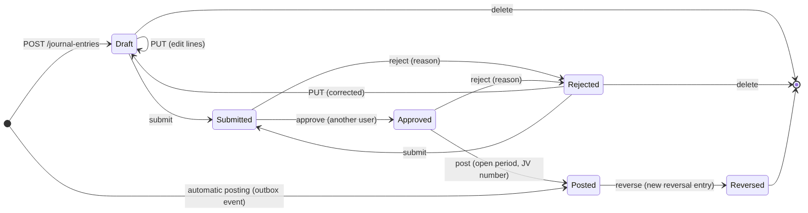
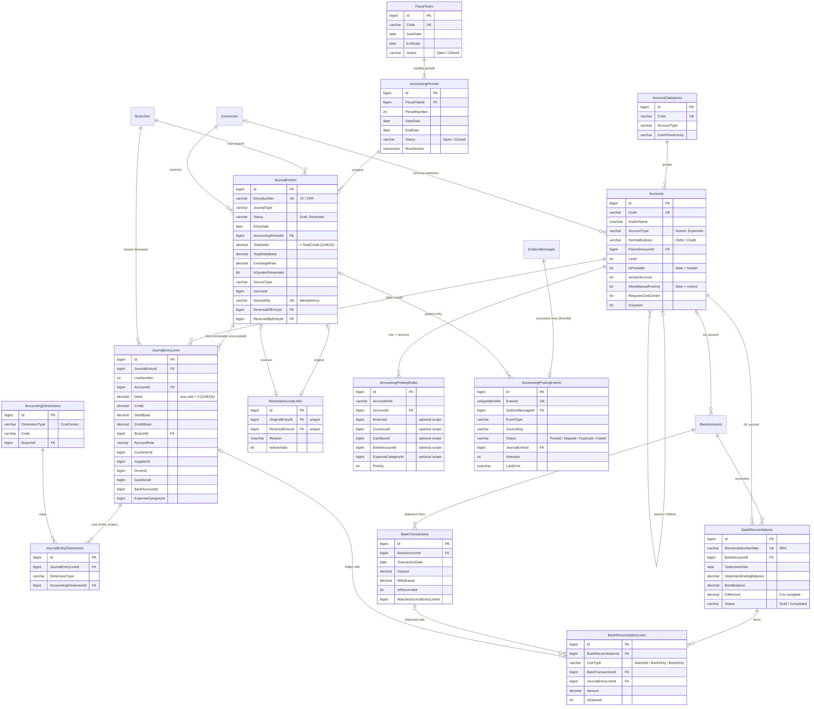
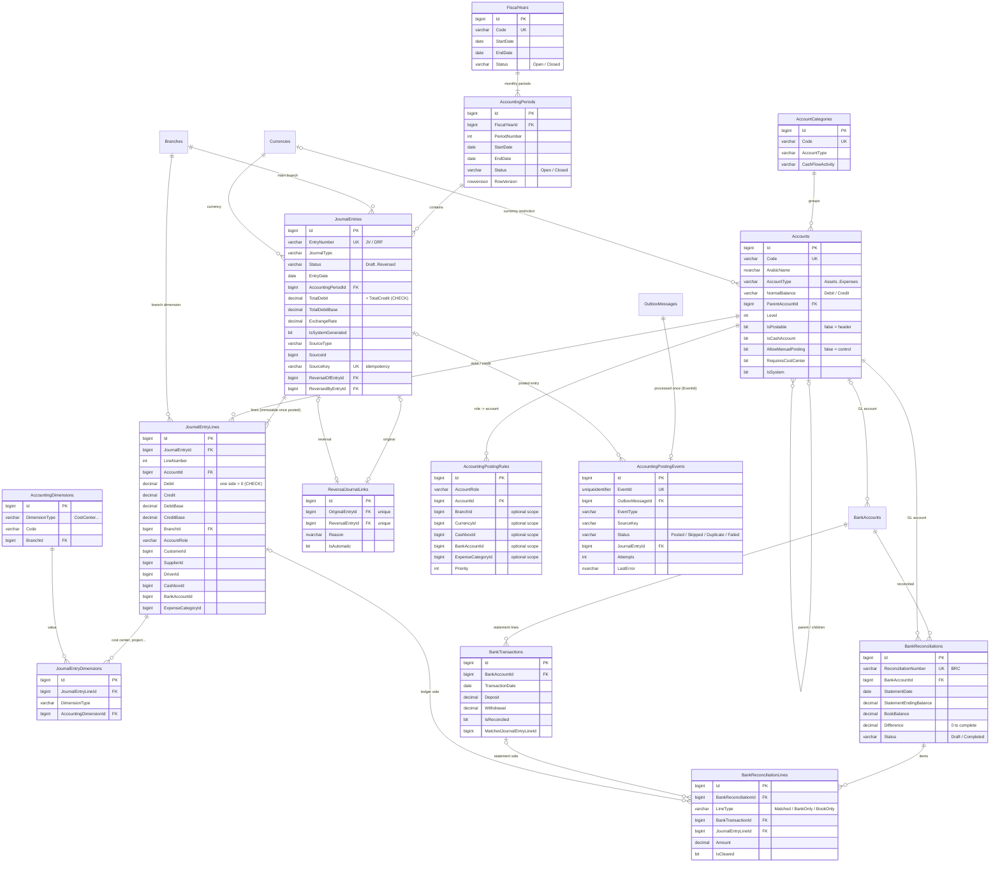

# الخطوة 7 — المحاسبة بالقيد المزدوج: دليل الحسابات، الفترات، قيود اليومية، الترحيل الآلي، التسوية البنكية والقوائم المالية

> تُبنى هذه الخطوة فوق **الخطوة 6 الكاملة** (486 اختباراً ناجحاً). بعد هذه الخطوة يصبح العدد المتوقع **619 اختباراً**.
>
> **المكتبات**: لا توجد حزم NuGet جديدة. نبقى على Mapster بدل AutoMapper (الثغرة CVE-2026-32933).
>
> **من «قيد مقترح» إلى «قيد مرحّل»**: الخطوتان 5 و6 كانتا تحفظان كل عملية مالية في `OutboxMessages` مع قيد مقترح. الآن تقرأ وحدة المحاسبة هذه الأحداث
> وتحوّلها إلى قيود مرحّلة في دفتر الأستاذ العام، **مرة واحدة فقط** لكل حدث ولكل مستند.

---

## 1. ماذا بنينا؟ (شرح خطوات التنفيذ)

### 1.1 دليل الحسابات

- `Account`: شجرة حسابات، ولكل حساب نوع من الأنواع الستة: `Assets`، `Liabilities`، `Equity`، `Revenue`، `CostOfRevenue`، `Expenses`.
- **الطبيعة** (`NormalBalance`) تُشتق من النوع: الأصول والتكاليف والمصاريف مدينة، والباقي دائن.
- **الحساب الرئيسي** (`IsPostable = false`) يجمع أبناءه فقط ولا يقبل سطور القيود.
- **الحساب الرقابي** (`AllowManualPosting = false`): الصناديق، الذمم المدينة، عهدة السائقين، أمانات المرسلين، النقدية المحوّلة، نقدية العملاء قيد الإيداع.
  لا يقبل قيداً يدوياً، حتى يبقى مساوياً لدفتره المساعد (رصيد الصندوق، رصيد عهدة السائق...).
- **الأرصدة لا تُخزَّن**: رصيد أي حساب = مجموع سطور القيود المرحّلة. مصدر واحد للحقيقة، فلا يمكن أن يختلف رقمان.
- `AccountCategory`: تصنيف لعرض القوائم المالية، ويحدد قسم الحساب في قائمة التدفقات النقدية (تشغيلية، استثمارية، تمويلية).
- `AccountingDimension`: مراكز التكلفة (`OPS`، `FLEET`، `SALES`، `ADMIN`)، ويمكن إضافة مشاريع ومركبات وأقسام. **الفرع** بُعد مدمج في كل سطر.

**الدليل الافتراضي** (56 حساباً، يُنشأ تلقائياً عند أول تشغيل):

| الرقم | الحساب | الرقم | الحساب |
|---|---|---|---|
| 1101 | الصناديق (رقابي) | 2101 | الموردون |
| 1102 | نقدية محوّلة بين الفروع (رقابي) | 2102 | أمانات المرسلين - الدفع عند الاستلام (رقابي) |
| 1103 | البنوك | 2103 | دفعات مقدمة من العملاء |
| 1104 | نقدية العملاء قيد الإيداع (رقابي) | 2104 | ضريبة القيمة المضافة المستحقة |
| 1111 | الذمم المدينة - العملاء (رقابي) | 2105 | مصاريف مستحقة |
| 1112 | ذمم السائقين - مبالغ التحصيل (رقابي) | 3100 | رأس مال المالك |
| 1113 | سلف الموظفين | 3200 | الأرباح المحتجزة |
| 1201 | المركبات | 3300 | أرصدة افتتاحية |
| 4101 | إيرادات الشحن | 6101 | الوقود |
| 4102 | عمولات الدفع عند الاستلام | 6102 | صيانة المركبات |
| 4103 | إيرادات الخدمات الإضافية | 6107 | المبالغ المستردة للعملاء |
| 4104 | رسوم مخصومة من المرسلين | 6201 | الرواتب والأجور |
| 5101 | أجور التوصيل والسائقين المتعاقدين | 6202 | الإيجارات |

### 1.2 السنوات والفترات المحاسبية

- `FiscalYear` تُقسم تلقائياً إلى `AccountingPeriod` شهرية (`FiscalCalendar` في Domain). لا يُسمح بتداخل سنتين.
- عند التشغيل تُنشأ سنة لكل عام، من أقدم عملية تشغيلية تنتظر الترحيل حتى العام الحالي، فتُرحَّل عمليات الخطوتين 5 و6 الموجودة في قاعدتك.
- **لا ترحيل في فترة مقفلة**، لا يدوياً ولا آلياً.
- **الإقفال** (`POST /accounting/periods/{id}/close`) يُرفض إذا بقي في الفترة:
  - قيد مسودة أو مرفوض،
  - قيد بانتظار الاعتماد أو الترحيل،
  - عملية تشغيلية حتى نهاية الفترة لم تُرحَّل بعد،
  - ترحيل آلي فاشل.
  
  `GET /periods/{id}/close-check` يعرض هذه الموانع قبل المحاولة.
- **إعادة الفتح** بسبب إلزامي، ولا تُعاد فتح فترة في سنة مقفلة. السنة تُقفل فقط بعد إقفال كل فتراتها.

### 1.3 قيود اليومية ودورة الاعتماد



| الحالة | المعنى |
|---|---|
| `Draft` | مسودة برقم `DRF-2026-000001`، تُعدَّل وتُحذف، ولا تدخل الأستاذ العام |
| `Submitted` | مقدّم للاعتماد، مجمّد |
| `Approved` | اعتمده **مستخدم آخر** غير المُعدّ |
| `Posted` | مرحّل برقم `JV-2026-000001` (متسلسل بلا فجوات بترتيب الترحيل)، **لا يُعدَّل ولا يُحذف** |
| `Reversed` | عُكس بقيد عكسي، وكلاهما يبقى في الدفتر |
| `Rejected` | أُعيد للمُعدّ مع السبب، يُصحَّح ثم يُقدَّم من جديد |

**قواعد كل قيد** (`JournalRules` في Domain، باختبارات مباشرة):

- سطران على الأقل، و500 سطر على الأكثر.
- كل سطر مدين **أو** دائن، والمبلغ أكبر من صفر.
- **مجموع المدين = مجموع الدائن > 0**.
- الحسابات موجودة، مفعّلة، فرعية، غير رقابية في القيد اليدوي، وبعملة القيد إن كانت مقيّدة بعملة، ومع مركز تكلفة إن كان الحساب يتطلبه.

**العملات**:

- كل سطر له مبلغان: بعملة القيد (`Debit`/`Credit`)، وبالعملة الأساسية (`DebitBase`/`CreditBase`) بسعر الصرف.
- فرق التقريب (ليرة واحدة مثلاً) يُضاف إلى أكبر سطر في الجانب الأصغر (`JournalMath.ToBase`)، فيبقى القيد متوازناً بالعملتين.
- كل التقارير بالعملة الأساسية.

**القيد العكسي** (`POST /journal-entries/{id}/reverse`):

- يُنشئ قيداً مرحّلاً جديداً تُبدَّل فيه المدينات والدائنات، بالمبالغ الأساسية نفسها، ويصبح الأصلي `Reversed`.
- يُربط القيدان بـ `ReversalJournalLink`.
- القيد يُعكس **مرة واحدة**، والقيد العكسي لا يُعكس.
- **القيد الآلي لا يُعكس يدوياً**: يُلغى مستنده المصدر (سند، فاتورة، تسوية) فيُعكس قيده آلياً، وإلا انفصل الأستاذ العام عن الدفتر المساعد.

**Idempotency-Key** على إنشاء القيد اليدوي: المفتاح نفسه بالطلب نفسه يُرجع القيد الأول (200 + `Idempotent-Replayed`)، وبطلب مختلف يُرجع 409.

### 1.4 حماية الدفتر (ثلاث طبقات)

| الطبقة | ماذا تمنع |
|---|---|
| الخدمة (`JournalRules`) | تعديل أو حذف قيد غير مسودة/مرفوض، والترحيل قبل الاعتماد |
| `JournalIntegrityInterceptor` | أي `SaveChanges` يعدّل سطراً، أو يضيف سطراً لقيد غير مسودة، أو يغيّر قيداً مرحّلاً إلا إلى `Reversed` (أعمدة العكس فقط) |
| SQL Server | `CK_JournalEntries_Balanced`: القيد المرحّل متوازن بالعملتين. `CK_JournalEntryLines_DebitOrCredit`: جانب واحد لكل سطر. المشغّلان `TR_JournalEntries_Immutable` و`TR_JournalEntryLines_Immutable`: يمنعان التعديل المباشر حتى من SQL Management Studio |

المشغّلان يُنشآن تلقائياً عند التشغيل (`CREATE OR ALTER`)، فلا حاجة لتعديل الـ migration يدوياً.

### 1.5 الترحيل الآلي من العمليات

- `AccountingPostingBackgroundService` يعمل كل 10 ثوانٍ (`Accounting:DispatcherIntervalSeconds`)، ويعالج حتى 100 حدث في كل دورة.
- يمكن التشغيل الفوري بـ `POST /accounting/posting-events/process`.
- **الأدوار المحاسبية**: العمليات لا تعرف أرقام الحسابات، بل ترسل أدواراً مثل `CashOnHand` و`ShippingRevenue`.
- `AccountingPostingRule` تربط الدور بحساب. القاعدة **الأكثر تحديداً** تفوز (فرع، عملة، صندوق، حساب بنكي، فئة مصروف)، ثم الأعلى أولوية.
  مثال: «مصروف + فئة FUEL» ← 6101 الوقود، و«مصروف» بلا فئة ← 6209 مصاريف عامة أخرى.

| الحدث | القيد |
|---|---|
| `InvoiceIssued` | مدين 1111 الذمم ← دائن 4101 الشحن + 4102 عمولة COD + 4103 الخدمات الإضافية (حسب لقطة السعر) + 2104 الضريبة |
| `InvoiceCancelled` | عكس قيد الفاتورة بالضبط |
| `CreditNoteIssued` | مدين الإيرادات (بنسب الفاتورة) + 2104 الضريبة ← دائن 1111 الذمم |
| `CustomerPaymentReceived` | مدين 1104 نقدية قيد الإيداع (نقداً) أو 1103 البنك (تحويل، بطاقة) ← دائن 1111 الذمم |
| `CustomerPaymentAllocated` | **لا أثر محاسبي** (تخصيص داخل الدفتر المساعد فقط) |
| `CodCollected` (بسائق) | مدين 1112 عهدة السائق ← دائن 2102 أمانات المرسلين |
| `CodCollected` (في الفرع) | مدين 1101 الصندوق ← دائن 2102 أمانات المرسلين |
| `DriverCashHandedOver` | مدين 1101 الصندوق ← دائن 1112 عهدة السائق |
| `SenderSettlementPaid` | مدين 2102 الأمانات (الإجمالي) ← دائن 1101 الصندوق أو 1103 البنك (الصافي) + 4101 + 4102 + 2104 + 4104 (الخصومات تصبح إيراداً **الآن**) |
| `CashPaymentPosted` (مصروف) | مدين حساب فئة المصروف ← دائن 1101 الصندوق |
| `CashPaymentPosted` (استرداد) | مدين 6107 المبالغ المستردة ← دائن 1101 |
| `CashReceiptPosted` (دفعة عميل) | مدين 1101 الصندوق ← دائن 1104 نقدية قيد الإيداع |
| `CashTransferApproved` / `Received` | 1102 نقدية محوّلة بين الفروع، ثم الصندوق المستلم |
| `CashVoucherCancelled`، `SenderSettlementReversed` | **عكس القيد الأصلي بالضبط** |
| `CashboxOpeningBalance`، `CashboxDiscrepancyPosted` | 3300 أرصدة افتتاحية، 6106 فروقات النقدية |

**مبلغ COD ليس إيراداً أبداً**: يدخل 2102 (التزام)، ويخرج منه عند التسوية. الإيراد هو الخصومات فقط.

### 1.6 منع الترحيل المزدوج (Idempotency)

ثلاثة حواجز مستقلة:

1. **وسم الرسالة**: الرسالة تُعلَّم «معالَجة» في **المعاملة نفسها** التي تُنشئ القيد.
2. **`AccountingPostingEvents.EventId` فريد**: الحدث المسلَّم مرتين يُرحَّل مرة واحدة.
3. **`JournalEntries.SourceKey` فريد** (مثل `InvoiceIssued:Invoice:15`): المستند المنشور مرتين بحدثين مختلفين يُسجَّل كـ `Duplicate` ولا يُرحَّل ثانية.

إذا وصل طلبان في اللحظة نفسها، يكسب أحدهما الفهرس الفريد، ويعيد الآخر الفحص فيجد القيد موجوداً.

### 1.7 فشل الترحيل وإعادة المحاولة

- إذا فشل الترحيل (فترة مقفلة، قاعدة ترحيل محذوفة، سعر صرف غير موجود) **يُلغى كل شيء**.
- يُسجَّل الحدث `Failed` مع السبب في `LastError`، ويُعاد تلقائياً حتى 5 مرات (`Accounting:MaxAutomaticAttempts`).
- بعدها: `POST /accounting/posting-events/{id}/retry`.
  - مع `postingDate` اختياري: يُرحَّل الحدث بتاريخ فترة مفتوحة، ويُذكر التاريخ الأصلي في البيان.
  - هذه هي الطريقة الصحيحة لعملية تأخرت بعد إقفال الشهر.

### 1.8 استراتيجية المعاملات في SQL Server

| العملية | المعاملة |
|---|---|
| ترحيل حدث آلي | معاملة واحدة: قراءة الرسالة والحدث من جديد ← قفل الفترة ← القيد بسطوره ← `AccountingPostingEvent` ← وسم الرسالة ← `COMMIT` |
| ترحيل قيد يدوي | معاملة: قراءة القيد ← قفل الفترة ← فحص السطور ← رقم JV ← `Posted` ← سجل التدقيق |
| عكس قيد | معاملة: القيد العكسي + `Reversed` على الأصلي + `ReversalJournalLink` + التدقيق |
| إقفال فترة | معاملة **تعدّل صف الفترة**، فتنتظر كل ترحيل جارٍ عليها |
| التسوية البنكية | معاملة: استيراد الكشف + المطابقة + الإكمال |

- **قفل الفترة**: `SELECT [Status] FROM AccountingPeriods WITH (HOLDLOCK, ROWLOCK)` داخل معاملة الترحيل.
  - الإقفال الذي يبدأ أثناء ترحيل **ينتظر** حتى ينتهي الترحيل.
  - الترحيل الذي يبدأ بعد الإقفال **يقرأ** `Closed` فيُرفض.
  - لا يمكن أن يتسلل قيد إلى فترة أثناء إقفالها.
- **الأرقام**: `JV-yyyy-nnnnnn` من عدّاد `MERGE … HOLDLOCK` (من الخطوة 4)، داخل المعاملة نفسها.
- **التزامن**: `RowVersion` على كل جدول. تعديلان متزامنان على الكيان نفسه: الثاني يأخذ **409 CONCURRENCY_CONFLICT**.
- **إعادة المحاولة**: `EnableRetryOnFailure` مع `ExecuteInTransactionAsync`: عند انقطاع مؤقت تُعاد المعاملة كاملة، وكل شيء يُقرأ من جديد داخلها.

### 1.9 التسوية البنكية

- `POST /accounting/bank-reconciliation`: كشف البنك (سطوره تُحفظ في `BankTransaction`)، ورصيد الكشف، ومطابقات يدوية اختيارية.
- **المطابقة التلقائية** (`autoMatch`): المبلغ نفسه، ثم المرجع نفسه، وإلا أقرب تاريخ خلال ±7 أيام.
- السطور الناتجة ثلاثة أنواع:
  - `Matched`: سطر من الكشف مطابق لسطر من الدفتر.
  - `BankOnly`: في الكشف فقط، مثل عمولة البنك. يحتاج قيداً (يومية البنك).
  - `BookOnly`: في الدفاتر فقط، مثل شيك لم يُصرف بعد.
- **الحساب**:

```
الرصيد المعدّل للبنك    = رصيد الكشف + إيداعات بالطريق − مسحوبات معلّقة
الرصيد المعدّل للدفاتر  = رصيد الأستاذ + إيداعات البنك فقط − مسحوبات البنك فقط
الفرق                  = الأول − الثاني  (يجب أن يساوي صفراً)
```

- **الإكمال** يحتاج فرقاً صفرياً وألا يبقى سطر `BankOnly`. بعده تُصبح المطابقات «مسوّاة» نهائياً، وفهرس فريد يمنع تسوية السطر نفسه مرتين.

### 1.10 التقارير المالية

كلها من القيود المرحّلة، بالعملة الأساسية، وبتاريخ القيد. الافتراضي: من بداية السنة المالية حتى اليوم.

| التقرير | المسار |
|---|---|
| دليل الحسابات (شجرة مع الأرصدة) | `GET /accounting/accounts/tree?includeBalances=true` |
| اليومية | `GET /accounting/reports/journal` |
| الأستاذ العام (رصيد افتتاحي، رصيد تراكمي، الحسابات الفرعية للحساب الرئيسي) | `GET /accounting/general-ledger?accountId=` |
| ميزان المراجعة (افتتاحي، حركة، ختامي، مستوى التجميع) | `GET /accounting/trial-balance` |
| قائمة الدخل | `GET /accounting/profit-loss` |
| الميزانية العمومية (أرباح السنة وأرباح السنوات السابقة) | `GET /accounting/balance-sheet` |
| التدفقات النقدية (الطريقة المباشرة) | `GET /accounting/cash-flow` |
| أعمار العملاء والموردين (FIFO) | `GET /accounting/reports/customer-aging` , `/supplier-aging` |
| أعمار COD | `GET /api/v1/cod/aging` (الخطوة 6) |
| أرصدة الصناديق والبنوك | `GET /accounting/reports/cashbox-balances` , `/bank-balances` |
| الإيراد حسب الفرع، المصروفات حسب الفئة | `GET /accounting/reports/revenue-by-branch` , `/expense-by-category` |
| عهد السائقين، أمانات المرسلين | `GET /accounting/reports/driver-outstanding` , `/sender-payables` |
| مطابقة الحسابات الرقابية مع الدفاتر المساعدة | `GET /accounting/reports/control-accounts` |

**لا حاجة لقيد إقفال**: حسابات الدخل تبدأ كل سنة من الصفر في التقارير. ربح السنوات السابقة يظهر على 3200 الأرباح المحتجزة، فيبقى الميزان متوازناً.

### 1.11 الصلاحيات والأدوار

| الصلاحية | الأدوار |
|---|---|
| `Accounting.View`، `Accounting.CreateJournal` | محاسب، المدير المالي |
| `Accounting.ApproveJournal`، `PostJournal`، `ReverseJournal` | المدير المالي |
| `Accounting.ManageChart`، `ManagePeriods` | المدير المالي |
| `Accounting.BankReconciliation`، `ManagePostings` | محاسب، المدير المالي |

- **دور جديد**: `FinancialManager` (المدير المالي)، يرى كل الفروع.
- مدير النظام يملك كل شيء.
- التقارير المالية تحتاج أيضاً `Reports.ViewFinancial`.
- من لا يملك `Branches.ViewAll` يرى قيود فرعه فقط، وتُحصر تقاريره في فرعه.
- `Accounting:AllowSelfApproval = true` في `appsettings.Development.json` فقط، لتجرّب الدورة كاملة بالمستخدم admin.

### 1.12 تعديلات على ملفات سابقة

- **`BankAccount.AccountId`** (اختياري): حساب أستاذ خاص بالحساب البنكي. بدونه يُستخدم حساب قاعدة `Bank` (1103) مع `BankAccountId` على السطر.
  أُضيف حذف الحساب البنكي غير المستخدم: `DELETE /bank-accounts/{id}`.
- **`CashPostings`**: استرداد العميل يذهب الآن إلى الدور `CustomerRefund` (6107)، لا `CustomerAdvances`.
- **منع الحذف**: فرع، عملة، عميل، مورد، سائق، فئة مصروف، طريقة دفع مستخدمة في قيود أو قواعد ترحيل.
- **`DocumentNumberGenerator`**: البادئات `JV`، `DRF`، `BRC`.
- **`appsettings.json`**: قسم `Accounting`.
- **البيانات التجريبية** (`DemoAccountingSeeder`، مع `Seed:DemoData = true` وعندما لا يوجد أي قيد يدوي):
  1. يرحّل كل العمليات المنتظرة.
  2. يُنشئ عبر الدورة الحقيقية (إنشاء ← تقديم ← اعتماد ← ترحيل) أربعة قيود: رأس المال (بنك 10,000,000 + مركبات 25,000,000)، الإيجار 1,200,000 من البنك، فاتورة وقود آجلة 450,000، استحقاق الرواتب 3,000,000.
  3. يترك قيد عمولة بنكية **بانتظار الاعتماد** لتجربته في Swagger.

---

## 2. خطوات التطبيق على جهازك (Windows PowerShell)

> استخدم النسخة **الكاملة** في مجلد جديد `ShippingERP-Step07`، ثم انسخ مجلد الـ Migrations من الخطوة 6.

```powershell
cd "$HOME\Downloads"
$zip = Get-ChildItem "$HOME\Downloads\ShippingERP-Step07-full*.zip" | Sort-Object LastWriteTime -Descending | Select-Object -First 1
$zip.FullName
Unblock-File $zip.FullName
Expand-Archive $zip.FullName -DestinationPath "$HOME\Downloads\ShippingERP-Step07" -Force

# انسخ الـ migrations الموجودة (... AddPricingAndBilling, AddCodAndCash)
Copy-Item "$HOME\Downloads\ShippingERP-Step06\src\ShippingERP.Infrastructure\Persistence\Migrations\*" `
  "$HOME\Downloads\ShippingERP-Step07\src\ShippingERP.Infrastructure\Persistence\Migrations\" -Force

cd "$HOME\Downloads\ShippingERP-Step07"
Test-Path src\ShippingERP.Infrastructure\Accounting\AccountingPostingProcessor.cs            # True
Test-Path src\ShippingERP.Infrastructure\Persistence\Migrations\AppDbContextModelSnapshot.cs  # True

dotnet build
dotnet test        # المتوقع: 619 ناجحاً

dotnet ef migrations add AddAccounting `
  --project src/ShippingERP.Infrastructure `
  --startup-project src/ShippingERP.API `
  --output-dir Persistence/Migrations

dotnet ef database update `
  --project src/ShippingERP.Infrastructure `
  --startup-project src/ShippingERP.API

dotnet run --project src/ShippingERP.API --launch-profile http
```

- **الـ migration** تنشئ 14 جدولاً وتضيف العمود `AccountId` إلى `BankAccounts`. لا تحذف أي بيانات.
- في السجل ابحث عن:
  - `Chart of accounts created: 56 accounts, posting rules and cost centers`
  - `Fiscal years created: 1` (أو أكثر إن كانت لديك عمليات من سنة سابقة)
  - `Pending operational events posted: N posted, ...`: كل فواتير وتحصيلات وسندات الخطوتين 5 و6 أصبحت قيوداً.
  - `Demo journal entries created (5): 4 posted, 1 waiting for approval`
- **سجّل الخروج ثم الدخول**، حتى يحمل الـ Token الصلاحيات الجديدة.
- الأدوار الموجودة تأخذ الصلاحيات الجديدة المذكورة لها تلقائياً. الدور الجديد «المدير المالي» يُنشأ تلقائياً.

---

## 3. التجربة في Swagger (بالترتيب)

1. `GET /api/v1/accounting/accounts/tree?includeBalances=true`: الدليل مع الأرصدة.
2. `GET /api/v1/accounting/posting-events/summary`: المرحّل، والفاشل (يجب أن يكون 0)، والمنتظر.
3. `GET /api/v1/accounting/journal-entries?isSystemGenerated=true`: القيود الآلية لفواتيرك وتحصيلاتك وسنداتك.
4. أنشئ سند صرف وقود (`POST /api/v1/cash-payments`)، ثم `POST /accounting/posting-events/process`، ثم ابحث عن قيده: مدين 6101 الوقود، دائن 1101 الصندوق.
5. أعد `process` ← `processed: 0`. لا شيء يُرحَّل مرتين.
6. `POST /accounting/journal-entries` (مثال 5.1) ← `DRF-…` مسودة. ثم `/submit`، ثم `/approve`، ثم `/post` ← `JV-…`.
7. جرّب `PUT` على القيد المرحّل ← **422**. ثم `/reverse` بسبب ← قيد عكسي، والأصلي `Reversed`.
8. `GET /accounting/trial-balance` ← `isBalanced: true`. ثم `/profit-loss` و`/balance-sheet`: `currentYearProfit` = `netProfit`.
9. `GET /accounting/cash-flow` ← `isReconciled: true`.
10. `GET /accounting/reports/control-accounts` ← كل الفروقات 0: الصناديق وعهد السائقين وأمانات المرسلين والذمم مطابقة للأستاذ العام.
11. `GET /accounting/periods/{id}/close-check` لفترة الشهر الماضي، ثم `/close`. جرّب قيداً بتاريخ داخلها ← **422**.
12. `POST /accounting/bank-reconciliation` (مثال 5.4).

---

## 4. مخطط قاعدة البيانات (ERD)





---

## 5. أمثلة Swagger (JSON)

### 5.1 قيد يومية — `POST /api/v1/accounting/journal-entries` (Header: `Idempotency-Key: rent-2026-10`)

```json
{
  "entryDate": "2026-10-15",
  "journalType": "General",
  "branchId": 1,
  "description": "إيجار مكتب دمشق لشهر تشرين الأول - تحويل بنكي",
  "reference": "RENT-2026-10",
  "submit": true,
  "lines": [
    { "accountId": 52, "debit": 1200000, "credit": 0, "costCenterId": 4, "description": "الإيجار" },
    { "accountId": 3, "debit": 0, "credit": 1200000, "bankAccountId": 1 }
  ]
}
```

استخدم `GET /accounting/accounts?search=6202` لمعرفة `accountId` الصحيح في قاعدتك.

### 5.2 عكس قيد — `POST /api/v1/accounting/journal-entries/{id}/reverse`

```json
{ "reversalDate": "2026-10-16", "reason": "القيد مسجل مرتين" }
```

### 5.3 قاعدة ترحيل — `POST /api/v1/accounting/posting-rules`

```json
{ "accountRole": "CashOnHand", "accountId": 60, "cashboxId": 3, "priority": 0,
  "description": "صندوق حلب في حساب مستقل", "isActive": true }
```

### 5.4 تسوية بنكية — `POST /api/v1/accounting/bank-reconciliation`

```json
{
  "bankAccountId": 1,
  "statementDate": "2026-10-31",
  "statementEndingBalance": 8785000,
  "autoMatch": true,
  "complete": true,
  "statementLines": [
    { "transactionDate": "2026-10-01", "description": "إيداع رأس المال", "deposit": 10000000, "withdrawal": 0 },
    { "transactionDate": "2026-10-15", "description": "حوالة إيجار", "deposit": 0, "withdrawal": 1200000, "reference": "RENT-2026-10" },
    { "transactionDate": "2026-10-31", "description": "عمولة بنكية", "deposit": 0, "withdrawal": 15000 }
  ]
}
```

العمولة في الكشف فقط، فتبقى التسوية `Draft`. رحّل قيد العمولة (المسودة التجريبية `BANK-FEE-DEMO`)، ثم `POST /bank-reconciliation/{id}/complete`.

### 5.5 إقفال فترة — `POST /api/v1/accounting/periods/{id}/close`

```json
{ "notes": "إقفال أيلول بعد مراجعة المدقق" }
```

### 5.6 إعادة محاولة ترحيل فاشل — `POST /api/v1/accounting/posting-events/{id}/retry`

```json
{ "postingDate": "2026-11-01" }
```

### 5.7 سنة مالية — `POST /api/v1/accounting/fiscal-years`

```json
{ "code": "FY2027", "arabicName": "السنة المالية 2027", "startDate": "2027-01-01" }
```

---

## 6. ملاحظات مهمة

- **المبالغ**: `decimal(18,2)`، وسعر الصرف `decimal(18,8)`. **التواريخ**: الأوقات UTC، وتاريخ القيد (`EntryDate`) تاريخ محلي فقط (`date`).
- **ميزان المراجعة لفرع واحد** قد لا يتوازن إذا كانت هناك قيود بين الفروع (تحويل نقدية مثلاً). الميزانية تعرض ذلك في `interBranchDifference`. على مستوى الشركة يتوازن دائماً.
- **لا تعدّل الجداول المحاسبية من SQL مباشرة**: المشغّلان يرفضان ذلك برسالة 51001-51006.
- **المرحلة القادمة** يمكن أن تضيف: إهلاك الأصول آلياً، الموازنات، فواتير الموردين، وقيود الإقفال السنوية الاختيارية.

---

## 7. الملفات الكاملة (101 ملفاً جديداً أو معدّلاً)

كل ملف كامل كما هو في المشروع. المسارات نسبية من المجلد الجذر للحل.

### 7.1 `src/ShippingERP.Domain/Accounting/AccountRules.cs`

```csharp
using ShippingERP.Domain.Enums;

namespace ShippingERP.Domain.Accounting;

/// <summary>Sign conventions of the account types (pure functions, unit tested).</summary>
public static class AccountRules
{
    /// <summary>Assets, cost of revenue and expenses grow with debits; liabilities, equity and revenue with credits.</summary>
    public static NormalBalance NormalBalanceOf(AccountType type) =>
        type is AccountType.Assets or AccountType.CostOfRevenue or AccountType.Expenses ? NormalBalance.Debit : NormalBalance.Credit;

    /// <summary>Assets, liabilities and equity: balance sheet. The others: profit and loss.</summary>
    public static bool IsBalanceSheet(AccountType type) =>
        type is AccountType.Assets or AccountType.Liabilities or AccountType.Equity;

    public static bool IsProfitAndLoss(AccountType type) => !IsBalanceSheet(type);

    /// <summary>The balance in the natural direction of the type (positive = normal balance).</summary>
    public static decimal NaturalBalance(AccountType type, decimal debit, decimal credit) =>
        NormalBalanceOf(type) == NormalBalance.Debit ? debit - credit : credit - debit;

    /// <summary>A net amount (debit − credit) shown in the debit or the credit column.</summary>
    public static (decimal Debit, decimal Credit) ToColumns(decimal net) => net >= 0m ? (net, 0m) : (0m, -net);

    /// <summary>The profit-and-loss effect of a line: revenue minus costs (credit − debit).</summary>
    public static decimal ProfitEffect(decimal debit, decimal credit) => credit - debit;
}
```

### 7.2 `src/ShippingERP.Domain/Accounting/AccountingNames.cs`

```csharp
using ShippingERP.Domain.Enums;

namespace ShippingERP.Domain.Accounting;

/// <summary>Arabic display names of the accounting enums (DTOs and error messages).</summary>
public static class AccountingNames
{
    public static string Arabic(AccountType type) => type switch
    {
        AccountType.Assets => "الأصول",
        AccountType.Liabilities => "الخصوم",
        AccountType.Equity => "حقوق الملكية",
        AccountType.Revenue => "الإيرادات",
        AccountType.CostOfRevenue => "تكلفة الإيرادات",
        AccountType.Expenses => "المصاريف",
        _ => type.ToString()
    };

    public static string Arabic(NormalBalance side) => side == NormalBalance.Debit ? "مدين" : "دائن";

    public static string Arabic(CashFlowActivity activity) => activity switch
    {
        CashFlowActivity.None => "النقدية وما في حكمها",
        CashFlowActivity.Operating => "الأنشطة التشغيلية",
        CashFlowActivity.Investing => "الأنشطة الاستثمارية",
        CashFlowActivity.Financing => "الأنشطة التمويلية",
        _ => activity.ToString()
    };

    public static string Arabic(FiscalYearStatus status) => status == FiscalYearStatus.Open ? "مفتوحة" : "مقفلة";

    public static string Arabic(AccountingPeriodStatus status) => status == AccountingPeriodStatus.Open ? "مفتوحة" : "مقفلة";

    public static string Arabic(JournalEntryStatus status) => status switch
    {
        JournalEntryStatus.Draft => "مسودة",
        JournalEntryStatus.Submitted => "بانتظار الاعتماد",
        JournalEntryStatus.Approved => "معتمد",
        JournalEntryStatus.Posted => "مرحّل",
        JournalEntryStatus.Reversed => "معكوس",
        JournalEntryStatus.Rejected => "مرفوض",
        _ => status.ToString()
    };

    public static string Arabic(JournalType type) => type switch
    {
        JournalType.General => "قيد يومية عام",
        JournalType.Opening => "قيد افتتاحي",
        JournalType.Adjustment => "قيد تسوية",
        JournalType.Reversal => "قيد عكسي",
        JournalType.Closing => "قيد إقفال",
        JournalType.Sales => "يومية المبيعات والفواتير",
        JournalType.CustomerReceipts => "يومية مقبوضات العملاء",
        JournalType.Cod => "يومية الدفع عند الاستلام",
        JournalType.Cash => "يومية الصناديق",
        JournalType.SenderSettlement => "يومية تسويات المرسلين",
        JournalType.Expense => "يومية المصروفات",
        JournalType.Bank => "يومية البنك",
        _ => type.ToString()
    };

    public static string Arabic(DimensionType type) => type switch
    {
        DimensionType.CostCenter => "مركز تكلفة",
        DimensionType.Project => "مشروع",
        DimensionType.Vehicle => "مركبة",
        DimensionType.Department => "قسم",
        _ => type.ToString()
    };

    public static string Arabic(PostingEventStatus status) => status switch
    {
        PostingEventStatus.Posted => "مرحّل",
        PostingEventStatus.Skipped => "بلا أثر محاسبي",
        PostingEventStatus.Duplicate => "مكرر (لم يُرحّل مرة ثانية)",
        PostingEventStatus.Failed => "فشل الترحيل",
        _ => status.ToString()
    };

    public static string Arabic(BankReconciliationStatus status) => status == BankReconciliationStatus.Draft ? "مسودة" : "مكتملة";

    public static string Arabic(BankReconciliationLineType type) => type switch
    {
        BankReconciliationLineType.Matched => "مطابق",
        BankReconciliationLineType.BankOnly => "في كشف البنك فقط",
        BankReconciliationLineType.BookOnly => "في الدفاتر فقط",
        _ => type.ToString()
    };
}
```

### 7.3 `src/ShippingERP.Domain/Accounting/FiscalCalendar.cs`

```csharp
using System.Globalization;

namespace ShippingERP.Domain.Accounting;

public sealed record PeriodPlan(int Number, string Name, DateTime StartDate, DateTime EndDate);

/// <summary>Builds the monthly accounting periods of a fiscal year (pure function, unit tested).</summary>
public static class FiscalCalendar
{
    private static readonly string[] MonthNames =
    {
        "كانون الثاني", "شباط", "آذار", "نيسان", "أيار", "حزيران",
        "تموز", "آب", "أيلول", "تشرين الأول", "تشرين الثاني", "كانون الأول"
    };

    public static string ArabicMonthName(int month) => MonthNames[month - 1];

    /// <summary>A date with only Y-M-D, kind UTC (how "date" columns are stored).</summary>
    public static DateTime AsDate(DateTime value) => DateTime.SpecifyKind(value.Date, DateTimeKind.Utc);

    /// <summary>
    /// One period per calendar month between <paramref name="start"/> and <paramref name="end"/> (inclusive). A year
    /// that does not start on the 1st gets a shorter first period; the last period ends on <paramref name="end"/>.
    /// </summary>
    public static IReadOnlyList<PeriodPlan> MonthlyPeriods(DateTime start, DateTime end)
    {
        start = AsDate(start);
        end = AsDate(end);
        if (end < start)
        {
            throw new ArgumentException("The end date is before the start date.", nameof(end));
        }

        var periods = new List<PeriodPlan>();
        var cursor = start;
        var number = 1;

        while (cursor <= end)
        {
            var monthEnd = AsDate(new DateTime(cursor.Year, cursor.Month, DateTime.DaysInMonth(cursor.Year, cursor.Month)));
            var periodEnd = monthEnd < end ? monthEnd : end;
            var name = string.Create(CultureInfo.InvariantCulture, $"{ArabicMonthName(cursor.Month)} {cursor.Year}");

            periods.Add(new PeriodPlan(number++, name, cursor, periodEnd));
            cursor = periodEnd.AddDays(1);
        }

        return periods;
    }
}
```

### 7.4 `src/ShippingERP.Domain/Accounting/JournalMath.cs`

```csharp
namespace ShippingERP.Domain.Accounting;

/// <summary>Base-currency conversion of journal lines (pure functions, unit tested).</summary>
public static class JournalMath
{
    public static decimal Round(decimal value, int decimals) =>
        Math.Round(value, Math.Clamp(decimals, 0, 4), MidpointRounding.AwayFromZero);

    /// <summary>
    /// Converts the lines to the base currency (amount × rate, rounded to the base decimals). Rounding each line can
    /// leave the base totals one unit apart although the entry is balanced in its own currency: that rounding
    /// difference is added to the biggest line of the smaller side, so the base amounts are balanced too.
    /// </summary>
    public static IReadOnlyList<JournalLineAmount> ToBase(IReadOnlyList<JournalLineAmount> lines, decimal exchangeRate, int baseDecimals)
    {
        if (exchangeRate <= 0m)
        {
            throw new ArgumentOutOfRangeException(nameof(exchangeRate), "The exchange rate must be greater than zero.");
        }

        var result = lines
            .Select(x => new JournalLineAmount(Round(x.Debit * exchangeRate, baseDecimals), Round(x.Credit * exchangeRate, baseDecimals)))
            .ToArray();

        var difference = result.Sum(x => x.Debit) - result.Sum(x => x.Credit);
        if (difference == 0m || result.Length == 0)
        {
            return result;
        }

        if (difference > 0m)
        {
            // Debits are bigger: raise the biggest credit line.
            var index = IndexOfMax(result, x => x.Credit);
            if (index >= 0)
            {
                result[index] = result[index] with { Credit = result[index].Credit + difference };
            }
        }
        else
        {
            var index = IndexOfMax(result, x => x.Debit);
            if (index >= 0)
            {
                result[index] = result[index] with { Debit = result[index].Debit - difference };
            }
        }

        return result;
    }

    private static int IndexOfMax(JournalLineAmount[] lines, Func<JournalLineAmount, decimal> selector)
    {
        var index = -1;
        var max = 0m;
        for (var i = 0; i < lines.Length; i++)
        {
            var value = selector(lines[i]);
            if (value > max)
            {
                max = value;
                index = i;
            }
        }

        return index;
    }
}
```

### 7.5 `src/ShippingERP.Domain/Accounting/JournalRules.cs`

```csharp
using ShippingERP.Domain.Enums;

namespace ShippingERP.Domain.Accounting;

/// <summary>One line of a journal entry as seen by the balance checks.</summary>
public readonly record struct JournalLineAmount(decimal Debit, decimal Credit);

/// <summary>
/// The rules every journal entry must follow (pure functions, unit tested):
///
///   Draft / Rejected --submit--> Submitted --approve--> Approved --post--> Posted --reverse--> Reversed
///                                 Submitted / Approved --reject--> Rejected
///
/// Draft and Rejected entries are the only editable or deletable ones.
/// </summary>
public static class JournalRules
{
    public const int MaxLines = 500;

    public static bool CanEdit(JournalEntryStatus status) => status is JournalEntryStatus.Draft or JournalEntryStatus.Rejected;

    public static bool CanDelete(JournalEntryStatus status) => CanEdit(status);

    public static bool CanSubmit(JournalEntryStatus status) => CanEdit(status);

    public static bool CanApprove(JournalEntryStatus status) => status == JournalEntryStatus.Submitted;

    public static bool CanReject(JournalEntryStatus status) => status is JournalEntryStatus.Submitted or JournalEntryStatus.Approved;

    public static bool CanPost(JournalEntryStatus status) => status == JournalEntryStatus.Approved;

    public static bool CanReverse(JournalEntryStatus status) => status == JournalEntryStatus.Posted;

    /// <summary>Statuses whose lines are part of the general ledger.</summary>
    public static bool IsInLedger(JournalEntryStatus status) => status is JournalEntryStatus.Posted or JournalEntryStatus.Reversed;

    /// <summary>
    /// The balance errors of a set of lines (empty = valid): at least two lines, every amount ≥ 0, exactly one side
    /// per line, and total debit = total credit &gt; 0.
    /// </summary>
    public static IReadOnlyList<string> Validate(IReadOnlyList<JournalLineAmount> lines)
    {
        var errors = new List<string>();

        if (lines.Count < 2)
        {
            errors.Add("القيد يحتاج سطرين على الأقل (مدين ودائن).");
        }

        if (lines.Count > MaxLines)
        {
            errors.Add($"الحد الأقصى {MaxLines} سطر في القيد الواحد.");
        }

        for (var i = 0; i < lines.Count; i++)
        {
            var line = lines[i];
            var number = i + 1;

            if (line.Debit < 0m || line.Credit < 0m)
            {
                errors.Add($"السطر {number}: المبالغ السالبة غير مسموحة؛ استخدم الجانب الآخر.");
            }
            else if (line.Debit > 0m && line.Credit > 0m)
            {
                errors.Add($"السطر {number}: لا يجوز أن يكون السطر مديناً ودائناً معاً.");
            }
            else if (line.Debit == 0m && line.Credit == 0m)
            {
                errors.Add($"السطر {number}: أدخل مبلغاً مديناً أو دائناً.");
            }
        }

        var totalDebit = lines.Sum(x => x.Debit);
        var totalCredit = lines.Sum(x => x.Credit);

        if (totalDebit != totalCredit)
        {
            errors.Add($"القيد غير متوازن: مجموع المدين {totalDebit:0.##} لا يساوي مجموع الدائن {totalCredit:0.##}.");
        }
        else if (totalDebit == 0m && lines.Count >= 2)
        {
            errors.Add("مجموع القيد يجب أن يكون أكبر من صفر.");
        }

        return errors;
    }

    public static bool IsBalanced(IReadOnlyList<JournalLineAmount> lines) => Validate(lines).Count == 0;
}
```

### 7.6 `src/ShippingERP.Domain/Accounting/OpenItemAging.cs`

```csharp
namespace ShippingERP.Domain.Accounting;

/// <summary>A ledger movement of a party: Increase raises what is owed (AP credit / AR debit), Decrease lowers it.</summary>
public readonly record struct PartyMovement(DateTime Date, decimal Increase, decimal Decrease);

/// <summary>An amount still open since <see cref="Date"/>.</summary>
public readonly record struct OpenItem(DateTime Date, decimal Amount);

public sealed record AgingResult(
    IReadOnlyList<OpenItem> OpenItems,
    decimal Unapplied,
    decimal Days0To30,
    decimal Days31To60,
    decimal Days61To90,
    decimal Over90Days)
{
    public decimal TotalOpen => Days0To30 + Days31To60 + Days61To90 + Over90Days;

    /// <summary>Open items minus payments not applied to anything (advances).</summary>
    public decimal NetBalance => TotalOpen - Unapplied;
}

/// <summary>
/// First-in first-out aging of a party balance from its ledger movements (pure function, unit tested): every
/// decrease (payment) settles the oldest open increase (bill); a payment made before any bill waits as an
/// advance and is used by the next bills. The remaining open increases are aged by their date.
/// </summary>
public static class OpenItemAging
{
    public static AgingResult Compute(IEnumerable<PartyMovement> movements, DateTime asOfDate)
    {
        var open = new LinkedList<OpenItem>();
        var advance = 0m;

        foreach (var movement in movements.OrderBy(x => x.Date))
        {
            var net = movement.Increase - movement.Decrease;
            if (net > 0m)
            {
                var used = Math.Min(advance, net);
                advance -= used;
                net -= used;
                if (net > 0m)
                {
                    open.AddLast(new OpenItem(movement.Date, net));
                }
            }
            else if (net < 0m)
            {
                var payment = -net;
                while (payment > 0m && open.First is not null)
                {
                    var first = open.First.Value;
                    if (first.Amount <= payment)
                    {
                        payment -= first.Amount;
                        open.RemoveFirst();
                    }
                    else
                    {
                        open.First.Value = first with { Amount = first.Amount - payment };
                        payment = 0m;
                    }
                }

                advance += payment;
            }
        }

        decimal d30 = 0m, d60 = 0m, d90 = 0m, over = 0m;
        foreach (var item in open)
        {
            var days = (asOfDate.Date - item.Date.Date).Days;
            if (days <= 30)
            {
                d30 += item.Amount;
            }
            else if (days <= 60)
            {
                d60 += item.Amount;
            }
            else if (days <= 90)
            {
                d90 += item.Amount;
            }
            else
            {
                over += item.Amount;
            }
        }

        return new AgingResult(open.ToList(), advance, d30, d60, d90, over);
    }
}
```

### 7.7 `src/ShippingERP.Domain/Accounting/PostingRuleMatcher.cs`

```csharp
using ShippingERP.Domain.Entities.Accounting;

namespace ShippingERP.Domain.Accounting;

/// <summary>What a posting line needs an account for: its role and its scopes.</summary>
public sealed record PostingScope(
    string AccountRole,
    long? BranchId = null,
    long? CurrencyId = null,
    long? CashboxId = null,
    long? BankAccountId = null,
    long? ExpenseCategoryId = null);

/// <summary>
/// Chooses the posting rule of a line (pure function, unit tested). A rule matches when its role is the line role
/// and each of its scopes is empty or equal to the line value. The most specific matching rule wins (most
/// non-empty scopes), then the highest Priority, then the oldest rule.
/// </summary>
public static class PostingRuleMatcher
{
    public static AccountingPostingRule? Match(IEnumerable<AccountingPostingRule> rules, PostingScope scope) =>
        rules
            .Where(rule => rule.IsActive && !rule.IsDeleted && Matches(rule, scope))
            .OrderByDescending(Specificity)
            .ThenByDescending(rule => rule.Priority)
            .ThenBy(rule => rule.Id)
            .FirstOrDefault();

    public static bool Matches(AccountingPostingRule rule, PostingScope scope) =>
        string.Equals(rule.AccountRole, scope.AccountRole, StringComparison.OrdinalIgnoreCase) &&
        (rule.BranchId is null || rule.BranchId == scope.BranchId) &&
        (rule.CurrencyId is null || rule.CurrencyId == scope.CurrencyId) &&
        (rule.CashboxId is null || rule.CashboxId == scope.CashboxId) &&
        (rule.BankAccountId is null || rule.BankAccountId == scope.BankAccountId) &&
        (rule.ExpenseCategoryId is null || rule.ExpenseCategoryId == scope.ExpenseCategoryId);

    /// <summary>Number of non-empty scopes.</summary>
    public static int Specificity(AccountingPostingRule rule) =>
        (rule.BranchId.HasValue ? 1 : 0) +
        (rule.CurrencyId.HasValue ? 1 : 0) +
        (rule.CashboxId.HasValue ? 1 : 0) +
        (rule.BankAccountId.HasValue ? 1 : 0) +
        (rule.ExpenseCategoryId.HasValue ? 1 : 0);
}
```

### 7.8 `src/ShippingERP.Domain/Authorization/Permissions.cs`

```csharp
namespace ShippingERP.Domain.Authorization;

/// <summary>
/// The single source of truth for permission codes.
///
/// - Use the constants in code: [HasPermission(Permissions.Shipments.Create)]
/// - The seeder inserts any code from <see cref="All"/> that is missing in the Permissions table,
///   so adding a permission = add a constant here + add it to All + restart the API.
/// - Never rename an existing code: role assignments and issued tokens refer to it.
/// </summary>
public static class Permissions
{
    public static class Users
    {
        public const string View = "Users.View";
        public const string Manage = "Users.Manage";
    }

    public static class Roles
    {
        public const string Manage = "Roles.Manage";
    }

    public static class Customers
    {
        public const string View = "Customers.View";
        public const string Manage = "Customers.Manage";
    }

    public static class Shipments
    {
        public const string View = "Shipments.View";
        public const string Create = "Shipments.Create";
        public const string Update = "Shipments.Update";
        public const string ChangeStatus = "Shipments.ChangeStatus";
        public const string AssignDriver = "Shipments.AssignDriver";

        // ----- Step 4 -----

        /// <summary>Cancel a shipment that has not left the origin branch.</summary>
        public const string Cancel = "Shipments.Cancel";

        /// <summary>Confirm a delivery (proof of delivery) or record a failed attempt.</summary>
        public const string ConfirmDelivery = "Shipments.ConfirmDelivery";

        /// <summary>Correct a wrong status outside the normal rules (reason required, fully audited).</summary>
        public const string CorrectStatus = "Shipments.CorrectStatus";

        /// <summary>Import shipments from Excel.</summary>
        public const string Import = "Shipments.Import";

        /// <summary>Enter a manual shipping charge (when no pricing rule applies) or give a discount (a reason is required).</summary>
        public const string OverridePrice = "Shipments.OverridePrice";
    }

    // ----- Step 4: operations -----

    /// <summary>Warehouse check-in / check-out manifests.</summary>
    public static class Warehouse
    {
        public const string ManageMovements = "Warehouse.ManageMovements";
    }

    /// <summary>Branch transfer manifests.</summary>
    public static class Transfers
    {
        public const string View = "Transfers.View";
        public const string Manage = "Transfers.Manage";
        public const string Receive = "Transfers.Receive";
    }

    /// <summary>Driver delivery manifests (drivers see their own manifests with Shipments.View).</summary>
    public static class DeliveryManifests
    {
        public const string Manage = "DeliveryManifests.Manage";
    }

    public static class Returns
    {
        public const string Manage = "Returns.Manage";
    }

    public static class DamageCases
    {
        public const string Manage = "DamageCases.Manage";
    }

    /// <summary>
    /// Cash on delivery. Step 6 adds the handover, approval and adjustment permissions. A driver-only user (Driver
    /// role without Shipments.AssignDriver) sees only his own COD shipments and his own cash balance.
    /// </summary>
    public static class Cod
    {
        public const string View = "COD.View";

        /// <summary>Record the COD amount collected from the recipient.</summary>
        public const string Collect = "COD.Collect";

        /// <summary>Mark received COD ready for settlement and create sender settlements (step 6 meaning).</summary>
        public const string Settle = "COD.Settle";

        // ----- Step 6 -----

        /// <summary>Receive a driver's cash into a cashbox (driver handover) or a counter COD collection.</summary>
        public const string Handover = "COD.Handover";

        /// <summary>Approve, cancel or reverse sender settlements.</summary>
        public const string ApproveSettlement = "COD.ApproveSettlement";

        /// <summary>Pay an approved sender settlement (cash from a cashbox or bank transfer).</summary>
        public const string PaySettlement = "COD.PaySettlement";

        /// <summary>Request COD / driver cash adjustments and open disputes.</summary>
        public const string Adjust = "COD.Adjust";

        /// <summary>Approve or reject adjustments and resolve disputes.</summary>
        public const string ApproveAdjustment = "COD.ApproveAdjustment";
    }

    // ----- Step 6: cash management -----

    /// <summary>Branch cashboxes, their transactions, daily closings and bank accounts.</summary>
    public static class Cashboxes
    {
        public const string View = "Cashboxes.View";

        /// <summary>Create and edit cashboxes and bank accounts.</summary>
        public const string Manage = "Cashboxes.Manage";

        /// <summary>Close the day of a cashbox (count the cash).</summary>
        public const string Close = "Cashboxes.Close";

        /// <summary>Approve or reject a closing with a cash difference.</summary>
        public const string ApproveClosing = "Cashboxes.ApproveClosing";
    }

    /// <summary>Cash receipt and payment vouchers (سندات القبض والصرف النقدية).</summary>
    public static class CashVouchers
    {
        public const string Create = "CashVouchers.Create";

        /// <summary>Cancel a posted voucher (adds a reversing cashbox transaction).</summary>
        public const string Cancel = "CashVouchers.Cancel";
    }

    public static class CashTransfers
    {
        public const string Create = "CashTransfers.Create";
        public const string Approve = "CashTransfers.Approve";
        public const string Receive = "CashTransfers.Receive";
    }

    public static class Invoices
    {
        public const string View = "Invoices.View";
        public const string Create = "Invoices.Create";

        // ----- Step 5 -----

        /// <summary>Issue a draft invoice (gives it its number and debits the customer account).</summary>
        public const string Issue = "Invoices.Issue";

        /// <summary>Cancel a draft, or an issued invoice that has no payment and no credit note.</summary>
        public const string Cancel = "Invoices.Cancel";

        /// <summary>Issue credit notes against issued invoices.</summary>
        public const string CreditNotes = "Invoices.CreditNotes";

        /// <summary>Export invoices to Excel and print / download invoice PDFs.</summary>
        public const string Export = "Invoices.Export";
    }

    // ----- Step 5: receivables -----

    /// <summary>Customer payments (سندات القبض).</summary>
    public static class Payments
    {
        public const string View = "Payments.View";
        public const string Create = "Payments.Create";
    }

    /// <summary>Customer account statements and balances.</summary>
    public static class Receivables
    {
        public const string View = "Receivables.View";
    }

    public static class Accounting
    {
        public const string View = "Accounting.View";
        public const string CreateJournal = "Accounting.CreateJournal";
        public const string ApproveJournal = "Accounting.ApproveJournal";

        // Step 7: double-entry accounting.
        public const string PostJournal = "Accounting.PostJournal";
        public const string ReverseJournal = "Accounting.ReverseJournal";
        public const string ManageChart = "Accounting.ManageChart";
        public const string ManagePeriods = "Accounting.ManagePeriods";
        public const string BankReconciliation = "Accounting.BankReconciliation";
        public const string ManagePostings = "Accounting.ManagePostings";
    }

    public static class Expenses
    {
        public const string View = "Expenses.View";
        public const string Create = "Expenses.Create";
        public const string Approve = "Expenses.Approve";
    }

    public static class Reports
    {
        public const string ViewFinancial = "Reports.ViewFinancial";
        public const string ViewOperational = "Reports.ViewOperational";
    }

    public static class Branches
    {
        /// <summary>See and manage data of every branch. Without it a user only sees their own branch.</summary>
        public const string ViewAll = "Branches.ViewAll";
        public const string Manage = "Branches.Manage";
    }

    // ----- Step 3: master data -----

    /// <summary>
    /// Reference data used by everybody: countries, cities, zones, service types, payment methods,
    /// currencies, exchange rates, tax rates, expense categories, company profile.
    /// Reading them only requires being signed in; changing them requires MasterData.Manage.
    /// </summary>
    public static class MasterData
    {
        public const string Manage = "MasterData.Manage";
    }

    public static class Pricing
    {
        public const string View = "Pricing.View";
        public const string Manage = "Pricing.Manage";

        /// <summary>Step 5: approve or reject manual prices above the approval threshold (and apply them directly).</summary>
        public const string ApproveOverride = "Pricing.ApproveOverride";
    }

    public static class Suppliers
    {
        public const string View = "Suppliers.View";
        public const string Manage = "Suppliers.Manage";
    }

    /// <summary>Employees and driver profiles.</summary>
    public static class Employees
    {
        public const string View = "Employees.View";
        public const string Manage = "Employees.Manage";
    }

    public static class Vehicles
    {
        public const string View = "Vehicles.View";
        public const string Manage = "Vehicles.Manage";
    }

    /// <summary>Every permission with its module and Arabic description.</summary>
    public static IReadOnlyList<PermissionDefinition> All { get; } = new List<PermissionDefinition>
    {
        new(Users.View, "Users", "عرض المستخدمين"),
        new(Users.Manage, "Users", "إدارة المستخدمين (إضافة، تعديل، تفعيل، إيقاف)"),
        new(Roles.Manage, "Roles", "إدارة الأدوار والصلاحيات"),

        new(Customers.View, "Customers", "عرض العملاء"),
        new(Customers.Manage, "Customers", "إدارة العملاء"),

        new(Shipments.View, "Shipments", "عرض الشحنات"),
        new(Shipments.Create, "Shipments", "إنشاء شحنة"),
        new(Shipments.Update, "Shipments", "تعديل شحنة"),
        new(Shipments.ChangeStatus, "Shipments", "تغيير حالة الشحنة"),
        new(Shipments.AssignDriver, "Shipments", "إسناد الشحنة إلى سائق"),
        new(Shipments.Cancel, "Shipments", "إلغاء شحنة"),
        new(Shipments.ConfirmDelivery, "Shipments", "تأكيد التسليم وتسجيل محاولات التسليم الفاشلة"),
        new(Shipments.CorrectStatus, "Shipments", "تصحيح حالة شحنة خارج المسار الطبيعي"),
        new(Shipments.Import, "Shipments", "استيراد الشحنات من Excel"),
        new(Shipments.OverridePrice, "Shipments", "إدخال سعر شحن يدوي ومنح خصم"),

        new(Warehouse.ManageMovements, "Warehouse", "إدخال وإخراج الشحنات من المستودع"),
        new(Transfers.View, "Transfers", "عرض التحويلات بين الفروع"),
        new(Transfers.Manage, "Transfers", "إنشاء وإرسال التحويلات بين الفروع"),
        new(Transfers.Receive, "Transfers", "استلام التحويلات الواردة"),
        new(DeliveryManifests.Manage, "DeliveryManifests", "إنشاء وإدارة بيانات التوزيع للسائقين"),
        new(Returns.Manage, "Returns", "إدارة المرتجعات"),
        new(DamageCases.Manage, "DamageCases", "إدارة حالات التلف والفقدان"),

        new(Cod.View, "COD", "عرض مبالغ الدفع عند الاستلام"),
        new(Cod.Collect, "COD", "تحصيل مبالغ الدفع عند الاستلام"),
        new(Cod.Settle, "COD", "تسوية مبالغ الدفع عند الاستلام مع العملاء"),
        new(Cod.Handover, "COD", "استلام نقدية السائقين والتحصيل في الفرع إلى الصندوق"),
        new(Cod.ApproveSettlement, "COD", "اعتماد تسويات المرسلين وإلغاؤها وعكسها"),
        new(Cod.PaySettlement, "COD", "دفع تسويات المرسلين"),
        new(Cod.Adjust, "COD", "طلب تسويات التحصيل وعهدة السائقين وفتح النزاعات"),
        new(Cod.ApproveAdjustment, "COD", "اعتماد تسويات التحصيل وحل النزاعات"),

        new(Cashboxes.View, "Cashboxes", "عرض الصناديق وحركاتها وتقارير النقدية"),
        new(Cashboxes.Manage, "Cashboxes", "إدارة الصناديق والحسابات البنكية"),
        new(Cashboxes.Close, "Cashboxes", "الإقفال اليومي للصناديق"),
        new(Cashboxes.ApproveClosing, "Cashboxes", "اعتماد فروقات الإقفال اليومي"),
        new(CashVouchers.Create, "CashVouchers", "تسجيل سندات القبض والصرف النقدية"),
        new(CashVouchers.Cancel, "CashVouchers", "إلغاء سندات القبض والصرف النقدية"),
        new(CashTransfers.Create, "CashTransfers", "طلب تحويلات النقدية"),
        new(CashTransfers.Approve, "CashTransfers", "اعتماد تحويلات النقدية أو رفضها"),
        new(CashTransfers.Receive, "CashTransfers", "استلام تحويلات النقدية الواردة"),

        new(Invoices.View, "Invoices", "عرض الفواتير"),
        new(Invoices.Create, "Invoices", "إنشاء الفواتير"),
        new(Invoices.Issue, "Invoices", "إصدار الفواتير (ترقيمها وترحيلها إلى حساب العميل)"),
        new(Invoices.Cancel, "Invoices", "إلغاء الفواتير غير المدفوعة"),
        new(Invoices.CreditNotes, "Invoices", "إصدار الإشعارات الدائنة"),
        new(Invoices.Export, "Invoices", "طباعة الفواتير وتصديرها إلى Excel"),

        new(Payments.View, "Payments", "عرض سندات القبض"),
        new(Payments.Create, "Payments", "تسجيل دفعات العملاء وتخصيصها على الفواتير"),
        new(Receivables.View, "Receivables", "عرض كشوف حسابات العملاء وأرصدتهم"),

        new(Accounting.View, "Accounting", "عرض الحسابات والقيود"),
        new(Accounting.CreateJournal, "Accounting", "إنشاء قيود يومية"),
        new(Accounting.ApproveJournal, "Accounting", "اعتماد قيود اليومية أو رفضها"),
        new(Accounting.PostJournal, "Accounting", "ترحيل القيود المعتمدة إلى دفتر الأستاذ"),
        new(Accounting.ReverseJournal, "Accounting", "عكس القيود المرحّلة"),
        new(Accounting.ManageChart, "Accounting", "إدارة دليل الحسابات ومراكز التكلفة وقواعد الترحيل الآلي"),
        new(Accounting.ManagePeriods, "Accounting", "إدارة السنوات المالية وإقفال الفترات وإعادة فتحها"),
        new(Accounting.BankReconciliation, "Accounting", "التسويات البنكية وكشوف البنك"),
        new(Accounting.ManagePostings, "Accounting", "متابعة الترحيل الآلي وإعادة محاولة الأحداث الفاشلة"),

        new(Expenses.View, "Expenses", "عرض المصروفات"),
        new(Expenses.Create, "Expenses", "تسجيل المصروفات"),
        new(Expenses.Approve, "Expenses", "اعتماد المصروفات"),

        new(Reports.ViewFinancial, "Reports", "عرض التقارير المالية"),
        new(Reports.ViewOperational, "Reports", "عرض التقارير التشغيلية"),

        new(Branches.ViewAll, "Branches", "الاطلاع على بيانات جميع الفروع"),
        new(Branches.Manage, "Branches", "إدارة الفروع والمستودعات"),

        new(MasterData.Manage, "MasterData", "إدارة البيانات الأساسية (الدول، المدن، المناطق، العملات، الضرائب...)"),

        new(Pricing.View, "Pricing", "عرض خطط التسعير"),
        new(Pricing.Manage, "Pricing", "إدارة خطط التسعير وقواعدها"),
        new(Pricing.ApproveOverride, "Pricing", "اعتماد تعديلات الأسعار اليدوية الكبيرة"),

        new(Suppliers.View, "Suppliers", "عرض الموردين"),
        new(Suppliers.Manage, "Suppliers", "إدارة الموردين"),

        new(Employees.View, "Employees", "عرض الموظفين والسائقين"),
        new(Employees.Manage, "Employees", "إدارة الموظفين والسائقين"),

        new(Vehicles.View, "Vehicles", "عرض المركبات"),
        new(Vehicles.Manage, "Vehicles", "إدارة المركبات")
    };

    private static readonly HashSet<string> AllCodes =
        new(All.Select(permission => permission.Code), StringComparer.Ordinal);

    /// <summary>True if the code exists in the catalog (case-sensitive).</summary>
    public static bool IsKnown(string code) => AllCodes.Contains(code);
}
```

### 7.9 `src/ShippingERP.Domain/Authorization/Roles.cs`

```csharp
using P = ShippingERP.Domain.Authorization.Permissions;

namespace ShippingERP.Domain.Authorization;

/// <summary>
/// The eight built-in roles (FinancialManager added in step 7).
///
/// DefaultPermissions are applied when the seeder creates the role for the first time. When a NEW permission
/// code is added to Permissions.cs later, the seeder also grants it to the built-in roles that list it here
/// (only on the run that creates the permission). Changes an administrator makes with
/// PUT /api/v1/roles/{id}/permissions are never overwritten. SystemAdmin always holds every permission.
///
/// Drivers: a user in the Driver role who does NOT hold Shipments.AssignDriver only sees the shipments and
/// delivery manifests assigned to his driver profile (DriverProfile.UserId).
/// </summary>
public static class Roles
{
    public const string SystemAdmin = "SystemAdmin";
    public const string Accountant = "Accountant";
    public const string BranchManager = "BranchManager";
    public const string ShippingAgent = "ShippingAgent";
    public const string WarehouseEmployee = "WarehouseEmployee";
    public const string Driver = "Driver";
    public const string Customer = "Customer";
    public const string FinancialManager = "FinancialManager";

    public static IReadOnlyList<RoleDefinition> All { get; } = new List<RoleDefinition>
    {
        new(
            SystemAdmin,
            "مدير النظام",
            "صلاحيات كاملة على جميع أجزاء النظام.",
            P.All.Select(permission => permission.Code).ToList()),

        new(
            Accountant,
            "محاسب",
            "الحسابات والقيود والفواتير والمصروفات والصناديق وتسويات الدفع عند الاستلام.",
            new[]
            {
                P.Customers.View,
                P.Shipments.View,
                P.Cod.View, P.Cod.Settle, P.Cod.Handover, P.Cod.PaySettlement, P.Cod.Adjust,
                P.Cashboxes.View, P.Cashboxes.Manage, P.Cashboxes.Close,
                P.CashVouchers.Create,
                P.CashTransfers.Create, P.CashTransfers.Receive,
                P.Invoices.View, P.Invoices.Create, P.Invoices.Issue, P.Invoices.Cancel, P.Invoices.CreditNotes, P.Invoices.Export,
                P.Payments.View, P.Payments.Create,
                P.Receivables.View,
                P.Accounting.View, P.Accounting.CreateJournal, P.Accounting.BankReconciliation, P.Accounting.ManagePostings,
                P.Expenses.View, P.Expenses.Create,
                P.Reports.ViewFinancial,
                P.Pricing.View,
                P.Suppliers.View, P.Suppliers.Manage
            }),

        new(
            BranchManager,
            "مدير فرع",
            "إدارة عمليات الفرع وموظفيه وشحناته.",
            new[]
            {
                P.Users.View,
                P.Customers.View, P.Customers.Manage,
                P.Shipments.View, P.Shipments.Create, P.Shipments.Update,
                P.Shipments.ChangeStatus, P.Shipments.AssignDriver,
                P.Shipments.Cancel, P.Shipments.ConfirmDelivery, P.Shipments.CorrectStatus, P.Shipments.Import,
                P.Shipments.OverridePrice,
                P.Warehouse.ManageMovements,
                P.Transfers.View, P.Transfers.Manage, P.Transfers.Receive,
                P.DeliveryManifests.Manage,
                P.Returns.Manage,
                P.DamageCases.Manage,
                P.Cod.View, P.Cod.Collect, P.Cod.Handover, P.Cod.Settle, P.Cod.ApproveSettlement, P.Cod.PaySettlement,
                P.Cod.Adjust, P.Cod.ApproveAdjustment,
                P.Cashboxes.View, P.Cashboxes.Close, P.Cashboxes.ApproveClosing,
                P.CashVouchers.Create, P.CashVouchers.Cancel,
                P.CashTransfers.Create, P.CashTransfers.Approve, P.CashTransfers.Receive,
                P.Invoices.View, P.Invoices.Create, P.Invoices.Issue, P.Invoices.Export,
                P.Payments.View, P.Payments.Create,
                P.Receivables.View,
                P.Expenses.View, P.Expenses.Create, P.Expenses.Approve,
                P.Reports.ViewOperational,
                P.Pricing.View, P.Pricing.ApproveOverride,
                P.Suppliers.View,
                P.Employees.View, P.Employees.Manage,
                P.Vehicles.View, P.Vehicles.Manage
            }),

        new(
            ShippingAgent,
            "موظف شحن",
            "استقبال الشحنات وتسجيلها وخدمة العملاء.",
            new[]
            {
                P.Customers.View, P.Customers.Manage,
                P.Shipments.View, P.Shipments.Create, P.Shipments.Update, P.Shipments.ChangeStatus,
                P.Shipments.Cancel, P.Shipments.ConfirmDelivery, P.Shipments.Import,
                P.Returns.Manage,
                P.Pricing.View,
                P.Invoices.View, P.Invoices.Create,
                P.Payments.View, P.Payments.Create,
                P.Cod.View, P.Cod.Collect, P.Cod.Handover,
                P.Cashboxes.View
            }),

        new(
            WarehouseEmployee,
            "موظف مستودع",
            "استلام وفرز الشحنات في المستودع.",
            new[]
            {
                P.Shipments.View, P.Shipments.ChangeStatus,
                P.Warehouse.ManageMovements,
                P.Transfers.View, P.Transfers.Manage, P.Transfers.Receive,
                P.DamageCases.Manage
            }),

        new(
            Driver,
            "سائق",
            "توصيل الشحنات وتحصيل مبالغ الدفع عند الاستلام.",
            new[]
            {
                P.Shipments.View, P.Shipments.ChangeStatus, P.Shipments.ConfirmDelivery,
                P.Cod.View, P.Cod.Collect
            }),

        new(
            FinancialManager,
            "المدير المالي",
            "اعتماد القيود وترحيلها وعكسها، دليل الحسابات، إقفال الفترات، التسويات البنكية والتقارير المالية.",
            new[]
            {
                P.Customers.View,
                P.Suppliers.View,
                P.Invoices.View,
                P.Payments.View,
                P.Receivables.View,
                P.Cod.View,
                P.Cashboxes.View,
                P.Expenses.View, P.Expenses.Approve,
                P.Accounting.View, P.Accounting.CreateJournal, P.Accounting.ApproveJournal, P.Accounting.PostJournal,
                P.Accounting.ReverseJournal, P.Accounting.ManageChart, P.Accounting.ManagePeriods,
                P.Accounting.BankReconciliation, P.Accounting.ManagePostings,
                P.Reports.ViewFinancial,
                P.Branches.ViewAll
            }),

        new(
            Customer,
            "عميل",
            "متابعة شحناته وفواتيره من بوابة العملاء.",
            new[]
            {
                P.Shipments.View,
                P.Invoices.View
            })
    };
}
```

### 7.10 `src/ShippingERP.Domain/Entities/Accounting/Account.cs`

```csharp
using ShippingERP.Domain.Common;
using ShippingERP.Domain.Entities.MasterData;
using ShippingERP.Domain.Enums;

namespace ShippingERP.Domain.Entities.Accounting;

/// <summary>
/// A general ledger account (حساب في دليل الحسابات). The chart is a tree: header accounts (IsPostable = false)
/// only total their children; journal lines can only use postable (leaf) accounts.
///
/// Balances are never stored: they are the sum of the posted journal lines (one source of truth, nothing to
/// get out of sync).
/// </summary>
public class Account : SoftDeletableEntity
{
    /// <summary>Unique account number, e.g. "1110". Children usually start with the parent code.</summary>
    public string Code { get; set; } = string.Empty;

    public string ArabicName { get; set; } = string.Empty;

    public string? EnglishName { get; set; }

    public AccountType AccountType { get; set; }

    /// <summary>Debit for assets / cost of revenue / expenses, credit for liabilities / equity / revenue.</summary>
    public NormalBalance NormalBalance { get; set; }

    public long? AccountCategoryId { get; set; }

    public AccountCategory? AccountCategory { get; set; }

    public long? ParentAccountId { get; set; }

    public Account? ParentAccount { get; set; }

    public ICollection<Account> Children { get; set; } = new List<Account>();

    /// <summary>1 = top level.</summary>
    public int Level { get; set; } = 1;

    /// <summary>False = header (group) account: no journal line may use it.</summary>
    public bool IsPostable { get; set; } = true;

    /// <summary>Created by the seeder; its type cannot change and it cannot be deleted.</summary>
    public bool IsSystem { get; set; }

    /// <summary>Cash or cash equivalent (cashboxes, bank, cash in transit): the cash flow report is built on these.</summary>
    public bool IsCashAccount { get; set; }

    /// <summary>
    /// False for control accounts kept by a sub-ledger (cashboxes, customers, driver custody, sender COD money):
    /// only the automatic postings may use them, so the sub-ledger and the general ledger stay equal.
    /// </summary>
    public bool AllowManualPosting { get; set; } = true;

    /// <summary>Every line on this account must carry a cost center.</summary>
    public bool RequiresCostCenter { get; set; }

    /// <summary>Optional: only entries in this currency may use the account (e.g. a USD bank account).</summary>
    public long? CurrencyId { get; set; }

    public Currency? Currency { get; set; }

    public string? Description { get; set; }
}
```

### 7.11 `src/ShippingERP.Domain/Entities/Accounting/AccountCategory.cs`

```csharp
using ShippingERP.Domain.Common;
using ShippingERP.Domain.Enums;

namespace ShippingERP.Domain.Entities.Accounting;

/// <summary>
/// Account category (تصنيف الحسابات): groups accounts in the financial statements ("النقدية وما في حكمها",
/// "الذمم المدينة", "المصاريف التشغيلية"...) and gives the cash flow section of their movements.
/// </summary>
public class AccountCategory : SoftDeletableEntity
{
    public string Code { get; set; } = string.Empty;

    public string ArabicName { get; set; } = string.Empty;

    public string? EnglishName { get; set; }

    /// <summary>Accounts of the category must have this type.</summary>
    public AccountType AccountType { get; set; }

    public CashFlowActivity CashFlowActivity { get; set; } = CashFlowActivity.Operating;

    public int SortOrder { get; set; }

    /// <summary>Created by the chart of accounts seeder; cannot be deleted.</summary>
    public bool IsSystem { get; set; }

    public ICollection<Account> Accounts { get; set; } = new List<Account>();
}
```

### 7.12 `src/ShippingERP.Domain/Entities/Accounting/AccountingDimension.cs`

```csharp
using ShippingERP.Domain.Common;
using ShippingERP.Domain.Entities.MasterData;
using ShippingERP.Domain.Enums;

namespace ShippingERP.Domain.Entities.Accounting;

/// <summary>
/// A value of an analytical dimension (بُعد تحليلي): a cost center (مركز تكلفة) such as "العمليات" or "الأسطول",
/// a project, a vehicle, a department. The branch is a built-in dimension of every line (JournalEntryLine.BranchId).
/// </summary>
public class AccountingDimension : SoftDeletableEntity
{
    public DimensionType DimensionType { get; set; } = DimensionType.CostCenter;

    public string Code { get; set; } = string.Empty;

    public string ArabicName { get; set; } = string.Empty;

    public string? EnglishName { get; set; }

    /// <summary>Optional: the branch the value belongs to (null = company wide).</summary>
    public long? BranchId { get; set; }

    public Branch? Branch { get; set; }

    public long? ParentId { get; set; }

    public AccountingDimension? Parent { get; set; }

    public string? Description { get; set; }
}
```

### 7.13 `src/ShippingERP.Domain/Entities/Accounting/AccountingPeriod.cs`

```csharp
using ShippingERP.Domain.Common;
using ShippingERP.Domain.Enums;

namespace ShippingERP.Domain.Entities.Accounting;

/// <summary>
/// Accounting period (الفترة المحاسبية), usually a month. A journal entry belongs to the period that contains its
/// EntryDate. When a period is Closed nothing can be posted into it any more: corrections go into an open period.
/// </summary>
public class AccountingPeriod : BaseEntity
{
    public long FiscalYearId { get; set; }

    public FiscalYear FiscalYear { get; set; } = null!;

    /// <summary>1..n inside the fiscal year.</summary>
    public int PeriodNumber { get; set; }

    /// <summary>"كانون الثاني 2026".</summary>
    public string Name { get; set; } = string.Empty;

    public DateTime StartDate { get; set; }

    public DateTime EndDate { get; set; }

    public AccountingPeriodStatus Status { get; set; } = AccountingPeriodStatus.Open;

    public DateTime? ClosedAtUtc { get; set; }

    public long? ClosedByUserId { get; set; }

    public string? CloseNotes { get; set; }

    public DateTime? ReopenedAtUtc { get; set; }

    public long? ReopenedByUserId { get; set; }

    public string? ReopenReason { get; set; }
}
```

### 7.14 `src/ShippingERP.Domain/Entities/Accounting/AccountingPostingEvent.cs`

```csharp
using ShippingERP.Domain.Common;
using ShippingERP.Domain.Enums;

namespace ShippingERP.Domain.Entities.Accounting;

/// <summary>
/// The accounting side of one operational event of the outbox (حدث ترحيل): what was posted for it, or why not.
/// EventId is UNIQUE: an event can be processed only once, however many times the dispatcher delivers it.
/// </summary>
public class AccountingPostingEvent : BaseEntity
{
    public Guid EventId { get; set; }

    public long? OutboxMessageId { get; set; }

    /// <summary>"InvoiceIssued", "CodCollected"...</summary>
    public string EventType { get; set; } = string.Empty;

    public string? SourceType { get; set; }

    public long? SourceId { get; set; }

    public string? SourceNumber { get; set; }

    /// <summary>Business idempotency key (also stored on the journal entry).</summary>
    public string? SourceKey { get; set; }

    public DateTime OccurredAtUtc { get; set; }

    /// <summary>The accounting date used (or tried).</summary>
    public DateTime? PostingDate { get; set; }

    public PostingEventStatus Status { get; set; }

    public long? JournalEntryId { get; set; }

    public JournalEntry? JournalEntry { get; set; }

    public int Attempts { get; set; }

    public string? LastError { get; set; }

    public DateTime? ProcessedAtUtc { get; set; }
}
```

### 7.15 `src/ShippingERP.Domain/Entities/Accounting/AccountingPostingRule.cs`

```csharp
using ShippingERP.Domain.Common;

namespace ShippingERP.Domain.Entities.Accounting;

/// <summary>
/// Automatic posting rule (قاعدة الترحيل الآلي): which general ledger account receives the lines of an account
/// ROLE ("CashOnHand", "ShippingRevenue", "Expense"...) of the operational events.
///
/// The optional scopes make a rule more specific: a rule for role Expense + expense category FUEL beats the general
/// Expense rule; a rule for role CashOnHand + cashbox DAM-SYP-01 beats the CashOnHand rule. The most specific
/// matching rule wins, then the highest Priority (PostingRuleMatcher).
/// </summary>
public class AccountingPostingRule : SoftDeletableEntity
{
    /// <summary>One of Application/IntegrationEvents/AccountRoles.</summary>
    public string AccountRole { get; set; } = string.Empty;

    public long AccountId { get; set; }

    public Account Account { get; set; } = null!;

    public long? BranchId { get; set; }

    public long? CurrencyId { get; set; }

    public long? CashboxId { get; set; }

    public long? BankAccountId { get; set; }

    public long? ExpenseCategoryId { get; set; }

    public int Priority { get; set; }

    public string? Description { get; set; }
}
```

### 7.16 `src/ShippingERP.Domain/Entities/Accounting/BankReconciliation.cs`

```csharp
using ShippingERP.Domain.Common;
using ShippingERP.Domain.Entities.Cash;
using ShippingERP.Domain.Enums;

namespace ShippingERP.Domain.Entities.Accounting;

/// <summary>
/// Bank reconciliation (التسوية البنكية) of one bank account at a statement date:
///
///   Adjusted bank balance = statement ending balance + deposits in transit − outstanding withdrawals
///   Adjusted book balance = ledger balance + bank-only deposits − bank-only withdrawals
///   Difference            = adjusted bank − adjusted book (must be 0 to complete)
///
/// Completing it clears the matched ledger lines and statement lines for good.
/// </summary>
public class BankReconciliation : BaseEntity
{
    /// <summary>"BRC-2026-000001".</summary>
    public string ReconciliationNumber { get; set; } = string.Empty;

    public long BankAccountId { get; set; }

    public BankAccount BankAccount { get; set; } = null!;

    /// <summary>The general ledger account of the bank account.</summary>
    public long AccountId { get; set; }

    public Account Account { get; set; } = null!;

    public DateTime StatementDate { get; set; }

    public decimal StatementEndingBalance { get; set; }

    /// <summary>Ledger balance of the bank account at the statement date (bank currency).</summary>
    public decimal BookBalance { get; set; }

    public decimal OutstandingDeposits { get; set; }

    public decimal OutstandingWithdrawals { get; set; }

    public decimal BankOnlyDeposits { get; set; }

    public decimal BankOnlyWithdrawals { get; set; }

    public decimal AdjustedBankBalance { get; set; }

    public decimal AdjustedBookBalance { get; set; }

    public decimal Difference { get; set; }

    public BankReconciliationStatus Status { get; set; } = BankReconciliationStatus.Draft;

    public DateTime? CompletedAtUtc { get; set; }

    public long? CompletedByUserId { get; set; }

    public string? Notes { get; set; }

    public ICollection<BankReconciliationLine> Lines { get; set; } = new List<BankReconciliationLine>();
}
```

### 7.17 `src/ShippingERP.Domain/Entities/Accounting/BankReconciliationLine.cs`

```csharp
using ShippingERP.Domain.Common;
using ShippingERP.Domain.Enums;

namespace ShippingERP.Domain.Entities.Accounting;

/// <summary>One item of a bank reconciliation: a matched pair, a statement-only line or a ledger-only line.</summary>
public class BankReconciliationLine : BaseEntity
{
    public long BankReconciliationId { get; set; }

    public BankReconciliation BankReconciliation { get; set; } = null!;

    public BankReconciliationLineType LineType { get; set; }

    public long? BankTransactionId { get; set; }

    public BankTransaction? BankTransaction { get; set; }

    public long? JournalEntryLineId { get; set; }

    public JournalEntryLine? JournalEntryLine { get; set; }

    public DateTime TransactionDate { get; set; }

    public string Description { get; set; } = string.Empty;

    /// <summary>Signed: + money in the bank, − money out.</summary>
    public decimal Amount { get; set; }

    /// <summary>True when the reconciliation is completed and the item is matched (cleared once only).</summary>
    public bool IsCleared { get; set; }
}
```

### 7.18 `src/ShippingERP.Domain/Entities/Accounting/BankTransaction.cs`

```csharp
using ShippingERP.Domain.Common;
using ShippingERP.Domain.Entities.Cash;

namespace ShippingERP.Domain.Entities.Accounting;

/// <summary>
/// A line of a bank statement (حركة كشف الحساب البنكي), entered or imported for the bank reconciliation.
/// Deposit = money in, Withdrawal = money out (exactly one is greater than zero).
/// </summary>
public class BankTransaction : BaseEntity
{
    public long BankAccountId { get; set; }

    public BankAccount BankAccount { get; set; } = null!;

    /// <summary>Statement date (SQL "date").</summary>
    public DateTime TransactionDate { get; set; }

    public string Description { get; set; } = string.Empty;

    public string? Reference { get; set; }

    public decimal Deposit { get; set; }

    public decimal Withdrawal { get; set; }

    /// <summary>True once a completed reconciliation cleared it.</summary>
    public bool IsReconciled { get; set; }

    public long? BankReconciliationId { get; set; }

    public BankReconciliation? BankReconciliation { get; set; }

    /// <summary>The ledger line it was matched with (completed reconciliation).</summary>
    public long? MatchedJournalEntryLineId { get; set; }

    /// <summary>Signed amount: deposit positive, withdrawal negative.</summary>
    public decimal SignedAmount => Deposit - Withdrawal;
}
```

### 7.19 `src/ShippingERP.Domain/Entities/Accounting/FiscalYear.cs`

```csharp
using ShippingERP.Domain.Common;
using ShippingERP.Domain.Enums;

namespace ShippingERP.Domain.Entities.Accounting;

/// <summary>
/// Fiscal year (السنة المالية), split into accounting periods (one per month). Dates are calendar dates
/// (stored as SQL "date"), inclusive on both ends.
/// </summary>
public class FiscalYear : BaseEntity
{
    /// <summary>"FY2026".</summary>
    public string Code { get; set; } = string.Empty;

    public string ArabicName { get; set; } = string.Empty;

    public DateTime StartDate { get; set; }

    public DateTime EndDate { get; set; }

    public FiscalYearStatus Status { get; set; } = FiscalYearStatus.Open;

    public DateTime? ClosedAtUtc { get; set; }

    public long? ClosedByUserId { get; set; }

    public ICollection<AccountingPeriod> Periods { get; set; } = new List<AccountingPeriod>();
}
```

### 7.20 `src/ShippingERP.Domain/Entities/Accounting/JournalEntry.cs`

```csharp
using ShippingERP.Domain.Common;
using ShippingERP.Domain.Entities.MasterData;
using ShippingERP.Domain.Enums;

namespace ShippingERP.Domain.Entities.Accounting;

/// <summary>
/// Journal entry header (قيد اليومية). The lines carry the amounts; the header keeps the workflow, the source
/// document and the totals.
///
/// Rules (JournalRules, JournalIntegrityInterceptor and SQL Server triggers):
/// - Posted entries are balanced: TotalDebit = TotalCredit and TotalDebitBase = TotalCreditBase.
/// - Posted / Reversed entries and their lines are never edited or deleted. A correction is a reversal entry
///   (ReversalJournalLink) or a new adjustment entry.
/// - Automatic entries carry a unique SourceKey ("InvoiceIssued:Invoice:15"): the same document can never be
///   posted twice.
/// </summary>
public class JournalEntry : BaseEntity
{
    /// <summary>
    /// "JV-2026-000001" once in the ledger (posted entries are numbered without gaps in posting order);
    /// "DRF-2026-000001" while a manual entry is a draft / waiting for approval.
    /// </summary>
    public string EntryNumber { get; set; } = string.Empty;

    public JournalType JournalType { get; set; } = JournalType.General;

    public JournalEntryStatus Status { get; set; } = JournalEntryStatus.Draft;

    /// <summary>Accounting date (SQL "date"): decides the period.</summary>
    public DateTime EntryDate { get; set; }

    public long AccountingPeriodId { get; set; }

    public AccountingPeriod AccountingPeriod { get; set; } = null!;

    /// <summary>Main branch of the entry (each line also has its own branch).</summary>
    public long BranchId { get; set; }

    public Branch Branch { get; set; } = null!;

    /// <summary>Currency of the line amounts (Debit / Credit).</summary>
    public long CurrencyId { get; set; }

    public Currency Currency { get; set; } = null!;

    /// <summary>1 base currency unit = amount × ExchangeRate. 1 for the base currency.</summary>
    public decimal ExchangeRate { get; set; } = 1m;

    public string Description { get; set; } = string.Empty;

    /// <summary>Free external reference (bank notice, supplier invoice number...).</summary>
    public string? Reference { get; set; }

    public decimal TotalDebit { get; set; }

    public decimal TotalCredit { get; set; }

    public decimal TotalDebitBase { get; set; }

    public decimal TotalCreditBase { get; set; }

    /// <summary>True for entries created by the automatic posting of operational events.</summary>
    public bool IsSystemGenerated { get; set; }

    /// <summary>"Invoice", "CashReceiptVoucher", "SenderSettlement"... (automatic entries).</summary>
    public string? SourceType { get; set; }

    public long? SourceId { get; set; }

    /// <summary>The source document number (INV-2026-000003, RCV-2026-000010...).</summary>
    public string? SourceNumber { get; set; }

    /// <summary>The operational event type ("InvoiceIssued", "CodCollected"...).</summary>
    public string? SourceEventType { get; set; }

    /// <summary>
    /// Idempotency key, unique when not null: automatic entries "EventType:SourceType:SourceId", manual entries
    /// created with an Idempotency-Key header "manual:{userId}:{key}", manual reversals "reversal:{entryId}".
    /// </summary>
    public string? SourceKey { get; set; }

    /// <summary>SHA-256 of the body of a manual entry created with an Idempotency-Key (same key + other body = 409).</summary>
    public string? RequestHash { get; set; }

    public DateTime? SubmittedAtUtc { get; set; }

    public long? SubmittedByUserId { get; set; }

    public DateTime? ApprovedAtUtc { get; set; }

    public long? ApprovedByUserId { get; set; }

    public DateTime? RejectedAtUtc { get; set; }

    public long? RejectedByUserId { get; set; }

    public string? RejectionReason { get; set; }

    public DateTime? PostedAtUtc { get; set; }

    public long? PostedByUserId { get; set; }

    public DateTime? ReversedAtUtc { get; set; }

    public long? ReversedByUserId { get; set; }

    /// <summary>On a reversal entry: the entry it cancels.</summary>
    public long? ReversalOfEntryId { get; set; }

    public JournalEntry? ReversalOfEntry { get; set; }

    /// <summary>On a reversed entry: the reversal entry that cancels it.</summary>
    public long? ReversedByEntryId { get; set; }

    public JournalEntry? ReversedByEntry { get; set; }

    public ICollection<JournalEntryLine> Lines { get; set; } = new List<JournalEntryLine>();
}
```

### 7.21 `src/ShippingERP.Domain/Entities/Accounting/JournalEntryDimension.cs`

```csharp
using ShippingERP.Domain.Common;
using ShippingERP.Domain.Enums;

namespace ShippingERP.Domain.Entities.Accounting;

/// <summary>The value of one analytical dimension on a journal line (at most one per dimension type).</summary>
public class JournalEntryDimension : BaseEntity
{
    public long JournalEntryLineId { get; set; }

    public JournalEntryLine JournalEntryLine { get; set; } = null!;

    public DimensionType DimensionType { get; set; }

    public long AccountingDimensionId { get; set; }

    public AccountingDimension AccountingDimension { get; set; } = null!;
}
```

### 7.22 `src/ShippingERP.Domain/Entities/Accounting/JournalEntryLine.cs`

```csharp
using ShippingERP.Domain.Common;
using ShippingERP.Domain.Entities.MasterData;

namespace ShippingERP.Domain.Entities.Accounting;

/// <summary>
/// Journal line (سطر القيد): exactly one of Debit / Credit is greater than zero. Amounts are in the entry
/// currency; DebitBase / CreditBase are the same amounts in the base currency (all reports use them).
///
/// Lines are immutable once the entry leaves Draft / Rejected (JournalIntegrityInterceptor + SQL trigger).
/// Branch and the optional sub-ledger references (customer, supplier, driver, employee, cashbox, bank account,
/// expense category) let the reports reconcile the general ledger with the operational sub-ledgers.
/// </summary>
public class JournalEntryLine : BaseEntity
{
    public long JournalEntryId { get; set; }

    public JournalEntry JournalEntry { get; set; } = null!;

    public int LineNumber { get; set; }

    public long AccountId { get; set; }

    public Account Account { get; set; } = null!;

    public string? Description { get; set; }

    public decimal Debit { get; set; }

    public decimal Credit { get; set; }

    public decimal DebitBase { get; set; }

    public decimal CreditBase { get; set; }

    /// <summary>Branch dimension (always set).</summary>
    public long BranchId { get; set; }

    public Branch Branch { get; set; } = null!;

    /// <summary>The posting role that produced the line (automatic entries), e.g. "DriverCustody".</summary>
    public string? AccountRole { get; set; }

    public long? CustomerId { get; set; }

    public long? SupplierId { get; set; }

    /// <summary>DriverProfile id.</summary>
    public long? DriverId { get; set; }

    public long? EmployeeId { get; set; }

    public long? CashboxId { get; set; }

    public long? BankAccountId { get; set; }

    public long? ExpenseCategoryId { get; set; }

    /// <summary>Cost center, project, vehicle... (one per dimension type).</summary>
    public ICollection<JournalEntryDimension> Dimensions { get; set; } = new List<JournalEntryDimension>();
}
```

### 7.23 `src/ShippingERP.Domain/Entities/Accounting/ReversalJournalLink.cs`

```csharp
using ShippingERP.Domain.Common;

namespace ShippingERP.Domain.Entities.Accounting;

/// <summary>
/// Links a posted entry with the entry that reverses it (قيد عكسي). Each entry can be reversed once only
/// (unique OriginalEntryId) and a reversal entry reverses exactly one entry (unique ReversalEntryId).
/// Append-only: the history of corrections is never rewritten.
/// </summary>
public class ReversalJournalLink : BaseEntity, IAppendOnlyEntity
{
    public long OriginalEntryId { get; set; }

    public JournalEntry OriginalEntry { get; set; } = null!;

    public long ReversalEntryId { get; set; }

    public JournalEntry ReversalEntry { get; set; } = null!;

    public string Reason { get; set; } = string.Empty;

    /// <summary>True when the source document was cancelled (automatic), false for a manual reversal.</summary>
    public bool IsAutomatic { get; set; }
}
```

### 7.24 `src/ShippingERP.Domain/Entities/Cash/BankAccount.cs`

```csharp
using ShippingERP.Domain.Common;
using ShippingERP.Domain.Entities.Accounting;
using ShippingERP.Domain.Entities.MasterData;

namespace ShippingERP.Domain.Entities.Cash;

/// <summary>
/// A company bank account (حساب بنكي), used for cash deposits (cashbox -> bank transfers) and sender settlements
/// paid by bank transfer. Its balance belongs to the accounting module (bank reconciliation, next phase); here it
/// is only a reference with a currency.
///
/// Step 7: AccountId links it to its general ledger account (null = the account of the "Bank" posting rule).
/// Its balance is the sum of the posted journal lines that carry its id; the bank reconciliation compares that
/// balance with the bank statement.
/// </summary>
public class BankAccount : SoftDeletableEntity
{
    public string Code { get; set; } = string.Empty;

    public string ArabicName { get; set; } = string.Empty;

    public string BankName { get; set; } = string.Empty;

    public string AccountNumber { get; set; } = string.Empty;

    public string? Iban { get; set; }

    public long CurrencyId { get; set; }

    public Currency Currency { get; set; } = null!;

    /// <summary>Optional: the branch that normally uses the account (null = all branches).</summary>
    public long? BranchId { get; set; }

    public Branch? Branch { get; set; }

    public string? Notes { get; set; }

    /// <summary>The general ledger account (step 7). Null = the account of the "Bank" posting rule.</summary>
    public long? AccountId { get; set; }

    public Account? Account { get; set; }
}
```

### 7.25 `src/ShippingERP.Domain/Entities/Integration/OutboxMessage.cs`

```csharp
using ShippingERP.Domain.Common;

namespace ShippingERP.Domain.Entities.Integration;

/// <summary>
/// Transactional outbox (صندوق الأحداث الصادرة). Business events for other modules (first: the accounting module of
/// step 7, which posts the journal entries) are saved here IN THE SAME TRANSACTION as the business change, so an
/// event is never lost and never published for a change that was rolled back.
///
/// The accounting dispatcher (step 7) reads rows with ProcessedAtUtc = null in Id order, posts them and sets
/// ProcessedAtUtc in the same transaction as the journal entry. EventId (unique in AccountingPostingEvents) makes
/// a second delivery harmless. Attempts / LastError record failures (closed period, unmapped account...).
/// </summary>
public class OutboxMessage : BaseEntity
{
    public Guid EventId { get; set; }

    /// <summary>Event name, e.g. "InvoiceIssued".</summary>
    public string EventType { get; set; } = string.Empty;

    /// <summary>Event body (camelCase JSON).</summary>
    public string PayloadJson { get; set; } = string.Empty;

    public DateTime OccurredAtUtc { get; set; }

    public DateTime? ProcessedAtUtc { get; set; }

    public int Attempts { get; set; }

    public string? LastError { get; set; }
}
```

### 7.26 `src/ShippingERP.Domain/Enums/AccountingEnums.cs`

```csharp
namespace ShippingERP.Domain.Enums;

// Enums of the double-entry accounting module (step 7). Stored as text, so never rename a value.

/// <summary>The six account types (أنواع الحسابات). The type decides the normal balance and the report.</summary>
public enum AccountType
{
    /// <summary>الأصول: normal debit balance; balance sheet.</summary>
    Assets = 1,

    /// <summary>الخصوم: normal credit balance; balance sheet.</summary>
    Liabilities = 2,

    /// <summary>حقوق الملكية: normal credit balance; balance sheet.</summary>
    Equity = 3,

    /// <summary>الإيرادات: normal credit balance; profit and loss.</summary>
    Revenue = 4,

    /// <summary>تكلفة الإيرادات: normal debit balance; profit and loss (above the gross profit).</summary>
    CostOfRevenue = 5,

    /// <summary>المصاريف: normal debit balance; profit and loss.</summary>
    Expenses = 6
}

/// <summary>The side that increases an account.</summary>
public enum NormalBalance
{
    Debit = 1,
    Credit = 2
}

/// <summary>Cash flow statement section of an account category (cash flow summary report).</summary>
public enum CashFlowActivity
{
    /// <summary>Cash and cash equivalents themselves (not a source or use of cash).</summary>
    None = 0,

    /// <summary>الأنشطة التشغيلية.</summary>
    Operating = 1,

    /// <summary>الأنشطة الاستثمارية (fixed assets).</summary>
    Investing = 2,

    /// <summary>الأنشطة التمويلية (capital, loans).</summary>
    Financing = 3
}

public enum FiscalYearStatus
{
    Open = 1,

    /// <summary>All its periods are closed; nothing can be posted into it.</summary>
    Closed = 2
}

public enum AccountingPeriodStatus
{
    Open = 1,

    /// <summary>No entry can be posted with a date inside the period (manual or automatic).</summary>
    Closed = 2
}

/// <summary>
/// Journal entry workflow: Draft -> Submitted -> Approved -> Posted -> (Reversed). Submitted / Approved can be
/// Rejected (back to editing). Automatic entries are created directly as Posted.
/// </summary>
public enum JournalEntryStatus
{
    /// <summary>مسودة: editable, not in the ledger.</summary>
    Draft = 1,

    /// <summary>مقدّم للاعتماد: frozen, waiting for an approver.</summary>
    Submitted = 2,

    /// <summary>معتمد: approved by another user, ready to post.</summary>
    Approved = 3,

    /// <summary>مرحّل: in the general ledger; immutable.</summary>
    Posted = 4,

    /// <summary>معكوس: posted, then cancelled by a reversal entry (both stay in the ledger).</summary>
    Reversed = 5,

    /// <summary>مرفوض: returned to the author with a reason; editable again.</summary>
    Rejected = 6
}

/// <summary>Journal (دفتر اليومية) an entry belongs to.</summary>
public enum JournalType
{
    /// <summary>قيد يومية عام (manual).</summary>
    General = 1,

    /// <summary>قيد افتتاحي.</summary>
    Opening = 2,

    /// <summary>قيد تسوية / تصحيح.</summary>
    Adjustment = 3,

    /// <summary>قيد عكسي (generated by a reversal).</summary>
    Reversal = 4,

    /// <summary>قيد إقفال.</summary>
    Closing = 5,

    /// <summary>Automatic: invoices, credit notes.</summary>
    Sales = 10,

    /// <summary>Automatic: customer payments.</summary>
    CustomerReceipts = 11,

    /// <summary>Automatic: COD collection, driver handover, COD adjustments.</summary>
    Cod = 12,

    /// <summary>Automatic: cash vouchers, transfers, cashbox opening balances and closing differences.</summary>
    Cash = 13,

    /// <summary>Automatic: sender settlements.</summary>
    SenderSettlement = 14,

    /// <summary>Automatic: expenses paid by cash payment vouchers.</summary>
    Expense = 15,

    /// <summary>Bank: entries created from the bank reconciliation (bank fees, interest...).</summary>
    Bank = 16
}

/// <summary>Analytical dimensions of a journal line besides the branch (which every line has).</summary>
public enum DimensionType
{
    /// <summary>مركز تكلفة.</summary>
    CostCenter = 1,

    /// <summary>مشروع.</summary>
    Project = 2,

    /// <summary>مركبة.</summary>
    Vehicle = 3,

    /// <summary>قسم.</summary>
    Department = 4
}

/// <summary>What happened to an operational event in the accounting module.</summary>
public enum PostingEventStatus
{
    /// <summary>The journal entry was created.</summary>
    Posted = 1,

    /// <summary>The event has no accounting effect (e.g. a later allocation of an existing payment).</summary>
    Skipped = 2,

    /// <summary>The same business document was already posted by another event: nothing was posted again.</summary>
    Duplicate = 3,

    /// <summary>Posting failed (closed period, unmapped account...). It can be retried.</summary>
    Failed = 4
}

public enum BankReconciliationStatus
{
    /// <summary>Saved, can be recalculated.</summary>
    Draft = 1,

    /// <summary>Difference 0: the matched items are cleared for good.</summary>
    Completed = 2
}

/// <summary>Kind of a bank reconciliation line.</summary>
public enum BankReconciliationLineType
{
    /// <summary>A bank statement line matched with a ledger line.</summary>
    Matched = 1,

    /// <summary>Only on the bank statement (fees, interest, unknown deposit): needs a journal entry.</summary>
    BankOnly = 2,

    /// <summary>Only in the ledger (deposit in transit, outstanding withdrawal).</summary>
    BookOnly = 3
}
```

### 7.27 `src/ShippingERP.Domain/Enums/AuditAction.cs`

```csharp
namespace ShippingERP.Domain.Enums;

/// <summary>
/// Security events written to the AuditLogs table. Stored as text (e.g. "LoginFailed"),
/// so never rename a value; add new ones at the end.
/// </summary>
public enum AuditAction
{
    Login = 1,
    LoginFailed = 2,
    RefreshTokenRevoked = 3,
    RefreshTokenReuseDetected = 4,
    PasswordChanged = 5,
    UserCreated = 6,
    UserUpdated = 7,
    UserActivated = 8,
    UserDeactivated = 9,
    RoleCreated = 10,
    RolePermissionsChanged = 11,

    // Master data (step 3). EntityName says which table (Branch, Customer, Vehicle...).
    MasterDataCreated = 12,
    MasterDataUpdated = 13,
    MasterDataActivated = 14,
    MasterDataDeactivated = 15,
    MasterDataDeleted = 16,

    // Shipments (step 4). Status changes are in ShipmentStatusHistory; these rows cover the other important events.
    ShipmentCreated = 17,
    ShipmentUpdated = 18,
    ShipmentCancelled = 19,
    ShipmentStatusCorrected = 20,
    ShipmentsImported = 21,
    ShipmentAttachmentUploaded = 22,
    ShipmentAttachmentDeleted = 23,
    ShipmentDriverAssigned = 24,
    ShippingSettingsChanged = 25,

    // Pricing and receivables (step 5). Money documents also have their own sub-ledger rows.
    ShipmentRepriced = 26,
    PriceOverrideRequested = 27,
    PriceOverrideApproved = 28,
    PriceOverrideRejected = 29,
    InvoiceCreated = 30,
    InvoiceUpdated = 31,
    InvoiceIssued = 32,
    InvoiceCancelled = 33,
    CreditNoteIssued = 34,
    CustomerPaymentRecorded = 35,
    CustomerPaymentAllocated = 36,

    // COD and cash (step 6). Every money movement also has its own immutable sub-ledger rows
    // (CODTransactionHistory, DriverCashMovement, CashboxTransaction).
    CodCollected = 37,
    DriverCashHandedOver = 38,
    CodMarkedReady = 39,
    CodDisputeOpened = 40,
    CodDisputeResolved = 41,
    CodAdjustmentRequested = 42,
    CodAdjustmentApproved = 43,
    CodAdjustmentRejected = 44,
    SenderSettlementCreated = 45,
    SenderSettlementApproved = 46,
    SenderSettlementPaid = 47,
    SenderSettlementCancelled = 48,
    SenderSettlementReversed = 49,
    CashboxCreated = 50,
    CashboxUpdated = 51,
    CashReceiptPosted = 52,
    CashPaymentPosted = 53,
    CashVoucherCancelled = 54,
    CashTransferRequested = 55,
    CashTransferApproved = 56,
    CashTransferRejected = 57,
    CashTransferReceived = 58,
    CashTransferCancelled = 59,
    CashboxDayClosed = 60,
    CashboxClosingApproved = 61,
    CashboxClosingRejected = 62,
    BankAccountSaved = 63,

    // Double-entry accounting (step 7). Posted journal entries are themselves immutable records.
    AccountSaved = 64,
    AccountDeleted = 65,
    AccountCategorySaved = 66,
    AccountingDimensionSaved = 67,
    FiscalYearCreated = 68,
    FiscalYearUpdated = 69,
    FiscalYearDeleted = 70,
    FiscalYearClosed = 71,
    AccountingPeriodClosed = 72,
    AccountingPeriodReopened = 73,
    JournalEntryCreated = 74,
    JournalEntryUpdated = 75,
    JournalEntryDeleted = 76,
    JournalEntrySubmitted = 77,
    JournalEntryApproved = 78,
    JournalEntryRejected = 79,
    JournalEntryPosted = 80,
    JournalEntryReversed = 81,
    PostingRuleSaved = 82,
    PostingRuleDeleted = 83,
    PostingEventRetried = 84,
    BankStatementImported = 85,
    BankReconciliationSaved = 86,
    BankReconciliationCompleted = 87,
    AccountingPeriodUpdated = 88
}
```

### 7.28 `src/ShippingERP.Application/DTOs/Accounting/AccountDtos.cs`

```csharp
using ShippingERP.Application.DTOs.Common;
using ShippingERP.Domain.Enums;

namespace ShippingERP.Application.DTOs.Accounting;

/// <summary>
/// GET /api/v1/accounting/accounts. Search: code, Arabic / English name.
/// SortBy: code (default), arabicName, accountType.
/// </summary>
public sealed class AccountListQuery : PagedQuery
{
    public static readonly string[] AllowedSortFields = { "code", "arabicName", "accountType" };

    public AccountType? AccountType { get; set; }

    public long? AccountCategoryId { get; set; }

    public long? ParentAccountId { get; set; }

    public bool? IsPostable { get; set; }

    public bool? IsActive { get; set; }
}

public sealed class AccountDto
{
    public long Id { get; init; }
    public string Code { get; init; } = string.Empty;
    public string ArabicName { get; init; } = string.Empty;
    public string? EnglishName { get; init; }
    public AccountType AccountType { get; init; }
    public string AccountTypeName { get; init; } = string.Empty;
    public NormalBalance NormalBalance { get; init; }
    public string NormalBalanceName { get; init; } = string.Empty;
    public long? AccountCategoryId { get; init; }
    public string? AccountCategoryName { get; init; }
    public long? ParentAccountId { get; init; }
    public string? ParentAccountCode { get; init; }
    public string? ParentAccountName { get; init; }
    public int Level { get; init; }
    public bool IsPostable { get; init; }
    public bool IsSystem { get; init; }
    public bool IsCashAccount { get; init; }
    public bool AllowManualPosting { get; init; }
    public bool RequiresCostCenter { get; init; }
    public long? CurrencyId { get; init; }
    public string? CurrencyCode { get; init; }
    public string? Description { get; init; }
    public bool IsActive { get; init; }
    public DateTime CreatedAtUtc { get; init; }
}

/// <summary>Body of POST / PUT /api/v1/accounting/accounts.</summary>
public sealed class SaveAccountRequest
{
    public string Code { get; set; } = string.Empty;

    public string ArabicName { get; set; } = string.Empty;

    public string? EnglishName { get; set; }

    /// <summary>Must equal the parent's type when a parent is given.</summary>
    public AccountType AccountType { get; set; }

    public long? AccountCategoryId { get; set; }

    public long? ParentAccountId { get; set; }

    /// <summary>False = header account (groups children, no posting).</summary>
    public bool IsPostable { get; set; } = true;

    public bool IsCashAccount { get; set; }

    public bool AllowManualPosting { get; set; } = true;

    public bool RequiresCostCenter { get; set; }

    public long? CurrencyId { get; set; }

    public string? Description { get; set; }

    public bool IsActive { get; set; } = true;
}

/// <summary>GET /api/v1/accounting/accounts/tree.</summary>
public sealed class AccountTreeQuery
{
    public bool IncludeInactive { get; set; }

    /// <summary>Adds the base-currency balance of each account (posted entries up to AsOfDate).</summary>
    public bool IncludeBalances { get; set; }

    /// <summary>Default: today.</summary>
    public DateTime? AsOfDate { get; set; }
}

public sealed class AccountTreeNodeDto
{
    public long Id { get; init; }
    public string Code { get; init; } = string.Empty;
    public string ArabicName { get; init; } = string.Empty;
    public AccountType AccountType { get; init; }
    public string AccountTypeName { get; init; } = string.Empty;
    public int Level { get; init; }
    public bool IsPostable { get; init; }
    public bool IsActive { get; init; }

    /// <summary>Natural balance (positive = normal side), children included. Null when balances were not requested.</summary>
    public decimal? Balance { get; set; }

    public List<AccountTreeNodeDto> Children { get; init; } = new();
}

public sealed class AccountCategoryDto
{
    public long Id { get; init; }
    public string Code { get; init; } = string.Empty;
    public string ArabicName { get; init; } = string.Empty;
    public string? EnglishName { get; init; }
    public AccountType AccountType { get; init; }
    public string AccountTypeName { get; init; } = string.Empty;
    public CashFlowActivity CashFlowActivity { get; init; }
    public string CashFlowActivityName { get; init; } = string.Empty;
    public int SortOrder { get; init; }
    public bool IsSystem { get; init; }
    public bool IsActive { get; init; }
    public int AccountCount { get; init; }
}

public sealed class SaveAccountCategoryRequest
{
    public string Code { get; set; } = string.Empty;

    public string ArabicName { get; set; } = string.Empty;

    public string? EnglishName { get; set; }

    public AccountType AccountType { get; set; }

    public CashFlowActivity CashFlowActivity { get; set; } = CashFlowActivity.Operating;

    public int SortOrder { get; set; }

    public bool IsActive { get; set; } = true;
}

/// <summary>GET /api/v1/accounting/dimensions. Search: code, name. SortBy: code (default), arabicName.</summary>
public sealed class AccountingDimensionListQuery : PagedQuery
{
    public static readonly string[] AllowedSortFields = { "code", "arabicName" };

    public DimensionType? DimensionType { get; set; }

    public long? BranchId { get; set; }

    public bool? IsActive { get; set; }
}

public sealed class AccountingDimensionDto
{
    public long Id { get; init; }
    public DimensionType DimensionType { get; init; }
    public string DimensionTypeName { get; init; } = string.Empty;
    public string Code { get; init; } = string.Empty;
    public string ArabicName { get; init; } = string.Empty;
    public string? EnglishName { get; init; }
    public long? BranchId { get; init; }
    public string? BranchName { get; init; }
    public long? ParentId { get; init; }
    public string? ParentName { get; init; }
    public string? Description { get; init; }
    public bool IsActive { get; init; }
}

public sealed class SaveAccountingDimensionRequest
{
    public DimensionType DimensionType { get; set; } = DimensionType.CostCenter;

    public string Code { get; set; } = string.Empty;

    public string ArabicName { get; set; } = string.Empty;

    public string? EnglishName { get; set; }

    public long? BranchId { get; set; }

    public long? ParentId { get; set; }

    public string? Description { get; set; }

    public bool IsActive { get; set; } = true;
}
```

### 7.29 `src/ShippingERP.Application/DTOs/Accounting/BankDtos.cs`

```csharp
using ShippingERP.Application.DTOs.Common;
using ShippingERP.Domain.Enums;

namespace ShippingERP.Application.DTOs.Accounting;

/// <summary>GET /api/v1/accounting/bank-transactions. Search: description, reference. SortBy: transactionDate (default).</summary>
public sealed class BankTransactionListQuery : PagedQuery
{
    public static readonly string[] AllowedSortFields = { "transactionDate" };

    public long? BankAccountId { get; set; }

    public bool? IsReconciled { get; set; }

    public DateTime? FromDate { get; set; }

    public DateTime? ToDate { get; set; }
}

public sealed class BankTransactionDto
{
    public long Id { get; init; }
    public long BankAccountId { get; init; }
    public string BankAccountName { get; init; } = string.Empty;
    public DateTime TransactionDate { get; init; }
    public string Description { get; init; } = string.Empty;
    public string? Reference { get; init; }
    public decimal Deposit { get; init; }
    public decimal Withdrawal { get; init; }
    public bool IsReconciled { get; init; }
    public long? BankReconciliationId { get; init; }
    public long? MatchedJournalEntryLineId { get; init; }
}

/// <summary>A bank statement line: Deposit (money in) or Withdrawal (money out).</summary>
public sealed class BankStatementLineRequest
{
    public DateTime TransactionDate { get; set; }

    public string Description { get; set; } = string.Empty;

    public string? Reference { get; set; }

    public decimal Deposit { get; set; }

    public decimal Withdrawal { get; set; }
}

/// <summary>A manual match: this statement line is this ledger line.</summary>
public sealed class BankMatchRequest
{
    public long BankTransactionId { get; set; }

    public long JournalEntryLineId { get; set; }
}

/// <summary>
/// Body of POST /api/v1/accounting/bank-reconciliation.
/// 1. StatementLines are saved as bank transactions (an identical unreconciled line is not imported twice).
/// 2. Matches are applied, then (AutoMatch) the remaining items are matched by amount, reference and date (±7 days).
/// 3. The reconciliation is calculated and saved as Draft; Complete = true completes it when the difference is 0
///    and no statement-only item remains (book those first with a journal entry, e.g. bank fees).
/// </summary>
public sealed class CreateBankReconciliationRequest
{
    public long BankAccountId { get; set; }

    public DateTime StatementDate { get; set; }

    public decimal StatementEndingBalance { get; set; }

    public List<BankStatementLineRequest> StatementLines { get; set; } = new();

    public List<BankMatchRequest> Matches { get; set; } = new();

    public bool AutoMatch { get; set; } = true;

    public bool Complete { get; set; }

    public string? Notes { get; set; }
}

public sealed class CompleteBankReconciliationRequest
{
    public string? Notes { get; set; }
}

/// <summary>GET /api/v1/accounting/bank-reconciliation. SortBy: statementDate (default, newest first).</summary>
public sealed class BankReconciliationListQuery : PagedQuery
{
    public static readonly string[] AllowedSortFields = { "statementDate" };

    public long? BankAccountId { get; set; }

    public BankReconciliationStatus? Status { get; set; }
}

public sealed class BankReconciliationLineDto
{
    public long Id { get; init; }
    public BankReconciliationLineType LineType { get; init; }
    public string LineTypeName { get; init; } = string.Empty;
    public long? BankTransactionId { get; init; }
    public long? JournalEntryLineId { get; init; }
    public long? JournalEntryId { get; init; }
    public string? JournalEntryNumber { get; init; }
    public DateTime TransactionDate { get; init; }
    public string Description { get; init; } = string.Empty;
    public decimal Amount { get; init; }
    public bool IsCleared { get; init; }
}

public sealed class BankReconciliationDto
{
    public long Id { get; init; }
    public string ReconciliationNumber { get; init; } = string.Empty;
    public long BankAccountId { get; init; }
    public string BankAccountName { get; init; } = string.Empty;
    public string CurrencyCode { get; init; } = string.Empty;
    public long AccountId { get; init; }
    public string AccountCode { get; init; } = string.Empty;
    public DateTime StatementDate { get; init; }
    public decimal StatementEndingBalance { get; init; }
    public decimal BookBalance { get; init; }
    public decimal OutstandingDeposits { get; init; }
    public decimal OutstandingWithdrawals { get; init; }
    public decimal BankOnlyDeposits { get; init; }
    public decimal BankOnlyWithdrawals { get; init; }
    public decimal AdjustedBankBalance { get; init; }
    public decimal AdjustedBookBalance { get; init; }
    public decimal Difference { get; init; }
    public BankReconciliationStatus Status { get; init; }
    public string StatusName { get; init; } = string.Empty;
    public DateTime? CompletedAtUtc { get; init; }
    public long? CompletedByUserId { get; init; }
    public string? Notes { get; init; }
    public DateTime CreatedAtUtc { get; init; }
    public int MatchedCount { get; init; }
    public int BankOnlyCount { get; init; }
    public int BookOnlyCount { get; init; }
    public IReadOnlyList<BankReconciliationLineDto> Lines { get; init; } = Array.Empty<BankReconciliationLineDto>();
}
```

### 7.30 `src/ShippingERP.Application/DTOs/Accounting/FiscalDtos.cs`

```csharp
using ShippingERP.Application.DTOs.Common;
using ShippingERP.Domain.Enums;

namespace ShippingERP.Application.DTOs.Accounting;

/// <summary>
/// Body of POST /api/v1/accounting/fiscal-years. The monthly periods are created automatically.
/// Default EndDate: one year after StartDate minus one day. Default Code: "FY" + the start year.
/// </summary>
public sealed class CreateFiscalYearRequest
{
    public string? Code { get; set; }

    public string? ArabicName { get; set; }

    public DateTime StartDate { get; set; }

    public DateTime? EndDate { get; set; }
}

public sealed class UpdateFiscalYearRequest
{
    public string ArabicName { get; set; } = string.Empty;
}

public sealed class FiscalYearDto
{
    public long Id { get; init; }
    public string Code { get; init; } = string.Empty;
    public string ArabicName { get; init; } = string.Empty;
    public DateTime StartDate { get; init; }
    public DateTime EndDate { get; init; }
    public FiscalYearStatus Status { get; init; }
    public string StatusName { get; init; } = string.Empty;
    public DateTime? ClosedAtUtc { get; init; }
    public long? ClosedByUserId { get; init; }
    public int PeriodCount { get; init; }
    public int OpenPeriodCount { get; init; }
    public IReadOnlyList<AccountingPeriodDto> Periods { get; init; } = Array.Empty<AccountingPeriodDto>();
}

/// <summary>GET /api/v1/accounting/periods. SortBy: startDate (default).</summary>
public sealed class AccountingPeriodListQuery : PagedQuery
{
    public static readonly string[] AllowedSortFields = { "startDate" };

    public long? FiscalYearId { get; set; }

    public AccountingPeriodStatus? Status { get; set; }

    /// <summary>Only the period containing this date.</summary>
    public DateTime? Date { get; set; }
}

public sealed class AccountingPeriodDto
{
    public long Id { get; init; }
    public long FiscalYearId { get; init; }
    public string FiscalYearCode { get; init; } = string.Empty;
    public int PeriodNumber { get; init; }
    public string Name { get; init; } = string.Empty;
    public DateTime StartDate { get; init; }
    public DateTime EndDate { get; init; }
    public AccountingPeriodStatus Status { get; init; }
    public string StatusName { get; init; } = string.Empty;
    public DateTime? ClosedAtUtc { get; init; }
    public long? ClosedByUserId { get; init; }
    public string? CloseNotes { get; init; }
    public DateTime? ReopenedAtUtc { get; init; }
    public long? ReopenedByUserId { get; init; }
    public string? ReopenReason { get; init; }
}

public sealed class UpdateAccountingPeriodRequest
{
    public string Name { get; set; } = string.Empty;
}

public sealed class CloseAccountingPeriodRequest
{
    public string? Notes { get; set; }
}

public sealed class ReopenAccountingPeriodRequest
{
    public string Reason { get; set; } = string.Empty;
}

/// <summary>GET /api/v1/accounting/periods/{id}/close-check: what still blocks the closing.</summary>
public sealed class PeriodCloseCheckDto
{
    public long PeriodId { get; init; }
    public string PeriodName { get; init; } = string.Empty;
    public AccountingPeriodStatus Status { get; init; }

    /// <summary>Draft / rejected manual entries dated in the period (post or delete them, or change their date).</summary>
    public int UnpostedEntries { get; init; }

    /// <summary>Submitted / approved entries waiting for a decision.</summary>
    public int EntriesAwaitingApproval { get; init; }

    /// <summary>Operational events that occurred up to the end of the period and are not posted yet.</summary>
    public int PendingPostingEvents { get; init; }

    /// <summary>Failed automatic postings dated in the period.</summary>
    public int FailedPostingEvents { get; init; }

    public bool CanClose { get; init; }

    public IReadOnlyList<string> Blockers { get; init; } = Array.Empty<string>();
}
```

### 7.31 `src/ShippingERP.Application/DTOs/Accounting/JournalDtos.cs`

```csharp
using ShippingERP.Application.DTOs.Common;
using ShippingERP.Domain.Enums;

namespace ShippingERP.Application.DTOs.Accounting;

public sealed class JournalLineDimensionRequest
{
    public DimensionType DimensionType { get; set; }

    public long DimensionId { get; set; }
}

/// <summary>One line of a manual journal entry: exactly one of Debit / Credit is greater than zero.</summary>
public sealed class JournalLineRequest
{
    /// <summary>A postable, active account that allows manual posting.</summary>
    public long AccountId { get; set; }

    public string? Description { get; set; }

    public decimal Debit { get; set; }

    public decimal Credit { get; set; }

    /// <summary>Default: the entry branch.</summary>
    public long? BranchId { get; set; }

    /// <summary>Shortcut for a CostCenter dimension.</summary>
    public long? CostCenterId { get; set; }

    /// <summary>Other dimensions (project, vehicle, department); one per type.</summary>
    public List<JournalLineDimensionRequest> Dimensions { get; set; } = new();

    public long? CustomerId { get; set; }

    public long? SupplierId { get; set; }

    public long? DriverId { get; set; }

    public long? EmployeeId { get; set; }

    public long? CashboxId { get; set; }

    public long? BankAccountId { get; set; }

    public long? ExpenseCategoryId { get; set; }
}

/// <summary>
/// Body of POST /api/v1/accounting/journal-entries (and PUT for Draft / Rejected entries).
/// The entry is saved as Draft; Submit = true submits it for approval at once.
/// </summary>
public sealed class SaveJournalEntryRequest
{
    /// <summary>Accounting date (only the date part is used).</summary>
    public DateTime EntryDate { get; set; }

    /// <summary>General (default), Opening or Adjustment. The other journals are automatic.</summary>
    public JournalType JournalType { get; set; } = JournalType.General;

    /// <summary>Default: the base currency.</summary>
    public long? CurrencyId { get; set; }

    /// <summary>Default: the latest exchange rate of the currency at the entry date (1 for the base currency).</summary>
    public decimal? ExchangeRate { get; set; }

    /// <summary>Default: the caller's branch, else the head office.</summary>
    public long? BranchId { get; set; }

    public string Description { get; set; } = string.Empty;

    public string? Reference { get; set; }

    public List<JournalLineRequest> Lines { get; set; } = new();

    public bool Submit { get; set; }
}

public sealed class JournalDecisionRequest
{
    public string? Notes { get; set; }
}

public sealed class JournalReasonRequest
{
    public string Reason { get; set; } = string.Empty;
}

/// <summary>Body of POST /api/v1/accounting/journal-entries/{id}/reverse.</summary>
public sealed class ReverseJournalEntryRequest
{
    /// <summary>Date of the reversal entry (default: today). Its period must be open.</summary>
    public DateTime? ReversalDate { get; set; }

    public string Reason { get; set; } = string.Empty;
}

/// <summary>
/// GET /api/v1/accounting/journal-entries. Search: entry number, description, reference, source number.
/// SortBy: entryDate (default, newest first), entryNumber, totalDebit.
/// </summary>
public sealed class JournalEntryListQuery : PagedQuery
{
    public static readonly string[] AllowedSortFields = { "entryDate", "entryNumber", "totalDebit" };

    public JournalEntryStatus? Status { get; set; }

    public JournalType? JournalType { get; set; }

    public DateTime? FromDate { get; set; }

    public DateTime? ToDate { get; set; }

    public long? BranchId { get; set; }

    /// <summary>Entries with at least one line on this account.</summary>
    public long? AccountId { get; set; }

    public string? SourceType { get; set; }

    public bool? IsSystemGenerated { get; set; }

    public long? AccountingPeriodId { get; set; }
}

public sealed class JournalEntryListItemDto
{
    public long Id { get; init; }
    public string EntryNumber { get; init; } = string.Empty;
    public JournalType JournalType { get; init; }
    public string JournalTypeName { get; init; } = string.Empty;
    public JournalEntryStatus Status { get; init; }
    public string StatusName { get; init; } = string.Empty;
    public DateTime EntryDate { get; init; }
    public string PeriodName { get; init; } = string.Empty;
    public long BranchId { get; init; }
    public string BranchName { get; init; } = string.Empty;
    public string CurrencyCode { get; init; } = string.Empty;
    public string Description { get; init; } = string.Empty;
    public string? Reference { get; init; }
    public decimal TotalDebit { get; init; }
    public decimal TotalCredit { get; init; }
    public decimal TotalDebitBase { get; init; }
    public bool IsSystemGenerated { get; init; }
    public string? SourceType { get; init; }
    public string? SourceNumber { get; init; }
    public DateTime CreatedAtUtc { get; init; }
    public DateTime? PostedAtUtc { get; init; }
}

public sealed class JournalLineDimensionDto
{
    public DimensionType DimensionType { get; init; }
    public string DimensionTypeName { get; init; } = string.Empty;
    public long DimensionId { get; init; }
    public string Code { get; init; } = string.Empty;
    public string Name { get; init; } = string.Empty;
}

public sealed class JournalEntryLineDto
{
    public long Id { get; init; }
    public int LineNumber { get; init; }
    public long AccountId { get; init; }
    public string AccountCode { get; init; } = string.Empty;
    public string AccountName { get; init; } = string.Empty;
    public string? Description { get; init; }
    public decimal Debit { get; init; }
    public decimal Credit { get; init; }
    public decimal DebitBase { get; init; }
    public decimal CreditBase { get; init; }
    public long BranchId { get; init; }
    public string BranchName { get; init; } = string.Empty;
    public string? AccountRole { get; init; }
    public long? CustomerId { get; init; }
    public long? SupplierId { get; init; }
    public long? DriverId { get; init; }
    public long? EmployeeId { get; init; }
    public long? CashboxId { get; init; }
    public long? BankAccountId { get; init; }
    public long? ExpenseCategoryId { get; init; }
    public IReadOnlyList<JournalLineDimensionDto> Dimensions { get; init; } = Array.Empty<JournalLineDimensionDto>();
}

public sealed class JournalEntryDto
{
    public long Id { get; init; }
    public string EntryNumber { get; init; } = string.Empty;
    public JournalType JournalType { get; init; }
    public string JournalTypeName { get; init; } = string.Empty;
    public JournalEntryStatus Status { get; init; }
    public string StatusName { get; init; } = string.Empty;
    public DateTime EntryDate { get; init; }
    public long AccountingPeriodId { get; init; }
    public string PeriodName { get; init; } = string.Empty;
    public AccountingPeriodStatus PeriodStatus { get; init; }
    public long BranchId { get; init; }
    public string BranchName { get; init; } = string.Empty;
    public long CurrencyId { get; init; }
    public string CurrencyCode { get; init; } = string.Empty;
    public decimal ExchangeRate { get; init; }
    public string Description { get; init; } = string.Empty;
    public string? Reference { get; init; }
    public decimal TotalDebit { get; init; }
    public decimal TotalCredit { get; init; }
    public decimal TotalDebitBase { get; init; }
    public decimal TotalCreditBase { get; init; }
    public bool IsBalanced { get; init; }
    public bool IsSystemGenerated { get; init; }
    public string? SourceType { get; init; }
    public long? SourceId { get; init; }
    public string? SourceNumber { get; init; }
    public string? SourceEventType { get; init; }
    public long? CreatedByUserId { get; init; }
    public DateTime CreatedAtUtc { get; init; }
    public DateTime? SubmittedAtUtc { get; init; }
    public long? SubmittedByUserId { get; init; }
    public DateTime? ApprovedAtUtc { get; init; }
    public long? ApprovedByUserId { get; init; }
    public DateTime? RejectedAtUtc { get; init; }
    public long? RejectedByUserId { get; init; }
    public string? RejectionReason { get; init; }
    public DateTime? PostedAtUtc { get; init; }
    public long? PostedByUserId { get; init; }
    public DateTime? ReversedAtUtc { get; init; }
    public long? ReversedByUserId { get; init; }
    public long? ReversalOfEntryId { get; init; }
    public string? ReversalOfEntryNumber { get; init; }
    public long? ReversedByEntryId { get; init; }
    public string? ReversedByEntryNumber { get; init; }
    public IReadOnlyList<JournalEntryLineDto> Lines { get; init; } = Array.Empty<JournalEntryLineDto>();
}

/// <summary>Result of a create with an Idempotency-Key: Replayed = the same request was already saved.</summary>
public sealed record JournalCreationResult(JournalEntryDto Entry, bool Replayed);
```

### 7.32 `src/ShippingERP.Application/DTOs/Accounting/PostingDtos.cs`

```csharp
using ShippingERP.Application.DTOs.Common;
using ShippingERP.Domain.Enums;

namespace ShippingERP.Application.DTOs.Accounting;

/// <summary>GET /api/v1/accounting/posting-rules. Search: role, description. SortBy: accountRole (default), priority.</summary>
public sealed class PostingRuleListQuery : PagedQuery
{
    public static readonly string[] AllowedSortFields = { "accountRole", "priority" };

    public string? AccountRole { get; set; }

    public long? AccountId { get; set; }

    public long? BranchId { get; set; }

    public bool? IsActive { get; set; }
}

public sealed class PostingRuleDto
{
    public long Id { get; init; }
    public string AccountRole { get; init; } = string.Empty;
    public long AccountId { get; init; }
    public string AccountCode { get; init; } = string.Empty;
    public string AccountName { get; init; } = string.Empty;
    public long? BranchId { get; init; }
    public string? BranchName { get; init; }
    public long? CurrencyId { get; init; }
    public string? CurrencyCode { get; init; }
    public long? CashboxId { get; init; }
    public string? CashboxName { get; init; }
    public long? BankAccountId { get; init; }
    public string? BankAccountName { get; init; }
    public long? ExpenseCategoryId { get; init; }
    public string? ExpenseCategoryName { get; init; }
    public int Priority { get; init; }
    public int Specificity { get; init; }
    public string? Description { get; init; }
    public bool IsActive { get; init; }
}

/// <summary>Body of POST / PUT /api/v1/accounting/posting-rules.</summary>
public sealed class SavePostingRuleRequest
{
    /// <summary>One of the account roles (GET /api/v1/accounting/posting-rules/roles).</summary>
    public string AccountRole { get; set; } = string.Empty;

    /// <summary>A postable, active account.</summary>
    public long AccountId { get; set; }

    public long? BranchId { get; set; }

    public long? CurrencyId { get; set; }

    public long? CashboxId { get; set; }

    public long? BankAccountId { get; set; }

    public long? ExpenseCategoryId { get; set; }

    public int Priority { get; set; }

    public string? Description { get; set; }

    public bool IsActive { get; set; } = true;
}

/// <summary>GET /api/v1/accounting/posting-rules/resolve: which account a posting line would use.</summary>
public sealed class ResolvePostingAccountQuery
{
    public string AccountRole { get; set; } = string.Empty;

    public long? BranchId { get; set; }

    public long? CurrencyId { get; set; }

    public long? CashboxId { get; set; }

    public long? BankAccountId { get; set; }

    public long? ExpenseCategoryId { get; set; }
}

public sealed class ResolvedPostingAccountDto
{
    public string AccountRole { get; init; } = string.Empty;
    public long AccountId { get; init; }
    public string AccountCode { get; init; } = string.Empty;
    public string AccountName { get; init; } = string.Empty;

    /// <summary>The rule used (null when the bank account's own GL account was used).</summary>
    public long? RuleId { get; init; }
}

public sealed class AccountRoleDto
{
    public string Role { get; init; } = string.Empty;
    public string ArabicName { get; init; } = string.Empty;
}

/// <summary>
/// GET /api/v1/accounting/posting-events. Search: source number, event type.
/// SortBy: occurredAtUtc (default, newest first).
/// </summary>
public sealed class PostingEventListQuery : PagedQuery
{
    public static readonly string[] AllowedSortFields = { "occurredAtUtc" };

    public PostingEventStatus? Status { get; set; }

    public string? EventType { get; set; }

    public string? SourceType { get; set; }

    public DateTime? FromUtc { get; set; }

    public DateTime? ToUtc { get; set; }
}

public sealed class PostingEventDto
{
    public long Id { get; init; }
    public Guid EventId { get; init; }
    public long? OutboxMessageId { get; init; }
    public string EventType { get; init; } = string.Empty;
    public string? SourceType { get; init; }
    public long? SourceId { get; init; }
    public string? SourceNumber { get; init; }
    public string? SourceKey { get; init; }
    public DateTime OccurredAtUtc { get; init; }
    public DateTime? PostingDate { get; init; }
    public PostingEventStatus Status { get; init; }
    public string StatusName { get; init; } = string.Empty;
    public long? JournalEntryId { get; init; }
    public string? JournalEntryNumber { get; init; }
    public int Attempts { get; init; }
    public string? LastError { get; init; }
    public DateTime? ProcessedAtUtc { get; init; }
}

/// <summary>GET /api/v1/accounting/posting-events/summary.</summary>
public sealed class PostingSummaryDto
{
    /// <summary>Outbox messages not processed yet (waiting for the dispatcher, or failing).</summary>
    public int PendingOutboxMessages { get; init; }
    public DateTime? OldestPendingAtUtc { get; init; }
    public int PostedEvents { get; init; }
    public int SkippedEvents { get; init; }
    public int DuplicateEvents { get; init; }
    public int FailedEvents { get; init; }
    public DateTime? LastProcessedAtUtc { get; init; }
}

public sealed class ProcessPostingsRequest
{
    /// <summary>How many outbox messages to process now (1..1000, default 200).</summary>
    public int MaxCount { get; set; } = 200;
}

public sealed class ProcessPostingsResultDto
{
    public int Processed { get; init; }
    public int Posted { get; init; }
    public int Skipped { get; init; }
    public int Duplicates { get; init; }
    public int Failed { get; init; }

    /// <summary>Messages still waiting after this run.</summary>
    public int Remaining { get; init; }
}

/// <summary>Body of POST /api/v1/accounting/posting-events/{id}/retry.</summary>
public sealed class RetryPostingEventRequest
{
    /// <summary>
    /// Optional accounting date to use instead of the event date (e.g. when the event's period is closed). It must
    /// be in an open period. The original date stays in the entry description.
    /// </summary>
    public DateTime? PostingDate { get; set; }
}
```

### 7.33 `src/ShippingERP.Application/DTOs/Accounting/ReportDtos.cs`

```csharp
using ShippingERP.Application.Common.Models;
using ShippingERP.Application.DTOs.Common;
using ShippingERP.Domain.Enums;

namespace ShippingERP.Application.DTOs.Accounting;

// Financial reports (step 7). All amounts are in the BASE currency unless a field says otherwise, and only
// posted entries count (Posted and Reversed: a reversed entry and its reversal both stay in the ledger).
// Dates are accounting dates; ToDate is inclusive. Users without Branches.ViewAll always get their own branch.

/// <summary>GET /api/v1/accounting/general-ledger.</summary>
public sealed class GeneralLedgerQuery : PagedQuery
{
    /// <summary>Required. A header account includes all its sub-accounts.</summary>
    public long AccountId { get; set; }

    /// <summary>Default: the first day of the current fiscal year.</summary>
    public DateTime? FromDate { get; set; }

    /// <summary>Default: today.</summary>
    public DateTime? ToDate { get; set; }

    public long? BranchId { get; set; }

    public long? CostCenterId { get; set; }
}

public sealed class GeneralLedgerLineDto
{
    public long JournalEntryId { get; init; }
    public string EntryNumber { get; init; } = string.Empty;
    public DateTime EntryDate { get; init; }
    public JournalType JournalType { get; init; }
    public string Description { get; init; } = string.Empty;
    public string? LineDescription { get; init; }
    public string? Reference { get; init; }
    public string? SourceNumber { get; init; }
    public string AccountCode { get; init; } = string.Empty;
    public string BranchName { get; init; } = string.Empty;
    public string CurrencyCode { get; init; } = string.Empty;

    /// <summary>Amount in the entry currency (useful for foreign-currency accounts).</summary>
    public decimal AmountInCurrency { get; init; }

    public decimal Debit { get; init; }
    public decimal Credit { get; init; }

    /// <summary>Running balance (debit − credit) after this line.</summary>
    public decimal RunningBalance { get; init; }
}

public sealed class GeneralLedgerDto
{
    public long AccountId { get; init; }
    public string AccountCode { get; init; } = string.Empty;
    public string AccountName { get; init; } = string.Empty;
    public AccountType AccountType { get; init; }
    public NormalBalance NormalBalance { get; init; }
    public bool IncludesSubAccounts { get; init; }
    public DateTime FromDate { get; init; }
    public DateTime ToDate { get; init; }
    public string BaseCurrencyCode { get; init; } = string.Empty;

    /// <summary>Debit − credit before FromDate (profit and loss accounts: since the start of the fiscal year).</summary>
    public decimal OpeningBalance { get; init; }
    public decimal PeriodDebit { get; init; }
    public decimal PeriodCredit { get; init; }
    public decimal ClosingBalance { get; init; }

    public PagedResult<GeneralLedgerLineDto> Lines { get; init; } = new(Array.Empty<GeneralLedgerLineDto>(), 1, 20, 0);
}

/// <summary>GET /api/v1/accounting/trial-balance.</summary>
public sealed class TrialBalanceQuery
{
    /// <summary>Default: the first day of the current fiscal year.</summary>
    public DateTime? FromDate { get; set; }

    /// <summary>Default: today.</summary>
    public DateTime? ToDate { get; set; }

    public long? BranchId { get; set; }

    public long? CostCenterId { get; set; }

    /// <summary>Also list accounts without any balance or movement.</summary>
    public bool IncludeZeroBalances { get; set; }

    /// <summary>Roll the postable accounts up to this tree level (1 = main groups). Default: postable accounts.</summary>
    public int? Level { get; set; }
}

public sealed class TrialBalanceRowDto
{
    public long AccountId { get; init; }
    public string Code { get; init; } = string.Empty;
    public string ArabicName { get; init; } = string.Empty;
    public AccountType AccountType { get; init; }
    public int Level { get; init; }
    public bool IsPostable { get; init; }
    public decimal OpeningDebit { get; init; }
    public decimal OpeningCredit { get; init; }
    public decimal PeriodDebit { get; init; }
    public decimal PeriodCredit { get; init; }
    public decimal ClosingDebit { get; init; }
    public decimal ClosingCredit { get; init; }
}

public sealed class TrialBalanceDto
{
    public DateTime FromDate { get; init; }
    public DateTime ToDate { get; init; }
    public string BaseCurrencyCode { get; init; } = string.Empty;
    public IReadOnlyList<TrialBalanceRowDto> Rows { get; init; } = Array.Empty<TrialBalanceRowDto>();
    public decimal TotalOpeningDebit { get; init; }
    public decimal TotalOpeningCredit { get; init; }
    public decimal TotalPeriodDebit { get; init; }
    public decimal TotalPeriodCredit { get; init; }
    public decimal TotalClosingDebit { get; init; }
    public decimal TotalClosingCredit { get; init; }

    /// <summary>Opening, period and closing columns all balanced.</summary>
    public bool IsBalanced { get; init; }
}

/// <summary>GET /api/v1/accounting/profit-loss.</summary>
public sealed class ProfitLossQuery
{
    /// <summary>Default: the first day of the current fiscal year.</summary>
    public DateTime? FromDate { get; set; }

    /// <summary>Default: today.</summary>
    public DateTime? ToDate { get; set; }

    public long? BranchId { get; set; }

    public long? CostCenterId { get; set; }
}

public sealed class StatementAccountDto
{
    public long AccountId { get; init; }
    public string Code { get; init; } = string.Empty;
    public string ArabicName { get; init; } = string.Empty;
    public decimal Amount { get; init; }
}

/// <summary>A category of a financial statement with its accounts (Amount in the natural sign of the section).</summary>
public sealed class StatementGroupDto
{
    public long? CategoryId { get; init; }
    public string Code { get; init; } = string.Empty;
    public string ArabicName { get; init; } = string.Empty;
    public decimal Amount { get; init; }
    public IReadOnlyList<StatementAccountDto> Accounts { get; init; } = Array.Empty<StatementAccountDto>();
}

public sealed class ProfitLossDto
{
    public DateTime FromDate { get; init; }
    public DateTime ToDate { get; init; }
    public string BaseCurrencyCode { get; init; } = string.Empty;
    public IReadOnlyList<StatementGroupDto> Revenue { get; init; } = Array.Empty<StatementGroupDto>();
    public decimal TotalRevenue { get; init; }
    public IReadOnlyList<StatementGroupDto> CostOfRevenue { get; init; } = Array.Empty<StatementGroupDto>();
    public decimal TotalCostOfRevenue { get; init; }
    public decimal GrossProfit { get; init; }
    public IReadOnlyList<StatementGroupDto> Expenses { get; init; } = Array.Empty<StatementGroupDto>();
    public decimal TotalExpenses { get; init; }
    public decimal NetProfit { get; init; }

    /// <summary>Net profit / revenue × 100 (null when there is no revenue).</summary>
    public decimal? NetProfitMarginPercent { get; init; }
}

/// <summary>GET /api/v1/accounting/balance-sheet.</summary>
public sealed class BalanceSheetQuery
{
    /// <summary>Default: today.</summary>
    public DateTime? AsOfDate { get; set; }

    public long? BranchId { get; set; }
}

public sealed class BalanceSheetDto
{
    public DateTime AsOfDate { get; init; }
    public string BaseCurrencyCode { get; init; } = string.Empty;
    public IReadOnlyList<StatementGroupDto> Assets { get; init; } = Array.Empty<StatementGroupDto>();
    public decimal TotalAssets { get; init; }
    public IReadOnlyList<StatementGroupDto> Liabilities { get; init; } = Array.Empty<StatementGroupDto>();
    public decimal TotalLiabilities { get; init; }
    public IReadOnlyList<StatementGroupDto> Equity { get; init; } = Array.Empty<StatementGroupDto>();

    /// <summary>Profit of the fiscal years before the current one not yet closed into retained earnings.</summary>
    public decimal PriorYearsProfit { get; init; }

    /// <summary>Profit of the current fiscal year up to AsOfDate.</summary>
    public decimal CurrentYearProfit { get; init; }

    public decimal TotalEquity { get; init; }
    public decimal TotalLiabilitiesAndEquity { get; init; }

    /// <summary>
    /// For one branch only: entries between branches (inter-branch cash transfers) balance at company level, not per
    /// branch. This is the amount that makes the branch statement balance.
    /// </summary>
    public decimal InterBranchDifference { get; init; }

    public bool IsBalanced { get; init; }
}

/// <summary>GET /api/v1/accounting/cash-flow (direct method, from the cash accounts).</summary>
public sealed class CashFlowQuery
{
    /// <summary>Default: the first day of the current fiscal year.</summary>
    public DateTime? FromDate { get; set; }

    /// <summary>Default: today.</summary>
    public DateTime? ToDate { get; set; }

    public long? BranchId { get; set; }
}

public sealed class CashFlowLineDto
{
    public long AccountId { get; init; }
    public string Code { get; init; } = string.Empty;
    public string ArabicName { get; init; } = string.Empty;
    public decimal Inflow { get; init; }
    public decimal Outflow { get; init; }
    public decimal Net { get; init; }
}

public sealed class CashFlowSectionDto
{
    public CashFlowActivity Activity { get; init; }
    public string ActivityName { get; init; } = string.Empty;
    public IReadOnlyList<CashFlowLineDto> Lines { get; init; } = Array.Empty<CashFlowLineDto>();
    public decimal TotalInflow { get; init; }
    public decimal TotalOutflow { get; init; }
    public decimal Net { get; init; }
}

public sealed class CashAccountBalanceDto
{
    public long AccountId { get; init; }
    public string Code { get; init; } = string.Empty;
    public string ArabicName { get; init; } = string.Empty;
    public decimal Opening { get; init; }
    public decimal Closing { get; init; }
}

public sealed class CashFlowDto
{
    public DateTime FromDate { get; init; }
    public DateTime ToDate { get; init; }
    public string BaseCurrencyCode { get; init; } = string.Empty;
    public decimal OpeningCash { get; init; }
    public IReadOnlyList<CashFlowSectionDto> Sections { get; init; } = Array.Empty<CashFlowSectionDto>();
    public decimal NetChange { get; init; }
    public decimal ClosingCash { get; init; }
    public IReadOnlyList<CashAccountBalanceDto> CashAccounts { get; init; } = Array.Empty<CashAccountBalanceDto>();

    /// <summary>Opening + net change equals the closing balance of the cash accounts.</summary>
    public bool IsReconciled { get; init; }
}

/// <summary>GET /api/v1/accounting/reports/journal: posted entries with their lines.</summary>
public sealed class JournalReportQuery : PagedQuery
{
    public DateTime? FromDate { get; set; }

    public DateTime? ToDate { get; set; }

    public JournalType? JournalType { get; set; }

    public long? BranchId { get; set; }
}

/// <summary>GET /api/v1/accounting/reports/revenue-by-branch.</summary>
public sealed class RevenueByBranchQuery
{
    public DateTime? FromDate { get; set; }

    public DateTime? ToDate { get; set; }
}

public sealed class RevenueByBranchRowDto
{
    public long BranchId { get; init; }
    public string BranchName { get; init; } = string.Empty;
    public decimal ShippingRevenue { get; init; }
    public decimal CodCommissionRevenue { get; init; }
    public decimal AdditionalServiceRevenue { get; init; }
    public decimal OtherRevenue { get; init; }
    public decimal TotalRevenue { get; init; }
    public decimal CostOfRevenue { get; init; }
    public decimal Expenses { get; init; }
    public decimal NetProfit { get; init; }
}

public sealed class RevenueByBranchDto
{
    public DateTime FromDate { get; init; }
    public DateTime ToDate { get; init; }
    public string BaseCurrencyCode { get; init; } = string.Empty;
    public IReadOnlyList<RevenueByBranchRowDto> Rows { get; init; } = Array.Empty<RevenueByBranchRowDto>();
    public RevenueByBranchRowDto Totals { get; init; } = new();
}

/// <summary>GET /api/v1/accounting/reports/expense-by-category.</summary>
public sealed class ExpenseByCategoryQuery
{
    public DateTime? FromDate { get; set; }

    public DateTime? ToDate { get; set; }

    public long? BranchId { get; set; }

    public long? CostCenterId { get; set; }
}

public sealed class ExpenseAccountRowDto
{
    public long AccountId { get; init; }
    public string Code { get; init; } = string.Empty;
    public string ArabicName { get; init; } = string.Empty;
    public string CategoryName { get; init; } = string.Empty;
    public AccountType AccountType { get; init; }
    public decimal Amount { get; init; }
    public decimal Percent { get; init; }
}

public sealed class ExpenseCategoryRowDto
{
    /// <summary>Operational expense category of the cash payment voucher (null = without category, e.g. manual entries).</summary>
    public long? ExpenseCategoryId { get; init; }
    public string ArabicName { get; init; } = string.Empty;
    public decimal Amount { get; init; }
    public decimal Percent { get; init; }
}

public sealed class ExpenseByCategoryDto
{
    public DateTime FromDate { get; init; }
    public DateTime ToDate { get; init; }
    public string BaseCurrencyCode { get; init; } = string.Empty;
    public IReadOnlyList<ExpenseAccountRowDto> ByAccount { get; init; } = Array.Empty<ExpenseAccountRowDto>();
    public IReadOnlyList<ExpenseCategoryRowDto> ByExpenseCategory { get; init; } = Array.Empty<ExpenseCategoryRowDto>();
    public decimal Total { get; init; }
}

/// <summary>GET /api/v1/accounting/reports/supplier-aging and customer-aging (FIFO on the ledger lines).</summary>
public sealed class PartyAgingQuery
{
    /// <summary>Default: today.</summary>
    public DateTime? AsOfDate { get; set; }

    public long? BranchId { get; set; }
}

public sealed class PartyAgingRowDto
{
    public long PartyId { get; init; }
    public string PartyCode { get; init; } = string.Empty;
    public string PartyName { get; init; } = string.Empty;
    public decimal Days0To30 { get; init; }
    public decimal Days31To60 { get; init; }
    public decimal Days61To90 { get; init; }
    public decimal Over90Days { get; init; }
    public decimal TotalOpen { get; init; }

    /// <summary>Payments not applied to any open item (advances / credit balance).</summary>
    public decimal Unapplied { get; init; }

    public decimal NetBalance { get; init; }
}

public sealed class PartyAgingDto
{
    public DateTime AsOfDate { get; init; }
    public string PartyType { get; init; } = string.Empty;
    public string BaseCurrencyCode { get; init; } = string.Empty;
    public IReadOnlyList<PartyAgingRowDto> Rows { get; init; } = Array.Empty<PartyAgingRowDto>();
    public PartyAgingRowDto Totals { get; init; } = new();
}

/// <summary>
/// A sub-ledger balance compared with the general ledger (cashbox, driver custody, sender COD money, customer
/// receivables). Amounts in the row currency.
/// </summary>
public sealed class SubledgerBalanceRowDto
{
    public long ReferenceId { get; init; }
    public string Code { get; init; } = string.Empty;
    public string Name { get; init; } = string.Empty;
    public string? BranchName { get; init; }
    public string CurrencyCode { get; init; } = string.Empty;
    public decimal SubledgerBalance { get; init; }
    public decimal LedgerBalance { get; init; }
    public decimal Difference { get; init; }

    /// <summary>Extra figure of the report (COD count with the driver, unsettled net for a sender...).</summary>
    public decimal? Extra { get; init; }
}

public sealed class CurrencyTotalDto
{
    public string CurrencyCode { get; init; } = string.Empty;
    public decimal SubledgerBalance { get; init; }
    public decimal LedgerBalance { get; init; }
    public decimal Difference { get; init; }
}

public sealed class SubledgerReconciliationDto
{
    public string Title { get; init; } = string.Empty;
    public DateTime GeneratedAtUtc { get; init; }
    public IReadOnlyList<SubledgerBalanceRowDto> Rows { get; init; } = Array.Empty<SubledgerBalanceRowDto>();
    public IReadOnlyList<CurrencyTotalDto> Totals { get; init; } = Array.Empty<CurrencyTotalDto>();

    /// <summary>Events not posted yet: the ledger lags behind the sub-ledger until they are.</summary>
    public int PendingPostingEvents { get; init; }

    public int FailedPostingEvents { get; init; }

    /// <summary>No difference on any row.</summary>
    public bool IsReconciled { get; init; }
}

public sealed class BankBalanceRowDto
{
    public long BankAccountId { get; init; }
    public string Code { get; init; } = string.Empty;
    public string Name { get; init; } = string.Empty;
    public string BankName { get; init; } = string.Empty;
    public string CurrencyCode { get; init; } = string.Empty;
    public string AccountCode { get; init; } = string.Empty;
    public decimal LedgerBalance { get; init; }
    public decimal LedgerBalanceBase { get; init; }
    public DateTime? LastReconciledDate { get; init; }
    public decimal? LastStatementBalance { get; init; }
    public int UnreconciledStatementLines { get; init; }
}

public sealed class BankBalancesDto
{
    public DateTime AsOfDate { get; init; }
    public string BaseCurrencyCode { get; init; } = string.Empty;
    public IReadOnlyList<BankBalanceRowDto> Rows { get; init; } = Array.Empty<BankBalanceRowDto>();
    public decimal TotalBase { get; init; }
}

/// <summary>GET /api/v1/accounting/reports/control-accounts: every sub-ledger against its control account.</summary>
public sealed class ControlAccountRowDto
{
    public string Control { get; init; } = string.Empty;
    public string ArabicName { get; init; } = string.Empty;
    public string CurrencyCode { get; init; } = string.Empty;
    public decimal SubledgerBalance { get; init; }
    public decimal LedgerBalance { get; init; }
    public decimal Difference { get; init; }
}

public sealed class ControlAccountsDto
{
    public DateTime GeneratedAtUtc { get; init; }
    public IReadOnlyList<ControlAccountRowDto> Rows { get; init; } = Array.Empty<ControlAccountRowDto>();
    public int PendingPostingEvents { get; init; }
    public int FailedPostingEvents { get; init; }
    public bool IsReconciled { get; init; }
}
```

### 7.34 `src/ShippingERP.Application/DTOs/Cash/CashDtos.cs`

```csharp
using ShippingERP.Application.DTOs.Common;
using ShippingERP.Domain.Enums;

namespace ShippingERP.Application.DTOs.Cash;

// ============================================================ cashboxes

/// <summary>GET /api/v1/cashboxes. Search: code / name. SortBy: code (default), arabicName, currentBalance.</summary>
public sealed class CashboxListQuery : PagedQuery
{
    public static readonly string[] AllowedSortFields = { "code", "arabicName", "currentBalance" };

    public long? BranchId { get; set; }

    public long? CurrencyId { get; set; }

    public bool? IsActive { get; set; }
}

/// <summary>Body of POST /api/v1/cashboxes. Branch and currency cannot change later.</summary>
public sealed class CreateCashboxRequest
{
    /// <summary>Unique, e.g. "DAM-SYP-01" (upper case letters, digits, '-' and '_').</summary>
    public string Code { get; set; } = string.Empty;

    public string ArabicName { get; set; } = string.Empty;

    public string? EnglishName { get; set; }

    public long BranchId { get; set; }

    public long CurrencyId { get; set; }

    public long? CustodianUserId { get; set; }

    /// <summary>Cash already in the box (posted as an opening-balance transaction).</summary>
    public decimal OpeningBalance { get; set; }

    public string? Notes { get; set; }
}

/// <summary>Body of PUT /api/v1/cashboxes/{id}. Deactivation needs a zero balance.</summary>
public sealed class UpdateCashboxRequest
{
    public string ArabicName { get; set; } = string.Empty;

    public string? EnglishName { get; set; }

    public long? CustodianUserId { get; set; }

    public bool IsActive { get; set; } = true;

    public string? Notes { get; set; }
}

public sealed class CashboxDto
{
    public long Id { get; init; }
    public string Code { get; init; } = string.Empty;
    public string ArabicName { get; init; } = string.Empty;
    public string? EnglishName { get; init; }
    public long BranchId { get; init; }
    public string BranchName { get; init; } = string.Empty;
    public long CurrencyId { get; init; }
    public string CurrencyCode { get; init; } = string.Empty;
    public int CurrencyDecimals { get; init; }
    public long? CustodianUserId { get; init; }
    public string? CustodianName { get; init; }
    public decimal CurrentBalance { get; init; }
    public DateTime? LastTransactionAtUtc { get; init; }
    public bool IsActive { get; init; }
    public string? Notes { get; init; }
    public DateTime CreatedAtUtc { get; init; }
    public long? CreatedByUserId { get; init; }
    public DateTime? UpdatedAtUtc { get; init; }
    public long? UpdatedByUserId { get; init; }
}

/// <summary>
/// GET /api/v1/cashboxes/{id}/transactions (newest first). Search: document number, description, counterparty.
/// FromDate / ToDate are local business dates (inclusive).
/// </summary>
public sealed class CashboxTransactionQuery : PagedQuery
{
    public DateTime? FromDate { get; set; }

    public DateTime? ToDate { get; set; }

    public CashboxTransactionType? TransactionType { get; set; }
}

public sealed class CashboxTransactionDto
{
    public long Id { get; init; }
    public CashboxTransactionType TransactionType { get; init; }
    public string TransactionTypeName { get; init; } = string.Empty;
    public decimal AmountIn { get; init; }
    public decimal AmountOut { get; init; }
    public decimal BalanceAfter { get; init; }
    public DateTime TransactionDateUtc { get; init; }
    public DateTime BusinessDate { get; init; }
    public string DocumentType { get; init; } = string.Empty;
    public long DocumentId { get; init; }
    public string DocumentNumber { get; init; } = string.Empty;
    public string Description { get; init; } = string.Empty;
    public string? CounterpartyName { get; init; }
    public long? ReversedTransactionId { get; init; }
    public long? CreatedByUserId { get; init; }
}

// ============================================================ daily closing

/// <summary>
/// Body of POST /api/v1/cashboxes/{id}/daily-closings. BusinessDate = the local day being closed (default today).
/// A difference between CountedBalance and the expected balance needs DiscrepancyReason and a second user's approval.
/// </summary>
public sealed class CloseCashboxDayRequest
{
    public DateTime? BusinessDate { get; set; }

    public decimal CountedBalance { get; set; }

    public string? DiscrepancyReason { get; set; }

    public string? Notes { get; set; }
}

/// <summary>Approve (notes optional) or reject (notes required) a closing difference.</summary>
public sealed class DecideCashboxClosingRequest
{
    public string? Notes { get; set; }
}

/// <summary>
/// GET /api/v1/cashboxes/daily-closings (all cashboxes in scope) and /cashboxes/{id}/daily-closings.
/// HasDiscrepancy = true gives the cash discrepancy report. Newest day first.
/// </summary>
public sealed class CashboxClosingQuery : PagedQuery
{
    public long? CashboxId { get; set; }

    public long? BranchId { get; set; }

    public CashboxClosingStatus? Status { get; set; }

    public DateTime? FromDate { get; set; }

    public DateTime? ToDate { get; set; }

    public bool? HasDiscrepancy { get; set; }
}

public sealed class CashboxDailyClosingDto
{
    public long Id { get; init; }
    public long CashboxId { get; init; }
    public string CashboxCode { get; init; } = string.Empty;
    public string CashboxName { get; init; } = string.Empty;
    public string BranchName { get; init; } = string.Empty;
    public string CurrencyCode { get; init; } = string.Empty;
    public DateTime BusinessDate { get; init; }
    public decimal OpeningBalance { get; init; }
    public decimal TotalIn { get; init; }
    public decimal TotalOut { get; init; }
    public decimal ExpectedBalance { get; init; }
    public decimal CountedBalance { get; init; }
    public decimal Discrepancy { get; init; }
    public CashboxClosingStatus Status { get; init; }
    public string StatusName { get; init; } = string.Empty;
    public string? DiscrepancyReason { get; init; }
    public string? Notes { get; init; }
    public long? ClosedByUserId { get; init; }
    public DateTime CreatedAtUtc { get; init; }
    public long? DecidedByUserId { get; init; }
    public DateTime? DecidedAtUtc { get; init; }
    public string? DecisionNotes { get; init; }
    public long? AdjustmentTransactionId { get; init; }
}

// ============================================================ bank accounts

/// <summary>GET /api/v1/bank-accounts. Search: code, name, bank name, account number.</summary>
public sealed class BankAccountListQuery : PagedQuery
{
    public long? CurrencyId { get; set; }

    public long? BranchId { get; set; }

    public bool? IsActive { get; set; }
}

/// <summary>Body of POST / PUT /api/v1/bank-accounts. The currency cannot change once the account is used.</summary>
public sealed class SaveBankAccountRequest
{
    public string Code { get; set; } = string.Empty;

    public string ArabicName { get; set; } = string.Empty;

    public string BankName { get; set; } = string.Empty;

    public string AccountNumber { get; set; } = string.Empty;

    public string? Iban { get; set; }

    public long CurrencyId { get; set; }

    public long? BranchId { get; set; }

    public bool IsActive { get; set; } = true;

    public string? Notes { get; set; }

    /// <summary>Step 7: the general ledger account (postable asset account). Null = the "Bank" posting rule account.</summary>
    public long? AccountId { get; set; }
}

public sealed class BankAccountDto
{
    public long Id { get; init; }
    public string Code { get; init; } = string.Empty;
    public string ArabicName { get; init; } = string.Empty;
    public string BankName { get; init; } = string.Empty;
    public string AccountNumber { get; init; } = string.Empty;
    public string? Iban { get; init; }
    public long CurrencyId { get; init; }
    public string CurrencyCode { get; init; } = string.Empty;
    public long? BranchId { get; init; }
    public string? BranchName { get; init; }
    public bool IsActive { get; init; }
    public string? Notes { get; init; }
    public DateTime CreatedAtUtc { get; init; }
    public long? AccountId { get; init; }
    public string? AccountCode { get; init; }
    public string? AccountName { get; init; }
}

// ============================================================ vouchers

/// <summary>
/// Body of POST /api/v1/cash-receipts (send an "Idempotency-Key" header). Types: CustomerPayment (deposits the
/// cash of an existing step-5 cash payment: CustomerPaymentId, Amount = its amount), OtherIncome, Other.
/// DriverHandover / CounterCodCollection vouchers are created by the COD endpoints only.
/// </summary>
public sealed class CreateCashReceiptRequest
{
    public long CashboxId { get; set; }

    public CashReceiptType ReceiptType { get; set; }

    public decimal Amount { get; set; }

    public string ReceivedFrom { get; set; } = string.Empty;

    public string Description { get; set; } = string.Empty;

    public string? ReferenceNumber { get; set; }

    public long? CustomerId { get; set; }

    public long? CustomerPaymentId { get; set; }
}

/// <summary>
/// Body of POST /api/v1/cash-payments (send an "Idempotency-Key" header). Types and their link:
/// Expense (ExpenseCategoryId), SupplierPayment (SupplierId), EmployeeAdvance (EmployeeId), CustomerRefund
/// (CustomerId), Other. SenderSettlement vouchers are created by POST /cod/settlements/{id}/pay only.
/// </summary>
public sealed class CreateCashPaymentRequest
{
    public long CashboxId { get; set; }

    public CashPaymentType PaymentType { get; set; }

    public decimal Amount { get; set; }

    public string PaidTo { get; set; } = string.Empty;

    public string Description { get; set; } = string.Empty;

    public string? ReferenceNumber { get; set; }

    public long? ExpenseCategoryId { get; set; }

    public long? SupplierId { get; set; }

    public long? EmployeeId { get; set; }

    public long? CustomerId { get; set; }
}

public sealed class CancelCashVoucherRequest
{
    public string Reason { get; set; } = string.Empty;
}

/// <summary>
/// GET /api/v1/cash-receipts and /cash-payments. Search: voucher number, name, description, reference.
/// SortBy: voucherDateUtc (default, newest first), voucherNumber, amount.
/// </summary>
public sealed class CashVoucherListQuery : PagedQuery
{
    public static readonly string[] AllowedSortFields = { "voucherDateUtc", "voucherNumber", "amount" };

    public long? CashboxId { get; set; }

    public long? BranchId { get; set; }

    public CashVoucherStatus? Status { get; set; }

    /// <summary>Receipts: a CashReceiptType name; payments: a CashPaymentType name (e.g. "Expense").</summary>
    public string? Type { get; set; }

    public long? DriverId { get; set; }

    public DateTime? FromUtc { get; set; }

    public DateTime? ToUtc { get; set; }
}

public sealed class HandoverCodLineDto
{
    public long CodTransactionId { get; init; }
    public string ShipmentNumber { get; init; } = string.Empty;
    public string TrackingNumber { get; init; } = string.Empty;
    public string SenderName { get; init; } = string.Empty;
    public decimal Amount { get; init; }
}

public sealed class CashReceiptVoucherDto
{
    public long Id { get; init; }
    public string VoucherNumber { get; init; } = string.Empty;
    public long CashboxId { get; init; }
    public string CashboxCode { get; init; } = string.Empty;
    public string CashboxName { get; init; } = string.Empty;
    public long BranchId { get; init; }
    public string BranchName { get; init; } = string.Empty;
    public long CurrencyId { get; init; }
    public string CurrencyCode { get; init; } = string.Empty;
    public string CurrencyName { get; init; } = string.Empty;
    public int CurrencyDecimals { get; init; }
    public CashReceiptType ReceiptType { get; init; }
    public string ReceiptTypeName { get; init; } = string.Empty;
    public CashVoucherStatus Status { get; init; }
    public string StatusName { get; init; } = string.Empty;
    public DateTime VoucherDateUtc { get; init; }
    public decimal Amount { get; init; }
    public string AmountInWords { get; init; } = string.Empty;
    public string ReceivedFrom { get; init; } = string.Empty;
    public string Description { get; init; } = string.Empty;
    public string? ReferenceNumber { get; init; }
    public long? DriverId { get; init; }
    public string? DriverName { get; init; }
    public long? CustomerId { get; init; }
    public string? CustomerName { get; init; }
    public long? CustomerPaymentId { get; init; }
    public string? CustomerPaymentNumber { get; init; }
    public decimal? ExpectedAmount { get; init; }
    public decimal ShortageAmount { get; init; }
    public decimal ExcessAmount { get; init; }
    /// <summary>Driver handover: the driver's balance right after this handover.</summary>
    public decimal? DriverBalanceAfter { get; init; }
    public DateTime? CancelledAtUtc { get; init; }
    public long? CancelledByUserId { get; init; }
    public string? CancellationReason { get; init; }
    public DateTime CreatedAtUtc { get; init; }
    public long? CreatedByUserId { get; init; }
    public IReadOnlyList<HandoverCodLineDto> CodLines { get; init; } = Array.Empty<HandoverCodLineDto>();
}

public sealed class CashPaymentVoucherDto
{
    public long Id { get; init; }
    public string VoucherNumber { get; init; } = string.Empty;
    public long CashboxId { get; init; }
    public string CashboxCode { get; init; } = string.Empty;
    public string CashboxName { get; init; } = string.Empty;
    public long BranchId { get; init; }
    public string BranchName { get; init; } = string.Empty;
    public long CurrencyId { get; init; }
    public string CurrencyCode { get; init; } = string.Empty;
    public string CurrencyName { get; init; } = string.Empty;
    public int CurrencyDecimals { get; init; }
    public CashPaymentType PaymentType { get; init; }
    public string PaymentTypeName { get; init; } = string.Empty;
    public CashVoucherStatus Status { get; init; }
    public string StatusName { get; init; } = string.Empty;
    public DateTime VoucherDateUtc { get; init; }
    public decimal Amount { get; init; }
    public string AmountInWords { get; init; } = string.Empty;
    public string PaidTo { get; init; } = string.Empty;
    public string Description { get; init; } = string.Empty;
    public string? ReferenceNumber { get; init; }
    public long? ExpenseCategoryId { get; init; }
    public string? ExpenseCategoryName { get; init; }
    public long? SupplierId { get; init; }
    public string? SupplierName { get; init; }
    public long? EmployeeId { get; init; }
    public string? EmployeeName { get; init; }
    public long? CustomerId { get; init; }
    public string? CustomerName { get; init; }
    public long? SenderSettlementId { get; init; }
    public DateTime? CancelledAtUtc { get; init; }
    public long? CancelledByUserId { get; init; }
    public string? CancellationReason { get; init; }
    public DateTime CreatedAtUtc { get; init; }
    public long? CreatedByUserId { get; init; }
}

/// <summary>Result of a voucher POST: IsReplay = true when the Idempotency-Key was already used.</summary>
public sealed class CashVoucherCreationResult<T>
{
    public T Voucher { get; init; } = default!;

    public bool IsReplay { get; init; }
}

// ============================================================ transfers

/// <summary>
/// Body of POST /api/v1/cash-transfers: ToCashboxId (same currency; same or another branch) or ToBankAccountId
/// (same currency; BankReference required now or at approval). Nothing moves before approval.
/// </summary>
public sealed class CreateCashTransferRequest
{
    public long FromCashboxId { get; set; }

    public long? ToCashboxId { get; set; }

    public long? ToBankAccountId { get; set; }

    public decimal Amount { get; set; }

    public string Reason { get; set; } = string.Empty;

    public string? BankReference { get; set; }
}

public sealed class ApproveCashTransferRequest
{
    /// <summary>Bank deposit reference (bank transfers, when not given at creation).</summary>
    public string? BankReference { get; set; }

    public string? Notes { get; set; }
}

public sealed class CashTransferReasonRequest
{
    public string Reason { get; set; } = string.Empty;
}

/// <summary>
/// GET /api/v1/cash-transfers (transfers from or to the caller's branch). Search: transfer number, reason.
/// SortBy: createdAtUtc (default, newest first), amount, transferNumber.
/// </summary>
public sealed class CashTransferListQuery : PagedQuery
{
    public static readonly string[] AllowedSortFields = { "createdAtUtc", "amount", "transferNumber" };

    public CashTransferStatus? Status { get; set; }

    public CashTransferType? TransferType { get; set; }

    public long? CashboxId { get; set; }

    public long? BranchId { get; set; }

    public DateTime? FromUtc { get; set; }

    public DateTime? ToUtc { get; set; }
}

public sealed class CashTransferDto
{
    public long Id { get; init; }
    public string TransferNumber { get; init; } = string.Empty;
    public CashTransferType TransferType { get; init; }
    public string TransferTypeName { get; init; } = string.Empty;
    public CashTransferStatus Status { get; init; }
    public string StatusName { get; init; } = string.Empty;
    public long FromCashboxId { get; init; }
    public string FromCashboxName { get; init; } = string.Empty;
    public long FromBranchId { get; init; }
    public string FromBranchName { get; init; } = string.Empty;
    public long? ToCashboxId { get; init; }
    public string? ToCashboxName { get; init; }
    public long? ToBranchId { get; init; }
    public string? ToBranchName { get; init; }
    public long? ToBankAccountId { get; init; }
    public string? ToBankAccountName { get; init; }
    public long CurrencyId { get; init; }
    public string CurrencyCode { get; init; } = string.Empty;
    public decimal Amount { get; init; }
    public string Reason { get; init; } = string.Empty;
    public string? BankReference { get; init; }
    public long? RequestedByUserId { get; init; }
    public DateTime CreatedAtUtc { get; init; }
    public long? DecidedByUserId { get; init; }
    public DateTime? DecidedAtUtc { get; init; }
    public string? DecisionNotes { get; init; }
    public DateTime? SentAtUtc { get; init; }
    public DateTime? ReceivedAtUtc { get; init; }
    public long? ReceivedByUserId { get; init; }
}

// ============================================================ reports

/// <summary>
/// GET /api/v1/reports/daily-cash-movement: one row per cashbox and local business day (max 62 days):
/// opening balance, money in / out by kind, closing balance and the closing status.
/// </summary>
public sealed class DailyCashMovementQuery
{
    /// <summary>Default: 6 days before ToDate.</summary>
    public DateTime? FromDate { get; set; }

    /// <summary>Default: today.</summary>
    public DateTime? ToDate { get; set; }

    public long? CashboxId { get; set; }

    public long? BranchId { get; set; }

    public long? CurrencyId { get; set; }

    /// <summary>Default false: days without any movement are skipped.</summary>
    public bool IncludeEmptyDays { get; set; }
}

public sealed class DailyCashMovementRowDto
{
    public long CashboxId { get; init; }
    public string CashboxCode { get; init; } = string.Empty;
    public string CashboxName { get; init; } = string.Empty;
    public string BranchName { get; init; } = string.Empty;
    public string CurrencyCode { get; init; } = string.Empty;
    public DateTime BusinessDate { get; init; }
    public decimal OpeningBalance { get; init; }
    public decimal DriverHandovers { get; init; }
    public decimal CounterCollections { get; init; }
    public decimal Receipts { get; init; }
    public decimal TransfersIn { get; init; }
    public decimal OtherIn { get; init; }
    public decimal TotalIn { get; init; }
    public decimal SettlementPayments { get; init; }
    public decimal Payments { get; init; }
    public decimal TransfersOut { get; init; }
    public decimal OtherOut { get; init; }
    public decimal TotalOut { get; init; }
    public decimal ClosingBalance { get; init; }
    public int TransactionCount { get; init; }
    public CashboxClosingStatus? ClosingStatus { get; init; }
    public decimal? CountedBalance { get; init; }
    public decimal? Discrepancy { get; init; }
}

public sealed class DailyCashCurrencyTotalDto
{
    public string CurrencyCode { get; init; } = string.Empty;
    public decimal TotalIn { get; init; }
    public decimal TotalOut { get; init; }
    public decimal Net { get; init; }
}

public sealed class DailyCashMovementReportDto
{
    public DateTime FromDate { get; init; }
    public DateTime ToDate { get; init; }
    public string TimeZoneId { get; init; } = string.Empty;
    public IReadOnlyList<DailyCashMovementRowDto> Rows { get; init; } = Array.Empty<DailyCashMovementRowDto>();
    public IReadOnlyList<DailyCashCurrencyTotalDto> Totals { get; init; } = Array.Empty<DailyCashCurrencyTotalDto>();
}
```

### 7.35 `src/ShippingERP.Application/IntegrationEvents/AccountingPosting.cs`

```csharp
namespace ShippingERP.Application.IntegrationEvents;

/// <summary>
/// The operational "accounts" a posting request uses (step 6). They are ROLES, not general-ledger account numbers:
/// the accounting module (step 7) maps each role (plus the branch / currency / cashbox / bank / expense category of
/// the line) to a real GL account with the AccountingPostingRules table. Keeping roles here means the operational
/// modules never need the chart of accounts.
/// </summary>
public static class AccountRoles
{
    /// <summary>Cash in a branch cashbox (line has CashboxId).</summary>
    public const string CashOnHand = "CashOnHand";

    /// <summary>Cash sent to another branch and not received yet.</summary>
    public const string CashInTransit = "CashInTransit";

    /// <summary>A company bank account (line has BankAccountId).</summary>
    public const string Bank = "Bank";

    /// <summary>Cash held by a driver (عهدة السائقين, line has DriverId).</summary>
    public const string DriverCustody = "DriverCustody";

    /// <summary>COD money held on behalf of senders (أمانات المرسلين - a liability, line has CustomerId).</summary>
    public const string CodPayableToSenders = "CodPayableToSenders";

    public const string ShippingRevenue = "ShippingRevenue";

    public const string CodCommissionRevenue = "CodCommissionRevenue";

    public const string TaxPayable = "TaxPayable";

    /// <summary>Approved extra fees deducted from senders (return, storage, damaged goods...).</summary>
    public const string OtherFeesRevenue = "OtherFeesRevenue";

    /// <summary>Approved compensation paid to senders.</summary>
    public const string SenderCompensationExpense = "SenderCompensationExpense";

    /// <summary>Driver shortage written off (loss, or a receivable from the employee: decided by accounting).</summary>
    public const string DriverShortageLoss = "DriverShortageLoss";

    /// <summary>Cash over / short (فروقات النقدية): excess cash of drivers and cashbox count differences.</summary>
    public const string CashOverShort = "CashOverShort";

    /// <summary>Customer cash payments of step 5 waiting to be deposited in a cashbox.</summary>
    public const string CashClearing = "CashClearing";

    public const string OtherIncome = "OtherIncome";

    /// <summary>Expense of an expense category (line has ExpenseCategoryId).</summary>
    public const string Expense = "Expense";

    /// <summary>Supplier payable (line has SupplierId).</summary>
    public const string AccountsPayable = "AccountsPayable";

    /// <summary>Employee advances (line has EmployeeId).</summary>
    public const string EmployeeAdvances = "EmployeeAdvances";

    /// <summary>Customer advances / refunds (line has CustomerId).</summary>
    public const string CustomerAdvances = "CustomerAdvances";

    /// <summary>Opening balances entered when a cashbox is created.</summary>
    public const string OpeningBalanceEquity = "OpeningBalanceEquity";

    /// <summary>Anything that needs a manual classification by the accountant.</summary>
    public const string Suspense = "Suspense";

    // Step 7 (accounting): roles of the receivables events and of refunds.

    /// <summary>Customer receivables of issued invoices (line has CustomerId).</summary>
    public const string AccountsReceivable = "AccountsReceivable";

    /// <summary>Revenue of the additional services of a shipment (pickup, packaging, insurance, remote area...).</summary>
    public const string AdditionalServiceRevenue = "AdditionalServiceRevenue";

    /// <summary>Money paid back to a customer (refund expense by default; map it to receivables if preferred).</summary>
    public const string CustomerRefund = "CustomerRefund";

    /// <summary>Every role, for validation and for the posting rules screen.</summary>
    public static readonly IReadOnlyList<string> All = new[]
    {
        CashOnHand, CashInTransit, Bank, DriverCustody, CodPayableToSenders, ShippingRevenue, CodCommissionRevenue,
        TaxPayable, OtherFeesRevenue, SenderCompensationExpense, DriverShortageLoss, CashOverShort, CashClearing,
        OtherIncome, Expense, AccountsPayable, EmployeeAdvances, CustomerAdvances, OpeningBalanceEquity, Suspense,
        AccountsReceivable, AdditionalServiceRevenue, CustomerRefund
    };

    public static bool IsKnown(string? role) =>
        role is not null && All.Contains(role, StringComparer.OrdinalIgnoreCase);
}

/// <summary>One line of a posting request. Exactly one of Debit / Credit is &gt; 0.</summary>
public sealed record PostingLine
{
    public string AccountRole { get; init; } = string.Empty;

    public decimal Debit { get; init; }

    public decimal Credit { get; init; }

    public long? BranchId { get; init; }

    public long? CashboxId { get; init; }

    public long? BankAccountId { get; init; }

    public long? DriverId { get; init; }

    public long? CustomerId { get; init; }

    public long? SupplierId { get; init; }

    public long? EmployeeId { get; init; }

    public long? ExpenseCategoryId { get; init; }

    public string? Description { get; init; }
}

/// <summary>
/// A balanced journal entry PROPOSED by an operational document (AccountingPostingRequest). The operations
/// module never writes the general ledger: it attaches this request to its integration event (in the outbox, in
/// the same transaction as the money movement), and the accounting module (step 7, AccountingPostingProcessor)
/// turns it into a posted journal entry. Sum(Debit) always equals Sum(Credit): <see cref="Create"/> refuses anything else.
/// </summary>
public sealed record AccountingPostingRequest
{
    /// <summary>"CashReceiptVoucher", "SenderSettlement", "CashTransfer"...</summary>
    public string SourceType { get; init; } = string.Empty;

    public long SourceId { get; init; }

    public string SourceNumber { get; init; } = string.Empty;

    public long CurrencyId { get; init; }

    public DateTime PostingDateUtc { get; init; }

    public string Description { get; init; } = string.Empty;

    /// <summary>True when this request cancels an earlier one (cancelled voucher, reversed settlement...).</summary>
    public bool IsReversal { get; init; }

    public IReadOnlyList<PostingLine> Lines { get; init; } = Array.Empty<PostingLine>();

    public decimal TotalDebit => Lines.Sum(x => x.Debit);

    public decimal TotalCredit => Lines.Sum(x => x.Credit);

    /// <summary>
    /// Builds a request from lines; zero lines are dropped and a line with a negative amount is moved to the other
    /// side. Throws when the result is not balanced (a programming error, never a user error).
    /// </summary>
    public static AccountingPostingRequest Create(
        string sourceType,
        long sourceId,
        string sourceNumber,
        long currencyId,
        DateTime postingDateUtc,
        string description,
        IEnumerable<PostingLine> lines,
        bool isReversal = false)
    {
        var normalized = new List<PostingLine>();
        foreach (var line in lines)
        {
            var net = line.Debit - line.Credit;
            if (net == 0m)
            {
                continue;
            }

            normalized.Add(net > 0m ? line with { Debit = net, Credit = 0m } : line with { Debit = 0m, Credit = -net });
        }

        var request = new AccountingPostingRequest
        {
            SourceType = sourceType,
            SourceId = sourceId,
            SourceNumber = sourceNumber,
            CurrencyId = currencyId,
            PostingDateUtc = postingDateUtc,
            Description = description,
            IsReversal = isReversal,
            Lines = normalized
        };

        if (request.TotalDebit != request.TotalCredit)
        {
            throw new InvalidOperationException(
                $"Unbalanced posting request for {sourceType} {sourceNumber}: debit {request.TotalDebit} <> credit {request.TotalCredit}.");
        }

        return request;
    }

    /// <summary>The opposite entry (debits become credits), for cancellations and reversals.</summary>
    public AccountingPostingRequest Reverse(string description, DateTime postingDateUtc) => this with
    {
        Description = description,
        PostingDateUtc = postingDateUtc,
        IsReversal = !IsReversal,
        Lines = Lines.Select(x => x with { Debit = x.Credit, Credit = x.Debit }).ToList()
    };

    public static PostingLine Debit(string role, decimal amount, long? branchId = null) =>
        new() { AccountRole = role, Debit = amount, BranchId = branchId };

    public static PostingLine Credit(string role, decimal amount, long? branchId = null) =>
        new() { AccountRole = role, Credit = amount, BranchId = branchId };
}

/// <summary>
/// Base of the step-6 money events. Every operational money movement (collection, handover, voucher, transfer,
/// settlement, cash difference) publishes one, carrying the proposed journal entry. The accounting module
/// (step 7) posts <see cref="Posting"/> once per EventId.
/// </summary>
public abstract record AccountingIntegrationEvent : IntegrationEvent
{
    public AccountingPostingRequest Posting { get; init; } = new();
}
```

### 7.36 `src/ShippingERP.Application/IntegrationEvents/IntegrationEvents.cs`

```csharp
namespace ShippingERP.Application.IntegrationEvents;

/// <summary>
/// Base of the events other modules subscribe to. They are saved in the transactional outbox (OutboxMessages) in
/// the same database transaction as the business change, then delivered by the accounting dispatcher (step 7).
/// Events are immutable facts: never change the meaning of a property, add new ones instead.
/// </summary>
public abstract record IntegrationEvent
{
    public Guid EventId { get; init; } = Guid.NewGuid();

    public DateTime OccurredAtUtc { get; init; }

    /// <summary>The user who caused the event (null for background jobs).</summary>
    public long? UserId { get; init; }

    /// <summary>Stable event name stored in OutboxMessage.EventType.</summary>
    public abstract string EventType { get; }
}

/// <summary>Adds integration events to the current unit of work (does NOT save; the caller's SaveChanges does).</summary>
public interface IIntegrationEventPublisher
{
    void Publish(IntegrationEvent integrationEvent);
}

/// <summary>
/// Step 7: the accounting module reads the outbox (AccountingPostingProcessor in Infrastructure/Accounting, run by
/// the AccountingPostingBackgroundService) and turns the events into posted journal entries:
///   InvoiceIssued           -> Dr Accounts receivable  Cr Shipping / COD commission / additional service revenue  Cr Tax payable
///   InvoiceCancelled        -> the exact reversal of the InvoiceIssued entry
///   CreditNoteIssued        -> Dr Revenue (same split as the invoice)  Dr Tax payable  Cr Accounts receivable
///   CustomerPaymentReceived -> Dr Cash clearing (cash) / Bank (bank, card, wallet)  Cr Accounts receivable
///   CustomerPaymentAllocated-> no accounting effect (receivable sub-ledger only)
///   Step 6 events            -> their own AccountingPostingRequest (account roles mapped to accounts by the posting rules)
/// Processing is idempotent: one AccountingPostingEvent per EventId (unique) and one journal entry per business
/// document (unique JournalEntry.SourceKey), so an event delivered twice never posts twice.
/// </summary>
public interface IAccountingIntegrationHandler
{
    /// <summary>Posts the journal entry of one outbox message (idempotent). Returns false when the message is unknown.</summary>
    Task<bool> HandleOutboxMessageAsync(long outboxMessageId, CancellationToken cancellationToken);
}
```

### 7.37 `src/ShippingERP.Application/Interfaces/Accounting/IAccountingServices.cs`

```csharp
using ShippingERP.Application.Common.Models;
using ShippingERP.Application.DTOs.Accounting;

namespace ShippingERP.Application.Interfaces.Accounting;

/// <summary>Chart of accounts (دليل الحسابات), account categories and analytical dimensions (step 7).</summary>
public interface IChartOfAccountsService
{
    Task<PagedResult<AccountDto>> GetAccountsAsync(AccountListQuery query, CancellationToken cancellationToken);

    Task<IReadOnlyList<AccountTreeNodeDto>> GetTreeAsync(AccountTreeQuery query, CancellationToken cancellationToken);

    Task<AccountDto> GetAccountAsync(long id, CancellationToken cancellationToken);

    Task<AccountDto> CreateAccountAsync(SaveAccountRequest request, CancellationToken cancellationToken);

    Task<AccountDto> UpdateAccountAsync(long id, SaveAccountRequest request, CancellationToken cancellationToken);

    /// <summary>Soft delete; refused for system accounts and accounts with children, journal lines or posting rules.</summary>
    Task DeleteAccountAsync(long id, CancellationToken cancellationToken);

    Task<IReadOnlyList<AccountCategoryDto>> GetCategoriesAsync(CancellationToken cancellationToken);

    Task<AccountCategoryDto> CreateCategoryAsync(SaveAccountCategoryRequest request, CancellationToken cancellationToken);

    Task<AccountCategoryDto> UpdateCategoryAsync(long id, SaveAccountCategoryRequest request, CancellationToken cancellationToken);

    Task DeleteCategoryAsync(long id, CancellationToken cancellationToken);

    Task<PagedResult<AccountingDimensionDto>> GetDimensionsAsync(AccountingDimensionListQuery query, CancellationToken cancellationToken);

    Task<AccountingDimensionDto> GetDimensionAsync(long id, CancellationToken cancellationToken);

    Task<AccountingDimensionDto> CreateDimensionAsync(SaveAccountingDimensionRequest request, CancellationToken cancellationToken);

    Task<AccountingDimensionDto> UpdateDimensionAsync(long id, SaveAccountingDimensionRequest request, CancellationToken cancellationToken);

    Task DeleteDimensionAsync(long id, CancellationToken cancellationToken);
}

/// <summary>Fiscal years and accounting periods: creation, closing and reopening (step 7).</summary>
public interface IFiscalPeriodService
{
    Task<IReadOnlyList<FiscalYearDto>> GetFiscalYearsAsync(CancellationToken cancellationToken);

    Task<FiscalYearDto> GetFiscalYearAsync(long id, CancellationToken cancellationToken);

    /// <summary>Creates the year and its monthly periods (no overlap with another year).</summary>
    Task<FiscalYearDto> CreateFiscalYearAsync(CreateFiscalYearRequest request, CancellationToken cancellationToken);

    Task<FiscalYearDto> UpdateFiscalYearAsync(long id, UpdateFiscalYearRequest request, CancellationToken cancellationToken);

    /// <summary>Deletes a year (and its periods) that has no journal entry.</summary>
    Task DeleteFiscalYearAsync(long id, CancellationToken cancellationToken);

    /// <summary>Closes a year whose periods are all closed.</summary>
    Task<FiscalYearDto> CloseFiscalYearAsync(long id, CancellationToken cancellationToken);

    Task<PagedResult<AccountingPeriodDto>> GetPeriodsAsync(AccountingPeriodListQuery query, CancellationToken cancellationToken);

    Task<AccountingPeriodDto> GetPeriodAsync(long id, CancellationToken cancellationToken);

    Task<AccountingPeriodDto> UpdatePeriodAsync(long id, UpdateAccountingPeriodRequest request, CancellationToken cancellationToken);

    Task<PeriodCloseCheckDto> GetCloseCheckAsync(long id, CancellationToken cancellationToken);

    /// <summary>Closes the period: 422 while unposted entries or unposted operational events remain.</summary>
    Task<AccountingPeriodDto> ClosePeriodAsync(long id, CloseAccountingPeriodRequest request, CancellationToken cancellationToken);

    Task<AccountingPeriodDto> ReopenPeriodAsync(long id, ReopenAccountingPeriodRequest request, CancellationToken cancellationToken);
}

/// <summary>Manual journal entries and their workflow; read access to every entry (step 7).</summary>
public interface IJournalEntryService
{
    Task<PagedResult<JournalEntryListItemDto>> GetPagedAsync(JournalEntryListQuery query, CancellationToken cancellationToken);

    Task<JournalEntryDto> GetByIdAsync(long id, CancellationToken cancellationToken);

    /// <summary>Creates a Draft (or Submitted) entry. The same Idempotency-Key returns the first entry.</summary>
    Task<JournalCreationResult> CreateAsync(SaveJournalEntryRequest request, string? idempotencyKey, CancellationToken cancellationToken);

    /// <summary>Replaces a Draft / Rejected entry (it becomes Draft again unless Submit = true).</summary>
    Task<JournalEntryDto> UpdateAsync(long id, SaveJournalEntryRequest request, CancellationToken cancellationToken);

    Task DeleteAsync(long id, CancellationToken cancellationToken);

    Task<JournalEntryDto> SubmitAsync(long id, CancellationToken cancellationToken);

    Task<JournalEntryDto> ApproveAsync(long id, JournalDecisionRequest request, CancellationToken cancellationToken);

    Task<JournalEntryDto> RejectAsync(long id, JournalReasonRequest request, CancellationToken cancellationToken);

    Task<JournalEntryDto> PostAsync(long id, CancellationToken cancellationToken);

    /// <summary>Creates and posts the reversal entry; the original becomes Reversed. Returns the reversal entry.</summary>
    Task<JournalEntryDto> ReverseAsync(long id, ReverseJournalEntryRequest request, CancellationToken cancellationToken);
}

/// <summary>Automatic posting rules (role -> account) and the processing of the operational events (step 7).</summary>
public interface IPostingRuleService
{
    Task<PagedResult<PostingRuleDto>> GetPagedAsync(PostingRuleListQuery query, CancellationToken cancellationToken);

    Task<PostingRuleDto> GetByIdAsync(long id, CancellationToken cancellationToken);

    Task<PostingRuleDto> CreateAsync(SavePostingRuleRequest request, CancellationToken cancellationToken);

    Task<PostingRuleDto> UpdateAsync(long id, SavePostingRuleRequest request, CancellationToken cancellationToken);

    Task DeleteAsync(long id, CancellationToken cancellationToken);

    IReadOnlyList<AccountRoleDto> GetRoles();

    Task<ResolvedPostingAccountDto> ResolveAsync(ResolvePostingAccountQuery query, CancellationToken cancellationToken);
}

public interface IAccountingPostingService
{
    Task<PagedResult<PostingEventDto>> GetEventsAsync(PostingEventListQuery query, CancellationToken cancellationToken);

    Task<PostingEventDto> GetEventAsync(long id, CancellationToken cancellationToken);

    Task<PostingSummaryDto> GetSummaryAsync(CancellationToken cancellationToken);

    /// <summary>Processes up to MaxCount waiting outbox messages now (the background job does the same every few seconds).</summary>
    Task<ProcessPostingsResultDto> ProcessPendingAsync(int maxCount, CancellationToken cancellationToken);

    /// <summary>Processes a failed event again, optionally on another (open) accounting date.</summary>
    Task<PostingEventDto> RetryAsync(long postingEventId, RetryPostingEventRequest request, CancellationToken cancellationToken);
}

/// <summary>Bank statement lines and bank reconciliations (step 7).</summary>
public interface IBankReconciliationService
{
    Task<PagedResult<BankTransactionDto>> GetTransactionsAsync(BankTransactionListQuery query, CancellationToken cancellationToken);

    Task<PagedResult<BankReconciliationDto>> GetPagedAsync(BankReconciliationListQuery query, CancellationToken cancellationToken);

    Task<BankReconciliationDto> GetByIdAsync(long id, CancellationToken cancellationToken);

    Task<BankReconciliationDto> CreateAsync(CreateBankReconciliationRequest request, CancellationToken cancellationToken);

    /// <summary>Recalculates a Draft reconciliation and completes it when the difference is 0.</summary>
    Task<BankReconciliationDto> CompleteAsync(long id, CompleteBankReconciliationRequest request, CancellationToken cancellationToken);
}

/// <summary>Financial statements and ledger reports (step 7).</summary>
public interface IFinancialReportService
{
    Task<GeneralLedgerDto> GetGeneralLedgerAsync(GeneralLedgerQuery query, CancellationToken cancellationToken);

    Task<TrialBalanceDto> GetTrialBalanceAsync(TrialBalanceQuery query, CancellationToken cancellationToken);

    Task<ProfitLossDto> GetProfitLossAsync(ProfitLossQuery query, CancellationToken cancellationToken);

    Task<BalanceSheetDto> GetBalanceSheetAsync(BalanceSheetQuery query, CancellationToken cancellationToken);

    Task<CashFlowDto> GetCashFlowAsync(CashFlowQuery query, CancellationToken cancellationToken);

    Task<PagedResult<JournalEntryDto>> GetJournalReportAsync(JournalReportQuery query, CancellationToken cancellationToken);

    Task<RevenueByBranchDto> GetRevenueByBranchAsync(RevenueByBranchQuery query, CancellationToken cancellationToken);

    Task<ExpenseByCategoryDto> GetExpenseByCategoryAsync(ExpenseByCategoryQuery query, CancellationToken cancellationToken);

    Task<PartyAgingDto> GetSupplierAgingAsync(PartyAgingQuery query, CancellationToken cancellationToken);

    Task<PartyAgingDto> GetCustomerAgingAsync(PartyAgingQuery query, CancellationToken cancellationToken);

    Task<SubledgerReconciliationDto> GetCashboxBalancesAsync(CancellationToken cancellationToken);

    Task<BankBalancesDto> GetBankBalancesAsync(CancellationToken cancellationToken);

    Task<SubledgerReconciliationDto> GetDriverOutstandingAsync(CancellationToken cancellationToken);

    Task<SubledgerReconciliationDto> GetSenderPayablesAsync(CancellationToken cancellationToken);

    Task<ControlAccountsDto> GetControlAccountsAsync(CancellationToken cancellationToken);
}
```

### 7.38 `src/ShippingERP.Application/Interfaces/Cash/ICashServices.cs`

```csharp
using ShippingERP.Application.Common.Files;
using ShippingERP.Application.Common.Models;
using ShippingERP.Application.DTOs.Cash;

namespace ShippingERP.Application.Interfaces.Cash;

// Cash management (step 6). Branch users only see cashboxes, vouchers and closings of their branch, and transfers
// from or to it. Every cashbox movement is an append-only CashboxTransaction written in the same transaction as
// its document, together with the audit log and the outbox event; the cashbox balance can never go below zero
// and a closed day cannot receive new movements.

public interface ICashboxService
{
    Task<PagedResult<CashboxDto>> GetPagedAsync(CashboxListQuery query, CancellationToken cancellationToken);

    Task<CashboxDto> GetByIdAsync(long id, CancellationToken cancellationToken);

    Task<CashboxDto> CreateAsync(CreateCashboxRequest request, CancellationToken cancellationToken);

    Task<CashboxDto> UpdateAsync(long id, UpdateCashboxRequest request, CancellationToken cancellationToken);

    Task<PagedResult<CashboxTransactionDto>> GetTransactionsAsync(long id, CashboxTransactionQuery query, CancellationToken cancellationToken);

    Task<CashboxDailyClosingDto> CloseDayAsync(long id, CloseCashboxDayRequest request, CancellationToken cancellationToken);

    Task<PagedResult<CashboxDailyClosingDto>> GetClosingsAsync(CashboxClosingQuery query, CancellationToken cancellationToken);

    /// <summary>Posts the counted difference (another user than the one who closed).</summary>
    Task<CashboxDailyClosingDto> ApproveClosingAsync(long closingId, DecideCashboxClosingRequest request, CancellationToken cancellationToken);

    /// <summary>Rejects the count: the day is open again and must be counted again.</summary>
    Task<CashboxDailyClosingDto> RejectClosingAsync(long closingId, DecideCashboxClosingRequest request, CancellationToken cancellationToken);
}

public interface IBankAccountService
{
    Task<PagedResult<BankAccountDto>> GetPagedAsync(BankAccountListQuery query, CancellationToken cancellationToken);

    Task<BankAccountDto> GetByIdAsync(long id, CancellationToken cancellationToken);

    Task<BankAccountDto> CreateAsync(SaveBankAccountRequest request, CancellationToken cancellationToken);

    Task<BankAccountDto> UpdateAsync(long id, SaveBankAccountRequest request, CancellationToken cancellationToken);

    /// <summary>Step 7: soft delete; refused when the account has transfers, settlements, ledger lines or statement lines.</summary>
    Task DeleteAsync(long id, CancellationToken cancellationToken);
}

public interface ICashVoucherService
{
    Task<PagedResult<CashReceiptVoucherDto>> GetReceiptsAsync(CashVoucherListQuery query, CancellationToken cancellationToken);

    Task<CashReceiptVoucherDto> GetReceiptAsync(long id, CancellationToken cancellationToken);

    Task<CashVoucherCreationResult<CashReceiptVoucherDto>> CreateReceiptAsync(CreateCashReceiptRequest request, string? idempotencyKey, CancellationToken cancellationToken);

    /// <summary>
    /// Cancels a receipt voucher (reversing cashbox transaction). A driver handover gives the money back to the
    /// driver and the CODs back to "collected by driver"; a counter COD collection sends the COD back to pending.
    /// </summary>
    Task<CashReceiptVoucherDto> CancelReceiptAsync(long id, CancelCashVoucherRequest request, CancellationToken cancellationToken);

    Task<FileDownload> GetReceiptPdfAsync(long id, CancellationToken cancellationToken);

    Task<PagedResult<CashPaymentVoucherDto>> GetPaymentsAsync(CashVoucherListQuery query, CancellationToken cancellationToken);

    Task<CashPaymentVoucherDto> GetPaymentAsync(long id, CancellationToken cancellationToken);

    Task<CashVoucherCreationResult<CashPaymentVoucherDto>> CreatePaymentAsync(CreateCashPaymentRequest request, string? idempotencyKey, CancellationToken cancellationToken);

    /// <summary>Cancels a payment voucher (the money returns to the cashbox). Settlement vouchers: reverse the settlement instead.</summary>
    Task<CashPaymentVoucherDto> CancelPaymentAsync(long id, CancelCashVoucherRequest request, CancellationToken cancellationToken);

    Task<FileDownload> GetPaymentPdfAsync(long id, CancellationToken cancellationToken);
}

public interface ICashTransferService
{
    Task<PagedResult<CashTransferDto>> GetPagedAsync(CashTransferListQuery query, CancellationToken cancellationToken);

    Task<CashTransferDto> GetByIdAsync(long id, CancellationToken cancellationToken);

    Task<CashTransferDto> CreateAsync(CreateCashTransferRequest request, CancellationToken cancellationToken);

    Task<CashTransferDto> ApproveAsync(long id, ApproveCashTransferRequest request, CancellationToken cancellationToken);

    Task<CashTransferDto> RejectAsync(long id, CashTransferReasonRequest request, CancellationToken cancellationToken);

    Task<CashTransferDto> CancelAsync(long id, CashTransferReasonRequest request, CancellationToken cancellationToken);

    /// <summary>The destination branch confirms an inter-branch transfer that is in transit.</summary>
    Task<CashTransferDto> ReceiveAsync(long id, CancellationToken cancellationToken);
}

public interface ICashReportService
{
    Task<DailyCashMovementReportDto> GetDailyCashMovementAsync(DailyCashMovementQuery query, CancellationToken cancellationToken);
}
```

### 7.39 `src/ShippingERP.Application/Validators/Accounting/AccountingValidators.cs`

```csharp
using FluentValidation;
using ShippingERP.Application.DTOs.Accounting;
using ShippingERP.Application.IntegrationEvents;
using ShippingERP.Application.Validators.Cod;
using ShippingERP.Application.Validators.Common;
using ShippingERP.Application.Validators.Shipments;
using ShippingERP.Domain.Accounting;
using ShippingERP.Domain.Enums;

namespace ShippingERP.Application.Validators.Accounting;

/// <summary>Rules shared by the accounting validators.</summary>
public static class AccountingRules
{
    /// <summary>Account numbers: digits, optionally separated by "." or "-" ("1110", "1-1-10").</summary>
    public const string AccountCodePattern = "^[0-9][0-9.-]*$";

    public static readonly DateTime MinDate = new(2000, 1, 1, 0, 0, 0, DateTimeKind.Utc);
    public static readonly DateTime MaxDate = new(2100, 12, 31, 0, 0, 0, DateTimeKind.Utc);

    public static IRuleBuilderOptions<T, string> AccountCode<T>(this IRuleBuilder<T, string> rule)
    {
        return rule
            .NotEmpty().WithMessage("رقم الحساب مطلوب.")
            .MaximumLength(20).WithMessage("رقم الحساب طويل جداً (20 خانة على الأكثر).")
            .Matches(AccountCodePattern).WithMessage("رقم الحساب يقبل الأرقام و . و - فقط ويبدأ برقم.");
    }

    public static IRuleBuilderOptions<T, DateTime> ValidAccountingDate<T>(this IRuleBuilder<T, DateTime> rule, string name)
    {
        return rule
            .Must(value => value >= MinDate && value <= MaxDate).WithMessage($"{name} غير صالح.");
    }

    public static IRuleBuilderOptions<T, DateTime?> ValidOptionalAccountingDate<T>(this IRuleBuilder<T, DateTime?> rule, string name)
    {
        return rule
            .Must(value => value is null || (value.Value >= MinDate && value.Value <= MaxDate)).WithMessage($"{name} غير صالح.");
    }
}

// ------------------------------------------------------------------ chart of accounts

public sealed class AccountListQueryValidator : AbstractValidator<AccountListQuery>
{
    public AccountListQueryValidator()
    {
        Include(new PagedQueryRules<AccountListQuery>(AccountListQuery.AllowedSortFields));
        RuleFor(x => x.AccountType).IsInEnum().WithMessage("نوع الحساب غير صالح.").When(x => x.AccountType.HasValue);
        RuleFor(x => x.AccountCategoryId).ValidOptionalId("التصنيف غير صالح.").When(x => x.AccountCategoryId.HasValue);
        RuleFor(x => x.ParentAccountId).ValidOptionalId("الحساب الأب غير صالح.").When(x => x.ParentAccountId.HasValue);
    }
}

public sealed class AccountTreeQueryValidator : AbstractValidator<AccountTreeQuery>
{
    public AccountTreeQueryValidator()
    {
        RuleFor(x => x.AsOfDate).ValidOptionalAccountingDate("تاريخ الرصيد");
    }
}

public sealed class SaveAccountRequestValidator : AbstractValidator<SaveAccountRequest>
{
    public SaveAccountRequestValidator()
    {
        RuleFor(x => x.Code).AccountCode();
        RuleFor(x => x.ArabicName).ArabicName(200);
        RuleFor(x => x.EnglishName).OptionalText(200);
        RuleFor(x => x.AccountType).IsInEnum().WithMessage("نوع الحساب غير صالح.");
        RuleFor(x => x.AccountCategoryId).ValidOptionalId("التصنيف غير صالح.").When(x => x.AccountCategoryId.HasValue);
        RuleFor(x => x.ParentAccountId).ValidOptionalId("الحساب الأب غير صالح.").When(x => x.ParentAccountId.HasValue);
        RuleFor(x => x.CurrencyId).ValidOptionalId("العملة غير صالحة.").When(x => x.CurrencyId.HasValue);
        RuleFor(x => x.Description).OptionalText(500);
        RuleFor(x => x.IsCashAccount)
            .Must((request, isCash) => !isCash || request.AccountType == AccountType.Assets)
            .WithMessage("حساب النقدية يجب أن يكون من نوع الأصول.");
        RuleFor(x => x.RequiresCostCenter)
            .Must((request, requires) => !requires || request.IsPostable)
            .WithMessage("الحساب الرئيسي لا يُستخدم في القيود فلا يحتاج مركز تكلفة.");
    }
}

public sealed class SaveAccountCategoryRequestValidator : AbstractValidator<SaveAccountCategoryRequest>
{
    public SaveAccountCategoryRequestValidator()
    {
        RuleFor(x => x.Code).ValidCode(30);
        RuleFor(x => x.ArabicName).ArabicName();
        RuleFor(x => x.EnglishName).OptionalText(150);
        RuleFor(x => x.AccountType).IsInEnum().WithMessage("نوع الحساب غير صالح.");
        RuleFor(x => x.CashFlowActivity).IsInEnum().WithMessage("نشاط التدفق النقدي غير صالح.");
        RuleFor(x => x.SortOrder).InclusiveBetween(0, 10000).WithMessage("ترتيب العرض بين 0 و 10000.");
    }
}

public sealed class AccountingDimensionListQueryValidator : AbstractValidator<AccountingDimensionListQuery>
{
    public AccountingDimensionListQueryValidator()
    {
        Include(new PagedQueryRules<AccountingDimensionListQuery>(AccountingDimensionListQuery.AllowedSortFields));
        RuleFor(x => x.DimensionType).IsInEnum().WithMessage("نوع البعد غير صالح.").When(x => x.DimensionType.HasValue);
        RuleFor(x => x.BranchId).ValidOptionalId("الفرع غير صالح.").When(x => x.BranchId.HasValue);
    }
}

public sealed class SaveAccountingDimensionRequestValidator : AbstractValidator<SaveAccountingDimensionRequest>
{
    public SaveAccountingDimensionRequestValidator()
    {
        RuleFor(x => x.DimensionType).IsInEnum().WithMessage("نوع البعد غير صالح.");
        RuleFor(x => x.Code).ValidCode(30);
        RuleFor(x => x.ArabicName).ArabicName();
        RuleFor(x => x.EnglishName).OptionalText(150);
        RuleFor(x => x.BranchId).ValidOptionalId("الفرع غير صالح.").When(x => x.BranchId.HasValue);
        RuleFor(x => x.ParentId).ValidOptionalId("البعد الأب غير صالح.").When(x => x.ParentId.HasValue);
        RuleFor(x => x.Description).OptionalText(500);
    }
}

// ------------------------------------------------------------------ fiscal years and periods

public sealed class CreateFiscalYearRequestValidator : AbstractValidator<CreateFiscalYearRequest>
{
    public CreateFiscalYearRequestValidator()
    {
        RuleFor(x => x.Code!).ValidCode(20).When(x => !string.IsNullOrWhiteSpace(x.Code));
        RuleFor(x => x.ArabicName).OptionalText(150);
        RuleFor(x => x.StartDate).ValidAccountingDate("تاريخ بداية السنة");
        RuleFor(x => x.EndDate).ValidOptionalAccountingDate("تاريخ نهاية السنة");
        RuleFor(x => x.EndDate)
            .Must((request, end) => end!.Value.Date > request.StartDate.Date)
            .WithMessage("تاريخ نهاية السنة يجب أن يكون بعد تاريخ البداية.")
            .Must((request, end) => end!.Value.Date <= request.StartDate.Date.AddMonths(18))
            .WithMessage("السنة المالية لا تزيد عن 18 شهراً.")
            .When(x => x.EndDate.HasValue);
    }
}

public sealed class UpdateFiscalYearRequestValidator : AbstractValidator<UpdateFiscalYearRequest>
{
    public UpdateFiscalYearRequestValidator()
    {
        RuleFor(x => x.ArabicName).ArabicName();
    }
}

public sealed class AccountingPeriodListQueryValidator : AbstractValidator<AccountingPeriodListQuery>
{
    public AccountingPeriodListQueryValidator()
    {
        Include(new PagedQueryRules<AccountingPeriodListQuery>(AccountingPeriodListQuery.AllowedSortFields));
        RuleFor(x => x.FiscalYearId).ValidOptionalId("السنة المالية غير صالحة.").When(x => x.FiscalYearId.HasValue);
        RuleFor(x => x.Status).IsInEnum().WithMessage("حالة الفترة غير صالحة.").When(x => x.Status.HasValue);
        RuleFor(x => x.Date).ValidOptionalAccountingDate("التاريخ");
    }
}

public sealed class UpdateAccountingPeriodRequestValidator : AbstractValidator<UpdateAccountingPeriodRequest>
{
    public UpdateAccountingPeriodRequestValidator()
    {
        RuleFor(x => x.Name).NotEmpty().WithMessage("اسم الفترة مطلوب.").MaximumLength(100).WithMessage("اسم الفترة طويل جداً.");
    }
}

public sealed class CloseAccountingPeriodRequestValidator : AbstractValidator<CloseAccountingPeriodRequest>
{
    public CloseAccountingPeriodRequestValidator()
    {
        RuleFor(x => x.Notes).OptionalText(500);
    }
}

public sealed class ReopenAccountingPeriodRequestValidator : AbstractValidator<ReopenAccountingPeriodRequest>
{
    public ReopenAccountingPeriodRequestValidator()
    {
        RuleFor(x => x.Reason).ClearReason("سبب إعادة الفتح");
    }
}

// ------------------------------------------------------------------ journal entries

public sealed class JournalLineRequestValidator : AbstractValidator<JournalLineRequest>
{
    public JournalLineRequestValidator()
    {
        RuleFor(x => x.AccountId).ValidId("الحساب مطلوب.");
        RuleFor(x => x.Description).OptionalText(300);
        RuleFor(x => x.Debit).Money("المبلغ المدين");
        RuleFor(x => x.Credit).Money("المبلغ الدائن");
        RuleFor(x => x)
            .Must(line => !(line.Debit > 0m && line.Credit > 0m)).WithMessage("لا يجوز أن يكون السطر مديناً ودائناً معاً.")
            .Must(line => line.Debit != 0m || line.Credit != 0m).WithMessage("أدخل مبلغاً مديناً أو دائناً.")
            .OverridePropertyName("amount");
        RuleFor(x => x.BranchId).ValidOptionalId("الفرع غير صالح.").When(x => x.BranchId.HasValue);
        RuleFor(x => x.CostCenterId).ValidOptionalId("مركز التكلفة غير صالح.").When(x => x.CostCenterId.HasValue);
        RuleForEach(x => x.Dimensions).ChildRules(dimension =>
        {
            dimension.RuleFor(d => d.DimensionType).IsInEnum().WithMessage("نوع البعد غير صالح.");
            dimension.RuleFor(d => d.DimensionId).ValidId("البعد مطلوب.");
        });
        RuleFor(x => x.Dimensions)
            .Must(list => list.Select(d => d.DimensionType).Distinct().Count() == list.Count)
            .WithMessage("لكل نوع بعد قيمة واحدة في السطر.");
        RuleFor(x => x.CustomerId).ValidOptionalId("العميل غير صالح.").When(x => x.CustomerId.HasValue);
        RuleFor(x => x.SupplierId).ValidOptionalId("المورد غير صالح.").When(x => x.SupplierId.HasValue);
        RuleFor(x => x.DriverId).ValidOptionalId("السائق غير صالح.").When(x => x.DriverId.HasValue);
        RuleFor(x => x.EmployeeId).ValidOptionalId("الموظف غير صالح.").When(x => x.EmployeeId.HasValue);
        RuleFor(x => x.CashboxId).ValidOptionalId("الصندوق غير صالح.").When(x => x.CashboxId.HasValue);
        RuleFor(x => x.BankAccountId).ValidOptionalId("الحساب البنكي غير صالح.").When(x => x.BankAccountId.HasValue);
        RuleFor(x => x.ExpenseCategoryId).ValidOptionalId("فئة المصروف غير صالحة.").When(x => x.ExpenseCategoryId.HasValue);
    }
}

public sealed class SaveJournalEntryRequestValidator : AbstractValidator<SaveJournalEntryRequest>
{
    public SaveJournalEntryRequestValidator()
    {
        RuleFor(x => x.EntryDate).ValidAccountingDate("تاريخ القيد");
        RuleFor(x => x.JournalType)
            .Must(type => type is JournalType.General or JournalType.Opening or JournalType.Adjustment or JournalType.Bank)
            .WithMessage("القيود اليدوية من نوع: عام، افتتاحي، تسوية أو بنك فقط؛ الأنواع الأخرى آلية.");
        RuleFor(x => x.CurrencyId).ValidOptionalId("العملة غير صالحة.").When(x => x.CurrencyId.HasValue);
        RuleFor(x => x.ExchangeRate)
            .GreaterThan(0m).WithMessage("سعر الصرف يجب أن يكون أكبر من صفر.")
            .PrecisionScale(18, 8, true).WithMessage("سعر الصرف يقبل 8 منازل عشرية على الأكثر.")
            .When(x => x.ExchangeRate.HasValue);
        RuleFor(x => x.BranchId).ValidOptionalId("الفرع غير صالح.").When(x => x.BranchId.HasValue);
        RuleFor(x => x.Description)
            .NotEmpty().WithMessage("بيان القيد مطلوب.")
            .MaximumLength(500).WithMessage("بيان القيد طويل جداً (500 حرف على الأكثر).");
        RuleFor(x => x.Reference).OptionalText(100);
        RuleFor(x => x.Lines)
            .NotEmpty().WithMessage("أدخل سطور القيد.")
            .Must(lines => lines.Count >= 2).WithMessage("القيد يحتاج سطرين على الأقل (مدين ودائن).")
            .Must(lines => lines.Count <= JournalRules.MaxLines).WithMessage($"الحد الأقصى {JournalRules.MaxLines} سطر في القيد الواحد.");
        RuleForEach(x => x.Lines).SetValidator(new JournalLineRequestValidator());
        RuleFor(x => x.Lines)
            .Must(lines => lines.Sum(l => l.Debit) == lines.Sum(l => l.Credit))
            .WithMessage(request => $"القيد غير متوازن: مجموع المدين {request.Lines.Sum(l => l.Debit):0.##} لا يساوي مجموع الدائن {request.Lines.Sum(l => l.Credit):0.##}.")
            .When(x => x.Lines.Count >= 2);
    }
}

public sealed class JournalDecisionRequestValidator : AbstractValidator<JournalDecisionRequest>
{
    public JournalDecisionRequestValidator()
    {
        RuleFor(x => x.Notes).OptionalText(500);
    }
}

public sealed class JournalReasonRequestValidator : AbstractValidator<JournalReasonRequest>
{
    public JournalReasonRequestValidator()
    {
        RuleFor(x => x.Reason).ClearReason("سبب الرفض");
    }
}

public sealed class ReverseJournalEntryRequestValidator : AbstractValidator<ReverseJournalEntryRequest>
{
    public ReverseJournalEntryRequestValidator()
    {
        RuleFor(x => x.ReversalDate).ValidOptionalAccountingDate("تاريخ القيد العكسي");
        RuleFor(x => x.Reason).ClearReason("سبب العكس");
    }
}

public sealed class JournalEntryListQueryValidator : AbstractValidator<JournalEntryListQuery>
{
    public JournalEntryListQueryValidator()
    {
        Include(new PagedQueryRules<JournalEntryListQuery>(JournalEntryListQuery.AllowedSortFields));
        RuleFor(x => x.Status).IsInEnum().WithMessage("حالة القيد غير صالحة.").When(x => x.Status.HasValue);
        RuleFor(x => x.JournalType).IsInEnum().WithMessage("نوع اليومية غير صالح.").When(x => x.JournalType.HasValue);
        RuleFor(x => x.FromDate).ValidOptionalAccountingDate("تاريخ البداية");
        RuleFor(x => x.ToDate).ValidOptionalAccountingDate("تاريخ النهاية");
        RuleFor(x => x.ToDate)
            .GreaterThanOrEqualTo(x => x.FromDate!.Value).WithMessage("تاريخ النهاية يجب ألا يسبق تاريخ البداية.")
            .When(x => x.FromDate.HasValue && x.ToDate.HasValue);
        RuleFor(x => x.BranchId).ValidOptionalId("الفرع غير صالح.").When(x => x.BranchId.HasValue);
        RuleFor(x => x.AccountId).ValidOptionalId("الحساب غير صالح.").When(x => x.AccountId.HasValue);
        RuleFor(x => x.AccountingPeriodId).ValidOptionalId("الفترة غير صالحة.").When(x => x.AccountingPeriodId.HasValue);
        RuleFor(x => x.SourceType).MaximumLength(50).WithMessage("نوع المستند المصدر طويل جداً.");
    }
}

// ------------------------------------------------------------------ posting rules and events

public sealed class PostingRuleListQueryValidator : AbstractValidator<PostingRuleListQuery>
{
    public PostingRuleListQueryValidator()
    {
        Include(new PagedQueryRules<PostingRuleListQuery>(PostingRuleListQuery.AllowedSortFields));
        RuleFor(x => x.AccountRole).MaximumLength(50).WithMessage("الدور طويل جداً.");
        RuleFor(x => x.AccountId).ValidOptionalId("الحساب غير صالح.").When(x => x.AccountId.HasValue);
        RuleFor(x => x.BranchId).ValidOptionalId("الفرع غير صالح.").When(x => x.BranchId.HasValue);
    }
}

public sealed class SavePostingRuleRequestValidator : AbstractValidator<SavePostingRuleRequest>
{
    public SavePostingRuleRequestValidator()
    {
        RuleFor(x => x.AccountRole)
            .NotEmpty().WithMessage("دور الحساب مطلوب.")
            .Must(AccountRoles.IsKnown).WithMessage($"دور الحساب غير معروف. القيم المسموحة: {string.Join(", ", AccountRoles.All)}.");
        RuleFor(x => x.AccountId).ValidId("الحساب مطلوب.");
        RuleFor(x => x.BranchId).ValidOptionalId("الفرع غير صالح.").When(x => x.BranchId.HasValue);
        RuleFor(x => x.CurrencyId).ValidOptionalId("العملة غير صالحة.").When(x => x.CurrencyId.HasValue);
        RuleFor(x => x.CashboxId).ValidOptionalId("الصندوق غير صالح.").When(x => x.CashboxId.HasValue);
        RuleFor(x => x.BankAccountId).ValidOptionalId("الحساب البنكي غير صالح.").When(x => x.BankAccountId.HasValue);
        RuleFor(x => x.ExpenseCategoryId).ValidOptionalId("فئة المصروف غير صالحة.").When(x => x.ExpenseCategoryId.HasValue);
        RuleFor(x => x.Priority).InclusiveBetween(-1000, 1000).WithMessage("الأولوية بين -1000 و 1000.");
        RuleFor(x => x.Description).OptionalText(300);
    }
}

public sealed class ResolvePostingAccountQueryValidator : AbstractValidator<ResolvePostingAccountQuery>
{
    public ResolvePostingAccountQueryValidator()
    {
        RuleFor(x => x.AccountRole)
            .NotEmpty().WithMessage("دور الحساب مطلوب.")
            .Must(AccountRoles.IsKnown).WithMessage("دور الحساب غير معروف.");
    }
}

public sealed class PostingEventListQueryValidator : AbstractValidator<PostingEventListQuery>
{
    public PostingEventListQueryValidator()
    {
        Include(new PagedQueryRules<PostingEventListQuery>(PostingEventListQuery.AllowedSortFields));
        RuleFor(x => x.Status).IsInEnum().WithMessage("حالة الحدث غير صالحة.").When(x => x.Status.HasValue);
        RuleFor(x => x.EventType).MaximumLength(100).WithMessage("نوع الحدث طويل جداً.");
        RuleFor(x => x.SourceType).MaximumLength(50).WithMessage("نوع المستند طويل جداً.");
        RuleFor(x => x.ToUtc)
            .GreaterThan(x => x.FromUtc!.Value).WithMessage("تاريخ النهاية يجب أن يكون بعد تاريخ البداية.")
            .When(x => x.FromUtc.HasValue && x.ToUtc.HasValue);
    }
}

public sealed class ProcessPostingsRequestValidator : AbstractValidator<ProcessPostingsRequest>
{
    public ProcessPostingsRequestValidator()
    {
        RuleFor(x => x.MaxCount).InclusiveBetween(1, 1000).WithMessage("عدد الأحداث بين 1 و 1000.");
    }
}

public sealed class RetryPostingEventRequestValidator : AbstractValidator<RetryPostingEventRequest>
{
    public RetryPostingEventRequestValidator()
    {
        RuleFor(x => x.PostingDate).ValidOptionalAccountingDate("تاريخ الترحيل");
    }
}

// ------------------------------------------------------------------ bank reconciliation

public sealed class BankTransactionListQueryValidator : AbstractValidator<BankTransactionListQuery>
{
    public BankTransactionListQueryValidator()
    {
        Include(new PagedQueryRules<BankTransactionListQuery>(BankTransactionListQuery.AllowedSortFields));
        RuleFor(x => x.BankAccountId).ValidOptionalId("الحساب البنكي غير صالح.").When(x => x.BankAccountId.HasValue);
        RuleFor(x => x.ToDate)
            .GreaterThanOrEqualTo(x => x.FromDate!.Value).WithMessage("تاريخ النهاية يجب ألا يسبق تاريخ البداية.")
            .When(x => x.FromDate.HasValue && x.ToDate.HasValue);
    }
}

public sealed class BankStatementLineRequestValidator : AbstractValidator<BankStatementLineRequest>
{
    public BankStatementLineRequestValidator()
    {
        RuleFor(x => x.TransactionDate).ValidAccountingDate("تاريخ الحركة");
        RuleFor(x => x.Description).NotEmpty().WithMessage("بيان الحركة مطلوب.").MaximumLength(300).WithMessage("بيان الحركة طويل جداً.");
        RuleFor(x => x.Reference).OptionalText(100);
        RuleFor(x => x.Deposit).Money("الإيداع");
        RuleFor(x => x.Withdrawal).Money("السحب");
        RuleFor(x => x)
            .Must(line => (line.Deposit > 0m) ^ (line.Withdrawal > 0m))
            .WithMessage("أدخل إيداعاً أو سحباً (واحداً فقط) لكل حركة.")
            .OverridePropertyName("amount");
    }
}

public sealed class CreateBankReconciliationRequestValidator : AbstractValidator<CreateBankReconciliationRequest>
{
    public CreateBankReconciliationRequestValidator()
    {
        RuleFor(x => x.BankAccountId).ValidId("الحساب البنكي مطلوب.");
        RuleFor(x => x.StatementDate).ValidAccountingDate("تاريخ كشف البنك");
        RuleFor(x => x.StatementEndingBalance)
            .GreaterThanOrEqualTo(-999_999_999_999m).WithMessage("رصيد الكشف غير صالح.")
            .LessThanOrEqualTo(999_999_999_999m).WithMessage("رصيد الكشف غير صالح.")
            .PrecisionScale(18, 2, true).WithMessage("رصيد الكشف يقبل منزلتين عشريتين على الأكثر.");
        RuleFor(x => x.StatementLines)
            .Must(lines => lines.Count <= 2000).WithMessage("الحد الأقصى 2000 حركة في الطلب الواحد.");
        RuleForEach(x => x.StatementLines).SetValidator(new BankStatementLineRequestValidator());
        RuleFor(x => x.StatementLines)
            .Must((request, lines) => lines.All(l => l.TransactionDate.Date <= request.StatementDate.Date))
            .WithMessage("حركات الكشف يجب ألا تكون بعد تاريخ الكشف.");
        RuleForEach(x => x.Matches).ChildRules(match =>
        {
            match.RuleFor(m => m.BankTransactionId).ValidId("حركة البنك مطلوبة.");
            match.RuleFor(m => m.JournalEntryLineId).ValidId("سطر القيد مطلوب.");
        });
        RuleFor(x => x.Matches)
            .Must(matches => matches.Select(m => m.BankTransactionId).Distinct().Count() == matches.Count &&
                             matches.Select(m => m.JournalEntryLineId).Distinct().Count() == matches.Count)
            .WithMessage("لا يجوز تكرار حركة البنك أو سطر القيد في المطابقات.");
        RuleFor(x => x.Notes).OptionalText(500);
    }
}

public sealed class CompleteBankReconciliationRequestValidator : AbstractValidator<CompleteBankReconciliationRequest>
{
    public CompleteBankReconciliationRequestValidator()
    {
        RuleFor(x => x.Notes).OptionalText(500);
    }
}

public sealed class BankReconciliationListQueryValidator : AbstractValidator<BankReconciliationListQuery>
{
    public BankReconciliationListQueryValidator()
    {
        Include(new PagedQueryRules<BankReconciliationListQuery>(BankReconciliationListQuery.AllowedSortFields));
        RuleFor(x => x.BankAccountId).ValidOptionalId("الحساب البنكي غير صالح.").When(x => x.BankAccountId.HasValue);
        RuleFor(x => x.Status).IsInEnum().WithMessage("حالة التسوية غير صالحة.").When(x => x.Status.HasValue);
    }
}

// ------------------------------------------------------------------ reports

public sealed class GeneralLedgerQueryValidator : AbstractValidator<GeneralLedgerQuery>
{
    public GeneralLedgerQueryValidator()
    {
        Include(new PagedQueryRules<GeneralLedgerQuery>(Array.Empty<string>()));
        RuleFor(x => x.AccountId).ValidId("الحساب مطلوب.");
        RuleFor(x => x.FromDate).ValidOptionalAccountingDate("تاريخ البداية");
        RuleFor(x => x.ToDate).ValidOptionalAccountingDate("تاريخ النهاية");
        RuleFor(x => x.ToDate)
            .GreaterThanOrEqualTo(x => x.FromDate!.Value).WithMessage("تاريخ النهاية يجب ألا يسبق تاريخ البداية.")
            .When(x => x.FromDate.HasValue && x.ToDate.HasValue);
        RuleFor(x => x.BranchId).ValidOptionalId("الفرع غير صالح.").When(x => x.BranchId.HasValue);
        RuleFor(x => x.CostCenterId).ValidOptionalId("مركز التكلفة غير صالح.").When(x => x.CostCenterId.HasValue);
    }
}

public sealed class TrialBalanceQueryValidator : AbstractValidator<TrialBalanceQuery>
{
    public TrialBalanceQueryValidator()
    {
        RuleFor(x => x.FromDate).ValidOptionalAccountingDate("تاريخ البداية");
        RuleFor(x => x.ToDate).ValidOptionalAccountingDate("تاريخ النهاية");
        RuleFor(x => x.ToDate)
            .GreaterThanOrEqualTo(x => x.FromDate!.Value).WithMessage("تاريخ النهاية يجب ألا يسبق تاريخ البداية.")
            .When(x => x.FromDate.HasValue && x.ToDate.HasValue);
        RuleFor(x => x.BranchId).ValidOptionalId("الفرع غير صالح.").When(x => x.BranchId.HasValue);
        RuleFor(x => x.CostCenterId).ValidOptionalId("مركز التكلفة غير صالح.").When(x => x.CostCenterId.HasValue);
        RuleFor(x => x.Level).InclusiveBetween(1, 10).WithMessage("المستوى بين 1 و 10.").When(x => x.Level.HasValue);
    }
}

public sealed class ProfitLossQueryValidator : AbstractValidator<ProfitLossQuery>
{
    public ProfitLossQueryValidator()
    {
        RuleFor(x => x.FromDate).ValidOptionalAccountingDate("تاريخ البداية");
        RuleFor(x => x.ToDate).ValidOptionalAccountingDate("تاريخ النهاية");
        RuleFor(x => x.ToDate)
            .GreaterThanOrEqualTo(x => x.FromDate!.Value).WithMessage("تاريخ النهاية يجب ألا يسبق تاريخ البداية.")
            .When(x => x.FromDate.HasValue && x.ToDate.HasValue);
        RuleFor(x => x.BranchId).ValidOptionalId("الفرع غير صالح.").When(x => x.BranchId.HasValue);
        RuleFor(x => x.CostCenterId).ValidOptionalId("مركز التكلفة غير صالح.").When(x => x.CostCenterId.HasValue);
    }
}

public sealed class BalanceSheetQueryValidator : AbstractValidator<BalanceSheetQuery>
{
    public BalanceSheetQueryValidator()
    {
        RuleFor(x => x.AsOfDate).ValidOptionalAccountingDate("تاريخ الميزانية");
        RuleFor(x => x.BranchId).ValidOptionalId("الفرع غير صالح.").When(x => x.BranchId.HasValue);
    }
}

public sealed class CashFlowQueryValidator : AbstractValidator<CashFlowQuery>
{
    public CashFlowQueryValidator()
    {
        RuleFor(x => x.FromDate).ValidOptionalAccountingDate("تاريخ البداية");
        RuleFor(x => x.ToDate).ValidOptionalAccountingDate("تاريخ النهاية");
        RuleFor(x => x.ToDate)
            .GreaterThanOrEqualTo(x => x.FromDate!.Value).WithMessage("تاريخ النهاية يجب ألا يسبق تاريخ البداية.")
            .When(x => x.FromDate.HasValue && x.ToDate.HasValue);
        RuleFor(x => x.BranchId).ValidOptionalId("الفرع غير صالح.").When(x => x.BranchId.HasValue);
    }
}

public sealed class JournalReportQueryValidator : AbstractValidator<JournalReportQuery>
{
    public JournalReportQueryValidator()
    {
        Include(new PagedQueryRules<JournalReportQuery>(Array.Empty<string>()));
        RuleFor(x => x.FromDate).ValidOptionalAccountingDate("تاريخ البداية");
        RuleFor(x => x.ToDate).ValidOptionalAccountingDate("تاريخ النهاية");
        RuleFor(x => x.ToDate)
            .GreaterThanOrEqualTo(x => x.FromDate!.Value).WithMessage("تاريخ النهاية يجب ألا يسبق تاريخ البداية.")
            .When(x => x.FromDate.HasValue && x.ToDate.HasValue);
        RuleFor(x => x.JournalType).IsInEnum().WithMessage("نوع اليومية غير صالح.").When(x => x.JournalType.HasValue);
        RuleFor(x => x.BranchId).ValidOptionalId("الفرع غير صالح.").When(x => x.BranchId.HasValue);
    }
}

public sealed class RevenueByBranchQueryValidator : AbstractValidator<RevenueByBranchQuery>
{
    public RevenueByBranchQueryValidator()
    {
        RuleFor(x => x.FromDate).ValidOptionalAccountingDate("تاريخ البداية");
        RuleFor(x => x.ToDate).ValidOptionalAccountingDate("تاريخ النهاية");
        RuleFor(x => x.ToDate)
            .GreaterThanOrEqualTo(x => x.FromDate!.Value).WithMessage("تاريخ النهاية يجب ألا يسبق تاريخ البداية.")
            .When(x => x.FromDate.HasValue && x.ToDate.HasValue);
    }
}

public sealed class ExpenseByCategoryQueryValidator : AbstractValidator<ExpenseByCategoryQuery>
{
    public ExpenseByCategoryQueryValidator()
    {
        RuleFor(x => x.FromDate).ValidOptionalAccountingDate("تاريخ البداية");
        RuleFor(x => x.ToDate).ValidOptionalAccountingDate("تاريخ النهاية");
        RuleFor(x => x.ToDate)
            .GreaterThanOrEqualTo(x => x.FromDate!.Value).WithMessage("تاريخ النهاية يجب ألا يسبق تاريخ البداية.")
            .When(x => x.FromDate.HasValue && x.ToDate.HasValue);
        RuleFor(x => x.BranchId).ValidOptionalId("الفرع غير صالح.").When(x => x.BranchId.HasValue);
        RuleFor(x => x.CostCenterId).ValidOptionalId("مركز التكلفة غير صالح.").When(x => x.CostCenterId.HasValue);
    }
}

public sealed class PartyAgingQueryValidator : AbstractValidator<PartyAgingQuery>
{
    public PartyAgingQueryValidator()
    {
        RuleFor(x => x.AsOfDate).ValidOptionalAccountingDate("تاريخ الأعمار");
        RuleFor(x => x.BranchId).ValidOptionalId("الفرع غير صالح.").When(x => x.BranchId.HasValue);
    }
}
```

### 7.40 `src/ShippingERP.Application/Validators/Cash/CashValidators.cs`

```csharp
using FluentValidation;
using ShippingERP.Application.DTOs.Cash;
using ShippingERP.Application.Validators.Cod;
using ShippingERP.Application.Validators.Common;
using ShippingERP.Application.Validators.Shipments;
using ShippingERP.Domain.Enums;

namespace ShippingERP.Application.Validators.Cash;

public sealed class CashboxListQueryValidator : AbstractValidator<CashboxListQuery>
{
    public CashboxListQueryValidator()
    {
        Include(new PagedQueryRules<CashboxListQuery>(CashboxListQuery.AllowedSortFields));
        RuleFor(x => x.BranchId).ValidOptionalId("الفرع غير صالح.").When(x => x.BranchId.HasValue);
        RuleFor(x => x.CurrencyId).ValidOptionalId("العملة غير صالحة.").When(x => x.CurrencyId.HasValue);
    }
}

public sealed class CreateCashboxRequestValidator : AbstractValidator<CreateCashboxRequest>
{
    public CreateCashboxRequestValidator()
    {
        RuleFor(x => x.Code).ValidCode(30);
        RuleFor(x => x.ArabicName).ArabicName();
        RuleFor(x => x.EnglishName).OptionalText(150);
        RuleFor(x => x.BranchId).ValidId("الفرع مطلوب.");
        RuleFor(x => x.CurrencyId).ValidId("العملة مطلوبة.");
        RuleFor(x => x.CustodianUserId).ValidOptionalId("أمين الصندوق غير صالح.").When(x => x.CustodianUserId.HasValue);
        RuleFor(x => x.OpeningBalance).Money("الرصيد الافتتاحي");
        RuleFor(x => x.Notes).OptionalText(500);
    }
}

public sealed class UpdateCashboxRequestValidator : AbstractValidator<UpdateCashboxRequest>
{
    public UpdateCashboxRequestValidator()
    {
        RuleFor(x => x.ArabicName).ArabicName();
        RuleFor(x => x.EnglishName).OptionalText(150);
        RuleFor(x => x.CustodianUserId).ValidOptionalId("أمين الصندوق غير صالح.").When(x => x.CustodianUserId.HasValue);
        RuleFor(x => x.Notes).OptionalText(500);
    }
}

public sealed class CashboxTransactionQueryValidator : AbstractValidator<CashboxTransactionQuery>
{
    public CashboxTransactionQueryValidator()
    {
        Include(new PagedQueryRules<CashboxTransactionQuery>(Array.Empty<string>()));
        RuleFor(x => x.TransactionType).IsInEnum().WithMessage("نوع الحركة غير صالح.").When(x => x.TransactionType.HasValue);
        RuleFor(x => x.ToDate)
            .GreaterThanOrEqualTo(x => x.FromDate!.Value).WithMessage("تاريخ النهاية يجب ألا يسبق تاريخ البداية.")
            .When(x => x.FromDate.HasValue && x.ToDate.HasValue);
    }
}

public sealed class CloseCashboxDayRequestValidator : AbstractValidator<CloseCashboxDayRequest>
{
    public CloseCashboxDayRequestValidator()
    {
        RuleFor(x => x.BusinessDate).ValidOptionalDate("تاريخ اليوم غير صالح.");
        RuleFor(x => x.CountedBalance).Money("المبلغ المعدود");
        RuleFor(x => x.DiscrepancyReason).OptionalText(500);
        RuleFor(x => x.Notes).OptionalText(500);
    }
}

public sealed class DecideCashboxClosingRequestValidator : AbstractValidator<DecideCashboxClosingRequest>
{
    public DecideCashboxClosingRequestValidator()
    {
        RuleFor(x => x.Notes).OptionalText(500);
    }
}

public sealed class CashboxClosingQueryValidator : AbstractValidator<CashboxClosingQuery>
{
    public CashboxClosingQueryValidator()
    {
        Include(new PagedQueryRules<CashboxClosingQuery>(Array.Empty<string>()));
        RuleFor(x => x.Status).IsInEnum().WithMessage("حالة الإقفال غير صالحة.").When(x => x.Status.HasValue);
        RuleFor(x => x.ToDate)
            .GreaterThanOrEqualTo(x => x.FromDate!.Value).WithMessage("تاريخ النهاية يجب ألا يسبق تاريخ البداية.")
            .When(x => x.FromDate.HasValue && x.ToDate.HasValue);
    }
}

public sealed class BankAccountListQueryValidator : AbstractValidator<BankAccountListQuery>
{
    public BankAccountListQueryValidator()
    {
        Include(new PagedQueryRules<BankAccountListQuery>(Array.Empty<string>()));
    }
}

public sealed class SaveBankAccountRequestValidator : AbstractValidator<SaveBankAccountRequest>
{
    public SaveBankAccountRequestValidator()
    {
        RuleFor(x => x.Code).ValidCode(30);
        RuleFor(x => x.ArabicName).ArabicName();
        RuleFor(x => x.BankName).NotEmpty().WithMessage("اسم البنك مطلوب.").MaximumLength(150).WithMessage("اسم البنك طويل جداً.");
        RuleFor(x => x.AccountNumber)
            .NotEmpty().WithMessage("رقم الحساب مطلوب.")
            .MaximumLength(50).WithMessage("رقم الحساب طويل جداً.")
            .Matches("^[A-Za-z0-9 -]+$").WithMessage("رقم الحساب يقبل الحروف الإنجليزية والأرقام والمسافة و - فقط.");
        RuleFor(x => x.Iban)
            .Matches("^[A-Z]{2}[0-9]{2}[A-Z0-9]{10,30}$").WithMessage("رقم IBAN غير صالح (حرفان ثم رقمان ثم حتى 30 حرفاً/رقماً بلا مسافات).")
            .When(x => !string.IsNullOrWhiteSpace(x.Iban));
        RuleFor(x => x.CurrencyId).ValidId("العملة مطلوبة.");
        RuleFor(x => x.BranchId).ValidOptionalId("الفرع غير صالح.").When(x => x.BranchId.HasValue);
        RuleFor(x => x.Notes).OptionalText(500);
        RuleFor(x => x.AccountId).ValidOptionalId("حساب الأستاذ العام غير صالح.").When(x => x.AccountId.HasValue);
    }
}

public sealed class CreateCashReceiptRequestValidator : AbstractValidator<CreateCashReceiptRequest>
{
    public CreateCashReceiptRequestValidator()
    {
        RuleFor(x => x.CashboxId).ValidId("الصندوق مطلوب.");
        RuleFor(x => x.ReceiptType)
            .IsInEnum().WithMessage("نوع سند القبض غير صالح.")
            .Must(t => t is not (CashReceiptType.DriverHandover or CashReceiptType.CounterCodCollection))
            .WithMessage("سندات استلام السائقين والتحصيل في الفرع تُنشأ من شاشات الدفع عند الاستلام فقط.");
        RuleFor(x => x.Amount).PositiveMoney("المبلغ");
        RuleFor(x => x.ReceivedFrom).NotEmpty().WithMessage("اسم الدافع مطلوب.").MaximumLength(150).WithMessage("اسم الدافع طويل جداً.");
        RuleFor(x => x.Description).NotEmpty().WithMessage("البيان مطلوب.").MaximumLength(500).WithMessage("البيان طويل جداً.");
        RuleFor(x => x.ReferenceNumber).OptionalText(100);
        RuleFor(x => x.CustomerPaymentId)
            .NotNull().WithMessage("حدد دفعة العميل النقدية (سند القبض PAY) المراد إيداعها في الصندوق.")
            .When(x => x.ReceiptType == CashReceiptType.CustomerPayment);
        RuleFor(x => x.CustomerPaymentId)
            .Null().WithMessage("دفعة العميل تخص نوع «دفعة عميل نقدية» فقط.")
            .When(x => x.ReceiptType != CashReceiptType.CustomerPayment);
        RuleFor(x => x.CustomerId).ValidOptionalId("العميل غير صالح.").When(x => x.CustomerId.HasValue);
    }
}

public sealed class CreateCashPaymentRequestValidator : AbstractValidator<CreateCashPaymentRequest>
{
    public CreateCashPaymentRequestValidator()
    {
        RuleFor(x => x.CashboxId).ValidId("الصندوق مطلوب.");
        RuleFor(x => x.PaymentType)
            .IsInEnum().WithMessage("نوع سند الصرف غير صالح.")
            .Must(t => t != CashPaymentType.SenderSettlement)
            .WithMessage("سندات صرف تسويات المرسلين تُنشأ عند دفع التسوية فقط.");
        RuleFor(x => x.Amount).PositiveMoney("المبلغ");
        RuleFor(x => x.PaidTo).NotEmpty().WithMessage("اسم المستلم مطلوب.").MaximumLength(150).WithMessage("اسم المستلم طويل جداً.");
        RuleFor(x => x.Description).NotEmpty().WithMessage("البيان مطلوب.").MaximumLength(500).WithMessage("البيان طويل جداً.");
        RuleFor(x => x.ReferenceNumber).OptionalText(100);

        RuleFor(x => x.ExpenseCategoryId).NotNull().WithMessage("بند المصروف مطلوب.").When(x => x.PaymentType == CashPaymentType.Expense);
        RuleFor(x => x.SupplierId).NotNull().WithMessage("المورد مطلوب.").When(x => x.PaymentType == CashPaymentType.SupplierPayment);
        RuleFor(x => x.EmployeeId).NotNull().WithMessage("الموظف مطلوب.").When(x => x.PaymentType == CashPaymentType.EmployeeAdvance);
        RuleFor(x => x.CustomerId).NotNull().WithMessage("العميل مطلوب.").When(x => x.PaymentType == CashPaymentType.CustomerRefund);

        RuleFor(x => x.ExpenseCategoryId).ValidOptionalId("بند المصروف غير صالح.").When(x => x.ExpenseCategoryId.HasValue);
        RuleFor(x => x.SupplierId).ValidOptionalId("المورد غير صالح.").When(x => x.SupplierId.HasValue);
        RuleFor(x => x.EmployeeId).ValidOptionalId("الموظف غير صالح.").When(x => x.EmployeeId.HasValue);
        RuleFor(x => x.CustomerId).ValidOptionalId("العميل غير صالح.").When(x => x.CustomerId.HasValue);
    }
}

public sealed class CancelCashVoucherRequestValidator : AbstractValidator<CancelCashVoucherRequest>
{
    public CancelCashVoucherRequestValidator()
    {
        RuleFor(x => x.Reason).ClearReason("سبب الإلغاء");
    }
}

public sealed class CashVoucherListQueryValidator : AbstractValidator<CashVoucherListQuery>
{
    public CashVoucherListQueryValidator()
    {
        Include(new PagedQueryRules<CashVoucherListQuery>(CashVoucherListQuery.AllowedSortFields));
        RuleFor(x => x.Status).IsInEnum().WithMessage("حالة السند غير صالحة.").When(x => x.Status.HasValue);
        RuleFor(x => x.Type)
            .Must(t => string.IsNullOrWhiteSpace(t) ||
                       Enum.TryParse<CashReceiptType>(t, true, out _) ||
                       Enum.TryParse<CashPaymentType>(t, true, out _))
            .WithMessage("نوع السند غير صالح.");
        RuleFor(x => x.ToUtc)
            .GreaterThan(x => x.FromUtc!.Value).WithMessage("تاريخ النهاية يجب أن يكون بعد تاريخ البداية.")
            .When(x => x.FromUtc.HasValue && x.ToUtc.HasValue);
    }
}

public sealed class CreateCashTransferRequestValidator : AbstractValidator<CreateCashTransferRequest>
{
    public CreateCashTransferRequestValidator()
    {
        RuleFor(x => x.FromCashboxId).ValidId("الصندوق المحوِّل مطلوب.");
        RuleFor(x => x)
            .Must(x => x.ToCashboxId.HasValue ^ x.ToBankAccountId.HasValue)
            .WithMessage("حدد صندوق الوجهة أو الحساب البنكي (واحداً فقط).")
            .OverridePropertyName("toCashboxId");
        RuleFor(x => x.ToCashboxId)
            .NotEqual(x => x.FromCashboxId).WithMessage("لا يمكن التحويل إلى الصندوق نفسه.")
            .When(x => x.ToCashboxId.HasValue);
        RuleFor(x => x.Amount).PositiveMoney("مبلغ التحويل");
        RuleFor(x => x.Reason).ClearReason("سبب التحويل");
        RuleFor(x => x.BankReference).OptionalText(100);
    }
}

public sealed class ApproveCashTransferRequestValidator : AbstractValidator<ApproveCashTransferRequest>
{
    public ApproveCashTransferRequestValidator()
    {
        RuleFor(x => x.BankReference).OptionalText(100);
        RuleFor(x => x.Notes).OptionalText(500);
    }
}

public sealed class CashTransferReasonRequestValidator : AbstractValidator<CashTransferReasonRequest>
{
    public CashTransferReasonRequestValidator()
    {
        RuleFor(x => x.Reason).ClearReason();
    }
}

public sealed class CashTransferListQueryValidator : AbstractValidator<CashTransferListQuery>
{
    public CashTransferListQueryValidator()
    {
        Include(new PagedQueryRules<CashTransferListQuery>(CashTransferListQuery.AllowedSortFields));
        RuleFor(x => x.Status).IsInEnum().WithMessage("حالة التحويل غير صالحة.").When(x => x.Status.HasValue);
        RuleFor(x => x.TransferType).IsInEnum().WithMessage("نوع التحويل غير صالح.").When(x => x.TransferType.HasValue);
    }
}

public sealed class DailyCashMovementQueryValidator : AbstractValidator<DailyCashMovementQuery>
{
    public const int MaxDays = 62;

    public DailyCashMovementQueryValidator()
    {
        RuleFor(x => x.ToDate)
            .GreaterThanOrEqualTo(x => x.FromDate!.Value).WithMessage("تاريخ النهاية يجب ألا يسبق تاريخ البداية.")
            .When(x => x.FromDate.HasValue && x.ToDate.HasValue);
        RuleFor(x => x)
            .Must(x => x.FromDate is null || x.ToDate is null || (x.ToDate.Value.Date - x.FromDate.Value.Date).TotalDays < MaxDays)
            .WithMessage($"الفترة القصوى {MaxDays} يوماً.")
            .OverridePropertyName("toDate");
        RuleFor(x => x.CashboxId).ValidOptionalId("الصندوق غير صالح.").When(x => x.CashboxId.HasValue);
        RuleFor(x => x.BranchId).ValidOptionalId("الفرع غير صالح.").When(x => x.BranchId.HasValue);
        RuleFor(x => x.CurrencyId).ValidOptionalId("العملة غير صالحة.").When(x => x.CurrencyId.HasValue);
    }
}
```

### 7.41 `src/ShippingERP.Infrastructure/Accounting/AccountRoleNames.cs`

```csharp
using R = ShippingERP.Application.IntegrationEvents.AccountRoles;

namespace ShippingERP.Infrastructure.Accounting;

/// <summary>Arabic names of the posting roles (posting rules screen, error messages).</summary>
public static class AccountRoleNames
{
    private static readonly Dictionary<string, string> Names = new(StringComparer.OrdinalIgnoreCase)
    {
        [R.CashOnHand] = "نقدية الصناديق",
        [R.CashInTransit] = "نقدية محوّلة بين الفروع",
        [R.Bank] = "البنوك",
        [R.DriverCustody] = "عهدة السائقين (مبالغ التحصيل)",
        [R.CodPayableToSenders] = "أمانات المرسلين (الدفع عند الاستلام)",
        [R.ShippingRevenue] = "إيرادات الشحن",
        [R.CodCommissionRevenue] = "عمولات الدفع عند الاستلام",
        [R.TaxPayable] = "الضريبة المستحقة",
        [R.OtherFeesRevenue] = "رسوم مخصومة من المرسلين",
        [R.SenderCompensationExpense] = "تعويضات المرسلين",
        [R.DriverShortageLoss] = "عجز عهدة السائقين",
        [R.CashOverShort] = "فروقات النقدية",
        [R.CashClearing] = "نقدية العملاء قيد الإيداع",
        [R.OtherIncome] = "إيرادات أخرى",
        [R.Expense] = "المصروفات (حسب فئة المصروف)",
        [R.AccountsPayable] = "الموردون",
        [R.EmployeeAdvances] = "سلف الموظفين",
        [R.CustomerAdvances] = "دفعات مقدمة من العملاء",
        [R.OpeningBalanceEquity] = "أرصدة افتتاحية",
        [R.Suspense] = "حساب معلّق",
        [R.AccountsReceivable] = "الذمم المدينة - العملاء",
        [R.AdditionalServiceRevenue] = "إيرادات الخدمات الإضافية",
        [R.CustomerRefund] = "المبالغ المستردة للعملاء"
    };

    public static string Arabic(string role) => Names.TryGetValue(role, out var name) ? name : role;

    /// <summary>The canonical spelling of a role ("cashonhand" -> "CashOnHand").</summary>
    public static string Canonical(string role) =>
        R.All.FirstOrDefault(x => string.Equals(x, role?.Trim(), StringComparison.OrdinalIgnoreCase)) ?? role.Trim();
}
```

### 7.42 `src/ShippingERP.Infrastructure/Accounting/AccountingAccess.cs`

```csharp
using Microsoft.EntityFrameworkCore;
using Microsoft.Extensions.Options;
using ShippingERP.Application.Common.Exceptions;
using ShippingERP.Application.Interfaces;
using ShippingERP.Domain.Entities.Accounting;
using ShippingERP.Infrastructure.Billing;
using ShippingERP.Infrastructure.Cash;
using ShippingERP.Infrastructure.Persistence;

namespace ShippingERP.Infrastructure.Accounting;

/// <summary>
/// Shared helpers of the accounting services (step 7): branch visibility, four-eyes approval, base currency,
/// exchange rates, the head-office branch and the business calendar.
///
/// Visibility: the general ledger is company wide. A user without Branches.ViewAll sees only the journal entries of
/// his branch (header or any line) and every report is forced to his branch.
/// </summary>
public sealed class AccountingAccess
{
    private readonly AppDbContext _dbContext;
    private readonly IBranchAccessService _branchAccess;
    private readonly ICurrentUserService _currentUser;
    private readonly IDateTimeProvider _clock;
    private readonly AccountingOptions _options;
    private long? _defaultBranchId;

    public AccountingAccess(
        AppDbContext dbContext,
        IBranchAccessService branchAccess,
        ICurrentUserService currentUser,
        IDateTimeProvider clock,
        BillingAccess billing,
        BusinessCalendar calendar,
        IOptions<AccountingOptions> options)
    {
        _dbContext = dbContext;
        _branchAccess = branchAccess;
        _currentUser = currentUser;
        _clock = clock;
        Billing = billing;
        Calendar = calendar;
        _options = options.Value;
    }

    public BillingAccess Billing { get; }

    public AccountingOptions Options => _options;

    public BusinessCalendar Calendar { get; }

    public ICurrentUserService CurrentUser => _currentUser;

    public IBranchAccessService BranchAccess => _branchAccess;

    public DateTime UtcNow => _clock.UtcNow;

    /// <summary>Today's local business date.</summary>
    public DateTime Today => Calendar.BusinessDate(_clock.UtcNow);

    public bool SeesAllBranches => !_currentUser.IsAuthenticated || _branchAccess.CanAccessAllBranches;

    /// <summary>The branch every report of this user is limited to (null = all branches; -1 = none).</summary>
    public long? ForcedBranchId => SeesAllBranches ? null : (_branchAccess.CurrentBranchId ?? -1);

    /// <summary>The branch filter of a report: the requested branch (if allowed) or the forced one.</summary>
    public long? ReportBranch(long? requested)
    {
        if (requested.HasValue)
        {
            _branchAccess.EnsureCanAccess(requested.Value);
            return requested.Value;
        }

        return ForcedBranchId;
    }

    /// <summary>Journal entries the caller may see.</summary>
    public IQueryable<JournalEntry> Entries(bool tracked = false)
    {
        IQueryable<JournalEntry> query = tracked ? _dbContext.JournalEntries : _dbContext.JournalEntries.AsNoTracking();
        var branchId = ForcedBranchId;
        return branchId is null ? query : query.Where(x => x.BranchId == branchId || x.Lines.Any(l => l.BranchId == branchId));
    }

    /// <summary>422 when the caller approves his own entry (four-eyes rule).</summary>
    public void EnsureOtherApprover(long? authorUserId, string what)
    {
        if (_options.AllowSelfApproval || !_currentUser.IsAuthenticated || authorUserId is null)
        {
            return;
        }

        if (authorUserId == _currentUser.UserId)
        {
            throw new BusinessRuleException($"لا يمكنك اعتماد {what} بنفسك: يجب أن يعتمده مستخدم آخر غير مُعدّه.");
        }
    }

    /// <summary>403 when a signed-in caller lacks an extra permission.</summary>
    public void EnsurePermission(string permission, string message)
    {
        if (_currentUser.IsAuthenticated && !_currentUser.HasPermission(permission))
        {
            throw new ForbiddenException(message);
        }
    }

    public static RequestValidationException Invalid(string fieldName, string message) =>
        new(new Dictionary<string, string[]> { [fieldName] = new[] { message } });

    public Task<CurrencyRef> BaseCurrencyAsync(CancellationToken cancellationToken) => Billing.GetBaseCurrencyAsync(cancellationToken);

    /// <summary>The head office (or the first active branch): the branch of lines that have none.</summary>
    public async Task<long> DefaultBranchIdAsync(CancellationToken cancellationToken)
    {
        if (_defaultBranchId.HasValue)
        {
            return _defaultBranchId.Value;
        }

        var id = await _dbContext.Branches.AsNoTracking()
                     .OrderByDescending(x => x.IsHeadOffice)
                     .ThenByDescending(x => x.IsActive)
                     .ThenBy(x => x.Id)
                     .Select(x => (long?)x.Id)
                     .FirstOrDefaultAsync(cancellationToken)
                 ?? throw new BusinessRuleException("لا يوجد أي فرع؛ عرّف الفروع أولاً.");

        _defaultBranchId = id;
        return id;
    }

    /// <summary>
    /// Base currency units for one unit of <paramref name="currencyId"/> at <paramref name="date"/>: the latest rate
    /// currency -> base effective on that day, else the inverse of base -> currency. 1 for the base currency.
    /// </summary>
    public async Task<decimal> ExchangeRateAsync(long currencyId, DateTime date, CancellationToken cancellationToken)
    {
        var baseCurrency = await BaseCurrencyAsync(cancellationToken);
        if (currencyId == baseCurrency.Id)
        {
            return 1m;
        }

        var until = Calendar.DayRangeUtc(BusinessCalendar.AsDate(date)).EndUtc;

        var direct = await _dbContext.ExchangeRates.AsNoTracking()
            .Where(x => x.IsActive && x.FromCurrencyId == currencyId && x.ToCurrencyId == baseCurrency.Id && x.EffectiveFromUtc < until)
            .OrderByDescending(x => x.EffectiveFromUtc)
            .Select(x => (decimal?)x.Rate)
            .FirstOrDefaultAsync(cancellationToken);

        if (direct is > 0m)
        {
            return direct.Value;
        }

        var inverse = await _dbContext.ExchangeRates.AsNoTracking()
            .Where(x => x.IsActive && x.FromCurrencyId == baseCurrency.Id && x.ToCurrencyId == currencyId && x.EffectiveFromUtc < until)
            .OrderByDescending(x => x.EffectiveFromUtc)
            .Select(x => (decimal?)x.Rate)
            .FirstOrDefaultAsync(cancellationToken);

        if (inverse is > 0m)
        {
            return Math.Round(1m / inverse.Value, 8, MidpointRounding.AwayFromZero);
        }

        var code = await _dbContext.Currencies.AsNoTracking().Where(x => x.Id == currencyId).Select(x => x.Code).FirstOrDefaultAsync(cancellationToken);
        throw new BusinessRuleException($"لا يوجد سعر صرف للعملة {code ?? currencyId.ToString()} مقابل العملة الأساسية بتاريخ {date:yyyy-MM-dd}.");
    }

    /// <summary>The first day of the fiscal year containing <paramref name="date"/> (1 January when there is none).</summary>
    public async Task<DateTime> FiscalYearStartAsync(DateTime date, CancellationToken cancellationToken)
    {
        var day = BusinessCalendar.AsDate(date);
        var start = await _dbContext.FiscalYears.AsNoTracking()
            .Where(x => x.StartDate <= day && x.EndDate >= day)
            .Select(x => (DateTime?)x.StartDate)
            .FirstOrDefaultAsync(cancellationToken);

        return start ?? BusinessCalendar.AsDate(new DateTime(day.Year, 1, 1));
    }
}
```

### 7.43 `src/ShippingERP.Infrastructure/Accounting/AccountingDatabaseObjects.cs`

```csharp
using Microsoft.EntityFrameworkCore;
using ShippingERP.Infrastructure.Persistence;
using ShippingERP.Infrastructure.Persistence.Configurations.Accounting;

namespace ShippingERP.Infrastructure.Accounting;

/// <summary>
/// SQL Server triggers that protect the general ledger in the database itself (step 7), in addition to the
/// JournalIntegrityInterceptor of the application. They are created (CREATE OR ALTER, so it is safe to run every
/// time) at start-up by the ChartOfAccountsSeeder once the accounting tables exist, so nothing has to be added by
/// hand to the generated migration.
///
///   TR_JournalEntries_Immutable    : a Posted entry can only become Reversed (reversal columns only); a Reversed
///                                    entry never changes; only Draft / Rejected entries can be deleted.
///   TR_JournalEntryLines_Immutable : lines are never updated; lines of a non-draft entry are never deleted.
///
/// Errors 51001-51006 reach the API as a 500 with a trace id: the application never sends such a statement, so
/// one would mean a bug or a direct database change, exactly what must be stopped.
/// </summary>
public static class AccountingDatabaseObjects
{
    public const string JournalEntriesTriggerSql = $"""
        CREATE OR ALTER TRIGGER [dbo].[{AccountingTriggers.JournalEntries}] ON [dbo].[JournalEntries]
        AFTER UPDATE, DELETE
        AS
        BEGIN
            SET NOCOUNT ON;

            IF NOT EXISTS (SELECT 1 FROM inserted)
            BEGIN
                IF EXISTS (SELECT 1 FROM deleted WHERE [Status] NOT IN ('Draft', 'Rejected'))
                    THROW 51001, N'Only Draft or Rejected journal entries can be deleted.', 1;
                RETURN;
            END;

            IF EXISTS (SELECT 1 FROM deleted WHERE [Status] = 'Reversed')
                THROW 51002, N'A reversed journal entry cannot be changed.', 1;

            IF EXISTS (SELECT 1 FROM deleted AS d INNER JOIN inserted AS i ON i.[Id] = d.[Id]
                       WHERE d.[Status] = 'Posted' AND i.[Status] NOT IN ('Posted', 'Reversed'))
                THROW 51003, N'A posted journal entry can only be reversed.', 1;

            IF EXISTS (SELECT 1 FROM deleted WHERE [Status] = 'Posted')
               AND (UPDATE([EntryNumber]) OR UPDATE([JournalType]) OR UPDATE([EntryDate]) OR UPDATE([AccountingPeriodId])
                    OR UPDATE([BranchId]) OR UPDATE([CurrencyId]) OR UPDATE([ExchangeRate]) OR UPDATE([Description])
                    OR UPDATE([Reference]) OR UPDATE([TotalDebit]) OR UPDATE([TotalCredit]) OR UPDATE([TotalDebitBase])
                    OR UPDATE([TotalCreditBase]) OR UPDATE([IsSystemGenerated]) OR UPDATE([SourceType]) OR UPDATE([SourceId])
                    OR UPDATE([SourceNumber]) OR UPDATE([SourceEventType]) OR UPDATE([SourceKey]) OR UPDATE([PostedAtUtc])
                    OR UPDATE([PostedByUserId]) OR UPDATE([ReversalOfEntryId]) OR UPDATE([CreatedAtUtc]) OR UPDATE([CreatedByUserId]))
                THROW 51004, N'A posted journal entry is immutable: correct it with a reversal or an adjustment entry.', 1;
        END;
        """;

    public const string JournalEntryLinesTriggerSql = $"""
        CREATE OR ALTER TRIGGER [dbo].[{AccountingTriggers.JournalEntryLines}] ON [dbo].[JournalEntryLines]
        AFTER UPDATE, DELETE
        AS
        BEGIN
            SET NOCOUNT ON;

            IF EXISTS (SELECT 1 FROM inserted)
                THROW 51005, N'Journal entry lines are never updated.', 1;

            IF EXISTS (SELECT 1 FROM deleted AS d INNER JOIN [dbo].[JournalEntries] AS e ON e.[Id] = d.[JournalEntryId]
                       WHERE e.[Status] NOT IN ('Draft', 'Rejected'))
                THROW 51006, N'Lines of a submitted, approved, posted or reversed journal entry cannot be deleted.', 1;
        END;
        """;

    /// <summary>Creates or updates the triggers (SQL Server only; nothing to do for other providers).</summary>
    public static async Task EnsureAsync(AppDbContext dbContext, CancellationToken cancellationToken)
    {
        if (!dbContext.Database.IsSqlServer())
        {
            return;
        }

        await dbContext.Database.ExecuteSqlRawAsync(JournalEntriesTriggerSql, cancellationToken);
        await dbContext.Database.ExecuteSqlRawAsync(JournalEntryLinesTriggerSql, cancellationToken);
    }
}
```

### 7.44 `src/ShippingERP.Infrastructure/Accounting/AccountingEventTranslator.cs`

```csharp
using System.Globalization;
using System.Text.Json;
using Microsoft.EntityFrameworkCore;
using ShippingERP.Application.Common.Exceptions;
using ShippingERP.Application.IntegrationEvents;
using ShippingERP.Domain.Accounting;
using ShippingERP.Domain.Entities.Integration;
using ShippingERP.Domain.Enums;
using ShippingERP.Infrastructure.Integration;
using ShippingERP.Infrastructure.Persistence;
using R = ShippingERP.Application.IntegrationEvents.AccountRoles;

namespace ShippingERP.Infrastructure.Accounting;

/// <summary>What one operational event means for the general ledger.</summary>
public sealed class PostingPlan
{
    public string EventType { get; init; } = string.Empty;

    public string SourceType { get; init; } = string.Empty;

    public long SourceId { get; init; }

    public string SourceNumber { get; init; } = string.Empty;

    /// <summary>Business idempotency key: one journal entry per key (unique index).</summary>
    public string SourceKey { get; init; } = string.Empty;

    public JournalType JournalType { get; init; }

    public DateTime PostingDateUtc { get; init; }

    public long CurrencyId { get; init; }

    public string Description { get; init; } = string.Empty;

    /// <summary>The event cancels an earlier document (cancelled voucher, reversed settlement, cancelled invoice).</summary>
    public bool IsReversal { get; init; }

    /// <summary>For a cancellation: the SourceKey of the entry to reverse exactly (when it is found).</summary>
    public string? ReverseSourceKey { get; init; }

    /// <summary>
    /// For a step-6 cancellation (voucher cancelled, settlement reversed): reverse exactly the latest posted automatic
    /// entry of the same document (SourceType + SourceId) with the same total, when there is one.
    /// </summary>
    public bool ReverseLatestOfSource { get; init; }

    /// <summary>Branch of the lines without one (receivables events carry the document branch).</summary>
    public long? BranchId { get; init; }

    public IReadOnlyList<PostingLine> Lines { get; init; } = Array.Empty<PostingLine>();

    /// <summary>Set when the event has no accounting effect: nothing is posted (status Skipped).</summary>
    public string? NoImpactReason { get; init; }
}

/// <summary>
/// Turns an outbox message into a <see cref="PostingPlan"/> (step 7):
///
///   InvoiceIssued           Dr Accounts receivable (total)
///                           Cr Shipping revenue / COD commission revenue / additional service revenue (taxable amount,
///                              split with the pricing snapshots of the invoiced shipments)
///                           Cr Tax payable (tax)
///   InvoiceCancelled        exact reversal of the InvoiceIssued entry
///   CreditNoteIssued        Dr the same revenue split as the invoice entry  Dr Tax payable  Cr Accounts receivable
///   CustomerPaymentReceived Dr Cash clearing (cash) / Bank (bank transfer, card, wallet)  Cr Accounts receivable
///   CustomerPaymentAllocated no effect (the receivable is per customer in the ledger; allocation is sub-ledger only)
///   Step 6 events           their own AccountingPostingRequest (Posting)
///   anything else           no effect
/// </summary>
public sealed class AccountingEventTranslator
{
    private static readonly Dictionary<string, JournalType> Step6Journals = new(StringComparer.Ordinal)
    {
        ["CodCollected"] = JournalType.Cod,
        ["CodCollectionAdjusted"] = JournalType.Cod,
        ["DriverCashHandedOver"] = JournalType.Cod,
        ["DriverCashAdjusted"] = JournalType.Cod,
        ["SenderSettlementPaid"] = JournalType.SenderSettlement,
        ["SenderSettlementReversed"] = JournalType.SenderSettlement,
        ["CashReceiptPosted"] = JournalType.Cash,
        ["CashPaymentPosted"] = JournalType.Cash,
        ["CashVoucherCancelled"] = JournalType.Cash,
        ["CashTransferApproved"] = JournalType.Cash,
        ["CashTransferReceived"] = JournalType.Cash,
        ["CashboxOpeningBalance"] = JournalType.Cash,
        ["CashboxDiscrepancyPosted"] = JournalType.Cash
    };

    private readonly AppDbContext _dbContext;

    public AccountingEventTranslator(AppDbContext dbContext)
    {
        _dbContext = dbContext;
    }

    public static string KeyOf(string eventType, string sourceType, long sourceId) =>
        string.Create(CultureInfo.InvariantCulture, $"{eventType}:{sourceType}:{sourceId}");

    public async Task<PostingPlan> TranslateAsync(OutboxMessage message, CancellationToken cancellationToken)
    {
        switch (message.EventType)
        {
            case "InvoiceIssued":
                return await InvoiceIssuedAsync(Read<InvoiceIssuedEvent>(message), cancellationToken);
            case "InvoiceCancelled":
                return await InvoiceCancelledAsync(Read<InvoiceCancelledEvent>(message), cancellationToken);
            case "CreditNoteIssued":
                return await CreditNoteAsync(Read<CreditNoteIssuedEvent>(message), cancellationToken);
            case "CustomerPaymentReceived":
                return CustomerPayment(Read<CustomerPaymentReceivedEvent>(message));
            case "CustomerPaymentAllocated":
                return NoImpact(message, "تخصيص دفعة مسجلة سابقاً على الفواتير لا يغيّر رصيد ذمم العميل في الأستاذ العام.");
        }

        using var document = JsonDocument.Parse(message.PayloadJson);
        if (!document.RootElement.TryGetProperty("posting", out var postingElement) || postingElement.ValueKind != JsonValueKind.Object)
        {
            return NoImpact(message, "الحدث ليس حدثاً مالياً.");
        }

        var posting = postingElement.Deserialize<AccountingPostingRequest>(OutboxIntegrationEventPublisher.JsonOptions)
                      ?? throw new BusinessRuleException("قيد الحدث غير مقروء.");

        if (posting.Lines.Count == 0)
        {
            return NoImpact(message, "الحدث لا يحمل سطور قيد.");
        }

        var journal = Step6Journals.TryGetValue(message.EventType, out var known) ? known : JournalType.Cash;
        if (message.EventType == "CashPaymentPosted" && posting.Lines.Any(x => x.AccountRole == R.Expense))
        {
            journal = JournalType.Expense;
        }

        var key = KeyOf(message.EventType, posting.SourceType, posting.SourceId);
        if (message.EventType == "CodCollected" || posting.IsReversal)
        {
            // The same COD can be collected (and its counter receipt cancelled) again after a reversal: one entry per
            // event. The event itself is processed once (unique EventId), and an entry can be reversed once only.
            key += ":" + message.EventId.ToString("N");
        }

        return new PostingPlan
        {
            EventType = message.EventType,
            SourceType = posting.SourceType,
            SourceId = posting.SourceId,
            SourceNumber = posting.SourceNumber,
            SourceKey = key,
            JournalType = posting.IsReversal ? JournalType.Reversal : journal,
            PostingDateUtc = posting.PostingDateUtc == default ? message.OccurredAtUtc : posting.PostingDateUtc,
            CurrencyId = posting.CurrencyId,
            Description = posting.Description,
            IsReversal = posting.IsReversal,
            ReverseLatestOfSource = posting.IsReversal,
            Lines = posting.Lines
        };
    }

    // ------------------------------------------------------------------ receivables (step 5 events)

    private async Task<PostingPlan> InvoiceIssuedAsync(InvoiceIssuedEvent e, CancellationToken cancellationToken)
    {
        var (shipping, commission, services) = await SplitInvoiceRevenueAsync(e.InvoiceId, e.CurrencyId, e.TaxableAmount, cancellationToken);

        return new PostingPlan
        {
            EventType = e.EventType,
            SourceType = "Invoice",
            SourceId = e.InvoiceId,
            SourceNumber = e.InvoiceNumber,
            SourceKey = KeyOf(e.EventType, "Invoice", e.InvoiceId),
            JournalType = JournalType.Sales,
            PostingDateUtc = e.InvoiceDateUtc == default ? e.OccurredAtUtc : e.InvoiceDateUtc,
            CurrencyId = e.CurrencyId,
            Description = $"إصدار الفاتورة {e.InvoiceNumber}",
            BranchId = e.BranchId,
            Lines = Lines(
                Line(R.AccountsReceivable, e.TotalAmount, 0m, e.BranchId, e.CustomerId),
                Line(R.ShippingRevenue, 0m, shipping, e.BranchId, e.CustomerId),
                Line(R.CodCommissionRevenue, 0m, commission, e.BranchId, e.CustomerId),
                Line(R.AdditionalServiceRevenue, 0m, services, e.BranchId, e.CustomerId),
                Line(R.TaxPayable, 0m, e.TaxAmount, e.BranchId, null))
        };
    }

    private async Task<PostingPlan> InvoiceCancelledAsync(InvoiceCancelledEvent e, CancellationToken cancellationToken)
    {
        // Fallback lines when the invoice entry cannot be found (normally the exact reversal is used).
        var (shipping, commission, services) = await SplitInvoiceRevenueAsync(e.InvoiceId, e.CurrencyId, e.TaxableAmount, cancellationToken);

        return new PostingPlan
        {
            EventType = e.EventType,
            SourceType = "Invoice",
            SourceId = e.InvoiceId,
            SourceNumber = e.InvoiceNumber,
            SourceKey = KeyOf(e.EventType, "Invoice", e.InvoiceId),
            JournalType = JournalType.Reversal,
            PostingDateUtc = e.OccurredAtUtc,
            CurrencyId = e.CurrencyId,
            Description = $"إلغاء الفاتورة {e.InvoiceNumber}: {e.Reason}",
            IsReversal = true,
            ReverseSourceKey = KeyOf("InvoiceIssued", "Invoice", e.InvoiceId),
            BranchId = e.BranchId,
            Lines = Lines(
                Line(R.ShippingRevenue, shipping, 0m, e.BranchId, e.CustomerId),
                Line(R.CodCommissionRevenue, commission, 0m, e.BranchId, e.CustomerId),
                Line(R.AdditionalServiceRevenue, services, 0m, e.BranchId, e.CustomerId),
                Line(R.TaxPayable, e.TaxAmount, 0m, e.BranchId, null),
                Line(R.AccountsReceivable, 0m, e.TotalAmount, e.BranchId, e.CustomerId))
        };
    }

    private async Task<PostingPlan> CreditNoteAsync(CreditNoteIssuedEvent e, CancellationToken cancellationToken)
    {
        // The credit note reduces the revenue in the same proportions as the invoice entry.
        var invoiceKey = KeyOf("InvoiceIssued", "Invoice", e.InvoiceId);
        var revenue = await _dbContext.JournalEntryLines.AsNoTracking()
            .Where(x => x.JournalEntry.SourceKey == invoiceKey &&
                        (x.AccountRole == R.ShippingRevenue || x.AccountRole == R.CodCommissionRevenue || x.AccountRole == R.AdditionalServiceRevenue))
            .GroupBy(x => x.AccountRole)
            .Select(g => new { Role = g.Key, Amount = g.Sum(x => x.Credit) })
            .ToListAsync(cancellationToken);

        var decimals = await DecimalsAsync(e.CurrencyId, cancellationToken);
        var total = revenue.Sum(x => x.Amount);
        decimal commission = 0m, services = 0m;
        if (total > 0m)
        {
            commission = JournalMath.Round(e.TaxableAmount * revenue.Where(x => x.Role == R.CodCommissionRevenue).Sum(x => x.Amount) / total, decimals);
            services = JournalMath.Round(e.TaxableAmount * revenue.Where(x => x.Role == R.AdditionalServiceRevenue).Sum(x => x.Amount) / total, decimals);
        }

        var shipping = e.TaxableAmount - commission - services;

        return new PostingPlan
        {
            EventType = e.EventType,
            SourceType = "CreditNote",
            SourceId = e.CreditNoteId,
            SourceNumber = e.CreditNoteNumber,
            SourceKey = KeyOf(e.EventType, "CreditNote", e.CreditNoteId),
            JournalType = JournalType.Sales,
            PostingDateUtc = e.OccurredAtUtc,
            CurrencyId = e.CurrencyId,
            Description = $"إشعار دائن {e.CreditNoteNumber} على الفاتورة {e.InvoiceNumber}",
            BranchId = e.BranchId,
            Lines = Lines(
                Line(R.ShippingRevenue, shipping, 0m, e.BranchId, e.CustomerId),
                Line(R.CodCommissionRevenue, commission, 0m, e.BranchId, e.CustomerId),
                Line(R.AdditionalServiceRevenue, services, 0m, e.BranchId, e.CustomerId),
                Line(R.TaxPayable, e.TaxAmount, 0m, e.BranchId, null),
                Line(R.AccountsReceivable, 0m, e.TotalAmount, e.BranchId, e.CustomerId))
        };
    }

    private static PostingPlan CustomerPayment(CustomerPaymentReceivedEvent e)
    {
        // Cash waits in "cash clearing" until a cash receipt voucher (type CustomerPayment) puts it in a cashbox.
        var role = e.PaymentMethodKind switch
        {
            nameof(PaymentMethodKind.Cash) => R.CashClearing,
            nameof(PaymentMethodKind.BankTransfer) or nameof(PaymentMethodKind.Card) or nameof(PaymentMethodKind.Wallet) => R.Bank,
            _ => R.Suspense
        };

        return new PostingPlan
        {
            EventType = e.EventType,
            SourceType = "CustomerPayment",
            SourceId = e.PaymentId,
            SourceNumber = e.PaymentNumber,
            SourceKey = KeyOf(e.EventType, "CustomerPayment", e.PaymentId),
            JournalType = JournalType.CustomerReceipts,
            PostingDateUtc = e.PaymentDateUtc == default ? e.OccurredAtUtc : e.PaymentDateUtc,
            CurrencyId = e.CurrencyId,
            Description = $"دفعة العميل {e.PaymentNumber}" + (string.IsNullOrWhiteSpace(e.ReferenceNumber) ? string.Empty : $" - مرجع {e.ReferenceNumber}"),
            BranchId = e.BranchId,
            Lines = Lines(
                Line(role, e.Amount, 0m, e.BranchId, e.CustomerId),
                Line(R.AccountsReceivable, 0m, e.Amount, e.BranchId, e.CustomerId))
        };
    }

    /// <summary>
    /// Splits the taxable amount of an invoice into shipping, COD commission and additional services with the pricing
    /// snapshots of its lines (contract and invoice discounts spread proportionally). Rounding goes to shipping.
    /// </summary>
    private async Task<(decimal Shipping, decimal Commission, decimal Services)> SplitInvoiceRevenueAsync(
        long invoiceId, long currencyId, decimal taxableAmount, CancellationToken cancellationToken)
    {
        var lines = await _dbContext.InvoiceLines.AsNoTracking()
            .Where(x => x.InvoiceId == invoiceId)
            .Select(x => new
            {
                x.TaxableAmount,
                SnapshotTaxable = x.PricingSnapshot.TaxableAmount,
                x.PricingSnapshot.CodFee,
                x.PricingSnapshot.ServiceFeesTotal,
                x.PricingSnapshot.ShippingSubtotal,
                x.PricingSnapshot.TotalShippingCharge
            })
            .ToListAsync(cancellationToken);

        decimal commission = 0m, services = 0m;
        foreach (var line in lines)
        {
            if (line.SnapshotTaxable <= 0m || line.TaxableAmount <= 0m)
            {
                continue;
            }

            var factor = line.TaxableAmount / line.SnapshotTaxable;
            commission += Math.Max(0m, line.CodFee) * factor;
            if (line.ShippingSubtotal > 0m)
            {
                services += Math.Max(0m, line.ServiceFeesTotal) * (line.TotalShippingCharge / line.ShippingSubtotal) * factor;
            }
        }

        var decimals = await DecimalsAsync(currencyId, cancellationToken);
        commission = JournalMath.Round(commission, decimals);
        services = JournalMath.Round(services, decimals);

        if (commission < 0m || services < 0m || commission + services > taxableAmount)
        {
            return (taxableAmount, 0m, 0m);
        }

        return (taxableAmount - commission - services, commission, services);
    }

    private async Task<int> DecimalsAsync(long currencyId, CancellationToken cancellationToken) =>
        await _dbContext.Currencies.AsNoTracking().IgnoreQueryFilters()
            .Where(x => x.Id == currencyId).Select(x => (int?)x.DecimalPlaces).FirstOrDefaultAsync(cancellationToken) ?? 2;

    // ------------------------------------------------------------------ helpers

    private static T Read<T>(OutboxMessage message) =>
        JsonSerializer.Deserialize<T>(message.PayloadJson, OutboxIntegrationEventPublisher.JsonOptions)
        ?? throw new BusinessRuleException($"تعذّرت قراءة الحدث {message.EventType}.");

    private static PostingPlan NoImpact(OutboxMessage message, string reason) => new()
    {
        EventType = message.EventType,
        PostingDateUtc = message.OccurredAtUtc,
        NoImpactReason = reason
    };

    private static PostingLine Line(string role, decimal debit, decimal credit, long? branchId, long? customerId) =>
        new() { AccountRole = role, Debit = debit, Credit = credit, BranchId = branchId, CustomerId = customerId };

    /// <summary>Drops zero lines (an invoice without tax or commission).</summary>
    private static IReadOnlyList<PostingLine> Lines(params PostingLine[] lines) =>
        lines.Where(x => x.Debit != 0m || x.Credit != 0m).ToList();
}
```

### 7.45 `src/ShippingERP.Infrastructure/Accounting/AccountingOptions.cs`

```csharp
namespace ShippingERP.Infrastructure.Accounting;

/// <summary>Settings of the accounting module (appsettings section "Accounting").</summary>
public sealed class AccountingOptions
{
    public const string SectionName = "Accounting";

    /// <summary>
    /// False (default, recommended): a journal entry is approved by a user other than its author (four eyes).
    /// True only for a one-person test installation.
    /// </summary>
    public bool AllowSelfApproval { get; set; }

    /// <summary>Run the automatic posting of the operational events in the background.</summary>
    public bool DispatcherEnabled { get; set; } = true;

    /// <summary>Seconds between two dispatcher runs (default 10).</summary>
    public int DispatcherIntervalSeconds { get; set; } = 10;

    /// <summary>Outbox messages per dispatcher run (default 100).</summary>
    public int DispatcherBatchSize { get; set; } = 100;

    /// <summary>Delay after start-up before the first run (default 15 seconds).</summary>
    public int DispatcherStartDelaySeconds { get; set; } = 15;

    /// <summary>
    /// After this many failed attempts the dispatcher stops retrying a message automatically; it stays Failed until
    /// an accountant retries it (POST /accounting/posting-events/{id}/retry).
    /// </summary>
    public int MaxAutomaticAttempts { get; set; } = 5;

    /// <summary>
    /// Account number of the retained earnings (الأرباح المحتجزة). The trial balance shows the profit of the earlier
    /// fiscal years on it (the profit and loss accounts start every year at zero).
    /// </summary>
    public string RetainedEarningsAccountCode { get; set; } = "3200";
}
```

### 7.46 `src/ShippingERP.Infrastructure/Accounting/AccountingPostingProcessor.cs`

```csharp
using System.Globalization;
using Microsoft.EntityFrameworkCore;
using Microsoft.Extensions.Logging;
using Microsoft.Extensions.Options;
using ShippingERP.Application.Common.Exceptions;
using ShippingERP.Application.Common.Models;
using ShippingERP.Application.DTOs.Accounting;
using ShippingERP.Application.Interfaces.Accounting;
using ShippingERP.Application.IntegrationEvents;
using ShippingERP.Domain.Accounting;
using ShippingERP.Domain.Entities.Accounting;
using ShippingERP.Domain.Enums;
using ShippingERP.Infrastructure.Billing;
using ShippingERP.Infrastructure.Cash;
using ShippingERP.Infrastructure.Identity;
using ShippingERP.Infrastructure.Persistence;

namespace ShippingERP.Infrastructure.Accounting;

/// <summary>
/// Automatic posting (step 7): turns the operational events of the outbox (invoices, payments, COD, cash vouchers,
/// transfers, settlements...) into posted journal entries.
///
/// One outbox message = one database transaction:
///   1. the message and its AccountingPostingEvent are read again inside the transaction;
///   2. the event is translated into a posting plan (AccountingEventTranslator);
///   3. the accounting date must be in an OPEN period (row lock, see LedgerPosting);
///   4. each line role is mapped to an account (PostingAccountResolver) and the entry is validated (balanced,
///      postable active accounts);
///   5. the entry (JV number), the posting event and "message processed" are saved together and committed.
///
/// Idempotency, three independent guards:
///   - the outbox message is marked processed in the same transaction as the entry;
///   - AccountingPostingEvents.EventId is UNIQUE: a message delivered twice is posted once;
///   - JournalEntries.SourceKey is UNIQUE: the same business document ("InvoiceIssued:Invoice:15") is posted once
///     even if it were published twice.
/// A failure (closed period, missing posting rule...) rolls everything back and records Attempts / LastError; the
/// dispatcher retries it up to Accounting:MaxAutomaticAttempts times, then an accountant retries it by hand.
/// </summary>
public sealed class AccountingPostingProcessor : IAccountingIntegrationHandler, IAccountingPostingService
{
    private const string EntityName = "AccountingPostingEvent";

    private readonly AppDbContext _dbContext;
    private readonly AccountingEventTranslator _translator;
    private readonly PostingAccountResolver _resolver;
    private readonly LedgerPosting _ledger;
    private readonly AccountingAccess _access;
    private readonly AuditLogWriter _auditLog;
    private readonly AccountingOptions _options;
    private readonly ILogger<AccountingPostingProcessor> _logger;

    public AccountingPostingProcessor(
        AppDbContext dbContext,
        AccountingEventTranslator translator,
        PostingAccountResolver resolver,
        LedgerPosting ledger,
        AccountingAccess access,
        AuditLogWriter auditLog,
        IOptions<AccountingOptions> options,
        ILogger<AccountingPostingProcessor> logger)
    {
        _dbContext = dbContext;
        _translator = translator;
        _resolver = resolver;
        _ledger = ledger;
        _access = access;
        _auditLog = auditLog;
        _options = options.Value;
        _logger = logger;
    }

    private enum Outcome
    {
        NotFound,
        AlreadyDone,
        Posted,
        Skipped,
        Duplicate,
        Failed
    }

    /// <summary>What the transaction learned before it failed (for the failure record).</summary>
    private sealed class Attempt
    {
        public PostingPlan? Plan { get; set; }

        public DateTime? PostingDate { get; set; }
    }

    // ------------------------------------------------------------------ processing

    public async Task<ProcessPostingsResultDto> ProcessPendingAsync(int maxCount, CancellationToken cancellationToken)
    {
        maxCount = Math.Clamp(maxCount, 1, 1000);
        var maxAttempts = Math.Max(1, _options.MaxAutomaticAttempts);

        var ids = await _dbContext.OutboxMessages.AsNoTracking()
            .Where(x => x.ProcessedAtUtc == null && x.Attempts < maxAttempts)
            .OrderBy(x => x.Id)
            .Select(x => x.Id)
            .Take(maxCount)
            .ToListAsync(cancellationToken);

        int posted = 0, skipped = 0, duplicates = 0, failed = 0, processed = 0;
        foreach (var id in ids)
        {
            var outcome = await ProcessAsync(id, null, retryAfterConflict: false, cancellationToken);
            switch (outcome)
            {
                case Outcome.Posted:
                    posted++;
                    break;
                case Outcome.Skipped:
                    skipped++;
                    break;
                case Outcome.Duplicate:
                    duplicates++;
                    break;
                case Outcome.Failed:
                    failed++;
                    break;
            }

            if (outcome != Outcome.NotFound)
            {
                processed++;
            }
        }

        _dbContext.ChangeTracker.Clear();
        var remaining = await _dbContext.OutboxMessages.CountAsync(x => x.ProcessedAtUtc == null, cancellationToken);

        return new ProcessPostingsResultDto
        {
            Processed = processed,
            Posted = posted,
            Skipped = skipped,
            Duplicates = duplicates,
            Failed = failed,
            Remaining = remaining
        };
    }

    public async Task<bool> HandleOutboxMessageAsync(long outboxMessageId, CancellationToken cancellationToken) =>
        await ProcessAsync(outboxMessageId, null, retryAfterConflict: false, cancellationToken) != Outcome.NotFound;

    public async Task<PostingEventDto> RetryAsync(long postingEventId, RetryPostingEventRequest request, CancellationToken cancellationToken)
    {
        var postingEvent = await _dbContext.AccountingPostingEvents.AsNoTracking().FirstOrDefaultAsync(x => x.Id == postingEventId, cancellationToken)
                           ?? throw new NotFoundException("حدث الترحيل", postingEventId);

        if (postingEvent.Status != PostingEventStatus.Failed)
        {
            throw new BusinessRuleException($"حالة الحدث «{AccountingNames.Arabic(postingEvent.Status)}»؛ تُعاد محاولة الأحداث الفاشلة فقط.");
        }

        if (postingEvent.OutboxMessageId is null)
        {
            throw new BusinessRuleException("الحدث غير مرتبط برسالة في صندوق الأحداث؛ لا يمكن إعادة محاولته.");
        }

        DateTime? overrideDate = request.PostingDate.HasValue ? BusinessCalendar.AsDate(request.PostingDate.Value) : null;
        if (overrideDate.HasValue)
        {
            // Clear 422 now instead of a new failure record.
            await _ledger.EnsureOpenPeriodAsync(overrideDate.Value, cancellationToken);
        }

        var outcome = await ProcessAsync(postingEvent.OutboxMessageId.Value, overrideDate, retryAfterConflict: false, cancellationToken);

        _dbContext.ChangeTracker.Clear();
        _auditLog.Add(AuditAction.PostingEventRetried, entityName: EntityName, entityId: postingEventId.ToString(CultureInfo.InvariantCulture),
            details: new { postingEvent.EventType, postingEvent.SourceNumber, overrideDate, outcome = outcome.ToString() });
        await _dbContext.SaveChangesAsync(cancellationToken);

        return await GetEventAsync(postingEventId, cancellationToken);
    }

    private async Task<Outcome> ProcessAsync(long outboxMessageId, DateTime? overrideDate, bool retryAfterConflict, CancellationToken cancellationToken)
    {
        var attempt = new Attempt();
        try
        {
            return await _dbContext.ExecuteInTransactionAsync(ct => ApplyAsync(outboxMessageId, overrideDate, attempt, ct), cancellationToken);
        }
        catch (OperationCanceledException) when (cancellationToken.IsCancellationRequested)
        {
            throw;
        }
        catch (DbUpdateException exception) when (!retryAfterConflict && BillingAccess.IsUniqueViolation(exception))
        {
            // Another worker posted the same event or document at the same moment. Run once more: the duplicate
            // checks now see its row and nothing is posted twice.
            _dbContext.ChangeTracker.Clear();
            return await ProcessAsync(outboxMessageId, overrideDate, retryAfterConflict: true, cancellationToken);
        }
        catch (Exception exception)
        {
            _logger.LogWarning("Accounting posting of outbox message {OutboxMessageId} failed: {Error}", outboxMessageId, exception.Message);
            await RecordFailureAsync(outboxMessageId, attempt, Describe(exception), cancellationToken);
            return Outcome.Failed;
        }
    }

    private async Task<Outcome> ApplyAsync(long outboxMessageId, DateTime? overrideDate, Attempt attempt, CancellationToken ct)
    {
        // Everything is read again inside the transaction (also when the execution strategy retries).
        _dbContext.ChangeTracker.Clear();
        _resolver.Reset();

        var message = await _dbContext.OutboxMessages.FirstOrDefaultAsync(x => x.Id == outboxMessageId, ct);
        if (message is null)
        {
            return Outcome.NotFound;
        }

        if (message.ProcessedAtUtc is not null)
        {
            return Outcome.AlreadyDone;
        }

        var postingEvent = await _dbContext.AccountingPostingEvents.FirstOrDefaultAsync(x => x.EventId == message.EventId, ct);
        if (postingEvent is not null && postingEvent.Status != PostingEventStatus.Failed)
        {
            // Handled before, but the outbox row was not marked: mark it now, post nothing.
            message.ProcessedAtUtc = _access.UtcNow;
            await _dbContext.SaveChangesAsync(ct);
            return Outcome.AlreadyDone;
        }

        var plan = await _translator.TranslateAsync(message, ct);
        attempt.Plan = plan;
        var postingDate = overrideDate ?? _access.Calendar.BusinessDate(plan.PostingDateUtc);
        attempt.PostingDate = postingDate;

        // ---- no accounting effect
        if (plan.NoImpactReason is not null)
        {
            postingEvent = Track(postingEvent, message, plan, postingDate);
            postingEvent.Status = PostingEventStatus.Skipped;
            postingEvent.LastError = LedgerPosting.Clip(plan.NoImpactReason, 1000);
            Finish(message, postingEvent);
            await _dbContext.SaveChangesAsync(ct);
            return Outcome.Skipped;
        }

        // ---- the same business document was already posted (published twice)
        var existingEntryId = await _dbContext.JournalEntries.AsNoTracking()
            .Where(x => x.SourceKey == plan.SourceKey)
            .Select(x => (long?)x.Id)
            .FirstOrDefaultAsync(ct);
        if (existingEntryId.HasValue)
        {
            postingEvent = Track(postingEvent, message, plan, postingDate);
            postingEvent.Status = PostingEventStatus.Duplicate;
            postingEvent.JournalEntryId = existingEntryId;
            postingEvent.LastError = null;
            Finish(message, postingEvent);
            await _dbContext.SaveChangesAsync(ct);
            return Outcome.Duplicate;
        }

        // ---- checks first (nothing is tracked or changed yet)
        var period = await _ledger.EnsureOpenPeriodAsync(postingDate, ct);
        var description = plan.Description;
        if (overrideDate.HasValue)
        {
            description += string.Create(CultureInfo.InvariantCulture,
                $" (تاريخ العملية الأصلي {_access.Calendar.BusinessDate(plan.PostingDateUtc):yyyy-MM-dd})");
        }

        JournalEntry? original = plan.IsReversal ? await FindOriginalAsync(plan, ct) : null;
        JournalEntry? entry = null;
        if (original is null)
        {
            entry = await BuildEntryAsync(plan, period, postingDate, description, ct);
            await _ledger.PrepareAsync(entry, manual: false, ct);
        }

        // ---- number, then the changes (the in-memory number generator saves the context)
        var number = await _ledger.NextNumberAsync(ct);

        if (original is not null)
        {
            entry = _ledger.CreateReversal(original, period, postingDate, number, description, automatic: true, plan.SourceKey, plan.EventType);
            entry.SourceNumber = Clip(plan.SourceNumber, 50) ?? original.SourceNumber;
        }
        else
        {
            entry!.EntryNumber = number;
            _ledger.MarkPosted(entry);
            _dbContext.JournalEntries.Add(entry);
        }

        postingEvent = Track(postingEvent, message, plan, postingDate);
        postingEvent.Status = PostingEventStatus.Posted;
        postingEvent.JournalEntry = entry;
        postingEvent.LastError = null;
        Finish(message, postingEvent);

        await _dbContext.SaveChangesAsync(ct);
        return Outcome.Posted;
    }

    private async Task<JournalEntry> BuildEntryAsync(PostingPlan plan, AccountingPeriod period, DateTime postingDate, string description, CancellationToken ct)
    {
        var defaultBranchId = plan.BranchId ?? plan.Lines.Select(x => x.BranchId).FirstOrDefault(x => x.HasValue) ?? await _access.DefaultBranchIdAsync(ct);

        var entry = new JournalEntry
        {
            JournalType = plan.JournalType,
            Status = JournalEntryStatus.Posted,
            EntryDate = BusinessCalendar.AsDate(postingDate),
            AccountingPeriodId = period.Id,
            BranchId = defaultBranchId,
            CurrencyId = plan.CurrencyId,
            ExchangeRate = await _access.ExchangeRateAsync(plan.CurrencyId, postingDate, ct),
            Description = LedgerPosting.Clip(string.IsNullOrWhiteSpace(description) ? plan.EventType : description, 500),
            IsSystemGenerated = true,
            SourceType = Clip(plan.SourceType, 50),
            SourceId = plan.SourceId,
            SourceNumber = Clip(plan.SourceNumber, 50),
            SourceEventType = Clip(plan.EventType, 100),
            SourceKey = plan.SourceKey
        };

        var lineNumber = 0;
        foreach (var line in plan.Lines)
        {
            var role = AccountRoleNames.Canonical(line.AccountRole);
            var branchId = line.BranchId ?? defaultBranchId;
            var account = await _resolver.ResolveAsync(
                new PostingScope(role, branchId, plan.CurrencyId, line.CashboxId, line.BankAccountId, line.ExpenseCategoryId), ct);

            entry.Lines.Add(new JournalEntryLine
            {
                LineNumber = ++lineNumber,
                AccountId = account.AccountId,
                Description = Clip(line.Description, 300) ?? LedgerPosting.Clip(AccountRoleNames.Arabic(role), 300),
                Debit = line.Debit,
                Credit = line.Credit,
                BranchId = branchId,
                AccountRole = role,
                CustomerId = line.CustomerId,
                SupplierId = line.SupplierId,
                DriverId = line.DriverId,
                EmployeeId = line.EmployeeId,
                CashboxId = line.CashboxId,
                BankAccountId = line.BankAccountId,
                ExpenseCategoryId = line.ExpenseCategoryId
            });
        }

        return entry;
    }

    /// <summary>The posted entry a cancellation event reverses exactly (tracked, with lines and dimensions).</summary>
    private async Task<JournalEntry?> FindOriginalAsync(PostingPlan plan, CancellationToken ct)
    {
        var entries = _dbContext.JournalEntries.Include(x => x.Lines).ThenInclude(x => x.Dimensions);

        if (plan.ReverseSourceKey is not null)
        {
            return await entries.FirstOrDefaultAsync(x => x.SourceKey == plan.ReverseSourceKey && x.Status == JournalEntryStatus.Posted, ct);
        }

        if (!plan.ReverseLatestOfSource || string.IsNullOrEmpty(plan.SourceType))
        {
            return null;
        }

        var total = plan.Lines.Sum(x => x.Debit);
        return await entries
            .Where(x => x.IsSystemGenerated &&
                        x.Status == JournalEntryStatus.Posted &&
                        x.ReversalOfEntryId == null &&
                        x.SourceType == plan.SourceType &&
                        x.SourceId == plan.SourceId &&
                        x.CurrencyId == plan.CurrencyId &&
                        x.TotalDebit == total)
            .OrderByDescending(x => x.Id)
            .FirstOrDefaultAsync(ct);
    }

    private AccountingPostingEvent Track(AccountingPostingEvent? postingEvent, Domain.Entities.Integration.OutboxMessage message, PostingPlan plan, DateTime postingDate)
    {
        if (postingEvent is null)
        {
            postingEvent = new AccountingPostingEvent
            {
                EventId = message.EventId,
                OutboxMessageId = message.Id,
                EventType = Clip(message.EventType, 100)!,
                OccurredAtUtc = message.OccurredAtUtc
            };
            _dbContext.AccountingPostingEvents.Add(postingEvent);
        }

        postingEvent.SourceType = Clip(plan.SourceType, 50);
        postingEvent.SourceId = plan.SourceId == 0 ? null : plan.SourceId;
        postingEvent.SourceNumber = Clip(plan.SourceNumber, 50);
        postingEvent.SourceKey = Clip(plan.SourceKey, 200);
        postingEvent.PostingDate = BusinessCalendar.AsDate(postingDate);
        return postingEvent;
    }

    private void Finish(Domain.Entities.Integration.OutboxMessage message, AccountingPostingEvent postingEvent)
    {
        var now = _access.UtcNow;
        message.Attempts++;
        message.LastError = null;
        message.ProcessedAtUtc = now;
        postingEvent.Attempts = message.Attempts;
        postingEvent.ProcessedAtUtc = now;
    }

    private async Task RecordFailureAsync(long outboxMessageId, Attempt attempt, string error, CancellationToken cancellationToken)
    {
        _dbContext.ChangeTracker.Clear();

        var message = await _dbContext.OutboxMessages.FirstOrDefaultAsync(x => x.Id == outboxMessageId, cancellationToken);
        if (message is null || message.ProcessedAtUtc is not null)
        {
            return;
        }

        message.Attempts++;
        message.LastError = LedgerPosting.Clip(error, 2000);

        var postingEvent = await _dbContext.AccountingPostingEvents.FirstOrDefaultAsync(x => x.EventId == message.EventId, cancellationToken);
        if (postingEvent is null)
        {
            postingEvent = new AccountingPostingEvent
            {
                EventId = message.EventId,
                OutboxMessageId = message.Id,
                EventType = Clip(message.EventType, 100)!,
                OccurredAtUtc = message.OccurredAtUtc
            };
            _dbContext.AccountingPostingEvents.Add(postingEvent);
        }

        if (attempt.Plan is not null)
        {
            postingEvent.SourceType = Clip(attempt.Plan.SourceType, 50);
            postingEvent.SourceId = attempt.Plan.SourceId == 0 ? null : attempt.Plan.SourceId;
            postingEvent.SourceNumber = Clip(attempt.Plan.SourceNumber, 50);
            postingEvent.SourceKey = Clip(attempt.Plan.SourceKey, 200);
        }

        postingEvent.PostingDate = attempt.PostingDate.HasValue ? BusinessCalendar.AsDate(attempt.PostingDate.Value) : null;
        postingEvent.Status = PostingEventStatus.Failed;
        postingEvent.Attempts = message.Attempts;
        postingEvent.LastError = LedgerPosting.Clip(error, 1000);
        postingEvent.JournalEntryId = null;

        try
        {
            await _dbContext.SaveChangesAsync(cancellationToken);
        }
        catch (DbUpdateException exception)
        {
            // A concurrent worker succeeded meanwhile; its result stands.
            _logger.LogWarning(exception, "Could not record the posting failure of outbox message {OutboxMessageId}", outboxMessageId);
            _dbContext.ChangeTracker.Clear();
        }
    }

    private static string Describe(Exception exception) => exception switch
    {
        RequestValidationException validation => string.Join(" ", validation.Errors.Values.SelectMany(x => x)),
        AppException app => app.Message,
        DbUpdateException db => "خطأ في قاعدة البيانات أثناء الترحيل: " + (db.InnerException?.Message ?? db.Message),
        _ => exception.Message
    };

    private static string? Clip(string? value, int maxLength) =>
        string.IsNullOrEmpty(value) ? null : value.Length <= maxLength ? value : value[..maxLength];

    // ------------------------------------------------------------------ queries

    public async Task<PagedResult<PostingEventDto>> GetEventsAsync(PostingEventListQuery query, CancellationToken cancellationToken)
    {
        var rows = _dbContext.AccountingPostingEvents.AsNoTracking();

        if (query.Status.HasValue)
        {
            var status = query.Status.Value;
            rows = rows.Where(x => x.Status == status);
        }

        if (!string.IsNullOrWhiteSpace(query.EventType))
        {
            var eventType = query.EventType.Trim();
            rows = rows.Where(x => x.EventType == eventType);
        }

        if (!string.IsNullOrWhiteSpace(query.SourceType))
        {
            var sourceType = query.SourceType.Trim();
            rows = rows.Where(x => x.SourceType == sourceType);
        }

        if (query.FromUtc.HasValue)
        {
            var from = query.FromUtc.Value;
            rows = rows.Where(x => x.OccurredAtUtc >= from);
        }

        if (query.ToUtc.HasValue)
        {
            var to = query.ToUtc.Value;
            rows = rows.Where(x => x.OccurredAtUtc < to);
        }

        if (!string.IsNullOrWhiteSpace(query.Search))
        {
            var search = query.Search.Trim();
            rows = rows.Where(x => (x.SourceNumber != null && x.SourceNumber.Contains(search)) || x.EventType.Contains(search));
        }

        var total = await rows.CountAsync(cancellationToken);
        var ordered = string.Equals(query.SortBy, "occurredAtUtc", StringComparison.OrdinalIgnoreCase) && !query.IsDescending()
            ? rows.OrderBy(x => x.OccurredAtUtc).ThenBy(x => x.Id)
            : rows.OrderByDescending(x => x.OccurredAtUtc).ThenByDescending(x => x.Id);

        var items = await ordered
            .Skip((query.PageNumber - 1) * query.PageSize)
            .Take(query.PageSize)
            .Select(AccountingProjections.PostingEvent)
            .ToListAsync(cancellationToken);

        return new PagedResult<PostingEventDto>(items.Select(x => x.WithNames()).ToList(), query.PageNumber, query.PageSize, total);
    }

    public async Task<PostingEventDto> GetEventAsync(long id, CancellationToken cancellationToken)
    {
        var dto = await _dbContext.AccountingPostingEvents.AsNoTracking()
                      .Where(x => x.Id == id)
                      .Select(AccountingProjections.PostingEvent)
                      .FirstOrDefaultAsync(cancellationToken)
                  ?? throw new NotFoundException("حدث الترحيل", id);
        return dto.WithNames();
    }

    public async Task<PostingSummaryDto> GetSummaryAsync(CancellationToken cancellationToken)
    {
        var pending = _dbContext.OutboxMessages.AsNoTracking().Where(x => x.ProcessedAtUtc == null);
        var events = _dbContext.AccountingPostingEvents.AsNoTracking();

        return new PostingSummaryDto
        {
            PendingOutboxMessages = await pending.CountAsync(cancellationToken),
            OldestPendingAtUtc = await pending.OrderBy(x => x.OccurredAtUtc).Select(x => (DateTime?)x.OccurredAtUtc).FirstOrDefaultAsync(cancellationToken),
            PostedEvents = await events.CountAsync(x => x.Status == PostingEventStatus.Posted, cancellationToken),
            SkippedEvents = await events.CountAsync(x => x.Status == PostingEventStatus.Skipped, cancellationToken),
            DuplicateEvents = await events.CountAsync(x => x.Status == PostingEventStatus.Duplicate, cancellationToken),
            FailedEvents = await events.CountAsync(x => x.Status == PostingEventStatus.Failed, cancellationToken),
            LastProcessedAtUtc = await events.OrderByDescending(x => x.ProcessedAtUtc).Select(x => x.ProcessedAtUtc).FirstOrDefaultAsync(cancellationToken)
        };
    }
}
```

### 7.47 `src/ShippingERP.Infrastructure/Accounting/AccountingProjections.cs`

```csharp
using System.Linq.Expressions;
using ShippingERP.Application.DTOs.Accounting;
using ShippingERP.Domain.Accounting;
using ShippingERP.Domain.Entities.Accounting;
using ShippingERP.Domain.Enums;

namespace ShippingERP.Infrastructure.Accounting;

/// <summary>Entity -> DTO projections of the accounting module, translated to SQL by EF Core (step 7).</summary>
public static class AccountingProjections
{
    public static readonly Expression<Func<JournalEntry, JournalEntryListItemDto>> JournalListItem = x => new JournalEntryListItemDto
    {
        Id = x.Id,
        EntryNumber = x.EntryNumber,
        JournalType = x.JournalType,
        Status = x.Status,
        EntryDate = x.EntryDate,
        PeriodName = x.AccountingPeriod.Name,
        BranchId = x.BranchId,
        BranchName = x.Branch.ArabicName,
        CurrencyCode = x.Currency.Code,
        Description = x.Description,
        Reference = x.Reference,
        TotalDebit = x.TotalDebit,
        TotalCredit = x.TotalCredit,
        TotalDebitBase = x.TotalDebitBase,
        IsSystemGenerated = x.IsSystemGenerated,
        SourceType = x.SourceType,
        SourceNumber = x.SourceNumber,
        CreatedAtUtc = x.CreatedAtUtc,
        PostedAtUtc = x.PostedAtUtc
    };

    public static readonly Expression<Func<JournalEntry, JournalEntryDto>> Journal = x => new JournalEntryDto
    {
        Id = x.Id,
        EntryNumber = x.EntryNumber,
        JournalType = x.JournalType,
        Status = x.Status,
        EntryDate = x.EntryDate,
        AccountingPeriodId = x.AccountingPeriodId,
        PeriodName = x.AccountingPeriod.Name,
        PeriodStatus = x.AccountingPeriod.Status,
        BranchId = x.BranchId,
        BranchName = x.Branch.ArabicName,
        CurrencyId = x.CurrencyId,
        CurrencyCode = x.Currency.Code,
        ExchangeRate = x.ExchangeRate,
        Description = x.Description,
        Reference = x.Reference,
        TotalDebit = x.TotalDebit,
        TotalCredit = x.TotalCredit,
        TotalDebitBase = x.TotalDebitBase,
        TotalCreditBase = x.TotalCreditBase,
        IsBalanced = x.TotalDebit == x.TotalCredit && x.TotalDebitBase == x.TotalCreditBase,
        IsSystemGenerated = x.IsSystemGenerated,
        SourceType = x.SourceType,
        SourceId = x.SourceId,
        SourceNumber = x.SourceNumber,
        SourceEventType = x.SourceEventType,
        CreatedByUserId = x.CreatedByUserId,
        CreatedAtUtc = x.CreatedAtUtc,
        SubmittedAtUtc = x.SubmittedAtUtc,
        SubmittedByUserId = x.SubmittedByUserId,
        ApprovedAtUtc = x.ApprovedAtUtc,
        ApprovedByUserId = x.ApprovedByUserId,
        RejectedAtUtc = x.RejectedAtUtc,
        RejectedByUserId = x.RejectedByUserId,
        RejectionReason = x.RejectionReason,
        PostedAtUtc = x.PostedAtUtc,
        PostedByUserId = x.PostedByUserId,
        ReversedAtUtc = x.ReversedAtUtc,
        ReversedByUserId = x.ReversedByUserId,
        ReversalOfEntryId = x.ReversalOfEntryId,
        ReversalOfEntryNumber = x.ReversalOfEntry != null ? x.ReversalOfEntry.EntryNumber : null,
        ReversedByEntryId = x.ReversedByEntryId,
        ReversedByEntryNumber = x.ReversedByEntry != null ? x.ReversedByEntry.EntryNumber : null,
        Lines = x.Lines
            .OrderBy(l => l.LineNumber)
            .Select(l => new JournalEntryLineDto
            {
                Id = l.Id,
                LineNumber = l.LineNumber,
                AccountId = l.AccountId,
                AccountCode = l.Account.Code,
                AccountName = l.Account.ArabicName,
                Description = l.Description,
                Debit = l.Debit,
                Credit = l.Credit,
                DebitBase = l.DebitBase,
                CreditBase = l.CreditBase,
                BranchId = l.BranchId,
                BranchName = l.Branch.ArabicName,
                AccountRole = l.AccountRole,
                CustomerId = l.CustomerId,
                SupplierId = l.SupplierId,
                DriverId = l.DriverId,
                EmployeeId = l.EmployeeId,
                CashboxId = l.CashboxId,
                BankAccountId = l.BankAccountId,
                ExpenseCategoryId = l.ExpenseCategoryId,
                Dimensions = l.Dimensions
                    .OrderBy(d => d.DimensionType)
                    .Select(d => new JournalLineDimensionDto
                    {
                        DimensionType = d.DimensionType,
                        DimensionId = d.AccountingDimensionId,
                        Code = d.AccountingDimension.Code,
                        Name = d.AccountingDimension.ArabicName
                    })
                    .ToList()
            })
            .ToList()
    };

    public static readonly Expression<Func<Account, AccountDto>> AccountItem = x => new AccountDto
    {
        Id = x.Id,
        Code = x.Code,
        ArabicName = x.ArabicName,
        EnglishName = x.EnglishName,
        AccountType = x.AccountType,
        NormalBalance = x.NormalBalance,
        AccountCategoryId = x.AccountCategoryId,
        AccountCategoryName = x.AccountCategory != null ? x.AccountCategory.ArabicName : null,
        ParentAccountId = x.ParentAccountId,
        ParentAccountCode = x.ParentAccount != null ? x.ParentAccount.Code : null,
        ParentAccountName = x.ParentAccount != null ? x.ParentAccount.ArabicName : null,
        Level = x.Level,
        IsPostable = x.IsPostable,
        IsSystem = x.IsSystem,
        IsCashAccount = x.IsCashAccount,
        AllowManualPosting = x.AllowManualPosting,
        RequiresCostCenter = x.RequiresCostCenter,
        CurrencyId = x.CurrencyId,
        CurrencyCode = x.Currency != null ? x.Currency.Code : null,
        Description = x.Description,
        IsActive = x.IsActive,
        CreatedAtUtc = x.CreatedAtUtc
    };

    public static readonly Expression<Func<AccountingPostingEvent, PostingEventDto>> PostingEvent = x => new PostingEventDto
    {
        Id = x.Id,
        EventId = x.EventId,
        OutboxMessageId = x.OutboxMessageId,
        EventType = x.EventType,
        SourceType = x.SourceType,
        SourceId = x.SourceId,
        SourceNumber = x.SourceNumber,
        SourceKey = x.SourceKey,
        OccurredAtUtc = x.OccurredAtUtc,
        PostingDate = x.PostingDate,
        Status = x.Status,
        JournalEntryId = x.JournalEntryId,
        JournalEntryNumber = x.JournalEntry != null ? x.JournalEntry.EntryNumber : null,
        Attempts = x.Attempts,
        LastError = x.LastError,
        ProcessedAtUtc = x.ProcessedAtUtc
    };

    // ------------------------------------------------------------------ Arabic names (filled after the query)

    public static JournalEntryListItemDto WithNames(this JournalEntryListItemDto dto) => new()
    {
        Id = dto.Id,
        EntryNumber = dto.EntryNumber,
        JournalType = dto.JournalType,
        JournalTypeName = AccountingNames.Arabic(dto.JournalType),
        Status = dto.Status,
        StatusName = AccountingNames.Arabic(dto.Status),
        EntryDate = dto.EntryDate,
        PeriodName = dto.PeriodName,
        BranchId = dto.BranchId,
        BranchName = dto.BranchName,
        CurrencyCode = dto.CurrencyCode,
        Description = dto.Description,
        Reference = dto.Reference,
        TotalDebit = dto.TotalDebit,
        TotalCredit = dto.TotalCredit,
        TotalDebitBase = dto.TotalDebitBase,
        IsSystemGenerated = dto.IsSystemGenerated,
        SourceType = dto.SourceType,
        SourceNumber = dto.SourceNumber,
        CreatedAtUtc = dto.CreatedAtUtc,
        PostedAtUtc = dto.PostedAtUtc
    };

    public static JournalEntryDto WithNames(this JournalEntryDto dto) => new()
    {
        Id = dto.Id,
        EntryNumber = dto.EntryNumber,
        JournalType = dto.JournalType,
        JournalTypeName = AccountingNames.Arabic(dto.JournalType),
        Status = dto.Status,
        StatusName = AccountingNames.Arabic(dto.Status),
        EntryDate = dto.EntryDate,
        AccountingPeriodId = dto.AccountingPeriodId,
        PeriodName = dto.PeriodName,
        PeriodStatus = dto.PeriodStatus,
        BranchId = dto.BranchId,
        BranchName = dto.BranchName,
        CurrencyId = dto.CurrencyId,
        CurrencyCode = dto.CurrencyCode,
        ExchangeRate = dto.ExchangeRate,
        Description = dto.Description,
        Reference = dto.Reference,
        TotalDebit = dto.TotalDebit,
        TotalCredit = dto.TotalCredit,
        TotalDebitBase = dto.TotalDebitBase,
        TotalCreditBase = dto.TotalCreditBase,
        IsBalanced = dto.IsBalanced,
        IsSystemGenerated = dto.IsSystemGenerated,
        SourceType = dto.SourceType,
        SourceId = dto.SourceId,
        SourceNumber = dto.SourceNumber,
        SourceEventType = dto.SourceEventType,
        CreatedByUserId = dto.CreatedByUserId,
        CreatedAtUtc = dto.CreatedAtUtc,
        SubmittedAtUtc = dto.SubmittedAtUtc,
        SubmittedByUserId = dto.SubmittedByUserId,
        ApprovedAtUtc = dto.ApprovedAtUtc,
        ApprovedByUserId = dto.ApprovedByUserId,
        RejectedAtUtc = dto.RejectedAtUtc,
        RejectedByUserId = dto.RejectedByUserId,
        RejectionReason = dto.RejectionReason,
        PostedAtUtc = dto.PostedAtUtc,
        PostedByUserId = dto.PostedByUserId,
        ReversedAtUtc = dto.ReversedAtUtc,
        ReversedByUserId = dto.ReversedByUserId,
        ReversalOfEntryId = dto.ReversalOfEntryId,
        ReversalOfEntryNumber = dto.ReversalOfEntryNumber,
        ReversedByEntryId = dto.ReversedByEntryId,
        ReversedByEntryNumber = dto.ReversedByEntryNumber,
        Lines = dto.Lines
            .Select(l => new JournalEntryLineDto
            {
                Id = l.Id,
                LineNumber = l.LineNumber,
                AccountId = l.AccountId,
                AccountCode = l.AccountCode,
                AccountName = l.AccountName,
                Description = l.Description,
                Debit = l.Debit,
                Credit = l.Credit,
                DebitBase = l.DebitBase,
                CreditBase = l.CreditBase,
                BranchId = l.BranchId,
                BranchName = l.BranchName,
                AccountRole = l.AccountRole,
                CustomerId = l.CustomerId,
                SupplierId = l.SupplierId,
                DriverId = l.DriverId,
                EmployeeId = l.EmployeeId,
                CashboxId = l.CashboxId,
                BankAccountId = l.BankAccountId,
                ExpenseCategoryId = l.ExpenseCategoryId,
                Dimensions = l.Dimensions
                    .Select(d => new JournalLineDimensionDto
                    {
                        DimensionType = d.DimensionType,
                        DimensionTypeName = AccountingNames.Arabic(d.DimensionType),
                        DimensionId = d.DimensionId,
                        Code = d.Code,
                        Name = d.Name
                    })
                    .ToList()
            })
            .ToList()
    };

    public static AccountDto WithNames(this AccountDto dto) => new()
    {
        Id = dto.Id,
        Code = dto.Code,
        ArabicName = dto.ArabicName,
        EnglishName = dto.EnglishName,
        AccountType = dto.AccountType,
        AccountTypeName = AccountingNames.Arabic(dto.AccountType),
        NormalBalance = dto.NormalBalance,
        NormalBalanceName = AccountingNames.Arabic(dto.NormalBalance),
        AccountCategoryId = dto.AccountCategoryId,
        AccountCategoryName = dto.AccountCategoryName,
        ParentAccountId = dto.ParentAccountId,
        ParentAccountCode = dto.ParentAccountCode,
        ParentAccountName = dto.ParentAccountName,
        Level = dto.Level,
        IsPostable = dto.IsPostable,
        IsSystem = dto.IsSystem,
        IsCashAccount = dto.IsCashAccount,
        AllowManualPosting = dto.AllowManualPosting,
        RequiresCostCenter = dto.RequiresCostCenter,
        CurrencyId = dto.CurrencyId,
        CurrencyCode = dto.CurrencyCode,
        Description = dto.Description,
        IsActive = dto.IsActive,
        CreatedAtUtc = dto.CreatedAtUtc
    };

    public static PostingEventDto WithNames(this PostingEventDto dto) => new()
    {
        Id = dto.Id,
        EventId = dto.EventId,
        OutboxMessageId = dto.OutboxMessageId,
        EventType = dto.EventType,
        SourceType = dto.SourceType,
        SourceId = dto.SourceId,
        SourceNumber = dto.SourceNumber,
        SourceKey = dto.SourceKey,
        OccurredAtUtc = dto.OccurredAtUtc,
        PostingDate = dto.PostingDate,
        Status = dto.Status,
        StatusName = AccountingNames.Arabic(dto.Status),
        JournalEntryId = dto.JournalEntryId,
        JournalEntryNumber = dto.JournalEntryNumber,
        Attempts = dto.Attempts,
        LastError = dto.LastError,
        ProcessedAtUtc = dto.ProcessedAtUtc
    };

    /// <summary>Statuses whose lines are in the general ledger (used in the report queries).</summary>
    public static readonly JournalEntryStatus[] LedgerStatuses = { JournalEntryStatus.Posted, JournalEntryStatus.Reversed };
}
```

### 7.48 `src/ShippingERP.Infrastructure/Accounting/AccountingServiceRegistration.cs`

```csharp
using Microsoft.Extensions.Configuration;
using Microsoft.Extensions.DependencyInjection;
using ShippingERP.Application.Interfaces.Accounting;
using ShippingERP.Application.IntegrationEvents;
using ShippingERP.Infrastructure.Persistence.Interceptors;
using ShippingERP.Infrastructure.Persistence.Seeding;

namespace ShippingERP.Infrastructure.Accounting;

/// <summary>
/// Registers the double-entry accounting module (step 7). Called from Infrastructure/DependencyInjection.cs, where
/// the JournalIntegrityInterceptor is also attached to the DbContext. The background dispatcher of the automatic
/// postings (AccountingPostingBackgroundService) is a hosted service of the API project.
/// </summary>
public static class AccountingServiceRegistration
{
    public static IServiceCollection AddAccountingServices(this IServiceCollection services, IConfiguration configuration)
    {
        services.Configure<AccountingOptions>(configuration.GetSection(AccountingOptions.SectionName));

        // Building blocks.
        services.AddSingleton<JournalIntegrityInterceptor>();
        services.AddScoped<AccountingAccess>();
        services.AddScoped<LedgerPosting>();
        services.AddScoped<PostingAccountResolver>();
        services.AddScoped<AccountingEventTranslator>();

        // Use cases.
        services.AddScoped<IChartOfAccountsService, ChartOfAccountsService>();
        services.AddScoped<FiscalPeriodService>();
        services.AddScoped<IFiscalPeriodService>(provider => provider.GetRequiredService<FiscalPeriodService>());
        services.AddScoped<IJournalEntryService, JournalEntryService>();
        services.AddScoped<IPostingRuleService, PostingRuleService>();
        services.AddScoped<AccountingPostingProcessor>();
        services.AddScoped<IAccountingPostingService>(provider => provider.GetRequiredService<AccountingPostingProcessor>());
        services.AddScoped<IAccountingIntegrationHandler>(provider => provider.GetRequiredService<AccountingPostingProcessor>());
        services.AddScoped<IBankReconciliationService, BankReconciliationService>();
        services.AddScoped<IFinancialReportService, FinancialReportService>();

        // Startup data.
        services.AddScoped<ChartOfAccountsSeeder>();
        services.AddScoped<DemoAccountingSeeder>();

        return services;
    }
}
```

### 7.49 `src/ShippingERP.Infrastructure/Accounting/BankReconciliationService.cs`

```csharp
using System.Globalization;
using Microsoft.EntityFrameworkCore;
using ShippingERP.Application.Common.Exceptions;
using ShippingERP.Application.Common.Models;
using ShippingERP.Application.DTOs.Accounting;
using ShippingERP.Application.Interfaces.Accounting;
using ShippingERP.Application.IntegrationEvents;
using ShippingERP.Domain.Accounting;
using ShippingERP.Domain.Entities.Accounting;
using ShippingERP.Domain.Entities.Cash;
using ShippingERP.Domain.Enums;
using ShippingERP.Infrastructure.Cash;
using ShippingERP.Infrastructure.Identity;
using ShippingERP.Infrastructure.Persistence;
using ShippingERP.Infrastructure.Shipments;

namespace ShippingERP.Infrastructure.Accounting;

/// <summary>
/// Bank statements and bank reconciliation (التسوية البنكية, step 7).
///
///   1. The statement lines are saved as BankTransactions (an identical unreconciled line already saved is not
///      imported twice).
///   2. Statement lines are matched with the uncleared ledger lines of the bank account: the explicit matches of the
///      request, then (AutoMatch) same signed amount with the same reference, else the closest date within ±7 days.
///   3. Adjusted bank balance = statement balance + deposits in transit − outstanding withdrawals;
///      adjusted book balance = ledger balance + bank-only deposits − bank-only withdrawals; difference = bank − book.
///   4. Completing (difference 0, no statement-only line left) clears the matched pairs for good; a filtered unique
///      index makes it impossible to clear a ledger line or a statement line twice.
/// </summary>
public sealed class BankReconciliationService : IBankReconciliationService
{
    private const string EntityName = "BankReconciliation";
    private const int AutoMatchDays = 7;

    private readonly AppDbContext _dbContext;
    private readonly AccountingAccess _access;
    private readonly PostingAccountResolver _resolver;
    private readonly DocumentNumberGenerator _numbers;
    private readonly AuditLogWriter _auditLog;

    public BankReconciliationService(
        AppDbContext dbContext,
        AccountingAccess access,
        PostingAccountResolver resolver,
        DocumentNumberGenerator numbers,
        AuditLogWriter auditLog)
    {
        _dbContext = dbContext;
        _access = access;
        _resolver = resolver;
        _numbers = numbers;
        _auditLog = auditLog;
    }

    private AppDbContext Db => _dbContext;

    /// <summary>An uncleared ledger line of the bank, in the bank currency (+ money in, − money out).</summary>
    private sealed record LedgerItem(long LineId, long EntryId, string EntryNumber, DateTime Date, string Description, string? Reference, string? SourceNumber, decimal Amount);

    // ------------------------------------------------------------------ queries

    public async Task<PagedResult<BankTransactionDto>> GetTransactionsAsync(BankTransactionListQuery query, CancellationToken cancellationToken)
    {
        var rows = Db.BankTransactions.AsNoTracking();

        if (query.BankAccountId.HasValue)
        {
            var bankId = query.BankAccountId.Value;
            rows = rows.Where(x => x.BankAccountId == bankId);
        }

        if (query.IsReconciled.HasValue)
        {
            var reconciled = query.IsReconciled.Value;
            rows = rows.Where(x => x.IsReconciled == reconciled);
        }

        if (query.FromDate.HasValue)
        {
            var from = BusinessCalendar.AsDate(query.FromDate.Value);
            rows = rows.Where(x => x.TransactionDate >= from);
        }

        if (query.ToDate.HasValue)
        {
            var to = BusinessCalendar.AsDate(query.ToDate.Value);
            rows = rows.Where(x => x.TransactionDate <= to);
        }

        if (!string.IsNullOrWhiteSpace(query.Search))
        {
            var search = query.Search.Trim();
            rows = rows.Where(x => x.Description.Contains(search) || (x.Reference != null && x.Reference.Contains(search)));
        }

        var total = await rows.CountAsync(cancellationToken);
        var ordered = string.Equals(query.SortBy, "transactionDate", StringComparison.OrdinalIgnoreCase) && !query.IsDescending()
            ? rows.OrderBy(x => x.TransactionDate).ThenBy(x => x.Id)
            : rows.OrderByDescending(x => x.TransactionDate).ThenByDescending(x => x.Id);

        var items = await ordered
            .Skip((query.PageNumber - 1) * query.PageSize)
            .Take(query.PageSize)
            .Select(x => new BankTransactionDto
            {
                Id = x.Id,
                BankAccountId = x.BankAccountId,
                BankAccountName = x.BankAccount.ArabicName,
                TransactionDate = x.TransactionDate,
                Description = x.Description,
                Reference = x.Reference,
                Deposit = x.Deposit,
                Withdrawal = x.Withdrawal,
                IsReconciled = x.IsReconciled,
                BankReconciliationId = x.BankReconciliationId,
                MatchedJournalEntryLineId = x.MatchedJournalEntryLineId
            })
            .ToListAsync(cancellationToken);

        return new PagedResult<BankTransactionDto>(items, query.PageNumber, query.PageSize, total);
    }

    public async Task<PagedResult<BankReconciliationDto>> GetPagedAsync(BankReconciliationListQuery query, CancellationToken cancellationToken)
    {
        var rows = Db.BankReconciliations.AsNoTracking();

        if (query.BankAccountId.HasValue)
        {
            var bankId = query.BankAccountId.Value;
            rows = rows.Where(x => x.BankAccountId == bankId);
        }

        if (query.Status.HasValue)
        {
            var status = query.Status.Value;
            rows = rows.Where(x => x.Status == status);
        }

        if (!string.IsNullOrWhiteSpace(query.Search))
        {
            var search = query.Search.Trim();
            rows = rows.Where(x => x.ReconciliationNumber.Contains(search) || x.BankAccount.ArabicName.Contains(search));
        }

        var total = await rows.CountAsync(cancellationToken);
        var ordered = string.Equals(query.SortBy, "statementDate", StringComparison.OrdinalIgnoreCase) && !query.IsDescending()
            ? rows.OrderBy(x => x.StatementDate).ThenBy(x => x.Id)
            : rows.OrderByDescending(x => x.StatementDate).ThenByDescending(x => x.Id);

        var ids = await ordered.Skip((query.PageNumber - 1) * query.PageSize).Take(query.PageSize).Select(x => x.Id).ToListAsync(cancellationToken);
        var items = new List<BankReconciliationDto>();
        foreach (var id in ids)
        {
            items.Add(await LoadDtoAsync(id, includeLines: false, cancellationToken));
        }

        return new PagedResult<BankReconciliationDto>(items, query.PageNumber, query.PageSize, total);
    }

    public Task<BankReconciliationDto> GetByIdAsync(long id, CancellationToken cancellationToken) => LoadDtoAsync(id, includeLines: true, cancellationToken);

    // ------------------------------------------------------------------ create / complete

    public async Task<BankReconciliationDto> CreateAsync(CreateBankReconciliationRequest request, CancellationToken cancellationToken)
    {
        var bank = await Db.BankAccounts.AsNoTracking().Include(x => x.Currency).FirstOrDefaultAsync(x => x.Id == request.BankAccountId, cancellationToken)
                   ?? throw AccountingAccess.Invalid("bankAccountId", "الحساب البنكي غير موجود.");
        if (bank.BranchId.HasValue)
        {
            _access.BranchAccess.EnsureCanAccess(bank.BranchId.Value);
        }

        var statementDate = BusinessCalendar.AsDate(request.StatementDate);
        await EnsureAfterLastCompletedAsync(bank.Id, statementDate, cancellationToken);
        var glAccountId = await GlAccountIdAsync(bank, cancellationToken);
        var decimals = bank.Currency.DecimalPlaces;

        var reconciliationId = await Db.ExecuteInTransactionAsync(async ct =>
        {
            var imported = await ImportAsync(bank.Id, request.StatementLines, decimals, ct);

            var reconciliation = new BankReconciliation
            {
                ReconciliationNumber = await _numbers.NextAsync(DocumentPrefixes.BankReconciliation, ct),
                BankAccountId = bank.Id,
                AccountId = glAccountId,
                StatementDate = statementDate,
                StatementEndingBalance = JournalMath.Round(request.StatementEndingBalance, decimals),
                Status = BankReconciliationStatus.Draft,
                Notes = string.IsNullOrWhiteSpace(request.Notes) ? null : request.Notes.Trim()
            };

            var matches = request.Matches.Select(x => (x.BankTransactionId, x.JournalEntryLineId)).ToList();
            await CalculateAsync(reconciliation, bank, matches, request.AutoMatch, ct);
            Db.BankReconciliations.Add(reconciliation);
            await Db.SaveChangesAsync(ct);

            if (imported > 0)
            {
                Audit(AuditAction.BankStatementImported, reconciliation.Id, new { bank.Code, imported, statementDate });
            }

            Audit(AuditAction.BankReconciliationSaved, reconciliation.Id, new
            {
                reconciliation.ReconciliationNumber,
                bank.Code,
                statementDate,
                reconciliation.StatementEndingBalance,
                reconciliation.BookBalance,
                reconciliation.Difference
            });

            // Complete = true completes it only when it balances; otherwise it stays a Draft and the response shows
            // the difference and the statement-only lines to book first.
            if (request.Complete && reconciliation.Difference == 0m &&
                reconciliation.Lines.All(x => x.LineType != BankReconciliationLineType.BankOnly))
            {
                Complete(reconciliation);
                Audit(AuditAction.BankReconciliationCompleted, reconciliation.Id, new { reconciliation.ReconciliationNumber });
            }

            await Db.SaveChangesAsync(ct);
            return reconciliation.Id;
        }, cancellationToken);

        return await GetByIdAsync(reconciliationId, cancellationToken);
    }

    public async Task<BankReconciliationDto> CompleteAsync(long id, CompleteBankReconciliationRequest request, CancellationToken cancellationToken)
    {
        await Db.ExecuteInTransactionAsync(async ct =>
        {
            var reconciliation = await Db.BankReconciliations.Include(x => x.Lines).FirstOrDefaultAsync(x => x.Id == id, ct)
                                 ?? throw new NotFoundException("التسوية البنكية", id);
            if (reconciliation.Status != BankReconciliationStatus.Draft)
            {
                throw new BusinessRuleException($"التسوية {reconciliation.ReconciliationNumber} مكتملة من قبل.");
            }

            var bank = await Db.BankAccounts.AsNoTracking().Include(x => x.Currency).FirstAsync(x => x.Id == reconciliation.BankAccountId, ct);
            if (bank.BranchId.HasValue)
            {
                _access.BranchAccess.EnsureCanAccess(bank.BranchId.Value);
            }

            await EnsureAfterLastCompletedAsync(bank.Id, reconciliation.StatementDate, ct);

            // Recalculate with the saved pairs: the ledger may have new entries (e.g. the bank fees just booked).
            var matches = reconciliation.Lines
                .Where(x => x.LineType == BankReconciliationLineType.Matched && x.BankTransactionId.HasValue && x.JournalEntryLineId.HasValue)
                .Select(x => (x.BankTransactionId!.Value, x.JournalEntryLineId!.Value))
                .ToList();

            Db.BankReconciliationLines.RemoveRange(reconciliation.Lines);
            reconciliation.Lines.Clear();
            await CalculateAsync(reconciliation, bank, matches, autoMatch: true, ct);

            if (!string.IsNullOrWhiteSpace(request.Notes))
            {
                reconciliation.Notes = request.Notes.Trim();
            }

            Complete(reconciliation);
            Audit(AuditAction.BankReconciliationCompleted, reconciliation.Id, new { reconciliation.ReconciliationNumber, reconciliation.Difference });
            await Db.SaveChangesAsync(ct);
            return true;
        }, cancellationToken);

        return await GetByIdAsync(id, cancellationToken);
    }

    // ------------------------------------------------------------------ core

    /// <summary>Saves the statement lines not saved yet; returns how many were added.</summary>
    private async Task<int> ImportAsync(long bankAccountId, IReadOnlyList<BankStatementLineRequest> lines, int decimals, CancellationToken ct)
    {
        if (lines.Count == 0)
        {
            return 0;
        }

        var from = lines.Min(x => BusinessCalendar.AsDate(x.TransactionDate));
        var to = lines.Max(x => BusinessCalendar.AsDate(x.TransactionDate));
        var existing = await Db.BankTransactions.AsNoTracking()
            .Where(x => x.BankAccountId == bankAccountId && !x.IsReconciled && x.TransactionDate >= from && x.TransactionDate <= to)
            .Select(x => new { x.TransactionDate, x.Deposit, x.Withdrawal, x.Reference, x.Description })
            .ToListAsync(ct);

        // A line already saved (same date, amounts, reference and description) is consumed once per saved copy, so
        // two identical fees on the same day in one statement are both kept.
        var saved = existing
            .GroupBy(x => Key(x.TransactionDate, x.Deposit, x.Withdrawal, x.Reference, x.Description))
            .ToDictionary(g => g.Key, g => g.Count());

        var added = 0;
        foreach (var line in lines)
        {
            var date = BusinessCalendar.AsDate(line.TransactionDate);
            var deposit = JournalMath.Round(line.Deposit, decimals);
            var withdrawal = JournalMath.Round(line.Withdrawal, decimals);
            var reference = string.IsNullOrWhiteSpace(line.Reference) ? null : line.Reference.Trim();
            var description = line.Description.Trim();
            var key = Key(date, deposit, withdrawal, reference, description);

            if (saved.TryGetValue(key, out var count) && count > 0)
            {
                saved[key] = count - 1;
                continue;
            }

            Db.BankTransactions.Add(new BankTransaction
            {
                BankAccountId = bankAccountId,
                TransactionDate = date,
                Description = description,
                Reference = reference,
                Deposit = deposit,
                Withdrawal = withdrawal
            });
            added++;
        }

        if (added > 0)
        {
            await Db.SaveChangesAsync(ct);
        }

        return added;
    }

    private static string Key(DateTime date, decimal deposit, decimal withdrawal, string? reference, string description) =>
        string.Create(CultureInfo.InvariantCulture, $"{date:yyyyMMdd}|{deposit:0.####}|{withdrawal:0.####}|{reference}|{description}");

    /// <summary>Builds the lines and the totals of a draft reconciliation.</summary>
    private async Task CalculateAsync(
        BankReconciliation reconciliation,
        BankAccount bank,
        IReadOnlyList<(long BankTransactionId, long JournalEntryLineId)> explicitMatches,
        bool autoMatch,
        CancellationToken ct)
    {
        var date = reconciliation.StatementDate;
        var bankCurrencyId = bank.CurrencyId;
        var accountId = reconciliation.AccountId;
        var dedicated = bank.AccountId.HasValue && bank.AccountId == accountId;

        var ledger = Db.JournalEntryLines.AsNoTracking()
            .Where(x => (x.JournalEntry.Status == JournalEntryStatus.Posted || x.JournalEntry.Status == JournalEntryStatus.Reversed) &&
                        x.JournalEntry.EntryDate <= date &&
                        x.AccountId == accountId);
        if (!dedicated)
        {
            ledger = ledger.Where(x => x.BankAccountId == bank.Id);
        }

        // Book balance at the statement date (bank currency; base amounts for an entry in another currency).
        var sums = await ledger
            .GroupBy(x => x.JournalEntry.CurrencyId == bankCurrencyId)
            .Select(g => new
            {
                SameCurrency = g.Key,
                Net = g.Sum(x => x.Debit) - g.Sum(x => x.Credit),
                NetBase = g.Sum(x => x.DebitBase) - g.Sum(x => x.CreditBase)
            })
            .ToListAsync(ct);
        reconciliation.BookBalance = sums.Sum(x => x.SameCurrency ? x.Net : x.NetBase);

        var uncleared = (await ledger
                .Where(x => !Db.BankReconciliationLines.Any(r => r.IsCleared && r.JournalEntryLineId == x.Id))
                .Select(x => new
                {
                    x.Id,
                    x.JournalEntryId,
                    x.JournalEntry.EntryNumber,
                    x.JournalEntry.EntryDate,
                    Description = x.Description ?? x.JournalEntry.Description,
                    x.JournalEntry.Reference,
                    x.JournalEntry.SourceNumber,
                    SameCurrency = x.JournalEntry.CurrencyId == bankCurrencyId,
                    x.Debit,
                    x.Credit,
                    x.DebitBase,
                    x.CreditBase
                })
                .OrderBy(x => x.EntryDate).ThenBy(x => x.Id)
                .ToListAsync(ct))
            .Select(x => new LedgerItem(x.Id, x.JournalEntryId, x.EntryNumber, x.EntryDate, x.Description, x.Reference, x.SourceNumber,
                x.SameCurrency ? x.Debit - x.Credit : x.DebitBase - x.CreditBase))
            .ToList();

        // Tracked: completing the reconciliation marks the matched statement lines as reconciled.
        var statement = await Db.BankTransactions
            .Where(x => x.BankAccountId == bank.Id && !x.IsReconciled && x.TransactionDate <= date)
            .OrderBy(x => x.TransactionDate).ThenBy(x => x.Id)
            .ToListAsync(ct);

        var pairs = new List<(BankTransaction Bank, LedgerItem Book)>();
        var freeLedger = uncleared.ToDictionary(x => x.LineId);
        var freeStatement = statement.ToDictionary(x => x.Id);

        // Explicit matches first.
        var errors = new Dictionary<string, string[]>();
        for (var i = 0; i < explicitMatches.Count; i++)
        {
            var (bankTransactionId, lineId) = explicitMatches[i];
            var field = string.Create(CultureInfo.InvariantCulture, $"matches[{i}]");

            if (!freeStatement.TryGetValue(bankTransactionId, out var transaction))
            {
                errors[field] = new[] { $"حركة البنك {bankTransactionId} غير موجودة في كشف هذا الحساب أو مطابقة من قبل أو بعد تاريخ الكشف." };
                continue;
            }

            if (!freeLedger.TryGetValue(lineId, out var item))
            {
                errors[field] = new[] { $"سطر القيد {lineId} ليس سطراً غير مسوّى على حساب هذا البنك حتى تاريخ الكشف." };
                continue;
            }

            if (transaction.Deposit - transaction.Withdrawal != item.Amount)
            {
                errors[field] = new[] { $"مبلغ حركة البنك {transaction.Deposit - transaction.Withdrawal:0.##} لا يساوي مبلغ سطر القيد {item.Amount:0.##}." };
                continue;
            }

            pairs.Add((transaction, item));
            freeStatement.Remove(bankTransactionId);
            freeLedger.Remove(lineId);
        }

        if (errors.Count > 0)
        {
            throw new RequestValidationException(errors);
        }

        // Automatic matching: same signed amount; same reference first, else the closest date within ±7 days.
        if (autoMatch)
        {
            foreach (var transaction in freeStatement.Values.OrderBy(x => x.TransactionDate).ThenBy(x => x.Id).ToList())
            {
                var amount = transaction.Deposit - transaction.Withdrawal;
                var candidates = freeLedger.Values.Where(x => x.Amount == amount).ToList();
                if (candidates.Count == 0)
                {
                    continue;
                }

                var reference = transaction.Reference;
                var match = reference is null
                    ? null
                    : candidates.FirstOrDefault(x => x.Reference == reference || x.SourceNumber == reference || x.EntryNumber == reference);

                match ??= candidates
                    .Where(x => Math.Abs((x.Date - transaction.TransactionDate).TotalDays) <= AutoMatchDays)
                    .OrderBy(x => Math.Abs((x.Date - transaction.TransactionDate).TotalDays))
                    .ThenBy(x => x.LineId)
                    .FirstOrDefault();

                if (match is not null)
                {
                    pairs.Add((transaction, match));
                    freeStatement.Remove(transaction.Id);
                    freeLedger.Remove(match.LineId);
                }
            }
        }

        foreach (var (transaction, item) in pairs)
        {
            reconciliation.Lines.Add(new BankReconciliationLine
            {
                LineType = BankReconciliationLineType.Matched,
                BankTransactionId = transaction.Id,
                JournalEntryLineId = item.LineId,
                TransactionDate = transaction.TransactionDate,
                Description = LedgerPosting.Clip(transaction.Description, 300),
                Amount = item.Amount
            });
        }

        foreach (var transaction in freeStatement.Values.OrderBy(x => x.TransactionDate))
        {
            reconciliation.Lines.Add(new BankReconciliationLine
            {
                LineType = BankReconciliationLineType.BankOnly,
                BankTransactionId = transaction.Id,
                TransactionDate = transaction.TransactionDate,
                Description = LedgerPosting.Clip(transaction.Description, 300),
                Amount = transaction.Deposit - transaction.Withdrawal
            });
        }

        foreach (var item in freeLedger.Values.OrderBy(x => x.Date))
        {
            reconciliation.Lines.Add(new BankReconciliationLine
            {
                LineType = BankReconciliationLineType.BookOnly,
                JournalEntryLineId = item.LineId,
                TransactionDate = item.Date,
                Description = LedgerPosting.Clip($"{item.EntryNumber} - {item.Description}", 300),
                Amount = item.Amount
            });
        }

        reconciliation.OutstandingDeposits = freeLedger.Values.Where(x => x.Amount > 0m).Sum(x => x.Amount);
        reconciliation.OutstandingWithdrawals = freeLedger.Values.Where(x => x.Amount < 0m).Sum(x => -x.Amount);
        reconciliation.BankOnlyDeposits = freeStatement.Values.Sum(x => x.Deposit);
        reconciliation.BankOnlyWithdrawals = freeStatement.Values.Sum(x => x.Withdrawal);
        reconciliation.AdjustedBankBalance = reconciliation.StatementEndingBalance + reconciliation.OutstandingDeposits - reconciliation.OutstandingWithdrawals;
        reconciliation.AdjustedBookBalance = reconciliation.BookBalance + reconciliation.BankOnlyDeposits - reconciliation.BankOnlyWithdrawals;
        reconciliation.Difference = reconciliation.AdjustedBankBalance - reconciliation.AdjustedBookBalance;
    }

    /// <summary>Completes a calculated reconciliation: 422 unless the difference is 0 and no statement-only line remains.</summary>
    private void Complete(BankReconciliation reconciliation)
    {
        var bankOnly = reconciliation.Lines.Count(x => x.LineType == BankReconciliationLineType.BankOnly);
        if (bankOnly > 0)
        {
            throw new BusinessRuleException(
                $"في الكشف {bankOnly} حركة غير مسجلة في الدفاتر (عمولات، فوائد، إيداعات غير معروفة). سجّل قيداً لكل منها " +
                "(يومية البنك) ثم أكمل التسوية.");
        }

        if (reconciliation.Difference != 0m)
        {
            throw new BusinessRuleException(
                $"التسوية غير متوازنة: الرصيد المعدّل للبنك {reconciliation.AdjustedBankBalance:0.##} والرصيد المعدّل للدفاتر " +
                $"{reconciliation.AdjustedBookBalance:0.##} (الفرق {reconciliation.Difference:0.##}). راجع رصيد الكشف والمطابقات.");
        }

        reconciliation.Status = BankReconciliationStatus.Completed;
        reconciliation.CompletedAtUtc = _access.UtcNow;
        reconciliation.CompletedByUserId = _access.CurrentUser.UserId;

        // The statement lines were loaded (tracked) by CalculateAsync.
        var matched = reconciliation.Lines.Where(x => x.LineType == BankReconciliationLineType.Matched).ToList();
        var transactions = Db.BankTransactions.Local.ToDictionary(x => x.Id);

        foreach (var line in matched)
        {
            line.IsCleared = true;

            var transaction = transactions[line.BankTransactionId!.Value];
            transaction.IsReconciled = true;
            transaction.BankReconciliation = reconciliation;
            transaction.MatchedJournalEntryLineId = line.JournalEntryLineId;
        }
    }

    private async Task EnsureAfterLastCompletedAsync(long bankAccountId, DateTime statementDate, CancellationToken ct)
    {
        var last = await Db.BankReconciliations.AsNoTracking()
            .Where(x => x.BankAccountId == bankAccountId && x.Status == BankReconciliationStatus.Completed)
            .OrderByDescending(x => x.StatementDate)
            .Select(x => (DateTime?)x.StatementDate)
            .FirstOrDefaultAsync(ct);

        if (last.HasValue && statementDate < last.Value)
        {
            throw AccountingAccess.Invalid("statementDate", $"آخر تسوية مكتملة لهذا الحساب بتاريخ {last.Value:yyyy-MM-dd}؛ تاريخ الكشف يجب ألا يسبقه.");
        }
    }

    private async Task<long> GlAccountIdAsync(BankAccount bank, CancellationToken ct)
    {
        if (bank.AccountId.HasValue)
        {
            return bank.AccountId.Value;
        }

        var resolved = await _resolver.ResolveAsync(new PostingScope(AccountRoles.Bank, bank.BranchId, bank.CurrencyId, null, bank.Id, null), ct);
        return resolved.AccountId;
    }

    private async Task<BankReconciliationDto> LoadDtoAsync(long id, bool includeLines, CancellationToken ct)
    {
        var header = await Db.BankReconciliations.AsNoTracking()
                         .Where(x => x.Id == id)
                         .Select(x => new
                         {
                             Entity = x,
                             BankName = x.BankAccount.ArabicName,
                             CurrencyCode = x.BankAccount.Currency.Code,
                             AccountCode = x.Account.Code,
                             Matched = x.Lines.Count(l => l.LineType == BankReconciliationLineType.Matched),
                             BankOnly = x.Lines.Count(l => l.LineType == BankReconciliationLineType.BankOnly),
                             BookOnly = x.Lines.Count(l => l.LineType == BankReconciliationLineType.BookOnly)
                         })
                         .FirstOrDefaultAsync(ct)
                     ?? throw new NotFoundException("التسوية البنكية", id);

        var lines = new List<BankReconciliationLineDto>();
        if (includeLines)
        {
            var rows = await Db.BankReconciliationLines.AsNoTracking()
                .Where(x => x.BankReconciliationId == id)
                .OrderBy(x => x.LineType).ThenBy(x => x.TransactionDate).ThenBy(x => x.Id)
                .Select(x => new
                {
                    x.Id,
                    x.LineType,
                    x.BankTransactionId,
                    x.JournalEntryLineId,
                    JournalEntryId = x.JournalEntryLine != null ? (long?)x.JournalEntryLine.JournalEntryId : null,
                    JournalEntryNumber = x.JournalEntryLine != null ? x.JournalEntryLine.JournalEntry.EntryNumber : null,
                    x.TransactionDate,
                    x.Description,
                    x.Amount,
                    x.IsCleared
                })
                .ToListAsync(ct);

            lines = rows.Select(x => new BankReconciliationLineDto
            {
                Id = x.Id,
                LineType = x.LineType,
                LineTypeName = AccountingNames.Arabic(x.LineType),
                BankTransactionId = x.BankTransactionId,
                JournalEntryLineId = x.JournalEntryLineId,
                JournalEntryId = x.JournalEntryId,
                JournalEntryNumber = x.JournalEntryNumber,
                TransactionDate = x.TransactionDate,
                Description = x.Description,
                Amount = x.Amount,
                IsCleared = x.IsCleared
            }).ToList();
        }

        var r = header.Entity;
        return new BankReconciliationDto
        {
            Id = r.Id,
            ReconciliationNumber = r.ReconciliationNumber,
            BankAccountId = r.BankAccountId,
            BankAccountName = header.BankName,
            CurrencyCode = header.CurrencyCode,
            AccountId = r.AccountId,
            AccountCode = header.AccountCode,
            StatementDate = r.StatementDate,
            StatementEndingBalance = r.StatementEndingBalance,
            BookBalance = r.BookBalance,
            OutstandingDeposits = r.OutstandingDeposits,
            OutstandingWithdrawals = r.OutstandingWithdrawals,
            BankOnlyDeposits = r.BankOnlyDeposits,
            BankOnlyWithdrawals = r.BankOnlyWithdrawals,
            AdjustedBankBalance = r.AdjustedBankBalance,
            AdjustedBookBalance = r.AdjustedBookBalance,
            Difference = r.Difference,
            Status = r.Status,
            StatusName = AccountingNames.Arabic(r.Status),
            CompletedAtUtc = r.CompletedAtUtc,
            CompletedByUserId = r.CompletedByUserId,
            Notes = r.Notes,
            CreatedAtUtc = r.CreatedAtUtc,
            MatchedCount = header.Matched,
            BankOnlyCount = header.BankOnly,
            BookOnlyCount = header.BookOnly,
            Lines = lines
        };
    }

    private void Audit(AuditAction action, long id, object details) =>
        _auditLog.Add(action, entityName: EntityName, entityId: id.ToString(CultureInfo.InvariantCulture), details: details);
}
```

### 7.50 `src/ShippingERP.Infrastructure/Accounting/ChartOfAccountsService.cs`

```csharp
using System.Globalization;
using System.Linq.Expressions;
using Microsoft.EntityFrameworkCore;
using ShippingERP.Application.Common.Exceptions;
using ShippingERP.Application.Common.Models;
using ShippingERP.Application.DTOs.Accounting;
using ShippingERP.Application.Interfaces.Accounting;
using ShippingERP.Domain.Accounting;
using ShippingERP.Domain.Entities.Accounting;
using ShippingERP.Domain.Enums;
using ShippingERP.Infrastructure.Cash;
using ShippingERP.Infrastructure.Identity;
using ShippingERP.Infrastructure.Persistence;

namespace ShippingERP.Infrastructure.Accounting;

/// <summary>
/// Chart of accounts (دليل الحسابات), account categories and analytical dimensions (step 7).
///
/// Rules: a child has the type of its parent and a header parent; a header account never receives lines; the type
/// and the postable flag of an account with journal lines never change; system accounts (seeded, mapped by the
/// posting rules) are never deleted; nothing used is deleted (soft delete otherwise).
/// </summary>
public sealed class ChartOfAccountsService : IChartOfAccountsService
{
    private const int MaxLevel = 10;

    private static readonly Dictionary<string, Expression<Func<Account, object?>>> AccountSorts = new(StringComparer.OrdinalIgnoreCase)
    {
        ["code"] = x => x.Code,
        ["arabicName"] = x => x.ArabicName,
        ["accountType"] = x => x.AccountType
    };

    private readonly AppDbContext _dbContext;
    private readonly AccountingAccess _access;
    private readonly AuditLogWriter _auditLog;

    public ChartOfAccountsService(AppDbContext dbContext, AccountingAccess access, AuditLogWriter auditLog)
    {
        _dbContext = dbContext;
        _access = access;
        _auditLog = auditLog;
    }

    private AppDbContext Db => _dbContext;

    // ------------------------------------------------------------------ accounts

    public async Task<PagedResult<AccountDto>> GetAccountsAsync(AccountListQuery query, CancellationToken cancellationToken)
    {
        var rows = Db.Accounts.AsNoTracking();

        if (query.AccountType.HasValue)
        {
            var type = query.AccountType.Value;
            rows = rows.Where(x => x.AccountType == type);
        }

        if (query.AccountCategoryId.HasValue)
        {
            var categoryId = query.AccountCategoryId.Value;
            rows = rows.Where(x => x.AccountCategoryId == categoryId);
        }

        if (query.ParentAccountId.HasValue)
        {
            var parentId = query.ParentAccountId.Value;
            rows = rows.Where(x => x.ParentAccountId == parentId);
        }

        if (query.IsPostable.HasValue)
        {
            var postable = query.IsPostable.Value;
            rows = rows.Where(x => x.IsPostable == postable);
        }

        if (query.IsActive.HasValue)
        {
            var active = query.IsActive.Value;
            rows = rows.Where(x => x.IsActive == active);
        }

        if (!string.IsNullOrWhiteSpace(query.Search))
        {
            var search = query.Search.Trim();
            rows = rows.Where(x => x.Code.StartsWith(search) || x.ArabicName.Contains(search) || (x.EnglishName != null && x.EnglishName.Contains(search)));
        }

        var total = await rows.CountAsync(cancellationToken);
        IOrderedQueryable<Account> ordered = !string.IsNullOrWhiteSpace(query.SortBy) && AccountSorts.TryGetValue(query.SortBy, out var sort)
            ? (query.IsDescending() ? rows.OrderByDescending(sort) : rows.OrderBy(sort))
            : rows.OrderBy(x => x.Code);

        var items = await ordered.ThenBy(x => x.Id)
            .Skip((query.PageNumber - 1) * query.PageSize)
            .Take(query.PageSize)
            .Select(AccountingProjections.AccountItem)
            .ToListAsync(cancellationToken);

        return new PagedResult<AccountDto>(items.Select(x => x.WithNames()).ToList(), query.PageNumber, query.PageSize, total);
    }

    public async Task<IReadOnlyList<AccountTreeNodeDto>> GetTreeAsync(AccountTreeQuery query, CancellationToken cancellationToken)
    {
        var accounts = await Db.Accounts.AsNoTracking()
            .Where(x => query.IncludeInactive || x.IsActive)
            .OrderBy(x => x.Code)
            .Select(x => new { x.Id, x.Code, x.ArabicName, x.AccountType, x.Level, x.IsPostable, x.IsActive, x.ParentAccountId })
            .ToListAsync(cancellationToken);

        Dictionary<long, decimal>? balances = null;
        if (query.IncludeBalances)
        {
            var asOf = BusinessCalendar.AsDate(query.AsOfDate ?? _access.Today);
            var branchId = _access.ForcedBranchId;
            var lines = Db.JournalEntryLines.AsNoTracking()
                .Where(x => (x.JournalEntry.Status == JournalEntryStatus.Posted || x.JournalEntry.Status == JournalEntryStatus.Reversed) &&
                            x.JournalEntry.EntryDate <= asOf);
            if (branchId.HasValue)
            {
                lines = lines.Where(x => x.BranchId == branchId.Value);
            }

            balances = (await lines
                    .GroupBy(x => x.AccountId)
                    .Select(g => new { AccountId = g.Key, Net = g.Sum(x => x.DebitBase) - g.Sum(x => x.CreditBase) })
                    .ToListAsync(cancellationToken))
                .ToDictionary(x => x.AccountId, x => x.Net);
        }

        var nodes = accounts.ToDictionary(x => x.Id, x => new AccountTreeNodeDto
        {
            Id = x.Id,
            Code = x.Code,
            ArabicName = x.ArabicName,
            AccountType = x.AccountType,
            AccountTypeName = AccountingNames.Arabic(x.AccountType),
            Level = x.Level,
            IsPostable = x.IsPostable,
            IsActive = x.IsActive
        });

        var roots = new List<AccountTreeNodeDto>();
        foreach (var account in accounts)
        {
            if (account.ParentAccountId.HasValue && nodes.TryGetValue(account.ParentAccountId.Value, out var parent))
            {
                parent.Children.Add(nodes[account.Id]);
            }
            else
            {
                roots.Add(nodes[account.Id]);
            }
        }

        if (balances is not null)
        {
            foreach (var root in roots)
            {
                FillBalance(root, balances);
            }
        }

        return roots;
    }

    /// <summary>Natural balance of a node: its own lines plus all its children (debit − credit, signed by the type).</summary>
    private static decimal FillBalance(AccountTreeNodeDto node, IReadOnlyDictionary<long, decimal> netByAccount)
    {
        var net = netByAccount.TryGetValue(node.Id, out var own) ? own : 0m;
        foreach (var child in node.Children)
        {
            FillBalance(child, netByAccount);
            net += child.Balance.HasValue ? ToNet(child.AccountType, child.Balance.Value) : 0m;
        }

        node.Balance = AccountRules.NormalBalanceOf(node.AccountType) == NormalBalance.Debit ? net : -net;
        return net;
    }

    private static decimal ToNet(AccountType type, decimal natural) =>
        AccountRules.NormalBalanceOf(type) == NormalBalance.Debit ? natural : -natural;

    public async Task<AccountDto> GetAccountAsync(long id, CancellationToken cancellationToken)
    {
        var dto = await Db.Accounts.AsNoTracking().Where(x => x.Id == id).Select(AccountingProjections.AccountItem).FirstOrDefaultAsync(cancellationToken)
                  ?? throw new NotFoundException("الحساب", id);
        return dto.WithNames();
    }

    public async Task<AccountDto> CreateAccountAsync(SaveAccountRequest request, CancellationToken cancellationToken)
    {
        var code = request.Code.Trim();
        if (await Db.Accounts.IgnoreQueryFilters().AnyAsync(x => x.Code == code, cancellationToken))
        {
            throw new ConflictException($"رقم الحساب {code} مستخدم من قبل.");
        }

        var account = new Account { Code = code };
        await ApplyAsync(account, request, isNew: true, cancellationToken);

        Db.Accounts.Add(account);
        await Db.SaveChangesAsync(cancellationToken);

        Audit(AuditAction.AccountSaved, "Account", account.Id, new { action = "create", account.Code, account.ArabicName, account.AccountType, account.ParentAccountId });
        await Db.SaveChangesAsync(cancellationToken);
        return await GetAccountAsync(account.Id, cancellationToken);
    }

    public async Task<AccountDto> UpdateAccountAsync(long id, SaveAccountRequest request, CancellationToken cancellationToken)
    {
        var account = await Db.Accounts.FirstOrDefaultAsync(x => x.Id == id, cancellationToken) ?? throw new NotFoundException("الحساب", id);

        var code = request.Code.Trim();
        if (code != account.Code && await Db.Accounts.IgnoreQueryFilters().AnyAsync(x => x.Code == code && x.Id != id, cancellationToken))
        {
            throw new ConflictException($"رقم الحساب {code} مستخدم من قبل.");
        }

        var hasLines = await Db.JournalEntryLines.AnyAsync(x => x.AccountId == id, cancellationToken);
        var hasChildren = await Db.Accounts.AnyAsync(x => x.ParentAccountId == id, cancellationToken);

        if (request.AccountType != account.AccountType && (account.IsSystem || hasLines || hasChildren))
        {
            throw new BusinessRuleException($"لا يمكن تغيير نوع الحساب {account.Code}: حساب نظام أو له قيود أو حسابات فرعية.");
        }

        if (!request.IsPostable && account.IsPostable && hasLines)
        {
            throw new BusinessRuleException($"الحساب {account.Code} له قيود؛ لا يتحول إلى حساب رئيسي.");
        }

        if (request.IsPostable && !account.IsPostable && hasChildren)
        {
            throw new BusinessRuleException($"الحساب {account.Code} له حسابات فرعية؛ لا يتحول إلى حساب فرعي.");
        }

        if (request.ParentAccountId != account.ParentAccountId && hasChildren)
        {
            throw new BusinessRuleException($"الحساب {account.Code} له حسابات فرعية؛ انقلها أولاً ثم غيّر الحساب الأب.");
        }

        if (request.CurrencyId != account.CurrencyId && request.CurrencyId.HasValue && hasLines &&
            await Db.JournalEntryLines.AnyAsync(x => x.AccountId == id && x.JournalEntry.CurrencyId != request.CurrencyId.Value, cancellationToken))
        {
            throw new BusinessRuleException($"للحساب {account.Code} قيود بعملات أخرى؛ لا يُقيّد بعملة واحدة.");
        }

        if (!request.IsActive && account.IsActive &&
            await Db.AccountingPostingRules.AnyAsync(x => x.AccountId == id && x.IsActive, cancellationToken))
        {
            throw new BusinessRuleException($"الحساب {account.Code} مستخدم في قواعد ترحيل مفعّلة؛ غيّر القواعد أولاً.");
        }

        var before = new { account.Code, account.ArabicName, account.AccountType, account.ParentAccountId, account.IsPostable, account.IsActive };
        account.Code = code;
        await ApplyAsync(account, request, isNew: false, cancellationToken);

        Audit(AuditAction.AccountSaved, "Account", account.Id, new
        {
            action = "update",
            before,
            after = new { account.Code, account.ArabicName, account.AccountType, account.ParentAccountId, account.IsPostable, account.IsActive }
        });
        await Db.SaveChangesAsync(cancellationToken);
        return await GetAccountAsync(id, cancellationToken);
    }

    public async Task DeleteAccountAsync(long id, CancellationToken cancellationToken)
    {
        var account = await Db.Accounts.FirstOrDefaultAsync(x => x.Id == id, cancellationToken) ?? throw new NotFoundException("الحساب", id);

        if (account.IsSystem)
        {
            throw new BusinessRuleException($"الحساب {account.Code} حساب نظام ولا يُحذف؛ يمكنك تعديل اسمه.");
        }

        if (await Db.Accounts.AnyAsync(x => x.ParentAccountId == id, cancellationToken))
        {
            throw new BusinessRuleException($"للحساب {account.Code} حسابات فرعية.");
        }

        if (await Db.JournalEntryLines.AnyAsync(x => x.AccountId == id, cancellationToken))
        {
            throw new BusinessRuleException($"للحساب {account.Code} قيود؛ أوقف تفعيله بدلاً من حذفه.");
        }

        if (await Db.AccountingPostingRules.IgnoreQueryFilters().AnyAsync(x => x.AccountId == id && !x.IsDeleted, cancellationToken) ||
            await Db.BankAccounts.AnyAsync(x => x.AccountId == id, cancellationToken))
        {
            throw new BusinessRuleException($"الحساب {account.Code} مستخدم في قواعد الترحيل أو الحسابات البنكية.");
        }

        Db.Accounts.Remove(account);
        Audit(AuditAction.AccountDeleted, "Account", account.Id, new { account.Code, account.ArabicName });
        await Db.SaveChangesAsync(cancellationToken);
    }

    private async Task ApplyAsync(Account account, SaveAccountRequest request, bool isNew, CancellationToken cancellationToken)
    {
        var level = 1;
        if (request.ParentAccountId.HasValue)
        {
            var parentId = request.ParentAccountId.Value;
            if (!isNew && parentId == account.Id)
            {
                throw AccountingAccess.Invalid("parentAccountId", "لا يكون الحساب أباً لنفسه.");
            }

            var parent = await Db.Accounts.AsNoTracking()
                             .Where(x => x.Id == parentId)
                             .Select(x => new { x.AccountType, x.IsPostable, x.Level, x.IsActive })
                             .FirstOrDefaultAsync(cancellationToken)
                         ?? throw AccountingAccess.Invalid("parentAccountId", "الحساب الأب غير موجود.");

            if (parent.IsPostable)
            {
                throw AccountingAccess.Invalid("parentAccountId", "الحساب الأب يجب أن يكون حساباً رئيسياً (غير قابل للقيد).");
            }

            if (parent.AccountType != request.AccountType)
            {
                throw AccountingAccess.Invalid("accountType", $"نوع الحساب يجب أن يطابق نوع الحساب الأب ({AccountingNames.Arabic(parent.AccountType)}).");
            }

            level = parent.Level + 1;
            if (level > MaxLevel)
            {
                throw AccountingAccess.Invalid("parentAccountId", $"عمق الدليل لا يزيد عن {MaxLevel} مستويات.");
            }
        }

        if (request.AccountCategoryId.HasValue)
        {
            var categoryId = request.AccountCategoryId.Value;
            var categoryType = await Db.AccountCategories.AsNoTracking().Where(x => x.Id == categoryId).Select(x => (AccountType?)x.AccountType)
                                   .FirstOrDefaultAsync(cancellationToken)
                               ?? throw AccountingAccess.Invalid("accountCategoryId", "التصنيف غير موجود.");
            if (categoryType != request.AccountType)
            {
                throw AccountingAccess.Invalid("accountCategoryId", "نوع التصنيف لا يطابق نوع الحساب.");
            }
        }

        if (request.CurrencyId.HasValue && !await Db.Currencies.AnyAsync(x => x.Id == request.CurrencyId.Value, cancellationToken))
        {
            throw AccountingAccess.Invalid("currencyId", "العملة غير موجودة.");
        }

        account.ArabicName = request.ArabicName.Trim();
        account.EnglishName = string.IsNullOrWhiteSpace(request.EnglishName) ? null : request.EnglishName.Trim();
        account.AccountType = request.AccountType;
        account.NormalBalance = AccountRules.NormalBalanceOf(request.AccountType);
        account.AccountCategoryId = request.AccountCategoryId;
        account.ParentAccountId = request.ParentAccountId;
        account.Level = level;
        account.IsPostable = request.IsPostable;
        account.IsCashAccount = request.IsCashAccount;
        account.AllowManualPosting = request.AllowManualPosting;
        account.RequiresCostCenter = request.RequiresCostCenter;
        account.CurrencyId = request.CurrencyId;
        account.Description = string.IsNullOrWhiteSpace(request.Description) ? null : request.Description.Trim();
        account.IsActive = request.IsActive;
    }

    // ------------------------------------------------------------------ categories

    public async Task<IReadOnlyList<AccountCategoryDto>> GetCategoriesAsync(CancellationToken cancellationToken)
    {
        var rows = await Db.AccountCategories.AsNoTracking()
            .OrderBy(x => x.SortOrder).ThenBy(x => x.Code)
            .Select(x => new
            {
                x.Id, x.Code, x.ArabicName, x.EnglishName, x.AccountType, x.CashFlowActivity, x.SortOrder, x.IsSystem, x.IsActive,
                Count = x.Accounts.Count(a => !a.IsDeleted)
            })
            .ToListAsync(cancellationToken);

        return rows.Select(x => new AccountCategoryDto
        {
            Id = x.Id,
            Code = x.Code,
            ArabicName = x.ArabicName,
            EnglishName = x.EnglishName,
            AccountType = x.AccountType,
            AccountTypeName = AccountingNames.Arabic(x.AccountType),
            CashFlowActivity = x.CashFlowActivity,
            CashFlowActivityName = AccountingNames.Arabic(x.CashFlowActivity),
            SortOrder = x.SortOrder,
            IsSystem = x.IsSystem,
            IsActive = x.IsActive,
            AccountCount = x.Count
        }).ToList();
    }

    public async Task<AccountCategoryDto> CreateCategoryAsync(SaveAccountCategoryRequest request, CancellationToken cancellationToken)
    {
        var code = request.Code.Trim().ToUpperInvariant();
        if (await Db.AccountCategories.IgnoreQueryFilters().AnyAsync(x => x.Code == code, cancellationToken))
        {
            throw new ConflictException($"رمز التصنيف {code} مستخدم من قبل.");
        }

        var category = new AccountCategory { Code = code };
        ApplyCategory(category, request);
        Db.AccountCategories.Add(category);
        await Db.SaveChangesAsync(cancellationToken);

        Audit(AuditAction.AccountCategorySaved, "AccountCategory", category.Id, new { action = "create", category.Code, category.ArabicName });
        await Db.SaveChangesAsync(cancellationToken);
        return (await GetCategoriesAsync(cancellationToken)).First(x => x.Id == category.Id);
    }

    public async Task<AccountCategoryDto> UpdateCategoryAsync(long id, SaveAccountCategoryRequest request, CancellationToken cancellationToken)
    {
        var category = await Db.AccountCategories.FirstOrDefaultAsync(x => x.Id == id, cancellationToken) ?? throw new NotFoundException("التصنيف", id);
        var code = request.Code.Trim().ToUpperInvariant();

        if (code != category.Code && await Db.AccountCategories.IgnoreQueryFilters().AnyAsync(x => x.Code == code && x.Id != id, cancellationToken))
        {
            throw new ConflictException($"رمز التصنيف {code} مستخدم من قبل.");
        }

        if (request.AccountType != category.AccountType && await Db.Accounts.AnyAsync(x => x.AccountCategoryId == id, cancellationToken))
        {
            throw new BusinessRuleException("للتصنيف حسابات؛ لا يتغير نوعه.");
        }

        category.Code = code;
        ApplyCategory(category, request);
        Audit(AuditAction.AccountCategorySaved, "AccountCategory", category.Id, new { action = "update", category.Code, category.ArabicName });
        await Db.SaveChangesAsync(cancellationToken);
        return (await GetCategoriesAsync(cancellationToken)).First(x => x.Id == id);
    }

    public async Task DeleteCategoryAsync(long id, CancellationToken cancellationToken)
    {
        var category = await Db.AccountCategories.FirstOrDefaultAsync(x => x.Id == id, cancellationToken) ?? throw new NotFoundException("التصنيف", id);
        if (category.IsSystem)
        {
            throw new BusinessRuleException($"التصنيف {category.Code} تصنيف نظام ولا يُحذف.");
        }

        if (await Db.Accounts.AnyAsync(x => x.AccountCategoryId == id, cancellationToken))
        {
            throw new BusinessRuleException("للتصنيف حسابات؛ انقلها إلى تصنيف آخر أولاً.");
        }

        Db.AccountCategories.Remove(category);
        Audit(AuditAction.AccountCategorySaved, "AccountCategory", category.Id, new { action = "delete", category.Code });
        await Db.SaveChangesAsync(cancellationToken);
    }

    private static void ApplyCategory(AccountCategory category, SaveAccountCategoryRequest request)
    {
        category.ArabicName = request.ArabicName.Trim();
        category.EnglishName = string.IsNullOrWhiteSpace(request.EnglishName) ? null : request.EnglishName.Trim();
        category.AccountType = request.AccountType;
        category.CashFlowActivity = request.CashFlowActivity;
        category.SortOrder = request.SortOrder;
        category.IsActive = request.IsActive;
    }

    // ------------------------------------------------------------------ dimensions (cost centers...)

    public async Task<PagedResult<AccountingDimensionDto>> GetDimensionsAsync(AccountingDimensionListQuery query, CancellationToken cancellationToken)
    {
        var rows = Db.AccountingDimensions.AsNoTracking();

        if (query.DimensionType.HasValue)
        {
            var type = query.DimensionType.Value;
            rows = rows.Where(x => x.DimensionType == type);
        }

        if (query.BranchId.HasValue)
        {
            var branchId = query.BranchId.Value;
            rows = rows.Where(x => x.BranchId == branchId || x.BranchId == null);
        }

        if (query.IsActive.HasValue)
        {
            var active = query.IsActive.Value;
            rows = rows.Where(x => x.IsActive == active);
        }

        if (!string.IsNullOrWhiteSpace(query.Search))
        {
            var search = query.Search.Trim();
            rows = rows.Where(x => x.Code.Contains(search) || x.ArabicName.Contains(search));
        }

        var total = await rows.CountAsync(cancellationToken);
        var byName = string.Equals(query.SortBy, "arabicName", StringComparison.OrdinalIgnoreCase);
        IOrderedQueryable<AccountingDimension> ordered = byName
            ? (query.IsDescending() ? rows.OrderByDescending(x => x.ArabicName) : rows.OrderBy(x => x.ArabicName))
            : (query.IsDescending() ? rows.OrderByDescending(x => x.Code) : rows.OrderBy(x => x.Code));

        var items = await ordered.ThenBy(x => x.Id)
            .Skip((query.PageNumber - 1) * query.PageSize)
            .Take(query.PageSize)
            .Select(DimensionProjection)
            .ToListAsync(cancellationToken);

        return new PagedResult<AccountingDimensionDto>(items.Select(WithTypeName).ToList(), query.PageNumber, query.PageSize, total);
    }

    public async Task<AccountingDimensionDto> GetDimensionAsync(long id, CancellationToken cancellationToken)
    {
        var dto = await Db.AccountingDimensions.AsNoTracking().Where(x => x.Id == id).Select(DimensionProjection).FirstOrDefaultAsync(cancellationToken)
                  ?? throw new NotFoundException("البعد التحليلي", id);
        return WithTypeName(dto);
    }

    public async Task<AccountingDimensionDto> CreateDimensionAsync(SaveAccountingDimensionRequest request, CancellationToken cancellationToken)
    {
        var dimension = new AccountingDimension();
        await ApplyDimensionAsync(dimension, request, cancellationToken);
        Db.AccountingDimensions.Add(dimension);
        await Db.SaveChangesAsync(cancellationToken);

        Audit(AuditAction.AccountingDimensionSaved, "AccountingDimension", dimension.Id, new { action = "create", dimension.DimensionType, dimension.Code });
        await Db.SaveChangesAsync(cancellationToken);
        return await GetDimensionAsync(dimension.Id, cancellationToken);
    }

    public async Task<AccountingDimensionDto> UpdateDimensionAsync(long id, SaveAccountingDimensionRequest request, CancellationToken cancellationToken)
    {
        var dimension = await Db.AccountingDimensions.FirstOrDefaultAsync(x => x.Id == id, cancellationToken) ?? throw new NotFoundException("البعد التحليلي", id);

        if (request.DimensionType != dimension.DimensionType && await Db.JournalEntryDimensions.AnyAsync(x => x.AccountingDimensionId == id, cancellationToken))
        {
            throw new BusinessRuleException("البعد مستخدم في قيود؛ لا يتغير نوعه.");
        }

        await ApplyDimensionAsync(dimension, request, cancellationToken);
        Audit(AuditAction.AccountingDimensionSaved, "AccountingDimension", dimension.Id, new { action = "update", dimension.DimensionType, dimension.Code });
        await Db.SaveChangesAsync(cancellationToken);
        return await GetDimensionAsync(id, cancellationToken);
    }

    public async Task DeleteDimensionAsync(long id, CancellationToken cancellationToken)
    {
        var dimension = await Db.AccountingDimensions.FirstOrDefaultAsync(x => x.Id == id, cancellationToken) ?? throw new NotFoundException("البعد التحليلي", id);

        if (await Db.JournalEntryDimensions.AnyAsync(x => x.AccountingDimensionId == id, cancellationToken))
        {
            throw new BusinessRuleException("البعد مستخدم في قيود؛ أوقف تفعيله بدلاً من حذفه.");
        }

        if (await Db.AccountingDimensions.AnyAsync(x => x.ParentId == id, cancellationToken))
        {
            throw new BusinessRuleException("للبعد عناصر فرعية.");
        }

        Db.AccountingDimensions.Remove(dimension);
        Audit(AuditAction.AccountingDimensionSaved, "AccountingDimension", dimension.Id, new { action = "delete", dimension.Code });
        await Db.SaveChangesAsync(cancellationToken);
    }

    private async Task ApplyDimensionAsync(AccountingDimension dimension, SaveAccountingDimensionRequest request, CancellationToken cancellationToken)
    {
        var code = request.Code.Trim().ToUpperInvariant();
        if (await Db.AccountingDimensions.IgnoreQueryFilters()
                .AnyAsync(x => x.DimensionType == request.DimensionType && x.Code == code && x.Id != dimension.Id, cancellationToken))
        {
            throw new ConflictException($"الرمز {code} مستخدم من قبل لنفس نوع البعد.");
        }

        if (request.BranchId.HasValue)
        {
            _access.BranchAccess.EnsureCanAccess(request.BranchId.Value);
            if (!await Db.Branches.AnyAsync(x => x.Id == request.BranchId.Value, cancellationToken))
            {
                throw AccountingAccess.Invalid("branchId", "الفرع غير موجود.");
            }
        }

        if (request.ParentId.HasValue)
        {
            var parentId = request.ParentId.Value;
            if (parentId == dimension.Id)
            {
                throw AccountingAccess.Invalid("parentId", "لا يكون البعد أباً لنفسه.");
            }

            var parentType = await Db.AccountingDimensions.AsNoTracking().Where(x => x.Id == parentId).Select(x => (DimensionType?)x.DimensionType)
                                 .FirstOrDefaultAsync(cancellationToken)
                             ?? throw AccountingAccess.Invalid("parentId", "البعد الأب غير موجود.");
            if (parentType != request.DimensionType)
            {
                throw AccountingAccess.Invalid("parentId", "البعد الأب من نوع آخر.");
            }
        }

        dimension.DimensionType = request.DimensionType;
        dimension.Code = code;
        dimension.ArabicName = request.ArabicName.Trim();
        dimension.EnglishName = string.IsNullOrWhiteSpace(request.EnglishName) ? null : request.EnglishName.Trim();
        dimension.BranchId = request.BranchId;
        dimension.ParentId = request.ParentId;
        dimension.Description = string.IsNullOrWhiteSpace(request.Description) ? null : request.Description.Trim();
        dimension.IsActive = request.IsActive;
    }

    private static readonly Expression<Func<AccountingDimension, AccountingDimensionDto>> DimensionProjection = x => new AccountingDimensionDto
    {
        Id = x.Id,
        DimensionType = x.DimensionType,
        Code = x.Code,
        ArabicName = x.ArabicName,
        EnglishName = x.EnglishName,
        BranchId = x.BranchId,
        BranchName = x.Branch != null ? x.Branch.ArabicName : null,
        ParentId = x.ParentId,
        ParentName = x.Parent != null ? x.Parent.ArabicName : null,
        Description = x.Description,
        IsActive = x.IsActive
    };

    private static AccountingDimensionDto WithTypeName(AccountingDimensionDto dto) => new()
    {
        Id = dto.Id,
        DimensionType = dto.DimensionType,
        DimensionTypeName = AccountingNames.Arabic(dto.DimensionType),
        Code = dto.Code,
        ArabicName = dto.ArabicName,
        EnglishName = dto.EnglishName,
        BranchId = dto.BranchId,
        BranchName = dto.BranchName,
        ParentId = dto.ParentId,
        ParentName = dto.ParentName,
        Description = dto.Description,
        IsActive = dto.IsActive
    };

    private void Audit(AuditAction action, string entity, long id, object details) =>
        _auditLog.Add(action, entityName: entity, entityId: id.ToString(CultureInfo.InvariantCulture), details: details);
}
```

### 7.51 `src/ShippingERP.Infrastructure/Accounting/FinancialReportService.cs`

```csharp
using Microsoft.EntityFrameworkCore;
using ShippingERP.Application.Common.Exceptions;
using ShippingERP.Application.Common.Models;
using ShippingERP.Application.DTOs.Accounting;
using ShippingERP.Application.Interfaces.Accounting;
using ShippingERP.Application.IntegrationEvents;
using ShippingERP.Domain.Accounting;
using ShippingERP.Domain.Entities.Accounting;
using ShippingERP.Domain.Enums;
using ShippingERP.Infrastructure.Cash;
using ShippingERP.Infrastructure.Persistence;

namespace ShippingERP.Infrastructure.Accounting;

/// <summary>
/// Financial statements and ledger reports (step 7). Everything is computed from the posted journal lines (status
/// Posted or Reversed: a reversed entry and its reversal both stay in the ledger and cancel each other), in the
/// BASE currency, by accounting date. Sums are calculated by SQL Server (GROUP BY account); only the per-account
/// totals come back to the application.
///
/// Profit and loss accounts start every fiscal year at zero: the trial balance puts the profit of the earlier years
/// on the retained earnings account and the balance sheet shows it as "prior years' profit". No closing entry is
/// needed for the statements to balance.
///
/// The sub-ledger reports (cashboxes, drivers, senders, customers) compare each operational balance with the general
/// ledger. A difference means an operational event is still waiting for the automatic posting (the counts are in the
/// report) or a posting rule maps a role to the wrong account.
/// </summary>
public sealed class FinancialReportService : IFinancialReportService
{
    private readonly AppDbContext _dbContext;
    private readonly AccountingAccess _access;

    public FinancialReportService(AppDbContext dbContext, AccountingAccess access)
    {
        _dbContext = dbContext;
        _access = access;
    }

    private AppDbContext Db => _dbContext;

    private sealed record AccountInfo(
        long Id,
        string Code,
        string ArabicName,
        AccountType Type,
        int Level,
        bool IsPostable,
        bool IsCash,
        long? ParentId,
        long? CategoryId,
        string? CategoryCode,
        string? CategoryName,
        int CategorySort,
        CashFlowActivity Activity);

    private sealed record Totals(decimal Debit, decimal Credit)
    {
        public decimal Net => Debit - Credit;
    }

    // ------------------------------------------------------------------ building blocks

    /// <summary>Posted ledger lines, optionally of one branch and one cost center.</summary>
    private IQueryable<JournalEntryLine> Ledger(long? branchId, long? costCenterId = null)
    {
        var lines = Db.JournalEntryLines.AsNoTracking()
            .Where(x => x.JournalEntry.Status == JournalEntryStatus.Posted || x.JournalEntry.Status == JournalEntryStatus.Reversed);

        if (branchId.HasValue)
        {
            var branch = branchId.Value;
            lines = lines.Where(x => x.BranchId == branch);
        }

        if (costCenterId.HasValue)
        {
            var costCenter = costCenterId.Value;
            lines = lines.Where(x => x.Dimensions.Any(d => d.DimensionType == DimensionType.CostCenter && d.AccountingDimensionId == costCenter));
        }

        return lines;
    }

    private static async Task<Dictionary<long, Totals>> SumByAccountAsync(IQueryable<JournalEntryLine> lines, CancellationToken ct) =>
        (await lines
            .GroupBy(x => x.AccountId)
            .Select(g => new { AccountId = g.Key, Debit = g.Sum(x => x.DebitBase), Credit = g.Sum(x => x.CreditBase) })
            .ToListAsync(ct))
        .ToDictionary(x => x.AccountId, x => new Totals(x.Debit, x.Credit));

    private async Task<Dictionary<long, AccountInfo>> AccountsAsync(CancellationToken ct) =>
        (await Db.Accounts.AsNoTracking().IgnoreQueryFilters()
            .Where(x => !x.IsDeleted)
            .Select(x => new AccountInfo(
                x.Id,
                x.Code,
                x.ArabicName,
                x.AccountType,
                x.Level,
                x.IsPostable,
                x.IsCashAccount,
                x.ParentAccountId,
                x.AccountCategoryId,
                x.AccountCategory != null ? x.AccountCategory.Code : null,
                x.AccountCategory != null ? x.AccountCategory.ArabicName : null,
                x.AccountCategory != null ? x.AccountCategory.SortOrder : 9999,
                x.AccountCategory != null ? x.AccountCategory.CashFlowActivity : CashFlowActivity.Operating))
            .ToListAsync(ct))
        .ToDictionary(x => x.Id);

    private async Task<(DateTime From, DateTime To)> RangeAsync(DateTime? fromDate, DateTime? toDate, CancellationToken ct)
    {
        var to = BusinessCalendar.AsDate(toDate ?? _access.Today);
        var from = fromDate.HasValue ? BusinessCalendar.AsDate(fromDate.Value) : await _access.FiscalYearStartAsync(to, ct);
        return (from, to);
    }

    private async Task<string> BaseCodeAsync(CancellationToken ct) => (await _access.BaseCurrencyAsync(ct)).Code;

    /// <summary>The accounts mapped to a role by the active posting rules (any scope).</summary>
    private async Task<HashSet<long>> RoleAccountsAsync(string role, CancellationToken ct) =>
        (await Db.AccountingPostingRules.AsNoTracking()
            .Where(x => x.IsActive && x.AccountRole == role)
            .Select(x => x.AccountId)
            .ToListAsync(ct))
        .ToHashSet();

    private static List<long> WithDescendants(long accountId, IReadOnlyDictionary<long, AccountInfo> accounts)
    {
        var children = accounts.Values.Where(x => x.ParentId.HasValue).ToLookup(x => x.ParentId!.Value, x => x.Id);
        var result = new List<long>();
        var stack = new Stack<long>();
        stack.Push(accountId);
        while (stack.Count > 0)
        {
            var id = stack.Pop();
            result.Add(id);
            foreach (var child in children[id])
            {
                stack.Push(child);
            }
        }

        return result;
    }

    private async Task<(int Pending, int Failed)> PostingBacklogAsync(CancellationToken ct) =>
        (await Db.OutboxMessages.AsNoTracking().CountAsync(x => x.ProcessedAtUtc == null, ct),
         await Db.AccountingPostingEvents.AsNoTracking().CountAsync(x => x.Status == PostingEventStatus.Failed, ct));

    // ------------------------------------------------------------------ general ledger

    public async Task<GeneralLedgerDto> GetGeneralLedgerAsync(GeneralLedgerQuery query, CancellationToken cancellationToken)
    {
        var accounts = await AccountsAsync(cancellationToken);
        if (!accounts.TryGetValue(query.AccountId, out var account))
        {
            throw new NotFoundException("الحساب", query.AccountId);
        }

        var (from, to) = await RangeAsync(query.FromDate, query.ToDate, cancellationToken);
        var branchId = _access.ReportBranch(query.BranchId);
        var ids = WithDescendants(account.Id, accounts);
        var lines = Ledger(branchId, query.CostCenterId).Where(x => ids.Contains(x.AccountId));

        // Profit and loss accounts: the opening balance counts from the start of the fiscal year.
        var openingLines = lines.Where(x => x.JournalEntry.EntryDate < from);
        if (AccountRules.IsProfitAndLoss(account.Type))
        {
            var yearStart = await _access.FiscalYearStartAsync(from, cancellationToken);
            openingLines = openingLines.Where(x => x.JournalEntry.EntryDate >= yearStart);
        }

        var opening = (await SumByAccountAsync(openingLines, cancellationToken)).Values.Sum(x => x.Net);

        var period = await lines
            .Where(x => x.JournalEntry.EntryDate >= from && x.JournalEntry.EntryDate <= to)
            .Select(x => new { x.Id, x.JournalEntry.EntryDate, x.JournalEntryId, x.LineNumber, x.DebitBase, x.CreditBase })
            .ToListAsync(cancellationToken);
        var ordered = period.OrderBy(x => x.EntryDate).ThenBy(x => x.JournalEntryId).ThenBy(x => x.LineNumber).ToList();

        var running = new Dictionary<long, decimal>(ordered.Count);
        var balance = opening;
        foreach (var row in ordered)
        {
            balance += row.DebitBase - row.CreditBase;
            running[row.Id] = balance;
        }

        var pageIds = ordered.Skip((query.PageNumber - 1) * query.PageSize).Take(query.PageSize).Select(x => x.Id).ToList();
        var details = await Db.JournalEntryLines.AsNoTracking()
            .Where(x => pageIds.Contains(x.Id))
            .Select(x => new
            {
                x.Id,
                x.JournalEntryId,
                x.JournalEntry.EntryNumber,
                x.JournalEntry.EntryDate,
                x.JournalEntry.JournalType,
                EntryDescription = x.JournalEntry.Description,
                LineDescription = x.Description,
                x.JournalEntry.Reference,
                x.JournalEntry.SourceNumber,
                AccountCode = x.Account.Code,
                BranchName = x.Branch.ArabicName,
                CurrencyCode = x.JournalEntry.Currency.Code,
                AmountInCurrency = x.Debit - x.Credit,
                x.DebitBase,
                x.CreditBase
            })
            .ToDictionaryAsync(x => x.Id, cancellationToken);

        var pageLines = pageIds.Select(id => details[id]).Select(x => new GeneralLedgerLineDto
        {
            JournalEntryId = x.JournalEntryId,
            EntryNumber = x.EntryNumber,
            EntryDate = x.EntryDate,
            JournalType = x.JournalType,
            Description = x.EntryDescription,
            LineDescription = x.LineDescription,
            Reference = x.Reference,
            SourceNumber = x.SourceNumber,
            AccountCode = x.AccountCode,
            BranchName = x.BranchName,
            CurrencyCode = x.CurrencyCode,
            AmountInCurrency = x.AmountInCurrency,
            Debit = x.DebitBase,
            Credit = x.CreditBase,
            RunningBalance = running[x.Id]
        }).ToList();

        var periodDebit = ordered.Sum(x => x.DebitBase);
        var periodCredit = ordered.Sum(x => x.CreditBase);

        return new GeneralLedgerDto
        {
            AccountId = account.Id,
            AccountCode = account.Code,
            AccountName = account.ArabicName,
            AccountType = account.Type,
            NormalBalance = AccountRules.NormalBalanceOf(account.Type),
            IncludesSubAccounts = ids.Count > 1,
            FromDate = from,
            ToDate = to,
            BaseCurrencyCode = await BaseCodeAsync(cancellationToken),
            OpeningBalance = opening,
            PeriodDebit = periodDebit,
            PeriodCredit = periodCredit,
            ClosingBalance = opening + periodDebit - periodCredit,
            Lines = new PagedResult<GeneralLedgerLineDto>(pageLines, query.PageNumber, query.PageSize, ordered.Count)
        };
    }

    // ------------------------------------------------------------------ trial balance

    public async Task<TrialBalanceDto> GetTrialBalanceAsync(TrialBalanceQuery query, CancellationToken cancellationToken)
    {
        var accounts = await AccountsAsync(cancellationToken);
        var (from, to) = await RangeAsync(query.FromDate, query.ToDate, cancellationToken);
        var branchId = _access.ReportBranch(query.BranchId);
        var yearStart = await _access.FiscalYearStartAsync(from, cancellationToken);
        var lines = Ledger(branchId, query.CostCenterId);

        var before = await SumByAccountAsync(lines.Where(x => x.JournalEntry.EntryDate < from), cancellationToken);
        var priorYears = await SumByAccountAsync(lines.Where(x => x.JournalEntry.EntryDate < yearStart), cancellationToken);
        var movement = await SumByAccountAsync(lines.Where(x => x.JournalEntry.EntryDate >= from && x.JournalEntry.EntryDate <= to), cancellationToken);

        // Opening: balance sheet accounts cumulative; P&L accounts only since the start of the fiscal year. The profit
        // of the earlier years moves to the retained earnings account so the opening columns still balance.
        var openingNet = new Dictionary<long, decimal>();
        decimal priorProfit = 0m;
        foreach (var (accountId, totals) in before)
        {
            var type = accounts.TryGetValue(accountId, out var info) ? info.Type : AccountType.Assets;
            var net = totals.Net;
            if (AccountRules.IsProfitAndLoss(type) && priorYears.TryGetValue(accountId, out var prior))
            {
                net -= prior.Net;
                priorProfit += AccountRules.ProfitEffect(prior.Debit, prior.Credit);
            }

            openingNet[accountId] = net;
        }

        var extraRows = new List<TrialBalanceRowDto>();
        if (priorProfit != 0m)
        {
            var retained = accounts.Values.FirstOrDefault(x => x.Code == _access.Options.RetainedEarningsAccountCode && x.IsPostable);
            if (retained is not null)
            {
                openingNet[retained.Id] = openingNet.GetValueOrDefault(retained.Id) - priorProfit;
            }
            else
            {
                var (debit, credit) = AccountRules.ToColumns(-priorProfit);
                extraRows.Add(new TrialBalanceRowDto
                {
                    Code = "-",
                    ArabicName = "أرباح سنوات سابقة (غير مقفلة)",
                    AccountType = AccountType.Equity,
                    Level = 1,
                    IsPostable = true,
                    OpeningDebit = debit,
                    OpeningCredit = credit,
                    ClosingDebit = debit,
                    ClosingCredit = credit
                });
            }
        }

        // Target row of each account: itself, or its ancestor at the requested level.
        long Target(long accountId)
        {
            if (!query.Level.HasValue || !accounts.TryGetValue(accountId, out var info))
            {
                return accountId;
            }

            while (info.Level > query.Level.Value && info.ParentId.HasValue && accounts.TryGetValue(info.ParentId.Value, out var parent))
            {
                info = parent;
            }

            return info.Id;
        }

        var rows = new Dictionary<long, (decimal Opening, decimal Debit, decimal Credit)>();
        void Add(long accountId, decimal opening, decimal debit, decimal credit)
        {
            var target = Target(accountId);
            var current = rows.GetValueOrDefault(target);
            rows[target] = (current.Opening + opening, current.Debit + debit, current.Credit + credit);
        }

        foreach (var (accountId, net) in openingNet)
        {
            Add(accountId, net, 0m, 0m);
        }

        foreach (var (accountId, totals) in movement)
        {
            Add(accountId, 0m, totals.Debit, totals.Credit);
        }

        if (query.IncludeZeroBalances)
        {
            var candidates = query.Level.HasValue
                ? accounts.Values.Where(x => x.Level <= query.Level.Value && (x.Level == query.Level.Value || x.IsPostable))
                : accounts.Values.Where(x => x.IsPostable);
            foreach (var account in candidates)
            {
                rows.TryAdd(account.Id, (0m, 0m, 0m));
            }
        }

        var result = rows
            .Where(x => query.IncludeZeroBalances || x.Value.Opening != 0m || x.Value.Debit != 0m || x.Value.Credit != 0m)
            .Where(x => accounts.ContainsKey(x.Key))
            .Select(x =>
            {
                var info = accounts[x.Key];
                var (openingDebit, openingCredit) = AccountRules.ToColumns(x.Value.Opening);
                var (closingDebit, closingCredit) = AccountRules.ToColumns(x.Value.Opening + x.Value.Debit - x.Value.Credit);
                return new TrialBalanceRowDto
                {
                    AccountId = info.Id,
                    Code = info.Code,
                    ArabicName = info.ArabicName,
                    AccountType = info.Type,
                    Level = info.Level,
                    IsPostable = info.IsPostable,
                    OpeningDebit = openingDebit,
                    OpeningCredit = openingCredit,
                    PeriodDebit = x.Value.Debit,
                    PeriodCredit = x.Value.Credit,
                    ClosingDebit = closingDebit,
                    ClosingCredit = closingCredit
                };
            })
            .Concat(extraRows)
            .OrderBy(x => x.Code, StringComparer.Ordinal)
            .ToList();

        var totalOpeningDebit = result.Sum(x => x.OpeningDebit);
        var totalOpeningCredit = result.Sum(x => x.OpeningCredit);
        var totalPeriodDebit = result.Sum(x => x.PeriodDebit);
        var totalPeriodCredit = result.Sum(x => x.PeriodCredit);
        var totalClosingDebit = result.Sum(x => x.ClosingDebit);
        var totalClosingCredit = result.Sum(x => x.ClosingCredit);

        return new TrialBalanceDto
        {
            FromDate = from,
            ToDate = to,
            BaseCurrencyCode = await BaseCodeAsync(cancellationToken),
            Rows = result,
            TotalOpeningDebit = totalOpeningDebit,
            TotalOpeningCredit = totalOpeningCredit,
            TotalPeriodDebit = totalPeriodDebit,
            TotalPeriodCredit = totalPeriodCredit,
            TotalClosingDebit = totalClosingDebit,
            TotalClosingCredit = totalClosingCredit,
            IsBalanced = totalOpeningDebit == totalOpeningCredit && totalPeriodDebit == totalPeriodCredit && totalClosingDebit == totalClosingCredit
        };
    }

    // ------------------------------------------------------------------ profit and loss

    public async Task<ProfitLossDto> GetProfitLossAsync(ProfitLossQuery query, CancellationToken cancellationToken)
    {
        var accounts = await AccountsAsync(cancellationToken);
        var (from, to) = await RangeAsync(query.FromDate, query.ToDate, cancellationToken);
        var branchId = _access.ReportBranch(query.BranchId);
        var sums = await SumByAccountAsync(
            Ledger(branchId, query.CostCenterId).Where(x => x.JournalEntry.EntryDate >= from && x.JournalEntry.EntryDate <= to),
            cancellationToken);

        var revenue = Groups(sums, accounts, AccountType.Revenue);
        var cost = Groups(sums, accounts, AccountType.CostOfRevenue);
        var expenses = Groups(sums, accounts, AccountType.Expenses);

        var totalRevenue = revenue.Sum(x => x.Amount);
        var totalCost = cost.Sum(x => x.Amount);
        var totalExpenses = expenses.Sum(x => x.Amount);
        var gross = totalRevenue - totalCost;
        var net = gross - totalExpenses;

        return new ProfitLossDto
        {
            FromDate = from,
            ToDate = to,
            BaseCurrencyCode = await BaseCodeAsync(cancellationToken),
            Revenue = revenue,
            TotalRevenue = totalRevenue,
            CostOfRevenue = cost,
            TotalCostOfRevenue = totalCost,
            GrossProfit = gross,
            Expenses = expenses,
            TotalExpenses = totalExpenses,
            NetProfit = net,
            NetProfitMarginPercent = totalRevenue == 0m ? null : Math.Round(net / totalRevenue * 100m, 2, MidpointRounding.AwayFromZero)
        };
    }

    /// <summary>The accounts of one type grouped by category, amounts in the natural sign of the type.</summary>
    private static List<StatementGroupDto> Groups(IReadOnlyDictionary<long, Totals> sums, IReadOnlyDictionary<long, AccountInfo> accounts, AccountType type) =>
        sums
            .Where(x => accounts.TryGetValue(x.Key, out var info) && info.Type == type)
            .Select(x => new { Info = accounts[x.Key], Amount = AccountRules.NaturalBalance(type, x.Value.Debit, x.Value.Credit) })
            .Where(x => x.Amount != 0m)
            .GroupBy(x => new { x.Info.CategoryId, x.Info.CategoryCode, x.Info.CategoryName, x.Info.CategorySort })
            .OrderBy(g => g.Key.CategorySort).ThenBy(g => g.Key.CategoryCode)
            .Select(g => new StatementGroupDto
            {
                CategoryId = g.Key.CategoryId,
                Code = g.Key.CategoryCode ?? "-",
                ArabicName = g.Key.CategoryName ?? "غير مصنّف",
                Amount = g.Sum(x => x.Amount),
                Accounts = g.OrderBy(x => x.Info.Code, StringComparer.Ordinal)
                    .Select(x => new StatementAccountDto { AccountId = x.Info.Id, Code = x.Info.Code, ArabicName = x.Info.ArabicName, Amount = x.Amount })
                    .ToList()
            })
            .ToList();

    // ------------------------------------------------------------------ balance sheet

    public async Task<BalanceSheetDto> GetBalanceSheetAsync(BalanceSheetQuery query, CancellationToken cancellationToken)
    {
        var accounts = await AccountsAsync(cancellationToken);
        var asOf = BusinessCalendar.AsDate(query.AsOfDate ?? _access.Today);
        var branchId = _access.ReportBranch(query.BranchId);
        var yearStart = await _access.FiscalYearStartAsync(asOf, cancellationToken);
        var lines = Ledger(branchId).Where(x => x.JournalEntry.EntryDate <= asOf);

        var sums = await SumByAccountAsync(lines, cancellationToken);
        var currentYear = await SumByAccountAsync(lines.Where(x => x.JournalEntry.EntryDate >= yearStart), cancellationToken);

        decimal currentProfit = 0m, totalProfit = 0m;
        foreach (var (accountId, totals) in sums)
        {
            if (accounts.TryGetValue(accountId, out var info) && AccountRules.IsProfitAndLoss(info.Type))
            {
                totalProfit += AccountRules.ProfitEffect(totals.Debit, totals.Credit);
                if (currentYear.TryGetValue(accountId, out var year))
                {
                    currentProfit += AccountRules.ProfitEffect(year.Debit, year.Credit);
                }
            }
        }

        var assets = Groups(sums, accounts, AccountType.Assets);
        var liabilities = Groups(sums, accounts, AccountType.Liabilities);
        var equity = Groups(sums, accounts, AccountType.Equity);

        var totalAssets = assets.Sum(x => x.Amount);
        var totalLiabilities = liabilities.Sum(x => x.Amount);
        var priorProfit = totalProfit - currentProfit;
        var totalEquity = equity.Sum(x => x.Amount) + priorProfit + currentProfit;
        var liabilitiesAndEquity = totalLiabilities + totalEquity;
        var interBranch = branchId.HasValue ? totalAssets - liabilitiesAndEquity : 0m;

        return new BalanceSheetDto
        {
            AsOfDate = asOf,
            BaseCurrencyCode = await BaseCodeAsync(cancellationToken),
            Assets = assets,
            TotalAssets = totalAssets,
            Liabilities = liabilities,
            TotalLiabilities = totalLiabilities,
            Equity = equity,
            PriorYearsProfit = priorProfit,
            CurrentYearProfit = currentProfit,
            TotalEquity = totalEquity,
            TotalLiabilitiesAndEquity = liabilitiesAndEquity,
            InterBranchDifference = interBranch,
            IsBalanced = totalAssets == liabilitiesAndEquity + interBranch
        };
    }

    // ------------------------------------------------------------------ cash flow (direct method)

    public async Task<CashFlowDto> GetCashFlowAsync(CashFlowQuery query, CancellationToken cancellationToken)
    {
        var accounts = await AccountsAsync(cancellationToken);
        var (from, to) = await RangeAsync(query.FromDate, query.ToDate, cancellationToken);
        var branchId = _access.ReportBranch(query.BranchId);
        var cashIds = accounts.Values.Where(x => x.IsCash && x.IsPostable).Select(x => x.Id).ToList();

        var ledger = Ledger(branchId);
        var cashLines = ledger.Where(x => cashIds.Contains(x.AccountId));
        var periodLines = ledger.Where(x => x.JournalEntry.EntryDate >= from && x.JournalEntry.EntryDate <= to);

        // Each non-cash line of an entry that moves cash is a source (credit) or a use (debit) of that cash: the sum of
        // these lines equals the net cash change of the entry because the entry is balanced. Transfers between cash
        // accounts have no non-cash line and do not appear.
        var counterparts = await SumByAccountAsync(
            periodLines.Where(x => !cashIds.Contains(x.AccountId) &&
                                   periodLines.Any(c => c.JournalEntryId == x.JournalEntryId && cashIds.Contains(c.AccountId))),
            cancellationToken);

        var opening = await SumByAccountAsync(cashLines.Where(x => x.JournalEntry.EntryDate < from), cancellationToken);
        var closing = await SumByAccountAsync(cashLines.Where(x => x.JournalEntry.EntryDate <= to), cancellationToken);

        var sections = counterparts
            .Where(x => accounts.ContainsKey(x.Key))
            .Select(x => new { Info = accounts[x.Key], Inflow = x.Value.Credit, Outflow = x.Value.Debit })
            .GroupBy(x => x.Info.Activity == CashFlowActivity.None ? CashFlowActivity.Operating : x.Info.Activity)
            .OrderBy(g => g.Key)
            .Select(g => new CashFlowSectionDto
            {
                Activity = g.Key,
                ActivityName = AccountingNames.Arabic(g.Key),
                Lines = g.OrderBy(x => x.Info.Code, StringComparer.Ordinal)
                    .Select(x => new CashFlowLineDto
                    {
                        AccountId = x.Info.Id,
                        Code = x.Info.Code,
                        ArabicName = x.Info.ArabicName,
                        Inflow = x.Inflow,
                        Outflow = x.Outflow,
                        Net = x.Inflow - x.Outflow
                    })
                    .ToList(),
                TotalInflow = g.Sum(x => x.Inflow),
                TotalOutflow = g.Sum(x => x.Outflow),
                Net = g.Sum(x => x.Inflow - x.Outflow)
            })
            .ToList();

        var openingCash = opening.Values.Sum(x => x.Net);
        var closingCash = closing.Values.Sum(x => x.Net);
        var netChange = sections.Sum(x => x.Net);

        var cashAccounts = cashIds
            .Where(id => opening.ContainsKey(id) || closing.ContainsKey(id))
            .Select(id => new CashAccountBalanceDto
            {
                AccountId = id,
                Code = accounts[id].Code,
                ArabicName = accounts[id].ArabicName,
                Opening = opening.TryGetValue(id, out var o) ? o.Net : 0m,
                Closing = closing.TryGetValue(id, out var c) ? c.Net : 0m
            })
            .OrderBy(x => x.Code, StringComparer.Ordinal)
            .ToList();

        return new CashFlowDto
        {
            FromDate = from,
            ToDate = to,
            BaseCurrencyCode = await BaseCodeAsync(cancellationToken),
            OpeningCash = openingCash,
            Sections = sections,
            NetChange = netChange,
            ClosingCash = closingCash,
            CashAccounts = cashAccounts,
            IsReconciled = openingCash + netChange == closingCash
        };
    }

    // ------------------------------------------------------------------ journal report

    public async Task<PagedResult<JournalEntryDto>> GetJournalReportAsync(JournalReportQuery query, CancellationToken cancellationToken)
    {
        var (from, to) = await RangeAsync(query.FromDate, query.ToDate, cancellationToken);
        var branchId = _access.ReportBranch(query.BranchId);

        var rows = Db.JournalEntries.AsNoTracking()
            .Where(x => (x.Status == JournalEntryStatus.Posted || x.Status == JournalEntryStatus.Reversed) && x.EntryDate >= from && x.EntryDate <= to);

        if (query.JournalType.HasValue)
        {
            var type = query.JournalType.Value;
            rows = rows.Where(x => x.JournalType == type);
        }

        if (branchId.HasValue)
        {
            var branch = branchId.Value;
            rows = rows.Where(x => x.BranchId == branch || x.Lines.Any(l => l.BranchId == branch));
        }

        if (!string.IsNullOrWhiteSpace(query.Search))
        {
            var search = query.Search.Trim();
            rows = rows.Where(x => x.EntryNumber.Contains(search) || x.Description.Contains(search) || (x.SourceNumber != null && x.SourceNumber.Contains(search)));
        }

        var total = await rows.CountAsync(cancellationToken);
        var items = await rows
            .OrderBy(x => x.EntryDate).ThenBy(x => x.Id)
            .Skip((query.PageNumber - 1) * query.PageSize)
            .Take(query.PageSize)
            .Select(AccountingProjections.Journal)
            .ToListAsync(cancellationToken);

        return new PagedResult<JournalEntryDto>(items.Select(x => x.WithNames()).ToList(), query.PageNumber, query.PageSize, total);
    }

    // ------------------------------------------------------------------ revenue by branch, expenses by category

    public async Task<RevenueByBranchDto> GetRevenueByBranchAsync(RevenueByBranchQuery query, CancellationToken cancellationToken)
    {
        var accounts = await AccountsAsync(cancellationToken);
        var (from, to) = await RangeAsync(query.FromDate, query.ToDate, cancellationToken);
        var branchId = _access.ForcedBranchId;

        var shipping = await RoleAccountsAsync(AccountRoles.ShippingRevenue, cancellationToken);
        var commission = await RoleAccountsAsync(AccountRoles.CodCommissionRevenue, cancellationToken);
        var services = await RoleAccountsAsync(AccountRoles.AdditionalServiceRevenue, cancellationToken);

        var sums = await Ledger(branchId)
            .Where(x => x.JournalEntry.EntryDate >= from && x.JournalEntry.EntryDate <= to)
            .GroupBy(x => new { x.BranchId, x.AccountId })
            .Select(g => new { g.Key.BranchId, g.Key.AccountId, Debit = g.Sum(x => x.DebitBase), Credit = g.Sum(x => x.CreditBase) })
            .ToListAsync(cancellationToken);

        var branchIds = sums.Select(x => x.BranchId).Distinct().ToList();
        var names = await Db.Branches.AsNoTracking().IgnoreQueryFilters()
            .Where(x => branchIds.Contains(x.Id))
            .ToDictionaryAsync(x => x.Id, x => x.ArabicName, cancellationToken);

        var rows = new List<RevenueByBranchRowDto>();
        foreach (var branch in sums.GroupBy(x => x.BranchId))
        {
            decimal ship = 0m, comm = 0m, serv = 0m, other = 0m, cost = 0m, expense = 0m;
            foreach (var item in branch)
            {
                if (!accounts.TryGetValue(item.AccountId, out var info))
                {
                    continue;
                }

                switch (info.Type)
                {
                    case AccountType.Revenue:
                        var amount = item.Credit - item.Debit;
                        if (shipping.Contains(info.Id))
                        {
                            ship += amount;
                        }
                        else if (commission.Contains(info.Id))
                        {
                            comm += amount;
                        }
                        else if (services.Contains(info.Id))
                        {
                            serv += amount;
                        }
                        else
                        {
                            other += amount;
                        }

                        break;
                    case AccountType.CostOfRevenue:
                        cost += item.Debit - item.Credit;
                        break;
                    case AccountType.Expenses:
                        expense += item.Debit - item.Credit;
                        break;
                }
            }

            if (ship == 0m && comm == 0m && serv == 0m && other == 0m && cost == 0m && expense == 0m)
            {
                continue;
            }

            var totalRevenue = ship + comm + serv + other;
            rows.Add(new RevenueByBranchRowDto
            {
                BranchId = branch.Key,
                BranchName = names.GetValueOrDefault(branch.Key, branch.Key.ToString(System.Globalization.CultureInfo.InvariantCulture)),
                ShippingRevenue = ship,
                CodCommissionRevenue = comm,
                AdditionalServiceRevenue = serv,
                OtherRevenue = other,
                TotalRevenue = totalRevenue,
                CostOfRevenue = cost,
                Expenses = expense,
                NetProfit = totalRevenue - cost - expense
            });
        }

        rows = rows.OrderByDescending(x => x.TotalRevenue).ThenBy(x => x.BranchName).ToList();

        return new RevenueByBranchDto
        {
            FromDate = from,
            ToDate = to,
            BaseCurrencyCode = await BaseCodeAsync(cancellationToken),
            Rows = rows,
            Totals = new RevenueByBranchRowDto
            {
                BranchName = "الإجمالي",
                ShippingRevenue = rows.Sum(x => x.ShippingRevenue),
                CodCommissionRevenue = rows.Sum(x => x.CodCommissionRevenue),
                AdditionalServiceRevenue = rows.Sum(x => x.AdditionalServiceRevenue),
                OtherRevenue = rows.Sum(x => x.OtherRevenue),
                TotalRevenue = rows.Sum(x => x.TotalRevenue),
                CostOfRevenue = rows.Sum(x => x.CostOfRevenue),
                Expenses = rows.Sum(x => x.Expenses),
                NetProfit = rows.Sum(x => x.NetProfit)
            }
        };
    }

    public async Task<ExpenseByCategoryDto> GetExpenseByCategoryAsync(ExpenseByCategoryQuery query, CancellationToken cancellationToken)
    {
        var accounts = await AccountsAsync(cancellationToken);
        var (from, to) = await RangeAsync(query.FromDate, query.ToDate, cancellationToken);
        var branchId = _access.ReportBranch(query.BranchId);
        var costIds = accounts.Values.Where(x => x.Type is AccountType.Expenses or AccountType.CostOfRevenue).Select(x => x.Id).ToList();

        var lines = Ledger(branchId, query.CostCenterId)
            .Where(x => x.JournalEntry.EntryDate >= from && x.JournalEntry.EntryDate <= to && costIds.Contains(x.AccountId));

        var byAccount = await SumByAccountAsync(lines, cancellationToken);
        var byCategory = await lines
            .GroupBy(x => x.ExpenseCategoryId)
            .Select(g => new { CategoryId = g.Key, Debit = g.Sum(x => x.DebitBase), Credit = g.Sum(x => x.CreditBase) })
            .ToListAsync(cancellationToken);

        var categoryIds = byCategory.Where(x => x.CategoryId.HasValue).Select(x => x.CategoryId!.Value).ToList();
        var categoryNames = await Db.ExpenseCategories.AsNoTracking().IgnoreQueryFilters()
            .Where(x => categoryIds.Contains(x.Id))
            .ToDictionaryAsync(x => x.Id, x => x.ArabicName, cancellationToken);

        var total = byAccount.Values.Sum(x => x.Net);
        decimal Percent(decimal amount) => total == 0m ? 0m : Math.Round(amount / total * 100m, 2, MidpointRounding.AwayFromZero);

        return new ExpenseByCategoryDto
        {
            FromDate = from,
            ToDate = to,
            BaseCurrencyCode = await BaseCodeAsync(cancellationToken),
            ByAccount = byAccount
                .Where(x => x.Value.Net != 0m)
                .Select(x => new ExpenseAccountRowDto
                {
                    AccountId = x.Key,
                    Code = accounts[x.Key].Code,
                    ArabicName = accounts[x.Key].ArabicName,
                    CategoryName = accounts[x.Key].CategoryName ?? "غير مصنّف",
                    AccountType = accounts[x.Key].Type,
                    Amount = x.Value.Net,
                    Percent = Percent(x.Value.Net)
                })
                .OrderByDescending(x => x.Amount)
                .ToList(),
            ByExpenseCategory = byCategory
                .Where(x => x.Debit - x.Credit != 0m)
                .Select(x => new ExpenseCategoryRowDto
                {
                    ExpenseCategoryId = x.CategoryId,
                    ArabicName = x.CategoryId.HasValue ? categoryNames.GetValueOrDefault(x.CategoryId.Value, "-") : "بدون فئة مصروف",
                    Amount = x.Debit - x.Credit,
                    Percent = Percent(x.Debit - x.Credit)
                })
                .OrderByDescending(x => x.Amount)
                .ToList(),
            Total = total
        };
    }

    // ------------------------------------------------------------------ aging (FIFO on the ledger)

    public Task<PartyAgingDto> GetSupplierAgingAsync(PartyAgingQuery query, CancellationToken cancellationToken) =>
        AgingAsync(query, AccountRoles.AccountsPayable, isSupplier: true, cancellationToken);

    public Task<PartyAgingDto> GetCustomerAgingAsync(PartyAgingQuery query, CancellationToken cancellationToken) =>
        AgingAsync(query, AccountRoles.AccountsReceivable, isSupplier: false, cancellationToken);

    private async Task<PartyAgingDto> AgingAsync(PartyAgingQuery query, string role, bool isSupplier, CancellationToken cancellationToken)
    {
        var asOf = BusinessCalendar.AsDate(query.AsOfDate ?? _access.Today);
        var branchId = _access.ReportBranch(query.BranchId);
        var accountIds = await RoleAccountsAsync(role, cancellationToken);

        var lines = Ledger(branchId).Where(x => x.JournalEntry.EntryDate <= asOf && (accountIds.Contains(x.AccountId) || x.AccountRole == role));
        lines = isSupplier ? lines.Where(x => x.SupplierId != null) : lines.Where(x => x.CustomerId != null);

        var movements = await lines
            .Select(x => new
            {
                PartyId = isSupplier ? x.SupplierId!.Value : x.CustomerId!.Value,
                x.JournalEntry.EntryDate,
                x.Id,
                x.DebitBase,
                x.CreditBase
            })
            .ToListAsync(cancellationToken);

        var partyIds = movements.Select(x => x.PartyId).Distinct().ToList();
        var parties = isSupplier
            ? await Db.Suppliers.AsNoTracking().IgnoreQueryFilters().Where(x => partyIds.Contains(x.Id))
                .ToDictionaryAsync(x => x.Id, x => (x.Code, x.ArabicName), cancellationToken)
            : await Db.Customers.AsNoTracking().IgnoreQueryFilters().Where(x => partyIds.Contains(x.Id))
                .ToDictionaryAsync(x => x.Id, x => (x.Code, x.ArabicName), cancellationToken);

        var rows = new List<PartyAgingRowDto>();
        foreach (var party in movements.GroupBy(x => x.PartyId))
        {
            // Supplier: a credit is a bill (increase), a debit a payment. Customer: the opposite.
            var aging = OpenItemAging.Compute(
                party.OrderBy(x => x.EntryDate).ThenBy(x => x.Id)
                    .Select(x => isSupplier
                        ? new PartyMovement(x.EntryDate, x.CreditBase, x.DebitBase)
                        : new PartyMovement(x.EntryDate, x.DebitBase, x.CreditBase)),
                asOf);

            if (aging.TotalOpen == 0m && aging.Unapplied == 0m)
            {
                continue;
            }

            var (code, name) = parties.TryGetValue(party.Key, out var p) ? p : ("-", "-");
            rows.Add(new PartyAgingRowDto
            {
                PartyId = party.Key,
                PartyCode = code,
                PartyName = name,
                Days0To30 = aging.Days0To30,
                Days31To60 = aging.Days31To60,
                Days61To90 = aging.Days61To90,
                Over90Days = aging.Over90Days,
                TotalOpen = aging.TotalOpen,
                Unapplied = aging.Unapplied,
                NetBalance = aging.NetBalance
            });
        }

        rows = rows.OrderByDescending(x => x.NetBalance).ThenBy(x => x.PartyCode).ToList();

        return new PartyAgingDto
        {
            AsOfDate = asOf,
            PartyType = isSupplier ? "Supplier" : "Customer",
            BaseCurrencyCode = await BaseCodeAsync(cancellationToken),
            Rows = rows,
            Totals = new PartyAgingRowDto
            {
                PartyCode = "-",
                PartyName = "الإجمالي",
                Days0To30 = rows.Sum(x => x.Days0To30),
                Days31To60 = rows.Sum(x => x.Days31To60),
                Days61To90 = rows.Sum(x => x.Days61To90),
                Over90Days = rows.Sum(x => x.Over90Days),
                TotalOpen = rows.Sum(x => x.TotalOpen),
                Unapplied = rows.Sum(x => x.Unapplied),
                NetBalance = rows.Sum(x => x.NetBalance)
            }
        };
    }

    // ------------------------------------------------------------------ sub-ledgers against the general ledger

    public async Task<SubledgerReconciliationDto> GetCashboxBalancesAsync(CancellationToken cancellationToken)
    {
        var branchId = _access.ForcedBranchId;
        var cashboxes = Db.Cashboxes.AsNoTracking();
        if (branchId.HasValue)
        {
            var branch = branchId.Value;
            cashboxes = cashboxes.Where(x => x.BranchId == branch);
        }

        var boxes = await cashboxes
            .OrderBy(x => x.Code)
            .Select(x => new { x.Id, x.Code, x.ArabicName, BranchName = x.Branch.ArabicName, CurrencyCode = x.Currency.Code, x.CurrentBalance })
            .ToListAsync(cancellationToken);

        var ledger = (await Ledger(null)
                .Where(x => x.AccountRole == AccountRoles.CashOnHand && x.CashboxId != null)
                .GroupBy(x => x.CashboxId!.Value)
                .Select(g => new { CashboxId = g.Key, Net = g.Sum(x => x.Debit) - g.Sum(x => x.Credit) })
                .ToListAsync(cancellationToken))
            .ToDictionary(x => x.CashboxId, x => x.Net);

        var rows = boxes.Select(x =>
        {
            var book = ledger.GetValueOrDefault(x.Id);
            return new SubledgerBalanceRowDto
            {
                ReferenceId = x.Id,
                Code = x.Code,
                Name = x.ArabicName,
                BranchName = x.BranchName,
                CurrencyCode = x.CurrencyCode,
                SubledgerBalance = x.CurrentBalance,
                LedgerBalance = book,
                Difference = x.CurrentBalance - book
            };
        }).ToList();

        return await SubledgerAsync("أرصدة الصناديق مقابل الأستاذ العام", rows, cancellationToken);
    }

    public async Task<SubledgerReconciliationDto> GetDriverOutstandingAsync(CancellationToken cancellationToken)
    {
        var branchId = _access.ForcedBranchId;
        var accounts = Db.DriverCashAccounts.AsNoTracking();
        if (branchId.HasValue)
        {
            var branch = branchId.Value;
            accounts = accounts.Where(x => x.Driver.Employee.BranchId == branch);
        }

        var subledger = await accounts
            .Select(x => new
            {
                x.DriverId,
                x.CurrencyId,
                Code = x.Driver.Employee.Code,
                Name = x.Driver.Employee.ArabicName,
                BranchName = x.Driver.Employee.Branch.ArabicName,
                CurrencyCode = x.Currency.Code,
                x.Balance
            })
            .ToListAsync(cancellationToken);

        var ledger = await Ledger(null)
            .Where(x => x.AccountRole == AccountRoles.DriverCustody && x.DriverId != null)
            .GroupBy(x => new { DriverId = x.DriverId!.Value, x.JournalEntry.CurrencyId })
            .Select(g => new { g.Key.DriverId, g.Key.CurrencyId, Net = g.Sum(x => x.Debit) - g.Sum(x => x.Credit) })
            .ToListAsync(cancellationToken);

        var withDriver = await Db.CODTransactions.AsNoTracking()
            .Where(x => x.Status == CODStatus.CollectedByDriver && x.DriverId != null)
            .GroupBy(x => new { DriverId = x.DriverId!.Value, x.CurrencyId })
            .Select(g => new { g.Key.DriverId, g.Key.CurrencyId, Count = g.Count() })
            .ToListAsync(cancellationToken);

        var ledgerByKey = ledger.ToDictionary(x => (x.DriverId, x.CurrencyId), x => x.Net);
        var countByKey = withDriver.ToDictionary(x => (x.DriverId, x.CurrencyId), x => x.Count);

        var rows = subledger.Select(x =>
        {
            var book = ledgerByKey.GetValueOrDefault((x.DriverId, x.CurrencyId));
            ledgerByKey.Remove((x.DriverId, x.CurrencyId));
            return new SubledgerBalanceRowDto
            {
                ReferenceId = x.DriverId,
                Code = x.Code,
                Name = x.Name,
                BranchName = x.BranchName,
                CurrencyCode = x.CurrencyCode,
                SubledgerBalance = x.Balance,
                LedgerBalance = book,
                Difference = x.Balance - book,
                Extra = countByKey.GetValueOrDefault((x.DriverId, x.CurrencyId))
            };
        }).ToList();

        rows.AddRange(await OrphansAsync(ledgerByKey, isDriver: true, cancellationToken));
        return await SubledgerAsync("عهد السائقين (مبالغ التحصيل) مقابل الأستاذ العام", rows.Where(x => x.SubledgerBalance != 0m || x.LedgerBalance != 0m).ToList(), cancellationToken);
    }

    public async Task<SubledgerReconciliationDto> GetSenderPayablesAsync(CancellationToken cancellationToken)
    {
        var branchId = _access.ForcedBranchId;
        var cods = Db.CODTransactions.AsNoTracking();
        if (branchId.HasValue)
        {
            var branch = branchId.Value;
            cods = cods.Where(x => x.OriginBranchId == branch);
        }

        var collected = await cods
            .Where(x => x.CollectedAmount != 0m)
            .GroupBy(x => new { x.SenderCustomerId, x.CurrencyId })
            .Select(g => new
            {
                g.Key.SenderCustomerId,
                g.Key.CurrencyId,
                Collected = g.Sum(x => x.CollectedAmount),
                Unsettled = g.Where(x => x.Status == CODStatus.ReadyForSenderSettlement || x.Status == CODStatus.PartiallySettled)
                    .Sum(x => x.NetPayableAmount - x.SettledAmount)
            })
            .ToListAsync(cancellationToken);

        var released = await Db.SenderSettlementLines.AsNoTracking()
            .Where(x => x.SenderSettlement.Status == SettlementStatus.Paid && (!branchId.HasValue || x.CODTransaction.OriginBranchId == branchId.Value))
            .GroupBy(x => new { x.SenderSettlement.SenderCustomerId, x.SenderSettlement.CurrencyId })
            .Select(g => new { g.Key.SenderCustomerId, g.Key.CurrencyId, Gross = g.Sum(x => x.GrossReleased) })
            .ToListAsync(cancellationToken);

        var ledger = await Ledger(branchId)
            .Where(x => x.AccountRole == AccountRoles.CodPayableToSenders && x.CustomerId != null)
            .GroupBy(x => new { CustomerId = x.CustomerId!.Value, x.JournalEntry.CurrencyId })
            .Select(g => new { g.Key.CustomerId, g.Key.CurrencyId, Net = g.Sum(x => x.Credit) - g.Sum(x => x.Debit) })
            .ToListAsync(cancellationToken);

        var keys = collected.Select(x => (x.SenderCustomerId, x.CurrencyId))
            .Concat(released.Select(x => (x.SenderCustomerId, x.CurrencyId)))
            .Concat(ledger.Select(x => (SenderCustomerId: x.CustomerId, x.CurrencyId)))
            .Distinct()
            .ToList();

        var customerIds = keys.Select(x => x.SenderCustomerId).Distinct().ToList();
        var currencyIds = keys.Select(x => x.CurrencyId).Distinct().ToList();
        var customers = await Db.Customers.AsNoTracking().IgnoreQueryFilters().Where(x => customerIds.Contains(x.Id))
            .ToDictionaryAsync(x => x.Id, x => (x.Code, x.ArabicName), cancellationToken);
        var currencies = await Db.Currencies.AsNoTracking().IgnoreQueryFilters().Where(x => currencyIds.Contains(x.Id))
            .ToDictionaryAsync(x => x.Id, x => x.Code, cancellationToken);

        var rows = keys.Select(key =>
            {
                var c = collected.FirstOrDefault(x => x.SenderCustomerId == key.SenderCustomerId && x.CurrencyId == key.CurrencyId);
                var r = released.FirstOrDefault(x => x.SenderCustomerId == key.SenderCustomerId && x.CurrencyId == key.CurrencyId);
                var l = ledger.FirstOrDefault(x => x.CustomerId == key.SenderCustomerId && x.CurrencyId == key.CurrencyId);
                var sub = (c?.Collected ?? 0m) - (r?.Gross ?? 0m);
                var book = l?.Net ?? 0m;
                var (code, name) = customers.TryGetValue(key.SenderCustomerId, out var customer) ? customer : ("-", "-");
                return new SubledgerBalanceRowDto
                {
                    ReferenceId = key.SenderCustomerId,
                    Code = code,
                    Name = name,
                    CurrencyCode = currencies.GetValueOrDefault(key.CurrencyId, "-"),
                    SubledgerBalance = sub,
                    LedgerBalance = book,
                    Difference = sub - book,
                    Extra = c?.Unsettled ?? 0m
                };
            })
            .Where(x => x.SubledgerBalance != 0m || x.LedgerBalance != 0m)
            .OrderByDescending(x => x.SubledgerBalance)
            .ToList();

        return await SubledgerAsync("أمانات المرسلين (الدفع عند الاستلام) مقابل الأستاذ العام", rows, cancellationToken);
    }

    public async Task<BankBalancesDto> GetBankBalancesAsync(CancellationToken cancellationToken)
    {
        var today = _access.Today;
        var banks = await Db.BankAccounts.AsNoTracking()
            .OrderBy(x => x.Code)
            .Select(x => new { x.Id, x.Code, x.ArabicName, x.BankName, x.CurrencyId, CurrencyCode = x.Currency.Code, x.AccountId })
            .ToListAsync(cancellationToken);

        var bankRuleAccounts = await RoleAccountsAsync(AccountRoles.Bank, cancellationToken);
        var accountCodes = await Db.Accounts.AsNoTracking().IgnoreQueryFilters().ToDictionaryAsync(x => x.Id, x => x.Code, cancellationToken);
        var rows = new List<BankBalanceRowDto>();

        foreach (var bank in banks)
        {
            var lines = Ledger(null);
            lines = bank.AccountId.HasValue
                ? lines.Where(x => x.AccountId == bank.AccountId.Value)
                : lines.Where(x => x.BankAccountId == bank.Id && bankRuleAccounts.Contains(x.AccountId));

            var totals = await lines
                .GroupBy(x => x.JournalEntry.CurrencyId == bank.CurrencyId)
                .Select(g => new { Same = g.Key, Net = g.Sum(x => x.Debit) - g.Sum(x => x.Credit), NetBase = g.Sum(x => x.DebitBase) - g.Sum(x => x.CreditBase) })
                .ToListAsync(cancellationToken);

            var last = await Db.BankReconciliations.AsNoTracking()
                .Where(x => x.BankAccountId == bank.Id && x.Status == BankReconciliationStatus.Completed)
                .OrderByDescending(x => x.StatementDate)
                .Select(x => new { x.StatementDate, x.StatementEndingBalance })
                .FirstOrDefaultAsync(cancellationToken);

            var unreconciled = await Db.BankTransactions.AsNoTracking().CountAsync(x => x.BankAccountId == bank.Id && !x.IsReconciled, cancellationToken);
            var accountId = bank.AccountId ?? bankRuleAccounts.FirstOrDefault();

            rows.Add(new BankBalanceRowDto
            {
                BankAccountId = bank.Id,
                Code = bank.Code,
                Name = bank.ArabicName,
                BankName = bank.BankName,
                CurrencyCode = bank.CurrencyCode,
                AccountCode = accountCodes.GetValueOrDefault(accountId, "-"),
                LedgerBalance = totals.Sum(x => x.Same ? x.Net : x.NetBase),
                LedgerBalanceBase = totals.Sum(x => x.NetBase),
                LastReconciledDate = last?.StatementDate,
                LastStatementBalance = last?.StatementEndingBalance,
                UnreconciledStatementLines = unreconciled
            });
        }

        return new BankBalancesDto
        {
            AsOfDate = today,
            BaseCurrencyCode = await BaseCodeAsync(cancellationToken),
            Rows = rows,
            TotalBase = rows.Sum(x => x.LedgerBalanceBase)
        };
    }

    public async Task<ControlAccountsDto> GetControlAccountsAsync(CancellationToken cancellationToken)
    {
        var rows = new List<ControlAccountRowDto>();

        void AddTotals(string control, string name, SubledgerReconciliationDto report) =>
            rows.AddRange(report.Totals.Select(x => new ControlAccountRowDto
            {
                Control = control,
                ArabicName = name,
                CurrencyCode = x.CurrencyCode,
                SubledgerBalance = x.SubledgerBalance,
                LedgerBalance = x.LedgerBalance,
                Difference = x.Difference
            }));

        AddTotals(AccountRoles.CashOnHand, "الصناديق", await GetCashboxBalancesAsync(cancellationToken));
        AddTotals(AccountRoles.DriverCustody, "عهد السائقين", await GetDriverOutstandingAsync(cancellationToken));
        AddTotals(AccountRoles.CodPayableToSenders, "أمانات المرسلين", await GetSenderPayablesAsync(cancellationToken));
        rows.AddRange(await ReceivablesControlAsync(cancellationToken));

        var (pending, failed) = await PostingBacklogAsync(cancellationToken);
        return new ControlAccountsDto
        {
            GeneratedAtUtc = _access.UtcNow,
            Rows = rows,
            PendingPostingEvents = pending,
            FailedPostingEvents = failed,
            IsReconciled = rows.All(x => x.Difference == 0m)
        };
    }

    /// <summary>Customer receivables: the customer account transactions (step 5) against the receivable lines.</summary>
    private async Task<List<ControlAccountRowDto>> ReceivablesControlAsync(CancellationToken cancellationToken)
    {
        var branchId = _access.ForcedBranchId;
        var transactions = Db.CustomerAccountTransactions.AsNoTracking();
        if (branchId.HasValue)
        {
            var branch = branchId.Value;
            transactions = transactions.Where(x => x.BranchId == branch);
        }

        var subledger = await transactions
            .GroupBy(x => x.CurrencyId)
            .Select(g => new { CurrencyId = g.Key, Net = g.Sum(x => x.Debit) - g.Sum(x => x.Credit) })
            .ToListAsync(cancellationToken);

        var receivableAccounts = await RoleAccountsAsync(AccountRoles.AccountsReceivable, cancellationToken);
        var ledger = await Ledger(branchId)
            .Where(x => x.CustomerId != null && (x.AccountRole == AccountRoles.AccountsReceivable || receivableAccounts.Contains(x.AccountId)))
            .GroupBy(x => x.JournalEntry.CurrencyId)
            .Select(g => new { CurrencyId = g.Key, Net = g.Sum(x => x.Debit) - g.Sum(x => x.Credit) })
            .ToListAsync(cancellationToken);

        var currencyIds = subledger.Select(x => x.CurrencyId).Concat(ledger.Select(x => x.CurrencyId)).Distinct().ToList();
        var codes = await Db.Currencies.AsNoTracking().IgnoreQueryFilters().Where(x => currencyIds.Contains(x.Id))
            .ToDictionaryAsync(x => x.Id, x => x.Code, cancellationToken);

        return currencyIds.Select(id =>
        {
            var sub = subledger.FirstOrDefault(x => x.CurrencyId == id)?.Net ?? 0m;
            var book = ledger.FirstOrDefault(x => x.CurrencyId == id)?.Net ?? 0m;
            return new ControlAccountRowDto
            {
                Control = AccountRoles.AccountsReceivable,
                ArabicName = "ذمم العملاء",
                CurrencyCode = codes.GetValueOrDefault(id, "-"),
                SubledgerBalance = sub,
                LedgerBalance = book,
                Difference = sub - book
            };
        }).ToList();
    }

    /// <summary>Ledger balances of drivers without a driver cash account (should not exist; shown so nothing hides).</summary>
    private async Task<List<SubledgerBalanceRowDto>> OrphansAsync(Dictionary<(long Id, long CurrencyId), decimal> remaining, bool isDriver, CancellationToken ct)
    {
        var result = new List<SubledgerBalanceRowDto>();
        if (remaining.Count == 0 || !isDriver)
        {
            return result;
        }

        var currencyIds = remaining.Keys.Select(x => x.CurrencyId).Distinct().ToList();
        var codes = await Db.Currencies.AsNoTracking().IgnoreQueryFilters().Where(x => currencyIds.Contains(x.Id))
            .ToDictionaryAsync(x => x.Id, x => x.Code, ct);

        foreach (var ((id, currencyId), net) in remaining.Where(x => x.Value != 0m))
        {
            result.Add(new SubledgerBalanceRowDto
            {
                ReferenceId = id,
                Code = "-",
                Name = "سائق بلا حساب عهدة",
                CurrencyCode = codes.GetValueOrDefault(currencyId, "-"),
                SubledgerBalance = 0m,
                LedgerBalance = net,
                Difference = -net
            });
        }

        return result;
    }

    private async Task<SubledgerReconciliationDto> SubledgerAsync(string title, List<SubledgerBalanceRowDto> rows, CancellationToken cancellationToken)
    {
        var (pending, failed) = await PostingBacklogAsync(cancellationToken);
        return new SubledgerReconciliationDto
        {
            Title = title,
            GeneratedAtUtc = _access.UtcNow,
            Rows = rows,
            Totals = rows
                .GroupBy(x => x.CurrencyCode)
                .OrderBy(g => g.Key)
                .Select(g => new CurrencyTotalDto
                {
                    CurrencyCode = g.Key,
                    SubledgerBalance = g.Sum(x => x.SubledgerBalance),
                    LedgerBalance = g.Sum(x => x.LedgerBalance),
                    Difference = g.Sum(x => x.Difference)
                })
                .ToList(),
            PendingPostingEvents = pending,
            FailedPostingEvents = failed,
            IsReconciled = rows.All(x => x.Difference == 0m)
        };
    }
}
```

### 7.52 `src/ShippingERP.Infrastructure/Accounting/FiscalPeriodService.cs`

```csharp
using System.Globalization;
using Microsoft.EntityFrameworkCore;
using ShippingERP.Application.Common.Exceptions;
using ShippingERP.Application.Common.Models;
using ShippingERP.Application.DTOs.Accounting;
using ShippingERP.Application.Interfaces.Accounting;
using ShippingERP.Domain.Accounting;
using ShippingERP.Domain.Entities.Accounting;
using ShippingERP.Domain.Enums;
using ShippingERP.Infrastructure.Cash;
using ShippingERP.Infrastructure.Identity;
using ShippingERP.Infrastructure.Persistence;

namespace ShippingERP.Infrastructure.Accounting;

/// <summary>
/// Fiscal years and accounting periods (step 7).
///
/// Closing a period (POST /accounting/periods/{id}/close) runs in a transaction that UPDATES the period row: a
/// posting in progress holds a shared lock on that row (LedgerPosting.EnsureOpenPeriodAsync, HOLDLOCK) so the closing
/// waits for it, and every posting that starts afterwards reads the Closed status and is refused. The RowVersion
/// of the period turns two simultaneous close / reopen requests into a 409.
///
/// A period closes only when nothing is left behind: no draft / waiting manual entry dated in it, no operational
/// event up to its last day still waiting for the automatic posting, no failed automatic posting dated in it.
/// </summary>
public sealed class FiscalPeriodService : IFiscalPeriodService
{
    private const string YearEntity = "FiscalYear";
    private const string PeriodEntity = "AccountingPeriod";

    private readonly AppDbContext _dbContext;
    private readonly AccountingAccess _access;
    private readonly AuditLogWriter _auditLog;

    public FiscalPeriodService(AppDbContext dbContext, AccountingAccess access, AuditLogWriter auditLog)
    {
        _dbContext = dbContext;
        _access = access;
        _auditLog = auditLog;
    }

    private AppDbContext Db => _dbContext;

    // ------------------------------------------------------------------ fiscal years

    public async Task<IReadOnlyList<FiscalYearDto>> GetFiscalYearsAsync(CancellationToken cancellationToken)
    {
        var years = await Db.FiscalYears.AsNoTracking()
            .Include(x => x.Periods)
            .OrderByDescending(x => x.StartDate)
            .ToListAsync(cancellationToken);

        return years.Select(ToDto).ToList();
    }

    public async Task<FiscalYearDto> GetFiscalYearAsync(long id, CancellationToken cancellationToken)
    {
        var year = await Db.FiscalYears.AsNoTracking().Include(x => x.Periods).FirstOrDefaultAsync(x => x.Id == id, cancellationToken)
                   ?? throw new NotFoundException("السنة المالية", id);
        return ToDto(year);
    }

    public async Task<FiscalYearDto> CreateFiscalYearAsync(CreateFiscalYearRequest request, CancellationToken cancellationToken)
    {
        var year = await CreateYearAsync(request, audit: true, cancellationToken);
        return await GetFiscalYearAsync(year.Id, cancellationToken);
    }

    /// <summary>Creates a fiscal year with its monthly periods (also used by the seeder).</summary>
    public async Task<FiscalYear> CreateYearAsync(CreateFiscalYearRequest request, bool audit, CancellationToken cancellationToken)
    {
        var start = BusinessCalendar.AsDate(request.StartDate);
        var end = BusinessCalendar.AsDate(request.EndDate ?? start.AddYears(1).AddDays(-1));
        if (end <= start)
        {
            throw AccountingAccess.Invalid("endDate", "تاريخ نهاية السنة يجب أن يكون بعد تاريخ البداية.");
        }

        var code = string.IsNullOrWhiteSpace(request.Code)
            ? string.Create(CultureInfo.InvariantCulture, $"FY{start.Year}")
            : request.Code.Trim().ToUpperInvariant();

        if (await Db.FiscalYears.AnyAsync(x => x.Code == code, cancellationToken))
        {
            throw new ConflictException($"رمز السنة المالية {code} مستخدم من قبل.");
        }

        if (await Db.FiscalYears.AnyAsync(x => x.StartDate <= end && x.EndDate >= start, cancellationToken))
        {
            throw new ConflictException("الفترة تتداخل مع سنة مالية موجودة.");
        }

        var year = new FiscalYear
        {
            Code = code,
            ArabicName = string.IsNullOrWhiteSpace(request.ArabicName)
                ? string.Create(CultureInfo.InvariantCulture, $"السنة المالية {start.Year}")
                : request.ArabicName.Trim(),
            StartDate = start,
            EndDate = end,
            Status = FiscalYearStatus.Open
        };

        foreach (var plan in FiscalCalendar.MonthlyPeriods(start, end))
        {
            year.Periods.Add(new AccountingPeriod
            {
                PeriodNumber = plan.Number,
                Name = plan.Name,
                StartDate = plan.StartDate,
                EndDate = plan.EndDate,
                Status = AccountingPeriodStatus.Open
            });
        }

        Db.FiscalYears.Add(year);
        await Db.SaveChangesAsync(cancellationToken);

        if (audit)
        {
            Audit(AuditAction.FiscalYearCreated, YearEntity, year.Id, new { year.Code, year.StartDate, year.EndDate, periods = year.Periods.Count });
            await Db.SaveChangesAsync(cancellationToken);
        }

        return year;
    }

    public async Task<FiscalYearDto> UpdateFiscalYearAsync(long id, UpdateFiscalYearRequest request, CancellationToken cancellationToken)
    {
        var year = await Db.FiscalYears.FirstOrDefaultAsync(x => x.Id == id, cancellationToken) ?? throw new NotFoundException("السنة المالية", id);
        var before = year.ArabicName;
        year.ArabicName = request.ArabicName.Trim();
        Audit(AuditAction.FiscalYearUpdated, YearEntity, year.Id, new { before, after = year.ArabicName });
        await Db.SaveChangesAsync(cancellationToken);
        return await GetFiscalYearAsync(id, cancellationToken);
    }

    public async Task DeleteFiscalYearAsync(long id, CancellationToken cancellationToken)
    {
        var year = await Db.FiscalYears.Include(x => x.Periods).FirstOrDefaultAsync(x => x.Id == id, cancellationToken)
                   ?? throw new NotFoundException("السنة المالية", id);

        var periodIds = year.Periods.Select(x => x.Id).ToList();
        if (await Db.JournalEntries.AnyAsync(x => periodIds.Contains(x.AccountingPeriodId), cancellationToken))
        {
            throw new BusinessRuleException($"للسنة المالية {year.Code} قيود؛ لا تُحذف. أقفل فتراتها بدلاً من ذلك.");
        }

        Audit(AuditAction.FiscalYearDeleted, YearEntity, year.Id, new { year.Code, year.StartDate, year.EndDate });
        Db.AccountingPeriods.RemoveRange(year.Periods);
        Db.FiscalYears.Remove(year);
        await Db.SaveChangesAsync(cancellationToken);
    }

    public async Task<FiscalYearDto> CloseFiscalYearAsync(long id, CancellationToken cancellationToken)
    {
        var year = await Db.FiscalYears.Include(x => x.Periods).FirstOrDefaultAsync(x => x.Id == id, cancellationToken)
                   ?? throw new NotFoundException("السنة المالية", id);

        if (year.Status == FiscalYearStatus.Closed)
        {
            throw new BusinessRuleException($"السنة المالية {year.Code} مقفلة من قبل.");
        }

        var open = year.Periods.Where(x => x.Status == AccountingPeriodStatus.Open).OrderBy(x => x.PeriodNumber).Select(x => x.Name).ToList();
        if (open.Count > 0)
        {
            throw new BusinessRuleException($"أقفل كل فترات السنة أولاً. الفترات المفتوحة: {string.Join("، ", open)}.");
        }

        year.Status = FiscalYearStatus.Closed;
        year.ClosedAtUtc = _access.UtcNow;
        year.ClosedByUserId = _access.CurrentUser.UserId;
        Audit(AuditAction.FiscalYearClosed, YearEntity, year.Id, new { year.Code });
        await Db.SaveChangesAsync(cancellationToken);
        return await GetFiscalYearAsync(id, cancellationToken);
    }

    // ------------------------------------------------------------------ periods

    public async Task<PagedResult<AccountingPeriodDto>> GetPeriodsAsync(AccountingPeriodListQuery query, CancellationToken cancellationToken)
    {
        var rows = Db.AccountingPeriods.AsNoTracking().Include(x => x.FiscalYear).AsQueryable();

        if (query.FiscalYearId.HasValue)
        {
            var yearId = query.FiscalYearId.Value;
            rows = rows.Where(x => x.FiscalYearId == yearId);
        }

        if (query.Status.HasValue)
        {
            var status = query.Status.Value;
            rows = rows.Where(x => x.Status == status);
        }

        if (query.Date.HasValue)
        {
            var day = BusinessCalendar.AsDate(query.Date.Value);
            rows = rows.Where(x => x.StartDate <= day && x.EndDate >= day);
        }

        if (!string.IsNullOrWhiteSpace(query.Search))
        {
            var search = query.Search.Trim();
            rows = rows.Where(x => x.Name.Contains(search) || x.FiscalYear.Code.Contains(search));
        }

        var total = await rows.CountAsync(cancellationToken);
        var ordered = query.IsDescending() ? rows.OrderByDescending(x => x.StartDate) : rows.OrderBy(x => x.StartDate);
        var items = await ordered
            .Skip((query.PageNumber - 1) * query.PageSize)
            .Take(query.PageSize)
            .ToListAsync(cancellationToken);

        return new PagedResult<AccountingPeriodDto>(items.Select(ToDto).ToList(), query.PageNumber, query.PageSize, total);
    }

    public async Task<AccountingPeriodDto> GetPeriodAsync(long id, CancellationToken cancellationToken)
    {
        var period = await Db.AccountingPeriods.AsNoTracking().Include(x => x.FiscalYear).FirstOrDefaultAsync(x => x.Id == id, cancellationToken)
                     ?? throw new NotFoundException("الفترة المحاسبية", id);
        return ToDto(period);
    }

    public async Task<AccountingPeriodDto> UpdatePeriodAsync(long id, UpdateAccountingPeriodRequest request, CancellationToken cancellationToken)
    {
        var period = await Db.AccountingPeriods.FirstOrDefaultAsync(x => x.Id == id, cancellationToken) ?? throw new NotFoundException("الفترة المحاسبية", id);
        var before = period.Name;
        period.Name = request.Name.Trim();
        Audit(AuditAction.AccountingPeriodUpdated, PeriodEntity, period.Id, new { before, after = period.Name });
        await Db.SaveChangesAsync(cancellationToken);
        return await GetPeriodAsync(id, cancellationToken);
    }

    public async Task<PeriodCloseCheckDto> GetCloseCheckAsync(long id, CancellationToken cancellationToken)
    {
        var period = await Db.AccountingPeriods.AsNoTracking().FirstOrDefaultAsync(x => x.Id == id, cancellationToken)
                     ?? throw new NotFoundException("الفترة المحاسبية", id);
        return await CheckAsync(period, cancellationToken);
    }

    public async Task<AccountingPeriodDto> ClosePeriodAsync(long id, CloseAccountingPeriodRequest request, CancellationToken cancellationToken)
    {
        await Db.ExecuteInTransactionAsync(async ct =>
        {
            var period = await Db.AccountingPeriods.FirstOrDefaultAsync(x => x.Id == id, ct) ?? throw new NotFoundException("الفترة المحاسبية", id);
            if (period.Status == AccountingPeriodStatus.Closed)
            {
                throw new BusinessRuleException($"الفترة «{period.Name}» مقفلة من قبل.");
            }

            var check = await CheckAsync(period, ct);
            if (!check.CanClose)
            {
                throw new BusinessRuleException($"لا يمكن إقفال الفترة «{period.Name}»: {string.Join(" ", check.Blockers)}");
            }

            period.Status = AccountingPeriodStatus.Closed;
            period.ClosedAtUtc = _access.UtcNow;
            period.ClosedByUserId = _access.CurrentUser.UserId;
            period.CloseNotes = string.IsNullOrWhiteSpace(request.Notes) ? null : request.Notes.Trim();

            Audit(AuditAction.AccountingPeriodClosed, PeriodEntity, period.Id, new { period.Name, period.StartDate, period.EndDate, notes = period.CloseNotes });
            await Db.SaveChangesAsync(ct);
            return true;
        }, cancellationToken);

        return await GetPeriodAsync(id, cancellationToken);
    }

    public async Task<AccountingPeriodDto> ReopenPeriodAsync(long id, ReopenAccountingPeriodRequest request, CancellationToken cancellationToken)
    {
        var period = await Db.AccountingPeriods.Include(x => x.FiscalYear).FirstOrDefaultAsync(x => x.Id == id, cancellationToken)
                     ?? throw new NotFoundException("الفترة المحاسبية", id);

        if (period.Status == AccountingPeriodStatus.Open)
        {
            throw new BusinessRuleException($"الفترة «{period.Name}» مفتوحة.");
        }

        if (period.FiscalYear.Status == FiscalYearStatus.Closed)
        {
            throw new BusinessRuleException($"السنة المالية {period.FiscalYear.Code} مقفلة؛ لا تُعاد فتح فتراتها.");
        }

        var reason = request.Reason.Trim();
        period.Status = AccountingPeriodStatus.Open;
        period.ReopenedAtUtc = _access.UtcNow;
        period.ReopenedByUserId = _access.CurrentUser.UserId;
        period.ReopenReason = LedgerPosting.Clip(reason, 500);

        Audit(AuditAction.AccountingPeriodReopened, PeriodEntity, period.Id, new { period.Name, reason });
        await Db.SaveChangesAsync(cancellationToken);
        return await GetPeriodAsync(id, cancellationToken);
    }

    private async Task<PeriodCloseCheckDto> CheckAsync(AccountingPeriod period, CancellationToken cancellationToken)
    {
        var start = period.StartDate;
        var end = period.EndDate;
        var endUtc = _access.Calendar.DayRangeUtc(end).EndUtc;

        var inPeriod = Db.JournalEntries.AsNoTracking().Where(x => x.EntryDate >= start && x.EntryDate <= end);
        var unposted = await inPeriod.CountAsync(x => x.Status == JournalEntryStatus.Draft || x.Status == JournalEntryStatus.Rejected, cancellationToken);
        var waiting = await inPeriod.CountAsync(x => x.Status == JournalEntryStatus.Submitted || x.Status == JournalEntryStatus.Approved, cancellationToken);
        var pendingEvents = await Db.OutboxMessages.AsNoTracking().CountAsync(x => x.ProcessedAtUtc == null && x.OccurredAtUtc < endUtc, cancellationToken);
        var failedEvents = await Db.AccountingPostingEvents.AsNoTracking()
            .CountAsync(x => x.Status == PostingEventStatus.Failed && x.PostingDate != null && x.PostingDate >= start && x.PostingDate <= end, cancellationToken);

        var blockers = new List<string>();
        if (unposted > 0)
        {
            blockers.Add($"{unposted} قيد مسودة أو مرفوض بتاريخ داخل الفترة (رحّله أو احذفه أو غيّر تاريخه).");
        }

        if (waiting > 0)
        {
            blockers.Add($"{waiting} قيد بانتظار الاعتماد أو الترحيل.");
        }

        if (pendingEvents > 0)
        {
            blockers.Add($"{pendingEvents} عملية تشغيلية حتى نهاية الفترة لم تُرحّل آلياً بعد (POST /api/v1/accounting/posting-events/process).");
        }

        if (failedEvents > 0)
        {
            blockers.Add($"{failedEvents} ترحيل آلي فاشل بتاريخ داخل الفترة (صحّح السبب ثم أعد المحاولة).");
        }

        return new PeriodCloseCheckDto
        {
            PeriodId = period.Id,
            PeriodName = period.Name,
            Status = period.Status,
            UnpostedEntries = unposted,
            EntriesAwaitingApproval = waiting,
            PendingPostingEvents = pendingEvents,
            FailedPostingEvents = failedEvents,
            CanClose = period.Status == AccountingPeriodStatus.Open && blockers.Count == 0,
            Blockers = blockers
        };
    }

    // ------------------------------------------------------------------ mapping

    private static FiscalYearDto ToDto(FiscalYear year) => new()
    {
        Id = year.Id,
        Code = year.Code,
        ArabicName = year.ArabicName,
        StartDate = year.StartDate,
        EndDate = year.EndDate,
        Status = year.Status,
        StatusName = AccountingNames.Arabic(year.Status),
        ClosedAtUtc = year.ClosedAtUtc,
        ClosedByUserId = year.ClosedByUserId,
        PeriodCount = year.Periods.Count,
        OpenPeriodCount = year.Periods.Count(x => x.Status == AccountingPeriodStatus.Open),
        Periods = year.Periods.OrderBy(x => x.PeriodNumber).Select(p => ToDto(p, year.Code)).ToList()
    };

    private static AccountingPeriodDto ToDto(AccountingPeriod period) => ToDto(period, period.FiscalYear.Code);

    private static AccountingPeriodDto ToDto(AccountingPeriod period, string yearCode) => new()
    {
        Id = period.Id,
        FiscalYearId = period.FiscalYearId,
        FiscalYearCode = yearCode,
        PeriodNumber = period.PeriodNumber,
        Name = period.Name,
        StartDate = period.StartDate,
        EndDate = period.EndDate,
        Status = period.Status,
        StatusName = AccountingNames.Arabic(period.Status),
        ClosedAtUtc = period.ClosedAtUtc,
        ClosedByUserId = period.ClosedByUserId,
        CloseNotes = period.CloseNotes,
        ReopenedAtUtc = period.ReopenedAtUtc,
        ReopenedByUserId = period.ReopenedByUserId,
        ReopenReason = period.ReopenReason
    };

    private void Audit(AuditAction action, string entity, long id, object details) =>
        _auditLog.Add(action, entityName: entity, entityId: id.ToString(CultureInfo.InvariantCulture), details: details);
}
```

### 7.53 `src/ShippingERP.Infrastructure/Accounting/JournalEntryService.cs`

```csharp
using System.Globalization;
using Microsoft.EntityFrameworkCore;
using ShippingERP.Application.Common.Exceptions;
using ShippingERP.Application.Common.Models;
using ShippingERP.Application.DTOs.Accounting;
using ShippingERP.Application.Interfaces.Accounting;
using ShippingERP.Domain.Accounting;
using ShippingERP.Domain.Entities.Accounting;
using ShippingERP.Domain.Enums;
using ShippingERP.Infrastructure.Billing;
using ShippingERP.Infrastructure.Cash;
using ShippingERP.Infrastructure.Identity;
using ShippingERP.Infrastructure.Persistence;

namespace ShippingERP.Infrastructure.Accounting;

/// <summary>
/// Manual journal entries (القيود اليدوية) and their workflow (step 7):
///
///   create / edit (Draft, number DRF-...) -> submit -> approve (another user) -> post (JV-..., general ledger)
///   Submitted / Approved -> reject (reason) -> edit again
///   Posted -> reverse (a new posted reversal entry; the original becomes Reversed)
///
/// Posted entries are never edited or deleted (JournalIntegrityInterceptor + SQL triggers). Every step that changes
/// the ledger runs in one transaction with the period row locked (LedgerPosting.EnsureOpenPeriodAsync).
/// </summary>
public sealed class JournalEntryService : IJournalEntryService
{
    private const string EntityName = "JournalEntry";

    private readonly AppDbContext _dbContext;
    private readonly AccountingAccess _access;
    private readonly LedgerPosting _ledger;
    private readonly AuditLogWriter _auditLog;

    public JournalEntryService(AppDbContext dbContext, AccountingAccess access, LedgerPosting ledger, AuditLogWriter auditLog)
    {
        _dbContext = dbContext;
        _access = access;
        _ledger = ledger;
        _auditLog = auditLog;
    }

    private AppDbContext Db => _dbContext;

    // ------------------------------------------------------------------ queries

    public async Task<PagedResult<JournalEntryListItemDto>> GetPagedAsync(JournalEntryListQuery query, CancellationToken cancellationToken)
    {
        var rows = _access.Entries();

        if (query.Status.HasValue)
        {
            var status = query.Status.Value;
            rows = rows.Where(x => x.Status == status);
        }

        if (query.JournalType.HasValue)
        {
            var journalType = query.JournalType.Value;
            rows = rows.Where(x => x.JournalType == journalType);
        }

        if (query.FromDate.HasValue)
        {
            var from = BusinessCalendar.AsDate(query.FromDate.Value);
            rows = rows.Where(x => x.EntryDate >= from);
        }

        if (query.ToDate.HasValue)
        {
            var to = BusinessCalendar.AsDate(query.ToDate.Value);
            rows = rows.Where(x => x.EntryDate <= to);
        }

        if (query.BranchId.HasValue)
        {
            var branchId = query.BranchId.Value;
            rows = rows.Where(x => x.BranchId == branchId || x.Lines.Any(l => l.BranchId == branchId));
        }

        if (query.AccountId.HasValue)
        {
            var accountId = query.AccountId.Value;
            rows = rows.Where(x => x.Lines.Any(l => l.AccountId == accountId));
        }

        if (!string.IsNullOrWhiteSpace(query.SourceType))
        {
            var sourceType = query.SourceType.Trim();
            rows = rows.Where(x => x.SourceType == sourceType);
        }

        if (query.IsSystemGenerated.HasValue)
        {
            var system = query.IsSystemGenerated.Value;
            rows = rows.Where(x => x.IsSystemGenerated == system);
        }

        if (query.AccountingPeriodId.HasValue)
        {
            var periodId = query.AccountingPeriodId.Value;
            rows = rows.Where(x => x.AccountingPeriodId == periodId);
        }

        if (!string.IsNullOrWhiteSpace(query.Search))
        {
            var search = query.Search.Trim();
            rows = rows.Where(x => x.EntryNumber.Contains(search) ||
                                   x.Description.Contains(search) ||
                                   (x.Reference != null && x.Reference.Contains(search)) ||
                                   (x.SourceNumber != null && x.SourceNumber.Contains(search)));
        }

        var total = await rows.CountAsync(cancellationToken);
        var descending = query.IsDescending();
        IOrderedQueryable<JournalEntry> ordered = query.SortBy?.ToLowerInvariant() switch
        {
            "entrynumber" => descending ? rows.OrderByDescending(x => x.EntryNumber) : rows.OrderBy(x => x.EntryNumber),
            "totaldebit" => descending ? rows.OrderByDescending(x => x.TotalDebitBase) : rows.OrderBy(x => x.TotalDebitBase),
            "entrydate" => descending ? rows.OrderByDescending(x => x.EntryDate) : rows.OrderBy(x => x.EntryDate),
            _ => rows.OrderByDescending(x => x.EntryDate)
        };

        var items = await ordered
            .ThenByDescending(x => x.Id)
            .Skip((query.PageNumber - 1) * query.PageSize)
            .Take(query.PageSize)
            .Select(AccountingProjections.JournalListItem)
            .ToListAsync(cancellationToken);

        return new PagedResult<JournalEntryListItemDto>(items.Select(x => x.WithNames()).ToList(), query.PageNumber, query.PageSize, total);
    }

    public async Task<JournalEntryDto> GetByIdAsync(long id, CancellationToken cancellationToken)
    {
        var dto = await _access.Entries().Where(x => x.Id == id).Select(AccountingProjections.Journal).FirstOrDefaultAsync(cancellationToken)
                  ?? throw new NotFoundException("القيد", id);
        return dto.WithNames();
    }

    // ------------------------------------------------------------------ create / edit / delete

    public async Task<JournalCreationResult> CreateAsync(SaveJournalEntryRequest request, string? idempotencyKey, CancellationToken cancellationToken)
    {
        var key = Idempotency.NormalizeKey(idempotencyKey);
        var userId = _access.CurrentUser.UserId;
        string? sourceKey = null;
        string? hash = null;

        if (key is not null)
        {
            sourceKey = string.Create(CultureInfo.InvariantCulture, $"manual:{userId ?? 0}:{key}");
            hash = Idempotency.Hash(request);

            var replay = await FindReplayAsync(sourceKey, hash, userId, cancellationToken);
            if (replay is not null)
            {
                return replay;
            }
        }

        var entry = new JournalEntry
        {
            Status = JournalEntryStatus.Draft,
            IsSystemGenerated = false,
            SourceKey = sourceKey,
            RequestHash = hash
        };

        await FillAsync(entry, request, cancellationToken);
        if (request.Submit)
        {
            MarkSubmitted(entry);
        }

        try
        {
            await Db.ExecuteInTransactionAsync(async ct =>
            {
                entry.EntryNumber = await _ledger.NextDraftNumberAsync(ct);
                Db.JournalEntries.Add(entry);
                await Db.SaveChangesAsync(ct);

                Audit(AuditAction.JournalEntryCreated, entry.Id, new
                {
                    entry.EntryNumber,
                    entry.JournalType,
                    entry.EntryDate,
                    entry.TotalDebit,
                    entry.Status,
                    lines = entry.Lines.Count
                });
                await Db.SaveChangesAsync(ct);
                return true;
            }, cancellationToken);
        }
        catch (DbUpdateException exception) when (sourceKey is not null && BillingAccess.IsUniqueViolation(exception))
        {
            // The same Idempotency-Key arrived twice at the same moment: the first request won.
            Db.ChangeTracker.Clear();
            var replay = await FindReplayAsync(sourceKey, hash!, userId, cancellationToken);
            if (replay is not null)
            {
                return replay;
            }

            throw;
        }

        return new JournalCreationResult(await GetByIdAsync(entry.Id, cancellationToken), false);
    }

    public async Task<JournalEntryDto> UpdateAsync(long id, SaveJournalEntryRequest request, CancellationToken cancellationToken)
    {
        var entry = await LoadTrackedAsync(id, withLines: true, cancellationToken);
        if (!JournalRules.CanEdit(entry.Status))
        {
            throw new BusinessRuleException($"القيد {entry.EntryNumber} في حالة «{AccountingNames.Arabic(entry.Status)}»؛ يُعدّل القيد المسودة أو المرفوض فقط.");
        }

        var before = new { entry.EntryDate, entry.TotalDebit, entry.Description, lines = entry.Lines.Count };

        Db.JournalEntryLines.RemoveRange(entry.Lines);
        entry.Lines.Clear();
        await FillAsync(entry, request, cancellationToken);

        entry.Status = JournalEntryStatus.Draft;
        if (request.Submit)
        {
            MarkSubmitted(entry);
        }

        Audit(AuditAction.JournalEntryUpdated, entry.Id, new { before, after = new { entry.EntryDate, entry.TotalDebit, entry.Description, lines = entry.Lines.Count, entry.Status } });
        await Db.ExecuteInTransactionAsync(async ct =>
        {
            await Db.SaveChangesAsync(ct);
            return true;
        }, cancellationToken);

        return await GetByIdAsync(id, cancellationToken);
    }

    public async Task DeleteAsync(long id, CancellationToken cancellationToken)
    {
        var entry = await LoadTrackedAsync(id, withLines: true, cancellationToken);
        if (!JournalRules.CanDelete(entry.Status))
        {
            throw new BusinessRuleException(
                $"القيد {entry.EntryNumber} في حالة «{AccountingNames.Arabic(entry.Status)}» ولا يُحذف. القيد المرحّل يُصحّح بقيد عكسي.");
        }

        Audit(AuditAction.JournalEntryDeleted, entry.Id, new { entry.EntryNumber, entry.EntryDate, entry.TotalDebit, entry.Description });
        Db.JournalEntryLines.RemoveRange(entry.Lines);
        Db.JournalEntries.Remove(entry);
        await Db.SaveChangesAsync(cancellationToken);
    }

    // ------------------------------------------------------------------ workflow

    public async Task<JournalEntryDto> SubmitAsync(long id, CancellationToken cancellationToken)
    {
        var entry = await LoadTrackedAsync(id, withLines: true, cancellationToken);
        if (!JournalRules.CanSubmit(entry.Status))
        {
            throw new BusinessRuleException($"القيد {entry.EntryNumber} في حالة «{AccountingNames.Arabic(entry.Status)}» ولا يُقدَّم للاعتماد.");
        }

        await _ledger.EnsureOpenPeriodAsync(entry.EntryDate, cancellationToken);
        await _ledger.ValidateAsync(entry, manual: true, cancellationToken);

        MarkSubmitted(entry);
        Audit(AuditAction.JournalEntrySubmitted, entry.Id, new { entry.EntryNumber });
        await Db.SaveChangesAsync(cancellationToken);
        return await GetByIdAsync(id, cancellationToken);
    }

    public async Task<JournalEntryDto> ApproveAsync(long id, JournalDecisionRequest request, CancellationToken cancellationToken)
    {
        var entry = await LoadTrackedAsync(id, withLines: true, cancellationToken);
        if (!JournalRules.CanApprove(entry.Status))
        {
            throw new BusinessRuleException($"القيد {entry.EntryNumber} في حالة «{AccountingNames.Arabic(entry.Status)}»؛ يُعتمد القيد المقدَّم فقط.");
        }

        _access.EnsureOtherApprover(entry.CreatedByUserId, "القيد");
        _access.EnsureOtherApprover(entry.SubmittedByUserId, "القيد");

        await _ledger.EnsureOpenPeriodAsync(entry.EntryDate, cancellationToken);
        await _ledger.ValidateAsync(entry, manual: true, cancellationToken);

        entry.Status = JournalEntryStatus.Approved;
        entry.ApprovedAtUtc = _access.UtcNow;
        entry.ApprovedByUserId = _access.CurrentUser.UserId;

        Audit(AuditAction.JournalEntryApproved, entry.Id, new { entry.EntryNumber, notes = Trim(request.Notes) });
        await Db.SaveChangesAsync(cancellationToken);
        return await GetByIdAsync(id, cancellationToken);
    }

    public async Task<JournalEntryDto> RejectAsync(long id, JournalReasonRequest request, CancellationToken cancellationToken)
    {
        var entry = await LoadTrackedAsync(id, withLines: false, cancellationToken);
        if (!JournalRules.CanReject(entry.Status))
        {
            throw new BusinessRuleException($"القيد {entry.EntryNumber} في حالة «{AccountingNames.Arabic(entry.Status)}» ولا يُرفض.");
        }

        var reason = request.Reason.Trim();
        entry.Status = JournalEntryStatus.Rejected;
        entry.RejectedAtUtc = _access.UtcNow;
        entry.RejectedByUserId = _access.CurrentUser.UserId;
        entry.RejectionReason = LedgerPosting.Clip(reason, 500);
        entry.ApprovedAtUtc = null;
        entry.ApprovedByUserId = null;

        Audit(AuditAction.JournalEntryRejected, entry.Id, new { entry.EntryNumber, reason });
        await Db.SaveChangesAsync(cancellationToken);
        return await GetByIdAsync(id, cancellationToken);
    }

    public async Task<JournalEntryDto> PostAsync(long id, CancellationToken cancellationToken)
    {
        await Db.ExecuteInTransactionAsync(async ct =>
        {
            var entry = await LoadTrackedAsync(id, withLines: true, ct);
            if (!JournalRules.CanPost(entry.Status))
            {
                throw new BusinessRuleException(
                    $"القيد {entry.EntryNumber} في حالة «{AccountingNames.Arabic(entry.Status)}»؛ يُرحّل القيد المعتمد فقط.");
            }

            // The period row stays locked until the commit: a concurrent closing waits (see LedgerPosting).
            var period = await _ledger.EnsureOpenPeriodAsync(entry.EntryDate, ct);
            await _ledger.ValidateAsync(entry, manual: true, ct);

            var draftNumber = entry.EntryNumber;
            var number = await _ledger.NextNumberAsync(ct);

            entry.EntryNumber = number;
            entry.AccountingPeriodId = period.Id;
            _ledger.MarkPosted(entry);

            Audit(AuditAction.JournalEntryPosted, entry.Id, new { draftNumber, entry.EntryNumber, entry.EntryDate, entry.TotalDebitBase });
            await Db.SaveChangesAsync(ct);
            return true;
        }, cancellationToken);

        return await GetByIdAsync(id, cancellationToken);
    }

    public async Task<JournalEntryDto> ReverseAsync(long id, ReverseJournalEntryRequest request, CancellationToken cancellationToken)
    {
        var reason = request.Reason.Trim();
        var reversalDate = BusinessCalendar.AsDate(request.ReversalDate ?? _access.Today);

        var reversalId = await Db.ExecuteInTransactionAsync(async ct =>
        {
            var original = await LoadTrackedAsync(id, withLines: true, ct);
            if (!JournalRules.CanReverse(original.Status))
            {
                throw new BusinessRuleException(
                    $"القيد {original.EntryNumber} في حالة «{AccountingNames.Arabic(original.Status)}»؛ يُعكس القيد المرحّل فقط.");
            }

            if (original.IsSystemGenerated)
            {
                throw new BusinessRuleException(
                    $"القيد {original.EntryNumber} آلي من المستند {original.SourceNumber}. ألغِ المستند المصدر (أو اعكسه) ليُعكس قيده آلياً، " +
                    "أو صحّح الحسابات بقيد تسوية؛ عكسه يدوياً يفصل الأستاذ العام عن الدفتر المساعد.");
            }

            if (original.ReversalOfEntryId.HasValue)
            {
                throw new BusinessRuleException($"القيد {original.EntryNumber} قيد عكسي؛ لا يُعكس مرة أخرى. أنشئ قيداً جديداً إذا لزم.");
            }

            if (reversalDate < original.EntryDate)
            {
                throw AccountingAccess.Invalid("reversalDate", $"تاريخ القيد العكسي يجب ألا يسبق تاريخ القيد الأصلي {original.EntryDate:yyyy-MM-dd}.");
            }

            var period = await _ledger.EnsureOpenPeriodAsync(reversalDate, ct);
            var number = await _ledger.NextNumberAsync(ct);

            var reversal = _ledger.CreateReversal(original, period, reversalDate, number, reason, automatic: false,
                sourceKey: string.Create(CultureInfo.InvariantCulture, $"reversal:{original.Id}"));

            await Db.SaveChangesAsync(ct);
            Audit(AuditAction.JournalEntryReversed, original.Id, new { original.EntryNumber, reversal = reversal.EntryNumber, reversalDate, reason });
            await Db.SaveChangesAsync(ct);
            return reversal.Id;
        }, cancellationToken);

        return await GetByIdAsync(reversalId, cancellationToken);
    }

    // ------------------------------------------------------------------ helpers

    private async Task<JournalCreationResult?> FindReplayAsync(string sourceKey, string hash, long? userId, CancellationToken cancellationToken)
    {
        var existing = await Db.JournalEntries.AsNoTracking()
            .Where(x => x.SourceKey == sourceKey)
            .Select(x => new { x.Id, x.RequestHash, x.CreatedByUserId })
            .FirstOrDefaultAsync(cancellationToken);

        if (existing is null)
        {
            return null;
        }

        Idempotency.EnsureSameRequest(existing.RequestHash ?? string.Empty, existing.CreatedByUserId, hash, userId);
        return new JournalCreationResult(await GetByIdAsync(existing.Id, cancellationToken), true);
    }

    private async Task<JournalEntry> LoadTrackedAsync(long id, bool withLines, CancellationToken cancellationToken)
    {
        var query = _access.Entries(tracked: true);
        if (withLines)
        {
            query = query.Include(x => x.Lines).ThenInclude(x => x.Dimensions);
        }

        return await query.FirstOrDefaultAsync(x => x.Id == id, cancellationToken) ?? throw new NotFoundException("القيد", id);
    }

    private void MarkSubmitted(JournalEntry entry)
    {
        entry.Status = JournalEntryStatus.Submitted;
        entry.SubmittedAtUtc = _access.UtcNow;
        entry.SubmittedByUserId = _access.CurrentUser.UserId;
        entry.RejectedAtUtc = null;
        entry.RejectedByUserId = null;
        entry.RejectionReason = null;
    }

    /// <summary>Fills the header and the lines of a new or edited entry from the request and validates everything.</summary>
    private async Task FillAsync(JournalEntry entry, SaveJournalEntryRequest request, CancellationToken cancellationToken)
    {
        var entryDate = BusinessCalendar.AsDate(request.EntryDate);
        var period = await _ledger.EnsureOpenPeriodAsync(entryDate, cancellationToken);

        var baseCurrency = await _access.BaseCurrencyAsync(cancellationToken);
        var currencyId = request.CurrencyId ?? baseCurrency.Id;
        var currencyActive = await Db.Currencies.AsNoTracking().Where(x => x.Id == currencyId).Select(x => (bool?)x.IsActive).FirstOrDefaultAsync(cancellationToken);
        if (currencyActive != true)
        {
            throw AccountingAccess.Invalid("currencyId", "العملة غير موجودة أو غير مفعّلة.");
        }

        decimal rate;
        if (currencyId == baseCurrency.Id)
        {
            if (request.ExchangeRate.HasValue && request.ExchangeRate.Value != 1m)
            {
                throw AccountingAccess.Invalid("exchangeRate", "سعر صرف العملة الأساسية يساوي 1.");
            }

            rate = 1m;
        }
        else
        {
            rate = request.ExchangeRate ?? await _access.ExchangeRateAsync(currencyId, entryDate, cancellationToken);
        }

        var branchId = request.BranchId ?? _access.BranchAccess.CurrentBranchId ?? await _access.DefaultBranchIdAsync(cancellationToken);
        _access.BranchAccess.EnsureCanAccess(branchId);

        entry.EntryDate = entryDate;
        entry.AccountingPeriodId = period.Id;
        entry.JournalType = request.JournalType;
        entry.CurrencyId = currencyId;
        entry.ExchangeRate = rate;
        entry.BranchId = branchId;
        entry.Description = request.Description.Trim();
        entry.Reference = Trim(request.Reference);

        var lines = await BuildLinesAsync(request.Lines, branchId, cancellationToken);
        foreach (var line in lines)
        {
            entry.Lines.Add(line);
        }

        await _ledger.PrepareAsync(entry, manual: true, cancellationToken);
    }

    /// <summary>Lines with their branch and dimensions; every referenced record must exist (400 with the line field).</summary>
    private async Task<List<JournalEntryLine>> BuildLinesAsync(IReadOnlyList<JournalLineRequest> requests, long entryBranchId, CancellationToken cancellationToken)
    {
        var errors = new Dictionary<string, string[]>();

        void Error(int index, string field, string message) =>
            errors[string.Create(CultureInfo.InvariantCulture, $"lines[{index}].{field}")] = new[] { message };

        // Branches.
        var branchIds = requests.Select(x => x.BranchId ?? entryBranchId).Append(entryBranchId).Distinct().ToList();
        var activeBranches = await Db.Branches.AsNoTracking().Where(x => branchIds.Contains(x.Id) && x.IsActive).Select(x => x.Id).ToListAsync(cancellationToken);

        // Dimensions (cost center shortcut + the list).
        var dimensionIds = requests.SelectMany(x => x.Dimensions.Select(d => d.DimensionId).Concat(x.CostCenterId.HasValue ? new[] { x.CostCenterId.Value } : Array.Empty<long>()))
            .Distinct().ToList();
        var dimensions = await Db.AccountingDimensions.AsNoTracking()
            .Where(x => dimensionIds.Contains(x.Id))
            .Select(x => new { x.Id, x.DimensionType, x.IsActive })
            .ToDictionaryAsync(x => x.Id, cancellationToken);

        // Sub-ledger references.
        var customers = await ExistingAsync(Db.Customers.AsNoTracking().Select(x => x.Id), requests.Select(x => x.CustomerId), cancellationToken);
        var suppliers = await ExistingAsync(Db.Suppliers.AsNoTracking().Select(x => x.Id), requests.Select(x => x.SupplierId), cancellationToken);
        var drivers = await ExistingAsync(Db.DriverProfiles.AsNoTracking().Select(x => x.Id), requests.Select(x => x.DriverId), cancellationToken);
        var employees = await ExistingAsync(Db.Employees.AsNoTracking().Select(x => x.Id), requests.Select(x => x.EmployeeId), cancellationToken);
        var cashboxes = await ExistingAsync(Db.Cashboxes.AsNoTracking().Select(x => x.Id), requests.Select(x => x.CashboxId), cancellationToken);
        var banks = await ExistingAsync(Db.BankAccounts.AsNoTracking().Select(x => x.Id), requests.Select(x => x.BankAccountId), cancellationToken);
        var categories = await ExistingAsync(Db.ExpenseCategories.AsNoTracking().Select(x => x.Id), requests.Select(x => x.ExpenseCategoryId), cancellationToken);

        var lines = new List<JournalEntryLine>();
        for (var i = 0; i < requests.Count; i++)
        {
            var request = requests[i];
            var branchId = request.BranchId ?? entryBranchId;

            if (!activeBranches.Contains(branchId))
            {
                Error(i, "branchId", "الفرع غير موجود أو غير مفعّل.");
            }
            else if (!_access.BranchAccess.CanAccess(branchId))
            {
                Error(i, "branchId", "لا يمكنك القيد على فرع آخر.");
            }

            var lineDimensions = request.Dimensions.Select(d => (d.DimensionType, d.DimensionId)).ToList();
            if (request.CostCenterId.HasValue)
            {
                if (lineDimensions.Any(d => d.DimensionType == DimensionType.CostCenter))
                {
                    Error(i, "costCenterId", "مركز التكلفة مكرر في السطر (costCenterId و dimensions).");
                }
                else
                {
                    lineDimensions.Add((DimensionType.CostCenter, request.CostCenterId.Value));
                }
            }

            foreach (var (type, dimensionId) in lineDimensions)
            {
                if (!dimensions.TryGetValue(dimensionId, out var dimension) || !dimension.IsActive)
                {
                    Error(i, "dimensions", $"البعد {dimensionId} غير موجود أو غير مفعّل.");
                }
                else if (dimension.DimensionType != type)
                {
                    Error(i, "dimensions", $"البعد {dimensionId} من نوع «{AccountingNames.Arabic(dimension.DimensionType)}» وليس «{AccountingNames.Arabic(type)}».");
                }
            }

            Check(i, "customerId", request.CustomerId, customers, "العميل غير موجود.");
            Check(i, "supplierId", request.SupplierId, suppliers, "المورد غير موجود.");
            Check(i, "driverId", request.DriverId, drivers, "السائق غير موجود.");
            Check(i, "employeeId", request.EmployeeId, employees, "الموظف غير موجود.");
            Check(i, "cashboxId", request.CashboxId, cashboxes, "الصندوق غير موجود.");
            Check(i, "bankAccountId", request.BankAccountId, banks, "الحساب البنكي غير موجود.");
            Check(i, "expenseCategoryId", request.ExpenseCategoryId, categories, "فئة المصروف غير موجودة.");

            var line = new JournalEntryLine
            {
                LineNumber = i + 1,
                AccountId = request.AccountId,
                Description = Trim(request.Description),
                Debit = request.Debit,
                Credit = request.Credit,
                BranchId = branchId,
                CustomerId = request.CustomerId,
                SupplierId = request.SupplierId,
                DriverId = request.DriverId,
                EmployeeId = request.EmployeeId,
                CashboxId = request.CashboxId,
                BankAccountId = request.BankAccountId,
                ExpenseCategoryId = request.ExpenseCategoryId
            };

            foreach (var (type, dimensionId) in lineDimensions.DistinctBy(d => d.DimensionType))
            {
                line.Dimensions.Add(new JournalEntryDimension { DimensionType = type, AccountingDimensionId = dimensionId });
            }

            lines.Add(line);
        }

        if (errors.Count > 0)
        {
            throw new RequestValidationException(errors);
        }

        return lines;

        void Check(int index, string field, long? value, HashSet<long> existing, string message)
        {
            if (value.HasValue && !existing.Contains(value.Value))
            {
                Error(index, field, message);
            }
        }
    }

    private static async Task<HashSet<long>> ExistingAsync(IQueryable<long> source, IEnumerable<long?> requested, CancellationToken cancellationToken)
    {
        var ids = requested.Where(x => x.HasValue).Select(x => x!.Value).Distinct().ToList();
        if (ids.Count == 0)
        {
            return new HashSet<long>();
        }

        return (await source.Where(id => ids.Contains(id)).ToListAsync(cancellationToken)).ToHashSet();
    }

    private void Audit(AuditAction action, long id, object details) =>
        _auditLog.Add(action, entityName: EntityName, entityId: id.ToString(CultureInfo.InvariantCulture), details: details);

    private static string? Trim(string? value) => string.IsNullOrWhiteSpace(value) ? null : value.Trim();
}
```

### 7.54 `src/ShippingERP.Infrastructure/Accounting/LedgerPosting.cs`

```csharp
using System.Globalization;
using Microsoft.EntityFrameworkCore;
using ShippingERP.Application.Common.Exceptions;
using ShippingERP.Application.Interfaces;
using ShippingERP.Domain.Accounting;
using ShippingERP.Domain.Entities.Accounting;
using ShippingERP.Domain.Enums;
using ShippingERP.Infrastructure.Cash;
using ShippingERP.Infrastructure.Persistence;
using ShippingERP.Infrastructure.Shipments;

namespace ShippingERP.Infrastructure.Accounting;

/// <summary>
/// The journal posting domain service (step 7): every entry, manual or automatic, goes through it before it enters
/// the general ledger.
///
///   1. Period   : the entry date must be inside an OPEN period of an OPEN fiscal year. On SQL Server the period row
///                 is read WITH (HOLDLOCK, ROWLOCK) inside the posting transaction: a concurrent period closing
///                 (which updates that row) waits until the posting commits, and a posting that starts after the
///                 closing sees the Closed status. No entry can slip into a period while it is being closed.
///   2. Lines    : JournalRules (two lines or more, one side per line, debit = credit &gt; 0).
///   3. Accounts : exist, active, postable (not a header), currency restriction, cost center when required, and for
///                 manual entries AllowManualPosting (control accounts belong to the sub-ledgers).
///   4. Amounts  : base-currency amounts with the rounding difference fixed (JournalMath.ToBase), header totals.
///   5. Number   : JV-yyyy-nnnnnn from the MERGE ... HOLDLOCK counter (never a duplicate).
/// </summary>
public sealed class LedgerPosting
{
    private readonly AppDbContext _dbContext;
    private readonly DocumentNumberGenerator _numbers;
    private readonly AccountingAccess _access;

    public LedgerPosting(AppDbContext dbContext, DocumentNumberGenerator numbers, AccountingAccess access)
    {
        _dbContext = dbContext;
        _numbers = numbers;
        _access = access;
    }

    /// <summary>The accounting period containing <paramref name="date"/> (any status). 422 when none exists.</summary>
    public async Task<AccountingPeriod> FindPeriodAsync(DateTime date, CancellationToken cancellationToken)
    {
        var day = BusinessCalendar.AsDate(date);
        return await _dbContext.AccountingPeriods.AsNoTracking()
                   .Include(x => x.FiscalYear)
                   .FirstOrDefaultAsync(x => x.StartDate <= day && x.EndDate >= day, cancellationToken)
               ?? throw new BusinessRuleException(
                   $"لا توجد فترة محاسبية تشمل التاريخ {day:yyyy-MM-dd}. أنشئ السنة المالية من /api/v1/accounting/fiscal-years أولاً.");
    }

    /// <summary>
    /// The OPEN period of <paramref name="date"/>; 422 when it (or its fiscal year) is closed. Inside a SQL Server
    /// transaction the period row stays share-locked until the commit (see the class comment).
    /// </summary>
    public async Task<AccountingPeriod> EnsureOpenPeriodAsync(DateTime date, CancellationToken cancellationToken)
    {
        var period = await FindPeriodAsync(date, cancellationToken);
        var status = period.Status;

        if (_dbContext.Database.IsSqlServer() && _dbContext.Database.CurrentTransaction is not null)
        {
            var locked = await _dbContext.Database
                .SqlQuery<string>($"SELECT [Status] AS [Value] FROM [dbo].[AccountingPeriods] WITH (HOLDLOCK, ROWLOCK) WHERE [Id] = {period.Id}")
                .SingleAsync(cancellationToken);
            status = Enum.Parse<AccountingPeriodStatus>(locked);
        }

        if (status != AccountingPeriodStatus.Open || period.FiscalYear.Status != FiscalYearStatus.Open)
        {
            throw new BusinessRuleException(
                $"الفترة المحاسبية «{period.Name}» مقفلة؛ لا يمكن الترحيل بتاريخ {BusinessCalendar.AsDate(date):yyyy-MM-dd}. " +
                "استخدم تاريخاً في فترة مفتوحة أو أعد فتح الفترة.");
        }

        return period;
    }

    /// <summary>
    /// Checks the lines and their accounts, then fills the base amounts and the header totals (new or edited entries).
    /// </summary>
    public async Task PrepareAsync(JournalEntry entry, bool manual, CancellationToken cancellationToken)
    {
        await ValidateAsync(entry, manual, cancellationToken);
        ApplyAmounts(entry, entry.Lines.OrderBy(x => x.LineNumber).ToList(), (await _access.BaseCurrencyAsync(cancellationToken)).DecimalPlaces);
    }

    /// <summary>
    /// Checks the lines and their accounts WITHOUT changing anything (submit / post of a saved entry: its lines are
    /// immutable). Manual entries get a 400 with the field of each problem; automatic entries a 422 with all problems
    /// (the posting event shows it).
    /// </summary>
    public async Task ValidateAsync(JournalEntry entry, bool manual, CancellationToken cancellationToken)
    {
        var lines = entry.Lines.OrderBy(x => x.LineNumber).ToList();

        var balanceErrors = JournalRules.Validate(lines.Select(x => new JournalLineAmount(x.Debit, x.Credit)).ToList());
        if (balanceErrors.Count > 0)
        {
            throw manual
                ? new RequestValidationException(new Dictionary<string, string[]> { ["lines"] = balanceErrors.ToArray() })
                : new BusinessRuleException(string.Join(" ", balanceErrors));
        }

        var accountIds = lines.Select(x => x.AccountId).Distinct().ToList();
        var accounts = await _dbContext.Accounts.AsNoTracking()
            .Where(x => accountIds.Contains(x.Id))
            .Select(x => new { x.Id, x.Code, x.ArabicName, x.IsActive, x.IsPostable, x.AllowManualPosting, x.CurrencyId, x.RequiresCostCenter })
            .ToDictionaryAsync(x => x.Id, cancellationToken);

        var errors = new Dictionary<string, string[]>();
        for (var i = 0; i < lines.Count; i++)
        {
            var line = lines[i];
            var key = string.Create(CultureInfo.InvariantCulture, $"lines[{i}].accountId");

            if (!accounts.TryGetValue(line.AccountId, out var account))
            {
                errors[key] = new[] { "الحساب غير موجود." };
                continue;
            }

            string? problem = null;
            if (!account.IsActive)
            {
                problem = $"الحساب {account.Code} غير مفعّل.";
            }
            else if (!account.IsPostable)
            {
                problem = $"الحساب {account.Code} حساب رئيسي (تجميعي) ولا يقبل القيود؛ اختر حساباً فرعياً.";
            }
            else if (manual && !account.AllowManualPosting)
            {
                problem = $"الحساب {account.Code} «{account.ArabicName}» حساب رقابي يُرحَّل آلياً من دفتره المساعد فقط.";
            }
            else if (account.CurrencyId.HasValue && account.CurrencyId != entry.CurrencyId)
            {
                problem = $"الحساب {account.Code} مقيّد بعملة أخرى غير عملة القيد.";
            }
            else if (account.RequiresCostCenter && !line.Dimensions.Any(d => d.DimensionType == DimensionType.CostCenter))
            {
                problem = $"الحساب {account.Code} يتطلب مركز تكلفة.";
            }

            if (problem is not null)
            {
                errors[key] = new[] { problem };
            }
        }

        if (errors.Count > 0)
        {
            throw manual
                ? new RequestValidationException(errors)
                : new BusinessRuleException(string.Join(" ", errors.Values.SelectMany(x => x)));
        }
    }

    /// <summary>Fills DebitBase / CreditBase (rounding fixed) and the four header totals.</summary>
    public static void ApplyAmounts(JournalEntry entry, IReadOnlyList<JournalEntryLine> orderedLines, int baseDecimals)
    {
        var baseAmounts = JournalMath.ToBase(
            orderedLines.Select(x => new JournalLineAmount(x.Debit, x.Credit)).ToList(), entry.ExchangeRate, baseDecimals);

        for (var i = 0; i < orderedLines.Count; i++)
        {
            orderedLines[i].DebitBase = baseAmounts[i].Debit;
            orderedLines[i].CreditBase = baseAmounts[i].Credit;
        }

        entry.TotalDebit = orderedLines.Sum(x => x.Debit);
        entry.TotalCredit = orderedLines.Sum(x => x.Credit);
        entry.TotalDebitBase = orderedLines.Sum(x => x.DebitBase);
        entry.TotalCreditBase = orderedLines.Sum(x => x.CreditBase);
    }

    /// <summary>
    /// The next JV number. Call it BEFORE adding or changing tracked entities: on the in-memory test provider the
    /// generator saves the context.
    /// </summary>
    public Task<string> NextNumberAsync(CancellationToken cancellationToken) =>
        _numbers.NextAsync(DocumentPrefixes.JournalEntry, cancellationToken);

    /// <summary>The next DRF number of a manual draft (same rule as <see cref="NextNumberAsync"/>).</summary>
    public Task<string> NextDraftNumberAsync(CancellationToken cancellationToken) =>
        _numbers.NextAsync(DocumentPrefixes.DraftJournalEntry, cancellationToken);

    public void MarkPosted(JournalEntry entry)
    {
        entry.Status = JournalEntryStatus.Posted;
        entry.PostedAtUtc = _access.UtcNow;
        entry.PostedByUserId = _access.CurrentUser.UserId;
    }

    /// <summary>
    /// Builds the reversal of a posted entry (debits and credits swapped, the same base amounts so it cancels it
    /// exactly), marks the original Reversed and links both. The caller saves inside its transaction, after
    /// <see cref="EnsureOpenPeriodAsync"/> for the reversal date.
    /// </summary>
    public JournalEntry CreateReversal(
        JournalEntry original,
        AccountingPeriod period,
        DateTime reversalDate,
        string entryNumber,
        string reason,
        bool automatic,
        string? sourceKey = null,
        string? sourceEventType = null)
    {
        if (!JournalRules.CanReverse(original.Status))
        {
            throw new BusinessRuleException($"القيد {original.EntryNumber} في حالة «{AccountingNames.Arabic(original.Status)}»؛ يُعكس القيد المرحّل فقط.");
        }

        var now = _access.UtcNow;
        var userId = _access.CurrentUser.UserId;

        var reversal = new JournalEntry
        {
            EntryNumber = entryNumber,
            JournalType = JournalType.Reversal,
            Status = JournalEntryStatus.Posted,
            EntryDate = BusinessCalendar.AsDate(reversalDate),
            AccountingPeriodId = period.Id,
            BranchId = original.BranchId,
            CurrencyId = original.CurrencyId,
            ExchangeRate = original.ExchangeRate,
            Description = Clip($"عكس القيد {original.EntryNumber}: {reason}", 500),
            Reference = original.EntryNumber,
            TotalDebit = original.TotalCredit,
            TotalCredit = original.TotalDebit,
            TotalDebitBase = original.TotalCreditBase,
            TotalCreditBase = original.TotalDebitBase,
            IsSystemGenerated = automatic || original.IsSystemGenerated,
            SourceType = original.SourceType,
            SourceId = original.SourceId,
            SourceNumber = original.SourceNumber,
            SourceEventType = sourceEventType ?? (automatic ? original.SourceEventType : "ManualReversal"),
            SourceKey = sourceKey,
            PostedAtUtc = now,
            PostedByUserId = userId,
            ReversalOfEntryId = original.Id
        };

        foreach (var line in original.Lines.OrderBy(x => x.LineNumber))
        {
            var copy = new JournalEntryLine
            {
                LineNumber = line.LineNumber,
                AccountId = line.AccountId,
                Description = line.Description,
                Debit = line.Credit,
                Credit = line.Debit,
                DebitBase = line.CreditBase,
                CreditBase = line.DebitBase,
                BranchId = line.BranchId,
                AccountRole = line.AccountRole,
                CustomerId = line.CustomerId,
                SupplierId = line.SupplierId,
                DriverId = line.DriverId,
                EmployeeId = line.EmployeeId,
                CashboxId = line.CashboxId,
                BankAccountId = line.BankAccountId,
                ExpenseCategoryId = line.ExpenseCategoryId
            };

            foreach (var dimension in line.Dimensions)
            {
                copy.Dimensions.Add(new JournalEntryDimension { DimensionType = dimension.DimensionType, AccountingDimensionId = dimension.AccountingDimensionId });
            }

            reversal.Lines.Add(copy);
        }

        original.Status = JournalEntryStatus.Reversed;
        original.ReversedAtUtc = now;
        original.ReversedByUserId = userId;
        original.ReversedByEntry = reversal;

        _dbContext.JournalEntries.Add(reversal);
        _dbContext.ReversalJournalLinks.Add(new ReversalJournalLink
        {
            OriginalEntry = original,
            ReversalEntry = reversal,
            Reason = Clip(reason, 500),
            IsAutomatic = automatic
        });

        return reversal;
    }

    public static string Clip(string value, int maxLength) => value.Length <= maxLength ? value : value[..maxLength];
}
```

### 7.55 `src/ShippingERP.Infrastructure/Accounting/PostingAccountResolver.cs`

```csharp
using Microsoft.EntityFrameworkCore;
using ShippingERP.Application.Common.Exceptions;
using ShippingERP.Application.IntegrationEvents;
using ShippingERP.Domain.Accounting;
using ShippingERP.Domain.Entities.Accounting;
using ShippingERP.Infrastructure.Persistence;

namespace ShippingERP.Infrastructure.Accounting;

/// <summary>A resolved posting account: the account and the rule that chose it (null = the bank account's own link).</summary>
public sealed record ResolvedAccount(long AccountId, string Code, string ArabicName, long? RuleId);

/// <summary>
/// Maps the account role of a posting line to a general ledger account (step 7):
///   1. Bank role with a bank account linked to its own GL account -> that account.
///   2. Otherwise the most specific matching AccountingPostingRule (PostingRuleMatcher).
/// The rules are loaded once per instance (one scope = one batch of events).
/// </summary>
public sealed class PostingAccountResolver
{
    private readonly AppDbContext _dbContext;
    private List<AccountingPostingRule>? _rules;
    private Dictionary<long, long?>? _bankAccounts;
    private Dictionary<long, (string Code, string Name, bool Usable)>? _accounts;

    public PostingAccountResolver(AppDbContext dbContext)
    {
        _dbContext = dbContext;
    }

    /// <summary>Forgets the cached rules (after a rule was saved).</summary>
    public void Reset()
    {
        _rules = null;
        _bankAccounts = null;
        _accounts = null;
    }

    public async Task<ResolvedAccount> ResolveAsync(PostingScope scope, CancellationToken cancellationToken)
    {
        await LoadAsync(cancellationToken);

        if (string.Equals(scope.AccountRole, AccountRoles.Bank, StringComparison.OrdinalIgnoreCase) &&
            scope.BankAccountId.HasValue &&
            _bankAccounts!.TryGetValue(scope.BankAccountId.Value, out var linked) &&
            linked.HasValue)
        {
            return Usable(linked.Value, null, scope);
        }

        var rule = PostingRuleMatcher.Match(_rules!, scope)
                   ?? throw new BusinessRuleException(
                       $"لا توجد قاعدة ترحيل للدور «{scope.AccountRole}». أضفها من /api/v1/accounting/posting-rules ثم أعد محاولة الترحيل.");

        return Usable(rule.AccountId, rule.Id, scope);
    }

    private ResolvedAccount Usable(long accountId, long? ruleId, PostingScope scope)
    {
        if (!_accounts!.TryGetValue(accountId, out var account) || !account.Usable)
        {
            throw new BusinessRuleException(
                $"حساب قاعدة الترحيل للدور «{scope.AccountRole}» غير موجود أو غير مفعّل أو حساب رئيسي. صحّح القاعدة ثم أعد المحاولة.");
        }

        return new ResolvedAccount(accountId, account.Code, account.Name, ruleId);
    }

    private async Task LoadAsync(CancellationToken cancellationToken)
    {
        if (_rules is not null)
        {
            return;
        }

        _rules = await _dbContext.AccountingPostingRules.AsNoTracking().Where(x => x.IsActive).ToListAsync(cancellationToken);
        _bankAccounts = await _dbContext.BankAccounts.AsNoTracking().IgnoreQueryFilters()
            .ToDictionaryAsync(x => x.Id, x => x.AccountId, cancellationToken);
        _accounts = await _dbContext.Accounts.AsNoTracking()
            .Select(x => new { x.Id, x.Code, x.ArabicName, Usable = x.IsActive && x.IsPostable })
            .ToDictionaryAsync(x => x.Id, x => (x.Code, x.ArabicName, x.Usable), cancellationToken);
    }
}
```

### 7.56 `src/ShippingERP.Infrastructure/Accounting/PostingRuleService.cs`

```csharp
using System.Globalization;
using System.Linq.Expressions;
using Microsoft.EntityFrameworkCore;
using ShippingERP.Application.Common.Exceptions;
using ShippingERP.Application.Common.Models;
using ShippingERP.Application.DTOs.Accounting;
using ShippingERP.Application.Interfaces.Accounting;
using ShippingERP.Application.IntegrationEvents;
using ShippingERP.Domain.Accounting;
using ShippingERP.Domain.Entities.Accounting;
using ShippingERP.Domain.Enums;
using ShippingERP.Infrastructure.Identity;
using ShippingERP.Infrastructure.Persistence;

namespace ShippingERP.Infrastructure.Accounting;

/// <summary>
/// Automatic posting rules (قواعد الترحيل الآلي, step 7): which general ledger account each account ROLE of the
/// operational events uses, optionally per branch / currency / cashbox / bank account / expense category.
/// A change applies to the events posted after it; posted entries never change.
/// </summary>
public sealed class PostingRuleService : IPostingRuleService
{
    private const string EntityName = "AccountingPostingRule";

    private readonly AppDbContext _dbContext;
    private readonly PostingAccountResolver _resolver;
    private readonly AuditLogWriter _auditLog;

    public PostingRuleService(AppDbContext dbContext, PostingAccountResolver resolver, AuditLogWriter auditLog)
    {
        _dbContext = dbContext;
        _resolver = resolver;
        _auditLog = auditLog;
    }

    private AppDbContext Db => _dbContext;

    public async Task<PagedResult<PostingRuleDto>> GetPagedAsync(PostingRuleListQuery query, CancellationToken cancellationToken)
    {
        var rows = Db.AccountingPostingRules.AsNoTracking();

        if (!string.IsNullOrWhiteSpace(query.AccountRole))
        {
            var role = query.AccountRole.Trim();
            rows = rows.Where(x => x.AccountRole == role);
        }

        if (query.AccountId.HasValue)
        {
            var accountId = query.AccountId.Value;
            rows = rows.Where(x => x.AccountId == accountId);
        }

        if (query.BranchId.HasValue)
        {
            var branchId = query.BranchId.Value;
            rows = rows.Where(x => x.BranchId == branchId);
        }

        if (query.IsActive.HasValue)
        {
            var active = query.IsActive.Value;
            rows = rows.Where(x => x.IsActive == active);
        }

        if (!string.IsNullOrWhiteSpace(query.Search))
        {
            var search = query.Search.Trim();
            rows = rows.Where(x => x.AccountRole.Contains(search) || (x.Description != null && x.Description.Contains(search)) || x.Account.Code.StartsWith(search));
        }

        var total = await rows.CountAsync(cancellationToken);
        var byPriority = string.Equals(query.SortBy, "priority", StringComparison.OrdinalIgnoreCase);
        IOrderedQueryable<AccountingPostingRule> ordered = byPriority
            ? (query.IsDescending() ? rows.OrderByDescending(x => x.Priority) : rows.OrderBy(x => x.Priority))
            : (query.IsDescending() ? rows.OrderByDescending(x => x.AccountRole) : rows.OrderBy(x => x.AccountRole));

        var items = await ordered.ThenBy(x => x.Id)
            .Skip((query.PageNumber - 1) * query.PageSize)
            .Take(query.PageSize)
            .Select(Projection)
            .ToListAsync(cancellationToken);

        return new PagedResult<PostingRuleDto>(await EnrichAsync(items, cancellationToken), query.PageNumber, query.PageSize, total);
    }

    public async Task<PostingRuleDto> GetByIdAsync(long id, CancellationToken cancellationToken)
    {
        var dto = await Db.AccountingPostingRules.AsNoTracking().Where(x => x.Id == id).Select(Projection).FirstOrDefaultAsync(cancellationToken)
                  ?? throw new NotFoundException("قاعدة الترحيل", id);
        return (await EnrichAsync(new[] { dto }, cancellationToken))[0];
    }

    public async Task<PostingRuleDto> CreateAsync(SavePostingRuleRequest request, CancellationToken cancellationToken)
    {
        var rule = new AccountingPostingRule();
        await ApplyAsync(rule, request, cancellationToken);
        Db.AccountingPostingRules.Add(rule);
        await Db.SaveChangesAsync(cancellationToken);

        Audit(AuditAction.PostingRuleSaved, rule.Id, new { action = "create", rule.AccountRole, rule.AccountId, rule.BranchId, rule.CurrencyId, rule.CashboxId, rule.BankAccountId, rule.ExpenseCategoryId });
        await Db.SaveChangesAsync(cancellationToken);
        _resolver.Reset();
        return await GetByIdAsync(rule.Id, cancellationToken);
    }

    public async Task<PostingRuleDto> UpdateAsync(long id, SavePostingRuleRequest request, CancellationToken cancellationToken)
    {
        var rule = await Db.AccountingPostingRules.FirstOrDefaultAsync(x => x.Id == id, cancellationToken) ?? throw new NotFoundException("قاعدة الترحيل", id);
        var before = new { rule.AccountRole, rule.AccountId, rule.IsActive };

        await ApplyAsync(rule, request, cancellationToken);
        Audit(AuditAction.PostingRuleSaved, rule.Id, new { action = "update", before, after = new { rule.AccountRole, rule.AccountId, rule.IsActive } });
        await Db.SaveChangesAsync(cancellationToken);
        _resolver.Reset();
        return await GetByIdAsync(id, cancellationToken);
    }

    public async Task DeleteAsync(long id, CancellationToken cancellationToken)
    {
        var rule = await Db.AccountingPostingRules.FirstOrDefaultAsync(x => x.Id == id, cancellationToken) ?? throw new NotFoundException("قاعدة الترحيل", id);

        if (IsGeneral(rule) && !await Db.AccountingPostingRules.AnyAsync(
                x => x.Id != id && x.IsActive && x.AccountRole == rule.AccountRole &&
                     x.BranchId == null && x.CurrencyId == null && x.CashboxId == null && x.BankAccountId == null && x.ExpenseCategoryId == null,
                cancellationToken))
        {
            throw new BusinessRuleException(
                $"هذه القاعدة العامة الوحيدة للدور «{AccountRoleNames.Arabic(rule.AccountRole)}»؛ حذفها يوقف الترحيل الآلي. غيّر حسابها بدلاً من ذلك.");
        }

        Db.AccountingPostingRules.Remove(rule);
        Audit(AuditAction.PostingRuleDeleted, rule.Id, new { rule.AccountRole, rule.AccountId });
        await Db.SaveChangesAsync(cancellationToken);
        _resolver.Reset();
    }

    public IReadOnlyList<AccountRoleDto> GetRoles() =>
        AccountRoles.All.Select(role => new AccountRoleDto { Role = role, ArabicName = AccountRoleNames.Arabic(role) }).ToList();

    public async Task<ResolvedPostingAccountDto> ResolveAsync(ResolvePostingAccountQuery query, CancellationToken cancellationToken)
    {
        var role = AccountRoleNames.Canonical(query.AccountRole);
        var resolved = await _resolver.ResolveAsync(
            new PostingScope(role, query.BranchId, query.CurrencyId, query.CashboxId, query.BankAccountId, query.ExpenseCategoryId), cancellationToken);

        return new ResolvedPostingAccountDto
        {
            AccountRole = role,
            AccountId = resolved.AccountId,
            AccountCode = resolved.Code,
            AccountName = resolved.ArabicName,
            RuleId = resolved.RuleId
        };
    }

    private async Task ApplyAsync(AccountingPostingRule rule, SavePostingRuleRequest request, CancellationToken cancellationToken)
    {
        var role = AccountRoleNames.Canonical(request.AccountRole);

        var account = await Db.Accounts.AsNoTracking()
                          .Where(x => x.Id == request.AccountId)
                          .Select(x => new { x.Code, x.IsActive, x.IsPostable, x.CurrencyId })
                          .FirstOrDefaultAsync(cancellationToken)
                      ?? throw AccountingAccess.Invalid("accountId", "الحساب غير موجود.");

        if (!account.IsActive || !account.IsPostable)
        {
            throw AccountingAccess.Invalid("accountId", $"الحساب {account.Code} يجب أن يكون حساباً فرعياً مفعّلاً.");
        }

        if (account.CurrencyId.HasValue && request.CurrencyId != account.CurrencyId)
        {
            throw AccountingAccess.Invalid("currencyId", $"الحساب {account.Code} مقيّد بعملة؛ حدّد هذه العملة في القاعدة.");
        }

        if (request.BranchId.HasValue && !await Db.Branches.AnyAsync(x => x.Id == request.BranchId.Value, cancellationToken))
        {
            throw AccountingAccess.Invalid("branchId", "الفرع غير موجود.");
        }

        if (request.CurrencyId.HasValue && !await Db.Currencies.AnyAsync(x => x.Id == request.CurrencyId.Value, cancellationToken))
        {
            throw AccountingAccess.Invalid("currencyId", "العملة غير موجودة.");
        }

        if (request.CashboxId.HasValue && !await Db.Cashboxes.AnyAsync(x => x.Id == request.CashboxId.Value, cancellationToken))
        {
            throw AccountingAccess.Invalid("cashboxId", "الصندوق غير موجود.");
        }

        if (request.BankAccountId.HasValue && !await Db.BankAccounts.AnyAsync(x => x.Id == request.BankAccountId.Value, cancellationToken))
        {
            throw AccountingAccess.Invalid("bankAccountId", "الحساب البنكي غير موجود.");
        }

        if (request.ExpenseCategoryId.HasValue && !await Db.ExpenseCategories.AnyAsync(x => x.Id == request.ExpenseCategoryId.Value, cancellationToken))
        {
            throw AccountingAccess.Invalid("expenseCategoryId", "فئة المصروف غير موجودة.");
        }

        var duplicate = await Db.AccountingPostingRules.AnyAsync(
            x => x.Id != rule.Id && x.IsActive && x.AccountRole == role && x.Priority == request.Priority &&
                 x.BranchId == request.BranchId && x.CurrencyId == request.CurrencyId && x.CashboxId == request.CashboxId &&
                 x.BankAccountId == request.BankAccountId && x.ExpenseCategoryId == request.ExpenseCategoryId,
            cancellationToken);
        if (duplicate && request.IsActive)
        {
            throw new ConflictException("توجد قاعدة مفعّلة بنفس الدور والنطاق والأولوية؛ عدّلها بدلاً من إضافة قاعدة جديدة.");
        }

        rule.AccountRole = role;
        rule.AccountId = request.AccountId;
        rule.BranchId = request.BranchId;
        rule.CurrencyId = request.CurrencyId;
        rule.CashboxId = request.CashboxId;
        rule.BankAccountId = request.BankAccountId;
        rule.ExpenseCategoryId = request.ExpenseCategoryId;
        rule.Priority = request.Priority;
        rule.Description = string.IsNullOrWhiteSpace(request.Description) ? null : request.Description.Trim();
        rule.IsActive = request.IsActive;
    }

    private static bool IsGeneral(AccountingPostingRule rule) =>
        rule.IsActive && rule.BranchId is null && rule.CurrencyId is null && rule.CashboxId is null && rule.BankAccountId is null && rule.ExpenseCategoryId is null;

    private static readonly Expression<Func<AccountingPostingRule, PostingRuleDto>> Projection = x => new PostingRuleDto
    {
        Id = x.Id,
        AccountRole = x.AccountRole,
        AccountId = x.AccountId,
        AccountCode = x.Account.Code,
        AccountName = x.Account.ArabicName,
        BranchId = x.BranchId,
        CurrencyId = x.CurrencyId,
        CashboxId = x.CashboxId,
        BankAccountId = x.BankAccountId,
        ExpenseCategoryId = x.ExpenseCategoryId,
        Priority = x.Priority,
        Description = x.Description,
        IsActive = x.IsActive
    };

    /// <summary>Adds the scope names (one query per scope type for the whole page) and the specificity.</summary>
    private async Task<List<PostingRuleDto>> EnrichAsync(IReadOnlyList<PostingRuleDto> rules, CancellationToken cancellationToken)
    {
        static List<long> Ids(IEnumerable<long?> values) => values.Where(x => x.HasValue).Select(x => x!.Value).Distinct().ToList();

        var branchIds = Ids(rules.Select(x => x.BranchId));
        var currencyIds = Ids(rules.Select(x => x.CurrencyId));
        var cashboxIds = Ids(rules.Select(x => x.CashboxId));
        var bankIds = Ids(rules.Select(x => x.BankAccountId));
        var categoryIds = Ids(rules.Select(x => x.ExpenseCategoryId));

        var branches = branchIds.Count == 0 ? new Dictionary<long, string>() : await Db.Branches.AsNoTracking().IgnoreQueryFilters()
            .Where(x => branchIds.Contains(x.Id)).ToDictionaryAsync(x => x.Id, x => x.ArabicName, cancellationToken);
        var currencies = currencyIds.Count == 0 ? new Dictionary<long, string>() : await Db.Currencies.AsNoTracking().IgnoreQueryFilters()
            .Where(x => currencyIds.Contains(x.Id)).ToDictionaryAsync(x => x.Id, x => x.Code, cancellationToken);
        var cashboxes = cashboxIds.Count == 0 ? new Dictionary<long, string>() : await Db.Cashboxes.AsNoTracking().IgnoreQueryFilters()
            .Where(x => cashboxIds.Contains(x.Id)).ToDictionaryAsync(x => x.Id, x => x.ArabicName, cancellationToken);
        var banks = bankIds.Count == 0 ? new Dictionary<long, string>() : await Db.BankAccounts.AsNoTracking().IgnoreQueryFilters()
            .Where(x => bankIds.Contains(x.Id)).ToDictionaryAsync(x => x.Id, x => x.ArabicName, cancellationToken);
        var categories = categoryIds.Count == 0 ? new Dictionary<long, string>() : await Db.ExpenseCategories.AsNoTracking().IgnoreQueryFilters()
            .Where(x => categoryIds.Contains(x.Id)).ToDictionaryAsync(x => x.Id, x => x.ArabicName, cancellationToken);

        static string? Name(Dictionary<long, string> names, long? id) => id.HasValue && names.TryGetValue(id.Value, out var name) ? name : null;

        return rules.Select(dto => new PostingRuleDto
        {
            Id = dto.Id,
            AccountRole = dto.AccountRole,
            AccountId = dto.AccountId,
            AccountCode = dto.AccountCode,
            AccountName = dto.AccountName,
            BranchId = dto.BranchId,
            BranchName = Name(branches, dto.BranchId),
            CurrencyId = dto.CurrencyId,
            CurrencyCode = Name(currencies, dto.CurrencyId),
            CashboxId = dto.CashboxId,
            CashboxName = Name(cashboxes, dto.CashboxId),
            BankAccountId = dto.BankAccountId,
            BankAccountName = Name(banks, dto.BankAccountId),
            ExpenseCategoryId = dto.ExpenseCategoryId,
            ExpenseCategoryName = Name(categories, dto.ExpenseCategoryId),
            Priority = dto.Priority,
            Specificity = (dto.BranchId.HasValue ? 1 : 0) + (dto.CurrencyId.HasValue ? 1 : 0) + (dto.CashboxId.HasValue ? 1 : 0) +
                          (dto.BankAccountId.HasValue ? 1 : 0) + (dto.ExpenseCategoryId.HasValue ? 1 : 0),
            Description = dto.Description,
            IsActive = dto.IsActive
        }).ToList();
    }

    private void Audit(AuditAction action, long id, object details) =>
        _auditLog.Add(action, entityName: EntityName, entityId: id.ToString(CultureInfo.InvariantCulture), details: details);
}
```

### 7.57 `src/ShippingERP.Infrastructure/Cash/BankAccountService.cs`

```csharp
using System.Globalization;
using System.Linq.Expressions;
using Microsoft.EntityFrameworkCore;
using ShippingERP.Application.Common.Exceptions;
using ShippingERP.Application.Common.Models;
using ShippingERP.Application.DTOs.Cash;
using ShippingERP.Application.Interfaces.Cash;
using ShippingERP.Domain.Entities.Cash;
using ShippingERP.Domain.Enums;
using ShippingERP.Infrastructure.MasterData;
using ShippingERP.Infrastructure.Persistence;

namespace ShippingERP.Infrastructure.Cash;

/// <summary>
/// Company bank accounts (step 6): the destinations of cash deposits and the source of bank settlements.
/// Step 7: each one can be linked to its own general ledger account and is reconciled with the bank statement.
/// </summary>
public sealed class BankAccountService : IBankAccountService
{
    private readonly MasterDataServiceDependencies _dependencies;

    public BankAccountService(MasterDataServiceDependencies dependencies)
    {
        _dependencies = dependencies;
    }

    private AppDbContext Db => _dependencies.DbContext;

    public async Task<PagedResult<BankAccountDto>> GetPagedAsync(BankAccountListQuery query, CancellationToken cancellationToken)
    {
        var rows = Db.BankAccounts.AsNoTracking();

        if (query.CurrencyId.HasValue)
        {
            var currencyId = query.CurrencyId.Value;
            rows = rows.Where(x => x.CurrencyId == currencyId);
        }

        if (query.BranchId.HasValue)
        {
            var branchId = query.BranchId.Value;
            rows = rows.Where(x => x.BranchId == null || x.BranchId == branchId);
        }

        if (query.IsActive.HasValue)
        {
            var isActive = query.IsActive.Value;
            rows = rows.Where(x => x.IsActive == isActive);
        }

        if (!string.IsNullOrWhiteSpace(query.Search))
        {
            var search = query.Search.Trim();
            rows = rows.Where(x => x.Code.Contains(search) || x.ArabicName.Contains(search) || x.BankName.Contains(search) || x.AccountNumber.Contains(search));
        }

        var totalCount = await rows.CountAsync(cancellationToken);
        var items = await rows
            .OrderBy(x => x.Code)
            .Skip((query.PageNumber - 1) * query.PageSize)
            .Take(query.PageSize)
            .Select(Projection)
            .ToListAsync(cancellationToken);

        return new PagedResult<BankAccountDto>(items, query.PageNumber, query.PageSize, totalCount);
    }

    public async Task<BankAccountDto> GetByIdAsync(long id, CancellationToken cancellationToken) =>
        await Db.BankAccounts.AsNoTracking().Where(x => x.Id == id).Select(Projection).FirstOrDefaultAsync(cancellationToken)
        ?? throw new NotFoundException("الحساب البنكي", id);

    public async Task<BankAccountDto> CreateAsync(SaveBankAccountRequest request, CancellationToken cancellationToken)
    {
        var code = request.Code.Trim().ToUpperInvariant();
        if (await Db.BankAccounts.IgnoreQueryFilters().AnyAsync(x => x.Code == code, cancellationToken))
        {
            throw new ConflictException($"رمز الحساب البنكي {code} مستخدم من قبل.");
        }

        await ValidateAsync(request, cancellationToken);

        var account = new BankAccount { Code = code };
        Apply(account, request);
        Db.BankAccounts.Add(account);
        await Db.SaveChangesAsync(cancellationToken);

        Audit(account);
        await Db.SaveChangesAsync(cancellationToken);
        return await GetByIdAsync(account.Id, cancellationToken);
    }

    public async Task<BankAccountDto> UpdateAsync(long id, SaveBankAccountRequest request, CancellationToken cancellationToken)
    {
        var account = await Db.BankAccounts.FirstOrDefaultAsync(x => x.Id == id, cancellationToken)
                      ?? throw new NotFoundException("الحساب البنكي", id);

        var code = request.Code.Trim().ToUpperInvariant();
        if (code != account.Code && await Db.BankAccounts.IgnoreQueryFilters().AnyAsync(x => x.Code == code, cancellationToken))
        {
            throw new ConflictException($"رمز الحساب البنكي {code} مستخدم من قبل.");
        }

        await ValidateAsync(request, cancellationToken);

        if (request.CurrencyId != account.CurrencyId)
        {
            var used = await Db.CashTransfers.AnyAsync(x => x.ToBankAccountId == id, cancellationToken) ||
                       await Db.SenderSettlements.AnyAsync(x => x.BankAccountId == id, cancellationToken);
            if (used)
            {
                throw new BusinessRuleException("لا يمكن تغيير عملة حساب بنكي استُخدم في تحويلات أو تسويات.");
            }
        }

        if (request.AccountId != account.AccountId && account.AccountId.HasValue &&
            await Db.JournalEntryLines.AnyAsync(x => x.BankAccountId == id, cancellationToken))
        {
            throw new BusinessRuleException("لا يمكن تغيير حساب الأستاذ لحساب بنكي له قيود مرحّلة؛ أنشئ قيد تسوية لنقل الرصيد أولاً.");
        }

        account.Code = code;
        Apply(account, request);
        Audit(account);
        await Db.SaveChangesAsync(cancellationToken);
        return await GetByIdAsync(id, cancellationToken);
    }

    public async Task DeleteAsync(long id, CancellationToken cancellationToken)
    {
        var account = await Db.BankAccounts.FirstOrDefaultAsync(x => x.Id == id, cancellationToken)
                      ?? throw new NotFoundException("الحساب البنكي", id);

        var used = await Db.CashTransfers.AnyAsync(x => x.ToBankAccountId == id, cancellationToken) ||
                   await Db.SenderSettlements.AnyAsync(x => x.BankAccountId == id, cancellationToken) ||
                   await Db.JournalEntryLines.AnyAsync(x => x.BankAccountId == id, cancellationToken) ||
                   await Db.BankTransactions.AnyAsync(x => x.BankAccountId == id, cancellationToken) ||
                   await Db.AccountingPostingRules.AnyAsync(x => x.BankAccountId == id, cancellationToken);
        if (used)
        {
            throw new BusinessRuleException("لا يمكن حذف حساب بنكي له حركات أو قيود أو قواعد ترحيل؛ أوقف تفعيله بدلاً من ذلك.");
        }

        Db.BankAccounts.Remove(account);
        Audit(account);
        await Db.SaveChangesAsync(cancellationToken);
    }

    private async Task ValidateAsync(SaveBankAccountRequest request, CancellationToken cancellationToken)
    {
        if (!await Db.Currencies.AsNoTracking().AnyAsync(x => x.Id == request.CurrencyId && x.IsActive, cancellationToken))
        {
            throw CashAccess.Invalid("currencyId", "العملة غير موجودة أو غير مفعّلة.");
        }

        if (request.BranchId.HasValue && !await Db.Branches.AsNoTracking().AnyAsync(x => x.Id == request.BranchId.Value, cancellationToken))
        {
            throw CashAccess.Invalid("branchId", "الفرع غير موجود.");
        }

        if (request.AccountId.HasValue)
        {
            var accountId = request.AccountId.Value;
            var glAccount = await Db.Accounts.AsNoTracking()
                .Where(x => x.Id == accountId)
                .Select(x => new { x.IsPostable, x.IsActive, x.AccountType, x.CurrencyId })
                .FirstOrDefaultAsync(cancellationToken);

            if (glAccount is null || !glAccount.IsActive || !glAccount.IsPostable || glAccount.AccountType != AccountType.Assets)
            {
                throw CashAccess.Invalid("accountId", "حساب الأستاذ يجب أن يكون حساب أصول فرعياً مفعّلاً.");
            }

            if (glAccount.CurrencyId.HasValue && glAccount.CurrencyId != request.CurrencyId)
            {
                throw CashAccess.Invalid("accountId", "حساب الأستاذ مقيّد بعملة أخرى.");
            }
        }
    }

    private static void Apply(BankAccount account, SaveBankAccountRequest request)
    {
        account.ArabicName = request.ArabicName.Trim();
        account.BankName = request.BankName.Trim();
        account.AccountNumber = request.AccountNumber.Trim();
        account.Iban = string.IsNullOrWhiteSpace(request.Iban) ? null : request.Iban.Trim().ToUpperInvariant();
        account.CurrencyId = request.CurrencyId;
        account.BranchId = request.BranchId;
        account.IsActive = request.IsActive;
        account.Notes = string.IsNullOrWhiteSpace(request.Notes) ? null : request.Notes.Trim();
        account.AccountId = request.AccountId;
    }

    private void Audit(BankAccount account) =>
        _dependencies.AuditLog.Add(AuditAction.BankAccountSaved, entityName: "BankAccount",
            entityId: account.Id.ToString(CultureInfo.InvariantCulture),
            details: new { account.Code, account.BankName, account.CurrencyId, account.IsActive });

    private static readonly Expression<Func<BankAccount, BankAccountDto>> Projection = x => new BankAccountDto
    {
        Id = x.Id,
        Code = x.Code,
        ArabicName = x.ArabicName,
        BankName = x.BankName,
        AccountNumber = x.AccountNumber,
        Iban = x.Iban,
        CurrencyId = x.CurrencyId,
        CurrencyCode = x.Currency.Code,
        BranchId = x.BranchId,
        BranchName = x.Branch != null ? x.Branch.ArabicName : null,
        IsActive = x.IsActive,
        Notes = x.Notes,
        CreatedAtUtc = x.CreatedAtUtc,
        AccountId = x.AccountId,
        AccountCode = x.Account != null ? x.Account.Code : null,
        AccountName = x.Account != null ? x.Account.ArabicName : null
    };
}
```

### 7.58 `src/ShippingERP.Infrastructure/Cash/CashPostings.cs`

```csharp
using ShippingERP.Application.IntegrationEvents;
using ShippingERP.Domain.Enums;
using R = ShippingERP.Application.IntegrationEvents.AccountRoles;

namespace ShippingERP.Infrastructure.Cash;

/// <summary>
/// Builds the proposed journal entries (AccountingPostingRequest) of the step-6 money movements. Pure functions:
/// the unit tests check that each one is balanced and uses the right account roles. The general ledger itself is
/// written by the accounting module (step 7), which maps the roles to accounts with the posting rules.
/// </summary>
public static class CashPostings
{
    /// <summary>COD collected: the money now belongs to the sender and sits with the driver (or in a cashbox).</summary>
    public static AccountingPostingRequest CodCollected(
        long codId, string shipmentNumber, long currencyId, DateTime dateUtc, decimal amount,
        long senderCustomerId, long branchId, long? driverId, long? cashboxId)
    {
        var holder = cashboxId.HasValue
            ? new PostingLine { AccountRole = R.CashOnHand, Debit = amount, BranchId = branchId, CashboxId = cashboxId }
            : new PostingLine { AccountRole = R.DriverCustody, Debit = amount, BranchId = branchId, DriverId = driverId };

        return AccountingPostingRequest.Create(
            CashLedger.CodDocument, codId, shipmentNumber, currencyId, dateUtc,
            $"تحصيل مبلغ الدفع عند الاستلام للشحنة {shipmentNumber}",
            new[]
            {
                holder,
                new PostingLine { AccountRole = R.CodPayableToSenders, Credit = amount, BranchId = branchId, CustomerId = senderCustomerId }
            });
    }

    /// <summary>Collection corrected (delta &gt; 0: the driver holds more) or reversed (delta = -collected).</summary>
    public static AccountingPostingRequest CodCollectionAdjusted(
        long adjustmentId, string adjustmentNumber, long currencyId, DateTime dateUtc, decimal delta,
        long senderCustomerId, long branchId, long driverId)
    {
        return AccountingPostingRequest.Create(
            CashLedger.AdjustmentDocument, adjustmentId, adjustmentNumber, currencyId, dateUtc,
            $"تسوية مبلغ محصّل {adjustmentNumber}",
            new[]
            {
                new PostingLine { AccountRole = R.DriverCustody, Debit = delta, BranchId = branchId, DriverId = driverId },
                new PostingLine { AccountRole = R.CodPayableToSenders, Credit = delta, BranchId = branchId, CustomerId = senderCustomerId }
            });
    }

    /// <summary>Driver handover: cash moves from the driver's custody into the cashbox.</summary>
    public static AccountingPostingRequest DriverHandover(
        long voucherId, string voucherNumber, long currencyId, DateTime dateUtc, decimal amount,
        long branchId, long cashboxId, long driverId)
    {
        return AccountingPostingRequest.Create(
            CashLedger.ReceiptDocument, voucherId, voucherNumber, currencyId, dateUtc,
            $"استلام عهدة سائق بالسند {voucherNumber}",
            new[]
            {
                new PostingLine { AccountRole = R.CashOnHand, Debit = amount, BranchId = branchId, CashboxId = cashboxId },
                new PostingLine { AccountRole = R.DriverCustody, Credit = amount, BranchId = branchId, DriverId = driverId }
            });
    }

    /// <summary>Driver shortage written off (credit custody) or excess recorded (debit custody).</summary>
    public static AccountingPostingRequest DriverCashAdjusted(
        long adjustmentId, string adjustmentNumber, CODAdjustmentType type, long currencyId, DateTime dateUtc,
        decimal amount, long branchId, long driverId)
    {
        var custody = new PostingLine { AccountRole = R.DriverCustody, BranchId = branchId, DriverId = driverId };
        var lines = type == CODAdjustmentType.DriverShortageWriteOff
            ? new[]
            {
                new PostingLine { AccountRole = R.DriverShortageLoss, Debit = amount, BranchId = branchId, DriverId = driverId },
                custody with { Credit = amount }
            }
            : new[]
            {
                custody with { Debit = amount },
                new PostingLine { AccountRole = R.CashOverShort, Credit = amount, BranchId = branchId }
            };

        return AccountingPostingRequest.Create(
            CashLedger.AdjustmentDocument, adjustmentId, adjustmentNumber, currencyId, dateUtc,
            $"تسوية عهدة سائق {adjustmentNumber}", lines);
    }

    /// <summary>Manual cash receipt voucher.</summary>
    public static AccountingPostingRequest CashReceipt(
        long voucherId, string voucherNumber, CashReceiptType type, long currencyId, DateTime dateUtc, decimal amount,
        long branchId, long cashboxId, long? customerId)
    {
        var source = type switch
        {
            CashReceiptType.CustomerPayment => new PostingLine { AccountRole = R.CashClearing, Credit = amount, BranchId = branchId, CustomerId = customerId },
            CashReceiptType.OtherIncome => new PostingLine { AccountRole = R.OtherIncome, Credit = amount, BranchId = branchId },
            _ => new PostingLine { AccountRole = R.Suspense, Credit = amount, BranchId = branchId, CustomerId = customerId }
        };

        return AccountingPostingRequest.Create(
            CashLedger.ReceiptDocument, voucherId, voucherNumber, currencyId, dateUtc,
            $"سند قبض نقدي {voucherNumber}",
            new[] { new PostingLine { AccountRole = R.CashOnHand, Debit = amount, BranchId = branchId, CashboxId = cashboxId }, source });
    }

    /// <summary>Manual cash payment voucher.</summary>
    public static AccountingPostingRequest CashPayment(
        long voucherId, string voucherNumber, CashPaymentType type, long currencyId, DateTime dateUtc, decimal amount,
        long branchId, long cashboxId, long? expenseCategoryId, long? supplierId, long? employeeId, long? customerId)
    {
        var target = type switch
        {
            CashPaymentType.Expense => new PostingLine { AccountRole = R.Expense, Debit = amount, BranchId = branchId, ExpenseCategoryId = expenseCategoryId },
            CashPaymentType.SupplierPayment => new PostingLine { AccountRole = R.AccountsPayable, Debit = amount, BranchId = branchId, SupplierId = supplierId },
            CashPaymentType.EmployeeAdvance => new PostingLine { AccountRole = R.EmployeeAdvances, Debit = amount, BranchId = branchId, EmployeeId = employeeId },
            CashPaymentType.CustomerRefund => new PostingLine { AccountRole = R.CustomerRefund, Debit = amount, BranchId = branchId, CustomerId = customerId },
            _ => new PostingLine { AccountRole = R.Suspense, Debit = amount, BranchId = branchId }
        };

        return AccountingPostingRequest.Create(
            CashLedger.PaymentDocument, voucherId, voucherNumber, currencyId, dateUtc,
            $"سند صرف نقدي {voucherNumber}",
            new[] { target, new PostingLine { AccountRole = R.CashOnHand, Credit = amount, BranchId = branchId, CashboxId = cashboxId } });
    }

    /// <summary>Sender settlement paid: release the sender money, recognize the deductions, pay the net.</summary>
    public static AccountingPostingRequest SettlementPaid(
        long settlementId, string settlementNumber, long currencyId, DateTime dateUtc, long branchId, long senderCustomerId,
        decimal grossReleased, decimal shipping, decimal commission, decimal tax, decimal otherFees, decimal compensation,
        decimal netPaid, long? cashboxId, long? bankAccountId)
    {
        var payment = cashboxId.HasValue
            ? new PostingLine { AccountRole = R.CashOnHand, Credit = netPaid, BranchId = branchId, CashboxId = cashboxId }
            : new PostingLine { AccountRole = R.Bank, Credit = netPaid, BranchId = branchId, BankAccountId = bankAccountId };

        return AccountingPostingRequest.Create(
            CashLedger.SettlementDocument, settlementId, settlementNumber, currencyId, dateUtc,
            $"تسوية مبالغ التحصيل مع المرسل {settlementNumber}",
            new[]
            {
                new PostingLine { AccountRole = R.CodPayableToSenders, Debit = grossReleased, BranchId = branchId, CustomerId = senderCustomerId },
                new PostingLine { AccountRole = R.SenderCompensationExpense, Debit = compensation, BranchId = branchId, CustomerId = senderCustomerId },
                new PostingLine { AccountRole = R.ShippingRevenue, Credit = shipping, BranchId = branchId, CustomerId = senderCustomerId },
                new PostingLine { AccountRole = R.CodCommissionRevenue, Credit = commission, BranchId = branchId, CustomerId = senderCustomerId },
                new PostingLine { AccountRole = R.TaxPayable, Credit = tax, BranchId = branchId },
                new PostingLine { AccountRole = R.OtherFeesRevenue, Credit = otherFees, BranchId = branchId, CustomerId = senderCustomerId },
                payment
            });
    }

    /// <summary>Approved transfer: money leaves the source cashbox.</summary>
    public static AccountingPostingRequest TransferApproved(
        long transferId, string transferNumber, CashTransferType type, long currencyId, DateTime dateUtc, decimal amount,
        long fromBranchId, long fromCashboxId, long? toBranchId, long? toCashboxId, long? toBankAccountId)
    {
        var destination = type switch
        {
            CashTransferType.BetweenCashboxes => new PostingLine { AccountRole = R.CashOnHand, Debit = amount, BranchId = toBranchId, CashboxId = toCashboxId },
            CashTransferType.BetweenBranches => new PostingLine { AccountRole = R.CashInTransit, Debit = amount, BranchId = fromBranchId },
            _ => new PostingLine { AccountRole = R.Bank, Debit = amount, BranchId = fromBranchId, BankAccountId = toBankAccountId }
        };

        return AccountingPostingRequest.Create(
            CashLedger.TransferDocument, transferId, transferNumber, currencyId, dateUtc,
            $"تحويل نقدية {transferNumber}",
            new[] { destination, new PostingLine { AccountRole = R.CashOnHand, Credit = amount, BranchId = fromBranchId, CashboxId = fromCashboxId } });
    }

    /// <summary>Inter-branch transfer received at the destination.</summary>
    public static AccountingPostingRequest TransferReceived(
        long transferId, string transferNumber, long currencyId, DateTime dateUtc, decimal amount,
        long fromBranchId, long toBranchId, long toCashboxId)
    {
        return AccountingPostingRequest.Create(
            CashLedger.TransferDocument, transferId, transferNumber, currencyId, dateUtc,
            $"استلام تحويل نقدية {transferNumber}",
            new[]
            {
                new PostingLine { AccountRole = R.CashOnHand, Debit = amount, BranchId = toBranchId, CashboxId = toCashboxId },
                new PostingLine { AccountRole = R.CashInTransit, Credit = amount, BranchId = fromBranchId }
            });
    }

    public static AccountingPostingRequest OpeningBalance(
        long cashboxId, string cashboxCode, long currencyId, DateTime dateUtc, decimal amount, long branchId)
    {
        return AccountingPostingRequest.Create(
            CashLedger.CashboxDocument, cashboxId, cashboxCode, currencyId, dateUtc,
            $"رصيد افتتاحي للصندوق {cashboxCode}",
            new[]
            {
                new PostingLine { AccountRole = R.CashOnHand, Debit = amount, BranchId = branchId, CashboxId = cashboxId },
                new PostingLine { AccountRole = R.OpeningBalanceEquity, Credit = amount, BranchId = branchId }
            });
    }

    /// <summary>Approved closing difference: discrepancy &lt; 0 = shortage, &gt; 0 = excess.</summary>
    public static AccountingPostingRequest ClosingDiscrepancy(
        long closingId, string reference, long currencyId, DateTime dateUtc, decimal discrepancy, long branchId, long cashboxId)
    {
        return AccountingPostingRequest.Create(
            CashLedger.ClosingDocument, closingId, reference, currencyId, dateUtc,
            $"فرق الإقفال اليومي {reference}",
            new[]
            {
                new PostingLine { AccountRole = R.CashOnHand, Debit = discrepancy, BranchId = branchId, CashboxId = cashboxId },
                new PostingLine { AccountRole = R.CashOverShort, Credit = discrepancy, BranchId = branchId }
            });
    }
}
```

### 7.59 `src/ShippingERP.Infrastructure/DependencyInjection.cs`

```csharp
using Microsoft.EntityFrameworkCore;
using Microsoft.EntityFrameworkCore.Diagnostics;
using Microsoft.Extensions.Configuration;
using Microsoft.Extensions.DependencyInjection;
using ShippingERP.Application.Interfaces;
using ShippingERP.Infrastructure.Accounting;
using ShippingERP.Infrastructure.Billing;
using ShippingERP.Infrastructure.Cod;
using ShippingERP.Infrastructure.Identity;
using ShippingERP.Infrastructure.MasterData;
using ShippingERP.Infrastructure.Persistence;
using ShippingERP.Infrastructure.Persistence.Interceptors;
using ShippingERP.Infrastructure.Services;
using ShippingERP.Infrastructure.Shipments;

namespace ShippingERP.Infrastructure;

/// <summary>
/// Registers everything that belongs to the Infrastructure layer.
/// Called once from Program.cs: builder.Services.AddInfrastructure(builder.Configuration);
/// </summary>
public static class DependencyInjection
{
    public const string ConnectionStringName = "DefaultConnection";

    public static IServiceCollection AddInfrastructure(this IServiceCollection services, IConfiguration configuration)
    {
        // Read from appsettings.json, appsettings.{Environment}.json, user secrets,
        // or the environment variable ConnectionStrings__DefaultConnection (highest priority).
        var connectionString = configuration.GetConnectionString(ConnectionStringName);

        if (string.IsNullOrWhiteSpace(connectionString))
        {
            throw new InvalidOperationException(
                $"Connection string '{ConnectionStringName}' is missing. " +
                $"Set it in appsettings.json or the environment variable ConnectionStrings__{ConnectionStringName}.");
        }

        services.AddSingleton<IDateTimeProvider, DateTimeProvider>();
        services.AddScoped<AuditableEntityInterceptor>();

        services.AddDbContext<AppDbContext>((serviceProvider, options) =>
        {
            options.UseSqlServer(connectionString, sqlOptions =>
            {
                sqlOptions.MigrationsAssembly(typeof(AppDbContext).Assembly.FullName);
                sqlOptions.MigrationsHistoryTable("__EFMigrationsHistory", "dbo");
                sqlOptions.CommandTimeout(30);

                // Retries transient SQL errors (network blips, failover).
                // Explicit transactions MUST run inside the execution strategy:
                // use dbContext.ExecuteInTransactionAsync(...) from Persistence/DbContextTransactionExtensions.cs.
                sqlOptions.EnableRetryOnFailure(
                    maxRetryCount: 5,
                    maxRetryDelay: TimeSpan.FromSeconds(10),
                    errorNumbersToAdd: null);
            });

            // Order matters: the COD synchronization adds rows that the audit interceptor then stamps; the journal
            // integrity check (step 7) looks at the final set of changes.
            options.AddInterceptors(
                serviceProvider.GetRequiredService<CodShipmentSyncInterceptor>(),
                serviceProvider.GetRequiredService<AuditableEntityInterceptor>(),
                serviceProvider.GetRequiredService<JournalIntegrityInterceptor>());

            // Soft-deleted master data (branch, customer, currency...) can never be referenced by a document: the
            // delete guards refuse it. The model warning about required navigations to filtered entities is
            // therefore expected and not useful in the logs.
            options.ConfigureWarnings(warnings =>
                warnings.Ignore(CoreEventId.PossibleIncorrectRequiredNavigationWithQueryFilterInteractionWarning));
        });

        // ASP.NET Core Identity, JWT, auth/user/role services and the seeder.
        services.AddIdentityServices(configuration);

        // Master data: branches, geography, customers, pricing, employees, vehicles... (step 3).
        services.AddMasterDataServices();

        // Shipments, manifests, transfers, delivery, returns, labels, Excel import, file storage (step 4).
        services.AddShipmentServices(configuration);

        // Pricing engine (repricing, price overrides), invoices, credit notes, payments, statements, aging (step 5).
        services.AddBillingServices();

        // Cash on delivery, driver cash, cashboxes, vouchers, transfers, sender settlements (step 6).
        services.AddCodAndCashServices(configuration);

        // Double-entry accounting: chart of accounts, periods, journal entries, automatic postings, bank
        // reconciliation, financial statements (step 7).
        services.AddAccountingServices(configuration);

        return services;
    }
}
```

### 7.60 `src/ShippingERP.Infrastructure/MasterData/BranchService.cs`

```csharp
using System.Linq.Expressions;
using Microsoft.EntityFrameworkCore;
using ShippingERP.Application.Common.Exceptions;
using ShippingERP.Application.DTOs.MasterData;
using ShippingERP.Application.Interfaces.MasterData;
using ShippingERP.Domain.Entities.MasterData;

namespace ShippingERP.Infrastructure.MasterData;

/// <summary>
/// Branches. Users without Branches.ViewAll only see (and can only edit) their own branch,
/// and cannot create new branches. Only one branch can be the head office.
/// </summary>
public sealed class BranchService : CrudServiceBase<Branch, BranchDto, SaveBranchRequest, BranchListQuery>, IBranchService
{
    private static readonly Dictionary<string, Expression<Func<Branch, object?>>> Sorts = new(StringComparer.OrdinalIgnoreCase)
    {
        ["code"] = x => x.Code,
        ["arabicName"] = x => x.ArabicName,
        ["englishName"] = x => x.EnglishName,
        ["createdAtUtc"] = x => x.CreatedAtUtc
    };

    public BranchService(MasterDataServiceDependencies dependencies)
        : base(dependencies)
    {
    }

    protected override string EntityName => "Branch";

    protected override string DisplayName => "الفرع";

    protected override IReadOnlyDictionary<string, Expression<Func<Branch, object?>>> SortFields => Sorts;

    protected override Expression<Func<Branch, object?>> DefaultSort => x => x.Code;

    protected override Expression<Func<Branch, long?>>? BranchSelector => x => x.Id;

    protected override Expression<Func<Branch, BranchDto>> ToDto => x => new BranchDto
    {
        Id = x.Id,
        Code = x.Code,
        ArabicName = x.ArabicName,
        EnglishName = x.EnglishName,
        CityId = x.CityId,
        CityName = x.City.ArabicName,
        Address = x.Address,
        Phone = x.Phone,
        Email = x.Email,
        IsHeadOffice = x.IsHeadOffice,
        Notes = x.Notes,
        WarehouseCount = x.Warehouses.Count(),
        IsActive = x.IsActive,
        CreatedAtUtc = x.CreatedAtUtc,
        CreatedByUserId = x.CreatedByUserId,
        UpdatedAtUtc = x.UpdatedAtUtc,
        UpdatedByUserId = x.UpdatedByUserId
    };

    protected override IQueryable<Branch> ApplyFilters(IQueryable<Branch> query, BranchListQuery filter)
    {
        if (filter.CityId.HasValue)
        {
            var cityId = filter.CityId.Value;
            query = query.Where(x => x.CityId == cityId);
        }

        if (!string.IsNullOrWhiteSpace(filter.Search))
        {
            var search = filter.Search.Trim();
            query = query.Where(x =>
                x.Code.Contains(search) ||
                x.ArabicName.Contains(search) ||
                (x.EnglishName != null && x.EnglishName.Contains(search)) ||
                (x.Phone != null && x.Phone.Contains(search)));
        }

        return query;
    }

    protected override async Task ValidateAsync(SaveBranchRequest request, Branch? existing, CancellationToken cancellationToken)
    {
        if (existing is null && !BranchAccess.CanAccessAllBranches)
        {
            throw new ForbiddenException("إنشاء فرع جديد يتطلب صلاحية الاطلاع على جميع الفروع (Branches.ViewAll).");
        }

        var code = NormalizeCode(request.Code);
        await EnsureUniqueAsync(x => x.Code == code, existing, $"رمز الفرع '{code}' مستخدم من قبل.", cancellationToken);
        await EnsureReferenceAsync<City>(request.CityId, existing?.CityId, "cityId", "المدينة", cancellationToken);
    }

    protected override void Apply(Branch entity, SaveBranchRequest request)
    {
        entity.Code = NormalizeCode(request.Code);
        entity.ArabicName = request.ArabicName.Trim();
        entity.EnglishName = Optional(request.EnglishName);
        entity.CityId = request.CityId;
        entity.Address = Optional(request.Address);
        entity.Phone = Optional(request.Phone);
        entity.Email = Optional(request.Email);
        entity.IsHeadOffice = request.IsHeadOffice;
        entity.Notes = Optional(request.Notes);
    }

    protected override async Task BeforeSaveAsync(Branch entity, bool isNew, CancellationToken cancellationToken)
    {
        if (!entity.IsHeadOffice)
        {
            return;
        }

        // Only one head office: remove the flag from the previous one.
        var others = await Db.Branches
            .Where(x => x.IsHeadOffice && x.Id != entity.Id)
            .ToListAsync(cancellationToken);

        foreach (var other in others)
        {
            other.IsHeadOffice = false;
        }
    }

    protected override async Task EnsureCanDeleteAsync(Branch entity, CancellationToken cancellationToken)
    {
        var id = entity.Id;

        if (await Db.Warehouses.AnyAsync(x => x.BranchId == id, cancellationToken))
        {
            throw InUse("مستودعات");
        }

        if (await Db.Customers.AnyAsync(x => x.DefaultBranchId == id, cancellationToken))
        {
            throw InUse("عملاء");
        }

        if (await Db.Employees.AnyAsync(x => x.BranchId == id, cancellationToken))
        {
            throw InUse("موظفين");
        }

        if (await Db.Vehicles.AnyAsync(x => x.BranchId == id, cancellationToken))
        {
            throw InUse("مركبات");
        }

        if (await Db.Users.AnyAsync(x => x.BranchId == id, cancellationToken))
        {
            throw InUse("حسابات مستخدمين");
        }

        if (await Db.Shipments.AnyAsync(
                x => x.OriginBranchId == id || x.CurrentBranchId == id || x.DestinationBranchId == id || x.ReturnBranchId == id,
                cancellationToken))
        {
            throw InUse("شحنات");
        }

        if (await Db.Invoices.AnyAsync(x => x.BranchId == id, cancellationToken) ||
            await Db.CustomerPayments.AnyAsync(x => x.BranchId == id, cancellationToken))
        {
            throw InUse("فواتير أو سندات قبض");
        }

        // Step 6: cash.
        if (await Db.Cashboxes.IgnoreQueryFilters().AnyAsync(x => x.BranchId == id, cancellationToken) ||
            await Db.SenderSettlements.AnyAsync(x => x.BranchId == id, cancellationToken))
        {
            throw InUse("صناديق أو تسويات مرسلين");
        }

        // Step 7: the general ledger keeps the branch of every line.
        if (await Db.JournalEntryLines.AnyAsync(x => x.BranchId == id, cancellationToken) ||
            await Db.JournalEntries.AnyAsync(x => x.BranchId == id, cancellationToken) ||
            await Db.AccountingDimensions.IgnoreQueryFilters().AnyAsync(x => x.BranchId == id, cancellationToken) ||
            await Db.AccountingPostingRules.IgnoreQueryFilters().AnyAsync(x => x.BranchId == id, cancellationToken))
        {
            throw InUse("قيود محاسبية أو مراكز تكلفة أو قواعد ترحيل");
        }
    }
}
```

### 7.61 `src/ShippingERP.Infrastructure/MasterData/CurrencyServices.cs`

```csharp
using System.Linq.Expressions;
using Microsoft.EntityFrameworkCore;
using ShippingERP.Application.Common.Exceptions;
using ShippingERP.Application.DTOs.MasterData;
using ShippingERP.Application.Interfaces.MasterData;
using ShippingERP.Domain.Entities.MasterData;

namespace ShippingERP.Infrastructure.MasterData;

/// <summary>
/// Currencies. Exactly one base currency: the first currency becomes the base automatically, marking another
/// currency as base moves the flag, and the base currency can be neither deactivated nor deleted.
/// </summary>
public sealed class CurrencyService : CrudServiceBase<Currency, CurrencyDto, SaveCurrencyRequest, CurrencyListQuery>, ICurrencyService
{
    private static readonly Dictionary<string, Expression<Func<Currency, object?>>> Sorts = new(StringComparer.OrdinalIgnoreCase)
    {
        ["code"] = x => x.Code,
        ["arabicName"] = x => x.ArabicName
    };

    public CurrencyService(MasterDataServiceDependencies dependencies)
        : base(dependencies)
    {
    }

    protected override string EntityName => "Currency";

    protected override string DisplayName => "العملة";

    protected override IReadOnlyDictionary<string, Expression<Func<Currency, object?>>> SortFields => Sorts;

    protected override Expression<Func<Currency, object?>> DefaultSort => x => x.Code;

    protected override Expression<Func<Currency, CurrencyDto>> ToDto => x => new CurrencyDto
    {
        Id = x.Id,
        Code = x.Code,
        ArabicName = x.ArabicName,
        EnglishName = x.EnglishName,
        Symbol = x.Symbol,
        DecimalPlaces = x.DecimalPlaces,
        IsBaseCurrency = x.IsBaseCurrency,
        IsActive = x.IsActive,
        CreatedAtUtc = x.CreatedAtUtc,
        CreatedByUserId = x.CreatedByUserId,
        UpdatedAtUtc = x.UpdatedAtUtc,
        UpdatedByUserId = x.UpdatedByUserId
    };

    protected override IQueryable<Currency> ApplyFilters(IQueryable<Currency> query, CurrencyListQuery filter)
    {
        if (!string.IsNullOrWhiteSpace(filter.Search))
        {
            var search = filter.Search.Trim();
            query = query.Where(x =>
                x.Code.Contains(search) ||
                x.ArabicName.Contains(search) ||
                (x.EnglishName != null && x.EnglishName.Contains(search)));
        }

        return query;
    }

    protected override async Task ValidateAsync(SaveCurrencyRequest request, Currency? existing, CancellationToken cancellationToken)
    {
        var code = NormalizeCode(request.Code);
        await EnsureUniqueAsync(x => x.Code == code, existing, $"رمز العملة '{code}' مستخدم من قبل.", cancellationToken);

        if (existing is { IsBaseCurrency: true } && !request.IsBaseCurrency)
        {
            throw new BusinessRuleException("يجب أن تبقى عملة أساسية واحدة. اجعل عملة أخرى أساسية بدلاً من إلغاء هذه.");
        }
    }

    protected override void Apply(Currency entity, SaveCurrencyRequest request)
    {
        entity.Code = NormalizeCode(request.Code);
        entity.ArabicName = request.ArabicName.Trim();
        entity.EnglishName = Optional(request.EnglishName);
        entity.Symbol = request.Symbol.Trim();
        entity.DecimalPlaces = request.DecimalPlaces;
        entity.IsBaseCurrency = request.IsBaseCurrency;
    }

    protected override async Task BeforeSaveAsync(Currency entity, bool isNew, CancellationToken cancellationToken)
    {
        if (isNew && !entity.IsBaseCurrency && !await Db.Currencies.AnyAsync(x => x.IsBaseCurrency, cancellationToken))
        {
            // The very first currency is the base currency.
            entity.IsBaseCurrency = true;
        }

        if (!entity.IsBaseCurrency)
        {
            return;
        }

        entity.IsActive = true;

        var others = await Db.Currencies.Where(x => x.IsBaseCurrency && x.Id != entity.Id).ToListAsync(cancellationToken);
        foreach (var other in others)
        {
            other.IsBaseCurrency = false;
        }

        if (others.Count > 0)
        {
            // Clear the old base FIRST (separate statement, same transaction) so the
            // "single base currency" unique index is never violated.
            entity.IsBaseCurrency = false;
            await Db.SaveChangesAsync(cancellationToken);
            entity.IsBaseCurrency = true;
        }
    }

    protected override Task EnsureCanDeactivateAsync(Currency entity, CancellationToken cancellationToken)
    {
        if (entity.IsBaseCurrency)
        {
            throw new BusinessRuleException("لا يمكن إيقاف العملة الأساسية.");
        }

        return Task.CompletedTask;
    }

    protected override async Task EnsureCanDeleteAsync(Currency entity, CancellationToken cancellationToken)
    {
        var id = entity.Id;

        if (entity.IsBaseCurrency)
        {
            throw new BusinessRuleException("لا يمكن حذف العملة الأساسية.");
        }

        if (await Db.ExchangeRates.AnyAsync(x => x.FromCurrencyId == id || x.ToCurrencyId == id, cancellationToken))
        {
            throw InUse("أسعار صرف");
        }

        if (await Db.CustomerPricingPlans.AnyAsync(x => x.CurrencyId == id, cancellationToken))
        {
            throw InUse("خطط تسعير");
        }

        if (await Db.CompanyProfiles.AnyAsync(x => x.BaseCurrencyId == id, cancellationToken))
        {
            throw InUse("بيانات الشركة");
        }

        if (await Db.Shipments.AnyAsync(x => x.CurrencyId == id, cancellationToken))
        {
            throw InUse("شحنات");
        }

        if (await Db.Invoices.AnyAsync(x => x.CurrencyId == id, cancellationToken) ||
            await Db.CustomerPayments.AnyAsync(x => x.CurrencyId == id, cancellationToken))
        {
            throw InUse("فواتير أو سندات قبض");
        }

        // Step 6: cash.
        if (await Db.Cashboxes.IgnoreQueryFilters().AnyAsync(x => x.CurrencyId == id, cancellationToken) ||
            await Db.BankAccounts.IgnoreQueryFilters().AnyAsync(x => x.CurrencyId == id, cancellationToken) ||
            await Db.DriverCashAccounts.AnyAsync(x => x.CurrencyId == id, cancellationToken))
        {
            throw InUse("صناديق أو حسابات بنكية أو عهد سائقين");
        }

        // Step 7: accounting.
        if (await Db.JournalEntries.AnyAsync(x => x.CurrencyId == id, cancellationToken) ||
            await Db.Accounts.IgnoreQueryFilters().AnyAsync(x => x.CurrencyId == id, cancellationToken) ||
            await Db.AccountingPostingRules.IgnoreQueryFilters().AnyAsync(x => x.CurrencyId == id, cancellationToken))
        {
            throw InUse("قيود محاسبية أو حسابات أستاذ أو قواعد ترحيل");
        }
    }
}

/// <summary>Exchange rates, kept as history (one row per pair and start time).</summary>
public sealed class ExchangeRateService
    : CrudServiceBase<ExchangeRate, ExchangeRateDto, SaveExchangeRateRequest, ExchangeRateListQuery>, IExchangeRateService
{
    private static readonly Dictionary<string, Expression<Func<ExchangeRate, object?>>> Sorts = new(StringComparer.OrdinalIgnoreCase)
    {
        ["effectiveFromUtc"] = x => x.EffectiveFromUtc,
        ["rate"] = x => x.Rate
    };

    public ExchangeRateService(MasterDataServiceDependencies dependencies)
        : base(dependencies)
    {
    }

    protected override string EntityName => "ExchangeRate";

    protected override string DisplayName => "سعر الصرف";

    protected override IReadOnlyDictionary<string, Expression<Func<ExchangeRate, object?>>> SortFields => Sorts;

    protected override Expression<Func<ExchangeRate, object?>> DefaultSort => x => x.EffectiveFromUtc;

    protected override Expression<Func<ExchangeRate, ExchangeRateDto>> ToDto => x => new ExchangeRateDto
    {
        Id = x.Id,
        FromCurrencyId = x.FromCurrencyId,
        FromCurrencyCode = x.FromCurrency.Code,
        ToCurrencyId = x.ToCurrencyId,
        ToCurrencyCode = x.ToCurrency.Code,
        Rate = x.Rate,
        EffectiveFromUtc = x.EffectiveFromUtc,
        Notes = x.Notes,
        IsActive = x.IsActive,
        CreatedAtUtc = x.CreatedAtUtc,
        CreatedByUserId = x.CreatedByUserId,
        UpdatedAtUtc = x.UpdatedAtUtc,
        UpdatedByUserId = x.UpdatedByUserId
    };

    protected override IQueryable<ExchangeRate> ApplyFilters(IQueryable<ExchangeRate> query, ExchangeRateListQuery filter)
    {
        if (filter.FromCurrencyId.HasValue)
        {
            var fromId = filter.FromCurrencyId.Value;
            query = query.Where(x => x.FromCurrencyId == fromId);
        }

        if (filter.ToCurrencyId.HasValue)
        {
            var toId = filter.ToCurrencyId.Value;
            query = query.Where(x => x.ToCurrencyId == toId);
        }

        if (!string.IsNullOrWhiteSpace(filter.Search))
        {
            var search = filter.Search.Trim().ToUpperInvariant();
            query = query.Where(x => x.FromCurrency.Code.Contains(search) || x.ToCurrency.Code.Contains(search));
        }

        return query;
    }

    protected override async Task ValidateAsync(SaveExchangeRateRequest request, ExchangeRate? existing, CancellationToken cancellationToken)
    {
        await EnsureReferenceAsync<Currency>(request.FromCurrencyId, existing?.FromCurrencyId, "fromCurrencyId", "العملة المصدر", cancellationToken);
        await EnsureReferenceAsync<Currency>(request.ToCurrencyId, existing?.ToCurrencyId, "toCurrencyId", "العملة الهدف", cancellationToken);

        var fromId = request.FromCurrencyId;
        var toId = request.ToCurrencyId;
        var effectiveFrom = ToUtc(request.EffectiveFromUtc);

        await EnsureUniqueAsync(
            x => x.FromCurrencyId == fromId && x.ToCurrencyId == toId && x.EffectiveFromUtc == effectiveFrom,
            existing,
            "يوجد سعر صرف لنفس العملتين ونفس تاريخ بداية السريان.",
            cancellationToken);
    }

    protected override void Apply(ExchangeRate entity, SaveExchangeRateRequest request)
    {
        entity.FromCurrencyId = request.FromCurrencyId;
        entity.ToCurrencyId = request.ToCurrencyId;
        entity.Rate = request.Rate;
        entity.EffectiveFromUtc = ToUtc(request.EffectiveFromUtc);
        entity.Notes = Optional(request.Notes);
    }

    public async Task<ExchangeRateDto> GetEffectiveRateAsync(
        string fromCode,
        string toCode,
        DateTime? atUtc,
        CancellationToken cancellationToken)
    {
        var from = NormalizeCode(fromCode);
        var to = NormalizeCode(toCode);
        var at = atUtc.HasValue ? ToUtc(atUtc.Value) : UtcNow;

        var rate = await Db.ExchangeRates
            .AsNoTracking()
            .Where(x => x.IsActive &&
                        x.FromCurrency.Code == from &&
                        x.ToCurrency.Code == to &&
                        x.EffectiveFromUtc <= at)
            .OrderByDescending(x => x.EffectiveFromUtc)
            .Select(ToDto)
            .FirstOrDefaultAsync(cancellationToken);

        return rate ?? throw new NotFoundException($"لا يوجد سعر صرف ساري من {from} إلى {to} في هذا التاريخ.");
    }

    /// <summary>Dates without time zone are treated as UTC; local times are converted.</summary>
    private static DateTime ToUtc(DateTime value) => value.Kind switch
    {
        DateTimeKind.Utc => value,
        DateTimeKind.Local => value.ToUniversalTime(),
        _ => DateTime.SpecifyKind(value, DateTimeKind.Utc)
    };
}
```

### 7.62 `src/ShippingERP.Infrastructure/MasterData/CustomerService.cs`

```csharp
using System.Globalization;
using System.Linq.Expressions;
using Microsoft.EntityFrameworkCore;
using ShippingERP.Application.Common.Exceptions;
using ShippingERP.Application.DTOs.Customers;
using ShippingERP.Application.Interfaces.MasterData;
using ShippingERP.Domain.Entities.Customers;
using ShippingERP.Domain.Entities.MasterData;

namespace ShippingERP.Infrastructure.MasterData;

/// <summary>
/// Customers. Restricted to the caller's branch (DefaultBranchId) unless Branches.ViewAll.
/// The code is generated (CUS-00001, CUS-00002...) when none is given.
/// </summary>
public sealed class CustomerService : CrudServiceBase<Customer, CustomerDto, SaveCustomerRequest, CustomerListQuery>, ICustomerService
{
    public const string CodePrefix = "CUS-";

    private static readonly Dictionary<string, Expression<Func<Customer, object?>>> Sorts = new(StringComparer.OrdinalIgnoreCase)
    {
        ["code"] = x => x.Code,
        ["arabicName"] = x => x.ArabicName,
        ["englishName"] = x => x.EnglishName,
        ["createdAtUtc"] = x => x.CreatedAtUtc,
        ["creditLimit"] = x => x.CreditLimit
    };

    public CustomerService(MasterDataServiceDependencies dependencies)
        : base(dependencies)
    {
    }

    protected override string EntityName => "Customer";

    protected override string DisplayName => "العميل";

    protected override IReadOnlyDictionary<string, Expression<Func<Customer, object?>>> SortFields => Sorts;

    protected override Expression<Func<Customer, object?>> DefaultSort => x => x.Code;

    protected override Expression<Func<Customer, long?>>? BranchSelector => x => x.DefaultBranchId;

    protected override Expression<Func<Customer, CustomerDto>> ToDto => x => new CustomerDto
    {
        Id = x.Id,
        Code = x.Code,
        CustomerType = x.CustomerType,
        Roles = x.Roles,
        ArabicName = x.ArabicName,
        EnglishName = x.EnglishName,
        Phone = x.Phone,
        AlternatePhone = x.AlternatePhone,
        Email = x.Email,
        NationalOrCompanyNumber = x.NationalOrCompanyNumber,
        CreditLimit = x.CreditLimit,
        OpeningBalance = x.OpeningBalance,
        Notes = x.Notes,
        DefaultBranchId = x.DefaultBranchId,
        DefaultBranchName = x.DefaultBranch.ArabicName,
        PricingPlanId = x.PricingPlanId,
        PricingPlanName = x.PricingPlan != null ? x.PricingPlan.ArabicName : null,
        AddressCount = x.Addresses.Count(),
        IsActive = x.IsActive,
        CreatedAtUtc = x.CreatedAtUtc,
        CreatedByUserId = x.CreatedByUserId,
        UpdatedAtUtc = x.UpdatedAtUtc,
        UpdatedByUserId = x.UpdatedByUserId
    };

    protected override IQueryable<Customer> ApplyFilters(IQueryable<Customer> query, CustomerListQuery filter)
    {
        if (filter.CustomerType.HasValue)
        {
            var customerType = filter.CustomerType.Value;
            query = query.Where(x => x.CustomerType == customerType);
        }

        if (filter.Role.HasValue)
        {
            // Customers with this role: "Sender" also returns customers whose role is Both.
            var role = filter.Role.Value;
            query = query.Where(x => (x.Roles & role) == role);
        }

        if (filter.DefaultBranchId.HasValue)
        {
            var branchId = filter.DefaultBranchId.Value;
            query = query.Where(x => x.DefaultBranchId == branchId);
        }

        if (filter.PricingPlanId.HasValue)
        {
            var planId = filter.PricingPlanId.Value;
            query = query.Where(x => x.PricingPlanId == planId);
        }

        if (!string.IsNullOrWhiteSpace(filter.Search))
        {
            var search = filter.Search.Trim();
            query = query.Where(x =>
                x.Code.Contains(search) ||
                x.ArabicName.Contains(search) ||
                (x.EnglishName != null && x.EnglishName.Contains(search)) ||
                x.Phone.Contains(search) ||
                (x.AlternatePhone != null && x.AlternatePhone.Contains(search)) ||
                (x.Email != null && x.Email.Contains(search)) ||
                (x.NationalOrCompanyNumber != null && x.NationalOrCompanyNumber.Contains(search)));
        }

        return query;
    }

    protected override async Task ValidateAsync(SaveCustomerRequest request, Customer? existing, CancellationToken cancellationToken)
    {
        BranchAccess.EnsureCanAccess(request.DefaultBranchId);

        if (!string.IsNullOrWhiteSpace(request.Code))
        {
            var code = NormalizeCode(request.Code);
            await EnsureUniqueAsync(x => x.Code == code, existing, $"رمز العميل '{code}' مستخدم من قبل.", cancellationToken);
        }

        await EnsureReferenceAsync<Branch>(request.DefaultBranchId, existing?.DefaultBranchId, "defaultBranchId", "الفرع", cancellationToken);
        await EnsureReferenceAsync<CustomerPricingPlan>(request.PricingPlanId, existing?.PricingPlanId, "pricingPlanId", "خطة التسعير", cancellationToken);
    }

    protected override void Apply(Customer entity, SaveCustomerRequest request)
    {
        // An empty code on update keeps the current code; on create it is generated in BeforeSaveAsync.
        if (!string.IsNullOrWhiteSpace(request.Code))
        {
            entity.Code = NormalizeCode(request.Code);
        }

        entity.CustomerType = request.CustomerType;
        entity.Roles = request.Roles;
        entity.ArabicName = request.ArabicName.Trim();
        entity.EnglishName = Optional(request.EnglishName);
        entity.Phone = request.Phone.Trim();
        entity.AlternatePhone = Optional(request.AlternatePhone);
        entity.Email = Optional(request.Email);
        entity.NationalOrCompanyNumber = Optional(request.NationalOrCompanyNumber);
        entity.CreditLimit = request.CreditLimit;
        entity.OpeningBalance = request.OpeningBalance;
        entity.Notes = Optional(request.Notes);
        entity.DefaultBranchId = request.DefaultBranchId;
        entity.PricingPlanId = request.PricingPlanId;
    }

    protected override async Task BeforeSaveAsync(Customer entity, bool isNew, CancellationToken cancellationToken)
    {
        if (isNew && string.IsNullOrEmpty(entity.Code))
        {
            entity.Code = await GenerateCodeAsync(Db, cancellationToken);
        }
    }

    protected override async Task EnsureCanDeleteAsync(Customer entity, CancellationToken cancellationToken)
    {
        if (entity.OpeningBalance != 0m)
        {
            throw new BusinessRuleException("لا يمكن حذف عميل له رصيد افتتاحي. يمكنك إيقافه بدلاً من الحذف.");
        }

        var id = entity.Id;
        if (await Db.CustomerPricingPlans.AnyAsync(x => x.ContractCustomerId == id, cancellationToken))
        {
            throw InUse("عقود تسعير");
        }

        if (await Db.Shipments.AnyAsync(x => x.SenderCustomerId == id || x.RecipientCustomerId == id, cancellationToken))
        {
            throw InUse("شحنات");
        }

        if (await Db.Invoices.AnyAsync(x => x.CustomerId == id, cancellationToken) ||
            await Db.CustomerPayments.AnyAsync(x => x.CustomerId == id, cancellationToken))
        {
            throw InUse("فواتير أو سندات قبض");
        }

        // Step 6: COD settlements and cash vouchers.
        if (await Db.SenderSettlements.AnyAsync(x => x.SenderCustomerId == id, cancellationToken) ||
            await Db.CashReceiptVouchers.AnyAsync(x => x.CustomerId == id, cancellationToken) ||
            await Db.CashPaymentVouchers.AnyAsync(x => x.CustomerId == id, cancellationToken))
        {
            throw InUse("تسويات دفع عند الاستلام أو سندات نقدية");
        }

        // Step 7: ledger lines of the customer.
        if (await Db.JournalEntryLines.AnyAsync(x => x.CustomerId == id, cancellationToken))
        {
            throw InUse("قيود محاسبية");
        }
    }

    /// <summary>Next free code CUS-00001, CUS-00002... (deleted customers keep their codes).</summary>
    public static async Task<string> GenerateCodeAsync(Persistence.AppDbContext dbContext, CancellationToken cancellationToken)
    {
        var number = await dbContext.Customers.IgnoreQueryFilters().CountAsync(cancellationToken) + 1;

        while (true)
        {
            var candidate = CodePrefix + number.ToString("D5", CultureInfo.InvariantCulture);
            if (!await dbContext.Customers.IgnoreQueryFilters().AnyAsync(x => x.Code == candidate, cancellationToken))
            {
                return candidate;
            }

            number++;
        }
    }
}
```

### 7.63 `src/ShippingERP.Infrastructure/MasterData/EmployeeServices.cs`

```csharp
using System.Linq.Expressions;
using Microsoft.EntityFrameworkCore;
using ShippingERP.Application.DTOs.HR;
using ShippingERP.Application.Interfaces.MasterData;
using ShippingERP.Domain.Entities.HR;
using ShippingERP.Domain.Entities.MasterData;

namespace ShippingERP.Infrastructure.MasterData;

/// <summary>Employees. Restricted to the caller's branch unless Branches.ViewAll. One system user per employee.</summary>
public sealed class EmployeeService : CrudServiceBase<Employee, EmployeeDto, SaveEmployeeRequest, EmployeeListQuery>, IEmployeeService
{
    private static readonly Dictionary<string, Expression<Func<Employee, object?>>> Sorts = new(StringComparer.OrdinalIgnoreCase)
    {
        ["code"] = x => x.Code,
        ["arabicName"] = x => x.ArabicName,
        ["hireDateUtc"] = x => x.HireDateUtc,
        ["createdAtUtc"] = x => x.CreatedAtUtc
    };

    public EmployeeService(MasterDataServiceDependencies dependencies)
        : base(dependencies)
    {
    }

    protected override string EntityName => "Employee";

    protected override string DisplayName => "الموظف";

    protected override IReadOnlyDictionary<string, Expression<Func<Employee, object?>>> SortFields => Sorts;

    protected override Expression<Func<Employee, object?>> DefaultSort => x => x.Code;

    protected override Expression<Func<Employee, long?>>? BranchSelector => x => x.BranchId;

    protected override Expression<Func<Employee, EmployeeDto>> ToDto => x => new EmployeeDto
    {
        Id = x.Id,
        Code = x.Code,
        ArabicName = x.ArabicName,
        EnglishName = x.EnglishName,
        BranchId = x.BranchId,
        BranchName = x.Branch.ArabicName,
        JobTitle = x.JobTitle,
        Phone = x.Phone,
        Email = x.Email,
        NationalId = x.NationalId,
        HireDateUtc = x.HireDateUtc,
        UserId = x.UserId,
        UserName = x.User != null ? x.User.UserName : null,
        IsDriver = x.DriverProfile != null,
        Notes = x.Notes,
        IsActive = x.IsActive,
        CreatedAtUtc = x.CreatedAtUtc,
        CreatedByUserId = x.CreatedByUserId,
        UpdatedAtUtc = x.UpdatedAtUtc,
        UpdatedByUserId = x.UpdatedByUserId
    };

    protected override IQueryable<Employee> ApplyFilters(IQueryable<Employee> query, EmployeeListQuery filter)
    {
        if (filter.BranchId.HasValue)
        {
            var branchId = filter.BranchId.Value;
            query = query.Where(x => x.BranchId == branchId);
        }

        if (filter.HasUser.HasValue)
        {
            query = filter.HasUser.Value
                ? query.Where(x => x.UserId != null)
                : query.Where(x => x.UserId == null);
        }

        if (!string.IsNullOrWhiteSpace(filter.Search))
        {
            var search = filter.Search.Trim();
            query = query.Where(x =>
                x.Code.Contains(search) ||
                x.ArabicName.Contains(search) ||
                (x.EnglishName != null && x.EnglishName.Contains(search)) ||
                (x.Phone != null && x.Phone.Contains(search)) ||
                (x.JobTitle != null && x.JobTitle.Contains(search)));
        }

        return query;
    }

    protected override async Task ValidateAsync(SaveEmployeeRequest request, Employee? existing, CancellationToken cancellationToken)
    {
        BranchAccess.EnsureCanAccess(request.BranchId);

        var code = NormalizeCode(request.Code);
        await EnsureUniqueAsync(x => x.Code == code, existing, $"الرقم الوظيفي '{code}' مستخدم من قبل.", cancellationToken);
        await EnsureReferenceAsync<Branch>(request.BranchId, existing?.BranchId, "branchId", "الفرع", cancellationToken);

        if (request.UserId.HasValue)
        {
            var userId = request.UserId.Value;
            if (!await Db.Users.AnyAsync(x => x.Id == userId, cancellationToken))
            {
                throw Invalid("userId", "المستخدم غير موجود.");
            }

            await EnsureUniqueAsync(x => x.UserId == userId, existing, "هذا المستخدم مرتبط بموظف آخر.", cancellationToken);
        }

        if (existing is not null && existing.BranchId != request.BranchId)
        {
            var employeeId = existing.Id;
            var vehicleBranchMismatch = await Db.DriverProfiles.AnyAsync(
                x => x.EmployeeId == employeeId && x.DefaultVehicleId != null && x.DefaultVehicle!.BranchId != request.BranchId,
                cancellationToken);

            if (vehicleBranchMismatch)
            {
                throw Invalid("branchId", "للموظف ملف سائق بمركبة من فرعه الحالي. غيّر مركبة السائق أولاً.");
            }
        }
    }

    protected override void Apply(Employee entity, SaveEmployeeRequest request)
    {
        entity.Code = NormalizeCode(request.Code);
        entity.ArabicName = request.ArabicName.Trim();
        entity.EnglishName = Optional(request.EnglishName);
        entity.BranchId = request.BranchId;
        entity.JobTitle = Optional(request.JobTitle);
        entity.Phone = Optional(request.Phone);
        entity.Email = Optional(request.Email);
        entity.NationalId = Optional(request.NationalId);
        entity.HireDateUtc = request.HireDateUtc;
        entity.UserId = request.UserId;
        entity.Notes = Optional(request.Notes);
    }

    protected override async Task EnsureCanDeleteAsync(Employee entity, CancellationToken cancellationToken)
    {
        var id = entity.Id;
        if (await Db.DriverProfiles.AnyAsync(x => x.EmployeeId == id, cancellationToken))
        {
            throw InUse("ملف سائق");
        }
    }
}

/// <summary>
/// Driver profiles. A driver is always an employee (one profile per employee); the branch is the employee's branch.
/// </summary>
public sealed class DriverService : CrudServiceBase<DriverProfile, DriverDto, SaveDriverRequest, DriverListQuery>, IDriverService
{
    private static readonly Dictionary<string, Expression<Func<DriverProfile, object?>>> Sorts = new(StringComparer.OrdinalIgnoreCase)
    {
        ["employeeName"] = x => x.Employee.ArabicName,
        ["licenseExpiryDateUtc"] = x => x.LicenseExpiryDateUtc
    };

    public DriverService(MasterDataServiceDependencies dependencies)
        : base(dependencies)
    {
    }

    protected override string EntityName => "DriverProfile";

    protected override string DisplayName => "ملف السائق";

    protected override IReadOnlyDictionary<string, Expression<Func<DriverProfile, object?>>> SortFields => Sorts;

    protected override Expression<Func<DriverProfile, object?>> DefaultSort => x => x.Employee.ArabicName;

    protected override Expression<Func<DriverProfile, long?>>? BranchSelector => x => x.Employee.BranchId;

    protected override Expression<Func<DriverProfile, DriverDto>> ToDto
    {
        get
        {
            var now = UtcNow;
            return x => new DriverDto
            {
                Id = x.Id,
                EmployeeId = x.EmployeeId,
                EmployeeCode = x.Employee.Code,
                EmployeeName = x.Employee.ArabicName,
                BranchId = x.Employee.BranchId,
                BranchName = x.Employee.Branch.ArabicName,
                Phone = x.Employee.Phone,
                UserId = x.UserId,
                UserName = x.User != null ? x.User.UserName : null,
                LicenseNumber = x.LicenseNumber,
                LicenseCategory = x.LicenseCategory,
                LicenseExpiryDateUtc = x.LicenseExpiryDateUtc,
                IsLicenseExpired = x.LicenseExpiryDateUtc < now,
                DefaultVehicleId = x.DefaultVehicleId,
                DefaultVehiclePlate = x.DefaultVehicle != null ? x.DefaultVehicle.PlateNumber : null,
                Notes = x.Notes,
                IsActive = x.IsActive,
                CreatedAtUtc = x.CreatedAtUtc,
                CreatedByUserId = x.CreatedByUserId,
                UpdatedAtUtc = x.UpdatedAtUtc,
                UpdatedByUserId = x.UpdatedByUserId
            };
        }
    }

    protected override IQueryable<DriverProfile> ApplyFilters(IQueryable<DriverProfile> query, DriverListQuery filter)
    {
        if (filter.BranchId.HasValue)
        {
            var branchId = filter.BranchId.Value;
            query = query.Where(x => x.Employee.BranchId == branchId);
        }

        if (filter.LicenseExpiringSoon.HasValue)
        {
            var limit = UtcNow.AddDays(30);
            query = filter.LicenseExpiringSoon.Value
                ? query.Where(x => x.LicenseExpiryDateUtc < limit)
                : query.Where(x => x.LicenseExpiryDateUtc >= limit);
        }

        if (!string.IsNullOrWhiteSpace(filter.Search))
        {
            var search = filter.Search.Trim();
            query = query.Where(x =>
                x.LicenseNumber.Contains(search) ||
                x.Employee.Code.Contains(search) ||
                x.Employee.ArabicName.Contains(search) ||
                (x.Employee.EnglishName != null && x.Employee.EnglishName.Contains(search)) ||
                (x.Employee.Phone != null && x.Employee.Phone.Contains(search)));
        }

        return query;
    }

    protected override async Task ValidateAsync(SaveDriverRequest request, DriverProfile? existing, CancellationToken cancellationToken)
    {
        var employee = await Db.Employees
            .AsNoTracking()
            .Where(x => x.Id == request.EmployeeId)
            .Select(x => new { x.Id, x.BranchId, x.IsActive, x.UserId })
            .FirstOrDefaultAsync(cancellationToken);

        if (employee is null)
        {
            throw Invalid("employeeId", "الموظف غير موجود.");
        }

        if (!employee.IsActive && existing?.EmployeeId != employee.Id)
        {
            throw Invalid("employeeId", "الموظف غير مفعّل.");
        }

        BranchAccess.EnsureCanAccess(employee.BranchId);

        var employeeId = employee.Id;
        await EnsureUniqueAsync(x => x.EmployeeId == employeeId, existing, "لهذا الموظف ملف سائق مسبقاً.", cancellationToken);

        var licenseNumber = request.LicenseNumber.Trim().ToUpperInvariant();
        await EnsureUniqueAsync(x => x.LicenseNumber == licenseNumber, existing, $"رقم الرخصة '{licenseNumber}' مسجل لسائق آخر.", cancellationToken);

        var userId = request.UserId ?? employee.UserId;
        if (userId.HasValue)
        {
            var id = userId.Value;
            if (!await Db.Users.AnyAsync(x => x.Id == id, cancellationToken))
            {
                throw Invalid("userId", "المستخدم غير موجود.");
            }

            await EnsureUniqueAsync(x => x.UserId == id, existing, "هذا المستخدم مرتبط بسائق آخر.", cancellationToken);
        }

        if (request.DefaultVehicleId.HasValue)
        {
            var vehicleId = request.DefaultVehicleId.Value;
            var vehicle = await Db.Vehicles
                .AsNoTracking()
                .Where(x => x.Id == vehicleId)
                .Select(x => new { x.BranchId, x.IsActive })
                .FirstOrDefaultAsync(cancellationToken);

            if (vehicle is null)
            {
                throw Invalid("defaultVehicleId", "المركبة غير موجودة.");
            }

            if (!vehicle.IsActive && existing?.DefaultVehicleId != vehicleId)
            {
                throw Invalid("defaultVehicleId", "المركبة غير مفعّلة.");
            }

            if (vehicle.BranchId != employee.BranchId)
            {
                throw Invalid("defaultVehicleId", "المركبة يجب أن تتبع نفس فرع السائق.");
            }
        }
    }

    protected override void Apply(DriverProfile entity, SaveDriverRequest request)
    {
        entity.EmployeeId = request.EmployeeId;
        entity.UserId = request.UserId;
        entity.LicenseNumber = request.LicenseNumber.Trim().ToUpperInvariant();
        entity.LicenseCategory = Optional(request.LicenseCategory);
        entity.LicenseExpiryDateUtc = request.LicenseExpiryDateUtc;
        entity.DefaultVehicleId = request.DefaultVehicleId;
        entity.Notes = Optional(request.Notes);
    }

    protected override async Task BeforeSaveAsync(DriverProfile entity, bool isNew, CancellationToken cancellationToken)
    {
        // No user given: use the employee's own user account (if any) for the driver app.
        if (entity.UserId is null)
        {
            var employeeId = entity.EmployeeId;
            entity.UserId = await Db.Employees
                .Where(x => x.Id == employeeId)
                .Select(x => x.UserId)
                .FirstOrDefaultAsync(cancellationToken);
        }
    }

    protected override async Task EnsureCanDeleteAsync(DriverProfile entity, CancellationToken cancellationToken)
    {
        var id = entity.Id;

        if (await Db.Shipments.AnyAsync(x => x.AssignedDriverId == id, cancellationToken) ||
            await Db.DriverDeliveryManifests.AnyAsync(x => x.DriverId == id, cancellationToken) ||
            await Db.BranchTransfers.AnyAsync(x => x.DriverId == id, cancellationToken))
        {
            throw InUse("شحنات أو بيانات توزيع");
        }

        // Step 6: a driver with a cash account (even settled) keeps his history.
        if (await Db.DriverCashAccounts.AnyAsync(x => x.DriverId == id, cancellationToken) ||
            await Db.CODTransactions.AnyAsync(x => x.DriverId == id, cancellationToken))
        {
            throw InUse("عهدة نقدية أو مبالغ تحصيل");
        }

        // Step 7: ledger lines of the driver.
        if (await Db.JournalEntryLines.AnyAsync(x => x.DriverId == id, cancellationToken))
        {
            throw InUse("قيود محاسبية");
        }
    }
}
```

### 7.64 `src/ShippingERP.Infrastructure/MasterData/LookupServices.cs`

```csharp
using System.Linq.Expressions;
using Microsoft.EntityFrameworkCore;
using ShippingERP.Application.DTOs.MasterData;
using ShippingERP.Application.Interfaces.MasterData;
using ShippingERP.Domain.Entities.MasterData;
using ShippingERP.Domain.Enums;
using ShippingERP.Infrastructure.Pricing;

namespace ShippingERP.Infrastructure.MasterData;

/// <summary>Service types (Standard, Express...).</summary>
public sealed class ServiceTypeService
    : CrudServiceBase<ServiceType, ServiceTypeDto, SaveServiceTypeRequest, ServiceTypeListQuery>, IServiceTypeService
{
    private static readonly Dictionary<string, Expression<Func<ServiceType, object?>>> Sorts = new(StringComparer.OrdinalIgnoreCase)
    {
        ["sortOrder"] = x => x.SortOrder,
        ["code"] = x => x.Code,
        ["arabicName"] = x => x.ArabicName
    };

    public ServiceTypeService(MasterDataServiceDependencies dependencies)
        : base(dependencies)
    {
    }

    protected override string EntityName => "ServiceType";

    protected override string DisplayName => "نوع الخدمة";

    protected override IReadOnlyDictionary<string, Expression<Func<ServiceType, object?>>> SortFields => Sorts;

    protected override Expression<Func<ServiceType, object?>> DefaultSort => x => x.SortOrder;

    protected override Expression<Func<ServiceType, ServiceTypeDto>> ToDto => x => new ServiceTypeDto
    {
        Id = x.Id,
        Code = x.Code,
        ArabicName = x.ArabicName,
        EnglishName = x.EnglishName,
        Description = x.Description,
        EstimatedDeliveryDays = x.EstimatedDeliveryDays,
        SortOrder = x.SortOrder,
        IsActive = x.IsActive,
        CreatedAtUtc = x.CreatedAtUtc,
        CreatedByUserId = x.CreatedByUserId,
        UpdatedAtUtc = x.UpdatedAtUtc,
        UpdatedByUserId = x.UpdatedByUserId
    };

    protected override IQueryable<ServiceType> ApplyFilters(IQueryable<ServiceType> query, ServiceTypeListQuery filter)
    {
        if (!string.IsNullOrWhiteSpace(filter.Search))
        {
            var search = filter.Search.Trim();
            query = query.Where(x =>
                x.Code.Contains(search) ||
                x.ArabicName.Contains(search) ||
                (x.EnglishName != null && x.EnglishName.Contains(search)));
        }

        return query;
    }

    protected override async Task ValidateAsync(SaveServiceTypeRequest request, ServiceType? existing, CancellationToken cancellationToken)
    {
        var code = NormalizeCode(request.Code);
        await EnsureUniqueAsync(x => x.Code == code, existing, $"رمز نوع الخدمة '{code}' مستخدم من قبل.", cancellationToken);
    }

    protected override void Apply(ServiceType entity, SaveServiceTypeRequest request)
    {
        entity.Code = NormalizeCode(request.Code);
        entity.ArabicName = request.ArabicName.Trim();
        entity.EnglishName = Optional(request.EnglishName);
        entity.Description = Optional(request.Description);
        entity.EstimatedDeliveryDays = request.EstimatedDeliveryDays;
        entity.SortOrder = request.SortOrder;
    }

    protected override async Task EnsureCanDeleteAsync(ServiceType entity, CancellationToken cancellationToken)
    {
        var id = entity.Id;
        if (await PriceRuleReferences.IsUsedAsync(Db, id, cancellationToken, PriceConditionType.ServiceType))
        {
            throw InUse("قواعد تسعير");
        }

        if (await Db.Shipments.AnyAsync(x => x.ServiceTypeId == id, cancellationToken))
        {
            throw InUse("شحنات");
        }
    }
}

/// <summary>Payment methods.</summary>
public sealed class PaymentMethodService
    : CrudServiceBase<PaymentMethod, PaymentMethodDto, SavePaymentMethodRequest, PaymentMethodListQuery>, IPaymentMethodService
{
    private static readonly Dictionary<string, Expression<Func<PaymentMethod, object?>>> Sorts = new(StringComparer.OrdinalIgnoreCase)
    {
        ["sortOrder"] = x => x.SortOrder,
        ["code"] = x => x.Code,
        ["arabicName"] = x => x.ArabicName
    };

    public PaymentMethodService(MasterDataServiceDependencies dependencies)
        : base(dependencies)
    {
    }

    protected override string EntityName => "PaymentMethod";

    protected override string DisplayName => "طريقة الدفع";

    protected override IReadOnlyDictionary<string, Expression<Func<PaymentMethod, object?>>> SortFields => Sorts;

    protected override Expression<Func<PaymentMethod, object?>> DefaultSort => x => x.SortOrder;

    protected override Expression<Func<PaymentMethod, PaymentMethodDto>> ToDto => x => new PaymentMethodDto
    {
        Id = x.Id,
        Code = x.Code,
        ArabicName = x.ArabicName,
        EnglishName = x.EnglishName,
        Kind = x.Kind,
        RequiresReference = x.RequiresReference,
        SortOrder = x.SortOrder,
        IsActive = x.IsActive,
        CreatedAtUtc = x.CreatedAtUtc,
        CreatedByUserId = x.CreatedByUserId,
        UpdatedAtUtc = x.UpdatedAtUtc,
        UpdatedByUserId = x.UpdatedByUserId
    };

    protected override IQueryable<PaymentMethod> ApplyFilters(IQueryable<PaymentMethod> query, PaymentMethodListQuery filter)
    {
        if (filter.Kind.HasValue)
        {
            var kind = filter.Kind.Value;
            query = query.Where(x => x.Kind == kind);
        }

        if (!string.IsNullOrWhiteSpace(filter.Search))
        {
            var search = filter.Search.Trim();
            query = query.Where(x =>
                x.Code.Contains(search) ||
                x.ArabicName.Contains(search) ||
                (x.EnglishName != null && x.EnglishName.Contains(search)));
        }

        return query;
    }

    protected override async Task ValidateAsync(SavePaymentMethodRequest request, PaymentMethod? existing, CancellationToken cancellationToken)
    {
        var code = NormalizeCode(request.Code);
        await EnsureUniqueAsync(x => x.Code == code, existing, $"رمز طريقة الدفع '{code}' مستخدم من قبل.", cancellationToken);
    }

    protected override void Apply(PaymentMethod entity, SavePaymentMethodRequest request)
    {
        entity.Code = NormalizeCode(request.Code);
        entity.ArabicName = request.ArabicName.Trim();
        entity.EnglishName = Optional(request.EnglishName);
        entity.Kind = request.Kind;
        entity.RequiresReference = request.RequiresReference;
        entity.SortOrder = request.SortOrder;
    }

    protected override async Task EnsureCanDeleteAsync(PaymentMethod entity, CancellationToken cancellationToken)
    {
        var id = entity.Id;
        if (await Db.CustomerPayments.AnyAsync(x => x.PaymentMethodId == id, cancellationToken) ||
            await Db.SenderSettlements.AnyAsync(x => x.PaymentMethodId == id, cancellationToken))
        {
            throw InUse("سندات قبض أو تسويات مرسلين");
        }
    }
}

/// <summary>Tax rates. Only one rate can be the default.</summary>
public sealed class TaxRateService : CrudServiceBase<TaxRate, TaxRateDto, SaveTaxRateRequest, TaxRateListQuery>, ITaxRateService
{
    private static readonly Dictionary<string, Expression<Func<TaxRate, object?>>> Sorts = new(StringComparer.OrdinalIgnoreCase)
    {
        ["code"] = x => x.Code,
        ["arabicName"] = x => x.ArabicName,
        ["percentage"] = x => x.Percentage
    };

    public TaxRateService(MasterDataServiceDependencies dependencies)
        : base(dependencies)
    {
    }

    protected override string EntityName => "TaxRate";

    protected override string DisplayName => "نسبة الضريبة";

    protected override IReadOnlyDictionary<string, Expression<Func<TaxRate, object?>>> SortFields => Sorts;

    protected override Expression<Func<TaxRate, object?>> DefaultSort => x => x.Code;

    protected override Expression<Func<TaxRate, TaxRateDto>> ToDto => x => new TaxRateDto
    {
        Id = x.Id,
        Code = x.Code,
        ArabicName = x.ArabicName,
        EnglishName = x.EnglishName,
        Percentage = x.Percentage,
        IsDefault = x.IsDefault,
        IsActive = x.IsActive,
        CreatedAtUtc = x.CreatedAtUtc,
        CreatedByUserId = x.CreatedByUserId,
        UpdatedAtUtc = x.UpdatedAtUtc,
        UpdatedByUserId = x.UpdatedByUserId
    };

    protected override IQueryable<TaxRate> ApplyFilters(IQueryable<TaxRate> query, TaxRateListQuery filter)
    {
        if (!string.IsNullOrWhiteSpace(filter.Search))
        {
            var search = filter.Search.Trim();
            query = query.Where(x =>
                x.Code.Contains(search) ||
                x.ArabicName.Contains(search) ||
                (x.EnglishName != null && x.EnglishName.Contains(search)));
        }

        return query;
    }

    protected override async Task ValidateAsync(SaveTaxRateRequest request, TaxRate? existing, CancellationToken cancellationToken)
    {
        var code = NormalizeCode(request.Code);
        await EnsureUniqueAsync(x => x.Code == code, existing, $"رمز الضريبة '{code}' مستخدم من قبل.", cancellationToken);
    }

    protected override void Apply(TaxRate entity, SaveTaxRateRequest request)
    {
        entity.Code = NormalizeCode(request.Code);
        entity.ArabicName = request.ArabicName.Trim();
        entity.EnglishName = Optional(request.EnglishName);
        entity.Percentage = request.Percentage;
        entity.IsDefault = request.IsDefault;
    }

    protected override async Task BeforeSaveAsync(TaxRate entity, bool isNew, CancellationToken cancellationToken)
    {
        if (!entity.IsDefault)
        {
            return;
        }

        var others = await Db.TaxRates.Where(x => x.IsDefault && x.Id != entity.Id).ToListAsync(cancellationToken);
        foreach (var other in others)
        {
            other.IsDefault = false;
        }
    }

    protected override async Task EnsureCanDeleteAsync(TaxRate entity, CancellationToken cancellationToken)
    {
        var id = entity.Id;
        if (await Db.PriceRules.AnyAsync(x => x.TaxRateId == id, cancellationToken))
        {
            throw InUse("قواعد تسعير");
        }
    }
}

/// <summary>Expense categories.</summary>
public sealed class ExpenseCategoryService
    : CrudServiceBase<ExpenseCategory, ExpenseCategoryDto, SaveExpenseCategoryRequest, ExpenseCategoryListQuery>, IExpenseCategoryService
{
    private static readonly Dictionary<string, Expression<Func<ExpenseCategory, object?>>> Sorts = new(StringComparer.OrdinalIgnoreCase)
    {
        ["code"] = x => x.Code,
        ["arabicName"] = x => x.ArabicName
    };

    public ExpenseCategoryService(MasterDataServiceDependencies dependencies)
        : base(dependencies)
    {
    }

    protected override string EntityName => "ExpenseCategory";

    protected override string DisplayName => "بند المصروف";

    protected override IReadOnlyDictionary<string, Expression<Func<ExpenseCategory, object?>>> SortFields => Sorts;

    protected override Expression<Func<ExpenseCategory, object?>> DefaultSort => x => x.Code;

    protected override Expression<Func<ExpenseCategory, ExpenseCategoryDto>> ToDto => x => new ExpenseCategoryDto
    {
        Id = x.Id,
        Code = x.Code,
        ArabicName = x.ArabicName,
        EnglishName = x.EnglishName,
        Description = x.Description,
        IsActive = x.IsActive,
        CreatedAtUtc = x.CreatedAtUtc,
        CreatedByUserId = x.CreatedByUserId,
        UpdatedAtUtc = x.UpdatedAtUtc,
        UpdatedByUserId = x.UpdatedByUserId
    };

    protected override IQueryable<ExpenseCategory> ApplyFilters(IQueryable<ExpenseCategory> query, ExpenseCategoryListQuery filter)
    {
        if (!string.IsNullOrWhiteSpace(filter.Search))
        {
            var search = filter.Search.Trim();
            query = query.Where(x =>
                x.Code.Contains(search) ||
                x.ArabicName.Contains(search) ||
                (x.EnglishName != null && x.EnglishName.Contains(search)));
        }

        return query;
    }

    protected override async Task ValidateAsync(SaveExpenseCategoryRequest request, ExpenseCategory? existing, CancellationToken cancellationToken)
    {
        var code = NormalizeCode(request.Code);
        await EnsureUniqueAsync(x => x.Code == code, existing, $"رمز بند المصروف '{code}' مستخدم من قبل.", cancellationToken);
    }

    protected override void Apply(ExpenseCategory entity, SaveExpenseCategoryRequest request)
    {
        entity.Code = NormalizeCode(request.Code);
        entity.ArabicName = request.ArabicName.Trim();
        entity.EnglishName = Optional(request.EnglishName);
        entity.Description = Optional(request.Description);
    }

    protected override async Task EnsureCanDeleteAsync(ExpenseCategory entity, CancellationToken cancellationToken)
    {
        var id = entity.Id;
        if (await Db.CashPaymentVouchers.AnyAsync(x => x.ExpenseCategoryId == id, cancellationToken))
        {
            throw InUse("سندات صرف نقدية");
        }

        // Step 7: ledger lines and posting rules of the category.
        if (await Db.JournalEntryLines.AnyAsync(x => x.ExpenseCategoryId == id, cancellationToken) ||
            await Db.AccountingPostingRules.IgnoreQueryFilters().AnyAsync(x => x.ExpenseCategoryId == id, cancellationToken))
        {
            throw InUse("قيود محاسبية أو قواعد ترحيل");
        }
    }
}
```

### 7.65 `src/ShippingERP.Infrastructure/MasterData/SupplierVehicleServices.cs`

```csharp
using System.Linq.Expressions;
using System.Text.RegularExpressions;
using Microsoft.EntityFrameworkCore;
using ShippingERP.Application.Common.Exceptions;
using ShippingERP.Application.DTOs.MasterData;
using ShippingERP.Application.Interfaces.MasterData;
using ShippingERP.Domain.Entities.MasterData;

namespace ShippingERP.Infrastructure.MasterData;

/// <summary>Suppliers (company-wide, not branch-restricted).</summary>
public sealed class SupplierService : CrudServiceBase<Supplier, SupplierDto, SaveSupplierRequest, SupplierListQuery>, ISupplierService
{
    private static readonly Dictionary<string, Expression<Func<Supplier, object?>>> Sorts = new(StringComparer.OrdinalIgnoreCase)
    {
        ["code"] = x => x.Code,
        ["arabicName"] = x => x.ArabicName,
        ["createdAtUtc"] = x => x.CreatedAtUtc
    };

    public SupplierService(MasterDataServiceDependencies dependencies)
        : base(dependencies)
    {
    }

    protected override string EntityName => "Supplier";

    protected override string DisplayName => "المورد";

    protected override IReadOnlyDictionary<string, Expression<Func<Supplier, object?>>> SortFields => Sorts;

    protected override Expression<Func<Supplier, object?>> DefaultSort => x => x.Code;

    protected override Expression<Func<Supplier, SupplierDto>> ToDto => x => new SupplierDto
    {
        Id = x.Id,
        Code = x.Code,
        ArabicName = x.ArabicName,
        EnglishName = x.EnglishName,
        ContactPerson = x.ContactPerson,
        Phone = x.Phone,
        AlternatePhone = x.AlternatePhone,
        Email = x.Email,
        TaxNumber = x.TaxNumber,
        Address = x.Address,
        OpeningBalance = x.OpeningBalance,
        Notes = x.Notes,
        IsActive = x.IsActive,
        CreatedAtUtc = x.CreatedAtUtc,
        CreatedByUserId = x.CreatedByUserId,
        UpdatedAtUtc = x.UpdatedAtUtc,
        UpdatedByUserId = x.UpdatedByUserId
    };

    protected override IQueryable<Supplier> ApplyFilters(IQueryable<Supplier> query, SupplierListQuery filter)
    {
        if (!string.IsNullOrWhiteSpace(filter.Search))
        {
            var search = filter.Search.Trim();
            query = query.Where(x =>
                x.Code.Contains(search) ||
                x.ArabicName.Contains(search) ||
                (x.EnglishName != null && x.EnglishName.Contains(search)) ||
                x.Phone.Contains(search) ||
                (x.AlternatePhone != null && x.AlternatePhone.Contains(search)) ||
                (x.ContactPerson != null && x.ContactPerson.Contains(search)));
        }

        return query;
    }

    protected override async Task ValidateAsync(SaveSupplierRequest request, Supplier? existing, CancellationToken cancellationToken)
    {
        var code = NormalizeCode(request.Code);
        await EnsureUniqueAsync(x => x.Code == code, existing, $"رمز المورد '{code}' مستخدم من قبل.", cancellationToken);
    }

    protected override void Apply(Supplier entity, SaveSupplierRequest request)
    {
        entity.Code = NormalizeCode(request.Code);
        entity.ArabicName = request.ArabicName.Trim();
        entity.EnglishName = Optional(request.EnglishName);
        entity.ContactPerson = Optional(request.ContactPerson);
        entity.Phone = request.Phone.Trim();
        entity.AlternatePhone = Optional(request.AlternatePhone);
        entity.Email = Optional(request.Email);
        entity.TaxNumber = Optional(request.TaxNumber);
        entity.Address = Optional(request.Address);
        entity.OpeningBalance = request.OpeningBalance;
        entity.Notes = Optional(request.Notes);
    }

    protected override async Task EnsureCanDeleteAsync(Supplier entity, CancellationToken cancellationToken)
    {
        if (entity.OpeningBalance != 0m)
        {
            throw new BusinessRuleException("لا يمكن حذف مورد له رصيد افتتاحي. يمكنك إيقافه بدلاً من الحذف.");
        }

        var id = entity.Id;
        if (await Db.CashPaymentVouchers.AnyAsync(x => x.SupplierId == id, cancellationToken))
        {
            throw InUse("سندات صرف نقدية");
        }

        // Step 7: ledger lines of the supplier (supplier payables).
        if (await Db.JournalEntryLines.AnyAsync(x => x.SupplierId == id, cancellationToken))
        {
            throw InUse("قيود محاسبية");
        }
    }
}

/// <summary>Vehicles. Restricted to the caller's branch unless Branches.ViewAll. Plate numbers are unique.</summary>
public sealed class VehicleService : CrudServiceBase<Vehicle, VehicleDto, SaveVehicleRequest, VehicleListQuery>, IVehicleService
{
    private static readonly Regex Spaces = new(@"\s+", RegexOptions.Compiled);

    private static readonly Dictionary<string, Expression<Func<Vehicle, object?>>> Sorts = new(StringComparer.OrdinalIgnoreCase)
    {
        ["plateNumber"] = x => x.PlateNumber,
        ["model"] = x => x.Model,
        ["capacityKg"] = x => x.CapacityKg,
        ["createdAtUtc"] = x => x.CreatedAtUtc
    };

    public VehicleService(MasterDataServiceDependencies dependencies)
        : base(dependencies)
    {
    }

    protected override string EntityName => "Vehicle";

    protected override string DisplayName => "المركبة";

    protected override IReadOnlyDictionary<string, Expression<Func<Vehicle, object?>>> SortFields => Sorts;

    protected override Expression<Func<Vehicle, object?>> DefaultSort => x => x.PlateNumber;

    protected override Expression<Func<Vehicle, long?>>? BranchSelector => x => x.BranchId;

    protected override Expression<Func<Vehicle, VehicleDto>> ToDto => x => new VehicleDto
    {
        Id = x.Id,
        PlateNumber = x.PlateNumber,
        Model = x.Model,
        VehicleType = x.VehicleType,
        CapacityKg = x.CapacityKg,
        BranchId = x.BranchId,
        BranchName = x.Branch.ArabicName,
        Notes = x.Notes,
        IsActive = x.IsActive,
        CreatedAtUtc = x.CreatedAtUtc,
        CreatedByUserId = x.CreatedByUserId,
        UpdatedAtUtc = x.UpdatedAtUtc,
        UpdatedByUserId = x.UpdatedByUserId
    };

    /// <summary>"  dam  123-456 " -> "DAM 123-456".</summary>
    public static string NormalizePlate(string plateNumber) =>
        Spaces.Replace(plateNumber.Trim(), " ").ToUpperInvariant();

    protected override IQueryable<Vehicle> ApplyFilters(IQueryable<Vehicle> query, VehicleListQuery filter)
    {
        if (filter.BranchId.HasValue)
        {
            var branchId = filter.BranchId.Value;
            query = query.Where(x => x.BranchId == branchId);
        }

        if (filter.VehicleType.HasValue)
        {
            var vehicleType = filter.VehicleType.Value;
            query = query.Where(x => x.VehicleType == vehicleType);
        }

        if (!string.IsNullOrWhiteSpace(filter.Search))
        {
            var search = filter.Search.Trim();
            query = query.Where(x => x.PlateNumber.Contains(search) || x.Model.Contains(search));
        }

        return query;
    }

    protected override async Task ValidateAsync(SaveVehicleRequest request, Vehicle? existing, CancellationToken cancellationToken)
    {
        BranchAccess.EnsureCanAccess(request.BranchId);

        var plate = NormalizePlate(request.PlateNumber);
        await EnsureUniqueAsync(x => x.PlateNumber == plate, existing, $"رقم اللوحة '{plate}' مسجل لمركبة أخرى.", cancellationToken);
        await EnsureReferenceAsync<Branch>(request.BranchId, existing?.BranchId, "branchId", "الفرع", cancellationToken);

        if (existing is not null && existing.BranchId != request.BranchId)
        {
            var id = existing.Id;
            if (await Db.DriverProfiles.AnyAsync(x => x.DefaultVehicleId == id, cancellationToken))
            {
                throw Invalid("branchId", "لا يمكن نقل المركبة إلى فرع آخر وهي مركبة افتراضية لسائق. غيّر مركبة السائق أولاً.");
            }
        }
    }

    protected override void Apply(Vehicle entity, SaveVehicleRequest request)
    {
        entity.PlateNumber = NormalizePlate(request.PlateNumber);
        entity.Model = request.Model.Trim();
        entity.VehicleType = request.VehicleType;
        entity.CapacityKg = request.CapacityKg;
        entity.BranchId = request.BranchId;
        entity.Notes = Optional(request.Notes);
    }

    protected override async Task EnsureCanDeleteAsync(Vehicle entity, CancellationToken cancellationToken)
    {
        var id = entity.Id;
        if (await Db.DriverProfiles.AnyAsync(x => x.DefaultVehicleId == id, cancellationToken))
        {
            throw InUse("ملفات السائقين");
        }

        if (await Db.Shipments.AnyAsync(x => x.VehicleId == id, cancellationToken) ||
            await Db.BranchTransfers.AnyAsync(x => x.VehicleId == id, cancellationToken) ||
            await Db.DriverDeliveryManifests.AnyAsync(x => x.VehicleId == id, cancellationToken))
        {
            throw InUse("شحنات أو بيانات نقل");
        }
    }
}
```

### 7.66 `src/ShippingERP.Infrastructure/Persistence/AppDbContext.cs`

```csharp
using System.Linq.Expressions;
using Microsoft.AspNetCore.Identity;
using Microsoft.AspNetCore.Identity.EntityFrameworkCore;
using Microsoft.EntityFrameworkCore;
using ShippingERP.Domain.Common;
using ShippingERP.Domain.Entities.Accounting;
using ShippingERP.Domain.Entities.Auditing;
using ShippingERP.Domain.Entities.Billing;
using ShippingERP.Domain.Entities.Cash;
using ShippingERP.Domain.Entities.Cod;
using ShippingERP.Domain.Entities.Customers;
using ShippingERP.Domain.Entities.HR;
using ShippingERP.Domain.Entities.Identity;
using ShippingERP.Domain.Entities.Integration;
using ShippingERP.Domain.Entities.MasterData;
using ShippingERP.Domain.Entities.Numbering;
using ShippingERP.Domain.Entities.Pricing;
using ShippingERP.Domain.Entities.Settings;
using ShippingERP.Domain.Entities.Shipments;
using ShippingERP.Infrastructure.Persistence.Converters;

namespace ShippingERP.Infrastructure.Persistence;

/// <summary>
/// The single EF Core DbContext for the ERP.
///
/// It inherits IdentityDbContext so ASP.NET Core Identity stores users, roles and their links in the
/// same database (and the same transactions) as the business data. Keys are bigint (long).
///
/// - Each entity has its own configuration class in Persistence/Configurations
///   (IEntityTypeConfiguration&lt;T&gt;); they are picked up automatically by ApplyConfigurationsFromAssembly.
/// - Audit fields and soft delete are handled by AuditableEntityInterceptor, not here.
/// </summary>
public class AppDbContext : IdentityDbContext<ApplicationUser, ApplicationRole, long>
{
    public AppDbContext(DbContextOptions<AppDbContext> options)
        : base(options)
    {
    }

    // Users, Roles, UserRoles, UserClaims... are inherited from IdentityDbContext.

    public DbSet<Permission> Permissions => Set<Permission>();

    public DbSet<RolePermission> RolePermissions => Set<RolePermission>();

    public DbSet<RefreshToken> RefreshTokens => Set<RefreshToken>();

    public DbSet<AuditLog> AuditLogs => Set<AuditLog>();

    // ----- Master data (step 3) -----

    public DbSet<CompanyProfile> CompanyProfiles => Set<CompanyProfile>();

    public DbSet<Branch> Branches => Set<Branch>();

    public DbSet<Warehouse> Warehouses => Set<Warehouse>();

    public DbSet<Country> Countries => Set<Country>();

    public DbSet<City> Cities => Set<City>();

    public DbSet<Zone> Zones => Set<Zone>();

    public DbSet<ServiceType> ServiceTypes => Set<ServiceType>();

    public DbSet<PaymentMethod> PaymentMethods => Set<PaymentMethod>();

    public DbSet<Currency> Currencies => Set<Currency>();

    public DbSet<ExchangeRate> ExchangeRates => Set<ExchangeRate>();

    public DbSet<TaxRate> TaxRates => Set<TaxRate>();

    public DbSet<ExpenseCategory> ExpenseCategories => Set<ExpenseCategory>();

    public DbSet<Supplier> Suppliers => Set<Supplier>();

    public DbSet<Vehicle> Vehicles => Set<Vehicle>();

    public DbSet<Customer> Customers => Set<Customer>();

    public DbSet<CustomerAddress> CustomerAddresses => Set<CustomerAddress>();

    public DbSet<CustomerPricingPlan> CustomerPricingPlans => Set<CustomerPricingPlan>();


    public DbSet<Employee> Employees => Set<Employee>();

    public DbSet<DriverProfile> DriverProfiles => Set<DriverProfile>();

    // ----- Shipments and operations (step 4) -----

    public DbSet<Shipment> Shipments => Set<Shipment>();

    public DbSet<ShipmentPackage> ShipmentPackages => Set<ShipmentPackage>();

    public DbSet<ShipmentStatusHistory> ShipmentStatusHistory => Set<ShipmentStatusHistory>();

    public DbSet<ShipmentAttachment> ShipmentAttachments => Set<ShipmentAttachment>();

    public DbSet<ShipmentPricingSnapshot> ShipmentPricingSnapshots => Set<ShipmentPricingSnapshot>();

    public DbSet<ShipmentManifest> ShipmentManifests => Set<ShipmentManifest>();

    public DbSet<ShipmentManifestItem> ShipmentManifestItems => Set<ShipmentManifestItem>();

    public DbSet<BranchTransfer> BranchTransfers => Set<BranchTransfer>();

    public DbSet<BranchTransferItem> BranchTransferItems => Set<BranchTransferItem>();

    public DbSet<DriverDeliveryManifest> DriverDeliveryManifests => Set<DriverDeliveryManifest>();

    public DbSet<DriverDeliveryManifestItem> DriverDeliveryManifestItems => Set<DriverDeliveryManifestItem>();

    public DbSet<ProofOfDelivery> ProofsOfDelivery => Set<ProofOfDelivery>();

    public DbSet<ShipmentReturn> ShipmentReturns => Set<ShipmentReturn>();

    public DbSet<ShipmentDamageOrLossCase> ShipmentDamageOrLossCases => Set<ShipmentDamageOrLossCase>();

    public DbSet<ShippingSettings> ShippingSettings => Set<ShippingSettings>();

    public DbSet<DocumentSequence> DocumentSequences => Set<DocumentSequence>();

    // ----- Pricing engine (step 5) -----

    public DbSet<PriceRule> PriceRules => Set<PriceRule>();

    public DbSet<PriceRuleCondition> PriceRuleConditions => Set<PriceRuleCondition>();

    public DbSet<PriceRuleWeightTier> PriceRuleWeightTiers => Set<PriceRuleWeightTier>();

    public DbSet<ShipmentPriceOverride> ShipmentPriceOverrides => Set<ShipmentPriceOverride>();

    // ----- Invoicing and receivables (step 5) -----

    public DbSet<Invoice> Invoices => Set<Invoice>();

    public DbSet<InvoiceLine> InvoiceLines => Set<InvoiceLine>();

    public DbSet<CreditNote> CreditNotes => Set<CreditNote>();

    public DbSet<CreditNoteLine> CreditNoteLines => Set<CreditNoteLine>();

    public DbSet<CustomerPayment> CustomerPayments => Set<CustomerPayment>();

    public DbSet<CustomerPaymentAllocation> CustomerPaymentAllocations => Set<CustomerPaymentAllocation>();

    public DbSet<CustomerAccountTransaction> CustomerAccountTransactions => Set<CustomerAccountTransaction>();

    public DbSet<OutboxMessage> OutboxMessages => Set<OutboxMessage>();

    // ----- Cash on delivery and cash management (step 6) -----

    public DbSet<CODTransaction> CODTransactions => Set<CODTransaction>();

    public DbSet<CODTransactionHistory> CODTransactionHistory => Set<CODTransactionHistory>();

    public DbSet<CODAdjustment> CODAdjustments => Set<CODAdjustment>();

    public DbSet<DriverCashAccount> DriverCashAccounts => Set<DriverCashAccount>();

    public DbSet<DriverCashMovement> DriverCashMovements => Set<DriverCashMovement>();

    public DbSet<SenderSettlement> SenderSettlements => Set<SenderSettlement>();

    public DbSet<SenderSettlementLine> SenderSettlementLines => Set<SenderSettlementLine>();

    public DbSet<Cashbox> Cashboxes => Set<Cashbox>();

    public DbSet<CashboxTransaction> CashboxTransactions => Set<CashboxTransaction>();

    public DbSet<CashboxDailyClosing> CashboxDailyClosings => Set<CashboxDailyClosing>();

    public DbSet<CashReceiptVoucher> CashReceiptVouchers => Set<CashReceiptVoucher>();

    public DbSet<CashPaymentVoucher> CashPaymentVouchers => Set<CashPaymentVoucher>();

    public DbSet<CashTransfer> CashTransfers => Set<CashTransfer>();

    public DbSet<BankAccount> BankAccounts => Set<BankAccount>();

    // ----- Double-entry accounting (step 7) -----

    public DbSet<AccountCategory> AccountCategories => Set<AccountCategory>();

    public DbSet<Account> Accounts => Set<Account>();

    public DbSet<FiscalYear> FiscalYears => Set<FiscalYear>();

    public DbSet<AccountingPeriod> AccountingPeriods => Set<AccountingPeriod>();

    public DbSet<JournalEntry> JournalEntries => Set<JournalEntry>();

    public DbSet<JournalEntryLine> JournalEntryLines => Set<JournalEntryLine>();

    public DbSet<AccountingDimension> AccountingDimensions => Set<AccountingDimension>();

    public DbSet<JournalEntryDimension> JournalEntryDimensions => Set<JournalEntryDimension>();

    public DbSet<BankTransaction> BankTransactions => Set<BankTransaction>();

    public DbSet<BankReconciliation> BankReconciliations => Set<BankReconciliation>();

    public DbSet<BankReconciliationLine> BankReconciliationLines => Set<BankReconciliationLine>();

    public DbSet<AccountingPostingRule> AccountingPostingRules => Set<AccountingPostingRule>();

    public DbSet<AccountingPostingEvent> AccountingPostingEvents => Set<AccountingPostingEvent>();

    public DbSet<ReversalJournalLink> ReversalJournalLinks => Set<ReversalJournalLink>();

    protected override void OnModelCreating(ModelBuilder modelBuilder)
    {
        // MUST run first: creates the Identity tables and keys.
        base.OnModelCreating(modelBuilder);

        RenameIdentityTables(modelBuilder);

        // Loads every IEntityTypeConfiguration<T> in this assembly (Persistence/Configurations folder).
        modelBuilder.ApplyConfigurationsFromAssembly(typeof(AppDbContext).Assembly);

        ApplyBaseEntityConventions(modelBuilder);
    }

    protected override void ConfigureConventions(ModelConfigurationBuilder configurationBuilder)
    {
        base.ConfigureConventions(configurationBuilder);

        // Money: decimal(18,2) by default. Override per property when more precision is needed
        // (e.g. exchange rates: builder.Property(x => x.Rate).HasPrecision(18, 6)).
        configurationBuilder.Properties<decimal>().HavePrecision(18, 2);

        // All DateTime (and DateTime?) values are stored and read as UTC.
        configurationBuilder.Properties<DateTime>()
            .HaveConversion<UtcDateTimeConverter>()
            .HaveColumnType("datetime2");
    }

    /// <summary>
    /// Identity's default names are "AspNetUsers", "AspNetRoles"... We use shorter names.
    /// ApplicationUser and ApplicationRole are renamed in their own configuration classes.
    /// </summary>
    private static void RenameIdentityTables(ModelBuilder modelBuilder)
    {
        modelBuilder.Entity<IdentityUserRole<long>>().ToTable("UserRoles");
        modelBuilder.Entity<IdentityUserClaim<long>>().ToTable("UserClaims");
        modelBuilder.Entity<IdentityUserLogin<long>>().ToTable("UserLogins");
        modelBuilder.Entity<IdentityUserToken<long>>().ToTable("UserTokens");
        modelBuilder.Entity<IdentityRoleClaim<long>>().ToTable("RoleClaims");
    }

    /// <summary>
    /// Applies the shared rules to every entity that inherits BaseEntity / implements ISoftDeletable,
    /// so individual configuration classes don't have to repeat them.
    /// </summary>
    private static void ApplyBaseEntityConventions(ModelBuilder modelBuilder)
    {
        foreach (var entityType in modelBuilder.Model.GetEntityTypes())
        {
            // Skip owned types and derived types in an inheritance hierarchy (filters must be on the root type).
            if (entityType.IsOwned() || entityType.BaseType is not null)
            {
                continue;
            }

            var clrType = entityType.ClrType;

            if (typeof(BaseEntity).IsAssignableFrom(clrType))
            {
                var entity = modelBuilder.Entity(clrType);

                entity.HasKey(nameof(BaseEntity.Id));
                entity.Property(nameof(BaseEntity.Id)).UseIdentityColumn();
                entity.Property(nameof(BaseEntity.RowVersion)).IsRowVersion();
                entity.Property(nameof(BaseEntity.CreatedAtUtc)).IsRequired();
            }

            if (typeof(ISoftDeletable).IsAssignableFrom(clrType))
            {
                // Builds: e => e.IsDeleted == false
                var parameter = Expression.Parameter(clrType, "e");
                var isDeletedProperty = Expression.Property(parameter, nameof(ISoftDeletable.IsDeleted));
                var filterBody = Expression.Equal(isDeletedProperty, Expression.Constant(false));
                var filter = Expression.Lambda(filterBody, parameter);

                modelBuilder.Entity(clrType).HasQueryFilter(filter);
                modelBuilder.Entity(clrType).HasIndex(nameof(ISoftDeletable.IsDeleted));
            }
        }
    }
}
```

### 7.67 `src/ShippingERP.Infrastructure/Persistence/Configurations/Accounting/AccountingConfigurations.cs`

```csharp
using Microsoft.EntityFrameworkCore;
using Microsoft.EntityFrameworkCore.Metadata.Builders;
using ShippingERP.Domain.Entities.Accounting;
using ShippingERP.Infrastructure.Persistence.Configurations.MasterData;

namespace ShippingERP.Infrastructure.Persistence.Configurations.Accounting;

/// <summary>Names of the SQL Server triggers that protect posted entries (created by AccountingDatabaseObjects).</summary>
public static class AccountingTriggers
{
    public const string JournalEntries = "TR_JournalEntries_Immutable";
    public const string JournalEntryLines = "TR_JournalEntryLines_Immutable";
}

/// <summary>
/// Double-entry accounting tables (step 7). Every foreign key is RESTRICT: nothing in the ledger is ever deleted
/// by a cascade, except the lines of a Draft / Rejected entry that is deleted (the trigger refuses it otherwise).
/// </summary>
public sealed class AccountCategoryConfiguration : IEntityTypeConfiguration<AccountCategory>
{
    public void Configure(EntityTypeBuilder<AccountCategory> builder)
    {
        builder.ToTable("AccountCategories");

        builder.ConfigureCodeAndNames(x => x.Code, x => x.ArabicName, x => x.EnglishName, codeLength: 30, nameLength: 150);
        builder.Property(x => x.AccountType).HasConversion<string>().HasMaxLength(20).IsUnicode(false);
        builder.Property(x => x.CashFlowActivity).HasConversion<string>().HasMaxLength(20).IsUnicode(false);
    }
}

public sealed class AccountConfiguration : IEntityTypeConfiguration<Account>
{
    public void Configure(EntityTypeBuilder<Account> builder)
    {
        builder.ToTable("Accounts", table => table.HasCheckConstraint("CK_Accounts_Level", "[Level] BETWEEN 1 AND 10"));

        builder.ConfigureCodeAndNames(x => x.Code, x => x.ArabicName, x => x.EnglishName, codeLength: 20, nameLength: 200);
        builder.Property(x => x.AccountType).HasConversion<string>().HasMaxLength(20).IsUnicode(false);
        builder.Property(x => x.NormalBalance).HasConversion<string>().HasMaxLength(10).IsUnicode(false);
        builder.Property(x => x.Description).HasMaxLength(500);

        builder.HasIndex(x => new { x.AccountType, x.IsPostable });
        builder.HasIndex(x => x.ParentAccountId);

        builder.HasOne(x => x.ParentAccount).WithMany(x => x.Children).HasForeignKey(x => x.ParentAccountId).OnDelete(DeleteBehavior.Restrict);
        builder.HasOne(x => x.AccountCategory).WithMany(x => x.Accounts).HasForeignKey(x => x.AccountCategoryId).OnDelete(DeleteBehavior.Restrict);
        builder.HasOne(x => x.Currency).WithMany().HasForeignKey(x => x.CurrencyId).OnDelete(DeleteBehavior.Restrict);
    }
}

public sealed class FiscalYearConfiguration : IEntityTypeConfiguration<FiscalYear>
{
    public void Configure(EntityTypeBuilder<FiscalYear> builder)
    {
        builder.ToTable("FiscalYears", table => table.HasCheckConstraint("CK_FiscalYears_Dates", "[EndDate] > [StartDate]"));

        builder.Property(x => x.Code).HasMaxLength(20).IsUnicode(false).IsRequired();
        builder.Property(x => x.ArabicName).HasMaxLength(150).IsRequired();
        builder.Property(x => x.StartDate).HasColumnType("date");
        builder.Property(x => x.EndDate).HasColumnType("date");
        builder.Property(x => x.Status).HasConversion<string>().HasMaxLength(10).IsUnicode(false);

        builder.HasIndex(x => x.Code).IsUnique();
        builder.HasIndex(x => new { x.StartDate, x.EndDate });

        builder.HasMany(x => x.Periods).WithOne(x => x.FiscalYear).HasForeignKey(x => x.FiscalYearId).OnDelete(DeleteBehavior.Restrict);
    }
}

public sealed class AccountingPeriodConfiguration : IEntityTypeConfiguration<AccountingPeriod>
{
    public void Configure(EntityTypeBuilder<AccountingPeriod> builder)
    {
        builder.ToTable("AccountingPeriods", table => table.HasCheckConstraint("CK_AccountingPeriods_Dates", "[EndDate] >= [StartDate]"));

        builder.Property(x => x.Name).HasMaxLength(100).IsRequired();
        builder.Property(x => x.StartDate).HasColumnType("date");
        builder.Property(x => x.EndDate).HasColumnType("date");
        builder.Property(x => x.Status).HasConversion<string>().HasMaxLength(10).IsUnicode(false);
        builder.Property(x => x.CloseNotes).HasMaxLength(500);
        builder.Property(x => x.ReopenReason).HasMaxLength(500);

        builder.HasIndex(x => new { x.FiscalYearId, x.PeriodNumber }).IsUnique();
        builder.HasIndex(x => new { x.StartDate, x.EndDate });
    }
}

public sealed class JournalEntryConfiguration : IEntityTypeConfiguration<JournalEntry>
{
    public void Configure(EntityTypeBuilder<JournalEntry> builder)
    {
        builder.ToTable("JournalEntries", table =>
        {
            // Posted (and later reversed) entries are balanced in both currencies; the database refuses anything else.
            table.HasCheckConstraint(
                "CK_JournalEntries_Balanced",
                "[Status] NOT IN ('Posted', 'Reversed') OR ([TotalDebit] = [TotalCredit] AND [TotalDebitBase] = [TotalCreditBase] AND [TotalDebit] > 0)");
            table.HasCheckConstraint("CK_JournalEntries_ExchangeRate", "[ExchangeRate] > 0");

            // The trigger blocks changes to posted entries; EF must not use OUTPUT without INTO on this table.
            table.HasTrigger(AccountingTriggers.JournalEntries);
        });

        builder.Property(x => x.EntryNumber).HasMaxLength(30).IsUnicode(false).IsRequired();
        builder.Property(x => x.JournalType).HasConversion<string>().HasMaxLength(20).IsUnicode(false);
        builder.Property(x => x.Status).HasConversion<string>().HasMaxLength(20).IsUnicode(false);
        builder.Property(x => x.EntryDate).HasColumnType("date");
        builder.Property(x => x.ExchangeRate).HasPrecision(18, 8);
        builder.Property(x => x.Description).HasMaxLength(500).IsRequired();
        builder.Property(x => x.Reference).HasMaxLength(100);
        builder.Property(x => x.SourceType).HasMaxLength(50).IsUnicode(false);
        builder.Property(x => x.SourceNumber).HasMaxLength(50).IsUnicode(false);
        builder.Property(x => x.SourceEventType).HasMaxLength(100).IsUnicode(false);
        builder.Property(x => x.SourceKey).HasMaxLength(200).IsUnicode(false);
        builder.Property(x => x.RequestHash).HasMaxLength(64).IsUnicode(false);
        builder.Property(x => x.RejectionReason).HasMaxLength(500);

        builder.HasIndex(x => x.EntryNumber).IsUnique();

        // THE duplicate-posting guard: one entry per business document / idempotency key.
        builder.HasIndex(x => x.SourceKey).IsUnique().HasFilter("[SourceKey] IS NOT NULL").HasDatabaseName("UX_JournalEntries_SourceKey");

        builder.HasIndex(x => new { x.Status, x.EntryDate });
        builder.HasIndex(x => new { x.AccountingPeriodId, x.Status });
        builder.HasIndex(x => new { x.SourceType, x.SourceId });
        builder.HasIndex(x => x.ReversalOfEntryId).IsUnique().HasFilter("[ReversalOfEntryId] IS NOT NULL");

        builder.HasOne(x => x.AccountingPeriod).WithMany().HasForeignKey(x => x.AccountingPeriodId).OnDelete(DeleteBehavior.Restrict);
        builder.HasOne(x => x.Branch).WithMany().HasForeignKey(x => x.BranchId).OnDelete(DeleteBehavior.Restrict);
        builder.HasOne(x => x.Currency).WithMany().HasForeignKey(x => x.CurrencyId).OnDelete(DeleteBehavior.Restrict);
        builder.HasOne(x => x.ReversalOfEntry).WithMany().HasForeignKey(x => x.ReversalOfEntryId).OnDelete(DeleteBehavior.Restrict);
        builder.HasOne(x => x.ReversedByEntry).WithMany().HasForeignKey(x => x.ReversedByEntryId).OnDelete(DeleteBehavior.Restrict);

        // Lines go with their (draft) entry; the trigger refuses the delete of a posted one.
        builder.HasMany(x => x.Lines).WithOne(x => x.JournalEntry).HasForeignKey(x => x.JournalEntryId).OnDelete(DeleteBehavior.Cascade);
    }
}

public sealed class JournalEntryLineConfiguration : IEntityTypeConfiguration<JournalEntryLine>
{
    public void Configure(EntityTypeBuilder<JournalEntryLine> builder)
    {
        builder.ToTable("JournalEntryLines", table =>
        {
            table.HasCheckConstraint(
                "CK_JournalEntryLines_DebitOrCredit",
                "[Debit] >= 0 AND [Credit] >= 0 AND ([Debit] = 0 OR [Credit] = 0) AND [Debit] + [Credit] > 0");
            table.HasCheckConstraint(
                "CK_JournalEntryLines_BaseDebitOrCredit",
                "[DebitBase] >= 0 AND [CreditBase] >= 0 AND ([DebitBase] = 0 OR [CreditBase] = 0)");
            table.HasTrigger(AccountingTriggers.JournalEntryLines);
        });

        builder.Property(x => x.Description).HasMaxLength(300);
        builder.Property(x => x.AccountRole).HasMaxLength(50).IsUnicode(false);

        builder.HasIndex(x => new { x.JournalEntryId, x.LineNumber }).IsUnique();

        // Ledger and report queries: by account, then the sub-ledger references.
        builder.HasIndex(x => new { x.AccountId, x.JournalEntryId }).IncludeProperties(x => new { x.DebitBase, x.CreditBase, x.BranchId });
        builder.HasIndex(x => new { x.BranchId, x.AccountId });
        builder.HasIndex(x => x.CustomerId);
        builder.HasIndex(x => x.SupplierId);
        builder.HasIndex(x => x.DriverId);
        builder.HasIndex(x => x.CashboxId);
        builder.HasIndex(x => x.BankAccountId);
        builder.HasIndex(x => x.ExpenseCategoryId);

        builder.HasOne(x => x.Account).WithMany().HasForeignKey(x => x.AccountId).OnDelete(DeleteBehavior.Restrict);
        builder.HasOne(x => x.Branch).WithMany().HasForeignKey(x => x.BranchId).OnDelete(DeleteBehavior.Restrict);

        builder.HasMany(x => x.Dimensions).WithOne(x => x.JournalEntryLine).HasForeignKey(x => x.JournalEntryLineId).OnDelete(DeleteBehavior.Cascade);
    }
}

public sealed class AccountingDimensionConfiguration : IEntityTypeConfiguration<AccountingDimension>
{
    public void Configure(EntityTypeBuilder<AccountingDimension> builder)
    {
        builder.ToTable("AccountingDimensions");

        builder.ConfigureCodeAndNames(x => x.Code, x => x.ArabicName, x => x.EnglishName, codeLength: 30, nameLength: 150, uniqueCode: false);
        builder.Property(x => x.DimensionType).HasConversion<string>().HasMaxLength(20).IsUnicode(false);
        builder.Property(x => x.Description).HasMaxLength(500);

        builder.HasIndex(x => new { x.DimensionType, x.Code }).IsUnique();

        builder.HasOne(x => x.Branch).WithMany().HasForeignKey(x => x.BranchId).OnDelete(DeleteBehavior.Restrict);
        builder.HasOne(x => x.Parent).WithMany().HasForeignKey(x => x.ParentId).OnDelete(DeleteBehavior.Restrict);
    }
}

public sealed class JournalEntryDimensionConfiguration : IEntityTypeConfiguration<JournalEntryDimension>
{
    public void Configure(EntityTypeBuilder<JournalEntryDimension> builder)
    {
        builder.ToTable("JournalEntryDimensions");

        builder.Property(x => x.DimensionType).HasConversion<string>().HasMaxLength(20).IsUnicode(false);

        builder.HasIndex(x => new { x.JournalEntryLineId, x.DimensionType }).IsUnique();
        builder.HasIndex(x => x.AccountingDimensionId);

        builder.HasOne(x => x.AccountingDimension).WithMany().HasForeignKey(x => x.AccountingDimensionId).OnDelete(DeleteBehavior.Restrict);
    }
}

public sealed class BankTransactionConfiguration : IEntityTypeConfiguration<BankTransaction>
{
    public void Configure(EntityTypeBuilder<BankTransaction> builder)
    {
        builder.ToTable("BankTransactions", table => table.HasCheckConstraint(
            "CK_BankTransactions_DepositOrWithdrawal",
            "[Deposit] >= 0 AND [Withdrawal] >= 0 AND ([Deposit] = 0 OR [Withdrawal] = 0) AND [Deposit] + [Withdrawal] > 0"));

        builder.Ignore(x => x.SignedAmount);
        builder.Property(x => x.TransactionDate).HasColumnType("date");
        builder.Property(x => x.Description).HasMaxLength(300).IsRequired();
        builder.Property(x => x.Reference).HasMaxLength(100);

        builder.HasIndex(x => new { x.BankAccountId, x.IsReconciled, x.TransactionDate });

        builder.HasOne(x => x.BankAccount).WithMany().HasForeignKey(x => x.BankAccountId).OnDelete(DeleteBehavior.Restrict);
        builder.HasOne(x => x.BankReconciliation).WithMany().HasForeignKey(x => x.BankReconciliationId).OnDelete(DeleteBehavior.Restrict);
        builder.HasOne<JournalEntryLine>().WithMany().HasForeignKey(x => x.MatchedJournalEntryLineId).OnDelete(DeleteBehavior.Restrict);
    }
}

public sealed class BankReconciliationConfiguration : IEntityTypeConfiguration<BankReconciliation>
{
    public void Configure(EntityTypeBuilder<BankReconciliation> builder)
    {
        builder.ToTable("BankReconciliations");

        builder.Property(x => x.ReconciliationNumber).HasMaxLength(30).IsUnicode(false).IsRequired();
        builder.Property(x => x.StatementDate).HasColumnType("date");
        builder.Property(x => x.Status).HasConversion<string>().HasMaxLength(20).IsUnicode(false);
        builder.Property(x => x.Notes).HasMaxLength(500);

        builder.HasIndex(x => x.ReconciliationNumber).IsUnique();
        builder.HasIndex(x => new { x.BankAccountId, x.StatementDate });

        builder.HasOne(x => x.BankAccount).WithMany().HasForeignKey(x => x.BankAccountId).OnDelete(DeleteBehavior.Restrict);
        builder.HasOne(x => x.Account).WithMany().HasForeignKey(x => x.AccountId).OnDelete(DeleteBehavior.Restrict);
        builder.HasMany(x => x.Lines).WithOne(x => x.BankReconciliation).HasForeignKey(x => x.BankReconciliationId).OnDelete(DeleteBehavior.Restrict);
    }
}

public sealed class BankReconciliationLineConfiguration : IEntityTypeConfiguration<BankReconciliationLine>
{
    public void Configure(EntityTypeBuilder<BankReconciliationLine> builder)
    {
        builder.ToTable("BankReconciliationLines");

        builder.Property(x => x.LineType).HasConversion<string>().HasMaxLength(20).IsUnicode(false);
        builder.Property(x => x.TransactionDate).HasColumnType("date");
        builder.Property(x => x.Description).HasMaxLength(300).IsRequired();

        builder.HasIndex(x => x.BankReconciliationId);

        // A ledger line and a statement line can be cleared by one completed reconciliation only.
        builder.HasIndex(x => x.JournalEntryLineId).IsUnique().HasFilter("[IsCleared] = 1 AND [JournalEntryLineId] IS NOT NULL")
            .HasDatabaseName("UX_BankReconciliationLines_ClearedLedgerLine");
        builder.HasIndex(x => x.BankTransactionId).IsUnique().HasFilter("[IsCleared] = 1 AND [BankTransactionId] IS NOT NULL")
            .HasDatabaseName("UX_BankReconciliationLines_ClearedStatementLine");

        builder.HasOne(x => x.BankTransaction).WithMany().HasForeignKey(x => x.BankTransactionId).OnDelete(DeleteBehavior.Restrict);
        builder.HasOne(x => x.JournalEntryLine).WithMany().HasForeignKey(x => x.JournalEntryLineId).OnDelete(DeleteBehavior.Restrict);
    }
}

public sealed class AccountingPostingRuleConfiguration : IEntityTypeConfiguration<AccountingPostingRule>
{
    public void Configure(EntityTypeBuilder<AccountingPostingRule> builder)
    {
        builder.ToTable("AccountingPostingRules");

        builder.Property(x => x.AccountRole).HasMaxLength(50).IsUnicode(false).IsRequired();
        builder.Property(x => x.Description).HasMaxLength(300);

        builder.HasIndex(x => new { x.AccountRole, x.IsActive });

        builder.HasOne(x => x.Account).WithMany().HasForeignKey(x => x.AccountId).OnDelete(DeleteBehavior.Restrict);
        builder.HasOne<Domain.Entities.MasterData.Branch>().WithMany().HasForeignKey(x => x.BranchId).OnDelete(DeleteBehavior.Restrict);
        builder.HasOne<Domain.Entities.MasterData.Currency>().WithMany().HasForeignKey(x => x.CurrencyId).OnDelete(DeleteBehavior.Restrict);
        builder.HasOne<Domain.Entities.Cash.Cashbox>().WithMany().HasForeignKey(x => x.CashboxId).OnDelete(DeleteBehavior.Restrict);
        builder.HasOne<Domain.Entities.Cash.BankAccount>().WithMany().HasForeignKey(x => x.BankAccountId).OnDelete(DeleteBehavior.Restrict);
        builder.HasOne<Domain.Entities.MasterData.ExpenseCategory>().WithMany().HasForeignKey(x => x.ExpenseCategoryId).OnDelete(DeleteBehavior.Restrict);
    }
}

public sealed class AccountingPostingEventConfiguration : IEntityTypeConfiguration<AccountingPostingEvent>
{
    public void Configure(EntityTypeBuilder<AccountingPostingEvent> builder)
    {
        builder.ToTable("AccountingPostingEvents");

        builder.Property(x => x.EventType).HasMaxLength(100).IsUnicode(false).IsRequired();
        builder.Property(x => x.SourceType).HasMaxLength(50).IsUnicode(false);
        builder.Property(x => x.SourceNumber).HasMaxLength(50).IsUnicode(false);
        builder.Property(x => x.SourceKey).HasMaxLength(200).IsUnicode(false);
        builder.Property(x => x.PostingDate).HasColumnType("date");
        builder.Property(x => x.Status).HasConversion<string>().HasMaxLength(20).IsUnicode(false);
        builder.Property(x => x.LastError).HasMaxLength(1000);

        // THE at-least-once delivery guard: an event is processed once.
        builder.HasIndex(x => x.EventId).IsUnique();
        builder.HasIndex(x => new { x.Status, x.OccurredAtUtc });
        builder.HasIndex(x => x.OutboxMessageId);

        builder.HasOne(x => x.JournalEntry).WithMany().HasForeignKey(x => x.JournalEntryId).OnDelete(DeleteBehavior.Restrict);
        builder.HasOne<Domain.Entities.Integration.OutboxMessage>().WithMany().HasForeignKey(x => x.OutboxMessageId).OnDelete(DeleteBehavior.Restrict);
    }
}

public sealed class ReversalJournalLinkConfiguration : IEntityTypeConfiguration<ReversalJournalLink>
{
    public void Configure(EntityTypeBuilder<ReversalJournalLink> builder)
    {
        builder.ToTable("ReversalJournalLinks");

        builder.Property(x => x.Reason).HasMaxLength(500).IsRequired();

        builder.HasIndex(x => x.OriginalEntryId).IsUnique();
        builder.HasIndex(x => x.ReversalEntryId).IsUnique();

        builder.HasOne(x => x.OriginalEntry).WithMany().HasForeignKey(x => x.OriginalEntryId).OnDelete(DeleteBehavior.Restrict);
        builder.HasOne(x => x.ReversalEntry).WithMany().HasForeignKey(x => x.ReversalEntryId).OnDelete(DeleteBehavior.Restrict);
    }
}
```

### 7.68 `src/ShippingERP.Infrastructure/Persistence/Configurations/Cash/CashConfigurations.cs`

```csharp
using Microsoft.EntityFrameworkCore;
using Microsoft.EntityFrameworkCore.Metadata.Builders;
using ShippingERP.Domain.Entities.Cash;
using ShippingERP.Infrastructure.Persistence.Configurations.MasterData;

namespace ShippingERP.Infrastructure.Persistence.Configurations.Cash;

/// <summary>
/// Cashboxes, their append-only transactions, daily closings, vouchers, transfers and bank accounts (step 6).
/// Check constraints make the database itself refuse a negative cashbox balance.
/// </summary>
public sealed class CashboxConfiguration : IEntityTypeConfiguration<Cashbox>
{
    public void Configure(EntityTypeBuilder<Cashbox> builder)
    {
        builder.ToTable("Cashboxes", table => table.HasCheckConstraint("CK_Cashboxes_Balance", "[CurrentBalance] >= 0"));

        builder.ConfigureCodeAndNames(x => x.Code, x => x.ArabicName, x => x.EnglishName, codeLength: 30, nameLength: 150);
        builder.Property(x => x.Notes).HasMaxLength(500);

        builder.HasIndex(x => new { x.BranchId, x.CurrencyId });

        builder.HasOne(x => x.Branch).WithMany().HasForeignKey(x => x.BranchId).OnDelete(DeleteBehavior.Restrict);
        builder.HasOne(x => x.Currency).WithMany().HasForeignKey(x => x.CurrencyId).OnDelete(DeleteBehavior.Restrict);
        builder.HasOne(x => x.CustodianUser).WithMany().HasForeignKey(x => x.CustodianUserId).OnDelete(DeleteBehavior.Restrict);
        builder.HasMany(x => x.Transactions).WithOne(x => x.Cashbox).HasForeignKey(x => x.CashboxId).OnDelete(DeleteBehavior.Restrict);
    }
}

public sealed class CashboxTransactionConfiguration : IEntityTypeConfiguration<CashboxTransaction>
{
    public void Configure(EntityTypeBuilder<CashboxTransaction> builder)
    {
        builder.ToTable("CashboxTransactions", table => table.HasCheckConstraint(
            "CK_CashboxTransactions_InOrOut",
            "[AmountIn] >= 0 AND [AmountOut] >= 0 AND ([AmountIn] = 0 OR [AmountOut] = 0) AND [BalanceAfter] >= 0"));

        builder.Property(x => x.TransactionType).HasConversion<string>().HasMaxLength(30).IsUnicode(false);
        builder.Property(x => x.BusinessDate).HasColumnType("date");
        builder.Property(x => x.DocumentType).HasMaxLength(30).IsUnicode(false).IsRequired();
        builder.Property(x => x.DocumentNumber).HasMaxLength(50).IsUnicode(false).IsRequired();
        builder.Property(x => x.Description).HasMaxLength(300).IsRequired();
        builder.Property(x => x.CounterpartyName).HasMaxLength(150);

        // Statement and daily closing: one cashbox, in order.
        builder.HasIndex(x => new { x.CashboxId, x.BusinessDate });
        builder.HasIndex(x => new { x.BranchId, x.BusinessDate });
        builder.HasIndex(x => new { x.DocumentType, x.DocumentId });
    }
}

public sealed class CashboxDailyClosingConfiguration : IEntityTypeConfiguration<CashboxDailyClosing>
{
    public void Configure(EntityTypeBuilder<CashboxDailyClosing> builder)
    {
        builder.ToTable("CashboxDailyClosings", table => table.HasCheckConstraint(
            "CK_CashboxDailyClosings_Counted", "[CountedBalance] >= 0"));

        builder.Property(x => x.BusinessDate).HasColumnType("date");
        builder.Property(x => x.Status).HasConversion<string>().HasMaxLength(20).IsUnicode(false);
        builder.Property(x => x.Notes).HasMaxLength(500);
        builder.Property(x => x.DiscrepancyReason).HasMaxLength(500);
        builder.Property(x => x.DecisionNotes).HasMaxLength(500);

        // One active closing per cashbox and day; a rejected count can be redone.
        builder.HasIndex(x => new { x.CashboxId, x.BusinessDate })
            .IsUnique()
            .HasFilter("[Status] <> 'Rejected'")
            .HasDatabaseName("UX_CashboxDailyClosings_ActiveDay");

        builder.HasIndex(x => new { x.Status, x.BusinessDate });

        builder.HasOne(x => x.Cashbox).WithMany().HasForeignKey(x => x.CashboxId).OnDelete(DeleteBehavior.Restrict);
    }
}

public sealed class CashReceiptVoucherConfiguration : IEntityTypeConfiguration<CashReceiptVoucher>
{
    public void Configure(EntityTypeBuilder<CashReceiptVoucher> builder)
    {
        builder.ToTable("CashReceiptVouchers", table => table.HasCheckConstraint(
            "CK_CashReceiptVouchers_Amounts", "[Amount] > 0 AND [ShortageAmount] >= 0 AND [ExcessAmount] >= 0"));

        builder.Property(x => x.VoucherNumber).HasMaxLength(20).IsUnicode(false).IsRequired();
        builder.Property(x => x.ReceiptType).HasConversion<string>().HasMaxLength(30).IsUnicode(false);
        builder.Property(x => x.Status).HasConversion<string>().HasMaxLength(20).IsUnicode(false);
        builder.Property(x => x.ReceivedFrom).HasMaxLength(150).IsRequired();
        builder.Property(x => x.Description).HasMaxLength(500).IsRequired();
        builder.Property(x => x.ReferenceNumber).HasMaxLength(100);
        builder.Property(x => x.CancellationReason).HasMaxLength(500);
        builder.Property(x => x.IdempotencyKey).HasMaxLength(100).IsUnicode(false);
        builder.Property(x => x.RequestHash).HasMaxLength(64).IsUnicode(false);

        builder.HasIndex(x => x.VoucherNumber).IsUnique();
        builder.HasIndex(x => x.IdempotencyKey)
            .IsUnique()
            .HasFilter("[IdempotencyKey] IS NOT NULL")
            .HasDatabaseName("UX_CashReceiptVouchers_IdempotencyKey");

        // A customer cash payment is deposited into a cashbox only once.
        builder.HasIndex(x => x.CustomerPaymentId)
            .IsUnique()
            .HasFilter("[CustomerPaymentId] IS NOT NULL AND [Status] = 'Posted'")
            .HasDatabaseName("UX_CashReceiptVouchers_CustomerPayment");

        builder.HasIndex(x => new { x.CashboxId, x.VoucherDateUtc });
        builder.HasIndex(x => new { x.BranchId, x.VoucherDateUtc });
        builder.HasIndex(x => x.DriverId);

        builder.HasOne(x => x.Cashbox).WithMany().HasForeignKey(x => x.CashboxId).OnDelete(DeleteBehavior.Restrict);
        builder.HasOne(x => x.Branch).WithMany().HasForeignKey(x => x.BranchId).OnDelete(DeleteBehavior.Restrict);
        builder.HasOne(x => x.Currency).WithMany().HasForeignKey(x => x.CurrencyId).OnDelete(DeleteBehavior.Restrict);
        builder.HasOne(x => x.Driver).WithMany().HasForeignKey(x => x.DriverId).OnDelete(DeleteBehavior.Restrict);
        builder.HasOne(x => x.Customer).WithMany().HasForeignKey(x => x.CustomerId).OnDelete(DeleteBehavior.Restrict);
        builder.HasOne(x => x.CustomerPayment).WithMany().HasForeignKey(x => x.CustomerPaymentId).OnDelete(DeleteBehavior.Restrict);
    }
}

public sealed class CashPaymentVoucherConfiguration : IEntityTypeConfiguration<CashPaymentVoucher>
{
    public void Configure(EntityTypeBuilder<CashPaymentVoucher> builder)
    {
        builder.ToTable("CashPaymentVouchers", table => table.HasCheckConstraint("CK_CashPaymentVouchers_Amount", "[Amount] > 0"));

        builder.Property(x => x.VoucherNumber).HasMaxLength(20).IsUnicode(false).IsRequired();
        builder.Property(x => x.PaymentType).HasConversion<string>().HasMaxLength(30).IsUnicode(false);
        builder.Property(x => x.Status).HasConversion<string>().HasMaxLength(20).IsUnicode(false);
        builder.Property(x => x.PaidTo).HasMaxLength(150).IsRequired();
        builder.Property(x => x.Description).HasMaxLength(500).IsRequired();
        builder.Property(x => x.ReferenceNumber).HasMaxLength(100);
        builder.Property(x => x.CancellationReason).HasMaxLength(500);
        builder.Property(x => x.IdempotencyKey).HasMaxLength(100).IsUnicode(false);
        builder.Property(x => x.RequestHash).HasMaxLength(64).IsUnicode(false);

        builder.HasIndex(x => x.VoucherNumber).IsUnique();
        builder.HasIndex(x => x.IdempotencyKey)
            .IsUnique()
            .HasFilter("[IdempotencyKey] IS NOT NULL")
            .HasDatabaseName("UX_CashPaymentVouchers_IdempotencyKey");
        builder.HasIndex(x => new { x.CashboxId, x.VoucherDateUtc });
        builder.HasIndex(x => new { x.BranchId, x.VoucherDateUtc });
        builder.HasIndex(x => x.SenderSettlementId);

        builder.HasOne(x => x.Cashbox).WithMany().HasForeignKey(x => x.CashboxId).OnDelete(DeleteBehavior.Restrict);
        builder.HasOne(x => x.Branch).WithMany().HasForeignKey(x => x.BranchId).OnDelete(DeleteBehavior.Restrict);
        builder.HasOne(x => x.Currency).WithMany().HasForeignKey(x => x.CurrencyId).OnDelete(DeleteBehavior.Restrict);
        builder.HasOne(x => x.ExpenseCategory).WithMany().HasForeignKey(x => x.ExpenseCategoryId).OnDelete(DeleteBehavior.Restrict);
        builder.HasOne(x => x.Supplier).WithMany().HasForeignKey(x => x.SupplierId).OnDelete(DeleteBehavior.Restrict);
        builder.HasOne(x => x.Employee).WithMany().HasForeignKey(x => x.EmployeeId).OnDelete(DeleteBehavior.Restrict);
        builder.HasOne(x => x.Customer).WithMany().HasForeignKey(x => x.CustomerId).OnDelete(DeleteBehavior.Restrict);
    }
}

public sealed class CashTransferConfiguration : IEntityTypeConfiguration<CashTransfer>
{
    public void Configure(EntityTypeBuilder<CashTransfer> builder)
    {
        builder.ToTable("CashTransfers", table => table.HasCheckConstraint(
            "CK_CashTransfers_Target",
            "[Amount] > 0 AND (([ToCashboxId] IS NOT NULL AND [ToBankAccountId] IS NULL) OR ([ToCashboxId] IS NULL AND [ToBankAccountId] IS NOT NULL))"));

        builder.Property(x => x.TransferNumber).HasMaxLength(20).IsUnicode(false).IsRequired();
        builder.Property(x => x.TransferType).HasConversion<string>().HasMaxLength(30).IsUnicode(false);
        builder.Property(x => x.Status).HasConversion<string>().HasMaxLength(20).IsUnicode(false);
        builder.Property(x => x.Reason).HasMaxLength(500).IsRequired();
        builder.Property(x => x.BankReference).HasMaxLength(100);
        builder.Property(x => x.DecisionNotes).HasMaxLength(500);

        builder.HasIndex(x => x.TransferNumber).IsUnique();
        builder.HasIndex(x => new { x.Status, x.FromBranchId });
        builder.HasIndex(x => new { x.Status, x.ToBranchId });

        builder.HasOne(x => x.FromCashbox).WithMany().HasForeignKey(x => x.FromCashboxId).OnDelete(DeleteBehavior.Restrict);
        builder.HasOne(x => x.ToCashbox).WithMany().HasForeignKey(x => x.ToCashboxId).OnDelete(DeleteBehavior.Restrict);
        builder.HasOne(x => x.ToBankAccount).WithMany().HasForeignKey(x => x.ToBankAccountId).OnDelete(DeleteBehavior.Restrict);
        builder.HasOne(x => x.Currency).WithMany().HasForeignKey(x => x.CurrencyId).OnDelete(DeleteBehavior.Restrict);
        builder.HasOne<Domain.Entities.MasterData.Branch>().WithMany().HasForeignKey(x => x.FromBranchId).OnDelete(DeleteBehavior.Restrict);
        builder.HasOne<Domain.Entities.MasterData.Branch>().WithMany().HasForeignKey(x => x.ToBranchId).OnDelete(DeleteBehavior.Restrict);
    }
}

public sealed class BankAccountConfiguration : IEntityTypeConfiguration<BankAccount>
{
    public void Configure(EntityTypeBuilder<BankAccount> builder)
    {
        builder.ToTable("BankAccounts");

        builder.Property(x => x.Code).HasMaxLength(30).IsUnicode(false).IsRequired();
        builder.Property(x => x.ArabicName).HasMaxLength(150).IsRequired();
        builder.Property(x => x.BankName).HasMaxLength(150).IsRequired();
        builder.Property(x => x.AccountNumber).HasMaxLength(50).IsUnicode(false).IsRequired();
        builder.Property(x => x.Iban).HasMaxLength(40).IsUnicode(false);
        builder.Property(x => x.Notes).HasMaxLength(500);

        builder.HasIndex(x => x.Code).IsUnique();
        builder.HasIndex(x => x.IsActive);

        builder.HasOne(x => x.Currency).WithMany().HasForeignKey(x => x.CurrencyId).OnDelete(DeleteBehavior.Restrict);
        builder.HasOne(x => x.Branch).WithMany().HasForeignKey(x => x.BranchId).OnDelete(DeleteBehavior.Restrict);

        // Step 7: the general ledger account of the bank account (optional).
        builder.HasOne(x => x.Account).WithMany().HasForeignKey(x => x.AccountId).OnDelete(DeleteBehavior.Restrict);
    }
}
```

### 7.69 `src/ShippingERP.Infrastructure/Persistence/Interceptors/JournalIntegrityInterceptor.cs`

```csharp
using Microsoft.EntityFrameworkCore;
using Microsoft.EntityFrameworkCore.ChangeTracking;
using Microsoft.EntityFrameworkCore.Diagnostics;
using ShippingERP.Domain.Accounting;
using ShippingERP.Domain.Entities.Accounting;
using ShippingERP.Domain.Enums;

namespace ShippingERP.Infrastructure.Persistence.Interceptors;

/// <summary>
/// Protects the general ledger in the application (step 7). The SQL Server triggers TR_JournalEntries_Immutable and
/// TR_JournalEntryLines_Immutable enforce the same rules in the database (defense in depth).
///
/// - A journal line or line dimension is never UPDATED.
/// - A journal line is ADDED only with a new entry or to a Draft / Rejected entry being edited (a posted entry is
///   created with all its lines in one SaveChanges; nothing can be added to it later).
/// - A journal line is DELETED only together with the editing of its Draft / Rejected entry (loaded in the context).
/// - A journal entry is DELETED only while Draft / Rejected.
/// - A Posted entry may only become Reversed (status, reversal columns and audit columns); a Reversed entry never
///   changes again. Every other change throws: corrections are reversal or adjustment entries.
/// </summary>
public sealed class JournalIntegrityInterceptor : SaveChangesInterceptor
{
    private static readonly HashSet<string> ReversalColumns = new(StringComparer.Ordinal)
    {
        nameof(JournalEntry.Status),
        nameof(JournalEntry.ReversedAtUtc),
        nameof(JournalEntry.ReversedByUserId),
        nameof(JournalEntry.ReversedByEntryId),
        nameof(JournalEntry.UpdatedAtUtc),
        nameof(JournalEntry.UpdatedByUserId),
        nameof(JournalEntry.RowVersion)
    };

    public override InterceptionResult<int> SavingChanges(DbContextEventData eventData, InterceptionResult<int> result)
    {
        Guard(eventData.Context);
        return base.SavingChanges(eventData, result);
    }

    public override ValueTask<InterceptionResult<int>> SavingChangesAsync(
        DbContextEventData eventData,
        InterceptionResult<int> result,
        CancellationToken cancellationToken = default)
    {
        Guard(eventData.Context);
        return base.SavingChangesAsync(eventData, result, cancellationToken);
    }

    public static void Guard(DbContext? context)
    {
        if (context is null)
        {
            return;
        }

        var entries = context.ChangeTracker.Entries().ToList();

        foreach (var entry in entries)
        {
            switch (entry.Entity)
            {
                case JournalEntry journal:
                    GuardEntry(entry, journal);
                    break;
                case JournalEntryLine line:
                    GuardLine(context, entry, line);
                    break;
                case JournalEntryDimension dimension:
                    GuardDimension(context, entry, dimension);
                    break;
            }
        }
    }

    private static void GuardEntry(EntityEntry entry, JournalEntry journal)
    {
        if (entry.State is not (EntityState.Modified or EntityState.Deleted))
        {
            return;
        }

        var original = entry.OriginalValues.GetValue<JournalEntryStatus>(nameof(JournalEntry.Status));

        if (entry.State == EntityState.Deleted)
        {
            if (!JournalRules.CanDelete(original))
            {
                throw Immutable($"لا يمكن حذف القيد {journal.EntryNumber} في حالة «{AccountingNames.Arabic(original)}».");
            }

            return;
        }

        if (original == JournalEntryStatus.Reversed)
        {
            throw Immutable($"القيد {journal.EntryNumber} معكوس ولا يمكن تعديله.");
        }

        if (original == JournalEntryStatus.Posted)
        {
            var changed = entry.Properties.Where(p => p.IsModified).Select(p => p.Metadata.Name).ToList();
            var forbidden = changed.Where(name => !ReversalColumns.Contains(name)).ToList();

            if (forbidden.Count > 0 || journal.Status is not (JournalEntryStatus.Posted or JournalEntryStatus.Reversed))
            {
                throw Immutable(
                    $"القيد {journal.EntryNumber} مرحّل ولا يمكن تعديله ({string.Join(", ", forbidden.DefaultIfEmpty(nameof(JournalEntry.Status)))}). " +
                    "صحّحه بقيد عكسي أو قيد تسوية.");
            }
        }
    }

    private static void GuardLine(DbContext context, EntityEntry entry, JournalEntryLine line)
    {
        if (entry.State == EntityState.Modified)
        {
            throw Immutable("سطور القيود لا تُعدَّل؛ عدّل القيد المسودة باستبدال سطوره.");
        }

        if (entry.State == EntityState.Added)
        {
            var owner = entry.Reference(nameof(JournalEntryLine.JournalEntry)).TargetEntry
                        ?? context.ChangeTracker.Entries<JournalEntry>().FirstOrDefault(x => x.Entity.Id == line.JournalEntryId);
            if (owner is null)
            {
                throw Immutable("يُضاف سطر القيد مع قيده فقط.");
            }

            if (owner.State != EntityState.Added)
            {
                var ownerStatus = owner.OriginalValues.GetValue<JournalEntryStatus>(nameof(JournalEntry.Status));
                if (!JournalRules.CanEdit(ownerStatus))
                {
                    throw Immutable($"لا تُضاف سطور إلى القيد {((JournalEntry)owner.Entity).EntryNumber} في حالة «{AccountingNames.Arabic(ownerStatus)}».");
                }
            }

            return;
        }

        if (entry.State != EntityState.Deleted)
        {
            return;
        }

        var parent = context.ChangeTracker.Entries<JournalEntry>().FirstOrDefault(x => x.Entity.Id == line.JournalEntryId);
        if (parent is null)
        {
            throw Immutable("لا يُحذف سطر قيد إلا مع تعديل قيده المسودة.");
        }

        var parentStatus = parent.State == EntityState.Added
            ? parent.Entity.Status
            : parent.OriginalValues.GetValue<JournalEntryStatus>(nameof(JournalEntry.Status));

        if (!JournalRules.CanEdit(parentStatus))
        {
            throw Immutable($"سطور القيد {parent.Entity.EntryNumber} لا تُحذف في حالة «{AccountingNames.Arabic(parentStatus)}».");
        }
    }

    private static void GuardDimension(DbContext context, EntityEntry entry, JournalEntryDimension dimension)
    {
        if (entry.State == EntityState.Modified)
        {
            throw Immutable("أبعاد سطور القيود لا تُعدَّل.");
        }

        if (entry.State == EntityState.Deleted &&
            !context.ChangeTracker.Entries<JournalEntryLine>().Any(x => x.Entity.Id == dimension.JournalEntryLineId && x.State == EntityState.Deleted))
        {
            throw Immutable("لا يُحذف بعد سطر قيد إلا مع حذف السطر نفسه.");
        }
    }

    private static InvalidOperationException Immutable(string message) => new(message);
}
```

### 7.70 `src/ShippingERP.Infrastructure/Persistence/Seeding/ChartOfAccountsSeeder.cs`

```csharp
using Microsoft.EntityFrameworkCore;
using Microsoft.Extensions.Logging;
using ShippingERP.Application.DTOs.Accounting;
using ShippingERP.Application.IntegrationEvents;
using ShippingERP.Domain.Accounting;
using ShippingERP.Domain.Entities.Accounting;
using ShippingERP.Domain.Enums;
using ShippingERP.Infrastructure.Accounting;
using ShippingERP.Infrastructure.Cash;
using R = ShippingERP.Application.IntegrationEvents.AccountRoles;

namespace ShippingERP.Infrastructure.Persistence.Seeding;

/// <summary>
/// The accounting set-up every installation needs (step 7). It ALWAYS runs at start-up and only adds what is missing:
///
///   1. The SQL Server triggers that protect posted entries (AccountingDatabaseObjects, CREATE OR ALTER).
///   2. When the chart is empty: the account categories, the default chart of accounts of a courier company
///      (assets, liabilities, equity, revenue, cost of revenue, expenses), the cost centers and the automatic
///      posting rules (one per account role, plus one per demo expense category: FUEL, MAINT, SALARY...).
///   3. A general posting rule for every role that has none (a role added by a later version).
///   4. A fiscal year (January to December, 12 monthly periods) for every calendar year from the oldest operational
///      event still waiting for the automatic posting up to the current year, so the existing events of steps 5
///      and 6 can be posted.
/// </summary>
public sealed class ChartOfAccountsSeeder
{
    private sealed record CategorySeed(string Code, string Name, string EnglishName, AccountType Type, CashFlowActivity Activity, int Sort);

    private sealed record AccountSeed(
        string Code,
        string Name,
        string EnglishName,
        AccountType Type,
        string? Parent,
        string? Category,
        bool Postable = true,
        bool IsCash = false,
        bool Manual = true,
        bool CostCenter = false);

    private static readonly CategorySeed[] Categories =
    {
        new("CASH", "النقدية وما في حكمها", "Cash and cash equivalents", AccountType.Assets, CashFlowActivity.None, 10),
        new("RECEIVABLES", "الذمم المدينة", "Receivables", AccountType.Assets, CashFlowActivity.Operating, 20),
        new("OTHER_CA", "أصول متداولة أخرى", "Other current assets", AccountType.Assets, CashFlowActivity.Operating, 30),
        new("FIXED_ASSETS", "الأصول الثابتة", "Fixed assets", AccountType.Assets, CashFlowActivity.Investing, 40),
        new("CURRENT_LIAB", "الخصوم المتداولة", "Current liabilities", AccountType.Liabilities, CashFlowActivity.Operating, 50),
        new("LONG_LIAB", "الخصوم طويلة الأجل", "Long-term liabilities", AccountType.Liabilities, CashFlowActivity.Financing, 55),
        new("EQUITY", "حقوق الملكية", "Equity", AccountType.Equity, CashFlowActivity.Financing, 60),
        new("OP_REVENUE", "إيرادات التشغيل", "Operating revenue", AccountType.Revenue, CashFlowActivity.Operating, 70),
        new("OTHER_REVENUE", "إيرادات أخرى", "Other revenue", AccountType.Revenue, CashFlowActivity.Operating, 75),
        new("COST_OF_REVENUE", "تكلفة الإيرادات", "Cost of revenue", AccountType.CostOfRevenue, CashFlowActivity.Operating, 80),
        new("OP_EXPENSES", "المصاريف التشغيلية", "Operating expenses", AccountType.Expenses, CashFlowActivity.Operating, 90),
        new("ADMIN_EXPENSES", "المصاريف العمومية والإدارية", "General and administrative expenses", AccountType.Expenses, CashFlowActivity.Operating, 95)
    };

    private static readonly AccountSeed[] Accounts =
    {
        new("1", "الأصول", "Assets", AccountType.Assets, null, null, Postable: false),
        new("11", "الأصول المتداولة", "Current assets", AccountType.Assets, "1", null, Postable: false),
        new("1101", "الصناديق", "Cashboxes", AccountType.Assets, "11", "CASH", IsCash: true, Manual: false),
        new("1102", "نقدية محوّلة بين الفروع", "Cash in transit between branches", AccountType.Assets, "11", "CASH", IsCash: true, Manual: false),
        new("1103", "البنوك", "Banks", AccountType.Assets, "11", "CASH", IsCash: true),
        new("1104", "نقدية العملاء قيد الإيداع", "Customer cash awaiting deposit", AccountType.Assets, "11", "CASH", IsCash: true, Manual: false),
        new("1111", "الذمم المدينة - العملاء", "Accounts receivable - customers", AccountType.Assets, "11", "RECEIVABLES", Manual: false),
        new("1112", "ذمم السائقين - مبالغ التحصيل", "COD receivable from drivers", AccountType.Assets, "11", "RECEIVABLES", Manual: false),
        new("1113", "سلف الموظفين", "Employee advances", AccountType.Assets, "11", "OTHER_CA"),
        new("1119", "حساب معلّق", "Suspense account", AccountType.Assets, "11", "OTHER_CA"),
        new("12", "الأصول الثابتة", "Fixed assets", AccountType.Assets, "1", null, Postable: false),
        new("1201", "المركبات", "Vehicles", AccountType.Assets, "12", "FIXED_ASSETS"),
        new("1202", "الأثاث والمعدات", "Furniture and equipment", AccountType.Assets, "12", "FIXED_ASSETS"),
        new("1209", "مجمع الإهلاك", "Accumulated depreciation", AccountType.Assets, "12", "FIXED_ASSETS"),

        new("2", "الخصوم", "Liabilities", AccountType.Liabilities, null, null, Postable: false),
        new("21", "الخصوم المتداولة", "Current liabilities", AccountType.Liabilities, "2", null, Postable: false),
        new("2101", "الموردون", "Supplier payables", AccountType.Liabilities, "21", "CURRENT_LIAB"),
        new("2102", "أمانات المرسلين - الدفع عند الاستلام", "COD liability to senders", AccountType.Liabilities, "21", "CURRENT_LIAB", Manual: false),
        new("2103", "دفعات مقدمة من العملاء", "Customer advances", AccountType.Liabilities, "21", "CURRENT_LIAB"),
        new("2104", "ضريبة القيمة المضافة المستحقة", "VAT / tax payable", AccountType.Liabilities, "21", "CURRENT_LIAB"),
        new("2105", "مصاريف مستحقة", "Accrued expenses", AccountType.Liabilities, "21", "CURRENT_LIAB"),
        new("22", "الخصوم طويلة الأجل", "Long-term liabilities", AccountType.Liabilities, "2", null, Postable: false),
        new("2201", "قروض طويلة الأجل", "Long-term loans", AccountType.Liabilities, "22", "LONG_LIAB"),

        new("3", "حقوق الملكية", "Equity", AccountType.Equity, null, null, Postable: false),
        new("3100", "رأس مال المالك", "Owner capital", AccountType.Equity, "3", "EQUITY"),
        new("3200", "الأرباح المحتجزة", "Retained earnings", AccountType.Equity, "3", "EQUITY"),
        new("3300", "أرصدة افتتاحية", "Opening balance equity", AccountType.Equity, "3", "EQUITY"),
        new("3400", "مسحوبات المالك", "Owner drawings", AccountType.Equity, "3", "EQUITY"),

        new("4", "الإيرادات", "Revenue", AccountType.Revenue, null, null, Postable: false),
        new("41", "إيرادات التشغيل", "Operating revenue", AccountType.Revenue, "4", null, Postable: false),
        new("4101", "إيرادات الشحن", "Shipping revenue", AccountType.Revenue, "41", "OP_REVENUE"),
        new("4102", "عمولات الدفع عند الاستلام", "COD commission revenue", AccountType.Revenue, "41", "OP_REVENUE"),
        new("4103", "إيرادات الخدمات الإضافية", "Additional service revenue", AccountType.Revenue, "41", "OP_REVENUE"),
        new("4104", "رسوم مخصومة من المرسلين", "Fees charged to senders", AccountType.Revenue, "41", "OP_REVENUE"),
        new("42", "إيرادات أخرى", "Other revenue", AccountType.Revenue, "4", null, Postable: false),
        new("4201", "إيرادات متنوعة", "Miscellaneous income", AccountType.Revenue, "42", "OTHER_REVENUE"),

        new("5", "تكلفة الإيرادات", "Cost of revenue", AccountType.CostOfRevenue, null, null, Postable: false),
        new("5101", "أجور التوصيل والسائقين المتعاقدين", "Delivery and contracted drivers", AccountType.CostOfRevenue, "5", "COST_OF_REVENUE"),
        new("5102", "شحن عبر شركات أخرى", "Subcontracted shipping", AccountType.CostOfRevenue, "5", "COST_OF_REVENUE"),

        new("6", "المصاريف", "Expenses", AccountType.Expenses, null, null, Postable: false),
        new("61", "المصاريف التشغيلية", "Operating expenses", AccountType.Expenses, "6", null, Postable: false),
        new("6101", "الوقود", "Fuel expense", AccountType.Expenses, "61", "OP_EXPENSES"),
        new("6102", "صيانة المركبات", "Vehicle maintenance expense", AccountType.Expenses, "61", "OP_EXPENSES"),
        new("6103", "رسوم طرق ومواقف", "Tolls and parking", AccountType.Expenses, "61", "OP_EXPENSES"),
        new("6104", "تعويضات المرسلين", "Sender compensation", AccountType.Expenses, "61", "OP_EXPENSES"),
        new("6105", "عجز عهدة السائقين", "Driver cash shortage", AccountType.Expenses, "61", "OP_EXPENSES"),
        new("6106", "فروقات النقدية", "Cash over and short", AccountType.Expenses, "61", "OP_EXPENSES"),
        new("6107", "المبالغ المستردة للعملاء", "Refund expense", AccountType.Expenses, "61", "OP_EXPENSES"),
        new("62", "المصاريف العمومية والإدارية", "General and administrative expenses", AccountType.Expenses, "6", null, Postable: false),
        new("6201", "الرواتب والأجور", "Salaries expense", AccountType.Expenses, "62", "ADMIN_EXPENSES"),
        new("6202", "الإيجارات", "Rent expense", AccountType.Expenses, "62", "ADMIN_EXPENSES"),
        new("6203", "كهرباء ومياه واتصالات", "Utilities", AccountType.Expenses, "62", "ADMIN_EXPENSES"),
        new("6204", "قرطاسية ومستلزمات مكتبية", "Office supplies", AccountType.Expenses, "62", "ADMIN_EXPENSES"),
        new("6205", "عمولات ومصاريف بنكية", "Bank charges", AccountType.Expenses, "62", "ADMIN_EXPENSES"),
        new("6209", "مصاريف عامة أخرى", "Other general expenses", AccountType.Expenses, "62", "ADMIN_EXPENSES"),
        new("6210", "مصروف الإهلاك", "Depreciation expense", AccountType.Expenses, "62", "ADMIN_EXPENSES")
    };

    /// <summary>The general posting rule of each role (account code).</summary>
    public static readonly IReadOnlyDictionary<string, string> RoleAccounts = new Dictionary<string, string>(StringComparer.OrdinalIgnoreCase)
    {
        [R.CashOnHand] = "1101",
        [R.CashInTransit] = "1102",
        [R.Bank] = "1103",
        [R.CashClearing] = "1104",
        [R.AccountsReceivable] = "1111",
        [R.DriverCustody] = "1112",
        [R.EmployeeAdvances] = "1113",
        [R.Suspense] = "1119",
        [R.AccountsPayable] = "2101",
        [R.CodPayableToSenders] = "2102",
        [R.CustomerAdvances] = "2103",
        [R.TaxPayable] = "2104",
        [R.OpeningBalanceEquity] = "3300",
        [R.ShippingRevenue] = "4101",
        [R.CodCommissionRevenue] = "4102",
        [R.AdditionalServiceRevenue] = "4103",
        [R.OtherFeesRevenue] = "4104",
        [R.OtherIncome] = "4201",
        [R.SenderCompensationExpense] = "6104",
        [R.DriverShortageLoss] = "6105",
        [R.CashOverShort] = "6106",
        [R.CustomerRefund] = "6107",
        [R.Expense] = "6209"
    };

    /// <summary>Expense rules per expense category code (the demo categories of step 3).</summary>
    private static readonly IReadOnlyDictionary<string, string> ExpenseCategoryAccounts = new Dictionary<string, string>(StringComparer.OrdinalIgnoreCase)
    {
        ["FUEL"] = "6101",
        ["MAINT"] = "6102",
        ["TOLLS"] = "6103",
        ["SALARY"] = "6201",
        ["RENT"] = "6202",
        ["UTIL"] = "6203",
        ["OFFICE"] = "6204"
    };

    private static readonly (string Code, string Name, string EnglishName)[] CostCenters =
    {
        ("OPS", "العمليات والتوصيل", "Operations and delivery"),
        ("FLEET", "الأسطول", "Fleet"),
        ("SALES", "المبيعات وخدمة العملاء", "Sales and customer service"),
        ("ADMIN", "الإدارة العامة", "General administration")
    };

    private readonly AppDbContext _dbContext;
    private readonly FiscalPeriodService _fiscalPeriods;
    private readonly AccountingAccess _access;
    private readonly ILogger<ChartOfAccountsSeeder> _logger;

    public ChartOfAccountsSeeder(AppDbContext dbContext, FiscalPeriodService fiscalPeriods, AccountingAccess access, ILogger<ChartOfAccountsSeeder> logger)
    {
        _dbContext = dbContext;
        _fiscalPeriods = fiscalPeriods;
        _access = access;
        _logger = logger;
    }

    public async Task<int> RunAsync(CancellationToken cancellationToken = default)
    {
        if (_dbContext.Database.IsRelational() &&
            (await _dbContext.Database.GetPendingMigrationsAsync(cancellationToken)).Any())
        {
            _logger.LogWarning("Chart of accounts skipped: there are pending migrations");
            return 0;
        }

        await AccountingDatabaseObjects.EnsureAsync(_dbContext, cancellationToken);

        var created = 0;
        if (!await _dbContext.Accounts.IgnoreQueryFilters().AnyAsync(cancellationToken))
        {
            created += await SeedChartAsync(cancellationToken);
            _logger.LogInformation("Chart of accounts created: {Count} accounts, posting rules and cost centers", Accounts.Length);
        }

        var rules = await SeedMissingRulesAsync(cancellationToken);
        if (rules > 0)
        {
            _logger.LogInformation("Accounting posting rules added for {Count} role(s) without a rule", rules);
        }

        var years = await SeedFiscalYearsAsync(cancellationToken);
        if (years > 0)
        {
            _logger.LogInformation("Fiscal years created: {Count}", years);
        }

        return created + rules + years;
    }

    private async Task<int> SeedChartAsync(CancellationToken ct)
    {
        var categories = Categories.ToDictionary(x => x.Code, x => new AccountCategory
        {
            Code = x.Code,
            ArabicName = x.Name,
            EnglishName = x.EnglishName,
            AccountType = x.Type,
            CashFlowActivity = x.Activity,
            SortOrder = x.Sort,
            IsSystem = true,
            IsActive = true
        });
        _dbContext.AccountCategories.AddRange(categories.Values);

        var accounts = new Dictionary<string, Account>();
        foreach (var seed in Accounts)
        {
            var parent = seed.Parent is null ? null : accounts[seed.Parent];
            var account = new Account
            {
                Code = seed.Code,
                ArabicName = seed.Name,
                EnglishName = seed.EnglishName,
                AccountType = seed.Type,
                NormalBalance = AccountRules.NormalBalanceOf(seed.Type),
                AccountCategory = seed.Category is null ? null : categories[seed.Category],
                ParentAccount = parent,
                Level = parent is null ? 1 : parent.Level + 1,
                IsPostable = seed.Postable,
                IsSystem = true,
                IsCashAccount = seed.IsCash,
                AllowManualPosting = seed.Manual,
                RequiresCostCenter = seed.CostCenter,
                IsActive = true
            };
            accounts[seed.Code] = account;
            _dbContext.Accounts.Add(account);
        }

        foreach (var (role, code) in RoleAccounts)
        {
            _dbContext.AccountingPostingRules.Add(new AccountingPostingRule
            {
                AccountRole = role,
                Account = accounts[code],
                Description = $"القاعدة العامة: {AccountRoleNames.Arabic(role)}",
                IsActive = true
            });
        }

        var expenseCategories = await _dbContext.ExpenseCategories.AsNoTracking()
            .Select(x => new { x.Id, x.Code, x.ArabicName })
            .ToListAsync(ct);
        foreach (var category in expenseCategories)
        {
            if (ExpenseCategoryAccounts.TryGetValue(category.Code, out var code))
            {
                _dbContext.AccountingPostingRules.Add(new AccountingPostingRule
                {
                    AccountRole = R.Expense,
                    Account = accounts[code],
                    ExpenseCategoryId = category.Id,
                    Description = $"مصروفات فئة {category.ArabicName}",
                    IsActive = true
                });
            }
        }

        foreach (var (code, name, englishName) in CostCenters)
        {
            if (!await _dbContext.AccountingDimensions.IgnoreQueryFilters().AnyAsync(x => x.DimensionType == DimensionType.CostCenter && x.Code == code, ct))
            {
                _dbContext.AccountingDimensions.Add(new AccountingDimension
                {
                    DimensionType = DimensionType.CostCenter,
                    Code = code,
                    ArabicName = name,
                    EnglishName = englishName,
                    IsActive = true
                });
            }
        }

        await _dbContext.SaveChangesAsync(ct);
        return Accounts.Length;
    }

    private async Task<int> SeedMissingRulesAsync(CancellationToken ct)
    {
        var withRule = await _dbContext.AccountingPostingRules.AsNoTracking().Where(x => x.IsActive).Select(x => x.AccountRole).Distinct().ToListAsync(ct);
        var missing = R.All.Where(role => !withRule.Contains(role, StringComparer.OrdinalIgnoreCase)).ToList();
        if (missing.Count == 0)
        {
            return 0;
        }

        var codes = missing.Where(RoleAccounts.ContainsKey).Select(x => RoleAccounts[x]).Distinct().ToList();
        var accounts = await _dbContext.Accounts.AsNoTracking()
            .Where(x => codes.Contains(x.Code) && x.IsPostable && x.IsActive)
            .ToDictionaryAsync(x => x.Code, x => x.Id, ct);

        var added = 0;
        foreach (var role in missing)
        {
            if (RoleAccounts.TryGetValue(role, out var code) && accounts.TryGetValue(code, out var accountId))
            {
                _dbContext.AccountingPostingRules.Add(new AccountingPostingRule
                {
                    AccountRole = role,
                    AccountId = accountId,
                    Description = $"القاعدة العامة: {AccountRoleNames.Arabic(role)}",
                    IsActive = true
                });
                added++;
            }
        }

        if (added > 0)
        {
            await _dbContext.SaveChangesAsync(ct);
        }

        return added;
    }

    private async Task<int> SeedFiscalYearsAsync(CancellationToken ct)
    {
        var currentYear = _access.Today.Year;
        var oldestPending = await _dbContext.OutboxMessages.AsNoTracking()
            .Where(x => x.ProcessedAtUtc == null)
            .OrderBy(x => x.OccurredAtUtc)
            .Select(x => (DateTime?)x.OccurredAtUtc)
            .FirstOrDefaultAsync(ct);
        var firstYear = oldestPending.HasValue ? Math.Min(currentYear, _access.Calendar.BusinessDate(oldestPending.Value).Year) : currentYear;

        var created = 0;
        for (var year = firstYear; year <= currentYear; year++)
        {
            var start = BusinessCalendar.AsDate(new DateTime(year, 1, 1));
            var end = BusinessCalendar.AsDate(new DateTime(year, 12, 31));
            if (await _dbContext.FiscalYears.AnyAsync(x => x.StartDate <= end && x.EndDate >= start, ct))
            {
                continue;
            }

            await _fiscalPeriods.CreateYearAsync(new CreateFiscalYearRequest { StartDate = start, EndDate = end }, audit: false, ct);
            created++;
        }

        return created;
    }
}
```

### 7.71 `src/ShippingERP.Infrastructure/Persistence/Seeding/DemoAccountingSeeder.cs`

```csharp
using Microsoft.EntityFrameworkCore;
using Microsoft.Extensions.Logging;
using Microsoft.Extensions.Options;
using ShippingERP.Application.DTOs.Accounting;
using ShippingERP.Application.Interfaces.Accounting;
using ShippingERP.Domain.Enums;
using ShippingERP.Infrastructure.Accounting;
using ShippingERP.Infrastructure.Identity;

namespace ShippingERP.Infrastructure.Persistence.Seeding;

/// <summary>
/// Demo accounting data (step 7), only with Seed:DemoData = true, the chart of accounts present and no manual journal
/// entry yet:
///   1. posts every operational event waiting in the outbox (demo cashboxes, invoices, COD...) so the reports show
///      real figures at once;
///   2. creates and posts, through the real workflow (create -> submit -> approve -> post), four manual entries:
///      the owner's capital (bank + vehicles), the office rent paid by bank, a fuel supplier bill (supplier aging) and
///      the month's salaries (accrued);
///   3. leaves one bank-charges entry Submitted, to try the approval in Swagger.
/// </summary>
public sealed class DemoAccountingSeeder
{
    private readonly AppDbContext _dbContext;
    private readonly IJournalEntryService _journal;
    private readonly IAccountingPostingService _postings;
    private readonly AccountingAccess _access;
    private readonly SeedOptions _options;
    private readonly ILogger<DemoAccountingSeeder> _logger;

    public DemoAccountingSeeder(
        AppDbContext dbContext,
        IJournalEntryService journal,
        IAccountingPostingService postings,
        AccountingAccess access,
        IOptions<SeedOptions> options,
        ILogger<DemoAccountingSeeder> logger)
    {
        _dbContext = dbContext;
        _journal = journal;
        _postings = postings;
        _access = access;
        _options = options.Value;
        _logger = logger;
    }

    public async Task<int> SeedAsync(bool force = false, CancellationToken cancellationToken = default)
    {
        if (!force && (!_options.Enabled || !_options.DemoData))
        {
            return 0;
        }

        if (_dbContext.Database.IsRelational() &&
            (await _dbContext.Database.GetPendingMigrationsAsync(cancellationToken)).Any())
        {
            _logger.LogWarning("Demo journal entries skipped: there are pending migrations");
            return 0;
        }

        if (!await _dbContext.Accounts.AnyAsync(cancellationToken))
        {
            _logger.LogDebug("Demo journal entries skipped: no chart of accounts");
            return 0;
        }

        if (await _dbContext.JournalEntries.AnyAsync(x => !x.IsSystemGenerated, cancellationToken))
        {
            _logger.LogDebug("Demo journal entries skipped: manual entries already exist");
            return 0;
        }

        var processed = await _postings.ProcessPendingAsync(1000, cancellationToken);
        _logger.LogInformation(
            "Pending operational events posted: {Posted} posted, {Skipped} without accounting effect, {Failed} failed",
            processed.Posted, processed.Skipped, processed.Failed);

        var accounts = await _dbContext.Accounts.AsNoTracking().ToDictionaryAsync(x => x.Code, x => x.Id, cancellationToken);
        string[] needed = { "1103", "1201", "3100", "6202", "6101", "2101", "6201", "2105", "6205" };
        if (needed.Any(code => !accounts.ContainsKey(code)))
        {
            _logger.LogDebug("Demo journal entries skipped: the default chart of accounts was changed");
            return 0;
        }

        var bankId = await _dbContext.BankAccounts.AsNoTracking().Where(x => x.Code == "BNK-CBS-SYP").Select(x => (long?)x.Id).FirstOrDefaultAsync(cancellationToken);
        var supplierId = await _dbContext.Suppliers.AsNoTracking().OrderBy(x => x.Code).Select(x => (long?)x.Id).FirstOrDefaultAsync(cancellationToken);
        var costCenters = await _dbContext.AccountingDimensions.AsNoTracking()
            .Where(x => x.DimensionType == DimensionType.CostCenter)
            .ToDictionaryAsync(x => x.Code, x => x.Id, cancellationToken);
        var branchId = await _dbContext.Branches.AsNoTracking().Where(x => x.Code == "DAM").Select(x => (long?)x.Id).FirstOrDefaultAsync(cancellationToken)
                       ?? await _access.DefaultBranchIdAsync(cancellationToken);

        var today = _access.Today;
        var yearStart = await _access.FiscalYearStartAsync(today, cancellationToken);
        long? Center(string code) => costCenters.TryGetValue(code, out var id) ? id : null;

        var entries = new List<SaveJournalEntryRequest>
        {
            new()
            {
                EntryDate = yearStart,
                JournalType = JournalType.Opening,
                BranchId = branchId,
                Description = "قيد افتتاحي: رأس مال المالك (رصيد البنك والمركبات)",
                Reference = "OPEN-DEMO",
                Lines = new List<JournalLineRequest>
                {
                    new() { AccountId = accounts["1103"], Debit = 10_000_000m, BankAccountId = bankId, Description = "رصيد الحساب البنكي" },
                    new() { AccountId = accounts["1201"], Debit = 25_000_000m, Description = "سيارات التوزيع" },
                    new() { AccountId = accounts["3100"], Credit = 35_000_000m, Description = "رأس مال المالك" }
                }
            },
            new()
            {
                EntryDate = today,
                BranchId = branchId,
                Description = "إيجار مكتب دمشق لهذا الشهر - تحويل بنكي",
                Reference = "RENT-DEMO",
                Lines = new List<JournalLineRequest>
                {
                    new() { AccountId = accounts["6202"], Debit = 1_200_000m, CostCenterId = Center("ADMIN") },
                    new() { AccountId = accounts["1103"], Credit = 1_200_000m, BankAccountId = bankId }
                }
            },
            new()
            {
                EntryDate = today,
                BranchId = branchId,
                Description = "فاتورة وقود آجلة من المورد",
                Reference = "FUEL-INV-DEMO",
                Lines = new List<JournalLineRequest>
                {
                    new() { AccountId = accounts["6101"], Debit = 450_000m, CostCenterId = Center("FLEET") },
                    new() { AccountId = accounts["2101"], Credit = 450_000m, SupplierId = supplierId }
                }
            },
            new()
            {
                EntryDate = today,
                BranchId = branchId,
                JournalType = JournalType.Adjustment,
                Description = "استحقاق رواتب الشهر",
                Reference = "SAL-DEMO",
                Lines = new List<JournalLineRequest>
                {
                    new() { AccountId = accounts["6201"], Debit = 3_000_000m, CostCenterId = Center("OPS") },
                    new() { AccountId = accounts["2105"], Credit = 3_000_000m }
                }
            }
        };

        var count = 0;
        foreach (var request in entries)
        {
            request.Submit = true;
            var created = await _journal.CreateAsync(request, null, cancellationToken);
            await _journal.ApproveAsync(created.Entry.Id, new JournalDecisionRequest { Notes = "بيانات تجريبية" }, cancellationToken);
            await _journal.PostAsync(created.Entry.Id, cancellationToken);
            count++;
        }

        await _journal.CreateAsync(new SaveJournalEntryRequest
        {
            EntryDate = today,
            BranchId = branchId,
            JournalType = JournalType.Bank,
            Description = "عمولة تحويل بنكي (بانتظار الاعتماد)",
            Reference = "BANK-FEE-DEMO",
            Submit = true,
            Lines = new List<JournalLineRequest>
            {
                new() { AccountId = accounts["6205"], Debit = 15_000m, CostCenterId = Center("ADMIN") },
                new() { AccountId = accounts["1103"], Credit = 15_000m, BankAccountId = bankId }
            }
        }, null, cancellationToken);
        count++;

        _logger.LogInformation("Demo journal entries created ({Count}): 4 posted, 1 waiting for approval", count);
        return count;
    }
}
```

### 7.72 `src/ShippingERP.Infrastructure/Shipments/DocumentNumberGenerator.cs`

```csharp
using System.Data;
using System.Data.Common;
using System.Globalization;
using Microsoft.EntityFrameworkCore;
using Microsoft.EntityFrameworkCore.Storage;
using ShippingERP.Application.Interfaces;
using ShippingERP.Domain.Entities.Numbering;
using ShippingERP.Infrastructure.Persistence;

namespace ShippingERP.Infrastructure.Shipments;

/// <summary>Prefixes of the document numbers (steps 4, 5 and 6).</summary>
public static class DocumentPrefixes
{
    public const string Shipment = "SHP";
    public const string WarehouseManifest = "WHM";
    public const string BranchTransfer = "BTR";
    public const string DriverManifest = "DDM";
    public const string ShipmentReturn = "RET";
    public const string DamageCase = "DLC";

    // Step 5: receivables.
    public const string Invoice = "INV";
    public const string CreditNote = "CRN";
    public const string CustomerPayment = "PAY";

    // Step 6: COD and cash.
    public const string CashReceipt = "RCV";
    public const string CashPayment = "PMV";
    public const string CashTransfer = "CTR";
    public const string SenderSettlement = "SST";
    public const string CodAdjustment = "CAD";

    // Step 7: accounting.
    public const string JournalEntry = "JV";
    public const string DraftJournalEntry = "DRF";
    public const string BankReconciliation = "BRC";
}

/// <summary>
/// Generates document numbers such as SHP-2026-000001 (a new series every year).
///
/// SQL Server: one atomic MERGE ... WITH (HOLDLOCK) statement increments the counter row and returns the new
/// value. It runs on the caller's connection and transaction, so the row stays locked until the caller
/// commits: two users can never receive the same number. If the caller's transaction rolls back, the number is
/// simply not used (gaps are possible, duplicates are not).
///
/// Other providers (the in-memory database used by unit tests) use a normal read + update.
/// Always call this BEFORE adding the new entity to the DbContext.
/// </summary>
public sealed class DocumentNumberGenerator
{
    private const string MergeSql = """
        DECLARE @result TABLE ([LastNumber] bigint);
        MERGE [dbo].[DocumentSequences] WITH (HOLDLOCK) AS target
        USING (SELECT @name AS [Name], @year AS [Year]) AS source
            ON target.[Name] = source.[Name] AND target.[Year] = source.[Year]
        WHEN MATCHED THEN
            UPDATE SET target.[LastNumber] = target.[LastNumber] + 1, target.[UpdatedAtUtc] = @now
        WHEN NOT MATCHED THEN
            INSERT ([Name], [Year], [LastNumber], [CreatedAtUtc]) VALUES (source.[Name], source.[Year], 1, @now)
        OUTPUT inserted.[LastNumber] INTO @result;
        SELECT TOP (1) [LastNumber] FROM @result;
        """;

    private readonly AppDbContext _dbContext;
    private readonly IDateTimeProvider _dateTimeProvider;

    public DocumentNumberGenerator(AppDbContext dbContext, IDateTimeProvider dateTimeProvider)
    {
        _dbContext = dbContext;
        _dateTimeProvider = dateTimeProvider;
    }

    public async Task<string> NextAsync(string prefix, CancellationToken cancellationToken)
    {
        var now = _dateTimeProvider.UtcNow;
        var year = now.Year;

        var number = _dbContext.Database.IsSqlServer()
            ? await NextSqlServerAsync(prefix, year, now, cancellationToken)
            : await NextGenericAsync(prefix, year, cancellationToken);

        return Format(prefix, year, number);
    }

    /// <summary>"SHP", 2026, 15 -> "SHP-2026-000015".</summary>
    public static string Format(string prefix, int year, long number) =>
        string.Create(CultureInfo.InvariantCulture, $"{prefix}-{year}-{number:D6}");

    private async Task<long> NextSqlServerAsync(string prefix, int year, DateTime now, CancellationToken cancellationToken)
    {
        var connection = _dbContext.Database.GetDbConnection();
        var openedHere = connection.State != ConnectionState.Open;

        if (openedHere)
        {
            await _dbContext.Database.OpenConnectionAsync(cancellationToken);
        }

        try
        {
            await using var command = connection.CreateCommand();
            command.CommandText = MergeSql;
            command.Transaction = _dbContext.Database.CurrentTransaction?.GetDbTransaction();
            AddParameter(command, "@name", DbType.AnsiString, prefix);
            AddParameter(command, "@year", DbType.Int32, year);
            AddParameter(command, "@now", DbType.DateTime2, now);

            var result = await command.ExecuteScalarAsync(cancellationToken);
            return Convert.ToInt64(result, CultureInfo.InvariantCulture);
        }
        finally
        {
            if (openedHere)
            {
                await _dbContext.Database.CloseConnectionAsync();
            }
        }
    }

    private async Task<long> NextGenericAsync(string prefix, int year, CancellationToken cancellationToken)
    {
        var sequence = await _dbContext.DocumentSequences
            .FirstOrDefaultAsync(x => x.Name == prefix && x.Year == year, cancellationToken);

        if (sequence is null)
        {
            sequence = new DocumentSequence { Name = prefix, Year = year };
            _dbContext.DocumentSequences.Add(sequence);
        }

        sequence.LastNumber++;
        await _dbContext.SaveChangesAsync(cancellationToken);
        return sequence.LastNumber;
    }

    private static void AddParameter(DbCommand command, string name, DbType type, object value)
    {
        var parameter = command.CreateParameter();
        parameter.ParameterName = name;
        parameter.DbType = type;
        parameter.Value = value;
        command.Parameters.Add(parameter);
    }
}
```

### 7.73 `src/ShippingERP.API/BackgroundJobs/AccountingPostingBackgroundService.cs`

```csharp
using Microsoft.Extensions.Options;
using ShippingERP.Application.Interfaces.Accounting;
using ShippingERP.Infrastructure.Accounting;

namespace ShippingERP.API.BackgroundJobs;

/// <summary>
/// Automatic posting dispatcher (step 7): every Accounting:DispatcherIntervalSeconds it posts the waiting outbox
/// messages (invoices, payments, COD, vouchers, transfers, settlements...) as journal entries, in a new DI scope each
/// run. Several API instances can run it at the same time: the unique EventId / SourceKey indexes make sure nothing is
/// posted twice. Errors are logged and never stop the application; a failed message is retried on the next runs
/// (up to Accounting:MaxAutomaticAttempts), then waits for an accountant (posting-events/{id}/retry).
/// </summary>
public sealed class AccountingPostingBackgroundService : BackgroundService
{
    private readonly IServiceScopeFactory _scopeFactory;
    private readonly AccountingOptions _options;
    private readonly ILogger<AccountingPostingBackgroundService> _logger;

    public AccountingPostingBackgroundService(
        IServiceScopeFactory scopeFactory,
        IOptions<AccountingOptions> options,
        ILogger<AccountingPostingBackgroundService> logger)
    {
        _scopeFactory = scopeFactory;
        _options = options.Value;
        _logger = logger;
    }

    protected override async Task ExecuteAsync(CancellationToken stoppingToken)
    {
        if (!_options.DispatcherEnabled)
        {
            _logger.LogInformation("Accounting posting dispatcher is disabled (Accounting:DispatcherEnabled = false)");
            return;
        }

        try
        {
            await Task.Delay(TimeSpan.FromSeconds(Math.Max(0, _options.DispatcherStartDelaySeconds)), stoppingToken);
        }
        catch (OperationCanceledException)
        {
            return;
        }

        var interval = TimeSpan.FromSeconds(Math.Max(1, _options.DispatcherIntervalSeconds));
        using var timer = new PeriodicTimer(interval);

        do
        {
            try
            {
                await using var scope = _scopeFactory.CreateAsyncScope();
                var postings = scope.ServiceProvider.GetRequiredService<IAccountingPostingService>();
                var result = await postings.ProcessPendingAsync(Math.Clamp(_options.DispatcherBatchSize, 1, 1000), stoppingToken);

                if (result.Processed > 0)
                {
                    _logger.LogInformation(
                        "Accounting postings: {Posted} posted, {Skipped} without effect, {Duplicates} duplicates, {Failed} failed, {Remaining} waiting",
                        result.Posted, result.Skipped, result.Duplicates, result.Failed, result.Remaining);
                }
            }
            catch (OperationCanceledException) when (stoppingToken.IsCancellationRequested)
            {
                return;
            }
            catch (Exception exception)
            {
                _logger.LogError(exception, "Accounting posting run failed; it runs again in {Interval}", interval);
            }
        }
        while (await WaitAsync(timer, stoppingToken));
    }

    private static async Task<bool> WaitAsync(PeriodicTimer timer, CancellationToken stoppingToken)
    {
        try
        {
            return await timer.WaitForNextTickAsync(stoppingToken);
        }
        catch (OperationCanceledException)
        {
            return false;
        }
    }
}
```

### 7.74 `src/ShippingERP.API/Controllers/V1/Accounting/AccountCategoriesController.cs`

```csharp
using Asp.Versioning;
using Microsoft.AspNetCore.Mvc;
using ShippingERP.API.Security;
using ShippingERP.Application.Common.Models;
using ShippingERP.Application.DTOs.Accounting;
using ShippingERP.Application.Interfaces.Accounting;
using ShippingERP.Domain.Authorization;

namespace ShippingERP.API.Controllers.V1.Accounting;

/// <summary>تصنيفات الحسابات: the groups of the financial statements and the cash flow section of their accounts.</summary>
[ApiVersion("1.0")]
[Route("api/v{version:apiVersion}/accounting/account-categories")]
[HasPermission(Permissions.Accounting.View)]
public sealed class AccountCategoriesController : ApiControllerBase
{
    private readonly IChartOfAccountsService _chart;

    public AccountCategoriesController(IChartOfAccountsService chart)
    {
        _chart = chart;
    }

    [HttpGet]
    [ProducesResponseType(typeof(ApiResponse<IReadOnlyList<AccountCategoryDto>>), StatusCodes.Status200OK)]
    public async Task<ActionResult<ApiResponse<IReadOnlyList<AccountCategoryDto>>>> GetAll(CancellationToken cancellationToken)
    {
        return OkResponse(await _chart.GetCategoriesAsync(cancellationToken));
    }

    [HttpPost]
    [HasPermission(Permissions.Accounting.ManageChart)]
    [ProducesResponseType(typeof(ApiResponse<AccountCategoryDto>), StatusCodes.Status200OK)]
    [ProducesResponseType(typeof(ApiResponse<object>), StatusCodes.Status400BadRequest)]
    [ProducesResponseType(typeof(ApiResponse<object>), StatusCodes.Status409Conflict)]
    public async Task<ActionResult<ApiResponse<AccountCategoryDto>>> Create([FromBody] SaveAccountCategoryRequest request, CancellationToken cancellationToken)
    {
        return OkResponse(await _chart.CreateCategoryAsync(request, cancellationToken), "تم إنشاء التصنيف");
    }

    [HttpPut("{id:long}")]
    [HasPermission(Permissions.Accounting.ManageChart)]
    [ProducesResponseType(typeof(ApiResponse<AccountCategoryDto>), StatusCodes.Status200OK)]
    [ProducesResponseType(typeof(ApiResponse<object>), StatusCodes.Status400BadRequest)]
    public async Task<ActionResult<ApiResponse<AccountCategoryDto>>> Update(long id, [FromBody] SaveAccountCategoryRequest request, CancellationToken cancellationToken)
    {
        return OkResponse(await _chart.UpdateCategoryAsync(id, request, cancellationToken), "تم حفظ التصنيف");
    }

    [HttpDelete("{id:long}")]
    [HasPermission(Permissions.Accounting.ManageChart)]
    [ProducesResponseType(typeof(ApiResponse<object>), StatusCodes.Status200OK)]
    [ProducesResponseType(typeof(ApiResponse<object>), StatusCodes.Status422UnprocessableEntity)]
    public async Task<ActionResult<ApiResponse<object>>> Delete(long id, CancellationToken cancellationToken)
    {
        await _chart.DeleteCategoryAsync(id, cancellationToken);
        return OkMessage("تم حذف التصنيف");
    }
}
```

### 7.75 `src/ShippingERP.API/Controllers/V1/Accounting/AccountingDimensionsController.cs`

```csharp
using Asp.Versioning;
using Microsoft.AspNetCore.Mvc;
using ShippingERP.API.Security;
using ShippingERP.Application.Common.Models;
using ShippingERP.Application.DTOs.Accounting;
using ShippingERP.Application.Interfaces.Accounting;
using ShippingERP.Domain.Authorization;

namespace ShippingERP.API.Controllers.V1.Accounting;

/// <summary>
/// الأبعاد التحليلية: cost centers (مراكز التكلفة), projects, vehicles, departments. A journal line carries at most one
/// value per type; the branch is a built-in dimension of every line.
/// </summary>
[ApiVersion("1.0")]
[Route("api/v{version:apiVersion}/accounting/dimensions")]
[HasPermission(Permissions.Accounting.View)]
public sealed class AccountingDimensionsController : ApiControllerBase
{
    private readonly IChartOfAccountsService _chart;

    public AccountingDimensionsController(IChartOfAccountsService chart)
    {
        _chart = chart;
    }

    /// <summary>Filters: dimensionType (CostCenter, Project, Vehicle, Department), branchId, isActive. Search: code / name.</summary>
    [HttpGet]
    [ProducesResponseType(typeof(ApiResponse<PagedResult<AccountingDimensionDto>>), StatusCodes.Status200OK)]
    public async Task<ActionResult<ApiResponse<PagedResult<AccountingDimensionDto>>>> GetAll([FromQuery] AccountingDimensionListQuery query, CancellationToken cancellationToken)
    {
        return OkResponse(await _chart.GetDimensionsAsync(query, cancellationToken));
    }

    [HttpGet("{id:long}")]
    [ProducesResponseType(typeof(ApiResponse<AccountingDimensionDto>), StatusCodes.Status200OK)]
    [ProducesResponseType(typeof(ApiResponse<object>), StatusCodes.Status404NotFound)]
    public async Task<ActionResult<ApiResponse<AccountingDimensionDto>>> GetById(long id, CancellationToken cancellationToken)
    {
        return OkResponse(await _chart.GetDimensionAsync(id, cancellationToken));
    }

    [HttpPost]
    [HasPermission(Permissions.Accounting.ManageChart)]
    [ProducesResponseType(typeof(ApiResponse<AccountingDimensionDto>), StatusCodes.Status201Created)]
    [ProducesResponseType(typeof(ApiResponse<object>), StatusCodes.Status400BadRequest)]
    [ProducesResponseType(typeof(ApiResponse<object>), StatusCodes.Status409Conflict)]
    public async Task<ActionResult<ApiResponse<AccountingDimensionDto>>> Create([FromBody] SaveAccountingDimensionRequest request, CancellationToken cancellationToken)
    {
        var dimension = await _chart.CreateDimensionAsync(request, cancellationToken);
        return CreatedResponse(nameof(GetById), new { id = dimension.Id, version = "1" }, dimension, "تم إنشاء البعد");
    }

    [HttpPut("{id:long}")]
    [HasPermission(Permissions.Accounting.ManageChart)]
    [ProducesResponseType(typeof(ApiResponse<AccountingDimensionDto>), StatusCodes.Status200OK)]
    [ProducesResponseType(typeof(ApiResponse<object>), StatusCodes.Status400BadRequest)]
    public async Task<ActionResult<ApiResponse<AccountingDimensionDto>>> Update(long id, [FromBody] SaveAccountingDimensionRequest request, CancellationToken cancellationToken)
    {
        return OkResponse(await _chart.UpdateDimensionAsync(id, request, cancellationToken), "تم حفظ البعد");
    }

    [HttpDelete("{id:long}")]
    [HasPermission(Permissions.Accounting.ManageChart)]
    [ProducesResponseType(typeof(ApiResponse<object>), StatusCodes.Status200OK)]
    [ProducesResponseType(typeof(ApiResponse<object>), StatusCodes.Status422UnprocessableEntity)]
    public async Task<ActionResult<ApiResponse<object>>> Delete(long id, CancellationToken cancellationToken)
    {
        await _chart.DeleteDimensionAsync(id, cancellationToken);
        return OkMessage("تم حذف البعد");
    }
}
```

### 7.76 `src/ShippingERP.API/Controllers/V1/Accounting/AccountingPeriodsController.cs`

```csharp
using Asp.Versioning;
using Microsoft.AspNetCore.Mvc;
using ShippingERP.API.Security;
using ShippingERP.Application.Common.Models;
using ShippingERP.Application.DTOs.Accounting;
using ShippingERP.Application.Interfaces.Accounting;
using ShippingERP.Domain.Authorization;

namespace ShippingERP.API.Controllers.V1.Accounting;

/// <summary>
/// الفترات المحاسبية (one per month). Nothing can be posted into a closed period, manually or automatically: the
/// closing waits for the postings in progress (row lock) and every later posting is refused. A period closes only
/// when nothing is left behind (GET {id}/close-check lists what blocks it).
/// </summary>
[ApiVersion("1.0")]
[Route("api/v{version:apiVersion}/accounting/periods")]
[HasPermission(Permissions.Accounting.View)]
public sealed class AccountingPeriodsController : ApiControllerBase
{
    private readonly IFiscalPeriodService _periods;

    public AccountingPeriodsController(IFiscalPeriodService periods)
    {
        _periods = periods;
    }

    /// <summary>Filters: fiscalYearId, status (Open, Closed), date (the period containing it).</summary>
    [HttpGet]
    [ProducesResponseType(typeof(ApiResponse<PagedResult<AccountingPeriodDto>>), StatusCodes.Status200OK)]
    public async Task<ActionResult<ApiResponse<PagedResult<AccountingPeriodDto>>>> GetAll([FromQuery] AccountingPeriodListQuery query, CancellationToken cancellationToken)
    {
        return OkResponse(await _periods.GetPeriodsAsync(query, cancellationToken));
    }

    [HttpGet("{id:long}")]
    [ProducesResponseType(typeof(ApiResponse<AccountingPeriodDto>), StatusCodes.Status200OK)]
    [ProducesResponseType(typeof(ApiResponse<object>), StatusCodes.Status404NotFound)]
    public async Task<ActionResult<ApiResponse<AccountingPeriodDto>>> GetById(long id, CancellationToken cancellationToken)
    {
        return OkResponse(await _periods.GetPeriodAsync(id, cancellationToken));
    }

    [HttpPut("{id:long}")]
    [HasPermission(Permissions.Accounting.ManagePeriods)]
    [ProducesResponseType(typeof(ApiResponse<AccountingPeriodDto>), StatusCodes.Status200OK)]
    public async Task<ActionResult<ApiResponse<AccountingPeriodDto>>> Update(long id, [FromBody] UpdateAccountingPeriodRequest request, CancellationToken cancellationToken)
    {
        return OkResponse(await _periods.UpdatePeriodAsync(id, request, cancellationToken), "تم حفظ الفترة");
    }

    /// <summary>What still blocks the closing: unposted / waiting manual entries, operational events not posted, failed postings.</summary>
    [HttpGet("{id:long}/close-check")]
    [ProducesResponseType(typeof(ApiResponse<PeriodCloseCheckDto>), StatusCodes.Status200OK)]
    public async Task<ActionResult<ApiResponse<PeriodCloseCheckDto>>> CloseCheck(long id, CancellationToken cancellationToken)
    {
        return OkResponse(await _periods.GetCloseCheckAsync(id, cancellationToken));
    }

    [HttpPost("{id:long}/close")]
    [HasPermission(Permissions.Accounting.ManagePeriods)]
    [ProducesResponseType(typeof(ApiResponse<AccountingPeriodDto>), StatusCodes.Status200OK)]
    [ProducesResponseType(typeof(ApiResponse<object>), StatusCodes.Status409Conflict)]
    [ProducesResponseType(typeof(ApiResponse<object>), StatusCodes.Status422UnprocessableEntity)]
    public async Task<ActionResult<ApiResponse<AccountingPeriodDto>>> Close(long id, [FromBody] CloseAccountingPeriodRequest request, CancellationToken cancellationToken)
    {
        return OkResponse(await _periods.ClosePeriodAsync(id, request, cancellationToken), "تم إقفال الفترة المحاسبية");
    }

    /// <summary>Reopens a closed period (reason required; not inside a closed fiscal year).</summary>
    [HttpPost("{id:long}/reopen")]
    [HasPermission(Permissions.Accounting.ManagePeriods)]
    [ProducesResponseType(typeof(ApiResponse<AccountingPeriodDto>), StatusCodes.Status200OK)]
    [ProducesResponseType(typeof(ApiResponse<object>), StatusCodes.Status422UnprocessableEntity)]
    public async Task<ActionResult<ApiResponse<AccountingPeriodDto>>> Reopen(long id, [FromBody] ReopenAccountingPeriodRequest request, CancellationToken cancellationToken)
    {
        return OkResponse(await _periods.ReopenPeriodAsync(id, request, cancellationToken), "تم إعادة فتح الفترة المحاسبية");
    }
}
```

### 7.77 `src/ShippingERP.API/Controllers/V1/Accounting/AccountsController.cs`

```csharp
using Asp.Versioning;
using Microsoft.AspNetCore.Mvc;
using ShippingERP.API.Security;
using ShippingERP.Application.Common.Models;
using ShippingERP.Application.DTOs.Accounting;
using ShippingERP.Application.Interfaces.Accounting;
using ShippingERP.Domain.Authorization;

namespace ShippingERP.API.Controllers.V1.Accounting;

/// <summary>
/// دليل الحسابات (chart of accounts): a tree of header accounts (totals only) and postable accounts. Reading needs
/// Accounting.View; changes need Accounting.ManageChart. System accounts (seeded and used by the posting rules)
/// can be renamed but never deleted; an account with journal lines keeps its type.
/// </summary>
[ApiVersion("1.0")]
[Route("api/v{version:apiVersion}/accounting/accounts")]
[HasPermission(Permissions.Accounting.View)]
public sealed class AccountsController : ApiControllerBase
{
    private readonly IChartOfAccountsService _chart;

    public AccountsController(IChartOfAccountsService chart)
    {
        _chart = chart;
    }

    /// <summary>Accounts. Filters: accountType, accountCategoryId, parentAccountId, isPostable, isActive. Search: code (prefix) / name.</summary>
    [HttpGet]
    [ProducesResponseType(typeof(ApiResponse<PagedResult<AccountDto>>), StatusCodes.Status200OK)]
    [ProducesResponseType(typeof(ApiResponse<object>), StatusCodes.Status400BadRequest)]
    public async Task<ActionResult<ApiResponse<PagedResult<AccountDto>>>> GetAll([FromQuery] AccountListQuery query, CancellationToken cancellationToken)
    {
        return OkResponse(await _chart.GetAccountsAsync(query, cancellationToken));
    }

    /// <summary>The chart as a tree (the "chart of accounts" report). includeBalances=true adds the natural balance of every node at asOfDate.</summary>
    [HttpGet("tree")]
    [ProducesResponseType(typeof(ApiResponse<IReadOnlyList<AccountTreeNodeDto>>), StatusCodes.Status200OK)]
    public async Task<ActionResult<ApiResponse<IReadOnlyList<AccountTreeNodeDto>>>> GetTree([FromQuery] AccountTreeQuery query, CancellationToken cancellationToken)
    {
        return OkResponse(await _chart.GetTreeAsync(query, cancellationToken));
    }

    [HttpGet("{id:long}")]
    [ProducesResponseType(typeof(ApiResponse<AccountDto>), StatusCodes.Status200OK)]
    [ProducesResponseType(typeof(ApiResponse<object>), StatusCodes.Status404NotFound)]
    public async Task<ActionResult<ApiResponse<AccountDto>>> GetById(long id, CancellationToken cancellationToken)
    {
        return OkResponse(await _chart.GetAccountAsync(id, cancellationToken));
    }

    [HttpPost]
    [HasPermission(Permissions.Accounting.ManageChart)]
    [ProducesResponseType(typeof(ApiResponse<AccountDto>), StatusCodes.Status201Created)]
    [ProducesResponseType(typeof(ApiResponse<object>), StatusCodes.Status400BadRequest)]
    [ProducesResponseType(typeof(ApiResponse<object>), StatusCodes.Status409Conflict)]
    public async Task<ActionResult<ApiResponse<AccountDto>>> Create([FromBody] SaveAccountRequest request, CancellationToken cancellationToken)
    {
        var account = await _chart.CreateAccountAsync(request, cancellationToken);
        return CreatedResponse(nameof(GetById), new { id = account.Id, version = "1" }, account, "تم إنشاء الحساب");
    }

    [HttpPut("{id:long}")]
    [HasPermission(Permissions.Accounting.ManageChart)]
    [ProducesResponseType(typeof(ApiResponse<AccountDto>), StatusCodes.Status200OK)]
    [ProducesResponseType(typeof(ApiResponse<object>), StatusCodes.Status400BadRequest)]
    [ProducesResponseType(typeof(ApiResponse<object>), StatusCodes.Status422UnprocessableEntity)]
    public async Task<ActionResult<ApiResponse<AccountDto>>> Update(long id, [FromBody] SaveAccountRequest request, CancellationToken cancellationToken)
    {
        return OkResponse(await _chart.UpdateAccountAsync(id, request, cancellationToken), "تم حفظ الحساب");
    }

    /// <summary>Soft delete of an unused, non-system account (no children, lines, rules or bank accounts).</summary>
    [HttpDelete("{id:long}")]
    [HasPermission(Permissions.Accounting.ManageChart)]
    [ProducesResponseType(typeof(ApiResponse<object>), StatusCodes.Status200OK)]
    [ProducesResponseType(typeof(ApiResponse<object>), StatusCodes.Status422UnprocessableEntity)]
    public async Task<ActionResult<ApiResponse<object>>> Delete(long id, CancellationToken cancellationToken)
    {
        await _chart.DeleteAccountAsync(id, cancellationToken);
        return OkMessage("تم حذف الحساب");
    }
}
```

### 7.78 `src/ShippingERP.API/Controllers/V1/Accounting/BankReconciliationController.cs`

```csharp
using Asp.Versioning;
using Microsoft.AspNetCore.Mvc;
using ShippingERP.API.Security;
using ShippingERP.Application.Common.Models;
using ShippingERP.Application.DTOs.Accounting;
using ShippingERP.Application.Interfaces.Accounting;
using ShippingERP.Domain.Authorization;

namespace ShippingERP.API.Controllers.V1.Accounting;

/// <summary>
/// التسوية البنكية: the bank statement against the ledger of a bank account. POST saves the statement lines, matches
/// them (explicit pairs, then same amount + reference, then same amount within ±7 days) and calculates the
/// reconciliation; it is completed when the difference is 0 and no statement-only line remains.
/// </summary>
[ApiVersion("1.0")]
[Route("api/v{version:apiVersion}/accounting")]
[HasPermission(Permissions.Accounting.BankReconciliation)]
public sealed class BankReconciliationController : ApiControllerBase
{
    private readonly IBankReconciliationService _reconciliations;

    public BankReconciliationController(IBankReconciliationService reconciliations)
    {
        _reconciliations = reconciliations;
    }

    /// <summary>Saved bank statement lines. Filters: bankAccountId, isReconciled, fromDate / toDate.</summary>
    [HttpGet("bank-transactions")]
    [ProducesResponseType(typeof(ApiResponse<PagedResult<BankTransactionDto>>), StatusCodes.Status200OK)]
    public async Task<ActionResult<ApiResponse<PagedResult<BankTransactionDto>>>> GetTransactions([FromQuery] BankTransactionListQuery query, CancellationToken cancellationToken)
    {
        return OkResponse(await _reconciliations.GetTransactionsAsync(query, cancellationToken));
    }

    [HttpGet("bank-reconciliation")]
    [ProducesResponseType(typeof(ApiResponse<PagedResult<BankReconciliationDto>>), StatusCodes.Status200OK)]
    public async Task<ActionResult<ApiResponse<PagedResult<BankReconciliationDto>>>> GetAll([FromQuery] BankReconciliationListQuery query, CancellationToken cancellationToken)
    {
        return OkResponse(await _reconciliations.GetPagedAsync(query, cancellationToken));
    }

    [HttpGet("bank-reconciliation/{id:long}")]
    [ProducesResponseType(typeof(ApiResponse<BankReconciliationDto>), StatusCodes.Status200OK)]
    [ProducesResponseType(typeof(ApiResponse<object>), StatusCodes.Status404NotFound)]
    public async Task<ActionResult<ApiResponse<BankReconciliationDto>>> GetById(long id, CancellationToken cancellationToken)
    {
        return OkResponse(await _reconciliations.GetByIdAsync(id, cancellationToken));
    }

    [HttpPost("bank-reconciliation")]
    [ProducesResponseType(typeof(ApiResponse<BankReconciliationDto>), StatusCodes.Status201Created)]
    [ProducesResponseType(typeof(ApiResponse<object>), StatusCodes.Status400BadRequest)]
    [ProducesResponseType(typeof(ApiResponse<object>), StatusCodes.Status422UnprocessableEntity)]
    public async Task<ActionResult<ApiResponse<BankReconciliationDto>>> Create([FromBody] CreateBankReconciliationRequest request, CancellationToken cancellationToken)
    {
        var reconciliation = await _reconciliations.CreateAsync(request, cancellationToken);
        var message = reconciliation.Status == Domain.Enums.BankReconciliationStatus.Completed
            ? "تمت التسوية البنكية واكتملت"
            : "تم حفظ التسوية البنكية كمسودة";
        return CreatedResponse(nameof(GetById), new { id = reconciliation.Id, version = "1" }, reconciliation, message);
    }

    /// <summary>Recalculates a draft (new ledger entries such as bank fees are matched) and completes it.</summary>
    [HttpPost("bank-reconciliation/{id:long}/complete")]
    [ProducesResponseType(typeof(ApiResponse<BankReconciliationDto>), StatusCodes.Status200OK)]
    [ProducesResponseType(typeof(ApiResponse<object>), StatusCodes.Status422UnprocessableEntity)]
    public async Task<ActionResult<ApiResponse<BankReconciliationDto>>> Complete(long id, [FromBody] CompleteBankReconciliationRequest request, CancellationToken cancellationToken)
    {
        return OkResponse(await _reconciliations.CompleteAsync(id, request, cancellationToken), "اكتملت التسوية البنكية");
    }
}
```

### 7.79 `src/ShippingERP.API/Controllers/V1/Accounting/FinancialReportsController.cs`

```csharp
using Asp.Versioning;
using Microsoft.AspNetCore.Mvc;
using ShippingERP.API.Security;
using ShippingERP.Application.Common.Models;
using ShippingERP.Application.DTOs.Accounting;
using ShippingERP.Application.Interfaces.Accounting;
using ShippingERP.Domain.Authorization;

namespace ShippingERP.API.Controllers.V1.Accounting;

/// <summary>
/// التقارير المالية, from the posted journal lines in the base currency. Every report needs Accounting.View and
/// Reports.ViewFinancial; users without Branches.ViewAll get their own branch only.
/// The COD aging and the operational customer aging stay at /api/v1/cod/aging and /api/v1/reports/customer-aging.
/// </summary>
[ApiVersion("1.0")]
[Route("api/v{version:apiVersion}/accounting")]
[HasPermission(Permissions.Accounting.View)]
[HasPermission(Permissions.Reports.ViewFinancial)]
public sealed class FinancialReportsController : ApiControllerBase
{
    private readonly IFinancialReportService _reports;

    public FinancialReportsController(IFinancialReportService reports)
    {
        _reports = reports;
    }

    /// <summary>دفتر الأستاذ العام of one account (a header account includes its sub-accounts), with the running balance.</summary>
    [HttpGet("general-ledger")]
    [ProducesResponseType(typeof(ApiResponse<GeneralLedgerDto>), StatusCodes.Status200OK)]
    [ProducesResponseType(typeof(ApiResponse<object>), StatusCodes.Status400BadRequest)]
    public async Task<ActionResult<ApiResponse<GeneralLedgerDto>>> GeneralLedger([FromQuery] GeneralLedgerQuery query, CancellationToken cancellationToken)
    {
        return OkResponse(await _reports.GetGeneralLedgerAsync(query, cancellationToken));
    }

    /// <summary>ميزان المراجعة: opening, period and closing columns; level=1..10 rolls the accounts up the tree.</summary>
    [HttpGet("trial-balance")]
    [ProducesResponseType(typeof(ApiResponse<TrialBalanceDto>), StatusCodes.Status200OK)]
    public async Task<ActionResult<ApiResponse<TrialBalanceDto>>> TrialBalance([FromQuery] TrialBalanceQuery query, CancellationToken cancellationToken)
    {
        return OkResponse(await _reports.GetTrialBalanceAsync(query, cancellationToken));
    }

    /// <summary>قائمة الدخل: revenue, cost of revenue, gross profit, expenses, net profit.</summary>
    [HttpGet("profit-loss")]
    [ProducesResponseType(typeof(ApiResponse<ProfitLossDto>), StatusCodes.Status200OK)]
    public async Task<ActionResult<ApiResponse<ProfitLossDto>>> ProfitLoss([FromQuery] ProfitLossQuery query, CancellationToken cancellationToken)
    {
        return OkResponse(await _reports.GetProfitLossAsync(query, cancellationToken));
    }

    /// <summary>الميزانية العمومية: assets = liabilities + equity (+ prior and current year profit).</summary>
    [HttpGet("balance-sheet")]
    [ProducesResponseType(typeof(ApiResponse<BalanceSheetDto>), StatusCodes.Status200OK)]
    public async Task<ActionResult<ApiResponse<BalanceSheetDto>>> BalanceSheet([FromQuery] BalanceSheetQuery query, CancellationToken cancellationToken)
    {
        return OkResponse(await _reports.GetBalanceSheetAsync(query, cancellationToken));
    }

    /// <summary>ملخص التدفقات النقدية (direct method): sources and uses of the cash accounts by activity.</summary>
    [HttpGet("cash-flow")]
    [ProducesResponseType(typeof(ApiResponse<CashFlowDto>), StatusCodes.Status200OK)]
    public async Task<ActionResult<ApiResponse<CashFlowDto>>> CashFlow([FromQuery] CashFlowQuery query, CancellationToken cancellationToken)
    {
        return OkResponse(await _reports.GetCashFlowAsync(query, cancellationToken));
    }

    /// <summary>دفتر اليومية: posted entries with their lines, by date.</summary>
    [HttpGet("reports/journal")]
    [ProducesResponseType(typeof(ApiResponse<PagedResult<JournalEntryDto>>), StatusCodes.Status200OK)]
    public async Task<ActionResult<ApiResponse<PagedResult<JournalEntryDto>>>> Journal([FromQuery] JournalReportQuery query, CancellationToken cancellationToken)
    {
        return OkResponse(await _reports.GetJournalReportAsync(query, cancellationToken));
    }

    [HttpGet("reports/revenue-by-branch")]
    [ProducesResponseType(typeof(ApiResponse<RevenueByBranchDto>), StatusCodes.Status200OK)]
    public async Task<ActionResult<ApiResponse<RevenueByBranchDto>>> RevenueByBranch([FromQuery] RevenueByBranchQuery query, CancellationToken cancellationToken)
    {
        return OkResponse(await _reports.GetRevenueByBranchAsync(query, cancellationToken));
    }

    [HttpGet("reports/expense-by-category")]
    [ProducesResponseType(typeof(ApiResponse<ExpenseByCategoryDto>), StatusCodes.Status200OK)]
    public async Task<ActionResult<ApiResponse<ExpenseByCategoryDto>>> ExpenseByCategory([FromQuery] ExpenseByCategoryQuery query, CancellationToken cancellationToken)
    {
        return OkResponse(await _reports.GetExpenseByCategoryAsync(query, cancellationToken));
    }

    /// <summary>أعمار ذمم الموردين (FIFO on the supplier payable lines).</summary>
    [HttpGet("reports/supplier-aging")]
    [ProducesResponseType(typeof(ApiResponse<PartyAgingDto>), StatusCodes.Status200OK)]
    public async Task<ActionResult<ApiResponse<PartyAgingDto>>> SupplierAging([FromQuery] PartyAgingQuery query, CancellationToken cancellationToken)
    {
        return OkResponse(await _reports.GetSupplierAgingAsync(query, cancellationToken));
    }

    /// <summary>أعمار ذمم العملاء from the general ledger (FIFO on the receivable lines).</summary>
    [HttpGet("reports/customer-aging")]
    [ProducesResponseType(typeof(ApiResponse<PartyAgingDto>), StatusCodes.Status200OK)]
    public async Task<ActionResult<ApiResponse<PartyAgingDto>>> CustomerAging([FromQuery] PartyAgingQuery query, CancellationToken cancellationToken)
    {
        return OkResponse(await _reports.GetCustomerAgingAsync(query, cancellationToken));
    }

    /// <summary>Each cashbox balance against its ledger balance.</summary>
    [HttpGet("reports/cashbox-balances")]
    [ProducesResponseType(typeof(ApiResponse<SubledgerReconciliationDto>), StatusCodes.Status200OK)]
    public async Task<ActionResult<ApiResponse<SubledgerReconciliationDto>>> CashboxBalances(CancellationToken cancellationToken)
    {
        return OkResponse(await _reports.GetCashboxBalancesAsync(cancellationToken));
    }

    [HttpGet("reports/bank-balances")]
    [ProducesResponseType(typeof(ApiResponse<BankBalancesDto>), StatusCodes.Status200OK)]
    public async Task<ActionResult<ApiResponse<BankBalancesDto>>> BankBalances(CancellationToken cancellationToken)
    {
        return OkResponse(await _reports.GetBankBalancesAsync(cancellationToken));
    }

    /// <summary>COD money each driver still holds (driver cash accounts) against the driver custody ledger.</summary>
    [HttpGet("reports/driver-outstanding")]
    [ProducesResponseType(typeof(ApiResponse<SubledgerReconciliationDto>), StatusCodes.Status200OK)]
    public async Task<ActionResult<ApiResponse<SubledgerReconciliationDto>>> DriverOutstanding(CancellationToken cancellationToken)
    {
        return OkResponse(await _reports.GetDriverOutstandingAsync(cancellationToken));
    }

    /// <summary>COD money owed to each sender against the sender COD liability ledger.</summary>
    [HttpGet("reports/sender-payables")]
    [ProducesResponseType(typeof(ApiResponse<SubledgerReconciliationDto>), StatusCodes.Status200OK)]
    public async Task<ActionResult<ApiResponse<SubledgerReconciliationDto>>> SenderPayables(CancellationToken cancellationToken)
    {
        return OkResponse(await _reports.GetSenderPayablesAsync(cancellationToken));
    }

    /// <summary>Every sub-ledger (cashboxes, drivers, senders, customers) against its control account, per currency.</summary>
    [HttpGet("reports/control-accounts")]
    [ProducesResponseType(typeof(ApiResponse<ControlAccountsDto>), StatusCodes.Status200OK)]
    public async Task<ActionResult<ApiResponse<ControlAccountsDto>>> ControlAccounts(CancellationToken cancellationToken)
    {
        return OkResponse(await _reports.GetControlAccountsAsync(cancellationToken));
    }
}
```

### 7.80 `src/ShippingERP.API/Controllers/V1/Accounting/FiscalYearsController.cs`

```csharp
using Asp.Versioning;
using Microsoft.AspNetCore.Mvc;
using ShippingERP.API.Security;
using ShippingERP.Application.Common.Models;
using ShippingERP.Application.DTOs.Accounting;
using ShippingERP.Application.Interfaces.Accounting;
using ShippingERP.Domain.Authorization;

namespace ShippingERP.API.Controllers.V1.Accounting;

/// <summary>
/// السنوات المالية: creating a year creates its monthly accounting periods. A year with journal entries is never
/// deleted; it is closed once all its periods are closed.
/// </summary>
[ApiVersion("1.0")]
[Route("api/v{version:apiVersion}/accounting/fiscal-years")]
[HasPermission(Permissions.Accounting.View)]
public sealed class FiscalYearsController : ApiControllerBase
{
    private readonly IFiscalPeriodService _periods;

    public FiscalYearsController(IFiscalPeriodService periods)
    {
        _periods = periods;
    }

    [HttpGet]
    [ProducesResponseType(typeof(ApiResponse<IReadOnlyList<FiscalYearDto>>), StatusCodes.Status200OK)]
    public async Task<ActionResult<ApiResponse<IReadOnlyList<FiscalYearDto>>>> GetAll(CancellationToken cancellationToken)
    {
        return OkResponse(await _periods.GetFiscalYearsAsync(cancellationToken));
    }

    [HttpGet("{id:long}")]
    [ProducesResponseType(typeof(ApiResponse<FiscalYearDto>), StatusCodes.Status200OK)]
    [ProducesResponseType(typeof(ApiResponse<object>), StatusCodes.Status404NotFound)]
    public async Task<ActionResult<ApiResponse<FiscalYearDto>>> GetById(long id, CancellationToken cancellationToken)
    {
        return OkResponse(await _periods.GetFiscalYearAsync(id, cancellationToken));
    }

    /// <summary>Default end date: one year after the start minus one day. Default code: FY + start year.</summary>
    [HttpPost]
    [HasPermission(Permissions.Accounting.ManagePeriods)]
    [ProducesResponseType(typeof(ApiResponse<FiscalYearDto>), StatusCodes.Status201Created)]
    [ProducesResponseType(typeof(ApiResponse<object>), StatusCodes.Status400BadRequest)]
    [ProducesResponseType(typeof(ApiResponse<object>), StatusCodes.Status409Conflict)]
    public async Task<ActionResult<ApiResponse<FiscalYearDto>>> Create([FromBody] CreateFiscalYearRequest request, CancellationToken cancellationToken)
    {
        var year = await _periods.CreateFiscalYearAsync(request, cancellationToken);
        return CreatedResponse(nameof(GetById), new { id = year.Id, version = "1" }, year, "تم إنشاء السنة المالية وفتراتها");
    }

    [HttpPut("{id:long}")]
    [HasPermission(Permissions.Accounting.ManagePeriods)]
    [ProducesResponseType(typeof(ApiResponse<FiscalYearDto>), StatusCodes.Status200OK)]
    public async Task<ActionResult<ApiResponse<FiscalYearDto>>> Update(long id, [FromBody] UpdateFiscalYearRequest request, CancellationToken cancellationToken)
    {
        return OkResponse(await _periods.UpdateFiscalYearAsync(id, request, cancellationToken), "تم حفظ السنة المالية");
    }

    [HttpDelete("{id:long}")]
    [HasPermission(Permissions.Accounting.ManagePeriods)]
    [ProducesResponseType(typeof(ApiResponse<object>), StatusCodes.Status200OK)]
    [ProducesResponseType(typeof(ApiResponse<object>), StatusCodes.Status422UnprocessableEntity)]
    public async Task<ActionResult<ApiResponse<object>>> Delete(long id, CancellationToken cancellationToken)
    {
        await _periods.DeleteFiscalYearAsync(id, cancellationToken);
        return OkMessage("تم حذف السنة المالية");
    }

    [HttpPost("{id:long}/close")]
    [HasPermission(Permissions.Accounting.ManagePeriods)]
    [ProducesResponseType(typeof(ApiResponse<FiscalYearDto>), StatusCodes.Status200OK)]
    [ProducesResponseType(typeof(ApiResponse<object>), StatusCodes.Status422UnprocessableEntity)]
    public async Task<ActionResult<ApiResponse<FiscalYearDto>>> Close(long id, CancellationToken cancellationToken)
    {
        return OkResponse(await _periods.CloseFiscalYearAsync(id, cancellationToken), "تم إقفال السنة المالية");
    }
}
```

### 7.81 `src/ShippingERP.API/Controllers/V1/Accounting/JournalEntriesController.cs`

```csharp
using Asp.Versioning;
using Microsoft.AspNetCore.Mvc;
using ShippingERP.API.Controllers.V1.Billing;
using ShippingERP.API.Extensions;
using ShippingERP.API.Security;
using ShippingERP.Application.Common.Models;
using ShippingERP.Application.DTOs.Accounting;
using ShippingERP.Application.Interfaces.Accounting;
using ShippingERP.Domain.Authorization;

namespace ShippingERP.API.Controllers.V1.Accounting;

/// <summary>
/// قيود اليومية. Manual entries follow Draft -> Submitted -> Approved (another user) -> Posted; Submitted / Approved
/// can be Rejected back to editing. Posted entries are immutable: they are corrected with a reversal (or a new
/// adjustment entry). Automatic entries (invoices, payments, COD, cash...) appear here too, already posted.
/// </summary>
[ApiVersion("1.0")]
[Route("api/v{version:apiVersion}/accounting/journal-entries")]
[HasPermission(Permissions.Accounting.View)]
public sealed class JournalEntriesController : ApiControllerBase
{
    private readonly IJournalEntryService _journal;

    public JournalEntriesController(IJournalEntryService journal)
    {
        _journal = journal;
    }

    /// <summary>
    /// Filters: status, journalType, fromDate / toDate, branchId, accountId, sourceType, isSystemGenerated,
    /// accountingPeriodId. Search: entry number, description, reference, source document number.
    /// </summary>
    [HttpGet]
    [ProducesResponseType(typeof(ApiResponse<PagedResult<JournalEntryListItemDto>>), StatusCodes.Status200OK)]
    [ProducesResponseType(typeof(ApiResponse<object>), StatusCodes.Status400BadRequest)]
    public async Task<ActionResult<ApiResponse<PagedResult<JournalEntryListItemDto>>>> GetAll([FromQuery] JournalEntryListQuery query, CancellationToken cancellationToken)
    {
        return OkResponse(await _journal.GetPagedAsync(query, cancellationToken));
    }

    [HttpGet("{id:long}")]
    [ProducesResponseType(typeof(ApiResponse<JournalEntryDto>), StatusCodes.Status200OK)]
    [ProducesResponseType(typeof(ApiResponse<object>), StatusCodes.Status404NotFound)]
    public async Task<ActionResult<ApiResponse<JournalEntryDto>>> GetById(long id, CancellationToken cancellationToken)
    {
        return OkResponse(await _journal.GetByIdAsync(id, cancellationToken));
    }

    /// <summary>
    /// Creates a manual entry (Draft, or Submitted with submit = true). Balanced lines only (400 otherwise); control
    /// accounts of the sub-ledgers (cashboxes, receivables, driver custody, sender COD money) refuse manual lines.
    /// "Idempotency-Key": the same key and body returns the first entry (200 + Idempotent-Replayed).
    /// </summary>
    [HttpPost]
    [HasPermission(Permissions.Accounting.CreateJournal)]
    [ProducesResponseType(typeof(ApiResponse<JournalEntryDto>), StatusCodes.Status201Created)]
    [ProducesResponseType(typeof(ApiResponse<JournalEntryDto>), StatusCodes.Status200OK)]
    [ProducesResponseType(typeof(ApiResponse<object>), StatusCodes.Status400BadRequest)]
    [ProducesResponseType(typeof(ApiResponse<object>), StatusCodes.Status409Conflict)]
    [ProducesResponseType(typeof(ApiResponse<object>), StatusCodes.Status422UnprocessableEntity)]
    public async Task<ActionResult<ApiResponse<JournalEntryDto>>> Create(
        [FromBody] SaveJournalEntryRequest request,
        [FromHeader(Name = CustomerPaymentsController.IdempotencyKeyHeader)] string? idempotencyKey,
        CancellationToken cancellationToken)
    {
        var result = await _journal.CreateAsync(request, idempotencyKey, cancellationToken);
        if (result.Replayed)
        {
            Response.Headers[CustomerPaymentsController.ReplayedHeader] = "true";
            return Ok(ApiResponse<JournalEntryDto>.Ok(result.Entry, "هذا القيد مسجل من قبل بنفس مفتاح Idempotency-Key", HttpContext.GetTraceId()));
        }

        return CreatedResponse(nameof(GetById), new { id = result.Entry.Id, version = "1" }, result.Entry, "تم حفظ القيد");
    }

    /// <summary>Replaces a Draft / Rejected entry (header and all lines).</summary>
    [HttpPut("{id:long}")]
    [HasPermission(Permissions.Accounting.CreateJournal)]
    [ProducesResponseType(typeof(ApiResponse<JournalEntryDto>), StatusCodes.Status200OK)]
    [ProducesResponseType(typeof(ApiResponse<object>), StatusCodes.Status400BadRequest)]
    [ProducesResponseType(typeof(ApiResponse<object>), StatusCodes.Status422UnprocessableEntity)]
    public async Task<ActionResult<ApiResponse<JournalEntryDto>>> Update(long id, [FromBody] SaveJournalEntryRequest request, CancellationToken cancellationToken)
    {
        return OkResponse(await _journal.UpdateAsync(id, request, cancellationToken), "تم حفظ القيد");
    }

    /// <summary>Deletes a Draft / Rejected entry. Posted entries are never deleted.</summary>
    [HttpDelete("{id:long}")]
    [HasPermission(Permissions.Accounting.CreateJournal)]
    [ProducesResponseType(typeof(ApiResponse<object>), StatusCodes.Status200OK)]
    [ProducesResponseType(typeof(ApiResponse<object>), StatusCodes.Status422UnprocessableEntity)]
    public async Task<ActionResult<ApiResponse<object>>> Delete(long id, CancellationToken cancellationToken)
    {
        await _journal.DeleteAsync(id, cancellationToken);
        return OkMessage("تم حذف القيد");
    }

    [HttpPost("{id:long}/submit")]
    [HasPermission(Permissions.Accounting.CreateJournal)]
    [ProducesResponseType(typeof(ApiResponse<JournalEntryDto>), StatusCodes.Status200OK)]
    [ProducesResponseType(typeof(ApiResponse<object>), StatusCodes.Status422UnprocessableEntity)]
    public async Task<ActionResult<ApiResponse<JournalEntryDto>>> Submit(long id, CancellationToken cancellationToken)
    {
        return OkResponse(await _journal.SubmitAsync(id, cancellationToken), "تم تقديم القيد للاعتماد");
    }

    /// <summary>Approves a submitted entry. Four eyes: the author / submitter cannot approve it (Accounting:AllowSelfApproval).</summary>
    [HttpPost("{id:long}/approve")]
    [HasPermission(Permissions.Accounting.ApproveJournal)]
    [ProducesResponseType(typeof(ApiResponse<JournalEntryDto>), StatusCodes.Status200OK)]
    [ProducesResponseType(typeof(ApiResponse<object>), StatusCodes.Status422UnprocessableEntity)]
    public async Task<ActionResult<ApiResponse<JournalEntryDto>>> Approve(long id, [FromBody] JournalDecisionRequest request, CancellationToken cancellationToken)
    {
        return OkResponse(await _journal.ApproveAsync(id, request, cancellationToken), "تم اعتماد القيد");
    }

    [HttpPost("{id:long}/reject")]
    [HasPermission(Permissions.Accounting.ApproveJournal)]
    [ProducesResponseType(typeof(ApiResponse<JournalEntryDto>), StatusCodes.Status200OK)]
    [ProducesResponseType(typeof(ApiResponse<object>), StatusCodes.Status422UnprocessableEntity)]
    public async Task<ActionResult<ApiResponse<JournalEntryDto>>> Reject(long id, [FromBody] JournalReasonRequest request, CancellationToken cancellationToken)
    {
        return OkResponse(await _journal.RejectAsync(id, request, cancellationToken), "تم رفض القيد");
    }

    /// <summary>Posts an approved entry into the general ledger (JV number). 422 when its period is closed.</summary>
    [HttpPost("{id:long}/post")]
    [HasPermission(Permissions.Accounting.PostJournal)]
    [ProducesResponseType(typeof(ApiResponse<JournalEntryDto>), StatusCodes.Status200OK)]
    [ProducesResponseType(typeof(ApiResponse<object>), StatusCodes.Status409Conflict)]
    [ProducesResponseType(typeof(ApiResponse<object>), StatusCodes.Status422UnprocessableEntity)]
    public async Task<ActionResult<ApiResponse<JournalEntryDto>>> Post(long id, CancellationToken cancellationToken)
    {
        return OkResponse(await _journal.PostAsync(id, cancellationToken), "تم ترحيل القيد");
    }

    /// <summary>
    /// Reverses a posted manual entry: a new posted entry with debits and credits swapped (reason required, date in an
    /// open period). The original becomes Reversed; both stay in the ledger. Returns the reversal entry.
    /// </summary>
    [HttpPost("{id:long}/reverse")]
    [HasPermission(Permissions.Accounting.ReverseJournal)]
    [ProducesResponseType(typeof(ApiResponse<JournalEntryDto>), StatusCodes.Status200OK)]
    [ProducesResponseType(typeof(ApiResponse<object>), StatusCodes.Status409Conflict)]
    [ProducesResponseType(typeof(ApiResponse<object>), StatusCodes.Status422UnprocessableEntity)]
    public async Task<ActionResult<ApiResponse<JournalEntryDto>>> Reverse(long id, [FromBody] ReverseJournalEntryRequest request, CancellationToken cancellationToken)
    {
        return OkResponse(await _journal.ReverseAsync(id, request, cancellationToken), "تم عكس القيد");
    }
}
```

### 7.82 `src/ShippingERP.API/Controllers/V1/Accounting/PostingEventsController.cs`

```csharp
using Asp.Versioning;
using Microsoft.AspNetCore.Mvc;
using ShippingERP.API.Security;
using ShippingERP.Application.Common.Models;
using ShippingERP.Application.DTOs.Accounting;
using ShippingERP.Application.Interfaces.Accounting;
using ShippingERP.Domain.Authorization;

namespace ShippingERP.API.Controllers.V1.Accounting;

/// <summary>
/// الترحيل الآلي: what the accounting module did with each operational event (posted, no effect, duplicate, failed).
/// The background dispatcher posts the waiting events every few seconds; "process" does it now and "retry" posts a
/// failed event again (after fixing a posting rule or reopening a period, or on another open date).
/// </summary>
[ApiVersion("1.0")]
[Route("api/v{version:apiVersion}/accounting/posting-events")]
[HasPermission(Permissions.Accounting.View)]
public sealed class PostingEventsController : ApiControllerBase
{
    private readonly IAccountingPostingService _postings;

    public PostingEventsController(IAccountingPostingService postings)
    {
        _postings = postings;
    }

    /// <summary>Filters: status (Posted, Skipped, Duplicate, Failed), eventType, sourceType, fromUtc / toUtc. Search: source number, event type.</summary>
    [HttpGet]
    [ProducesResponseType(typeof(ApiResponse<PagedResult<PostingEventDto>>), StatusCodes.Status200OK)]
    public async Task<ActionResult<ApiResponse<PagedResult<PostingEventDto>>>> GetAll([FromQuery] PostingEventListQuery query, CancellationToken cancellationToken)
    {
        return OkResponse(await _postings.GetEventsAsync(query, cancellationToken));
    }

    [HttpGet("summary")]
    [ProducesResponseType(typeof(ApiResponse<PostingSummaryDto>), StatusCodes.Status200OK)]
    public async Task<ActionResult<ApiResponse<PostingSummaryDto>>> Summary(CancellationToken cancellationToken)
    {
        return OkResponse(await _postings.GetSummaryAsync(cancellationToken));
    }

    [HttpGet("{id:long}")]
    [ProducesResponseType(typeof(ApiResponse<PostingEventDto>), StatusCodes.Status200OK)]
    [ProducesResponseType(typeof(ApiResponse<object>), StatusCodes.Status404NotFound)]
    public async Task<ActionResult<ApiResponse<PostingEventDto>>> GetById(long id, CancellationToken cancellationToken)
    {
        return OkResponse(await _postings.GetEventAsync(id, cancellationToken));
    }

    /// <summary>Posts up to maxCount waiting events now (idempotent: an event is never posted twice).</summary>
    [HttpPost("process")]
    [HasPermission(Permissions.Accounting.ManagePostings)]
    [ProducesResponseType(typeof(ApiResponse<ProcessPostingsResultDto>), StatusCodes.Status200OK)]
    public async Task<ActionResult<ApiResponse<ProcessPostingsResultDto>>> Process([FromBody] ProcessPostingsRequest request, CancellationToken cancellationToken)
    {
        return OkResponse(await _postings.ProcessPendingAsync(request.MaxCount, cancellationToken), "تمت معالجة الأحداث");
    }

    /// <summary>Posts a failed event again, optionally with another accounting date in an open period.</summary>
    [HttpPost("{id:long}/retry")]
    [HasPermission(Permissions.Accounting.ManagePostings)]
    [ProducesResponseType(typeof(ApiResponse<PostingEventDto>), StatusCodes.Status200OK)]
    [ProducesResponseType(typeof(ApiResponse<object>), StatusCodes.Status422UnprocessableEntity)]
    public async Task<ActionResult<ApiResponse<PostingEventDto>>> Retry(long id, [FromBody] RetryPostingEventRequest request, CancellationToken cancellationToken)
    {
        return OkResponse(await _postings.RetryAsync(id, request, cancellationToken));
    }
}
```

### 7.83 `src/ShippingERP.API/Controllers/V1/Accounting/PostingRulesController.cs`

```csharp
using Asp.Versioning;
using Microsoft.AspNetCore.Mvc;
using ShippingERP.API.Security;
using ShippingERP.Application.Common.Models;
using ShippingERP.Application.DTOs.Accounting;
using ShippingERP.Application.Interfaces.Accounting;
using ShippingERP.Domain.Authorization;

namespace ShippingERP.API.Controllers.V1.Accounting;

/// <summary>
/// قواعد الترحيل الآلي: the general ledger account of each account role of the operational events, optionally per
/// branch, currency, cashbox, bank account or expense category (the most specific rule wins, then the priority).
/// </summary>
[ApiVersion("1.0")]
[Route("api/v{version:apiVersion}/accounting/posting-rules")]
[HasPermission(Permissions.Accounting.View)]
public sealed class PostingRulesController : ApiControllerBase
{
    private readonly IPostingRuleService _rules;

    public PostingRulesController(IPostingRuleService rules)
    {
        _rules = rules;
    }

    [HttpGet]
    [ProducesResponseType(typeof(ApiResponse<PagedResult<PostingRuleDto>>), StatusCodes.Status200OK)]
    public async Task<ActionResult<ApiResponse<PagedResult<PostingRuleDto>>>> GetAll([FromQuery] PostingRuleListQuery query, CancellationToken cancellationToken)
    {
        return OkResponse(await _rules.GetPagedAsync(query, cancellationToken));
    }

    /// <summary>The account roles used by the operational events, with their Arabic names.</summary>
    [HttpGet("roles")]
    [ProducesResponseType(typeof(ApiResponse<IReadOnlyList<AccountRoleDto>>), StatusCodes.Status200OK)]
    public ActionResult<ApiResponse<IReadOnlyList<AccountRoleDto>>> GetRoles()
    {
        return OkResponse(_rules.GetRoles());
    }

    /// <summary>Which account a posting line with these scopes would use now.</summary>
    [HttpGet("resolve")]
    [ProducesResponseType(typeof(ApiResponse<ResolvedPostingAccountDto>), StatusCodes.Status200OK)]
    [ProducesResponseType(typeof(ApiResponse<object>), StatusCodes.Status422UnprocessableEntity)]
    public async Task<ActionResult<ApiResponse<ResolvedPostingAccountDto>>> Resolve([FromQuery] ResolvePostingAccountQuery query, CancellationToken cancellationToken)
    {
        return OkResponse(await _rules.ResolveAsync(query, cancellationToken));
    }

    [HttpGet("{id:long}")]
    [ProducesResponseType(typeof(ApiResponse<PostingRuleDto>), StatusCodes.Status200OK)]
    [ProducesResponseType(typeof(ApiResponse<object>), StatusCodes.Status404NotFound)]
    public async Task<ActionResult<ApiResponse<PostingRuleDto>>> GetById(long id, CancellationToken cancellationToken)
    {
        return OkResponse(await _rules.GetByIdAsync(id, cancellationToken));
    }

    [HttpPost]
    [HasPermission(Permissions.Accounting.ManageChart)]
    [ProducesResponseType(typeof(ApiResponse<PostingRuleDto>), StatusCodes.Status201Created)]
    [ProducesResponseType(typeof(ApiResponse<object>), StatusCodes.Status400BadRequest)]
    [ProducesResponseType(typeof(ApiResponse<object>), StatusCodes.Status409Conflict)]
    public async Task<ActionResult<ApiResponse<PostingRuleDto>>> Create([FromBody] SavePostingRuleRequest request, CancellationToken cancellationToken)
    {
        var rule = await _rules.CreateAsync(request, cancellationToken);
        return CreatedResponse(nameof(GetById), new { id = rule.Id, version = "1" }, rule, "تم حفظ قاعدة الترحيل");
    }

    [HttpPut("{id:long}")]
    [HasPermission(Permissions.Accounting.ManageChart)]
    [ProducesResponseType(typeof(ApiResponse<PostingRuleDto>), StatusCodes.Status200OK)]
    [ProducesResponseType(typeof(ApiResponse<object>), StatusCodes.Status400BadRequest)]
    public async Task<ActionResult<ApiResponse<PostingRuleDto>>> Update(long id, [FromBody] SavePostingRuleRequest request, CancellationToken cancellationToken)
    {
        return OkResponse(await _rules.UpdateAsync(id, request, cancellationToken), "تم حفظ قاعدة الترحيل");
    }

    [HttpDelete("{id:long}")]
    [HasPermission(Permissions.Accounting.ManageChart)]
    [ProducesResponseType(typeof(ApiResponse<object>), StatusCodes.Status200OK)]
    [ProducesResponseType(typeof(ApiResponse<object>), StatusCodes.Status422UnprocessableEntity)]
    public async Task<ActionResult<ApiResponse<object>>> Delete(long id, CancellationToken cancellationToken)
    {
        await _rules.DeleteAsync(id, cancellationToken);
        return OkMessage("تم حذف قاعدة الترحيل");
    }
}
```

### 7.84 `src/ShippingERP.API/Controllers/V1/Cash/BankAccountsController.cs`

```csharp
using Asp.Versioning;
using Microsoft.AspNetCore.Mvc;
using ShippingERP.API.Security;
using ShippingERP.Application.Common.Models;
using ShippingERP.Application.DTOs.Cash;
using ShippingERP.Application.Interfaces.Cash;
using ShippingERP.Domain.Authorization;

namespace ShippingERP.API.Controllers.V1.Cash;

/// <summary>الحسابات البنكية للشركة (company bank accounts) for cash deposits and bank settlements.</summary>
[ApiVersion("1.0")]
[Route("api/v{version:apiVersion}/bank-accounts")]
[HasPermission(Permissions.Cashboxes.View)]
public sealed class BankAccountsController : ApiControllerBase
{
    private readonly IBankAccountService _bankAccounts;

    public BankAccountsController(IBankAccountService bankAccounts)
    {
        _bankAccounts = bankAccounts;
    }

    [HttpGet]
    [ProducesResponseType(typeof(ApiResponse<PagedResult<BankAccountDto>>), StatusCodes.Status200OK)]
    public async Task<ActionResult<ApiResponse<PagedResult<BankAccountDto>>>> GetAll([FromQuery] BankAccountListQuery query, CancellationToken cancellationToken)
    {
        return OkResponse(await _bankAccounts.GetPagedAsync(query, cancellationToken));
    }

    [HttpGet("{id:long}")]
    [ProducesResponseType(typeof(ApiResponse<BankAccountDto>), StatusCodes.Status200OK)]
    [ProducesResponseType(typeof(ApiResponse<object>), StatusCodes.Status404NotFound)]
    public async Task<ActionResult<ApiResponse<BankAccountDto>>> GetById(long id, CancellationToken cancellationToken)
    {
        return OkResponse(await _bankAccounts.GetByIdAsync(id, cancellationToken));
    }

    [HttpPost]
    [HasPermission(Permissions.Cashboxes.Manage)]
    [ProducesResponseType(typeof(ApiResponse<BankAccountDto>), StatusCodes.Status201Created)]
    [ProducesResponseType(typeof(ApiResponse<object>), StatusCodes.Status400BadRequest)]
    [ProducesResponseType(typeof(ApiResponse<object>), StatusCodes.Status409Conflict)]
    public async Task<ActionResult<ApiResponse<BankAccountDto>>> Create([FromBody] SaveBankAccountRequest request, CancellationToken cancellationToken)
    {
        var account = await _bankAccounts.CreateAsync(request, cancellationToken);
        return CreatedResponse(nameof(GetById), new { id = account.Id, version = "1" }, account, "تم إنشاء الحساب البنكي");
    }

    [HttpPut("{id:long}")]
    [HasPermission(Permissions.Cashboxes.Manage)]
    [ProducesResponseType(typeof(ApiResponse<BankAccountDto>), StatusCodes.Status200OK)]
    [ProducesResponseType(typeof(ApiResponse<object>), StatusCodes.Status400BadRequest)]
    [ProducesResponseType(typeof(ApiResponse<object>), StatusCodes.Status404NotFound)]
    public async Task<ActionResult<ApiResponse<BankAccountDto>>> Update(long id, [FromBody] SaveBankAccountRequest request, CancellationToken cancellationToken)
    {
        return OkResponse(await _bankAccounts.UpdateAsync(id, request, cancellationToken), "تم حفظ الحساب البنكي");
    }

    /// <summary>Soft delete of an unused bank account (step 7). A used account can only be deactivated.</summary>
    [HttpDelete("{id:long}")]
    [HasPermission(Permissions.Cashboxes.Manage)]
    [ProducesResponseType(typeof(ApiResponse<object>), StatusCodes.Status200OK)]
    [ProducesResponseType(typeof(ApiResponse<object>), StatusCodes.Status404NotFound)]
    [ProducesResponseType(typeof(ApiResponse<object>), StatusCodes.Status422UnprocessableEntity)]
    public async Task<ActionResult<ApiResponse<object>>> Delete(long id, CancellationToken cancellationToken)
    {
        await _bankAccounts.DeleteAsync(id, cancellationToken);
        return OkMessage("تم حذف الحساب البنكي");
    }
}
```

### 7.85 `src/ShippingERP.API/Extensions/ApiServiceCollectionExtensions.cs`

```csharp
using System.Globalization;
using System.Reflection;
using System.Text.Encodings.Web;
using System.Text.Json.Serialization;
using System.Text.Unicode;
using System.Threading.RateLimiting;
using Asp.Versioning;
using Microsoft.AspNetCore.Authorization;
using Microsoft.AspNetCore.Mvc;
using Microsoft.Extensions.Diagnostics.HealthChecks;
using Microsoft.OpenApi.Models;
using ShippingERP.API.BackgroundJobs;
using ShippingERP.API.Filters;
using ShippingERP.API.HealthChecks;
using ShippingERP.API.Security;
using ShippingERP.API.Services;
using ShippingERP.API.Swagger;
using ShippingERP.Application.Common.Exceptions;
using ShippingERP.Application.Common.Models;
using ShippingERP.Application.Interfaces;

namespace ShippingERP.API.Extensions;

/// <summary>
/// Registers all API-layer services. Each concern has its own small method so a junior developer
/// can find "where is CORS configured?" quickly.
/// </summary>
public static class ApiServiceCollectionExtensions
{
    public static IServiceCollection AddApiServices(
        this IServiceCollection services,
        IConfiguration configuration,
        IHostEnvironment environment)
    {
        services.AddHttpContextAccessor();
        services.AddScoped<ICurrentUserService, CurrentUserService>();

        services.AddControllersWithStandardResponses();
        services.AddApiVersioningConfiguration();
        services.AddSwaggerConfiguration();
        services.AddCorsConfiguration(configuration, environment);
        services.AddHealthCheckConfiguration();
        services.AddJwtAuthentication();
        services.AddPermissionAuthorization();
        services.AddRateLimitingConfiguration();
        services.AddBackgroundJobs(configuration);

        return services;
    }

    /// <summary>Hosted services. Step 5: the hourly invoice overdue check (Billing section of appsettings.json).</summary>
    private static void AddBackgroundJobs(this IServiceCollection services, IConfiguration configuration)
    {
        services.Configure<BillingOptions>(configuration.GetSection(BillingOptions.SectionName));
        services.AddHostedService<InvoiceOverdueBackgroundService>();

        // Step 7: automatic posting of the operational events (outbox -> journal entries). Settings: "Accounting".
        services.AddHostedService<AccountingPostingBackgroundService>();
    }

    private static void AddControllersWithStandardResponses(this IServiceCollection services)
    {
        services
            .AddControllers(options =>
            {
                // Runs FluentValidation validators for every action argument (see Filters/ValidationFilter.cs).
                options.Filters.Add<ValidationFilter>();

                // FluentValidation is the single source of input rules (Arabic messages, camelCase field names).
                // Without this, MVC would also treat every non-nullable string as [Required] with English messages.
                options.SuppressImplicitRequiredAttributeForNonNullableReferenceTypes = true;
            })
            .AddJsonOptions(options =>
            {
                // Without this, Arabic text is escaped as ال... in JSON responses.
                options.JsonSerializerOptions.Encoder = JavaScriptEncoder.Create(UnicodeRanges.All);
                options.JsonSerializerOptions.PropertyNamingPolicy = System.Text.Json.JsonNamingPolicy.CamelCase;
                options.JsonSerializerOptions.DefaultIgnoreCondition = JsonIgnoreCondition.WhenWritingNull;
                options.JsonSerializerOptions.Converters.Add(new JsonStringEnumConverter());
            })
            .ConfigureApiBehaviorOptions(options =>
            {
                // Model-binding errors (bad JSON, wrong types, [Required] attributes) use the same format as everything else.
                options.InvalidModelStateResponseFactory = context =>
                {
                    var errors = context.ModelState
                        .Where(entry => entry.Value is { Errors.Count: > 0 })
                        .ToDictionary(
                            entry => entry.Key,
                            entry => entry.Value!.Errors
                                .Select(error => string.IsNullOrWhiteSpace(error.ErrorMessage)
                                    ? "القيمة المدخلة غير صالحة."
                                    : error.ErrorMessage)
                                .ToArray());

                    var response = ApiResponse<object>.Fail(
                        ErrorCodes.ValidationError,
                        RequestValidationException.DefaultMessage,
                        errors,
                        context.HttpContext.GetTraceId());

                    return new BadRequestObjectResult(response);
                };
            });
    }

    private static void AddApiVersioningConfiguration(this IServiceCollection services)
    {
        services
            .AddApiVersioning(options =>
            {
                options.DefaultApiVersion = new ApiVersion(1, 0);
                options.AssumeDefaultVersionWhenUnspecified = true;
                options.ReportApiVersions = true; // adds "api-supported-versions" header
                options.ApiVersionReader = new UrlSegmentApiVersionReader(); // version comes from /api/v1/...
            })
            .AddMvc()
            .AddApiExplorer(options =>
            {
                options.GroupNameFormat = "'v'VVV"; // v1, v1.1, v2
                options.SubstituteApiVersionInUrl = true; // Swagger shows /api/v1/... instead of /api/v{version}/...
            });
    }

    private static void AddSwaggerConfiguration(this IServiceCollection services)
    {
        services.AddEndpointsApiExplorer();
        services.AddSwaggerGen(options =>
        {
            var xmlFile = $"{Assembly.GetExecutingAssembly().GetName().Name}.xml";
            var xmlPath = Path.Combine(AppContext.BaseDirectory, xmlFile);
            if (File.Exists(xmlPath))
            {
                options.IncludeXmlComments(xmlPath);
            }

            // The "Authorize" button: paste the accessToken from POST /api/v1/auth/login (without the word Bearer).
            options.AddSecurityDefinition("Bearer", new OpenApiSecurityScheme
            {
                Name = "Authorization",
                Type = SecuritySchemeType.Http,
                Scheme = "bearer",
                BearerFormat = "JWT",
                In = ParameterLocation.Header,
                Description = "الصق قيمة accessToken الناتجة من POST /api/v1/auth/login (بدون كلمة Bearer)."
            });

            options.AddSecurityRequirement(new OpenApiSecurityRequirement
            {
                {
                    new OpenApiSecurityScheme
                    {
                        Reference = new OpenApiReference { Type = ReferenceType.SecurityScheme, Id = "Bearer" }
                    },
                    Array.Empty<string>()
                }
            });
        });
        services.ConfigureOptions<ConfigureSwaggerOptions>();
    }

    private static void AddCorsConfiguration(
        this IServiceCollection services,
        IConfiguration configuration,
        IHostEnvironment environment)
    {
        var allowedOrigins = configuration.GetSection("Cors:AllowedOrigins").Get<string[]>() ?? Array.Empty<string>();

        if (allowedOrigins.Length == 0 && environment.IsDevelopment())
        {
            // Common local frontend dev servers (React/Vite/Angular).
            allowedOrigins = new[]
            {
                "http://localhost:3000",
                "http://localhost:5173",
                "http://localhost:4200"
            };
        }

        services.AddCors(options =>
        {
            options.AddPolicy(ApiConstants.CorsPolicyName, policy =>
            {
                policy
                    .WithOrigins(allowedOrigins)
                    .AllowAnyHeader()
                    .AllowAnyMethod()
                    .AllowCredentials()
                    .WithExposedHeaders(
                        "X-Trace-Id",
                        JwtAuthenticationSetup.TokenExpiredHeader,
                        "Retry-After",
                        "api-supported-versions",
                        "Content-Disposition");
            });
        });
    }

    private static void AddHealthCheckConfiguration(this IServiceCollection services)
    {
        services
            .AddHealthChecks()
            .AddCheck<DatabaseHealthCheck>(
                name: ApiConstants.DatabaseHealthCheckName,
                failureStatus: HealthStatus.Unhealthy,
                tags: new[] { ApiConstants.ReadyHealthCheckTag, "db", "sql" });
    }

    /// <summary>Permission-based authorization: [HasPermission("Shipments.Create")].</summary>
    private static void AddPermissionAuthorization(this IServiceCollection services)
    {
        services.AddAuthorization();
        services.AddSingleton<IAuthorizationPolicyProvider, PermissionPolicyProvider>();
        services.AddSingleton<IAuthorizationHandler, PermissionAuthorizationHandler>();
    }

    /// <summary>
    /// Limits sign-in, refresh, revoke and change-password calls per IP address (brute-force protection,
    /// in addition to Identity's account lockout). Defaults: 10 requests per 60 seconds.
    /// Configure with RateLimiting:AuthPermitLimit and RateLimiting:AuthWindowSeconds.
    /// </summary>
    private static void AddRateLimitingConfiguration(this IServiceCollection services)
    {
        services.AddRateLimiter(options =>
        {
            options.RejectionStatusCode = StatusCodes.Status429TooManyRequests;

            options.AddPolicy(ApiConstants.AuthRateLimitPolicy, httpContext =>
            {
                var configuration = httpContext.RequestServices.GetRequiredService<IConfiguration>();
                var permitLimit = configuration.GetValue("RateLimiting:AuthPermitLimit", 10);
                var windowSeconds = configuration.GetValue("RateLimiting:AuthWindowSeconds", 60);
                var clientIp = httpContext.Connection.RemoteIpAddress?.ToString() ?? "unknown";

                return RateLimitPartition.GetFixedWindowLimiter(clientIp, _ => new FixedWindowRateLimiterOptions
                {
                    PermitLimit = permitLimit,
                    Window = TimeSpan.FromSeconds(windowSeconds),
                    QueueLimit = 0,
                    AutoReplenishment = true
                });
            });

            options.OnRejected = async (context, _) =>
            {
                if (context.Lease.TryGetMetadata(MetadataName.RetryAfter, out var retryAfter))
                {
                    context.HttpContext.Response.Headers.RetryAfter =
                        ((int)Math.Ceiling(retryAfter.TotalSeconds)).ToString(CultureInfo.InvariantCulture);
                }

                var response = ApiResponse<object>.Fail(
                    ErrorCodes.TooManyRequests,
                    "عدد كبير من المحاولات. يرجى الانتظار قليلاً ثم المحاولة مرة أخرى.",
                    null,
                    context.HttpContext.GetTraceId());

                await context.HttpContext.WriteApiResponseAsync(StatusCodes.Status429TooManyRequests, response);
            };
        });
    }
}
```

### 7.86 `src/ShippingERP.API/Extensions/WebApplicationExtensions.cs`

```csharp
using System.Text.Json;
using Microsoft.AspNetCore.Diagnostics;
using Microsoft.AspNetCore.Diagnostics.HealthChecks;
using Microsoft.EntityFrameworkCore;
using Microsoft.Extensions.Diagnostics.HealthChecks;
using Microsoft.Extensions.Options;
using Serilog;
using ShippingERP.API.Middleware;
using ShippingERP.Application.Common.Models;
using ShippingERP.Infrastructure.Persistence;
using ShippingERP.Infrastructure.Persistence.Seeding;
using MvcJsonOptions = Microsoft.AspNetCore.Mvc.JsonOptions;

namespace ShippingERP.API.Extensions;

/// <summary>
/// Configures the HTTP request pipeline. ORDER MATTERS: middleware runs top to bottom for requests.
/// </summary>
public static class WebApplicationExtensions
{
    public static WebApplication UseApiPipeline(this WebApplication app)
    {
        // 1. Trace id first, so every following log line and error response carries it.
        app.UseMiddleware<TraceIdMiddleware>();

        // 2. One summary log line per request: "HTTP GET /api/v1/system/health responded 200 in 12 ms".
        app.UseSerilogRequestLogging();

        // 3. Catch all exceptions thrown by anything below.
        app.UseMiddleware<ExceptionHandlingMiddleware>();

        // 4. Empty 404/405/401/403 responses get the standard JSON body.
        app.UseStatusCodePages(WriteStatusCodePageAsync);

        // 5. Swagger (Development, or when Swagger:Enabled = true).
        if (app.Environment.IsDevelopment() || app.Configuration.GetValue<bool>("Swagger:Enabled"))
        {
            app.UseSwagger();
            app.UseSwaggerUI(options =>
            {
                foreach (var description in app.DescribeApiVersions())
                {
                    options.SwaggerEndpoint(
                        $"/swagger/{description.GroupName}/swagger.json",
                        description.GroupName.ToUpperInvariant());
                }

                options.DocumentTitle = "Shipping ERP API";
                options.DisplayRequestDuration();
            });
        }

        // 6. HTTPS redirection only when explicitly enabled. In Docker/production TLS usually ends at a reverse proxy.
        if (app.Configuration.GetValue<bool>("Hosting:UseHttpsRedirection"))
        {
            app.UseHsts();
            app.UseHttpsRedirection();
        }

        app.UseRouting();
        app.UseCors(ApiConstants.CorsPolicyName);

        // 7. Rate limits ([EnableRateLimiting("auth")] on sign-in endpoints). Must come after UseRouting.
        app.UseRateLimiter();

        // 8. Who is calling? (validates the JWT) then: are they allowed? ([Authorize] / [HasPermission]).
        app.UseAuthentication();
        app.UseAuthorization();

        app.MapControllers();

        // Liveness: is the process running? (does NOT touch the database)
        app.MapHealthChecks("/health/live", new HealthCheckOptions
        {
            Predicate = _ => false,
            ResponseWriter = WriteHealthReportAsync
        }).AllowAnonymous();

        // Readiness: can the app serve traffic? (checks SQL Server). Returns 503 when unhealthy.
        app.MapHealthChecks("/health/ready", new HealthCheckOptions
        {
            Predicate = registration => registration.Tags.Contains(ApiConstants.ReadyHealthCheckTag),
            ResponseWriter = WriteHealthReportAsync
        }).AllowAnonymous();

        return app;
    }

    /// <summary>
    /// Applies pending EF Core migrations at startup when Database:ApplyMigrationsOnStartup = true.
    /// Enabled in Docker Compose for convenience. In real production, prefer running migrations
    /// as a separate deployment step (SQL script or migration bundle).
    /// </summary>
    public static async Task ApplyDatabaseMigrationsAsync(this WebApplication app)
    {
        if (!app.Configuration.GetValue<bool>("Database:ApplyMigrationsOnStartup"))
        {
            return;
        }

        await using var scope = app.Services.CreateAsyncScope();
        var dbContext = scope.ServiceProvider.GetRequiredService<AppDbContext>();
        var logger = scope.ServiceProvider.GetRequiredService<ILogger<AppDbContext>>();

        var pendingMigrations = (await dbContext.Database.GetPendingMigrationsAsync()).ToList();
        if (pendingMigrations.Count == 0)
        {
            logger.LogInformation("Database is up to date. No pending migrations");
            return;
        }

        logger.LogInformation(
            "Applying {Count} pending migration(s): {Migrations}",
            pendingMigrations.Count,
            string.Join(", ", pendingMigrations));

        await dbContext.Database.MigrateAsync();

        logger.LogInformation("Database migrations applied successfully");
    }

    /// <summary>
    /// Creates permissions, built-in roles and (once) the first administrator from environment variables,
    /// then the demo master data when enabled. See Persistence/Seeding. Disabled with Seed:Enabled = false.
    /// </summary>
    public static async Task SeedDatabaseAsync(this WebApplication app)
    {
        await using var scope = app.Services.CreateAsyncScope();
        var seeder = scope.ServiceProvider.GetRequiredService<IdentitySeeder>();
        await seeder.SeedAsync(app.Lifetime.ApplicationStopping);

        // Demo master data (only when Seed:DemoData = true and the database has no branch yet).
        var demoSeeder = scope.ServiceProvider.GetRequiredService<DemoDataSeeder>();
        await demoSeeder.SeedAsync(force: false, app.Lifetime.ApplicationStopping);

        // Demo price rules of the step-5 engine (only with Seed:DemoData = true, the demo plan present and no rule yet).
        var demoPricingSeeder = scope.ServiceProvider.GetRequiredService<DemoPricingSeeder>();
        await demoPricingSeeder.SeedAsync(force: false, app.Lifetime.ApplicationStopping);

        // Demo shipments (only with Seed:DemoData = true, the demo customers present and no shipment yet).
        var demoShipmentSeeder = scope.ServiceProvider.GetRequiredService<DemoShipmentSeeder>();
        await demoShipmentSeeder.SeedAsync(force: false, app.Lifetime.ApplicationStopping);

        // Step 6: COD records for COD shipments created before step 6 (always; does nothing when none is missing).
        var codBackfill = scope.ServiceProvider.GetRequiredService<CodBackfillSeeder>();
        await codBackfill.RunAsync(app.Lifetime.ApplicationStopping);

        // Demo cashboxes and bank account (only with Seed:DemoData = true and no cashbox yet).
        var demoCashSeeder = scope.ServiceProvider.GetRequiredService<DemoCashSeeder>();
        await demoCashSeeder.SeedAsync(force: false, app.Lifetime.ApplicationStopping);

        // Step 7: chart of accounts, posting rules, cost centers, fiscal years and the ledger triggers (always; only
        // what is missing), then the demo journal entries (only with Seed:DemoData = true and no manual entry yet).
        var chartSeeder = scope.ServiceProvider.GetRequiredService<ChartOfAccountsSeeder>();
        await chartSeeder.RunAsync(app.Lifetime.ApplicationStopping);

        var demoAccountingSeeder = scope.ServiceProvider.GetRequiredService<DemoAccountingSeeder>();
        await demoAccountingSeeder.SeedAsync(force: false, app.Lifetime.ApplicationStopping);
    }

    private static async Task WriteStatusCodePageAsync(StatusCodeContext statusCodeContext)
    {
        var httpContext = statusCodeContext.HttpContext;
        var statusCode = httpContext.Response.StatusCode;

        // 499 = client went away; nothing to write.
        if (statusCode == 499)
        {
            return;
        }

        var (errorCode, message) = statusCode switch
        {
            StatusCodes.Status401Unauthorized => (ErrorCodes.Unauthorized, "يجب تسجيل الدخول للوصول إلى هذا المورد."),
            StatusCodes.Status403Forbidden => (ErrorCodes.Forbidden, "ليس لديك صلاحية لتنفيذ هذه العملية."),
            StatusCodes.Status404NotFound => (ErrorCodes.NotFound, "المسار المطلوب غير موجود."),
            StatusCodes.Status405MethodNotAllowed => (ErrorCodes.MethodNotAllowed, "طريقة الطلب غير مسموحة لهذا المسار."),
            _ => (ErrorCodes.HttpError, "تعذر تنفيذ الطلب.")
        };

        var response = ApiResponse<object>.Fail(errorCode, message, null, httpContext.GetTraceId());
        await httpContext.WriteApiResponseAsync(statusCode, response);
    }

    private static async Task WriteHealthReportAsync(HttpContext context, HealthReport report)
    {
        var jsonOptions = context.RequestServices
            .GetRequiredService<IOptions<MvcJsonOptions>>()
            .Value
            .JsonSerializerOptions;

        var body = new
        {
            status = report.Status.ToString(),
            totalDurationMs = Math.Round(report.TotalDuration.TotalMilliseconds, 2),
            timestampUtc = DateTime.UtcNow,
            traceId = context.GetTraceId(),
            checks = report.Entries.Select(entry => new
            {
                name = entry.Key,
                status = entry.Value.Status.ToString(),
                durationMs = Math.Round(entry.Value.Duration.TotalMilliseconds, 2),
                description = entry.Value.Description
            })
        };

        context.Response.ContentType = "application/json; charset=utf-8";
        await JsonSerializer.SerializeAsync(context.Response.Body, body, jsonOptions, context.RequestAborted);
    }
}
```

### 7.87 `src/ShippingERP.API/appsettings.Development.json`

```json
{
  "ConnectionStrings": {
    "DefaultConnection": "Server=.;Database=ShippingERP_Dev;Trusted_Connection=True;TrustServerCertificate=True;MultipleActiveResultSets=True"
  },
  "Swagger": {
    "Enabled": true
  },
  "Seed": {
    "DemoData": true
  },
  "Cash": {
    "AllowSelfApproval": true
  },
  "Accounting": {
    "AllowSelfApproval": true
  },
  "Cors": {
    "AllowedOrigins": [
      "http://localhost:3000",
      "http://localhost:5173",
      "http://localhost:4200"
    ]
  },
  "Serilog": {
    "MinimumLevel": {
      "Default": "Debug",
      "Override": {
        "Microsoft": "Warning",
        "Microsoft.AspNetCore": "Warning",
        "Microsoft.EntityFrameworkCore.Database.Command": "Information",
        "Microsoft.Hosting.Lifetime": "Information",
        "System": "Warning"
      }
    }
  }
}
```

### 7.88 `src/ShippingERP.API/appsettings.json`

```json
{
  "ConnectionStrings": {
    "DefaultConnection": "Server=.;Database=ShippingERP;Trusted_Connection=True;TrustServerCertificate=True;MultipleActiveResultSets=True"
  },
  "Database": {
    "ApplyMigrationsOnStartup": false
  },
  "Jwt": {
    "Issuer": "ShippingERP",
    "Audience": "ShippingERP.Clients",
    "SecretKey": "",
    "AccessTokenMinutes": 15,
    "RefreshTokenDays": 7,
    "UserStateCacheSeconds": 30
  },
  "Seed": {
    "Enabled": true,
    "AdminUserName": "",
    "AdminEmail": "",
    "AdminPassword": "",
    "AdminFullName": "System Administrator",
    "AdminArabicFullName": "مدير النظام",
    "DemoData": false
  },
  "FileStorage": {
    "RootPath": "App_Data/uploads",
    "MaxFileSizeBytes": 5242880
  },
  "Billing": {
    "OverdueCheckEnabled": true,
    "OverdueCheckIntervalMinutes": 60,
    "OverdueCheckStartDelaySeconds": 120
  },
  "Cash": {
    "BusinessTimeZoneId": "Asia/Damascus",
    "AllowSelfApproval": false
  },
  "Accounting": {
    "AllowSelfApproval": false,
    "DispatcherEnabled": true,
    "DispatcherIntervalSeconds": 10,
    "DispatcherBatchSize": 100,
    "DispatcherStartDelaySeconds": 15,
    "MaxAutomaticAttempts": 5,
    "RetainedEarningsAccountCode": "3200"
  },
  "RateLimiting": {
    "AuthPermitLimit": 10,
    "AuthWindowSeconds": 60
  },
  "Swagger": {
    "Enabled": false
  },
  "Hosting": {
    "UseHttpsRedirection": false
  },
  "Cors": {
    "AllowedOrigins": []
  },
  "Serilog": {
    "Using": [ "Serilog.Sinks.Console", "Serilog.Sinks.File" ],
    "MinimumLevel": {
      "Default": "Information",
      "Override": {
        "Microsoft": "Warning",
        "Microsoft.AspNetCore": "Warning",
        "Microsoft.EntityFrameworkCore": "Warning",
        "Microsoft.Hosting.Lifetime": "Information",
        "System": "Warning"
      }
    },
    "WriteTo": [
      {
        "Name": "Console",
        "Args": {
          "outputTemplate": "[{Timestamp:HH:mm:ss} {Level:u3}] [{TraceId}] {SourceContext}: {Message:lj}{NewLine}{Exception}"
        }
      },
      {
        "Name": "File",
        "Args": {
          "path": "logs/shippingerp-.log",
          "rollingInterval": "Day",
          "retainedFileCountLimit": 30,
          "fileSizeLimitBytes": 52428800,
          "rollOnFileSizeLimit": true,
          "shared": true,
          "outputTemplate": "{Timestamp:yyyy-MM-dd HH:mm:ss.fff zzz} [{Level:u3}] [{TraceId}] [{MachineName}] [{ThreadId}] {SourceContext}: {Message:lj}{NewLine}{Exception}"
        }
      }
    ],
    "Enrich": [ "FromLogContext", "WithMachineName", "WithThreadId" ],
    "Properties": {
      "Application": "ShippingERP.API"
    }
  },
  "AllowedHosts": "*"
}
```

### 7.89 `tests/ShippingERP.Tests/Common/AccountingTestData.cs`

```csharp
using Microsoft.EntityFrameworkCore;
using ShippingERP.Application.DTOs.Accounting;
using ShippingERP.Application.Interfaces.Accounting;
using ShippingERP.Domain.Entities.Accounting;
using ShippingERP.Domain.Enums;
using ShippingERP.Infrastructure.Accounting;
using ShippingERP.Infrastructure.Persistence.Seeding;

namespace ShippingERP.Tests.Common;

/// <summary>
/// Helpers of the accounting tests (step 7). The default chart of accounts (ChartOfAccountsSeeder):
///   1101 cashboxes, 1103 banks, 1104 customer cash awaiting deposit, 1111 receivables, 1112 driver COD custody,
///   2101 suppliers, 2102 sender COD liability, 2104 tax payable, 2105 accrued expenses, 3100 owner capital,
///   3200 retained earnings, 3300 opening balances, 4101 shipping revenue, 4102 COD commission, 6101 fuel,
///   6201 salaries, 6202 rent, 6205 bank charges, 6209 other expenses.
/// </summary>
public static class AccountingTestData
{
    public const string Cashboxes = "1101";
    public const string Banks = "1103";
    public const string CashClearing = "1104";
    public const string Receivables = "1111";
    public const string DriverCustody = "1112";
    public const string Vehicles = "1201";
    public const string Suppliers = "2101";
    public const string SenderCod = "2102";
    public const string TaxPayable = "2104";
    public const string Accrued = "2105";
    public const string Capital = "3100";
    public const string RetainedEarnings = "3200";
    public const string OpeningBalances = "3300";
    public const string ShippingRevenue = "4101";
    public const string CodCommission = "4102";
    public const string OtherIncome = "4201";
    public const string Fuel = "6101";
    public const string Salaries = "6201";
    public const string Rent = "6202";
    public const string BankCharges = "6205";
    public const string OtherExpenses = "6209";

    /// <summary>
    /// Demo master data, the demo cashboxes (DAM-SYP-01 500,000 and ALP-SYP-01 250,000: two opening-balance events in
    /// the outbox) and the chart of accounts with its posting rules, cost centers and the current fiscal year.
    /// </summary>
    public static async Task<DemoIds> SeedAsync(IdentityTestContext context, bool withCashboxes = true)
    {
        await context.SeedDemoDataAsync();
        if (withCashboxes)
        {
            await context.UseAsync<DemoCashSeeder, int>(s => s.SeedAsync(force: true));
        }

        await SeedChartAsync(context);
        return await ShipmentTestData.LoadIdsAsync(context);
    }

    public static Task<int> SeedChartAsync(IdentityTestContext context) =>
        context.UseAsync<ChartOfAccountsSeeder, int>(s => s.RunAsync(CancellationToken.None));

    public static Task<long> AccountIdAsync(IdentityTestContext context, string code) =>
        context.QueryAsync(db => db.Accounts.Where(x => x.Code == code).Select(x => x.Id).SingleAsync());

    public static Task<long> CostCenterIdAsync(IdentityTestContext context, string code) =>
        context.QueryAsync(db => db.AccountingDimensions.Where(x => x.DimensionType == DimensionType.CostCenter && x.Code == code).Select(x => x.Id).SingleAsync());

    /// <summary>Today's business date as the accounting module sees it.</summary>
    public static Task<DateTime> TodayAsync(IdentityTestContext context) =>
        context.UseAsync<AccountingAccess, DateTime>(access => Task.FromResult(access.Today));

    /// <summary>Posts every waiting outbox message now (what the background dispatcher does).</summary>
    public static Task<ProcessPostingsResultDto> ProcessAsync(IdentityTestContext context) =>
        context.UseAsync<IAccountingPostingService, ProcessPostingsResultDto>(s => s.ProcessPendingAsync(1000, CancellationToken.None));

    public static JournalLineRequest Debit(long accountId, decimal amount, long? costCenterId = null, long? supplierId = null, long? bankAccountId = null) =>
        new() { AccountId = accountId, Debit = amount, CostCenterId = costCenterId, SupplierId = supplierId, BankAccountId = bankAccountId };

    public static JournalLineRequest Credit(long accountId, decimal amount, long? costCenterId = null, long? supplierId = null, long? bankAccountId = null) =>
        new() { AccountId = accountId, Credit = amount, CostCenterId = costCenterId, SupplierId = supplierId, BankAccountId = bankAccountId };

    public static SaveJournalEntryRequest Entry(DateTime date, string description, params JournalLineRequest[] lines) =>
        new()
        {
            EntryDate = date,
            JournalType = JournalType.General,
            Description = description,
            Lines = lines.ToList()
        };

    public static Task<JournalCreationResult> CreateAsync(IdentityTestContext context, SaveJournalEntryRequest request, string? idempotencyKey = null) =>
        context.UseAsync<IJournalEntryService, JournalCreationResult>(s => s.CreateAsync(request, idempotencyKey, CancellationToken.None));

    public static Task<JournalEntryDto> GetAsync(IdentityTestContext context, long id) =>
        context.UseAsync<IJournalEntryService, JournalEntryDto>(s => s.GetByIdAsync(id, CancellationToken.None));

    public static Task<JournalEntryDto> SubmitAsync(IdentityTestContext context, long id) =>
        context.UseAsync<IJournalEntryService, JournalEntryDto>(s => s.SubmitAsync(id, CancellationToken.None));

    public static Task<JournalEntryDto> ApproveAsync(IdentityTestContext context, long id) =>
        context.UseAsync<IJournalEntryService, JournalEntryDto>(s => s.ApproveAsync(id, new JournalDecisionRequest(), CancellationToken.None));

    public static Task<JournalEntryDto> PostAsync(IdentityTestContext context, long id) =>
        context.UseAsync<IJournalEntryService, JournalEntryDto>(s => s.PostAsync(id, CancellationToken.None));

    public static Task<JournalEntryDto> ReverseAsync(IdentityTestContext context, long id, string reason = "تصحيح خطأ في القيد", DateTime? date = null) =>
        context.UseAsync<IJournalEntryService, JournalEntryDto>(s => s.ReverseAsync(id, new ReverseJournalEntryRequest { Reason = reason, ReversalDate = date }, CancellationToken.None));

    /// <summary>
    /// The full manual workflow with two different users (four eyes): user <paramref name="authorId"/> creates and
    /// submits, user <paramref name="approverId"/> approves and posts. The caller is signed out afterwards.
    /// </summary>
    public static async Task<JournalEntryDto> PostManualAsync(IdentityTestContext context, SaveJournalEntryRequest request, long authorId = 801, long approverId = 802)
    {
        context.CurrentUser.SignInAsSystemAdmin(authorId);
        request.Submit = true;
        var created = await CreateAsync(context, request);

        context.CurrentUser.SignInAsSystemAdmin(approverId);
        await ApproveAsync(context, created.Entry.Id);
        var posted = await PostAsync(context, created.Entry.Id);

        context.CurrentUser.SignOut();
        return posted;
    }

    /// <summary>Balance (debit − credit, base currency) of an account from the posted ledger lines.</summary>
    public static Task<decimal> BalanceAsync(IdentityTestContext context, string code) =>
        context.QueryAsync(async db =>
        {
            var lines = await db.JournalEntryLines
                .Where(x => x.Account.Code == code &&
                            (x.JournalEntry.Status == JournalEntryStatus.Posted || x.JournalEntry.Status == JournalEntryStatus.Reversed))
                .Select(x => new { x.DebitBase, x.CreditBase })
                .ToListAsync();
            return lines.Sum(x => x.DebitBase - x.CreditBase);
        });

    /// <summary>The automatic entries of one operational event type, with their lines and accounts.</summary>
    public static Task<List<JournalEntry>> EntriesOfAsync(IdentityTestContext context, string eventType) =>
        context.QueryAsync(db => db.JournalEntries
            .Include(x => x.Lines).ThenInclude(x => x.Account)
            .Where(x => x.SourceEventType == eventType)
            .OrderBy(x => x.Id)
            .ToListAsync());

    /// <summary>Debit − credit per account code of one entry (only the accounts it touches).</summary>
    public static Dictionary<string, decimal> NetByAccount(JournalEntry entry) =>
        entry.Lines
            .GroupBy(x => x.Account.Code)
            .ToDictionary(g => g.Key, g => g.Sum(x => x.Debit - x.Credit));

    /// <summary>Every posted entry (manual or automatic) must be balanced in its currency and in the base currency.</summary>
    public static Task<List<string>> UnbalancedEntriesAsync(IdentityTestContext context) =>
        context.QueryAsync(async db =>
        {
            var entries = await db.JournalEntries.Include(x => x.Lines).ToListAsync();
            return entries
                .Where(x => x.Lines.Sum(l => l.Debit) != x.Lines.Sum(l => l.Credit) ||
                            x.Lines.Sum(l => l.DebitBase) != x.Lines.Sum(l => l.CreditBase) ||
                            x.TotalDebit != x.Lines.Sum(l => l.Debit) ||
                            x.TotalCreditBase != x.Lines.Sum(l => l.CreditBase))
                .Select(x => $"{x.EntryNumber} ({x.SourceEventType}): {x.Lines.Sum(l => l.Debit)} <> {x.Lines.Sum(l => l.Credit)}")
                .ToList();
        });

    public static Task<AccountingPeriodDto> CurrentPeriodAsync(IdentityTestContext context, DateTime date) =>
        context.UseAsync<IFiscalPeriodService, AccountingPeriodDto>(async s =>
        {
            var page = await s.GetPeriodsAsync(new AccountingPeriodListQuery { Date = date }, CancellationToken.None);
            return Assert.Single(page.Items);
        });

    public static Task<AccountingPeriodDto> ClosePeriodAsync(IdentityTestContext context, long periodId) =>
        context.UseAsync<IFiscalPeriodService, AccountingPeriodDto>(s => s.ClosePeriodAsync(periodId, new CloseAccountingPeriodRequest { Notes = "إقفال تجريبي" }, CancellationToken.None));

    /// <summary>Creates the fiscal year after the current one (January to December) when it does not exist yet.</summary>
    public static async Task<FiscalYearDto> NextFiscalYearAsync(IdentityTestContext context)
    {
        var today = await TodayAsync(context);
        var start = new DateTime(today.Year + 1, 1, 1, 0, 0, 0, DateTimeKind.Utc);
        return await context.UseAsync<IFiscalPeriodService, FiscalYearDto>(s => s.CreateFiscalYearAsync(
            new CreateFiscalYearRequest { StartDate = start }, CancellationToken.None));
    }
}
```

### 7.90 `tests/ShippingERP.Tests/Common/CustomWebApplicationFactory.cs`

```csharp
using Microsoft.AspNetCore.Hosting;
using Microsoft.AspNetCore.Mvc.Testing;
using Microsoft.Extensions.DependencyInjection;
using Microsoft.Extensions.DependencyInjection.Extensions;
using Microsoft.Extensions.Diagnostics.HealthChecks;
using ShippingERP.API;
using ShippingERP.Application.Interfaces.Identity;

namespace ShippingERP.Tests.Common;

/// <summary>
/// Starts the real API in memory for integration tests, WITHOUT SQL Server:
/// - the database health check is replaced by a fake "healthy" check,
/// - seeding and the background jobs (invoice overdue check, accounting dispatcher) are disabled,
/// - the per-request user check (IsActive + security stamp) uses <see cref="FakeUserSessionCache"/>,
///   so tests can send real signed JWTs to protected endpoints.
/// </summary>
public sealed class CustomWebApplicationFactory : WebApplicationFactory<Program>
{
    public FakeUserSessionCache SessionCache { get; } = new();

    protected override void ConfigureWebHost(IWebHostBuilder builder)
    {
        builder.UseEnvironment("Testing");
        builder.UseSetting("Database:ApplyMigrationsOnStartup", "false");
        builder.UseSetting("Seed:Enabled", "false");
        builder.UseSetting("Swagger:Enabled", "true");
        builder.UseSetting("Jwt:SecretKey", TestSettings.JwtSecretKey);
        builder.UseSetting("RateLimiting:AuthPermitLimit", "1000");
        builder.UseSetting("Billing:OverdueCheckEnabled", "false");
        builder.UseSetting("Accounting:DispatcherEnabled", "false");

        builder.ConfigureServices(services =>
        {
            services.RemoveAll<IUserSessionCache>();
            services.AddSingleton<IUserSessionCache>(SessionCache);

            services.Configure<HealthCheckServiceOptions>(options =>
            {
                var databaseCheck = options.Registrations
                    .FirstOrDefault(r => r.Name == ApiConstants.DatabaseHealthCheckName);

                if (databaseCheck is not null)
                {
                    options.Registrations.Remove(databaseCheck);
                }

                options.Registrations.Add(new HealthCheckRegistration(
                    ApiConstants.DatabaseHealthCheckName,
                    _ => new AlwaysHealthyCheck(),
                    failureStatus: null,
                    tags: new[] { ApiConstants.ReadyHealthCheckTag }));
            });
        });
    }

    private sealed class AlwaysHealthyCheck : IHealthCheck
    {
        public Task<HealthCheckResult> CheckHealthAsync(
            HealthCheckContext context,
            CancellationToken cancellationToken = default)
        {
            return Task.FromResult(HealthCheckResult.Healthy("Fake database check for tests"));
        }
    }
}
```

### 7.91 `tests/ShippingERP.Tests/Common/IdentityTestContext.cs`

```csharp
using Microsoft.AspNetCore.Identity;
using Microsoft.EntityFrameworkCore;
using Microsoft.EntityFrameworkCore.Diagnostics;
using Microsoft.Extensions.Configuration;
using Microsoft.Extensions.DependencyInjection;
using ShippingERP.Application;
using ShippingERP.Application.Interfaces;
using ShippingERP.Infrastructure.Accounting;
using ShippingERP.Domain.Entities.Identity;
using ShippingERP.Infrastructure.Billing;
using ShippingERP.Infrastructure.Cod;
using ShippingERP.Infrastructure.Identity;
using ShippingERP.Infrastructure.MasterData;
using ShippingERP.Infrastructure.Persistence;
using ShippingERP.Infrastructure.Persistence.Interceptors;
using ShippingERP.Infrastructure.Persistence.Seeding;
using ShippingERP.Infrastructure.Shipments;

namespace ShippingERP.Tests.Common;

/// <summary>
/// Builds the REAL identity, master-data, shipment, billing and COD / cash services (UserManager, AuthService,
/// BranchService, CustomerService, ShipmentService, manifests, labels, import, pricing, invoices, payments, COD,
/// cashboxes, vouchers, transfers, settlements, accounting...) on top of a private
/// EF Core in-memory database and a private temporary upload folder. One instance = one empty database.
/// </summary>
public sealed class IdentityTestContext : IAsyncDisposable
{
    public IdentityTestContext()
    {
        UploadsRoot = Path.Combine(Path.GetTempPath(), "shippingerp-tests", Guid.NewGuid().ToString("N"));

        var configuration = new ConfigurationBuilder()
            .AddInMemoryCollection(new Dictionary<string, string?>
            {
                ["Jwt:SecretKey"] = TestSettings.JwtSecretKey,
                ["Jwt:AccessTokenMinutes"] = "15",
                ["Jwt:RefreshTokenDays"] = "7",
                ["Jwt:UserStateCacheSeconds"] = "0",
                ["FileStorage:RootPath"] = UploadsRoot,
                ["FileStorage:MaxFileSizeBytes"] = "1048576"
            })
            .Build();

        var databaseName = $"identity-tests-{Guid.NewGuid():N}";

        var services = new ServiceCollection();
        services.AddLogging();
        services.AddSingleton<IConfiguration>(configuration);
        services.AddSingleton<IDateTimeProvider>(Clock);
        services.AddSingleton<ICurrentUserService>(CurrentUser);
        services.AddScoped<AuditableEntityInterceptor>();
        services.AddDbContext<AppDbContext>((serviceProvider, options) => options
            .UseInMemoryDatabase(databaseName)
            // The in-memory provider has no transactions; ExecuteInTransactionAsync still works, the warning is ignored.
            .ConfigureWarnings(warnings => warnings.Ignore(InMemoryEventId.TransactionIgnoredWarning))
            // Same order as the API: COD synchronization first, then the audit columns, then the ledger guard.
            .AddInterceptors(
                serviceProvider.GetRequiredService<CodShipmentSyncInterceptor>(),
                serviceProvider.GetRequiredService<AuditableEntityInterceptor>(),
                serviceProvider.GetRequiredService<JournalIntegrityInterceptor>()));
        // Validators (FluentValidation) and mapping, as in the API. The shipment import validates rows with them.
        services.AddApplication();
        services.AddIdentityServices(configuration);
        services.AddMasterDataServices();
        services.AddShipmentServices(configuration);
        services.AddBillingServices();
        services.AddCodAndCashServices(configuration);
        services.AddAccountingServices(configuration);

        Services = services.BuildServiceProvider(validateScopes: true);
    }

    public TestClock Clock { get; } = new();

    /// <summary>Temporary folder of the uploaded files of this test (deleted on dispose).</summary>
    public string UploadsRoot { get; }

    public TestCurrentUser CurrentUser { get; } = new();

    public ServiceProvider Services { get; }

    public AsyncServiceScope CreateScope() => Services.CreateAsyncScope();

    /// <summary>Creates the permissions and the eight built-in roles.</summary>
    public async Task SeedRolesAndPermissionsAsync()
    {
        await using var scope = CreateScope();
        await scope.ServiceProvider.GetRequiredService<IdentitySeeder>().SeedAsync();
    }

    /// <summary>Creates a user through UserManager (real password hashing) and returns its id.</summary>
    public async Task<long> CreateUserAsync(
        string userName,
        string role,
        string password = TestSettings.StrongPassword,
        bool isActive = true,
        long? branchId = null)
    {
        await using var scope = CreateScope();
        var userManager = scope.ServiceProvider.GetRequiredService<UserManager<ApplicationUser>>();

        var user = new ApplicationUser
        {
            UserName = userName,
            Email = $"{userName}@test.local",
            EmailConfirmed = true,
            FullName = $"{userName} full name",
            ArabicFullName = "مستخدم اختبار",
            BranchId = branchId,
            IsActive = isActive,
            LockoutEnabled = true
        };

        var createResult = await userManager.CreateAsync(user, password);
        Assert.True(createResult.Succeeded, string.Join(", ", createResult.Errors.Select(e => e.Code)));

        var roleResult = await userManager.AddToRoleAsync(user, role);
        Assert.True(roleResult.Succeeded, string.Join(", ", roleResult.Errors.Select(e => e.Code)));

        return user.Id;
    }

    /// <summary>Creates the demo master data (2 branches, 10 customers...) and the demo price rules (step 5).</summary>
    public async Task SeedDemoDataAsync()
    {
        await using (var scope = CreateScope())
        {
            await scope.ServiceProvider.GetRequiredService<DemoDataSeeder>().SeedAsync(force: true);
        }

        await using (var scope = CreateScope())
        {
            await scope.ServiceProvider.GetRequiredService<DemoPricingSeeder>().SeedAsync(force: true);
        }
    }

    /// <summary>Creates the 6 demo shipments (needs <see cref="SeedDemoDataAsync"/> first).</summary>
    public async Task<int> SeedDemoShipmentsAsync()
    {
        await using var scope = CreateScope();
        return await scope.ServiceProvider.GetRequiredService<DemoShipmentSeeder>().SeedAsync(force: true);
    }

    /// <summary>Resolves a service in a fresh scope and runs an action with it.</summary>
    public async Task<T> UseAsync<TService, T>(Func<TService, Task<T>> action)
        where TService : notnull
    {
        await using var scope = CreateScope();
        return await action(scope.ServiceProvider.GetRequiredService<TService>());
    }

    /// <summary>Same as <see cref="UseAsync{TService,T}"/> for actions without a result.</summary>
    public async Task UseAsync<TService>(Func<TService, Task> action)
        where TService : notnull
    {
        await using var scope = CreateScope();
        await action(scope.ServiceProvider.GetRequiredService<TService>());
    }

    /// <summary>Runs code with a fresh DbContext (like a new HTTP request).</summary>
    public async Task<T> QueryAsync<T>(Func<AppDbContext, Task<T>> query)
    {
        await using var scope = CreateScope();
        return await query(scope.ServiceProvider.GetRequiredService<AppDbContext>());
    }

    public async ValueTask DisposeAsync()
    {
        await Services.DisposeAsync();

        try
        {
            if (Directory.Exists(UploadsRoot))
            {
                Directory.Delete(UploadsRoot, recursive: true);
            }
        }
        catch (IOException)
        {
            // A file still open by the OS; the temp folder is cleaned later.
        }
    }
}
```

### 7.92 `tests/ShippingERP.Tests/Integration/AccountingEndpointTests.cs`

```csharp
using System.Net;
using System.Net.Http.Headers;
using System.Net.Http.Json;
using System.Text.Json;
using Microsoft.Extensions.DependencyInjection;
using Microsoft.Extensions.Options;
using ShippingERP.Application.DTOs.Auth;
using ShippingERP.Domain.Authorization;
using ShippingERP.Infrastructure.Identity;
using ShippingERP.Tests.Common;

namespace ShippingERP.Tests.Integration;

/// <summary>
/// Authorization and validation of the accounting endpoints (step 7) through the real HTTP pipeline. Every request
/// here is rejected before any database access, so no SQL Server is needed.
/// </summary>
public sealed class AccountingEndpointTests : IClassFixture<CustomWebApplicationFactory>
{
    private readonly CustomWebApplicationFactory _factory;
    private readonly HttpClient _client;

    public AccountingEndpointTests(CustomWebApplicationFactory factory)
    {
        _factory = factory;
        _client = factory.CreateClient();
    }

    private string Token(long userId, params string[] permissions)
    {
        var tokenService = new JwtTokenService(_factory.Services.GetRequiredService<IOptions<JwtOptions>>(), new TestClock());
        return tokenService.CreateAccessToken(new TokenUserInfo(
            userId, $"user{userId}", "Test User", 1, FakeUserSessionCache.DefaultSecurityStamp, new[] { "CustomRole" }, permissions)).Token;
    }

    private async Task<HttpResponseMessage> SendAsync(HttpMethod method, string url, string? token, object? body = null)
    {
        using var request = new HttpRequestMessage(method, url);
        if (token is not null)
        {
            request.Headers.Authorization = new AuthenticationHeaderValue("Bearer", token);
        }

        if (body is not null)
        {
            request.Content = JsonContent.Create(body);
        }

        return await _client.SendAsync(request);
    }

    private static async Task<JsonElement> DetailsAsync(HttpResponseMessage response) =>
        (await response.Content.ReadFromJsonAsync<JsonElement>()).GetProperty("error").GetProperty("details");

    private static object Line(long accountId, decimal debit, decimal credit) => new { accountId, debit, credit };

    [Theory]
    [InlineData("/api/v1/accounting/accounts")]
    [InlineData("/api/v1/accounting/accounts/tree")]
    [InlineData("/api/v1/accounting/journal-entries")]
    [InlineData("/api/v1/accounting/fiscal-years")]
    [InlineData("/api/v1/accounting/periods")]
    [InlineData("/api/v1/accounting/posting-rules")]
    [InlineData("/api/v1/accounting/posting-events")]
    [InlineData("/api/v1/accounting/bank-reconciliation")]
    [InlineData("/api/v1/accounting/general-ledger?accountId=1")]
    [InlineData("/api/v1/accounting/trial-balance")]
    [InlineData("/api/v1/accounting/profit-loss")]
    [InlineData("/api/v1/accounting/balance-sheet")]
    [InlineData("/api/v1/accounting/cash-flow")]
    public async Task Endpoints_WithoutToken_Return401(string url)
    {
        var response = await SendAsync(HttpMethod.Get, url, null);

        Assert.Equal(HttpStatusCode.Unauthorized, response.StatusCode);
    }

    [Theory]
    [InlineData("POST", "/api/v1/accounting/journal-entries")]
    [InlineData("PUT", "/api/v1/accounting/journal-entries/1")]
    [InlineData("POST", "/api/v1/accounting/journal-entries/1/submit")]
    [InlineData("POST", "/api/v1/accounting/journal-entries/1/approve")]
    [InlineData("POST", "/api/v1/accounting/journal-entries/1/post")]
    [InlineData("POST", "/api/v1/accounting/journal-entries/1/reverse")]
    [InlineData("POST", "/api/v1/accounting/periods/1/close")]
    [InlineData("POST", "/api/v1/accounting/periods/1/reopen")]
    [InlineData("POST", "/api/v1/accounting/fiscal-years")]
    [InlineData("POST", "/api/v1/accounting/accounts")]
    [InlineData("DELETE", "/api/v1/accounting/accounts/1")]
    [InlineData("POST", "/api/v1/accounting/posting-rules")]
    [InlineData("POST", "/api/v1/accounting/posting-events/process")]
    [InlineData("POST", "/api/v1/accounting/bank-reconciliation")]
    public async Task ChangingEndpoints_WithViewPermissionOnly_Return403(string method, string url)
    {
        var token = Token(700, Permissions.Accounting.View, Permissions.Reports.ViewFinancial);

        var response = await SendAsync(new HttpMethod(method), url, token, new { });

        Assert.Equal(HttpStatusCode.Forbidden, response.StatusCode);
    }

    [Fact]
    public async Task Approve_AndPost_NeedTheirOwnPermissions()
    {
        var author = Token(701, Permissions.Accounting.View, Permissions.Accounting.CreateJournal);

        Assert.Equal(HttpStatusCode.Forbidden, (await SendAsync(HttpMethod.Post, "/api/v1/accounting/journal-entries/1/approve", author, new { })).StatusCode);
        Assert.Equal(HttpStatusCode.Forbidden, (await SendAsync(HttpMethod.Post, "/api/v1/accounting/journal-entries/1/post", author, new { })).StatusCode);
        Assert.Equal(HttpStatusCode.Forbidden, (await SendAsync(HttpMethod.Post, "/api/v1/accounting/journal-entries/1/reverse", author, new { reason = "x" })).StatusCode);
    }

    [Theory]
    [InlineData("/api/v1/accounting/trial-balance")]
    [InlineData("/api/v1/accounting/profit-loss")]
    [InlineData("/api/v1/accounting/balance-sheet")]
    [InlineData("/api/v1/accounting/cash-flow")]
    [InlineData("/api/v1/accounting/reports/control-accounts")]
    public async Task FinancialStatements_NeedReportsViewFinancial(string url)
    {
        var token = Token(702, Permissions.Accounting.View);

        Assert.Equal(HttpStatusCode.Forbidden, (await SendAsync(HttpMethod.Get, url, token)).StatusCode);
    }

    [Fact]
    public async Task UnbalancedEntry_Returns400_WithTheLinesError()
    {
        var token = Token(703, Permissions.Accounting.View, Permissions.Accounting.CreateJournal);

        var response = await SendAsync(HttpMethod.Post, "/api/v1/accounting/journal-entries", token, new
        {
            entryDate = "2026-10-15",
            journalType = "General",
            description = "قيد غير متوازن",
            lines = new[] { Line(10, 1000m, 0m), Line(11, 0m, 900m) }
        });

        Assert.Equal(HttpStatusCode.BadRequest, response.StatusCode);
        Assert.True((await DetailsAsync(response)).TryGetProperty("lines", out _));
    }

    [Fact]
    public async Task EntryWithOneLine_ALineOnBothSides_AndAnAutomaticJournalType_Returns400()
    {
        var token = Token(704, Permissions.Accounting.View, Permissions.Accounting.CreateJournal);

        var response = await SendAsync(HttpMethod.Post, "/api/v1/accounting/journal-entries", token, new
        {
            entryDate = "2026-10-15",
            journalType = "Sales",
            description = "",
            lines = new[] { Line(10, 500m, 500m) }
        });

        Assert.Equal(HttpStatusCode.BadRequest, response.StatusCode);
        var details = await DetailsAsync(response);
        Assert.True(details.TryGetProperty("journalType", out _));
        Assert.True(details.TryGetProperty("description", out _));
        Assert.True(details.TryGetProperty("lines", out _));
    }

    [Fact]
    public async Task Reverse_WithoutReason_Returns400()
    {
        var token = Token(705, Permissions.Accounting.View, Permissions.Accounting.ReverseJournal);

        var response = await SendAsync(HttpMethod.Post, "/api/v1/accounting/journal-entries/1/reverse", token, new { reason = "" });

        Assert.Equal(HttpStatusCode.BadRequest, response.StatusCode);
        Assert.True((await DetailsAsync(response)).TryGetProperty("reason", out _));
    }

    [Fact]
    public async Task FiscalYear_EndingBeforeItStarts_Returns400()
    {
        var token = Token(706, Permissions.Accounting.View, Permissions.Accounting.ManagePeriods);

        var response = await SendAsync(HttpMethod.Post, "/api/v1/accounting/fiscal-years", token, new { startDate = "2027-01-01", endDate = "2026-12-31" });

        Assert.Equal(HttpStatusCode.BadRequest, response.StatusCode);
        Assert.True((await DetailsAsync(response)).TryGetProperty("endDate", out _));
    }

    [Fact]
    public async Task BankReconciliation_NeedsItsPermission_EvenToRead()
    {
        var token = Token(707, Permissions.Accounting.View, Permissions.Reports.ViewFinancial);

        Assert.Equal(HttpStatusCode.Forbidden, (await SendAsync(HttpMethod.Get, "/api/v1/accounting/bank-transactions", token)).StatusCode);
    }
}
```

### 7.93 `tests/ShippingERP.Tests/Unit/Accounting/AccountingRulesTests.cs`

```csharp
using ShippingERP.Application.IntegrationEvents;
using ShippingERP.Domain.Accounting;
using ShippingERP.Domain.Entities.Accounting;
using ShippingERP.Domain.Enums;

namespace ShippingERP.Tests.Unit.Accounting;

/// <summary>
/// The pure accounting rules of the Domain (step 7): journal balance validation, the entry workflow, account sign
/// conventions, base-currency rounding, monthly periods, posting rule matching and FIFO aging.
/// </summary>
public sealed class AccountingRulesTests
{
    private static IReadOnlyList<JournalLineAmount> Lines(params (decimal Debit, decimal Credit)[] lines) =>
        lines.Select(x => new JournalLineAmount(x.Debit, x.Credit)).ToList();

    // ------------------------------------------------------------------ debits = credits

    [Fact]
    public void BalancedEntry_IsValid()
    {
        var lines = Lines((15_750m, 0m), (0m, 15_000m), (0m, 750m));

        Assert.Empty(JournalRules.Validate(lines));
        Assert.True(JournalRules.IsBalanced(lines));
    }

    [Fact]
    public void Entry_WhereDebitsDifferFromCredits_IsRejected()
    {
        var errors = JournalRules.Validate(Lines((10_000m, 0m), (0m, 9_999m)));

        Assert.Contains(errors, x => x.Contains("غير متوازن"));
        Assert.False(JournalRules.IsBalanced(Lines((10_000m, 0m), (0m, 9_999m))));
    }

    [Fact]
    public void Entry_NeedsTwoLines()
    {
        Assert.NotEmpty(JournalRules.Validate(Lines((0m, 0m))));
        Assert.NotEmpty(JournalRules.Validate(Lines()));
    }

    [Theory]
    [InlineData(-5, 0)]
    [InlineData(5, 5)]
    [InlineData(0, 0)]
    public void Line_MustHaveExactlyOnePositiveSide(int debit, int credit)
    {
        var errors = JournalRules.Validate(Lines((debit, credit), (0m, 100m), (100m, 0m)));

        Assert.Contains(errors, x => x.StartsWith("السطر 1"));
    }

    [Fact]
    public void Entry_WithTooManyLines_IsRejected()
    {
        var lines = Enumerable.Range(0, JournalRules.MaxLines + 1).Select(i => i % 2 == 0 ? (1m, 0m) : (0m, 1m)).ToArray();

        Assert.Contains(JournalRules.Validate(Lines(lines)), x => x.Contains(JournalRules.MaxLines.ToString()));
    }

    // ------------------------------------------------------------------ workflow

    [Theory]
    [InlineData(JournalEntryStatus.Draft, true)]
    [InlineData(JournalEntryStatus.Rejected, true)]
    [InlineData(JournalEntryStatus.Submitted, false)]
    [InlineData(JournalEntryStatus.Approved, false)]
    [InlineData(JournalEntryStatus.Posted, false)]
    [InlineData(JournalEntryStatus.Reversed, false)]
    public void OnlyDraftAndRejectedEntries_AreEditable(JournalEntryStatus status, bool editable)
    {
        Assert.Equal(editable, JournalRules.CanEdit(status));
        Assert.Equal(editable, JournalRules.CanDelete(status));
        Assert.Equal(editable, JournalRules.CanSubmit(status));
    }

    [Fact]
    public void Workflow_SubmitApprovePostReverse()
    {
        Assert.True(JournalRules.CanApprove(JournalEntryStatus.Submitted));
        Assert.False(JournalRules.CanApprove(JournalEntryStatus.Draft));
        Assert.True(JournalRules.CanPost(JournalEntryStatus.Approved));
        Assert.False(JournalRules.CanPost(JournalEntryStatus.Submitted));
        Assert.True(JournalRules.CanReverse(JournalEntryStatus.Posted));
        Assert.False(JournalRules.CanReverse(JournalEntryStatus.Reversed));
        Assert.True(JournalRules.CanReject(JournalEntryStatus.Approved));
        Assert.False(JournalRules.CanReject(JournalEntryStatus.Posted));
        Assert.True(JournalRules.IsInLedger(JournalEntryStatus.Reversed));
        Assert.False(JournalRules.IsInLedger(JournalEntryStatus.Approved));
    }

    // ------------------------------------------------------------------ account types

    [Theory]
    [InlineData(AccountType.Assets, NormalBalance.Debit, true)]
    [InlineData(AccountType.Liabilities, NormalBalance.Credit, true)]
    [InlineData(AccountType.Equity, NormalBalance.Credit, true)]
    [InlineData(AccountType.Revenue, NormalBalance.Credit, false)]
    [InlineData(AccountType.CostOfRevenue, NormalBalance.Debit, false)]
    [InlineData(AccountType.Expenses, NormalBalance.Debit, false)]
    public void AccountType_DecidesNormalBalanceAndStatement(AccountType type, NormalBalance side, bool balanceSheet)
    {
        Assert.Equal(side, AccountRules.NormalBalanceOf(type));
        Assert.Equal(balanceSheet, AccountRules.IsBalanceSheet(type));
        Assert.Equal(!balanceSheet, AccountRules.IsProfitAndLoss(type));
    }

    [Fact]
    public void NaturalBalance_AndColumns()
    {
        Assert.Equal(700m, AccountRules.NaturalBalance(AccountType.Assets, 1000m, 300m));
        Assert.Equal(700m, AccountRules.NaturalBalance(AccountType.Revenue, 300m, 1000m));
        Assert.Equal((250m, 0m), AccountRules.ToColumns(250m));
        Assert.Equal((0m, 250m), AccountRules.ToColumns(-250m));
        Assert.Equal(400m, AccountRules.ProfitEffect(100m, 500m));
    }

    // ------------------------------------------------------------------ base currency

    [Fact]
    public void ToBase_FixesTheRoundingDifference_SoBaseAmountsStayBalanced()
    {
        // 3 × 33.33 USD = 99.99 on each side; at 13,000.5 SYP / USD the rounded lines are 1 SYP apart.
        var lines = Lines((33.33m, 0m), (33.33m, 0m), (33.33m, 0m), (0m, 99.99m));

        var converted = JournalMath.ToBase(lines, 13_000.5m, 0);

        // Each debit line: 433,306.665 -> 433,307 (× 3 = 1,299,921); the credit 1,299,919.995 -> 1,299,920 is raised by 1.
        Assert.Equal(3 * JournalMath.Round(33.33m * 13_000.5m, 0), converted.Sum(x => x.Debit));
        Assert.Equal(converted.Sum(x => x.Debit), converted.Sum(x => x.Credit));
        Assert.Equal(1_299_921m, converted[3].Credit);
    }

    [Fact]
    public void ToBase_WithRateOne_KeepsTheAmounts()
    {
        var converted = JournalMath.ToBase(Lines((1500m, 0m), (0m, 1500m)), 1m, 0);

        Assert.Equal(1500m, converted[0].Debit);
        Assert.Equal(1500m, converted[1].Credit);
    }

    [Fact]
    public void ToBase_RefusesZeroRate()
    {
        Assert.Throws<ArgumentOutOfRangeException>(() => JournalMath.ToBase(Lines((1m, 0m), (0m, 1m)), 0m, 2));
    }

    // ------------------------------------------------------------------ periods

    [Fact]
    public void CalendarYear_HasTwelveMonthlyPeriods()
    {
        var periods = FiscalCalendar.MonthlyPeriods(new DateTime(2026, 1, 1), new DateTime(2026, 12, 31));

        Assert.Equal(12, periods.Count);
        Assert.Equal("كانون الثاني 2026", periods[0].Name);
        Assert.Equal(new DateTime(2026, 2, 28), periods[1].EndDate);
        Assert.Equal(new DateTime(2026, 12, 31), periods[^1].EndDate);
        Assert.All(periods.Zip(periods.Skip(1)), pair => Assert.Equal(pair.First.EndDate.AddDays(1), pair.Second.StartDate));
    }

    [Fact]
    public void YearStartingMidMonth_GetsAShortFirstPeriod()
    {
        var periods = FiscalCalendar.MonthlyPeriods(new DateTime(2026, 7, 15), new DateTime(2027, 7, 14));

        Assert.Equal(new DateTime(2026, 7, 15), periods[0].StartDate);
        Assert.Equal(new DateTime(2026, 7, 31), periods[0].EndDate);
        Assert.Equal(new DateTime(2027, 7, 14), periods[^1].EndDate);
        Assert.Equal(13, periods.Count);
    }

    // ------------------------------------------------------------------ posting rules

    [Fact]
    public void PostingRule_MostSpecificMatchWins_ThenPriority()
    {
        var rules = new List<AccountingPostingRule>
        {
            new() { Id = 1, AccountRole = AccountRoles.Expense, AccountId = 6209, IsActive = true },
            new() { Id = 2, AccountRole = AccountRoles.Expense, AccountId = 6101, ExpenseCategoryId = 7, IsActive = true },
            new() { Id = 3, AccountRole = AccountRoles.Expense, AccountId = 6102, ExpenseCategoryId = 7, BranchId = 2, IsActive = true },
            new() { Id = 4, AccountRole = AccountRoles.Expense, AccountId = 6103, ExpenseCategoryId = 7, Priority = 5, IsActive = true },
            new() { Id = 5, AccountRole = AccountRoles.CashOnHand, AccountId = 1101, IsActive = true }
        };

        Assert.Equal(6209, PostingRuleMatcher.Match(rules, new PostingScope(AccountRoles.Expense, BranchId: 1, ExpenseCategoryId: 9))!.AccountId);
        Assert.Equal(6103, PostingRuleMatcher.Match(rules, new PostingScope(AccountRoles.Expense, BranchId: 1, ExpenseCategoryId: 7))!.AccountId);
        Assert.Equal(6102, PostingRuleMatcher.Match(rules, new PostingScope(AccountRoles.Expense, BranchId: 2, ExpenseCategoryId: 7))!.AccountId);
        Assert.Equal(1101, PostingRuleMatcher.Match(rules, new PostingScope("cashonhand"))!.AccountId);
        Assert.Null(PostingRuleMatcher.Match(rules, new PostingScope(AccountRoles.Bank)));
    }

    [Fact]
    public void PostingRule_InactiveOrDeletedRules_AreIgnored()
    {
        var rules = new List<AccountingPostingRule>
        {
            new() { Id = 1, AccountRole = AccountRoles.Bank, AccountId = 1103, IsActive = false },
            new() { Id = 2, AccountRole = AccountRoles.Bank, AccountId = 1105, IsActive = true, IsDeleted = true }
        };

        Assert.Null(PostingRuleMatcher.Match(rules, new PostingScope(AccountRoles.Bank)));
    }

    // ------------------------------------------------------------------ posting requests of the operations

    [Fact]
    public void PostingRequest_RefusesUnbalancedLines_AndFlipsNegativeAmounts()
    {
        Assert.Throws<InvalidOperationException>(() => AccountingPostingRequest.Create(
            "Test", 1, "T-1", 1, DateTime.UtcNow, "x",
            new[] { AccountingPostingRequest.Debit(AccountRoles.CashOnHand, 100m), AccountingPostingRequest.Credit(AccountRoles.OtherIncome, 90m) }));

        var request = AccountingPostingRequest.Create(
            "Test", 1, "T-1", 1, DateTime.UtcNow, "x",
            new[]
            {
                AccountingPostingRequest.Debit(AccountRoles.CashOnHand, 100m),
                AccountingPostingRequest.Debit(AccountRoles.CashOverShort, -100m),
                AccountingPostingRequest.Debit(AccountRoles.Suspense, 0m)
            });

        Assert.Equal(2, request.Lines.Count);
        Assert.Equal(100m, request.Lines[1].Credit);
        Assert.Equal(request.TotalDebit, request.TotalCredit);

        var reversed = request.Reverse("عكس", DateTime.UtcNow);
        Assert.True(reversed.IsReversal);
        Assert.Equal(100m, reversed.Lines[0].Credit);
    }

    // ------------------------------------------------------------------ aging

    [Fact]
    public void Aging_PaymentsSettleTheOldestBillsFirst()
    {
        var asOf = new DateTime(2026, 10, 31);
        var result = OpenItemAging.Compute(new[]
        {
            new PartyMovement(new DateTime(2026, 6, 1), 1000m, 0m),
            new PartyMovement(new DateTime(2026, 9, 15), 500m, 0m),
            new PartyMovement(new DateTime(2026, 10, 20), 300m, 0m),
            new PartyMovement(new DateTime(2026, 10, 25), 0m, 1200m)
        }, asOf);

        Assert.Equal(0m, result.Over90Days);
        Assert.Equal(300m, result.Days31To60);
        Assert.Equal(300m, result.Days0To30);
        Assert.Equal(600m, result.TotalOpen);
        Assert.Equal(0m, result.Unapplied);
    }

    [Fact]
    public void Aging_PaymentBeforeAnyBill_IsAnAdvanceUsedByTheNextBill()
    {
        var result = OpenItemAging.Compute(new[]
        {
            new PartyMovement(new DateTime(2026, 1, 1), 0m, 800m),
            new PartyMovement(new DateTime(2026, 1, 5), 500m, 0m)
        }, new DateTime(2026, 1, 31));

        Assert.Equal(0m, result.TotalOpen);
        Assert.Equal(300m, result.Unapplied);
        Assert.Equal(-300m, result.NetBalance);
    }
}
```

### 7.94 `tests/ShippingERP.Tests/Unit/Accounting/AutomaticPostingTests.cs`

```csharp
using System.Globalization;
using Microsoft.EntityFrameworkCore;
using ShippingERP.Application.DTOs.Accounting;
using ShippingERP.Application.DTOs.Billing;
using ShippingERP.Application.DTOs.Cash;
using ShippingERP.Application.Interfaces.Accounting;
using ShippingERP.Application.Interfaces.Billing;
using ShippingERP.Application.Interfaces.Cash;
using ShippingERP.Domain.Entities.Integration;
using ShippingERP.Domain.Enums;
using ShippingERP.Tests.Common;
using A = ShippingERP.Tests.Common.AccountingTestData;

namespace ShippingERP.Tests.Unit.Accounting;

/// <summary>
/// Automatic posting of the operational events (step 7): invoices, credit notes, cancellations, customer payments,
/// the COD lifecycle, cash vouchers and transfers; idempotency (redelivery, duplicate events); failures (missing
/// posting rule, closed period) and their retry.
/// </summary>
public sealed class AutomaticPostingTests : IAsyncLifetime
{
    private readonly IdentityTestContext _context = new();
    private DemoIds _ids = null!;

    public async Task InitializeAsync()
    {
        _ids = await A.SeedAsync(_context);
    }

    public Task DisposeAsync() => _context.DisposeAsync().AsTask();

    private async Task<InvoiceDto> IssuedInvoiceAsync(string sender = "CUS-00003")
    {
        var shipment = await ShipmentTestData.CreateAsync(_context, ShipmentTestData.NewRequest(_ids, sender: sender));
        return await BillingTestData.InvoiceShipmentAsync(_context, shipment.Id, issue: true);
    }

    private async Task<JournalEntryLikeResult> SingleEntryAsync(string eventType)
    {
        var entry = Assert.Single(await A.EntriesOfAsync(_context, eventType));
        return new JournalEntryLikeResult(entry.Id, entry.Status, entry.JournalType, entry.SourceNumber, A.NetByAccount(entry));
    }

    private sealed record JournalEntryLikeResult(long Id, JournalEntryStatus Status, JournalType JournalType, string? SourceNumber, Dictionary<string, decimal> Net);

    [Fact]
    public async Task CashboxOpeningBalances_ArePosted_AndTheOutboxIsEmptied()
    {
        var result = await A.ProcessAsync(_context);

        Assert.Equal(0, result.Failed);
        Assert.Equal(0, result.Remaining);
        Assert.True(result.Posted >= 2);
        Assert.Equal(750_000m, await A.BalanceAsync(_context, A.Cashboxes));
        Assert.Equal(-750_000m, await A.BalanceAsync(_context, A.OpeningBalances));
        Assert.Equal(0, await _context.QueryAsync(db => db.OutboxMessages.CountAsync(x => x.ProcessedAtUtc == null)));
        Assert.Empty(await A.UnbalancedEntriesAsync(_context));
    }

    [Fact]
    public async Task InvoiceIssued_DebitsReceivables_CreditsShippingRevenueAndTax()
    {
        await BillingTestData.SetDefaultTaxAsync(_context, "VAT5");
        var invoice = await IssuedInvoiceAsync();

        await A.ProcessAsync(_context);

        var entry = await SingleEntryAsync("InvoiceIssued");
        Assert.Equal(JournalEntryStatus.Posted, entry.Status);
        Assert.Equal(JournalType.Sales, entry.JournalType);
        Assert.Equal(invoice.InvoiceNumber, entry.SourceNumber);
        Assert.Equal(15_750m, entry.Net[A.Receivables]);
        Assert.Equal(-15_000m, entry.Net[A.ShippingRevenue]);
        Assert.Equal(-750m, entry.Net[A.TaxPayable]);
        Assert.Equal(3, entry.Net.Count);
    }

    [Fact]
    public async Task RedeliveredOrDuplicatedEvents_AreNeverPostedTwice()
    {
        await IssuedInvoiceAsync();
        await A.ProcessAsync(_context);
        var second = await A.ProcessAsync(_context);
        Assert.Equal(0, second.Processed);

        // 1. The same outbox message delivered again (its "processed" mark lost).
        await _context.QueryAsync(async db =>
        {
            var message = await db.OutboxMessages.SingleAsync(x => x.EventType == "InvoiceIssued");
            message.ProcessedAtUtc = null;
            return await db.SaveChangesAsync();
        });
        await A.ProcessAsync(_context);

        // 2. The same business event published twice (another EventId, same invoice).
        await _context.QueryAsync(async db =>
        {
            var message = await db.OutboxMessages.AsNoTracking().SingleAsync(x => x.EventType == "InvoiceIssued");
            db.OutboxMessages.Add(new OutboxMessage
            {
                EventId = Guid.NewGuid(),
                EventType = message.EventType,
                PayloadJson = message.PayloadJson,
                OccurredAtUtc = message.OccurredAtUtc
            });
            return await db.SaveChangesAsync();
        });
        var third = await A.ProcessAsync(_context);

        Assert.Equal(1, third.Duplicates);
        Assert.Single(await A.EntriesOfAsync(_context, "InvoiceIssued"));
        Assert.Equal(15_000m, await A.BalanceAsync(_context, A.Receivables));
        var statuses = await _context.QueryAsync(db => db.AccountingPostingEvents.Where(x => x.EventType == "InvoiceIssued").Select(x => x.Status).ToListAsync());
        Assert.Equal(new[] { PostingEventStatus.Duplicate, PostingEventStatus.Posted }, statuses.OrderBy(x => x == PostingEventStatus.Posted).ToArray());
    }

    [Fact]
    public async Task InvoiceCancelled_ReversesTheInvoiceEntryExactly()
    {
        var invoice = await IssuedInvoiceAsync();
        await A.ProcessAsync(_context);

        await _context.UseAsync<IInvoiceService, InvoiceDto>(s => s.CancelAsync(invoice.Id, new CancelInvoiceRequest { Reason = "فاتورة بالخطأ" }, CancellationToken.None));
        await A.ProcessAsync(_context);

        var issued = await SingleEntryAsync("InvoiceIssued");
        var cancelled = Assert.Single(await A.EntriesOfAsync(_context, "InvoiceCancelled"));
        Assert.Equal(JournalEntryStatus.Reversed, issued.Status);
        Assert.Equal(issued.Id, cancelled.ReversalOfEntryId);
        Assert.Equal(JournalType.Reversal, cancelled.JournalType);
        Assert.Equal(0m, await A.BalanceAsync(_context, A.Receivables));
        Assert.Equal(0m, await A.BalanceAsync(_context, A.ShippingRevenue));
    }

    [Fact]
    public async Task CreditNote_DebitsRevenueAndTax_CreditsReceivables()
    {
        await BillingTestData.SetDefaultTaxAsync(_context, "VAT5");
        var invoice = await IssuedInvoiceAsync();
        await A.ProcessAsync(_context);

        await _context.UseAsync<IInvoiceService, CreditNoteDto>(s => s.CreateCreditNoteAsync(
            invoice.Id, new CreateCreditNoteRequest { Reason = "تأخر التسليم", CreditAll = true }, CancellationToken.None));
        await A.ProcessAsync(_context);

        var credit = await SingleEntryAsync("CreditNoteIssued");
        Assert.Equal(15_000m, credit.Net[A.ShippingRevenue]);
        Assert.Equal(750m, credit.Net[A.TaxPayable]);
        Assert.Equal(-15_750m, credit.Net[A.Receivables]);
        Assert.Equal(0m, await A.BalanceAsync(_context, A.Receivables));
    }

    [Fact]
    public async Task CustomerPayments_DebitCashClearingOrBank_AndCreditReceivables()
    {
        var invoice = await IssuedInvoiceAsync();
        var customerId = _ids.Customer("CUS-00003");

        await BillingTestData.PayAsync(_context, customerId, 10_000m, "CASH", allocations: new[] { (invoice.Id, 10_000m) });
        await BillingTestData.PayAsync(_context, customerId, 5_000m, "BANK", allocations: new[] { (invoice.Id, 5_000m) });
        await A.ProcessAsync(_context);

        // Cash waits in "customer cash awaiting deposit" until a cash receipt voucher puts it in a cashbox.
        Assert.Equal(10_000m, await A.BalanceAsync(_context, A.CashClearing));
        Assert.Equal(5_000m, await A.BalanceAsync(_context, A.Banks));
        Assert.Equal(0m, await A.BalanceAsync(_context, A.Receivables));
        Assert.All(await A.EntriesOfAsync(_context, "CustomerPaymentReceived"), x => Assert.Equal(JournalType.CustomerReceipts, x.JournalType));
    }

    [Fact]
    public async Task CodLifecycle_KeepsSenderMoneyOutOfRevenue_UntilTheSettlementRecognizesTheCharges()
    {
        var collected = await CodTestData.CollectedCodAsync(_context, _ids);
        await A.ProcessAsync(_context);

        var collection = await SingleEntryAsync("CodCollected");
        Assert.Equal(CodTestData.Cod, collection.Net[A.DriverCustody]);
        Assert.Equal(-CodTestData.Cod, collection.Net[A.SenderCod]);
        Assert.Equal(0m, await A.BalanceAsync(_context, A.ShippingRevenue));

        await CodTestData.HandoverAsync(_context, _ids.DamascusDriver, CodTestData.Cod, codIds: new[] { collected.Id });
        await A.ProcessAsync(_context);

        var handover = await SingleEntryAsync("DriverCashHandedOver");
        Assert.Equal(CodTestData.Cod, handover.Net[A.Cashboxes]);
        Assert.Equal(-CodTestData.Cod, handover.Net[A.DriverCustody]);
        Assert.Equal(0m, await A.BalanceAsync(_context, A.DriverCustody));

        await CodTestData.MarkReadyAsync(_context, collected.Id);
        var settlement = await CodTestData.CreateSettlementAsync(_context, collected.SenderCustomerId, new Application.DTOs.Cod.SettlementLineRequest { CodTransactionId = collected.Id });
        await CodTestData.ApproveSettlementAsync(_context, settlement.Id);
        await CodTestData.PayCashAsync(_context, settlement.Id);
        await A.ProcessAsync(_context);

        var paid = await SingleEntryAsync("SenderSettlementPaid");
        Assert.Equal(JournalType.SenderSettlement, paid.JournalType);
        Assert.Equal(CodTestData.Cod, paid.Net[A.SenderCod]);
        Assert.Equal(-CodTestData.Net, paid.Net[A.Cashboxes]);
        Assert.Equal(-15_000m, paid.Net[A.ShippingRevenue]);
        Assert.Equal(-3_000m, paid.Net[A.CodCommission]);

        Assert.Equal(0m, await A.BalanceAsync(_context, A.SenderCod));
        Assert.Equal(-15_000m, await A.BalanceAsync(_context, A.ShippingRevenue));
        Assert.Equal(-3_000m, await A.BalanceAsync(_context, A.CodCommission));
        Assert.Equal(750_000m + CodTestData.Cod - CodTestData.Net, await A.BalanceAsync(_context, A.Cashboxes));
        Assert.Empty(await A.UnbalancedEntriesAsync(_context));
    }

    [Fact]
    public async Task ExpenseVoucher_UsesTheExpenseCategoryRule_AndItsCancellationReversesTheEntry()
    {
        var cashboxId = await CodTestData.CashboxIdAsync(_context);
        var voucher = await CodTestData.PayExpenseAsync(_context, cashboxId, 25_000m);
        await A.ProcessAsync(_context);

        var expense = await SingleEntryAsync("CashPaymentPosted");
        Assert.Equal(JournalType.Expense, expense.JournalType);
        Assert.Equal(25_000m, expense.Net[A.Fuel]);
        Assert.Equal(-25_000m, expense.Net[A.Cashboxes]);
        Assert.Equal(0m, await A.BalanceAsync(_context, A.OtherExpenses));

        await _context.UseAsync<ICashVoucherService, CashPaymentVoucherDto>(s => s.CancelPaymentAsync(
            voucher.Voucher.Id, new CancelCashVoucherRequest { Reason = "سند مكرر" }, CancellationToken.None));
        await A.ProcessAsync(_context);

        var reversal = Assert.Single(await A.EntriesOfAsync(_context, "CashVoucherCancelled"));
        Assert.Equal(expense.Id, reversal.ReversalOfEntryId);
        Assert.Equal(JournalEntryStatus.Reversed, (await SingleEntryAsync("CashPaymentPosted")).Status);
        Assert.Equal(0m, await A.BalanceAsync(_context, A.Fuel));
    }

    [Fact]
    public async Task TransferBetweenBranches_GoesThroughCashInTransit()
    {
        var from = await CodTestData.CashboxIdAsync(_context);
        var to = await CodTestData.CashboxIdAsync(_context, "ALP-SYP-01");

        var transfer = await _context.UseAsync<ICashTransferService, CashTransferDto>(s => s.CreateAsync(
            new CreateCashTransferRequest { FromCashboxId = from, ToCashboxId = to, Amount = 100_000m, Reason = "تغذية صندوق حلب" }, CancellationToken.None));
        await _context.UseAsync<ICashTransferService, CashTransferDto>(s => s.ApproveAsync(transfer.Id, new ApproveCashTransferRequest(), CancellationToken.None));
        await A.ProcessAsync(_context);

        Assert.Equal(100_000m, await A.BalanceAsync(_context, "1102"));

        await _context.UseAsync<ICashTransferService, CashTransferDto>(s => s.ReceiveAsync(transfer.Id, CancellationToken.None));
        await A.ProcessAsync(_context);

        Assert.Equal(0m, await A.BalanceAsync(_context, "1102"));
        Assert.Equal(750_000m, await A.BalanceAsync(_context, A.Cashboxes));
    }

    [Fact]
    public async Task MissingPostingRule_FailsTheEvent_AndARetryPostsItOnceFixed()
    {
        await A.ProcessAsync(_context);
        await SetRuleActiveAsync("OtherIncome", false);

        var cashboxId = await CodTestData.CashboxIdAsync(_context);
        await _context.UseAsync<ICashVoucherService, CashVoucherCreationResult<CashReceiptVoucherDto>>(s => s.CreateReceiptAsync(new CreateCashReceiptRequest
        {
            CashboxId = cashboxId, ReceiptType = CashReceiptType.OtherIncome, Amount = 40_000m,
            ReceivedFrom = "مستأجر المستودع", Description = "إيجار ركن في المستودع"
        }, null, CancellationToken.None));

        var result = await A.ProcessAsync(_context);
        Assert.Equal(1, result.Failed);

        var failed = await _context.QueryAsync(db => db.AccountingPostingEvents.SingleAsync(x => x.EventType == "CashReceiptPosted"));
        Assert.Equal(PostingEventStatus.Failed, failed.Status);
        Assert.Contains("OtherIncome", failed.LastError);
        Assert.Null(failed.JournalEntryId);
        Assert.Empty(await A.EntriesOfAsync(_context, "CashReceiptPosted"));
        var message = await _context.QueryAsync(db => db.OutboxMessages.SingleAsync(x => x.EventType == "CashReceiptPosted"));
        Assert.Null(message.ProcessedAtUtc);
        Assert.Equal(1, message.Attempts);

        await SetRuleActiveAsync("OtherIncome", true);
        var retried = await _context.UseAsync<IAccountingPostingService, PostingEventDto>(s => s.RetryAsync(failed.Id, new RetryPostingEventRequest(), CancellationToken.None));

        Assert.Equal(PostingEventStatus.Posted, retried.Status);
        Assert.NotNull(retried.JournalEntryId);
        Assert.Equal(-40_000m, await A.BalanceAsync(_context, A.OtherIncome));
    }

    [Fact]
    public async Task EventInAClosedPeriod_Fails_AndIsPostedOnAnOpenDateByTheRetry()
    {
        var today = await A.TodayAsync(_context);
        await A.NextFiscalYearAsync(_context);
        await A.ProcessAsync(_context);
        var period = await A.CurrentPeriodAsync(_context, today);
        await A.ClosePeriodAsync(_context, period.Id);

        var cashboxId = await CodTestData.CashboxIdAsync(_context);
        await CodTestData.PayExpenseAsync(_context, cashboxId, 9_000m);
        var result = await A.ProcessAsync(_context);

        Assert.Equal(1, result.Failed);
        var failed = await _context.QueryAsync(db => db.AccountingPostingEvents.SingleAsync(x => x.EventType == "CashPaymentPosted"));
        Assert.Contains("مقفلة", failed.LastError);
        Assert.Equal(0m, await A.BalanceAsync(_context, A.Fuel));

        var nextMonth = new DateTime(today.Year, today.Month, 1, 0, 0, 0, DateTimeKind.Utc).AddMonths(1);
        var retried = await _context.UseAsync<IAccountingPostingService, PostingEventDto>(s =>
            s.RetryAsync(failed.Id, new RetryPostingEventRequest { PostingDate = nextMonth }, CancellationToken.None));

        Assert.Equal(PostingEventStatus.Posted, retried.Status);
        var entry = await A.GetAsync(_context, retried.JournalEntryId!.Value);
        Assert.Equal(nextMonth, entry.EntryDate);
        Assert.Contains(today.ToString("yyyy-MM-dd", CultureInfo.InvariantCulture), entry.Description);
        Assert.Equal(9_000m, await A.BalanceAsync(_context, A.Fuel));
    }

    [Fact]
    public async Task PaymentAllocation_HasNoAccountingEffect()
    {
        var invoice = await IssuedInvoiceAsync();
        var payment = await BillingTestData.PayAsync(_context, _ids.Customer("CUS-00003"), 15_000m, "CASH");
        await _context.UseAsync<ICustomerPaymentService, CustomerPaymentDto>(s => s.AllocateAsync(
            payment.Payment.Id, new AllocatePaymentRequest { Allocations = new List<PaymentAllocationRequest> { new() { InvoiceId = invoice.Id, Amount = 15_000m } } },
            CancellationToken.None));

        var result = await A.ProcessAsync(_context);

        Assert.True(result.Skipped >= 1);
        var allocated = await _context.QueryAsync(db => db.AccountingPostingEvents.SingleAsync(x => x.EventType == "CustomerPaymentAllocated"));
        Assert.Equal(PostingEventStatus.Skipped, allocated.Status);
        Assert.Null(allocated.JournalEntryId);
        Assert.Equal(0m, await A.BalanceAsync(_context, A.Receivables));
    }

    private Task<int> SetRuleActiveAsync(string role, bool active) =>
        _context.QueryAsync(async db =>
        {
            foreach (var rule in await db.AccountingPostingRules.Where(x => x.AccountRole == role).ToListAsync())
            {
                rule.IsActive = active;
            }

            return await db.SaveChangesAsync();
        });
}
```

### 7.95 `tests/ShippingERP.Tests/Unit/Accounting/BankReconciliationTests.cs`

```csharp
using Microsoft.EntityFrameworkCore;
using ShippingERP.Application.Common.Exceptions;
using ShippingERP.Application.DTOs.Accounting;
using ShippingERP.Application.Interfaces.Accounting;
using ShippingERP.Domain.Enums;
using ShippingERP.Tests.Common;
using A = ShippingERP.Tests.Common.AccountingTestData;

namespace ShippingERP.Tests.Unit.Accounting;

/// <summary>
/// Bank reconciliation (step 7): automatic matching, statement-only lines (bank fees) that must be booked first,
/// completion with a zero difference, cleared items never matched twice.
/// Ledger: deposit 1,000,000 (capital) and rent paid 200,000 (reference RENT-1) on the demo bank account.
/// </summary>
public sealed class BankReconciliationTests : IAsyncLifetime
{
    private readonly IdentityTestContext _context = new();
    private DateTime _today;
    private long _bankAccountId;
    private long _banks;

    public async Task InitializeAsync()
    {
        await A.SeedAsync(_context);
        _today = await A.TodayAsync(_context);
        _bankAccountId = await CodTestData.BankAccountIdAsync(_context);
        _banks = await A.AccountIdAsync(_context, A.Banks);
        var capital = await A.AccountIdAsync(_context, A.Capital);
        var rent = await A.AccountIdAsync(_context, A.Rent);

        await A.PostManualAsync(_context, A.Entry(_today, "إيداع رأس المال",
            A.Debit(_banks, 1_000_000m, bankAccountId: _bankAccountId), A.Credit(capital, 1_000_000m)));

        var rentEntry = A.Entry(_today, "إيجار بتحويل بنكي", A.Debit(rent, 200_000m), A.Credit(_banks, 200_000m, bankAccountId: _bankAccountId));
        rentEntry.Reference = "RENT-1";
        await A.PostManualAsync(_context, rentEntry);
    }

    public Task DisposeAsync() => _context.DisposeAsync().AsTask();

    private Task<BankReconciliationDto> Use(Func<IBankReconciliationService, Task<BankReconciliationDto>> action) => _context.UseAsync(action);

    private CreateBankReconciliationRequest Statement(decimal endingBalance, bool complete, params BankStatementLineRequest[] lines) => new()
    {
        BankAccountId = _bankAccountId,
        StatementDate = _today,
        StatementEndingBalance = endingBalance,
        StatementLines = lines.ToList(),
        AutoMatch = true,
        Complete = complete
    };

    private BankStatementLineRequest Line(string description, decimal deposit = 0m, decimal withdrawal = 0m, string? reference = null) =>
        new() { TransactionDate = _today, Description = description, Deposit = deposit, Withdrawal = withdrawal, Reference = reference };

    [Fact]
    public async Task MatchingStatement_CompletesAtOnce_AndClearsTheItems()
    {
        var result = await Use(s => s.CreateAsync(Statement(800_000m, complete: true,
            Line("إيداع نقدي", deposit: 1_000_000m),
            Line("حوالة صادرة", withdrawal: 200_000m, reference: "RENT-1")), CancellationToken.None));

        Assert.Equal(BankReconciliationStatus.Completed, result.Status);
        Assert.StartsWith("BRC-", result.ReconciliationNumber);
        Assert.Equal(800_000m, result.BookBalance);
        Assert.Equal(0m, result.Difference);
        Assert.Equal(2, result.MatchedCount);
        Assert.All(result.Lines, x => Assert.True(x.IsCleared));
        Assert.Equal(2, await _context.QueryAsync(db => db.BankTransactions.CountAsync(x => x.IsReconciled && x.MatchedJournalEntryLineId != null)));
    }

    [Fact]
    public async Task BankFee_OnlyOnTheStatement_KeepsItADraft_UntilItIsBooked()
    {
        var draft = await Use(s => s.CreateAsync(Statement(795_000m, complete: true,
            Line("إيداع نقدي", deposit: 1_000_000m),
            Line("حوالة صادرة", withdrawal: 200_000m, reference: "RENT-1"),
            Line("عمولة بنكية", withdrawal: 5_000m)), CancellationToken.None));

        Assert.Equal(BankReconciliationStatus.Draft, draft.Status);
        Assert.Equal(1, draft.BankOnlyCount);
        Assert.Equal(5_000m, draft.BankOnlyWithdrawals);
        Assert.Equal(0m, draft.Difference);
        await Assert.ThrowsAsync<BusinessRuleException>(() => Use(s => s.CompleteAsync(draft.Id, new CompleteBankReconciliationRequest(), CancellationToken.None)));

        var charges = await A.AccountIdAsync(_context, A.BankCharges);
        await A.PostManualAsync(_context, A.Entry(_today, "عمولة بنكية من الكشف",
            A.Debit(charges, 5_000m), A.Credit(_banks, 5_000m, bankAccountId: _bankAccountId)));

        var completed = await Use(s => s.CompleteAsync(draft.Id, new CompleteBankReconciliationRequest { Notes = "سُجّلت العمولة" }, CancellationToken.None));

        Assert.Equal(BankReconciliationStatus.Completed, completed.Status);
        Assert.Equal(795_000m, completed.BookBalance);
        Assert.Equal(3, completed.MatchedCount);
        Assert.Equal(0, completed.BankOnlyCount);
    }

    [Fact]
    public async Task WrongStatementBalance_LeavesADifference_AndCannotBeCompleted()
    {
        var draft = await Use(s => s.CreateAsync(Statement(790_000m, complete: true,
            Line("إيداع نقدي", deposit: 1_000_000m),
            Line("حوالة صادرة", withdrawal: 200_000m, reference: "RENT-1")), CancellationToken.None));

        Assert.Equal(BankReconciliationStatus.Draft, draft.Status);
        Assert.Equal(-10_000m, draft.Difference);
        await Assert.ThrowsAsync<BusinessRuleException>(() => Use(s => s.CompleteAsync(draft.Id, new CompleteBankReconciliationRequest(), CancellationToken.None)));
    }

    [Fact]
    public async Task UnpresentedWithdrawal_IsAnOutstandingItem_AndClearsInTheNextReconciliation()
    {
        // The bank has not paid the rent transfer yet: it is outstanding, the reconciliation still balances.
        var first = await Use(s => s.CreateAsync(Statement(1_000_000m, complete: true, Line("إيداع نقدي", deposit: 1_000_000m)), CancellationToken.None));

        Assert.Equal(BankReconciliationStatus.Completed, first.Status);
        Assert.Equal(200_000m, first.OutstandingWithdrawals);
        Assert.Equal(1, first.BookOnlyCount);

        var second = await Use(s => s.CreateAsync(Statement(800_000m, complete: true, Line("حوالة صادرة", withdrawal: 200_000m, reference: "RENT-1")), CancellationToken.None));

        Assert.Equal(BankReconciliationStatus.Completed, second.Status);
        Assert.Equal(1, second.MatchedCount);
        Assert.Equal(0, second.BookOnlyCount);
        Assert.Equal(0m, second.OutstandingWithdrawals);
    }

    [Fact]
    public async Task StatementBeforeTheLastCompletedReconciliation_IsRefused()
    {
        await Use(s => s.CreateAsync(Statement(800_000m, complete: true,
            Line("إيداع نقدي", deposit: 1_000_000m),
            Line("حوالة صادرة", withdrawal: 200_000m, reference: "RENT-1")), CancellationToken.None));

        var request = Statement(800_000m, complete: false);
        request.StatementDate = _today.AddDays(-1);

        var error = await Assert.ThrowsAsync<RequestValidationException>(() => Use(s => s.CreateAsync(request, CancellationToken.None)));
        Assert.Contains("statementDate", error.Errors.Keys);
    }
}
```

### 7.96 `tests/ShippingERP.Tests/Unit/Accounting/ChartOfAccountsTests.cs`

```csharp
using Microsoft.EntityFrameworkCore;
using ShippingERP.Application.Common.Exceptions;
using ShippingERP.Application.DTOs.Accounting;
using ShippingERP.Application.IntegrationEvents;
using ShippingERP.Application.Interfaces.Accounting;
using ShippingERP.Domain.Accounting;
using ShippingERP.Domain.Enums;
using ShippingERP.Infrastructure.Persistence.Seeding;
using ShippingERP.Tests.Common;
using A = ShippingERP.Tests.Common.AccountingTestData;

namespace ShippingERP.Tests.Unit.Accounting;

/// <summary>Chart of accounts and automatic posting rules (step 7): seeded chart, account tree rules, rule resolution.</summary>
public sealed class ChartOfAccountsTests : IAsyncLifetime
{
    private readonly IdentityTestContext _context = new();
    private DemoIds _ids = null!;

    public async Task InitializeAsync()
    {
        _ids = await A.SeedAsync(_context);
    }

    public Task DisposeAsync() => _context.DisposeAsync().AsTask();

    private Task<T> Chart<T>(Func<IChartOfAccountsService, Task<T>> action) => _context.UseAsync(action);

    private Task<T> Rules<T>(Func<IPostingRuleService, Task<T>> action) => _context.UseAsync(action);

    private async Task<SaveAccountRequest> ChildOfAsync(string parentCode, string code, AccountType type, string name = "حساب فرعي جديد") => new()
    {
        Code = code,
        ArabicName = name,
        AccountType = type,
        ParentAccountId = await A.AccountIdAsync(_context, parentCode),
        IsPostable = true,
        AllowManualPosting = true,
        IsActive = true
    };

    [Fact]
    public async Task SeededChart_HasTheSixTypes_ConsistentSigns_AndARuleForEveryRole()
    {
        var accounts = await _context.QueryAsync(db => db.Accounts.ToListAsync());

        Assert.Equal(6, accounts.Where(x => x.Level == 1).Select(x => x.AccountType).Distinct().Count());
        Assert.All(accounts, x => Assert.Equal(AccountRules.NormalBalanceOf(x.AccountType), x.NormalBalance));
        Assert.All(accounts.Where(x => x.Level == 1), x => Assert.False(x.IsPostable));
        Assert.All(accounts, x => Assert.True(x.IsSystem));

        foreach (var code in new[] { A.Cashboxes, A.Banks, A.Receivables, A.DriverCustody, A.SenderCod, "2103", A.Suppliers, A.TaxPayable,
                     A.ShippingRevenue, A.CodCommission, "4103", A.Fuel, A.Salaries, A.Rent, "6102", "6107", A.Capital, A.RetainedEarnings })
        {
            Assert.Contains(accounts, x => x.Code == code && x.IsPostable);
        }

        var rules = await _context.QueryAsync(db => db.AccountingPostingRules.Where(x => x.IsActive).ToListAsync());
        Assert.All(AccountRoles.All, role => Assert.Contains(rules, x => x.AccountRole == role && PostingRuleMatcher.Specificity(x) == 0));
        Assert.Equal(4, await _context.QueryAsync(db => db.AccountingDimensions.CountAsync(x => x.DimensionType == DimensionType.CostCenter)));
    }

    [Fact]
    public async Task ExpenseRule_OfTheCategory_BeatsTheGeneralExpenseRule()
    {
        var fuelCategory = await _context.QueryAsync(db => db.ExpenseCategories.Where(x => x.Code == "FUEL").Select(x => x.Id).SingleAsync());

        var fuel = await Rules(s => s.ResolveAsync(new ResolvePostingAccountQuery { AccountRole = AccountRoles.Expense, ExpenseCategoryId = fuelCategory }, CancellationToken.None));
        var other = await Rules(s => s.ResolveAsync(new ResolvePostingAccountQuery { AccountRole = "expense" }, CancellationToken.None));

        Assert.Equal(A.Fuel, fuel.AccountCode);
        Assert.Equal(A.OtherExpenses, other.AccountCode);
        Assert.Equal(AccountRoles.Expense, other.AccountRole);
    }

    [Fact]
    public async Task CashboxSpecificRule_SendsThatCashboxToItsOwnAccount()
    {
        var aleppoCash = await Chart(async s => await s.CreateAccountAsync(await ChildOfAsync("11", "1105", AccountType.Assets, "صندوق حلب"), CancellationToken.None));
        var aleppoBox = await CodTestData.CashboxIdAsync(_context, "ALP-SYP-01");

        var rule = await Rules(s => s.CreateAsync(new SavePostingRuleRequest
        {
            AccountRole = AccountRoles.CashOnHand, AccountId = aleppoCash.Id, CashboxId = aleppoBox, IsActive = true, Description = "صندوق حلب في حسابه"
        }, CancellationToken.None));
        Assert.Equal(1, rule.Specificity);

        await A.ProcessAsync(_context);

        Assert.Equal(250_000m, await A.BalanceAsync(_context, "1105"));
        Assert.Equal(500_000m, await A.BalanceAsync(_context, A.Cashboxes));
    }

    [Fact]
    public async Task OnlyGeneralRuleOfARole_CannotBeDeleted()
    {
        var bankRule = await _context.QueryAsync(db => db.AccountingPostingRules.Where(x => x.AccountRole == AccountRoles.Bank).Select(x => x.Id).SingleAsync());

        await Assert.ThrowsAsync<BusinessRuleException>(() => _context.UseAsync<IPostingRuleService>(s => s.DeleteAsync(bankRule, CancellationToken.None)));
    }

    [Fact]
    public async Task NewAccount_InheritsTheTypeLevelAndSignOfItsParent()
    {
        var created = await Chart(async s => await s.CreateAccountAsync(await ChildOfAsync("61", "6111", AccountType.Expenses, "مصاريف تغليف"), CancellationToken.None));

        Assert.Equal(3, created.Level);
        Assert.Equal(NormalBalance.Debit, created.NormalBalance);
        Assert.Equal("61", created.ParentAccountCode);
        Assert.False(created.IsSystem);

        await Assert.ThrowsAsync<ConflictException>(async () => await Chart(async s => await s.CreateAccountAsync(await ChildOfAsync("61", "6111", AccountType.Expenses), CancellationToken.None)));

        var wrongType = await Assert.ThrowsAsync<RequestValidationException>(async () =>
            await Chart(async s => await s.CreateAccountAsync(await ChildOfAsync("61", "6112", AccountType.Revenue), CancellationToken.None)));
        Assert.Contains("accountType", wrongType.Errors.Keys);

        var postableParent = await Assert.ThrowsAsync<RequestValidationException>(async () =>
            await Chart(async s => await s.CreateAccountAsync(await ChildOfAsync(A.Fuel, "61011", AccountType.Expenses), CancellationToken.None)));
        Assert.Contains("parentAccountId", postableParent.Errors.Keys);
    }

    [Fact]
    public async Task Accounts_WithEntriesOrSystemAccounts_AreNotDeleted()
    {
        var rent = await A.AccountIdAsync(_context, A.Rent);
        await Assert.ThrowsAsync<BusinessRuleException>(() => _context.UseAsync<IChartOfAccountsService>(s => s.DeleteAccountAsync(rent, CancellationToken.None)));

        var packaging = await Chart(async s => await s.CreateAccountAsync(await ChildOfAsync("61", "6111", AccountType.Expenses, "مصاريف تغليف"), CancellationToken.None));
        var unused = await Chart(async s => await s.CreateAccountAsync(await ChildOfAsync("61", "6112", AccountType.Expenses, "حساب غير مستخدم"), CancellationToken.None));
        var today = await A.TodayAsync(_context);
        var banks = await A.AccountIdAsync(_context, A.Banks);
        await A.PostManualAsync(_context, A.Entry(today, "مواد تغليف", A.Debit(packaging.Id, 7_000m), A.Credit(banks, 7_000m)));

        await Assert.ThrowsAsync<BusinessRuleException>(() => _context.UseAsync<IChartOfAccountsService>(s => s.DeleteAccountAsync(packaging.Id, CancellationToken.None)));
        await _context.UseAsync<IChartOfAccountsService>(s => s.DeleteAccountAsync(unused.Id, CancellationToken.None));

        Assert.False(await _context.QueryAsync(db => db.Accounts.AnyAsync(x => x.Id == unused.Id)));
    }

    [Fact]
    public async Task DemoSeeder_PostsTheWaitingEvents_FourManualEntries_AndLeavesOneForApproval()
    {
        var created = await _context.UseAsync<DemoAccountingSeeder, int>(s => s.SeedAsync(force: true));

        Assert.Equal(5, created);
        var manual = await _context.QueryAsync(db => db.JournalEntries.Where(x => !x.IsSystemGenerated).Select(x => x.Status).ToListAsync());
        Assert.Equal(4, manual.Count(x => x == JournalEntryStatus.Posted));
        Assert.Equal(1, manual.Count(x => x == JournalEntryStatus.Submitted));
        Assert.Equal(0, await _context.QueryAsync(db => db.OutboxMessages.CountAsync(x => x.ProcessedAtUtc == null)));
        Assert.Equal(35_000_000m, -await A.BalanceAsync(_context, A.Capital));

        var trial = await _context.UseAsync<IFinancialReportService, TrialBalanceDto>(s => s.GetTrialBalanceAsync(new TrialBalanceQuery(), CancellationToken.None));
        Assert.True(trial.IsBalanced);

        // Safe to run again: manual entries exist, nothing is added.
        Assert.Equal(0, await _context.UseAsync<DemoAccountingSeeder, int>(s => s.SeedAsync(force: true)));
    }

    [Fact]
    public async Task Tree_ShowsHeadersWithTheirChildren_AndRolledUpBalances()
    {
        await A.ProcessAsync(_context);

        var tree = await Chart(s => s.GetTreeAsync(new AccountTreeQuery { IncludeBalances = true }, CancellationToken.None));

        var assets = Assert.Single(tree, x => x.Code == "1");
        Assert.Equal(6, tree.Count);
        var current = Assert.Single(assets.Children, x => x.Code == "11");
        Assert.Contains(current.Children, x => x.Code == A.Cashboxes && x.Balance == 750_000m);
        Assert.Equal(750_000m, assets.Balance);
    }
}
```

### 7.97 `tests/ShippingERP.Tests/Unit/Accounting/FinancialReportTests.cs`

```csharp
using Microsoft.EntityFrameworkCore;
using ShippingERP.Application.DTOs.Accounting;
using ShippingERP.Application.DTOs.Cod;
using ShippingERP.Application.Interfaces.Accounting;
using ShippingERP.Tests.Common;
using A = ShippingERP.Tests.Common.AccountingTestData;

namespace ShippingERP.Tests.Unit.Accounting;

/// <summary>
/// Financial statements reconcile with each other and with the sub-ledgers (step 7). One scenario for all tests:
///   - cashbox opening balances 750,000 (automatic)
///   - owner capital: bank 10,000,000 + vehicles 25,000,000 (manual)
///   - office rent 1,200,000 paid by bank, cost center ADMIN (manual)
///   - fuel supplier bill 450,000, cost center FLEET (manual)
///   - an invoice of 15,000 paid in cash (automatic)
///   - a COD of 100,000 collected, handed over and settled: sender net 82,000, revenue 15,000 + 3,000 (automatic)
///   - a fuel expense voucher of 25,000 from the cashbox (automatic)
/// Revenue 33,000, expenses 1,675,000: net loss 1,642,000.
/// </summary>
public sealed class FinancialReportTests : IAsyncLifetime
{
    private const decimal Revenue = 33_000m;
    private const decimal Expenses = 1_675_000m;

    private readonly IdentityTestContext _context = new();
    private DemoIds _ids = null!;
    private DateTime _today;
    private long _supplierId;
    private long _rentEntryId;

    public async Task InitializeAsync()
    {
        _ids = await A.SeedAsync(_context);
        _today = await A.TodayAsync(_context);
        _supplierId = await _context.QueryAsync(db => db.Suppliers.Where(x => x.Code == "SUP-001").Select(x => x.Id).SingleAsync());
        var bankAccountId = await CodTestData.BankAccountIdAsync(_context);

        var accounts = await _context.QueryAsync(db => db.Accounts.ToDictionaryAsync(x => x.Code, x => x.Id));
        long Id(string code) => accounts[code];
        var admin = await A.CostCenterIdAsync(_context, "ADMIN");
        var fleet = await A.CostCenterIdAsync(_context, "FLEET");

        var capital = A.Entry(_today, "رأس مال المالك",
            A.Debit(Id(A.Banks), 10_000_000m, bankAccountId: bankAccountId),
            A.Debit(Id(A.Vehicles), 25_000_000m),
            A.Credit(Id(A.Capital), 35_000_000m));
        capital.JournalType = Domain.Enums.JournalType.Opening;
        await A.PostManualAsync(_context, capital);

        _rentEntryId = (await A.PostManualAsync(_context, A.Entry(_today, "إيجار المكتب",
            A.Debit(Id(A.Rent), 1_200_000m, costCenterId: admin),
            A.Credit(Id(A.Banks), 1_200_000m, bankAccountId: bankAccountId)))).Id;

        await A.PostManualAsync(_context, A.Entry(_today, "فاتورة وقود آجلة",
            A.Debit(Id(A.Fuel), 450_000m, costCenterId: fleet),
            A.Credit(Id(A.Suppliers), 450_000m, supplierId: _supplierId)));

        var shipment = await ShipmentTestData.CreateAsync(_context, ShipmentTestData.NewRequest(_ids));
        var invoice = await BillingTestData.InvoiceShipmentAsync(_context, shipment.Id, issue: true);
        await BillingTestData.PayAsync(_context, _ids.Customer("CUS-00003"), 15_000m, "CASH", allocations: new[] { (invoice.Id, 15_000m) });

        var cod = await CodTestData.ReadyCodAsync(_context, _ids);
        var settlement = await CodTestData.CreateSettlementAsync(_context, cod.SenderCustomerId, new SettlementLineRequest { CodTransactionId = cod.Id });
        await CodTestData.ApproveSettlementAsync(_context, settlement.Id);
        await CodTestData.PayCashAsync(_context, settlement.Id);

        await CodTestData.PayExpenseAsync(_context, await CodTestData.CashboxIdAsync(_context), 25_000m);

        var processed = await A.ProcessAsync(_context);
        Assert.Equal(0, processed.Failed);
    }

    public Task DisposeAsync() => _context.DisposeAsync().AsTask();

    private Task<T> Reports<T>(Func<IFinancialReportService, Task<T>> action) => _context.UseAsync(action);

    [Fact]
    public async Task EveryPostedEntry_IsBalanced()
    {
        Assert.Empty(await A.UnbalancedEntriesAsync(_context));
    }

    [Fact]
    public async Task TrialBalance_IsBalanced_AtAccountAndGroupLevel()
    {
        var detail = await Reports(s => s.GetTrialBalanceAsync(new TrialBalanceQuery(), CancellationToken.None));

        Assert.True(detail.IsBalanced);
        Assert.Equal(detail.TotalClosingDebit, detail.TotalClosingCredit);
        Assert.Equal(detail.TotalPeriodDebit, detail.TotalPeriodCredit);
        var rent = Assert.Single(detail.Rows, x => x.Code == A.Rent);
        Assert.Equal(1_200_000m, rent.ClosingDebit);
        Assert.Equal(0m, rent.ClosingCredit);

        var top = await Reports(s => s.GetTrialBalanceAsync(new TrialBalanceQuery { Level = 1 }, CancellationToken.None));
        Assert.True(top.IsBalanced);
        Assert.All(top.Rows, x => Assert.Equal(1, x.Level));
        Assert.Equal(detail.TotalPeriodDebit, top.TotalPeriodDebit);
    }

    [Fact]
    public async Task ProfitAndLoss_ShowsRevenueAndExpenses_WithoutTheCodAmount()
    {
        var pl = await Reports(s => s.GetProfitLossAsync(new ProfitLossQuery(), CancellationToken.None));

        Assert.Equal(Revenue, pl.TotalRevenue);
        Assert.Equal(0m, pl.TotalCostOfRevenue);
        Assert.Equal(Expenses, pl.TotalExpenses);
        Assert.Equal(Revenue - Expenses, pl.NetProfit);
        var revenueAccounts = pl.Revenue.SelectMany(x => x.Accounts).ToDictionary(x => x.Code, x => x.Amount);
        Assert.Equal(30_000m, revenueAccounts[A.ShippingRevenue]);
        Assert.Equal(3_000m, revenueAccounts[A.CodCommission]);
    }

    [Fact]
    public async Task BalanceSheet_Balances_AndItsYearProfitEqualsTheProfitAndLoss()
    {
        var pl = await Reports(s => s.GetProfitLossAsync(new ProfitLossQuery(), CancellationToken.None));
        var bs = await Reports(s => s.GetBalanceSheetAsync(new BalanceSheetQuery(), CancellationToken.None));

        Assert.True(bs.IsBalanced);
        Assert.Equal(bs.TotalAssets, bs.TotalLiabilitiesAndEquity);
        Assert.Equal(pl.NetProfit, bs.CurrentYearProfit);
        Assert.Equal(0m, bs.PriorYearsProfit);
        Assert.Equal(450_000m, bs.TotalLiabilities);
        Assert.Equal(35_000_000m + 750_000m + (Revenue - Expenses), bs.TotalEquity);
    }

    [Fact]
    public async Task CashFlow_Reconciles_WithTheCashAccounts()
    {
        var flow = await Reports(s => s.GetCashFlowAsync(new CashFlowQuery(), CancellationToken.None));

        Assert.True(flow.IsReconciled);
        Assert.Equal(0m, flow.OpeningCash);
        var cash = await A.BalanceAsync(_context, A.Cashboxes) + await A.BalanceAsync(_context, "1102") +
                   await A.BalanceAsync(_context, A.Banks) + await A.BalanceAsync(_context, A.CashClearing);
        Assert.Equal(cash, flow.ClosingCash);
        Assert.Equal(flow.ClosingCash - flow.OpeningCash, flow.NetChange);

        var investing = Assert.Single(flow.Sections, x => x.Activity == Domain.Enums.CashFlowActivity.Investing);
        Assert.Equal(25_000_000m, investing.TotalOutflow);
        var financing = Assert.Single(flow.Sections, x => x.Activity == Domain.Enums.CashFlowActivity.Financing);
        Assert.Equal(35_750_000m, financing.TotalInflow);
    }

    [Fact]
    public async Task GeneralLedger_RunningBalance_EndsOnTheTrialBalance()
    {
        var banks = await A.AccountIdAsync(_context, A.Banks);

        var ledger = await Reports(s => s.GetGeneralLedgerAsync(new GeneralLedgerQuery { AccountId = banks }, CancellationToken.None));
        var trial = await Reports(s => s.GetTrialBalanceAsync(new TrialBalanceQuery(), CancellationToken.None));

        Assert.Equal(8_800_000m, ledger.ClosingBalance);
        Assert.Equal(ledger.ClosingBalance, ledger.Lines.Items[^1].RunningBalance);
        Assert.Equal(ledger.OpeningBalance + ledger.PeriodDebit - ledger.PeriodCredit, ledger.ClosingBalance);
        var row = trial.Rows.Single(x => x.Code == A.Banks);
        Assert.Equal(ledger.ClosingBalance, row.ClosingDebit - row.ClosingCredit);
    }

    [Fact]
    public async Task GeneralLedger_OfAHeaderAccount_IncludesItsSubAccounts()
    {
        var expenses = await A.AccountIdAsync(_context, "6");

        var ledger = await Reports(s => s.GetGeneralLedgerAsync(new GeneralLedgerQuery { AccountId = expenses }, CancellationToken.None));

        Assert.True(ledger.IncludesSubAccounts);
        Assert.Equal(Expenses, ledger.ClosingBalance);
    }

    [Fact]
    public async Task SubLedgers_ReconcileWithTheControlAccounts()
    {
        var control = await Reports(s => s.GetControlAccountsAsync(CancellationToken.None));

        Assert.True(control.IsReconciled, string.Join(" | ", control.Rows.Select(x => $"{x.Control} {x.CurrencyCode}: {x.SubledgerBalance} / {x.LedgerBalance}")));
        Assert.Equal(0, control.PendingPostingEvents);
        Assert.Equal(0, control.FailedPostingEvents);

        var cashboxes = await Reports(s => s.GetCashboxBalancesAsync(CancellationToken.None));
        var damascus = Assert.Single(cashboxes.Rows, x => x.Code == "DAM-SYP-01");
        Assert.Equal(await CodTestData.CashboxBalanceAsync(_context), damascus.LedgerBalance);
        Assert.Equal(500_000m + CodTestData.Cod - CodTestData.Net - 25_000m, damascus.SubledgerBalance);
        Assert.True(cashboxes.IsReconciled);

        var drivers = await Reports(s => s.GetDriverOutstandingAsync(CancellationToken.None));
        Assert.True(drivers.IsReconciled);
        var senders = await Reports(s => s.GetSenderPayablesAsync(CancellationToken.None));
        Assert.True(senders.IsReconciled);
    }

    [Fact]
    public async Task RevenueByBranch_AddsUpToTheProfitAndLoss()
    {
        var byBranch = await Reports(s => s.GetRevenueByBranchAsync(new RevenueByBranchQuery(), CancellationToken.None));

        Assert.Equal(Revenue, byBranch.Totals.TotalRevenue);
        Assert.Equal(Expenses, byBranch.Totals.Expenses);
        Assert.Equal(Revenue - Expenses, byBranch.Totals.NetProfit);
        var damascus = Assert.Single(byBranch.Rows, x => x.BranchId == _ids.Damascus);
        Assert.Equal(30_000m, damascus.ShippingRevenue);
        Assert.Equal(3_000m, damascus.CodCommissionRevenue);
    }

    [Fact]
    public async Task ExpenseByCategory_AndCostCenterFilter()
    {
        var expenses = await Reports(s => s.GetExpenseByCategoryAsync(new ExpenseByCategoryQuery(), CancellationToken.None));

        Assert.Equal(Expenses, expenses.Total);
        Assert.Equal(475_000m, expenses.ByAccount.Single(x => x.Code == A.Fuel).Amount);
        Assert.Equal(25_000m, Assert.Single(expenses.ByExpenseCategory, x => x.ExpenseCategoryId.HasValue).Amount);
        Assert.Equal(100m, expenses.ByAccount.Sum(x => x.Percent), 1);

        var admin = await A.CostCenterIdAsync(_context, "ADMIN");
        var pl = await Reports(s => s.GetProfitLossAsync(new ProfitLossQuery { CostCenterId = admin }, CancellationToken.None));
        Assert.Equal(1_200_000m, pl.TotalExpenses);
        Assert.Equal(0m, pl.TotalRevenue);
    }

    [Fact]
    public async Task SupplierAging_ShowsTheOpenBill()
    {
        var aging = await Reports(s => s.GetSupplierAgingAsync(new PartyAgingQuery(), CancellationToken.None));

        var row = Assert.Single(aging.Rows);
        Assert.Equal(_supplierId, row.PartyId);
        Assert.Equal(450_000m, row.Days0To30);
        Assert.Equal(450_000m, row.NetBalance);
    }

    [Fact]
    public async Task BankBalance_ComesFromTheLinesOfTheBankAccount()
    {
        var banks = await Reports(s => s.GetBankBalancesAsync(CancellationToken.None));

        var row = Assert.Single(banks.Rows, x => x.Code == "BNK-CBS-SYP");
        Assert.Equal(8_800_000m, row.LedgerBalance);
        Assert.Equal(A.Banks, row.AccountCode);
    }

    [Fact]
    public async Task ReversedEntry_DropsOutOfTheStatements_WhichStillBalance()
    {
        await A.ReverseAsync(_context, _rentEntryId, "الإيجار دُفع من حساب المالك");

        var pl = await Reports(s => s.GetProfitLossAsync(new ProfitLossQuery(), CancellationToken.None));
        var trial = await Reports(s => s.GetTrialBalanceAsync(new TrialBalanceQuery(), CancellationToken.None));
        var bs = await Reports(s => s.GetBalanceSheetAsync(new BalanceSheetQuery(), CancellationToken.None));

        Assert.Equal(Expenses - 1_200_000m, pl.TotalExpenses);
        Assert.True(trial.IsBalanced);
        Assert.True(bs.IsBalanced);
        Assert.Equal(pl.NetProfit, bs.CurrentYearProfit);
    }

    [Fact]
    public async Task JournalReport_ListsThePostedEntries()
    {
        var report = await Reports(s => s.GetJournalReportAsync(new JournalReportQuery { PageSize = 100 }, CancellationToken.None));
        var postedCount = await _context.QueryAsync(db => db.JournalEntries.CountAsync(x => x.Status == Domain.Enums.JournalEntryStatus.Posted));

        Assert.Equal(postedCount, report.TotalCount);
        Assert.All(report.Items, x => Assert.True(x.IsBalanced));
    }
}
```

### 7.98 `tests/ShippingERP.Tests/Unit/Accounting/FiscalPeriodTests.cs`

```csharp
using Microsoft.EntityFrameworkCore;
using ShippingERP.Application.Common.Exceptions;
using ShippingERP.Application.DTOs.Accounting;
using ShippingERP.Application.Interfaces.Accounting;
using ShippingERP.Domain.Enums;
using ShippingERP.Tests.Common;
using A = ShippingERP.Tests.Common.AccountingTestData;

namespace ShippingERP.Tests.Unit.Accounting;

/// <summary>
/// Fiscal years and accounting periods (step 7): monthly periods, no overlap, closing blocked while work is left,
/// no posting into a closed period, reopening, closing and deleting a year.
/// </summary>
public sealed class FiscalPeriodTests : IAsyncLifetime
{
    private readonly IdentityTestContext _context = new();
    private DateTime _today;
    private long _rent;
    private long _banks;

    public async Task InitializeAsync()
    {
        await A.SeedAsync(_context);
        _today = await A.TodayAsync(_context);
        _rent = await A.AccountIdAsync(_context, A.Rent);
        _banks = await A.AccountIdAsync(_context, A.Banks);
    }

    public Task DisposeAsync() => _context.DisposeAsync().AsTask();

    private Task<T> Use<T>(Func<IFiscalPeriodService, Task<T>> action) => _context.UseAsync(action);

    private SaveJournalEntryRequest RentEntry(DateTime date) =>
        A.Entry(date, "إيجار", A.Debit(_rent, 50_000m), A.Credit(_banks, 50_000m));

    private DateTime NextJanuary(int day = 1) => new(_today.Year + 1, 1, day, 0, 0, 0, DateTimeKind.Utc);

    [Fact]
    public async Task Seeder_CreatesTheCurrentCalendarYear_WithTwelveOpenPeriods()
    {
        var years = await Use(s => s.GetFiscalYearsAsync(CancellationToken.None));

        var year = Assert.Single(years, x => x.Code == $"FY{_today.Year}");
        Assert.Equal(12, year.PeriodCount);
        Assert.Equal(12, year.OpenPeriodCount);
        Assert.Equal(FiscalYearStatus.Open, year.Status);
        Assert.Equal(new DateTime(_today.Year, 1, 1), year.StartDate);
        Assert.Equal(new DateTime(_today.Year, 12, 31), year.EndDate);

        // Running the seeder again adds nothing.
        Assert.Equal(0, await A.SeedChartAsync(_context));
    }

    [Fact]
    public async Task OverlappingFiscalYear_IsRefused()
    {
        await Assert.ThrowsAsync<ConflictException>(() => Use(s => s.CreateFiscalYearAsync(
            new CreateFiscalYearRequest { Code = "FY-OVERLAP", StartDate = new DateTime(_today.Year, 7, 1, 0, 0, 0, DateTimeKind.Utc) },
            CancellationToken.None)));
    }

    [Fact]
    public async Task ClosedPeriod_RefusesEntries_UntilItIsReopened()
    {
        var next = await A.NextFiscalYearAsync(_context);
        var january = next.Periods.Single(x => x.PeriodNumber == 1);
        await A.ProcessAsync(_context); // a period closes only when every earlier operational event is posted

        var closed = await A.ClosePeriodAsync(_context, january.Id);
        Assert.Equal(AccountingPeriodStatus.Closed, closed.Status);

        var error = await Assert.ThrowsAsync<BusinessRuleException>(() => A.CreateAsync(_context, RentEntry(NextJanuary(15))));
        Assert.Contains("مقفلة", error.Message);

        var reopened = await Use(s => s.ReopenPeriodAsync(january.Id, new ReopenAccountingPeriodRequest { Reason = "قيد تسوية متأخر من المدقق" }, CancellationToken.None));
        Assert.Equal(AccountingPeriodStatus.Open, reopened.Status);
        Assert.Equal("قيد تسوية متأخر من المدقق", reopened.ReopenReason);

        var created = await A.CreateAsync(_context, RentEntry(NextJanuary(15)));
        Assert.Equal(january.Id, (await A.GetAsync(_context, created.Entry.Id)).AccountingPeriodId);
    }

    [Fact]
    public async Task ApprovedEntry_CannotBePostedOnceItsPeriodIsClosed()
    {
        await A.NextFiscalYearAsync(_context);
        _context.CurrentUser.SignInAsSystemAdmin(801);
        var request = RentEntry(NextJanuary(10));
        request.Submit = true;
        var entry = (await A.CreateAsync(_context, request)).Entry;
        _context.CurrentUser.SignInAsSystemAdmin(802);
        await A.ApproveAsync(_context, entry.Id);

        // Simulates a period closed by a concurrent request after the approval.
        await _context.QueryAsync(async db =>
        {
            var period = await db.AccountingPeriods.SingleAsync(x => x.Id == entry.AccountingPeriodId);
            period.Status = AccountingPeriodStatus.Closed;
            return await db.SaveChangesAsync();
        });

        await Assert.ThrowsAsync<BusinessRuleException>(() => A.PostAsync(_context, entry.Id));
        Assert.Equal(JournalEntryStatus.Approved, (await A.GetAsync(_context, entry.Id)).Status);
        Assert.Equal(0m, await A.BalanceAsync(_context, A.Rent));
    }

    [Fact]
    public async Task PeriodClose_IsBlockedByDraftsAndWaitingEvents_ThenSucceeds()
    {
        var period = await A.CurrentPeriodAsync(_context, _today);
        var draft = (await A.CreateAsync(_context, RentEntry(_today))).Entry;

        var check = await Use(s => s.GetCloseCheckAsync(period.Id, CancellationToken.None));
        Assert.False(check.CanClose);
        Assert.Equal(1, check.UnpostedEntries);
        Assert.True(check.PendingPostingEvents >= 2);
        await Assert.ThrowsAsync<BusinessRuleException>(() => A.ClosePeriodAsync(_context, period.Id));

        await _context.UseAsync<IJournalEntryService>(s => s.DeleteAsync(draft.Id, CancellationToken.None));
        await A.ProcessAsync(_context);

        var ready = await Use(s => s.GetCloseCheckAsync(period.Id, CancellationToken.None));
        Assert.True(ready.CanClose);
        Assert.Empty(ready.Blockers);

        var closed = await A.ClosePeriodAsync(_context, period.Id);
        Assert.Equal(AccountingPeriodStatus.Closed, closed.Status);
        await Assert.ThrowsAsync<BusinessRuleException>(() => A.ClosePeriodAsync(_context, period.Id));
    }

    [Fact]
    public async Task FiscalYear_ClosesOnlyWhenEveryPeriodIsClosed_AndThenStaysClosed()
    {
        var next = await A.NextFiscalYearAsync(_context);
        await A.ProcessAsync(_context);

        await Assert.ThrowsAsync<BusinessRuleException>(() => Use(s => s.CloseFiscalYearAsync(next.Id, CancellationToken.None)));

        foreach (var period in next.Periods)
        {
            await A.ClosePeriodAsync(_context, period.Id);
        }

        var closed = await Use(s => s.CloseFiscalYearAsync(next.Id, CancellationToken.None));
        Assert.Equal(FiscalYearStatus.Closed, closed.Status);
        Assert.Equal(0, closed.OpenPeriodCount);

        await Assert.ThrowsAsync<BusinessRuleException>(() => Use(s => s.ReopenPeriodAsync(
            next.Periods[0].Id, new ReopenAccountingPeriodRequest { Reason = "محاولة إعادة فتح" }, CancellationToken.None)));
    }

    [Fact]
    public async Task FiscalYear_WithEntries_IsNotDeleted_AnEmptyOneIs()
    {
        await A.PostManualAsync(_context, RentEntry(_today));
        var current = (await Use(s => s.GetFiscalYearsAsync(CancellationToken.None))).Single(x => x.Code == $"FY{_today.Year}");
        var next = await A.NextFiscalYearAsync(_context);

        await Assert.ThrowsAsync<BusinessRuleException>(() => _context.UseAsync<IFiscalPeriodService>(s => s.DeleteFiscalYearAsync(current.Id, CancellationToken.None)));
        await _context.UseAsync<IFiscalPeriodService>(s => s.DeleteFiscalYearAsync(next.Id, CancellationToken.None));

        Assert.False(await _context.QueryAsync(db => db.FiscalYears.AnyAsync(x => x.Id == next.Id)));
        Assert.False(await _context.QueryAsync(db => db.AccountingPeriods.AnyAsync(x => x.FiscalYearId == next.Id)));
    }

    [Fact]
    public async Task EntryOutsideAnyFiscalYear_IsRefused()
    {
        var error = await Assert.ThrowsAsync<BusinessRuleException>(() => A.CreateAsync(_context, RentEntry(NextJanuary(5).AddYears(5))));

        Assert.Contains("fiscal-years", error.Message);
    }
}
```

### 7.99 `tests/ShippingERP.Tests/Unit/Accounting/JournalEntryWorkflowTests.cs`

```csharp
using Microsoft.EntityFrameworkCore;
using ShippingERP.Application.Common.Exceptions;
using ShippingERP.Application.DTOs.Accounting;
using ShippingERP.Application.Interfaces.Accounting;
using ShippingERP.Domain.Enums;
using ShippingERP.Tests.Common;
using A = ShippingERP.Tests.Common.AccountingTestData;

namespace ShippingERP.Tests.Unit.Accounting;

/// <summary>
/// Manual journal entries (step 7): balance checks, the Draft -> Submitted -> Approved -> Posted workflow with four
/// eyes, rejection, immutability of posted entries (service, interceptor), reversals and the Idempotency-Key.
/// </summary>
public sealed class JournalEntryWorkflowTests : IAsyncLifetime
{
    private readonly IdentityTestContext _context = new();
    private DateTime _today;
    private long _rent;
    private long _banks;

    public async Task InitializeAsync()
    {
        await A.SeedAsync(_context);
        _today = await A.TodayAsync(_context);
        _rent = await A.AccountIdAsync(_context, A.Rent);
        _banks = await A.AccountIdAsync(_context, A.Banks);
    }

    public Task DisposeAsync() => _context.DisposeAsync().AsTask();

    private Task<T> Use<T>(Func<IJournalEntryService, Task<T>> action) => _context.UseAsync(action);

    private SaveJournalEntryRequest RentEntry(decimal amount = 1_200_000m) =>
        A.Entry(_today, "إيجار المكتب - تحويل بنكي", A.Debit(_rent, amount), A.Credit(_banks, amount));

    private async Task<JournalEntryDto> SubmittedAsync(long authorId = 801, SaveJournalEntryRequest? request = null)
    {
        _context.CurrentUser.SignInAsSystemAdmin(authorId);
        request ??= RentEntry();
        request.Submit = true;
        return (await A.CreateAsync(_context, request)).Entry;
    }

    [Fact]
    public async Task NewEntry_IsADraft_WithADraftNumber_AndStaysOutOfTheLedger()
    {
        var created = await A.CreateAsync(_context, RentEntry());

        Assert.False(created.Replayed);
        var entry = created.Entry;
        Assert.Equal(JournalEntryStatus.Draft, entry.Status);
        Assert.StartsWith("DRF-", entry.EntryNumber);
        Assert.Equal(1_200_000m, entry.TotalDebit);
        Assert.Equal(entry.TotalDebit, entry.TotalCredit);
        Assert.Equal(1_200_000m, entry.TotalDebitBase);
        Assert.True(entry.IsBalanced);
        Assert.Equal(2, entry.Lines.Count);
        Assert.Equal(0m, await A.BalanceAsync(_context, A.Rent));
    }

    [Fact]
    public async Task UnbalancedEntry_IsRejectedWith400()
    {
        var request = A.Entry(_today, "قيد غير متوازن", A.Debit(_rent, 1000m), A.Credit(_banks, 999m));

        var error = await Assert.ThrowsAsync<RequestValidationException>(() => A.CreateAsync(_context, request));

        Assert.Contains("lines", error.Errors.Keys);
        Assert.Equal(0, await _context.QueryAsync(db => db.JournalEntries.CountAsync()));
    }

    [Fact]
    public async Task HeaderAccount_AndControlAccounts_RefuseManualLines()
    {
        var header = await A.AccountIdAsync(_context, "61");
        var headerError = await Assert.ThrowsAsync<RequestValidationException>(() =>
            A.CreateAsync(_context, A.Entry(_today, "حساب رئيسي", A.Debit(header, 500m), A.Credit(_banks, 500m))));
        Assert.Contains("lines[0].accountId", headerError.Errors.Keys);

        // The cashbox account belongs to the cash sub-ledger: only the automatic postings may use it.
        var cashboxes = await A.AccountIdAsync(_context, A.Cashboxes);
        var controlError = await Assert.ThrowsAsync<RequestValidationException>(() =>
            A.CreateAsync(_context, A.Entry(_today, "حساب رقابي", A.Debit(_rent, 500m), A.Credit(cashboxes, 500m))));
        Assert.Contains("lines[1].accountId", controlError.Errors.Keys);
    }

    [Fact]
    public async Task FullWorkflow_PostsWithAJournalNumber_AndUpdatesTheLedger()
    {
        var posted = await A.PostManualAsync(_context, RentEntry());

        Assert.Equal(JournalEntryStatus.Posted, posted.Status);
        Assert.StartsWith($"JV-{_today.Year}-", posted.EntryNumber);
        Assert.Equal(801, posted.SubmittedByUserId);
        Assert.Equal(802, posted.ApprovedByUserId);
        Assert.Equal(802, posted.PostedByUserId);
        Assert.NotNull(posted.PostedAtUtc);
        Assert.Equal(1_200_000m, await A.BalanceAsync(_context, A.Rent));
        Assert.Equal(-1_200_000m, await A.BalanceAsync(_context, A.Banks));
        Assert.Empty(await A.UnbalancedEntriesAsync(_context));
    }

    [Fact]
    public async Task Author_CannotApproveHisOwnEntry()
    {
        var submitted = await SubmittedAsync(801);

        _context.CurrentUser.SignInAsSystemAdmin(801);
        await Assert.ThrowsAsync<BusinessRuleException>(() => A.ApproveAsync(_context, submitted.Id));

        _context.CurrentUser.SignInAsSystemAdmin(802);
        var approved = await A.ApproveAsync(_context, submitted.Id);
        Assert.Equal(JournalEntryStatus.Approved, approved.Status);
    }

    [Fact]
    public async Task OnlyApprovedEntries_ArePosted()
    {
        var draft = (await A.CreateAsync(_context, RentEntry())).Entry;
        await Assert.ThrowsAsync<BusinessRuleException>(() => A.PostAsync(_context, draft.Id));

        var submitted = await SubmittedAsync();
        _context.CurrentUser.SignInAsSystemAdmin(802);
        await Assert.ThrowsAsync<BusinessRuleException>(() => A.PostAsync(_context, submitted.Id));
        Assert.Equal(0m, await A.BalanceAsync(_context, A.Rent));
    }

    [Fact]
    public async Task RejectedEntry_CanBeCorrectedAndSubmittedAgain()
    {
        var submitted = await SubmittedAsync(801);

        _context.CurrentUser.SignInAsSystemAdmin(802);
        var rejected = await Use(s => s.RejectAsync(submitted.Id, new JournalReasonRequest { Reason = "المبلغ لا يطابق عقد الإيجار" }, CancellationToken.None));
        Assert.Equal(JournalEntryStatus.Rejected, rejected.Status);
        Assert.Equal("المبلغ لا يطابق عقد الإيجار", rejected.RejectionReason);

        _context.CurrentUser.SignInAsSystemAdmin(801);
        var edited = await Use(s => s.UpdateAsync(submitted.Id, RentEntry(1_000_000m), CancellationToken.None));
        Assert.Equal(JournalEntryStatus.Draft, edited.Status);
        Assert.Equal(1_000_000m, edited.TotalDebit);
        Assert.Equal(2, edited.Lines.Count);

        var resubmitted = await A.SubmitAsync(_context, submitted.Id);
        Assert.Equal(JournalEntryStatus.Submitted, resubmitted.Status);
        Assert.Null(resubmitted.RejectionReason);
    }

    [Fact]
    public async Task PostedEntry_CannotBeEditedOrDeleted()
    {
        var posted = await A.PostManualAsync(_context, RentEntry());

        await Assert.ThrowsAsync<BusinessRuleException>(() => Use(s => s.UpdateAsync(posted.Id, RentEntry(5m), CancellationToken.None)));
        await Assert.ThrowsAsync<BusinessRuleException>(() => Use<bool>(async s =>
        {
            await s.DeleteAsync(posted.Id, CancellationToken.None);
            return true;
        }));

        var reloaded = await A.GetAsync(_context, posted.Id);
        Assert.Equal(JournalEntryStatus.Posted, reloaded.Status);
        Assert.Equal(1_200_000m, reloaded.TotalDebit);
    }

    [Fact]
    public async Task Interceptor_BlocksAnyDirectChangeOfAPostedEntryOrItsLines()
    {
        var posted = await A.PostManualAsync(_context, RentEntry());

        await Assert.ThrowsAsync<InvalidOperationException>(() => _context.QueryAsync(async db =>
        {
            var entry = await db.JournalEntries.SingleAsync(x => x.Id == posted.Id);
            entry.Description = "تعديل مباشر";
            return await db.SaveChangesAsync();
        }));

        await Assert.ThrowsAsync<InvalidOperationException>(() => _context.QueryAsync(async db =>
        {
            var line = await db.JournalEntryLines.FirstAsync(x => x.JournalEntryId == posted.Id);
            line.Debit += 1m;
            return await db.SaveChangesAsync();
        }));

        await Assert.ThrowsAsync<InvalidOperationException>(() => _context.QueryAsync(async db =>
        {
            var entry = await db.JournalEntries.Include(x => x.Lines).SingleAsync(x => x.Id == posted.Id);
            db.JournalEntryLines.RemoveRange(entry.Lines);
            db.JournalEntries.Remove(entry);
            return await db.SaveChangesAsync();
        }));

        Assert.Equal(1_200_000m, await A.BalanceAsync(_context, A.Rent));
    }

    [Fact]
    public async Task Reverse_PostsTheOppositeEntry_AndTheLedgerNetsToZero()
    {
        var posted = await A.PostManualAsync(_context, RentEntry());

        _context.CurrentUser.SignInAsSystemAdmin(803);
        var reversal = await A.ReverseAsync(_context, posted.Id, "قيد الإيجار مكرر");

        Assert.Equal(JournalType.Reversal, reversal.JournalType);
        Assert.Equal(JournalEntryStatus.Posted, reversal.Status);
        Assert.StartsWith("JV-", reversal.EntryNumber);
        Assert.Equal(posted.Id, reversal.ReversalOfEntryId);
        Assert.Equal(posted.EntryNumber, reversal.ReversalOfEntryNumber);
        Assert.Equal(posted.Lines.Single(x => x.AccountId == _rent).Debit, reversal.Lines.Single(x => x.AccountId == _rent).Credit);
        Assert.Equal(posted.Lines.Single(x => x.AccountId == _banks).Credit, reversal.Lines.Single(x => x.AccountId == _banks).Debit);

        var original = await A.GetAsync(_context, posted.Id);
        Assert.Equal(JournalEntryStatus.Reversed, original.Status);
        Assert.Equal(reversal.Id, original.ReversedByEntryId);
        Assert.Equal(803, original.ReversedByUserId);

        Assert.Equal(0m, await A.BalanceAsync(_context, A.Rent));
        Assert.Equal(0m, await A.BalanceAsync(_context, A.Banks));
        Assert.Equal(1, await _context.QueryAsync(db => db.ReversalJournalLinks.CountAsync(x => x.OriginalEntryId == posted.Id && x.ReversalEntryId == reversal.Id)));
    }

    [Fact]
    public async Task Entry_IsReversedOnceOnly_AndAReversalIsNeverReversed()
    {
        var posted = await A.PostManualAsync(_context, RentEntry());
        var reversal = await A.ReverseAsync(_context, posted.Id);

        await Assert.ThrowsAsync<BusinessRuleException>(() => A.ReverseAsync(_context, posted.Id));
        await Assert.ThrowsAsync<BusinessRuleException>(() => A.ReverseAsync(_context, reversal.Id));
        Assert.Equal(2, await _context.QueryAsync(db => db.JournalEntries.CountAsync()));
    }

    [Fact]
    public async Task Reversal_CannotBeDatedBeforeTheOriginal()
    {
        var posted = await A.PostManualAsync(_context, RentEntry());

        var error = await Assert.ThrowsAsync<RequestValidationException>(() => A.ReverseAsync(_context, posted.Id, date: _today.AddDays(-1)));
        Assert.Contains("reversalDate", error.Errors.Keys);
    }

    [Fact]
    public async Task AutomaticEntry_IsNotReversedByHand()
    {
        await A.ProcessAsync(_context);
        var automatic = (await A.EntriesOfAsync(_context, "CashboxOpeningBalance")).First();

        await Assert.ThrowsAsync<BusinessRuleException>(() => A.ReverseAsync(_context, automatic.Id));
    }

    [Fact]
    public async Task IdempotencyKey_ReplaysTheFirstEntry_AndRefusesAnotherBody()
    {
        _context.CurrentUser.SignInAsSystemAdmin(801);

        var first = await A.CreateAsync(_context, RentEntry(), "rent-oct-2026");
        var replay = await A.CreateAsync(_context, RentEntry(), "rent-oct-2026");

        Assert.False(first.Replayed);
        Assert.True(replay.Replayed);
        Assert.Equal(first.Entry.Id, replay.Entry.Id);
        Assert.Equal(1, await _context.QueryAsync(db => db.JournalEntries.CountAsync(x => !x.IsSystemGenerated)));

        await Assert.ThrowsAsync<ConflictException>(() => A.CreateAsync(_context, RentEntry(999m), "rent-oct-2026"));
    }

    [Fact]
    public async Task CostCenter_IsKeptOnTheLine()
    {
        var admin = await A.CostCenterIdAsync(_context, "ADMIN");

        var entry = (await A.CreateAsync(_context, A.Entry(_today, "إيجار", A.Debit(_rent, 300m, costCenterId: admin), A.Credit(_banks, 300m)))).Entry;

        var dimension = Assert.Single(entry.Lines.Single(x => x.AccountId == _rent).Dimensions);
        Assert.Equal(DimensionType.CostCenter, dimension.DimensionType);
        Assert.Equal("ADMIN", dimension.Code);
    }

    [Fact]
    public async Task ForeignCurrencyEntry_IsConvertedToTheBaseCurrency()
    {
        var usd = await _context.QueryAsync(db => db.Currencies.Where(x => x.Code == "USD").Select(x => x.Id).SingleAsync());
        var request = RentEntry(100m);
        request.CurrencyId = usd;
        request.ExchangeRate = 13_000m;

        var posted = await A.PostManualAsync(_context, request);

        Assert.Equal(100m, posted.TotalDebit);
        Assert.Equal(1_300_000m, posted.TotalDebitBase);
        Assert.Equal(posted.TotalDebitBase, posted.TotalCreditBase);
        Assert.Equal(1_300_000m, await A.BalanceAsync(_context, A.Rent));
    }

    [Fact]
    public async Task ManualEntries_UseManualJournalTypesOnly()
    {
        var validator = new ShippingERP.Application.Validators.Accounting.SaveJournalEntryRequestValidator();
        var request = RentEntry();
        request.JournalType = JournalType.Sales;

        var result = await validator.ValidateAsync(request);

        Assert.Contains(result.Errors, x => x.PropertyName == nameof(SaveJournalEntryRequest.JournalType));
        request.JournalType = JournalType.Adjustment;
        Assert.True((await validator.ValidateAsync(request)).IsValid);
    }
}
```

### 7.100 `tests/ShippingERP.Tests/Unit/Security/PermissionAuthorizationTests.cs`

```csharp
using System.Security.Claims;
using Microsoft.AspNetCore.Authorization;
using Microsoft.Extensions.Logging.Abstractions;
using Microsoft.Extensions.Options;
using ShippingERP.API.Security;
using ShippingERP.Application.Common.Security;
using ShippingERP.Domain.Authorization;

namespace ShippingERP.Tests.Unit.Security;

/// <summary>[HasPermission] attribute, policy provider and handler.</summary>
public sealed class PermissionAuthorizationTests
{
    private static ClaimsPrincipal CreateUser(IEnumerable<string> roles, IEnumerable<string> permissions)
    {
        var claims = new List<Claim> { new(AppClaimTypes.UserId, "7") };
        claims.AddRange(roles.Select(role => new Claim(AppClaimTypes.Role, role)));
        claims.AddRange(permissions.Select(permission => new Claim(AppClaimTypes.Permission, permission)));

        return new ClaimsPrincipal(new ClaimsIdentity(claims, authenticationType: "Bearer"));
    }

    private static async Task<bool> AuthorizeAsync(ClaimsPrincipal user, params string[] requiredPermissions)
    {
        var requirement = new PermissionRequirement(requiredPermissions);
        var context = new AuthorizationHandlerContext(new[] { requirement }, user, resource: null);
        var handler = new PermissionAuthorizationHandler(NullLogger<PermissionAuthorizationHandler>.Instance);

        await handler.HandleAsync(context);
        return context.HasSucceeded;
    }

    [Fact]
    public async Task UserWithThePermission_IsAllowed()
    {
        var user = CreateUser(new[] { Roles.ShippingAgent }, new[] { Permissions.Shipments.Create });

        Assert.True(await AuthorizeAsync(user, Permissions.Shipments.Create));
    }

    [Fact]
    public async Task UserWithoutThePermission_IsDenied()
    {
        var user = CreateUser(new[] { Roles.Driver }, new[] { Permissions.Shipments.View, Permissions.Cod.Collect });

        Assert.False(await AuthorizeAsync(user, Permissions.Shipments.Create));
    }

    [Fact]
    public async Task PermissionCheck_IsCaseSensitive()
    {
        var user = CreateUser(new[] { Roles.ShippingAgent }, new[] { "shipments.create" });

        Assert.False(await AuthorizeAsync(user, Permissions.Shipments.Create));
    }

    [Fact]
    public async Task SystemAdmin_IsAllowedEverything_EvenWithoutPermissionClaims()
    {
        var user = CreateUser(new[] { Roles.SystemAdmin }, Array.Empty<string>());

        Assert.True(await AuthorizeAsync(user, Permissions.Accounting.ApproveJournal));
    }

    [Fact]
    public async Task MultiplePermissions_AnyOneIsEnough()
    {
        var user = CreateUser(new[] { Roles.BranchManager }, new[] { Permissions.Users.View });

        Assert.True(await AuthorizeAsync(user, Permissions.Roles.Manage, Permissions.Users.View));
    }

    [Fact]
    public async Task AnonymousUser_IsDenied()
    {
        var anonymous = new ClaimsPrincipal(new ClaimsIdentity());

        Assert.False(await AuthorizeAsync(anonymous, Permissions.Shipments.View));
    }

    [Fact]
    public void HasPermissionAttribute_BuildsPolicyName()
    {
        var single = new HasPermissionAttribute("Shipments.Create");
        var multiple = new HasPermissionAttribute(Permissions.Roles.Manage, Permissions.Users.View);

        Assert.Equal("Permission:Shipments.Create", single.Policy);
        Assert.Equal("Permission:Roles.Manage|Users.View", multiple.Policy);
    }

    [Fact]
    public async Task PolicyProvider_CreatesPermissionPolicy_RequiringAuthenticatedUser()
    {
        var provider = new PermissionPolicyProvider(Options.Create(new AuthorizationOptions()));

        var policy = await provider.GetPolicyAsync("Permission:Roles.Manage|Users.View");

        Assert.NotNull(policy);
        Assert.Contains(policy!.Requirements, r => r is Microsoft.AspNetCore.Authorization.Infrastructure.DenyAnonymousAuthorizationRequirement);
        var permissionRequirement = Assert.Single(policy.Requirements.OfType<PermissionRequirement>());
        Assert.Equal(new[] { "Roles.Manage", "Users.View" }, permissionRequirement.Permissions);
    }

    [Fact]
    public void EveryPermissionCode_IsUnique_AndBelongsToItsModule()
    {
        var codes = Permissions.All.Select(p => p.Code).ToList();

        Assert.Equal(codes.Count, codes.Distinct(StringComparer.OrdinalIgnoreCase).Count());
        Assert.All(Permissions.All, p => Assert.StartsWith(p.Module + ".", p.Code));
        Assert.All(Roles.All.SelectMany(r => r.DefaultPermissions), code => Assert.True(Permissions.IsKnown(code), code));
        Assert.Equal(8, Roles.All.Count);
    }
}
```

### 7.101 `README.md`

````markdown
# ShippingERP — نظام إدارة الشحن والخدمات اللوجستية (Backend)

واجهة برمجية (ASP.NET Core 8 Web API) لشركة شحن سريع، مبنية بنمط Clean Architecture.
واجهة المستخدم الأساسية عربية (RTL) مع دعم اختياري للإنجليزية.

> **الخطوة الحالية: الخطوة 7** — المحاسبة بالقيد المزدوج: دليل الحسابات، السنوات والفترات المحاسبية، قيود اليومية (مسودة ← اعتماد ← ترحيل ← عكس)،
> الترحيل الآلي من الفواتير والدفعات والتحصيل والصناديق والتسويات، التسوية البنكية والقوائم المالية (فوق الخطوات 1-6: الهيكل، المصادقة والصلاحيات،
> البيانات الأساسية، الشحنات والعمليات، التسعير والفواتير، الدفع عند الاستلام والنقدية).

---

## 1. المتطلبات على Windows 11

| الأداة | ملاحظات |
|---|---|
| .NET 8 SDK | `dotnet --list-sdks` يجب أن يُظهر إصداراً يبدأ بـ `8.0` |
| SQL Server 2019/2022 (Express أو Developer) | للتشغيل المحلي بدون Docker |
| Docker Desktop (WSL 2) | للتشغيل عبر Docker Compose |
| Visual Studio 2022 17.8+ أو VS Code أو Rider | اختياري |

---

## 2. بنية الطبقات (Clean Architecture)

```
ShippingERP.API  ──►  ShippingERP.Application  ──►  ShippingERP.Domain
       │                        ▲
       └──►  ShippingERP.Infrastructure ──┘
```

| المشروع | المسؤولية | يعتمد على |
|---|---|---|
| **Domain** | الكيانات (Entities)، التعدادات (Enums)، قواعد العمل الأساسية | لا شيء |
| **Application** | DTOs، الخدمات (Use Cases)، Validators، Mapster، الواجهات (Interfaces) | Domain |
| **Infrastructure** | EF Core، AppDbContext، المستودعات، تنفيذ الواجهات | Application |
| **API** | Controllers، Middleware، Swagger، Serilog، تسجيل الخدمات | Application + Infrastructure |
| **Tests** | اختبارات xUnit واختبارات التكامل | كل المشاريع |

القاعدة الذهبية: **الـ Controllers لا تستخدم `AppDbContext` مباشرة ولا تُرجع كيانات EF Core** — فقط DTOs عبر خدمات Application.

---

## 3. الإعدادات (Configuration)

ترتيب الأولوية (الأخير يتغلب):
1. `appsettings.json`
2. `appsettings.{Environment}.json`
3. User Secrets (في Development فقط)
4. **متغيرات البيئة** — مثلاً `ConnectionStrings__DefaultConnection`

| المفتاح | الوصف |
|---|---|
| `ConnectionStrings:DefaultConnection` | سلسلة الاتصال بـ SQL Server |
| `Database:ApplyMigrationsOnStartup` | تطبيق الـ migrations تلقائياً عند التشغيل (مفعّل في Docker فقط) |
| `Swagger:Enabled` | تفعيل Swagger خارج بيئة Development |
| `Cors:AllowedOrigins` | قائمة عناوين الواجهة الأمامية المسموح بها |
| `Hosting:UseHttpsRedirection` | إعادة التوجيه إلى HTTPS |

> إذا كان SQL Server مثبتاً كـ **Named Instance** (مثل SQL Express)، غيّر `Server=.` إلى `Server=.\SQLEXPRESS`.

---

## 4. الأوامر (Windows PowerShell)

> نفّذ جميع الأوامر من **المجلد الجذر للحل** (المجلد الذي يحتوي `ShippingERP.sln`).

### 4.1 الاستعادة والبناء والاختبار

```powershell
dotnet tool restore
dotnet restore
dotnet build
dotnet test
```

### 4.2 إنشاء Migration

```powershell
dotnet tool restore
dotnet ef migrations add InitialCreate `
  --project src/ShippingERP.Infrastructure `
  --startup-project src/ShippingERP.API `
  --output-dir Persistence/Migrations
```

> في هذه الخطوة لا توجد كيانات بعد، لذلك ستكون الـ migration الأولى فارغة تقريباً. هذا طبيعي: الهدف هو التأكد من أن أدوات EF Core تعمل.

### 4.3 تحديث قاعدة البيانات

```powershell
dotnet ef database update `
  --project src/ShippingERP.Infrastructure `
  --startup-project src/ShippingERP.API
```

لاستخدام سلسلة اتصال مختلفة مؤقتاً دون تعديل الملفات:

```powershell
$env:ConnectionStrings__DefaultConnection = "Server=.\SQLEXPRESS;Database=ShippingERP_Dev;Trusted_Connection=True;TrustServerCertificate=True;MultipleActiveResultSets=True"
dotnet ef database update --project src/ShippingERP.Infrastructure --startup-project src/ShippingERP.API
Remove-Item Env:ConnectionStrings__DefaultConnection
```

### 4.4 التشغيل محلياً

```powershell
dotnet run --project src/ShippingERP.API --launch-profile http
```

- Swagger: <http://localhost:5080/swagger>
- Health: <http://localhost:5080/api/v1/system/health>

### 4.5 التشغيل عبر Docker Compose

```powershell
Copy-Item .env.example .env
notepad .env          # غيّر MSSQL_SA_PASSWORD إلى كلمة مرور قوية
docker compose up --build -d
docker compose ps
docker compose logs -f api
```

- Swagger: <http://localhost:5080/swagger>
- SQL Server من SSMS: الخادم `localhost,14333` — المستخدم `sa` — كلمة المرور من ملف `.env`

> **مهم:** أنشئ الـ migration (الخطوة 4.2) **قبل** `docker compose up --build`، لأن الحاوية تطبّق الـ migrations الموجودة داخل الكود.

الإيقاف:

```powershell
docker compose down        # يحافظ على البيانات
docker compose down -v     # يحذف قاعدة البيانات والسجلات نهائياً
```

### 4.6 عرض Swagger

افتح <http://localhost:5080/swagger> واختر **V1** من القائمة في الأعلى.

---

## 5. نقاط الصحة (Health Endpoints)

| المسار | الاستخدام | يفحص قاعدة البيانات؟ | عند الفشل |
|---|---|---|---|
| `GET /api/v1/system/health` | للواجهة الأمامية ولوحة التحكم | نعم | 200 مع `status: Unhealthy` |
| `GET /health/live` | هل العملية تعمل؟ | لا | — |
| `GET /health/ready` | هل التطبيق جاهز لاستقبال الطلبات؟ | نعم | 503 |

---

## 6. صيغة الاستجابة الموحدة

نجاح:

```json
{
  "success": true,
  "message": "النظام يعمل بشكل طبيعي",
  "data": { "status": "Healthy", "serverTimeUtc": "2026-10-07T08:00:00.000Z" },
  "traceId": "4bf92f3577b34da6a3ce929d0e0e4736",
  "timestampUtc": "2026-10-07T08:00:00.000Z"
}
```

خطأ:

```json
{
  "success": false,
  "message": "المسار المطلوب غير موجود.",
  "error": { "code": "NOT_FOUND", "message": "المسار المطلوب غير موجود." },
  "traceId": "4bf92f3577b34da6a3ce929d0e0e4736",
  "timestampUtc": "2026-10-07T08:00:00.000Z"
}
```

`traceId` يظهر أيضاً في ترويسة `X-Trace-Id` وفي كل سطر في السجلات (`logs/shippingerp-YYYYMMDD.log`).

| الاستثناء | HTTP | `error.code` |
|---|---|---|
| `RequestValidationException` | 400 | `VALIDATION_ERROR` |
| `NotFoundException` | 404 | `NOT_FOUND` |
| `ConflictException` | 409 | `CONFLICT` |
| `DbUpdateConcurrencyException` | 409 | `CONCURRENCY_CONFLICT` |
| `ForbiddenException` | 403 | `FORBIDDEN` |
| `BusinessRuleException` | 422 | `BUSINESS_RULE_VIOLATION` |
| أي استثناء آخر | 500 | `INTERNAL_SERVER_ERROR` |

---

## 7. تصميم الكيانات الأساسية (BaseEntity) والحذف المنطقي

| النوع | الحقول | يُستخدم لـ |
|---|---|---|
| `BaseEntity` | `Id`, `CreatedAtUtc`, `CreatedByUserId`, `UpdatedAtUtc`, `UpdatedByUserId`, `RowVersion` | كل الجداول |
| `SoftDeletableEntity` | + `IsActive`, `IsDeleted`, `DeletedAtUtc`, `DeletedByUserId` | البيانات المرجعية (الفروع، المدن، العملاء، المناطق، الأسعار، المركبات) |
| `IAppendOnlyEntity` | علامة: إدراج فقط، لا تعديل ولا حذف | السجلات المالية والتاريخية |

- **`IsActive`**: مفتاح عمل (الفرع موقوف). يبقى ظاهراً في القوائم والتقارير.
- **`IsDeleted`**: حذف منطقي (أُدخل بالخطأ). يُخفى تلقائياً بفلتر عام في EF Core.
- حقول التدقيق تُملأ تلقائياً عبر `AuditableEntityInterceptor` — لا تضبطها يدوياً.

### كيانات يجب ألا تستخدم الحذف المنطقي

| الكيان (لاحقاً) | السبب | البديل |
|---|---|---|
| قيود اليومية وسطورها | السجل المحاسبي يجب أن يكون غير قابل للتغيير | قيد عكسي (Reversing Entry) |
| معاملات تحصيل COD وتسوياتها | أموال نقدية حقيقية؛ أي حذف يكسر المطابقة | معاملة عكسية بسبب موثّق |
| سندات القبض والصرف بعد الترحيل | إثبات مالي | إلغاء عبر سند عكسي |
| الفواتير المصدرة | متطلبات قانونية وضريبية | حالة "ملغاة" + إشعار دائن |
| سجل حالات الشحنة (Tracking Events) | تاريخ الشحنة يجب أن يبقى كاملاً | إضافة حدث تصحيحي |
| سجل التدقيق (Audit Log) | يفقد قيمته إن أمكن حذفه | لا شيء — إدراج فقط |
| Refresh Tokens | بيانات أمنية مؤقتة | إبطال (Revoke) ثم حذف فعلي بمهمة تنظيف |
| حركات الخزنة والعهدة | يجب أن يساوي الرصيد مجموع الحركات | حركة عكسية |

---

## 8. ملاحظة مهمة للخطوات القادمة (المعاملات)

`EnableRetryOnFailure` مفعّل في SQL Server. لذلك أي معاملة يدوية (المحاسبة، COD) **يجب** أن تُكتب هكذا:

```csharp
var strategy = dbContext.Database.CreateExecutionStrategy();
await strategy.ExecuteAsync(async () =>
{
    await using var transaction = await dbContext.Database.BeginTransactionAsync(cancellationToken);
    // ... إنشاء السجلات المرتبطة ...
    await dbContext.SaveChangesAsync(cancellationToken);
    await transaction.CommitAsync(cancellationToken);
});
```

وإلا سيرمي EF Core استثناءً من نوع `InvalidOperationException`.

## 9. المصادقة والصلاحيات (الخطوة 2)

- ASP.NET Core Identity (المستخدمون والأدوار وتشفير كلمات المرور والقفل بعد 5 محاولات فاشلة لمدة 15 دقيقة).
- رمز دخول JWT صالح 15 دقيقة + رمز تحديث (Refresh Token) صالح 7 أيام، يُخزَّن في قاعدة البيانات كـ SHA-256 فقط، ويتغير عند كل استخدام.
- الصلاحيات معرفة في `src/ShippingERP.Domain/Authorization/Permissions.cs` والأدوار في `Roles.cs`، وتُستخدم في الكود هكذا: `[HasPermission("Shipments.Create")]`.
- سجل تدقيق `AuditLogs` لتسجيل الدخول والمحاولات الفاشلة وإلغاء الرموز وتغيير كلمة المرور وتعديل المستخدمين والأدوار.

### 9.1 الأسرار (لا تُكتب في الكود أبداً)

| المتغير | الوصف |
|---|---|
| `Jwt__SecretKey` | مفتاح توقيع JWT (32 حرفاً عشوائياً على الأقل). بدونه لا يبدأ التطبيق. |
| `Seed__AdminUserName` | اسم مستخدم أول مدير نظام (يُستخدم مرة واحدة فقط). |
| `Seed__AdminEmail` | بريد أول مدير نظام. |
| `Seed__AdminPassword` | كلمة مرور أول مدير نظام. احذفها من البيئة بعد أول تشغيل ناجح. |

في Docker Compose توضع القيم في ملف `.env` (انظر `.env.example`).

### 9.2 نقاط النهاية

| الطريقة | المسار | الصلاحية |
|---|---|---|
| POST | `/api/v1/auth/login` | بدون |
| POST | `/api/v1/auth/refresh-token` | بدون |
| POST | `/api/v1/auth/revoke-token` | بدون |
| POST | `/api/v1/auth/change-password` | مستخدم مسجل |
| GET | `/api/v1/auth/me` | مستخدم مسجل |
| GET | `/api/v1/users` , `/api/v1/users/{id}` | `Users.View` |
| POST, PUT | `/api/v1/users` , `/api/v1/users/{id}` | `Users.Manage` |
| PATCH | `/api/v1/users/{id}/activate` , `/deactivate` | `Users.Manage` |
| GET | `/api/v1/roles` , `/api/v1/roles/{id}` | `Roles.Manage` أو `Users.View` |
| GET | `/api/v1/roles/permissions` | `Roles.Manage` |
| POST | `/api/v1/roles` | `Roles.Manage` |
| PUT | `/api/v1/roles/{id}/permissions` | `Roles.Manage` |

## 10. البيانات الأساسية وإدارة العملاء (الخطوة 3)

- 20 جدولاً: بيانات الشركة، الفروع، المستودعات، الدول، المدن، المناطق، أنواع الخدمة، طرق الدفع، العملات، أسعار الصرف، الضرائب، بنود المصروفات، الموردون، المركبات، العملاء، عناوين العملاء، خطط التسعير وقواعدها، الموظفون، ملفات السائقين.
- كل قائمة تدعم: `pageNumber`، `pageSize`، `search`، `sortBy`، `sortDirection`، `isActive` وفلاتر خاصة بكل جدول.
- كل جدول يدعم: إضافة، تعديل، تفعيل، إيقاف، وحذف منطقي فقط (يُرفض الحذف بـ 422 إذا كان السجل مستخدماً).
- من لا يملك `Branches.ViewAll` يرى ويدير بيانات فرعه فقط (الفروع، المستودعات، العملاء، الموظفون، السائقون، المركبات).
- بيانات تجريبية تُنشأ تلقائياً في بيئة التطوير عندما لا يوجد أي فرع (`Seed:DemoData = true`).
- كل إضافة وتعديل وتفعيل وإيقاف وحذف تُسجَّل في `AuditLogs`.

## 11. الشحنات والعمليات (الخطوة 4)

- **الشحنة**: رقم داخلي `SHP-2026-000001` (عدّاد سنوي ذري في SQL Server) ورقم تتبع عشوائي برقم تحقق `SE48213907651`.
- **دورة الحياة**: `Created → PickedUp → ReceivedAtBranch → InWarehouse → InTransit → ArrivedAtDestination → OutForDelivery → Delivered`،
  مع `DeliveryFailed` و `Returned` و `Cancelled` و `LostOrDamaged`. كل تغيير يمر عبر `ShipmentStatusRules` ويُكتب في `ShipmentStatusHistory` (إدراج فقط).
- الحالات الخاصة لها مسارها فقط: `InTransit` بالتحويلات، `OutForDelivery` ببيانات التوزيع، `Delivered` بإثبات التسليم،
  `Returned` بالمرتجعات، `LostOrDamaged` بحالات التلف. الخروج من `Delivered` فقط بمرتجع «بعد التسليم» أو تصحيح حالة (`Shipments.CorrectStatus`).
- **الوزن**: حجمي = الطول × العرض × الارتفاع ÷ المعامل (افتراضياً 5000)، والمحتسب = الأكبر مقرباً للأعلى (0.5 كغ). الإعدادات في `/api/v1/shipping-settings`.
- **السعر**: من خطة تسعير المرسل (أو الافتراضية) وتُحفظ لقطة سعر غير قابلة للتعديل `ShipmentPricingSnapshots`. السعر اليدوي والخصم بصلاحية `Shipments.OverridePrice`.
- **المستندات**: بيان حركة مستودع `WHM-`، تحويل بين الفروع `BTR-`، بيان توزيع للسائق `DDM-`، مرتجع `RET-`، حالة تلف/فقدان `DLC-`.
- **السائق** (دور Driver بدون `Shipments.AssignDriver`) يرى شحناته وبيانات توزيعه فقط.
- **الملفات**: JPEG/PNG/WEBP/PDF حتى 5MB، يُفحص المحتوى الحقيقي، وتُحفظ بأسماء مولّدة خارج wwwroot (`FileStorage:RootPath`)، وتُنزّل عبر الـ API فقط.
- **الملصقات**: PDF (QuestPDF) أو HTML قابل للطباعة، 100×150 مم افتراضياً، Code128 + QR، صفحة لكل طرد.
- **الاستيراد من Excel**: قالب ← معاينة بأخطاء كل صف ← استيراد كامل في معاملة واحدة (كل الصفوف أو لا شيء).

| الطريقة | المسار | الصلاحية |
|---|---|---|
| GET | `/api/v1/shipments` , `/{id}` , `/track/{code}` , `/{id}/history` , `/{id}/pricing` | `Shipments.View` |
| POST | `/api/v1/shipments` | `Shipments.Create` |
| POST | `/api/v1/shipments/quote` | `Shipments.Create` أو `Shipments.Update` |
| PUT | `/api/v1/shipments/{id}` | `Shipments.Update` |
| PATCH | `/api/v1/shipments/{id}/status` | `Shipments.ChangeStatus` |
| POST | `/api/v1/shipments/{id}/cancel` | `Shipments.Cancel` |
| PATCH | `/api/v1/shipments/{id}/driver` | `Shipments.AssignDriver` |
| POST | `/api/v1/shipments/{id}/status-corrections` | `Shipments.CorrectStatus` |
| POST | `/api/v1/shipments/{id}/deliver` , `/delivery-failed` | `Shipments.ConfirmDelivery` |
| GET | `/api/v1/shipments/{id}/label?format=Pdf` , POST `/api/v1/shipments/labels` | `Shipments.View` |
| GET, POST, DELETE | `/api/v1/shipments/{id}/attachments` | `Shipments.View` / `Shipments.Update` |
| GET, POST | `/api/v1/shipments/import/template` , `/preview` , `/import` | `Shipments.Import` |
| * | `/api/v1/warehouse-manifests` | `Warehouse.ManageMovements` |
| GET / * | `/api/v1/branch-transfers` | `Transfers.View` / `Transfers.Manage` / `Transfers.Receive` |
| GET / * | `/api/v1/driver-manifests` | `Shipments.View` / `DeliveryManifests.Manage` |
| GET / * | `/api/v1/shipment-returns` | `Shipments.View` / `Returns.Manage` |
| GET / * | `/api/v1/damage-cases` | `Shipments.View` / `DamageCases.Manage` |
| GET / PUT | `/api/v1/shipping-settings` | مستخدم مسجل / `MasterData.Manage` |

المكتبات الجديدة: ClosedXML 0.104.2 (MIT)، QuestPDF 2025.12.4 (رخصة Community مجانية للشركات بإيراد أقل من مليون دولار سنوياً)، ZXing.Net 0.16.9 (Apache-2.0)، وخط Cairo (OFL) مضمّن للعربية.

## 12. التسعير والفواتير والذمم المدينة (الخطوة 5)

- **محرك التسعير** (`PriceRule` + `PriceRuleCondition` + `PriceRuleWeightTier`): شروط (مناطق ومدن الانطلاق والوصول، نوع الخدمة،
  مجال الوزن المحتسب، عدد الطرود)، سعر أساسي يشمل وزناً محدداً، شرائح وزن تصاعدية، رسم الطرد الإضافي، عمولة COD (ثابت + نسبة + حد أدنى)،
  رسم التأمين (نسبة + حد أدنى)، الاستلام من المرسل، التغليف، المناطق النائية (`Zone.IsRemoteArea`)، الإرجاع، خصم العقد، ونسبة ضريبة لكل قاعدة.
- **ترتيب الخطط**: عقد العميل (`ContractCustomerId`) ← الخطة المسندة للعميل ← الخطة الافتراضية. أول خطة فيها قاعدة مطابقة هي التي تسعّر.
- **التفصيل**: السعر الأساسي + الوزن + رسوم الخدمات − الخصم = إجمالي الشحن؛ + عمولة COD = الخاضع للضريبة؛ + الضريبة = الصافي.
  يُحفظ كاملاً في `ShipmentPricingSnapshots` (لقطة لا تتغير).
- **السعر اليدوي**: صلاحية `Shipments.OverridePrice` + سبب إلزامي. إذا زاد الفرق عن الحد (`PriceOverrideApprovalThresholdPercent`، افتراضياً 20%)
  يحتاج موافقة مستخدم آخر يملك `Pricing.ApproveOverride` (`ShipmentPriceOverrides`).
- **الفاتورة** `INV-2026-000001`: مسودة بلا رقم ← إصدار (رقم آمن، تاريخ استحقاق، قيد مدين في حساب العميل) ← دفعات / إشعارات دائنة.
  الحالات: `Draft, Issued, PartiallyPaid, Paid, Overdue, Cancelled, Credited`. الفاتورة الصادرة لا تُعدّل أبداً.
- **منع الفوترة المزدوجة**: فهرس فريد `UX_InvoiceLines_ActiveCharge` على (الشحنة، نوع الرسم) للسطور الفعّالة + فحص في الخدمة (409).
- **الإشعار الدائن** `CRN-`: لسطر أو أكثر أو للفاتورة كاملة، مع عكس الضريبة بنسبة السطر. الزائد عن رصيد الفاتورة يبقى رصيداً دائناً للعميل.
- **الدفعات** `PAY-`: نقداً / تحويل / بطاقة، تخصيص على فاتورة أو أكثر أو تلقائياً (الأقدم استحقاقاً أولاً)، دفعات جزئية،
  ومنع التكرار بالترويسة `Idempotency-Key`.
- **دفتر حساب العميل** `CustomerAccountTransactions` (إدراج فقط) ← كشف الحساب برصيد تراكمي، وتقرير أعمار الذمم (حالي، 1-30، 31-60، 61-90، +90).
- **التكامل المحاسبي**: أحداث `InvoiceIssued`, `InvoiceCancelled`, `CreditNoteIssued`, `CustomerPaymentReceived`, `CustomerPaymentAllocated`
  تُحفظ في `OutboxMessages` في المعاملة نفسها، والواجهة `IAccountingIntegrationHandler` جاهزة للمرحلة القادمة.
- **مهمة خلفية** كل ساعة تجعل الفواتير المتأخرة `Overdue` (القسم `Billing` في appsettings.json).

| الطريقة | المسار | الصلاحية |
|---|---|---|
| GET, POST, PUT, PATCH, DELETE | `/api/v1/pricing-plans` , `/api/v1/pricing-plans/{planId}/rules` | `Pricing.View` / `Pricing.Manage` |
| POST | `/api/v1/shipments/{id}/calculate-price` | `Shipments.View` |
| POST | `/api/v1/shipments/{id}/apply-price` (200 طُبّق، 202 بانتظار الموافقة) | `Shipments.Update` (+ `Shipments.OverridePrice` لليدوي) |
| GET / POST | `/api/v1/price-overrides` , `/{id}/approve` , `/{id}/reject` | `Pricing.View` / `Pricing.ApproveOverride` |
| GET | `/api/v1/invoices` , `/{id}` , `/credit-notes/{id}` | `Invoices.View` |
| GET | `/api/v1/invoices/eligible-shipments` | `Invoices.Create` |
| POST | `/api/v1/invoices/from-shipment/{shipmentId}` , `/consolidated` ; PUT `/{id}` (مسودة) | `Invoices.Create` |
| POST | `/api/v1/invoices/{id}/issue` | `Invoices.Issue` |
| POST | `/api/v1/invoices/{id}/cancel` | `Invoices.Cancel` |
| POST | `/api/v1/invoices/{id}/credit-notes` | `Invoices.CreditNotes` |
| GET | `/api/v1/invoices/{id}/pdf` , `/api/v1/invoices/export` | `Invoices.Export` |
| GET / POST | `/api/v1/customer-payments` , `/{id}/allocations` | `Payments.View` / `Payments.Create` |
| GET | `/api/v1/customers/{id}/statement` , `/statement/export` | `Receivables.View` |
| GET | `/api/v1/reports/customer-aging` | `Reports.ViewFinancial` |

---

## 13. الدفع عند الاستلام والنقدية (الخطوة 6)

- **مبلغ التحصيل ليس إيراداً**: هو أمانة للمرسل. الإيراد هو فقط ما يُخصم منه (أجور الشحن، عمولة التحصيل، الضريبة، الرسوم المعتمدة) عند دفع التسوية.
- **`CODTransaction`** سجل واحد لكل شحنة دفع عند الاستلام، يُنشأ ويُحدَّث **تلقائياً** مع الشحنة (`CodShipmentSyncInterceptor`) ما دام المبلغ لم يُحصّل،
  ثم لا تغيّره إلا خدمات التحصيل. كل تغيير يضيف سطراً ثابتاً في `CODTransactionHistory`.
- **الحالات**: `Pending → AssignedToDriver → CollectedByDriver → ReceivedAtBranchCashbox → ReadyForSenderSettlement → PartiallySettled / SettledToSender`،
  و`Cancelled` و`Disputed`. القواعد في `Domain/Cod/CodStatusRules`.
- **عهدة السائق** `DriverCashAccount` + `DriverCashMovement` (إدراج فقط): التحصيل يزيدها، التسليم ينقصها. لا يُسلَّم أكثر من الرصيد إلا بتسوية «زيادة» معتمدة.
- **الصناديق** `Cashbox` (عدة صناديق لكل فرع وعملة) + `CashboxTransaction` (إدراج فقط، رصيد بعد كل حركة) + `CashboxDailyClosing` (إقفال يومي؛ الفرق يحتاج سبباً وموافقة).
  الرصيد لا يصبح سالباً أبداً (فحص في الخدمة + قيد CHECK في قاعدة البيانات)، واليوم المقفل لا يقبل حركات.
- **السندات**: قبض `RCV-` (ومنها إيصال استلام عهدة السائق والتحصيل في الفرع) وصرف `PMV-`، مع المبلغ كتابةً، وإلغاء بقيد عكسي فقط.
- **التحويلات** `CTR-`: بين صناديق الفرع، بين الفروع (قيد النقل حتى الاستلام)، وإلى البنك (برقم إشعار الإيداع)، باعتماد مستخدم آخر.
- **تسويات المرسلين** `SST-`: مسودة ← اعتماد (مستخدم آخر) ← دفع نقداً أو بنكياً، مع التسوية الجزئية والعكس. فهرس فريد يمنع حجز المبلغ نفسه في تسويتين.
- **التسويات والنزاعات** `CAD-`: شطب عجز، زيادة نقدية، تصحيح أو إلغاء تحصيل، رسم إضافي أو تعويض للمرسل؛ بسبب إلزامي واعتماد مستخدم آخر.
- **قاعدة «العينين»**: كل اعتماد يجب أن يكون من غير مقدّم الطلب. `Cash:AllowSelfApproval = true` في `appsettings.Development.json` فقط للتجربة بمستخدم واحد.
- **اليوم المحاسبي**: `Cash:BusinessTimeZoneId` (افتراضياً `Asia/Damascus`) يحدد إلى أي يوم تنتمي الحركة؛ كل التواريخ مخزنة UTC.
- **الطباعة (PDF)**: سند القبض، سند الصرف، إيصال استلام عهدة السائق (مع الشحنات والعجز)، كشف تسوية المرسل.

| الطريقة | المسار | الصلاحية |
|---|---|---|
| GET | `/api/v1/cod` , `/{id}` , `/by-shipment/{shipmentId}` | `COD.View` |
| POST | `/api/v1/cod/collect` | `COD.Collect` (+ `COD.Handover` للتحصيل في الفرع) |
| POST | `/api/v1/cod/driver-handover` (`Idempotency-Key`) | `COD.Handover` |
| POST | `/api/v1/cod/mark-ready` | `COD.Settle` |
| POST | `/api/v1/cod/{id}/dispute` ; `/{id}/resolve-dispute` | `COD.Adjust` ; `COD.ApproveAdjustment` |
| GET | `/api/v1/cod/driver-balances` , `/driver-balances/{driverId}/movements` , `/sender-balances` , `/aging` , `/dashboard` | `COD.View` |
| GET / POST | `/api/v1/cod/settlements` , `/candidates` , `/{id}/pdf` ; POST `/` , `/{id}/cancel` | `COD.View` ; `COD.Settle` |
| POST | `/api/v1/cod/settlements/{id}/approve` , `/{id}/reverse` ; `/{id}/pay` | `COD.ApproveSettlement` ; `COD.PaySettlement` |
| GET / POST | `/api/v1/cod/adjustments` ; `/{id}/approve` , `/{id}/reject` | `COD.Adjust` ; `COD.ApproveAdjustment` |
| GET / POST / PUT | `/api/v1/cashboxes` , `/{id}/transactions` | `Cashboxes.View` / `Cashboxes.Manage` |
| POST / GET | `/api/v1/cashboxes/{id}/daily-closings` , `/cashboxes/daily-closings` , `/daily-closings/{id}/approve` , `/reject` | `Cashboxes.Close` / `Cashboxes.ApproveClosing` |
| GET / POST / PUT | `/api/v1/bank-accounts` | `Cashboxes.View` / `Cashboxes.Manage` |
| GET / POST | `/api/v1/cash-receipts` , `/cash-payments` (`Idempotency-Key`) , `/{id}/cancel` , `/{id}/pdf` | `CashVouchers.Create` / `CashVouchers.Cancel` |
| GET / POST | `/api/v1/cash-transfers` , `/{id}/approve` , `/reject` , `/cancel` , `/receive` | `CashTransfers.Create` / `Approve` / `Receive` |
| GET | `/api/v1/reports/daily-cash-movement` | `Cashboxes.View` |
| GET | `/api/v1/reports/driver-collections` , `/reports/sender-settlements` | `COD.View` |

---

## 14. المحاسبة بالقيد المزدوج (الخطوة 7)

- **دليل الحسابات** `Account` شجرة بستة أنواع (أصول، خصوم، حقوق ملكية، إيرادات، تكلفة إيرادات، مصاريف). الحساب الرئيسي لا يقبل القيود؛
  الحسابات الرقابية (الصناديق، الذمم المدينة، عهدة السائقين، أمانات المرسلين، نقدية العملاء قيد الإيداع) تُرحَّل آلياً فقط.
  الأرصدة لا تُخزَّن: هي مجموع سطور القيود المرحّلة.
- **السنة المالية والفترات** `FiscalYear` + `AccountingPeriod` (شهرية). لا ترحيل في فترة مقفلة. الإقفال يُرفض ما دام في الفترة قيد غير مرحّل
  أو عملية تشغيلية لم تُرحَّل أو ترحيل آلي فاشل. صف الفترة يُقفل (`HOLDLOCK`) أثناء كل ترحيل فلا يمر قيد أثناء الإقفال.
- **قيود اليومية** `JournalEntry` + `JournalEntryLine` (+ `JournalEntryDimension` لمراكز التكلفة): `Draft → Submitted → Approved → Posted → Reversed`، و`Rejected`.
  القيد المرحّل متوازن دائماً (مدين = دائن، بعملته وبالعملة الأساسية) ولا يُعدَّل ولا يُحذف: ثلاث طبقات حماية (الخدمة، `JournalIntegrityInterceptor`،
  قيود CHECK ومشغّلات SQL Server). التصحيح بقيد عكسي (`ReversalJournalLink`) أو قيد تسوية.
- **الترحيل الآلي**: `AccountingPostingBackgroundService` يقرأ `OutboxMessages` كل 10 ثوانٍ ويحوّل كل حدث إلى قيد مرحّل في معاملة واحدة.
  الأدوار المحاسبية (`CashOnHand`، `ShippingRevenue`...) تُربط بالحسابات عبر `AccountingPostingRule` (القاعدة الأكثر تحديداً تفوز).
  **لا تكرار**: `AccountingPostingEvents.EventId` فريد، و`JournalEntries.SourceKey` فريد لكل مستند.
- **التسوية البنكية** `BankTransaction` + `BankReconciliation` + `BankReconciliationLine`: مطابقة تلقائية، حركات البنك فقط وحركات الدفاتر فقط، والإكمال عند فرق صفر.
- **التقارير**: دليل الحسابات، اليومية، الأستاذ العام، ميزان المراجعة، قائمة الدخل، الميزانية العمومية، التدفقات النقدية، أعمار العملاء والموردين،
  أرصدة الصناديق والبنوك، الإيراد حسب الفرع، المصروفات حسب الفئة، عهد السائقين، أمانات المرسلين، ومطابقة الحسابات الرقابية مع الدفاتر المساعدة.
- **قاعدة العينين**: `Accounting:AllowSelfApproval = true` في `appsettings.Development.json` فقط.

| الطريقة | المسار | الصلاحية |
|---|---|---|
| GET / POST / PUT / DELETE | `/api/v1/accounting/accounts` , `/accounts/tree` , `/account-categories` , `/dimensions` | `Accounting.View` / `Accounting.ManageChart` |
| GET / POST / PUT / DELETE | `/api/v1/accounting/fiscal-years` , `/{id}/close` | `Accounting.View` / `Accounting.ManagePeriods` |
| GET / PUT / POST | `/api/v1/accounting/periods` , `/{id}/close-check` , `/{id}/close` , `/{id}/reopen` | `Accounting.View` / `Accounting.ManagePeriods` |
| GET / POST / PUT / DELETE | `/api/v1/accounting/journal-entries` (`Idempotency-Key`) , `/{id}/submit` | `Accounting.CreateJournal` |
| POST | `/api/v1/accounting/journal-entries/{id}/approve` , `/reject` ; `/post` ; `/reverse` | `ApproveJournal` ; `PostJournal` ; `ReverseJournal` |
| GET / POST / PUT / DELETE | `/api/v1/accounting/posting-rules` , `/roles` , `/resolve` | `Accounting.View` / `Accounting.ManageChart` |
| GET / POST | `/api/v1/accounting/posting-events` , `/summary` , `/process` , `/{id}/retry` | `Accounting.View` / `Accounting.ManagePostings` |
| GET / POST | `/api/v1/accounting/bank-transactions` , `/bank-reconciliation` , `/{id}/complete` | `Accounting.BankReconciliation` |
| GET | `/api/v1/accounting/general-ledger` , `/trial-balance` , `/profit-loss` , `/balance-sheet` , `/cash-flow` , `/reports/*` | `Accounting.View` + `Reports.ViewFinancial` |
| DELETE | `/api/v1/bank-accounts/{id}` | `Cashboxes.Manage` |
````

