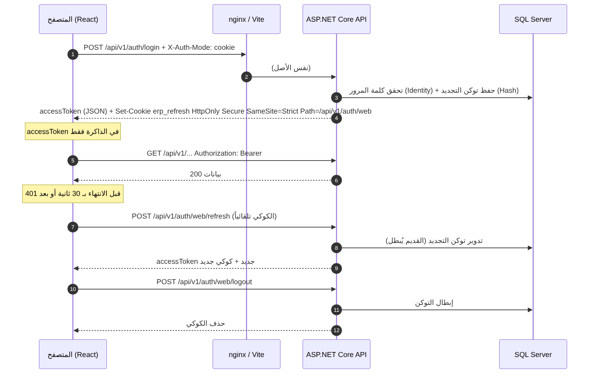
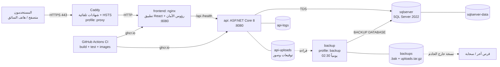
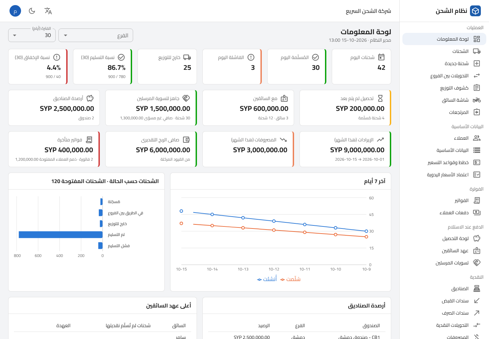
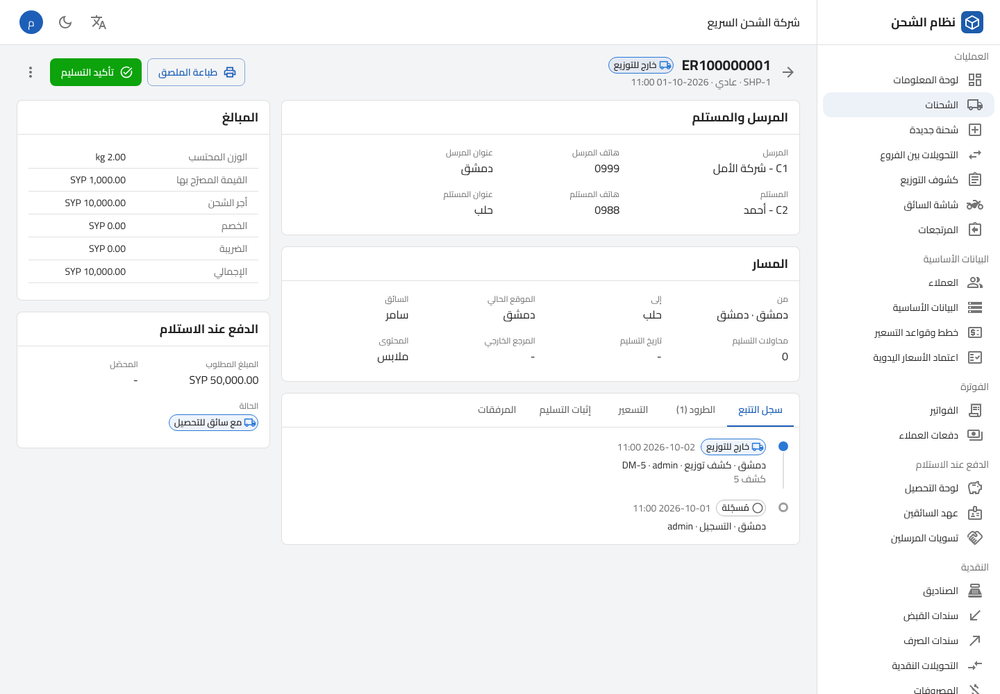

# الخطوة 8 — الواجهة العربية (RTL)، لوحات المعلومات، التقارير والطباعة، النشر بـ Docker، النسخ الاحتياطي، المراقبة والجاهزية للإنتاج

> تُبنى هذه الخطوة فوق **الخطوة 7 الكاملة** (619 اختباراً ناجحاً). بعدها يصبح العدد المتوقع **644 اختباراً** في الخادم + **10 اختبارات** في تطبيق الويب.
>
> **لا migration جديدة**: لم نُضف كيانات. الصلاحية الجديدة `AuditLogs.View` تُضاف إلى جدول الصلاحيات وتُمنح للأدوار تلقائياً عند بدء التشغيل.
>
> **المكتبات**: نبقى على Mapster بدل AutoMapper (الثغرة CVE-2026-32933). الواجهة: React 18.3 + TypeScript 5.6 + Vite 5.4 + MUI 6.5 (RTL) + TanStack Query 5 + Axios + React Router 6 +
> react-hook-form/zod + i18next + Recharts 3، بإصدارات **مثبّتة بدقة** في `package.json` و`package-lock.json`.
>
> **تحقّقنا هنا** من أن تطبيق الويب يُبنى (`tsc` صارم + `vite build`) بلا أخطاء، وأن `eslint` نظيف، وأن اختبارات Vitest تنجح، وفتحنا كل الشاشات الـ 34
> في متصفح Chromium ببيانات تجريبية بلا أي خطأ في وحدة التحكم (وعالجنا حلقة إعادة رسم في الجداول اكتشفناها بهذا الفحص).

---

## 1. ماذا بنينا؟ (شرح خطوات التنفيذ)

### 1.1 إضافات الخادم (الـ API)

| الملف | الوظيفة |
|---|---|
| `Controllers/V1/AuthController.cs` | **جلسة المتصفح الآمنة**: مع الترويسة `X-Auth-Mode: cookie` يعيد `/auth/login` و`/auth/change-password` توكن الوصول فقط، ويضع توكن التجديد في كوكي `erp_refresh` بخصائص `HttpOnly; Secure; SameSite=Strict; Path=/api/v1/auth/web`. نقطتان جديدتان: `POST /auth/web/refresh` (تجديد + تدوير الكوكي) و`POST /auth/web/logout` (إبطال + حذف الكوكي). عند فشل التجديد نعيد 401 مباشرة مع حذف الكوكي (وسيط الأخطاء يمسح الترويسات فكان سيضيع `Set-Cookie`). |
| `Identity/JwtOptions.cs` | `RefreshCookieSecure` (افتراضياً `true`). |
| `DTOs/Reports/ReportDtos.cs` | DTOs لوحة المعلومات والتقرير التشغيلي والتصدير وسجل التدقيق. |
| `Validators/Reports/ReportValidators.cs` | `days` بين 1 و365، فترة التقرير ≤ 366 يوماً و«إلى» ≥ «من»، صيغة التصدير `excel|pdf`. |
| `Reporting/DashboardService.cs` | يجمع لوحة المعلومات من خدمات قائمة (التحصيل، الصناديق، التقارير المالية، الفواتير) — **كل قسم يُرجع فقط لمن يملك صلاحيته**، والباقي `null`. |
| `Reporting/OperationalReportService.cs` | الشحنات المُنشأة في فترة: الإجماليات، حسب الحالة/الفرع/السائق/العميل/الخدمة، ويومياً. العدّ والجمع في SQL Server (`GROUP BY`)، ونطاق رؤية الشحنات (الفرع/السائق) مطبّق. |
| `Reporting/ReportDocument.cs` + `ReportFileRenderer.cs` | نموذج تقرير عام (أعمدة، أقسام، إجماليات) يُخرَج **Excel** (ClosedXML، ورقة RTL، تنسيق أرقام وتواريخ) أو **PDF** (QuestPDF، خط Cairo المضمّن، اتجاه RTL، رأس الشركة، ترقيم الصفحات، تواقيع). |
| `Reporting/ReportExportService.cs` | تصدير: الشحنات (بنفس مرشحات القائمة، حتى 10000 صف)، التقرير التشغيلي، ميزان المراجعة، الأستاذ العام، قائمة الدخل، الميزانية، و**كشف التوزيع PDF** (أفقي مع تواقيع السائق والمشرف). |
| `Reporting/AuditLogQueryService.cs` | قراءة سجل التدقيق (للقراءة فقط) بمرشحات وترقيم. |
| `Controllers/V1/Reports/DashboardController.cs` · `OperationalReportsController.cs` · `AuditLogsController.cs` | النقاط الجديدة. |
| `FinancialReportsController` · `ShipmentsController` · `DriverManifestsController` | نقاط `/export` و`/pdf`. |
| `Domain/Authorization/Permissions.cs` · `Roles.cs` | `AuditLogs.View`؛ المدير المالي يأخذ `Reports.ViewOperational` و`AuditLogs.View`. |
| `Extensions/WebApplicationExtensions.cs` | `Hosting:UseForwardedHeaders`: خلف nginx/Caddy يرى الـ API عنوان العميل الحقيقي (حد المحاولات، سجل التدقيق) والبروتوكول https. |
| `Dockerfile` | `curl` + `HEALTHCHECK` على `/health/live`. |
| الاختبارات | `ReportingTests` (10) و`WebSessionAndReportEndpointTests` (15): الأقسام المخفية، الفرع الممنوع، الإجماليات والمرشحات، كل ملفات التصدير (فتح ملف Excel بـ ClosedXML وقراءة خلاياه، وبداية PDF بـ `%PDF-`)، الكوكي وخصائصه، 401/403/400. |

### 1.2 تطبيق الويب (`frontend/`)

**البنية** (التفصيل في `docs/frontend/FRONTEND.md`):

```
frontend/src/
├── app/         App · AppProviders (Query + Theme RTL + Router + Auth) · routes (حماية المسارات) · navigation (القائمة)
├── api/         http.ts (Axios + التجديد) · client.ts · errors.ts (AppError) · tokenStore.ts · types.ts · generated.ts · endpoints/
├── auth/        AuthProvider · guards (RequireAuth, RequirePermission, Can) · permissions.generated.ts
├── components/  layout · common (PageHeader, StatusChip, StatCard, Dialogs, ExportMenu...) · data (DataTable, FilterBar, ResourcePage)
│                form (حقول من تعريفات، LookupSelect، ScanBox للباركود، SignaturePad) · charts
├── features/    شاشة لكل وحدة (24 وحدة)
├── i18n/        ar.ts (الافتراضي) · en.ts (نفس المفاتيح بفحص TypeScript) · enums.ts (أسماء حالات الـ API بالعربية والإنجليزية)
├── theme/       MUI + RTL + Cairo · لوحة ألوان الرسوم والحالات
└── utils/       تنسيق المبالغ والتواريخ بتوقيت العمل
```

**طبقة الـ API**:
- مثيل Axios واحد (`/api/v1`، نفس الأصل): يجدد توكن الوصول **قبل** انتهائه بـ 30 ثانية، وبعد أي 401 يجدد **مرة واحدة مشتركة** بين كل الطلبات المتوازية ثم يعيد الطلب؛ إن فشل التجديد ⇒ صفحة الدخول مع رسالة «انتهت الجلسة».
- `api.get/list/post/put/patch/delete/postForm` تعيد `data` من الغلاف الموحد وترمي `AppError` (الحالة، الرمز، أخطاء الحقول، `traceId`). أخطاء الحقول تظهر تحت حقولها في النماذج، و`traceId` يظهر للمستخدم.
- `api.download/export` للملفات: PDF يُفتح في تبويب للطباعة، Excel يُنزّل باسمه من `Content-Disposition`. أخطاء التنزيل (JSON داخل Blob) تُقرأ أيضاً.
- **مفتاح Idempotency-Key** لكل نافذة إنشاء مالية (دفعة عميل، سند قبض/صرف، مصروف، تحصيل، استلام عهدة، قيد يدوي): النقر المزدوج أو إعادة الإرسال لا يسجّل العملية مرتين.
- أنواع TypeScript **مولّدة من DTOs الخادم** (`npm run gen:api`): 51 تعداداً و349 نوعاً، والصلاحيات الـ 75 من `Permissions.cs`.

**تدفق المصادقة** (مخطط `STEP-08-AUTH-FLOW.png`):



- توكن الوصول **في الذاكرة فقط** (لا localStorage ولا sessionStorage): سكربت محقون لا يجد توكناً مخزّناً.
- توكن التجديد كوكي **HttpOnly** (لا يقرؤه JavaScript)، **SameSite=Strict** (لا يُرسل من موقع آخر ⇒ لا CSRF)، ومساره محصور في `/api/v1/auth/web`.
- تحديث الصفحة ⇒ تجديد صامت ⇒ `GET /auth/me` (المستخدم، الأدوار، الصلاحيات).
- تسجيل الخروج يبطل التوكن في القاعدة ويحذف الكوكي ويمسح ذاكرة الاستعلامات (لا تبقى بيانات مستخدم سابق).

**حماية المسارات**: `RequireAuth` (وإلا `/login?returnTo=` بمسار نسبي فقط)، و`RequirePermission any/all` بنفس صلاحيات نقاط الـ API التي تستدعيها الصفحة (بدونها صفحة 403 داخل الإطار)، و`<Can>` للأزرار، والقائمة الجانبية تخفي ما لا يملكه المستخدم. **الخادم هو المرجع**: كل طلب يُفحص هناك.

**القوائم**: جدول DataGrid بترقيم وفرز **من الخادم**، والبحث والمرشحات والصفحة محفوظة **في الرابط** (يمكن نسخ الرابط ومشاركته، وزر الرجوع يعيد نفس النتيجة). الفرز متاح فقط على الأعمدة الموجودة في `AllowedSortFields` بالخادم (غيرها يعيد 400).

### 1.3 الوحدات الـ 24

| # | الوحدة | المسار | أهم ما فيها | الصلاحية |
|---|---|---|---|---|
| 1 | الدخول والملف الشخصي | `/login` · `/profile` | zod + أخطاء الخادم، إظهار كلمة المرور، تبديل اللغة؛ تغيير كلمة المرور بنفس سياسة Identity (يخرج الأجهزة الأخرى) | — |
| 2 | لوحة المعلومات | `/` | 14 بطاقة مؤشرات + اتجاه 7 أيام + الحالات + الصناديق + عهد السائقين + أكثر العملاء + آخر الحركات، مرشح فرع وفترة، تحديث كل دقيقتين | حسب القسم |
| 3 | العملاء | `/customers` · `/customers/:id` | CRUD، العناوين، كشف الحساب مع تصدير Excel | `Customers.*` · `Receivables.View` |
| 4 | الفروع والمستودعات والمدن والمناطق والخدمات | `/master-data/:tab` | 16 تبويباً: فروع، مستودعات، دول، مدن، مناطق، خدمات، عملات، أسعار صرف، طرق دفع، ضرائب، بنود مصروفات، موظفون، سائقون، مركبات، موردون، حسابات بنكية | `MasterData.Manage` · `Branches.Manage`... |
| 5 | قائمة الشحنات | `/shipments` | 8 مرشحات، بحث، فرز، تصدير Excel/PDF، **مسح باركود يفتح الشحنة**، اختيار متعدد وطباعة ملصقات (حتى 100) | `Shipments.View` |
| 6 | إنشاء شحنة | `/shipments/new` · `/:id/edit` | نموذج zod يطابق مدقق الخادم، طرود متعددة بأبعاد، عناوين المرسل/المستلم، **إضافة عميل سريعة**، حساب السعر من الخادم بالتفصيل، سعر يدوي (بصلاحية) | `Shipments.Create/Update` |
| 7 | تفاصيل الشحنة وخط التتبع | `/shipments/:id` | خط زمني (من، متى، أين، المستند، التصحيحات)، الطرود، تاريخ التسعير، المرفقات (رفع/تنزيل/حذف)، الإجراءات حسب الحالة والصلاحية | `Shipments.*` |
| 8 | طباعة الملصق والكشف | زر في الشحنة/القائمة/الكشف | ملصق حراري PDF أو HTML، ملصقات جماعية، كشف التوزيع PDF | `Shipments.View` |
| 9 | التحويلات بين الفروع | `/transfers` | إنشاء بمسح الأكواد، إرسال، **استلام بالمسح** (غير الممسوح = مفقود)، إلغاء | `Transfers.*` |
| 10 | كشوف التوزيع وشاشة السائق | `/manifests` · `/driver` | الكشف: مسح الشحنات، إرسال، إغلاق بسبب للمتبقي، PDF. شاشة السائق للهاتف: بطاقة لكل محطة، اتصال، خريطة، تسليم/فشل، إجمالي التحصيل | `DeliveryManifests.Manage` · `Shipments.ConfirmDelivery` |
| 11 | إثبات التسليم | نافذة «تأكيد التسليم» | اسم المستلم وصلته، **توقيع على الشاشة** (PNG)، صورة بالكاميرا، الموقع الجغرافي، تنبيه بمبلغ التحصيل؛ عرض الإثبات في الشحنة | `Shipments.ConfirmDelivery` |
| 12 | قواعد التسعير | `/pricing` · `/pricing/:id` · `/pricing/overrides` | الخطط، محرر القواعد (شروط، شرائح وزن، رسوم)، اعتماد/رفض الأسعار اليدوية | `Pricing.*` |
| 13 | الفواتير ودفعات العملاء | `/invoices` · `/payments` | فاتورة مجمّعة لفترة، فاتورة من شحنة، إصدار، إلغاء، إشعار دائن، PDF، تسجيل دفعة (توزيع تلقائي أو على الفاتورة) | `Invoices.*` · `Payments.*` |
| 14 | لوحة التحصيل | `/cod` | مراحل المبالغ، أعمار المبالغ حسب المرسل، قائمة التحصيل، «جاهز للتسوية» جماعي، نزاع، تحصيل في الفرع | `COD.*` |
| 15 | عهد السائقين والتسليم | `/cod/driver-balances` | الأرصدة، الحركات، استلام العهدة إلى صندوق (العجز/الزيادة يُسجّلان) | `COD.View/Handover` |
| 16 | تسويات المرسلين | `/cod/settlements` | إنشاء من المبالغ الجاهزة، اعتماد، دفع (صندوق أو بنك)، إلغاء، عكس، كشف PDF | `COD.Settle/...` |
| 17 | الصناديق والسندات | `/cash/*` | الصناديق ودفتر كل صندوق، الإقفال اليومي واعتماده، سندات القبض والصرف (PDF بالمبلغ كتابةً، إلغاء بسبب)، التحويلات النقدية | `Cashboxes.*` · `CashVouchers.*` · `CashTransfers.*` |
| 18 | المصروفات | `/expenses` | سندات صرف من نوع «مصروف» حسب البند، PDF | `CashVouchers.Create` |
| 19 | دليل الحسابات | `/accounting/accounts` | شجرة بأرصدة، بحث، إضافة حساب فرعي، تعديل | `Accounting.View/ManageChart` |
| 20 | قيود اليومية | `/accounting/journal-entries` | محرر قيد يدوي بأسطر وتوازن فوري، تقديم، اعتماد، رفض، ترحيل، عكس؛ قائمة بمرشحات؛ والسنوات والفترات مع فحص الإقفال | `Accounting.*` |
| 21 | التقارير المالية | `/reports/financial` | ميزان المراجعة، الأستاذ العام، الدخل، الميزانية (Excel/PDF)، التدفقات النقدية، أعمار الذمم | `Accounting.View` + `Reports.ViewFinancial` |
| 22 | التقارير التشغيلية | `/reports/operations` | مؤشرات، اتجاه يومي، حسب الحالة، جداول حسب الفرع/السائق/العميل/الخدمة، Excel/PDF | `Reports.ViewOperational` + `Shipments.View` |
| 23 | المستخدمون والأدوار والتدقيق | `/admin/*` | المستخدمون (أدوار متعددة، تفعيل/إيقاف)، مصفوفة الصلاحيات حسب الوحدة، سجل التدقيق بالتفاصيل | `Users.*` · `Roles.Manage` · `AuditLogs.View` |
| 24 | الإعدادات وملف الشركة | `/settings` | ملف الشركة (رأس كل المستندات)، إعدادات الشحن والملصق، تفضيلات اللغة والوضع الداكن | `MasterData.Manage` للتعديل |

### 1.4 لوحة المعلومات

| المطلوب | البطاقة / القسم | المصدر |
|---|---|---|
| شحنات اليوم | «شحنات اليوم» | `operations.todayCreated` |
| الشحنات حسب الحالة | رسم أعمدة أفقي | `operations.byStatus` |
| نسبة التسليم / الإخفاق | بطاقتان للفترة المختارة | `deliveredPercent` / `failedPercent` (الملغاة مستثناة من المقام) |
| التحصيل المعلّق | «تحصيل لم يتم بعد» | المسلّمة غير المحصّلة |
| التحصيل مع السائقين | «مع السائقين» | `driversOutstandingTotal` |
| الجاهز للتسوية | «جاهز لتسوية المرسلين» | مرحلة `ReadyForSenderSettlement` |
| أرصدة الصناديق | بطاقة + جدول | `cashboxes` |
| الإيرادات / المصروفات / صافي الربح | ثلاث بطاقات (الشهر الحالي) | القيود المرحّلة |
| الفواتير المتأخرة | بطاقة حمراء عند وجودها | `overdueInvoices*` |
| عهد السائقين | جدول أعلى الأرصدة | `driverBalances` |
| أكثر العملاء | جدول بعدد الشحنات والأجور | `topCustomers` |
| آخر الحركات | قائمة تفتح الشحنة | `recentActivity` |

الرسوم البيانية تتبع قواعد واضحة: محور قيم واحد، وسيلة إيضاح عند سلسلتين، تلميح عند المرور، ألوان فئوية ثابتة ومجرّبة لعمى الألوان، ألوان الحالات محجوزة ومعها دائماً أيقونة ونص، والمحور الزمني يُقرأ من اليمين في العربية.

### 1.5 التقارير والطباعة

| المتطلب | التنفيذ |
|---|---|
| مرشحات التاريخ/الفرع/العميل/السائق/الحالة | شريط مرشحات موحد في كل قائمة وتقرير، محفوظ في الرابط |
| ترقيم القوائم التفصيلية | من الخادم (حتى 100 في الصفحة)، والأستاذ العام وكشف الحساب مرقّمان أيضاً |
| Excel | ClosedXML: ورقة RTL، رؤوس عريضة، تنسيق أرقام وتواريخ، إجماليات |
| PDF عربي RTL | QuestPDF + خط Cairo مضمّن (لا يعتمد على خطوط الخادم) + رأس الشركة + ترقيم صفحات |
| الملصق الحراري | 100×150 مم افتراضياً (قابل للتغيير من الإعدادات)، باركود Code128 + QR، صفحة لكل طرد؛ ونسخة HTML للطابعات التي تطبع من المتصفح |
| الفاتورة / كشف التوزيع / سند القبض / سند الصرف / كشف التسوية | PDF من الخادم، يُفتح للطباعة |
| ميزان المراجعة والأستاذ العام | PDF و Excel بنفس مرشحات الشاشة |

### 1.6 نظام التصميم العربي (RTL)

- `dir="rtl"` و`lang="ar"` على `<html>`، `theme.direction`، و**stylis-plugin-rtl** يقلب الهوامش والحدود؛ نكتب الأنماط باتجاهات منطقية (`marginInlineStart`, `insetInlineStart`).
- **لا نكتب `direction` في `sx`** (الإضافة تقلبها!) بل السمة `dir="ltr"` لأرقام التتبع والهواتف والرسوم البيانية.
- خط **Cairo** مضمّن محلياً (يعمل بلا إنترنت)، أرقام لاتينية بخانتين عشريتين ومحاذاة جدولية.
- التواريخ: الخادم UTC، العرض بتوقيت العمل `Asia/Damascus`، ومرشحات الأيام تتحول إلى بداية/نهاية يوم العمل.
- أيقونات الاتجاه (الرجوع، التوسيع) تنعكس مع اللغة. حقول وجداول مدمجة لإدخال سريع، زوايا 8px، بلا ظلال، وضع داكن.
- الإنجليزية اختيارية بزر في الشريط العلوي: الاتجاه والتقويم ونصوص DataGrid تتبدل فوراً.

---

## 2. النشر والإنتاج



### 2.1 Docker Compose

| الخدمة | المنفذ | ملاحظات |
|---|---|---|
| `sqlserver` | `127.0.0.1:14333` | حجم دائم `sqlserver-data` + حجم `backups` |
| `api` | `127.0.0.1:5080` | `Production` افتراضياً، Swagger مغلق، الملفات في `api-uploads`، السجلات في `api-logs`، فحص صحة |
| `frontend` | `8080` | nginx غير جذري: الملفات الثابتة + تمرير `/api` و`/health` + رؤوس أمان (CSP، منع الإطارات، nosniff) + gzip + تخزين مؤقت للحزم |
| `proxy` (اختياري) | `80/443` | Caddy: شهادة Let's Encrypt تلقائية + HSTS |
| `backup` (اختياري) | — | نسخة يومية للقاعدة والملفات مع حذف الأقدم من `BACKUP_RETENTION_DAYS` |

كل الخدمات: `restart: unless-stopped`، فحص صحة، وسجلات مدوّرة (3 ملفات × 10 ميغابايت).

### 2.2 الملفات المرفوعة

حجم دائم `api-uploads` (توقيعات وصور إثبات التسليم والمرفقات) يُنسخ احتياطياً مع القاعدة. للانتقال إلى تخزين كائنات (S3/Azure Blob/MinIO) يكفي تنفيذ جديد للواجهة `IFileStorage`.

### 2.3 HTTPS

موصى به لأي تشغيل حقيقي: ملف التعريف `proxy` (Caddy) يصدر الشهادة ويجددها تلقائياً. اجعل `WEB_BIND='127.0.0.1'` حتى لا يتجاوز أحد الوكيل. البديل على Windows Server: IIS + ARR مع شهادتكم.

### 2.4 النسخ الاحتياطي والاستعادة

- يومياً 02:30: `BACKUP DATABASE ... WITH COMPRESSION, CHECKSUM` + `RESTORE VERIFYONLY` + أرشيف الملفات، احتفاظ 14 يوماً.
- **نسخة خارج الخادم** بـ `scripts\backup-now.ps1 -Destination E:\ERP-Backups` (يمكن جدولته في Task Scheduler).
- الاستعادة: `scripts\restore.ps1 -BackupFile ... -UploadsArchive ...` (يوقف الخدمات، يستعيد، يشغّل).
- **اختبار استعادة شهري** على جهاز اختبار. التفاصيل: `docs/operations/BACKUP-RESTORE.md`.

### 2.5 السجلات والصحة والمراقبة

- `/health/live` (العملية تعمل) و`/health/ready` (SQL Server متاح، 503 عند العطل) و`/healthz` في nginx.
- سجل Serilog اليومي 30 يوماً بحد 50 ميغابايت، وكل خطأ يحمل `TraceId` يراه المستخدم أيضاً.
- مراقبة خارجية (Uptime Kuma أو UptimeRobot) على `/health/ready` كل دقيقة + تنبيه انتهاء الشهادة + امتلاء القرص + غياب نسخة احتياطية جديدة. التفاصيل: `docs/operations/MONITORING.md`.

### 2.6 قائمة الأمان قبل الإنتاج

في `docs/operations/SECURITY-CHECKLIST.md` (الأسرار، الشبكة، التطبيق، التشغيل). أهمها: `.env` خارج Git، `JWT_SECRET_KEY` عشوائي طويل، حذف `SEED_ADMIN_PASSWORD` بعد أول تشغيل، `Production` وSwagger مغلق، HTTPS فقط، منافذ 14333 و5080 على `127.0.0.1`، مراجعة الأدوار بمبدأ أقل صلاحية، نسخ احتياطي مُختبَر.

### 2.7 Git و CI

- الفروع: `main` (الإنتاج) ← `release/*` ← `develop` ← `feature/*`، و`hotfix/*`؛ لا دفع مباشر، Pull Request + مراجعة + نجاح CI.
- `.github/workflows/ci.yml`: **backend** (restore/build/test) + **frontend** (npm ci/lint/test/build) ثم **docker** (بناء الصورتين، ودفعهما إلى `ghcr.io` عند `main` أو وسم `v*`). التفاصيل: `docs/operations/GIT-BRANCHING.md`.

---

## 3. خطوات التطبيق على جهازك (Windows 11 PowerShell)

> المتطلب الجديد: **Node.js 20 LTS**. تحقق: `node -v` (يجب أن يبدأ بـ `v20` أو أحدث). للتثبيت: `winget install OpenJS.NodeJS.LTS` ثم افتح PowerShell جديداً.

### 3.1 الخادم (نفس نمط الخطوات السابقة)

```powershell
cd "$HOME\Downloads"
$zip = Get-ChildItem "$HOME\Downloads\ShippingERP-Step08-full*.zip" | Sort-Object LastWriteTime -Descending | Select-Object -First 1
$zip.FullName
Unblock-File $zip.FullName
Expand-Archive $zip.FullName -DestinationPath "$HOME\Downloads\ShippingERP-Step08" -Force

# انسخ الـ migrations الموجودة (حتى AddAccounting)
Copy-Item "$HOME\Downloads\ShippingERP-Step07\src\ShippingERP.Infrastructure\Persistence\Migrations\*" `
  "$HOME\Downloads\ShippingERP-Step08\src\ShippingERP.Infrastructure\Persistence\Migrations\" -Force

cd "$HOME\Downloads\ShippingERP-Step08"
Test-Path src\ShippingERP.Infrastructure\Reporting\DashboardService.cs                      # True
Test-Path src\ShippingERP.Infrastructure\Persistence\Migrations\AppDbContextModelSnapshot.cs  # True
Test-Path frontend\package.json                                                              # True

dotnet build --no-incremental
dotnet test --no-build       # المتوقع: 644 ناجحاً

# لا migration جديدة في هذه الخطوة. للتأكد أن القاعدة محدّثة:
dotnet ef database update `
  --project src/ShippingERP.Infrastructure `
  --startup-project src/ShippingERP.API

dotnet run --project src/ShippingERP.API --launch-profile http
```

- `dotnet ef database update` يجب أن يقول `No migrations were applied. The database is already up to date.` أو `Done.`
- في السجل عند البدء: الصلاحية `AuditLogs.View` تُضاف وتُمنح للمدير والمدير المالي. **سجّل الخروج ثم الدخول** لتظهر.

### 3.2 تطبيق الويب (PowerShell ثانٍ، والـ API يعمل)

```powershell
cd "$HOME\Downloads\ShippingERP-Step08\frontend"
npm ci                 # تثبيت الإصدارات المثبّتة في package-lock.json (أول مرة 1-3 دقائق)
npm run lint           # بلا أخطاء
npm run test           # 10 ناجحة
npm run dev            # افتح http://localhost:5173
```

ادخل بحساب المدير (من `Seed:Admin*` في الخطوة 2). Vite يمرّر `/api` إلى `http://localhost:5080`، لذلك المتصفح يرى أصلاً واحداً والكوكي يعمل.
لبناء نسخة الإنتاج محلياً: `npm run build` ثم `npm run preview` (http://localhost:4173).

### 3.3 التشغيل الكامل بـ Docker (اختياري الآن)

```powershell
cd "$HOME\Downloads\ShippingERP-Step08"
Copy-Item .env.example .env
notepad .env           # غيّر كل القيم (كلمات مرور قوية، JWT_SECRET_KEY، المدير الأول)
docker compose up --build -d
docker compose ps      # sqlserver, api, frontend = healthy
Start-Process http://localhost:8080
```

> قاعدة Docker منفصلة عن قاعدة SQL Server المحلية: هذه أول مرة لها، فيُنشأ المدير من `.env` ويُطبّق كل الترحيلات تلقائياً.
> لإيقاف كل شيء: `docker compose down` (البيانات تبقى في الأحجام). لا تستخدم `down -v` إلا إذا أردت حذف البيانات.

---

## 4. قائمة اختبار شاملة (End-to-End) لكل الوحدات

نفّذها بالترتيب على قاعدة تجريبية (بيانات العرض من الخطوات السابقة موجودة). ضع ✔ لكل بند.

### أ. الدخول والجلسة والصلاحيات
- [ ] دخول بكلمة خاطئة ⇒ رسالة عربية؛ بعد 5 محاولات ⇒ قفل مؤقت.
- [ ] دخول صحيح ⇒ لوحة المعلومات. في أدوات المطور: لا توكن في Local/Session Storage، والكوكي `erp_refresh` بعلامة HttpOnly.
- [ ] تحديث الصفحة (F5) ⇒ يبقى مسجلاً (تجديد صامت).
- [ ] اترك الصفحة أكثر من 15 دقيقة ثم اضغط زراً ⇒ يعمل (تجديد تلقائي).
- [ ] الملف الشخصي ⇒ تغيير كلمة المرور ⇒ نجاح، والجلسة على متصفح آخر تنتهي.
- [ ] تسجيل الخروج ⇒ صفحة الدخول، وزر الرجوع لا يعرض بيانات.
- [ ] مستخدم بدور «سائق» ⇒ القائمة تُظهر شاشة السائق فقط تقريباً؛ فتح `/admin/users` يدوياً ⇒ صفحة 403.
- [ ] تبديل الإنجليزية ⇒ الاتجاه LTR والنصوص إنجليزية؛ العودة للعربية. الوضع الداكن يعمل.

### ب. البيانات الأساسية والعملاء
- [ ] البيانات الأساسية: إضافة مدينة ثم منطقة لها، تعديل، إيقاف/تفعيل، حذف عنصر غير مستخدم؛ رمز مكرر ⇒ خطأ تحت الحقل.
- [ ] فرع، مستودع، خدمة، موظف، سائق (رخصة) ومركبة.
- [ ] عميل جديد + عنوانان (أحدهما افتراضي)؛ البحث بالهاتف؛ كشف الحساب لفترة + تصدير Excel.

### ج. التسعير
- [ ] خطة تسعير ⇒ قاعدة بشرط «منطقة الوجهة» وشريحة وزن ورسوم تحصيل.
- [ ] شحنة بسعر يدوي يتجاوز الحد ⇒ تظهر في «اعتماد الأسعار اليدوية» ⇒ اعتماد.

### د. الشحنات
- [ ] شحنة جديدة: مرسل + **إضافة مستلم سريعة** + طردان بأبعاد + COD ⇒ «احسب السعر» يعرض التفصيل ⇒ تسجيل ⇒ صفحة التفاصيل.
- [ ] أخطاء النموذج: بلا مرسل، وزن صفر، بعد واحد فقط من الأبعاد، تأمين أكبر من القيمة ⇒ رسائل تحت الحقول.
- [ ] القائمة: مرشح الحالة والفرع والتاريخ، الفرز بالأجور، الرابط يحفظ المرشحات، تصدير Excel و PDF بنفس المرشحات.
- [ ] مسح باركود (أو كتابة رقم التتبع + Enter) في القائمة ⇒ يفتح الشحنة.
- [ ] طباعة الملصق PDF (100×150) و HTML؛ اختيار 3 شحنات ⇒ «طباعة الملصقات».
- [ ] تغيير الحالة (المسموح فقط يظهر)، إسناد سائق، رفع مرفق وتنزيله، تصحيح حالة بسبب، إلغاء بسبب ⇒ كلها في خط التتبع.

### هـ. العمليات والتسليم
- [ ] تحويل بين فرعين بمسح شحنتين ⇒ إرسال ⇒ في الفرع الآخر مسح واحدة فقط ⇒ تأكيد ⇒ الأخرى «مفقودة».
- [ ] كشف توزيع لسائق بمسح الشحنات ⇒ طباعة الكشف PDF ⇒ إرسال (الشحنات «خارج للتوزيع»).
- [ ] بحساب السائق على الهاتف: شاشة السائق ⇒ اتصال/خريطة ⇒ **تسليم بتوقيع وصورة** (اسمح بالموقع) ⇒ وأخرى «فشل» بسبب.
- [ ] في تفاصيل الشحنة: تبويب إثبات التسليم يعرض المستلم والوقت والموقع، والتوقيع والصورة يُفتحان.
- [ ] إغلاق الكشف مع سبب للشحنات المتبقية.
- [ ] مرتجع جديد برقم التتبع ⇒ استلام في الفرع ⇒ إكمال.

### و. الفوترة
- [ ] فاتورة من شحنة (إصدار فوراً) ⇒ PDF عربي.
- [ ] فاتورة مجمّعة لعميل لفترة ⇒ مسودة ⇒ إصدار.
- [ ] «تسجيل دفعة» من الفاتورة ⇒ تُوزَّع عليها ⇒ الحالة «مدفوعة»؛ نقر مزدوج على حفظ لا يسجّل دفعتين.
- [ ] إشعار دائن لفاتورة، وإلغاء مسودة.

### ز. التحصيل والنقدية
- [ ] لوحة التحصيل: المراحل والأعمار؛ تحصيل في الفرع برقم تتبع.
- [ ] عهد السائقين: الحركات ⇒ «استلام العهدة» بمبلغ أقل بـ 1000 ⇒ سند قبض بعجز.
- [ ] اختيار مبالغ ⇒ «جاهز للتسوية» ⇒ تسوية جديدة للمرسل ⇒ اعتماد ⇒ دفع من صندوق ⇒ كشف التسوية PDF ⇒ سند صرف مرتبط.
- [ ] الصناديق: دفتر الصندوق، إقفال يومي بفرق وسبب ⇒ اعتماد الإقفال.
- [ ] سند قبض «إيراد آخر» وسند صرف «دفعة مورد» ⇒ PDF بالمبلغ كتابةً ⇒ إلغاء أحدهما بسبب.
- [ ] مصروف جديد ببند ⇒ يظهر في المصروفات وفي دفتر الصندوق.
- [ ] تحويل نقدي بين صندوقين ⇒ اعتماد ⇒ استلام.

### ح. المحاسبة
- [ ] دليل الحسابات: البحث، توسيع الكل، إضافة حساب فرعي تحت حساب رئيسي.
- [ ] قيد يدوي غير متوازن ⇒ زر التقديم معطّل؛ متوازن ⇒ حفظ وتقديم ⇒ اعتماد (مستخدم آخر) ⇒ ترحيل ⇒ عكس.
- [ ] قيود آلية من الفواتير والسندات تظهر بعلامة «آلي».
- [ ] الفترات: فحص الإقفال يعرض العوائق؛ إقفال فترة ثم إعادة فتحها بسبب.

### ط. التقارير ولوحة المعلومات
- [ ] لوحة المعلومات: الأرقام تطابق القوائم؛ مرشح الفرع والفترة؛ النقر على البطاقات يفتح القائمة المرشّحة.
- [ ] مستخدم بلا صلاحيات مالية ⇒ لا تظهر بطاقات الإيراد والمصروف.
- [ ] ميزان المراجعة «متوازن» ⇒ Excel (ورقة من اليمين) و PDF (خط عربي سليم).
- [ ] الأستاذ العام لحساب الصندوق ⇒ رصيد متحرك ⇒ تصدير.
- [ ] قائمة الدخل والميزانية (متوازنة) والتدفقات وأعمار الذمم.
- [ ] التقرير التشغيلي لـ 30 يوماً بمرشح سائق ⇒ الجداول حسب الفرع/السائق/العميل/الخدمة ⇒ Excel و PDF.

### ي. الإدارة والإعدادات
- [ ] مستخدم جديد بدورين ⇒ دخول به ⇒ إيقافه ⇒ لا يستطيع الدخول.
- [ ] دور جديد ⇒ صلاحيات من المصفوفة ⇒ حفظ.
- [ ] سجل التدقيق: مرشح «فشل دخول» والتاريخ ⇒ فتح التفاصيل.
- [ ] ملف الشركة: تغيير الاسم ⇒ يظهر في رأس PDF جديد. إعدادات الملصق 100×150.

### ك. النشر (Docker)
- [ ] `docker compose up --build -d` ⇒ كل الخدمات healthy ⇒ الدخول على http://localhost:8080.
- [ ] `Invoke-WebRequest http://localhost:8080 -Method Head` ⇒ الرؤوس `Content-Security-Policy` و`X-Frame-Options: DENY`.
- [ ] رفع صورة إثبات تسليم ثم `docker compose restart api` ⇒ الصورة ما زالت موجودة (حجم دائم).
- [ ] `.\scripts\backup-now.ps1 -Destination D:\ERP-Backups` ⇒ ملف `.bak` و`.tar.gz`.
- [ ] استعادة على جهاز اختبار بـ `.\scripts\restore.ps1` ⇒ البيانات والصور كما هي.
- [ ] `docker compose logs --tail 50 api` ⇒ بلا أخطاء؛ `http://localhost:8080/health/ready` ⇒ Healthy.
- [ ] دفع الفرع إلى GitHub ⇒ CI أخضر (backend، frontend، docker).

---

## 5. ملاحظات مهمة

- **المتصفح والكوكي على http**: Chrome وEdge وFirefox يقبلون كوكي `Secure` على `http://localhost` فقط. على شبكة داخلية بعنوان IP دون HTTPS لن يعمل التجديد؛ الحل الصحيح HTTPS (ملف `proxy`)، وللتجربة فقط `REFRESH_COOKIE_SECURE='false'`.
- **الكاميرا والموقع في شاشة السائق** يحتاجان HTTPS على الهواتف (أو localhost).
- **التوقيت**: الواجهة تعرض بتوقيت `VITE_BUSINESS_TIME_ZONE` (افتراضياً Asia/Damascus) ويجب أن يطابق `Shipping:BusinessTimeZone` في الخادم.
- **الأنواع المولّدة**: بعد أي تغيير في DTOs شغّل `npm run gen:api` (Python 3) ثم `npm run build` ليكشف TypeScript أي شاشة تأثرت.
- **SQL Server Developer** مجاني للتطوير والاختبار فقط؛ في الإنتاج استخدم Express (حتى 10 جيجابايت) أو إصداراً مرخّصاً عبر `MSSQL_PID`.
- **حجم الحزمة**: كل شاشة تُحمَّل عند أول زيارة (lazy)، ومكتبات MUI والجداول والرسوم في حزم منفصلة تُخزَّن سنة في المتصفح.
- الصور `STEP-08-DASHBOARD.png` و`STEP-08-SHIPMENT.png` من تشغيل الواجهة على بيانات تجريبية.





---

## 6. الملفات الكاملة (152 ملفاً جديداً أو معدّلاً)

كل ملف كامل كما هو في المشروع. المسارات نسبية من المجلد الجذر للحل. `frontend/package-lock.json` (قفل الإصدارات، يولّده npm) موجود في ZIP فقط.

### 6.1 `src/ShippingERP.Domain/Authorization/Permissions.cs`

```csharp
namespace ShippingERP.Domain.Authorization;

/// <summary>
/// The single source of truth for permission codes.
///
/// - Use the constants in code: [HasPermission(Permissions.Shipments.Create)]
/// - The seeder inserts any code from <see cref="All"/> that is missing in the Permissions table,
///   so adding a permission = add a constant here + add it to All + restart the API.
/// - Never rename an existing code: role assignments and issued tokens refer to it.
/// </summary>
public static class Permissions
{
    public static class Users
    {
        public const string View = "Users.View";
        public const string Manage = "Users.Manage";
    }

    public static class Roles
    {
        public const string Manage = "Roles.Manage";
    }

    public static class Customers
    {
        public const string View = "Customers.View";
        public const string Manage = "Customers.Manage";
    }

    public static class Shipments
    {
        public const string View = "Shipments.View";
        public const string Create = "Shipments.Create";
        public const string Update = "Shipments.Update";
        public const string ChangeStatus = "Shipments.ChangeStatus";
        public const string AssignDriver = "Shipments.AssignDriver";

        // ----- Step 4 -----

        /// <summary>Cancel a shipment that has not left the origin branch.</summary>
        public const string Cancel = "Shipments.Cancel";

        /// <summary>Confirm a delivery (proof of delivery) or record a failed attempt.</summary>
        public const string ConfirmDelivery = "Shipments.ConfirmDelivery";

        /// <summary>Correct a wrong status outside the normal rules (reason required, fully audited).</summary>
        public const string CorrectStatus = "Shipments.CorrectStatus";

        /// <summary>Import shipments from Excel.</summary>
        public const string Import = "Shipments.Import";

        /// <summary>Enter a manual shipping charge (when no pricing rule applies) or give a discount (a reason is required).</summary>
        public const string OverridePrice = "Shipments.OverridePrice";
    }

    // ----- Step 4: operations -----

    /// <summary>Warehouse check-in / check-out manifests.</summary>
    public static class Warehouse
    {
        public const string ManageMovements = "Warehouse.ManageMovements";
    }

    /// <summary>Branch transfer manifests.</summary>
    public static class Transfers
    {
        public const string View = "Transfers.View";
        public const string Manage = "Transfers.Manage";
        public const string Receive = "Transfers.Receive";
    }

    /// <summary>Driver delivery manifests (drivers see their own manifests with Shipments.View).</summary>
    public static class DeliveryManifests
    {
        public const string Manage = "DeliveryManifests.Manage";
    }

    public static class Returns
    {
        public const string Manage = "Returns.Manage";
    }

    public static class DamageCases
    {
        public const string Manage = "DamageCases.Manage";
    }

    /// <summary>
    /// Cash on delivery. Step 6 adds the handover, approval and adjustment permissions. A driver-only user (Driver
    /// role without Shipments.AssignDriver) sees only his own COD shipments and his own cash balance.
    /// </summary>
    public static class Cod
    {
        public const string View = "COD.View";

        /// <summary>Record the COD amount collected from the recipient.</summary>
        public const string Collect = "COD.Collect";

        /// <summary>Mark received COD ready for settlement and create sender settlements (step 6 meaning).</summary>
        public const string Settle = "COD.Settle";

        // ----- Step 6 -----

        /// <summary>Receive a driver's cash into a cashbox (driver handover) or a counter COD collection.</summary>
        public const string Handover = "COD.Handover";

        /// <summary>Approve, cancel or reverse sender settlements.</summary>
        public const string ApproveSettlement = "COD.ApproveSettlement";

        /// <summary>Pay an approved sender settlement (cash from a cashbox or bank transfer).</summary>
        public const string PaySettlement = "COD.PaySettlement";

        /// <summary>Request COD / driver cash adjustments and open disputes.</summary>
        public const string Adjust = "COD.Adjust";

        /// <summary>Approve or reject adjustments and resolve disputes.</summary>
        public const string ApproveAdjustment = "COD.ApproveAdjustment";
    }

    // ----- Step 6: cash management -----

    /// <summary>Branch cashboxes, their transactions, daily closings and bank accounts.</summary>
    public static class Cashboxes
    {
        public const string View = "Cashboxes.View";

        /// <summary>Create and edit cashboxes and bank accounts.</summary>
        public const string Manage = "Cashboxes.Manage";

        /// <summary>Close the day of a cashbox (count the cash).</summary>
        public const string Close = "Cashboxes.Close";

        /// <summary>Approve or reject a closing with a cash difference.</summary>
        public const string ApproveClosing = "Cashboxes.ApproveClosing";
    }

    /// <summary>Cash receipt and payment vouchers (سندات القبض والصرف النقدية).</summary>
    public static class CashVouchers
    {
        public const string Create = "CashVouchers.Create";

        /// <summary>Cancel a posted voucher (adds a reversing cashbox transaction).</summary>
        public const string Cancel = "CashVouchers.Cancel";
    }

    public static class CashTransfers
    {
        public const string Create = "CashTransfers.Create";
        public const string Approve = "CashTransfers.Approve";
        public const string Receive = "CashTransfers.Receive";
    }

    public static class Invoices
    {
        public const string View = "Invoices.View";
        public const string Create = "Invoices.Create";

        // ----- Step 5 -----

        /// <summary>Issue a draft invoice (gives it its number and debits the customer account).</summary>
        public const string Issue = "Invoices.Issue";

        /// <summary>Cancel a draft, or an issued invoice that has no payment and no credit note.</summary>
        public const string Cancel = "Invoices.Cancel";

        /// <summary>Issue credit notes against issued invoices.</summary>
        public const string CreditNotes = "Invoices.CreditNotes";

        /// <summary>Export invoices to Excel and print / download invoice PDFs.</summary>
        public const string Export = "Invoices.Export";
    }

    // ----- Step 5: receivables -----

    /// <summary>Customer payments (سندات القبض).</summary>
    public static class Payments
    {
        public const string View = "Payments.View";
        public const string Create = "Payments.Create";
    }

    /// <summary>Customer account statements and balances.</summary>
    public static class Receivables
    {
        public const string View = "Receivables.View";
    }

    public static class Accounting
    {
        public const string View = "Accounting.View";
        public const string CreateJournal = "Accounting.CreateJournal";
        public const string ApproveJournal = "Accounting.ApproveJournal";

        // Step 7: double-entry accounting.
        public const string PostJournal = "Accounting.PostJournal";
        public const string ReverseJournal = "Accounting.ReverseJournal";
        public const string ManageChart = "Accounting.ManageChart";
        public const string ManagePeriods = "Accounting.ManagePeriods";
        public const string BankReconciliation = "Accounting.BankReconciliation";
        public const string ManagePostings = "Accounting.ManagePostings";
    }

    public static class Expenses
    {
        public const string View = "Expenses.View";
        public const string Create = "Expenses.Create";
        public const string Approve = "Expenses.Approve";
    }

    public static class Reports
    {
        public const string ViewFinancial = "Reports.ViewFinancial";
        public const string ViewOperational = "Reports.ViewOperational";
    }

    public static class Branches
    {
        /// <summary>See and manage data of every branch. Without it a user only sees their own branch.</summary>
        public const string ViewAll = "Branches.ViewAll";
        public const string Manage = "Branches.Manage";
    }

    // ----- Step 3: master data -----

    /// <summary>
    /// Reference data used by everybody: countries, cities, zones, service types, payment methods,
    /// currencies, exchange rates, tax rates, expense categories, company profile.
    /// Reading them only requires being signed in; changing them requires MasterData.Manage.
    /// </summary>
    public static class MasterData
    {
        public const string Manage = "MasterData.Manage";
    }

    public static class Pricing
    {
        public const string View = "Pricing.View";
        public const string Manage = "Pricing.Manage";

        /// <summary>Step 5: approve or reject manual prices above the approval threshold (and apply them directly).</summary>
        public const string ApproveOverride = "Pricing.ApproveOverride";
    }

    public static class Suppliers
    {
        public const string View = "Suppliers.View";
        public const string Manage = "Suppliers.Manage";
    }

    /// <summary>Employees and driver profiles.</summary>
    public static class Employees
    {
        public const string View = "Employees.View";
        public const string Manage = "Employees.Manage";
    }

    public static class Vehicles
    {
        public const string View = "Vehicles.View";
        public const string Manage = "Vehicles.Manage";
    }

    /// <summary>Step 8: read the audit log (who did what and when).</summary>
    public static class AuditLogs
    {
        public const string View = "AuditLogs.View";
    }

    /// <summary>Every permission with its module and Arabic description.</summary>
    public static IReadOnlyList<PermissionDefinition> All { get; } = new List<PermissionDefinition>
    {
        new(Users.View, "Users", "عرض المستخدمين"),
        new(Users.Manage, "Users", "إدارة المستخدمين (إضافة، تعديل، تفعيل، إيقاف)"),
        new(Roles.Manage, "Roles", "إدارة الأدوار والصلاحيات"),

        new(Customers.View, "Customers", "عرض العملاء"),
        new(Customers.Manage, "Customers", "إدارة العملاء"),

        new(Shipments.View, "Shipments", "عرض الشحنات"),
        new(Shipments.Create, "Shipments", "إنشاء شحنة"),
        new(Shipments.Update, "Shipments", "تعديل شحنة"),
        new(Shipments.ChangeStatus, "Shipments", "تغيير حالة الشحنة"),
        new(Shipments.AssignDriver, "Shipments", "إسناد الشحنة إلى سائق"),
        new(Shipments.Cancel, "Shipments", "إلغاء شحنة"),
        new(Shipments.ConfirmDelivery, "Shipments", "تأكيد التسليم وتسجيل محاولات التسليم الفاشلة"),
        new(Shipments.CorrectStatus, "Shipments", "تصحيح حالة شحنة خارج المسار الطبيعي"),
        new(Shipments.Import, "Shipments", "استيراد الشحنات من Excel"),
        new(Shipments.OverridePrice, "Shipments", "إدخال سعر شحن يدوي ومنح خصم"),

        new(Warehouse.ManageMovements, "Warehouse", "إدخال وإخراج الشحنات من المستودع"),
        new(Transfers.View, "Transfers", "عرض التحويلات بين الفروع"),
        new(Transfers.Manage, "Transfers", "إنشاء وإرسال التحويلات بين الفروع"),
        new(Transfers.Receive, "Transfers", "استلام التحويلات الواردة"),
        new(DeliveryManifests.Manage, "DeliveryManifests", "إنشاء وإدارة بيانات التوزيع للسائقين"),
        new(Returns.Manage, "Returns", "إدارة المرتجعات"),
        new(DamageCases.Manage, "DamageCases", "إدارة حالات التلف والفقدان"),

        new(Cod.View, "COD", "عرض مبالغ الدفع عند الاستلام"),
        new(Cod.Collect, "COD", "تحصيل مبالغ الدفع عند الاستلام"),
        new(Cod.Settle, "COD", "تسوية مبالغ الدفع عند الاستلام مع العملاء"),
        new(Cod.Handover, "COD", "استلام نقدية السائقين والتحصيل في الفرع إلى الصندوق"),
        new(Cod.ApproveSettlement, "COD", "اعتماد تسويات المرسلين وإلغاؤها وعكسها"),
        new(Cod.PaySettlement, "COD", "دفع تسويات المرسلين"),
        new(Cod.Adjust, "COD", "طلب تسويات التحصيل وعهدة السائقين وفتح النزاعات"),
        new(Cod.ApproveAdjustment, "COD", "اعتماد تسويات التحصيل وحل النزاعات"),

        new(Cashboxes.View, "Cashboxes", "عرض الصناديق وحركاتها وتقارير النقدية"),
        new(Cashboxes.Manage, "Cashboxes", "إدارة الصناديق والحسابات البنكية"),
        new(Cashboxes.Close, "Cashboxes", "الإقفال اليومي للصناديق"),
        new(Cashboxes.ApproveClosing, "Cashboxes", "اعتماد فروقات الإقفال اليومي"),
        new(CashVouchers.Create, "CashVouchers", "تسجيل سندات القبض والصرف النقدية"),
        new(CashVouchers.Cancel, "CashVouchers", "إلغاء سندات القبض والصرف النقدية"),
        new(CashTransfers.Create, "CashTransfers", "طلب تحويلات النقدية"),
        new(CashTransfers.Approve, "CashTransfers", "اعتماد تحويلات النقدية أو رفضها"),
        new(CashTransfers.Receive, "CashTransfers", "استلام تحويلات النقدية الواردة"),

        new(Invoices.View, "Invoices", "عرض الفواتير"),
        new(Invoices.Create, "Invoices", "إنشاء الفواتير"),
        new(Invoices.Issue, "Invoices", "إصدار الفواتير (ترقيمها وترحيلها إلى حساب العميل)"),
        new(Invoices.Cancel, "Invoices", "إلغاء الفواتير غير المدفوعة"),
        new(Invoices.CreditNotes, "Invoices", "إصدار الإشعارات الدائنة"),
        new(Invoices.Export, "Invoices", "طباعة الفواتير وتصديرها إلى Excel"),

        new(Payments.View, "Payments", "عرض سندات القبض"),
        new(Payments.Create, "Payments", "تسجيل دفعات العملاء وتخصيصها على الفواتير"),
        new(Receivables.View, "Receivables", "عرض كشوف حسابات العملاء وأرصدتهم"),

        new(Accounting.View, "Accounting", "عرض الحسابات والقيود"),
        new(Accounting.CreateJournal, "Accounting", "إنشاء قيود يومية"),
        new(Accounting.ApproveJournal, "Accounting", "اعتماد قيود اليومية أو رفضها"),
        new(Accounting.PostJournal, "Accounting", "ترحيل القيود المعتمدة إلى دفتر الأستاذ"),
        new(Accounting.ReverseJournal, "Accounting", "عكس القيود المرحّلة"),
        new(Accounting.ManageChart, "Accounting", "إدارة دليل الحسابات ومراكز التكلفة وقواعد الترحيل الآلي"),
        new(Accounting.ManagePeriods, "Accounting", "إدارة السنوات المالية وإقفال الفترات وإعادة فتحها"),
        new(Accounting.BankReconciliation, "Accounting", "التسويات البنكية وكشوف البنك"),
        new(Accounting.ManagePostings, "Accounting", "متابعة الترحيل الآلي وإعادة محاولة الأحداث الفاشلة"),

        new(Expenses.View, "Expenses", "عرض المصروفات"),
        new(Expenses.Create, "Expenses", "تسجيل المصروفات"),
        new(Expenses.Approve, "Expenses", "اعتماد المصروفات"),

        new(Reports.ViewFinancial, "Reports", "عرض التقارير المالية"),
        new(Reports.ViewOperational, "Reports", "عرض التقارير التشغيلية"),

        new(Branches.ViewAll, "Branches", "الاطلاع على بيانات جميع الفروع"),
        new(Branches.Manage, "Branches", "إدارة الفروع والمستودعات"),

        new(MasterData.Manage, "MasterData", "إدارة البيانات الأساسية (الدول، المدن، المناطق، العملات، الضرائب...)"),

        new(Pricing.View, "Pricing", "عرض خطط التسعير"),
        new(Pricing.Manage, "Pricing", "إدارة خطط التسعير وقواعدها"),
        new(Pricing.ApproveOverride, "Pricing", "اعتماد تعديلات الأسعار اليدوية الكبيرة"),

        new(Suppliers.View, "Suppliers", "عرض الموردين"),
        new(Suppliers.Manage, "Suppliers", "إدارة الموردين"),

        new(Employees.View, "Employees", "عرض الموظفين والسائقين"),
        new(Employees.Manage, "Employees", "إدارة الموظفين والسائقين"),

        new(Vehicles.View, "Vehicles", "عرض المركبات"),
        new(Vehicles.Manage, "Vehicles", "إدارة المركبات"),

        new(AuditLogs.View, "AuditLogs", "عرض سجل التدقيق")
    };

    private static readonly HashSet<string> AllCodes =
        new(All.Select(permission => permission.Code), StringComparer.Ordinal);

    /// <summary>True if the code exists in the catalog (case-sensitive).</summary>
    public static bool IsKnown(string code) => AllCodes.Contains(code);
}
```

### 6.2 `src/ShippingERP.Domain/Authorization/Roles.cs`

```csharp
using P = ShippingERP.Domain.Authorization.Permissions;

namespace ShippingERP.Domain.Authorization;

/// <summary>
/// The eight built-in roles (FinancialManager added in step 7).
///
/// DefaultPermissions are applied when the seeder creates the role for the first time. When a NEW permission
/// code is added to Permissions.cs later, the seeder also grants it to the built-in roles that list it here
/// (only on the run that creates the permission). Changes an administrator makes with
/// PUT /api/v1/roles/{id}/permissions are never overwritten. SystemAdmin always holds every permission.
///
/// Drivers: a user in the Driver role who does NOT hold Shipments.AssignDriver only sees the shipments and
/// delivery manifests assigned to his driver profile (DriverProfile.UserId).
/// </summary>
public static class Roles
{
    public const string SystemAdmin = "SystemAdmin";
    public const string Accountant = "Accountant";
    public const string BranchManager = "BranchManager";
    public const string ShippingAgent = "ShippingAgent";
    public const string WarehouseEmployee = "WarehouseEmployee";
    public const string Driver = "Driver";
    public const string Customer = "Customer";
    public const string FinancialManager = "FinancialManager";

    public static IReadOnlyList<RoleDefinition> All { get; } = new List<RoleDefinition>
    {
        new(
            SystemAdmin,
            "مدير النظام",
            "صلاحيات كاملة على جميع أجزاء النظام.",
            P.All.Select(permission => permission.Code).ToList()),

        new(
            Accountant,
            "محاسب",
            "الحسابات والقيود والفواتير والمصروفات والصناديق وتسويات الدفع عند الاستلام.",
            new[]
            {
                P.Customers.View,
                P.Shipments.View,
                P.Cod.View, P.Cod.Settle, P.Cod.Handover, P.Cod.PaySettlement, P.Cod.Adjust,
                P.Cashboxes.View, P.Cashboxes.Manage, P.Cashboxes.Close,
                P.CashVouchers.Create,
                P.CashTransfers.Create, P.CashTransfers.Receive,
                P.Invoices.View, P.Invoices.Create, P.Invoices.Issue, P.Invoices.Cancel, P.Invoices.CreditNotes, P.Invoices.Export,
                P.Payments.View, P.Payments.Create,
                P.Receivables.View,
                P.Accounting.View, P.Accounting.CreateJournal, P.Accounting.BankReconciliation, P.Accounting.ManagePostings,
                P.Expenses.View, P.Expenses.Create,
                P.Reports.ViewFinancial,
                P.Pricing.View,
                P.Suppliers.View, P.Suppliers.Manage
            }),

        new(
            BranchManager,
            "مدير فرع",
            "إدارة عمليات الفرع وموظفيه وشحناته.",
            new[]
            {
                P.Users.View,
                P.Customers.View, P.Customers.Manage,
                P.Shipments.View, P.Shipments.Create, P.Shipments.Update,
                P.Shipments.ChangeStatus, P.Shipments.AssignDriver,
                P.Shipments.Cancel, P.Shipments.ConfirmDelivery, P.Shipments.CorrectStatus, P.Shipments.Import,
                P.Shipments.OverridePrice,
                P.Warehouse.ManageMovements,
                P.Transfers.View, P.Transfers.Manage, P.Transfers.Receive,
                P.DeliveryManifests.Manage,
                P.Returns.Manage,
                P.DamageCases.Manage,
                P.Cod.View, P.Cod.Collect, P.Cod.Handover, P.Cod.Settle, P.Cod.ApproveSettlement, P.Cod.PaySettlement,
                P.Cod.Adjust, P.Cod.ApproveAdjustment,
                P.Cashboxes.View, P.Cashboxes.Close, P.Cashboxes.ApproveClosing,
                P.CashVouchers.Create, P.CashVouchers.Cancel,
                P.CashTransfers.Create, P.CashTransfers.Approve, P.CashTransfers.Receive,
                P.Invoices.View, P.Invoices.Create, P.Invoices.Issue, P.Invoices.Export,
                P.Payments.View, P.Payments.Create,
                P.Receivables.View,
                P.Expenses.View, P.Expenses.Create, P.Expenses.Approve,
                P.Reports.ViewOperational,
                P.Pricing.View, P.Pricing.ApproveOverride,
                P.Suppliers.View,
                P.Employees.View, P.Employees.Manage,
                P.Vehicles.View, P.Vehicles.Manage
            }),

        new(
            ShippingAgent,
            "موظف شحن",
            "استقبال الشحنات وتسجيلها وخدمة العملاء.",
            new[]
            {
                P.Customers.View, P.Customers.Manage,
                P.Shipments.View, P.Shipments.Create, P.Shipments.Update, P.Shipments.ChangeStatus,
                P.Shipments.Cancel, P.Shipments.ConfirmDelivery, P.Shipments.Import,
                P.Returns.Manage,
                P.Pricing.View,
                P.Invoices.View, P.Invoices.Create,
                P.Payments.View, P.Payments.Create,
                P.Cod.View, P.Cod.Collect, P.Cod.Handover,
                P.Cashboxes.View
            }),

        new(
            WarehouseEmployee,
            "موظف مستودع",
            "استلام وفرز الشحنات في المستودع.",
            new[]
            {
                P.Shipments.View, P.Shipments.ChangeStatus,
                P.Warehouse.ManageMovements,
                P.Transfers.View, P.Transfers.Manage, P.Transfers.Receive,
                P.DamageCases.Manage
            }),

        new(
            Driver,
            "سائق",
            "توصيل الشحنات وتحصيل مبالغ الدفع عند الاستلام.",
            new[]
            {
                P.Shipments.View, P.Shipments.ChangeStatus, P.Shipments.ConfirmDelivery,
                P.Cod.View, P.Cod.Collect
            }),

        new(
            FinancialManager,
            "المدير المالي",
            "اعتماد القيود وترحيلها وعكسها، دليل الحسابات، إقفال الفترات، التسويات البنكية والتقارير المالية.",
            new[]
            {
                P.Customers.View,
                P.Suppliers.View,
                P.Invoices.View,
                P.Payments.View,
                P.Receivables.View,
                P.Cod.View,
                P.Cashboxes.View,
                P.Expenses.View, P.Expenses.Approve,
                P.Accounting.View, P.Accounting.CreateJournal, P.Accounting.ApproveJournal, P.Accounting.PostJournal,
                P.Accounting.ReverseJournal, P.Accounting.ManageChart, P.Accounting.ManagePeriods,
                P.Accounting.BankReconciliation, P.Accounting.ManagePostings,
                P.Reports.ViewFinancial, P.Reports.ViewOperational,
                P.Branches.ViewAll,
                P.AuditLogs.View
            }),

        new(
            Customer,
            "عميل",
            "متابعة شحناته وفواتيره من بوابة العملاء.",
            new[]
            {
                P.Shipments.View,
                P.Invoices.View
            })
    };
}
```

### 6.3 `src/ShippingERP.Application/DTOs/Reports/ReportDtos.cs`

```csharp
using ShippingERP.Application.DTOs.Cod;
using ShippingERP.Application.DTOs.Common;
using ShippingERP.Domain.Enums;

namespace ShippingERP.Application.DTOs.Reports;

/// <summary>File format of a report export (?format=excel or ?format=pdf).</summary>
public enum ExportFormat
{
    Excel = 1,
    Pdf = 2
}

// ============================================================ dashboard

/// <summary>GET /api/v1/dashboard.</summary>
public sealed class DashboardQuery
{
    /// <summary>Days of the "recent period" (delivered %, failed %, top customers). Default 30, 1..365.</summary>
    public int Days { get; set; } = 30;

    /// <summary>Optional branch (only branches the caller can see).</summary>
    public long? BranchId { get; set; }
}

public sealed class StatusCountDto
{
    public ShipmentStatus Status { get; init; }
    public string StatusName { get; init; } = string.Empty;
    public int Count { get; init; }
}

public sealed class DailyShipmentCountDto
{
    /// <summary>Local business date.</summary>
    public DateTime Date { get; init; }
    public int Created { get; init; }
    public int Delivered { get; init; }
}

public sealed class DashboardOperationsDto
{
    public int TodayCreated { get; init; }
    public int TodayDelivered { get; init; }
    public int TodayFailed { get; init; }
    public int OpenShipments { get; init; }
    public int OutForDelivery { get; init; }

    /// <summary>Shipments created in the period (cancelled excluded).</summary>
    public int PeriodShipments { get; init; }
    public int PeriodDelivered { get; init; }

    /// <summary>Delivery failed, returned, lost or damaged.</summary>
    public int PeriodFailed { get; init; }

    public decimal DeliveredPercent { get; init; }
    public decimal FailedPercent { get; init; }
    public IReadOnlyList<StatusCountDto> ByStatus { get; init; } = Array.Empty<StatusCountDto>();
    public IReadOnlyList<DailyShipmentCountDto> Last7Days { get; init; } = Array.Empty<DailyShipmentCountDto>();
}

public sealed class DashboardCashboxDto
{
    public long Id { get; init; }
    public string Code { get; init; } = string.Empty;
    public string Name { get; init; } = string.Empty;
    public string BranchName { get; init; } = string.Empty;
    public string CurrencyCode { get; init; } = string.Empty;
    public decimal Balance { get; init; }
}

public sealed class DashboardFinanceDto
{
    /// <summary>Month to date (local business dates).</summary>
    public DateTime FromDate { get; init; }
    public DateTime ToDate { get; init; }
    public string BaseCurrencyCode { get; init; } = string.Empty;
    public decimal TotalRevenue { get; init; }

    /// <summary>Cost of revenue + expenses.</summary>
    public decimal TotalExpenses { get; init; }

    public decimal NetProfit { get; init; }
    public int OverdueInvoicesCount { get; init; }
    public decimal OverdueInvoicesAmount { get; init; }
    public decimal ReceivablesBalance { get; init; }
}

public sealed class DashboardDriverBalanceDto
{
    public long DriverId { get; init; }
    public string DriverName { get; init; } = string.Empty;
    public string BranchName { get; init; } = string.Empty;
    public string CurrencyCode { get; init; } = string.Empty;
    public decimal Balance { get; init; }
    public int UnhandedCodCount { get; init; }
}

public sealed class DashboardTopCustomerDto
{
    public long CustomerId { get; init; }
    public string Code { get; init; } = string.Empty;
    public string Name { get; init; } = string.Empty;
    public int ShipmentCount { get; init; }
    public decimal TotalCharges { get; init; }
    public decimal CodAmount { get; init; }
}

public sealed class DashboardActivityDto
{
    public DateTime OccurredAtUtc { get; init; }
    public long ShipmentId { get; init; }
    public string ShipmentNumber { get; init; } = string.Empty;
    public string TrackingNumber { get; init; } = string.Empty;
    public ShipmentStatus Status { get; init; }
    public string StatusName { get; init; } = string.Empty;
    public string? BranchName { get; init; }
    public string? Notes { get; init; }
}

/// <summary>
/// The management dashboard. Each section is null when the caller lacks its permission:
/// Operations / top customers / activity: Shipments.View; Cod / driver balances: COD.View; Cashboxes: Cashboxes.View;
/// Finance: Reports.ViewFinancial (overdue invoices also with Invoices.View).
/// </summary>
public sealed class DashboardDto
{
    public DateTime AsOfUtc { get; init; }
    public DateTime Today { get; init; }
    public int PeriodDays { get; init; }
    public long? BranchId { get; init; }
    public DashboardOperationsDto? Operations { get; init; }
    public CodDashboardDto? Cod { get; init; }
    public IReadOnlyList<DashboardCashboxDto>? Cashboxes { get; init; }
    public DashboardFinanceDto? Finance { get; init; }
    public IReadOnlyList<DashboardDriverBalanceDto>? DriverBalances { get; init; }
    public IReadOnlyList<DashboardTopCustomerDto>? TopCustomers { get; init; }
    public IReadOnlyList<DashboardActivityDto>? RecentActivity { get; init; }
}

// ============================================================ operational reports

/// <summary>GET /api/v1/reports/operations: shipments of a period, grouped.</summary>
public sealed class OperationalReportQuery
{
    /// <summary>Local business date (default: 30 days ago).</summary>
    public DateTime? FromDate { get; set; }

    /// <summary>Local business date, inclusive (default: today).</summary>
    public DateTime? ToDate { get; set; }

    public long? BranchId { get; set; }

    public long? SenderCustomerId { get; set; }

    public long? DriverId { get; set; }

    public ShipmentStatus? Status { get; set; }
}

public sealed class OperationalGroupRowDto
{
    public long? Id { get; init; }
    public string Name { get; init; } = string.Empty;
    public int Total { get; init; }
    public int Delivered { get; init; }
    public int Failed { get; init; }
    public int InProgress { get; init; }
    public int Cancelled { get; init; }
    public decimal DeliveredPercent { get; init; }
    public decimal TotalCharges { get; init; }
    public decimal CodAmount { get; init; }
}

public sealed class OperationalReportDto
{
    public DateTime FromDate { get; init; }
    public DateTime ToDate { get; init; }
    public OperationalGroupRowDto Totals { get; init; } = new();
    public IReadOnlyList<StatusCountDto> ByStatus { get; init; } = Array.Empty<StatusCountDto>();
    public IReadOnlyList<OperationalGroupRowDto> ByBranch { get; init; } = Array.Empty<OperationalGroupRowDto>();
    public IReadOnlyList<OperationalGroupRowDto> ByDriver { get; init; } = Array.Empty<OperationalGroupRowDto>();
    public IReadOnlyList<OperationalGroupRowDto> ByCustomer { get; init; } = Array.Empty<OperationalGroupRowDto>();
    public IReadOnlyList<OperationalGroupRowDto> ByServiceType { get; init; } = Array.Empty<OperationalGroupRowDto>();
    public IReadOnlyList<DailyShipmentCountDto> Daily { get; init; } = Array.Empty<DailyShipmentCountDto>();
}

/// <summary>?format=excel|pdf of the export endpoints.</summary>
public sealed class ExportQuery
{
    public ExportFormat Format { get; set; } = ExportFormat.Excel;
}

// ============================================================ audit log

/// <summary>GET /api/v1/audit-logs. Search: user name, entity name, entity id.</summary>
public sealed class AuditLogListQuery : PagedQuery
{
    public static readonly string[] AllowedSortFields = { "createdAtUtc", "action", "userName" };

    public AuditAction? Action { get; set; }

    public long? UserId { get; set; }

    public string? EntityName { get; set; }

    public string? EntityId { get; set; }

    public bool? Succeeded { get; set; }

    public DateTime? FromUtc { get; set; }

    public DateTime? ToUtc { get; set; }
}

public sealed class AuditLogDto
{
    public long Id { get; init; }
    public DateTime CreatedAtUtc { get; init; }
    public AuditAction Action { get; init; }
    public string ActionName { get; init; } = string.Empty;
    public bool Succeeded { get; init; }
    public long? UserId { get; init; }
    public string? UserName { get; init; }
    public string? EntityName { get; init; }
    public string? EntityId { get; init; }
    public string? IpAddress { get; init; }
    public string? UserAgent { get; init; }
    public string? Details { get; init; }
}
```

### 6.4 `src/ShippingERP.Application/Interfaces/Reports/IReportServices.cs`

```csharp
using ShippingERP.Application.Common.Files;
using ShippingERP.Application.Common.Models;
using ShippingERP.Application.DTOs.Accounting;
using ShippingERP.Application.DTOs.Reports;
using ShippingERP.Application.DTOs.Shipments;

namespace ShippingERP.Application.Interfaces.Reports;

/// <summary>The management dashboard (step 8): one call, sections filtered by the caller's permissions.</summary>
public interface IDashboardService
{
    Task<DashboardDto> GetAsync(DashboardQuery query, CancellationToken cancellationToken);
}

/// <summary>Operational reports of the shipments (step 8).</summary>
public interface IOperationalReportService
{
    Task<OperationalReportDto> GetAsync(OperationalReportQuery query, CancellationToken cancellationToken);
}

/// <summary>
/// Excel / PDF files of the reports (step 8): Arabic right-to-left sheets and A4 PDFs with the Cairo font and the
/// company header. Lists are exported in full (up to 10,000 rows), with the same filters as the screen.
/// </summary>
public interface IReportExportService
{
    Task<FileDownload> ShipmentsAsync(ShipmentListQuery query, ExportFormat format, CancellationToken cancellationToken);

    Task<FileDownload> OperationalReportAsync(OperationalReportQuery query, ExportFormat format, CancellationToken cancellationToken);

    Task<FileDownload> TrialBalanceAsync(TrialBalanceQuery query, ExportFormat format, CancellationToken cancellationToken);

    Task<FileDownload> GeneralLedgerAsync(GeneralLedgerQuery query, ExportFormat format, CancellationToken cancellationToken);

    Task<FileDownload> ProfitLossAsync(ProfitLossQuery query, ExportFormat format, CancellationToken cancellationToken);

    Task<FileDownload> BalanceSheetAsync(BalanceSheetQuery query, ExportFormat format, CancellationToken cancellationToken);

    /// <summary>The delivery manifest of a driver (A4 PDF with the signature boxes).</summary>
    Task<FileDownload> DriverManifestPdfAsync(long manifestId, CancellationToken cancellationToken);
}

/// <summary>Read access to the audit log (step 8).</summary>
public interface IAuditLogQueryService
{
    Task<PagedResult<AuditLogDto>> GetPagedAsync(AuditLogListQuery query, CancellationToken cancellationToken);
}
```

### 6.5 `src/ShippingERP.Application/Validators/Reports/ReportValidators.cs`

```csharp
using FluentValidation;
using ShippingERP.Application.DTOs.Reports;
using ShippingERP.Application.Validators.Accounting;
using ShippingERP.Application.Validators.Common;

namespace ShippingERP.Application.Validators.Reports;

public sealed class DashboardQueryValidator : AbstractValidator<DashboardQuery>
{
    public DashboardQueryValidator()
    {
        RuleFor(x => x.Days).InclusiveBetween(1, 365).WithMessage("عدد الأيام بين 1 و 365.");
        RuleFor(x => x.BranchId).GreaterThan(0).WithMessage("الفرع غير صالح.").When(x => x.BranchId.HasValue);
    }
}

public sealed class OperationalReportQueryValidator : AbstractValidator<OperationalReportQuery>
{
    public OperationalReportQueryValidator()
    {
        RuleFor(x => x.FromDate).ValidOptionalAccountingDate("تاريخ البداية");
        RuleFor(x => x.ToDate).ValidOptionalAccountingDate("تاريخ النهاية");
        RuleFor(x => x.ToDate)
            .Must((query, to) => to!.Value.Date >= query.FromDate!.Value.Date).WithMessage("تاريخ النهاية يجب ألا يسبق تاريخ البداية.")
            .Must((query, to) => (to!.Value.Date - query.FromDate!.Value.Date).TotalDays <= 366).WithMessage("الفترة لا تزيد عن سنة.")
            .When(x => x.FromDate.HasValue && x.ToDate.HasValue);
        RuleFor(x => x.BranchId).GreaterThan(0).WithMessage("الفرع غير صالح.").When(x => x.BranchId.HasValue);
        RuleFor(x => x.SenderCustomerId).GreaterThan(0).WithMessage("العميل غير صالح.").When(x => x.SenderCustomerId.HasValue);
        RuleFor(x => x.DriverId).GreaterThan(0).WithMessage("السائق غير صالح.").When(x => x.DriverId.HasValue);
        RuleFor(x => x.Status).IsInEnum().WithMessage("حالة الشحنة غير صالحة.").When(x => x.Status.HasValue);
    }
}

public sealed class ExportQueryValidator : AbstractValidator<ExportQuery>
{
    public ExportQueryValidator()
    {
        RuleFor(x => x.Format).IsInEnum().WithMessage("صيغة الملف: excel أو pdf.");
    }
}

public sealed class AuditLogListQueryValidator : AbstractValidator<AuditLogListQuery>
{
    public AuditLogListQueryValidator()
    {
        Include(new PagedQueryRules<AuditLogListQuery>(AuditLogListQuery.AllowedSortFields));

        RuleFor(x => x.Action).IsInEnum().WithMessage("نوع العملية غير صالح.").When(x => x.Action.HasValue);
        RuleFor(x => x.EntityName).MaximumLength(100).WithMessage("اسم الكيان طويل جداً.");
        RuleFor(x => x.EntityId).MaximumLength(64).WithMessage("رقم الكيان طويل جداً.");
        RuleFor(x => x.ToUtc)
            .GreaterThan(x => x.FromUtc!.Value).WithMessage("تاريخ النهاية يجب أن يكون بعد تاريخ البداية.")
            .When(x => x.FromUtc.HasValue && x.ToUtc.HasValue);
    }
}
```

### 6.6 `src/ShippingERP.Infrastructure/DependencyInjection.cs`

```csharp
using Microsoft.EntityFrameworkCore;
using Microsoft.EntityFrameworkCore.Diagnostics;
using Microsoft.Extensions.Configuration;
using Microsoft.Extensions.DependencyInjection;
using ShippingERP.Application.Interfaces;
using ShippingERP.Infrastructure.Accounting;
using ShippingERP.Infrastructure.Billing;
using ShippingERP.Infrastructure.Cod;
using ShippingERP.Infrastructure.Identity;
using ShippingERP.Infrastructure.MasterData;
using ShippingERP.Infrastructure.Persistence;
using ShippingERP.Infrastructure.Persistence.Interceptors;
using ShippingERP.Infrastructure.Reporting;
using ShippingERP.Infrastructure.Services;
using ShippingERP.Infrastructure.Shipments;

namespace ShippingERP.Infrastructure;

/// <summary>
/// Registers everything that belongs to the Infrastructure layer.
/// Called once from Program.cs: builder.Services.AddInfrastructure(builder.Configuration);
/// </summary>
public static class DependencyInjection
{
    public const string ConnectionStringName = "DefaultConnection";

    public static IServiceCollection AddInfrastructure(this IServiceCollection services, IConfiguration configuration)
    {
        // Read from appsettings.json, appsettings.{Environment}.json, user secrets,
        // or the environment variable ConnectionStrings__DefaultConnection (highest priority).
        var connectionString = configuration.GetConnectionString(ConnectionStringName);

        if (string.IsNullOrWhiteSpace(connectionString))
        {
            throw new InvalidOperationException(
                $"Connection string '{ConnectionStringName}' is missing. " +
                $"Set it in appsettings.json or the environment variable ConnectionStrings__{ConnectionStringName}.");
        }

        services.AddSingleton<IDateTimeProvider, DateTimeProvider>();
        services.AddScoped<AuditableEntityInterceptor>();

        services.AddDbContext<AppDbContext>((serviceProvider, options) =>
        {
            options.UseSqlServer(connectionString, sqlOptions =>
            {
                sqlOptions.MigrationsAssembly(typeof(AppDbContext).Assembly.FullName);
                sqlOptions.MigrationsHistoryTable("__EFMigrationsHistory", "dbo");
                sqlOptions.CommandTimeout(30);

                // Retries transient SQL errors (network blips, failover).
                // Explicit transactions MUST run inside the execution strategy:
                // use dbContext.ExecuteInTransactionAsync(...) from Persistence/DbContextTransactionExtensions.cs.
                sqlOptions.EnableRetryOnFailure(
                    maxRetryCount: 5,
                    maxRetryDelay: TimeSpan.FromSeconds(10),
                    errorNumbersToAdd: null);
            });

            // Order matters: the COD synchronization adds rows that the audit interceptor then stamps; the journal
            // integrity check (step 7) looks at the final set of changes.
            options.AddInterceptors(
                serviceProvider.GetRequiredService<CodShipmentSyncInterceptor>(),
                serviceProvider.GetRequiredService<AuditableEntityInterceptor>(),
                serviceProvider.GetRequiredService<JournalIntegrityInterceptor>());

            // Soft-deleted master data (branch, customer, currency...) can never be referenced by a document: the
            // delete guards refuse it. The model warning about required navigations to filtered entities is
            // therefore expected and not useful in the logs.
            options.ConfigureWarnings(warnings =>
                warnings.Ignore(CoreEventId.PossibleIncorrectRequiredNavigationWithQueryFilterInteractionWarning));
        });

        // ASP.NET Core Identity, JWT, auth/user/role services and the seeder.
        services.AddIdentityServices(configuration);

        // Master data: branches, geography, customers, pricing, employees, vehicles... (step 3).
        services.AddMasterDataServices();

        // Shipments, manifests, transfers, delivery, returns, labels, Excel import, file storage (step 4).
        services.AddShipmentServices(configuration);

        // Pricing engine (repricing, price overrides), invoices, credit notes, payments, statements, aging (step 5).
        services.AddBillingServices();

        // Cash on delivery, driver cash, cashboxes, vouchers, transfers, sender settlements (step 6).
        services.AddCodAndCashServices(configuration);

        // Double-entry accounting: chart of accounts, periods, journal entries, automatic postings, bank
        // reconciliation, financial statements (step 7).
        services.AddAccountingServices(configuration);

        // Dashboard, operational reports, Excel / PDF exports, audit log list (step 8).
        services.AddReportingServices();

        return services;
    }
}
```

### 6.7 `src/ShippingERP.Infrastructure/Identity/JwtOptions.cs`

```csharp
namespace ShippingERP.Infrastructure.Identity;

/// <summary>
/// "Jwt" section of the configuration.
///
/// SecretKey is NOT in appsettings.json. Provide it through the environment variable Jwt__SecretKey
/// (or dotnet user-secrets in Development): at least 32 random characters. Changing it signs everybody out.
/// The API refuses to start when it is missing or too short.
/// </summary>
public sealed class JwtOptions
{
    public const string SectionName = "Jwt";
    public const int MinimumSecretKeyLength = 32;

    public string Issuer { get; set; } = "ShippingERP";

    public string Audience { get; set; } = "ShippingERP.Clients";

    public string SecretKey { get; set; } = string.Empty;

    /// <summary>Access token lifetime. Short on purpose (default 15 minutes).</summary>
    public int AccessTokenMinutes { get; set; } = 15;

    /// <summary>Refresh token lifetime (default 7 days). Every refresh issues a new token with a new lifetime.</summary>
    public int RefreshTokenDays { get; set; } = 7;

    /// <summary>
    /// How long the (IsActive, SecurityStamp) check of a user is cached per API instance (default 30 seconds).
    /// Changes made through this API clear the cache immediately; the delay only matters when several
    /// API instances run behind a load balancer.
    /// </summary>
    public int UserStateCacheSeconds { get; set; } = 30;

    /// <summary>
    /// Step 8 (browser sessions): the httpOnly refresh-token cookie is marked Secure (HTTPS only). Browsers accept
    /// Secure cookies on http://localhost, so keep true; set false only for an HTTP test server on another host name.
    /// </summary>
    public bool RefreshCookieSecure { get; set; } = true;
}
```

### 6.8 `src/ShippingERP.Infrastructure/Reporting/AuditLogQueryService.cs`

```csharp
using Microsoft.EntityFrameworkCore;
using ShippingERP.Application.Common.Models;
using ShippingERP.Application.DTOs.Reports;
using ShippingERP.Application.Interfaces.Reports;
using ShippingERP.Infrastructure.Persistence;

namespace ShippingERP.Infrastructure.Reporting;

/// <summary>
/// Read-only list of the audit log (step 8). The log is append-only; this service never changes it.
/// Newest first by default. ActionName is the enum name (the web app translates it).
/// </summary>
public sealed class AuditLogQueryService : IAuditLogQueryService
{
    private readonly AppDbContext _dbContext;

    public AuditLogQueryService(AppDbContext dbContext)
    {
        _dbContext = dbContext;
    }

    public async Task<PagedResult<AuditLogDto>> GetPagedAsync(AuditLogListQuery query, CancellationToken cancellationToken)
    {
        var rows = _dbContext.AuditLogs.AsNoTracking();

        if (query.Action.HasValue)
        {
            var action = query.Action.Value;
            rows = rows.Where(x => x.Action == action);
        }

        if (query.UserId.HasValue)
        {
            var userId = query.UserId.Value;
            rows = rows.Where(x => x.UserId == userId);
        }

        if (!string.IsNullOrWhiteSpace(query.EntityName))
        {
            var entity = query.EntityName.Trim();
            rows = rows.Where(x => x.EntityName == entity);
        }

        if (!string.IsNullOrWhiteSpace(query.EntityId))
        {
            var entityId = query.EntityId.Trim();
            rows = rows.Where(x => x.EntityId == entityId);
        }

        if (query.Succeeded.HasValue)
        {
            var succeeded = query.Succeeded.Value;
            rows = rows.Where(x => x.Succeeded == succeeded);
        }

        if (query.FromUtc.HasValue)
        {
            var from = query.FromUtc.Value;
            rows = rows.Where(x => x.CreatedAtUtc >= from);
        }

        if (query.ToUtc.HasValue)
        {
            var to = query.ToUtc.Value;
            rows = rows.Where(x => x.CreatedAtUtc < to);
        }

        if (!string.IsNullOrWhiteSpace(query.Search))
        {
            var search = query.Search.Trim();
            rows = rows.Where(x => (x.UserName != null && x.UserName.Contains(search)) ||
                                   (x.EntityName != null && x.EntityName.Contains(search)) ||
                                   (x.EntityId != null && x.EntityId == search));
        }

        var total = await rows.CountAsync(cancellationToken);
        var descending = !string.Equals(query.SortDirection, "asc", StringComparison.OrdinalIgnoreCase);
        var ordered = query.SortBy?.ToLowerInvariant() switch
        {
            "action" => descending ? rows.OrderByDescending(x => x.Action) : rows.OrderBy(x => x.Action),
            "username" => descending ? rows.OrderByDescending(x => x.UserName) : rows.OrderBy(x => x.UserName),
            _ => descending ? rows.OrderByDescending(x => x.CreatedAtUtc) : rows.OrderBy(x => x.CreatedAtUtc)
        };

        var items = await ordered
            .ThenByDescending(x => x.Id)
            .Skip((query.PageNumber - 1) * query.PageSize)
            .Take(query.PageSize)
            .Select(x => new AuditLogDto
            {
                Id = x.Id,
                CreatedAtUtc = x.CreatedAtUtc,
                Action = x.Action,
                Succeeded = x.Succeeded,
                UserId = x.UserId,
                UserName = x.UserName,
                EntityName = x.EntityName,
                EntityId = x.EntityId,
                IpAddress = x.IpAddress,
                UserAgent = x.UserAgent,
                Details = x.Details
            })
            .ToListAsync(cancellationToken);

        var named = items.Select(x => new AuditLogDto
        {
            Id = x.Id,
            CreatedAtUtc = x.CreatedAtUtc,
            Action = x.Action,
            ActionName = x.Action.ToString(),
            Succeeded = x.Succeeded,
            UserId = x.UserId,
            UserName = x.UserName,
            EntityName = x.EntityName,
            EntityId = x.EntityId,
            IpAddress = x.IpAddress,
            UserAgent = x.UserAgent,
            Details = x.Details
        }).ToList();

        return new PagedResult<AuditLogDto>(named, query.PageNumber, query.PageSize, total);
    }
}
```

### 6.9 `src/ShippingERP.Infrastructure/Reporting/DashboardService.cs`

```csharp
using Microsoft.EntityFrameworkCore;
using ShippingERP.Application.DTOs.Accounting;
using ShippingERP.Application.DTOs.Cash;
using ShippingERP.Application.DTOs.Cod;
using ShippingERP.Application.DTOs.Reports;
using ShippingERP.Application.Interfaces;
using ShippingERP.Application.Interfaces.Accounting;
using ShippingERP.Application.Interfaces.Cash;
using ShippingERP.Application.Interfaces.Cod;
using ShippingERP.Application.Interfaces.Reports;
using ShippingERP.Domain.Authorization;
using ShippingERP.Domain.Entities.Shipments;
using ShippingERP.Domain.Enums;
using ShippingERP.Domain.Shipments;
using ShippingERP.Infrastructure.Billing;
using ShippingERP.Infrastructure.Cash;
using ShippingERP.Infrastructure.Persistence;
using ShippingERP.Infrastructure.Shipments;

namespace ShippingERP.Infrastructure.Reporting;

/// <summary>
/// The management dashboard (step 8). It reuses the services of the earlier steps (COD dashboard, driver balances,
/// cashboxes, profit and loss) so every figure equals the one of its detailed screen, and adds the shipment counters.
/// Visibility: the shipment rules of ShipmentAccessService (branch / driver), the branch rules of each service, and
/// one permission per section (a section the caller may not see is null).
/// </summary>
public sealed class DashboardService : IDashboardService
{
    private static readonly ShipmentStatus[] FinalStatuses =
    {
        ShipmentStatus.Delivered, ShipmentStatus.Returned, ShipmentStatus.Cancelled, ShipmentStatus.LostOrDamaged
    };

    private static readonly ShipmentStatus[] FailedStatuses =
    {
        ShipmentStatus.DeliveryFailed, ShipmentStatus.Returned, ShipmentStatus.LostOrDamaged
    };

    private readonly AppDbContext _dbContext;
    private readonly ShipmentAccessService _shipmentAccess;
    private readonly BillingAccess _billing;
    private readonly ICurrentUserService _currentUser;
    private readonly IDateTimeProvider _clock;
    private readonly BusinessCalendar _calendar;
    private readonly ICodReportService _codReports;
    private readonly ICashboxService _cashboxes;
    private readonly IFinancialReportService _financialReports;

    public DashboardService(
        AppDbContext dbContext,
        ShipmentAccessService shipmentAccess,
        BillingAccess billing,
        ICurrentUserService currentUser,
        IDateTimeProvider clock,
        BusinessCalendar calendar,
        ICodReportService codReports,
        ICashboxService cashboxes,
        IFinancialReportService financialReports)
    {
        _dbContext = dbContext;
        _shipmentAccess = shipmentAccess;
        _billing = billing;
        _currentUser = currentUser;
        _clock = clock;
        _calendar = calendar;
        _codReports = codReports;
        _cashboxes = cashboxes;
        _financialReports = financialReports;
    }

    /// <summary>Anonymous calls (background jobs, tests) see everything; signed-in users need the permission.</summary>
    private bool Can(string permission) => !_currentUser.IsAuthenticated || _currentUser.HasPermission(permission);

    public async Task<DashboardDto> GetAsync(DashboardQuery query, CancellationToken cancellationToken)
    {
        if (query.BranchId.HasValue)
        {
            _shipmentAccess.BranchAccess.EnsureCanAccess(query.BranchId.Value);
        }

        var now = _clock.UtcNow;
        var today = _calendar.BusinessDate(now);
        var days = Math.Clamp(query.Days, 1, 365);

        DashboardOperationsDto? operations = null;
        IReadOnlyList<DashboardTopCustomerDto>? topCustomers = null;
        IReadOnlyList<DashboardActivityDto>? activity = null;
        if (Can(Permissions.Shipments.View))
        {
            var shipments = await ShipmentsAsync(query.BranchId, cancellationToken);
            operations = await OperationsAsync(shipments, today, days, cancellationToken);
            topCustomers = await TopCustomersAsync(shipments, today, days, cancellationToken);
            activity = await ActivityAsync(shipments, cancellationToken);
        }

        CodDashboardDto? cod = null;
        IReadOnlyList<DashboardDriverBalanceDto>? drivers = null;
        if (Can(Permissions.Cod.View))
        {
            cod = await _codReports.GetDashboardAsync(new CodDashboardQuery { BranchId = query.BranchId }, cancellationToken);
            var balances = await _codReports.GetDriverBalancesAsync(
                new DriverBalanceQuery { BranchId = query.BranchId, PageSize = 5, SortBy = "balance", SortDirection = "desc", OnlyOutstanding = true },
                cancellationToken);
            drivers = balances.Items.Select(x => new DashboardDriverBalanceDto
            {
                DriverId = x.DriverId,
                DriverName = x.DriverName,
                BranchName = x.BranchName,
                CurrencyCode = x.CurrencyCode,
                Balance = x.Balance,
                UnhandedCodCount = x.UnhandedCodCount
            }).ToList();
        }

        IReadOnlyList<DashboardCashboxDto>? cashboxes = null;
        if (Can(Permissions.Cashboxes.View))
        {
            var page = await _cashboxes.GetPagedAsync(
                new CashboxListQuery { BranchId = query.BranchId, IsActive = true, PageSize = 50, SortBy = "code" }, cancellationToken);
            cashboxes = page.Items.Select(x => new DashboardCashboxDto
            {
                Id = x.Id,
                Code = x.Code,
                Name = x.ArabicName,
                BranchName = x.BranchName,
                CurrencyCode = x.CurrencyCode,
                Balance = x.CurrentBalance
            }).ToList();
        }

        DashboardFinanceDto? finance = null;
        var canFinance = Can(Permissions.Reports.ViewFinancial);
        var canInvoices = canFinance || Can(Permissions.Invoices.View);
        if (canFinance || canInvoices)
        {
            finance = await FinanceAsync(query.BranchId, today, now, canFinance, cancellationToken);
        }

        return new DashboardDto
        {
            AsOfUtc = now,
            Today = today,
            PeriodDays = days,
            BranchId = query.BranchId,
            Operations = operations,
            Cod = cod,
            Cashboxes = cashboxes,
            Finance = finance,
            DriverBalances = drivers,
            TopCustomers = topCustomers,
            RecentActivity = activity
        };
    }

    private async Task<IQueryable<Shipment>> ShipmentsAsync(long? branchId, CancellationToken cancellationToken)
    {
        var shipments = await _shipmentAccess.ScopeAsync(_dbContext.Shipments.AsNoTracking(), cancellationToken);
        if (branchId.HasValue)
        {
            var branch = branchId.Value;
            shipments = shipments.Where(x => x.OriginBranchId == branch || x.CurrentBranchId == branch || x.DestinationBranchId == branch);
        }

        return shipments;
    }

    private async Task<DashboardOperationsDto> OperationsAsync(IQueryable<Shipment> shipments, DateTime today, int days, CancellationToken ct)
    {
        var (todayStart, todayEnd) = _calendar.DayRangeUtc(today);
        var periodStart = _calendar.DayRangeUtc(today.AddDays(1 - days)).StartUtc;
        var weekStart = _calendar.DayRangeUtc(today.AddDays(-6)).StartUtc;

        var byStatus = await shipments
            .GroupBy(x => x.Status)
            .Select(g => new { Status = g.Key, Count = g.Count() })
            .ToListAsync(ct);

        var todayCreated = await shipments.CountAsync(x => x.CreatedAtUtc >= todayStart && x.CreatedAtUtc < todayEnd, ct);
        var todayDelivered = await shipments.CountAsync(x => x.DeliveredAtUtc >= todayStart && x.DeliveredAtUtc < todayEnd, ct);
        var todayFailed = await shipments
            .SelectMany(x => x.StatusHistory)
            .CountAsync(h => h.ToStatus == ShipmentStatus.DeliveryFailed && h.OccurredAtUtc >= todayStart && h.OccurredAtUtc < todayEnd, ct);

        var period = shipments.Where(x => x.CreatedAtUtc >= periodStart && x.Status != ShipmentStatus.Cancelled);
        var periodTotal = await period.CountAsync(ct);
        var periodDelivered = await period.CountAsync(x => x.Status == ShipmentStatus.Delivered, ct);
        var periodFailed = await period.CountAsync(x => FailedStatuses.Contains(x.Status), ct);

        var created = await shipments.Where(x => x.CreatedAtUtc >= weekStart).Select(x => x.CreatedAtUtc).ToListAsync(ct);
        var delivered = await shipments.Where(x => x.DeliveredAtUtc >= weekStart).Select(x => x.DeliveredAtUtc!.Value).ToListAsync(ct);
        var last7 = Enumerable.Range(0, 7)
            .Select(offset => today.AddDays(offset - 6))
            .Select(date => new DailyShipmentCountDto
            {
                Date = date,
                Created = created.Count(x => _calendar.BusinessDate(x) == date),
                Delivered = delivered.Count(x => _calendar.BusinessDate(x) == date)
            })
            .ToList();

        return new DashboardOperationsDto
        {
            TodayCreated = todayCreated,
            TodayDelivered = todayDelivered,
            TodayFailed = todayFailed,
            OpenShipments = byStatus.Where(x => !FinalStatuses.Contains(x.Status)).Sum(x => x.Count),
            OutForDelivery = byStatus.Where(x => x.Status == ShipmentStatus.OutForDelivery).Sum(x => x.Count),
            PeriodShipments = periodTotal,
            PeriodDelivered = periodDelivered,
            PeriodFailed = periodFailed,
            DeliveredPercent = Percent(periodDelivered, periodTotal),
            FailedPercent = Percent(periodFailed, periodTotal),
            ByStatus = byStatus
                .OrderBy(x => x.Status)
                .Select(x => new StatusCountDto { Status = x.Status, StatusName = ShipmentStatusNames.Arabic(x.Status), Count = x.Count })
                .ToList(),
            Last7Days = last7
        };
    }

    private async Task<IReadOnlyList<DashboardTopCustomerDto>> TopCustomersAsync(IQueryable<Shipment> shipments, DateTime today, int days, CancellationToken ct)
    {
        var periodStart = _calendar.DayRangeUtc(today.AddDays(1 - days)).StartUtc;
        var top = await shipments
            .Where(x => x.CreatedAtUtc >= periodStart && x.Status != ShipmentStatus.Cancelled)
            .GroupBy(x => x.SenderCustomerId)
            .Select(g => new { CustomerId = g.Key, Count = g.Count(), Charges = g.Sum(x => x.TotalCharge), Cod = g.Sum(x => x.CODAmount) })
            .OrderByDescending(x => x.Count)
            .ThenByDescending(x => x.Charges)
            .Take(5)
            .ToListAsync(ct);

        var ids = top.Select(x => x.CustomerId).ToList();
        var names = await _dbContext.Customers.AsNoTracking().IgnoreQueryFilters()
            .Where(x => ids.Contains(x.Id))
            .ToDictionaryAsync(x => x.Id, x => new { x.Code, x.ArabicName }, ct);

        return top.Select(x => new DashboardTopCustomerDto
        {
            CustomerId = x.CustomerId,
            Code = names.TryGetValue(x.CustomerId, out var n) ? n.Code : "-",
            Name = names.TryGetValue(x.CustomerId, out var m) ? m.ArabicName : "-",
            ShipmentCount = x.Count,
            TotalCharges = x.Charges,
            CodAmount = x.Cod
        }).ToList();
    }

    private async Task<IReadOnlyList<DashboardActivityDto>> ActivityAsync(IQueryable<Shipment> shipments, CancellationToken ct)
    {
        var rows = await shipments
            .SelectMany(s => s.StatusHistory.Select(h => new
            {
                h.Id,
                h.OccurredAtUtc,
                h.ToStatus,
                h.BranchId,
                h.Notes,
                ShipmentId = s.Id,
                s.ShipmentNumber,
                s.TrackingNumber
            }))
            .OrderByDescending(x => x.OccurredAtUtc)
            .ThenByDescending(x => x.Id)
            .Take(10)
            .ToListAsync(ct);

        var branchIds = rows.Where(x => x.BranchId.HasValue).Select(x => x.BranchId!.Value).Distinct().ToList();
        var branches = await _dbContext.Branches.AsNoTracking().IgnoreQueryFilters()
            .Where(x => branchIds.Contains(x.Id))
            .ToDictionaryAsync(x => x.Id, x => x.ArabicName, ct);

        return rows.Select(x => new DashboardActivityDto
        {
            OccurredAtUtc = x.OccurredAtUtc,
            ShipmentId = x.ShipmentId,
            ShipmentNumber = x.ShipmentNumber,
            TrackingNumber = x.TrackingNumber,
            Status = x.ToStatus,
            StatusName = ShipmentStatusNames.Arabic(x.ToStatus),
            BranchName = x.BranchId.HasValue && branches.TryGetValue(x.BranchId.Value, out var name) ? name : null,
            Notes = x.Notes
        }).ToList();
    }

    private async Task<DashboardFinanceDto> FinanceAsync(long? branchId, DateTime today, DateTime now, bool withProfit, CancellationToken ct)
    {
        var baseCurrency = await _billing.GetBaseCurrencyAsync(ct);
        var monthStart = new DateTime(today.Year, today.Month, 1, 0, 0, 0, DateTimeKind.Utc);

        decimal revenue = 0m, expenses = 0m, net = 0m;
        if (withProfit)
        {
            var pl = await _financialReports.GetProfitLossAsync(new ProfitLossQuery { FromDate = monthStart, ToDate = today, BranchId = branchId }, ct);
            revenue = pl.TotalRevenue;
            expenses = pl.TotalCostOfRevenue + pl.TotalExpenses;
            net = pl.NetProfit;
        }

        var open = _billing.Invoices()
            .Where(x => x.CurrencyId == baseCurrency.Id &&
                        (x.Status == InvoiceStatus.Issued || x.Status == InvoiceStatus.PartiallyPaid || x.Status == InvoiceStatus.Overdue) &&
                        x.BalanceDue > 0m);
        if (branchId.HasValue)
        {
            var branch = branchId.Value;
            open = open.Where(x => x.BranchId == branch);
        }

        var overdue = open.Where(x => x.DueDateUtc != null && x.DueDateUtc < now);

        return new DashboardFinanceDto
        {
            FromDate = monthStart,
            ToDate = today,
            BaseCurrencyCode = baseCurrency.Code,
            TotalRevenue = revenue,
            TotalExpenses = expenses,
            NetProfit = net,
            OverdueInvoicesCount = await overdue.CountAsync(ct),
            OverdueInvoicesAmount = await overdue.SumAsync(x => x.BalanceDue, ct),
            ReceivablesBalance = await open.SumAsync(x => x.BalanceDue, ct)
        };
    }

    private static decimal Percent(int part, int total) =>
        total == 0 ? 0m : Math.Round(part * 100m / total, 2, MidpointRounding.AwayFromZero);
}
```

### 6.10 `src/ShippingERP.Infrastructure/Reporting/OperationalReportService.cs`

```csharp
using System.Linq.Expressions;
using Microsoft.EntityFrameworkCore;
using ShippingERP.Application.DTOs.Reports;
using ShippingERP.Application.Interfaces;
using ShippingERP.Application.Interfaces.Reports;
using ShippingERP.Domain.Entities.Shipments;
using ShippingERP.Domain.Enums;
using ShippingERP.Domain.Shipments;
using ShippingERP.Infrastructure.Cash;
using ShippingERP.Infrastructure.Persistence;
using ShippingERP.Infrastructure.Shipments;

namespace ShippingERP.Infrastructure.Reporting;

/// <summary>
/// Operational report of the shipments CREATED in a period (step 8): totals, by status, branch (origin), driver,
/// sender and service type, and per day. Counts and sums are computed by SQL Server (GROUP BY); names are loaded after.
/// The visibility rules of the shipments apply (branch / driver).
/// </summary>
public sealed class OperationalReportService : IOperationalReportService
{
    private static readonly ShipmentStatus[] FailedStatuses =
    {
        ShipmentStatus.DeliveryFailed, ShipmentStatus.Returned, ShipmentStatus.LostOrDamaged
    };

    private static readonly ShipmentStatus[] DoneStatuses =
    {
        ShipmentStatus.Delivered, ShipmentStatus.DeliveryFailed, ShipmentStatus.Returned, ShipmentStatus.LostOrDamaged, ShipmentStatus.Cancelled
    };

    private readonly AppDbContext _dbContext;
    private readonly ShipmentAccessService _access;
    private readonly BusinessCalendar _calendar;
    private readonly IDateTimeProvider _clock;

    public OperationalReportService(AppDbContext dbContext, ShipmentAccessService access, BusinessCalendar calendar, IDateTimeProvider clock)
    {
        _dbContext = dbContext;
        _access = access;
        _calendar = calendar;
        _clock = clock;
    }

    private sealed class GroupTotals
    {
        public long? Key { get; init; }
        public int Total { get; init; }
        public int Delivered { get; init; }
        public int Failed { get; init; }
        public int Done { get; init; }
        public int Cancelled { get; init; }
        public decimal Charges { get; init; }
        public decimal Cod { get; init; }
    }

    public (DateTime From, DateTime To) Range(OperationalReportQuery query)
    {
        var today = _calendar.BusinessDate(_clock.UtcNow);
        var to = BusinessCalendar.AsDate(query.ToDate ?? today);
        var from = BusinessCalendar.AsDate(query.FromDate ?? to.AddDays(-29));
        return (from, to);
    }

    public async Task<IQueryable<Shipment>> FilteredAsync(OperationalReportQuery query, CancellationToken cancellationToken)
    {
        var (from, to) = Range(query);
        var startUtc = _calendar.DayRangeUtc(from).StartUtc;
        var endUtc = _calendar.DayRangeUtc(to).EndUtc;

        var shipments = await _access.ScopeAsync(_dbContext.Shipments.AsNoTracking(), cancellationToken);
        shipments = shipments.Where(x => x.CreatedAtUtc >= startUtc && x.CreatedAtUtc < endUtc);

        if (query.BranchId.HasValue)
        {
            _access.BranchAccess.EnsureCanAccess(query.BranchId.Value);
            var branch = query.BranchId.Value;
            shipments = shipments.Where(x => x.OriginBranchId == branch || x.CurrentBranchId == branch || x.DestinationBranchId == branch);
        }

        if (query.SenderCustomerId.HasValue)
        {
            var customer = query.SenderCustomerId.Value;
            shipments = shipments.Where(x => x.SenderCustomerId == customer);
        }

        if (query.DriverId.HasValue)
        {
            var driver = query.DriverId.Value;
            shipments = shipments.Where(x => x.AssignedDriverId == driver);
        }

        if (query.Status.HasValue)
        {
            var status = query.Status.Value;
            shipments = shipments.Where(x => x.Status == status);
        }

        return shipments;
    }

    public async Task<OperationalReportDto> GetAsync(OperationalReportQuery query, CancellationToken cancellationToken)
    {
        var (from, to) = Range(query);
        var shipments = await FilteredAsync(query, cancellationToken);

        var byBranch = await GroupAsync(shipments, x => (long?)x.OriginBranchId, cancellationToken);

        // Every shipment has exactly one origin branch: the branch groups add up to the totals.
        var totals = new GroupTotals
        {
            Total = byBranch.Sum(x => x.Total),
            Delivered = byBranch.Sum(x => x.Delivered),
            Failed = byBranch.Sum(x => x.Failed),
            Done = byBranch.Sum(x => x.Done),
            Cancelled = byBranch.Sum(x => x.Cancelled),
            Charges = byBranch.Sum(x => x.Charges),
            Cod = byBranch.Sum(x => x.Cod)
        };
        var byDriver = await GroupAsync(shipments, x => x.AssignedDriverId, cancellationToken);
        var byCustomer = await GroupAsync(shipments, x => (long?)x.SenderCustomerId, cancellationToken);
        var byService = await GroupAsync(shipments, x => (long?)x.ServiceTypeId, cancellationToken);

        var byStatus = await shipments
            .GroupBy(x => x.Status)
            .Select(g => new { Status = g.Key, Count = g.Count() })
            .ToListAsync(cancellationToken);

        var branchIds = byBranch.Where(x => x.Key.HasValue).Select(x => x.Key!.Value).ToList();
        var branchNames = await _dbContext.Branches.AsNoTracking().IgnoreQueryFilters()
            .Where(x => branchIds.Contains(x.Id)).ToDictionaryAsync(x => x.Id, x => x.ArabicName, cancellationToken);

        var driverIds = byDriver.Where(x => x.Key.HasValue).Select(x => x.Key!.Value).ToList();
        var driverNames = await _dbContext.DriverProfiles.AsNoTracking().IgnoreQueryFilters()
            .Where(x => driverIds.Contains(x.Id)).ToDictionaryAsync(x => x.Id, x => x.Employee.ArabicName, cancellationToken);

        var customerIds = byCustomer.Where(x => x.Key.HasValue).Select(x => x.Key!.Value).ToList();
        var customerNames = await _dbContext.Customers.AsNoTracking().IgnoreQueryFilters()
            .Where(x => customerIds.Contains(x.Id)).ToDictionaryAsync(x => x.Id, x => x.Code + " - " + x.ArabicName, cancellationToken);

        var serviceIds = byService.Where(x => x.Key.HasValue).Select(x => x.Key!.Value).ToList();
        var serviceNames = await _dbContext.ServiceTypes.AsNoTracking().IgnoreQueryFilters()
            .Where(x => serviceIds.Contains(x.Id)).ToDictionaryAsync(x => x.Id, x => x.ArabicName, cancellationToken);

        var created = await shipments.Select(x => x.CreatedAtUtc).ToListAsync(cancellationToken);
        var delivered = await shipments.Where(x => x.DeliveredAtUtc != null).Select(x => x.DeliveredAtUtc!.Value).ToListAsync(cancellationToken);
        var createdByDay = created.GroupBy(x => _calendar.BusinessDate(x)).ToDictionary(g => g.Key, g => g.Count());
        var deliveredByDay = delivered.GroupBy(x => _calendar.BusinessDate(x)).ToDictionary(g => g.Key, g => g.Count());

        var daily = new List<DailyShipmentCountDto>();
        for (var day = from; day <= to; day = day.AddDays(1))
        {
            daily.Add(new DailyShipmentCountDto
            {
                Date = day,
                Created = createdByDay.GetValueOrDefault(day),
                Delivered = deliveredByDay.GetValueOrDefault(day)
            });
        }

        return new OperationalReportDto
        {
            FromDate = from,
            ToDate = to,
            Totals = Row(totals, null, "الإجمالي"),
            ByStatus = byStatus
                .OrderBy(x => x.Status)
                .Select(x => new StatusCountDto { Status = x.Status, StatusName = ShipmentStatusNames.Arabic(x.Status), Count = x.Count })
                .ToList(),
            ByBranch = Rows(byBranch, id => branchNames.GetValueOrDefault(id, "-"), "-"),
            ByDriver = Rows(byDriver, id => driverNames.GetValueOrDefault(id, "-"), "بدون سائق"),
            ByCustomer = Rows(byCustomer, id => customerNames.GetValueOrDefault(id, "-"), "-").Take(50).ToList(),
            ByServiceType = Rows(byService, id => serviceNames.GetValueOrDefault(id, "-"), "-"),
            Daily = daily
        };
    }

    private static async Task<List<GroupTotals>> GroupAsync(IQueryable<Shipment> shipments, Expression<Func<Shipment, long?>> key, CancellationToken ct) =>
        await shipments
            .GroupBy(key)
            .Select(g => new GroupTotals
            {
                Key = g.Key,
                Total = g.Count(),
                Delivered = g.Count(x => x.Status == ShipmentStatus.Delivered),
                Failed = g.Count(x => FailedStatuses.Contains(x.Status)),
                Done = g.Count(x => DoneStatuses.Contains(x.Status)),
                Cancelled = g.Count(x => x.Status == ShipmentStatus.Cancelled),
                Charges = g.Sum(x => x.TotalCharge),
                Cod = g.Sum(x => x.CODAmount)
            })
            .ToListAsync(ct);

    private static List<OperationalGroupRowDto> Rows(IEnumerable<GroupTotals> groups, Func<long, string> name, string emptyName) =>
        groups
            .Select(x => Row(x, x.Key, x.Key.HasValue ? name(x.Key.Value) : emptyName))
            .OrderByDescending(x => x.Total)
            .ThenBy(x => x.Name)
            .ToList();

    private static OperationalGroupRowDto Row(GroupTotals totals, long? id, string name)
    {
        var effective = totals.Total - totals.Cancelled;
        return new OperationalGroupRowDto
        {
            Id = id,
            Name = name,
            Total = totals.Total,
            Delivered = totals.Delivered,
            Failed = totals.Failed,
            Cancelled = totals.Cancelled,
            InProgress = totals.Total - totals.Done,
            DeliveredPercent = effective <= 0 ? 0m : Math.Round(totals.Delivered * 100m / effective, 2, MidpointRounding.AwayFromZero),
            TotalCharges = totals.Charges,
            CodAmount = totals.Cod
        };
    }
}
```

### 6.11 `src/ShippingERP.Infrastructure/Reporting/ReportDocument.cs`

```csharp
namespace ShippingERP.Infrastructure.Reporting;

/// <summary>How a report column is formatted (Excel number formats, PDF alignment).</summary>
public enum ReportColumnKind
{
    Text = 1,
    Money = 2,
    Number = 3,
    Integer = 4,
    Date = 5,
    DateTime = 6,
    Percent = 7
}

/// <summary>One column of a tabular report.</summary>
public sealed record ReportColumn(string Header, ReportColumnKind Kind = ReportColumnKind.Text, float Width = 1f);

/// <summary>A titled block of rows inside a report (e.g. "الإيرادات", "المصاريف").</summary>
public sealed class ReportSection
{
    public string? Title { get; init; }

    public IReadOnlyList<ReportColumn> Columns { get; init; } = Array.Empty<ReportColumn>();

    /// <summary>Cell values: string, decimal, int, long, DateTime or null.</summary>
    public IReadOnlyList<object?[]> Rows { get; init; } = Array.Empty<object?[]>();

    /// <summary>Optional bold totals row (same number of cells as the columns).</summary>
    public object?[]? Totals { get; init; }
}

/// <summary>
/// A printable / exportable report, independent of the file format (step 8). ReportFileRenderer turns it into an
/// Excel workbook (one sheet, right-to-left) or an A4 PDF (Cairo font, right-to-left, company header, page numbers).
/// </summary>
public sealed class ReportDocument
{
    public string Title { get; init; } = string.Empty;

    /// <summary>Short header lines: period, branch, currency, filters...</summary>
    public IReadOnlyList<(string Label, string Value)> Info { get; init; } = Array.Empty<(string, string)>();

    public IReadOnlyList<ReportSection> Sections { get; init; } = Array.Empty<ReportSection>();

    /// <summary>Lines printed under the tables (e.g. "صافي الربح: 1,000").</summary>
    public IReadOnlyList<(string Label, string Value)> Summary { get; init; } = Array.Empty<(string, string)>();

    /// <summary>Signature boxes at the end of the PDF (manifests, statements).</summary>
    public IReadOnlyList<string> Signatures { get; init; } = Array.Empty<string>();

    /// <summary>A4 landscape for wide tables.</summary>
    public bool Landscape { get; init; }

    /// <summary>Decimals of the money columns.</summary>
    public int MoneyDecimals { get; init; } = 2;

    /// <summary>File name without extension (Latin letters, digits and dashes).</summary>
    public string FileName { get; init; } = "report";

    /// <summary>Optional text encoded as a QR code in the PDF header (document number, total...).</summary>
    public string? QrText { get; init; }
}
```

### 6.12 `src/ShippingERP.Infrastructure/Reporting/ReportExportService.cs`

```csharp
using System.Globalization;
using Microsoft.EntityFrameworkCore;
using ShippingERP.Application.Common.Files;
using ShippingERP.Application.DTOs.Accounting;
using ShippingERP.Application.DTOs.Reports;
using ShippingERP.Application.DTOs.Shipments;
using ShippingERP.Application.Interfaces;
using ShippingERP.Application.Interfaces.Accounting;
using ShippingERP.Application.Interfaces.Reports;
using ShippingERP.Application.Interfaces.Shipments;
using ShippingERP.Domain.Enums;
using ShippingERP.Infrastructure.Billing;
using ShippingERP.Infrastructure.Cash;
using ShippingERP.Infrastructure.Persistence;

namespace ShippingERP.Infrastructure.Reporting;

/// <summary>
/// Excel / PDF exports of the reports (step 8). Each export calls the SAME service as its screen (same filters, same
/// permissions, same branch visibility) and turns the result into a <see cref="ReportDocument"/>.
/// </summary>
public sealed class ReportExportService : IReportExportService
{
    /// <summary>Largest list exported in one file.</summary>
    public const int MaxRows = 10_000;

    private readonly AppDbContext _dbContext;
    private readonly IShipmentService _shipments;
    private readonly IDriverManifestService _manifests;
    private readonly IFinancialReportService _financial;
    private readonly OperationalReportService _operations;
    private readonly ReportFileRenderer _renderer;
    private readonly BusinessCalendar _calendar;
    private readonly IDateTimeProvider _clock;
    private readonly BillingAccess _billing;

    public ReportExportService(
        AppDbContext dbContext,
        IShipmentService shipments,
        IDriverManifestService manifests,
        IFinancialReportService financial,
        OperationalReportService operations,
        ReportFileRenderer renderer,
        BusinessCalendar calendar,
        IDateTimeProvider clock,
        BillingAccess billing)
    {
        _dbContext = dbContext;
        _shipments = shipments;
        _manifests = manifests;
        _financial = financial;
        _operations = operations;
        _renderer = renderer;
        _calendar = calendar;
        _clock = clock;
        _billing = billing;
    }

    private static readonly ReportColumn[] OperationalColumns =
    {
        new("البند", ReportColumnKind.Text, 3),
        new("الإجمالي", ReportColumnKind.Integer),
        new("مُسلّمة", ReportColumnKind.Integer),
        new("فاشلة / مرتجعة", ReportColumnKind.Integer),
        new("قيد التنفيذ", ReportColumnKind.Integer),
        new("ملغاة", ReportColumnKind.Integer),
        new("نسبة التسليم", ReportColumnKind.Percent),
        new("الأجور", ReportColumnKind.Money, 1.4f),
        new("الدفع عند الاستلام", ReportColumnKind.Money, 1.4f)
    };

    // ------------------------------------------------------------------ shipments

    public async Task<FileDownload> ShipmentsAsync(ShipmentListQuery query, ExportFormat format, CancellationToken cancellationToken)
    {
        var rows = new List<ShipmentListItemDto>();
        query.PageSize = 100;
        for (query.PageNumber = 1; rows.Count < MaxRows; query.PageNumber++)
        {
            var page = await _shipments.GetPagedAsync(query, cancellationToken);
            rows.AddRange(page.Items);
            if (page.Items.Count < query.PageSize || query.PageNumber >= page.TotalPages)
            {
                break;
            }
        }

        var info = new List<(string, string)> { ("عدد الشحنات", rows.Count.ToString("N0", CultureInfo.InvariantCulture)) };
        if (query.Status.HasValue)
        {
            info.Add(("الحالة", rows.FirstOrDefault()?.StatusName ?? query.Status.Value.ToString()));
        }

        if (query.CreatedFromUtc.HasValue || query.CreatedToUtc.HasValue)
        {
            info.Add(("الفترة", $"{Date(query.CreatedFromUtc)} - {Date(query.CreatedToUtc)}"));
        }

        var report = new ReportDocument
        {
            Title = "قائمة الشحنات",
            FileName = "shipments-" + Stamp(),
            Landscape = true,
            Info = info,
            Sections = new[]
            {
                new ReportSection
                {
                    Columns = new ReportColumn[]
                    {
                        new("رقم الشحنة", ReportColumnKind.Text, 1.5f),
                        new("رقم التتبع", ReportColumnKind.Text, 1.5f),
                        new("الحالة"),
                        new("المرسل", ReportColumnKind.Text, 1.6f),
                        new("المستلم", ReportColumnKind.Text, 1.6f),
                        new("هاتف المستلم", ReportColumnKind.Text, 1.2f),
                        new("الفرع الحالي"),
                        new("مدينة الوجهة"),
                        new("الخدمة"),
                        new("السائق", ReportColumnKind.Text, 1.2f),
                        new("الطرود", ReportColumnKind.Integer, 0.6f),
                        new("الوزن", ReportColumnKind.Number, 0.7f),
                        new("الدفع عند الاستلام", ReportColumnKind.Money),
                        new("الأجور", ReportColumnKind.Money),
                        new("العملة", ReportColumnKind.Text, 0.6f),
                        new("تاريخ الإنشاء", ReportColumnKind.DateTime, 1.3f),
                        new("تاريخ التسليم", ReportColumnKind.DateTime, 1.3f)
                    },
                    Rows = rows.Select(x => new object?[]
                    {
                        x.ShipmentNumber, x.TrackingNumber, x.StatusName, x.SenderName, x.RecipientName, x.RecipientPhone,
                        x.CurrentBranchName, x.DestinationCityName, x.ServiceTypeName, x.AssignedDriverName, x.PackageCount,
                        x.ChargeableWeight, x.IsCOD ? x.CODAmount : null, x.TotalCharge, x.CurrencyCode,
                        Local(x.CreatedAtUtc), x.DeliveredAtUtc.HasValue ? Local(x.DeliveredAtUtc.Value) : null
                    }).ToList(),
                    Totals = new object?[]
                    {
                        "الإجمالي", null, null, null, null, null, null, null, null, null, rows.Sum(x => x.PackageCount), rows.Sum(x => x.ChargeableWeight),
                        rows.Where(x => x.IsCOD).Sum(x => x.CODAmount), rows.Sum(x => x.TotalCharge), null, null, null
                    }
                }
            }
        };

        return await RenderAsync(report, format, cancellationToken);
    }

    public async Task<FileDownload> OperationalReportAsync(OperationalReportQuery query, ExportFormat format, CancellationToken cancellationToken)
    {
        var result = await _operations.GetAsync(query, cancellationToken);

        object?[] Row(OperationalGroupRowDto x) =>
            new object?[] { x.Name, x.Total, x.Delivered, x.Failed, x.InProgress, x.Cancelled, x.DeliveredPercent, x.TotalCharges, x.CodAmount };

        ReportSection Section(string title, IReadOnlyList<OperationalGroupRowDto> rows) => new()
        {
            Title = title,
            Columns = OperationalColumns,
            Rows = rows.Select(Row).ToList()
        };

        var report = new ReportDocument
        {
            Title = "التقرير التشغيلي للشحنات",
            FileName = "operations-report-" + Stamp(),
            Landscape = true,
            Info = await PeriodInfoAsync(result.FromDate, result.ToDate, query.BranchId, cancellationToken),
            Sections = new[]
            {
                new ReportSection { Title = "الإجمالي", Columns = OperationalColumns, Rows = new[] { Row(result.Totals) } },
                new ReportSection
                {
                    Title = "حسب الحالة الحالية",
                    Columns = new ReportColumn[] { new("الحالة", ReportColumnKind.Text, 3), new("العدد", ReportColumnKind.Integer) },
                    Rows = result.ByStatus.Select(x => new object?[] { x.StatusName, x.Count }).ToList(),
                    Totals = new object?[] { "الإجمالي", result.ByStatus.Sum(x => x.Count) }
                },
                Section("حسب الفرع (فرع الانطلاق)", result.ByBranch),
                Section("حسب السائق", result.ByDriver),
                Section("حسب نوع الخدمة", result.ByServiceType),
                Section("حسب المرسل (أعلى 50)", result.ByCustomer),
                new ReportSection
                {
                    Title = "حسب اليوم",
                    Columns = new ReportColumn[] { new("التاريخ", ReportColumnKind.Date, 2), new("أُنشئت", ReportColumnKind.Integer), new("سُلّمت", ReportColumnKind.Integer) },
                    Rows = result.Daily.Select(x => new object?[] { x.Date, x.Created, x.Delivered }).ToList(),
                    Totals = new object?[] { "الإجمالي", result.Daily.Sum(x => x.Created), result.Daily.Sum(x => x.Delivered) }
                }
            }
        };

        return await RenderAsync(report, format, cancellationToken);
    }

    // ------------------------------------------------------------------ accounting

    public async Task<FileDownload> TrialBalanceAsync(TrialBalanceQuery query, ExportFormat format, CancellationToken cancellationToken)
    {
        var result = await _financial.GetTrialBalanceAsync(query, cancellationToken);

        var report = new ReportDocument
        {
            Title = "ميزان المراجعة",
            FileName = "trial-balance-" + Stamp(),
            Landscape = true,
            MoneyDecimals = await BaseDecimalsAsync(cancellationToken),
            Info = Combine(await PeriodInfoAsync(result.FromDate, result.ToDate, query.BranchId, cancellationToken),
                ("العملة", result.BaseCurrencyCode), ("متوازن", result.IsBalanced ? "نعم" : "لا")),
            Sections = new[]
            {
                new ReportSection
                {
                    Columns = new ReportColumn[]
                    {
                        new("رقم الحساب", ReportColumnKind.Text, 0.9f),
                        new("اسم الحساب", ReportColumnKind.Text, 2.6f),
                        new("افتتاحي مدين", ReportColumnKind.Money),
                        new("افتتاحي دائن", ReportColumnKind.Money),
                        new("حركة مدين", ReportColumnKind.Money),
                        new("حركة دائن", ReportColumnKind.Money),
                        new("ختامي مدين", ReportColumnKind.Money),
                        new("ختامي دائن", ReportColumnKind.Money)
                    },
                    Rows = result.Rows.Select(x => new object?[]
                    {
                        x.Code, x.ArabicName, x.OpeningDebit, x.OpeningCredit, x.PeriodDebit, x.PeriodCredit, x.ClosingDebit, x.ClosingCredit
                    }).ToList(),
                    Totals = new object?[]
                    {
                        null, "الإجمالي", result.TotalOpeningDebit, result.TotalOpeningCredit, result.TotalPeriodDebit,
                        result.TotalPeriodCredit, result.TotalClosingDebit, result.TotalClosingCredit
                    }
                }
            },
            Signatures = new[] { "المحاسب", "المدير المالي" }
        };

        return await RenderAsync(report, format, cancellationToken);
    }

    public async Task<FileDownload> GeneralLedgerAsync(GeneralLedgerQuery query, ExportFormat format, CancellationToken cancellationToken)
    {
        var all = new GeneralLedgerQuery
        {
            AccountId = query.AccountId,
            FromDate = query.FromDate,
            ToDate = query.ToDate,
            BranchId = query.BranchId,
            CostCenterId = query.CostCenterId,
            PageNumber = 1,
            PageSize = MaxRows
        };
        var result = await _financial.GetGeneralLedgerAsync(all, cancellationToken);
        var lines = result.Lines.Items;

        var report = new ReportDocument
        {
            Title = $"دفتر الأستاذ: {result.AccountCode} - {result.AccountName}",
            FileName = $"general-ledger-{result.AccountCode}-{Stamp()}",
            Landscape = true,
            MoneyDecimals = await BaseDecimalsAsync(cancellationToken),
            Info = Combine(await PeriodInfoAsync(result.FromDate, result.ToDate, query.BranchId, cancellationToken),
                ("العملة", result.BaseCurrencyCode), ("يشمل الحسابات الفرعية", result.IncludesSubAccounts ? "نعم" : "لا")),
            Sections = new[]
            {
                new ReportSection
                {
                    Columns = new ReportColumn[]
                    {
                        new("التاريخ", ReportColumnKind.Date, 0.9f),
                        new("رقم القيد", ReportColumnKind.Text, 1.1f),
                        new("الحساب", ReportColumnKind.Text, 0.7f),
                        new("البيان", ReportColumnKind.Text, 3f),
                        new("المستند", ReportColumnKind.Text, 1.1f),
                        new("الفرع", ReportColumnKind.Text, 1f),
                        new("مدين", ReportColumnKind.Money),
                        new("دائن", ReportColumnKind.Money),
                        new("الرصيد", ReportColumnKind.Money)
                    },
                    Rows = new[] { new object?[] { null, null, null, "الرصيد الافتتاحي", null, null, null, null, result.OpeningBalance } }
                        .Concat(lines.Select(x => new object?[]
                        {
                            x.EntryDate, x.EntryNumber, x.AccountCode, x.LineDescription ?? x.Description, x.SourceNumber ?? x.Reference,
                            x.BranchName, x.Debit == 0m ? null : x.Debit, x.Credit == 0m ? null : x.Credit, x.RunningBalance
                        }))
                        .ToList(),
                    Totals = new object?[] { null, null, null, "الإجمالي / الرصيد الختامي", null, null, result.PeriodDebit, result.PeriodCredit, result.ClosingBalance }
                }
            }
        };

        return await RenderAsync(report, format, cancellationToken);
    }

    public async Task<FileDownload> ProfitLossAsync(ProfitLossQuery query, ExportFormat format, CancellationToken cancellationToken)
    {
        var result = await _financial.GetProfitLossAsync(query, cancellationToken);
        var columns = new ReportColumn[]
        {
            new("التصنيف", ReportColumnKind.Text, 2f), new("رقم الحساب", ReportColumnKind.Text, 0.9f), new("اسم الحساب", ReportColumnKind.Text, 2.4f), new("المبلغ", ReportColumnKind.Money, 1.2f)
        };

        ReportSection Section(string title, IReadOnlyList<StatementGroupDto> groups, decimal total) => new()
        {
            Title = title,
            Columns = columns,
            Rows = groups.SelectMany(g => g.Accounts.Select(a => new object?[] { g.ArabicName, a.Code, a.ArabicName, a.Amount })).ToList(),
            Totals = new object?[] { "إجمالي " + title, null, null, total }
        };

        var report = new ReportDocument
        {
            Title = "قائمة الدخل",
            FileName = "profit-loss-" + Stamp(),
            MoneyDecimals = await BaseDecimalsAsync(cancellationToken),
            Info = Combine(await PeriodInfoAsync(result.FromDate, result.ToDate, query.BranchId, cancellationToken), ("العملة", result.BaseCurrencyCode)),
            Sections = new[]
            {
                Section("الإيرادات", result.Revenue, result.TotalRevenue),
                Section("تكلفة الإيرادات", result.CostOfRevenue, result.TotalCostOfRevenue),
                Section("المصاريف", result.Expenses, result.TotalExpenses)
            },
            Summary = new[]
            {
                ("مجمل الربح", Money(result.GrossProfit)),
                ("صافي الربح (الخسارة)", Money(result.NetProfit)),
                ("هامش صافي الربح", result.NetProfitMarginPercent.HasValue ? result.NetProfitMarginPercent.Value.ToString("0.##", CultureInfo.InvariantCulture) + "%" : "-")
            }
        };

        return await RenderAsync(report, format, cancellationToken);
    }

    public async Task<FileDownload> BalanceSheetAsync(BalanceSheetQuery query, ExportFormat format, CancellationToken cancellationToken)
    {
        var result = await _financial.GetBalanceSheetAsync(query, cancellationToken);
        var columns = new ReportColumn[]
        {
            new("التصنيف", ReportColumnKind.Text, 2f), new("رقم الحساب", ReportColumnKind.Text, 0.9f), new("اسم الحساب", ReportColumnKind.Text, 2.4f), new("الرصيد", ReportColumnKind.Money, 1.2f)
        };

        ReportSection Section(string title, IEnumerable<object?[]> rows, decimal total) => new()
        {
            Title = title,
            Columns = columns,
            Rows = rows.ToList(),
            Totals = new object?[] { "إجمالي " + title, null, null, total }
        };

        IEnumerable<object?[]> Rows(IReadOnlyList<StatementGroupDto> groups) =>
            groups.SelectMany(g => g.Accounts.Select(a => new object?[] { g.ArabicName, a.Code, a.ArabicName, a.Amount }));

        var equityRows = Rows(result.Equity)
            .Append(new object?[] { "الأرباح", null, "أرباح سنوات سابقة (غير مقفلة)", result.PriorYearsProfit })
            .Append(new object?[] { "الأرباح", null, "ربح السنة الحالية", result.CurrentYearProfit });

        var info = new List<(string, string)> { ("كما في", Date(result.AsOfDate)), ("العملة", result.BaseCurrencyCode), ("متوازنة", result.IsBalanced ? "نعم" : "لا") };
        if (query.BranchId.HasValue)
        {
            info.Add(("الفرع", await BranchNameAsync(query.BranchId.Value, cancellationToken)));
        }

        var report = new ReportDocument
        {
            Title = "الميزانية العمومية",
            FileName = "balance-sheet-" + Stamp(),
            MoneyDecimals = await BaseDecimalsAsync(cancellationToken),
            Info = info,
            Sections = new[]
            {
                Section("الأصول", Rows(result.Assets), result.TotalAssets),
                Section("الخصوم", Rows(result.Liabilities), result.TotalLiabilities),
                Section("حقوق الملكية", equityRows, result.TotalEquity)
            },
            Summary = new[]
            {
                ("إجمالي الأصول", Money(result.TotalAssets)),
                ("إجمالي الخصوم وحقوق الملكية", Money(result.TotalLiabilitiesAndEquity))
            },
            Signatures = new[] { "المحاسب", "المدير المالي" }
        };

        return await RenderAsync(report, format, cancellationToken);
    }

    // ------------------------------------------------------------------ delivery manifest

    public async Task<FileDownload> DriverManifestPdfAsync(long manifestId, CancellationToken cancellationToken)
    {
        var manifest = await _manifests.GetByIdAsync(manifestId, cancellationToken);
        var items = (manifest.Items ?? Array.Empty<DriverManifestItemDto>()).OrderBy(x => x.Sequence).ToList();

        var report = new ReportDocument
        {
            Title = "كشف توزيع السائق",
            FileName = "manifest-" + SafeName(manifest.ManifestNumber),
            Landscape = true,
            QrText = manifest.ManifestNumber,
            Info = new List<(string, string)>
            {
                ("رقم الكشف", manifest.ManifestNumber),
                ("التاريخ", Date(Local(manifest.ManifestDateUtc))),
                ("الفرع", manifest.BranchName),
                ("السائق", manifest.DriverName),
                ("المركبة", manifest.VehiclePlateNumber ?? "-"),
                ("الحالة", ManifestStatus(manifest.Status))
            },
            Sections = new[]
            {
                new ReportSection
                {
                    Columns = new ReportColumn[]
                    {
                        new("#", ReportColumnKind.Integer, 0.4f),
                        new("رقم التتبع", ReportColumnKind.Text, 1.4f),
                        new("المستلم", ReportColumnKind.Text, 1.6f),
                        new("الهاتف", ReportColumnKind.Text, 1.2f),
                        new("العنوان", ReportColumnKind.Text, 2.6f),
                        new("الطرود", ReportColumnKind.Integer, 0.6f),
                        new("المبلغ المطلوب", ReportColumnKind.Money, 1.1f),
                        new("النتيجة", ReportColumnKind.Text, 0.9f),
                        new("توقيع المستلم", ReportColumnKind.Text, 1.4f)
                    },
                    Rows = items.Select(x => new object?[]
                    {
                        x.Sequence, x.TrackingNumber, x.RecipientName, x.RecipientPhone,
                        string.Join(" - ", new[] { x.DestinationCityName, x.DestinationZoneName, x.RecipientAddressLine }.Where(s => !string.IsNullOrWhiteSpace(s))),
                        x.PackageCount, x.IsCOD ? x.CODAmount : null, Result(x.Result), null
                    }).ToList(),
                    Totals = new object?[]
                    {
                        null, $"{items.Count} شحنة", null, null, null, items.Sum(x => x.PackageCount), items.Where(x => x.IsCOD).Sum(x => x.CODAmount), null, null
                    }
                }
            },
            Summary = new[]
            {
                ("مُسلّمة", manifest.DeliveredCount.ToString(CultureInfo.InvariantCulture)),
                ("فاشلة", manifest.FailedCount.ToString(CultureInfo.InvariantCulture)),
                ("قيد التوزيع", manifest.PendingCount.ToString(CultureInfo.InvariantCulture)),
                ("إجمالي مبالغ التحصيل", Money(manifest.TotalCodAmount))
            },
            Signatures = new[] { "السائق (استلام الشحنات)", "مسؤول الفرع", "أمين الصندوق (تسليم المبالغ)" }
        };

        return await RenderAsync(report, ExportFormat.Pdf, cancellationToken);
    }

    // ------------------------------------------------------------------ helpers

    private async Task<FileDownload> RenderAsync(ReportDocument report, ExportFormat format, CancellationToken cancellationToken)
    {
        var company = await CashDocumentPdfRenderer.LoadCompanyAsync(_dbContext, cancellationToken);
        return _renderer.Render(report, format, company, Local(_clock.UtcNow));
    }

    private async Task<List<(string Label, string Value)>> PeriodInfoAsync(DateTime from, DateTime to, long? branchId, CancellationToken cancellationToken)
    {
        var info = new List<(string, string)> { ("الفترة", $"{Date(from)} - {Date(to)}") };
        info.Add(("الفرع", branchId.HasValue ? await BranchNameAsync(branchId.Value, cancellationToken) : "كل الفروع"));
        return info;
    }

    private static List<(string Label, string Value)> Combine(List<(string Label, string Value)> info, params (string Label, string Value)[] more)
    {
        info.AddRange(more);
        return info;
    }

    private async Task<string> BranchNameAsync(long branchId, CancellationToken cancellationToken) =>
        await _dbContext.Branches.AsNoTracking().IgnoreQueryFilters().Where(x => x.Id == branchId).Select(x => x.ArabicName).FirstOrDefaultAsync(cancellationToken)
        ?? branchId.ToString(CultureInfo.InvariantCulture);

    private async Task<int> BaseDecimalsAsync(CancellationToken cancellationToken) =>
        (await _billing.GetBaseCurrencyAsync(cancellationToken)).DecimalPlaces;

    private DateTime Local(DateTime utc) =>
        TimeZoneInfo.ConvertTimeFromUtc(DateTime.SpecifyKind(utc, DateTimeKind.Utc), _calendar.Zone);

    private string Stamp() => Local(_clock.UtcNow).ToString("yyyyMMdd-HHmm", CultureInfo.InvariantCulture);

    private static string Date(DateTime? value) =>
        value.HasValue ? value.Value.ToString("yyyy-MM-dd", CultureInfo.InvariantCulture) : "-";

    private static string Money(decimal value) => value.ToString("N2", CultureInfo.InvariantCulture);

    private static string SafeName(string value) =>
        new(value.Select(ch => char.IsAsciiLetterOrDigit(ch) || ch == '-' ? ch : '-').ToArray());

    private static string Result(DeliveryResult result) => result switch
    {
        DeliveryResult.Delivered => "مُسلّمة",
        DeliveryResult.Failed => "فاشلة",
        _ => string.Empty
    };

    private static string ManifestStatus(DriverManifestStatus status) => status switch
    {
        DriverManifestStatus.Draft => "مسودة",
        DriverManifestStatus.Dispatched => "مع السائق",
        DriverManifestStatus.Closed => "مغلق",
        DriverManifestStatus.Cancelled => "ملغى",
        _ => status.ToString()
    };
}
```

### 6.13 `src/ShippingERP.Infrastructure/Reporting/ReportFileRenderer.cs`

```csharp
using System.Globalization;
using ClosedXML.Excel;
using QuestPDF.Fluent;
using QuestPDF.Helpers;
using QuestPDF.Infrastructure;
using ShippingERP.Application.Common.Files;
using ShippingERP.Application.DTOs.Reports;
using ShippingERP.Infrastructure.Billing;
using ShippingERP.Infrastructure.Shipments.Labels;

namespace ShippingERP.Infrastructure.Reporting;

/// <summary>
/// Renders a <see cref="ReportDocument"/> as an Excel workbook or a PDF (step 8).
///   Excel: one right-to-left sheet, bold header rows, number formats (#,##0.00), frozen title rows.
///   PDF  : A4 (portrait or landscape), right-to-left, embedded Cairo font, company header, optional QR code,
///          zebra rows, bold totals, signature boxes and "page x of y".
/// Values are written as given: DateTime cells must already be local business dates / times.
/// </summary>
public sealed class ReportFileRenderer
{
    public const string ExcelContentType = "application/vnd.openxmlformats-officedocument.spreadsheetml.sheet";
    public const string PdfContentType = "application/pdf";

    private const string Font = PdfLabelRenderer.FontFamily;
    private const string DateFormat = "yyyy-MM-dd";
    private const string DateTimeFormat = "yyyy-MM-dd HH:mm";

    public ReportFileRenderer()
    {
        PdfLabelRenderer.EnsureInitialized();
    }

    public FileDownload Render(ReportDocument report, ExportFormat format, InvoiceCompanyInfo company, DateTime generatedAtLocal) =>
        format == ExportFormat.Pdf
            ? new FileDownload(new MemoryStream(ToPdf(report, company, generatedAtLocal)), PdfContentType, report.FileName + ".pdf")
            : new FileDownload(new MemoryStream(ToExcel(report, company, generatedAtLocal)), ExcelContentType, report.FileName + ".xlsx");

    // ------------------------------------------------------------------ Excel

    public byte[] ToExcel(ReportDocument report, InvoiceCompanyInfo company, DateTime generatedAtLocal)
    {
        using var workbook = new XLWorkbook();
        var sheet = workbook.Worksheets.Add(SheetName(report.Title));
        sheet.RightToLeft = true;

        var moneyFormat = report.MoneyDecimals <= 0 ? "#,##0" : "#,##0." + new string('0', Math.Clamp(report.MoneyDecimals, 1, 4));
        var width = Math.Max(1, report.Sections.Select(x => x.Columns.Count).DefaultIfEmpty(1).Max());

        var row = 1;
        sheet.Cell(row, 1).Value = company.ArabicName;
        sheet.Cell(row, 1).Style.Font.Bold = true;
        row++;
        sheet.Cell(row, 1).Value = report.Title;
        sheet.Cell(row, 1).Style.Font.Bold = true;
        sheet.Cell(row, 1).Style.Font.FontSize = 14;
        row++;

        foreach (var (label, value) in report.Info)
        {
            sheet.Cell(row, 1).Value = label;
            sheet.Cell(row, 1).Style.Font.Bold = true;
            sheet.Cell(row, 2).Value = value;
            row++;
        }

        sheet.Cell(row, 1).Value = "تاريخ الإصدار";
        sheet.Cell(row, 2).Value = generatedAtLocal.ToString(DateTimeFormat, CultureInfo.InvariantCulture);
        row += 2;

        var firstTableRow = row;
        foreach (var section in report.Sections)
        {
            if (!string.IsNullOrWhiteSpace(section.Title))
            {
                sheet.Cell(row, 1).Value = section.Title;
                sheet.Cell(row, 1).Style.Font.Bold = true;
                sheet.Cell(row, 1).Style.Font.FontSize = 12;
                row++;
            }

            for (var c = 0; c < section.Columns.Count; c++)
            {
                var cell = sheet.Cell(row, c + 1);
                cell.Value = section.Columns[c].Header;
                cell.Style.Font.Bold = true;
                cell.Style.Fill.BackgroundColor = XLColor.LightGray;
                cell.Style.Border.BottomBorder = XLBorderStyleValues.Thin;
            }

            row++;
            foreach (var values in section.Rows)
            {
                WriteExcelRow(sheet, row, section.Columns, values, moneyFormat);
                row++;
            }

            if (section.Totals is not null)
            {
                WriteExcelRow(sheet, row, section.Columns, section.Totals, moneyFormat);
                sheet.Range(row, 1, row, section.Columns.Count).Style.Font.Bold = true;
                sheet.Range(row, 1, row, section.Columns.Count).Style.Border.TopBorder = XLBorderStyleValues.Thin;
                row++;
            }

            row++;
        }

        foreach (var (label, value) in report.Summary)
        {
            sheet.Cell(row, 1).Value = label;
            sheet.Cell(row, 1).Style.Font.Bold = true;
            sheet.Cell(row, 2).Value = value;
            sheet.Cell(row, 2).Style.Font.Bold = true;
            row++;
        }

        if (report.Sections.Count == 1)
        {
            sheet.SheetView.FreezeRows(firstTableRow + (string.IsNullOrWhiteSpace(report.Sections[0].Title) ? 0 : 1));
        }

        sheet.Columns(1, width).AdjustToContents(firstTableRow, Math.Max(firstTableRow, row));

        using var stream = new MemoryStream();
        workbook.SaveAs(stream);
        return stream.ToArray();
    }

    private static void WriteExcelRow(IXLWorksheet sheet, int row, IReadOnlyList<ReportColumn> columns, object?[] values, string moneyFormat)
    {
        for (var c = 0; c < columns.Count && c < values.Length; c++)
        {
            var cell = sheet.Cell(row, c + 1);
            var value = values[c];
            switch (value)
            {
                case null:
                    break;
                case decimal number:
                    cell.Value = number;
                    cell.Style.NumberFormat.Format = columns[c].Kind switch
                    {
                        ReportColumnKind.Money => moneyFormat,
                        ReportColumnKind.Percent => "0.00\"%\"",
                        ReportColumnKind.Integer => "#,##0",
                        _ => "#,##0.####"
                    };
                    break;
                case int integer:
                    cell.Value = integer;
                    cell.Style.NumberFormat.Format = "#,##0";
                    break;
                case long longValue:
                    cell.Value = longValue;
                    break;
                case DateTime date:
                    cell.Value = date;
                    cell.Style.DateFormat.Format = columns[c].Kind == ReportColumnKind.DateTime ? "yyyy-mm-dd hh:mm" : "yyyy-mm-dd";
                    break;
                case bool flag:
                    cell.Value = flag ? "نعم" : "لا";
                    break;
                default:
                    cell.Value = value.ToString();
                    break;
            }
        }
    }

    /// <summary>Excel sheet names: at most 31 characters, without : \ / ? * [ ].</summary>
    private static string SheetName(string title)
    {
        var clean = new string(title.Where(ch => ch is not (':' or '\\' or '/' or '?' or '*' or '[' or ']')).ToArray()).Trim();
        if (clean.Length == 0)
        {
            clean = "تقرير";
        }

        return clean.Length <= 31 ? clean : clean[..31];
    }

    // ------------------------------------------------------------------ PDF

    public byte[] ToPdf(ReportDocument report, InvoiceCompanyInfo company, DateTime generatedAtLocal)
    {
        var decimals = Math.Clamp(report.MoneyDecimals, 0, 4);
        var qr = string.IsNullOrWhiteSpace(report.QrText) ? null : BarcodeGenerator.QrSvg(report.QrText);

        var document = Document.Create(container =>
        {
            container.Page(page =>
            {
                page.Size(report.Landscape ? PageSizes.A4.Landscape() : PageSizes.A4);
                page.Margin(10, Unit.Millimetre);
                page.ContentFromRightToLeft();
                page.DefaultTextStyle(style => style.FontFamily(Font).FontSize(8.5f).LineHeight(1.15f));

                page.Header().Column(header =>
                {
                    header.Item().Row(row =>
                    {
                        row.RelativeItem().Column(c =>
                        {
                            c.Item().Text(company.ArabicName).Bold().FontSize(12);
                            if (!string.IsNullOrWhiteSpace(company.Phone))
                            {
                                c.Item().Text("هاتف: " + company.Phone).FontSize(7.5f);
                            }

                            if (!string.IsNullOrWhiteSpace(company.TaxNumber))
                            {
                                c.Item().Text("الرقم الضريبي: " + company.TaxNumber).FontSize(7.5f);
                            }
                        });

                        row.RelativeItem(2).AlignCenter().AlignMiddle().Text(report.Title).Bold().FontSize(14);

                        row.RelativeItem().AlignLeft().AlignMiddle().Column(c =>
                        {
                            if (qr is not null)
                            {
                                c.Item().AlignLeft().Width(16, Unit.Millimetre).Height(16, Unit.Millimetre).Svg(qr).FitArea();
                            }

                            c.Item().AlignLeft().Text("أُصدر: " + generatedAtLocal.ToString(DateTimeFormat, CultureInfo.InvariantCulture)).FontSize(7);
                        });
                    });

                    if (report.Info.Count > 0)
                    {
                        header.Item().PaddingTop(3).Background(Colors.Grey.Lighten4).Padding(4).Text(text =>
                        {
                            for (var i = 0; i < report.Info.Count; i++)
                            {
                                if (i > 0)
                                {
                                    text.Span("     ");
                                }

                                text.Span(report.Info[i].Label + ": ").SemiBold();
                                text.Span(report.Info[i].Value);
                            }
                        });
                    }

                    header.Item().PaddingVertical(3).LineHorizontal(0.8f).LineColor(Colors.Grey.Darken2);
                });

                page.Content().Column(content =>
                {
                    content.Spacing(8);

                    foreach (var section in report.Sections)
                    {
                        content.Item().Column(block =>
                        {
                            if (!string.IsNullOrWhiteSpace(section.Title))
                            {
                                block.Item().PaddingBottom(2).Text(section.Title).Bold().FontSize(10.5f);
                            }

                            block.Item().Element(c => PdfTable(c, section, decimals));
                        });
                    }

                    if (report.Summary.Count > 0)
                    {
                        content.Item().Border(0.8f).Background(Colors.Grey.Lighten4).Padding(5).Column(summary =>
                        {
                            foreach (var (label, value) in report.Summary)
                            {
                                summary.Item().Row(row =>
                                {
                                    row.RelativeItem().Text(label).SemiBold();
                                    row.RelativeItem().AlignLeft().Text(value).Bold();
                                });
                            }
                        });
                    }

                    if (report.Signatures.Count > 0)
                    {
                        content.Item().PaddingTop(14).Row(row =>
                        {
                            foreach (var title in report.Signatures)
                            {
                                row.RelativeItem().Column(c =>
                                {
                                    c.Item().AlignCenter().Text(title).SemiBold();
                                    c.Item().PaddingTop(18).PaddingHorizontal(10).LineHorizontal(0.6f);
                                    c.Item().AlignCenter().Text("الاسم والتوقيع").FontSize(7).FontColor(Colors.Grey.Darken1);
                                });
                            }
                        });
                    }
                });

                page.Footer().AlignCenter().Text(text =>
                {
                    text.DefaultTextStyle(s => s.FontSize(7).FontColor(Colors.Grey.Darken1));
                    text.Span("صفحة ");
                    text.CurrentPageNumber();
                    text.Span(" من ");
                    text.TotalPages();
                });
            });
        });

        return document.GeneratePdf();
    }

    private static void PdfTable(IContainer container, ReportSection section, int decimals)
    {
        container.Table(table =>
        {
            table.ColumnsDefinition(columns =>
            {
                foreach (var column in section.Columns)
                {
                    columns.RelativeColumn(column.Width <= 0 ? 1 : column.Width);
                }
            });

            table.Header(header =>
            {
                foreach (var column in section.Columns)
                {
                    header.Cell().Background(Colors.Grey.Lighten2).Border(0.5f).BorderColor(Colors.Grey.Darken1)
                        .Padding(2).AlignCenter().Text(column.Header).Bold().FontSize(8);
                }
            });

            var index = 0;
            foreach (var values in section.Rows)
            {
                var background = index++ % 2 == 1 ? Colors.Grey.Lighten5 : Colors.White;
                for (var c = 0; c < section.Columns.Count; c++)
                {
                    var value = c < values.Length ? values[c] : null;
                    Cell(table.Cell().Background(background), section.Columns[c], value, decimals, bold: false);
                }
            }

            if (section.Totals is not null)
            {
                for (var c = 0; c < section.Columns.Count; c++)
                {
                    var value = c < section.Totals.Length ? section.Totals[c] : null;
                    Cell(table.Cell().Background(Colors.Grey.Lighten3), section.Columns[c], value, decimals, bold: true);
                }
            }
        });
    }

    private static void Cell(IContainer container, ReportColumn column, object? value, int decimals, bool bold)
    {
        var text = Format(column.Kind, value, decimals);
        var cell = container.Border(0.4f).BorderColor(Colors.Grey.Lighten1).PaddingVertical(1.5f).PaddingHorizontal(2);
        cell = column.Kind is ReportColumnKind.Money or ReportColumnKind.Number or ReportColumnKind.Integer or ReportColumnKind.Percent
            ? cell.AlignLeft()
            : column.Kind is ReportColumnKind.Date or ReportColumnKind.DateTime ? cell.AlignCenter() : cell.AlignRight();

        var span = cell.Text(text);
        if (bold)
        {
            span.Bold();
        }
    }

    public static string Format(ReportColumnKind kind, object? value, int decimals) => value switch
    {
        null => string.Empty,
        decimal number when kind == ReportColumnKind.Money => number.ToString("N" + decimals, CultureInfo.InvariantCulture),
        decimal number when kind == ReportColumnKind.Percent => number.ToString("0.##", CultureInfo.InvariantCulture) + "%",
        decimal number when kind == ReportColumnKind.Integer => number.ToString("N0", CultureInfo.InvariantCulture),
        decimal number => number.ToString("#,##0.####", CultureInfo.InvariantCulture),
        int integer => integer.ToString("N0", CultureInfo.InvariantCulture),
        long longValue => longValue.ToString(CultureInfo.InvariantCulture),
        DateTime date when kind == ReportColumnKind.DateTime => date.ToString(DateTimeFormat, CultureInfo.InvariantCulture),
        DateTime date => date.ToString(DateFormat, CultureInfo.InvariantCulture),
        bool flag => flag ? "نعم" : "لا",
        _ => value.ToString() ?? string.Empty
    };
}
```

### 6.14 `src/ShippingERP.Infrastructure/Reporting/ReportingServiceRegistration.cs`

```csharp
using Microsoft.Extensions.DependencyInjection;
using ShippingERP.Application.Interfaces.Reports;

namespace ShippingERP.Infrastructure.Reporting;

/// <summary>Dashboard, operational reports, report exports (Excel / PDF) and the audit log list (step 8).</summary>
public static class ReportingServiceRegistration
{
    public static IServiceCollection AddReportingServices(this IServiceCollection services)
    {
        services.AddSingleton<ReportFileRenderer>();
        services.AddScoped<IDashboardService, DashboardService>();
        services.AddScoped<OperationalReportService>();
        services.AddScoped<IOperationalReportService>(provider => provider.GetRequiredService<OperationalReportService>());
        services.AddScoped<IReportExportService, ReportExportService>();
        services.AddScoped<IAuditLogQueryService, AuditLogQueryService>();
        return services;
    }
}
```

### 6.15 `src/ShippingERP.API/Controllers/V1/Accounting/FinancialReportsController.cs`

```csharp
using Asp.Versioning;
using Microsoft.AspNetCore.Mvc;
using ShippingERP.API.Security;
using ShippingERP.Application.Common.Models;
using ShippingERP.Application.DTOs.Accounting;
using ShippingERP.Application.DTOs.Reports;
using ShippingERP.Application.Interfaces.Accounting;
using ShippingERP.Application.Interfaces.Reports;
using ShippingERP.Domain.Authorization;

namespace ShippingERP.API.Controllers.V1.Accounting;

/// <summary>
/// التقارير المالية, from the posted journal lines in the base currency. Every report needs Accounting.View and
/// Reports.ViewFinancial; users without Branches.ViewAll get their own branch only.
/// The COD aging and the operational customer aging stay at /api/v1/cod/aging and /api/v1/reports/customer-aging.
/// </summary>
[ApiVersion("1.0")]
[Route("api/v{version:apiVersion}/accounting")]
[HasPermission(Permissions.Accounting.View)]
[HasPermission(Permissions.Reports.ViewFinancial)]
public sealed class FinancialReportsController : ApiControllerBase
{
    private readonly IFinancialReportService _reports;
    private readonly IReportExportService _exports;

    public FinancialReportsController(IFinancialReportService reports, IReportExportService exports)
    {
        _reports = reports;
        _exports = exports;
    }

    // ------------------------------------------------------------------ exports (step 8): ?format=excel | pdf

    /// <summary>Trial balance as Excel or PDF (same filters as GET trial-balance).</summary>
    [HttpGet("trial-balance/export")]
    [Produces("application/pdf", "application/vnd.openxmlformats-officedocument.spreadsheetml.sheet", "application/json")]
    public async Task<IActionResult> ExportTrialBalance([FromQuery] TrialBalanceQuery query, [FromQuery] ExportQuery export, CancellationToken cancellationToken) =>
        FileDownloadResult(await _exports.TrialBalanceAsync(query, export.Format, cancellationToken));

    /// <summary>General ledger of one account as Excel or PDF (every line, up to 10,000).</summary>
    [HttpGet("general-ledger/export")]
    [Produces("application/pdf", "application/vnd.openxmlformats-officedocument.spreadsheetml.sheet", "application/json")]
    public async Task<IActionResult> ExportGeneralLedger([FromQuery] GeneralLedgerQuery query, [FromQuery] ExportQuery export, CancellationToken cancellationToken) =>
        FileDownloadResult(await _exports.GeneralLedgerAsync(query, export.Format, cancellationToken));

    /// <summary>Profit and loss as Excel or PDF.</summary>
    [HttpGet("profit-loss/export")]
    [Produces("application/pdf", "application/vnd.openxmlformats-officedocument.spreadsheetml.sheet", "application/json")]
    public async Task<IActionResult> ExportProfitLoss([FromQuery] ProfitLossQuery query, [FromQuery] ExportQuery export, CancellationToken cancellationToken) =>
        FileDownloadResult(await _exports.ProfitLossAsync(query, export.Format, cancellationToken));

    /// <summary>Balance sheet as Excel or PDF.</summary>
    [HttpGet("balance-sheet/export")]
    [Produces("application/pdf", "application/vnd.openxmlformats-officedocument.spreadsheetml.sheet", "application/json")]
    public async Task<IActionResult> ExportBalanceSheet([FromQuery] BalanceSheetQuery query, [FromQuery] ExportQuery export, CancellationToken cancellationToken) =>
        FileDownloadResult(await _exports.BalanceSheetAsync(query, export.Format, cancellationToken));

    /// <summary>دفتر الأستاذ العام of one account (a header account includes its sub-accounts), with the running balance.</summary>
    [HttpGet("general-ledger")]
    [ProducesResponseType(typeof(ApiResponse<GeneralLedgerDto>), StatusCodes.Status200OK)]
    [ProducesResponseType(typeof(ApiResponse<object>), StatusCodes.Status400BadRequest)]
    public async Task<ActionResult<ApiResponse<GeneralLedgerDto>>> GeneralLedger([FromQuery] GeneralLedgerQuery query, CancellationToken cancellationToken)
    {
        return OkResponse(await _reports.GetGeneralLedgerAsync(query, cancellationToken));
    }

    /// <summary>ميزان المراجعة: opening, period and closing columns; level=1..10 rolls the accounts up the tree.</summary>
    [HttpGet("trial-balance")]
    [ProducesResponseType(typeof(ApiResponse<TrialBalanceDto>), StatusCodes.Status200OK)]
    public async Task<ActionResult<ApiResponse<TrialBalanceDto>>> TrialBalance([FromQuery] TrialBalanceQuery query, CancellationToken cancellationToken)
    {
        return OkResponse(await _reports.GetTrialBalanceAsync(query, cancellationToken));
    }

    /// <summary>قائمة الدخل: revenue, cost of revenue, gross profit, expenses, net profit.</summary>
    [HttpGet("profit-loss")]
    [ProducesResponseType(typeof(ApiResponse<ProfitLossDto>), StatusCodes.Status200OK)]
    public async Task<ActionResult<ApiResponse<ProfitLossDto>>> ProfitLoss([FromQuery] ProfitLossQuery query, CancellationToken cancellationToken)
    {
        return OkResponse(await _reports.GetProfitLossAsync(query, cancellationToken));
    }

    /// <summary>الميزانية العمومية: assets = liabilities + equity (+ prior and current year profit).</summary>
    [HttpGet("balance-sheet")]
    [ProducesResponseType(typeof(ApiResponse<BalanceSheetDto>), StatusCodes.Status200OK)]
    public async Task<ActionResult<ApiResponse<BalanceSheetDto>>> BalanceSheet([FromQuery] BalanceSheetQuery query, CancellationToken cancellationToken)
    {
        return OkResponse(await _reports.GetBalanceSheetAsync(query, cancellationToken));
    }

    /// <summary>ملخص التدفقات النقدية (direct method): sources and uses of the cash accounts by activity.</summary>
    [HttpGet("cash-flow")]
    [ProducesResponseType(typeof(ApiResponse<CashFlowDto>), StatusCodes.Status200OK)]
    public async Task<ActionResult<ApiResponse<CashFlowDto>>> CashFlow([FromQuery] CashFlowQuery query, CancellationToken cancellationToken)
    {
        return OkResponse(await _reports.GetCashFlowAsync(query, cancellationToken));
    }

    /// <summary>دفتر اليومية: posted entries with their lines, by date.</summary>
    [HttpGet("reports/journal")]
    [ProducesResponseType(typeof(ApiResponse<PagedResult<JournalEntryDto>>), StatusCodes.Status200OK)]
    public async Task<ActionResult<ApiResponse<PagedResult<JournalEntryDto>>>> Journal([FromQuery] JournalReportQuery query, CancellationToken cancellationToken)
    {
        return OkResponse(await _reports.GetJournalReportAsync(query, cancellationToken));
    }

    [HttpGet("reports/revenue-by-branch")]
    [ProducesResponseType(typeof(ApiResponse<RevenueByBranchDto>), StatusCodes.Status200OK)]
    public async Task<ActionResult<ApiResponse<RevenueByBranchDto>>> RevenueByBranch([FromQuery] RevenueByBranchQuery query, CancellationToken cancellationToken)
    {
        return OkResponse(await _reports.GetRevenueByBranchAsync(query, cancellationToken));
    }

    [HttpGet("reports/expense-by-category")]
    [ProducesResponseType(typeof(ApiResponse<ExpenseByCategoryDto>), StatusCodes.Status200OK)]
    public async Task<ActionResult<ApiResponse<ExpenseByCategoryDto>>> ExpenseByCategory([FromQuery] ExpenseByCategoryQuery query, CancellationToken cancellationToken)
    {
        return OkResponse(await _reports.GetExpenseByCategoryAsync(query, cancellationToken));
    }

    /// <summary>أعمار ذمم الموردين (FIFO on the supplier payable lines).</summary>
    [HttpGet("reports/supplier-aging")]
    [ProducesResponseType(typeof(ApiResponse<PartyAgingDto>), StatusCodes.Status200OK)]
    public async Task<ActionResult<ApiResponse<PartyAgingDto>>> SupplierAging([FromQuery] PartyAgingQuery query, CancellationToken cancellationToken)
    {
        return OkResponse(await _reports.GetSupplierAgingAsync(query, cancellationToken));
    }

    /// <summary>أعمار ذمم العملاء from the general ledger (FIFO on the receivable lines).</summary>
    [HttpGet("reports/customer-aging")]
    [ProducesResponseType(typeof(ApiResponse<PartyAgingDto>), StatusCodes.Status200OK)]
    public async Task<ActionResult<ApiResponse<PartyAgingDto>>> CustomerAging([FromQuery] PartyAgingQuery query, CancellationToken cancellationToken)
    {
        return OkResponse(await _reports.GetCustomerAgingAsync(query, cancellationToken));
    }

    /// <summary>Each cashbox balance against its ledger balance.</summary>
    [HttpGet("reports/cashbox-balances")]
    [ProducesResponseType(typeof(ApiResponse<SubledgerReconciliationDto>), StatusCodes.Status200OK)]
    public async Task<ActionResult<ApiResponse<SubledgerReconciliationDto>>> CashboxBalances(CancellationToken cancellationToken)
    {
        return OkResponse(await _reports.GetCashboxBalancesAsync(cancellationToken));
    }

    [HttpGet("reports/bank-balances")]
    [ProducesResponseType(typeof(ApiResponse<BankBalancesDto>), StatusCodes.Status200OK)]
    public async Task<ActionResult<ApiResponse<BankBalancesDto>>> BankBalances(CancellationToken cancellationToken)
    {
        return OkResponse(await _reports.GetBankBalancesAsync(cancellationToken));
    }

    /// <summary>COD money each driver still holds (driver cash accounts) against the driver custody ledger.</summary>
    [HttpGet("reports/driver-outstanding")]
    [ProducesResponseType(typeof(ApiResponse<SubledgerReconciliationDto>), StatusCodes.Status200OK)]
    public async Task<ActionResult<ApiResponse<SubledgerReconciliationDto>>> DriverOutstanding(CancellationToken cancellationToken)
    {
        return OkResponse(await _reports.GetDriverOutstandingAsync(cancellationToken));
    }

    /// <summary>COD money owed to each sender against the sender COD liability ledger.</summary>
    [HttpGet("reports/sender-payables")]
    [ProducesResponseType(typeof(ApiResponse<SubledgerReconciliationDto>), StatusCodes.Status200OK)]
    public async Task<ActionResult<ApiResponse<SubledgerReconciliationDto>>> SenderPayables(CancellationToken cancellationToken)
    {
        return OkResponse(await _reports.GetSenderPayablesAsync(cancellationToken));
    }

    /// <summary>Every sub-ledger (cashboxes, drivers, senders, customers) against its control account, per currency.</summary>
    [HttpGet("reports/control-accounts")]
    [ProducesResponseType(typeof(ApiResponse<ControlAccountsDto>), StatusCodes.Status200OK)]
    public async Task<ActionResult<ApiResponse<ControlAccountsDto>>> ControlAccounts(CancellationToken cancellationToken)
    {
        return OkResponse(await _reports.GetControlAccountsAsync(cancellationToken));
    }
}
```

### 6.16 `src/ShippingERP.API/Controllers/V1/AuditLogsController.cs`

```csharp
using Asp.Versioning;
using Microsoft.AspNetCore.Mvc;
using ShippingERP.API.Security;
using ShippingERP.Application.Common.Models;
using ShippingERP.Application.DTOs.Reports;
using ShippingERP.Application.Interfaces.Reports;
using ShippingERP.Domain.Authorization;

namespace ShippingERP.API.Controllers.V1;

/// <summary>
/// سجل التدقيق (step 8): read-only list of every recorded action (sign-ins, changes, approvals, postings...).
/// Filters: action, userId, entityName, entityId, succeeded, fromUtc / toUtc; search: user name, entity.
/// </summary>
[ApiVersion("1.0")]
[Route("api/v{version:apiVersion}/audit-logs")]
[HasPermission(Permissions.AuditLogs.View)]
public sealed class AuditLogsController : ApiControllerBase
{
    private readonly IAuditLogQueryService _auditLogs;

    public AuditLogsController(IAuditLogQueryService auditLogs)
    {
        _auditLogs = auditLogs;
    }

    [HttpGet]
    [ProducesResponseType(typeof(ApiResponse<PagedResult<AuditLogDto>>), StatusCodes.Status200OK)]
    [ProducesResponseType(typeof(ApiResponse<object>), StatusCodes.Status400BadRequest)]
    public async Task<ActionResult<ApiResponse<PagedResult<AuditLogDto>>>> GetAll([FromQuery] AuditLogListQuery query, CancellationToken cancellationToken)
    {
        return OkResponse(await _auditLogs.GetPagedAsync(query, cancellationToken));
    }
}
```

### 6.17 `src/ShippingERP.API/Controllers/V1/AuthController.cs`

```csharp
using Asp.Versioning;
using Microsoft.AspNetCore.Authorization;
using Microsoft.AspNetCore.Mvc;
using Microsoft.AspNetCore.RateLimiting;
using Microsoft.Extensions.Options;
using ShippingERP.API.Extensions;
using ShippingERP.Application.Common.Exceptions;
using ShippingERP.Application.Common.Models;
using ShippingERP.Application.DTOs.Auth;
using ShippingERP.Application.Interfaces;
using ShippingERP.Application.Interfaces.Identity;
using ShippingERP.Infrastructure.Identity;

namespace ShippingERP.API.Controllers.V1;

/// <summary>
/// Sign-in and session management (تسجيل الدخول والجلسات).
///
/// Two ways to keep a session (step 8):
///   - API clients (Swagger, mobile apps): the refresh token is returned in the body and sent back to /refresh-token.
///   - Browsers (the React web app): send the header "X-Auth-Mode: cookie" to /login and /change-password. The refresh
///     token is then put in an httpOnly, Secure, SameSite=Strict cookie limited to /api/v1/auth/web and is NOT returned
///     in the body, so JavaScript (and an XSS attack) can never read it. The web app renews with POST /auth/web/refresh
///     and signs out with POST /auth/web/logout, both with the same header (a custom header cannot be sent by another
///     site without a CORS pre-flight, which is the CSRF protection). The access token stays in memory only.
/// </summary>
[ApiVersion("1.0")]
[Route("api/v{version:apiVersion}/auth")]
public sealed class AuthController : ApiControllerBase
{
    /// <summary>Header that switches a request to the browser (cookie) session mode.</summary>
    public const string AuthModeHeader = "X-Auth-Mode";

    public const string CookieMode = "cookie";

    /// <summary>Name of the httpOnly refresh-token cookie.</summary>
    public const string RefreshCookieName = "erp_refresh";

    /// <summary>The cookie is sent by the browser only to the web session endpoints.</summary>
    public const string RefreshCookiePath = "/api/v1/auth/web";

    private readonly IAuthService _authService;
    private readonly ICurrentUserService _currentUserService;
    private readonly JwtOptions _jwtOptions;

    public AuthController(IAuthService authService, ICurrentUserService currentUserService, IOptions<JwtOptions> jwtOptions)
    {
        _authService = authService;
        _currentUserService = currentUserService;
        _jwtOptions = jwtOptions.Value;
    }

    /// <summary>Signs in with user name (or e-mail) and password. Returns an access token and a refresh token.</summary>
    /// <remarks>
    /// Errors: 401 INVALID_CREDENTIALS, 403 ACCOUNT_DISABLED, 403 ACCOUNT_LOCKED (5 wrong passwords = 15 minutes),
    /// 429 TOO_MANY_REQUESTS (more than 10 calls per minute from one IP address).
    /// </remarks>
    [HttpPost("login")]
    [AllowAnonymous]
    [EnableRateLimiting(ApiConstants.AuthRateLimitPolicy)]
    [ProducesResponseType(typeof(ApiResponse<AuthResponse>), StatusCodes.Status200OK)]
    [ProducesResponseType(typeof(ApiResponse<object>), StatusCodes.Status400BadRequest)]
    [ProducesResponseType(typeof(ApiResponse<object>), StatusCodes.Status401Unauthorized)]
    [ProducesResponseType(typeof(ApiResponse<object>), StatusCodes.Status403Forbidden)]
    [ProducesResponseType(typeof(ApiResponse<object>), StatusCodes.Status429TooManyRequests)]
    public async Task<ActionResult<ApiResponse<AuthResponse>>> Login(
        [FromBody] LoginRequest request,
        CancellationToken cancellationToken)
    {
        var response = await _authService.LoginAsync(request, cancellationToken);
        return OkResponse(IsCookieMode() ? ToCookieSession(response) : response, "تم تسجيل الدخول بنجاح");
    }

    /// <summary>Exchanges a refresh token for a new access token AND a new refresh token.</summary>
    /// <remarks>
    /// Call this when any endpoint returns 401 TOKEN_EXPIRED. The old refresh token stops working immediately;
    /// presenting it again is treated as theft and signs out that whole session (401 INVALID_REFRESH_TOKEN).
    /// </remarks>
    [HttpPost("refresh-token")]
    [AllowAnonymous]
    [EnableRateLimiting(ApiConstants.AuthRateLimitPolicy)]
    [ProducesResponseType(typeof(ApiResponse<AuthResponse>), StatusCodes.Status200OK)]
    [ProducesResponseType(typeof(ApiResponse<object>), StatusCodes.Status401Unauthorized)]
    [ProducesResponseType(typeof(ApiResponse<object>), StatusCodes.Status429TooManyRequests)]
    public async Task<ActionResult<ApiResponse<AuthResponse>>> RefreshToken(
        [FromBody] RefreshTokenRequest request,
        CancellationToken cancellationToken)
    {
        var response = await _authService.RefreshTokenAsync(request, cancellationToken);
        return OkResponse(response, "تم تحديث الجلسة");
    }

    /// <summary>Signs out this device by revoking its refresh token.</summary>
    /// <remarks>
    /// Works without an access token (it may already be expired). Always returns 200, even for an unknown token,
    /// so it cannot be used to test whether a token exists. The access token stays valid until it expires
    /// (at most Jwt:AccessTokenMinutes), so the client must also delete it.
    /// </remarks>
    [HttpPost("revoke-token")]
    [AllowAnonymous]
    [EnableRateLimiting(ApiConstants.AuthRateLimitPolicy)]
    [ProducesResponseType(typeof(ApiResponse<object>), StatusCodes.Status200OK)]
    [ProducesResponseType(typeof(ApiResponse<object>), StatusCodes.Status429TooManyRequests)]
    public async Task<ActionResult<ApiResponse<object>>> RevokeToken(
        [FromBody] RevokeTokenRequest request,
        CancellationToken cancellationToken)
    {
        await _authService.RevokeTokenAsync(request, cancellationToken);
        return OkMessage("تم تسجيل الخروج");
    }

    /// <summary>Changes the signed-in user's password.</summary>
    /// <remarks>
    /// Signs out every other device and returns a NEW token pair for this device: replace the stored tokens.
    /// Errors: 400 VALIDATION_ERROR with field currentPassword (wrong password) or newPassword (weak password).
    /// </remarks>
    [HttpPost("change-password")]
    [EnableRateLimiting(ApiConstants.AuthRateLimitPolicy)]
    [ProducesResponseType(typeof(ApiResponse<AuthResponse>), StatusCodes.Status200OK)]
    [ProducesResponseType(typeof(ApiResponse<object>), StatusCodes.Status400BadRequest)]
    [ProducesResponseType(typeof(ApiResponse<object>), StatusCodes.Status401Unauthorized)]
    public async Task<ActionResult<ApiResponse<AuthResponse>>> ChangePassword(
        [FromBody] ChangePasswordRequest request,
        CancellationToken cancellationToken)
    {
        var userId = _currentUserService.UserId ?? throw new UnauthorizedException();
        var response = await _authService.ChangePasswordAsync(userId, request, cancellationToken);
        return OkResponse(IsCookieMode() ? ToCookieSession(response) : response, "تم تغيير كلمة المرور بنجاح");
    }

    /// <summary>Returns the signed-in user with current roles and permissions (for menus and screens).</summary>
    [HttpGet("me")]
    [ProducesResponseType(typeof(ApiResponse<CurrentUserDto>), StatusCodes.Status200OK)]
    [ProducesResponseType(typeof(ApiResponse<object>), StatusCodes.Status401Unauthorized)]
    public async Task<ActionResult<ApiResponse<CurrentUserDto>>> Me(CancellationToken cancellationToken)
    {
        var userId = _currentUserService.UserId ?? throw new UnauthorizedException();
        var user = await _authService.GetCurrentUserAsync(userId, cancellationToken);
        return OkResponse(user);
    }

    // ------------------------------------------------------------------ browser session (httpOnly cookie)

    /// <summary>Browser session: exchanges the refresh-token COOKIE for a new access token (and a new cookie).</summary>
    /// <remarks>
    /// Needs the header "X-Auth-Mode: cookie" (400 otherwise) and the cookie set by /login (401 when it is missing,
    /// expired or already used). The body contains the access token only.
    /// </remarks>
    [HttpPost("web/refresh")]
    [AllowAnonymous]
    [EnableRateLimiting(ApiConstants.AuthRateLimitPolicy)]
    [ProducesResponseType(typeof(ApiResponse<AuthResponse>), StatusCodes.Status200OK)]
    [ProducesResponseType(typeof(ApiResponse<object>), StatusCodes.Status400BadRequest)]
    [ProducesResponseType(typeof(ApiResponse<object>), StatusCodes.Status401Unauthorized)]
    public async Task<ActionResult<ApiResponse<AuthResponse>>> WebRefresh(CancellationToken cancellationToken)
    {
        EnsureCookieMode();

        var token = Request.Cookies[RefreshCookieName];
        if (string.IsNullOrWhiteSpace(token))
        {
            throw new UnauthorizedException("INVALID_REFRESH_TOKEN", "انتهت الجلسة. سجّل الدخول من جديد.");
        }

        try
        {
            var response = await _authService.RefreshTokenAsync(new RefreshTokenRequest { RefreshToken = token }, cancellationToken);
            return OkResponse(ToCookieSession(response), "تم تحديث الجلسة");
        }
        catch (UnauthorizedException exception)
        {
            // Answered here (not by the exception middleware, which clears the headers) so the dead cookie is removed.
            DeleteRefreshCookie();
            return StatusCode(
                StatusCodes.Status401Unauthorized,
                ApiResponse<object>.Fail(exception.ErrorCode, exception.Message, null, HttpContext.GetTraceId()));
        }
    }

    /// <summary>Browser session: revokes the refresh-token cookie and deletes it. Always 200.</summary>
    [HttpPost("web/logout")]
    [AllowAnonymous]
    [EnableRateLimiting(ApiConstants.AuthRateLimitPolicy)]
    [ProducesResponseType(typeof(ApiResponse<object>), StatusCodes.Status200OK)]
    [ProducesResponseType(typeof(ApiResponse<object>), StatusCodes.Status400BadRequest)]
    public async Task<ActionResult<ApiResponse<object>>> WebLogout(CancellationToken cancellationToken)
    {
        EnsureCookieMode();

        var token = Request.Cookies[RefreshCookieName];
        if (!string.IsNullOrWhiteSpace(token))
        {
            await _authService.RevokeTokenAsync(new RevokeTokenRequest { RefreshToken = token }, cancellationToken);
        }

        DeleteRefreshCookie();
        return OkMessage("تم تسجيل الخروج");
    }

    private bool IsCookieMode() =>
        string.Equals(Request.Headers[AuthModeHeader].ToString(), CookieMode, StringComparison.OrdinalIgnoreCase);

    private void EnsureCookieMode()
    {
        if (!IsCookieMode())
        {
            throw new RequestValidationException(new Dictionary<string, string[]>
            {
                [AuthModeHeader] = new[] { "هذا الطلب خاص بجلسات المتصفح ويحتاج الترويسة X-Auth-Mode: cookie." }
            });
        }
    }

    /// <summary>Puts the refresh token in the httpOnly cookie and removes it from the body.</summary>
    private AuthResponse ToCookieSession(AuthResponse response)
    {
        Response.Cookies.Append(RefreshCookieName, response.RefreshToken, RefreshCookieOptions(response.RefreshTokenExpiresAtUtc));

        return new AuthResponse
        {
            TokenType = response.TokenType,
            AccessToken = response.AccessToken,
            AccessTokenExpiresAtUtc = response.AccessTokenExpiresAtUtc,
            RefreshToken = string.Empty,
            RefreshTokenExpiresAtUtc = response.RefreshTokenExpiresAtUtc,
            User = response.User
        };
    }

    private void DeleteRefreshCookie() =>
        Response.Cookies.Delete(RefreshCookieName, RefreshCookieOptions(null));

    private CookieOptions RefreshCookieOptions(DateTime? expiresAtUtc) => new()
    {
        HttpOnly = true,
        Secure = _jwtOptions.RefreshCookieSecure || Request.IsHttps,
        SameSite = SameSiteMode.Strict,
        Path = RefreshCookiePath,
        Expires = expiresAtUtc.HasValue ? new DateTimeOffset(DateTime.SpecifyKind(expiresAtUtc.Value, DateTimeKind.Utc)) : null,
        IsEssential = true
    };
}
```

### 6.18 `src/ShippingERP.API/Controllers/V1/Reports/DashboardController.cs`

```csharp
using Asp.Versioning;
using Microsoft.AspNetCore.Mvc;
using ShippingERP.Application.Common.Models;
using ShippingERP.Application.DTOs.Reports;
using ShippingERP.Application.Interfaces.Reports;

namespace ShippingERP.API.Controllers.V1.Reports;

/// <summary>
/// لوحة المعلومات (step 8): one call for the home screen of the web app. Every signed-in user may call it; each
/// section is filled only when the user has its permission (Shipments.View, COD.View, Cashboxes.View,
/// Reports.ViewFinancial / Invoices.View), and the branch rules of the detailed screens apply.
/// </summary>
[ApiVersion("1.0")]
[Route("api/v{version:apiVersion}/dashboard")]
public sealed class DashboardController : ApiControllerBase
{
    private readonly IDashboardService _dashboard;

    public DashboardController(IDashboardService dashboard)
    {
        _dashboard = dashboard;
    }

    /// <summary>Today's shipments, statuses, delivered / failed %, COD, cashboxes, month revenue / expenses / profit,
    /// overdue invoices, driver balances, top customers and the latest shipment events.</summary>
    [HttpGet]
    [ProducesResponseType(typeof(ApiResponse<DashboardDto>), StatusCodes.Status200OK)]
    [ProducesResponseType(typeof(ApiResponse<object>), StatusCodes.Status400BadRequest)]
    public async Task<ActionResult<ApiResponse<DashboardDto>>> Get([FromQuery] DashboardQuery query, CancellationToken cancellationToken)
    {
        return OkResponse(await _dashboard.GetAsync(query, cancellationToken));
    }
}
```

### 6.19 `src/ShippingERP.API/Controllers/V1/Reports/OperationalReportsController.cs`

```csharp
using Asp.Versioning;
using Microsoft.AspNetCore.Mvc;
using ShippingERP.API.Security;
using ShippingERP.Application.Common.Models;
using ShippingERP.Application.DTOs.Reports;
using ShippingERP.Application.Interfaces.Reports;
using ShippingERP.Domain.Authorization;

namespace ShippingERP.API.Controllers.V1.Reports;

/// <summary>
/// التقارير التشغيلية (step 8): shipments created in a period by status, branch, driver, sender, service and day.
/// Needs Reports.ViewOperational and Shipments.View; the shipment visibility rules apply.
/// </summary>
[ApiVersion("1.0")]
[Route("api/v{version:apiVersion}/reports/operations")]
[HasPermission(Permissions.Reports.ViewOperational)]
[HasPermission(Permissions.Shipments.View)]
public sealed class OperationalReportsController : ApiControllerBase
{
    private readonly IOperationalReportService _reports;
    private readonly IReportExportService _exports;

    public OperationalReportsController(IOperationalReportService reports, IReportExportService exports)
    {
        _reports = reports;
        _exports = exports;
    }

    /// <summary>Filters: fromDate, toDate (local dates, default the last 30 days), branchId, senderCustomerId, driverId, status.</summary>
    [HttpGet]
    [ProducesResponseType(typeof(ApiResponse<OperationalReportDto>), StatusCodes.Status200OK)]
    [ProducesResponseType(typeof(ApiResponse<object>), StatusCodes.Status400BadRequest)]
    public async Task<ActionResult<ApiResponse<OperationalReportDto>>> Get([FromQuery] OperationalReportQuery query, CancellationToken cancellationToken)
    {
        return OkResponse(await _reports.GetAsync(query, cancellationToken));
    }

    /// <summary>The same report as Excel (?format=excel) or PDF (?format=pdf).</summary>
    [HttpGet("export")]
    [Produces("application/pdf", "application/vnd.openxmlformats-officedocument.spreadsheetml.sheet", "application/json")]
    [ProducesResponseType(StatusCodes.Status200OK)]
    public async Task<IActionResult> Export([FromQuery] OperationalReportQuery query, [FromQuery] ExportQuery export, CancellationToken cancellationToken)
    {
        return FileDownloadResult(await _exports.OperationalReportAsync(query, export.Format, cancellationToken));
    }
}
```

### 6.20 `src/ShippingERP.API/Controllers/V1/Shipments/DriverManifestsController.cs`

```csharp
using Asp.Versioning;
using Microsoft.AspNetCore.Mvc;
using ShippingERP.API.Security;
using ShippingERP.Application.Common.Models;
using ShippingERP.Application.DTOs.Shipments;
using ShippingERP.Application.Interfaces.Reports;
using ShippingERP.Application.Interfaces.Shipments;
using ShippingERP.Domain.Authorization;

namespace ShippingERP.API.Controllers.V1.Shipments;

/// <summary>
/// بيانات التوزيع للسائقين (driver delivery manifests).
/// Reading requires Shipments.View: a driver sees only his own manifests (the driver app list).
/// Creating, dispatching, closing and cancelling require DeliveryManifests.Manage.
/// Deliveries are confirmed with POST /shipments/{id}/deliver or /delivery-failed.
/// </summary>
[ApiVersion("1.0")]
[Route("api/v{version:apiVersion}/driver-manifests")]
[HasPermission(Permissions.Shipments.View)]
public sealed class DriverManifestsController : ApiControllerBase
{
    private readonly IDriverManifestService _service;

    public DriverManifestsController(IDriverManifestService service)
    {
        _service = service;
    }

    [HttpGet]
    [ProducesResponseType(typeof(ApiResponse<PagedResult<DriverManifestDto>>), StatusCodes.Status200OK)]
    public async Task<ActionResult<ApiResponse<PagedResult<DriverManifestDto>>>> GetAll(
        [FromQuery] DriverManifestListQuery query,
        CancellationToken cancellationToken)
    {
        return OkResponse(await _service.GetPagedAsync(query, cancellationToken));
    }

    [HttpGet("{id:long}")]
    [ProducesResponseType(typeof(ApiResponse<DriverManifestDto>), StatusCodes.Status200OK)]
    [ProducesResponseType(typeof(ApiResponse<object>), StatusCodes.Status404NotFound)]
    public async Task<ActionResult<ApiResponse<DriverManifestDto>>> GetById(long id, CancellationToken cancellationToken)
    {
        return OkResponse(await _service.GetByIdAsync(id, cancellationToken));
    }

    /// <summary>Step 8: the printable delivery manifest (A4 landscape PDF with the signature boxes).</summary>
    [HttpGet("{id:long}/pdf")]
    [Produces("application/pdf", "application/json")]
    [ProducesResponseType(StatusCodes.Status200OK)]
    [ProducesResponseType(typeof(ApiResponse<object>), StatusCodes.Status404NotFound)]
    public async Task<IActionResult> Pdf(long id, [FromServices] IReportExportService exports, CancellationToken cancellationToken)
    {
        return FileDownloadResult(await exports.DriverManifestPdfAsync(id, cancellationToken));
    }

    [HttpPost]
    [HasPermission(Permissions.DeliveryManifests.Manage)]
    [ProducesResponseType(typeof(ApiResponse<DriverManifestDto>), StatusCodes.Status201Created)]
    [ProducesResponseType(typeof(ApiResponse<object>), StatusCodes.Status400BadRequest)]
    [ProducesResponseType(typeof(ApiResponse<object>), StatusCodes.Status422UnprocessableEntity)]
    public async Task<ActionResult<ApiResponse<DriverManifestDto>>> Create(
        [FromBody] CreateDriverManifestRequest request,
        CancellationToken cancellationToken)
    {
        var created = await _service.CreateAsync(request, cancellationToken);
        return CreatedResponse(nameof(GetById), new { id = created.Id, version = "1" }, created, "تم إنشاء بيان التوزيع");
    }

    [HttpPost("{id:long}/items")]
    [HasPermission(Permissions.DeliveryManifests.Manage)]
    [ProducesResponseType(typeof(ApiResponse<DriverManifestDto>), StatusCodes.Status200OK)]
    [ProducesResponseType(typeof(ApiResponse<object>), StatusCodes.Status400BadRequest)]
    public async Task<ActionResult<ApiResponse<DriverManifestDto>>> AddShipments(
        long id,
        [FromBody] ShipmentCodesRequest request,
        CancellationToken cancellationToken)
    {
        return OkResponse(await _service.AddShipmentsAsync(id, request, cancellationToken));
    }

    [HttpDelete("{id:long}/items/{shipmentId:long}")]
    [HasPermission(Permissions.DeliveryManifests.Manage)]
    [ProducesResponseType(typeof(ApiResponse<DriverManifestDto>), StatusCodes.Status200OK)]
    public async Task<ActionResult<ApiResponse<DriverManifestDto>>> RemoveShipment(long id, long shipmentId, CancellationToken cancellationToken)
    {
        return OkResponse(await _service.RemoveShipmentAsync(id, shipmentId, cancellationToken));
    }

    /// <summary>Hands the manifest to the driver: shipments become OutForDelivery and are assigned to him.</summary>
    [HttpPost("{id:long}/dispatch")]
    [HasPermission(Permissions.DeliveryManifests.Manage)]
    [ProducesResponseType(typeof(ApiResponse<DriverManifestDto>), StatusCodes.Status200OK)]
    [ProducesResponseType(typeof(ApiResponse<object>), StatusCodes.Status422UnprocessableEntity)]
    public async Task<ActionResult<ApiResponse<DriverManifestDto>>> Dispatch(long id, CancellationToken cancellationToken)
    {
        return OkResponse(await _service.DispatchAsync(id, cancellationToken), "تم تسليم البيان للسائق");
    }

    /// <summary>The driver is back: pending shipments become DeliveryFailed and the manifest is closed.</summary>
    [HttpPost("{id:long}/close")]
    [HasPermission(Permissions.DeliveryManifests.Manage)]
    [ProducesResponseType(typeof(ApiResponse<DriverManifestDto>), StatusCodes.Status200OK)]
    [ProducesResponseType(typeof(ApiResponse<object>), StatusCodes.Status422UnprocessableEntity)]
    public async Task<ActionResult<ApiResponse<DriverManifestDto>>> Close(
        long id,
        [FromBody] CloseDriverManifestRequest request,
        CancellationToken cancellationToken)
    {
        return OkResponse(await _service.CloseAsync(id, request, cancellationToken), "تم إغلاق البيان");
    }

    [HttpPost("{id:long}/cancel")]
    [HasPermission(Permissions.DeliveryManifests.Manage)]
    [ProducesResponseType(typeof(ApiResponse<DriverManifestDto>), StatusCodes.Status200OK)]
    public async Task<ActionResult<ApiResponse<DriverManifestDto>>> Cancel(long id, CancellationToken cancellationToken)
    {
        return OkResponse(await _service.CancelAsync(id, cancellationToken), "تم إلغاء البيان");
    }
}
```

### 6.21 `src/ShippingERP.API/Controllers/V1/Shipments/ShipmentsController.cs`

```csharp
using Asp.Versioning;
using Microsoft.AspNetCore.Mvc;
using ShippingERP.API.Models;
using ShippingERP.API.Security;
using ShippingERP.Application.Common.Models;
using ShippingERP.Application.DTOs.Reports;
using ShippingERP.Application.DTOs.Shipments;
using ShippingERP.Application.Interfaces.Reports;
using ShippingERP.Application.Interfaces.Shipments;
using ShippingERP.Domain.Authorization;

namespace ShippingERP.API.Controllers.V1.Shipments;

/// <summary>
/// الشحنات (Shipments): registration, search, tracking, status, driver assignment, delivery and labels.
///
/// Visibility: users without Branches.ViewAll see shipments whose origin, current, destination or return branch is
/// their branch; a driver (Driver role without Shipments.AssignDriver) sees only shipments assigned to him.
/// Status changes follow the shipment state machine; every change is kept in the history.
/// </summary>
[ApiVersion("1.0")]
[Route("api/v{version:apiVersion}/shipments")]
[HasPermission(Permissions.Shipments.View)]
public sealed class ShipmentsController : ApiControllerBase
{
    /// <summary>Signature + photo (2 x 5 MB) and the form fields.</summary>
    private const long DeliveryRequestLimit = 12 * 1024 * 1024;

    private readonly IShipmentService _shipments;
    private readonly IDeliveryService _delivery;
    private readonly IShipmentLabelService _labels;

    public ShipmentsController(IShipmentService shipments, IDeliveryService delivery, IShipmentLabelService labels)
    {
        _shipments = shipments;
        _delivery = delivery;
        _labels = labels;
    }

    /// <summary>
    /// Search / filter / sort / page. Search covers tracking number, shipment number, external reference and
    /// sender / recipient names and phones.
    /// </summary>
    [HttpGet]
    [ProducesResponseType(typeof(ApiResponse<PagedResult<ShipmentListItemDto>>), StatusCodes.Status200OK)]
    [ProducesResponseType(typeof(ApiResponse<object>), StatusCodes.Status400BadRequest)]
    public async Task<ActionResult<ApiResponse<PagedResult<ShipmentListItemDto>>>> GetAll(
        [FromQuery] ShipmentListQuery query,
        CancellationToken cancellationToken)
    {
        return OkResponse(await _shipments.GetPagedAsync(query, cancellationToken));
    }

    /// <summary>
    /// Step 8: the filtered list (same filters and visibility as GET /shipments, every page, up to 10,000 rows) as
    /// Excel (?format=excel) or PDF (?format=pdf).
    /// </summary>
    [HttpGet("export")]
    [Produces("application/pdf", "application/vnd.openxmlformats-officedocument.spreadsheetml.sheet", "application/json")]
    [ProducesResponseType(StatusCodes.Status200OK)]
    [ProducesResponseType(typeof(ApiResponse<object>), StatusCodes.Status400BadRequest)]
    public async Task<IActionResult> Export(
        [FromQuery] ShipmentListQuery query,
        [FromQuery] ExportQuery export,
        [FromServices] IReportExportService exports,
        CancellationToken cancellationToken)
    {
        return FileDownloadResult(await exports.ShipmentsAsync(query, export.Format, cancellationToken));
    }

    [HttpGet("{id:long}")]
    [ProducesResponseType(typeof(ApiResponse<ShipmentDto>), StatusCodes.Status200OK)]
    [ProducesResponseType(typeof(ApiResponse<object>), StatusCodes.Status404NotFound)]
    public async Task<ActionResult<ApiResponse<ShipmentDto>>> GetById(long id, CancellationToken cancellationToken)
    {
        return OkResponse(await _shipments.GetByIdAsync(id, cancellationToken));
    }

    /// <summary>Tracking timeline by tracking number, shipment number or package barcode (scanner input).</summary>
    [HttpGet("track/{code}")]
    [ProducesResponseType(typeof(ApiResponse<ShipmentTrackingDto>), StatusCodes.Status200OK)]
    [ProducesResponseType(typeof(ApiResponse<object>), StatusCodes.Status404NotFound)]
    public async Task<ActionResult<ApiResponse<ShipmentTrackingDto>>> Track(string code, CancellationToken cancellationToken)
    {
        return OkResponse(await _shipments.TrackAsync(code, cancellationToken));
    }

    /// <summary>Full, immutable status history (who, when, where, why, which document).</summary>
    [HttpGet("{id:long}/history")]
    [ProducesResponseType(typeof(ApiResponse<IReadOnlyList<ShipmentStatusHistoryDto>>), StatusCodes.Status200OK)]
    [ProducesResponseType(typeof(ApiResponse<object>), StatusCodes.Status404NotFound)]
    public async Task<ActionResult<ApiResponse<IReadOnlyList<ShipmentStatusHistoryDto>>>> GetHistory(long id, CancellationToken cancellationToken)
    {
        return OkResponse(await _shipments.GetHistoryAsync(id, cancellationToken));
    }

    /// <summary>Every pricing snapshot of the shipment (the last one is current).</summary>
    [HttpGet("{id:long}/pricing")]
    [ProducesResponseType(typeof(ApiResponse<IReadOnlyList<ShipmentPricingDto>>), StatusCodes.Status200OK)]
    [ProducesResponseType(typeof(ApiResponse<object>), StatusCodes.Status404NotFound)]
    public async Task<ActionResult<ApiResponse<IReadOnlyList<ShipmentPricingDto>>>> GetPricing(long id, CancellationToken cancellationToken)
    {
        return OkResponse(await _shipments.GetPricingHistoryAsync(id, cancellationToken));
    }

    /// <summary>Calculates weights and price without saving (same body as POST).</summary>
    [HttpPost("quote")]
    [HasPermission(Permissions.Shipments.Create, Permissions.Shipments.Update)]
    [ProducesResponseType(typeof(ApiResponse<ShipmentPricingDto>), StatusCodes.Status200OK)]
    [ProducesResponseType(typeof(ApiResponse<object>), StatusCodes.Status400BadRequest)]
    [ProducesResponseType(typeof(ApiResponse<object>), StatusCodes.Status422UnprocessableEntity)]
    public async Task<ActionResult<ApiResponse<ShipmentPricingDto>>> Quote(
        [FromBody] SaveShipmentRequest request,
        CancellationToken cancellationToken)
    {
        return OkResponse(await _shipments.QuoteAsync(request, cancellationToken));
    }

    /// <summary>Registers a shipment: numbers, packages, weights, price snapshot and the first history row.</summary>
    [HttpPost]
    [HasPermission(Permissions.Shipments.Create)]
    [ProducesResponseType(typeof(ApiResponse<ShipmentDto>), StatusCodes.Status201Created)]
    [ProducesResponseType(typeof(ApiResponse<object>), StatusCodes.Status400BadRequest)]
    [ProducesResponseType(typeof(ApiResponse<object>), StatusCodes.Status403Forbidden)]
    [ProducesResponseType(typeof(ApiResponse<object>), StatusCodes.Status422UnprocessableEntity)]
    public async Task<ActionResult<ApiResponse<ShipmentDto>>> Create(
        [FromBody] SaveShipmentRequest request,
        CancellationToken cancellationToken)
    {
        var created = await _shipments.CreateAsync(request, cancellationToken);
        return CreatedResponse(nameof(GetById), new { id = created.Id, version = "1" }, created, "تم تسجيل الشحنة");
    }

    /// <summary>Edits a shipment that has not left the origin branch (send all fields). The price is recalculated.</summary>
    [HttpPut("{id:long}")]
    [HasPermission(Permissions.Shipments.Update)]
    [ProducesResponseType(typeof(ApiResponse<ShipmentDto>), StatusCodes.Status200OK)]
    [ProducesResponseType(typeof(ApiResponse<object>), StatusCodes.Status400BadRequest)]
    [ProducesResponseType(typeof(ApiResponse<object>), StatusCodes.Status404NotFound)]
    [ProducesResponseType(typeof(ApiResponse<object>), StatusCodes.Status409Conflict)]
    [ProducesResponseType(typeof(ApiResponse<object>), StatusCodes.Status422UnprocessableEntity)]
    public async Task<ActionResult<ApiResponse<ShipmentDto>>> Update(
        long id,
        [FromBody] SaveShipmentRequest request,
        CancellationToken cancellationToken)
    {
        return OkResponse(await _shipments.UpdateAsync(id, request, cancellationToken), "تم حفظ التعديلات");
    }

    /// <summary>Scan-style status change: PickedUp, ReceivedAtBranch or InWarehouse (with warehouseId).</summary>
    [HttpPatch("{id:long}/status")]
    [HasPermission(Permissions.Shipments.ChangeStatus)]
    [ProducesResponseType(typeof(ApiResponse<ShipmentDto>), StatusCodes.Status200OK)]
    [ProducesResponseType(typeof(ApiResponse<object>), StatusCodes.Status400BadRequest)]
    [ProducesResponseType(typeof(ApiResponse<object>), StatusCodes.Status404NotFound)]
    [ProducesResponseType(typeof(ApiResponse<object>), StatusCodes.Status422UnprocessableEntity)]
    public async Task<ActionResult<ApiResponse<ShipmentDto>>> ChangeStatus(
        long id,
        [FromBody] ChangeShipmentStatusRequest request,
        CancellationToken cancellationToken)
    {
        return OkResponse(await _shipments.ChangeStatusAsync(id, request, cancellationToken), "تم تحديث الحالة");
    }

    /// <summary>Cancels a shipment that has not left the origin branch. Reason required.</summary>
    [HttpPost("{id:long}/cancel")]
    [HasPermission(Permissions.Shipments.Cancel)]
    [ProducesResponseType(typeof(ApiResponse<ShipmentDto>), StatusCodes.Status200OK)]
    [ProducesResponseType(typeof(ApiResponse<object>), StatusCodes.Status404NotFound)]
    [ProducesResponseType(typeof(ApiResponse<object>), StatusCodes.Status422UnprocessableEntity)]
    public async Task<ActionResult<ApiResponse<ShipmentDto>>> Cancel(
        long id,
        [FromBody] CancelShipmentRequest request,
        CancellationToken cancellationToken)
    {
        return OkResponse(await _shipments.CancelAsync(id, request, cancellationToken), "تم إلغاء الشحنة");
    }

    /// <summary>Assigns (or removes with driverId = null) the driver and vehicle of a shipment at its current branch.</summary>
    [HttpPatch("{id:long}/driver")]
    [HasPermission(Permissions.Shipments.AssignDriver)]
    [ProducesResponseType(typeof(ApiResponse<ShipmentDto>), StatusCodes.Status200OK)]
    [ProducesResponseType(typeof(ApiResponse<object>), StatusCodes.Status400BadRequest)]
    [ProducesResponseType(typeof(ApiResponse<object>), StatusCodes.Status422UnprocessableEntity)]
    public async Task<ActionResult<ApiResponse<ShipmentDto>>> AssignDriver(
        long id,
        [FromBody] AssignDriverRequest request,
        CancellationToken cancellationToken)
    {
        return OkResponse(await _shipments.AssignDriverAsync(id, request, cancellationToken), "تم تحديث السائق");
    }

    /// <summary>
    /// Corrects a wrong status outside the normal rules (e.g. Delivered by mistake). Reason required (10+ chars);
    /// recorded in the history with isCorrection = true and in the audit log.
    /// </summary>
    [HttpPost("{id:long}/status-corrections")]
    [HasPermission(Permissions.Shipments.CorrectStatus)]
    [ProducesResponseType(typeof(ApiResponse<ShipmentDto>), StatusCodes.Status200OK)]
    [ProducesResponseType(typeof(ApiResponse<object>), StatusCodes.Status400BadRequest)]
    [ProducesResponseType(typeof(ApiResponse<object>), StatusCodes.Status422UnprocessableEntity)]
    public async Task<ActionResult<ApiResponse<ShipmentDto>>> CorrectStatus(
        long id,
        [FromBody] CorrectShipmentStatusRequest request,
        CancellationToken cancellationToken)
    {
        return OkResponse(await _shipments.CorrectStatusAsync(id, request, cancellationToken), "تم تصحيح الحالة");
    }

    /// <summary>
    /// Confirms the delivery with a proof of delivery (multipart/form-data: recipientName, deliveredAtUtc, notes,
    /// latitude, longitude + optional files "signature" and "photo").
    /// </summary>
    [HttpPost("{id:long}/deliver")]
    [HasPermission(Permissions.Shipments.ConfirmDelivery)]
    [Consumes("multipart/form-data")]
    [RequestSizeLimit(DeliveryRequestLimit)]
    [RequestFormLimits(MultipartBodyLengthLimit = DeliveryRequestLimit)]
    [ProducesResponseType(typeof(ApiResponse<ProofOfDeliveryDto>), StatusCodes.Status200OK)]
    [ProducesResponseType(typeof(ApiResponse<object>), StatusCodes.Status400BadRequest)]
    [ProducesResponseType(typeof(ApiResponse<object>), StatusCodes.Status422UnprocessableEntity)]
    public async Task<ActionResult<ApiResponse<ProofOfDeliveryDto>>> Deliver(
        long id,
        [FromForm] DeliverShipmentForm form,
        CancellationToken cancellationToken)
    {
        var proof = await _delivery.DeliverAsync(
            id,
            form,
            form.Signature.ToUploadedFile(),
            form.Photo.ToUploadedFile(),
            cancellationToken);

        return OkResponse(proof, "تم تأكيد التسليم");
    }

    /// <summary>Records a failed delivery attempt (shipment OutForDelivery -> DeliveryFailed).</summary>
    [HttpPost("{id:long}/delivery-failed")]
    [HasPermission(Permissions.Shipments.ConfirmDelivery)]
    [ProducesResponseType(typeof(ApiResponse<ShipmentDto>), StatusCodes.Status200OK)]
    [ProducesResponseType(typeof(ApiResponse<object>), StatusCodes.Status422UnprocessableEntity)]
    public async Task<ActionResult<ApiResponse<ShipmentDto>>> DeliveryFailed(
        long id,
        [FromBody] RecordDeliveryFailureRequest request,
        CancellationToken cancellationToken)
    {
        return OkResponse(await _delivery.RecordFailureAsync(id, request, cancellationToken), "تم تسجيل محاولة التسليم الفاشلة");
    }

    /// <summary>The latest proof of delivery (signatureUrl / photoUrl download the files).</summary>
    [HttpGet("{id:long}/proof-of-delivery")]
    [ProducesResponseType(typeof(ApiResponse<ProofOfDeliveryDto>), StatusCodes.Status200OK)]
    [ProducesResponseType(typeof(ApiResponse<object>), StatusCodes.Status404NotFound)]
    public async Task<ActionResult<ApiResponse<ProofOfDeliveryDto>>> GetProofOfDelivery(long id, CancellationToken cancellationToken)
    {
        return OkResponse(await _delivery.GetProofOfDeliveryAsync(id, cancellationToken));
    }

    /// <summary>Label of one shipment (one page per package). format = Pdf (default) or Html.</summary>
    [HttpGet("{id:long}/label")]
    [Produces("application/pdf", "text/html", "application/json")]
    [ProducesResponseType(typeof(FileStreamResult), StatusCodes.Status200OK)]
    [ProducesResponseType(typeof(ApiResponse<object>), StatusCodes.Status404NotFound)]
    [ProducesResponseType(typeof(ApiResponse<object>), StatusCodes.Status422UnprocessableEntity)]
    public async Task<IActionResult> GetLabel(long id, [FromQuery] LabelFormat format = LabelFormat.Pdf, CancellationToken cancellationToken = default)
    {
        return FileDownloadResult(await _labels.GenerateAsync(id, format, cancellationToken));
    }

    /// <summary>Labels of up to 100 shipments in one file (in the given order).</summary>
    [HttpPost("labels")]
    [Produces("application/pdf", "text/html", "application/json")]
    [ProducesResponseType(typeof(FileStreamResult), StatusCodes.Status200OK)]
    [ProducesResponseType(typeof(ApiResponse<object>), StatusCodes.Status400BadRequest)]
    [ProducesResponseType(typeof(ApiResponse<object>), StatusCodes.Status404NotFound)]
    public async Task<IActionResult> GetLabels([FromBody] BulkLabelRequest request, CancellationToken cancellationToken)
    {
        return FileDownloadResult(await _labels.GenerateBulkAsync(request, cancellationToken));
    }
}
```

### 6.22 `src/ShippingERP.API/Dockerfile`

```dockerfile
# Build context = solution root. Build with:
#   docker build -f src/ShippingERP.API/Dockerfile -t shippingerp-api .

# ---------- Runtime base image ----------
FROM mcr.microsoft.com/dotnet/aspnet:8.0 AS base
WORKDIR /app
EXPOSE 8080

# ---------- Build stage ----------
FROM mcr.microsoft.com/dotnet/sdk:8.0 AS build
ARG BUILD_CONFIGURATION=Release
WORKDIR /src

# Copy only project files first, so "dotnet restore" is cached when only .cs files change.
COPY ["global.json", "./"]
COPY ["Directory.Build.props", "./"]
COPY ["src/ShippingERP.Domain/ShippingERP.Domain.csproj", "src/ShippingERP.Domain/"]
COPY ["src/ShippingERP.Application/ShippingERP.Application.csproj", "src/ShippingERP.Application/"]
COPY ["src/ShippingERP.Infrastructure/ShippingERP.Infrastructure.csproj", "src/ShippingERP.Infrastructure/"]
COPY ["src/ShippingERP.API/ShippingERP.API.csproj", "src/ShippingERP.API/"]
RUN dotnet restore "src/ShippingERP.API/ShippingERP.API.csproj"

# Copy the rest of the source and publish.
COPY ["src/", "src/"]
RUN dotnet publish "src/ShippingERP.API/ShippingERP.API.csproj" \
    -c $BUILD_CONFIGURATION \
    -o /app/publish \
    --no-restore \
    /p:UseAppHost=false

# ---------- Final image ----------
FROM base AS final
WORKDIR /app

# libfontconfig1: native dependency of the PDF engine (QuestPDF / Skia) on Linux.
# curl: used only by the container HEALTHCHECK below.
RUN apt-get update \
    && apt-get install -y --no-install-recommends libfontconfig1 curl \
    && rm -rf /var/lib/apt/lists/*

# The .NET 8 image runs as a non-root user ($APP_UID). Give it writable folders for logs and uploaded files.
RUN mkdir -p /app/logs /app/App_Data/uploads && chown -R $APP_UID:$APP_UID /app/logs /app/App_Data

COPY --from=build /app/publish .

USER $APP_UID

# Liveness only (the process answers); readiness (/health/ready) also checks SQL Server.
HEALTHCHECK --interval=30s --timeout=5s --start-period=40s --retries=3 \
  CMD curl -fsS http://127.0.0.1:8080/health/live || exit 1

ENTRYPOINT ["dotnet", "ShippingERP.API.dll"]
```

### 6.23 `src/ShippingERP.API/Extensions/WebApplicationExtensions.cs`

```csharp
using System.Text.Json;
using Microsoft.AspNetCore.Diagnostics;
using Microsoft.AspNetCore.Diagnostics.HealthChecks;
using Microsoft.AspNetCore.HttpOverrides;
using Microsoft.EntityFrameworkCore;
using Microsoft.Extensions.Diagnostics.HealthChecks;
using Microsoft.Extensions.Options;
using Serilog;
using ShippingERP.API.Middleware;
using ShippingERP.Application.Common.Models;
using ShippingERP.Infrastructure.Persistence;
using ShippingERP.Infrastructure.Persistence.Seeding;
using MvcJsonOptions = Microsoft.AspNetCore.Mvc.JsonOptions;

namespace ShippingERP.API.Extensions;

/// <summary>
/// Configures the HTTP request pipeline. ORDER MATTERS: middleware runs top to bottom for requests.
/// </summary>
public static class WebApplicationExtensions
{
    public static WebApplication UseApiPipeline(this WebApplication app)
    {
        // 0. Behind a reverse proxy (nginx / Caddy, step 8): take the client IP and scheme from X-Forwarded-For /
        //    X-Forwarded-Proto, so rate limits, audit logs and the Secure cookie see the real client and HTTPS.
        //    Only enable it when the API is reachable ONLY through the proxy (the Docker network), never when exposed.
        if (app.Configuration.GetValue<bool>("Hosting:UseForwardedHeaders"))
        {
            var forwarded = new ForwardedHeadersOptions
            {
                ForwardedHeaders = ForwardedHeaders.XForwardedFor | ForwardedHeaders.XForwardedProto,
                ForwardLimit = 2
            };

            // The proxy's address inside the Docker network is not known in advance.
            forwarded.KnownNetworks.Clear();
            forwarded.KnownProxies.Clear();
            app.UseForwardedHeaders(forwarded);
        }

        // 1. Trace id first, so every following log line and error response carries it.
        app.UseMiddleware<TraceIdMiddleware>();

        // 2. One summary log line per request: "HTTP GET /api/v1/system/health responded 200 in 12 ms".
        app.UseSerilogRequestLogging();

        // 3. Catch all exceptions thrown by anything below.
        app.UseMiddleware<ExceptionHandlingMiddleware>();

        // 4. Empty 404/405/401/403 responses get the standard JSON body.
        app.UseStatusCodePages(WriteStatusCodePageAsync);

        // 5. Swagger (Development, or when Swagger:Enabled = true).
        if (app.Environment.IsDevelopment() || app.Configuration.GetValue<bool>("Swagger:Enabled"))
        {
            app.UseSwagger();
            app.UseSwaggerUI(options =>
            {
                foreach (var description in app.DescribeApiVersions())
                {
                    options.SwaggerEndpoint(
                        $"/swagger/{description.GroupName}/swagger.json",
                        description.GroupName.ToUpperInvariant());
                }

                options.DocumentTitle = "Shipping ERP API";
                options.DisplayRequestDuration();
            });
        }

        // 6. HTTPS redirection only when explicitly enabled. In Docker/production TLS usually ends at a reverse proxy.
        if (app.Configuration.GetValue<bool>("Hosting:UseHttpsRedirection"))
        {
            app.UseHsts();
            app.UseHttpsRedirection();
        }

        app.UseRouting();
        app.UseCors(ApiConstants.CorsPolicyName);

        // 7. Rate limits ([EnableRateLimiting("auth")] on sign-in endpoints). Must come after UseRouting.
        app.UseRateLimiter();

        // 8. Who is calling? (validates the JWT) then: are they allowed? ([Authorize] / [HasPermission]).
        app.UseAuthentication();
        app.UseAuthorization();

        app.MapControllers();

        // Liveness: is the process running? (does NOT touch the database)
        app.MapHealthChecks("/health/live", new HealthCheckOptions
        {
            Predicate = _ => false,
            ResponseWriter = WriteHealthReportAsync
        }).AllowAnonymous();

        // Readiness: can the app serve traffic? (checks SQL Server). Returns 503 when unhealthy.
        app.MapHealthChecks("/health/ready", new HealthCheckOptions
        {
            Predicate = registration => registration.Tags.Contains(ApiConstants.ReadyHealthCheckTag),
            ResponseWriter = WriteHealthReportAsync
        }).AllowAnonymous();

        return app;
    }

    /// <summary>
    /// Applies pending EF Core migrations at startup when Database:ApplyMigrationsOnStartup = true.
    /// Enabled in Docker Compose for convenience. In real production, prefer running migrations
    /// as a separate deployment step (SQL script or migration bundle).
    /// </summary>
    public static async Task ApplyDatabaseMigrationsAsync(this WebApplication app)
    {
        if (!app.Configuration.GetValue<bool>("Database:ApplyMigrationsOnStartup"))
        {
            return;
        }

        await using var scope = app.Services.CreateAsyncScope();
        var dbContext = scope.ServiceProvider.GetRequiredService<AppDbContext>();
        var logger = scope.ServiceProvider.GetRequiredService<ILogger<AppDbContext>>();

        var pendingMigrations = (await dbContext.Database.GetPendingMigrationsAsync()).ToList();
        if (pendingMigrations.Count == 0)
        {
            logger.LogInformation("Database is up to date. No pending migrations");
            return;
        }

        logger.LogInformation(
            "Applying {Count} pending migration(s): {Migrations}",
            pendingMigrations.Count,
            string.Join(", ", pendingMigrations));

        await dbContext.Database.MigrateAsync();

        logger.LogInformation("Database migrations applied successfully");
    }

    /// <summary>
    /// Creates permissions, built-in roles and (once) the first administrator from environment variables,
    /// then the demo master data when enabled. See Persistence/Seeding. Disabled with Seed:Enabled = false.
    /// </summary>
    public static async Task SeedDatabaseAsync(this WebApplication app)
    {
        await using var scope = app.Services.CreateAsyncScope();
        var seeder = scope.ServiceProvider.GetRequiredService<IdentitySeeder>();
        await seeder.SeedAsync(app.Lifetime.ApplicationStopping);

        // Demo master data (only when Seed:DemoData = true and the database has no branch yet).
        var demoSeeder = scope.ServiceProvider.GetRequiredService<DemoDataSeeder>();
        await demoSeeder.SeedAsync(force: false, app.Lifetime.ApplicationStopping);

        // Demo price rules of the step-5 engine (only with Seed:DemoData = true, the demo plan present and no rule yet).
        var demoPricingSeeder = scope.ServiceProvider.GetRequiredService<DemoPricingSeeder>();
        await demoPricingSeeder.SeedAsync(force: false, app.Lifetime.ApplicationStopping);

        // Demo shipments (only with Seed:DemoData = true, the demo customers present and no shipment yet).
        var demoShipmentSeeder = scope.ServiceProvider.GetRequiredService<DemoShipmentSeeder>();
        await demoShipmentSeeder.SeedAsync(force: false, app.Lifetime.ApplicationStopping);

        // Step 6: COD records for COD shipments created before step 6 (always; does nothing when none is missing).
        var codBackfill = scope.ServiceProvider.GetRequiredService<CodBackfillSeeder>();
        await codBackfill.RunAsync(app.Lifetime.ApplicationStopping);

        // Demo cashboxes and bank account (only with Seed:DemoData = true and no cashbox yet).
        var demoCashSeeder = scope.ServiceProvider.GetRequiredService<DemoCashSeeder>();
        await demoCashSeeder.SeedAsync(force: false, app.Lifetime.ApplicationStopping);

        // Step 7: chart of accounts, posting rules, cost centers, fiscal years and the ledger triggers (always; only
        // what is missing), then the demo journal entries (only with Seed:DemoData = true and no manual entry yet).
        var chartSeeder = scope.ServiceProvider.GetRequiredService<ChartOfAccountsSeeder>();
        await chartSeeder.RunAsync(app.Lifetime.ApplicationStopping);

        var demoAccountingSeeder = scope.ServiceProvider.GetRequiredService<DemoAccountingSeeder>();
        await demoAccountingSeeder.SeedAsync(force: false, app.Lifetime.ApplicationStopping);
    }

    private static async Task WriteStatusCodePageAsync(StatusCodeContext statusCodeContext)
    {
        var httpContext = statusCodeContext.HttpContext;
        var statusCode = httpContext.Response.StatusCode;

        // 499 = client went away; nothing to write.
        if (statusCode == 499)
        {
            return;
        }

        var (errorCode, message) = statusCode switch
        {
            StatusCodes.Status401Unauthorized => (ErrorCodes.Unauthorized, "يجب تسجيل الدخول للوصول إلى هذا المورد."),
            StatusCodes.Status403Forbidden => (ErrorCodes.Forbidden, "ليس لديك صلاحية لتنفيذ هذه العملية."),
            StatusCodes.Status404NotFound => (ErrorCodes.NotFound, "المسار المطلوب غير موجود."),
            StatusCodes.Status405MethodNotAllowed => (ErrorCodes.MethodNotAllowed, "طريقة الطلب غير مسموحة لهذا المسار."),
            _ => (ErrorCodes.HttpError, "تعذر تنفيذ الطلب.")
        };

        var response = ApiResponse<object>.Fail(errorCode, message, null, httpContext.GetTraceId());
        await httpContext.WriteApiResponseAsync(statusCode, response);
    }

    private static async Task WriteHealthReportAsync(HttpContext context, HealthReport report)
    {
        var jsonOptions = context.RequestServices
            .GetRequiredService<IOptions<MvcJsonOptions>>()
            .Value
            .JsonSerializerOptions;

        var body = new
        {
            status = report.Status.ToString(),
            totalDurationMs = Math.Round(report.TotalDuration.TotalMilliseconds, 2),
            timestampUtc = DateTime.UtcNow,
            traceId = context.GetTraceId(),
            checks = report.Entries.Select(entry => new
            {
                name = entry.Key,
                status = entry.Value.Status.ToString(),
                durationMs = Math.Round(entry.Value.Duration.TotalMilliseconds, 2),
                description = entry.Value.Description
            })
        };

        context.Response.ContentType = "application/json; charset=utf-8";
        await JsonSerializer.SerializeAsync(context.Response.Body, body, jsonOptions, context.RequestAborted);
    }
}
```

### 6.24 `src/ShippingERP.API/appsettings.Development.json`

```json
{
  "ConnectionStrings": {
    "DefaultConnection": "Server=.;Database=ShippingERP_Dev;Trusted_Connection=True;TrustServerCertificate=True;MultipleActiveResultSets=True"
  },
  "Swagger": {
    "Enabled": true
  },
  "Seed": {
    "DemoData": true
  },
  "Cash": {
    "AllowSelfApproval": true
  },
  "Accounting": {
    "AllowSelfApproval": true
  },
  "Cors": {
    "AllowedOrigins": [
      "http://localhost:3000",
      "http://localhost:5173",
      "http://localhost:4200"
    ]
  },
  "Serilog": {
    "MinimumLevel": {
      "Default": "Debug",
      "Override": {
        "Microsoft": "Warning",
        "Microsoft.AspNetCore": "Warning",
        "Microsoft.EntityFrameworkCore.Database.Command": "Warning",
        "Microsoft.Hosting.Lifetime": "Information",
        "System": "Warning"
      }
    }
  }
}
```

### 6.25 `src/ShippingERP.API/appsettings.json`

```json
{
  "ConnectionStrings": {
    "DefaultConnection": "Server=.;Database=ShippingERP;Trusted_Connection=True;TrustServerCertificate=True;MultipleActiveResultSets=True"
  },
  "Database": {
    "ApplyMigrationsOnStartup": false
  },
  "Jwt": {
    "Issuer": "ShippingERP",
    "Audience": "ShippingERP.Clients",
    "SecretKey": "",
    "AccessTokenMinutes": 15,
    "RefreshTokenDays": 7,
    "UserStateCacheSeconds": 30,
    "RefreshCookieSecure": true
  },
  "Seed": {
    "Enabled": true,
    "AdminUserName": "",
    "AdminEmail": "",
    "AdminPassword": "",
    "AdminFullName": "System Administrator",
    "AdminArabicFullName": "مدير النظام",
    "DemoData": false
  },
  "FileStorage": {
    "RootPath": "App_Data/uploads",
    "MaxFileSizeBytes": 5242880
  },
  "Billing": {
    "OverdueCheckEnabled": true,
    "OverdueCheckIntervalMinutes": 60,
    "OverdueCheckStartDelaySeconds": 120
  },
  "Cash": {
    "BusinessTimeZoneId": "Asia/Damascus",
    "AllowSelfApproval": false
  },
  "Accounting": {
    "AllowSelfApproval": false,
    "DispatcherEnabled": true,
    "DispatcherIntervalSeconds": 10,
    "DispatcherBatchSize": 100,
    "DispatcherStartDelaySeconds": 15,
    "MaxAutomaticAttempts": 5,
    "RetainedEarningsAccountCode": "3200"
  },
  "RateLimiting": {
    "AuthPermitLimit": 10,
    "AuthWindowSeconds": 60
  },
  "Swagger": {
    "Enabled": false
  },
  "Hosting": {
    "UseHttpsRedirection": false,
    "UseForwardedHeaders": false
  },
  "Cors": {
    "AllowedOrigins": []
  },
  "Serilog": {
    "Using": [ "Serilog.Sinks.Console", "Serilog.Sinks.File" ],
    "MinimumLevel": {
      "Default": "Information",
      "Override": {
        "Microsoft": "Warning",
        "Microsoft.AspNetCore": "Warning",
        "Microsoft.EntityFrameworkCore": "Warning",
        "Microsoft.Hosting.Lifetime": "Information",
        "System": "Warning"
      }
    },
    "WriteTo": [
      {
        "Name": "Console",
        "Args": {
          "outputTemplate": "[{Timestamp:HH:mm:ss} {Level:u3}] [{TraceId}] {SourceContext}: {Message:lj}{NewLine}{Exception}"
        }
      },
      {
        "Name": "File",
        "Args": {
          "path": "logs/shippingerp-.log",
          "rollingInterval": "Day",
          "retainedFileCountLimit": 30,
          "fileSizeLimitBytes": 52428800,
          "rollOnFileSizeLimit": true,
          "shared": true,
          "outputTemplate": "{Timestamp:yyyy-MM-dd HH:mm:ss.fff zzz} [{Level:u3}] [{TraceId}] [{MachineName}] [{ThreadId}] {SourceContext}: {Message:lj}{NewLine}{Exception}"
        }
      }
    ],
    "Enrich": [ "FromLogContext", "WithMachineName", "WithThreadId" ],
    "Properties": {
      "Application": "ShippingERP.API"
    }
  },
  "AllowedHosts": "*"
}
```

### 6.26 `tests/ShippingERP.Tests/Common/IdentityTestContext.cs`

```csharp
using Microsoft.AspNetCore.Identity;
using Microsoft.EntityFrameworkCore;
using Microsoft.EntityFrameworkCore.Diagnostics;
using Microsoft.Extensions.Configuration;
using Microsoft.Extensions.DependencyInjection;
using ShippingERP.Application;
using ShippingERP.Application.Interfaces;
using ShippingERP.Infrastructure.Accounting;
using ShippingERP.Infrastructure.Reporting;
using ShippingERP.Domain.Entities.Identity;
using ShippingERP.Infrastructure.Billing;
using ShippingERP.Infrastructure.Cod;
using ShippingERP.Infrastructure.Identity;
using ShippingERP.Infrastructure.MasterData;
using ShippingERP.Infrastructure.Persistence;
using ShippingERP.Infrastructure.Persistence.Interceptors;
using ShippingERP.Infrastructure.Persistence.Seeding;
using ShippingERP.Infrastructure.Shipments;

namespace ShippingERP.Tests.Common;

/// <summary>
/// Builds the REAL identity, master-data, shipment, billing and COD / cash services (UserManager, AuthService,
/// BranchService, CustomerService, ShipmentService, manifests, labels, import, pricing, invoices, payments, COD,
/// cashboxes, vouchers, transfers, settlements, accounting...) on top of a private
/// EF Core in-memory database and a private temporary upload folder. One instance = one empty database.
/// </summary>
public sealed class IdentityTestContext : IAsyncDisposable
{
    public IdentityTestContext()
    {
        UploadsRoot = Path.Combine(Path.GetTempPath(), "shippingerp-tests", Guid.NewGuid().ToString("N"));

        var configuration = new ConfigurationBuilder()
            .AddInMemoryCollection(new Dictionary<string, string?>
            {
                ["Jwt:SecretKey"] = TestSettings.JwtSecretKey,
                ["Jwt:AccessTokenMinutes"] = "15",
                ["Jwt:RefreshTokenDays"] = "7",
                ["Jwt:UserStateCacheSeconds"] = "0",
                ["FileStorage:RootPath"] = UploadsRoot,
                ["FileStorage:MaxFileSizeBytes"] = "1048576"
            })
            .Build();

        var databaseName = $"identity-tests-{Guid.NewGuid():N}";

        var services = new ServiceCollection();
        services.AddLogging();
        services.AddSingleton<IConfiguration>(configuration);
        services.AddSingleton<IDateTimeProvider>(Clock);
        services.AddSingleton<ICurrentUserService>(CurrentUser);
        services.AddScoped<AuditableEntityInterceptor>();
        services.AddDbContext<AppDbContext>((serviceProvider, options) => options
            .UseInMemoryDatabase(databaseName)
            // The in-memory provider has no transactions; ExecuteInTransactionAsync still works, the warning is ignored.
            .ConfigureWarnings(warnings => warnings.Ignore(InMemoryEventId.TransactionIgnoredWarning))
            // Same order as the API: COD synchronization first, then the audit columns, then the ledger guard.
            .AddInterceptors(
                serviceProvider.GetRequiredService<CodShipmentSyncInterceptor>(),
                serviceProvider.GetRequiredService<AuditableEntityInterceptor>(),
                serviceProvider.GetRequiredService<JournalIntegrityInterceptor>()));
        // Validators (FluentValidation) and mapping, as in the API. The shipment import validates rows with them.
        services.AddApplication();
        services.AddIdentityServices(configuration);
        services.AddMasterDataServices();
        services.AddShipmentServices(configuration);
        services.AddBillingServices();
        services.AddCodAndCashServices(configuration);
        services.AddAccountingServices(configuration);
        services.AddReportingServices();

        Services = services.BuildServiceProvider(validateScopes: true);
    }

    public TestClock Clock { get; } = new();

    /// <summary>Temporary folder of the uploaded files of this test (deleted on dispose).</summary>
    public string UploadsRoot { get; }

    public TestCurrentUser CurrentUser { get; } = new();

    public ServiceProvider Services { get; }

    public AsyncServiceScope CreateScope() => Services.CreateAsyncScope();

    /// <summary>Creates the permissions and the eight built-in roles.</summary>
    public async Task SeedRolesAndPermissionsAsync()
    {
        await using var scope = CreateScope();
        await scope.ServiceProvider.GetRequiredService<IdentitySeeder>().SeedAsync();
    }

    /// <summary>Creates a user through UserManager (real password hashing) and returns its id.</summary>
    public async Task<long> CreateUserAsync(
        string userName,
        string role,
        string password = TestSettings.StrongPassword,
        bool isActive = true,
        long? branchId = null)
    {
        await using var scope = CreateScope();
        var userManager = scope.ServiceProvider.GetRequiredService<UserManager<ApplicationUser>>();

        var user = new ApplicationUser
        {
            UserName = userName,
            Email = $"{userName}@test.local",
            EmailConfirmed = true,
            FullName = $"{userName} full name",
            ArabicFullName = "مستخدم اختبار",
            BranchId = branchId,
            IsActive = isActive,
            LockoutEnabled = true
        };

        var createResult = await userManager.CreateAsync(user, password);
        Assert.True(createResult.Succeeded, string.Join(", ", createResult.Errors.Select(e => e.Code)));

        var roleResult = await userManager.AddToRoleAsync(user, role);
        Assert.True(roleResult.Succeeded, string.Join(", ", roleResult.Errors.Select(e => e.Code)));

        return user.Id;
    }

    /// <summary>Creates the demo master data (2 branches, 10 customers...) and the demo price rules (step 5).</summary>
    public async Task SeedDemoDataAsync()
    {
        await using (var scope = CreateScope())
        {
            await scope.ServiceProvider.GetRequiredService<DemoDataSeeder>().SeedAsync(force: true);
        }

        await using (var scope = CreateScope())
        {
            await scope.ServiceProvider.GetRequiredService<DemoPricingSeeder>().SeedAsync(force: true);
        }
    }

    /// <summary>Creates the 6 demo shipments (needs <see cref="SeedDemoDataAsync"/> first).</summary>
    public async Task<int> SeedDemoShipmentsAsync()
    {
        await using var scope = CreateScope();
        return await scope.ServiceProvider.GetRequiredService<DemoShipmentSeeder>().SeedAsync(force: true);
    }

    /// <summary>Resolves a service in a fresh scope and runs an action with it.</summary>
    public async Task<T> UseAsync<TService, T>(Func<TService, Task<T>> action)
        where TService : notnull
    {
        await using var scope = CreateScope();
        return await action(scope.ServiceProvider.GetRequiredService<TService>());
    }

    /// <summary>Same as <see cref="UseAsync{TService,T}"/> for actions without a result.</summary>
    public async Task UseAsync<TService>(Func<TService, Task> action)
        where TService : notnull
    {
        await using var scope = CreateScope();
        await action(scope.ServiceProvider.GetRequiredService<TService>());
    }

    /// <summary>Runs code with a fresh DbContext (like a new HTTP request).</summary>
    public async Task<T> QueryAsync<T>(Func<AppDbContext, Task<T>> query)
    {
        await using var scope = CreateScope();
        return await query(scope.ServiceProvider.GetRequiredService<AppDbContext>());
    }

    public async ValueTask DisposeAsync()
    {
        await Services.DisposeAsync();

        try
        {
            if (Directory.Exists(UploadsRoot))
            {
                Directory.Delete(UploadsRoot, recursive: true);
            }
        }
        catch (IOException)
        {
            // A file still open by the OS; the temp folder is cleaned later.
        }
    }
}
```

### 6.27 `tests/ShippingERP.Tests/Integration/WebSessionAndReportEndpointTests.cs`

```csharp
using System.Net;
using System.Net.Http.Headers;
using System.Net.Http.Json;
using System.Text.Json;
using Microsoft.Extensions.DependencyInjection;
using Microsoft.Extensions.Options;
using ShippingERP.API.Controllers.V1;
using ShippingERP.Application.DTOs.Auth;
using ShippingERP.Domain.Authorization;
using ShippingERP.Infrastructure.Identity;
using ShippingERP.Tests.Common;

namespace ShippingERP.Tests.Integration;

/// <summary>
/// Step 8 endpoints through the real HTTP pipeline, without SQL Server: the browser session (httpOnly cookie) guards,
/// and the authorization / validation of the dashboard, operational reports, exports and the audit log.
/// </summary>
public sealed class WebSessionAndReportEndpointTests : IClassFixture<CustomWebApplicationFactory>
{
    private readonly CustomWebApplicationFactory _factory;
    private readonly HttpClient _client;

    public WebSessionAndReportEndpointTests(CustomWebApplicationFactory factory)
    {
        _factory = factory;
        _client = factory.CreateClient();
    }

    private string Token(long userId, params string[] permissions)
    {
        var tokenService = new JwtTokenService(_factory.Services.GetRequiredService<IOptions<JwtOptions>>(), new TestClock());
        return tokenService.CreateAccessToken(new TokenUserInfo(
            userId, $"user{userId}", "Test User", 1, FakeUserSessionCache.DefaultSecurityStamp, new[] { "CustomRole" }, permissions)).Token;
    }

    private async Task<HttpResponseMessage> SendAsync(HttpMethod method, string url, string? token = null, bool cookieMode = false, string? cookie = null)
    {
        using var request = new HttpRequestMessage(method, url);
        if (token is not null)
        {
            request.Headers.Authorization = new AuthenticationHeaderValue("Bearer", token);
        }

        if (cookieMode)
        {
            request.Headers.Add(AuthController.AuthModeHeader, AuthController.CookieMode);
        }

        if (cookie is not null)
        {
            request.Headers.Add("Cookie", $"{AuthController.RefreshCookieName}={cookie}");
        }

        return await _client.SendAsync(request);
    }

    private static async Task<JsonElement> ErrorAsync(HttpResponseMessage response) =>
        (await response.Content.ReadFromJsonAsync<JsonElement>()).GetProperty("error");

    // ------------------------------------------------------------------ browser session

    [Theory]
    [InlineData("/api/v1/auth/web/refresh")]
    [InlineData("/api/v1/auth/web/logout")]
    public async Task WebSessionEndpoints_RequireTheAuthModeHeader(string url)
    {
        var response = await SendAsync(HttpMethod.Post, url);

        Assert.Equal(HttpStatusCode.BadRequest, response.StatusCode);
        Assert.True((await ErrorAsync(response)).GetProperty("details").TryGetProperty(AuthController.AuthModeHeader, out _));
    }

    [Fact]
    public async Task WebRefresh_WithoutTheCookie_Returns401()
    {
        var response = await SendAsync(HttpMethod.Post, "/api/v1/auth/web/refresh", cookieMode: true);

        Assert.Equal(HttpStatusCode.Unauthorized, response.StatusCode);
        Assert.Equal("INVALID_REFRESH_TOKEN", (await ErrorAsync(response)).GetProperty("code").GetString());
    }

    [Fact]
    public async Task WebLogout_WithoutACookie_Returns200_AndExpiresTheCookie()
    {
        var response = await SendAsync(HttpMethod.Post, "/api/v1/auth/web/logout", cookieMode: true);

        Assert.Equal(HttpStatusCode.OK, response.StatusCode);
        var setCookie = Assert.Single(response.Headers.GetValues("Set-Cookie"));
        Assert.StartsWith(AuthController.RefreshCookieName + "=", setCookie);
        Assert.Contains("path=/api/v1/auth/web", setCookie, StringComparison.OrdinalIgnoreCase);
        Assert.Contains("httponly", setCookie, StringComparison.OrdinalIgnoreCase);
        Assert.Contains("samesite=strict", setCookie, StringComparison.OrdinalIgnoreCase);
        Assert.Contains("expires=Thu, 01 Jan 1970", setCookie, StringComparison.OrdinalIgnoreCase);
    }

    // ------------------------------------------------------------------ reports

    [Theory]
    [InlineData("/api/v1/dashboard")]
    [InlineData("/api/v1/reports/operations")]
    [InlineData("/api/v1/audit-logs")]
    [InlineData("/api/v1/shipments/export")]
    [InlineData("/api/v1/accounting/trial-balance/export")]
    [InlineData("/api/v1/driver-manifests/1/pdf")]
    public async Task ReportEndpoints_WithoutToken_Return401(string url)
    {
        Assert.Equal(HttpStatusCode.Unauthorized, (await SendAsync(HttpMethod.Get, url)).StatusCode);
    }

    [Fact]
    public async Task OperationalReport_NeedsReportsViewOperational_AndAuditLog_NeedsAuditLogsView()
    {
        var token = Token(800, Permissions.Shipments.View);

        Assert.Equal(HttpStatusCode.Forbidden, (await SendAsync(HttpMethod.Get, "/api/v1/reports/operations", token)).StatusCode);
        Assert.Equal(HttpStatusCode.Forbidden, (await SendAsync(HttpMethod.Get, "/api/v1/reports/operations/export", token)).StatusCode);
        Assert.Equal(HttpStatusCode.Forbidden, (await SendAsync(HttpMethod.Get, "/api/v1/audit-logs", token)).StatusCode);
    }

    [Fact]
    public async Task FinancialExports_NeedTheFinancialPermissions()
    {
        var token = Token(801, Permissions.Accounting.View);

        Assert.Equal(HttpStatusCode.Forbidden, (await SendAsync(HttpMethod.Get, "/api/v1/accounting/trial-balance/export?format=pdf", token)).StatusCode);
        Assert.Equal(HttpStatusCode.Forbidden, (await SendAsync(HttpMethod.Get, "/api/v1/accounting/balance-sheet/export?format=excel", token)).StatusCode);
    }

    [Fact]
    public async Task Dashboard_WithTooManyDays_Returns400()
    {
        var response = await SendAsync(HttpMethod.Get, "/api/v1/dashboard?days=1000", Token(802, Permissions.Shipments.View));

        Assert.Equal(HttpStatusCode.BadRequest, response.StatusCode);
        Assert.True((await ErrorAsync(response)).GetProperty("details").TryGetProperty("days", out _));
    }

    [Fact]
    public async Task OperationalReport_WithAnInvertedPeriod_Returns400()
    {
        var token = Token(803, Permissions.Shipments.View, Permissions.Reports.ViewOperational);

        var response = await SendAsync(HttpMethod.Get, "/api/v1/reports/operations?fromDate=2026-10-10&toDate=2026-10-01", token);

        Assert.Equal(HttpStatusCode.BadRequest, response.StatusCode);
        Assert.True((await ErrorAsync(response)).GetProperty("details").TryGetProperty("toDate", out _));
    }

    [Fact]
    public async Task Export_WithAnUnknownFormat_Returns400()
    {
        var response = await SendAsync(HttpMethod.Get, "/api/v1/shipments/export?format=word", Token(804, Permissions.Shipments.View));

        Assert.Equal(HttpStatusCode.BadRequest, response.StatusCode);
    }
}
```

### 6.28 `tests/ShippingERP.Tests/Unit/Reports/ReportingTests.cs`

```csharp
using System.Text;
using ClosedXML.Excel;
using ShippingERP.Application.Common.Files;
using ShippingERP.Application.DTOs.Accounting;
using ShippingERP.Application.DTOs.Reports;
using ShippingERP.Application.DTOs.Shipments;
using ShippingERP.Application.Interfaces.Reports;
using ShippingERP.Domain.Authorization;
using ShippingERP.Domain.Enums;
using ShippingERP.Tests.Common;
using A = ShippingERP.Tests.Common.AccountingTestData;

namespace ShippingERP.Tests.Unit.Reports;

/// <summary>
/// Dashboard, operational report, Excel / PDF exports and the audit log (step 8). Scenario: one shipment just
/// created and one COD shipment delivered by the Damascus driver (both from sender CUS-00003), the COD collected,
/// the cashbox opening balances posted to the ledger.
/// </summary>
public sealed class ReportingTests : IAsyncLifetime
{
    private readonly IdentityTestContext _context = new();
    private DemoIds _ids = null!;
    private ShipmentDto _created = null!;
    private ShipmentDto _delivered = null!;
    private long _manifestId;

    public async Task InitializeAsync()
    {
        _ids = await A.SeedAsync(_context);
        _created = await ShipmentTestData.CreateAsync(_context, ShipmentTestData.NewRequest(_ids));

        var cod = await CodTestData.CodShipmentAtBranchAsync(_context, _ids);
        _manifestId = await CodTestData.DispatchAsync(_context, _ids.DamascusDriver, cod);
        await CodTestData.DeliverAsync(_context, cod.Id);
        await CodTestData.CollectAsync(_context, cod.Id);
        _delivered = await ShipmentTestData.GetAsync(_context, cod.Id);

        await A.ProcessAsync(_context);
    }

    public Task DisposeAsync() => _context.DisposeAsync().AsTask();

    private Task<T> Use<T>(Func<IReportExportService, Task<T>> action) => _context.UseAsync(action);

    private static byte[] Bytes(FileDownload file)
    {
        using var memory = new MemoryStream();
        file.Content.CopyTo(memory);
        return memory.ToArray();
    }

    private static void AssertPdf(FileDownload file)
    {
        Assert.Equal("application/pdf", file.ContentType);
        Assert.EndsWith(".pdf", file.FileName);
        Assert.Equal("%PDF-", Encoding.ASCII.GetString(Bytes(file), 0, 5));
    }

    private static XLWorkbook Workbook(FileDownload file)
    {
        Assert.EndsWith(".xlsx", file.FileName);
        return new XLWorkbook(new MemoryStream(Bytes(file)));
    }

    private static bool Contains(IXLWorksheet sheet, string text) =>
        sheet.CellsUsed().Any(cell => string.Equals(cell.GetString(), text, StringComparison.Ordinal));

    // ------------------------------------------------------------------ dashboard

    [Fact]
    public async Task Dashboard_CountsTodaysShipments_AndFillsEverySectionForAFullUser()
    {
        var dashboard = await _context.UseAsync<IDashboardService, DashboardDto>(s => s.GetAsync(new DashboardQuery(), CancellationToken.None));

        var operations = Assert.IsType<DashboardOperationsDto>(dashboard.Operations);
        Assert.Equal(2, operations.TodayCreated);
        Assert.Equal(1, operations.TodayDelivered);
        Assert.Equal(2, operations.PeriodShipments);
        Assert.Equal(1, operations.PeriodDelivered);
        Assert.Equal(50m, operations.DeliveredPercent);
        Assert.Equal(1, operations.OpenShipments);
        Assert.Contains(operations.ByStatus, x => x.Status == ShipmentStatus.Delivered && x.Count == 1);
        Assert.Equal(7, operations.Last7Days.Count);
        Assert.Equal(2, operations.Last7Days[^1].Created);

        Assert.NotNull(dashboard.Cod);
        Assert.Equal(3, dashboard.Cashboxes!.Count);
        Assert.Equal(750_000m, dashboard.Cashboxes.Where(x => x.CurrencyCode == "SYP").Sum(x => x.Balance));
        Assert.NotNull(dashboard.Finance);
        Assert.Equal(CodTestData.Cod, Assert.Single(dashboard.DriverBalances!).Balance);

        var top = Assert.Single(dashboard.TopCustomers!);
        Assert.Equal("CUS-00003", top.Code);
        Assert.Equal(2, top.ShipmentCount);
        Assert.Equal(CodTestData.Cod, top.CodAmount);

        Assert.NotEmpty(dashboard.RecentActivity!);
        Assert.Equal(_delivered.Id, dashboard.RecentActivity![0].ShipmentId);
    }

    [Fact]
    public async Task Dashboard_HidesTheSectionsTheUserMayNotSee()
    {
        _context.CurrentUser.SignInAs(900, null, Permissions.Shipments.View, Permissions.Branches.ViewAll);

        var dashboard = await _context.UseAsync<IDashboardService, DashboardDto>(s => s.GetAsync(new DashboardQuery(), CancellationToken.None));

        Assert.NotNull(dashboard.Operations);
        Assert.Null(dashboard.Cod);
        Assert.Null(dashboard.DriverBalances);
        Assert.Null(dashboard.Cashboxes);
        Assert.Null(dashboard.Finance);
    }

    [Fact]
    public async Task Dashboard_OfAnotherBranch_IsForbiddenToABranchUser()
    {
        _context.CurrentUser.SignInAs(901, _ids.Damascus, Permissions.Shipments.View);

        await Assert.ThrowsAsync<ShippingERP.Application.Common.Exceptions.ForbiddenException>(() =>
            _context.UseAsync<IDashboardService, DashboardDto>(s => s.GetAsync(new DashboardQuery { BranchId = _ids.Aleppo }, CancellationToken.None)));
    }

    // ------------------------------------------------------------------ operational report

    [Fact]
    public async Task OperationalReport_GroupsAddUpToTheTotals()
    {
        var report = await _context.UseAsync<IOperationalReportService, OperationalReportDto>(s => s.GetAsync(new OperationalReportQuery(), CancellationToken.None));

        Assert.Equal(2, report.Totals.Total);
        Assert.Equal(1, report.Totals.Delivered);
        Assert.Equal(1, report.Totals.InProgress);
        Assert.Equal(50m, report.Totals.DeliveredPercent);
        Assert.Equal(report.Totals.Total, report.ByBranch.Sum(x => x.Total));
        Assert.Equal(report.Totals.Total, report.ByDriver.Sum(x => x.Total));
        Assert.Equal(report.Totals.Total, report.ByStatus.Sum(x => x.Count));
        Assert.Equal(report.Totals.TotalCharges, report.ByCustomer.Sum(x => x.TotalCharges));
        Assert.Contains(report.ByDriver, x => x.Id == _ids.DamascusDriver && x.Delivered == 1);
        Assert.Contains(report.ByDriver, x => x.Id == null && x.Name == "بدون سائق");
        Assert.Equal(30, report.Daily.Count);
        Assert.Equal(2, report.Daily.Sum(x => x.Created));
        Assert.Equal(1, report.Daily.Sum(x => x.Delivered));
    }

    [Fact]
    public async Task OperationalReport_FiltersByDriverAndStatus()
    {
        var byDriver = await _context.UseAsync<IOperationalReportService, OperationalReportDto>(s =>
            s.GetAsync(new OperationalReportQuery { DriverId = _ids.DamascusDriver }, CancellationToken.None));
        var byStatus = await _context.UseAsync<IOperationalReportService, OperationalReportDto>(s =>
            s.GetAsync(new OperationalReportQuery { Status = ShipmentStatus.Created }, CancellationToken.None));

        Assert.Equal(1, byDriver.Totals.Total);
        Assert.Equal(1, byDriver.Totals.Delivered);
        Assert.Equal(1, byStatus.Totals.Total);
        Assert.Equal(0, byStatus.Totals.Delivered);
    }

    // ------------------------------------------------------------------ exports

    [Fact]
    public async Task ShipmentsExport_ContainsEveryFilteredShipment()
    {
        using var workbook = Workbook(await Use(s => s.ShipmentsAsync(new ShipmentListQuery(), ExportFormat.Excel, CancellationToken.None)));
        var sheet = workbook.Worksheets.First();

        Assert.True(sheet.RightToLeft);
        Assert.True(Contains(sheet, "قائمة الشحنات"));
        Assert.True(Contains(sheet, _created.TrackingNumber));
        Assert.True(Contains(sheet, _delivered.TrackingNumber));

        using var onlyCod = Workbook(await Use(s => s.ShipmentsAsync(new ShipmentListQuery { IsCOD = true }, ExportFormat.Excel, CancellationToken.None)));
        Assert.False(Contains(onlyCod.Worksheets.First(), _created.TrackingNumber));

        AssertPdf(await Use(s => s.ShipmentsAsync(new ShipmentListQuery(), ExportFormat.Pdf, CancellationToken.None)));
    }

    [Fact]
    public async Task TrialBalanceExport_HasTheAccountsAndBalancedTotals()
    {
        using var workbook = Workbook(await Use(s => s.TrialBalanceAsync(new TrialBalanceQuery(), ExportFormat.Excel, CancellationToken.None)));
        var sheet = workbook.Worksheets.First();

        Assert.True(Contains(sheet, "ميزان المراجعة"));
        Assert.True(Contains(sheet, A.Cashboxes));
        Assert.True(Contains(sheet, A.DriverCustody));

        var totals = sheet.CellsUsed().Single(cell => cell.GetString() == "الإجمالي").WorksheetRow();
        var closingDebit = totals.Cell(7).GetValue<decimal>();
        var closingCredit = totals.Cell(8).GetValue<decimal>();
        Assert.Equal(closingDebit, closingCredit);
        Assert.True(closingDebit > 0m);

        AssertPdf(await Use(s => s.TrialBalanceAsync(new TrialBalanceQuery(), ExportFormat.Pdf, CancellationToken.None)));
    }

    [Fact]
    public async Task GeneralLedger_ProfitLoss_AndBalanceSheet_Export()
    {
        var cashboxes = await A.AccountIdAsync(_context, A.Cashboxes);

        using var ledger = Workbook(await Use(s => s.GeneralLedgerAsync(new GeneralLedgerQuery { AccountId = cashboxes }, ExportFormat.Excel, CancellationToken.None)));
        Assert.True(Contains(ledger.Worksheets.First(), "الرصيد الافتتاحي"));
        AssertPdf(await Use(s => s.GeneralLedgerAsync(new GeneralLedgerQuery { AccountId = cashboxes }, ExportFormat.Pdf, CancellationToken.None)));

        AssertPdf(await Use(s => s.ProfitLossAsync(new ProfitLossQuery(), ExportFormat.Pdf, CancellationToken.None)));
        using var balance = Workbook(await Use(s => s.BalanceSheetAsync(new BalanceSheetQuery(), ExportFormat.Excel, CancellationToken.None)));
        Assert.True(Contains(balance.Worksheets.First(), "الميزانية العمومية"));
    }

    [Fact]
    public async Task OperationalReport_AndDeliveryManifest_ArePrintable()
    {
        AssertPdf(await Use(s => s.OperationalReportAsync(new OperationalReportQuery(), ExportFormat.Pdf, CancellationToken.None)));
        using var workbook = Workbook(await Use(s => s.OperationalReportAsync(new OperationalReportQuery(), ExportFormat.Excel, CancellationToken.None)));
        Assert.True(Contains(workbook.Worksheets.First(), "حسب السائق"));

        var manifest = await Use(s => s.DriverManifestPdfAsync(_manifestId, CancellationToken.None));
        AssertPdf(manifest);
        Assert.StartsWith("manifest-", manifest.FileName);
    }

    // ------------------------------------------------------------------ audit log

    [Fact]
    public async Task AuditLog_ListsTheRecordedActions_NewestFirst()
    {
        var page = await _context.UseAsync<IAuditLogQueryService, ShippingERP.Application.Common.Models.PagedResult<AuditLogDto>>(s =>
            s.GetPagedAsync(new AuditLogListQuery { PageSize = 100 }, CancellationToken.None));

        Assert.NotEmpty(page.Items);
        Assert.True(page.TotalCount >= page.Items.Count);
        Assert.All(page.Items, x => Assert.Equal(x.Action.ToString(), x.ActionName));
        Assert.True(page.Items.Zip(page.Items.Skip(1)).All(pair => pair.First.CreatedAtUtc >= pair.Second.CreatedAtUtc));

        var action = page.Items[0].Action;
        var filtered = await _context.UseAsync<IAuditLogQueryService, ShippingERP.Application.Common.Models.PagedResult<AuditLogDto>>(s =>
            s.GetPagedAsync(new AuditLogListQuery { Action = action }, CancellationToken.None));
        Assert.All(filtered.Items, x => Assert.Equal(action, x.Action));
    }
}
```

### 6.29 `frontend/package.json`

```json
{
  "name": "shippingerp-web",
  "private": true,
  "version": "1.0.0",
  "description": "ShippingERP web app: Arabic RTL React front end of the Shipping and Logistics ERP.",
  "type": "module",
  "scripts": {
    "dev": "vite",
    "build": "tsc -b && vite build",
    "preview": "vite preview",
    "typecheck": "tsc -b --pretty",
    "lint": "eslint .",
    "test": "vitest run",
    "gen:api": "python scripts/generate-api-types.py"
  },
  "dependencies": {
    "@emotion/cache": "11.14.0",
    "@emotion/react": "11.14.0",
    "@emotion/styled": "11.14.1",
    "@fontsource/cairo": "5.3.0",
    "@hookform/resolvers": "3.10.0",
    "@mui/icons-material": "6.5.0",
    "@mui/material": "6.5.0",
    "@mui/x-data-grid": "7.29.13",
    "@tanstack/react-query": "5.104.3",
    "axios": "1.20.0",
    "dayjs": "1.11.23",
    "i18next": "23.16.8",
    "react": "18.3.1",
    "react-dom": "18.3.1",
    "react-hook-form": "7.90.0",
    "react-i18next": "15.7.4",
    "react-is": "18.3.1",
    "react-router-dom": "6.30.6",
    "recharts": "3.10.1",
    "stylis": "4.4.0",
    "stylis-plugin-rtl": "2.1.1",
    "zod": "3.25.76"
  },
  "devDependencies": {
    "@eslint/js": "10.0.1",
    "@types/node": "20.19.43",
    "@types/react": "18.3.31",
    "@types/react-dom": "18.3.7",
    "@types/stylis": "4.2.7",
    "@vitejs/plugin-react": "4.7.0",
    "eslint": "10.12.0",
    "eslint-plugin-react-hooks": "7.1.1",
    "globals": "16.5.0",
    "jsdom": "25.0.1",
    "typescript": "5.6.3",
    "typescript-eslint": "8.71.2",
    "vite": "5.4.21",
    "vitest": "2.1.9"
  },
  "engines": {
    "node": ">=20"
  }
}
```

### 6.30 `frontend/tsconfig.app.json`

```json
{
  "compilerOptions": {
    "tsBuildInfoFile": "./node_modules/.tmp/tsconfig.app.tsbuildinfo",
    "target": "ES2022",
    "useDefineForClassFields": true,
    "lib": ["ES2022", "DOM", "DOM.Iterable"],
    "module": "ESNext",
    "skipLibCheck": true,
    "moduleResolution": "bundler",
    "allowImportingTsExtensions": false,
    "resolveJsonModule": true,
    "isolatedModules": true,
    "moduleDetection": "force",
    "noEmit": true,
    "jsx": "react-jsx",
    "strict": true,
    "noUnusedLocals": true,
    "noUnusedParameters": true,
    "noFallthroughCasesInSwitch": true,
    "noUncheckedSideEffectImports": true,
    "baseUrl": ".",
    "paths": { "@/*": ["src/*"] },
    "types": ["vite/client"]
  },
  "include": ["src"]
}
```

### 6.31 `frontend/tsconfig.json`

```json
{
  "files": [],
  "references": [{ "path": "./tsconfig.app.json" }, { "path": "./tsconfig.node.json" }]
}
```

### 6.32 `frontend/tsconfig.node.json`

```json
{
  "compilerOptions": {
    "tsBuildInfoFile": "./node_modules/.tmp/tsconfig.node.tsbuildinfo",
    "target": "ES2022",
    "lib": [
      "ES2023"
    ],
    "module": "ESNext",
    "skipLibCheck": true,
    "moduleResolution": "bundler",
    "isolatedModules": true,
    "moduleDetection": "force",
    "noEmit": true,
    "strict": true,
    "noUnusedLocals": true,
    "noUnusedParameters": true,
    "types": [
      "node"
    ]
  },
  "include": [
    "vite.config.ts"
  ]
}
```

### 6.33 `frontend/vite.config.ts`

```typescript
import { fileURLToPath, URL } from 'node:url';
import react from '@vitejs/plugin-react';
import { loadEnv } from 'vite';
import { defineConfig } from 'vitest/config';

// Development: the browser talks only to Vite (http://localhost:5173); "/api" and "/health" are proxied to the API,
// so the app, the API and the httpOnly refresh cookie share one origin (no CORS, SameSite=Strict works).
// Production: nginx (frontend/nginx/default.conf) does the same proxying inside Docker.
export default defineConfig(({ mode }) => {
  const env = loadEnv(mode, process.cwd(), '');
  const apiTarget = env.VITE_API_PROXY_TARGET || 'http://localhost:5080';

  return {
    plugins: [react()],
    resolve: {
      alias: { '@': fileURLToPath(new URL('./src', import.meta.url)) }
    },
    server: {
      port: 5173,
      strictPort: true,
      proxy: {
        '/api': { target: apiTarget, changeOrigin: false },
        '/health': { target: apiTarget, changeOrigin: false }
      }
    },
    preview: { port: 4173 },
    build: {
      sourcemap: false,
      chunkSizeWarningLimit: 1500,
      rollupOptions: {
        output: {
          manualChunks: {
            react: ['react', 'react-dom', 'react-router-dom'],
            mui: ['@mui/material', '@mui/icons-material', '@emotion/react', '@emotion/styled'],
            grid: ['@mui/x-data-grid'],
            charts: ['recharts']
          }
        }
      }
    },
    test: {
      environment: 'jsdom',
      include: ['src/**/*.test.ts', 'src/**/*.test.tsx']
    }
  };
});
```

### 6.34 `frontend/eslint.config.js`

```javascript
import js from '@eslint/js';
import reactHooks from 'eslint-plugin-react-hooks';
import globals from 'globals';
import tseslint from 'typescript-eslint';

export default tseslint.config(
  { ignores: ['dist', 'node_modules', 'src/api/generated.ts'] },
  {
    extends: [js.configs.recommended, ...tseslint.configs.recommended],
    files: ['**/*.{ts,tsx}'],
    languageOptions: { ecmaVersion: 2022, globals: globals.browser },
    plugins: { 'react-hooks': reactHooks },
    rules: {
      'react-hooks/rules-of-hooks': 'error',
      'react-hooks/exhaustive-deps': 'warn',
      '@typescript-eslint/no-explicit-any': 'error',
      '@typescript-eslint/no-unused-vars': ['error', { argsIgnorePattern: '^_' }]
    }
  }
);
```

### 6.35 `frontend/index.html`

```html
<!doctype html>
<html lang="ar" dir="rtl">
  <head>
    <meta charset="UTF-8" />
    <link rel="icon" type="image/svg+xml" href="/favicon.svg" />
    <meta name="viewport" content="width=device-width, initial-scale=1.0" />
    <meta name="theme-color" content="#1c5cab" />
    <title>نظام الشحن</title>
  </head>
  <body>
    <div id="root"></div>
    <script type="module" src="/src/main.tsx"></script>
  </body>
</html>
```

### 6.36 `frontend/.dockerignore`

```text
node_modules
dist
coverage
.env.local
*.local
```

### 6.37 `frontend/.env.example`

```bash
# Development only (npm run dev). Copy to ".env.local" to change it.
# Where Vite forwards /api and /health (the ASP.NET Core API started with: dotnet run --launch-profile http).
VITE_API_PROXY_TARGET=http://localhost:5080

# Optional: the API base path seen by the browser. Keep "/api/v1" (same origin through the proxy).
VITE_API_BASE_URL=/api/v1

# Business time zone used to show dates (must match the API setting Shipping:BusinessTimeZone).
VITE_BUSINESS_TIME_ZONE=Asia/Damascus
```

### 6.38 `frontend/.gitignore`

```text
node_modules
dist
coverage
*.local
.env.local
.vite
```

### 6.39 `frontend/public/favicon.svg`

```xml
<svg xmlns="http://www.w3.org/2000/svg" viewBox="0 0 64 64"><rect width="64" height="64" rx="14" fill="#1c5cab"/><path d="M14 24 32 14l18 10v18L32 52 14 42z" fill="none" stroke="#fff" stroke-width="4" stroke-linejoin="round"/><path d="M14 24l18 10 18-10M32 34v18" fill="none" stroke="#fff" stroke-width="4" stroke-linejoin="round"/></svg>
```

### 6.40 `frontend/scripts/generate-api-types.py`

```python
#!/usr/bin/env python3
"""
Generates src/api/generated.ts (TypeScript types of the API) from the C# DTOs and enums of the backend.

    python scripts/generate-api-types.py            (run from the frontend folder)

Reads:  ../src/ShippingERP.Application/DTOs/**/*.cs  and  ../src/ShippingERP.Domain/Enums/*.cs
Rules (they follow the JSON the API sends: camelCase names, enums as strings):
  - class / record  -> export interface (": Base" -> "extends Base" when Base is generated too)
  - positional record -> export interface with its parameters
  - enum            -> export type X = 'A' | 'B' plus export const XValues = ['A', 'B'] as const
  - *Request / *Query / *Command classes: every property optional (the API has defaults)
  - responses: nullable C# types become "T | null"
  - long, int, decimal... -> number; DateTime, Guid, TimeSpan -> string; List / IReadOnlyList / [] -> T[]
Re-run it after changing a DTO; never edit generated.ts by hand.
"""
import os
import re
import sys

HERE = os.path.dirname(os.path.abspath(__file__))
ROOT = os.path.normpath(os.path.join(HERE, '..', '..'))
DTO_DIR = os.path.join(ROOT, 'src', 'ShippingERP.Application', 'DTOs')
ENUM_DIR = os.path.join(ROOT, 'src', 'ShippingERP.Domain', 'Enums')
OUT = os.path.join(HERE, '..', 'src', 'api', 'generated.ts')
PERMISSIONS_CS = os.path.join(ROOT, 'src', 'ShippingERP.Domain', 'Authorization', 'Permissions.cs')
PERMISSIONS_OUT = os.path.join(HERE, '..', 'src', 'auth', 'permissions.generated.ts')

PRIMITIVES = {
    'string': 'string', 'char': 'string', 'bool': 'boolean',
    'byte': 'number', 'sbyte': 'number', 'short': 'number', 'ushort': 'number', 'int': 'number', 'uint': 'number',
    'long': 'number', 'ulong': 'number', 'decimal': 'number', 'double': 'number', 'float': 'number',
    'DateTime': 'string', 'DateTimeOffset': 'string', 'DateOnly': 'string', 'TimeOnly': 'string', 'TimeSpan': 'string',
    'Guid': 'string', 'object': 'unknown', 'dynamic': 'unknown', 'JsonElement': 'unknown',
}
LIST_TYPES = {'List', 'IList', 'IReadOnlyList', 'IEnumerable', 'ICollection', 'IReadOnlyCollection', 'HashSet', 'ISet'}
DICT_TYPES = {'Dictionary', 'IDictionary', 'IReadOnlyDictionary'}
HANDWRITTEN = {'PagedResult': 'PagedResult'}


def strip_comments(text):
    text = re.sub(r'/\*.*?\*/', '', text, flags=re.S)
    return re.sub(r'//[^\n]*', '', text)


def camel(name):
    """Same algorithm as System.Text.Json JsonNamingPolicy.CamelCase ("CODAmount" -> "codAmount", "IsCOD" -> "isCOD")."""
    if not name or not name[0].isupper():
        return name
    chars = list(name)
    for i in range(len(chars)):
        if i == 1 and not chars[i].isupper():
            break
        has_next = i + 1 < len(chars)
        if i > 0 and has_next and not chars[i + 1].isupper():
            if chars[i + 1] == ' ':
                chars[i] = chars[i].lower()
            break
        chars[i] = chars[i].lower()
    return ''.join(chars)


def split_generic_args(text):
    depth, current, parts = 0, '', []
    for ch in text:
        if ch == '<':
            depth += 1
        elif ch == '>':
            depth -= 1
        if ch == ',' and depth == 0:
            parts.append(current.strip())
            current = ''
        else:
            current += ch
    if current.strip():
        parts.append(current.strip())
    return parts


def ts_type(cs, known, generic_params=()):
    cs = cs.strip()
    nullable = cs.endswith('?')
    if nullable:
        cs = cs[:-1].strip()
    if cs.endswith('[]'):
        inner, _ = ts_type(cs[:-2], known, generic_params)
        result = f'{wrap(inner)}[]'
    else:
        m = re.match(r'^([\w.]+)\s*<(.*)>$', cs)
        if m:
            name = m.group(1).split('.')[-1]
            args = split_generic_args(m.group(2))
            if name in LIST_TYPES:
                result = f'{wrap(ts_type(args[0], known, generic_params)[0])}[]'
            elif name in DICT_TYPES:
                result = f'Record<string, {ts_type(args[1], known, generic_params)[0]}>'
            elif name == 'Nullable':
                return ts_type(args[0], known, generic_params)[0], True
            else:
                mapped = HANDWRITTEN.get(name, name if name in known else 'unknown')
                if mapped == 'unknown':
                    result = 'unknown'
                else:
                    result = mapped + '<' + ', '.join(ts_type(a, known, generic_params)[0] for a in args) + '>'
        else:
            name = cs.split('.')[-1]
            if name in PRIMITIVES:
                result = PRIMITIVES[name]
            elif name in generic_params:
                result = name
            elif name in known or name in HANDWRITTEN:
                result = HANDWRITTEN.get(name, name)
            else:
                result = 'unknown'
    return result, nullable


def wrap(t):
    return f'({t})' if '|' in t else t


def is_request(name):
    return re.search(r'(Request|Query|Command|Filter)$', name) is not None


def parse_files():
    enums, classes = {}, {}
    files = []
    for folder in (ENUM_DIR, DTO_DIR):
        for dirpath, _, names in os.walk(folder):
            for n in sorted(names):
                if n.endswith('.cs'):
                    files.append(os.path.join(dirpath, n))
    for path in sorted(files):
        text = strip_comments(open(path, encoding='utf-8-sig').read())
        for m in re.finditer(r'public\s+enum\s+(\w+)\s*(?::\s*\w+)?\s*\{(.*?)\}', text, re.S):
            members = [re.split(r'\s*=', x.strip())[0].strip() for x in m.group(2).split(',')]
            members = [x for x in members if x and re.match(r'^\w+$', x)]
            enums[m.group(1)] = members
        # positional records
        for m in re.finditer(r'public\s+(?:sealed\s+)?record\s+(\w+)\s*\(([^)]*)\)\s*(?::[^;{]*)?\s*[;{]', text, re.S):
            params = []
            for p in split_generic_args(m.group(2)):
                p = re.sub(r'\[[^\]]*\]\s*', '', p).strip()
                p = p.split('=')[0].strip()
                pm = re.match(r'^(.+?)\s+(\w+)$', p)
                if pm:
                    params.append((pm.group(1), pm.group(2), False))
            classes.setdefault(m.group(1), {'base': None, 'props': params, 'generic': (), 'file': path})
        # classes / records with bodies
        for m in re.finditer(r'public\s+((?:sealed|abstract|static|partial)\s+)*(class|record)\s+(\w+)(\s*<[^>]+>)?\s*(?::\s*([^{]+?))?\s*\{', text):
            modifiers = m.group(1) or ''
            name = m.group(3)
            if 'static' in modifiers:
                continue
            generic = tuple(x.strip() for x in m.group(4).strip()[1:-1].split(',')) if m.group(4) else ()
            base = None
            if m.group(5):
                first = m.group(5).split(',')[0].strip()
                first = re.sub(r'<.*>', '', first)
                if not first.startswith('I') or not first[1:2].isupper():
                    base = first
            body, depth, i = '', 0, m.end() - 1
            while i < len(text):
                ch = text[i]
                if ch == '{':
                    depth += 1
                elif ch == '}':
                    depth -= 1
                    if depth == 0:
                        break
                body += ch
                i += 1
            body = body[1:]
            props = []
            # only top-level members of this body
            level, top = 0, ''
            for ch in body:
                if ch == '{':
                    level += 1
                    top += ch if level == 1 else ''
                    continue
                if ch == '}':
                    level -= 1
                    top += ch if level == 0 else ''
                    continue
                if level == 0:
                    top += ch
            for pm in re.finditer(r'public\s+(?!static|const|override\s+string)(?:required\s+|virtual\s+|new\s+)*([\w.<>,\[\]?\s]+?)\s+(\w+)\s*(\{\}|=>)', top):
                ptype, pname, kind = pm.group(1).strip(), pm.group(2), pm.group(3)
                if ptype in ('class', 'record', 'enum', 'void') or '(' in ptype:
                    continue
                props.append((ptype, pname, kind == '=>'))
            if name in classes and classes[name]['props'] and not props:
                continue
            classes[name] = {'base': base, 'props': props, 'generic': generic, 'file': path}
    return enums, classes


def main():
    enums, classes = parse_files()
    known = set(enums) | set(classes)
    lines = [
        '/* eslint-disable */',
        '// AUTO-GENERATED by scripts/generate-api-types.py from the C# DTOs and enums. Do not edit by hand.',
        "import type { PagedResult } from './types';",
        '',
    ]
    for name in sorted(enums):
        members = enums[name]
        if not members:
            continue
        lines.append(f'export type {name} = ' + ' | '.join(f"'{x}'" for x in members) + ';')
        lines.append(f'export const {name}Values = [' + ', '.join(f"'{x}'" for x in members) + '] as const;')
        lines.append('')
    for name in sorted(classes):
        if name in HANDWRITTEN:
            continue
        info = classes[name]
        generic = info['generic']
        header = f'export interface {name}' + (f"<{', '.join(generic)}>" if generic else '')
        base = info['base']
        if base and base in classes and base not in HANDWRITTEN:
            header += f' extends {base}'
        optional_all = is_request(name)
        lines.append(header + ' {')
        seen = set()
        for ptype, pname, computed in info['props']:
            key = camel(pname)
            if key in seen:
                continue
            seen.add(key)
            t, nullable = ts_type(ptype, known, generic)
            if optional_all:
                lines.append(f'  {key}?: {t}' + (' | null' if nullable else '') + ';')
            elif computed:
                lines.append(f'  readonly {key}: {t}' + (' | null' if nullable else '') + ';')
            else:
                lines.append(f'  {key}: {t}' + (' | null' if nullable else '') + ';')
        lines.append('}')
        lines.append('')
    os.makedirs(os.path.dirname(OUT), exist_ok=True)
    with open(OUT, 'w', encoding='utf-8', newline='\n') as f:
        f.write('\n'.join(lines).rstrip() + '\n')
    print(f'{len(enums)} enums, {len(classes)} types -> {os.path.relpath(OUT, os.getcwd())}')
    write_permissions()


def write_permissions():
    """Permissions.cs (nested static classes of const strings) -> a typed object of permission codes."""
    text = strip_comments(open(PERMISSIONS_CS, encoding='utf-8-sig').read())
    groups = []
    for m in re.finditer(r'public\s+static\s+class\s+(\w+)\s*\{([^{}]*)\}', text):
        consts = re.findall(r'public\s+const\s+string\s+(\w+)\s*=\s*"([^"]+)"', m.group(2))
        if consts:
            groups.append((m.group(1), consts))
    lines = [
        '// AUTO-GENERATED by scripts/generate-api-types.py from ShippingERP.Domain/Authorization/Permissions.cs.',
        'export const Permissions = {'
    ]
    for name, consts in groups:
        lines.append(f'  {name}: {{')
        for const, code in consts:
            lines.append(f"    {const}: '{code}',")
        lines.append('  },')
    lines.append('} as const;')
    lines.append('')
    lines.append('type Values<T> = T[keyof T];')
    lines.append('export type PermissionCode = Values<{ [K in keyof typeof Permissions]: Values<(typeof Permissions)[K]> }>;')
    with open(PERMISSIONS_OUT, 'w', encoding='utf-8', newline='\n') as f:
        f.write('\n'.join(lines) + '\n')
    print(f'{sum(len(c) for _, c in groups)} permissions -> {os.path.relpath(PERMISSIONS_OUT, os.getcwd())}')


if __name__ == '__main__':
    sys.exit(main())
```

### 6.41 `frontend/src/api/client.ts`

```typescript
import type { AxiosRequestConfig } from 'axios';
import { toAppError } from './errors';
import { http } from './http';
import type { ApiResponse, ExportFormat, ListParams, PagedResult } from './types';

async function unwrap<T>(request: Promise<{ data: ApiResponse<T> }>): Promise<T> {
  try {
    const response = await request;
    return response.data.data as T;
  } catch (error) {
    throw await toAppError(error);
  }
}

export interface DownloadedFile {
  blob: Blob;
  fileName: string;
}

function fileNameFrom(disposition: string | undefined, fallback: string): string {
  if (!disposition) {
    return fallback;
  }

  const utf8 = /filename\*=UTF-8''([^;]+)/i.exec(disposition);
  if (utf8) {
    return decodeURIComponent(utf8[1]);
  }

  const plain = /filename="?([^";]+)"?/i.exec(disposition);
  return plain ? plain[1] : fallback;
}

/** The API returns links such as "/api/v1/shipments/5/attachments/9/content"; axios already adds the base URL. */
export function apiPath(url: string): string {
  return url.replace(/^\/api\/v\d+/i, '');
}

/**
 * Idempotency-Key for money-moving POSTs (payments, vouchers, journal entries, COD handovers): created once per
 * dialog, so a double click or a network retry returns the first document instead of posting twice.
 */
export function newIdempotencyKey(): string {
  return typeof crypto !== 'undefined' && 'randomUUID' in crypto ? crypto.randomUUID() : `${Date.now()}-${Math.random().toString(16).slice(2)}`;
}

export const idempotent = (key: string) => ({ headers: { 'Idempotency-Key': key } });

/** Thin typed wrappers: they return the "data" of the envelope and throw AppError. */
export const api = {
  get: <T>(url: string, params?: object, config?: AxiosRequestConfig) =>
    unwrap<T>(http.get<ApiResponse<T>>(url, { ...config, params })),

  list: <T>(url: string, params?: ListParams) => unwrap<PagedResult<T>>(http.get<ApiResponse<PagedResult<T>>>(url, { params })),

  post: <T>(url: string, body?: unknown, config?: AxiosRequestConfig) =>
    unwrap<T>(http.post<ApiResponse<T>>(url, body ?? {}, config)),

  put: <T>(url: string, body?: unknown, config?: AxiosRequestConfig) =>
    unwrap<T>(http.put<ApiResponse<T>>(url, body ?? {}, config)),

  patch: <T>(url: string, body?: unknown, config?: AxiosRequestConfig) =>
    unwrap<T>(http.patch<ApiResponse<T>>(url, body ?? {}, config)),

  delete: <T = unknown>(url: string, config?: AxiosRequestConfig) => unwrap<T>(http.delete<ApiResponse<T>>(url, config)),

  /** Multipart form (files): the browser sets the boundary. */
  postForm: <T>(url: string, form: FormData) => unwrap<T>(http.post<ApiResponse<T>>(url, form)),

  /** GET or POST that returns a file (PDF, Excel, HTML label). */
  async download(url: string, options: { params?: object; method?: 'get' | 'post'; body?: unknown; fallbackName?: string } = {}): Promise<DownloadedFile> {
    try {
      const response = await http.request<Blob>({
        url,
        method: options.method ?? 'get',
        params: options.params,
        data: options.body,
        responseType: 'blob',
        headers: { Accept: 'application/pdf, application/vnd.openxmlformats-officedocument.spreadsheetml.sheet, text/html, application/json' }
      });
      return {
        blob: response.data,
        fileName: fileNameFrom(response.headers['content-disposition'] as string | undefined, options.fallbackName ?? 'file')
      };
    } catch (error) {
      throw await toAppError(error);
    }
  },

  /** An export endpoint: ?format=excel|pdf plus the screen filters. */
  export: (url: string, format: ExportFormat, params?: object) =>
    api.download(url, { params: { ...params, format }, fallbackName: `export.${format === 'pdf' ? 'pdf' : 'xlsx'}` })
};

/** Saves a downloaded file with its name. */
export function saveFile(file: DownloadedFile): void {
  const url = URL.createObjectURL(file.blob);
  const link = document.createElement('a');
  link.href = url;
  link.download = file.fileName;
  document.body.appendChild(link);
  link.click();
  link.remove();
  setTimeout(() => URL.revokeObjectURL(url), 30_000);
}

/** Opens a PDF / HTML document in a new tab for printing (thermal labels, vouchers, manifests). */
export function openFile(file: DownloadedFile): void {
  const url = URL.createObjectURL(file.blob);
  const opened = window.open(url, '_blank');
  if (opened) {
    opened.opener = null;
  } else {
    saveFile(file);
  }

  setTimeout(() => URL.revokeObjectURL(url), 120_000);
}
```

### 6.42 `frontend/src/api/endpoints/shipments.ts`

```typescript
import { api } from '../client';
import type {
  AssignDriverRequest, CancelShipmentRequest, ChangeShipmentStatusRequest, CorrectShipmentStatusRequest, DeliverShipmentRequest,
  LabelFormat, ProofOfDeliveryDto, RecordDeliveryFailureRequest, SaveShipmentRequest, ShipmentAttachmentDto, ShipmentDto,
  ShipmentListItemDto, ShipmentListQuery, ShipmentPricingDto, ShipmentStatusHistoryDto, ShipmentTrackingDto, ShipmentAttachmentType
} from '../generated';
import type { ListParams } from '../types';

/**
 * Typed endpoints of the shipments module (one file per module keeps URLs in one place).
 * Other modules use the generic api.get / api.list / api.post with their DTO types.
 */
export const shipmentsApi = {
  list: (query: ShipmentListQuery | ListParams) => api.list<ShipmentListItemDto>('/shipments', query as ListParams),
  get: (id: number) => api.get<ShipmentDto>(`/shipments/${id}`),
  track: (code: string) => api.get<ShipmentTrackingDto>(`/shipments/track/${encodeURIComponent(code)}`),
  history: (id: number) => api.get<ShipmentStatusHistoryDto[]>(`/shipments/${id}/history`),
  pricing: (id: number) => api.get<ShipmentPricingDto[]>(`/shipments/${id}/pricing`),
  quote: (request: SaveShipmentRequest) => api.post<ShipmentPricingDto>('/shipments/quote', request),
  create: (request: SaveShipmentRequest) => api.post<ShipmentDto>('/shipments', request),
  update: (id: number, request: SaveShipmentRequest) => api.put<ShipmentDto>(`/shipments/${id}`, request),
  changeStatus: (id: number, request: ChangeShipmentStatusRequest) => api.patch<ShipmentDto>(`/shipments/${id}/status`, request),
  correctStatus: (id: number, request: CorrectShipmentStatusRequest) => api.post<ShipmentDto>(`/shipments/${id}/status-corrections`, request),
  cancel: (id: number, request: CancelShipmentRequest) => api.post<ShipmentDto>(`/shipments/${id}/cancel`, request),
  assignDriver: (id: number, request: AssignDriverRequest) => api.patch<ShipmentDto>(`/shipments/${id}/driver`, request),

  /** Proof of delivery: multipart (recipientName, recipientRelation, notes, latitude, longitude, signature, photo). */
  deliver: (id: number, request: DeliverShipmentRequest, signature?: Blob | null, photo?: File | null) => {
    const form = new FormData();
    Object.entries(request).forEach(([key, value]) => {
      if (value !== null && value !== undefined && value !== '') {
        form.append(key, String(value));
      }
    });
    if (signature) form.append('signature', signature, 'signature.png');
    if (photo) form.append('photo', photo, photo.name);
    return api.postForm<ProofOfDeliveryDto>(`/shipments/${id}/deliver`, form);
  },
  deliveryFailed: (id: number, request: RecordDeliveryFailureRequest) => api.post<ShipmentDto>(`/shipments/${id}/delivery-failed`, request),
  proofOfDelivery: (id: number) => api.get<ProofOfDeliveryDto>(`/shipments/${id}/proof-of-delivery`),

  attachments: (id: number) => api.get<ShipmentAttachmentDto[]>(`/shipments/${id}/attachments`),
  uploadAttachment: (id: number, file: File, attachmentType: ShipmentAttachmentType, description?: string) => {
    const form = new FormData();
    form.append('file', file, file.name);
    form.append('attachmentType', attachmentType);
    if (description) form.append('description', description);
    return api.postForm<ShipmentAttachmentDto>(`/shipments/${id}/attachments`, form);
  },
  deleteAttachment: (id: number, attachmentId: number) => api.delete(`/shipments/${id}/attachments/${attachmentId}`),

  /** Thermal label (one page per package). */
  label: (id: number, format: LabelFormat = 'Pdf') => api.download(`/shipments/${id}/label`, { params: { format }, fallbackName: 'label.pdf' }),
  labels: (shipmentIds: number[], format: LabelFormat = 'Pdf') =>
    api.download('/shipments/labels', { method: 'post', body: { shipmentIds, format }, fallbackName: 'labels.pdf' })
};
```

### 6.43 `frontend/src/api/errors.ts`

```typescript
import axios from 'axios';
import type { ApiErrorBody, ApiResponse } from './types';

/**
 * One error type for the whole app. status 0 = network error (API unreachable).
 * fieldErrors: camelCase field name -> messages, ready for react-hook-form setError.
 */
export class AppError extends Error {
  readonly status: number;
  readonly code: string;
  readonly fieldErrors: Record<string, string[]>;
  readonly traceId: string | null;

  constructor(status: number, code: string, message: string, fieldErrors: Record<string, string[]> = {}, traceId: string | null = null) {
    super(message);
    this.name = 'AppError';
    this.status = status;
    this.code = code;
    this.fieldErrors = fieldErrors;
    this.traceId = traceId;
  }

  get isValidation(): boolean {
    return this.status === 400 && Object.keys(this.fieldErrors).length > 0;
  }
}

const statusMessages: Record<number, string> = {
  0: 'تعذّر الاتصال بالخادم. تحقق من الشبكة أو من تشغيل الواجهة البرمجية.',
  401: 'انتهت الجلسة. سجّل الدخول من جديد.',
  403: 'لا تملك صلاحية تنفيذ هذه العملية.',
  404: 'العنصر غير موجود أو لا يمكنك الوصول إليه.',
  409: 'تعارض: تم تعديل البيانات من مستخدم آخر أو العملية مكررة.',
  413: 'حجم الملف أكبر من المسموح.',
  422: 'لا يمكن تنفيذ العملية بسبب قاعدة عمل.',
  429: 'طلبات كثيرة. انتظر قليلاً ثم أعد المحاولة.',
  500: 'حدث خطأ غير متوقع في الخادم.'
};

/** Converts anything thrown by axios (JSON envelope, blob envelope, network error) into an AppError. */
export async function toAppError(error: unknown): Promise<AppError> {
  if (error instanceof AppError) {
    return error;
  }

  if (axios.isAxiosError(error)) {
    const status = error.response?.status ?? 0;
    let body: Partial<ApiResponse<unknown>> | undefined = error.response?.data as Partial<ApiResponse<unknown>> | undefined;

    // File downloads use responseType "blob": the JSON error arrives as a Blob.
    if (body instanceof Blob) {
      try {
        body = JSON.parse(await body.text()) as Partial<ApiResponse<unknown>>;
      } catch {
        body = undefined;
      }
    }

    const apiError: ApiErrorBody | null | undefined = body?.error;
    const message = apiError?.message || statusMessages[status] || statusMessages[500];
    return new AppError(status, apiError?.code ?? `HTTP_${status}`, message, apiError?.details ?? {}, body?.traceId ?? null);
  }

  return new AppError(500, 'CLIENT_ERROR', error instanceof Error ? error.message : statusMessages[500]);
}

/** The first message of a field, or of any field. */
export function firstFieldError(error: AppError, field?: string): string | undefined {
  if (field) {
    return error.fieldErrors[field]?.[0];
  }

  return Object.values(error.fieldErrors)[0]?.[0];
}
```

### 6.44 `frontend/src/api/generated.ts`

> ملف **مولّد** بالسكربت `frontend/scripts/generate-api-types.py` من DTOs الخادم — لا يُعدَّل يدوياً.

```typescript
/* eslint-disable */
// AUTO-GENERATED by scripts/generate-api-types.py from the C# DTOs and enums. Do not edit by hand.
import type { PagedResult } from './types';

export type AccountType = 'Assets' | 'Liabilities' | 'Equity' | 'Revenue' | 'CostOfRevenue' | 'Expenses';
export const AccountTypeValues = ['Assets', 'Liabilities', 'Equity', 'Revenue', 'CostOfRevenue', 'Expenses'] as const;

export type AccountingPeriodStatus = 'Open' | 'Closed';
export const AccountingPeriodStatusValues = ['Open', 'Closed'] as const;

export type AuditAction = 'Login' | 'LoginFailed' | 'RefreshTokenRevoked' | 'RefreshTokenReuseDetected' | 'PasswordChanged' | 'UserCreated' | 'UserUpdated' | 'UserActivated' | 'UserDeactivated' | 'RoleCreated' | 'RolePermissionsChanged' | 'MasterDataCreated' | 'MasterDataUpdated' | 'MasterDataActivated' | 'MasterDataDeactivated' | 'MasterDataDeleted' | 'ShipmentCreated' | 'ShipmentUpdated' | 'ShipmentCancelled' | 'ShipmentStatusCorrected' | 'ShipmentsImported' | 'ShipmentAttachmentUploaded' | 'ShipmentAttachmentDeleted' | 'ShipmentDriverAssigned' | 'ShippingSettingsChanged' | 'ShipmentRepriced' | 'PriceOverrideRequested' | 'PriceOverrideApproved' | 'PriceOverrideRejected' | 'InvoiceCreated' | 'InvoiceUpdated' | 'InvoiceIssued' | 'InvoiceCancelled' | 'CreditNoteIssued' | 'CustomerPaymentRecorded' | 'CustomerPaymentAllocated' | 'CodCollected' | 'DriverCashHandedOver' | 'CodMarkedReady' | 'CodDisputeOpened' | 'CodDisputeResolved' | 'CodAdjustmentRequested' | 'CodAdjustmentApproved' | 'CodAdjustmentRejected' | 'SenderSettlementCreated' | 'SenderSettlementApproved' | 'SenderSettlementPaid' | 'SenderSettlementCancelled' | 'SenderSettlementReversed' | 'CashboxCreated' | 'CashboxUpdated' | 'CashReceiptPosted' | 'CashPaymentPosted' | 'CashVoucherCancelled' | 'CashTransferRequested' | 'CashTransferApproved' | 'CashTransferRejected' | 'CashTransferReceived' | 'CashTransferCancelled' | 'CashboxDayClosed' | 'CashboxClosingApproved' | 'CashboxClosingRejected' | 'BankAccountSaved' | 'AccountSaved' | 'AccountDeleted' | 'AccountCategorySaved' | 'AccountingDimensionSaved' | 'FiscalYearCreated' | 'FiscalYearUpdated' | 'FiscalYearDeleted' | 'FiscalYearClosed' | 'AccountingPeriodClosed' | 'AccountingPeriodReopened' | 'JournalEntryCreated' | 'JournalEntryUpdated' | 'JournalEntryDeleted' | 'JournalEntrySubmitted' | 'JournalEntryApproved' | 'JournalEntryRejected' | 'JournalEntryPosted' | 'JournalEntryReversed' | 'PostingRuleSaved' | 'PostingRuleDeleted' | 'PostingEventRetried' | 'BankStatementImported' | 'BankReconciliationSaved' | 'BankReconciliationCompleted' | 'AccountingPeriodUpdated';
export const AuditActionValues = ['Login', 'LoginFailed', 'RefreshTokenRevoked', 'RefreshTokenReuseDetected', 'PasswordChanged', 'UserCreated', 'UserUpdated', 'UserActivated', 'UserDeactivated', 'RoleCreated', 'RolePermissionsChanged', 'MasterDataCreated', 'MasterDataUpdated', 'MasterDataActivated', 'MasterDataDeactivated', 'MasterDataDeleted', 'ShipmentCreated', 'ShipmentUpdated', 'ShipmentCancelled', 'ShipmentStatusCorrected', 'ShipmentsImported', 'ShipmentAttachmentUploaded', 'ShipmentAttachmentDeleted', 'ShipmentDriverAssigned', 'ShippingSettingsChanged', 'ShipmentRepriced', 'PriceOverrideRequested', 'PriceOverrideApproved', 'PriceOverrideRejected', 'InvoiceCreated', 'InvoiceUpdated', 'InvoiceIssued', 'InvoiceCancelled', 'CreditNoteIssued', 'CustomerPaymentRecorded', 'CustomerPaymentAllocated', 'CodCollected', 'DriverCashHandedOver', 'CodMarkedReady', 'CodDisputeOpened', 'CodDisputeResolved', 'CodAdjustmentRequested', 'CodAdjustmentApproved', 'CodAdjustmentRejected', 'SenderSettlementCreated', 'SenderSettlementApproved', 'SenderSettlementPaid', 'SenderSettlementCancelled', 'SenderSettlementReversed', 'CashboxCreated', 'CashboxUpdated', 'CashReceiptPosted', 'CashPaymentPosted', 'CashVoucherCancelled', 'CashTransferRequested', 'CashTransferApproved', 'CashTransferRejected', 'CashTransferReceived', 'CashTransferCancelled', 'CashboxDayClosed', 'CashboxClosingApproved', 'CashboxClosingRejected', 'BankAccountSaved', 'AccountSaved', 'AccountDeleted', 'AccountCategorySaved', 'AccountingDimensionSaved', 'FiscalYearCreated', 'FiscalYearUpdated', 'FiscalYearDeleted', 'FiscalYearClosed', 'AccountingPeriodClosed', 'AccountingPeriodReopened', 'JournalEntryCreated', 'JournalEntryUpdated', 'JournalEntryDeleted', 'JournalEntrySubmitted', 'JournalEntryApproved', 'JournalEntryRejected', 'JournalEntryPosted', 'JournalEntryReversed', 'PostingRuleSaved', 'PostingRuleDeleted', 'PostingEventRetried', 'BankStatementImported', 'BankReconciliationSaved', 'BankReconciliationCompleted', 'AccountingPeriodUpdated'] as const;

export type BankReconciliationLineType = 'Matched' | 'BankOnly' | 'BookOnly';
export const BankReconciliationLineTypeValues = ['Matched', 'BankOnly', 'BookOnly'] as const;

export type BankReconciliationStatus = 'Draft' | 'Completed';
export const BankReconciliationStatusValues = ['Draft', 'Completed'] as const;

export type BranchTransferItemStatus = 'Pending' | 'InTransit' | 'Received' | 'Missing';
export const BranchTransferItemStatusValues = ['Pending', 'InTransit', 'Received', 'Missing'] as const;

export type BranchTransferStatus = 'Draft' | 'Dispatched' | 'Received' | 'PartiallyReceived' | 'Cancelled';
export const BranchTransferStatusValues = ['Draft', 'Dispatched', 'Received', 'PartiallyReceived', 'Cancelled'] as const;

export type CODAdjustmentStatus = 'PendingApproval' | 'Approved' | 'Rejected';
export const CODAdjustmentStatusValues = ['PendingApproval', 'Approved', 'Rejected'] as const;

export type CODAdjustmentType = 'DriverShortageWriteOff' | 'DriverExcessCash' | 'CollectionCorrection' | 'CollectionReversal' | 'SenderFee' | 'SenderCompensation';
export const CODAdjustmentTypeValues = ['DriverShortageWriteOff', 'DriverExcessCash', 'CollectionCorrection', 'CollectionReversal', 'SenderFee', 'SenderCompensation'] as const;

export type CODStatus = 'Pending' | 'AssignedToDriver' | 'CollectedByDriver' | 'ReceivedAtBranchCashbox' | 'ReadyForSenderSettlement' | 'PartiallySettled' | 'SettledToSender' | 'Cancelled' | 'Disputed';
export const CODStatusValues = ['Pending', 'AssignedToDriver', 'CollectedByDriver', 'ReceivedAtBranchCashbox', 'ReadyForSenderSettlement', 'PartiallySettled', 'SettledToSender', 'Cancelled', 'Disputed'] as const;

export type CODTransactionType = 'Registered' | 'AssignedToDriver' | 'Unassigned' | 'ExpectedAmountChanged' | 'Cancelled' | 'Reopened' | 'Collected' | 'CollectedAtCounter' | 'HandedOver' | 'HandoverReversed' | 'MarkedReady' | 'SettlementPaid' | 'SettlementReversed' | 'CollectionCorrected' | 'CollectionReversed' | 'SenderFeeAdded' | 'SenderCompensationAdded' | 'DisputeOpened' | 'DisputeResolved';
export const CODTransactionTypeValues = ['Registered', 'AssignedToDriver', 'Unassigned', 'ExpectedAmountChanged', 'Cancelled', 'Reopened', 'Collected', 'CollectedAtCounter', 'HandedOver', 'HandoverReversed', 'MarkedReady', 'SettlementPaid', 'SettlementReversed', 'CollectionCorrected', 'CollectionReversed', 'SenderFeeAdded', 'SenderCompensationAdded', 'DisputeOpened', 'DisputeResolved'] as const;

export type CashFlowActivity = 'None' | 'Operating' | 'Investing' | 'Financing';
export const CashFlowActivityValues = ['None', 'Operating', 'Investing', 'Financing'] as const;

export type CashPaymentType = 'SenderSettlement' | 'Expense' | 'SupplierPayment' | 'EmployeeAdvance' | 'CustomerRefund' | 'Other';
export const CashPaymentTypeValues = ['SenderSettlement', 'Expense', 'SupplierPayment', 'EmployeeAdvance', 'CustomerRefund', 'Other'] as const;

export type CashReceiptType = 'DriverHandover' | 'CounterCodCollection' | 'CustomerPayment' | 'OtherIncome' | 'Other';
export const CashReceiptTypeValues = ['DriverHandover', 'CounterCodCollection', 'CustomerPayment', 'OtherIncome', 'Other'] as const;

export type CashTransferStatus = 'PendingApproval' | 'InTransit' | 'Completed' | 'Rejected' | 'Cancelled';
export const CashTransferStatusValues = ['PendingApproval', 'InTransit', 'Completed', 'Rejected', 'Cancelled'] as const;

export type CashTransferType = 'BetweenCashboxes' | 'BetweenBranches' | 'CashboxToBank';
export const CashTransferTypeValues = ['BetweenCashboxes', 'BetweenBranches', 'CashboxToBank'] as const;

export type CashVoucherStatus = 'Posted' | 'Cancelled';
export const CashVoucherStatusValues = ['Posted', 'Cancelled'] as const;

export type CashboxClosingStatus = 'Closed' | 'PendingApproval' | 'Approved' | 'Rejected';
export const CashboxClosingStatusValues = ['Closed', 'PendingApproval', 'Approved', 'Rejected'] as const;

export type CashboxTransactionType = 'OpeningBalance' | 'DriverHandover' | 'CounterCodCollection' | 'CashReceipt' | 'CashPayment' | 'SenderSettlementPayment' | 'TransferOut' | 'TransferIn' | 'ClosingShortage' | 'ClosingExcess' | 'Reversal';
export const CashboxTransactionTypeValues = ['OpeningBalance', 'DriverHandover', 'CounterCodCollection', 'CashReceipt', 'CashPayment', 'SenderSettlementPayment', 'TransferOut', 'TransferIn', 'ClosingShortage', 'ClosingExcess', 'Reversal'] as const;

export type CustomerAccountTransactionType = 'InvoiceIssued' | 'InvoiceCancelled' | 'PaymentReceived' | 'CreditNoteIssued';
export const CustomerAccountTransactionTypeValues = ['InvoiceIssued', 'InvoiceCancelled', 'PaymentReceived', 'CreditNoteIssued'] as const;

export type CustomerRole = 'Sender' | 'Recipient' | 'Both';
export const CustomerRoleValues = ['Sender', 'Recipient', 'Both'] as const;

export type CustomerType = 'Individual' | 'Business';
export const CustomerTypeValues = ['Individual', 'Business'] as const;

export type DamageCaseResolution = 'Compensated' | 'Rejected' | 'FoundAndRecovered' | 'NoAction';
export const DamageCaseResolutionValues = ['Compensated', 'Rejected', 'FoundAndRecovered', 'NoAction'] as const;

export type DamageCaseStatus = 'Open' | 'UnderInvestigation' | 'Resolved';
export const DamageCaseStatusValues = ['Open', 'UnderInvestigation', 'Resolved'] as const;

export type DamageCaseType = 'Damaged' | 'PartiallyDamaged' | 'Lost';
export const DamageCaseTypeValues = ['Damaged', 'PartiallyDamaged', 'Lost'] as const;

export type DeliveryResult = 'Pending' | 'Delivered' | 'Failed';
export const DeliveryResultValues = ['Pending', 'Delivered', 'Failed'] as const;

export type DimensionType = 'CostCenter' | 'Project' | 'Vehicle' | 'Department';
export const DimensionTypeValues = ['CostCenter', 'Project', 'Vehicle', 'Department'] as const;

export type DriverCashMovementType = 'CodCollected' | 'Handover' | 'HandoverReversed' | 'CollectionCorrected' | 'CollectionReversed' | 'ShortageWrittenOff' | 'ExcessRecorded';
export const DriverCashMovementTypeValues = ['CodCollected', 'Handover', 'HandoverReversed', 'CollectionCorrected', 'CollectionReversed', 'ShortageWrittenOff', 'ExcessRecorded'] as const;

export type DriverManifestStatus = 'Draft' | 'Dispatched' | 'Closed' | 'Cancelled';
export const DriverManifestStatusValues = ['Draft', 'Dispatched', 'Closed', 'Cancelled'] as const;

export type ExportFormat = 'Excel' | 'Pdf';
export const ExportFormatValues = ['Excel', 'Pdf'] as const;

export type FiscalYearStatus = 'Open' | 'Closed';
export const FiscalYearStatusValues = ['Open', 'Closed'] as const;

export type InvoiceChargeType = 'ShippingCharge';
export const InvoiceChargeTypeValues = ['ShippingCharge'] as const;

export type InvoiceStatus = 'Draft' | 'Issued' | 'PartiallyPaid' | 'Paid' | 'Overdue' | 'Cancelled' | 'Credited';
export const InvoiceStatusValues = ['Draft', 'Issued', 'PartiallyPaid', 'Paid', 'Overdue', 'Cancelled', 'Credited'] as const;

export type JournalEntryStatus = 'Draft' | 'Submitted' | 'Approved' | 'Posted' | 'Reversed' | 'Rejected';
export const JournalEntryStatusValues = ['Draft', 'Submitted', 'Approved', 'Posted', 'Reversed', 'Rejected'] as const;

export type JournalType = 'General' | 'Opening' | 'Adjustment' | 'Reversal' | 'Closing' | 'Sales' | 'CustomerReceipts' | 'Cod' | 'Cash' | 'SenderSettlement' | 'Expense' | 'Bank';
export const JournalTypeValues = ['General', 'Opening', 'Adjustment', 'Reversal', 'Closing', 'Sales', 'CustomerReceipts', 'Cod', 'Cash', 'SenderSettlement', 'Expense', 'Bank'] as const;

export type LabelFormat = 'Pdf' | 'Html';
export const LabelFormatValues = ['Pdf', 'Html'] as const;

export type NormalBalance = 'Debit' | 'Credit';
export const NormalBalanceValues = ['Debit', 'Credit'] as const;

export type PaymentMethodKind = 'Cash' | 'CashOnDelivery' | 'BankTransfer' | 'Card' | 'CustomerAccount' | 'Wallet';
export const PaymentMethodKindValues = ['Cash', 'CashOnDelivery', 'BankTransfer', 'Card', 'CustomerAccount', 'Wallet'] as const;

export type PostingEventStatus = 'Posted' | 'Skipped' | 'Duplicate' | 'Failed';
export const PostingEventStatusValues = ['Posted', 'Skipped', 'Duplicate', 'Failed'] as const;

export type PriceConditionType = 'OriginZone' | 'DestinationZone' | 'OriginCity' | 'DestinationCity' | 'ServiceType' | 'ChargeableWeight' | 'PackageCount';
export const PriceConditionTypeValues = ['OriginZone', 'DestinationZone', 'OriginCity', 'DestinationCity', 'ServiceType', 'ChargeableWeight', 'PackageCount'] as const;

export type PriceOverrideStatus = 'Pending' | 'Approved' | 'Rejected' | 'Cancelled';
export const PriceOverrideStatusValues = ['Pending', 'Approved', 'Rejected', 'Cancelled'] as const;

export type PricingSource = 'PricingRule' | 'Manual' | 'CustomerContract';
export const PricingSourceValues = ['PricingRule', 'Manual', 'CustomerContract'] as const;

export type SettlementStatus = 'Draft' | 'Approved' | 'Paid' | 'Cancelled' | 'Reversed';
export const SettlementStatusValues = ['Draft', 'Approved', 'Paid', 'Cancelled', 'Reversed'] as const;

export type ShipmentAttachmentType = 'Document' | 'PackagePhoto' | 'CommercialInvoice' | 'Signature' | 'DeliveryPhoto' | 'DamageEvidence' | 'Other';
export const ShipmentAttachmentTypeValues = ['Document', 'PackagePhoto', 'CommercialInvoice', 'Signature', 'DeliveryPhoto', 'DamageEvidence', 'Other'] as const;

export type ShipmentReturnStatus = 'Open' | 'Completed' | 'Cancelled';
export const ShipmentReturnStatusValues = ['Open', 'Completed', 'Cancelled'] as const;

export type ShipmentReturnType = 'FailedDelivery' | 'RecipientRefused' | 'SenderRequest' | 'AfterDelivery';
export const ShipmentReturnTypeValues = ['FailedDelivery', 'RecipientRefused', 'SenderRequest', 'AfterDelivery'] as const;

export type ShipmentStatus = 'Created' | 'PickedUp' | 'ReceivedAtBranch' | 'InWarehouse' | 'InTransit' | 'ArrivedAtDestination' | 'OutForDelivery' | 'Delivered' | 'DeliveryFailed' | 'Returned' | 'Cancelled' | 'LostOrDamaged';
export const ShipmentStatusValues = ['Created', 'PickedUp', 'ReceivedAtBranch', 'InWarehouse', 'InTransit', 'ArrivedAtDestination', 'OutForDelivery', 'Delivered', 'DeliveryFailed', 'Returned', 'Cancelled', 'LostOrDamaged'] as const;

export type ShipmentStatusChangeSource = 'Creation' | 'Import' | 'Manual' | 'WarehouseManifest' | 'BranchTransfer' | 'DriverManifest' | 'Delivery' | 'Return' | 'DamageCase' | 'Cancellation' | 'Correction';
export const ShipmentStatusChangeSourceValues = ['Creation', 'Import', 'Manual', 'WarehouseManifest', 'BranchTransfer', 'DriverManifest', 'Delivery', 'Return', 'DamageCase', 'Cancellation', 'Correction'] as const;

export type VehicleType = 'Motorcycle' | 'Car' | 'Van' | 'Truck' | 'Other';
export const VehicleTypeValues = ['Motorcycle', 'Car', 'Van', 'Truck', 'Other'] as const;

export type WarehouseManifestStatus = 'Draft' | 'Confirmed' | 'Cancelled';
export const WarehouseManifestStatusValues = ['Draft', 'Confirmed', 'Cancelled'] as const;

export type WarehouseMovementType = 'CheckIn' | 'CheckOut';
export const WarehouseMovementTypeValues = ['CheckIn', 'CheckOut'] as const;

export interface AccessTokenResult {
  token: string;
  expiresAtUtc: string;
}

export interface AccountCategoryDto {
  id: number;
  code: string;
  arabicName: string;
  englishName: string | null;
  accountType: AccountType;
  accountTypeName: string;
  cashFlowActivity: CashFlowActivity;
  cashFlowActivityName: string;
  sortOrder: number;
  isSystem: boolean;
  isActive: boolean;
  accountCount: number;
}

export interface AccountDto {
  id: number;
  code: string;
  arabicName: string;
  englishName: string | null;
  accountType: AccountType;
  accountTypeName: string;
  normalBalance: NormalBalance;
  normalBalanceName: string;
  accountCategoryId: number | null;
  accountCategoryName: string | null;
  parentAccountId: number | null;
  parentAccountCode: string | null;
  parentAccountName: string | null;
  level: number;
  isPostable: boolean;
  isSystem: boolean;
  isCashAccount: boolean;
  allowManualPosting: boolean;
  requiresCostCenter: boolean;
  currencyId: number | null;
  currencyCode: string | null;
  description: string | null;
  isActive: boolean;
  createdAtUtc: string;
}

export interface AccountListQuery extends PagedQuery {
  accountType?: AccountType | null;
  accountCategoryId?: number | null;
  parentAccountId?: number | null;
  isPostable?: boolean | null;
  isActive?: boolean | null;
}

export interface AccountRoleDto {
  role: string;
  arabicName: string;
}

export interface AccountTreeNodeDto {
  id: number;
  code: string;
  arabicName: string;
  accountType: AccountType;
  accountTypeName: string;
  level: number;
  isPostable: boolean;
  isActive: boolean;
  balance: number | null;
  children: AccountTreeNodeDto[];
}

export interface AccountTreeQuery {
  includeInactive?: boolean;
  includeBalances?: boolean;
  asOfDate?: string | null;
}

export interface AccountingDimensionDto {
  id: number;
  dimensionType: DimensionType;
  dimensionTypeName: string;
  code: string;
  arabicName: string;
  englishName: string | null;
  branchId: number | null;
  branchName: string | null;
  parentId: number | null;
  parentName: string | null;
  description: string | null;
  isActive: boolean;
}

export interface AccountingDimensionListQuery extends PagedQuery {
  dimensionType?: DimensionType | null;
  branchId?: number | null;
  isActive?: boolean | null;
}

export interface AccountingPeriodDto {
  id: number;
  fiscalYearId: number;
  fiscalYearCode: string;
  periodNumber: number;
  name: string;
  startDate: string;
  endDate: string;
  status: AccountingPeriodStatus;
  statusName: string;
  closedAtUtc: string | null;
  closedByUserId: number | null;
  closeNotes: string | null;
  reopenedAtUtc: string | null;
  reopenedByUserId: number | null;
  reopenReason: string | null;
}

export interface AccountingPeriodListQuery extends PagedQuery {
  fiscalYearId?: number | null;
  status?: AccountingPeriodStatus | null;
  date?: string | null;
}

export interface AllocatePaymentRequest {
  autoAllocate?: boolean;
  allocations?: PaymentAllocationRequest[];
}

export interface ApproveCashTransferRequest {
  bankReference?: string | null;
  notes?: string | null;
}

export interface ApproveSenderSettlementRequest {
  notes?: string | null;
}

export interface AssignDriverRequest {
  driverId?: number | null;
  vehicleId?: number | null;
  notes?: string | null;
}

export interface AuditLogDto {
  id: number;
  createdAtUtc: string;
  action: AuditAction;
  actionName: string;
  succeeded: boolean;
  userId: number | null;
  userName: string | null;
  entityName: string | null;
  entityId: string | null;
  ipAddress: string | null;
  userAgent: string | null;
  details: string | null;
}

export interface AuditLogListQuery extends PagedQuery {
  action?: AuditAction | null;
  userId?: number | null;
  entityName?: string | null;
  entityId?: string | null;
  succeeded?: boolean | null;
  fromUtc?: string | null;
  toUtc?: string | null;
}

export interface AuthResponse {
  tokenType: string;
  accessToken: string;
  accessTokenExpiresAtUtc: string;
  refreshToken: string;
  refreshTokenExpiresAtUtc: string;
  user: CurrentUserDto;
}

export interface BalanceSheetDto {
  asOfDate: string;
  baseCurrencyCode: string;
  assets: StatementGroupDto[];
  totalAssets: number;
  liabilities: StatementGroupDto[];
  totalLiabilities: number;
  equity: StatementGroupDto[];
  priorYearsProfit: number;
  currentYearProfit: number;
  totalEquity: number;
  totalLiabilitiesAndEquity: number;
  interBranchDifference: number;
  isBalanced: boolean;
}

export interface BalanceSheetQuery {
  asOfDate?: string | null;
  branchId?: number | null;
}

export interface BankAccountDto {
  id: number;
  code: string;
  arabicName: string;
  bankName: string;
  accountNumber: string;
  iban: string | null;
  currencyId: number;
  currencyCode: string;
  branchId: number | null;
  branchName: string | null;
  isActive: boolean;
  notes: string | null;
  createdAtUtc: string;
  accountId: number | null;
  accountCode: string | null;
  accountName: string | null;
}

export interface BankAccountListQuery extends PagedQuery {
  currencyId?: number | null;
  branchId?: number | null;
  isActive?: boolean | null;
}

export interface BankBalanceRowDto {
  bankAccountId: number;
  code: string;
  name: string;
  bankName: string;
  currencyCode: string;
  accountCode: string;
  ledgerBalance: number;
  ledgerBalanceBase: number;
  lastReconciledDate: string | null;
  lastStatementBalance: number | null;
  unreconciledStatementLines: number;
}

export interface BankBalancesDto {
  asOfDate: string;
  baseCurrencyCode: string;
  rows: BankBalanceRowDto[];
  totalBase: number;
}

export interface BankMatchRequest {
  bankTransactionId?: number;
  journalEntryLineId?: number;
}

export interface BankReconciliationDto {
  id: number;
  reconciliationNumber: string;
  bankAccountId: number;
  bankAccountName: string;
  currencyCode: string;
  accountId: number;
  accountCode: string;
  statementDate: string;
  statementEndingBalance: number;
  bookBalance: number;
  outstandingDeposits: number;
  outstandingWithdrawals: number;
  bankOnlyDeposits: number;
  bankOnlyWithdrawals: number;
  adjustedBankBalance: number;
  adjustedBookBalance: number;
  difference: number;
  status: BankReconciliationStatus;
  statusName: string;
  completedAtUtc: string | null;
  completedByUserId: number | null;
  notes: string | null;
  createdAtUtc: string;
  matchedCount: number;
  bankOnlyCount: number;
  bookOnlyCount: number;
  lines: BankReconciliationLineDto[];
}

export interface BankReconciliationLineDto {
  id: number;
  lineType: BankReconciliationLineType;
  lineTypeName: string;
  bankTransactionId: number | null;
  journalEntryLineId: number | null;
  journalEntryId: number | null;
  journalEntryNumber: string | null;
  transactionDate: string;
  description: string;
  amount: number;
  isCleared: boolean;
}

export interface BankReconciliationListQuery extends PagedQuery {
  bankAccountId?: number | null;
  status?: BankReconciliationStatus | null;
}

export interface BankStatementLineRequest {
  transactionDate?: string;
  description?: string;
  reference?: string | null;
  deposit?: number;
  withdrawal?: number;
}

export interface BankTransactionDto {
  id: number;
  bankAccountId: number;
  bankAccountName: string;
  transactionDate: string;
  description: string;
  reference: string | null;
  deposit: number;
  withdrawal: number;
  isReconciled: boolean;
  bankReconciliationId: number | null;
  matchedJournalEntryLineId: number | null;
}

export interface BankTransactionListQuery extends PagedQuery {
  bankAccountId?: number | null;
  isReconciled?: boolean | null;
  fromDate?: string | null;
  toDate?: string | null;
}

export interface BranchDto extends MasterDataDto {
  code: string;
  arabicName: string;
  englishName: string | null;
  cityId: number;
  cityName: string;
  address: string | null;
  phone: string | null;
  email: string | null;
  isHeadOffice: boolean;
  notes: string | null;
  warehouseCount: number;
}

export interface BranchListQuery extends MasterDataListQuery {
  cityId?: number | null;
}

export interface BranchTransferDto {
  id: number;
  transferNumber: string;
  fromBranchId: number;
  fromBranchName: string;
  toBranchId: number;
  toBranchName: string;
  vehicleId: number | null;
  vehiclePlateNumber: string | null;
  driverId: number | null;
  driverName: string | null;
  sealNumber: string | null;
  status: BranchTransferStatus;
  itemCount: number;
  receivedCount: number;
  missingCount: number;
  dispatchedAtUtc: string | null;
  dispatchedByUserId: number | null;
  receivedAtUtc: string | null;
  receivedByUserId: number | null;
  notes: string | null;
  createdAtUtc: string;
  createdByUserId: number | null;
  items: BranchTransferItemDto[] | null;
}

export interface BranchTransferItemDto extends ManifestShipmentDto {
  itemStatus: BranchTransferItemStatus;
  receivedAtUtc: string | null;
  notes: string | null;
}

export interface BranchTransferListQuery extends DocumentListQuery {
  fromBranchId?: number | null;
  toBranchId?: number | null;
  status?: BranchTransferStatus | null;
}

export interface BulkLabelRequest {
  shipmentIds?: number[];
  format?: LabelFormat;
}

export interface CancelCashVoucherRequest {
  reason?: string;
}

export interface CancelInvoiceRequest {
  reason?: string;
}

export interface CancelShipmentRequest {
  reason?: string;
}

export interface CancelShipmentReturnRequest {
  reason?: string;
}

export interface CashAccountBalanceDto {
  accountId: number;
  code: string;
  arabicName: string;
  opening: number;
  closing: number;
}

export interface CashFlowDto {
  fromDate: string;
  toDate: string;
  baseCurrencyCode: string;
  openingCash: number;
  sections: CashFlowSectionDto[];
  netChange: number;
  closingCash: number;
  cashAccounts: CashAccountBalanceDto[];
  isReconciled: boolean;
}

export interface CashFlowLineDto {
  accountId: number;
  code: string;
  arabicName: string;
  inflow: number;
  outflow: number;
  net: number;
}

export interface CashFlowQuery {
  fromDate?: string | null;
  toDate?: string | null;
  branchId?: number | null;
}

export interface CashFlowSectionDto {
  activity: CashFlowActivity;
  activityName: string;
  lines: CashFlowLineDto[];
  totalInflow: number;
  totalOutflow: number;
  net: number;
}

export interface CashPaymentVoucherDto {
  id: number;
  voucherNumber: string;
  cashboxId: number;
  cashboxCode: string;
  cashboxName: string;
  branchId: number;
  branchName: string;
  currencyId: number;
  currencyCode: string;
  currencyName: string;
  currencyDecimals: number;
  paymentType: CashPaymentType;
  paymentTypeName: string;
  status: CashVoucherStatus;
  statusName: string;
  voucherDateUtc: string;
  amount: number;
  amountInWords: string;
  paidTo: string;
  description: string;
  referenceNumber: string | null;
  expenseCategoryId: number | null;
  expenseCategoryName: string | null;
  supplierId: number | null;
  supplierName: string | null;
  employeeId: number | null;
  employeeName: string | null;
  customerId: number | null;
  customerName: string | null;
  senderSettlementId: number | null;
  cancelledAtUtc: string | null;
  cancelledByUserId: number | null;
  cancellationReason: string | null;
  createdAtUtc: string;
  createdByUserId: number | null;
}

export interface CashReceiptVoucherDto {
  id: number;
  voucherNumber: string;
  cashboxId: number;
  cashboxCode: string;
  cashboxName: string;
  branchId: number;
  branchName: string;
  currencyId: number;
  currencyCode: string;
  currencyName: string;
  currencyDecimals: number;
  receiptType: CashReceiptType;
  receiptTypeName: string;
  status: CashVoucherStatus;
  statusName: string;
  voucherDateUtc: string;
  amount: number;
  amountInWords: string;
  receivedFrom: string;
  description: string;
  referenceNumber: string | null;
  driverId: number | null;
  driverName: string | null;
  customerId: number | null;
  customerName: string | null;
  customerPaymentId: number | null;
  customerPaymentNumber: string | null;
  expectedAmount: number | null;
  shortageAmount: number;
  excessAmount: number;
  driverBalanceAfter: number | null;
  cancelledAtUtc: string | null;
  cancelledByUserId: number | null;
  cancellationReason: string | null;
  createdAtUtc: string;
  createdByUserId: number | null;
  codLines: HandoverCodLineDto[];
}

export interface CashTransferDto {
  id: number;
  transferNumber: string;
  transferType: CashTransferType;
  transferTypeName: string;
  status: CashTransferStatus;
  statusName: string;
  fromCashboxId: number;
  fromCashboxName: string;
  fromBranchId: number;
  fromBranchName: string;
  toCashboxId: number | null;
  toCashboxName: string | null;
  toBranchId: number | null;
  toBranchName: string | null;
  toBankAccountId: number | null;
  toBankAccountName: string | null;
  currencyId: number;
  currencyCode: string;
  amount: number;
  reason: string;
  bankReference: string | null;
  requestedByUserId: number | null;
  createdAtUtc: string;
  decidedByUserId: number | null;
  decidedAtUtc: string | null;
  decisionNotes: string | null;
  sentAtUtc: string | null;
  receivedAtUtc: string | null;
  receivedByUserId: number | null;
}

export interface CashTransferListQuery extends PagedQuery {
  status?: CashTransferStatus | null;
  transferType?: CashTransferType | null;
  cashboxId?: number | null;
  branchId?: number | null;
  fromUtc?: string | null;
  toUtc?: string | null;
}

export interface CashTransferReasonRequest {
  reason?: string;
}

export interface CashVoucherCreationResult<T> {
  voucher: T;
  isReplay: boolean;
}

export interface CashVoucherListQuery extends PagedQuery {
  cashboxId?: number | null;
  branchId?: number | null;
  status?: CashVoucherStatus | null;
  type?: string | null;
  driverId?: number | null;
  fromUtc?: string | null;
  toUtc?: string | null;
}

export interface CashboxClosingQuery extends PagedQuery {
  cashboxId?: number | null;
  branchId?: number | null;
  status?: CashboxClosingStatus | null;
  fromDate?: string | null;
  toDate?: string | null;
  hasDiscrepancy?: boolean | null;
}

export interface CashboxDailyClosingDto {
  id: number;
  cashboxId: number;
  cashboxCode: string;
  cashboxName: string;
  branchName: string;
  currencyCode: string;
  businessDate: string;
  openingBalance: number;
  totalIn: number;
  totalOut: number;
  expectedBalance: number;
  countedBalance: number;
  discrepancy: number;
  status: CashboxClosingStatus;
  statusName: string;
  discrepancyReason: string | null;
  notes: string | null;
  closedByUserId: number | null;
  createdAtUtc: string;
  decidedByUserId: number | null;
  decidedAtUtc: string | null;
  decisionNotes: string | null;
  adjustmentTransactionId: number | null;
}

export interface CashboxDto {
  id: number;
  code: string;
  arabicName: string;
  englishName: string | null;
  branchId: number;
  branchName: string;
  currencyId: number;
  currencyCode: string;
  currencyDecimals: number;
  custodianUserId: number | null;
  custodianName: string | null;
  currentBalance: number;
  lastTransactionAtUtc: string | null;
  isActive: boolean;
  notes: string | null;
  createdAtUtc: string;
  createdByUserId: number | null;
  updatedAtUtc: string | null;
  updatedByUserId: number | null;
}

export interface CashboxListQuery extends PagedQuery {
  branchId?: number | null;
  currencyId?: number | null;
  isActive?: boolean | null;
}

export interface CashboxTransactionDto {
  id: number;
  transactionType: CashboxTransactionType;
  transactionTypeName: string;
  amountIn: number;
  amountOut: number;
  balanceAfter: number;
  transactionDateUtc: string;
  businessDate: string;
  documentType: string;
  documentId: number;
  documentNumber: string;
  description: string;
  counterpartyName: string | null;
  reversedTransactionId: number | null;
  createdByUserId: number | null;
}

export interface CashboxTransactionQuery extends PagedQuery {
  fromDate?: string | null;
  toDate?: string | null;
  transactionType?: CashboxTransactionType | null;
}

export interface ChangePasswordRequest {
  currentPassword?: string;
  newPassword?: string;
  confirmNewPassword?: string;
}

export interface ChangeShipmentStatusRequest {
  status?: ShipmentStatus;
  warehouseId?: number | null;
  notes?: string | null;
  occurredAtUtc?: string | null;
}

export interface CityDto extends MasterDataDto {
  countryId: number;
  countryName: string;
  code: string;
  arabicName: string;
  englishName: string | null;
  zoneCount: number;
}

export interface CityListQuery extends MasterDataListQuery {
  countryId?: number | null;
}

export interface CloseAccountingPeriodRequest {
  notes?: string | null;
}

export interface CloseCashboxDayRequest {
  businessDate?: string | null;
  countedBalance?: number;
  discrepancyReason?: string | null;
  notes?: string | null;
}

export interface CloseDriverManifestRequest {
  pendingReason?: string | null;
  notes?: string | null;
}

export interface CodAdjustmentDto {
  id: number;
  adjustmentNumber: string;
  adjustmentType: CODAdjustmentType;
  adjustmentTypeName: string;
  status: CODAdjustmentStatus;
  statusName: string;
  branchId: number;
  branchName: string;
  currencyId: number;
  currencyCode: string;
  driverId: number | null;
  driverName: string | null;
  codTransactionId: number | null;
  shipmentNumber: string | null;
  amount: number;
  previousCollectedAmount: number | null;
  newCollectedAmount: number | null;
  reason: string;
  requestedByUserId: number | null;
  createdAtUtc: string;
  decidedByUserId: number | null;
  decidedAtUtc: string | null;
  decisionNotes: string | null;
}

export interface CodAdjustmentListQuery extends PagedQuery {
  status?: CODAdjustmentStatus | null;
  adjustmentType?: CODAdjustmentType | null;
  driverId?: number | null;
  codTransactionId?: number | null;
  branchId?: number | null;
  fromUtc?: string | null;
  toUtc?: string | null;
}

export interface CodAgingQuery {
  asOfUtc?: string | null;
  currencyId?: number | null;
  branchId?: number | null;
  senderCustomerId?: number | null;
}

export interface CodAgingReportDto {
  asOfUtc: string;
  currencyId: number;
  currencyCode: string;
  rows: CodAgingRowDto[];
  totals: CodAgingRowDto;
}

export interface CodAgingRowDto {
  senderCustomerId: number;
  senderCode: string;
  senderName: string;
  count: number;
  days0To7: number;
  days8To15: number;
  days16To30: number;
  days31To60: number;
  over60Days: number;
  total: number;
  deliveredNotCollected: number;
  withDrivers: number;
  inCashboxes: number;
  readyForSettlement: number;
  disputed: number;
  oldestDateUtc: string | null;
}

export interface CodDashboardDto {
  asOfUtc: string;
  currencyId: number;
  currencyCode: string;
  stages: CodStageSummaryDto[];
  deliveredNotCollectedCount: number;
  deliveredNotCollectedAmount: number;
  driversWithBalance: number;
  driversOutstandingTotal: number;
  cashboxCount: number;
  cashboxBalanceTotal: number;
  unsettledSenderNet: number;
  openSettlementsCount: number;
  openSettlementsAmount: number;
  pendingAdjustments: number;
  pendingTransfers: number;
  inTransitTransfersAmount: number;
  pendingClosingApprovals: number;
}

export interface CodDashboardQuery {
  branchId?: number | null;
  currencyId?: number | null;
}

export interface CodHistoryDto {
  id: number;
  transactionType: CODTransactionType;
  transactionTypeName: string;
  fromStatus: CODStatus | null;
  toStatus: CODStatus;
  amount: number;
  occurredAtUtc: string;
  driverId: number | null;
  cashboxId: number | null;
  referenceType: string | null;
  referenceId: number | null;
  referenceNumber: string | null;
  notes: string | null;
  createdByUserId: number | null;
}

export interface CodStageSummaryDto {
  status: CODStatus;
  statusName: string;
  count: number;
  amount: number;
}

export interface CodTransactionDto {
  id: number;
  shipmentId: number;
  shipmentNumber: string;
  trackingNumber: string;
  shipmentStatus: ShipmentStatus;
  senderCustomerId: number;
  senderCode: string;
  senderName: string;
  originBranchId: number;
  originBranchName: string;
  currencyId: number;
  currencyCode: string;
  status: CODStatus;
  statusName: string;
  statusBeforeDispute: CODStatus | null;
  expectedAmount: number;
  collectedAmount: number;
  collectedAtUtc: string | null;
  driverId: number | null;
  driverName: string | null;
  collectedByUserId: number | null;
  collectionDifferenceReason: string | null;
  receivedCashboxId: number | null;
  receivedCashboxName: string | null;
  receiptVoucherId: number | null;
  receiptVoucherNumber: string | null;
  receivedAtUtc: string | null;
  shippingChargeDeduction: number;
  codCommissionDeduction: number;
  taxDeduction: number;
  otherFeesAmount: number;
  compensationAmount: number;
  shippingChargeDeducted: boolean;
  netPayableAmount: number;
  readyAtUtc: string | null;
  settledAmount: number;
  remainingPayable: number;
  deductionsRecognized: boolean;
  settledAtUtc: string | null;
  openSettlementId: number | null;
  openSettlementNumber: string | null;
  disputeReason: string | null;
  disputedAtUtc: string | null;
  cancelledAtUtc: string | null;
  createdAtUtc: string;
  history: CodHistoryDto[];
}

export interface CodTransactionListItemDto {
  id: number;
  shipmentId: number;
  shipmentNumber: string;
  trackingNumber: string;
  shipmentStatus: ShipmentStatus;
  senderCustomerId: number;
  senderName: string;
  driverId: number | null;
  driverName: string | null;
  currencyId: number;
  currencyCode: string;
  status: CODStatus;
  statusName: string;
  expectedAmount: number;
  collectedAmount: number;
  netPayableAmount: number;
  settledAmount: number;
  remainingPayable: number;
  collectedAtUtc: string | null;
  receivedAtUtc: string | null;
  createdAtUtc: string;
}

export interface CodTransactionListQuery extends PagedQuery {
  status?: CODStatus | null;
  senderCustomerId?: number | null;
  driverId?: number | null;
  branchId?: number | null;
  currencyId?: number | null;
  cashboxId?: number | null;
  collectedFromUtc?: string | null;
  collectedToUtc?: string | null;
  hasRemainingPayable?: boolean | null;
}

export interface CollectCodRequest {
  shipmentId?: number | null;
  trackingNumber?: string | null;
  amount?: number;
  collectedAtUtc?: string | null;
  driverId?: number | null;
  cashboxId?: number | null;
  differenceReason?: string | null;
  notes?: string | null;
}

export interface CompanyProfileDto {
  id: number;
  arabicName: string;
  englishName: string | null;
  commercialRegistrationNumber: string | null;
  taxNumber: string | null;
  phone: string | null;
  email: string | null;
  website: string | null;
  address: string | null;
  logoUrl: string | null;
  baseCurrencyId: number;
  baseCurrencyCode: string;
  createdAtUtc: string;
  updatedAtUtc: string | null;
}

export interface CompleteBankReconciliationRequest {
  notes?: string | null;
}

export interface CompleteShipmentReturnRequest {
  notes?: string | null;
}

export interface ControlAccountRowDto {
  control: string;
  arabicName: string;
  currencyCode: string;
  subledgerBalance: number;
  ledgerBalance: number;
  difference: number;
}

export interface ControlAccountsDto {
  generatedAtUtc: string;
  rows: ControlAccountRowDto[];
  pendingPostingEvents: number;
  failedPostingEvents: number;
  isReconciled: boolean;
}

export interface CorrectShipmentStatusRequest {
  status?: ShipmentStatus;
  reason?: string;
  currentBranchId?: number | null;
  warehouseId?: number | null;
}

export interface CountryDto extends MasterDataDto {
  code: string;
  arabicName: string;
  englishName: string | null;
  phoneCode: string | null;
  cityCount: number;
}

export interface CountryListQuery extends MasterDataListQuery {
}

export interface CreateBankReconciliationRequest {
  bankAccountId?: number;
  statementDate?: string;
  statementEndingBalance?: number;
  statementLines?: BankStatementLineRequest[];
  matches?: BankMatchRequest[];
  autoMatch?: boolean;
  complete?: boolean;
  notes?: string | null;
}

export interface CreateBranchTransferRequest {
  fromBranchId?: number;
  toBranchId?: number;
  vehicleId?: number | null;
  driverId?: number | null;
  sealNumber?: string | null;
  notes?: string | null;
  codes?: string[];
}

export interface CreateCashPaymentRequest {
  cashboxId?: number;
  paymentType?: CashPaymentType;
  amount?: number;
  paidTo?: string;
  description?: string;
  referenceNumber?: string | null;
  expenseCategoryId?: number | null;
  supplierId?: number | null;
  employeeId?: number | null;
  customerId?: number | null;
}

export interface CreateCashReceiptRequest {
  cashboxId?: number;
  receiptType?: CashReceiptType;
  amount?: number;
  receivedFrom?: string;
  description?: string;
  referenceNumber?: string | null;
  customerId?: number | null;
  customerPaymentId?: number | null;
}

export interface CreateCashTransferRequest {
  fromCashboxId?: number;
  toCashboxId?: number | null;
  toBankAccountId?: number | null;
  amount?: number;
  reason?: string;
  bankReference?: string | null;
}

export interface CreateCashboxRequest {
  code?: string;
  arabicName?: string;
  englishName?: string | null;
  branchId?: number;
  currencyId?: number;
  custodianUserId?: number | null;
  openingBalance?: number;
  notes?: string | null;
}

export interface CreateCodAdjustmentRequest {
  adjustmentType?: CODAdjustmentType;
  driverId?: number | null;
  codTransactionId?: number | null;
  currencyId?: number | null;
  amount?: number | null;
  newCollectedAmount?: number | null;
  reason?: string;
}

export interface CreateConsolidatedInvoiceRequest extends CreateInvoiceOptions {
  customerId?: number;
  shipmentIds?: number[];
  fromUtc?: string | null;
  toUtc?: string | null;
  currencyId?: number | null;
}

export interface CreateCreditNoteRequest {
  reason?: string;
  creditAll?: boolean;
  lines?: CreditNoteLineRequest[];
}

export interface CreateCustomerPaymentRequest {
  customerId?: number;
  branchId?: number | null;
  paymentMethodId?: number;
  currencyId?: number | null;
  amount?: number;
  paymentDateUtc?: string | null;
  referenceNumber?: string | null;
  notes?: string | null;
  autoAllocate?: boolean;
  allocations?: PaymentAllocationRequest[];
}

export interface CreateDamageCaseRequest {
  shipmentId?: number;
  caseType?: DamageCaseType;
  description?: string;
  branchId?: number | null;
  estimatedLossAmount?: number;
  markShipmentAsLostOrDamaged?: boolean;
}

export interface CreateDriverManifestRequest {
  driverId?: number;
  vehicleId?: number | null;
  manifestDateUtc?: string | null;
  notes?: string | null;
  codes?: string[];
}

export interface CreateFiscalYearRequest {
  code?: string | null;
  arabicName?: string | null;
  startDate?: string;
  endDate?: string | null;
}

export interface CreateInvoiceFromShipmentRequest extends CreateInvoiceOptions {
}

export interface CreateInvoiceOptions {
  branchId: number | null;
  paymentTermsDays: number | null;
  notes: string | null;
  issueImmediately: boolean;
}

export interface CreateRoleRequest {
  name?: string;
  arabicName?: string;
  description?: string | null;
  permissions?: string[];
}

export interface CreateSenderSettlementRequest {
  senderCustomerId?: number;
  currencyId?: number | null;
  branchId?: number | null;
  codTransactionIds?: number[];
  lines?: SettlementLineRequest[];
  notes?: string | null;
}

export interface CreateShipmentReturnRequest {
  shipmentId?: number;
  returnType?: ShipmentReturnType;
  reason?: string;
  returnBranchId?: number | null;
  returnCharge?: number;
  notes?: string | null;
}

export interface CreateUserRequest {
  userName?: string;
  email?: string;
  phoneNumber?: string | null;
  password?: string;
  fullName?: string;
  arabicFullName?: string;
  branchId?: number | null;
  employeeCode?: string | null;
  roles?: string[];
}

export interface CreateWarehouseManifestRequest {
  movementType?: WarehouseMovementType;
  warehouseId?: number;
  notes?: string | null;
  codes?: string[];
}

export interface CreditNoteDto {
  id: number;
  creditNoteNumber: string;
  invoiceId: number;
  invoiceNumber: string | null;
  customerId: number;
  customerName: string;
  currencyCode: string;
  creditNoteDateUtc: string;
  reason: string;
  taxableAmount: number;
  taxAmount: number;
  totalAmount: number;
  appliedToInvoiceAmount: number;
  unappliedAmount: number;
  createdByUserId: number | null;
  lines: CreditNoteLineDto[];
}

export interface CreditNoteLineDto {
  id: number;
  invoiceLineId: number;
  shipmentId: number;
  description: string;
  taxableAmount: number;
  taxPercentage: number;
  taxAmount: number;
  lineTotal: number;
}

export interface CreditNoteLineRequest {
  invoiceLineId?: number;
  taxableAmount?: number | null;
}

export interface CurrencyDto extends MasterDataDto {
  code: string;
  arabicName: string;
  englishName: string | null;
  symbol: string;
  decimalPlaces: number;
  isBaseCurrency: boolean;
}

export interface CurrencyListQuery extends MasterDataListQuery {
}

export interface CurrencyTotalDto {
  currencyCode: string;
  subledgerBalance: number;
  ledgerBalance: number;
  difference: number;
}

export interface CurrentUserDto {
  id: number;
  userName: string;
  email: string | null;
  fullName: string;
  arabicFullName: string;
  branchId: number | null;
  employeeCode: string | null;
  lastLoginAtUtc: string | null;
  roles: string[];
  permissions: string[];
}

export interface CustomerAddressDto {
  id: number;
  customerId: number;
  label: string;
  cityId: number;
  cityName: string;
  zoneId: number | null;
  zoneName: string | null;
  addressLine: string;
  landmark: string | null;
  buildingNumber: string | null;
  postalCode: string | null;
  contactName: string | null;
  phone: string | null;
  alternatePhone: string | null;
  latitude: number | null;
  longitude: number | null;
  isDefault: boolean;
  isActive: boolean;
  createdAtUtc: string;
  updatedAtUtc: string | null;
}

export interface CustomerAgingQuery extends PagedQuery {
  asOfUtc?: string | null;
  currencyId?: number | null;
  branchId?: number | null;
  customerId?: number | null;
  onlyWithBalance?: boolean;
}

export interface CustomerAgingReportDto {
  asOfUtc: string;
  currencyId: number;
  currencyCode: string;
  branchId: number | null;
  totals: CustomerAgingRowDto;
  customers: PagedResult<CustomerAgingRowDto>;
}

export interface CustomerAgingRowDto {
  customerId: number;
  customerCode: string;
  customerName: string;
  customerPhone: string;
  creditLimit: number;
  current: number;
  days1To30: number;
  days31To60: number;
  days61To90: number;
  days90Plus: number;
  overdue: number;
  totalDue: number;
  unappliedCredits: number;
  netBalance: number;
  openInvoiceCount: number;
  oldestDaysPastDue: number;
}

export interface CustomerDto extends MasterDataDto {
  code: string;
  customerType: CustomerType;
  roles: CustomerRole;
  arabicName: string;
  englishName: string | null;
  phone: string;
  alternatePhone: string | null;
  email: string | null;
  nationalOrCompanyNumber: string | null;
  creditLimit: number;
  openingBalance: number;
  notes: string | null;
  defaultBranchId: number;
  defaultBranchName: string;
  pricingPlanId: number | null;
  pricingPlanName: string | null;
  addressCount: number;
}

export interface CustomerListQuery extends MasterDataListQuery {
  customerType?: CustomerType | null;
  role?: CustomerRole | null;
  defaultBranchId?: number | null;
  pricingPlanId?: number | null;
}

export interface CustomerPaymentCreationResult {
  payment: CustomerPaymentDto;
  isReplay: boolean;
}

export interface CustomerPaymentDto {
  id: number;
  paymentNumber: string;
  customerId: number;
  customerCode: string;
  customerName: string;
  branchId: number;
  branchName: string;
  paymentMethodId: number;
  paymentMethodName: string;
  currencyId: number;
  currencyCode: string;
  amount: number;
  paymentDateUtc: string;
  referenceNumber: string | null;
  notes: string | null;
  allocatedAmount: number;
  unallocatedAmount: number;
  createdAtUtc: string;
  createdByUserId: number | null;
  allocations: PaymentAllocationDto[];
}

export interface CustomerPaymentListItemDto {
  id: number;
  paymentNumber: string;
  customerId: number;
  customerName: string;
  branchName: string;
  paymentMethodName: string;
  currencyCode: string;
  amount: number;
  allocatedAmount: number;
  unallocatedAmount: number;
  paymentDateUtc: string;
  referenceNumber: string | null;
}

export interface CustomerPaymentListQuery extends PagedQuery {
  customerId?: number | null;
  branchId?: number | null;
  paymentMethodId?: number | null;
  currencyId?: number | null;
  fromUtc?: string | null;
  toUtc?: string | null;
  hasUnallocatedAmount?: boolean | null;
}

export interface CustomerStatementDto {
  customerId: number;
  customerCode: string;
  customerName: string;
  customerPhone: string;
  creditLimit: number;
  currencyId: number;
  currencyCode: string;
  fromUtc: string | null;
  toUtc: string;
  openingBalance: number;
  totalDebit: number;
  totalCredit: number;
  closingBalance: number;
  openInvoiceCount: number;
  openInvoicesBalance: number;
  overdueBalance: number;
  unappliedCredits: number;
  branchId: number | null;
  lines: PagedResult<StatementLineDto>;
}

export interface CustomerStatementQuery extends PagedQuery {
  currencyId?: number | null;
  fromUtc?: string | null;
  toUtc?: string | null;
}

export interface DailyCashCurrencyTotalDto {
  currencyCode: string;
  totalIn: number;
  totalOut: number;
  net: number;
}

export interface DailyCashMovementQuery {
  fromDate?: string | null;
  toDate?: string | null;
  cashboxId?: number | null;
  branchId?: number | null;
  currencyId?: number | null;
  includeEmptyDays?: boolean;
}

export interface DailyCashMovementReportDto {
  fromDate: string;
  toDate: string;
  timeZoneId: string;
  rows: DailyCashMovementRowDto[];
  totals: DailyCashCurrencyTotalDto[];
}

export interface DailyCashMovementRowDto {
  cashboxId: number;
  cashboxCode: string;
  cashboxName: string;
  branchName: string;
  currencyCode: string;
  businessDate: string;
  openingBalance: number;
  driverHandovers: number;
  counterCollections: number;
  receipts: number;
  transfersIn: number;
  otherIn: number;
  totalIn: number;
  settlementPayments: number;
  payments: number;
  transfersOut: number;
  otherOut: number;
  totalOut: number;
  closingBalance: number;
  transactionCount: number;
  closingStatus: CashboxClosingStatus | null;
  countedBalance: number | null;
  discrepancy: number | null;
}

export interface DailyShipmentCountDto {
  date: string;
  created: number;
  delivered: number;
}

export interface DamageCaseDto {
  id: number;
  caseNumber: string;
  shipmentId: number;
  shipmentNumber: string;
  trackingNumber: string;
  shipmentStatus: ShipmentStatus;
  caseType: DamageCaseType;
  status: DamageCaseStatus;
  branchId: number;
  branchName: string;
  description: string;
  shipmentStatusBefore: ShipmentStatus;
  shipmentMarkedLostOrDamaged: boolean;
  estimatedLossAmount: number;
  resolution: DamageCaseResolution | null;
  compensationAmount: number | null;
  resolutionNotes: string | null;
  resolvedAtUtc: string | null;
  resolvedByUserId: number | null;
  evidenceCount: number;
  createdAtUtc: string;
  createdByUserId: number | null;
}

export interface DamageCaseListQuery extends DocumentListQuery {
  status?: DamageCaseStatus | null;
  caseType?: DamageCaseType | null;
  branchId?: number | null;
  shipmentId?: number | null;
}

export interface DashboardActivityDto {
  occurredAtUtc: string;
  shipmentId: number;
  shipmentNumber: string;
  trackingNumber: string;
  status: ShipmentStatus;
  statusName: string;
  branchName: string | null;
  notes: string | null;
}

export interface DashboardCashboxDto {
  id: number;
  code: string;
  name: string;
  branchName: string;
  currencyCode: string;
  balance: number;
}

export interface DashboardDriverBalanceDto {
  driverId: number;
  driverName: string;
  branchName: string;
  currencyCode: string;
  balance: number;
  unhandedCodCount: number;
}

export interface DashboardDto {
  asOfUtc: string;
  today: string;
  periodDays: number;
  branchId: number | null;
  operations: DashboardOperationsDto | null;
  cod: CodDashboardDto | null;
  cashboxes: DashboardCashboxDto[] | null;
  finance: DashboardFinanceDto | null;
  driverBalances: DashboardDriverBalanceDto[] | null;
  topCustomers: DashboardTopCustomerDto[] | null;
  recentActivity: DashboardActivityDto[] | null;
}

export interface DashboardFinanceDto {
  fromDate: string;
  toDate: string;
  baseCurrencyCode: string;
  totalRevenue: number;
  totalExpenses: number;
  netProfit: number;
  overdueInvoicesCount: number;
  overdueInvoicesAmount: number;
  receivablesBalance: number;
}

export interface DashboardOperationsDto {
  todayCreated: number;
  todayDelivered: number;
  todayFailed: number;
  openShipments: number;
  outForDelivery: number;
  periodShipments: number;
  periodDelivered: number;
  periodFailed: number;
  deliveredPercent: number;
  failedPercent: number;
  byStatus: StatusCountDto[];
  last7Days: DailyShipmentCountDto[];
}

export interface DashboardQuery {
  days?: number;
  branchId?: number | null;
}

export interface DashboardTopCustomerDto {
  customerId: number;
  code: string;
  name: string;
  shipmentCount: number;
  totalCharges: number;
  codAmount: number;
}

export interface DecideCashboxClosingRequest {
  notes?: string | null;
}

export interface DecideCodAdjustmentRequest {
  notes?: string | null;
}

export interface DecidePriceOverrideRequest {
  notes?: string | null;
}

export interface DeliverShipmentRequest {
  recipientName?: string;
  recipientRelation?: string | null;
  deliveredAtUtc?: string | null;
  latitude?: number | null;
  longitude?: number | null;
  notes?: string | null;
}

export interface DispatchBranchTransferRequest {
  vehicleId?: number | null;
  driverId?: number | null;
  sealNumber?: string | null;
  notes?: string | null;
}

export interface DocumentListQuery extends PagedQuery {
  fromUtc?: string | null;
  toUtc?: string | null;
}

export interface DriverBalanceDto {
  driverId: number;
  driverName: string;
  employeeCode: string;
  branchId: number;
  branchName: string;
  currencyId: number;
  currencyCode: string;
  balance: number;
  unhandedCodCount: number;
  unhandedCodAmount: number;
  oldestUnhandedCollectionAtUtc: string | null;
  lastHandoverAtUtc: string | null;
  lastMovementAtUtc: string | null;
}

export interface DriverBalanceQuery extends PagedQuery {
  branchId?: number | null;
  currencyId?: number | null;
  driverId?: number | null;
  onlyOutstanding?: boolean;
}

export interface DriverCashMovementDto {
  id: number;
  movementType: DriverCashMovementType;
  movementTypeName: string;
  currencyCode: string;
  debit: number;
  credit: number;
  balanceAfter: number;
  movementDateUtc: string;
  codTransactionId: number | null;
  documentType: string;
  documentId: number;
  documentNumber: string;
  description: string;
  createdByUserId: number | null;
}

export interface DriverCollectionReportDto {
  fromUtc: string;
  toUtc: string;
  currencyId: number;
  currencyCode: string;
  rows: DriverCollectionRowDto[];
  totals: DriverCollectionRowDto;
}

export interface DriverCollectionReportQuery {
  fromUtc?: string | null;
  toUtc?: string | null;
  currencyId?: number | null;
  branchId?: number | null;
  driverId?: number | null;
}

export interface DriverCollectionRowDto {
  driverId: number;
  driverName: string;
  branchName: string;
  openingBalance: number;
  collectedCount: number;
  collectedAmount: number;
  handoverCount: number;
  handedOverAmount: number;
  shortageWrittenOff: number;
  excessRecorded: number;
  otherMovements: number;
  closingBalance: number;
}

export interface DriverDto extends MasterDataDto {
  employeeId: number;
  employeeCode: string;
  employeeName: string;
  branchId: number;
  branchName: string;
  phone: string | null;
  userId: number | null;
  userName: string | null;
  licenseNumber: string;
  licenseCategory: string | null;
  licenseExpiryDateUtc: string;
  isLicenseExpired: boolean;
  defaultVehicleId: number | null;
  defaultVehiclePlate: string | null;
  notes: string | null;
}

export interface DriverHandoverRequest {
  driverId?: number;
  cashboxId?: number;
  amount?: number;
  codTransactionIds?: number[];
  notes?: string | null;
}

export interface DriverListQuery extends MasterDataListQuery {
  branchId?: number | null;
  licenseExpiringSoon?: boolean | null;
}

export interface DriverManifestDto {
  id: number;
  manifestNumber: string;
  branchId: number;
  branchName: string;
  driverId: number;
  driverName: string;
  vehicleId: number | null;
  vehiclePlateNumber: string | null;
  manifestDateUtc: string;
  status: DriverManifestStatus;
  itemCount: number;
  deliveredCount: number;
  failedCount: number;
  pendingCount: number;
  totalCodAmount: number;
  dispatchedAtUtc: string | null;
  closedAtUtc: string | null;
  notes: string | null;
  createdAtUtc: string;
  createdByUserId: number | null;
  items: DriverManifestItemDto[] | null;
}

export interface DriverManifestItemDto extends ManifestShipmentDto {
  sequence: number;
  result: DeliveryResult;
  resultAtUtc: string | null;
  failureReason: string | null;
  proofOfDeliveryId: number | null;
  recipientAddressLine: string | null;
}

export interface DriverManifestListQuery extends DocumentListQuery {
  branchId?: number | null;
  driverId?: number | null;
  status?: DriverManifestStatus | null;
}

export interface DriverMovementQuery extends PagedQuery {
  currencyId?: number | null;
  movementType?: DriverCashMovementType | null;
  fromUtc?: string | null;
  toUtc?: string | null;
}

export interface EligibleShipmentDto {
  shipmentId: number;
  shipmentNumber: string;
  trackingNumber: string;
  statusName: string;
  recipientName: string;
  destinationCityName: string;
  currencyCode: string;
  shippingCharge: number;
  discountAmount: number;
  taxAmount: number;
  totalCharge: number;
  createdAtUtc: string;
}

export interface EligibleShipmentsQuery extends PagedQuery {
  customerId?: number;
  currencyId?: number | null;
  fromUtc?: string | null;
  toUtc?: string | null;
}

export interface EmployeeDto extends MasterDataDto {
  code: string;
  arabicName: string;
  englishName: string | null;
  branchId: number;
  branchName: string;
  jobTitle: string | null;
  phone: string | null;
  email: string | null;
  nationalId: string | null;
  hireDateUtc: string | null;
  userId: number | null;
  userName: string | null;
  isDriver: boolean;
  notes: string | null;
}

export interface EmployeeListQuery extends MasterDataListQuery {
  branchId?: number | null;
  hasUser?: boolean | null;
}

export interface ExchangeRateDto extends MasterDataDto {
  fromCurrencyId: number;
  fromCurrencyCode: string;
  toCurrencyId: number;
  toCurrencyCode: string;
  rate: number;
  effectiveFromUtc: string;
  notes: string | null;
}

export interface ExchangeRateListQuery extends MasterDataListQuery {
  fromCurrencyId?: number | null;
  toCurrencyId?: number | null;
}

export interface ExpenseAccountRowDto {
  accountId: number;
  code: string;
  arabicName: string;
  categoryName: string;
  accountType: AccountType;
  amount: number;
  percent: number;
}

export interface ExpenseByCategoryDto {
  fromDate: string;
  toDate: string;
  baseCurrencyCode: string;
  byAccount: ExpenseAccountRowDto[];
  byExpenseCategory: ExpenseCategoryRowDto[];
  total: number;
}

export interface ExpenseByCategoryQuery {
  fromDate?: string | null;
  toDate?: string | null;
  branchId?: number | null;
  costCenterId?: number | null;
}

export interface ExpenseCategoryDto extends MasterDataDto {
  code: string;
  arabicName: string;
  englishName: string | null;
  description: string | null;
}

export interface ExpenseCategoryListQuery extends MasterDataListQuery {
}

export interface ExpenseCategoryRowDto {
  expenseCategoryId: number | null;
  arabicName: string;
  amount: number;
  percent: number;
}

export interface ExportQuery {
  format?: ExportFormat;
}

export interface FiscalYearDto {
  id: number;
  code: string;
  arabicName: string;
  startDate: string;
  endDate: string;
  status: FiscalYearStatus;
  statusName: string;
  closedAtUtc: string | null;
  closedByUserId: number | null;
  periodCount: number;
  openPeriodCount: number;
  periods: AccountingPeriodDto[];
}

export interface GeneralLedgerDto {
  accountId: number;
  accountCode: string;
  accountName: string;
  accountType: AccountType;
  normalBalance: NormalBalance;
  includesSubAccounts: boolean;
  fromDate: string;
  toDate: string;
  baseCurrencyCode: string;
  openingBalance: number;
  periodDebit: number;
  periodCredit: number;
  closingBalance: number;
  lines: PagedResult<GeneralLedgerLineDto>;
}

export interface GeneralLedgerLineDto {
  journalEntryId: number;
  entryNumber: string;
  entryDate: string;
  journalType: JournalType;
  description: string;
  lineDescription: string | null;
  reference: string | null;
  sourceNumber: string | null;
  accountCode: string;
  branchName: string;
  currencyCode: string;
  amountInCurrency: number;
  debit: number;
  credit: number;
  runningBalance: number;
}

export interface GeneralLedgerQuery extends PagedQuery {
  accountId?: number;
  fromDate?: string | null;
  toDate?: string | null;
  branchId?: number | null;
  costCenterId?: number | null;
}

export interface HandoverCodLineDto {
  codTransactionId: number;
  shipmentNumber: string;
  trackingNumber: string;
  senderName: string;
  amount: number;
}

export interface ImportShipmentsRequest {
  originBranchId?: number | null;
}

export interface ImportedShipmentDto {
  rowNumber: number;
  shipmentId: number;
  shipmentNumber: string;
  trackingNumber: string;
}

export interface InvestigateDamageCaseRequest {
  notes?: string | null;
}

export interface InvoiceDto {
  id: number;
  invoiceNumber: string | null;
  status: InvoiceStatus;
  statusName: string;
  nextStatuses: InvoiceStatus[];
  isConsolidated: boolean;
  customerId: number;
  customerCode: string;
  customerName: string;
  customerPhone: string;
  customerTaxNumber: string | null;
  branchId: number;
  branchName: string;
  currencyId: number;
  currencyCode: string;
  currencyDecimals: number;
  invoiceDateUtc: string | null;
  paymentTermsDays: number;
  dueDateUtc: string | null;
  subTotal: number;
  lineDiscountAmount: number;
  invoiceDiscountAmount: number;
  discountAmount: number;
  taxableAmount: number;
  taxAmount: number;
  totalAmount: number;
  paidAmount: number;
  creditedAmount: number;
  creditAppliedAmount: number;
  balanceDue: number;
  notes: string | null;
  createdAtUtc: string;
  createdByUserId: number | null;
  issuedAtUtc: string | null;
  issuedByUserId: number | null;
  paidAtUtc: string | null;
  cancelledAtUtc: string | null;
  cancellationReason: string | null;
  lines: InvoiceLineDto[];
  payments: InvoicePaymentDto[];
  creditNotes: CreditNoteDto[];
}

export interface InvoiceLineDto {
  id: number;
  lineNumber: number;
  shipmentId: number;
  shipmentNumber: string;
  trackingNumber: string;
  pricingSnapshotId: number;
  chargeType: InvoiceChargeType;
  description: string;
  shippingCharge: number;
  lineDiscountAmount: number;
  invoiceDiscountAmount: number;
  taxableAmount: number;
  taxPercentage: number;
  taxAmount: number;
  lineTotal: number;
  creditedTaxableAmount: number;
  creditedTaxAmount: number;
  creditableAmount: number;
}

export interface InvoiceListItemDto {
  id: number;
  invoiceNumber: string | null;
  status: InvoiceStatus;
  statusName: string;
  customerId: number;
  customerCode: string;
  customerName: string;
  branchId: number;
  branchName: string;
  currencyCode: string;
  isConsolidated: boolean;
  lineCount: number;
  invoiceDateUtc: string | null;
  dueDateUtc: string | null;
  totalAmount: number;
  paidAmount: number;
  creditedAmount: number;
  balanceDue: number;
  createdAtUtc: string;
}

export interface InvoiceListQuery extends PagedQuery {
  status?: InvoiceStatus | null;
  customerId?: number | null;
  branchId?: number | null;
  currencyId?: number | null;
  shipmentId?: number | null;
  fromUtc?: string | null;
  toUtc?: string | null;
  hasBalance?: boolean | null;
}

export interface InvoicePaymentDto {
  paymentId: number;
  paymentNumber: string;
  paymentMethodName: string;
  amount: number;
  allocatedAtUtc: string;
}

export interface IssueInvoiceRequest {
  invoiceDateUtc?: string | null;
}

export interface JournalCreationResult {
  entry: JournalEntryDto;
  replayed: boolean;
}

export interface JournalDecisionRequest {
  notes?: string | null;
}

export interface JournalEntryDto {
  id: number;
  entryNumber: string;
  journalType: JournalType;
  journalTypeName: string;
  status: JournalEntryStatus;
  statusName: string;
  entryDate: string;
  accountingPeriodId: number;
  periodName: string;
  periodStatus: AccountingPeriodStatus;
  branchId: number;
  branchName: string;
  currencyId: number;
  currencyCode: string;
  exchangeRate: number;
  description: string;
  reference: string | null;
  totalDebit: number;
  totalCredit: number;
  totalDebitBase: number;
  totalCreditBase: number;
  isBalanced: boolean;
  isSystemGenerated: boolean;
  sourceType: string | null;
  sourceId: number | null;
  sourceNumber: string | null;
  sourceEventType: string | null;
  createdByUserId: number | null;
  createdAtUtc: string;
  submittedAtUtc: string | null;
  submittedByUserId: number | null;
  approvedAtUtc: string | null;
  approvedByUserId: number | null;
  rejectedAtUtc: string | null;
  rejectedByUserId: number | null;
  rejectionReason: string | null;
  postedAtUtc: string | null;
  postedByUserId: number | null;
  reversedAtUtc: string | null;
  reversedByUserId: number | null;
  reversalOfEntryId: number | null;
  reversalOfEntryNumber: string | null;
  reversedByEntryId: number | null;
  reversedByEntryNumber: string | null;
  lines: JournalEntryLineDto[];
}

export interface JournalEntryLineDto {
  id: number;
  lineNumber: number;
  accountId: number;
  accountCode: string;
  accountName: string;
  description: string | null;
  debit: number;
  credit: number;
  debitBase: number;
  creditBase: number;
  branchId: number;
  branchName: string;
  accountRole: string | null;
  customerId: number | null;
  supplierId: number | null;
  driverId: number | null;
  employeeId: number | null;
  cashboxId: number | null;
  bankAccountId: number | null;
  expenseCategoryId: number | null;
  dimensions: JournalLineDimensionDto[];
}

export interface JournalEntryListItemDto {
  id: number;
  entryNumber: string;
  journalType: JournalType;
  journalTypeName: string;
  status: JournalEntryStatus;
  statusName: string;
  entryDate: string;
  periodName: string;
  branchId: number;
  branchName: string;
  currencyCode: string;
  description: string;
  reference: string | null;
  totalDebit: number;
  totalCredit: number;
  totalDebitBase: number;
  isSystemGenerated: boolean;
  sourceType: string | null;
  sourceNumber: string | null;
  createdAtUtc: string;
  postedAtUtc: string | null;
}

export interface JournalEntryListQuery extends PagedQuery {
  status?: JournalEntryStatus | null;
  journalType?: JournalType | null;
  fromDate?: string | null;
  toDate?: string | null;
  branchId?: number | null;
  accountId?: number | null;
  sourceType?: string | null;
  isSystemGenerated?: boolean | null;
  accountingPeriodId?: number | null;
}

export interface JournalLineDimensionDto {
  dimensionType: DimensionType;
  dimensionTypeName: string;
  dimensionId: number;
  code: string;
  name: string;
}

export interface JournalLineDimensionRequest {
  dimensionType?: DimensionType;
  dimensionId?: number;
}

export interface JournalLineRequest {
  accountId?: number;
  description?: string | null;
  debit?: number;
  credit?: number;
  branchId?: number | null;
  costCenterId?: number | null;
  dimensions?: JournalLineDimensionRequest[];
  customerId?: number | null;
  supplierId?: number | null;
  driverId?: number | null;
  employeeId?: number | null;
  cashboxId?: number | null;
  bankAccountId?: number | null;
  expenseCategoryId?: number | null;
}

export interface JournalReasonRequest {
  reason?: string;
}

export interface JournalReportQuery extends PagedQuery {
  fromDate?: string | null;
  toDate?: string | null;
  journalType?: JournalType | null;
  branchId?: number | null;
}

export interface LoginRequest {
  userNameOrEmail?: string;
  password?: string;
}

export interface ManifestShipmentDto {
  itemId: number;
  shipmentId: number;
  shipmentNumber: string;
  trackingNumber: string;
  shipmentStatus: ShipmentStatus;
  shipmentStatusName: string;
  recipientName: string;
  recipientPhone: string;
  destinationCityName: string;
  destinationZoneName: string | null;
  packageCount: number;
  chargeableWeight: number;
  isCOD: boolean;
  codAmount: number;
}

export interface MarkCodReadyRequest {
  codTransactionIds?: number[];
  senderCustomerId?: number | null;
}

export interface MasterDataDto {
  id: number;
  isActive: boolean;
  createdAtUtc: string;
  createdByUserId: number | null;
  updatedAtUtc: string | null;
  updatedByUserId: number | null;
}

export interface MasterDataListQuery extends PagedQuery {
  isActive?: boolean | null;
}

export interface OpenCodDisputeRequest {
  reason?: string;
}

export interface OperationalGroupRowDto {
  id: number | null;
  name: string;
  total: number;
  delivered: number;
  failed: number;
  inProgress: number;
  cancelled: number;
  deliveredPercent: number;
  totalCharges: number;
  codAmount: number;
}

export interface OperationalReportDto {
  fromDate: string;
  toDate: string;
  totals: OperationalGroupRowDto;
  byStatus: StatusCountDto[];
  byBranch: OperationalGroupRowDto[];
  byDriver: OperationalGroupRowDto[];
  byCustomer: OperationalGroupRowDto[];
  byServiceType: OperationalGroupRowDto[];
  daily: DailyShipmentCountDto[];
}

export interface OperationalReportQuery {
  fromDate?: string | null;
  toDate?: string | null;
  branchId?: number | null;
  senderCustomerId?: number | null;
  driverId?: number | null;
  status?: ShipmentStatus | null;
}

export interface PagedQuery {
  pageNumber?: number;
  pageSize?: number;
  search?: string | null;
  sortBy?: string | null;
  sortDirection?: string | null;
}

export interface PartyAgingDto {
  asOfDate: string;
  partyType: string;
  baseCurrencyCode: string;
  rows: PartyAgingRowDto[];
  totals: PartyAgingRowDto;
}

export interface PartyAgingQuery {
  asOfDate?: string | null;
  branchId?: number | null;
}

export interface PartyAgingRowDto {
  partyId: number;
  partyCode: string;
  partyName: string;
  days0To30: number;
  days31To60: number;
  days61To90: number;
  over90Days: number;
  totalOpen: number;
  unapplied: number;
  netBalance: number;
}

export interface PaySenderSettlementRequest {
  paymentMethodId?: number;
  cashboxId?: number | null;
  bankAccountId?: number | null;
  referenceNumber?: string | null;
  paidAtUtc?: string | null;
}

export interface PaymentAllocationDto {
  id: number;
  invoiceId: number;
  invoiceNumber: string | null;
  amount: number;
  allocatedAtUtc: string;
  invoiceBalanceDue: number;
}

export interface PaymentAllocationRequest {
  invoiceId?: number;
  amount?: number;
}

export interface PaymentMethodDto extends MasterDataDto {
  code: string;
  arabicName: string;
  englishName: string | null;
  kind: PaymentMethodKind;
  requiresReference: boolean;
  sortOrder: number;
}

export interface PaymentMethodListQuery extends MasterDataListQuery {
  kind?: PaymentMethodKind | null;
}

export interface PeriodCloseCheckDto {
  periodId: number;
  periodName: string;
  status: AccountingPeriodStatus;
  unpostedEntries: number;
  entriesAwaitingApproval: number;
  pendingPostingEvents: number;
  failedPostingEvents: number;
  canClose: boolean;
  blockers: string[];
}

export interface PermissionDto {
  code: string;
  module: string;
  description: string;
}

export interface PostingEventDto {
  id: number;
  eventId: string;
  outboxMessageId: number | null;
  eventType: string;
  sourceType: string | null;
  sourceId: number | null;
  sourceNumber: string | null;
  sourceKey: string | null;
  occurredAtUtc: string;
  postingDate: string | null;
  status: PostingEventStatus;
  statusName: string;
  journalEntryId: number | null;
  journalEntryNumber: string | null;
  attempts: number;
  lastError: string | null;
  processedAtUtc: string | null;
}

export interface PostingEventListQuery extends PagedQuery {
  status?: PostingEventStatus | null;
  eventType?: string | null;
  sourceType?: string | null;
  fromUtc?: string | null;
  toUtc?: string | null;
}

export interface PostingRuleDto {
  id: number;
  accountRole: string;
  accountId: number;
  accountCode: string;
  accountName: string;
  branchId: number | null;
  branchName: string | null;
  currencyId: number | null;
  currencyCode: string | null;
  cashboxId: number | null;
  cashboxName: string | null;
  bankAccountId: number | null;
  bankAccountName: string | null;
  expenseCategoryId: number | null;
  expenseCategoryName: string | null;
  priority: number;
  specificity: number;
  description: string | null;
  isActive: boolean;
}

export interface PostingRuleListQuery extends PagedQuery {
  accountRole?: string | null;
  accountId?: number | null;
  branchId?: number | null;
  isActive?: boolean | null;
}

export interface PostingSummaryDto {
  pendingOutboxMessages: number;
  oldestPendingAtUtc: string | null;
  postedEvents: number;
  skippedEvents: number;
  duplicateEvents: number;
  failedEvents: number;
  lastProcessedAtUtc: string | null;
}

export interface PriceOverrideDto {
  id: number;
  shipmentId: number;
  shipmentNumber: string;
  trackingNumber: string;
  senderName: string;
  status: PriceOverrideStatus;
  statusName: string;
  manualShippingCharge: number | null;
  manualDiscountAmount: number;
  reason: string;
  currencyCode: string;
  calculatedTotalShippingCharge: number | null;
  proposedTotalShippingCharge: number;
  deviationPercentage: number | null;
  requiresApproval: boolean;
  requestedByUserId: number | null;
  requestedByUserName: string | null;
  requestedAtUtc: string;
  decidedByUserId: number | null;
  decidedByUserName: string | null;
  decidedAtUtc: string | null;
  decisionNotes: string | null;
  appliedPricingSnapshotId: number | null;
}

export interface PriceOverrideListQuery extends PagedQuery {
  status?: PriceOverrideStatus | null;
  shipmentId?: number | null;
  fromUtc?: string | null;
  toUtc?: string | null;
}

export interface PriceRuleConditionDto {
  id: number;
  conditionType: PriceConditionType;
  conditionTypeName: string;
  referenceId: number | null;
  referenceName: string | null;
  minValue: number | null;
  maxValue: number | null;
}

export interface PriceRuleWeightTierDto {
  id: number;
  fromWeightKg: number;
  toWeightKg: number | null;
  pricePerKg: number;
}

export interface PricingPlanDto extends MasterDataDto {
  code: string;
  arabicName: string;
  englishName: string | null;
  currencyId: number;
  currencyCode: string;
  isDefault: boolean;
  contractCustomerId: number | null;
  contractCustomerName: string | null;
  contractReference: string | null;
  validFromUtc: string | null;
  validToUtc: string | null;
  notes: string | null;
  ruleCount: number;
  customerCount: number;
}

export interface PricingPlanListQuery extends MasterDataListQuery {
  currencyId?: number | null;
  isContract?: boolean | null;
  contractCustomerId?: number | null;
}

export interface PricingRuleDto {
  id: number;
  pricingPlanId: number;
  arabicName: string;
  englishName: string | null;
  priority: number;
  validFromUtc: string | null;
  validToUtc: string | null;
  basePrice: number;
  includedWeightKg: number;
  includedPackageCount: number;
  perPackageFee: number;
  codFeeFixed: number;
  codFeePercentage: number;
  codFeeMinimum: number;
  insuranceFeePercentage: number;
  insuranceFeeMinimum: number;
  pickupFee: number;
  packagingFee: number;
  remoteAreaFee: number;
  returnFee: number;
  discountPercentage: number;
  taxRateId: number | null;
  taxRateName: string | null;
  notes: string | null;
  isActive: boolean;
  conditions: PriceRuleConditionDto[];
  weightTiers: PriceRuleWeightTierDto[];
  createdAtUtc: string;
  updatedAtUtc: string | null;
}

export interface PricingWeightTierDto {
  fromKg: number;
  toKg: number | null;
  kg: number;
  pricePerKg: number;
  charge: number;
}

export interface ProcessPostingsRequest {
  maxCount?: number;
}

export interface ProcessPostingsResultDto {
  processed: number;
  posted: number;
  skipped: number;
  duplicates: number;
  failed: number;
  remaining: number;
}

export interface ProfitLossDto {
  fromDate: string;
  toDate: string;
  baseCurrencyCode: string;
  revenue: StatementGroupDto[];
  totalRevenue: number;
  costOfRevenue: StatementGroupDto[];
  totalCostOfRevenue: number;
  grossProfit: number;
  expenses: StatementGroupDto[];
  totalExpenses: number;
  netProfit: number;
  netProfitMarginPercent: number | null;
}

export interface ProfitLossQuery {
  fromDate?: string | null;
  toDate?: string | null;
  branchId?: number | null;
  costCenterId?: number | null;
}

export interface ProofOfDeliveryDto {
  id: number;
  shipmentId: number;
  shipmentNumber: string;
  driverId: number | null;
  driverName: string | null;
  driverManifestId: number | null;
  recipientName: string;
  recipientRelation: string | null;
  deliveredAtUtc: string;
  signatureAttachmentId: number | null;
  signatureUrl: string | null;
  photoAttachmentId: number | null;
  photoUrl: string | null;
  latitude: number | null;
  longitude: number | null;
  notes: string | null;
  createdAtUtc: string;
  createdByUserId: number | null;
}

export interface ReceiveBranchTransferRequest {
  receivedCodes?: string[];
  notes?: string | null;
}

export interface ReceiveShipmentReturnRequest {
  branchId?: number | null;
  notes?: string | null;
}

export interface RecordDeliveryFailureRequest {
  reason?: string;
  notes?: string | null;
  occurredAtUtc?: string | null;
}

export interface RefreshTokenRequest {
  refreshToken?: string;
}

export interface RefreshTokenResult {
  rawToken: string;
  tokenHash: string;
  expiresAtUtc: string;
}

export interface ReopenAccountingPeriodRequest {
  reason?: string;
}

export interface ResolveCodDisputeRequest {
  notes?: string;
}

export interface ResolveDamageCaseRequest {
  resolution?: DamageCaseResolution;
  compensationAmount?: number | null;
  notes?: string;
  foundAtBranchId?: number | null;
}

export interface ResolvePostingAccountQuery {
  accountRole?: string;
  branchId?: number | null;
  currencyId?: number | null;
  cashboxId?: number | null;
  bankAccountId?: number | null;
  expenseCategoryId?: number | null;
}

export interface ResolvedPostingAccountDto {
  accountRole: string;
  accountId: number;
  accountCode: string;
  accountName: string;
  ruleId: number | null;
}

export interface RetryPostingEventRequest {
  postingDate?: string | null;
}

export interface RevenueByBranchDto {
  fromDate: string;
  toDate: string;
  baseCurrencyCode: string;
  rows: RevenueByBranchRowDto[];
  totals: RevenueByBranchRowDto;
}

export interface RevenueByBranchQuery {
  fromDate?: string | null;
  toDate?: string | null;
}

export interface RevenueByBranchRowDto {
  branchId: number;
  branchName: string;
  shippingRevenue: number;
  codCommissionRevenue: number;
  additionalServiceRevenue: number;
  otherRevenue: number;
  totalRevenue: number;
  costOfRevenue: number;
  expenses: number;
  netProfit: number;
}

export interface ReverseJournalEntryRequest {
  reversalDate?: string | null;
  reason?: string;
}

export interface RevokeTokenRequest {
  refreshToken?: string;
}

export interface RoleDto {
  id: number;
  name: string;
  arabicName: string;
  description: string | null;
  isSystemRole: boolean;
  isActive: boolean;
  userCount: number;
  permissions: string[];
  createdAtUtc: string;
  updatedAtUtc: string | null;
}

export interface SaveAccountCategoryRequest {
  code?: string;
  arabicName?: string;
  englishName?: string | null;
  accountType?: AccountType;
  cashFlowActivity?: CashFlowActivity;
  sortOrder?: number;
  isActive?: boolean;
}

export interface SaveAccountRequest {
  code?: string;
  arabicName?: string;
  englishName?: string | null;
  accountType?: AccountType;
  accountCategoryId?: number | null;
  parentAccountId?: number | null;
  isPostable?: boolean;
  isCashAccount?: boolean;
  allowManualPosting?: boolean;
  requiresCostCenter?: boolean;
  currencyId?: number | null;
  description?: string | null;
  isActive?: boolean;
}

export interface SaveAccountingDimensionRequest {
  dimensionType?: DimensionType;
  code?: string;
  arabicName?: string;
  englishName?: string | null;
  branchId?: number | null;
  parentId?: number | null;
  description?: string | null;
  isActive?: boolean;
}

export interface SaveBankAccountRequest {
  code?: string;
  arabicName?: string;
  bankName?: string;
  accountNumber?: string;
  iban?: string | null;
  currencyId?: number;
  branchId?: number | null;
  isActive?: boolean;
  notes?: string | null;
  accountId?: number | null;
}

export interface SaveBranchRequest {
  code?: string;
  arabicName?: string;
  englishName?: string | null;
  cityId?: number;
  address?: string | null;
  phone?: string | null;
  email?: string | null;
  isHeadOffice?: boolean;
  notes?: string | null;
}

export interface SaveCityRequest {
  countryId?: number;
  code?: string;
  arabicName?: string;
  englishName?: string | null;
}

export interface SaveCompanyProfileRequest {
  arabicName?: string;
  englishName?: string | null;
  commercialRegistrationNumber?: string | null;
  taxNumber?: string | null;
  phone?: string | null;
  email?: string | null;
  website?: string | null;
  address?: string | null;
  logoUrl?: string | null;
  baseCurrencyId?: number;
}

export interface SaveCountryRequest {
  code?: string;
  arabicName?: string;
  englishName?: string | null;
  phoneCode?: string | null;
}

export interface SaveCurrencyRequest {
  code?: string;
  arabicName?: string;
  englishName?: string | null;
  symbol?: string;
  decimalPlaces?: number;
  isBaseCurrency?: boolean;
}

export interface SaveCustomerAddressRequest {
  label?: string;
  cityId?: number;
  zoneId?: number | null;
  addressLine?: string;
  landmark?: string | null;
  buildingNumber?: string | null;
  postalCode?: string | null;
  contactName?: string | null;
  phone?: string | null;
  alternatePhone?: string | null;
  latitude?: number | null;
  longitude?: number | null;
  isDefault?: boolean;
}

export interface SaveCustomerRequest {
  code?: string | null;
  customerType?: CustomerType;
  roles?: CustomerRole;
  arabicName?: string;
  englishName?: string | null;
  phone?: string;
  alternatePhone?: string | null;
  email?: string | null;
  nationalOrCompanyNumber?: string | null;
  creditLimit?: number;
  openingBalance?: number;
  notes?: string | null;
  defaultBranchId?: number;
  pricingPlanId?: number | null;
}

export interface SaveDriverRequest {
  employeeId?: number;
  userId?: number | null;
  licenseNumber?: string;
  licenseCategory?: string | null;
  licenseExpiryDateUtc?: string;
  defaultVehicleId?: number | null;
  notes?: string | null;
}

export interface SaveEmployeeRequest {
  code?: string;
  arabicName?: string;
  englishName?: string | null;
  branchId?: number;
  jobTitle?: string | null;
  phone?: string | null;
  email?: string | null;
  nationalId?: string | null;
  hireDateUtc?: string | null;
  userId?: number | null;
  notes?: string | null;
}

export interface SaveExchangeRateRequest {
  fromCurrencyId?: number;
  toCurrencyId?: number;
  rate?: number;
  effectiveFromUtc?: string;
  notes?: string | null;
}

export interface SaveExpenseCategoryRequest {
  code?: string;
  arabicName?: string;
  englishName?: string | null;
  description?: string | null;
}

export interface SaveJournalEntryRequest {
  entryDate?: string;
  journalType?: JournalType;
  currencyId?: number | null;
  exchangeRate?: number | null;
  branchId?: number | null;
  description?: string;
  reference?: string | null;
  lines?: JournalLineRequest[];
  submit?: boolean;
}

export interface SavePaymentMethodRequest {
  code?: string;
  arabicName?: string;
  englishName?: string | null;
  kind?: PaymentMethodKind;
  requiresReference?: boolean;
  sortOrder?: number;
}

export interface SavePostingRuleRequest {
  accountRole?: string;
  accountId?: number;
  branchId?: number | null;
  currencyId?: number | null;
  cashboxId?: number | null;
  bankAccountId?: number | null;
  expenseCategoryId?: number | null;
  priority?: number;
  description?: string | null;
  isActive?: boolean;
}

export interface SavePriceRuleConditionRequest {
  conditionType?: PriceConditionType;
  referenceId?: number | null;
  minValue?: number | null;
  maxValue?: number | null;
}

export interface SavePriceRuleWeightTierRequest {
  fromWeightKg?: number;
  toWeightKg?: number | null;
  pricePerKg?: number;
}

export interface SavePricingPlanRequest {
  code?: string;
  arabicName?: string;
  englishName?: string | null;
  currencyId?: number;
  isDefault?: boolean;
  contractCustomerId?: number | null;
  contractReference?: string | null;
  validFromUtc?: string | null;
  validToUtc?: string | null;
  notes?: string | null;
}

export interface SavePricingRuleRequest {
  arabicName?: string;
  englishName?: string | null;
  priority?: number;
  validFromUtc?: string | null;
  validToUtc?: string | null;
  conditions?: SavePriceRuleConditionRequest[];
  basePrice?: number;
  includedWeightKg?: number;
  weightTiers?: SavePriceRuleWeightTierRequest[];
  includedPackageCount?: number;
  perPackageFee?: number;
  codFeeFixed?: number;
  codFeePercentage?: number;
  codFeeMinimum?: number;
  insuranceFeePercentage?: number;
  insuranceFeeMinimum?: number;
  pickupFee?: number;
  packagingFee?: number;
  remoteAreaFee?: number;
  returnFee?: number;
  discountPercentage?: number;
  taxRateId?: number | null;
  notes?: string | null;
}

export interface SaveServiceTypeRequest {
  code?: string;
  arabicName?: string;
  englishName?: string | null;
  description?: string | null;
  estimatedDeliveryDays?: number;
  sortOrder?: number;
}

export interface SaveShipmentRequest {
  senderCustomerId?: number;
  recipientCustomerId?: number;
  senderAddressId?: number | null;
  recipientAddressId?: number | null;
  originBranchId?: number;
  destinationBranchId?: number | null;
  originCityId?: number | null;
  destinationCityId?: number | null;
  destinationZoneId?: number | null;
  serviceTypeId?: number;
  packageDescription?: string;
  packages?: ShipmentPackageRequest[];
  declaredValue?: number;
  insuranceValue?: number;
  isCOD?: boolean;
  codAmount?: number;
  requiresPickup?: boolean;
  requiresPackaging?: boolean;
  manualShippingCharge?: number | null;
  discountAmount?: number;
  manualPriceReason?: string | null;
  senderNotes?: string | null;
  internalNotes?: string | null;
  externalReference?: string | null;
}

export interface SaveShippingSettingsRequest {
  volumetricDivisor?: number;
  weightRoundingStepKg?: number;
  trackingNumberPrefix?: string;
  labelWidthMm?: number;
  labelHeightMm?: number;
  trackingUrlTemplate?: string | null;
  priceOverrideApprovalThresholdPercent?: number;
  defaultPaymentTermsDays?: number;
}

export interface SaveSupplierRequest {
  code?: string;
  arabicName?: string;
  englishName?: string | null;
  contactPerson?: string | null;
  phone?: string;
  alternatePhone?: string | null;
  email?: string | null;
  taxNumber?: string | null;
  address?: string | null;
  openingBalance?: number;
  notes?: string | null;
}

export interface SaveTaxRateRequest {
  code?: string;
  arabicName?: string;
  englishName?: string | null;
  percentage?: number;
  isDefault?: boolean;
}

export interface SaveVehicleRequest {
  plateNumber?: string;
  model?: string;
  vehicleType?: VehicleType;
  capacityKg?: number;
  branchId?: number;
  notes?: string | null;
}

export interface SaveWarehouseRequest {
  code?: string;
  arabicName?: string;
  englishName?: string | null;
  branchId?: number;
  address?: string | null;
  phone?: string | null;
  capacityCubicMeters?: number | null;
  notes?: string | null;
}

export interface SaveZoneRequest {
  cityId?: number;
  code?: string;
  arabicName?: string;
  englishName?: string | null;
  isRemoteArea?: boolean;
  notes?: string | null;
}

export interface SenderBalanceDto {
  senderCustomerId: number;
  senderCode: string;
  senderName: string;
  currencyId: number;
  currencyCode: string;
  pendingCount: number;
  pendingAmount: number;
  withDriversAmount: number;
  inCashboxAmount: number;
  readyNetAmount: number;
  disputedAmount: number;
  totalHeldAmount: number;
  openSettlementAmount: number;
}

export interface SenderBalanceQuery extends PagedQuery {
  senderCustomerId?: number | null;
  currencyId?: number | null;
  branchId?: number | null;
  onlyWithBalance?: boolean;
}

export interface SenderSettlementDto {
  id: number;
  settlementNumber: string;
  senderCustomerId: number;
  senderCode: string;
  senderName: string;
  senderPhone: string | null;
  branchId: number;
  branchName: string;
  currencyId: number;
  currencyCode: string;
  currencyName: string;
  currencyDecimals: number;
  status: SettlementStatus;
  statusName: string;
  settlementDateUtc: string;
  totalGrossReleased: number;
  totalShippingCharges: number;
  totalCodCommission: number;
  totalTax: number;
  totalOtherFees: number;
  totalCompensation: number;
  netPayable: number;
  notes: string | null;
  createdByUserId: number | null;
  approvedByUserId: number | null;
  approvedAtUtc: string | null;
  paymentMethodId: number | null;
  paymentMethodName: string | null;
  cashboxId: number | null;
  cashboxName: string | null;
  bankAccountId: number | null;
  bankAccountName: string | null;
  paymentReference: string | null;
  cashPaymentVoucherId: number | null;
  cashPaymentVoucherNumber: string | null;
  paidAtUtc: string | null;
  paidByUserId: number | null;
  cancelledAtUtc: string | null;
  cancellationReason: string | null;
  reversedAtUtc: string | null;
  reversalReason: string | null;
  lines: SenderSettlementLineDto[];
}

export interface SenderSettlementLineDto {
  id: number;
  codTransactionId: number;
  shipmentId: number;
  shipmentNumber: string;
  trackingNumber: string;
  recipientName: string;
  deliveredAtUtc: string | null;
  collectedAmount: number;
  remainingBefore: number;
  shippingCharge: number;
  codCommission: number;
  tax: number;
  otherFees: number;
  compensation: number;
  recognizesDeductions: boolean;
  amount: number;
  grossReleased: number;
}

export interface SenderSettlementListItemDto {
  id: number;
  settlementNumber: string;
  senderCustomerId: number;
  senderName: string;
  branchName: string;
  currencyCode: string;
  status: SettlementStatus;
  statusName: string;
  settlementDateUtc: string;
  lineCount: number;
  totalGrossReleased: number;
  totalDeductions: number;
  netPayable: number;
  paidAtUtc: string | null;
}

export interface SenderSettlementListQuery extends PagedQuery {
  status?: SettlementStatus | null;
  senderCustomerId?: number | null;
  branchId?: number | null;
  currencyId?: number | null;
  fromUtc?: string | null;
  toUtc?: string | null;
}

export interface SenderSettlementReportDto {
  fromUtc: string;
  toUtc: string;
  currencyCode: string;
  status: SettlementStatus;
  rows: SenderSettlementListItemDto[];
  settlementCount: number;
  shipmentCount: number;
  totalGrossReleased: number;
  totalShippingCharges: number;
  totalCodCommission: number;
  totalTax: number;
  totalOtherFees: number;
  totalCompensation: number;
  totalNetPaid: number;
}

export interface SenderSettlementReportQuery {
  fromUtc?: string | null;
  toUtc?: string | null;
  currencyId?: number | null;
  branchId?: number | null;
  senderCustomerId?: number | null;
  status?: SettlementStatus | null;
}

export interface ServiceTypeDto extends MasterDataDto {
  code: string;
  arabicName: string;
  englishName: string | null;
  description: string | null;
  estimatedDeliveryDays: number;
  sortOrder: number;
}

export interface ServiceTypeListQuery extends MasterDataListQuery {
}

export interface SettlementCandidateDto {
  codTransactionId: number;
  shipmentId: number;
  shipmentNumber: string;
  trackingNumber: string;
  status: CODStatus;
  collectedAmount: number;
  shippingChargeDeduction: number;
  codCommissionDeduction: number;
  taxDeduction: number;
  otherFeesAmount: number;
  compensationAmount: number;
  netPayableAmount: number;
  settledAmount: number;
  remainingPayable: number;
  collectedAtUtc: string | null;
}

export interface SettlementCandidatesQuery {
  senderCustomerId?: number;
  currencyId?: number | null;
}

export interface SettlementLineRequest {
  codTransactionId?: number;
  amount?: number | null;
}

export interface SettlementReasonRequest {
  reason?: string;
}

export interface ShipmentAttachmentDto {
  id: number;
  shipmentId: number;
  attachmentType: ShipmentAttachmentType;
  damageCaseId: number | null;
  originalFileName: string;
  contentType: string;
  sizeBytes: number;
  description: string | null;
  downloadUrl: string;
  createdAtUtc: string;
  createdByUserId: number | null;
}

export interface ShipmentCodesRequest {
  codes?: string[];
}

export interface ShipmentDto {
  id: number;
  shipmentNumber: string;
  trackingNumber: string;
  externalReference: string | null;
  status: ShipmentStatus;
  statusName: string;
  senderCustomerId: number;
  senderCode: string;
  senderName: string;
  senderPhone: string;
  senderAddressId: number | null;
  senderAddressLine: string | null;
  recipientCustomerId: number;
  recipientCode: string;
  recipientName: string;
  recipientPhone: string;
  recipientAddressId: number | null;
  recipientAddressLine: string | null;
  recipientContactPhone: string | null;
  originBranchId: number;
  originBranchName: string;
  currentBranchId: number;
  currentBranchName: string;
  currentWarehouseId: number | null;
  currentWarehouseName: string | null;
  destinationBranchId: number | null;
  destinationBranchName: string | null;
  originCityId: number;
  originCityName: string;
  destinationCityId: number;
  destinationCityName: string;
  originZoneId: number | null;
  originZoneName: string | null;
  destinationZoneId: number | null;
  destinationZoneName: string | null;
  serviceTypeId: number;
  serviceTypeName: string;
  assignedDriverId: number | null;
  assignedDriverName: string | null;
  vehicleId: number | null;
  vehiclePlateNumber: string | null;
  deliveryAttemptCount: number;
  returnBranchId: number | null;
  packageCount: number;
  actualWeight: number;
  volumetricWeight: number;
  chargeableWeight: number;
  packageDescription: string;
  currencyId: number;
  currencyCode: string;
  declaredValue: number;
  insuranceValue: number;
  isCOD: boolean;
  codAmount: number;
  requiresPickup: boolean;
  requiresPackaging: boolean;
  shippingCharge: number;
  discountAmount: number;
  taxAmount: number;
  totalCharge: number;
  manualShippingCharge: number | null;
  manualDiscountAmount: number;
  invoiceId: number | null;
  invoiceNumber: string | null;
  hasPendingPriceOverride: boolean;
  codTransactionId: number | null;
  codStatus: CODStatus | null;
  codCollectedAmount: number | null;
  senderNotes: string | null;
  internalNotes: string | null;
  cancellationReason: string | null;
  createdAtUtc: string;
  createdByUserId: number | null;
  updatedAtUtc: string | null;
  updatedByUserId: number | null;
  pickedUpAtUtc: string | null;
  deliveredAtUtc: string | null;
  returnedAtUtc: string | null;
  cancelledAtUtc: string | null;
  packages: ShipmentPackageDto[];
  nextStatuses: ShipmentStatus[];
}

export interface ShipmentImportPreviewDto {
  fileName: string;
  totalRows: number;
  validRows: number;
  invalidRows: number;
  canImport: boolean;
  rows: ShipmentImportRowDto[];
}

export interface ShipmentImportResultDto {
  importedCount: number;
  shipments: ImportedShipmentDto[];
}

export interface ShipmentImportRowDto {
  rowNumber: number;
  isValid: boolean;
  errors: string[];
  externalReference: string | null;
  senderCustomerCode: string | null;
  recipientCustomerCode: string | null;
  destinationCityCode: string | null;
  serviceTypeCode: string | null;
  packageCount: number;
  weightKg: number;
  isCOD: boolean;
  codAmount: number;
  totalCharge: number | null;
  currencyCode: string | null;
}

export interface ShipmentListItemDto {
  id: number;
  shipmentNumber: string;
  trackingNumber: string;
  externalReference: string | null;
  status: ShipmentStatus;
  statusName: string;
  senderCustomerId: number;
  senderName: string;
  senderPhone: string;
  recipientCustomerId: number;
  recipientName: string;
  recipientPhone: string;
  originBranchId: number;
  originBranchName: string;
  currentBranchId: number;
  currentBranchName: string;
  destinationBranchId: number | null;
  destinationBranchName: string | null;
  destinationCityId: number;
  destinationCityName: string;
  serviceTypeId: number;
  serviceTypeName: string;
  assignedDriverId: number | null;
  assignedDriverName: string | null;
  packageCount: number;
  chargeableWeight: number;
  isCOD: boolean;
  codAmount: number;
  totalCharge: number;
  currencyCode: string;
  createdAtUtc: string;
  deliveredAtUtc: string | null;
}

export interface ShipmentListQuery extends PagedQuery {
  trackingNumber?: string | null;
  shipmentNumber?: string | null;
  sender?: string | null;
  recipient?: string | null;
  status?: ShipmentStatus | null;
  branchId?: number | null;
  originBranchId?: number | null;
  currentBranchId?: number | null;
  destinationBranchId?: number | null;
  driverId?: number | null;
  senderCustomerId?: number | null;
  recipientCustomerId?: number | null;
  originCityId?: number | null;
  destinationCityId?: number | null;
  serviceTypeId?: number | null;
  isCOD?: boolean | null;
  createdFromUtc?: string | null;
  createdToUtc?: string | null;
}

export interface ShipmentPackageDto {
  id: number;
  sequenceNumber: number;
  packageBarcode: string;
  description: string | null;
  weightKg: number;
  lengthCm: number | null;
  widthCm: number | null;
  heightCm: number | null;
  volumetricWeightKg: number;
}

export interface ShipmentPackageRequest {
  description?: string | null;
  weightKg?: number;
  lengthCm?: number | null;
  widthCm?: number | null;
  heightCm?: number | null;
}

export interface ShipmentPriceRequest {
  manualShippingCharge?: number | null;
  manualDiscountAmount?: number;
  reason?: string | null;
}

export interface ShipmentPriceResultDto {
  shipmentId: number;
  pricing: ShipmentPricingDto;
  rulePricing: ShipmentPricingDto | null;
  isManual: boolean;
  deviationPercentage: number | null;
  approvalThresholdPercent: number;
  requiresApproval: boolean;
  applied: boolean;
  override: PriceOverrideDto | null;
}

export interface ShipmentPricingDto {
  id: number | null;
  reason: string;
  pricingSource: PricingSource;
  pricingPlanId: number | null;
  pricingPlanCode: string | null;
  pricingRuleId: number | null;
  pricingRuleName: string | null;
  currencyId: number;
  currencyCode: string;
  actualWeight: number;
  volumetricWeight: number;
  chargeableWeight: number;
  volumetricDivisor: number;
  weightRoundingStepKg: number;
  packageCount: number;
  insuranceValue: number;
  requiresPickup: boolean;
  requiresPackaging: boolean;
  isRemoteArea: boolean;
  isReturn: boolean;
  baseCharge: number;
  includedWeightKg: number;
  additionalWeightKg: number;
  weightCharge: number;
  weightTiers: PricingWeightTierDto[];
  packageFee: number;
  insuranceFee: number;
  pickupFee: number;
  packagingFee: number;
  remoteAreaFee: number;
  returnFee: number;
  serviceFeesTotal: number;
  shippingSubtotal: number;
  calculatedShippingSubtotal: number | null;
  contractDiscountPercentage: number;
  contractDiscountAmount: number;
  manualDiscountAmount: number;
  discountAmount: number;
  totalShippingCharge: number;
  codAmount: number;
  codFeeFixed: number;
  codFeePercentage: number;
  codFeeMinimum: number;
  codCommission: number;
  taxableAmount: number;
  taxRateId: number | null;
  taxPercentage: number;
  taxAmount: number;
  netTotal: number;
  shippingCharge: number;
  totalCharge: number;
  overrideReason: string | null;
  priceOverrideId: number | null;
  calculatedAtUtc: string | null;
}

export interface ShipmentReturnDto {
  id: number;
  returnNumber: string;
  shipmentId: number;
  shipmentNumber: string;
  trackingNumber: string;
  shipmentStatus: ShipmentStatus;
  shipmentStatusName: string;
  shipmentCurrentBranchId: number;
  returnType: ShipmentReturnType;
  status: ShipmentReturnStatus;
  reason: string;
  returnBranchId: number;
  returnBranchName: string;
  returnCharge: number;
  receivedBackAtUtc: string | null;
  completedAtUtc: string | null;
  cancelledAtUtc: string | null;
  notes: string | null;
  createdAtUtc: string;
  createdByUserId: number | null;
}

export interface ShipmentReturnListQuery extends DocumentListQuery {
  status?: ShipmentReturnStatus | null;
  returnType?: ShipmentReturnType | null;
  returnBranchId?: number | null;
  shipmentId?: number | null;
}

export interface ShipmentStatusHistoryDto {
  id: number;
  fromStatus: ShipmentStatus | null;
  fromStatusName: string | null;
  toStatus: ShipmentStatus;
  toStatusName: string;
  source: ShipmentStatusChangeSource;
  occurredAtUtc: string;
  branchId: number | null;
  branchName: string | null;
  warehouseId: number | null;
  driverId: number | null;
  notes: string | null;
  referenceType: string | null;
  referenceId: number | null;
  referenceNumber: string | null;
  isCorrection: boolean;
  changedByUserId: number | null;
  changedByUserName: string | null;
  recordedAtUtc: string;
}

export interface ShipmentTrackingDto {
  shipmentId: number;
  trackingNumber: string;
  shipmentNumber: string;
  status: ShipmentStatus;
  statusName: string;
  originCityName: string;
  destinationCityName: string;
  currentBranchName: string;
  packageCount: number;
  createdAtUtc: string;
  deliveredAtUtc: string | null;
  events: ShipmentTrackingEventDto[];
}

export interface ShipmentTrackingEventDto {
  occurredAtUtc: string;
  status: ShipmentStatus;
  statusName: string;
  branchName: string | null;
  notes: string | null;
}

export interface ShippingSettingsDto {
  volumetricDivisor: number;
  weightRoundingStepKg: number;
  trackingNumberPrefix: string;
  labelWidthMm: number;
  labelHeightMm: number;
  trackingUrlTemplate: string | null;
  priceOverrideApprovalThresholdPercent: number;
  defaultPaymentTermsDays: number;
  isDefault: boolean;
  updatedAtUtc: string | null;
}

export interface StatementAccountDto {
  accountId: number;
  code: string;
  arabicName: string;
  amount: number;
}

export interface StatementGroupDto {
  categoryId: number | null;
  code: string;
  arabicName: string;
  amount: number;
  accounts: StatementAccountDto[];
}

export interface StatementLineDto {
  transactionId: number;
  transactionDateUtc: string;
  transactionType: CustomerAccountTransactionType;
  transactionTypeName: string;
  documentType: string;
  documentId: number;
  documentNumber: string;
  description: string;
  branchName: string;
  debit: number;
  credit: number;
  balance: number;
}

export interface StatusCountDto {
  status: ShipmentStatus;
  statusName: string;
  count: number;
}

export interface SubledgerBalanceRowDto {
  referenceId: number;
  code: string;
  name: string;
  branchName: string | null;
  currencyCode: string;
  subledgerBalance: number;
  ledgerBalance: number;
  difference: number;
  extra: number | null;
}

export interface SubledgerReconciliationDto {
  title: string;
  generatedAtUtc: string;
  rows: SubledgerBalanceRowDto[];
  totals: CurrencyTotalDto[];
  pendingPostingEvents: number;
  failedPostingEvents: number;
  isReconciled: boolean;
}

export interface SupplierDto extends MasterDataDto {
  code: string;
  arabicName: string;
  englishName: string | null;
  contactPerson: string | null;
  phone: string;
  alternatePhone: string | null;
  email: string | null;
  taxNumber: string | null;
  address: string | null;
  openingBalance: number;
  notes: string | null;
}

export interface SupplierListQuery extends MasterDataListQuery {
}

export interface SystemHealthDto {
  applicationName: string;
  version: string;
  environment: string;
  status: string;
  databaseStatus: string;
  databaseMessage: string | null;
  serverTimeUtc: string;
}

export interface TaxRateDto extends MasterDataDto {
  code: string;
  arabicName: string;
  englishName: string | null;
  percentage: number;
  isDefault: boolean;
}

export interface TaxRateListQuery extends MasterDataListQuery {
}

export interface TokenUserInfo {
  userId: number;
  userName: string;
  fullName: string;
  branchId: number | null;
  securityStamp: string;
  roles: string[];
  permissions: string[];
}

export interface TrialBalanceDto {
  fromDate: string;
  toDate: string;
  baseCurrencyCode: string;
  rows: TrialBalanceRowDto[];
  totalOpeningDebit: number;
  totalOpeningCredit: number;
  totalPeriodDebit: number;
  totalPeriodCredit: number;
  totalClosingDebit: number;
  totalClosingCredit: number;
  isBalanced: boolean;
}

export interface TrialBalanceQuery {
  fromDate?: string | null;
  toDate?: string | null;
  branchId?: number | null;
  costCenterId?: number | null;
  includeZeroBalances?: boolean;
  level?: number | null;
}

export interface TrialBalanceRowDto {
  accountId: number;
  code: string;
  arabicName: string;
  accountType: AccountType;
  level: number;
  isPostable: boolean;
  openingDebit: number;
  openingCredit: number;
  periodDebit: number;
  periodCredit: number;
  closingDebit: number;
  closingCredit: number;
}

export interface UpdateAccountingPeriodRequest {
  name?: string;
}

export interface UpdateCashboxRequest {
  arabicName?: string;
  englishName?: string | null;
  custodianUserId?: number | null;
  isActive?: boolean;
  notes?: string | null;
}

export interface UpdateDraftInvoiceRequest {
  paymentTermsDays?: number;
  invoiceDiscountAmount?: number;
  notes?: string | null;
}

export interface UpdateFiscalYearRequest {
  arabicName?: string;
}

export interface UpdateRolePermissionsRequest {
  permissions?: string[];
}

export interface UpdateUserRequest {
  email?: string;
  phoneNumber?: string | null;
  fullName?: string;
  arabicFullName?: string;
  branchId?: number | null;
  employeeCode?: string | null;
  roles?: string[];
}

export interface UploadShipmentAttachmentRequest {
  attachmentType?: ShipmentAttachmentType;
  description?: string | null;
  damageCaseId?: number | null;
}

export interface UserDto {
  id: number;
  userName: string;
  email: string | null;
  phoneNumber: string | null;
  fullName: string;
  arabicFullName: string;
  branchId: number | null;
  employeeCode: string | null;
  isActive: boolean;
  isLockedOut: boolean;
  lockoutEndUtc: string | null;
  lastLoginAtUtc: string | null;
  roles: string[];
  createdAtUtc: string;
  createdByUserId: number | null;
  updatedAtUtc: string | null;
  updatedByUserId: number | null;
}

export interface UserListQuery extends PagedQuery {
  role?: string | null;
  branchId?: number | null;
  isActive?: boolean | null;
}

export interface UserSessionState {
  userId: number;
  isActive: boolean;
  securityStamp: string;
}

export interface VehicleDto extends MasterDataDto {
  plateNumber: string;
  model: string;
  vehicleType: VehicleType;
  capacityKg: number;
  branchId: number;
  branchName: string;
  notes: string | null;
}

export interface VehicleListQuery extends MasterDataListQuery {
  branchId?: number | null;
  vehicleType?: VehicleType | null;
}

export interface WarehouseDto extends MasterDataDto {
  code: string;
  arabicName: string;
  englishName: string | null;
  branchId: number;
  branchName: string;
  address: string | null;
  phone: string | null;
  capacityCubicMeters: number | null;
  notes: string | null;
}

export interface WarehouseListQuery extends MasterDataListQuery {
  branchId?: number | null;
}

export interface WarehouseManifestDto {
  id: number;
  manifestNumber: string;
  movementType: WarehouseMovementType;
  branchId: number;
  branchName: string;
  warehouseId: number;
  warehouseName: string;
  status: WarehouseManifestStatus;
  itemCount: number;
  confirmedAtUtc: string | null;
  confirmedByUserId: number | null;
  notes: string | null;
  createdAtUtc: string;
  createdByUserId: number | null;
  items: ManifestShipmentDto[] | null;
}

export interface WarehouseManifestListQuery extends DocumentListQuery {
  branchId?: number | null;
  warehouseId?: number | null;
  status?: WarehouseManifestStatus | null;
  movementType?: WarehouseMovementType | null;
}

export interface ZoneDto extends MasterDataDto {
  cityId: number;
  cityName: string;
  countryId: number;
  code: string;
  arabicName: string;
  englishName: string | null;
  isRemoteArea: boolean;
  notes: string | null;
}

export interface ZoneListQuery extends MasterDataListQuery {
  cityId?: number | null;
  countryId?: number | null;
  isRemoteArea?: boolean | null;
}
```

### 6.45 `frontend/src/api/http.ts`

```typescript
import axios, { AxiosError, type AxiosRequestConfig, type InternalAxiosRequestConfig } from 'axios';
import { tokenStore } from './tokenStore';
import type { ApiResponse } from './types';
import type { AuthResponse } from './generated';

export const API_BASE_URL = import.meta.env.VITE_API_BASE_URL || '/api/v1';

/** Header that asks the API for a browser session: refresh token in an httpOnly cookie, never in the body. */
export const AUTH_MODE_HEADER = { 'X-Auth-Mode': 'cookie' } as const;

/**
 * The axios instance of the app.
 *   - Authorization: Bearer <access token from memory>
 *   - The access token is renewed BEFORE it expires (30 s margin) and once more after a 401, with a single shared
 *     refresh call (many parallel requests wait for the same one).
 *   - Arrays in query strings are sent as ids=1&ids=2 (ASP.NET Core binding); empty values are dropped.
 */
export const http = axios.create({
  baseURL: API_BASE_URL,
  withCredentials: true,
  timeout: 60_000,
  headers: { Accept: 'application/json', 'Accept-Language': 'ar' },
  paramsSerializer: {
    serialize: (params: Record<string, unknown>) => {
      const search = new URLSearchParams();
      Object.entries(params).forEach(([key, value]) => {
        if (value === undefined || value === null || value === '') {
          return;
        }

        if (Array.isArray(value)) {
          value.forEach((item) => search.append(key, String(item)));
        } else {
          search.append(key, String(value));
        }
      });
      return search.toString();
    }
  }
});

let refreshPromise: Promise<string | null> | null = null;
let sessionExpiredHandler: (() => void) | null = null;

/** Called by the AuthProvider: what to do when the session cannot be renewed (go to the login page). */
export function onSessionExpired(handler: () => void): void {
  sessionExpiredHandler = handler;
}

/** Asks the API for a new access token with the refresh cookie. Returns null when the session is over. */
export function refreshAccessToken(): Promise<string | null> {
  if (!refreshPromise) {
    refreshPromise = axios
      .post<ApiResponse<AuthResponse>>(`${API_BASE_URL}/auth/web/refresh`, null, { withCredentials: true, headers: AUTH_MODE_HEADER })
      .then((response) => {
        const data = response.data.data;
        if (!data) {
          return null;
        }

        tokenStore.set(data.accessToken, data.accessTokenExpiresAtUtc);
        return data.accessToken;
      })
      .catch(() => {
        tokenStore.clear();
        return null;
      })
      .finally(() => {
        refreshPromise = null;
      });
  }

  return refreshPromise;
}

const isAuthCall = (url?: string) => !!url && /\/auth\/(login|web\/refresh|web\/logout)/.test(url);

http.interceptors.request.use(async (config: InternalAxiosRequestConfig) => {
  if (!isAuthCall(config.url) && tokenStore.isExpiringSoon()) {
    await refreshAccessToken();
  }

  const token = tokenStore.get();
  if (token) {
    config.headers.set('Authorization', `Bearer ${token}`);
  }

  config.headers.set('Accept-Language', document.documentElement.lang || 'ar');
  return config;
});

http.interceptors.response.use(
  (response) => response,
  async (error: AxiosError) => {
    const original = error.config as (AxiosRequestConfig & { _retried?: boolean }) | undefined;
    if (error.response?.status === 401 && original && !original._retried && !isAuthCall(original.url)) {
      original._retried = true;
      const token = await refreshAccessToken();
      if (token) {
        return http(original);
      }

      sessionExpiredHandler?.();
    }

    return Promise.reject(error);
  }
);
```

### 6.46 `frontend/src/api/tokenStore.ts`

```typescript
/**
 * Access token storage: MEMORY ONLY (never localStorage / sessionStorage), so a script injected into the page cannot
 * read a stored token after a reload. The refresh token is an httpOnly cookie set by the API (X-Auth-Mode: cookie) and
 * is never visible to JavaScript. A page reload therefore starts without an access token and silently asks for a new
 * one with POST /auth/web/refresh.
 */
let accessToken: string | null = null;
let expiresAt = 0;
const listeners = new Set<(token: string | null) => void>();

export const tokenStore = {
  get(): string | null {
    return accessToken;
  },

  /** True when the token expires within the next 30 seconds (refresh it before calling the API). */
  isExpiringSoon(): boolean {
    return accessToken !== null && Date.now() > expiresAt - 30_000;
  },

  set(token: string | null, expiresAtUtc?: string | null): void {
    accessToken = token;
    expiresAt = token && expiresAtUtc ? Date.parse(expiresAtUtc) : 0;
    listeners.forEach((listener) => listener(token));
  },

  clear(): void {
    this.set(null);
  },

  subscribe(listener: (token: string | null) => void): () => void {
    listeners.add(listener);
    return () => listeners.delete(listener);
  }
};
```

### 6.47 `frontend/src/api/types.ts`

```typescript
// Envelope and paging types of the API (hand written; everything else is in generated.ts).

/** Error part of the standard envelope. details: field name -> messages (400 VALIDATION_ERROR). */
export interface ApiErrorBody {
  code: string;
  message: string;
  details?: Record<string, string[]> | null;
}

/** Every JSON response of the API: { success, message, data, error, traceId, timestampUtc }. */
export interface ApiResponse<T> {
  success: boolean;
  message: string;
  data: T | null;
  error: ApiErrorBody | null;
  traceId: string | null;
  timestampUtc: string;
}

export interface PagedResult<T> {
  items: T[];
  pageNumber: number;
  pageSize: number;
  totalCount: number;
  totalPages: number;
  hasPreviousPage: boolean;
  hasNextPage: boolean;
}

/** Common list parameters (PagedQuery on the server). */
export interface ListParams {
  pageNumber?: number;
  pageSize?: number;
  search?: string;
  sortBy?: string;
  sortDirection?: 'asc' | 'desc';
  [filter: string]: string | number | boolean | null | undefined;
}

export type ExportFormat = 'excel' | 'pdf';
```

### 6.48 `frontend/src/auth/AuthProvider.tsx`

```tsx
import { createContext, useCallback, useContext, useEffect, useMemo, useState, type ReactNode } from 'react';
import { useQueryClient } from '@tanstack/react-query';
import axios from 'axios';
import { API_BASE_URL, AUTH_MODE_HEADER, http, onSessionExpired, refreshAccessToken } from '@/api/http';
import { toAppError } from '@/api/errors';
import { tokenStore } from '@/api/tokenStore';
import type { ApiResponse } from '@/api/types';
import type { AuthResponse, ChangePasswordRequest, CurrentUserDto } from '@/api/generated';

export type AuthStatus = 'loading' | 'authenticated' | 'anonymous';

interface AuthContextValue {
  status: AuthStatus;
  user: CurrentUserDto | null;
  /** Shown once on the login page after an expired session. */
  sessionExpired: boolean;
  login(userNameOrEmail: string, password: string): Promise<void>;
  logout(): Promise<void>;
  changePassword(request: ChangePasswordRequest): Promise<void>;
  reloadUser(): Promise<void>;
  hasPermission(permission: string): boolean;
  hasAny(...permissions: string[]): boolean;
  hasRole(role: string): boolean;
}

const AuthContext = createContext<AuthContextValue | null>(null);

/**
 * Auth flow (browser):
 *   1. Login: POST /auth/login with X-Auth-Mode: cookie. The API returns the access token (kept in memory) and sets the
 *      refresh token as an httpOnly, Secure, SameSite=Strict cookie limited to /api/v1/auth/web.
 *   2. Page load: POST /auth/web/refresh. A valid cookie gives a new access token (and rotates the cookie); then GET
 *      /auth/me loads the user, roles and permissions.
 *   3. Every request: Bearer token from memory; renewed 30 s before it expires and once after a 401 (http.ts).
 *   4. Logout: POST /auth/web/logout revokes the refresh token and deletes the cookie; the query cache is cleared.
 * The user's permissions only show or hide screens; the API checks every call again.
 */
export function AuthProvider({ children }: { children: ReactNode }) {
  const queryClient = useQueryClient();
  const [status, setStatus] = useState<AuthStatus>('loading');
  const [user, setUser] = useState<CurrentUserDto | null>(null);
  const [sessionExpired, setSessionExpired] = useState(false);

  const signedOut = useCallback(
    (expired: boolean) => {
      tokenStore.clear();
      setUser(null);
      setStatus('anonymous');
      setSessionExpired(expired);
      queryClient.clear();
    },
    [queryClient]
  );

  const loadUser = useCallback(async () => {
    const response = await http.get<ApiResponse<CurrentUserDto>>('/auth/me');
    setUser(response.data.data);
    setStatus('authenticated');
  }, []);

  // Silent sign-in on page load with the refresh cookie.
  useEffect(() => {
    let cancelled = false;
    void (async () => {
      const token = await refreshAccessToken();
      if (cancelled) {
        return;
      }

      if (!token) {
        setStatus('anonymous');
        return;
      }

      try {
        await loadUser();
      } catch {
        if (!cancelled) {
          signedOut(false);
        }
      }
    })();

    return () => {
      cancelled = true;
    };
  }, [loadUser, signedOut]);

  useEffect(() => onSessionExpired(() => signedOut(true)), [signedOut]);

  const login = useCallback(
    async (userNameOrEmail: string, password: string) => {
      try {
        const response = await axios.post<ApiResponse<AuthResponse>>(
          `${API_BASE_URL}/auth/login`,
          { userNameOrEmail, password },
          { withCredentials: true, headers: { ...AUTH_MODE_HEADER, 'Accept-Language': document.documentElement.lang || 'ar' } }
        );
        const data = response.data.data!;
        tokenStore.set(data.accessToken, data.accessTokenExpiresAtUtc);
        queryClient.clear();
        setUser(data.user);
        setSessionExpired(false);
        setStatus('authenticated');
      } catch (error) {
        throw await toAppError(error);
      }
    },
    [queryClient]
  );

  const logout = useCallback(async () => {
    try {
      await axios.post(`${API_BASE_URL}/auth/web/logout`, null, { withCredentials: true, headers: AUTH_MODE_HEADER });
    } catch {
      // The local session ends even when the API is unreachable; the cookie then expires on its own.
    }

    signedOut(false);
  }, [signedOut]);

  const changePassword = useCallback(async (request: ChangePasswordRequest) => {
    try {
      // Cookie mode: the API revokes the other sessions and sets a NEW refresh cookie for this browser.
      const response = await http.post<ApiResponse<AuthResponse>>('/auth/change-password', request, { headers: AUTH_MODE_HEADER });
      const data = response.data.data;
      if (data) {
        tokenStore.set(data.accessToken, data.accessTokenExpiresAtUtc);
        setUser(data.user);
      }
    } catch (error) {
      throw await toAppError(error);
    }
  }, []);

  const value = useMemo<AuthContextValue>(() => {
    const permissions = new Set(user?.permissions ?? []);
    return {
      status,
      user,
      sessionExpired,
      login,
      logout,
      changePassword,
      reloadUser: loadUser,
      hasPermission: (permission) => permissions.has(permission),
      hasAny: (...list) => list.length === 0 || list.some((permission) => permissions.has(permission)),
      hasRole: (role) => !!user?.roles.includes(role)
    };
  }, [status, user, sessionExpired, login, logout, changePassword, loadUser]);

  return <AuthContext.Provider value={value}>{children}</AuthContext.Provider>;
}

export function useAuth(): AuthContextValue {
  const context = useContext(AuthContext);
  if (!context) {
    throw new Error('useAuth must be used inside <AuthProvider>.');
  }

  return context;
}
```

### 6.49 `frontend/src/auth/guards.tsx`

```tsx
import type { ReactNode } from 'react';
import { Navigate, Outlet, useLocation } from 'react-router-dom';
import { Box, CircularProgress } from '@mui/material';
import { useAuth } from './AuthProvider';
import ForbiddenPage from '@/features/errors/ForbiddenPage';

function FullScreenLoader() {
  return (
    <Box sx={{ display: 'grid', placeItems: 'center', minHeight: '100vh' }}>
      <CircularProgress />
    </Box>
  );
}

/** Signed-in users only; others go to /login?returnTo=... */
export function RequireAuth() {
  const { status } = useAuth();
  const location = useLocation();

  if (status === 'loading') {
    return <FullScreenLoader />;
  }

  if (status === 'anonymous') {
    const returnTo = encodeURIComponent(location.pathname + location.search);
    return <Navigate to={`/login?returnTo=${returnTo}`} replace />;
  }

  return <Outlet />;
}

/** The login page only for signed-out users. */
export function RedirectIfAuthenticated({ children }: { children: ReactNode }) {
  const { status } = useAuth();
  if (status === 'loading') {
    return <FullScreenLoader />;
  }

  return status === 'authenticated' ? <Navigate to="/" replace /> : <>{children}</>;
}

/**
 * Route guard: any of the listed permissions (OR); "all" requires every one (AND).
 * Without permission it shows the 403 page inside the layout (the menu stays usable).
 */
export function RequirePermission({ any, all, children }: { any?: string[]; all?: string[]; children?: ReactNode }) {
  const { hasAny, hasPermission } = useAuth();
  const allowed = (!any || hasAny(...any)) && (!all || all.every(hasPermission));
  if (!allowed) {
    return <ForbiddenPage />;
  }

  return children ? <>{children}</> : <Outlet />;
}

/** Shows its children only with the permission (buttons, menu items). The API still checks the call. */
export function Can({ permission, any, children, fallback = null }: { permission?: string; any?: string[]; children: ReactNode; fallback?: ReactNode }) {
  const { hasPermission, hasAny } = useAuth();
  const allowed = (permission ? hasPermission(permission) : true) && (any ? hasAny(...any) : true);
  return <>{allowed ? children : fallback}</>;
}
```

### 6.50 `frontend/src/auth/permissions.generated.ts`

> ملف **مولّد** بالسكربت `frontend/scripts/generate-api-types.py` من DTOs الخادم — لا يُعدَّل يدوياً.

```typescript
// AUTO-GENERATED by scripts/generate-api-types.py from ShippingERP.Domain/Authorization/Permissions.cs.
export const Permissions = {
  Users: {
    View: 'Users.View',
    Manage: 'Users.Manage',
  },
  Roles: {
    Manage: 'Roles.Manage',
  },
  Customers: {
    View: 'Customers.View',
    Manage: 'Customers.Manage',
  },
  Shipments: {
    View: 'Shipments.View',
    Create: 'Shipments.Create',
    Update: 'Shipments.Update',
    ChangeStatus: 'Shipments.ChangeStatus',
    AssignDriver: 'Shipments.AssignDriver',
    Cancel: 'Shipments.Cancel',
    ConfirmDelivery: 'Shipments.ConfirmDelivery',
    CorrectStatus: 'Shipments.CorrectStatus',
    Import: 'Shipments.Import',
    OverridePrice: 'Shipments.OverridePrice',
  },
  Warehouse: {
    ManageMovements: 'Warehouse.ManageMovements',
  },
  Transfers: {
    View: 'Transfers.View',
    Manage: 'Transfers.Manage',
    Receive: 'Transfers.Receive',
  },
  DeliveryManifests: {
    Manage: 'DeliveryManifests.Manage',
  },
  Returns: {
    Manage: 'Returns.Manage',
  },
  DamageCases: {
    Manage: 'DamageCases.Manage',
  },
  Cod: {
    View: 'COD.View',
    Collect: 'COD.Collect',
    Settle: 'COD.Settle',
    Handover: 'COD.Handover',
    ApproveSettlement: 'COD.ApproveSettlement',
    PaySettlement: 'COD.PaySettlement',
    Adjust: 'COD.Adjust',
    ApproveAdjustment: 'COD.ApproveAdjustment',
  },
  Cashboxes: {
    View: 'Cashboxes.View',
    Manage: 'Cashboxes.Manage',
    Close: 'Cashboxes.Close',
    ApproveClosing: 'Cashboxes.ApproveClosing',
  },
  CashVouchers: {
    Create: 'CashVouchers.Create',
    Cancel: 'CashVouchers.Cancel',
  },
  CashTransfers: {
    Create: 'CashTransfers.Create',
    Approve: 'CashTransfers.Approve',
    Receive: 'CashTransfers.Receive',
  },
  Invoices: {
    View: 'Invoices.View',
    Create: 'Invoices.Create',
    Issue: 'Invoices.Issue',
    Cancel: 'Invoices.Cancel',
    CreditNotes: 'Invoices.CreditNotes',
    Export: 'Invoices.Export',
  },
  Payments: {
    View: 'Payments.View',
    Create: 'Payments.Create',
  },
  Receivables: {
    View: 'Receivables.View',
  },
  Accounting: {
    View: 'Accounting.View',
    CreateJournal: 'Accounting.CreateJournal',
    ApproveJournal: 'Accounting.ApproveJournal',
    PostJournal: 'Accounting.PostJournal',
    ReverseJournal: 'Accounting.ReverseJournal',
    ManageChart: 'Accounting.ManageChart',
    ManagePeriods: 'Accounting.ManagePeriods',
    BankReconciliation: 'Accounting.BankReconciliation',
    ManagePostings: 'Accounting.ManagePostings',
  },
  Expenses: {
    View: 'Expenses.View',
    Create: 'Expenses.Create',
    Approve: 'Expenses.Approve',
  },
  Reports: {
    ViewFinancial: 'Reports.ViewFinancial',
    ViewOperational: 'Reports.ViewOperational',
  },
  Branches: {
    ViewAll: 'Branches.ViewAll',
    Manage: 'Branches.Manage',
  },
  MasterData: {
    Manage: 'MasterData.Manage',
  },
  Pricing: {
    View: 'Pricing.View',
    Manage: 'Pricing.Manage',
    ApproveOverride: 'Pricing.ApproveOverride',
  },
  Suppliers: {
    View: 'Suppliers.View',
    Manage: 'Suppliers.Manage',
  },
  Employees: {
    View: 'Employees.View',
    Manage: 'Employees.Manage',
  },
  Vehicles: {
    View: 'Vehicles.View',
    Manage: 'Vehicles.Manage',
  },
  AuditLogs: {
    View: 'AuditLogs.View',
  },
} as const;

type Values<T> = T[keyof T];
export type PermissionCode = Values<{ [K in keyof typeof Permissions]: Values<(typeof Permissions)[K]> }>;
```

### 6.51 `frontend/src/i18n/ar.ts`

```typescript
// Arabic (default) dictionary. en.ts must have exactly the same keys (checked by TypeScript).
const ar = {
  app: { name: 'نظام الشحن', company: 'شركة الشحن السريع' },
  common: {
    save: 'حفظ', cancel: 'إلغاء', close: 'إغلاق', delete: 'حذف', edit: 'تعديل', add: 'إضافة', create: 'إنشاء',
    search: 'بحث', filter: 'تصفية', reset: 'إعادة ضبط', refresh: 'تحديث', confirm: 'تأكيد', back: 'رجوع',
    yes: 'نعم', no: 'لا', all: 'الكل', actions: 'إجراءات', details: 'التفاصيل', print: 'طباعة',
    exportExcel: 'تصدير Excel', exportPdf: 'تصدير PDF', loading: 'جارٍ التحميل…', noData: 'لا توجد بيانات',
    active: 'فعّال', inactive: 'غير فعّال', activate: 'تفعيل', deactivate: 'إيقاف', status: 'الحالة',
    fromDate: 'من تاريخ', toDate: 'إلى تاريخ', branch: 'الفرع', customer: 'العميل', driver: 'السائق',
    currency: 'العملة', amount: 'المبلغ', date: 'التاريخ', notes: 'ملاحظات', reason: 'السبب', code: 'الرمز',
    arabicName: 'الاسم بالعربية', englishName: 'الاسم بالإنجليزية', total: 'الإجمالي', saved: 'تم الحفظ',
    done: 'تمت العملية', required: 'هذا الحقل مطلوب', retry: 'إعادة المحاولة', language: 'اللغة',
    darkMode: 'الوضع الداكن', open: 'فتح', select: 'اختر', view: 'عرض', submit: 'تقديم', approve: 'اعتماد',
    reject: 'رفض', post: 'ترحيل', reverse: 'عكس', pay: 'دفع', receive: 'استلام', dispatch: 'إرسال',
    perPage: 'لكل صفحة', of: 'من', traceId: 'رقم التتبع الفني'
  },
  auth: {
    title: 'تسجيل الدخول', userName: 'اسم المستخدم أو البريد', password: 'كلمة المرور', signIn: 'دخول',
    signOut: 'تسجيل الخروج', profile: 'الملف الشخصي', changePassword: 'تغيير كلمة المرور',
    currentPassword: 'كلمة المرور الحالية', newPassword: 'كلمة المرور الجديدة', confirmPassword: 'تأكيد كلمة المرور',
    passwordChanged: 'تم تغيير كلمة المرور، وتم تسجيل الخروج من الأجهزة الأخرى.', sessionExpired: 'انتهت الجلسة، سجّل الدخول من جديد.',
    forbiddenTitle: 'لا تملك صلاحية', forbiddenText: 'هذه الصفحة تحتاج صلاحية غير ممنوحة لحسابك. تواصل مع مدير النظام.',
    roles: 'الأدوار', permissions: 'الصلاحيات', lastLogin: 'آخر دخول'
  },
  nav: {
    dashboard: 'لوحة المعلومات', operations: 'العمليات', shipments: 'الشحنات', newShipment: 'شحنة جديدة',
    transfers: 'التحويلات بين الفروع', manifests: 'كشوف التوزيع', driver: 'شاشة السائق', returns: 'المرتجعات',
    customers: 'العملاء', masterData: 'البيانات الأساسية', pricing: 'التسعير', pricingPlans: 'خطط وقواعد التسعير',
    priceOverrides: 'اعتماد الأسعار اليدوية', billing: 'الفوترة', invoices: 'الفواتير', payments: 'دفعات العملاء',
    cod: 'الدفع عند الاستلام', codDashboard: 'لوحة التحصيل', driverBalances: 'عهد السائقين', settlements: 'تسويات المرسلين',
    cash: 'النقدية', cashboxes: 'الصناديق', receipts: 'سندات القبض', cashPayments: 'سندات الصرف', cashTransfers: 'التحويلات النقدية',
    expenses: 'المصروفات', accounting: 'المحاسبة', chartOfAccounts: 'دليل الحسابات', journalEntries: 'قيود اليومية',
    fiscalPeriods: 'السنوات والفترات', postingRules: 'الترحيل الآلي', reports: 'التقارير', financialReports: 'التقارير المالية',
    operationalReports: 'التقارير التشغيلية', admin: 'الإدارة', users: 'المستخدمون', roles: 'الأدوار والصلاحيات',
    auditLogs: 'سجل التدقيق', settings: 'الإعدادات وملف الشركة'
  },
  dashboard: {
    title: 'لوحة المعلومات', todayShipments: 'شحنات اليوم', delivered: 'المُسلّمة اليوم', failedToday: 'الفاشلة اليوم',
    openShipments: 'شحنات قيد التنفيذ', outForDelivery: 'خارج للتوزيع', deliveredPercent: 'نسبة التسليم',
    failedPercent: 'نسبة الإخفاق', byStatus: 'الشحنات حسب الحالة', last7Days: 'آخر 7 أيام', created: 'أُنشئت',
    codPending: 'تحصيل لم يتم بعد', codWithDrivers: 'مع السائقين', codReady: 'جاهز لتسوية المرسلين',
    cashboxes: 'أرصدة الصناديق', revenue: 'الإيرادات (هذا الشهر)', expenses: 'المصروفات (هذا الشهر)',
    netProfit: 'صافي الربح التقديري', overdueInvoices: 'فواتير متأخرة', driverBalances: 'أعلى عهد السائقين',
    topCustomers: 'أكثر العملاء شحناً', recentActivity: 'آخر الحركات', period: 'الفترة (أيام)', receivables: 'ذمم العملاء المفتوحة',
    shipmentsCount: 'الشحنات', charges: 'الأجور'
  },
  errors: {
    notFoundTitle: 'الصفحة غير موجودة', notFoundText: 'الرابط غير صحيح أو تم نقل الصفحة.', goHome: 'العودة للرئيسية',
    unexpected: 'حدث خطأ غير متوقع'
  }
};

export default ar;
export type Dictionary = typeof ar;
```

### 6.52 `frontend/src/i18n/en.ts`

```typescript
import type { Dictionary } from './ar';

type Strings<T> = { [K in keyof T]: T[K] extends string ? string : Strings<T[K]> };

// English dictionary: same keys as ar.ts (TypeScript reports a missing or extra key).
const en: Strings<Dictionary> = {
  app: { name: 'Shipping ERP', company: 'Express Courier Co.' },
  common: {
    save: 'Save', cancel: 'Cancel', close: 'Close', delete: 'Delete', edit: 'Edit', add: 'Add', create: 'Create',
    search: 'Search', filter: 'Filter', reset: 'Reset', refresh: 'Refresh', confirm: 'Confirm', back: 'Back',
    yes: 'Yes', no: 'No', all: 'All', actions: 'Actions', details: 'Details', print: 'Print',
    exportExcel: 'Export Excel', exportPdf: 'Export PDF', loading: 'Loading…', noData: 'No data',
    active: 'Active', inactive: 'Inactive', activate: 'Activate', deactivate: 'Deactivate', status: 'Status',
    fromDate: 'From', toDate: 'To', branch: 'Branch', customer: 'Customer', driver: 'Driver',
    currency: 'Currency', amount: 'Amount', date: 'Date', notes: 'Notes', reason: 'Reason', code: 'Code',
    arabicName: 'Arabic name', englishName: 'English name', total: 'Total', saved: 'Saved',
    done: 'Done', required: 'This field is required', retry: 'Retry', language: 'Language',
    darkMode: 'Dark mode', open: 'Open', select: 'Select', view: 'View', submit: 'Submit', approve: 'Approve',
    reject: 'Reject', post: 'Post', reverse: 'Reverse', pay: 'Pay', receive: 'Receive', dispatch: 'Dispatch',
    perPage: 'per page', of: 'of', traceId: 'Trace id'
  },
  auth: {
    title: 'Sign in', userName: 'User name or e-mail', password: 'Password', signIn: 'Sign in',
    signOut: 'Sign out', profile: 'Profile', changePassword: 'Change password',
    currentPassword: 'Current password', newPassword: 'New password', confirmPassword: 'Confirm password',
    passwordChanged: 'Password changed; other devices were signed out.', sessionExpired: 'Your session expired, please sign in again.',
    forbiddenTitle: 'Access denied', forbiddenText: 'This page needs a permission your account does not have. Contact the administrator.',
    roles: 'Roles', permissions: 'Permissions', lastLogin: 'Last sign-in'
  },
  nav: {
    dashboard: 'Dashboard', operations: 'Operations', shipments: 'Shipments', newShipment: 'New shipment',
    transfers: 'Branch transfers', manifests: 'Delivery manifests', driver: 'Driver screen', returns: 'Returns',
    customers: 'Customers', masterData: 'Master data', pricing: 'Pricing', pricingPlans: 'Pricing plans and rules',
    priceOverrides: 'Price approvals', billing: 'Billing', invoices: 'Invoices', payments: 'Customer payments',
    cod: 'Cash on delivery', codDashboard: 'COD dashboard', driverBalances: 'Driver balances', settlements: 'Sender settlements',
    cash: 'Cash', cashboxes: 'Cashboxes', receipts: 'Receipt vouchers', cashPayments: 'Payment vouchers', cashTransfers: 'Cash transfers',
    expenses: 'Expenses', accounting: 'Accounting', chartOfAccounts: 'Chart of accounts', journalEntries: 'Journal entries',
    fiscalPeriods: 'Fiscal years and periods', postingRules: 'Automatic posting', reports: 'Reports', financialReports: 'Financial reports',
    operationalReports: 'Operational reports', admin: 'Administration', users: 'Users', roles: 'Roles and permissions',
    auditLogs: 'Audit log', settings: 'Settings and company'
  },
  dashboard: {
    title: 'Dashboard', todayShipments: "Today's shipments", delivered: 'Delivered today', failedToday: 'Failed today',
    openShipments: 'Open shipments', outForDelivery: 'Out for delivery', deliveredPercent: 'Delivered %',
    failedPercent: 'Failed %', byStatus: 'Shipments by status', last7Days: 'Last 7 days', created: 'Created',
    codPending: 'COD not collected', codWithDrivers: 'With drivers', codReady: 'Ready for settlement',
    cashboxes: 'Cashbox balances', revenue: 'Revenue (this month)', expenses: 'Expenses (this month)',
    netProfit: 'Estimated net profit', overdueInvoices: 'Overdue invoices', driverBalances: 'Highest driver balances',
    topCustomers: 'Top customers', recentActivity: 'Recent activity', period: 'Period (days)', receivables: 'Open receivables',
    shipmentsCount: 'Shipments', charges: 'Charges'
  },
  errors: {
    notFoundTitle: 'Page not found', notFoundText: 'The link is wrong or the page moved.', goHome: 'Back to home',
    unexpected: 'Unexpected error'
  }
};

export default en;
```

### 6.53 `frontend/src/i18n/enums.ts`

```typescript
import type {
  AccountType, AuditAction, BranchTransferStatus, CashPaymentType, CashReceiptType, CashTransferStatus, CashTransferType,
  CashVoucherStatus, CODAdjustmentStatus, CODAdjustmentType, CODStatus, CustomerRole, CustomerType, DriverManifestStatus,
  InvoiceStatus, JournalEntryStatus, JournalType, NormalBalance, PaymentMethodKind, PostingEventStatus, PriceOverrideStatus,
  SettlementStatus, ShipmentReturnStatus, ShipmentReturnType, ShipmentStatus, ShipmentStatusChangeSource, VehicleType,
  AccountingPeriodStatus, FiscalYearStatus, CashboxClosingStatus, DamageCaseStatus, PriceConditionType, ShipmentAttachmentType, BranchTransferItemStatus, DeliveryResult
} from '@/api/generated';
import type { Language } from './index';

type Labels<T extends string> = Record<T, [arabic: string, english: string]>;

/** Arabic / English names of the API enums (the API sends the enum NAME, e.g. "OutForDelivery"). */
export const enumLabels = {
  ShipmentStatus: {
    Created: ['مُسجّلة', 'Created'], PickedUp: ['تم الاستلام من المرسل', 'Picked up'], ReceivedAtBranch: ['في الفرع', 'At branch'],
    InWarehouse: ['في المستودع', 'In warehouse'], InTransit: ['في الطريق بين الفروع', 'In transit'],
    ArrivedAtDestination: ['وصلت فرع الوجهة', 'At destination'], OutForDelivery: ['خارج للتوزيع', 'Out for delivery'],
    Delivered: ['تم التسليم', 'Delivered'], DeliveryFailed: ['فشل التسليم', 'Delivery failed'], Returned: ['مرتجعة', 'Returned'],
    Cancelled: ['ملغاة', 'Cancelled'], LostOrDamaged: ['مفقودة / تالفة', 'Lost or damaged']
  } satisfies Labels<ShipmentStatus>,
  ShipmentStatusChangeSource: {
    Creation: ['التسجيل', 'Creation'], Import: ['الاستيراد', 'Import'], Manual: ['يدوي', 'Manual'], WarehouseManifest: ['بيان المستودع', 'Warehouse manifest'],
    BranchTransfer: ['تحويل بين الفروع', 'Branch transfer'], DriverManifest: ['كشف توزيع', 'Driver manifest'], Delivery: ['التسليم', 'Delivery'],
    Return: ['مرتجع', 'Return'], DamageCase: ['حالة تلف', 'Damage case'], Cancellation: ['إلغاء', 'Cancellation'], Correction: ['تصحيح', 'Correction']
  } satisfies Labels<ShipmentStatusChangeSource>,
  ShipmentAttachmentType: {
    Document: ['مستند', 'Document'], PackagePhoto: ['صورة الطرد', 'Package photo'], CommercialInvoice: ['فاتورة تجارية', 'Commercial invoice'],
    Signature: ['توقيع', 'Signature'], DeliveryPhoto: ['صورة التسليم', 'Delivery photo'], DamageEvidence: ['دليل تلف', 'Damage evidence'], Other: ['أخرى', 'Other']
  } satisfies Labels<ShipmentAttachmentType>,
  CODStatus: {
    Pending: ['بانتظار التسليم', 'Pending'], AssignedToDriver: ['مع سائق للتحصيل', 'Assigned to driver'], CollectedByDriver: ['حصّله السائق', 'Collected by driver'],
    ReceivedAtBranchCashbox: ['في صندوق الفرع', 'In branch cashbox'], ReadyForSenderSettlement: ['جاهز للتسوية', 'Ready for settlement'],
    PartiallySettled: ['مسوّى جزئياً', 'Partially settled'], SettledToSender: ['مسوّى للمرسل', 'Settled to sender'], Cancelled: ['ملغى', 'Cancelled'],
    Disputed: ['متنازع عليه', 'Disputed']
  } satisfies Labels<CODStatus>,
  CODAdjustmentType: {
    DriverShortageWriteOff: ['شطب عجز سائق', 'Driver shortage write-off'], DriverExcessCash: ['زيادة نقدية لدى السائق', 'Driver excess cash'],
    CollectionCorrection: ['تصحيح تحصيل', 'Collection correction'], CollectionReversal: ['عكس تحصيل', 'Collection reversal'],
    SenderFee: ['رسم على المرسل', 'Sender fee'], SenderCompensation: ['تعويض للمرسل', 'Sender compensation']
  } satisfies Labels<CODAdjustmentType>,
  CODAdjustmentStatus: { PendingApproval: ['بانتظار الاعتماد', 'Pending approval'], Approved: ['معتمد', 'Approved'], Rejected: ['مرفوض', 'Rejected'] } satisfies Labels<CODAdjustmentStatus>,
  InvoiceStatus: {
    Draft: ['مسودة', 'Draft'], Issued: ['صادرة', 'Issued'], PartiallyPaid: ['مدفوعة جزئياً', 'Partially paid'], Paid: ['مدفوعة', 'Paid'],
    Overdue: ['متأخرة', 'Overdue'], Cancelled: ['ملغاة', 'Cancelled'], Credited: ['مُشعرة دائن', 'Credited']
  } satisfies Labels<InvoiceStatus>,
  JournalEntryStatus: {
    Draft: ['مسودة', 'Draft'], Submitted: ['مقدّم للاعتماد', 'Submitted'], Approved: ['معتمد', 'Approved'], Posted: ['مُرحّل', 'Posted'],
    Reversed: ['معكوس', 'Reversed'], Rejected: ['مرفوض', 'Rejected']
  } satisfies Labels<JournalEntryStatus>,
  JournalType: {
    General: ['عام', 'General'], Opening: ['افتتاحي', 'Opening'], Adjustment: ['تسوية', 'Adjustment'], Reversal: ['عكسي', 'Reversal'],
    Closing: ['إقفال', 'Closing'], Sales: ['مبيعات', 'Sales'], CustomerReceipts: ['مقبوضات العملاء', 'Customer receipts'], Cod: ['تحصيل عند الاستلام', 'COD'],
    Cash: ['نقدية', 'Cash'], SenderSettlement: ['تسوية مرسلين', 'Sender settlement'], Expense: ['مصروفات', 'Expense'], Bank: ['بنك', 'Bank']
  } satisfies Labels<JournalType>,
  SettlementStatus: {
    Draft: ['مسودة', 'Draft'], Approved: ['معتمدة', 'Approved'], Paid: ['مدفوعة', 'Paid'], Cancelled: ['ملغاة', 'Cancelled'], Reversed: ['معكوسة', 'Reversed']
  } satisfies Labels<SettlementStatus>,
  CashVoucherStatus: { Posted: ['مُرحّل', 'Posted'], Cancelled: ['ملغى', 'Cancelled'] } satisfies Labels<CashVoucherStatus>,
  CashTransferStatus: {
    PendingApproval: ['بانتظار الاعتماد', 'Pending approval'], InTransit: ['في الطريق', 'In transit'], Completed: ['مكتمل', 'Completed'],
    Rejected: ['مرفوض', 'Rejected'], Cancelled: ['ملغى', 'Cancelled']
  } satisfies Labels<CashTransferStatus>,
  CashTransferType: {
    BetweenCashboxes: ['بين صناديق', 'Between cashboxes'], BetweenBranches: ['بين فروع', 'Between branches'], CashboxToBank: ['إيداع بنكي', 'Cashbox to bank']
  } satisfies Labels<CashTransferType>,
  CashReceiptType: {
    DriverHandover: ['تسليم عهدة سائق', 'Driver handover'], CounterCodCollection: ['تحصيل في الفرع', 'Counter COD'], CustomerPayment: ['دفعة عميل', 'Customer payment'],
    OtherIncome: ['إيراد آخر', 'Other income'], Other: ['أخرى', 'Other']
  } satisfies Labels<CashReceiptType>,
  CashPaymentType: {
    SenderSettlement: ['تسوية مرسل', 'Sender settlement'], Expense: ['مصروف', 'Expense'], SupplierPayment: ['دفعة مورد', 'Supplier payment'],
    EmployeeAdvance: ['سلفة موظف', 'Employee advance'], CustomerRefund: ['رد مبلغ لعميل', 'Customer refund'], Other: ['أخرى', 'Other']
  } satisfies Labels<CashPaymentType>,
  CashboxClosingStatus: {
    Closed: ['مُقفل', 'Closed'], PendingApproval: ['بانتظار الاعتماد', 'Pending approval'], Approved: ['معتمد', 'Approved'], Rejected: ['مرفوض', 'Rejected']
  } satisfies Labels<CashboxClosingStatus>,
  DriverManifestStatus: { Draft: ['مسودة', 'Draft'], Dispatched: ['خرج للتوزيع', 'Dispatched'], Closed: ['مُغلق', 'Closed'], Cancelled: ['ملغى', 'Cancelled'] } satisfies Labels<DriverManifestStatus>,
  BranchTransferStatus: {
    Draft: ['مسودة', 'Draft'], Dispatched: ['مُرسل', 'Dispatched'], Received: ['مُستلم', 'Received'], PartiallyReceived: ['مستلم جزئياً', 'Partially received'],
    Cancelled: ['ملغى', 'Cancelled']
  } satisfies Labels<BranchTransferStatus>,
  BranchTransferItemStatus: { Pending: ['بانتظار الإرسال', 'Pending'], InTransit: ['في الطريق', 'In transit'], Received: ['مستلمة', 'Received'], Missing: ['مفقودة', 'Missing'] } satisfies Labels<BranchTransferItemStatus>,
  DeliveryResult: { Pending: ['قيد التوزيع', 'Pending'], Delivered: ['سُلّمت', 'Delivered'], Failed: ['فشلت', 'Failed'] } satisfies Labels<DeliveryResult>,
  ShipmentReturnStatus: { Open: ['مفتوح', 'Open'], Completed: ['مكتمل', 'Completed'], Cancelled: ['ملغى', 'Cancelled'] } satisfies Labels<ShipmentReturnStatus>,
  ShipmentReturnType: {
    FailedDelivery: ['فشل التسليم', 'Failed delivery'], RecipientRefused: ['رفض المستلم', 'Recipient refused'], SenderRequest: ['طلب المرسل', 'Sender request'],
    AfterDelivery: ['بعد التسليم', 'After delivery']
  } satisfies Labels<ShipmentReturnType>,
  DamageCaseStatus: { Open: ['مفتوحة', 'Open'], UnderInvestigation: ['قيد التحقيق', 'Under investigation'], Resolved: ['محلولة', 'Resolved'] } satisfies Labels<DamageCaseStatus>,
  PriceOverrideStatus: { Pending: ['بانتظار الاعتماد', 'Pending'], Approved: ['معتمد', 'Approved'], Rejected: ['مرفوض', 'Rejected'], Cancelled: ['ملغى', 'Cancelled'] } satisfies Labels<PriceOverrideStatus>,
  PriceConditionType: {
    OriginZone: ['منطقة المصدر', 'Origin zone'], DestinationZone: ['منطقة الوجهة', 'Destination zone'], OriginCity: ['مدينة المصدر', 'Origin city'],
    DestinationCity: ['مدينة الوجهة', 'Destination city'], ServiceType: ['نوع الخدمة', 'Service type'], ChargeableWeight: ['الوزن المحتسب', 'Chargeable weight'],
    PackageCount: ['عدد الطرود', 'Package count']
  } satisfies Labels<PriceConditionType>,
  AccountType: {
    Assets: ['أصول', 'Assets'], Liabilities: ['خصوم', 'Liabilities'], Equity: ['حقوق ملكية', 'Equity'], Revenue: ['إيرادات', 'Revenue'],
    CostOfRevenue: ['تكلفة الإيرادات', 'Cost of revenue'], Expenses: ['مصروفات', 'Expenses']
  } satisfies Labels<AccountType>,
  NormalBalance: { Debit: ['مدين', 'Debit'], Credit: ['دائن', 'Credit'] } satisfies Labels<NormalBalance>,
  FiscalYearStatus: { Open: ['مفتوحة', 'Open'], Closed: ['مقفلة', 'Closed'] } satisfies Labels<FiscalYearStatus>,
  AccountingPeriodStatus: { Open: ['مفتوحة', 'Open'], Closed: ['مقفلة', 'Closed'] } satisfies Labels<AccountingPeriodStatus>,
  PostingEventStatus: { Posted: ['مُرحّل', 'Posted'], Skipped: ['متجاوز', 'Skipped'], Duplicate: ['مكرر', 'Duplicate'], Failed: ['فشل', 'Failed'] } satisfies Labels<PostingEventStatus>,
  CustomerType: { Individual: ['فرد', 'Individual'], Business: ['شركة', 'Business'] } satisfies Labels<CustomerType>,
  CustomerRole: { Sender: ['مرسل', 'Sender'], Recipient: ['مستلم', 'Recipient'], Both: ['مرسل ومستلم', 'Both'] } satisfies Labels<CustomerRole>,
  VehicleType: { Motorcycle: ['دراجة نارية', 'Motorcycle'], Car: ['سيارة', 'Car'], Van: ['فان', 'Van'], Truck: ['شاحنة', 'Truck'], Other: ['أخرى', 'Other'] } satisfies Labels<VehicleType>,
  PaymentMethodKind: {
    Cash: ['نقداً', 'Cash'], CashOnDelivery: ['عند الاستلام', 'Cash on delivery'], BankTransfer: ['تحويل بنكي', 'Bank transfer'], Card: ['بطاقة', 'Card'],
    CustomerAccount: ['على الحساب', 'Customer account'], Wallet: ['محفظة', 'Wallet']
  } satisfies Labels<PaymentMethodKind>,
  AuditAction: {
    Login: ['تسجيل دخول', 'Login'], LoginFailed: ['فشل دخول', 'Login failed'], RefreshTokenRevoked: ['إلغاء جلسة', 'Session revoked'],
    RefreshTokenReuseDetected: ['محاولة إعادة استخدام جلسة', 'Refresh token reuse'], PasswordChanged: ['تغيير كلمة المرور', 'Password changed'],
    UserCreated: ['إنشاء مستخدم', 'User created'], UserUpdated: ['تعديل مستخدم', 'User updated'], UserActivated: ['تفعيل مستخدم', 'User activated'],
    UserDeactivated: ['إيقاف مستخدم', 'User deactivated'], RoleCreated: ['إنشاء دور', 'Role created'], RolePermissionsChanged: ['تعديل صلاحيات دور', 'Role permissions changed'],
    MasterDataCreated: ['إضافة بيانات أساسية', 'Master data created'], MasterDataUpdated: ['تعديل بيانات أساسية', 'Master data updated'],
    MasterDataActivated: ['تفعيل بيانات أساسية', 'Master data activated'], MasterDataDeactivated: ['إيقاف بيانات أساسية', 'Master data deactivated'],
    MasterDataDeleted: ['حذف بيانات أساسية', 'Master data deleted'], ShipmentCreated: ['تسجيل شحنة', 'Shipment created'], ShipmentUpdated: ['تعديل شحنة', 'Shipment updated'],
    ShipmentCancelled: ['إلغاء شحنة', 'Shipment cancelled'], ShipmentStatusCorrected: ['تصحيح حالة شحنة', 'Status corrected'], ShipmentsImported: ['استيراد شحنات', 'Shipments imported'],
    ShipmentAttachmentUploaded: ['رفع مرفق', 'Attachment uploaded'], ShipmentAttachmentDeleted: ['حذف مرفق', 'Attachment deleted'],
    ShipmentDriverAssigned: ['إسناد سائق', 'Driver assigned'], ShippingSettingsChanged: ['تعديل إعدادات الشحن', 'Shipping settings changed'],
    ShipmentRepriced: ['إعادة تسعير', 'Shipment repriced'], PriceOverrideRequested: ['طلب سعر يدوي', 'Price override requested'],
    PriceOverrideApproved: ['اعتماد سعر يدوي', 'Price override approved'], PriceOverrideRejected: ['رفض سعر يدوي', 'Price override rejected'],
    InvoiceCreated: ['إنشاء فاتورة', 'Invoice created'], InvoiceUpdated: ['تعديل فاتورة', 'Invoice updated'], InvoiceIssued: ['إصدار فاتورة', 'Invoice issued'],
    InvoiceCancelled: ['إلغاء فاتورة', 'Invoice cancelled'], CreditNoteIssued: ['إشعار دائن', 'Credit note issued'],
    CustomerPaymentRecorded: ['تسجيل دفعة عميل', 'Customer payment recorded'], CustomerPaymentAllocated: ['توزيع دفعة', 'Payment allocated'],
    CodCollected: ['تحصيل نقدي', 'COD collected'], DriverCashHandedOver: ['تسليم عهدة سائق', 'Driver cash handed over'], CodMarkedReady: ['تجهيز للتسوية', 'COD marked ready'],
    CodDisputeOpened: ['فتح نزاع تحصيل', 'COD dispute opened'], CodDisputeResolved: ['حل نزاع تحصيل', 'COD dispute resolved'],
    CodAdjustmentRequested: ['طلب تسوية تحصيل', 'COD adjustment requested'], CodAdjustmentApproved: ['اعتماد تسوية تحصيل', 'COD adjustment approved'],
    CodAdjustmentRejected: ['رفض تسوية تحصيل', 'COD adjustment rejected'], SenderSettlementCreated: ['إنشاء تسوية مرسل', 'Settlement created'],
    SenderSettlementApproved: ['اعتماد تسوية مرسل', 'Settlement approved'], SenderSettlementPaid: ['دفع تسوية مرسل', 'Settlement paid'],
    SenderSettlementCancelled: ['إلغاء تسوية مرسل', 'Settlement cancelled'], SenderSettlementReversed: ['عكس تسوية مرسل', 'Settlement reversed'],
    CashboxCreated: ['إنشاء صندوق', 'Cashbox created'], CashboxUpdated: ['تعديل صندوق', 'Cashbox updated'], CashReceiptPosted: ['سند قبض', 'Cash receipt posted'],
    CashPaymentPosted: ['سند صرف', 'Cash payment posted'], CashVoucherCancelled: ['إلغاء سند', 'Voucher cancelled'],
    CashTransferRequested: ['طلب تحويل نقدي', 'Cash transfer requested'], CashTransferApproved: ['اعتماد تحويل نقدي', 'Cash transfer approved'],
    CashTransferRejected: ['رفض تحويل نقدي', 'Cash transfer rejected'], CashTransferReceived: ['استلام تحويل نقدي', 'Cash transfer received'],
    CashTransferCancelled: ['إلغاء تحويل نقدي', 'Cash transfer cancelled'], CashboxDayClosed: ['إقفال يومي', 'Cashbox day closed'],
    CashboxClosingApproved: ['اعتماد إقفال', 'Closing approved'], CashboxClosingRejected: ['رفض إقفال', 'Closing rejected'],
    BankAccountSaved: ['حفظ حساب بنكي', 'Bank account saved'], AccountSaved: ['حفظ حساب', 'Account saved'], AccountDeleted: ['حذف حساب', 'Account deleted'],
    AccountCategorySaved: ['حفظ تصنيف حساب', 'Account category saved'], AccountingDimensionSaved: ['حفظ بُعد محاسبي', 'Dimension saved'],
    FiscalYearCreated: ['إنشاء سنة مالية', 'Fiscal year created'], FiscalYearUpdated: ['تعديل سنة مالية', 'Fiscal year updated'],
    FiscalYearDeleted: ['حذف سنة مالية', 'Fiscal year deleted'], FiscalYearClosed: ['إقفال سنة مالية', 'Fiscal year closed'],
    AccountingPeriodClosed: ['إقفال فترة', 'Period closed'], AccountingPeriodReopened: ['إعادة فتح فترة', 'Period reopened'],
    JournalEntryCreated: ['إنشاء قيد', 'Journal created'], JournalEntryUpdated: ['تعديل قيد', 'Journal updated'], JournalEntryDeleted: ['حذف قيد', 'Journal deleted'],
    JournalEntrySubmitted: ['تقديم قيد', 'Journal submitted'], JournalEntryApproved: ['اعتماد قيد', 'Journal approved'], JournalEntryRejected: ['رفض قيد', 'Journal rejected'],
    JournalEntryPosted: ['ترحيل قيد', 'Journal posted'], JournalEntryReversed: ['عكس قيد', 'Journal reversed'], PostingRuleSaved: ['حفظ قاعدة ترحيل', 'Posting rule saved'],
    PostingRuleDeleted: ['حذف قاعدة ترحيل', 'Posting rule deleted'], PostingEventRetried: ['إعادة محاولة ترحيل', 'Posting retried'],
    BankStatementImported: ['استيراد كشف بنك', 'Bank statement imported'], BankReconciliationSaved: ['حفظ مطابقة بنكية', 'Reconciliation saved'],
    BankReconciliationCompleted: ['إكمال مطابقة بنكية', 'Reconciliation completed'], AccountingPeriodUpdated: ['تعديل فترة', 'Period updated']
  } satisfies Labels<AuditAction>
} as const;

export type EnumName = keyof typeof enumLabels;

export function enumLabel(name: EnumName, value: string | null | undefined, language: Language = 'ar'): string {
  if (!value) {
    return '-';
  }

  const pair = (enumLabels[name] as Record<string, readonly [string, string]>)[value];
  return pair ? pair[language === 'en' ? 1 : 0] : value;
}

/** Options for a select: [{ value, label }] in the declaration order. */
export function enumOptions(name: EnumName, language: Language = 'ar'): { value: string; label: string }[] {
  return Object.entries(enumLabels[name] as Record<string, readonly [string, string]>).map(([value, pair]) => ({
    value,
    label: pair[language === 'en' ? 1 : 0]
  }));
}
```

### 6.54 `frontend/src/i18n/index.ts`

```typescript
import i18n from 'i18next';
import { useCallback } from 'react';
import { initReactI18next, useTranslation } from 'react-i18next';
import ar from './ar';
import en from './en';

export type Language = 'ar' | 'en';

const STORAGE_KEY = 'erp.language';

function storedLanguage(): Language {
  try {
    return localStorage.getItem(STORAGE_KEY) === 'en' ? 'en' : 'ar';
  } catch {
    return 'ar';
  }
}

export function applyDocumentLanguage(language: Language): void {
  document.documentElement.lang = language;
  document.documentElement.dir = language === 'ar' ? 'rtl' : 'ltr';
}

void i18n.use(initReactI18next).init({
  resources: { ar: { translation: ar }, en: { translation: en } },
  lng: storedLanguage(),
  fallbackLng: 'ar',
  interpolation: { escapeValue: false },
  returnNull: false
});

applyDocumentLanguage(i18n.language as Language);

export function setLanguage(language: Language): void {
  try {
    localStorage.setItem(STORAGE_KEY, language);
  } catch {
    // The language is a convenience: ignore a blocked storage.
  }

  applyDocumentLanguage(language);
  void i18n.changeLanguage(language);
}

/**
 * Page-local text in both languages: tx('رقم التتبع', 'Tracking number'). Shared words live in the dictionaries
 * (t('common.save')); field labels used once stay next to their field.
 */
export function useTx() {
  const { i18n: instance } = useTranslation();
  const isArabic = instance.language !== 'en';
  return useCallback((arabic: string, english: string) => (isArabic ? arabic : english), [isArabic]);
}

export function useLanguage(): Language {
  const { i18n: instance } = useTranslation();
  return instance.language === 'en' ? 'en' : 'ar';
}

export default i18n;
```

### 6.55 `frontend/src/theme/palette.ts`

```typescript
/**
 * Chart and status colors (validated palette, see the guide). Categorical hues are assigned in this FIXED order and
 * follow the entity (the same status keeps its color when a filter hides others). Status colors are reserved for
 * state and are always shown with a label.
 */
export const categorical = {
  light: ['#2a78d6', '#eb6834', '#1baf7a', '#eda100', '#e87ba4', '#008300', '#6250d6', '#e34948'],
  dark: ['#3987e5', '#d95926', '#199e70', '#c98500', '#d55181', '#008300', '#9085e9', '#e66767']
} as const;

export const statusColors = {
  good: '#0ca30c',
  warning: '#fab219',
  serious: '#ec835a',
  critical: '#d03b3b'
} as const;

export const surfaces = { light: '#fcfcfb', dark: '#1a1a19' } as const;

export type StatusTone = keyof typeof statusColors | 'neutral' | 'info';
```

### 6.56 `frontend/src/theme/theme.ts`

```typescript
import { createTheme, type Theme } from '@mui/material/styles';
import { arSD, enUS } from '@mui/material/locale';
import { arSD as gridArSD, enUS as gridEnUS } from '@mui/x-data-grid/locales';
import type {} from '@mui/x-data-grid/themeAugmentation';
import { surfaces } from './palette';

/**
 * Design system: MUI with direction rtl (Arabic) or ltr (English), the Cairo font (Arabic + Latin, bundled by
 * @fontsource, no CDN), compact density for data entry, 8 px radius, recessive borders.
 */
export function buildTheme(language: 'ar' | 'en', mode: 'light' | 'dark'): Theme {
  const isDark = mode === 'dark';
  return createTheme(
    {
      direction: language === 'ar' ? 'rtl' : 'ltr',
      palette: {
        mode,
        primary: { main: isDark ? '#5b9cf0' : '#1d5fb8' },
        secondary: { main: isDark ? '#e08a5c' : '#c4561f' },
        success: { main: '#0ca30c' },
        warning: { main: '#c98500' },
        error: { main: '#d03b3b' },
        background: { default: isDark ? '#121211' : '#f3f4f6', paper: isDark ? surfaces.dark : '#ffffff' }
      },
      shape: { borderRadius: 8 },
      typography: {
        fontFamily: '"Cairo", "Segoe UI", Tahoma, sans-serif',
        fontSize: 14,
        h4: { fontWeight: 700, fontSize: '1.6rem' },
        h5: { fontWeight: 700, fontSize: '1.3rem' },
        h6: { fontWeight: 700, fontSize: '1.1rem' },
        button: { fontWeight: 600, textTransform: 'none' }
      },
      components: {
        MuiButton: { defaultProps: { disableElevation: true } },
        MuiTextField: { defaultProps: { size: 'small', fullWidth: true } },
        MuiFormControl: { defaultProps: { size: 'small' } },
        MuiAutocomplete: { defaultProps: { size: 'small' } },
        MuiPaper: { defaultProps: { elevation: 0 }, styleOverrides: { root: { backgroundImage: 'none' } } },
        MuiCard: { defaultProps: { variant: 'outlined' } },
        MuiChip: { defaultProps: { size: 'small' } },
        MuiTooltip: { defaultProps: { arrow: true } },
        MuiDataGrid: {
          defaultProps: { density: 'compact' },
          styleOverrides: { root: { border: 'none' }, columnHeaders: { fontWeight: 700 } }
        }
      }
    },
    language === 'ar' ? arSD : enUS,
    language === 'ar' ? gridArSD : gridEnUS
  );
}
```

### 6.57 `frontend/src/utils/format.ts`

```typescript
import dayjs from 'dayjs';
import utc from 'dayjs/plugin/utc';
import timezone from 'dayjs/plugin/timezone';

dayjs.extend(utc);
dayjs.extend(timezone);

/**
 * Dates: the API stores and returns UTC ("...Z" or without offset). The screens show the business time zone
 * (VITE_BUSINESS_TIME_ZONE, default Asia/Damascus, the same as the API's Shipping:BusinessTimeZone).
 * Date-only values (fromDate, invoice date) are "YYYY-MM-DD" and are never shifted.
 */
export const BUSINESS_TIME_ZONE = import.meta.env.VITE_BUSINESS_TIME_ZONE || 'Asia/Damascus';

const numberLocale = (language: string) => (language === 'en' ? 'en-US' : 'ar-SY-u-nu-latn');

/** Western digits in both languages: amounts are copied into Excel and bank forms. */
export function formatMoney(value: number | null | undefined, currencyCode?: string | null, language = 'ar'): string {
  if (value === null || value === undefined || Number.isNaN(value)) {
    return '-';
  }

  const text = new Intl.NumberFormat(numberLocale(language), { minimumFractionDigits: 2, maximumFractionDigits: 2 }).format(value);
  return currencyCode ? `${text} ${currencyCode}` : text;
}

export function formatNumber(value: number | null | undefined, digits = 0, language = 'ar'): string {
  if (value === null || value === undefined || Number.isNaN(value)) {
    return '-';
  }

  return new Intl.NumberFormat(numberLocale(language), { minimumFractionDigits: digits, maximumFractionDigits: digits }).format(value);
}

export function formatPercent(value: number | null | undefined, language = 'ar'): string {
  return value === null || value === undefined ? '-' : `${formatNumber(value, 1, language)}%`;
}

function asUtc(value: string): dayjs.Dayjs {
  // "2026-10-01T08:00:00" without a zone is UTC on this API.
  return /[zZ]|[+-]\d\d:\d\d$/.test(value) ? dayjs(value) : dayjs.utc(value);
}

export function formatDateTime(value: string | null | undefined): string {
  return value ? asUtc(value).tz(BUSINESS_TIME_ZONE).format('YYYY-MM-DD HH:mm') : '-';
}

export function formatDate(value: string | null | undefined): string {
  if (!value) {
    return '-';
  }

  // A date-only value stays as it is; a timestamp is converted to the business day.
  return /^\d{4}-\d{2}-\d{2}$/.test(value.slice(0, 10)) && value.length <= 10
    ? value
    : value.includes('T') && !/T00:00:00(\.0+)?$/.test(value)
      ? asUtc(value).tz(BUSINESS_TIME_ZONE).format('YYYY-MM-DD')
      : value.slice(0, 10);
}

/** Today in the business time zone, as "YYYY-MM-DD" (default "to" date of reports). */
export function businessToday(): string {
  return dayjs().tz(BUSINESS_TIME_ZONE).format('YYYY-MM-DD');
}

export function businessDaysAgo(days: number): string {
  return dayjs().tz(BUSINESS_TIME_ZONE).subtract(days, 'day').format('YYYY-MM-DD');
}

/** Start of a business day as a UTC ISO string (list filters such as createdFromUtc). */
export function businessDayStartUtc(date: string): string {
  return dayjs.tz(date, BUSINESS_TIME_ZONE).startOf('day').utc().toISOString();
}

/** End (exclusive) of a business day as a UTC ISO string. */
export function businessDayEndUtc(date: string): string {
  return dayjs.tz(date, BUSINESS_TIME_ZONE).add(1, 'day').startOf('day').utc().toISOString();
}

/** A datetime-local input value ("2026-10-01T09:30", business time) to UTC ISO. */
export function localInputToUtc(value: string | null | undefined): string | null {
  return value ? dayjs.tz(value, BUSINESS_TIME_ZONE).utc().toISOString() : null;
}
```

### 6.58 `frontend/src/app/App.tsx`

```tsx
import AppProviders from './AppProviders';
import AppRoutes from './routes';
import ErrorBoundary from '@/features/errors/ErrorBoundary';

export default function App() {
  return (
    <ErrorBoundary>
      <AppProviders>
        <AppRoutes />
      </AppProviders>
    </ErrorBoundary>
  );
}
```

### 6.59 `frontend/src/app/AppProviders.tsx`

```tsx
import { createContext, useContext, useMemo, useState, type ReactNode } from 'react';
import { CacheProvider } from '@emotion/react';
import createCache from '@emotion/cache';
import { prefixer } from 'stylis';
import rtlPlugin from 'stylis-plugin-rtl';
import { CssBaseline, ThemeProvider } from '@mui/material';
import { QueryClient, QueryClientProvider } from '@tanstack/react-query';
import { BrowserRouter } from 'react-router-dom';
import { AppError } from '@/api/errors';
import { AuthProvider } from '@/auth/AuthProvider';
import { NotifierProvider } from '@/components/common/Notifier';
import { useLanguage } from '@/i18n';
import { buildTheme } from '@/theme/theme';

// Two emotion caches: the RTL one flips margins / paddings / borders (marginLeft -> marginRight) for Arabic.
const rtlCache = createCache({ key: 'muirtl', stylisPlugins: [prefixer, rtlPlugin] });
const ltrCache = createCache({ key: 'muiltr', stylisPlugins: [prefixer] });

export const queryClient = new QueryClient({
  defaultOptions: {
    queries: {
      staleTime: 30_000,
      refetchOnWindowFocus: false,
      // 4xx answers will not change on retry; network / 5xx errors get one more try.
      retry: (count, error) => count < 1 && !(error instanceof AppError && error.status >= 400 && error.status < 500)
    },
    mutations: { retry: false }
  }
});

type ColorMode = 'light' | 'dark';
const ColorModeContext = createContext<{ mode: ColorMode; toggle(): void }>({ mode: 'light', toggle: () => undefined });

function storedMode(): ColorMode {
  try {
    return localStorage.getItem('erp.colorMode') === 'dark' ? 'dark' : 'light';
  } catch {
    return 'light';
  }
}

function ThemedApp({ children }: { children: ReactNode }) {
  const language = useLanguage();
  const [mode, setMode] = useState<ColorMode>(storedMode);
  const theme = useMemo(() => buildTheme(language, mode), [language, mode]);
  const colorMode = useMemo(
    () => ({
      mode,
      toggle: () =>
        setMode((current) => {
          const next = current === 'light' ? 'dark' : 'light';
          try {
            localStorage.setItem('erp.colorMode', next);
          } catch {
            // ignore
          }
          return next;
        })
    }),
    [mode]
  );

  return (
    <ColorModeContext.Provider value={colorMode}>
      <CacheProvider value={language === 'ar' ? rtlCache : ltrCache}>
        <ThemeProvider theme={theme}>
          <CssBaseline />
          {children}
        </ThemeProvider>
      </CacheProvider>
    </ColorModeContext.Provider>
  );
}

export function useColorMode() {
  return useContext(ColorModeContext);
}

export default function AppProviders({ children }: { children: ReactNode }) {
  return (
    <QueryClientProvider client={queryClient}>
      <ThemedApp>
        <NotifierProvider>
          <BrowserRouter>
            <AuthProvider>{children}</AuthProvider>
          </BrowserRouter>
        </NotifierProvider>
      </ThemedApp>
    </QueryClientProvider>
  );
}
```

### 6.60 `frontend/src/app/navigation.tsx`

```tsx
import type { ReactNode } from 'react';
import DashboardOutlinedIcon from '@mui/icons-material/DashboardOutlined';
import LocalShippingOutlinedIcon from '@mui/icons-material/LocalShippingOutlined';
import AddBoxOutlinedIcon from '@mui/icons-material/AddBoxOutlined';
import SwapHorizIcon from '@mui/icons-material/SwapHoriz';
import AssignmentOutlinedIcon from '@mui/icons-material/AssignmentOutlined';
import TwoWheelerOutlinedIcon from '@mui/icons-material/TwoWheelerOutlined';
import AssignmentReturnOutlinedIcon from '@mui/icons-material/AssignmentReturnOutlined';
import PeopleAltOutlinedIcon from '@mui/icons-material/PeopleAltOutlined';
import StorageOutlinedIcon from '@mui/icons-material/StorageOutlined';
import PriceChangeOutlinedIcon from '@mui/icons-material/PriceChangeOutlined';
import FactCheckOutlinedIcon from '@mui/icons-material/FactCheckOutlined';
import ReceiptLongOutlinedIcon from '@mui/icons-material/ReceiptLongOutlined';
import PaymentsOutlinedIcon from '@mui/icons-material/PaymentsOutlined';
import SavingsOutlinedIcon from '@mui/icons-material/SavingsOutlined';
import BadgeOutlinedIcon from '@mui/icons-material/BadgeOutlined';
import HandshakeOutlinedIcon from '@mui/icons-material/HandshakeOutlined';
import PointOfSaleOutlinedIcon from '@mui/icons-material/PointOfSaleOutlined';
import CallReceivedIcon from '@mui/icons-material/CallReceived';
import CallMadeIcon from '@mui/icons-material/CallMade';
import CompareArrowsIcon from '@mui/icons-material/CompareArrows';
import MoneyOffOutlinedIcon from '@mui/icons-material/MoneyOffOutlined';
import AccountTreeOutlinedIcon from '@mui/icons-material/AccountTreeOutlined';
import MenuBookOutlinedIcon from '@mui/icons-material/MenuBookOutlined';
import EventNoteOutlinedIcon from '@mui/icons-material/EventNoteOutlined';
import AssessmentOutlinedIcon from '@mui/icons-material/AssessmentOutlined';
import QueryStatsOutlinedIcon from '@mui/icons-material/QueryStatsOutlined';
import ManageAccountsOutlinedIcon from '@mui/icons-material/ManageAccountsOutlined';
import AdminPanelSettingsOutlinedIcon from '@mui/icons-material/AdminPanelSettingsOutlined';
import HistoryOutlinedIcon from '@mui/icons-material/HistoryOutlined';
import SettingsOutlinedIcon from '@mui/icons-material/SettingsOutlined';
import { Permissions as P } from '@/auth/permissions.generated';

export interface NavItem {
  /** i18n key under "nav." */
  key: string;
  path: string;
  icon: ReactNode;
  /** Shown when the user has ANY of these permissions (empty = every signed-in user). */
  any?: string[];
}

export interface NavGroup {
  key: string;
  items: NavItem[];
}

/** Side menu. Items the user cannot open are hidden; the routes are guarded with the same permissions. */
export const navigation: NavGroup[] = [
  {
    key: 'operations',
    items: [
      { key: 'dashboard', path: '/', icon: <DashboardOutlinedIcon /> },
      { key: 'shipments', path: '/shipments', icon: <LocalShippingOutlinedIcon />, any: [P.Shipments.View] },
      { key: 'newShipment', path: '/shipments/new', icon: <AddBoxOutlinedIcon />, any: [P.Shipments.Create] },
      { key: 'transfers', path: '/transfers', icon: <SwapHorizIcon />, any: [P.Transfers.View] },
      { key: 'manifests', path: '/manifests', icon: <AssignmentOutlinedIcon />, any: [P.DeliveryManifests.Manage] },
      { key: 'driver', path: '/driver', icon: <TwoWheelerOutlinedIcon />, any: [P.Shipments.ConfirmDelivery] },
      { key: 'returns', path: '/returns', icon: <AssignmentReturnOutlinedIcon />, any: [P.Returns.Manage] }
    ]
  },
  {
    key: 'masterData',
    items: [
      { key: 'customers', path: '/customers', icon: <PeopleAltOutlinedIcon />, any: [P.Customers.View] },
      { key: 'masterData', path: '/master-data', icon: <StorageOutlinedIcon /> },
      { key: 'pricingPlans', path: '/pricing', icon: <PriceChangeOutlinedIcon />, any: [P.Pricing.View] },
      { key: 'priceOverrides', path: '/pricing/overrides', icon: <FactCheckOutlinedIcon />, any: [P.Pricing.View] }
    ]
  },
  {
    key: 'billing',
    items: [
      { key: 'invoices', path: '/invoices', icon: <ReceiptLongOutlinedIcon />, any: [P.Invoices.View] },
      { key: 'payments', path: '/payments', icon: <PaymentsOutlinedIcon />, any: [P.Payments.View] }
    ]
  },
  {
    key: 'cod',
    items: [
      { key: 'codDashboard', path: '/cod', icon: <SavingsOutlinedIcon />, any: [P.Cod.View] },
      { key: 'driverBalances', path: '/cod/driver-balances', icon: <BadgeOutlinedIcon />, any: [P.Cod.View] },
      { key: 'settlements', path: '/cod/settlements', icon: <HandshakeOutlinedIcon />, any: [P.Cod.View] }
    ]
  },
  {
    key: 'cash',
    items: [
      { key: 'cashboxes', path: '/cash/cashboxes', icon: <PointOfSaleOutlinedIcon />, any: [P.Cashboxes.View] },
      { key: 'receipts', path: '/cash/receipts', icon: <CallReceivedIcon />, any: [P.Cashboxes.View] },
      { key: 'cashPayments', path: '/cash/payments', icon: <CallMadeIcon />, any: [P.Cashboxes.View] },
      { key: 'cashTransfers', path: '/cash/transfers', icon: <CompareArrowsIcon />, any: [P.Cashboxes.View] },
      { key: 'expenses', path: '/expenses', icon: <MoneyOffOutlinedIcon />, any: [P.Cashboxes.View] }
    ]
  },
  {
    key: 'accounting',
    items: [
      { key: 'chartOfAccounts', path: '/accounting/accounts', icon: <AccountTreeOutlinedIcon />, any: [P.Accounting.View] },
      { key: 'journalEntries', path: '/accounting/journal-entries', icon: <MenuBookOutlinedIcon />, any: [P.Accounting.View] },
      { key: 'fiscalPeriods', path: '/accounting/periods', icon: <EventNoteOutlinedIcon />, any: [P.Accounting.View] }
    ]
  },
  {
    key: 'reports',
    items: [
      { key: 'financialReports', path: '/reports/financial', icon: <AssessmentOutlinedIcon />, any: [P.Reports.ViewFinancial] },
      { key: 'operationalReports', path: '/reports/operations', icon: <QueryStatsOutlinedIcon />, any: [P.Reports.ViewOperational] }
    ]
  },
  {
    key: 'admin',
    items: [
      { key: 'users', path: '/admin/users', icon: <ManageAccountsOutlinedIcon />, any: [P.Users.View] },
      { key: 'roles', path: '/admin/roles', icon: <AdminPanelSettingsOutlinedIcon />, any: [P.Roles.Manage, P.Users.View] },
      { key: 'auditLogs', path: '/admin/audit-logs', icon: <HistoryOutlinedIcon />, any: [P.AuditLogs.View] },
      { key: 'settings', path: '/settings', icon: <SettingsOutlinedIcon /> }
    ]
  }
];
```

### 6.61 `frontend/src/app/routes.tsx`

```tsx
import { lazy } from 'react';
import { Navigate, Route, Routes } from 'react-router-dom';
import { RedirectIfAuthenticated, RequireAuth, RequirePermission } from '@/auth/guards';
import { Permissions as P } from '@/auth/permissions.generated';
import AppLayout from '@/components/layout/AppLayout';
import LoginPage from '@/features/auth/LoginPage';
import NotFoundPage from '@/features/errors/NotFoundPage';

// Every screen is its own chunk (downloaded on first visit).
const DashboardPage = lazy(() => import('@/features/dashboard/DashboardPage'));
const ProfilePage = lazy(() => import('@/features/auth/ProfilePage'));
const ShipmentListPage = lazy(() => import('@/features/shipments/ShipmentListPage'));
const ShipmentFormPage = lazy(() => import('@/features/shipments/ShipmentFormPage'));
const ShipmentDetailsPage = lazy(() => import('@/features/shipments/ShipmentDetailsPage'));
const TransfersPage = lazy(() => import('@/features/operations/TransfersPage'));
const TransferDetailsPage = lazy(() => import('@/features/operations/TransferDetailsPage'));
const ManifestsPage = lazy(() => import('@/features/operations/ManifestsPage'));
const ManifestDetailsPage = lazy(() => import('@/features/operations/ManifestDetailsPage'));
const DriverPage = lazy(() => import('@/features/operations/DriverPage'));
const ReturnsPage = lazy(() => import('@/features/operations/ReturnsPage'));
const CustomersPage = lazy(() => import('@/features/customers/CustomersPage'));
const CustomerDetailsPage = lazy(() => import('@/features/customers/CustomerDetailsPage'));
const MasterDataPage = lazy(() => import('@/features/masterData/MasterDataPage'));
const PricingPlansPage = lazy(() => import('@/features/pricing/PricingPlansPage'));
const PricingPlanDetailsPage = lazy(() => import('@/features/pricing/PricingPlanDetailsPage'));
const PriceOverridesPage = lazy(() => import('@/features/pricing/PriceOverridesPage'));
const InvoicesPage = lazy(() => import('@/features/billing/InvoicesPage'));
const InvoiceDetailsPage = lazy(() => import('@/features/billing/InvoiceDetailsPage'));
const PaymentsPage = lazy(() => import('@/features/billing/PaymentsPage'));
const CodPage = lazy(() => import('@/features/cod/CodPage'));
const DriverBalancesPage = lazy(() => import('@/features/cod/DriverBalancesPage'));
const SettlementsPage = lazy(() => import('@/features/cod/SettlementsPage'));
const SettlementDetailsPage = lazy(() => import('@/features/cod/SettlementDetailsPage'));
const CashboxesPage = lazy(() => import('@/features/cash/CashboxesPage'));
const CashboxDetailsPage = lazy(() => import('@/features/cash/CashboxDetailsPage'));
const VouchersPage = lazy(() => import('@/features/cash/VouchersPage'));
const CashTransfersPage = lazy(() => import('@/features/cash/CashTransfersPage'));
const AccountsPage = lazy(() => import('@/features/accounting/AccountsPage'));
const JournalEntriesPage = lazy(() => import('@/features/accounting/JournalEntriesPage'));
const JournalEntryPage = lazy(() => import('@/features/accounting/JournalEntryPage'));
const PeriodsPage = lazy(() => import('@/features/accounting/PeriodsPage'));
const FinancialReportsPage = lazy(() => import('@/features/reports/FinancialReportsPage'));
const OperationalReportsPage = lazy(() => import('@/features/reports/OperationalReportsPage'));
const UsersPage = lazy(() => import('@/features/admin/UsersPage'));
const RolesPage = lazy(() => import('@/features/admin/RolesPage'));
const AuditLogsPage = lazy(() => import('@/features/admin/AuditLogsPage'));
const SettingsPage = lazy(() => import('@/features/admin/SettingsPage'));

/**
 * Routes. RequireAuth: signed-in users. RequirePermission: the same permissions as the API endpoints the page calls
 * (any = OR, all = AND). Hiding a page is only for usability: the API authorizes every request again.
 */
export default function AppRoutes() {
  return (
    <Routes>
      <Route path="/login" element={<RedirectIfAuthenticated><LoginPage /></RedirectIfAuthenticated>} />
      <Route element={<RequireAuth />}>
        <Route element={<AppLayout />}>
          <Route index element={<DashboardPage />} />
          <Route path="profile" element={<ProfilePage />} />

          {/* Operations */}
          <Route element={<RequirePermission any={[P.Shipments.View]} />}>
            <Route path="shipments" element={<ShipmentListPage />} />
            <Route path="shipments/:id" element={<ShipmentDetailsPage />} />
          </Route>
          <Route path="shipments/new" element={<RequirePermission any={[P.Shipments.Create]}><ShipmentFormPage /></RequirePermission>} />
          <Route path="shipments/:id/edit" element={<RequirePermission any={[P.Shipments.Update]}><ShipmentFormPage /></RequirePermission>} />
          <Route element={<RequirePermission any={[P.Transfers.View]} />}>
            <Route path="transfers" element={<TransfersPage />} />
            <Route path="transfers/:id" element={<TransferDetailsPage />} />
          </Route>
          <Route element={<RequirePermission all={[P.Shipments.View]} any={[P.DeliveryManifests.Manage]} />}>
            <Route path="manifests" element={<ManifestsPage />} />
            <Route path="manifests/:id" element={<ManifestDetailsPage />} />
          </Route>
          <Route path="driver" element={<RequirePermission any={[P.Shipments.ConfirmDelivery]}><DriverPage /></RequirePermission>} />
          <Route path="returns" element={<RequirePermission any={[P.Returns.Manage]}><ReturnsPage /></RequirePermission>} />

          {/* Master data and pricing */}
          <Route element={<RequirePermission any={[P.Customers.View]} />}>
            <Route path="customers" element={<CustomersPage />} />
            <Route path="customers/:id" element={<CustomerDetailsPage />} />
          </Route>
          <Route path="master-data" element={<MasterDataPage />} />
          <Route path="master-data/:tab" element={<MasterDataPage />} />
          <Route element={<RequirePermission any={[P.Pricing.View]} />}>
            <Route path="pricing" element={<PricingPlansPage />} />
            <Route path="pricing/overrides" element={<PriceOverridesPage />} />
            <Route path="pricing/:id" element={<PricingPlanDetailsPage />} />
          </Route>

          {/* Billing */}
          <Route element={<RequirePermission any={[P.Invoices.View]} />}>
            <Route path="invoices" element={<InvoicesPage />} />
            <Route path="invoices/:id" element={<InvoiceDetailsPage />} />
          </Route>
          <Route path="payments" element={<RequirePermission any={[P.Payments.View]}><PaymentsPage /></RequirePermission>} />

          {/* COD */}
          <Route element={<RequirePermission any={[P.Cod.View]} />}>
            <Route path="cod" element={<CodPage />} />
            <Route path="cod/driver-balances" element={<DriverBalancesPage />} />
            <Route path="cod/settlements" element={<SettlementsPage />} />
            <Route path="cod/settlements/:id" element={<SettlementDetailsPage />} />
          </Route>

          {/* Cash */}
          <Route element={<RequirePermission any={[P.Cashboxes.View]} />}>
            <Route path="cash/cashboxes" element={<CashboxesPage />} />
            <Route path="cash/cashboxes/:id" element={<CashboxDetailsPage />} />
            <Route path="cash/receipts" element={<VouchersPage kind="receipts" />} />
            <Route path="cash/payments" element={<VouchersPage kind="payments" />} />
            <Route path="cash/transfers" element={<CashTransfersPage />} />
            <Route path="expenses" element={<VouchersPage kind="expenses" />} />
          </Route>

          {/* Accounting and reports */}
          <Route element={<RequirePermission any={[P.Accounting.View]} />}>
            <Route path="accounting" element={<Navigate to="/accounting/accounts" replace />} />
            <Route path="accounting/accounts" element={<AccountsPage />} />
            <Route path="accounting/journal-entries" element={<JournalEntriesPage />} />
            <Route path="accounting/journal-entries/:id" element={<JournalEntryPage />} />
            <Route path="accounting/periods" element={<PeriodsPage />} />
          </Route>
          <Route path="reports/financial" element={<RequirePermission all={[P.Accounting.View, P.Reports.ViewFinancial]}><FinancialReportsPage /></RequirePermission>} />
          <Route path="reports/operations" element={<RequirePermission all={[P.Reports.ViewOperational, P.Shipments.View]}><OperationalReportsPage /></RequirePermission>} />

          {/* Administration */}
          <Route path="admin/users" element={<RequirePermission any={[P.Users.View]}><UsersPage /></RequirePermission>} />
          <Route path="admin/roles" element={<RequirePermission any={[P.Roles.Manage, P.Users.View]}><RolesPage /></RequirePermission>} />
          <Route path="admin/audit-logs" element={<RequirePermission any={[P.AuditLogs.View]}><AuditLogsPage /></RequirePermission>} />
          <Route path="settings" element={<SettingsPage />} />

          <Route path="*" element={<NotFoundPage />} />
        </Route>
      </Route>
    </Routes>
  );
}
```

### 6.62 `frontend/src/components/charts/Charts.tsx`

```tsx
import { Box, useTheme } from '@mui/material';
import {
  Bar, BarChart, CartesianGrid, Legend, Line, LineChart, ResponsiveContainer, Tooltip, XAxis, YAxis
} from 'recharts';
import { categorical } from '@/theme/palette';
import { formatNumber } from '@/utils/format';
import { useLanguage } from '@/i18n';

export function useChartColors() {
  const theme = useTheme();
  const dark = theme.palette.mode === 'dark';
  return {
    series: dark ? categorical.dark : categorical.light,
    grid: theme.palette.divider,
    axis: theme.palette.text.secondary,
    text: theme.palette.text.primary,
    surface: theme.palette.background.paper
  };
}

function tooltipStyle(colors: ReturnType<typeof useChartColors>) {
  return {
    contentStyle: { background: colors.surface, border: `1px solid ${colors.grid}`, borderRadius: 8, color: colors.text },
    labelStyle: { color: colors.text, fontWeight: 700 },
    itemStyle: { color: colors.text }
  };
}

export interface SeriesDef {
  key: string;
  name: string;
}

/**
 * Charts are drawn in an LTR box (dir attribute: the RTL emotion plugin would flip a CSS "direction"), and mirrored
 * explicitly for Arabic (reversed axis, axis on the right).
 *
 * Line chart over time: one y axis, 2 px lines, a legend for 2+ series, a crosshair tooltip.
 * In RTL the time axis is reversed so time reads right-to-left like the text.
 */
export function TrendChart({ data, xKey, series, height = 260 }: { data: object[]; xKey: string; series: SeriesDef[]; height?: number }) {
  const colors = useChartColors();
  const rtl = useLanguage() === 'ar';
  return (
    <Box dir="ltr" sx={{ width: '100%', height }}>
      <ResponsiveContainer>
        <LineChart data={data} margin={{ top: 8, right: 16, bottom: 0, left: 16 }}>
          <CartesianGrid stroke={colors.grid} vertical={false} />
          <XAxis dataKey={xKey} reversed={rtl} tick={{ fill: colors.axis, fontSize: 12 }} tickLine={false} axisLine={{ stroke: colors.grid }} />
          <YAxis orientation={rtl ? 'right' : 'left'} allowDecimals={false} tick={{ fill: colors.axis, fontSize: 12 }} tickLine={false} axisLine={false} width={40} />
          <Tooltip {...tooltipStyle(colors)} formatter={(value) => formatNumber(Number(value))} cursor={{ stroke: colors.axis, strokeDasharray: '3 3' }} />
          {series.length > 1 && <Legend wrapperStyle={{ color: colors.text }} />}
          {series.map((item, index) => (
            <Line key={item.key} type="monotone" dataKey={item.key} name={item.name} stroke={colors.series[index]} strokeWidth={2} dot={{ r: 4 }} activeDot={{ r: 6 }} />
          ))}
        </LineChart>
      </ResponsiveContainer>
    </Box>
  );
}

/**
 * Horizontal bars of one measure per category (counts by status, by branch). Single series: one hue, no legend;
 * the category names are on the axis and the value is in the tooltip.
 */
export function CategoryBarChart({ data, labelKey, valueKey, valueName, height, colorIndex = 0, formatValue }: {
  data: object[];
  labelKey: string;
  valueKey: string;
  valueName: string;
  height?: number;
  colorIndex?: number;
  formatValue?: (value: number) => string;
}) {
  const colors = useChartColors();
  const rtl = useLanguage() === 'ar';
  const computedHeight = height ?? Math.max(160, data.length * 34 + 30);
  return (
    <Box dir="ltr" sx={{ width: '100%', height: computedHeight }}>
      <ResponsiveContainer>
        <BarChart data={data} layout="vertical" margin={{ top: 4, right: 16, bottom: 4, left: 8 }} barCategoryGap={6}>
          <CartesianGrid stroke={colors.grid} horizontal={false} />
          <XAxis type="number" reversed={rtl} allowDecimals={false} tick={{ fill: colors.axis, fontSize: 12 }} tickLine={false} axisLine={false} />
          <YAxis
            type="category"
            dataKey={labelKey}
            orientation={rtl ? 'right' : 'left'}
            width={150}
            tickLine={false}
            axisLine={{ stroke: colors.grid }}
            // The label sits outside the plot: after the axis in RTL (right side), before it in LTR.
            tick={({ x, y, payload }: { x: number | string; y: number | string; payload: { value: unknown } }) => (
              <text x={rtl ? Number(x) + 8 : Number(x) - 8} y={y} dy={4} textAnchor={rtl ? 'start' : 'end'} fill={colors.text} fontSize={12}>
                {String(payload.value)}
              </text>
            )}
          />
          <Tooltip {...tooltipStyle(colors)} formatter={(value) => (formatValue ? formatValue(Number(value)) : formatNumber(Number(value)))} cursor={{ fill: colors.grid, opacity: 0.4 }} />
          <Bar isAnimationActive={false} dataKey={valueKey} name={valueName} fill={colors.series[colorIndex]} radius={rtl ? [4, 0, 0, 4] : [0, 4, 4, 0]} maxBarSize={22} />
        </BarChart>
      </ResponsiveContainer>
    </Box>
  );
}
```

### 6.63 `frontend/src/components/common/Dialogs.tsx`

```tsx
import { useState, type ReactNode } from 'react';
import { Button, Dialog, DialogActions, DialogContent, DialogContentText, DialogTitle, TextField } from '@mui/material';
import { useTranslation } from 'react-i18next';

interface ConfirmDialogProps {
  open: boolean;
  title: ReactNode;
  message?: ReactNode;
  confirmText?: string;
  danger?: boolean;
  busy?: boolean;
  onConfirm(): void;
  onClose(): void;
}

export function ConfirmDialog({ open, title, message, confirmText, danger, busy, onConfirm, onClose }: ConfirmDialogProps) {
  const { t } = useTranslation();
  return (
    <Dialog open={open} onClose={busy ? undefined : onClose} maxWidth="xs" fullWidth>
      <DialogTitle>{title}</DialogTitle>
      {message && (
        <DialogContent>
          <DialogContentText>{message}</DialogContentText>
        </DialogContent>
      )}
      <DialogActions>
        <Button onClick={onClose} disabled={busy}>
          {t('common.cancel')}
        </Button>
        <Button variant="contained" color={danger ? 'error' : 'primary'} onClick={onConfirm} disabled={busy}>
          {confirmText ?? t('common.confirm')}
        </Button>
      </DialogActions>
    </Dialog>
  );
}

interface ReasonDialogProps {
  open: boolean;
  title: ReactNode;
  label?: string;
  required?: boolean;
  busy?: boolean;
  confirmText?: string;
  danger?: boolean;
  onSubmit(reason: string): void;
  onClose(): void;
}

/** Asks for a reason (cancel, reject, reverse): the API keeps it in the history and the audit log. */
export function ReasonDialog({ open, title, label, required = true, busy, confirmText, danger, onSubmit, onClose }: ReasonDialogProps) {
  const { t } = useTranslation();
  const [reason, setReason] = useState('');
  const invalid = required && reason.trim().length < 3;

  return (
    <Dialog open={open} onClose={busy ? undefined : onClose} maxWidth="sm" fullWidth TransitionProps={{ onExited: () => setReason('') }}>
      <DialogTitle>{title}</DialogTitle>
      <DialogContent>
        <TextField
          autoFocus
          multiline
          minRows={3}
          sx={{ mt: 1 }}
          label={label ?? t('common.reason')}
          value={reason}
          onChange={(event) => setReason(event.target.value)}
          inputProps={{ maxLength: 500 }}
        />
      </DialogContent>
      <DialogActions>
        <Button onClick={onClose} disabled={busy}>
          {t('common.cancel')}
        </Button>
        <Button variant="contained" color={danger ? 'error' : 'primary'} disabled={invalid || busy} onClick={() => onSubmit(reason.trim())}>
          {confirmText ?? t('common.confirm')}
        </Button>
      </DialogActions>
    </Dialog>
  );
}
```

### 6.64 `frontend/src/components/common/ErrorAlert.tsx`

```tsx
import { Alert, AlertTitle, Button } from '@mui/material';
import { useTranslation } from 'react-i18next';
import { AppError } from '@/api/errors';

/** Inline error of a query (list, details) with an optional retry button. */
export default function ErrorAlert({ error, onRetry }: { error: unknown; onRetry?: () => void }) {
  const { t } = useTranslation();
  const appError = error instanceof AppError ? error : null;
  return (
    <Alert
      severity="error"
      sx={{ my: 2 }}
      action={
        onRetry && (
          <Button color="inherit" size="small" onClick={onRetry}>
            {t('common.retry')}
          </Button>
        )
      }
    >
      <AlertTitle>{appError?.message ?? t('errors.unexpected')}</AlertTitle>
      {appError?.traceId && (
        <span>
          {t('common.traceId')}: {appError.traceId}
        </span>
      )}
    </Alert>
  );
}
```

### 6.65 `frontend/src/components/common/ExportMenu.tsx`

```tsx
import { useState } from 'react';
import { Button, ListItemIcon, Menu, MenuItem } from '@mui/material';
import FileDownloadOutlinedIcon from '@mui/icons-material/FileDownloadOutlined';
import GridOnIcon from '@mui/icons-material/GridOn';
import PictureAsPdfOutlinedIcon from '@mui/icons-material/PictureAsPdfOutlined';
import { useTranslation } from 'react-i18next';
import { useTx } from '@/i18n';
import { api, openFile, saveFile } from '@/api/client';
import type { ExportFormat } from '@/api/types';
import { useNotify } from './Notifier';

interface ExportMenuProps {
  /** Export endpoint, e.g. "/shipments/export". The current filters are sent as query parameters. */
  url: string;
  params?: object;
  formats?: ExportFormat[];
}

/** Excel (download) / PDF (opens for printing). Same filters as the screen; the API caps the rows. */
export default function ExportMenu({ url, params, formats = ['excel', 'pdf'] }: ExportMenuProps) {
  const { t } = useTranslation();
  const tx = useTx();
  const notify = useNotify();
  const [anchor, setAnchor] = useState<HTMLElement | null>(null);
  const [busy, setBusy] = useState(false);

  const run = async (format: ExportFormat) => {
    setAnchor(null);
    setBusy(true);
    try {
      const file = await api.export(url, format, params);
      if (format === 'pdf') {
        openFile(file);
      } else {
        saveFile(file);
      }
    } catch (error) {
      notify.error(error);
    } finally {
      setBusy(false);
    }
  };

  return (
    <>
      <Button variant="outlined" startIcon={<FileDownloadOutlinedIcon />} disabled={busy} onClick={(event) => setAnchor(event.currentTarget)}>
        {tx('تصدير', 'Export')}
      </Button>
      <Menu anchorEl={anchor} open={!!anchor} onClose={() => setAnchor(null)}>
        {formats.includes('excel') && (
          <MenuItem onClick={() => void run('excel')}>
            <ListItemIcon>
              <GridOnIcon fontSize="small" />
            </ListItemIcon>
            {t('common.exportExcel')}
          </MenuItem>
        )}
        {formats.includes('pdf') && (
          <MenuItem onClick={() => void run('pdf')}>
            <ListItemIcon>
              <PictureAsPdfOutlinedIcon fontSize="small" />
            </ListItemIcon>
            {t('common.exportPdf')}
          </MenuItem>
        )}
      </Menu>
    </>
  );
}

/** Button that opens a server document (label, voucher, invoice PDF) in a new tab for printing. */
export function PrintButton({ url, params, label, icon, method = 'get', body, variant = 'outlined' }: {
  url: string;
  params?: object;
  label: string;
  icon?: React.ReactNode;
  method?: 'get' | 'post';
  body?: unknown;
  variant?: 'outlined' | 'contained' | 'text';
}) {
  const notify = useNotify();
  const [busy, setBusy] = useState(false);
  return (
    <Button
      variant={variant}
      startIcon={icon}
      disabled={busy}
      onClick={async () => {
        setBusy(true);
        try {
          openFile(await api.download(url, { params, method, body, fallbackName: 'document.pdf' }));
        } catch (error) {
          notify.error(error);
        } finally {
          setBusy(false);
        }
      }}
    >
      {label}
    </Button>
  );
}
```

### 6.66 `frontend/src/components/common/InfoGrid.tsx`

```tsx
import type { ReactNode } from 'react';
import { Box, Typography } from '@mui/material';

export interface InfoItem {
  label: ReactNode;
  value: ReactNode;
  /** Columns out of 12 on wide screens (default 3). */
  span?: number;
}

/** Read-only label / value grid of a details page. */
export default function InfoGrid({ items }: { items: (InfoItem | false | null | undefined)[] }) {
  return (
    <Box sx={{ display: 'grid', gridTemplateColumns: { xs: 'repeat(1, 1fr)', sm: 'repeat(6, 1fr)', md: 'repeat(12, 1fr)' }, gap: 2 }}>
      {items.filter(Boolean).map((item, index) => {
        const entry = item as InfoItem;
        const span = entry.span ?? 3;
        return (
          <Box key={index} sx={{ gridColumn: { xs: 'span 1', sm: `span ${Math.min(6, span * 2)}`, md: `span ${span}` }, minWidth: 0 }}>
            <Typography variant="caption" color="text.secondary" component="div">
              {entry.label}
            </Typography>
            <Typography variant="body1" component="div" sx={{ fontWeight: 500, overflowWrap: 'anywhere' }}>
              {entry.value === null || entry.value === undefined || entry.value === '' ? '-' : entry.value}
            </Typography>
          </Box>
        );
      })}
    </Box>
  );
}
```

### 6.67 `frontend/src/components/common/Notifier.tsx`

```tsx
import { createContext, useCallback, useContext, useMemo, useState, type ReactNode } from 'react';
import { Alert, Snackbar } from '@mui/material';
import { AppError } from '@/api/errors';

type Severity = 'success' | 'error' | 'info' | 'warning';

interface NotifyApi {
  success(message: string): void;
  error(error: unknown): void;
  info(message: string): void;
}

const NotifyContext = createContext<NotifyApi | null>(null);

/** One snackbar for the app: success messages and API errors (with the trace id for support). */
export function NotifierProvider({ children }: { children: ReactNode }) {
  const [state, setState] = useState<{ open: boolean; message: string; severity: Severity; key: number }>({
    open: false,
    message: '',
    severity: 'success',
    key: 0
  });

  const show = useCallback((message: string, severity: Severity) => {
    setState((previous) => ({ open: true, message, severity, key: previous.key + 1 }));
  }, []);

  const api = useMemo<NotifyApi>(
    () => ({
      success: (message) => show(message, 'success'),
      info: (message) => show(message, 'info'),
      error: (error) => {
        if (error instanceof AppError) {
          const fields = Object.values(error.fieldErrors).flat();
          const text = fields.length > 0 ? `${error.message} ${fields.slice(0, 3).join(' · ')}` : error.message;
          show(error.traceId ? `${text} (${error.traceId})` : text, 'error');
        } else {
          show(error instanceof Error ? error.message : String(error), 'error');
        }
      }
    }),
    [show]
  );

  return (
    <NotifyContext.Provider value={api}>
      {children}
      <Snackbar
        key={state.key}
        open={state.open}
        autoHideDuration={state.severity === 'error' ? 9000 : 4000}
        onClose={(_, reason) => reason !== 'clickaway' && setState((previous) => ({ ...previous, open: false }))}
        anchorOrigin={{ vertical: 'bottom', horizontal: 'center' }}
      >
        <Alert severity={state.severity} variant="filled" onClose={() => setState((previous) => ({ ...previous, open: false }))} sx={{ maxWidth: 640 }}>
          {state.message}
        </Alert>
      </Snackbar>
    </NotifyContext.Provider>
  );
}

export function useNotify(): NotifyApi {
  const context = useContext(NotifyContext);
  if (!context) {
    throw new Error('useNotify must be used inside <NotifierProvider>.');
  }

  return context;
}
```

### 6.68 `frontend/src/components/common/PageHeader.tsx`

```tsx
import type { ReactNode } from 'react';
import { Box, IconButton, Stack, Tooltip, Typography } from '@mui/material';
import ArrowForwardIcon from '@mui/icons-material/ArrowForward';
import ArrowBackIcon from '@mui/icons-material/ArrowBack';
import { useNavigate } from 'react-router-dom';
import { useTranslation } from 'react-i18next';
import { useLanguage } from '@/i18n';

interface PageHeaderProps {
  title: ReactNode;
  subtitle?: ReactNode;
  actions?: ReactNode;
  /** Shows a back button (to this path, or history back). */
  back?: string | true;
}

export default function PageHeader({ title, subtitle, actions, back }: PageHeaderProps) {
  const navigate = useNavigate();
  const { t } = useTranslation();
  const language = useLanguage();

  return (
    <Stack direction={{ xs: 'column', sm: 'row' }} spacing={1.5} sx={{ mb: 2, alignItems: { sm: 'center' }, justifyContent: 'space-between' }}>
      <Stack direction="row" spacing={1} sx={{ alignItems: 'center', minWidth: 0 }}>
        {back && (
          <Tooltip title={t('common.back')}>
            <IconButton onClick={() => (back === true ? navigate(-1) : navigate(back))} size="small">
              {/* The arrow points to the start side: right in Arabic, left in English. */}
              {language === 'ar' ? <ArrowForwardIcon /> : <ArrowBackIcon />}
            </IconButton>
          </Tooltip>
        )}
        <Box sx={{ minWidth: 0 }}>
          <Typography variant="h5" component="h1" noWrap>
            {title}
          </Typography>
          {subtitle && (
            <Typography variant="body2" color="text.secondary">
              {subtitle}
            </Typography>
          )}
        </Box>
      </Stack>
      {actions && (
        <Stack direction="row" spacing={1} useFlexGap sx={{ flexWrap: 'wrap' }}>
          {actions}
        </Stack>
      )}
    </Stack>
  );
}
```

### 6.69 `frontend/src/components/common/Section.tsx`

```tsx
import type { ReactNode } from 'react';
import { Card, CardContent, CardHeader, Divider } from '@mui/material';

/** A titled card that groups a part of a page. */
export default function Section({ title, action, children, noPadding }: { title?: ReactNode; action?: ReactNode; children: ReactNode; noPadding?: boolean }) {
  return (
    <Card sx={{ mb: 2 }}>
      {title && (
        <>
          <CardHeader title={title} action={action} titleTypographyProps={{ variant: 'h6' }} sx={{ py: 1.25 }} />
          <Divider />
        </>
      )}
      {noPadding ? children : <CardContent>{children}</CardContent>}
    </Card>
  );
}
```

### 6.70 `frontend/src/components/common/StatCard.tsx`

```tsx
import type { ReactNode } from 'react';
import { Box, Card, CardContent, Skeleton, Typography } from '@mui/material';
import { statusColors, type StatusTone } from '@/theme/palette';

interface StatCardProps {
  label: ReactNode;
  value: ReactNode;
  hint?: ReactNode;
  icon?: ReactNode;
  tone?: StatusTone;
  loading?: boolean;
  onClick?: () => void;
}

/** A KPI tile: one number with its label (a single headline is a stat, not a chart). */
export default function StatCard({ label, value, hint, icon, tone, loading, onClick }: StatCardProps) {
  const accent = tone && tone !== 'neutral' && tone !== 'info' ? statusColors[tone] : undefined;
  return (
    <Card
      onClick={onClick}
      sx={{
        height: '100%',
        cursor: onClick ? 'pointer' : undefined,
        borderInlineStart: accent ? `4px solid ${accent}` : undefined,
        '&:hover': onClick ? { borderColor: 'primary.main' } : undefined
      }}
    >
      <CardContent sx={{ py: 1.5, '&:last-child': { pb: 1.5 } }}>
        <Box sx={{ display: 'flex', alignItems: 'center', gap: 1, color: 'text.secondary' }}>
          {icon}
          <Typography variant="body2" color="text.secondary" noWrap>
            {label}
          </Typography>
        </Box>
        <Typography variant="h5" sx={{ mt: 0.5, fontVariantNumeric: 'tabular-nums' }}>
          {loading ? <Skeleton width="60%" /> : value}
        </Typography>
        {hint && (
          <Typography variant="caption" color="text.secondary">
            {hint}
          </Typography>
        )}
      </CardContent>
    </Card>
  );
}
```

### 6.71 `frontend/src/components/common/StatusChip.tsx`

```tsx
import { Chip } from '@mui/material';
import CheckCircleOutlineIcon from '@mui/icons-material/CheckCircleOutline';
import ErrorOutlineIcon from '@mui/icons-material/ErrorOutline';
import ScheduleIcon from '@mui/icons-material/Schedule';
import WarningAmberIcon from '@mui/icons-material/WarningAmber';
import RadioButtonUncheckedIcon from '@mui/icons-material/RadioButtonUnchecked';
import LocalShippingOutlinedIcon from '@mui/icons-material/LocalShippingOutlined';
import { enumLabel, type EnumName } from '@/i18n/enums';
import { useLanguage } from '@/i18n';
import { statusColors, type StatusTone } from '@/theme/palette';

/** State -> tone. Status colors are never the only signal: every chip has an icon and a text label. */
const tones: Record<string, StatusTone> = {
  Delivered: 'good', Paid: 'good', Posted: 'good', Completed: 'good', Approved: 'good', Received: 'good', Closed: 'neutral',
  SettledToSender: 'good', Resolved: 'good', Open: 'info', Issued: 'info', Dispatched: 'info', InTransit: 'info',
  OutForDelivery: 'info', ArrivedAtDestination: 'info', PickedUp: 'info', ReceivedAtBranch: 'info', InWarehouse: 'info',
  CollectedByDriver: 'warning', ReceivedAtBranchCashbox: 'info', ReadyForSenderSettlement: 'info', AssignedToDriver: 'info',
  Draft: 'neutral', Created: 'neutral', Pending: 'warning', Submitted: 'warning', PendingApproval: 'warning',
  PartiallyPaid: 'warning', PartiallySettled: 'warning', PartiallyReceived: 'warning', UnderInvestigation: 'warning',
  DeliveryFailed: 'serious', Returned: 'serious', Overdue: 'serious', Disputed: 'serious', Skipped: 'neutral', Duplicate: 'neutral',
  Cancelled: 'neutral', Rejected: 'critical', Reversed: 'neutral', LostOrDamaged: 'critical', Failed: 'critical', Credited: 'neutral', Missing: 'critical'
};

const icons: Record<StatusTone, JSX.Element> = {
  good: <CheckCircleOutlineIcon />,
  warning: <ScheduleIcon />,
  serious: <WarningAmberIcon />,
  critical: <ErrorOutlineIcon />,
  info: <LocalShippingOutlinedIcon />,
  neutral: <RadioButtonUncheckedIcon />
};

export function toneOf(value: string | null | undefined): StatusTone {
  return (value && tones[value]) || 'neutral';
}

export default function StatusChip({ enumName, value, label }: { enumName: EnumName; value: string | null | undefined; label?: string }) {
  const language = useLanguage();
  if (!value) {
    return <>-</>;
  }

  const tone = toneOf(value);
  const color = tone === 'neutral' ? undefined : tone === 'info' ? '#2a78d6' : statusColors[tone];
  return (
    <Chip
      icon={icons[tone]}
      label={label ?? enumLabel(enumName, value, language)}
      variant="outlined"
      sx={{
        fontWeight: 600,
        borderColor: color,
        '& .MuiChip-icon': { color: color ?? 'text.secondary' },
        bgcolor: color ? `${color}14` : undefined
      }}
    />
  );
}

export function ActiveChip({ active }: { active: boolean }) {
  const language = useLanguage();
  return (
    <Chip
      icon={active ? <CheckCircleOutlineIcon /> : <RadioButtonUncheckedIcon />}
      label={active ? (language === 'ar' ? 'فعّال' : 'Active') : language === 'ar' ? 'غير فعّال' : 'Inactive'}
      color={active ? 'success' : 'default'}
      variant="outlined"
    />
  );
}
```

### 6.72 `frontend/src/components/data/DataTable.tsx`

```tsx
import { useMemo, useRef } from 'react';
import { useNavigate } from 'react-router-dom';
import { DataGrid, type GridColDef, type GridCellParams, type GridValidRowModel } from '@mui/x-data-grid';
import { Box, Card } from '@mui/material';
import { useTranslation } from 'react-i18next';
import type { PagedResult } from '@/api/types';
import ErrorAlert from '@/components/common/ErrorAlert';
import type { ListState } from './useListState';

interface DataTableProps<T extends GridValidRowModel> {
  columns: GridColDef<T>[];
  data: PagedResult<T> | undefined;
  loading: boolean;
  error?: unknown;
  onRetry?: () => void;
  state: ListState;
  /** Row click opens this path (e.g. id => `/shipments/${id}`). */
  rowLink?: (row: T) => string;
  /** Row click handler (instead of rowLink), e.g. open a details dialog. */
  onRowClick?: (row: T) => void;
  getRowId?: (row: T) => string | number;
  height?: number | string;
  checkboxSelection?: boolean;
  onSelectionChange?: (ids: (string | number)[]) => void;
}

/**
 * Server-side table: the API pages, sorts and filters (pageNumber / pageSize / sortBy / sortDirection).
 * The column "field" is sent as sortBy: mark a column sortable: true only when the API allows that sort name.
 */
export default function DataTable<T extends GridValidRowModel>({
  columns,
  data,
  loading,
  error,
  onRetry,
  state,
  rowLink,
  onRowClick,
  getRowId,
  height = 'calc(100vh - 270px)',
  checkboxSelection,
  onSelectionChange
}: DataTableProps<T>) {
  const navigate = useNavigate();
  const { t } = useTranslation();

  // The API rejects unknown sortBy values (400): only columns marked sortable: true can be sorted.
  // Report a selection only when it really changed: the grid also fires the event when columns / rows are replaced,
  // and a parent that stores the selection in state would otherwise re-render in a loop.
  const lastSelection = useRef('');
  const handleSelection = (ids: (string | number)[]) => {
    const key = ids.map(String).sort().join(',');
    if (key !== lastSelection.current) {
      lastSelection.current = key;
      onSelectionChange?.(ids);
    }
  };

  const safeColumns = useMemo(() => columns.map((column) => ({ ...column, sortable: column.sortable === true })), [columns]);

  // The grid drops (and reports) a sort on a column it does not show; the default API sort of a list may be such a
  // column (e.g. createdAtUtc), so only pass sorts on visible sortable columns.
  const sortModel = useMemo(
    () => state.sortModel.filter((item) => safeColumns.some((column) => column.field === item.field && column.sortable)),
    [state.sortModel, safeColumns]
  );

  if (error && !data) {
    return <ErrorAlert error={error} onRetry={onRetry} />;
  }

  return (
    <Card>
      <Box sx={{ height, minHeight: 360, width: '100%' }}>
        <DataGrid<T>
          rows={data?.items ?? []}
          columns={safeColumns}
          getRowId={getRowId}
          loading={loading}
          rowCount={data?.totalCount ?? 0}
          paginationMode="server"
          sortingMode="server"
          filterMode="server"
          paginationModel={state.paginationModel}
          onPaginationModelChange={state.setPagination}
          sortModel={sortModel}
          onSortModelChange={(model) => (model.length > 0 || sortModel.length > 0 ? state.setSort(model) : undefined)}
          pageSizeOptions={[10, 25, 50, 100]}
          disableColumnFilter
          disableRowSelectionOnClick={!checkboxSelection}
          checkboxSelection={checkboxSelection}
          keepNonExistentRowsSelected={checkboxSelection}
          onRowSelectionModelChange={onSelectionChange ? (model) => handleSelection([...model]) : undefined}
          onCellClick={rowLink || onRowClick ? (params: GridCellParams<T>) => {
            if (params.field === '__check__' || params.field === '__actions') return;
            if (onRowClick) onRowClick(params.row);
            else navigate(rowLink!(params.row));
          } : undefined}
          localeText={{ noRowsLabel: t('common.noData') }}
          sx={{ '& .MuiDataGrid-row': { cursor: rowLink || onRowClick ? 'pointer' : 'default' } }}
        />
      </Box>
    </Card>
  );
}
```

### 6.73 `frontend/src/components/data/FilterBar.tsx`

```tsx
import { useEffect, useState } from 'react';
import { Box, Button, Card, Grid2 as Grid, InputAdornment, MenuItem, TextField } from '@mui/material';
import SearchIcon from '@mui/icons-material/Search';
import { useTranslation } from 'react-i18next';
import { enumOptions, type EnumName } from '@/i18n/enums';
import { useLanguage } from '@/i18n';
import LookupSelect from '@/components/form/LookupSelect';
import type { LookupName } from '@/components/form/lookups';
import type { ListState } from './useListState';

export interface FilterDef {
  name: string;
  label: string;
  type: 'enum' | 'select' | 'lookup' | 'date' | 'boolean' | 'text';
  enumName?: EnumName;
  options?: { value: string; label: string }[];
  lookup?: LookupName;
  /** Grid columns out of 12 (default 2). */
  span?: number;
}

/**
 * Search box + filters in one row above the table. Applies on Enter / the search button (selects apply at once).
 */
export default function FilterBar({ state, filters = [], searchPlaceholder, children }: { state: ListState; filters?: FilterDef[]; searchPlaceholder?: string; children?: React.ReactNode }) {
  const { t } = useTranslation();
  const language = useLanguage();
  const [search, setSearch] = useState(state.search);
  const [draft, setDraft] = useState(state.filters);

  useEffect(() => setSearch(state.search), [state.search]);
  useEffect(() => setDraft(state.filters), [state.filters]);

  const apply = (next = draft) => {
    state.setFilters(next);
    if (search !== state.search) {
      state.setSearch(search);
    }
  };

  const set = (name: string, value: string | null | undefined, immediate = true) => {
    const next = { ...draft };
    if (value === null || value === undefined || value === '') {
      delete next[name];
    } else {
      next[name] = value;
    }

    setDraft(next);
    if (immediate) {
      state.setFilters(next);
    }
  };

  const yesNo = [
    { value: 'true', label: t('common.yes') },
    { value: 'false', label: t('common.no') }
  ];

  return (
    <Card sx={{ p: 1.5, mb: 2 }}>
      <Grid container spacing={1.5} sx={{ alignItems: 'center' }}>
        <Grid size={{ xs: 12, md: 3 }}>
          <TextField
            value={search}
            placeholder={searchPlaceholder ?? t('common.search')}
            onChange={(event) => setSearch(event.target.value)}
            onKeyDown={(event) => event.key === 'Enter' && apply()}
            InputProps={{
              startAdornment: (
                <InputAdornment position="start">
                  <SearchIcon fontSize="small" />
                </InputAdornment>
              )
            }}
          />
        </Grid>
        {filters.map((filter) => (
          <Grid key={filter.name} size={{ xs: 12, sm: 6, md: filter.span ?? 2 }}>
            {filter.type === 'lookup' ? (
              <LookupSelect
                source={filter.lookup!}
                label={filter.label}
                value={draft[filter.name] ? Number(draft[filter.name]) : null}
                onChange={(value) => set(filter.name, value === null ? null : String(value))}
              />
            ) : filter.type === 'date' || filter.type === 'text' ? (
              <TextField
                type={filter.type === 'date' ? 'date' : 'text'}
                label={filter.label}
                value={draft[filter.name] ?? ''}
                InputLabelProps={{ shrink: filter.type === 'date' ? true : undefined }}
                onChange={(event) => set(filter.name, event.target.value, filter.type === 'date')}
                onKeyDown={(event) => event.key === 'Enter' && apply()}
              />
            ) : (
              <TextField select label={filter.label} value={draft[filter.name] ?? ''} onChange={(event) => set(filter.name, event.target.value)}>
                <MenuItem value="">{t('common.all')}</MenuItem>
                {(filter.type === 'enum' ? enumOptions(filter.enumName!, language) : filter.type === 'boolean' ? yesNo : filter.options ?? []).map((option) => (
                  <MenuItem key={option.value} value={option.value}>
                    {option.label}
                  </MenuItem>
                ))}
              </TextField>
            )}
          </Grid>
        ))}
        <Grid size="grow">
          <Box sx={{ display: 'flex', gap: 1, justifyContent: 'flex-end', flexWrap: 'wrap' }}>
            <Button variant="contained" onClick={() => apply()} startIcon={<SearchIcon />}>
              {t('common.search')}
            </Button>
            <Button onClick={() => { setSearch(''); state.reset(); }}>{t('common.reset')}</Button>
            {children}
          </Box>
        </Grid>
      </Grid>
    </Card>
  );
}
```

### 6.74 `frontend/src/components/data/ResourcePage.tsx`

```tsx
import { useEffect, useMemo, useState, type ReactNode } from 'react';
import { Button, IconButton, Tooltip } from '@mui/material';
import AddIcon from '@mui/icons-material/Add';
import EditOutlinedIcon from '@mui/icons-material/EditOutlined';
import DeleteOutlineIcon from '@mui/icons-material/DeleteOutline';
import ToggleOnOutlinedIcon from '@mui/icons-material/ToggleOnOutlined';
import ToggleOffOutlinedIcon from '@mui/icons-material/ToggleOffOutlined';
import { useMutation, useQueryClient } from '@tanstack/react-query';
import type { GridColDef, GridValidRowModel } from '@mui/x-data-grid';
import { useTranslation } from 'react-i18next';
import { api, idempotent, newIdempotencyKey } from '@/api/client';
import { useAuth } from '@/auth/AuthProvider';
import PageHeader from '@/components/common/PageHeader';
import ExportMenu from '@/components/common/ExportMenu';
import { ConfirmDialog } from '@/components/common/Dialogs';
import { useNotify } from '@/components/common/Notifier';
import FormDialog from '@/components/form/FormDialog';
import type { FieldDef } from '@/components/form/fields';
import DataTable from './DataTable';
import FilterBar, { type FilterDef } from './FilterBar';
import { useApiList } from './useApiList';
import { useListState } from './useListState';

export interface ResourceConfig<T extends GridValidRowModel> {
  title: string;
  subtitle?: string;
  /** API collection, e.g. "/branches" (GET list, POST, PUT {id}, PATCH {id}/activate|deactivate, DELETE {id}). */
  url: string;
  columns: GridColDef<T>[];
  filters?: FilterDef[];
  searchPlaceholder?: string;
  defaultSort?: string;
  defaultDirection?: 'asc' | 'desc';
  /** Create / edit form. Without it the page is read-only. */
  form?: {
    fields: FieldDef[];
    /** Values of the form for a new row or an existing one (default: the DTO properties named like the fields). */
    toValues?: (row?: T) => Record<string, unknown>;
    toRequest?: (values: Record<string, unknown>, row?: T) => unknown | Promise<unknown>;
    maxWidth?: 'xs' | 'sm' | 'md' | 'lg';
    canEdit?: (row: T) => boolean;
    /** Sends an Idempotency-Key (created when the dialog opens) with the POST. */
    idempotent?: boolean;
  };
  /** Permission for create / edit / activate / delete (the API checks it again). */
  managePermission?: string;
  canActivate?: boolean;
  canDelete?: boolean | ((row: T) => boolean);
  rowLink?: (row: T) => string;
  exportUrl?: string;
  /** POST target when it differs from url (e.g. /invoices/consolidated). */
  createUrl?: string;
  /** Called with the created document (e.g. open it). */
  onCreated?: (created: unknown) => void;
  createLabel?: string;
  rowActions?: (row: T) => ReactNode;
  headerActions?: ReactNode;
  /** Fixed filters (e.g. paymentType=Expense) sent with every request. */
  fixedParams?: Record<string, string | number | boolean>;
  /** Used when two lists share a page (URL keys get this prefix). */
  prefix?: string;
  hideHeader?: boolean;
  /** Opens the create dialog when the page loads (e.g. "record payment" from an invoice). */
  autoOpenCreate?: boolean;
  height?: number | string;
}

/**
 * Generic list + create / edit / activate / delete screen of a resource. Master data, pricing plans, cashboxes and
 * most simple screens are configurations of this component.
 */
export default function ResourcePage<T extends GridValidRowModel & { id: number }>({ config }: { config: ResourceConfig<T> }) {
  const { t } = useTranslation();
  const notify = useNotify();
  const { hasPermission } = useAuth();
  const queryClient = useQueryClient();
  const state = useListState({ defaultSort: config.defaultSort, defaultDirection: config.defaultDirection, prefix: config.prefix });
  const params = useMemo(() => ({ ...config.fixedParams, ...state.params }), [config.fixedParams, state.params]);
  const list = useApiList<T>(config.url, params);
  const canManage = !config.managePermission || hasPermission(config.managePermission);

  const [editing, setEditingState] = useState<{ row?: T; key?: string } | null>(null);
  const setEditing = (value: { row?: T } | null) => setEditingState(value ? { ...value, key: newIdempotencyKey() } : null);
  const [deleting, setDeleting] = useState<T | null>(null);

  useEffect(() => {
    if (config.autoOpenCreate) setEditing({});
    // eslint-disable-next-line react-hooks/exhaustive-deps
  }, []);

  const invalidate = () => queryClient.invalidateQueries({ queryKey: [config.url] });

  const toggle = useMutation({
    mutationFn: (row: T) => api.patch(`${config.url}/${row.id}/${(row as { isActive?: boolean }).isActive ? 'deactivate' : 'activate'}`),
    onSuccess: () => {
      notify.success(t('common.done'));
      void invalidate();
    },
    onError: notify.error
  });

  const remove = useMutation({
    mutationFn: (row: T) => api.delete(`${config.url}/${row.id}`),
    onSuccess: () => {
      notify.success(t('common.done'));
      setDeleting(null);
      void invalidate();
    },
    onError: notify.error
  });

  const toValues = (row?: T): Record<string, unknown> => {
    if (config.form?.toValues) {
      return config.form.toValues(row);
    }

    const values: Record<string, unknown> = {};
    config.form?.fields.forEach((field) => {
      values[field.name] = row ? (row as Record<string, unknown>)[field.name] ?? null : field.type === 'checkbox' ? false : null;
    });
    return values;
  };

  const columns = useMemo<GridColDef<T>[]>(() => {
    const hasActions = canManage && (config.form || config.canActivate || config.canDelete);
    if (!hasActions && !config.rowActions) {
      return config.columns;
    }

    return [
      ...config.columns,
      {
        field: '__actions',
        headerName: t('common.actions'),
        sortable: false,
        width: 150,
        renderCell: ({ row }) => (
          <span onClick={(event) => event.stopPropagation()}>
            {config.rowActions?.(row)}
            {canManage && config.form && (config.form.canEdit?.(row) ?? true) && (
              <Tooltip title={t('common.edit')}>
                <IconButton size="small" onClick={() => setEditing({ row })}>
                  <EditOutlinedIcon fontSize="small" />
                </IconButton>
              </Tooltip>
            )}
            {canManage && config.canActivate && (
              <Tooltip title={(row as { isActive?: boolean }).isActive ? t('common.deactivate') : t('common.activate')}>
                <IconButton size="small" onClick={() => toggle.mutate(row)} disabled={toggle.isPending}>
                  {(row as { isActive?: boolean }).isActive ? <ToggleOnOutlinedIcon fontSize="small" color="success" /> : <ToggleOffOutlinedIcon fontSize="small" />}
                </IconButton>
              </Tooltip>
            )}
            {canManage && (typeof config.canDelete === 'function' ? config.canDelete(row) : config.canDelete) && (
              <Tooltip title={t('common.delete')}>
                <IconButton size="small" color="error" onClick={() => setDeleting(row)}>
                  <DeleteOutlineIcon fontSize="small" />
                </IconButton>
              </Tooltip>
            )}
          </span>
        )
      }
    ];
    // eslint-disable-next-line react-hooks/exhaustive-deps
  }, [config, canManage, t]);

  return (
    <>
      {!config.hideHeader && (
        <PageHeader
          title={config.title}
          subtitle={config.subtitle}
          actions={
            <>
              {config.headerActions}
              {config.exportUrl && <ExportMenu url={config.exportUrl} params={params} />}
              {canManage && config.form && (
                <Button variant="contained" startIcon={<AddIcon />} onClick={() => setEditing({})}>
                  {config.createLabel ?? t('common.add')}
                </Button>
              )}
            </>
          }
        />
      )}
      {config.hideHeader && canManage && config.form && (
        <Button variant="contained" startIcon={<AddIcon />} onClick={() => setEditing({})} sx={{ mb: 1 }}>
          {config.createLabel ?? t('common.add')}
        </Button>
      )}
      <FilterBar state={state} filters={config.filters} searchPlaceholder={config.searchPlaceholder} />
      <DataTable<T>
        columns={columns}
        data={list.data}
        loading={list.isFetching}
        error={list.error}
        onRetry={() => void list.refetch()}
        state={state}
        rowLink={config.rowLink}
        height={config.height}
      />

      {config.form && (
        <FormDialog<Record<string, unknown>>
          open={!!editing}
          title={editing?.row ? `${t('common.edit')} - ${config.title}` : config.createLabel ?? `${t('common.add')} - ${config.title}`}
          fields={config.form.fields}
          defaultValues={toValues(editing?.row)}
          editing={!!editing?.row}
          maxWidth={config.form.maxWidth}
          onClose={() => setEditing(null)}
          onSubmit={async (values) => {
            const body = config.form!.toRequest ? await config.form!.toRequest(values, editing?.row) : values;
            if (editing?.row) {
              await api.put(`${config.url}/${editing.row.id}`, body);
            } else {
              const created = await api.post(config.createUrl ?? config.url, body, config.form!.idempotent && editing?.key ? idempotent(editing.key) : undefined);
              config.onCreated?.(created);
            }

            notify.success(t('common.saved'));
            setEditing(null);
            await invalidate();
          }}
        />
      )}

      <ConfirmDialog
        open={!!deleting}
        danger
        title={t('common.delete')}
        message={t('common.confirm') + '?'}
        busy={remove.isPending}
        onConfirm={() => deleting && remove.mutate(deleting)}
        onClose={() => setDeleting(null)}
      />
    </>
  );
}
```

### 6.75 `frontend/src/components/data/columns.tsx`

```tsx
import type { GridColDef, GridValidRowModel } from '@mui/x-data-grid';
import StatusChip, { ActiveChip } from '@/components/common/StatusChip';
import { enumLabel, type EnumName } from '@/i18n/enums';
import { formatDate, formatDateTime, formatMoney, formatNumber } from '@/utils/format';

type Col<T extends GridValidRowModel> = GridColDef<T>;
type Extra<T extends GridValidRowModel> = Partial<Col<T>>;

/** Marks a column sortable (only for the API's allowed sort fields). */
export const S = { sortable: true } as const;

/**
 * Column helpers. "field" is the DTO property (camelCase) and also the sortBy sent to the API.
 * Pass sortable: false for columns the API cannot sort.
 */
export const col = {
  text: <T extends GridValidRowModel>(field: string, headerName: string, extra: Extra<T> = {}): Col<T> => ({
    field,
    headerName,
    flex: 1,
    minWidth: 120,
    ...extra
  }),

  number: <T extends GridValidRowModel>(field: string, headerName: string, digits = 0, extra: Extra<T> = {}): Col<T> => ({
    field,
    headerName,
    type: 'number',
    width: 110,
    headerAlign: 'left',
    align: 'left',
    valueFormatter: (value: number | null) => formatNumber(value, digits),
    ...extra
  }),

  money: <T extends GridValidRowModel>(field: string, headerName: string, currencyField?: string, extra: Extra<T> = {}): Col<T> => ({
    field,
    headerName,
    type: 'number',
    width: 140,
    headerAlign: 'left',
    align: 'left',
    renderCell: ({ row, value }) => (
      <span style={{ fontVariantNumeric: 'tabular-nums', direction: 'ltr', unicodeBidi: 'isolate' }}>
        {formatMoney(value as number, currencyField ? (row as Record<string, string>)[currencyField] : undefined)}
      </span>
    ),
    ...extra
  }),

  date: <T extends GridValidRowModel>(field: string, headerName: string, extra: Extra<T> = {}): Col<T> => ({
    field,
    headerName,
    width: 115,
    valueFormatter: (value: string | null) => formatDate(value),
    ...extra
  }),

  dateTime: <T extends GridValidRowModel>(field: string, headerName: string, extra: Extra<T> = {}): Col<T> => ({
    field,
    headerName,
    width: 150,
    valueFormatter: (value: string | null) => formatDateTime(value),
    ...extra
  }),

  status: <T extends GridValidRowModel>(field: string, headerName: string, enumName: EnumName, extra: Extra<T> = {}): Col<T> => ({
    field,
    headerName,
    width: 160,
    renderCell: ({ value }) => <StatusChip enumName={enumName} value={value as string} />,
    ...extra
  }),

  enumText: <T extends GridValidRowModel>(field: string, headerName: string, enumName: EnumName, extra: Extra<T> = {}): Col<T> => ({
    field,
    headerName,
    width: 140,
    valueFormatter: (value: string | null) => enumLabel(enumName, value, document.documentElement.lang === 'en' ? 'en' : 'ar'),
    ...extra
  }),

  active: <T extends GridValidRowModel>(field = 'isActive', headerName = 'الحالة', extra: Extra<T> = {}): Col<T> => ({
    field,
    headerName,
    width: 110,
    renderCell: ({ value }) => <ActiveChip active={!!value} />,
    ...extra
  }),

  bool: <T extends GridValidRowModel>(field: string, headerName: string, extra: Extra<T> = {}): Col<T> => ({
    field,
    headerName,
    width: 90,
    type: 'boolean',
    ...extra
  })
};
```

### 6.76 `frontend/src/components/data/useApiList.ts`

```typescript
import { keepPreviousData, useQuery } from '@tanstack/react-query';
import { api } from '@/api/client';
import type { ListParams } from '@/api/types';

/** A paged list from the API; the previous page stays visible while the next one loads. */
export function useApiList<T>(url: string, params: ListParams | Record<string, unknown>, options: { enabled?: boolean } = {}) {
  return useQuery({
    queryKey: [url, 'list', params],
    queryFn: () => api.list<T>(url, params as ListParams),
    placeholderData: keepPreviousData,
    enabled: options.enabled ?? true
  });
}
```

### 6.77 `frontend/src/components/data/useListState.ts`

```typescript
import { useCallback, useMemo } from 'react';
import { useSearchParams } from 'react-router-dom';
import type { GridPaginationModel, GridSortModel } from '@mui/x-data-grid';

export type FilterValues = Record<string, string>;

export interface ListState {
  pageNumber: number;
  pageSize: number;
  search: string;
  sortBy?: string;
  sortDirection?: 'asc' | 'desc';
  filters: FilterValues;
  /** Query parameters for the API (paging + sort + search + filters). */
  params: Record<string, string | number>;
  paginationModel: GridPaginationModel;
  sortModel: GridSortModel;
  setPagination(model: GridPaginationModel): void;
  setSort(model: GridSortModel): void;
  setSearch(search: string): void;
  setFilters(filters: FilterValues): void;
  reset(): void;
}

const RESERVED = new Set(['page', 'size', 'q', 'sort', 'dir']);

/**
 * Paging, sorting, search and filters of a list, kept in the URL (?page=2&size=25&q=...&status=Delivered):
 * a filtered list can be bookmarked, shared and survives a reload / the back button.
 * prefix lets two lists live on one page (e.g. "a_").
 */
export function useListState(options: { defaultPageSize?: number; defaultSort?: string; defaultDirection?: 'asc' | 'desc'; prefix?: string } = {}): ListState {
  const { defaultPageSize = 25, defaultSort, defaultDirection = 'desc', prefix = '' } = options;
  const [searchParams, setSearchParams] = useSearchParams();
  const key = useCallback((name: string) => `${prefix}${name}`, [prefix]);

  const pageNumber = Math.max(1, Number(searchParams.get(key('page')) ?? 1) || 1);
  const pageSize = Math.min(100, Math.max(5, Number(searchParams.get(key('size')) ?? defaultPageSize) || defaultPageSize));
  const search = searchParams.get(key('q')) ?? '';
  const sortBy = searchParams.get(key('sort')) ?? defaultSort;
  const sortDirection = ((searchParams.get(key('dir')) as 'asc' | 'desc' | null) ?? (sortBy ? defaultDirection : undefined)) || undefined;

  const filtersKey = searchParams.toString();
  const filters = useMemo(() => {
    const values: FilterValues = {};
    new URLSearchParams(filtersKey).forEach((value, name) => {
      if (name.startsWith(prefix) && !RESERVED.has(name.slice(prefix.length)) && value !== '') {
        values[name.slice(prefix.length)] = value;
      }
    });
    return values;
  }, [filtersKey, prefix]);

  const update = useCallback(
    (changes: Record<string, string | number | undefined>, resetPage = true) => {
      const build = (previous: URLSearchParams) => {
      const next = new URLSearchParams(previous);
      Object.entries(changes).forEach(([name, value]) => {
        if (value === undefined || value === '') {
          next.delete(key(name));
        } else {
          next.set(key(name), String(value));
        }
      });
      if (resetPage) {
        next.delete(key('page'));
      }

      return next;
      };

      // Same URL: do not navigate at all (the grid re-reports its models on every render).
      const current = new URLSearchParams(window.location.search);
      if (build(current).toString() !== current.toString()) {
        setSearchParams(build, { replace: true });
      }
    },
    [key, setSearchParams]
  );

  const params = useMemo(() => {
    const result: Record<string, string | number> = { pageNumber, pageSize, ...filters };
    if (search) result.search = search;
    if (sortBy) result.sortBy = sortBy;
    if (sortDirection) result.sortDirection = sortDirection;
    return result;
  }, [pageNumber, pageSize, filters, search, sortBy, sortDirection]);

  const paginationModel = useMemo(() => ({ page: pageNumber - 1, pageSize }), [pageNumber, pageSize]);
  const sortModel = useMemo<GridSortModel>(() => (sortBy ? [{ field: sortBy, sort: sortDirection ?? 'desc' }] : []), [sortBy, sortDirection]);

  return {
    pageNumber,
    pageSize,
    search,
    sortBy,
    sortDirection,
    filters,
    params,
    paginationModel,
    sortModel,
    setPagination: (model) => model.page !== paginationModel.page || model.pageSize !== paginationModel.pageSize ? update({ page: model.page + 1 === 1 ? undefined : model.page + 1, size: model.pageSize === defaultPageSize ? undefined : model.pageSize }, false) : undefined,
    setSort: (model) => (model[0]?.field !== sortModel[0]?.field || model[0]?.sort !== sortModel[0]?.sort ? update({ sort: model[0]?.field, dir: model[0]?.sort ?? undefined }) : undefined),
    setSearch: (value) => update({ q: value.trim() || undefined }),
    setFilters: (values) => {
      const cleared: Record<string, string | undefined> = {};
      Object.keys(filters).forEach((name) => (cleared[name] = undefined));
      update({ ...cleared, ...values });
    },
    reset: () => {
      const cleared: Record<string, undefined> = { q: undefined, sort: undefined, dir: undefined, size: undefined };
      Object.keys(filters).forEach((name) => (cleared[name] = undefined));
      update(cleared);
    }
  };
}
```

### 6.78 `frontend/src/components/form/FormDialog.tsx`

```tsx
import { useEffect, useState, type ReactNode } from 'react';
import { Alert, Button, Dialog, DialogActions, DialogContent, DialogTitle } from '@mui/material';
import { useForm, type DefaultValues, type FieldValues } from 'react-hook-form';
import { useTranslation } from 'react-i18next';
import { AppError, toAppError } from '@/api/errors';
import FormFields, { type FieldDef } from './fields';

interface FormDialogProps<T extends FieldValues> {
  open: boolean;
  title: ReactNode;
  fields: FieldDef[];
  defaultValues: DefaultValues<T>;
  editing?: boolean;
  submitText?: string;
  maxWidth?: 'xs' | 'sm' | 'md' | 'lg';
  /** Returns when saved; throw (AppError) to keep the dialog open with the server errors. */
  onSubmit(values: T): Promise<unknown>;
  onClose(): void;
  children?: ReactNode;
}

/** Create / edit dialog built from field definitions. Server field errors are shown under their fields. */
export default function FormDialog<T extends FieldValues>({ open, title, fields, defaultValues, editing, submitText, maxWidth = 'md', onSubmit, onClose, children }: FormDialogProps<T>) {
  const { t } = useTranslation();
  const form = useForm<T>({ defaultValues });
  const [serverError, setServerError] = useState<AppError | null>(null);

  useEffect(() => {
    if (open) {
      form.reset(defaultValues);
      setServerError(null);
    }
    // eslint-disable-next-line react-hooks/exhaustive-deps
  }, [open]);

  const submit = form.handleSubmit(async (values) => {
    setServerError(null);
    try {
      await onSubmit(values);
    } catch (error) {
      setServerError(await toAppError(error));
    }
  });

  const busy = form.formState.isSubmitting;
  return (
    <Dialog open={open} onClose={busy ? undefined : onClose} maxWidth={maxWidth} fullWidth>
      <form onSubmit={submit} noValidate>
        <DialogTitle>{title}</DialogTitle>
        <DialogContent dividers>
          {serverError && (
            <Alert severity="error" sx={{ mb: 2 }}>
              {serverError.message}
            </Alert>
          )}
          <FormFields fields={fields} control={form.control} watch={form.watch} serverErrors={serverError?.fieldErrors} editing={editing} />
          {children}
        </DialogContent>
        <DialogActions>
          <Button onClick={onClose} disabled={busy}>
            {t('common.cancel')}
          </Button>
          <Button type="submit" variant="contained" disabled={busy}>
            {submitText ?? t('common.save')}
          </Button>
        </DialogActions>
      </form>
    </Dialog>
  );
}
```

### 6.79 `frontend/src/components/form/LookupSelect.tsx`

```tsx
import { useEffect, useMemo, useState } from 'react';
import { Autocomplete, CircularProgress, TextField } from '@mui/material';
import { useQuery } from '@tanstack/react-query';
import { api } from '@/api/client';
import type { PagedResult } from '@/api/types';
import { useTx } from '@/i18n';
import { lookups, type LookupName, type LookupSource } from './lookups';

interface Option {
  id: number | string;
  label: string;
  row: Record<string, unknown>;
}

interface LookupSelectProps {
  source: LookupName | LookupSource;
  value: number | string | null | undefined;
  onChange(value: number | string | null, row: Record<string, unknown> | null): void;
  label: string;
  required?: boolean;
  disabled?: boolean;
  error?: boolean;
  helperText?: string;
  /** Extra filters (e.g. { cityId } for zones). */
  params?: Record<string, unknown>;
  /** Value field of a row (default "id"; roles use "name"). */
  valueKey?: string;
  name?: string;
}

function useDebounced<T>(value: T, delay = 300): T {
  const [debounced, setDebounced] = useState(value);
  useEffect(() => {
    const handle = setTimeout(() => setDebounced(value), delay);
    return () => clearTimeout(handle);
  }, [value, delay]);
  return debounced;
}

/**
 * Searchable select over an API list: the server searches (search=...), at most 50 options are loaded. The current
 * value is loaded by id when it is not in the first page (editing an old record).
 */
export default function LookupSelect({ source, value, onChange, label, required, disabled, error, helperText, params, valueKey = 'id', name }: LookupSelectProps) {
  const tx = useTx();
  const lookup: LookupSource = typeof source === 'string' ? lookups[source] : source;
  const [input, setInput] = useState('');
  const [open, setOpen] = useState(false);
  const search = useDebounced(input);
  const toLabel = lookup.label ?? ((row: Record<string, unknown>) => String(row.arabicName ?? row.name ?? row.id));

  const listParams = useMemo(() => ({ ...lookup.params, ...params }), [lookup.params, params]);
  const list = useQuery({
    queryKey: ['lookup', lookup.url, listParams, lookup.unpaged ? '' : search],
    queryFn: async () => {
      if (lookup.unpaged) {
        return api.get<Record<string, unknown>[]>(lookup.url, listParams);
      }

      const page = await api.list<Record<string, unknown>>(lookup.url, { ...(listParams as object), search: search || undefined, pageSize: 50 });
      return (page as PagedResult<Record<string, unknown>>).items;
    },
    enabled: open || value !== null && value !== undefined && value !== '',
    staleTime: 60_000
  });

  const rows = useMemo(() => list.data ?? [], [list.data]);
  const inList = rows.find((row) => String(row[valueKey]) === String(value));
  const single = useQuery({
    queryKey: ['lookup-item', lookup.url, value],
    queryFn: () => api.get<Record<string, unknown>>(`${lookup.url}/${value}`),
    enabled: !lookup.unpaged && valueKey === 'id' && value !== null && value !== undefined && value !== '' && !list.isFetching && !inList,
    staleTime: 300_000
  });

  const options: Option[] = useMemo(() => {
    const result = rows.map((row) => ({ id: row[valueKey] as number | string, label: toLabel(row), row }));
    if (single.data && !result.some((option) => String(option.id) === String(value))) {
      result.unshift({ id: single.data[valueKey] as number | string, label: toLabel(single.data), row: single.data });
    }

    return result;
    // eslint-disable-next-line react-hooks/exhaustive-deps
  }, [rows, single.data, valueKey, value]);

  const selected = options.find((option) => String(option.id) === String(value)) ?? null;

  return (
    <Autocomplete<Option>
      options={options}
      value={selected}
      open={open}
      onOpen={() => setOpen(true)}
      onClose={() => setOpen(false)}
      disabled={disabled}
      loading={list.isFetching}
      filterOptions={lookup.unpaged ? undefined : (all) => all}
      isOptionEqualToValue={(option, current) => String(option.id) === String(current.id)}
      getOptionLabel={(option) => option.label}
      onInputChange={(_, text, reason) => reason === 'input' && setInput(text)}
      onChange={(_, option) => {
        setInput('');
        onChange(option ? option.id : null, option ? option.row : null);
      }}
      noOptionsText={tx('لا توجد نتائج', 'No results')}
      loadingText={tx('جارٍ البحث…', 'Searching…')}
      renderInput={(inputParams) => (
        <TextField
          {...inputParams}
          name={name}
          label={label}
          required={required}
          error={error}
          helperText={helperText}
          InputProps={{
            ...inputParams.InputProps,
            endAdornment: (
              <>
                {list.isFetching ? <CircularProgress color="inherit" size={16} /> : null}
                {inputParams.InputProps.endAdornment}
              </>
            )
          }}
        />
      )}
    />
  );
}
```

### 6.80 `frontend/src/components/form/ScanBox.tsx`

```tsx
import { useRef, useState } from 'react';
import { Button, InputAdornment, Stack, TextField } from '@mui/material';
import QrCodeScannerIcon from '@mui/icons-material/QrCodeScanner';
import { useTx } from '@/i18n';

/**
 * Barcode input for USB / Bluetooth scanners (they type the code and press Enter). Several codes can be pasted at
 * once (separated by spaces, commas or new lines). Keeps the focus for the next scan.
 */
export default function ScanBox({ onCodes, label, busy, buttonText }: { onCodes(codes: string[]): void | Promise<void>; label?: string; busy?: boolean; buttonText?: string }) {
  const tx = useTx();
  const [value, setValue] = useState('');
  const input = useRef<HTMLInputElement>(null);

  const submit = async () => {
    const codes = splitCodes(value);
    if (codes.length === 0) return;
    await onCodes(codes);
    setValue('');
    input.current?.focus();
  };

  return (
    <Stack direction="row" spacing={1}>
      <TextField
        inputRef={input}
        value={value}
        autoFocus
        label={label ?? tx('امسح أو اكتب رقم التتبع / الباركود', 'Scan or type tracking no. / barcode')}
        onChange={(event) => setValue(event.target.value)}
        onKeyDown={(event) => {
          if (event.key === 'Enter') {
            event.preventDefault();
            void submit();
          }
        }}
        onPaste={(event) => {
          const text = event.clipboardData.getData('text');
          if (/[\s,]/.test(text.trim())) {
            event.preventDefault();
            void onCodes(splitCodes(text));
          }
        }}
        inputProps={{ dir: 'ltr' }}
        InputProps={{ startAdornment: <InputAdornment position="start"><QrCodeScannerIcon fontSize="small" /></InputAdornment> }}
      />
      <Button variant="contained" onClick={() => void submit()} disabled={busy || !value.trim()} sx={{ whiteSpace: 'nowrap' }}>
        {buttonText ?? tx('إضافة', 'Add')}
      </Button>
    </Stack>
  );
}

export function splitCodes(text: string | null | undefined): string[] {
  return Array.from(new Set((text ?? '').split(/[\s,;]+/).map((code) => code.trim()).filter(Boolean)));
}
```

### 6.81 `frontend/src/components/form/SignaturePad.tsx`

```tsx
import { forwardRef, useEffect, useImperativeHandle, useRef, useState } from 'react';
import { Box, Button, Stack, Typography } from '@mui/material';
import { useTx } from '@/i18n';

export interface SignaturePadHandle {
  /** PNG of the signature, or null when nothing was drawn. */
  toBlob(): Promise<Blob | null>;
  clear(): void;
}

/** Recipient signature on a canvas (finger, stylus or mouse), sent as a PNG with the proof of delivery. */
const SignaturePad = forwardRef<SignaturePadHandle, { height?: number }>(function SignaturePad({ height = 180 }, ref) {
  const tx = useTx();
  const canvasRef = useRef<HTMLCanvasElement>(null);
  const drawing = useRef(false);
  const [empty, setEmpty] = useState(true);

  useEffect(() => {
    const canvas = canvasRef.current!;
    const ratio = window.devicePixelRatio || 1;
    canvas.width = canvas.offsetWidth * ratio;
    canvas.height = height * ratio;
    const context = canvas.getContext('2d')!;
    context.scale(ratio, ratio);
    context.lineWidth = 2.2;
    context.lineCap = 'round';
    context.lineJoin = 'round';
    context.strokeStyle = '#111';
  }, [height]);

  const point = (event: React.PointerEvent<HTMLCanvasElement>) => {
    const rect = event.currentTarget.getBoundingClientRect();
    return { x: event.clientX - rect.left, y: event.clientY - rect.top };
  };

  const clear = () => {
    const canvas = canvasRef.current!;
    canvas.getContext('2d')!.clearRect(0, 0, canvas.width, canvas.height);
    setEmpty(true);
  };

  useImperativeHandle(ref, () => ({
    clear,
    toBlob: () => new Promise((resolve) => (empty ? resolve(null) : canvasRef.current!.toBlob((blob) => resolve(blob), 'image/png')))
  }));

  return (
    <Box>
      <Stack direction="row" sx={{ justifyContent: 'space-between', alignItems: 'center', mb: 0.5 }}>
        <Typography variant="body2" color="text.secondary">{tx('توقيع المستلم', 'Recipient signature')}</Typography>
        <Button size="small" onClick={clear} disabled={empty}>{tx('مسح', 'Clear')}</Button>
      </Stack>
      <Box
        component="canvas"
        ref={canvasRef}
        sx={{ width: '100%', height, border: 1, borderColor: 'divider', borderRadius: 1, bgcolor: '#fff', touchAction: 'none', display: 'block' }}
        onPointerDown={(event: React.PointerEvent<HTMLCanvasElement>) => {
          drawing.current = true;
          event.currentTarget.setPointerCapture(event.pointerId);
          const context = event.currentTarget.getContext('2d')!;
          const { x, y } = point(event);
          context.beginPath();
          context.moveTo(x, y);
        }}
        onPointerMove={(event: React.PointerEvent<HTMLCanvasElement>) => {
          if (!drawing.current) return;
          const context = event.currentTarget.getContext('2d')!;
          const { x, y } = point(event);
          context.lineTo(x, y);
          context.stroke();
          setEmpty(false);
        }}
        onPointerUp={() => (drawing.current = false)}
        onPointerLeave={() => (drawing.current = false)}
      />
    </Box>
  );
});

export default SignaturePad;
```

### 6.82 `frontend/src/components/form/fields.tsx`

```tsx
import { Checkbox, FormControlLabel, Grid2 as Grid, MenuItem, TextField } from '@mui/material';
import { Controller, type Control, type FieldValues, type Path, type UseFormWatch } from 'react-hook-form';
import { useTranslation } from 'react-i18next';
import { enumOptions, type EnumName } from '@/i18n/enums';
import { useLanguage } from '@/i18n';
import LookupSelect from './LookupSelect';
import type { LookupName, LookupSource } from './lookups';

export type FieldType =
  | 'text' | 'email' | 'password' | 'textarea' | 'number' | 'money' | 'integer'
  | 'select' | 'multiselect' | 'enum' | 'lookup' | 'checkbox' | 'date' | 'datetime';

export interface FieldDef {
  name: string;
  label: string;
  type?: FieldType;
  required?: boolean;
  /** Grid columns out of 12 (default 6; textarea 12). */
  span?: number;
  options?: { value: string | number; label: string }[];
  enumName?: EnumName;
  lookup?: LookupName | LookupSource;
  /** Extra lookup filters from the other values, e.g. (v) => ({ cityId: v.cityId }). */
  lookupParams?: (values: Record<string, unknown>) => Record<string, unknown>;
  valueKey?: string;
  helperText?: string;
  disabled?: boolean | ((values: Record<string, unknown>) => boolean);
  hidden?: (values: Record<string, unknown>) => boolean;
  min?: number;
  max?: number;
  maxLength?: number;
  /** Only when creating (e.g. a code that cannot change). */
  createOnly?: boolean;
}

interface FieldsProps<T extends FieldValues> {
  fields: FieldDef[];
  control: Control<T>;
  watch: UseFormWatch<T>;
  serverErrors?: Record<string, string[]>;
  editing?: boolean;
}

const toNumber = (text: string) => (text === '' ? null : Number(text));

/**
 * Renders form fields from definitions with react-hook-form. Client rules: required / min / max / maxLength;
 * the API repeats every rule (FluentValidation) and its field errors are shown under the same fields.
 */
export default function FormFields<T extends FieldValues>({ fields, control, watch, serverErrors = {}, editing }: FieldsProps<T>) {
  const { t } = useTranslation();
  const language = useLanguage();
  const values = watch() as Record<string, unknown>;

  return (
    <Grid container spacing={2}>
      {fields
        .filter((field) => !field.hidden?.(values))
        .map((field) => {
          const type = field.type ?? 'text';
          const span = field.span ?? (type === 'textarea' ? 12 : 6);
          const disabled = (typeof field.disabled === 'function' ? field.disabled(values) : field.disabled) || (editing && field.createOnly);
          return (
            <Grid key={field.name} size={{ xs: 12, sm: span }}>
              <Controller
                name={field.name as Path<T>}
                control={control}
                rules={{
                  required: field.required && type !== 'checkbox' ? t('common.required') : undefined,
                  min: field.min !== undefined ? { value: field.min, message: `≥ ${field.min}` } : undefined,
                  max: field.max !== undefined ? { value: field.max, message: `≤ ${field.max}` } : undefined,
                  maxLength: field.maxLength ? { value: field.maxLength, message: `≤ ${field.maxLength}` } : undefined
                }}
                render={({ field: input, fieldState }) => {
                  const message = fieldState.error?.message ?? serverErrors[field.name]?.[0];
                  const common = {
                    label: field.label,
                    required: field.required,
                    disabled,
                    error: !!message,
                    helperText: message ?? field.helperText,
                    name: field.name
                  };

                  switch (type) {
                    case 'checkbox':
                      return (
                        <FormControlLabel
                          control={<Checkbox checked={!!input.value} onChange={(event) => input.onChange(event.target.checked)} disabled={disabled} />}
                          label={field.label}
                        />
                      );
                    case 'lookup':
                      return (
                        <LookupSelect
                          {...common}
                          source={field.lookup!}
                          value={input.value as number | null}
                          valueKey={field.valueKey}
                          params={field.lookupParams?.(values)}
                          onChange={(value) => input.onChange(value)}
                        />
                      );
                    case 'multiselect': {
                      const selected = (input.value as (string | number)[] | null) ?? [];
                      return (
                        <TextField select {...common} value={selected} onChange={(event) => input.onChange(event.target.value as unknown as (string | number)[])}
                          SelectProps={{ multiple: true, renderValue: (value) => (field.options ?? []).filter((o) => (value as (string | number)[]).includes(o.value)).map((o) => o.label).join('، ') }}>
                          {(field.options ?? []).map((option) => (
                            <MenuItem key={String(option.value)} value={option.value}>
                              <Checkbox size="small" checked={selected.includes(option.value)} sx={{ py: 0 }} />
                              {option.label}
                            </MenuItem>
                          ))}
                        </TextField>
                      );
                    }
                    case 'select':
                    case 'enum': {
                      const options = type === 'enum' ? enumOptions(field.enumName!, language) : field.options ?? [];
                      return (
                        <TextField select {...common} value={input.value ?? ''} onChange={(event) => input.onChange(event.target.value === '' ? null : event.target.value)} inputRef={input.ref}>
                          {!field.required && <MenuItem value="">-</MenuItem>}
                          {options.map((option) => (
                            <MenuItem key={String(option.value)} value={option.value}>
                              {option.label}
                            </MenuItem>
                          ))}
                        </TextField>
                      );
                    }
                    case 'number':
                    case 'money':
                    case 'integer':
                      return (
                        <TextField
                          {...common}
                          type="number"
                          value={input.value ?? ''}
                          onChange={(event) => input.onChange(toNumber(event.target.value))}
                          inputRef={input.ref}
                          inputProps={{ step: type === 'integer' ? 1 : type === 'money' ? 0.01 : 'any', min: field.min, max: field.max, dir: 'ltr' }}
                        />
                      );
                    case 'date':
                    case 'datetime':
                      return (
                        <TextField
                          {...common}
                          type={type === 'date' ? 'date' : 'datetime-local'}
                          value={input.value ? String(input.value).slice(0, type === 'date' ? 10 : 16) : ''}
                          onChange={(event) => input.onChange(event.target.value || null)}
                          inputRef={input.ref}
                          InputLabelProps={{ shrink: true }}
                        />
                      );
                    default:
                      return (
                        <TextField
                          {...common}
                          type={type === 'textarea' ? 'text' : type}
                          multiline={type === 'textarea'}
                          minRows={type === 'textarea' ? 2 : undefined}
                          value={input.value ?? ''}
                          onChange={(event) => input.onChange(event.target.value === '' ? null : event.target.value)}
                          inputRef={input.ref}
                          inputProps={{ maxLength: field.maxLength, dir: type === 'email' || type === 'password' ? 'ltr' : undefined }}
                          autoComplete={type === 'password' ? 'new-password' : undefined}
                        />
                      );
                  }
                }}
              />
            </Grid>
          );
        })}
    </Grid>
  );
}
```

### 6.83 `frontend/src/components/form/lookups.ts`

```typescript
/** Server lists used by selects. label builds the option text from a row. */
export interface LookupSource {
  url: string;
  params?: Record<string, string | number | boolean>;
  label?: (row: Record<string, unknown>) => string;
  /** The API returns a plain array (no paging), e.g. /roles. */
  unpaged?: boolean;
}

const codeName = (row: Record<string, unknown>) =>
  [row.code ?? row.plateNumber ?? row.employeeCode, row.arabicName ?? row.employeeName ?? row.model ?? row.arabicFullName ?? row.name]
    .filter((part) => part !== null && part !== undefined && part !== '')
    .join(' - ');

const active = { isActive: true };

export const lookups = {
  branches: { url: '/branches', params: active, label: codeName },
  warehouses: { url: '/warehouses', params: active, label: codeName },
  countries: { url: '/countries', params: active, label: codeName },
  cities: { url: '/cities', params: active, label: codeName },
  zones: { url: '/zones', params: active, label: codeName },
  serviceTypes: { url: '/service-types', params: active, label: codeName },
  customers: { url: '/customers', params: active, label: (row) => `${row.code} - ${row.arabicName} (${row.phone})` },
  senders: { url: '/customers', params: { ...active, role: 'Sender' }, label: (row) => `${row.code} - ${row.arabicName} (${row.phone})` },
  drivers: { url: '/drivers', params: active, label: (row) => `${row.employeeCode} - ${row.employeeName}` },
  vehicles: { url: '/vehicles', params: active, label: (row) => `${row.plateNumber} - ${row.model}` },
  employees: { url: '/employees', params: active, label: codeName },
  currencies: { url: '/currencies', params: active, label: codeName },
  paymentMethods: { url: '/payment-methods', params: active, label: codeName },
  taxRates: { url: '/tax-rates', params: active, label: codeName },
  expenseCategories: { url: '/expense-categories', params: active, label: codeName },
  suppliers: { url: '/suppliers', params: active, label: codeName },
  pricingPlans: { url: '/pricing-plans', params: active, label: codeName },
  cashboxes: { url: '/cashboxes', params: active, label: (row) => `${row.code} - ${row.arabicName} (${row.currencyCode})` },
  bankAccounts: { url: '/bank-accounts', params: active, label: (row) => `${row.code} - ${row.arabicName} (${row.currencyCode})` },
  accounts: { url: '/accounting/accounts', params: { ...active, isPostable: true }, label: codeName },
  parentAccounts: { url: '/accounting/accounts', params: { ...active, isPostable: false }, label: codeName },
  accountCategories: { url: '/accounting/account-categories', label: codeName, unpaged: true },
  dimensions: { url: '/accounting/dimensions', params: active, label: codeName },
  users: { url: '/users', params: active, label: (row) => `${row.userName} - ${row.arabicFullName}` },
  roles: { url: '/roles', unpaged: true, label: (row) => `${row.arabicName} (${row.name})` }
} satisfies Record<string, LookupSource>;

export type LookupName = keyof typeof lookups;
```

### 6.84 `frontend/src/components/layout/AppLayout.tsx`

```tsx
import { Suspense, useState } from 'react';
import { NavLink, Outlet, useLocation, useNavigate } from 'react-router-dom';
import {
  AppBar, Avatar, Box, CircularProgress, Divider, Drawer, IconButton, List, ListItemButton, ListItemIcon, ListItemText,
  ListSubheader, Menu, MenuItem, Toolbar, Tooltip, Typography, useMediaQuery, useTheme
} from '@mui/material';
import MenuIcon from '@mui/icons-material/Menu';
import TranslateIcon from '@mui/icons-material/Translate';
import DarkModeOutlinedIcon from '@mui/icons-material/DarkModeOutlined';
import LightModeOutlinedIcon from '@mui/icons-material/LightModeOutlined';
import LogoutIcon from '@mui/icons-material/Logout';
import PersonOutlineIcon from '@mui/icons-material/PersonOutline';
import { useTranslation } from 'react-i18next';
import { navigation } from '@/app/navigation';
import { useColorMode } from '@/app/AppProviders';
import { useAuth } from '@/auth/AuthProvider';
import { setLanguage, useLanguage } from '@/i18n';

const DRAWER_WIDTH = 264;

function SideNav({ onNavigate }: { onNavigate?: () => void }) {
  const { t } = useTranslation();
  const { hasAny } = useAuth();
  const location = useLocation();

  // The most specific matching path is the active item (/shipments/new must not also light /shipments).
  const allPaths = navigation.flatMap((group) => group.items.map((item) => item.path));
  const active = allPaths
    .filter((path) => (path === '/' ? location.pathname === '/' : location.pathname === path || location.pathname.startsWith(`${path}/`)))
    .sort((a, b) => b.length - a.length)[0];

  return (
    <Box component="nav" sx={{ overflowY: 'auto', pb: 4 }}>
      {navigation.map((group) => {
        const items = group.items.filter((item) => !item.any || hasAny(...item.any));
        if (items.length === 0) {
          return null;
        }

        return (
          <List key={group.key} dense subheader={<ListSubheader sx={{ lineHeight: '32px', bgcolor: 'transparent' }}>{t(`nav.${group.key}`)}</ListSubheader>}>
            {items.map((item) => (
              <ListItemButton
                key={item.path}
                component={NavLink}
                to={item.path}
                end
                selected={active === item.path}
                onClick={onNavigate}
                sx={{ mx: 1, borderRadius: 1.5 }}
              >
                <ListItemIcon sx={{ minWidth: 36 }}>{item.icon}</ListItemIcon>
                <ListItemText primary={t(`nav.${item.key}`)} />
              </ListItemButton>
            ))}
          </List>
        );
      })}
    </Box>
  );
}

/** Shell: top bar (language, theme, user menu) + side menu (permanent on desktop, a drawer on phones). */
export default function AppLayout() {
  const theme = useTheme();
  const desktop = useMediaQuery(theme.breakpoints.up('md'));
  const [mobileOpen, setMobileOpen] = useState(false);
  const [userMenu, setUserMenu] = useState<HTMLElement | null>(null);
  const { t } = useTranslation();
  const { user, logout } = useAuth();
  const language = useLanguage();
  const colorMode = useColorMode();
  const navigate = useNavigate();

  const drawer = (
    <>
      <Toolbar sx={{ gap: 1 }}>
        <Box component="img" src="/favicon.svg" alt="" sx={{ width: 32, height: 32 }} />
        <Typography variant="h6" noWrap>
          {t('app.name')}
        </Typography>
      </Toolbar>
      <Divider />
      <SideNav onNavigate={desktop ? undefined : () => setMobileOpen(false)} />
    </>
  );

  return (
    <Box sx={{ display: 'flex', minHeight: '100vh' }}>
      <AppBar position="fixed" color="inherit" elevation={0} sx={{ borderBottom: 1, borderColor: 'divider', width: { md: `calc(100% - ${DRAWER_WIDTH}px)` }, marginInlineStart: { md: `${DRAWER_WIDTH}px` } }}>
        <Toolbar sx={{ gap: 1 }}>
          {!desktop && (
            <IconButton edge="start" onClick={() => setMobileOpen(true)} aria-label="menu">
              <MenuIcon />
            </IconButton>
          )}
          <Typography variant="subtitle1" sx={{ flexGrow: 1, fontWeight: 600 }} noWrap>
            {t('app.company')}
          </Typography>
          <Tooltip title={language === 'ar' ? 'English' : 'العربية'}>
            <IconButton onClick={() => setLanguage(language === 'ar' ? 'en' : 'ar')} aria-label={t('common.language')}>
              <TranslateIcon />
            </IconButton>
          </Tooltip>
          <Tooltip title={t('common.darkMode')}>
            <IconButton onClick={colorMode.toggle}>{colorMode.mode === 'dark' ? <LightModeOutlinedIcon /> : <DarkModeOutlinedIcon />}</IconButton>
          </Tooltip>
          <IconButton onClick={(event) => setUserMenu(event.currentTarget)} sx={{ p: 0.5 }}>
            <Avatar sx={{ width: 34, height: 34, bgcolor: 'primary.main', fontSize: 15 }}>{(user?.arabicFullName || user?.userName || '?').slice(0, 1)}</Avatar>
          </IconButton>
          <Menu anchorEl={userMenu} open={!!userMenu} onClose={() => setUserMenu(null)}>
            <Box sx={{ px: 2, py: 1 }}>
              <Typography fontWeight={700}>{language === 'ar' ? user?.arabicFullName : user?.fullName}</Typography>
              <Typography variant="caption" color="text.secondary">
                {user?.userName} · {user?.roles.join('، ')}
              </Typography>
            </Box>
            <Divider />
            <MenuItem onClick={() => { setUserMenu(null); navigate('/profile'); }}>
              <ListItemIcon><PersonOutlineIcon fontSize="small" /></ListItemIcon>
              {t('auth.profile')}
            </MenuItem>
            <MenuItem onClick={() => { setUserMenu(null); void logout(); }}>
              <ListItemIcon><LogoutIcon fontSize="small" /></ListItemIcon>
              {t('auth.signOut')}
            </MenuItem>
          </Menu>
        </Toolbar>
      </AppBar>

      <Box component="aside" sx={{ width: { md: DRAWER_WIDTH }, flexShrink: { md: 0 } }}>
        {desktop ? (
          <Drawer variant="permanent" open sx={{ '& .MuiDrawer-paper': { width: DRAWER_WIDTH, boxSizing: 'border-box' } }}>
            {drawer}
          </Drawer>
        ) : (
          <Drawer variant="temporary" open={mobileOpen} onClose={() => setMobileOpen(false)} ModalProps={{ keepMounted: true }} sx={{ '& .MuiDrawer-paper': { width: DRAWER_WIDTH } }}>
            {drawer}
          </Drawer>
        )}
      </Box>

      <Box component="main" sx={{ flexGrow: 1, minWidth: 0, p: { xs: 1.5, md: 3 }, pt: { xs: 9, md: 10 } }}>
        <Suspense fallback={<Box sx={{ display: 'grid', placeItems: 'center', py: 10 }}><CircularProgress /></Box>}>
          <Outlet />
        </Suspense>
      </Box>
    </Box>
  );
}
```

### 6.85 `frontend/src/features/accounting/AccountsPage.tsx`

```tsx
import { useMemo, useState } from 'react';
import { useQuery, useQueryClient } from '@tanstack/react-query';
import { Box, Button, Card, Checkbox, FormControlLabel, IconButton, Table, TableBody, TableCell, TableHead, TableRow, TextField, Tooltip } from '@mui/material';
import AddIcon from '@mui/icons-material/Add';
import EditOutlinedIcon from '@mui/icons-material/EditOutlined';
import ExpandMoreIcon from '@mui/icons-material/ExpandMore';
import ChevronLeftIcon from '@mui/icons-material/ChevronLeft';
import ChevronRightIcon from '@mui/icons-material/ChevronRight';
import { useTranslation } from 'react-i18next';
import { api } from '@/api/client';
import type { AccountDto, AccountTreeNodeDto } from '@/api/generated';
import { useAuth } from '@/auth/AuthProvider';
import { Permissions as P } from '@/auth/permissions.generated';
import PageHeader from '@/components/common/PageHeader';
import ErrorAlert from '@/components/common/ErrorAlert';
import { ActiveChip } from '@/components/common/StatusChip';
import { useNotify } from '@/components/common/Notifier';
import FormDialog from '@/components/form/FormDialog';
import type { FieldDef } from '@/components/form/fields';
import { enumLabel } from '@/i18n/enums';
import { useLanguage, useTx } from '@/i18n';
import { formatMoney } from '@/utils/format';

/** Chart of accounts as a tree with balances; header accounts group postable accounts. */
export default function AccountsPage() {
  const { t } = useTranslation();
  const tx = useTx();
  const language = useLanguage();
  const notify = useNotify();
  const queryClient = useQueryClient();
  const { hasPermission } = useAuth();
  const [includeInactive, setIncludeInactive] = useState(false);
  const [expanded, setExpanded] = useState<Set<number>>(new Set());
  const [filter, setFilter] = useState('');
  const [editing, setEditing] = useState<{ account?: AccountDto; parentId?: number | null } | null>(null);

  const tree = useQuery({
    queryKey: ['/accounting/accounts', 'tree', includeInactive],
    queryFn: () => api.get<AccountTreeNodeDto[]>('/accounting/accounts/tree', { includeInactive, includeBalances: true })
  });

  // Flatten the visible part of the tree (all expanded while searching).
  const rows = useMemo(() => {
    const result: AccountTreeNodeDto[] = [];
    const text = filter.trim().toLowerCase();
    const matches = (node: AccountTreeNodeDto): boolean => !text || node.code.toLowerCase().startsWith(text) || node.arabicName.toLowerCase().includes(text) || node.children.some(matches);
    const walk = (nodes: AccountTreeNodeDto[]) => nodes.filter(matches).forEach((node) => {
      result.push(node);
      if (text || expanded.has(node.id)) walk(node.children);
    });
    walk(tree.data ?? []);
    return result;
  }, [tree.data, expanded, filter]);

  const fields: FieldDef[] = [
    { name: 'code', label: tx('رقم الحساب', 'Account code'), required: true, span: 3 },
    { name: 'arabicName', label: tx('الاسم بالعربية', 'Arabic name'), required: true, span: 5 },
    { name: 'englishName', label: tx('الاسم بالإنجليزية', 'English name'), span: 4 },
    { name: 'accountType', label: tx('النوع', 'Type'), type: 'enum', enumName: 'AccountType', required: true, span: 4 },
    { name: 'parentAccountId', label: tx('الحساب الأب', 'Parent account'), type: 'lookup', lookup: 'parentAccounts', span: 4 },
    { name: 'accountCategoryId', label: tx('التصنيف', 'Category'), type: 'lookup', lookup: 'accountCategories', span: 4 },
    { name: 'currencyId', label: tx('عملة الحساب (اختياري)', 'Account currency (optional)'), type: 'lookup', lookup: 'currencies' },
    { name: 'description', label: tx('الوصف', 'Description') },
    { name: 'isPostable', label: tx('حساب فرعي يقبل الترحيل', 'Postable (leaf) account'), type: 'checkbox', span: 4 },
    { name: 'allowManualPosting', label: tx('يسمح بالقيود اليدوية', 'Allows manual entries'), type: 'checkbox', span: 4 },
    { name: 'isCashAccount', label: tx('حساب نقدية', 'Cash account'), type: 'checkbox', span: 4 },
    { name: 'requiresCostCenter', label: tx('يتطلب مركز تكلفة', 'Requires cost center'), type: 'checkbox', span: 4 },
    { name: 'isActive', label: t('common.active'), type: 'checkbox', span: 4 }
  ];

  const open = async (node?: AccountTreeNodeDto, asParent = false) => {
    if (node && !asParent) {
      try {
        setEditing({ account: await api.get<AccountDto>(`/accounting/accounts/${node.id}`) });
      } catch (error) {
        notify.error(error);
      }
    } else {
      setEditing({ parentId: node?.id ?? null });
    }
  };

  const canManage = hasPermission(P.Accounting.ManageChart);
  const Chevron = language === 'ar' ? ChevronLeftIcon : ChevronRightIcon;

  return (
    <>
      <PageHeader title={t('nav.chartOfAccounts')} actions={
        <>
          <TextField placeholder={tx('رقم أو اسم الحساب', 'Code or name')} value={filter} onChange={(e) => setFilter(e.target.value)} sx={{ width: 240 }} />
          <FormControlLabel control={<Checkbox checked={includeInactive} onChange={(e) => setIncludeInactive(e.target.checked)} />} label={tx('غير الفعّالة', 'Inactive')} />
          <Button onClick={() => setExpanded(new Set(collectIds(tree.data ?? [])))}>{tx('توسيع الكل', 'Expand all')}</Button>
          {canManage && <Button variant="contained" startIcon={<AddIcon />} onClick={() => void open()}>{tx('حساب جديد', 'New account')}</Button>}
        </>
      } />
      {tree.error && <ErrorAlert error={tree.error} />}
      <Card>
        <Box sx={{ overflowX: 'auto', maxHeight: 'calc(100vh - 220px)' }}>
          <Table size="small" stickyHeader>
            <TableHead><TableRow><TableCell>{tx('الحساب', 'Account')}</TableCell><TableCell>{tx('النوع', 'Type')}</TableCell><TableCell>{tx('ترحيل', 'Postable')}</TableCell><TableCell>{tx('الرصيد', 'Balance')}</TableCell><TableCell>{t('common.status')}</TableCell><TableCell /></TableRow></TableHead>
            <TableBody>
              {rows.map((node) => (
                <TableRow key={node.id} hover>
                  <TableCell sx={{ paddingInlineStart: `${(node.level - 1) * 24 + 8}px`, fontWeight: node.isPostable ? 400 : 700 }}>
                    {node.children.length > 0 ? (
                      <IconButton size="small" onClick={() => setExpanded((current) => { const next = new Set(current); if (next.has(node.id)) next.delete(node.id); else next.add(node.id); return next; })}>
                        {expanded.has(node.id) || filter ? <ExpandMoreIcon fontSize="small" /> : <Chevron fontSize="small" />}
                      </IconButton>
                    ) : <Box component="span" sx={{ display: 'inline-block', width: 34 }} />}
                    <span dir="ltr">{node.code}</span> - {node.arabicName}
                  </TableCell>
                  <TableCell>{enumLabel('AccountType', node.accountType, language)}</TableCell>
                  <TableCell>{node.isPostable ? '✓' : ''}</TableCell>
                  <TableCell sx={{ fontVariantNumeric: 'tabular-nums' }}>{formatMoney(node.balance)}</TableCell>
                  <TableCell><ActiveChip active={node.isActive} /></TableCell>
                  <TableCell align="left" sx={{ whiteSpace: 'nowrap' }}>
                    {canManage && <Tooltip title={t('common.edit')}><IconButton size="small" onClick={() => void open(node)}><EditOutlinedIcon fontSize="small" /></IconButton></Tooltip>}
                    {canManage && !node.isPostable && <Tooltip title={tx('حساب فرعي', 'Child account')}><IconButton size="small" onClick={() => void open(node, true)}><AddIcon fontSize="small" /></IconButton></Tooltip>}
                  </TableCell>
                </TableRow>
              ))}
            </TableBody>
          </Table>
        </Box>
      </Card>
      <FormDialog<Record<string, unknown>>
        open={!!editing}
        title={editing?.account ? `${t('common.edit')} ${editing.account.code}` : tx('حساب جديد', 'New account')}
        fields={fields}
        editing={!!editing?.account}
        defaultValues={editing?.account ? { ...editing.account } : { code: '', arabicName: '', englishName: null, accountType: 'Expenses', parentAccountId: editing?.parentId ?? null, accountCategoryId: null, currencyId: null, description: null, isPostable: true, allowManualPosting: true, isCashAccount: false, requiresCostCenter: false, isActive: true }}
        onClose={() => setEditing(null)}
        onSubmit={async (values) => {
          if (editing?.account) await api.put(`/accounting/accounts/${editing.account.id}`, values);
          else await api.post('/accounting/accounts', values);
          notify.success(t('common.saved'));
          setEditing(null);
          await queryClient.invalidateQueries({ queryKey: ['/accounting/accounts'] });
        }}
      />
    </>
  );
}

function collectIds(nodes: AccountTreeNodeDto[]): number[] {
  return nodes.flatMap((node) => [node.id, ...collectIds(node.children)]);
}
```

### 6.86 `frontend/src/features/accounting/JournalEntriesPage.tsx`

```tsx
import { useNavigate } from 'react-router-dom';
import { Button } from '@mui/material';
import AddIcon from '@mui/icons-material/Add';
import type { GridValidRowModel } from '@mui/x-data-grid';
import { useTranslation } from 'react-i18next';
import type { JournalEntryListItemDto } from '@/api/generated';
import { Can } from '@/auth/guards';
import { Permissions as P } from '@/auth/permissions.generated';
import ResourcePage from '@/components/data/ResourcePage';
import { col, S } from '@/components/data/columns';
import { useTx } from '@/i18n';

type Row = JournalEntryListItemDto & GridValidRowModel;

/** Journal entries: manual entries (Draft -> Submitted -> Approved -> Posted) and automatic ones (posted by events). */
export default function JournalEntriesPage() {
  const { t } = useTranslation();
  const tx = useTx();
  const navigate = useNavigate();
  return (
    <ResourcePage<Row>
      config={{
        title: t('nav.journalEntries'),
        url: '/accounting/journal-entries',
        defaultSort: 'entryDate',
        rowLink: (row) => `/accounting/journal-entries/${row.id}`,
        headerActions: <Can permission={P.Accounting.CreateJournal}><Button variant="contained" startIcon={<AddIcon />} onClick={() => navigate('/accounting/journal-entries/new')}>{tx('قيد يدوي', 'Manual entry')}</Button></Can>,
        columns: [
          col.text('entryNumber', tx('الرقم', 'Number'), { ...S, minWidth: 130, valueFormatter: (v: string | null) => v ?? tx('(مسودة)', '(draft)') }),
          col.date('entryDate', t('common.date'), S),
          col.enumText('journalType', tx('اليومية', 'Journal'), 'JournalType'),
          col.status('status', t('common.status'), 'JournalEntryStatus'),
          col.text('description', tx('البيان', 'Description'), { minWidth: 220 }),
          col.text('sourceNumber', tx('المستند المصدر', 'Source')),
          col.text('branchName', t('common.branch')),
          col.money('totalDebit', tx('المبلغ', 'Amount'), 'currencyCode', S),
          col.bool('isSystemGenerated', tx('آلي', 'Auto'))
        ],
        filters: [
          { name: 'status', label: t('common.status'), type: 'enum', enumName: 'JournalEntryStatus' },
          { name: 'journalType', label: tx('اليومية', 'Journal'), type: 'enum', enumName: 'JournalType' },
          { name: 'accountId', label: tx('الحساب', 'Account'), type: 'lookup', lookup: 'accounts' },
          { name: 'branchId', label: t('common.branch'), type: 'lookup', lookup: 'branches' },
          { name: 'isSystemGenerated', label: tx('آلي', 'Automatic'), type: 'boolean' },
          { name: 'fromDate', label: t('common.fromDate'), type: 'date' },
          { name: 'toDate', label: t('common.toDate'), type: 'date' }
        ]
      }}
    />
  );
}
```

### 6.87 `frontend/src/features/accounting/JournalEntryPage.tsx`

```tsx
import { useEffect, useMemo, useState } from 'react';
import { useNavigate, useParams } from 'react-router-dom';
import { useQuery, useQueryClient } from '@tanstack/react-query';
import { Controller, useFieldArray, useForm } from 'react-hook-form';
import {
  Alert, Box, Button, CircularProgress, Grid2 as Grid, IconButton, MenuItem, Stack, Table, TableBody, TableCell, TableFooter, TableHead,
  TableRow, TextField, Typography
} from '@mui/material';
import AddIcon from '@mui/icons-material/Add';
import DeleteOutlineIcon from '@mui/icons-material/DeleteOutline';
import { useTranslation } from 'react-i18next';
import { api, idempotent, newIdempotencyKey } from '@/api/client';
import { AppError, toAppError } from '@/api/errors';
import type { JournalEntryDto, JournalType, SaveJournalEntryRequest } from '@/api/generated';
import { useAuth } from '@/auth/AuthProvider';
import { Permissions as P } from '@/auth/permissions.generated';
import PageHeader from '@/components/common/PageHeader';
import Section from '@/components/common/Section';
import InfoGrid from '@/components/common/InfoGrid';
import StatusChip from '@/components/common/StatusChip';
import ErrorAlert from '@/components/common/ErrorAlert';
import { ReasonDialog } from '@/components/common/Dialogs';
import { useNotify } from '@/components/common/Notifier';
import LookupSelect from '@/components/form/LookupSelect';
import { enumLabel } from '@/i18n/enums';
import { useLanguage, useTx } from '@/i18n';
import { businessToday, formatDate, formatDateTime, formatMoney } from '@/utils/format';

const MANUAL_TYPES: JournalType[] = ['General', 'Opening', 'Adjustment', 'Bank'];

interface LineValues {
  accountId: number | null;
  description: string | null;
  debit: number;
  credit: number;
  branchId: number | null;
}

interface Values {
  entryDate: string;
  journalType: JournalType;
  branchId: number | null;
  description: string;
  reference: string | null;
  lines: LineValues[];
}

const emptyLine: LineValues = { accountId: null, description: null, debit: 0, credit: 0, branchId: null };
const round2 = (value: number) => Math.round(value * 100) / 100;

/** Manual journal editor: balanced lines (debit = credit), live totals, save as draft or save and submit. */
function JournalEditor({ entry }: { entry?: JournalEntryDto }) {
  const { t } = useTranslation();
  const tx = useTx();
  const language = useLanguage();
  const navigate = useNavigate();
  const notify = useNotify();
  const queryClient = useQueryClient();
  const [error, setError] = useState<AppError | null>(null);
  const key = useMemo(() => newIdempotencyKey(), []);

  const form = useForm<Values>({
    defaultValues: entry
      ? {
          entryDate: entry.entryDate.slice(0, 10), journalType: entry.journalType, branchId: entry.branchId, description: entry.description, reference: entry.reference,
          lines: entry.lines.map((l) => ({ accountId: l.accountId, description: l.description, debit: l.debit, credit: l.credit, branchId: l.branchId }))
        }
      : { entryDate: businessToday(), journalType: 'General', branchId: null, description: '', reference: null, lines: [{ ...emptyLine }, { ...emptyLine }] }
  });
  const lines = useFieldArray({ control: form.control, name: 'lines' });
  const watched = form.watch('lines');
  const totalDebit = round2(watched.reduce((sum, l) => sum + (Number(l.debit) || 0), 0));
  const totalCredit = round2(watched.reduce((sum, l) => sum + (Number(l.credit) || 0), 0));
  const balanced = totalDebit > 0 && totalDebit === totalCredit;

  const save = (submit: boolean) => form.handleSubmit(async (values) => {
    setError(null);
    const body: SaveJournalEntryRequest = {
      ...values,
      currencyId: null,
      exchangeRate: null,
      submit,
      lines: values.lines.map((l) => ({ ...l, accountId: l.accountId ?? 0, debit: Number(l.debit) || 0, credit: Number(l.credit) || 0, dimensions: [] }))
    };
    try {
      const saved = entry
        ? await api.put<JournalEntryDto>(`/accounting/journal-entries/${entry.id}`, body)
        : await api.post<JournalEntryDto>('/accounting/journal-entries', body, idempotent(key));
      notify.success(t('common.saved'));
      await queryClient.invalidateQueries({ queryKey: ['/accounting/journal-entries'] });
      navigate(`/accounting/journal-entries/${saved.id}`, { replace: true });
    } catch (caught) {
      setError(await toAppError(caught));
    }
  });

  return (
    <>
      <PageHeader back="/accounting/journal-entries" title={entry ? `${t('common.edit')} ${entry.entryNumber ?? tx('مسودة', 'draft')}` : tx('قيد يومية يدوي', 'Manual journal entry')}
        actions={
          <>
            <Button variant="outlined" onClick={save(false)} disabled={form.formState.isSubmitting}>{tx('حفظ كمسودة', 'Save draft')}</Button>
            <Button variant="contained" onClick={save(true)} disabled={form.formState.isSubmitting || !balanced}>{tx('حفظ وتقديم للاعتماد', 'Save and submit')}</Button>
          </>
        } />
      {error && <Alert severity="error" sx={{ mb: 2 }}>{error.message}<ul style={{ margin: 0 }}>{Object.entries(error.fieldErrors).map(([k, v]) => <li key={k}>{v.join(' · ')}</li>)}</ul></Alert>}
      <Section>
        <Grid container spacing={2}>
          <Grid size={{ xs: 12, sm: 3 }}><TextField type="date" label={t('common.date')} InputLabelProps={{ shrink: true }} {...form.register('entryDate', { required: true })} /></Grid>
          <Grid size={{ xs: 12, sm: 3 }}>
            <Controller control={form.control} name="journalType" render={({ field }) => (
              <TextField select label={tx('اليومية', 'Journal')} value={field.value} onChange={field.onChange}>
                {MANUAL_TYPES.map((type) => <MenuItem key={type} value={type}>{enumLabel('JournalType', type, language)}</MenuItem>)}
              </TextField>
            )} />
          </Grid>
          <Grid size={{ xs: 12, sm: 3 }}><Controller control={form.control} name="branchId" render={({ field }) => <LookupSelect source="branches" label={t('common.branch')} value={field.value} onChange={(v) => field.onChange(v)} />} /></Grid>
          <Grid size={{ xs: 12, sm: 3 }}><TextField label={tx('المرجع', 'Reference')} {...form.register('reference', { setValueAs: (v) => v || null })} /></Grid>
          <Grid size={12}><TextField label={tx('البيان', 'Description')} required {...form.register('description', { required: true })} error={!!form.formState.errors.description} /></Grid>
        </Grid>
      </Section>
      <Section title={tx('الأسطر', 'Lines')} action={<Button startIcon={<AddIcon />} onClick={() => lines.append({ ...emptyLine })}>{tx('سطر', 'Line')}</Button>} noPadding>
        <Box sx={{ overflowX: 'auto' }}>
          <Table size="small">
            <TableHead><TableRow><TableCell sx={{ minWidth: 280 }}>{tx('الحساب', 'Account')}</TableCell><TableCell sx={{ minWidth: 200 }}>{tx('البيان', 'Description')}</TableCell><TableCell sx={{ width: 150 }}>{tx('مدين', 'Debit')}</TableCell><TableCell sx={{ width: 150 }}>{tx('دائن', 'Credit')}</TableCell><TableCell sx={{ minWidth: 180 }}>{t('common.branch')}</TableCell><TableCell /></TableRow></TableHead>
            <TableBody>
              {lines.fields.map((item, index) => (
                <TableRow key={item.id}>
                  <TableCell><Controller control={form.control} name={`lines.${index}.accountId`} render={({ field }) => <LookupSelect source="accounts" label={tx('الحساب', 'Account')} value={field.value} onChange={(v) => field.onChange(v)} />} /></TableCell>
                  <TableCell><TextField {...form.register(`lines.${index}.description`)} /></TableCell>
                  <TableCell><TextField type="number" inputProps={{ step: 0.01, min: 0, dir: 'ltr' }} {...form.register(`lines.${index}.debit`, { valueAsNumber: true, onChange: (e) => Number(e.target.value) > 0 && form.setValue(`lines.${index}.credit`, 0) })} /></TableCell>
                  <TableCell><TextField type="number" inputProps={{ step: 0.01, min: 0, dir: 'ltr' }} {...form.register(`lines.${index}.credit`, { valueAsNumber: true, onChange: (e) => Number(e.target.value) > 0 && form.setValue(`lines.${index}.debit`, 0) })} /></TableCell>
                  <TableCell><Controller control={form.control} name={`lines.${index}.branchId`} render={({ field }) => <LookupSelect source="branches" label={t('common.branch')} value={field.value} onChange={(v) => field.onChange(v)} />} /></TableCell>
                  <TableCell><IconButton color="error" disabled={lines.fields.length <= 2} onClick={() => lines.remove(index)}><DeleteOutlineIcon /></IconButton></TableCell>
                </TableRow>
              ))}
            </TableBody>
            <TableFooter>
              <TableRow>
                <TableCell colSpan={2}><Typography fontWeight={700}>{t('common.total')}</Typography></TableCell>
                <TableCell><Typography fontWeight={700}>{formatMoney(totalDebit)}</Typography></TableCell>
                <TableCell><Typography fontWeight={700}>{formatMoney(totalCredit)}</Typography></TableCell>
                <TableCell colSpan={2}>
                  {balanced ? <Typography color="success.main">{tx('متوازن ✓', 'Balanced ✓')}</Typography> : <Typography color="error.main">{tx('الفرق', 'Difference')}: {formatMoney(round2(totalDebit - totalCredit))}</Typography>}
                </TableCell>
              </TableRow>
            </TableFooter>
          </Table>
        </Box>
      </Section>
    </>
  );
}

/** Journal entry: view with workflow actions, or the editor for new / draft / rejected manual entries. */
export default function JournalEntryPage() {
  const { id } = useParams();
  const isNew = id === 'new';
  const entryId = isNew ? null : Number(id);
  const { t } = useTranslation();
  const tx = useTx();
  const language = useLanguage();
  const navigate = useNavigate();
  const notify = useNotify();
  const queryClient = useQueryClient();
  const { hasPermission } = useAuth();
  const [dialog, setDialog] = useState<'reject' | 'reverse' | null>(null);
  const [editing, setEditing] = useState(false);
  const entry = useQuery({ queryKey: ['/accounting/journal-entries', entryId], queryFn: () => api.get<JournalEntryDto>(`/accounting/journal-entries/${entryId}`), enabled: !isNew });
  useEffect(() => setEditing(false), [entryId]);

  const run = async (action: () => Promise<unknown>) => {
    try {
      await action();
      notify.success(t('common.done'));
      setDialog(null);
      await queryClient.invalidateQueries({ queryKey: ['/accounting/journal-entries'] });
    } catch (error) {
      notify.error(error);
    }
  };

  if (isNew) return <JournalEditor />;
  if (entry.isLoading) return <Box sx={{ py: 8, textAlign: 'center' }}><CircularProgress /></Box>;
  if (!entry.data) return <ErrorAlert error={entry.error} />;
  const e = entry.data;
  if (editing) return <JournalEditor entry={e} />;
  const url = `/accounting/journal-entries/${e.id}`;
  const editable = !e.isSystemGenerated && ['Draft', 'Rejected'].includes(e.status) && hasPermission(P.Accounting.CreateJournal);

  return (
    <>
      <PageHeader back="/accounting/journal-entries" title={<Stack direction="row" spacing={1.5} sx={{ alignItems: 'center' }}><span>{e.entryNumber ?? tx('مسودة قيد', 'Draft entry')}</span><StatusChip enumName="JournalEntryStatus" value={e.status} /></Stack>}
        subtitle={`${enumLabel('JournalType', e.journalType, language)} · ${formatDate(e.entryDate)} · ${e.periodName}`}
        actions={
          <>
            {editable && <Button variant="outlined" onClick={() => setEditing(true)}>{t('common.edit')}</Button>}
            {editable && e.status === 'Draft' && <Button variant="contained" onClick={() => void run(() => api.post(`${url}/submit`))}>{t('common.submit')}</Button>}
            {editable && e.status === 'Draft' && <Button color="error" onClick={() => void run(async () => { await api.delete(url); navigate('/accounting/journal-entries'); })}>{t('common.delete')}</Button>}
            {e.status === 'Submitted' && hasPermission(P.Accounting.ApproveJournal) && <Button variant="contained" onClick={() => void run(() => api.post(`${url}/approve`, { notes: null }))}>{t('common.approve')}</Button>}
            {e.status === 'Submitted' && hasPermission(P.Accounting.ApproveJournal) && <Button color="error" onClick={() => setDialog('reject')}>{t('common.reject')}</Button>}
            {e.status === 'Approved' && hasPermission(P.Accounting.PostJournal) && <Button variant="contained" color="success" onClick={() => void run(() => api.post(`${url}/post`))}>{t('common.post')}</Button>}
            {e.status === 'Posted' && !e.reversedByEntryId && hasPermission(P.Accounting.ReverseJournal) && <Button color="error" onClick={() => setDialog('reverse')}>{t('common.reverse')}</Button>}
          </>
        } />
      {e.rejectionReason && <Alert severity="warning" sx={{ mb: 2 }}>{tx('سبب الرفض', 'Rejection reason')}: {e.rejectionReason}</Alert>}
      <Section>
        <InfoGrid items={[
          { label: tx('البيان', 'Description'), value: e.description, span: 6 },
          { label: tx('المرجع', 'Reference'), value: e.reference },
          { label: t('common.branch'), value: e.branchName },
          { label: tx('المصدر', 'Source'), value: e.isSystemGenerated ? `${e.sourceType ?? ''} ${e.sourceNumber ?? ''}` : tx('يدوي', 'Manual') },
          { label: tx('عكس القيد', 'Reverses'), value: e.reversalOfEntryNumber },
          { label: tx('معكوس بالقيد', 'Reversed by'), value: e.reversedByEntryNumber },
          { label: tx('رُحّل', 'Posted at'), value: formatDateTime(e.postedAtUtc) }
        ]} />
      </Section>
      <Section title={tx('الأسطر', 'Lines')} noPadding>
        <Box sx={{ overflowX: 'auto' }}>
          <Table size="small">
            <TableHead><TableRow><TableCell>#</TableCell><TableCell>{tx('الحساب', 'Account')}</TableCell><TableCell>{tx('البيان', 'Description')}</TableCell><TableCell>{t('common.branch')}</TableCell><TableCell>{tx('مدين', 'Debit')}</TableCell><TableCell>{tx('دائن', 'Credit')}</TableCell></TableRow></TableHead>
            <TableBody>
              {e.lines.map((l) => (
                <TableRow key={l.id}><TableCell>{l.lineNumber}</TableCell><TableCell><span dir="ltr">{l.accountCode}</span> - {l.accountName}</TableCell><TableCell>{l.description}</TableCell><TableCell>{l.branchName}</TableCell><TableCell>{l.debit ? formatMoney(l.debit) : ''}</TableCell><TableCell>{l.credit ? formatMoney(l.credit) : ''}</TableCell></TableRow>
              ))}
            </TableBody>
            <TableFooter><TableRow><TableCell colSpan={4}>{t('common.total')}</TableCell><TableCell>{formatMoney(e.totalDebit, e.currencyCode)}</TableCell><TableCell>{formatMoney(e.totalCredit, e.currencyCode)}</TableCell></TableRow></TableFooter>
          </Table>
        </Box>
      </Section>
      <ReasonDialog open={dialog === 'reject'} danger title={t('common.reject')} onClose={() => setDialog(null)} onSubmit={(reason) => void run(() => api.post(`${url}/reject`, { reason }))} />
      <ReasonDialog open={dialog === 'reverse'} danger title={tx('عكس القيد (قيد عكسي بتاريخ اليوم)', 'Reverse (a reversing entry dated today)')} onClose={() => setDialog(null)} onSubmit={(reason) => void run(() => api.post(`${url}/reverse`, { reason, reversalDate: null }))} />
    </>
  );
}
```

### 6.88 `frontend/src/features/accounting/PeriodsPage.tsx`

```tsx
import { useState } from 'react';
import { useQuery, useQueryClient } from '@tanstack/react-query';
import { Alert, Box, Button, Card, CardContent, CardHeader, Chip, Dialog, DialogActions, DialogContent, DialogTitle, Stack, Table, TableBody, TableCell, TableHead, TableRow } from '@mui/material';
import AddIcon from '@mui/icons-material/Add';
import { useTranslation } from 'react-i18next';
import { api } from '@/api/client';
import type { AccountingPeriodDto, FiscalYearDto, PeriodCloseCheckDto } from '@/api/generated';
import type { PagedResult } from '@/api/types';
import { useAuth } from '@/auth/AuthProvider';
import { Permissions as P } from '@/auth/permissions.generated';
import PageHeader from '@/components/common/PageHeader';
import StatusChip from '@/components/common/StatusChip';
import { ReasonDialog } from '@/components/common/Dialogs';
import { useNotify } from '@/components/common/Notifier';
import FormDialog from '@/components/form/FormDialog';
import { useTx } from '@/i18n';
import { formatDate, formatDateTime } from '@/utils/format';

/** Fiscal years and monthly periods: close (after the close check), reopen with a reason, close the year. */
export default function PeriodsPage() {
  const { t } = useTranslation();
  const tx = useTx();
  const notify = useNotify();
  const queryClient = useQueryClient();
  const { hasPermission } = useAuth();
  const canManage = hasPermission(P.Accounting.ManagePeriods);
  const [creating, setCreating] = useState(false);
  const [check, setCheck] = useState<{ period: AccountingPeriodDto; result: PeriodCloseCheckDto } | null>(null);
  const [reopen, setReopen] = useState<AccountingPeriodDto | null>(null);

  const years = useQuery({ queryKey: ['/accounting/fiscal-years'], queryFn: () => api.get<PagedResult<FiscalYearDto> | FiscalYearDto[]>('/accounting/fiscal-years', { pageSize: 20 }) });
  const yearList = Array.isArray(years.data) ? years.data : years.data?.items ?? [];
  const periods = useQuery({ queryKey: ['/accounting/periods'], queryFn: () => api.get<PagedResult<AccountingPeriodDto>>('/accounting/periods', { pageSize: 100, sortBy: 'startDate', sortDirection: 'desc' }) });

  const refresh = async () => {
    await queryClient.invalidateQueries({ queryKey: ['/accounting/fiscal-years'] });
    await queryClient.invalidateQueries({ queryKey: ['/accounting/periods'] });
  };
  const run = async (action: () => Promise<unknown>) => {
    try {
      await action();
      notify.success(t('common.done'));
      await refresh();
    } catch (error) {
      notify.error(error);
    }
  };

  const startClose = async (period: AccountingPeriodDto) => {
    try {
      setCheck({ period, result: await api.get<PeriodCloseCheckDto>(`/accounting/periods/${period.id}/close-check`) });
    } catch (error) {
      notify.error(error);
    }
  };

  return (
    <>
      <PageHeader title={t('nav.fiscalPeriods')} actions={canManage && <Button variant="contained" startIcon={<AddIcon />} onClick={() => setCreating(true)}>{tx('سنة مالية', 'Fiscal year')}</Button>} />
      <Stack spacing={2}>
        {yearList.map((year) => (
          <Card key={year.id}>
            <CardHeader title={`${year.code} - ${year.arabicName}`} subheader={`${formatDate(year.startDate)} → ${formatDate(year.endDate)} · ${tx('فترات مفتوحة', 'open periods')} ${year.openPeriodCount}/${year.periodCount}`}
              action={<Stack direction="row" spacing={1} sx={{ alignItems: 'center' }}><StatusChip enumName="FiscalYearStatus" value={year.status} />
                {canManage && year.status === 'Open' && <Button size="small" color="warning" onClick={() => void run(() => api.post(`/accounting/fiscal-years/${year.id}/close`))}>{tx('إقفال السنة', 'Close year')}</Button>}</Stack>} />
            <CardContent sx={{ pt: 0 }}>
              <Box sx={{ overflowX: 'auto' }}>
                <Table size="small">
                  <TableHead><TableRow><TableCell>#</TableCell><TableCell>{tx('الفترة', 'Period')}</TableCell><TableCell>{tx('من', 'From')}</TableCell><TableCell>{tx('إلى', 'To')}</TableCell><TableCell>{t('common.status')}</TableCell><TableCell>{tx('أُقفلت', 'Closed at')}</TableCell><TableCell /></TableRow></TableHead>
                  <TableBody>
                    {(periods.data?.items ?? []).filter((p) => p.fiscalYearId === year.id).sort((a, b) => a.periodNumber - b.periodNumber).map((p) => (
                      <TableRow key={p.id}>
                        <TableCell>{p.periodNumber}</TableCell><TableCell>{p.name}</TableCell><TableCell>{formatDate(p.startDate)}</TableCell><TableCell>{formatDate(p.endDate)}</TableCell>
                        <TableCell><StatusChip enumName="AccountingPeriodStatus" value={p.status} /></TableCell><TableCell>{formatDateTime(p.closedAtUtc)}</TableCell>
                        <TableCell align="left">
                          {canManage && p.status === 'Open' && <Button size="small" onClick={() => void startClose(p)}>{tx('إقفال', 'Close')}</Button>}
                          {canManage && p.status === 'Closed' && year.status === 'Open' && <Button size="small" color="warning" onClick={() => setReopen(p)}>{tx('إعادة فتح', 'Reopen')}</Button>}
                        </TableCell>
                      </TableRow>
                    ))}
                  </TableBody>
                </Table>
              </Box>
            </CardContent>
          </Card>
        ))}
      </Stack>

      <Dialog open={!!check} onClose={() => setCheck(null)} maxWidth="sm" fullWidth>
        <DialogTitle>{tx('فحص إقفال الفترة', 'Period close check')} · {check?.period.name}</DialogTitle>
        <DialogContent dividers>
          {check && (
            <>
              <Stack direction="row" spacing={1} useFlexGap sx={{ flexWrap: 'wrap', mb: 2 }}>
                <Chip label={`${tx('قيود غير مرحلة', 'Unposted')}: ${check.result.unpostedEntries}`} />
                <Chip label={`${tx('بانتظار الاعتماد', 'Awaiting approval')}: ${check.result.entriesAwaitingApproval}`} />
                <Chip label={`${tx('أحداث ترحيل معلقة', 'Pending postings')}: ${check.result.pendingPostingEvents}`} />
                <Chip color={check.result.failedPostingEvents > 0 ? 'error' : 'default'} label={`${tx('ترحيل فاشل', 'Failed postings')}: ${check.result.failedPostingEvents}`} />
              </Stack>
              {check.result.canClose ? <Alert severity="success">{tx('يمكن إقفال الفترة. بعد الإقفال لا تُقبل قيود بتاريخ ضمنها.', 'The period can be closed. Afterwards no entry can be dated inside it.')}</Alert>
                : <Alert severity="error"><ul style={{ margin: 0 }}>{check.result.blockers.map((b) => <li key={b}>{b}</li>)}</ul></Alert>}
            </>
          )}
        </DialogContent>
        <DialogActions>
          <Button onClick={() => setCheck(null)}>{t('common.cancel')}</Button>
          <Button variant="contained" disabled={!check?.result.canClose} onClick={() => { const p = check!.period; setCheck(null); void run(() => api.post(`/accounting/periods/${p.id}/close`, { notes: null })); }}>{tx('إقفال الفترة', 'Close period')}</Button>
        </DialogActions>
      </Dialog>
      <ReasonDialog open={!!reopen} title={`${tx('إعادة فتح', 'Reopen')} ${reopen?.name ?? ''}`} onClose={() => setReopen(null)} onSubmit={(reason) => { const p = reopen!; setReopen(null); void run(() => api.post(`/accounting/periods/${p.id}/reopen`, { reason })); }} />
      <FormDialog<Record<string, unknown>>
        open={creating} maxWidth="sm" title={tx('سنة مالية جديدة (تُنشأ 12 فترة شهرية)', 'New fiscal year (12 monthly periods)')}
        fields={[
          { name: 'startDate', label: tx('تاريخ البداية', 'Start date'), type: 'date', required: true },
          { name: 'endDate', label: tx('تاريخ النهاية (اختياري)', 'End date (optional)'), type: 'date' },
          { name: 'code', label: tx('الرمز (تلقائي)', 'Code (auto)') },
          { name: 'arabicName', label: tx('الاسم (تلقائي)', 'Name (auto)') }
        ]}
        defaultValues={{ startDate: null, endDate: null, code: null, arabicName: null }}
        onClose={() => setCreating(false)}
        onSubmit={async (values) => { await api.post('/accounting/fiscal-years', values); setCreating(false); notify.success(t('common.saved')); await refresh(); }}
      />
    </>
  );
}
```

### 6.89 `frontend/src/features/admin/AuditLogsPage.tsx`

```tsx
import { useMemo, useState } from 'react';
import { Dialog, DialogContent, DialogTitle, Typography } from '@mui/material';
import type { GridColDef } from '@mui/x-data-grid';
import { useTranslation } from 'react-i18next';
import type { AuditLogDto } from '@/api/generated';
import PageHeader from '@/components/common/PageHeader';
import InfoGrid from '@/components/common/InfoGrid';
import DataTable from '@/components/data/DataTable';
import FilterBar from '@/components/data/FilterBar';
import { col, S } from '@/components/data/columns';
import { useApiList } from '@/components/data/useApiList';
import { useListState } from '@/components/data/useListState';
import { enumLabel } from '@/i18n/enums';
import { useLanguage, useTx } from '@/i18n';
import { businessDayEndUtc, businessDayStartUtc, formatDateTime } from '@/utils/format';

/** Read-only audit log (append-only on the server): who did what, when, from where; details open in a dialog. */
export default function AuditLogsPage() {
  const { t } = useTranslation();
  const tx = useTx();
  const language = useLanguage();
  const state = useListState({ defaultSort: 'createdAtUtc', defaultPageSize: 50 });
  const [open, setOpen] = useState<AuditLogDto | null>(null);
  const params = useMemo(() => {
    const { from, to, ...rest } = state.params as Record<string, string | number>;
    return { ...rest, fromUtc: from ? businessDayStartUtc(String(from)) : undefined, toUtc: to ? businessDayEndUtc(String(to)) : undefined };
  }, [state.params]);
  const list = useApiList<AuditLogDto>('/audit-logs', params);

  const columns: GridColDef<AuditLogDto>[] = [
    col.dateTime('createdAtUtc', tx('الوقت', 'Time'), S),
    col.text('action', tx('العملية', 'Action'), { ...S, minWidth: 180, valueFormatter: (v: string) => enumLabel('AuditAction', v, language) }),
    col.bool('succeeded', tx('نجحت', 'OK')),
    col.text('userName', tx('المستخدم', 'User'), S),
    col.text('entityName', tx('الكيان', 'Entity')),
    col.text('entityId', tx('المعرّف', 'Id'), { flex: 0, width: 100 }),
    col.text('ipAddress', 'IP', { flex: 0, width: 130 }),
    col.text('details', tx('التفاصيل', 'Details'), { minWidth: 240 })
  ];

  return (
    <>
      <PageHeader title={t('nav.auditLogs')} />
      <FilterBar state={state} searchPlaceholder={tx('المستخدم أو الكيان', 'User or entity')} filters={[
        { name: 'action', label: tx('العملية', 'Action'), type: 'enum', enumName: 'AuditAction', span: 3 },
        { name: 'succeeded', label: tx('نجحت', 'Succeeded'), type: 'boolean' },
        { name: 'entityName', label: tx('الكيان', 'Entity'), type: 'text' },
        { name: 'from', label: t('common.fromDate'), type: 'date' },
        { name: 'to', label: t('common.toDate'), type: 'date' }
      ]} />
      <DataTable<AuditLogDto> columns={columns} data={list.data} loading={list.isFetching} error={list.error} state={state} onRowClick={setOpen} />
      <Dialog open={!!open} onClose={() => setOpen(null)} maxWidth="md" fullWidth>
        <DialogTitle>{open && enumLabel('AuditAction', open.action, language)}</DialogTitle>
        <DialogContent>
          {open && <InfoGrid items={[{ label: tx('الوقت', 'Time'), value: formatDateTime(open.createdAtUtc) }, { label: tx('المستخدم', 'User'), value: open.userName }, { label: 'IP', value: open.ipAddress }, { label: tx('المتصفح', 'User agent'), value: open.userAgent, span: 12 }]} />}
          <Typography component="pre" dir="ltr" sx={{ mt: 2, whiteSpace: 'pre-wrap', fontFamily: 'monospace', fontSize: 13 }}>{open?.details}</Typography>
        </DialogContent>
      </Dialog>
    </>
  );
}
```

### 6.90 `frontend/src/features/admin/RolesPage.tsx`

```tsx
import { useMemo, useState } from 'react';
import { useQuery, useQueryClient } from '@tanstack/react-query';
import {
  Alert, Box, Button, Card, CardContent, Checkbox, Chip, Divider, FormControlLabel, Grid2 as Grid, List, ListItemButton, ListItemText, Stack, Typography
} from '@mui/material';
import AddIcon from '@mui/icons-material/Add';
import { useTranslation } from 'react-i18next';
import { api } from '@/api/client';
import type { PermissionDto, RoleDto } from '@/api/generated';
import { useAuth } from '@/auth/AuthProvider';
import { Permissions as P } from '@/auth/permissions.generated';
import PageHeader from '@/components/common/PageHeader';
import { useNotify } from '@/components/common/Notifier';
import FormDialog from '@/components/form/FormDialog';
import { useTx } from '@/i18n';

/** Roles and their permissions as a matrix grouped by module (Roles.Manage); a read-only view for Users.View. */
export default function RolesPage() {
  const { t } = useTranslation();
  const tx = useTx();
  const notify = useNotify();
  const queryClient = useQueryClient();
  const { hasPermission, reloadUser } = useAuth();
  const canManage = hasPermission(P.Roles.Manage);
  const roles = useQuery({ queryKey: ['/roles'], queryFn: () => api.get<RoleDto[]>('/roles') });
  const catalog = useQuery({ queryKey: ['/roles', 'permissions'], queryFn: () => api.get<PermissionDto[]>('/roles/permissions'), enabled: canManage });
  const [selectedId, setSelectedId] = useState<number | null>(null);
  const [draft, setDraft] = useState<Set<string> | null>(null);
  const [creating, setCreating] = useState(false);
  const role = roles.data?.find((r) => r.id === selectedId) ?? roles.data?.[0];
  const current = draft ?? new Set(role?.permissions ?? []);

  const modules = useMemo(() => {
    const map = new Map<string, PermissionDto[]>();
    (catalog.data ?? (role?.permissions ?? []).map((code) => ({ code, module: code.split('.')[0], description: code }))).forEach((p) => map.set(p.module, [...(map.get(p.module) ?? []), p]));
    return [...map.entries()];
  }, [catalog.data, role]);

  const toggle = (codes: string[], on: boolean) => {
    const next = new Set(current);
    codes.forEach((code) => (on ? next.add(code) : next.delete(code)));
    setDraft(next);
  };

  const save = async () => {
    try {
      await api.put(`/roles/${role!.id}/permissions`, { permissions: [...current] });
      notify.success(tx('تم حفظ الصلاحيات. تسري على المستخدمين عند تجديد جلستهم.', 'Saved. Users get the change when their session renews.'));
      setDraft(null);
      await queryClient.invalidateQueries({ queryKey: ['/roles'] });
      await reloadUser();
    } catch (error) {
      notify.error(error);
    }
  };

  return (
    <>
      <PageHeader title={t('nav.roles')} actions={canManage && <Button variant="contained" startIcon={<AddIcon />} onClick={() => setCreating(true)}>{tx('دور جديد', 'New role')}</Button>} />
      <Grid container spacing={2}>
        <Grid size={{ xs: 12, md: 3 }}>
          <Card>
            <List dense>
              {roles.data?.map((r) => (
                <ListItemButton key={r.id} selected={r.id === role?.id} onClick={() => { setSelectedId(r.id); setDraft(null); }}>
                  <ListItemText primary={r.arabicName} secondary={`${r.name} · ${r.userCount} ${tx('مستخدم', 'users')}`} />
                  {r.isSystemRole && <Chip label={tx('نظام', 'System')} />}
                </ListItemButton>
              ))}
            </List>
          </Card>
        </Grid>
        <Grid size={{ xs: 12, md: 9 }}>
          {role && (
            <Card>
              <CardContent>
                <Stack direction="row" sx={{ justifyContent: 'space-between', alignItems: 'center', mb: 1 }}>
                  <Box>
                    <Typography variant="h6">{role.arabicName}</Typography>
                    <Typography variant="body2" color="text.secondary">{role.description} · {current.size} {tx('صلاحية', 'permissions')}</Typography>
                  </Box>
                  {canManage && <Button variant="contained" disabled={!draft} onClick={() => void save()}>{t('common.save')}</Button>}
                </Stack>
                {role.name === 'Admin' && <Alert severity="info" sx={{ mb: 1 }}>{tx('دور المدير يملك كل الصلاحيات.', 'The Admin role has every permission.')}</Alert>}
                <Divider sx={{ mb: 1 }} />
                <Grid container spacing={2}>
                  {modules.map(([module, permissions]) => {
                    const codes = permissions.map((p) => p.code);
                    const all = codes.every((code) => current.has(code));
                    return (
                      <Grid key={module} size={{ xs: 12, sm: 6, lg: 4 }}>
                        <FormControlLabel disabled={!canManage} control={<Checkbox checked={all} indeterminate={!all && codes.some((c) => current.has(c))} onChange={(e) => toggle(codes, e.target.checked)} />} label={<strong>{module}</strong>} />
                        <Box sx={{ paddingInlineStart: 3 }}>
                          {permissions.map((p) => (
                            <FormControlLabel key={p.code} disabled={!canManage} sx={{ display: 'flex' }} control={<Checkbox size="small" checked={current.has(p.code)} onChange={(e) => toggle([p.code], e.target.checked)} />}
                              label={<Typography variant="body2">{p.description} <Typography component="span" variant="caption" color="text.secondary" dir="ltr">{p.code}</Typography></Typography>} />
                          ))}
                        </Box>
                      </Grid>
                    );
                  })}
                </Grid>
              </CardContent>
            </Card>
          )}
        </Grid>
      </Grid>
      <FormDialog<Record<string, unknown>>
        open={creating} maxWidth="sm" title={tx('دور جديد', 'New role')}
        fields={[
          { name: 'name', label: tx('الاسم البرمجي (لاتيني)', 'Name (latin)'), required: true },
          { name: 'arabicName', label: tx('الاسم بالعربية', 'Arabic name'), required: true },
          { name: 'description', label: tx('الوصف', 'Description'), type: 'textarea' }
        ]}
        defaultValues={{ name: '', arabicName: '', description: null }}
        onClose={() => setCreating(false)}
        onSubmit={async (values) => {
          const created = await api.post<RoleDto>('/roles', { ...values, permissions: [] });
          setCreating(false);
          await queryClient.invalidateQueries({ queryKey: ['/roles'] });
          setSelectedId(created.id);
          setDraft(null);
        }}
      />
    </>
  );
}
```

### 6.91 `frontend/src/features/admin/SettingsPage.tsx`

```tsx
import { useEffect } from 'react';
import { useQuery, useQueryClient } from '@tanstack/react-query';
import { Alert, Button, Grid2 as Grid, Typography } from '@mui/material';
import { useForm } from 'react-hook-form';
import { useTranslation } from 'react-i18next';
import { api } from '@/api/client';
import type { CompanyProfileDto, ShippingSettingsDto } from '@/api/generated';
import { useAuth } from '@/auth/AuthProvider';
import { Permissions as P } from '@/auth/permissions.generated';
import PageHeader from '@/components/common/PageHeader';
import Section from '@/components/common/Section';
import { useNotify } from '@/components/common/Notifier';
import FormFields, { type FieldDef } from '@/components/form/fields';
import { setLanguage, useLanguage, useTx } from '@/i18n';
import { useColorMode } from '@/app/AppProviders';
import { formatDateTime } from '@/utils/format';

function SettingsForm({ title, url, fields, data, canEdit }: { title: string; url: string; fields: FieldDef[]; data: object | undefined; canEdit: boolean }) {
  const { t } = useTranslation();
  const notify = useNotify();
  const queryClient = useQueryClient();
  const form = useForm<Record<string, unknown>>();
  useEffect(() => {
    if (data) form.reset(data as Record<string, unknown>);
  }, [data, form]);

  const submit = form.handleSubmit(async (values) => {
    try {
      await api.put(url, values);
      notify.success(t('common.saved'));
      await queryClient.invalidateQueries({ queryKey: [url] });
    } catch (error) {
      notify.error(error);
    }
  });

  return (
    <Section title={title} action={canEdit && <Button variant="contained" onClick={submit} disabled={form.formState.isSubmitting || !data}>{t('common.save')}</Button>}>
      <fieldset disabled={!canEdit} style={{ border: 0, padding: 0, margin: 0 }}>
        <FormFields fields={fields.map((f) => ({ ...f, disabled: !canEdit }))} control={form.control} watch={form.watch} />
      </fieldset>
    </Section>
  );
}

/** Company profile (header of every PDF), shipping settings (labels, volumetric divisor, approvals) and UI preferences. */
export default function SettingsPage() {
  const { t } = useTranslation();
  const tx = useTx();
  const language = useLanguage();
  const colorMode = useColorMode();
  const { hasPermission } = useAuth();
  const canEdit = hasPermission(P.MasterData.Manage);
  const company = useQuery({ queryKey: ['/company-profile'], queryFn: () => api.get<CompanyProfileDto>('/company-profile') });
  const shipping = useQuery({ queryKey: ['/shipping-settings'], queryFn: () => api.get<ShippingSettingsDto>('/shipping-settings') });

  return (
    <>
      <PageHeader title={t('nav.settings')} />
      {!canEdit && <Alert severity="info" sx={{ mb: 2 }}>{tx('للعرض فقط: التعديل يحتاج صلاحية إدارة البيانات الأساسية.', 'Read only: editing needs MasterData.Manage.')}</Alert>}
      <SettingsForm title={tx('ملف الشركة (يظهر في رأس المستندات)', 'Company profile (document header)')} url="/company-profile" data={company.data} canEdit={canEdit} fields={[
        { name: 'arabicName', label: tx('اسم الشركة بالعربية', 'Arabic name'), required: true },
        { name: 'englishName', label: tx('الاسم بالإنجليزية', 'English name') },
        { name: 'commercialRegistrationNumber', label: tx('السجل التجاري', 'Commercial registration'), span: 4 },
        { name: 'taxNumber', label: tx('الرقم الضريبي', 'Tax number'), span: 4 },
        { name: 'baseCurrencyId', label: tx('العملة الأساسية', 'Base currency'), type: 'lookup', lookup: 'currencies', required: true, span: 4 },
        { name: 'phone', label: tx('الهاتف', 'Phone'), span: 4 },
        { name: 'email', label: tx('البريد', 'E-mail'), type: 'email', span: 4 },
        { name: 'website', label: tx('الموقع', 'Website'), span: 4 },
        { name: 'address', label: tx('العنوان', 'Address'), span: 8 },
        { name: 'logoUrl', label: tx('رابط الشعار', 'Logo URL'), span: 4 }
      ]} />
      <SettingsForm title={tx('إعدادات الشحن والملصقات', 'Shipping and label settings')} url="/shipping-settings" data={shipping.data} canEdit={canEdit} fields={[
        { name: 'trackingNumberPrefix', label: tx('بادئة رقم التتبع', 'Tracking prefix'), required: true, span: 3 },
        { name: 'volumetricDivisor', label: tx('معامل الوزن الحجمي', 'Volumetric divisor'), type: 'integer', required: true, span: 3 },
        { name: 'weightRoundingStepKg', label: tx('تقريب الوزن (كغ)', 'Weight rounding (kg)'), type: 'number', required: true, span: 3 },
        { name: 'defaultPaymentTermsDays', label: tx('مدة السداد الافتراضية', 'Default payment terms'), type: 'integer', span: 3 },
        { name: 'labelWidthMm', label: tx('عرض الملصق مم', 'Label width mm'), type: 'integer', span: 3, helperText: tx('100 × 150 للطابعات الحرارية', '100 × 150 for thermal printers') },
        { name: 'labelHeightMm', label: tx('ارتفاع الملصق مم', 'Label height mm'), type: 'integer', span: 3 },
        { name: 'priceOverrideApprovalThresholdPercent', label: tx('حد اعتماد السعر اليدوي %', 'Manual price approval %'), type: 'number', span: 3 },
        { name: 'trackingUrlTemplate', label: tx('رابط التتبع (QR) مع {tracking}', 'Tracking URL (QR) with {tracking}'), span: 12 }
      ]} />
      {shipping.data?.updatedAtUtc && <Typography variant="caption" color="text.secondary">{tx('آخر تعديل', 'Last change')}: {formatDateTime(shipping.data.updatedAtUtc)}</Typography>}
      <Section title={tx('تفضيلات الواجهة (لهذا المتصفح)', 'Interface preferences (this browser)')}>
        <Grid container spacing={2}>
          <Grid><Button variant={language === 'ar' ? 'contained' : 'outlined'} onClick={() => setLanguage('ar')}>العربية</Button></Grid>
          <Grid><Button variant={language === 'en' ? 'contained' : 'outlined'} onClick={() => setLanguage('en')}>English</Button></Grid>
          <Grid><Button variant="outlined" onClick={colorMode.toggle}>{t('common.darkMode')}: {colorMode.mode === 'dark' ? t('common.yes') : t('common.no')}</Button></Grid>
        </Grid>
      </Section>
    </>
  );
}
```

### 6.92 `frontend/src/features/admin/UsersPage.tsx`

```tsx
import { useMemo } from 'react';
import { useQuery } from '@tanstack/react-query';
import { Chip, Stack } from '@mui/material';
import type { GridValidRowModel } from '@mui/x-data-grid';
import { useTranslation } from 'react-i18next';
import { api } from '@/api/client';
import type { RoleDto, UserDto } from '@/api/generated';
import { Permissions as P } from '@/auth/permissions.generated';
import ResourcePage from '@/components/data/ResourcePage';
import { col, S } from '@/components/data/columns';
import type { FieldDef } from '@/components/form/fields';
import { useTx } from '@/i18n';

type Row = UserDto & GridValidRowModel;

/**
 * Users. Passwords are set by the API with ASP.NET Core Identity hashing (never stored or shown here); the policy is
 * 8+ characters with upper, lower, digit and symbol. Deactivating a user ends his sessions.
 */
export default function UsersPage() {
  const { t } = useTranslation();
  const tx = useTx();
  const roles = useQuery({ queryKey: ['/roles'], queryFn: () => api.get<RoleDto[]>('/roles') });
  const roleOptions = useMemo(() => (roles.data ?? []).filter((r) => r.isActive).map((r) => ({ value: r.name, label: `${r.arabicName} (${r.name})` })), [roles.data]);

  const fields: FieldDef[] = [
    { name: 'userName', label: tx('اسم المستخدم', 'User name'), required: true, createOnly: true, span: 4 },
    { name: 'email', label: tx('البريد', 'E-mail'), type: 'email', required: true, span: 4 },
    { name: 'phoneNumber', label: tx('الهاتف', 'Phone'), span: 4 },
    { name: 'arabicFullName', label: tx('الاسم بالعربية', 'Arabic name'), required: true },
    { name: 'fullName', label: tx('الاسم بالإنجليزية', 'English name'), required: true },
    { name: 'password', label: tx('كلمة المرور الأولية', 'Initial password'), type: 'password', required: true, hidden: (v) => !!v.id, helperText: tx('8 أحرف على الأقل: كبير وصغير ورقم ورمز', '8+ chars: upper, lower, digit, symbol') },
    { name: 'branchId', label: t('common.branch'), type: 'lookup', lookup: 'branches' },
    { name: 'employeeCode', label: tx('رمز الموظف', 'Employee code') },
    { name: 'roles', label: t('auth.roles'), type: 'multiselect', options: roleOptions, required: true, span: 12 }
  ];

  return (
    <ResourcePage<Row>
      config={{
        title: t('nav.users'),
        url: '/users',
        managePermission: P.Users.Manage,
        canActivate: true,
        defaultSort: 'userName',
        defaultDirection: 'asc',
        columns: [
          col.text('userName', tx('اسم المستخدم', 'User name'), S),
          col.text('arabicFullName', tx('الاسم', 'Name'), S),
          col.text('email', tx('البريد', 'E-mail'), S),
          col.text('roles', t('auth.roles'), { minWidth: 220, renderCell: ({ row }) => <Stack direction="row" spacing={0.5}>{row.roles.map((r) => <Chip key={r} label={r} />)}</Stack> }),
          col.dateTime('lastLoginAtUtc', t('auth.lastLogin'), S),
          col.bool('isLockedOut', tx('مقفل', 'Locked')),
          col.active('isActive', t('common.status'))
        ],
        filters: [
          { name: 'role', label: t('auth.roles'), type: 'select', options: roleOptions.map((o) => ({ value: String(o.value), label: o.label })) },
          { name: 'branchId', label: t('common.branch'), type: 'lookup', lookup: 'branches' },
          { name: 'isActive', label: t('common.active'), type: 'boolean' }
        ],
        form: {
          fields,
          toValues: (row) => row
            ? { id: row.id, userName: row.userName, email: row.email, phoneNumber: row.phoneNumber, arabicFullName: row.arabicFullName, fullName: row.fullName, branchId: row.branchId, employeeCode: row.employeeCode, roles: row.roles }
            : { userName: '', email: '', phoneNumber: null, arabicFullName: '', fullName: '', password: '', branchId: null, employeeCode: null, roles: [] },
          toRequest: ({ id, userName, password, ...values }) => (id ? values : { ...values, userName, password })
        }
      }}
    />
  );
}
```

### 6.93 `frontend/src/features/auth/LoginPage.tsx`

```tsx
import { useState } from 'react';
import { useNavigate, useSearchParams } from 'react-router-dom';
import { useForm } from 'react-hook-form';
import { zodResolver } from '@hookform/resolvers/zod';
import { z } from 'zod';
import { Alert, Box, Button, Card, CardContent, IconButton, InputAdornment, Stack, TextField, Typography } from '@mui/material';
import VisibilityOutlinedIcon from '@mui/icons-material/VisibilityOutlined';
import VisibilityOffOutlinedIcon from '@mui/icons-material/VisibilityOffOutlined';
import TranslateIcon from '@mui/icons-material/Translate';
import { useTranslation } from 'react-i18next';
import { AppError } from '@/api/errors';
import { useAuth } from '@/auth/AuthProvider';
import { setLanguage, useLanguage, useTx } from '@/i18n';

/**
 * Login page. Validation: zod (client) + the API (FluentValidation, lockout after repeated failures).
 * The refresh token never reaches JavaScript: the API sets it as an httpOnly cookie (X-Auth-Mode: cookie).
 */
export default function LoginPage() {
  const { t } = useTranslation();
  const tx = useTx();
  const language = useLanguage();
  const { login, sessionExpired } = useAuth();
  const navigate = useNavigate();
  const [searchParams] = useSearchParams();
  const [showPassword, setShowPassword] = useState(false);
  const [error, setError] = useState<AppError | null>(null);

  const schema = z.object({
    userNameOrEmail: z.string().trim().min(1, t('common.required')).max(256),
    password: z.string().min(1, t('common.required')).max(128)
  });
  type Values = z.infer<typeof schema>;

  const { register, handleSubmit, formState } = useForm<Values>({ resolver: zodResolver(schema), defaultValues: { userNameOrEmail: '', password: '' } });

  const onSubmit = handleSubmit(async (values) => {
    setError(null);
    try {
      await login(values.userNameOrEmail, values.password);
      // Only same-site relative paths (no open redirect).
      const returnTo = searchParams.get('returnTo');
      navigate(returnTo && returnTo.startsWith('/') && !returnTo.startsWith('//') ? returnTo : '/', { replace: true });
    } catch (caught) {
      setError(caught as AppError);
    }
  });

  return (
    <Box sx={{ minHeight: '100vh', display: 'grid', placeItems: 'center', p: 2, background: (theme) => (theme.palette.mode === 'dark' ? '#121211' : 'linear-gradient(135deg, #e8f0fb 0%, #f7f7f5 60%)') }}>
      <Card sx={{ width: '100%', maxWidth: 420 }}>
        <CardContent sx={{ p: 4 }}>
          <Stack direction="row" sx={{ alignItems: 'center', justifyContent: 'space-between', mb: 3 }}>
            <Stack direction="row" spacing={1.5} sx={{ alignItems: 'center' }}>
              <Box component="img" src="/favicon.svg" alt="" sx={{ width: 44, height: 44 }} />
              <Box>
                <Typography variant="h5">{t('app.name')}</Typography>
                <Typography variant="body2" color="text.secondary">{t('auth.title')}</Typography>
              </Box>
            </Stack>
            <IconButton onClick={() => setLanguage(language === 'ar' ? 'en' : 'ar')} title={language === 'ar' ? 'English' : 'العربية'}>
              <TranslateIcon />
            </IconButton>
          </Stack>

          {sessionExpired && !error && <Alert severity="info" sx={{ mb: 2 }}>{t('auth.sessionExpired')}</Alert>}
          {error && <Alert severity="error" sx={{ mb: 2 }}>{error.message}</Alert>}

          <form onSubmit={onSubmit} noValidate>
            <Stack spacing={2}>
              <TextField
                label={t('auth.userName')}
                autoComplete="username"
                autoFocus
                inputProps={{ dir: 'ltr' }}
                size="medium"
                {...register('userNameOrEmail')}
                error={!!formState.errors.userNameOrEmail || !!error?.fieldErrors.userNameOrEmail}
                helperText={formState.errors.userNameOrEmail?.message ?? error?.fieldErrors.userNameOrEmail?.[0]}
              />
              <TextField
                label={t('auth.password')}
                type={showPassword ? 'text' : 'password'}
                autoComplete="current-password"
                inputProps={{ dir: 'ltr' }}
                size="medium"
                {...register('password')}
                error={!!formState.errors.password}
                helperText={formState.errors.password?.message}
                InputProps={{
                  endAdornment: (
                    <InputAdornment position="end">
                      <IconButton onClick={() => setShowPassword((value) => !value)} edge="end" aria-label={tx('إظهار كلمة المرور', 'Show password')}>
                        {showPassword ? <VisibilityOffOutlinedIcon /> : <VisibilityOutlinedIcon />}
                      </IconButton>
                    </InputAdornment>
                  )
                }}
              />
              <Button type="submit" variant="contained" size="large" disabled={formState.isSubmitting}>
                {formState.isSubmitting ? t('common.loading') : t('auth.signIn')}
              </Button>
            </Stack>
          </form>
        </CardContent>
      </Card>
    </Box>
  );
}
```

### 6.94 `frontend/src/features/auth/ProfilePage.tsx`

```tsx
import { useState } from 'react';
import { useForm } from 'react-hook-form';
import { zodResolver } from '@hookform/resolvers/zod';
import { z } from 'zod';
import { Alert, Box, Button, Chip, Grid2 as Grid, Stack, TextField } from '@mui/material';
import { useTranslation } from 'react-i18next';
import { AppError } from '@/api/errors';
import { useAuth } from '@/auth/AuthProvider';
import PageHeader from '@/components/common/PageHeader';
import Section from '@/components/common/Section';
import InfoGrid from '@/components/common/InfoGrid';
import { useNotify } from '@/components/common/Notifier';
import { useTx } from '@/i18n';
import { formatDateTime } from '@/utils/format';

export default function ProfilePage() {
  const { t } = useTranslation();
  const tx = useTx();
  const notify = useNotify();
  const { user, changePassword } = useAuth();
  const [error, setError] = useState<AppError | null>(null);

  // Same policy as the API (Identity options): 8+ chars, upper, lower, digit, symbol.
  const schema = z
    .object({
      currentPassword: z.string().min(1, t('common.required')),
      newPassword: z
        .string()
        .min(8, tx('8 أحرف على الأقل', 'At least 8 characters'))
        .regex(/[A-Z]/, tx('حرف كبير واحد على الأقل', 'One upper-case letter'))
        .regex(/[a-z]/, tx('حرف صغير واحد على الأقل', 'One lower-case letter'))
        .regex(/\d/, tx('رقم واحد على الأقل', 'One digit'))
        .regex(/[^A-Za-z0-9]/, tx('رمز واحد على الأقل', 'One symbol')),
      confirmNewPassword: z.string()
    })
    .refine((values) => values.newPassword === values.confirmNewPassword, { path: ['confirmNewPassword'], message: tx('غير متطابقة', 'Does not match') });
  type Values = z.infer<typeof schema>;

  const form = useForm<Values>({ resolver: zodResolver(schema), defaultValues: { currentPassword: '', newPassword: '', confirmNewPassword: '' } });

  const submit = form.handleSubmit(async (values) => {
    setError(null);
    try {
      await changePassword(values);
      form.reset();
      notify.success(t('auth.passwordChanged'));
    } catch (caught) {
      setError(caught as AppError);
    }
  });

  const fieldError = (name: keyof Values) => form.formState.errors[name]?.message ?? error?.fieldErrors[name]?.[0];

  return (
    <>
      <PageHeader title={t('auth.profile')} />
      <Section title={tx('بيانات الحساب', 'Account')}>
        <InfoGrid
          items={[
            { label: tx('اسم المستخدم', 'User name'), value: user?.userName },
            { label: tx('الاسم', 'Name'), value: user?.arabicFullName },
            { label: tx('الاسم بالإنجليزية', 'English name'), value: user?.fullName },
            { label: tx('البريد', 'E-mail'), value: user?.email },
            { label: tx('رمز الموظف', 'Employee code'), value: user?.employeeCode },
            { label: t('auth.lastLogin'), value: formatDateTime(user?.lastLoginAtUtc) },
            { label: t('auth.roles'), value: <Stack direction="row" spacing={0.5} useFlexGap sx={{ flexWrap: 'wrap' }}>{user?.roles.map((role) => <Chip key={role} label={role} />)}</Stack>, span: 6 }
          ]}
        />
      </Section>
      <Section title={t('auth.changePassword')}>
        <Box component="form" onSubmit={submit} noValidate sx={{ maxWidth: 720 }}>
          {error && !error.isValidation && <Alert severity="error" sx={{ mb: 2 }}>{error.message}</Alert>}
          <Grid container spacing={2}>
            <Grid size={{ xs: 12, sm: 4 }}>
              <TextField type="password" label={t('auth.currentPassword')} autoComplete="current-password" {...form.register('currentPassword')} error={!!fieldError('currentPassword')} helperText={fieldError('currentPassword')} />
            </Grid>
            <Grid size={{ xs: 12, sm: 4 }}>
              <TextField type="password" label={t('auth.newPassword')} autoComplete="new-password" {...form.register('newPassword')} error={!!fieldError('newPassword')} helperText={fieldError('newPassword')} />
            </Grid>
            <Grid size={{ xs: 12, sm: 4 }}>
              <TextField type="password" label={t('auth.confirmPassword')} autoComplete="new-password" {...form.register('confirmNewPassword')} error={!!fieldError('confirmNewPassword')} helperText={fieldError('confirmNewPassword')} />
            </Grid>
          </Grid>
          <Button type="submit" variant="contained" sx={{ mt: 2 }} disabled={form.formState.isSubmitting}>{t('auth.changePassword')}</Button>
        </Box>
      </Section>
      <Section title={t('auth.permissions')}>
        <Stack direction="row" spacing={0.5} useFlexGap sx={{ flexWrap: 'wrap' }}>
          {user?.permissions.map((permission) => <Chip key={permission} label={permission} variant="outlined" />)}
        </Stack>
      </Section>
    </>
  );
}
```

### 6.95 `frontend/src/features/billing/InvoiceDetailsPage.tsx`

```tsx
import { useState } from 'react';
import { useNavigate, useParams } from 'react-router-dom';
import { useQuery, useQueryClient } from '@tanstack/react-query';
import { Box, Button, CircularProgress, Grid2 as Grid, Stack, Table, TableBody, TableCell, TableHead, TableRow, Typography } from '@mui/material';
import PictureAsPdfOutlinedIcon from '@mui/icons-material/PictureAsPdfOutlined';
import SendOutlinedIcon from '@mui/icons-material/SendOutlined';
import PaymentsOutlinedIcon from '@mui/icons-material/PaymentsOutlined';
import { useTranslation } from 'react-i18next';
import { api } from '@/api/client';
import type { InvoiceDto } from '@/api/generated';
import { useAuth } from '@/auth/AuthProvider';
import { Permissions as P } from '@/auth/permissions.generated';
import PageHeader from '@/components/common/PageHeader';
import Section from '@/components/common/Section';
import InfoGrid from '@/components/common/InfoGrid';
import StatusChip from '@/components/common/StatusChip';
import ErrorAlert from '@/components/common/ErrorAlert';
import { PrintButton } from '@/components/common/ExportMenu';
import { ReasonDialog } from '@/components/common/Dialogs';
import { useNotify } from '@/components/common/Notifier';
import { useLanguage, useTx } from '@/i18n';
import { formatDate, formatDateTime, formatMoney, formatNumber } from '@/utils/format';

/** Invoice: lines (one per shipment), payments, credit notes; issue, cancel, credit note, PDF, record a payment. */
export default function InvoiceDetailsPage() {
  const id = Number(useParams().id);
  const { t } = useTranslation();
  const tx = useTx();
  const language = useLanguage();
  const navigate = useNavigate();
  const notify = useNotify();
  const queryClient = useQueryClient();
  const { hasPermission } = useAuth();
  const [dialog, setDialog] = useState<'cancel' | 'credit' | null>(null);
  const [busy, setBusy] = useState(false);
  const invoice = useQuery({ queryKey: ['/invoices', id], queryFn: () => api.get<InvoiceDto>(`/invoices/${id}`) });

  const run = async (action: () => Promise<unknown>) => {
    setBusy(true);
    try {
      await action();
      notify.success(t('common.done'));
      setDialog(null);
      await queryClient.invalidateQueries({ queryKey: ['/invoices'] });
    } catch (error) {
      notify.error(error);
    } finally {
      setBusy(false);
    }
  };

  if (invoice.isLoading) return <Box sx={{ py: 8, textAlign: 'center' }}><CircularProgress /></Box>;
  if (!invoice.data) return <ErrorAlert error={invoice.error} />;
  const inv = invoice.data;
  const m = (value: number) => formatMoney(value, inv.currencyCode, language);
  const open = ['Issued', 'PartiallyPaid', 'Overdue'].includes(inv.status);

  return (
    <>
      <PageHeader back="/invoices" title={<Stack direction="row" spacing={1.5} sx={{ alignItems: 'center' }}><span>{inv.invoiceNumber ?? tx('مسودة فاتورة', 'Draft invoice')}</span><StatusChip enumName="InvoiceStatus" value={inv.status} /></Stack>}
        subtitle={`${inv.customerCode} - ${inv.customerName} · ${inv.branchName}`}
        actions={
          <>
            {inv.status !== 'Draft' && hasPermission(P.Invoices.Export) && <PrintButton url={`/invoices/${id}/pdf`} label="PDF" icon={<PictureAsPdfOutlinedIcon />} />}
            {inv.status === 'Draft' && hasPermission(P.Invoices.Issue) && <Button variant="contained" startIcon={<SendOutlinedIcon />} disabled={busy} onClick={() => void run(() => api.post(`/invoices/${id}/issue`, {}))}>{tx('إصدار', 'Issue')}</Button>}
            {open && inv.balanceDue > 0 && hasPermission(P.Payments.Create) && <Button variant="contained" color="success" startIcon={<PaymentsOutlinedIcon />} onClick={() => navigate(`/payments?new=1&customerId=${inv.customerId}&invoiceId=${id}&amount=${inv.balanceDue}`)}>{tx('تسجيل دفعة', 'Record payment')}</Button>}
            {inv.status !== 'Draft' && inv.status !== 'Cancelled' && hasPermission(P.Invoices.CreditNotes) && <Button onClick={() => setDialog('credit')}>{tx('إشعار دائن', 'Credit note')}</Button>}
            {['Draft', 'Issued'].includes(inv.status) && inv.paidAmount === 0 && hasPermission(P.Invoices.Cancel) && <Button color="error" onClick={() => setDialog('cancel')}>{tx('إلغاء', 'Cancel')}</Button>}
          </>
        } />
      <Grid container spacing={2}>
        <Grid size={{ xs: 12, lg: 8 }}>
          <Section title={`${tx('البنود', 'Lines')} (${inv.lines.length})`} noPadding>
            <Box sx={{ overflowX: 'auto' }}>
              <Table size="small">
                <TableHead><TableRow><TableCell>#</TableCell><TableCell>{tx('الشحنة', 'Shipment')}</TableCell><TableCell>{tx('البيان', 'Description')}</TableCell><TableCell>{tx('الأجر', 'Charge')}</TableCell><TableCell>{tx('الخصم', 'Discount')}</TableCell><TableCell>{tx('الضريبة', 'Tax')}</TableCell><TableCell>{t('common.total')}</TableCell></TableRow></TableHead>
                <TableBody>
                  {inv.lines.map((line) => (
                    <TableRow key={line.id} hover sx={{ cursor: 'pointer' }} onClick={() => navigate(`/shipments/${line.shipmentId}`)}>
                      <TableCell>{line.lineNumber}</TableCell>
                      <TableCell dir="ltr">{line.trackingNumber}</TableCell>
                      <TableCell>{line.description}</TableCell>
                      <TableCell>{m(line.shippingCharge)}</TableCell>
                      <TableCell>{m(line.lineDiscountAmount + line.invoiceDiscountAmount)}</TableCell>
                      <TableCell>{m(line.taxAmount)} <Typography component="span" variant="caption" color="text.secondary">({formatNumber(line.taxPercentage, 2)}%)</Typography></TableCell>
                      <TableCell>{m(line.lineTotal)}</TableCell>
                    </TableRow>
                  ))}
                </TableBody>
              </Table>
            </Box>
          </Section>
          {inv.payments.length > 0 && (
            <Section title={tx('الدفعات', 'Payments')} noPadding>
              <Table size="small"><TableBody>
                {inv.payments.map((p) => <TableRow key={p.paymentId}><TableCell>{p.paymentNumber}</TableCell><TableCell>{p.paymentMethodName}</TableCell><TableCell>{formatDateTime(p.allocatedAtUtc)}</TableCell><TableCell>{m(p.amount)}</TableCell></TableRow>)}
              </TableBody></Table>
            </Section>
          )}
          {inv.creditNotes.length > 0 && (
            <Section title={tx('الإشعارات الدائنة', 'Credit notes')} noPadding>
              <Table size="small"><TableBody>
                {inv.creditNotes.map((c) => <TableRow key={c.id}><TableCell>{c.creditNoteNumber}</TableCell><TableCell>{formatDate(c.creditNoteDateUtc)}</TableCell><TableCell>{c.reason}</TableCell><TableCell>{m(c.totalAmount)}</TableCell></TableRow>)}
              </TableBody></Table>
            </Section>
          )}
        </Grid>
        <Grid size={{ xs: 12, lg: 4 }}>
          <Section title={tx('الملخص', 'Summary')}>
            <InfoGrid items={[
              { label: tx('تاريخ الفاتورة', 'Invoice date'), value: formatDate(inv.invoiceDateUtc), span: 6 },
              { label: tx('الاستحقاق', 'Due date'), value: formatDate(inv.dueDateUtc), span: 6 },
              { label: tx('المجموع', 'Subtotal'), value: m(inv.subTotal), span: 6 },
              { label: tx('الخصم', 'Discount'), value: m(inv.discountAmount), span: 6 },
              { label: tx('الضريبة', 'Tax'), value: m(inv.taxAmount), span: 6 },
              { label: t('common.total'), value: <strong>{m(inv.totalAmount)}</strong>, span: 6 },
              { label: tx('المدفوع', 'Paid'), value: m(inv.paidAmount), span: 6 },
              { label: tx('المُشعر دائن', 'Credited'), value: m(inv.creditedAmount), span: 6 },
              { label: tx('المتبقي', 'Balance due'), value: <strong>{m(inv.balanceDue)}</strong>, span: 12 },
              { label: t('common.notes'), value: inv.notes ?? inv.cancellationReason, span: 12 }
            ]} />
          </Section>
        </Grid>
      </Grid>
      <ReasonDialog open={dialog === 'cancel'} danger busy={busy} title={tx('إلغاء الفاتورة', 'Cancel invoice')} onClose={() => setDialog(null)} onSubmit={(reason) => void run(() => api.post(`/invoices/${id}/cancel`, { reason }))} />
      <ReasonDialog open={dialog === 'credit'} busy={busy} title={tx('إشعار دائن بكامل الرصيد القابل للإشعار', 'Credit note for the full creditable amount')} onClose={() => setDialog(null)} onSubmit={(reason) => void run(() => api.post(`/invoices/${id}/credit-notes`, { reason, creditAll: true, lines: [] }))} />
    </>
  );
}
```

### 6.96 `frontend/src/features/billing/InvoicesPage.tsx`

```tsx
import { useMemo } from 'react';
import { useNavigate } from 'react-router-dom';
import type { GridValidRowModel } from '@mui/x-data-grid';
import { useTranslation } from 'react-i18next';
import type { InvoiceListItemDto } from '@/api/generated';
import { Permissions as P } from '@/auth/permissions.generated';
import ResourcePage from '@/components/data/ResourcePage';
import { col, S } from '@/components/data/columns';
import { useTx } from '@/i18n';
import { businessDayEndUtc, businessDayStartUtc } from '@/utils/format';

type Row = InvoiceListItemDto & GridValidRowModel;

/** Invoices: list with export, and a consolidated invoice for a customer and a period (all eligible shipments). */
export default function InvoicesPage() {
  const { t } = useTranslation();
  const tx = useTx();
  const navigate = useNavigate();
  const config = useMemo(() => ({
    title: t('nav.invoices'),
    url: '/invoices',
    managePermission: P.Invoices.Create,
    defaultSort: 'createdAtUtc',
    rowLink: (row: Row) => `/invoices/${row.id}`,
    exportUrl: '/invoices/export',
    createLabel: tx('فاتورة مجمّعة', 'Consolidated invoice'),
    searchPlaceholder: tx('رقم الفاتورة أو العميل', 'Invoice no. or customer'),
    columns: [
      col.text<Row>('invoiceNumber', tx('الرقم', 'Number'), { ...S, minWidth: 140, valueFormatter: (v: string | null) => v ?? tx('(مسودة)', '(draft)') }),
      col.status<Row>('status', t('common.status'), 'InvoiceStatus', S),
      col.text<Row>('customerName', t('common.customer'), { minWidth: 170 }),
      col.text<Row>('branchName', t('common.branch')),
      col.date<Row>('invoiceDateUtc', tx('التاريخ', 'Date'), S),
      col.date<Row>('dueDateUtc', tx('الاستحقاق', 'Due'), S),
      col.number<Row>('lineCount', tx('الشحنات', 'Shipments')),
      col.money<Row>('totalAmount', t('common.total'), 'currencyCode', S),
      col.money<Row>('paidAmount', tx('المدفوع', 'Paid'), 'currencyCode'),
      col.money<Row>('balanceDue', tx('المتبقي', 'Balance'), 'currencyCode', S)
    ],
    filters: [
      { name: 'status', label: t('common.status'), type: 'enum' as const, enumName: 'InvoiceStatus' as const },
      { name: 'customerId', label: t('common.customer'), type: 'lookup' as const, lookup: 'customers' as const },
      { name: 'branchId', label: t('common.branch'), type: 'lookup' as const, lookup: 'branches' as const },
      { name: 'hasBalance', label: tx('عليها رصيد', 'Has balance'), type: 'boolean' as const }
    ],
    form: {
      maxWidth: 'sm' as const,
      fields: [
        { name: 'customerId', label: t('common.customer'), type: 'lookup' as const, lookup: 'customers' as const, required: true, span: 12 },
        { name: 'from', label: t('common.fromDate'), type: 'date' as const, required: true },
        { name: 'to', label: t('common.toDate'), type: 'date' as const, required: true },
        { name: 'paymentTermsDays', label: tx('مدة السداد (أيام)', 'Payment terms (days)'), type: 'integer' as const, min: 0 },
        { name: 'issueImmediately', label: tx('إصدار فوراً', 'Issue now'), type: 'checkbox' as const },
        { name: 'notes', label: t('common.notes'), type: 'textarea' as const }
      ],
      toValues: () => ({ customerId: null, from: null, to: null, paymentTermsDays: null, issueImmediately: false, notes: null }),
      toRequest: ({ from, to, ...values }: Record<string, unknown>) => ({
        ...values,
        branchId: null,
        shipmentIds: [],
        fromUtc: businessDayStartUtc(String(from)),
        toUtc: businessDayEndUtc(String(to))
      }),
      canEdit: () => false
    }
  }), [t, tx]);

  return <ResourcePage<Row> config={{ ...config, createUrl: '/invoices/consolidated', onCreated: (created) => navigate(`/invoices/${(created as { id: number }).id}`) }} />;
}
```

### 6.97 `frontend/src/features/billing/PaymentsPage.tsx`

```tsx
import { useEffect, useMemo } from 'react';
import { useSearchParams } from 'react-router-dom';
import type { GridValidRowModel } from '@mui/x-data-grid';
import { useTranslation } from 'react-i18next';
import type { CustomerPaymentListItemDto } from '@/api/generated';
import { Permissions as P } from '@/auth/permissions.generated';
import ResourcePage from '@/components/data/ResourcePage';
import { col, S } from '@/components/data/columns';
import { localInputToUtc } from '@/utils/format';
import { useTx } from '@/i18n';

type Row = CustomerPaymentListItemDto & GridValidRowModel;

/**
 * Customer payments. A new payment is allocated automatically to the oldest open invoices (or to the invoice it was
 * opened from). Sent with an Idempotency-Key: a double click never records two payments.
 */
export default function PaymentsPage() {
  const { t } = useTranslation();
  const tx = useTx();
  const [searchParams, setSearchParams] = useSearchParams();
  const preset = useMemo(
    () => ({ customerId: Number(searchParams.get('customerId')) || null, invoiceId: Number(searchParams.get('invoiceId')) || null, amount: Number(searchParams.get('amount')) || null }),
    // eslint-disable-next-line react-hooks/exhaustive-deps
    []
  );

  const autoOpen = useMemo(() => !!searchParams.get('new'), []); // eslint-disable-line react-hooks/exhaustive-deps

  useEffect(() => {
    if (autoOpen) {
      // Opened from an invoice: clean the URL; the dialog opens with the invoice values.
      const next = new URLSearchParams(searchParams);
      ['new', 'customerId', 'invoiceId', 'amount'].forEach((key) => next.delete(key));
      setSearchParams(next, { replace: true });
    }
    // eslint-disable-next-line react-hooks/exhaustive-deps
  }, []);

  return (
    <ResourcePage<Row>
      config={{
        title: t('nav.payments'),
        url: '/customer-payments',
        managePermission: P.Payments.Create,
        autoOpenCreate: autoOpen,
        defaultSort: 'paymentDateUtc',
        createLabel: tx('دفعة جديدة', 'New payment'),
        columns: [
          col.text('paymentNumber', tx('الرقم', 'Number'), { ...S, minWidth: 130 }),
          col.dateTime('paymentDateUtc', t('common.date'), S),
          col.text('customerName', t('common.customer'), { minWidth: 170 }),
          col.text('paymentMethodName', tx('طريقة الدفع', 'Method')),
          col.text('referenceNumber', tx('المرجع', 'Reference')),
          col.text('branchName', t('common.branch')),
          col.money('amount', t('common.amount'), 'currencyCode', S),
          col.money('allocatedAmount', tx('الموزّع', 'Allocated'), 'currencyCode'),
          col.money('unallocatedAmount', tx('غير الموزّع', 'Unallocated'), 'currencyCode', S)
        ],
        filters: [
          { name: 'customerId', label: t('common.customer'), type: 'lookup', lookup: 'customers' },
          { name: 'paymentMethodId', label: tx('طريقة الدفع', 'Method'), type: 'lookup', lookup: 'paymentMethods' },
          { name: 'branchId', label: t('common.branch'), type: 'lookup', lookup: 'branches' },
          { name: 'hasUnallocatedAmount', label: tx('غير موزّعة', 'Unallocated'), type: 'boolean' }
        ],
        form: {
          idempotent: true,
          fields: [
            { name: 'customerId', label: t('common.customer'), type: 'lookup', lookup: 'customers', required: true, span: 12 },
            { name: 'paymentMethodId', label: tx('طريقة الدفع', 'Payment method'), type: 'lookup', lookup: 'paymentMethods', required: true },
            { name: 'amount', label: t('common.amount'), type: 'money', required: true, min: 0.01 },
            { name: 'paymentDate', label: tx('وقت الدفع', 'Paid at'), type: 'datetime' },
            { name: 'referenceNumber', label: tx('رقم المرجع (حوالة / شيك)', 'Reference (transfer / cheque)') },
            { name: 'branchId', label: t('common.branch'), type: 'lookup', lookup: 'branches' },
            { name: 'notes', label: t('common.notes'), type: 'textarea' }
          ],
          toValues: () => ({ customerId: preset.customerId, paymentMethodId: null, amount: preset.amount, paymentDate: null, referenceNumber: null, branchId: null, notes: null }),
          toRequest: ({ paymentDate, ...values }) => ({
            ...values,
            paymentDateUtc: localInputToUtc(paymentDate as string | null),
            autoAllocate: !preset.invoiceId,
            allocations: preset.invoiceId ? [{ invoiceId: preset.invoiceId, amount: values.amount }] : []
          }),
          canEdit: () => false
        }
      }}
    />
  );
}
```

### 6.98 `frontend/src/features/cash/CashTransfersPage.tsx`

```tsx
import { useState } from 'react';
import { useQueryClient } from '@tanstack/react-query';
import { IconButton, Tooltip } from '@mui/material';
import CheckIcon from '@mui/icons-material/Check';
import CloseIcon from '@mui/icons-material/Close';
import MoveToInboxOutlinedIcon from '@mui/icons-material/MoveToInboxOutlined';
import BlockIcon from '@mui/icons-material/Block';
import type { GridValidRowModel } from '@mui/x-data-grid';
import { useTranslation } from 'react-i18next';
import { api } from '@/api/client';
import type { CashTransferDto } from '@/api/generated';
import { useAuth } from '@/auth/AuthProvider';
import { Permissions as P } from '@/auth/permissions.generated';
import { ReasonDialog } from '@/components/common/Dialogs';
import { useNotify } from '@/components/common/Notifier';
import ResourcePage from '@/components/data/ResourcePage';
import { col, S } from '@/components/data/columns';
import { useTx } from '@/i18n';

type Row = CashTransferDto & GridValidRowModel;
type Action = 'approve' | 'reject' | 'receive' | 'cancel';

/** Cash transfers between cashboxes / branches / to the bank: request -> approve -> (in transit) -> receive. */
export default function CashTransfersPage() {
  const { t } = useTranslation();
  const tx = useTx();
  const notify = useNotify();
  const queryClient = useQueryClient();
  const { hasPermission } = useAuth();
  const [action, setAction] = useState<{ row: Row; kind: Action } | null>(null);

  const submit = async (text: string) => {
    const { row, kind } = action!;
    const body = kind === 'approve' ? { bankReference: null, notes: text || null } : kind === 'receive' ? undefined : { reason: text };
    try {
      await api.post(`/cash-transfers/${row.id}/${kind}`, body);
      setAction(null);
      notify.success(t('common.done'));
      await queryClient.invalidateQueries({ queryKey: ['/cash-transfers'] });
    } catch (error) {
      notify.error(error);
    }
  };

  return (
    <>
      <ResourcePage<Row>
        config={{
          title: t('nav.cashTransfers'),
          url: '/cash-transfers',
          managePermission: P.CashTransfers.Create,
          defaultSort: 'createdAtUtc',
          createLabel: tx('تحويل جديد', 'New transfer'),
          columns: [
            col.text('transferNumber', tx('الرقم', 'Number'), { ...S, minWidth: 130 }),
            col.enumText('transferType', tx('النوع', 'Type'), 'CashTransferType'),
            col.status('status', t('common.status'), 'CashTransferStatus'),
            col.text('fromCashboxName', tx('من صندوق', 'From')),
            col.text('toCashboxName', tx('إلى', 'To'), { valueGetter: (_v, row) => row.toCashboxName ?? row.toBankAccountName }),
            col.money('amount', t('common.amount'), 'currencyCode', S),
            col.text('reason', t('common.reason')),
            col.dateTime('createdAtUtc', tx('أُنشئ', 'Created'), S)
          ],
          filters: [
            { name: 'status', label: t('common.status'), type: 'enum', enumName: 'CashTransferStatus' },
            { name: 'transferType', label: tx('النوع', 'Type'), type: 'enum', enumName: 'CashTransferType' },
            { name: 'cashboxId', label: tx('الصندوق', 'Cashbox'), type: 'lookup', lookup: 'cashboxes' }
          ],
          rowActions: (row) => (
            <>
              {row.status === 'PendingApproval' && hasPermission(P.CashTransfers.Approve) && (
                <>
                  <Tooltip title={t('common.approve')}><IconButton size="small" color="success" onClick={() => setAction({ row, kind: 'approve' })}><CheckIcon fontSize="small" /></IconButton></Tooltip>
                  <Tooltip title={t('common.reject')}><IconButton size="small" color="error" onClick={() => setAction({ row, kind: 'reject' })}><CloseIcon fontSize="small" /></IconButton></Tooltip>
                </>
              )}
              {row.status === 'InTransit' && hasPermission(P.CashTransfers.Receive) && <Tooltip title={t('common.receive')}><IconButton size="small" onClick={() => setAction({ row, kind: 'receive' })}><MoveToInboxOutlinedIcon fontSize="small" /></IconButton></Tooltip>}
              {row.status === 'PendingApproval' && hasPermission(P.CashTransfers.Create) && <Tooltip title={t('common.cancel')}><IconButton size="small" onClick={() => setAction({ row, kind: 'cancel' })}><BlockIcon fontSize="small" /></IconButton></Tooltip>}
            </>
          ),
          form: {
            maxWidth: 'sm',
            fields: [
              { name: 'fromCashboxId', label: tx('من صندوق', 'From cashbox'), type: 'lookup', lookup: 'cashboxes', required: true, span: 12 },
              { name: 'toCashboxId', label: tx('إلى صندوق', 'To cashbox'), type: 'lookup', lookup: 'cashboxes', disabled: (v) => !!v.toBankAccountId },
              { name: 'toBankAccountId', label: tx('أو إيداع في حساب بنكي', 'Or deposit to bank'), type: 'lookup', lookup: 'bankAccounts', disabled: (v) => !!v.toCashboxId },
              { name: 'amount', label: t('common.amount'), type: 'money', required: true, min: 0.01 },
              { name: 'bankReference', label: tx('مرجع الإيداع', 'Bank reference') },
              { name: 'reason', label: t('common.reason'), required: true, type: 'textarea' }
            ],
            toValues: () => ({ fromCashboxId: null, toCashboxId: null, toBankAccountId: null, amount: null, bankReference: null, reason: '' }),
            canEdit: () => false
          }
        }}
      />
      <ReasonDialog open={!!action} required={action?.kind === 'reject' || action?.kind === 'cancel'} danger={action?.kind === 'reject' || action?.kind === 'cancel'}
        title={action ? { approve: t('common.approve'), reject: t('common.reject'), receive: t('common.receive'), cancel: t('common.cancel') }[action.kind] : ''}
        label={action?.kind === 'reject' || action?.kind === 'cancel' ? t('common.reason') : t('common.notes')}
        onClose={() => setAction(null)} onSubmit={(text) => void submit(text)} />
    </>
  );
}
```

### 6.99 `frontend/src/features/cash/CashboxDetailsPage.tsx`

```tsx
import { useState } from 'react';
import { useParams } from 'react-router-dom';
import { useQuery, useQueryClient } from '@tanstack/react-query';
import { Box, Button, Card, CircularProgress, IconButton, Tab, Tabs, Tooltip } from '@mui/material';
import LockClockOutlinedIcon from '@mui/icons-material/LockClockOutlined';
import CheckIcon from '@mui/icons-material/Check';
import CloseIcon from '@mui/icons-material/Close';
import type { GridColDef } from '@mui/x-data-grid';
import { useTranslation } from 'react-i18next';
import { api } from '@/api/client';
import type { CashboxDailyClosingDto, CashboxDto, CashboxTransactionDto } from '@/api/generated';
import { useAuth } from '@/auth/AuthProvider';
import { Permissions as P } from '@/auth/permissions.generated';
import PageHeader from '@/components/common/PageHeader';
import Section from '@/components/common/Section';
import InfoGrid from '@/components/common/InfoGrid';
import { ActiveChip } from '@/components/common/StatusChip';
import ErrorAlert from '@/components/common/ErrorAlert';
import { ReasonDialog } from '@/components/common/Dialogs';
import { useNotify } from '@/components/common/Notifier';
import DataTable from '@/components/data/DataTable';
import FilterBar from '@/components/data/FilterBar';
import { col } from '@/components/data/columns';
import { useApiList } from '@/components/data/useApiList';
import { useListState } from '@/components/data/useListState';
import FormDialog from '@/components/form/FormDialog';
import { useLanguage, useTx } from '@/i18n';
import { businessToday, formatDateTime, formatMoney } from '@/utils/format';

/** Cashbox ledger (every movement with the running balance) and daily closings (count, discrepancy, approval). */
export default function CashboxDetailsPage() {
  const id = Number(useParams().id);
  const { t } = useTranslation();
  const tx = useTx();
  const language = useLanguage();
  const notify = useNotify();
  const queryClient = useQueryClient();
  const { hasPermission } = useAuth();
  const [tab, setTab] = useState(0);
  const [closing, setClosing] = useState(false);
  const [decision, setDecision] = useState<{ row: CashboxDailyClosingDto; approve: boolean } | null>(null);

  const cashbox = useQuery({ queryKey: ['/cashboxes', id], queryFn: () => api.get<CashboxDto>(`/cashboxes/${id}`) });
  const state = useListState({ prefix: tab === 0 ? 't_' : 'c_' });
  const transactions = useApiList<CashboxTransactionDto>(`/cashboxes/${id}/transactions`, state.params, { enabled: tab === 0 });
  const closings = useApiList<CashboxDailyClosingDto>(`/cashboxes/${id}/daily-closings`, state.params, { enabled: tab === 1 });

  if (cashbox.isLoading) return <Box sx={{ py: 8, textAlign: 'center' }}><CircularProgress /></Box>;
  if (!cashbox.data) return <ErrorAlert error={cashbox.error} />;
  const c = cashbox.data;
  const m = (value: number | null | undefined) => formatMoney(value, c.currencyCode, language);

  const txColumns: GridColDef<CashboxTransactionDto>[] = [
    col.dateTime('transactionDateUtc', t('common.date')),
    col.text('transactionTypeName', tx('الحركة', 'Movement')),
    col.text('documentNumber', tx('المستند', 'Document')),
    col.text('counterpartyName', tx('الطرف', 'Counterparty')),
    col.text('description', tx('البيان', 'Description'), { minWidth: 200 }),
    col.money('amountIn', tx('وارد', 'In')),
    col.money('amountOut', tx('صادر', 'Out')),
    col.money('balanceAfter', tx('الرصيد', 'Balance'))
  ];
  const closingColumns: GridColDef<CashboxDailyClosingDto>[] = [
    col.date('businessDate', tx('اليوم', 'Day')),
    col.money('openingBalance', tx('الافتتاحي', 'Opening')),
    col.money('totalIn', tx('الوارد', 'In')),
    col.money('totalOut', tx('الصادر', 'Out')),
    col.money('expectedBalance', tx('المتوقع', 'Expected')),
    col.money('countedBalance', tx('المعدود', 'Counted')),
    col.money('discrepancy', tx('الفرق', 'Difference')),
    col.status('status', t('common.status'), 'CashboxClosingStatus'),
    col.text('discrepancyReason', t('common.reason')),
    {
      field: '__actions', headerName: '', width: 100, renderCell: ({ row }) => row.status === 'PendingApproval' && hasPermission(P.Cashboxes.ApproveClosing) ? (
        <>
          <Tooltip title={t('common.approve')}><IconButton size="small" color="success" onClick={() => setDecision({ row, approve: true })}><CheckIcon fontSize="small" /></IconButton></Tooltip>
          <Tooltip title={t('common.reject')}><IconButton size="small" color="error" onClick={() => setDecision({ row, approve: false })}><CloseIcon fontSize="small" /></IconButton></Tooltip>
        </>
      ) : null
    }
  ];

  return (
    <>
      <PageHeader back="/cash/cashboxes" title={`${c.code} - ${c.arabicName}`} subtitle={`${c.branchName} · ${c.currencyCode}`}
        actions={hasPermission(P.Cashboxes.Close) && <Button variant="contained" startIcon={<LockClockOutlinedIcon />} onClick={() => setClosing(true)}>{tx('إقفال يومي', 'Close the day')}</Button>} />
      <Section>
        <InfoGrid items={[
          { label: tx('الرصيد الحالي', 'Current balance'), value: <strong>{m(c.currentBalance)}</strong> },
          { label: tx('أمين الصندوق', 'Custodian'), value: c.custodianName },
          { label: tx('آخر حركة', 'Last movement'), value: formatDateTime(c.lastTransactionAtUtc) },
          { label: t('common.status'), value: <ActiveChip active={c.isActive} /> }
        ]} />
      </Section>
      <Card sx={{ mb: 2 }}>
        <Tabs value={tab} onChange={(_, v: number) => setTab(v)}>
          <Tab label={tx('دفتر الصندوق', 'Cash ledger')} />
          <Tab label={tx('الإقفالات اليومية', 'Daily closings')} />
        </Tabs>
      </Card>
      <FilterBar key={tab} state={state} filters={[{ name: 'fromDate', label: t('common.fromDate'), type: 'date' }, { name: 'toDate', label: t('common.toDate'), type: 'date' }]} />
      {tab === 0
        ? <DataTable<CashboxTransactionDto> columns={txColumns} data={transactions.data} loading={transactions.isFetching} error={transactions.error} state={state} />
        : <DataTable<CashboxDailyClosingDto> columns={closingColumns} data={closings.data} loading={closings.isFetching} error={closings.error} state={state} />}

      <FormDialog<Record<string, unknown>>
        open={closing} maxWidth="sm" title={`${tx('إقفال يومي', 'Daily closing')} · ${tx('الرصيد الدفتري', 'Book balance')} ${m(c.currentBalance)}`}
        fields={[
          { name: 'businessDate', label: tx('اليوم', 'Day'), type: 'date', required: true },
          { name: 'countedBalance', label: tx('المبلغ المعدود فعلاً', 'Counted cash'), type: 'money', required: true, min: 0 },
          { name: 'discrepancyReason', label: tx('سبب الفرق (مطلوب عند وجود فرق)', 'Reason of the difference (required if any)'), span: 12 },
          { name: 'notes', label: t('common.notes'), type: 'textarea' }
        ]}
        defaultValues={{ businessDate: businessToday(), countedBalance: c.currentBalance, discrepancyReason: null, notes: null }}
        onClose={() => setClosing(false)}
        onSubmit={async (values) => {
          await api.post(`/cashboxes/${id}/daily-closings`, values);
          notify.success(t('common.done'));
          setClosing(false);
          setTab(1);
          await queryClient.invalidateQueries({ queryKey: ['/cashboxes'] });
          await queryClient.invalidateQueries({ queryKey: [`/cashboxes/${id}/daily-closings`] });
        }}
      />
      <ReasonDialog open={!!decision} required={false} title={decision?.approve ? t('common.approve') : t('common.reject')} label={t('common.notes')} danger={!decision?.approve}
        onClose={() => setDecision(null)}
        onSubmit={async (notes) => {
          try {
            await api.post(`/cashboxes/daily-closings/${decision!.row.id}/${decision!.approve ? 'approve' : 'reject'}`, { notes: notes || null });
            setDecision(null);
            notify.success(t('common.done'));
            await queryClient.invalidateQueries({ queryKey: [`/cashboxes/${id}/daily-closings`] });
            await queryClient.invalidateQueries({ queryKey: ['/cashboxes'] });
          } catch (error) {
            notify.error(error);
          }
        }} />
    </>
  );
}
```

### 6.100 `frontend/src/features/cash/CashboxesPage.tsx`

```tsx
import type { GridValidRowModel } from '@mui/x-data-grid';
import { useTranslation } from 'react-i18next';
import type { CashboxDto } from '@/api/generated';
import { Permissions as P } from '@/auth/permissions.generated';
import ResourcePage from '@/components/data/ResourcePage';
import { col, S } from '@/components/data/columns';
import { useTx } from '@/i18n';

type Row = CashboxDto & GridValidRowModel;

/** Cashboxes (one currency each). The balance changes only through vouchers, handovers and transfers. */
export default function CashboxesPage() {
  const { t } = useTranslation();
  const tx = useTx();
  return (
    <ResourcePage<Row>
      config={{
        title: t('nav.cashboxes'),
        url: '/cashboxes',
        managePermission: P.Cashboxes.Manage,
        defaultSort: 'code',
        defaultDirection: 'asc',
        rowLink: (row) => `/cash/cashboxes/${row.id}`,
        columns: [
          col.text('code', tx('الرمز', 'Code'), { ...S, flex: 0, width: 110 }),
          col.text('arabicName', tx('الاسم', 'Name'), S),
          col.text('branchName', t('common.branch')),
          col.text('currencyCode', t('common.currency'), { flex: 0, width: 80 }),
          col.text('custodianName', tx('أمين الصندوق', 'Custodian')),
          col.money('currentBalance', tx('الرصيد', 'Balance'), 'currencyCode', S),
          col.dateTime('lastTransactionAtUtc', tx('آخر حركة', 'Last movement')),
          col.active('isActive', t('common.status'))
        ],
        filters: [
          { name: 'branchId', label: t('common.branch'), type: 'lookup', lookup: 'branches' },
          { name: 'currencyId', label: t('common.currency'), type: 'lookup', lookup: 'currencies' },
          { name: 'isActive', label: t('common.active'), type: 'boolean' }
        ],
        form: {
          fields: [
            { name: 'code', label: tx('الرمز', 'Code'), required: true, createOnly: true, span: 3 },
            { name: 'arabicName', label: tx('الاسم بالعربية', 'Arabic name'), required: true, span: 5 },
            { name: 'englishName', label: tx('الاسم بالإنجليزية', 'English name'), span: 4 },
            { name: 'branchId', label: t('common.branch'), type: 'lookup', lookup: 'branches', required: true, createOnly: true },
            { name: 'currencyId', label: t('common.currency'), type: 'lookup', lookup: 'currencies', required: true, createOnly: true },
            { name: 'custodianUserId', label: tx('أمين الصندوق', 'Custodian'), type: 'lookup', lookup: 'users' },
            { name: 'openingBalance', label: tx('الرصيد الافتتاحي', 'Opening balance'), type: 'money', min: 0, createOnly: true },
            { name: 'isActive', label: t('common.active'), type: 'checkbox', hidden: (v) => v.id === undefined || v.id === null },
            { name: 'notes', label: t('common.notes'), type: 'textarea' }
          ],
          toValues: (row) => row
            ? { id: row.id, code: row.code, arabicName: row.arabicName, englishName: row.englishName, branchId: row.branchId, currencyId: row.currencyId, custodianUserId: row.custodianUserId, openingBalance: 0, isActive: row.isActive, notes: row.notes }
            : { code: '', arabicName: '', englishName: null, branchId: null, currencyId: null, custodianUserId: null, openingBalance: 0, notes: null },
          toRequest: (values, row) => row
            ? { arabicName: values.arabicName, englishName: values.englishName, custodianUserId: values.custodianUserId, isActive: values.isActive, notes: values.notes }
            : values
        }
      }}
    />
  );
}
```

### 6.101 `frontend/src/features/cash/VouchersPage.tsx`

```tsx
import { useState } from 'react';
import { useQueryClient } from '@tanstack/react-query';
import { IconButton, Tooltip } from '@mui/material';
import PictureAsPdfOutlinedIcon from '@mui/icons-material/PictureAsPdfOutlined';
import BlockIcon from '@mui/icons-material/Block';
import type { GridValidRowModel } from '@mui/x-data-grid';
import { useTranslation } from 'react-i18next';
import { api, openFile } from '@/api/client';
import { useAuth } from '@/auth/AuthProvider';
import { Permissions as P } from '@/auth/permissions.generated';
import { ReasonDialog } from '@/components/common/Dialogs';
import { useNotify } from '@/components/common/Notifier';
import ResourcePage from '@/components/data/ResourcePage';
import { col, S } from '@/components/data/columns';
import type { FieldDef } from '@/components/form/fields';
import { useTx } from '@/i18n';

type Row = GridValidRowModel & { id: number; status: string; voucherNumber: string };
export type VoucherKind = 'receipts' | 'payments' | 'expenses';

/**
 * Cash receipt vouchers (سند قبض), cash payment vouchers (سند صرف) and expenses (= payment vouchers of type Expense).
 * Each voucher posts to the cashbox and to accounting at once; it is never edited, only cancelled with a reason
 * (a reversing movement). The PDF voucher (amount in words, signatures) opens for printing.
 */
export default function VouchersPage({ kind }: { kind: VoucherKind }) {
  const { t } = useTranslation();
  const tx = useTx();
  const notify = useNotify();
  const queryClient = useQueryClient();
  const { hasPermission } = useAuth();
  const [cancelling, setCancelling] = useState<Row | null>(null);
  const receipts = kind === 'receipts';
  const url = receipts ? '/cash-receipts' : '/cash-payments';

  const pdf = async (row: Row) => {
    try {
      openFile(await api.download(`${url}/${row.id}/pdf`, { fallbackName: `${row.voucherNumber}.pdf` }));
    } catch (error) {
      notify.error(error);
    }
  };

  const common: FieldDef[] = [
    { name: 'cashboxId', label: tx('الصندوق', 'Cashbox'), type: 'lookup', lookup: 'cashboxes', required: true },
    { name: 'amount', label: t('common.amount'), type: 'money', required: true, min: 0.01 }
  ];
  const fields: FieldDef[] = receipts
    ? [
        ...common,
        { name: 'receiptType', label: tx('نوع القبض', 'Receipt type'), type: 'select', required: true, options: [
          { value: 'CustomerPayment', label: tx('دفعة عميل', 'Customer payment') },
          { value: 'OtherIncome', label: tx('إيراد آخر', 'Other income') },
          { value: 'Other', label: tx('أخرى', 'Other') }
        ] },
        { name: 'receivedFrom', label: tx('استلمنا من', 'Received from'), required: true },
        { name: 'customerId', label: t('common.customer'), type: 'lookup', lookup: 'customers', hidden: (v) => v.receiptType !== 'CustomerPayment' },
        { name: 'referenceNumber', label: tx('المرجع', 'Reference') },
        { name: 'description', label: tx('البيان', 'Description'), required: true, type: 'textarea' }
      ]
    : [
        ...common,
        ...(kind === 'expenses'
          ? [{ name: 'expenseCategoryId', label: tx('بند المصروف', 'Expense category'), type: 'lookup', lookup: 'expenseCategories', required: true } as FieldDef]
          : [{ name: 'paymentType', label: tx('نوع الصرف', 'Payment type'), type: 'select', required: true, options: [
              { value: 'SupplierPayment', label: tx('دفعة مورد', 'Supplier payment') },
              { value: 'EmployeeAdvance', label: tx('سلفة موظف', 'Employee advance') },
              { value: 'CustomerRefund', label: tx('رد مبلغ لعميل', 'Customer refund') },
              { value: 'Expense', label: tx('مصروف', 'Expense') },
              { value: 'Other', label: tx('أخرى', 'Other') }
            ] } as FieldDef]),
        { name: 'paidTo', label: tx('صُرف إلى', 'Paid to'), required: true },
        { name: 'supplierId', label: tx('المورد', 'Supplier'), type: 'lookup', lookup: 'suppliers', hidden: (v) => kind !== 'expenses' && v.paymentType !== 'SupplierPayment' },
        { name: 'employeeId', label: tx('الموظف', 'Employee'), type: 'lookup', lookup: 'employees', hidden: (v) => v.paymentType !== 'EmployeeAdvance' },
        { name: 'customerId', label: t('common.customer'), type: 'lookup', lookup: 'customers', hidden: (v) => v.paymentType !== 'CustomerRefund' },
        { name: 'expenseCategoryId', label: tx('بند المصروف', 'Expense category'), type: 'lookup', lookup: 'expenseCategories', hidden: (v) => kind === 'expenses' || v.paymentType !== 'Expense' },
        { name: 'referenceNumber', label: tx('رقم الفاتورة / المرجع', 'Invoice / reference') },
        { name: 'description', label: tx('البيان', 'Description'), required: true, type: 'textarea' }
      ];

  const title = receipts ? t('nav.receipts') : kind === 'expenses' ? t('nav.expenses') : t('nav.cashPayments');

  return (
    <>
      <ResourcePage<Row>
        key={kind}
        config={{
          title,
          subtitle: kind === 'expenses' ? tx('المصروفات النقدية تُسجّل كسندات صرف من نوع "مصروف" وتُرحّل لحساب البند.', 'Cash expenses are payment vouchers of type "Expense" posted to the category account.') : undefined,
          url,
          fixedParams: kind === 'expenses' ? { type: 'Expense' } : undefined,
          managePermission: P.CashVouchers.Create,
          defaultSort: 'voucherDateUtc',
          createLabel: receipts ? tx('سند قبض', 'Receipt voucher') : kind === 'expenses' ? tx('مصروف جديد', 'New expense') : tx('سند صرف', 'Payment voucher'),
          columns: [
            col.text('voucherNumber', tx('الرقم', 'Number'), { ...S, minWidth: 130 }),
            col.dateTime('voucherDateUtc', t('common.date'), S),
            col.text(receipts ? 'receiptTypeName' : 'paymentTypeName', tx('النوع', 'Type')),
            col.status('status', t('common.status'), 'CashVoucherStatus'),
            col.text('cashboxName', tx('الصندوق', 'Cashbox')),
            col.text(receipts ? 'receivedFrom' : 'paidTo', receipts ? tx('من', 'From') : tx('إلى', 'To'), { minWidth: 150 }),
            ...(kind === 'expenses' ? [col.text<Row>('expenseCategoryName', tx('البند', 'Category'))] : []),
            col.text('description', tx('البيان', 'Description'), { minWidth: 180 }),
            col.money('amount', t('common.amount'), 'currencyCode', S)
          ],
          filters: [
            { name: 'cashboxId', label: tx('الصندوق', 'Cashbox'), type: 'lookup', lookup: 'cashboxes' },
            { name: 'branchId', label: t('common.branch'), type: 'lookup', lookup: 'branches' },
            { name: 'status', label: t('common.status'), type: 'enum', enumName: 'CashVoucherStatus' },
            ...(kind === 'expenses' ? [] : [{ name: 'type', label: tx('النوع', 'Type'), type: 'enum' as const, enumName: receipts ? 'CashReceiptType' as const : 'CashPaymentType' as const }])
          ],
          rowActions: (row) => (
            <>
              <Tooltip title="PDF"><IconButton size="small" onClick={() => void pdf(row)}><PictureAsPdfOutlinedIcon fontSize="small" /></IconButton></Tooltip>
              {row.status === 'Posted' && hasPermission(P.CashVouchers.Cancel) && <Tooltip title={t('common.cancel')}><IconButton size="small" color="error" onClick={() => setCancelling(row)}><BlockIcon fontSize="small" /></IconButton></Tooltip>}
            </>
          ),
          onCreated: (created) => void pdf(created as Row),
          form: {
            idempotent: true,
            maxWidth: 'sm',
            fields,
            toValues: () => (receipts
              ? { cashboxId: null, amount: null, receiptType: 'OtherIncome', receivedFrom: '', customerId: null, referenceNumber: null, description: '' }
              : { cashboxId: null, amount: null, paymentType: kind === 'expenses' ? 'Expense' : 'SupplierPayment', paidTo: '', supplierId: null, employeeId: null, customerId: null, expenseCategoryId: null, referenceNumber: null, description: '' }),
            toRequest: (values) => (kind === 'expenses' ? { ...values, paymentType: 'Expense' } : values),
            canEdit: () => false
          }
        }}
      />
      <ReasonDialog open={!!cancelling} danger title={`${t('common.cancel')} ${cancelling?.voucherNumber ?? ''}`} onClose={() => setCancelling(null)}
        onSubmit={async (reason) => {
          try {
            await api.post(`${url}/${cancelling!.id}/cancel`, { reason });
            setCancelling(null);
            notify.success(t('common.done'));
            await queryClient.invalidateQueries({ queryKey: [url] });
          } catch (error) {
            notify.error(error);
          }
        }} />
    </>
  );
}
```

### 6.102 `frontend/src/features/cod/CodPage.tsx`

```tsx
import { useCallback, useMemo, useState } from 'react';
import { useQuery, useQueryClient } from '@tanstack/react-query';
import { Box, Button, Card, CardContent, CardHeader, Divider, Grid2 as Grid, IconButton, Table, TableBody, TableCell, TableHead, TableRow, Tooltip } from '@mui/material';
import GavelOutlinedIcon from '@mui/icons-material/GavelOutlined';
import HandshakeOutlinedIcon from '@mui/icons-material/HandshakeOutlined';
import PointOfSaleOutlinedIcon from '@mui/icons-material/PointOfSaleOutlined';
import type { GridColDef } from '@mui/x-data-grid';
import { useTranslation } from 'react-i18next';
import { api, idempotent, newIdempotencyKey } from '@/api/client';
import type { CodAgingReportDto, CodDashboardDto, CodTransactionListItemDto } from '@/api/generated';
import { useAuth } from '@/auth/AuthProvider';
import { Permissions as P } from '@/auth/permissions.generated';
import PageHeader from '@/components/common/PageHeader';
import StatCard from '@/components/common/StatCard';
import { ReasonDialog } from '@/components/common/Dialogs';
import { useNotify } from '@/components/common/Notifier';
import { CategoryBarChart } from '@/components/charts/Charts';
import DataTable from '@/components/data/DataTable';
import FilterBar from '@/components/data/FilterBar';
import { col, S } from '@/components/data/columns';
import { useApiList } from '@/components/data/useApiList';
import { useListState } from '@/components/data/useListState';
import FormDialog from '@/components/form/FormDialog';
import { enumLabel } from '@/i18n/enums';
import { useLanguage, useTx } from '@/i18n';
import { formatMoney, formatNumber } from '@/utils/format';

/**
 * COD dashboard: where the cash of delivered shipments is (stages), aging by sender, the COD transaction list
 * (mark ready for settlement, open a dispute) and counter collection (recipient pays at the branch).
 */
export default function CodPage() {
  const { t } = useTranslation();
  const tx = useTx();
  const language = useLanguage();
  const notify = useNotify();
  const queryClient = useQueryClient();
  const { hasPermission } = useAuth();
  const state = useListState({ defaultSort: 'createdAtUtc' });
  const list = useApiList<CodTransactionListItemDto>('/cod', state.params);
  const [selected, setSelected] = useState<number[]>([]);
  const [dispute, setDispute] = useState<CodTransactionListItemDto | null>(null);
  const [collect, setCollect] = useState<string | null>(null);

  const dashboard = useQuery({ queryKey: ['/cod', 'dashboard'], queryFn: () => api.get<CodDashboardDto>('/cod/dashboard') });
  const aging = useQuery({ queryKey: ['/cod', 'aging'], queryFn: () => api.get<CodAgingReportDto>('/cod/aging') });
  const d = dashboard.data;
  const money = useCallback((value: number | undefined) => formatMoney(value ?? 0, d?.currencyCode, language), [d?.currencyCode, language]);
  const stageData = useMemo(() => (d?.stages ?? []).map((s) => ({ label: enumLabel('CODStatus', s.status, language), amount: s.amount, count: s.count })), [d, language]);

  const refresh = () => queryClient.invalidateQueries({ queryKey: ['/cod'] });
  const run = async (action: () => Promise<unknown>) => {
    try {
      await action();
      notify.success(t('common.done'));
      await refresh();
    } catch (error) {
      notify.error(error);
    }
  };

  const columns: GridColDef<CodTransactionListItemDto>[] = [
    col.text('trackingNumber', tx('رقم التتبع', 'Tracking no.'), { minWidth: 140 }),
    col.status('status', t('common.status'), 'CODStatus', S),
    col.text('senderName', tx('المرسل', 'Sender'), { minWidth: 150 }),
    col.text('driverName', t('common.driver')),
    col.money('expectedAmount', tx('المطلوب', 'Expected'), 'currencyCode', S),
    col.money('collectedAmount', tx('المحصّل', 'Collected'), 'currencyCode', S),
    col.money('netPayableAmount', tx('صافي المستحق للمرسل', 'Net payable'), 'currencyCode', S),
    col.money('remainingPayable', tx('المتبقي', 'Remaining'), 'currencyCode'),
    col.dateTime('collectedAtUtc', tx('وقت التحصيل', 'Collected at'), S),
    {
      field: '__actions', headerName: '', width: 60, renderCell: ({ row }) => hasPermission(P.Cod.Adjust) && !['Disputed', 'Cancelled', 'SettledToSender'].includes(row.status) ? (
        <Tooltip title={tx('فتح نزاع', 'Open dispute')}><IconButton size="small" onClick={() => setDispute(row)}><GavelOutlinedIcon fontSize="small" /></IconButton></Tooltip>
      ) : null
    }
  ];

  return (
    <>
      <PageHeader title={t('nav.codDashboard')} subtitle={d ? `${tx('العملة', 'Currency')} ${d.currencyCode}` : undefined}
        actions={
          <>
            {hasPermission(P.Cod.Collect) && <Button variant="outlined" startIcon={<PointOfSaleOutlinedIcon />} onClick={() => setCollect(newIdempotencyKey())}>{tx('تحصيل في الفرع', 'Counter collection')}</Button>}
            {hasPermission(P.Cod.Settle) && <Button variant="contained" startIcon={<HandshakeOutlinedIcon />} disabled={selected.length === 0} onClick={() => void run(() => api.post('/cod/mark-ready', { codTransactionIds: selected }))}>{tx('جاهز للتسوية', 'Mark ready')} ({selected.length})</Button>}
          </>
        } />
      <Grid container spacing={2} sx={{ mb: 2 }}>
        <Grid size={{ xs: 6, md: 3 }}><StatCard loading={dashboard.isLoading} tone="warning" label={tx('مُسلّمة ولم تُحصّل', 'Delivered, not collected')} value={money(d?.deliveredNotCollectedAmount)} hint={`${formatNumber(d?.deliveredNotCollectedCount)} ${tx('شحنة', 'shipments')}`} /></Grid>
        <Grid size={{ xs: 6, md: 3 }}><StatCard loading={dashboard.isLoading} label={tx('عهد السائقين', 'Held by drivers')} value={money(d?.driversOutstandingTotal)} hint={`${formatNumber(d?.driversWithBalance)} ${tx('سائق', 'drivers')}`} /></Grid>
        <Grid size={{ xs: 6, md: 3 }}><StatCard loading={dashboard.isLoading} label={tx('في الصناديق', 'In cashboxes')} value={money(d?.cashboxBalanceTotal)} hint={`${tx('تحويلات في الطريق', 'In transit')} ${money(d?.inTransitTransfersAmount)}`} /></Grid>
        <Grid size={{ xs: 6, md: 3 }}><StatCard loading={dashboard.isLoading} tone="good" label={tx('صافي مستحق للمرسلين', 'Net due to senders')} value={money(d?.unsettledSenderNet)} hint={`${formatNumber(d?.openSettlementsCount)} ${tx('تسوية مفتوحة', 'open settlements')}`} /></Grid>
      </Grid>
      <Grid container spacing={2} sx={{ mb: 2 }}>
        <Grid size={{ xs: 12, md: 5 }}>
          <Card sx={{ height: '100%' }}>
            <CardHeader title={tx('المبالغ حسب المرحلة', 'Amount by stage')} titleTypographyProps={{ variant: 'subtitle1', fontWeight: 700 }} />
            <Divider />
            <CardContent>
              {d && <CategoryBarChart data={stageData} labelKey="label" valueKey="amount" valueName={t('common.amount')} formatValue={money} colorIndex={2} />}
            </CardContent>
          </Card>
        </Grid>
        <Grid size={{ xs: 12, md: 7 }}>
          <Card sx={{ height: '100%' }}>
            <CardHeader title={tx('أعمار المبالغ حسب المرسل', 'COD aging by sender')} titleTypographyProps={{ variant: 'subtitle1', fontWeight: 700 }} />
            <Divider />
            <Box sx={{ overflowX: 'auto', maxHeight: 340 }}>
              <Table size="small" stickyHeader>
                <TableHead><TableRow><TableCell>{tx('المرسل', 'Sender')}</TableCell><TableCell>0-7</TableCell><TableCell>8-15</TableCell><TableCell>16-30</TableCell><TableCell>31-60</TableCell><TableCell>60+</TableCell><TableCell>{t('common.total')}</TableCell></TableRow></TableHead>
                <TableBody>
                  {aging.data?.rows.map((row) => (
                    <TableRow key={row.senderCustomerId}>
                      <TableCell>{row.senderName}</TableCell>
                      {[row.days0To7, row.days8To15, row.days16To30, row.days31To60, row.over60Days].map((v, i) => <TableCell key={i} sx={{ color: i >= 3 && v > 0 ? 'error.main' : undefined }}>{formatNumber(v, 2)}</TableCell>)}
                      <TableCell><strong>{formatNumber(row.total, 2)}</strong></TableCell>
                    </TableRow>
                  ))}
                </TableBody>
              </Table>
            </Box>
          </Card>
        </Grid>
      </Grid>
      <FilterBar state={state} filters={[
        { name: 'status', label: t('common.status'), type: 'enum', enumName: 'CODStatus' },
        { name: 'senderCustomerId', label: tx('المرسل', 'Sender'), type: 'lookup', lookup: 'senders' },
        { name: 'driverId', label: t('common.driver'), type: 'lookup', lookup: 'drivers' },
        { name: 'branchId', label: t('common.branch'), type: 'lookup', lookup: 'branches' }
      ]} />
      <DataTable<CodTransactionListItemDto> columns={columns} data={list.data} loading={list.isFetching} error={list.error} state={state} checkboxSelection onSelectionChange={(ids) => setSelected(ids.map(Number))} />

      <ReasonDialog open={!!dispute} title={tx('فتح نزاع على التحصيل', 'Open a COD dispute')} onClose={() => setDispute(null)}
        onSubmit={(reason) => { const row = dispute!; setDispute(null); void run(() => api.post(`/cod/${row.id}/dispute`, { reason })); }} />
      <FormDialog<Record<string, unknown>>
        open={!!collect}
        maxWidth="sm"
        title={tx('تحصيل من المستلم في الفرع', 'Collect at the counter')}
        fields={[
          { name: 'trackingNumber', label: tx('رقم التتبع', 'Tracking number'), required: true, span: 12 },
          { name: 'amount', label: tx('المبلغ المحصّل', 'Amount collected'), type: 'money', required: true, min: 0.01 },
          { name: 'cashboxId', label: tx('الصندوق', 'Cashbox'), type: 'lookup', lookup: 'cashboxes', required: true },
          { name: 'differenceReason', label: tx('سبب الفرق (إن وجد)', 'Difference reason (if any)'), span: 12 },
          { name: 'notes', label: t('common.notes'), type: 'textarea' }
        ]}
        defaultValues={{ trackingNumber: '', amount: null, cashboxId: null, differenceReason: null, notes: null }}
        onClose={() => setCollect(null)}
        onSubmit={async (values) => {
          await api.post('/cod/collect', values, idempotent(collect!));
          notify.success(t('common.done'));
          setCollect(null);
          await refresh();
        }}
      />
    </>
  );
}
```

### 6.103 `frontend/src/features/cod/DriverBalancesPage.tsx`

```tsx
import { useState } from 'react';
import { useQuery, useQueryClient } from '@tanstack/react-query';
import { Button, Dialog, DialogContent, DialogTitle, Table, TableBody, TableCell, TableHead, TableRow } from '@mui/material';
import type { GridColDef } from '@mui/x-data-grid';
import { useTranslation } from 'react-i18next';
import { api, idempotent, newIdempotencyKey } from '@/api/client';
import type { DriverBalanceDto, DriverCashMovementDto } from '@/api/generated';
import type { PagedResult } from '@/api/types';
import { useAuth } from '@/auth/AuthProvider';
import { Permissions as P } from '@/auth/permissions.generated';
import PageHeader from '@/components/common/PageHeader';
import { useNotify } from '@/components/common/Notifier';
import DataTable from '@/components/data/DataTable';
import FilterBar from '@/components/data/FilterBar';
import { col, S } from '@/components/data/columns';
import { useApiList } from '@/components/data/useApiList';
import { useListState } from '@/components/data/useListState';
import FormDialog from '@/components/form/FormDialog';
import { useTx } from '@/i18n';
import { formatDateTime, formatMoney } from '@/utils/format';

/**
 * Driver cash balances (COD collected and not yet handed over). Handover = a receipt voucher into a cashbox; a
 * shortage or excess is recorded on the voucher. Movements = the driver's cash ledger.
 */
export default function DriverBalancesPage() {
  const { t } = useTranslation();
  const tx = useTx();
  const notify = useNotify();
  const queryClient = useQueryClient();
  const { hasPermission } = useAuth();
  const state = useListState({ defaultSort: 'balance' });
  const list = useApiList<DriverBalanceDto>('/cod/driver-balances', { onlyOutstanding: true, ...state.params });
  const [handover, setHandover] = useState<{ row: DriverBalanceDto; key: string } | null>(null);
  const [movements, setMovements] = useState<DriverBalanceDto | null>(null);
  const moves = useQuery({
    queryKey: ['/cod', 'movements', movements?.driverId],
    queryFn: () => api.get<PagedResult<DriverCashMovementDto>>(`/cod/driver-balances/${movements!.driverId}/movements`, { pageSize: 100 }),
    enabled: !!movements
  });

  const columns: GridColDef<DriverBalanceDto>[] = [
    col.text('employeeCode', tx('الرمز', 'Code'), { flex: 0, width: 100 }),
    col.text('driverName', t('common.driver'), { ...S, minWidth: 160 }),
    col.text('branchName', t('common.branch')),
    col.money('balance', tx('العهدة', 'Balance'), 'currencyCode', S),
    col.number('unhandedCodCount', tx('شحنات لم تُسلّم نقديتها', 'Unhanded COD')),
    col.dateTime('oldestUnhandedCollectionAtUtc', tx('أقدم تحصيل', 'Oldest collection')),
    col.dateTime('lastHandoverAtUtc', tx('آخر تسليم', 'Last handover')),
    {
      field: '__actions', headerName: t('common.actions'), width: 220, renderCell: ({ row }) => (
        <>
          <Button size="small" onClick={() => setMovements(row)}>{tx('الحركات', 'Movements')}</Button>
          {hasPermission(P.Cod.Handover) && row.balance > 0 && <Button size="small" variant="contained" onClick={() => setHandover({ row, key: newIdempotencyKey() })}>{tx('استلام العهدة', 'Receive cash')}</Button>}
        </>
      )
    }
  ];

  return (
    <>
      <PageHeader title={t('nav.driverBalances')} />
      <FilterBar state={state} filters={[{ name: 'branchId', label: t('common.branch'), type: 'lookup', lookup: 'branches' }, { name: 'driverId', label: t('common.driver'), type: 'lookup', lookup: 'drivers' }]} />
      <DataTable<DriverBalanceDto> columns={columns} data={list.data} loading={list.isFetching} error={list.error} state={state} getRowId={(row) => `${row.driverId}-${row.currencyId}`} />

      <FormDialog<Record<string, unknown>>
        open={!!handover}
        maxWidth="sm"
        title={`${tx('استلام عهدة السائق', 'Driver cash handover')} · ${handover?.row.driverName ?? ''} (${formatMoney(handover?.row.balance, handover?.row.currencyCode)})`}
        fields={[
          { name: 'cashboxId', label: tx('الصندوق', 'Cashbox'), type: 'lookup', lookup: 'cashboxes', required: true, span: 12 },
          { name: 'amount', label: tx('المبلغ المستلم فعلاً', 'Amount received'), type: 'money', required: true, min: 0.01, helperText: tx('الفرق عن العهدة يُسجّل عجزاً أو زيادة', 'Any difference is recorded as a shortage / excess') },
          { name: 'notes', label: t('common.notes'), type: 'textarea' }
        ]}
        defaultValues={{ cashboxId: null, amount: handover?.row.balance ?? null, notes: null }}
        onClose={() => setHandover(null)}
        onSubmit={async (values) => {
          await api.post('/cod/driver-handover', { ...values, driverId: handover!.row.driverId, codTransactionIds: [] }, idempotent(handover!.key));
          notify.success(t('common.done'));
          setHandover(null);
          await queryClient.invalidateQueries({ queryKey: ['/cod'] });
        }}
      />

      <Dialog open={!!movements} onClose={() => setMovements(null)} maxWidth="md" fullWidth>
        <DialogTitle>{tx('حركات عهدة', 'Cash movements of')} {movements?.driverName}</DialogTitle>
        <DialogContent>
          <Table size="small">
            <TableHead><TableRow><TableCell>{t('common.date')}</TableCell><TableCell>{tx('الحركة', 'Movement')}</TableCell><TableCell>{tx('المستند', 'Document')}</TableCell><TableCell>{tx('مدين', 'Debit')}</TableCell><TableCell>{tx('دائن', 'Credit')}</TableCell><TableCell>{tx('الرصيد', 'Balance')}</TableCell></TableRow></TableHead>
            <TableBody>
              {moves.data?.items.map((m) => (
                <TableRow key={m.id}><TableCell>{formatDateTime(m.movementDateUtc)}</TableCell><TableCell>{m.movementTypeName}</TableCell><TableCell>{m.documentNumber}</TableCell><TableCell>{m.debit ? formatMoney(m.debit) : ''}</TableCell><TableCell>{m.credit ? formatMoney(m.credit) : ''}</TableCell><TableCell>{formatMoney(m.balanceAfter)}</TableCell></TableRow>
              ))}
            </TableBody>
          </Table>
        </DialogContent>
      </Dialog>
    </>
  );
}
```

### 6.104 `frontend/src/features/cod/SettlementDetailsPage.tsx`

```tsx
import { useState } from 'react';
import { useParams } from 'react-router-dom';
import { useQuery, useQueryClient } from '@tanstack/react-query';
import { Box, Button, CircularProgress, Grid2 as Grid, Stack, Table, TableBody, TableCell, TableHead, TableRow } from '@mui/material';
import PictureAsPdfOutlinedIcon from '@mui/icons-material/PictureAsPdfOutlined';
import { useTranslation } from 'react-i18next';
import { api } from '@/api/client';
import type { SenderSettlementDto } from '@/api/generated';
import { useAuth } from '@/auth/AuthProvider';
import { Permissions as P } from '@/auth/permissions.generated';
import PageHeader from '@/components/common/PageHeader';
import Section from '@/components/common/Section';
import InfoGrid from '@/components/common/InfoGrid';
import StatusChip from '@/components/common/StatusChip';
import ErrorAlert from '@/components/common/ErrorAlert';
import { PrintButton } from '@/components/common/ExportMenu';
import { ReasonDialog } from '@/components/common/Dialogs';
import { useNotify } from '@/components/common/Notifier';
import FormDialog from '@/components/form/FormDialog';
import { useLanguage, useTx } from '@/i18n';
import { formatDateTime, formatMoney, localInputToUtc } from '@/utils/format';

/** Settlement statement: Draft -> Approved -> Paid (cash payment voucher or bank); cancel / reverse with a reason. */
export default function SettlementDetailsPage() {
  const id = Number(useParams().id);
  const { t } = useTranslation();
  const tx = useTx();
  const language = useLanguage();
  const notify = useNotify();
  const queryClient = useQueryClient();
  const { hasPermission } = useAuth();
  const [dialog, setDialog] = useState<'pay' | 'cancel' | 'reverse' | null>(null);
  const settlement = useQuery({ queryKey: ['/cod/settlements', id], queryFn: () => api.get<SenderSettlementDto>(`/cod/settlements/${id}`) });

  const run = async (action: () => Promise<unknown>) => {
    try {
      await action();
      notify.success(t('common.done'));
      setDialog(null);
      await queryClient.invalidateQueries({ queryKey: ['/cod'] });
      await queryClient.invalidateQueries({ queryKey: ['/cod/settlements'] });
    } catch (error) {
      notify.error(error);
    }
  };

  if (settlement.isLoading) return <Box sx={{ py: 8, textAlign: 'center' }}><CircularProgress /></Box>;
  if (!settlement.data) return <ErrorAlert error={settlement.error} />;
  const s = settlement.data;
  const m = (value: number) => formatMoney(value, s.currencyCode, language);

  return (
    <>
      <PageHeader back="/cod/settlements" title={<Stack direction="row" spacing={1.5} sx={{ alignItems: 'center' }}><span>{s.settlementNumber}</span><StatusChip enumName="SettlementStatus" value={s.status} /></Stack>}
        subtitle={`${s.senderCode} - ${s.senderName} · ${s.branchName}`}
        actions={
          <>
            <PrintButton url={`/cod/settlements/${id}/pdf`} label={tx('كشف التسوية', 'Statement')} icon={<PictureAsPdfOutlinedIcon />} />
            {s.status === 'Draft' && hasPermission(P.Cod.ApproveSettlement) && <Button variant="contained" onClick={() => void run(() => api.post(`/cod/settlements/${id}/approve`, { notes: null }))}>{t('common.approve')}</Button>}
            {s.status === 'Approved' && hasPermission(P.Cod.PaySettlement) && <Button variant="contained" color="success" onClick={() => setDialog('pay')}>{t('common.pay')}</Button>}
            {['Draft', 'Approved'].includes(s.status) && hasPermission(P.Cod.Settle) && <Button color="error" onClick={() => setDialog('cancel')}>{t('common.cancel')}</Button>}
            {s.status === 'Paid' && hasPermission(P.Cod.ApproveSettlement) && <Button color="error" onClick={() => setDialog('reverse')}>{t('common.reverse')}</Button>}
          </>
        } />
      <Grid container spacing={2}>
        <Grid size={{ xs: 12, lg: 8 }}>
          <Section title={`${tx('الشحنات', 'Shipments')} (${s.lines.length})`} noPadding>
            <Box sx={{ overflowX: 'auto' }}>
              <Table size="small">
                <TableHead><TableRow><TableCell>{tx('رقم التتبع', 'Tracking no.')}</TableCell><TableCell>{tx('المستلم', 'Recipient')}</TableCell><TableCell>{tx('المحصّل', 'Collected')}</TableCell><TableCell>{tx('أجر الشحن', 'Shipping')}</TableCell><TableCell>{tx('العمولة', 'Commission')}</TableCell><TableCell>{tx('الضريبة', 'Tax')}</TableCell><TableCell>{tx('الصافي', 'Net')}</TableCell></TableRow></TableHead>
                <TableBody>
                  {s.lines.map((line) => (
                    <TableRow key={line.id}><TableCell dir="ltr">{line.trackingNumber}</TableCell><TableCell>{line.recipientName}</TableCell><TableCell>{m(line.collectedAmount)}</TableCell><TableCell>{m(line.shippingCharge)}</TableCell><TableCell>{m(line.codCommission)}</TableCell><TableCell>{m(line.tax)}</TableCell><TableCell><strong>{m(line.amount)}</strong></TableCell></TableRow>
                  ))}
                </TableBody>
              </Table>
            </Box>
          </Section>
        </Grid>
        <Grid size={{ xs: 12, lg: 4 }}>
          <Section title={tx('الملخص', 'Summary')}>
            <InfoGrid items={[
              { label: tx('الإجمالي المحرر', 'Gross released'), value: m(s.totalGrossReleased), span: 6 },
              { label: tx('أجور الشحن', 'Shipping charges'), value: m(s.totalShippingCharges), span: 6 },
              { label: tx('العمولات', 'Commissions'), value: m(s.totalCodCommission), span: 6 },
              { label: tx('الضريبة', 'Tax'), value: m(s.totalTax), span: 6 },
              { label: tx('رسوم أخرى', 'Other fees'), value: m(s.totalOtherFees), span: 6 },
              { label: tx('تعويضات', 'Compensation'), value: m(s.totalCompensation), span: 6 },
              { label: tx('الصافي المستحق', 'Net payable'), value: <strong>{m(s.netPayable)}</strong>, span: 12 },
              { label: tx('طريقة الدفع', 'Paid by'), value: [s.paymentMethodName, s.cashboxName ?? s.bankAccountName, s.paymentReference].filter(Boolean).join(' · '), span: 12 },
              { label: tx('سند الصرف', 'Payment voucher'), value: s.cashPaymentVoucherNumber, span: 6 },
              { label: tx('دُفعت', 'Paid at'), value: formatDateTime(s.paidAtUtc), span: 6 },
              { label: t('common.notes'), value: s.notes ?? s.cancellationReason ?? s.reversalReason, span: 12 }
            ]} />
          </Section>
        </Grid>
      </Grid>
      <FormDialog<Record<string, unknown>>
        open={dialog === 'pay'} maxWidth="sm" title={`${t('common.pay')} ${m(s.netPayable)}`}
        fields={[
          { name: 'paymentMethodId', label: tx('طريقة الدفع', 'Payment method'), type: 'lookup', lookup: 'paymentMethods', required: true, span: 12 },
          { name: 'cashboxId', label: tx('من صندوق (نقداً)', 'From cashbox (cash)'), type: 'lookup', lookup: 'cashboxes', disabled: (v) => !!v.bankAccountId },
          { name: 'bankAccountId', label: tx('أو من حساب بنكي', 'Or from bank account'), type: 'lookup', lookup: 'bankAccounts', disabled: (v) => !!v.cashboxId },
          { name: 'referenceNumber', label: tx('المرجع', 'Reference') },
          { name: 'paidAt', label: tx('وقت الدفع', 'Paid at'), type: 'datetime' }
        ]}
        defaultValues={{ paymentMethodId: null, cashboxId: null, bankAccountId: null, referenceNumber: null, paidAt: null }}
        onClose={() => setDialog(null)}
        onSubmit={async ({ paidAt, ...values }) => run(() => api.post(`/cod/settlements/${id}/pay`, { ...values, paidAtUtc: localInputToUtc(paidAt as string | null) }))}
      />
      <ReasonDialog open={dialog === 'cancel'} danger title={tx('إلغاء التسوية', 'Cancel settlement')} onClose={() => setDialog(null)} onSubmit={(reason) => void run(() => api.post(`/cod/settlements/${id}/cancel`, { reason }))} />
      <ReasonDialog open={dialog === 'reverse'} danger title={tx('عكس التسوية المدفوعة', 'Reverse the paid settlement')} onClose={() => setDialog(null)} onSubmit={(reason) => void run(() => api.post(`/cod/settlements/${id}/reverse`, { reason }))} />
    </>
  );
}
```

### 6.105 `frontend/src/features/cod/SettlementsPage.tsx`

```tsx
import { useState } from 'react';
import { useNavigate } from 'react-router-dom';
import { useQuery } from '@tanstack/react-query';
import { Alert, Button, Dialog, DialogActions, DialogContent, DialogTitle, Table, TableBody, TableCell, TableHead, TableRow, Checkbox } from '@mui/material';
import type { GridValidRowModel } from '@mui/x-data-grid';
import { useTranslation } from 'react-i18next';
import { api } from '@/api/client';
import { toAppError, type AppError } from '@/api/errors';
import type { SenderSettlementDto, SenderSettlementListItemDto, SettlementCandidateDto } from '@/api/generated';
import { useAuth } from '@/auth/AuthProvider';
import { Permissions as P } from '@/auth/permissions.generated';
import ResourcePage from '@/components/data/ResourcePage';
import { col, S } from '@/components/data/columns';
import LookupSelect from '@/components/form/LookupSelect';
import { useTx } from '@/i18n';
import { formatDateTime, formatMoney } from '@/utils/format';

type Row = SenderSettlementListItemDto & GridValidRowModel;

/** New settlement: choose a sender, the ready COD lines are listed (all selected), create a draft settlement. */
function NewSettlementDialog({ onClose }: { onClose(): void }) {
  const { t } = useTranslation();
  const tx = useTx();
  const navigate = useNavigate();
  const [sender, setSender] = useState<number | null>(null);
  const [excluded, setExcluded] = useState<Set<number>>(new Set());
  const [error, setError] = useState<AppError | null>(null);
  const [busy, setBusy] = useState(false);
  const candidates = useQuery({
    queryKey: ['/cod/settlements', 'candidates', sender],
    queryFn: () => api.get<SettlementCandidateDto[]>('/cod/settlements/candidates', { senderCustomerId: sender }),
    enabled: !!sender
  });
  const rows = candidates.data ?? [];
  const chosen = rows.filter((row) => !excluded.has(row.codTransactionId));
  const net = chosen.reduce((sum, row) => sum + row.remainingPayable, 0);

  const create = async () => {
    setBusy(true);
    setError(null);
    try {
      const created = await api.post<SenderSettlementDto>('/cod/settlements', { senderCustomerId: sender, codTransactionIds: chosen.map((row) => row.codTransactionId), lines: [], notes: null });
      navigate(`/cod/settlements/${created.id}`);
    } catch (caught) {
      setError(await toAppError(caught));
    } finally {
      setBusy(false);
    }
  };

  return (
    <Dialog open onClose={onClose} maxWidth="md" fullWidth>
      <DialogTitle>{tx('تسوية مرسل جديدة', 'New sender settlement')}</DialogTitle>
      <DialogContent dividers>
        {error && <Alert severity="error" sx={{ mb: 2 }}>{error.message}</Alert>}
        <LookupSelect source="senders" label={tx('المرسل', 'Sender')} value={sender} onChange={(v) => { setSender(v as number | null); setExcluded(new Set()); }} required />
        {sender && !candidates.isLoading && rows.length === 0 && <Alert severity="info" sx={{ mt: 2 }}>{tx('لا توجد مبالغ جاهزة للتسوية لهذا المرسل.', 'Nothing is ready for settlement for this sender.')}</Alert>}
        {rows.length > 0 && (
          <Table size="small" sx={{ mt: 2 }}>
            <TableHead><TableRow><TableCell padding="checkbox" /><TableCell>{tx('رقم التتبع', 'Tracking no.')}</TableCell><TableCell>{tx('المحصّل', 'Collected')}</TableCell><TableCell>{tx('الخصومات', 'Deductions')}</TableCell><TableCell>{tx('المستحق', 'Payable')}</TableCell><TableCell>{tx('التحصيل', 'Collected at')}</TableCell></TableRow></TableHead>
            <TableBody>
              {rows.map((row) => (
                <TableRow key={row.codTransactionId}>
                  <TableCell padding="checkbox"><Checkbox checked={!excluded.has(row.codTransactionId)} onChange={(e) => setExcluded((current) => { const next = new Set(current); if (e.target.checked) next.delete(row.codTransactionId); else next.add(row.codTransactionId); return next; })} /></TableCell>
                  <TableCell dir="ltr">{row.trackingNumber}</TableCell>
                  <TableCell>{formatMoney(row.collectedAmount)}</TableCell>
                  <TableCell>{formatMoney(row.shippingChargeDeduction + row.codCommissionDeduction + row.taxDeduction + row.otherFeesAmount - row.compensationAmount)}</TableCell>
                  <TableCell><strong>{formatMoney(row.remainingPayable)}</strong></TableCell>
                  <TableCell>{formatDateTime(row.collectedAtUtc)}</TableCell>
                </TableRow>
              ))}
            </TableBody>
          </Table>
        )}
      </DialogContent>
      <DialogActions>
        <span style={{ flex: 1, paddingInline: 16 }}>{tx('الصافي', 'Net')}: <strong>{formatMoney(net)}</strong> ({chosen.length})</span>
        <Button onClick={onClose}>{t('common.cancel')}</Button>
        <Button variant="contained" disabled={busy || chosen.length === 0} onClick={() => void create()}>{t('common.create')}</Button>
      </DialogActions>
    </Dialog>
  );
}

export default function SettlementsPage() {
  const { t } = useTranslation();
  const tx = useTx();
  const { hasPermission } = useAuth();
  const [creating, setCreating] = useState(false);
  return (
    <>
      <ResourcePage<Row>
        config={{
          title: t('nav.settlements'),
          url: '/cod/settlements',
          defaultSort: 'settlementDateUtc',
          rowLink: (row) => `/cod/settlements/${row.id}`,
          headerActions: hasPermission(P.Cod.Settle) && <Button variant="contained" onClick={() => setCreating(true)}>{tx('تسوية جديدة', 'New settlement')}</Button>,
          columns: [
            col.text('settlementNumber', tx('الرقم', 'Number'), { ...S, minWidth: 140 }),
            col.status('status', t('common.status'), 'SettlementStatus'),
            col.dateTime('settlementDateUtc', t('common.date'), S),
            col.text('senderName', tx('المرسل', 'Sender'), { minWidth: 160 }),
            col.text('branchName', t('common.branch')),
            col.number('lineCount', tx('الشحنات', 'Shipments')),
            col.money('totalGrossReleased', tx('الإجمالي', 'Gross'), 'currencyCode'),
            col.money('totalDeductions', tx('الخصومات', 'Deductions'), 'currencyCode'),
            col.money('netPayable', tx('الصافي', 'Net'), 'currencyCode', S),
            col.dateTime('paidAtUtc', tx('دُفعت', 'Paid at'))
          ],
          filters: [
            { name: 'status', label: t('common.status'), type: 'enum', enumName: 'SettlementStatus' },
            { name: 'senderCustomerId', label: tx('المرسل', 'Sender'), type: 'lookup', lookup: 'senders' },
            { name: 'branchId', label: t('common.branch'), type: 'lookup', lookup: 'branches' }
          ]
        }}
      />
      {creating && <NewSettlementDialog onClose={() => setCreating(false)} />}
    </>
  );
}
```

### 6.106 `frontend/src/features/customers/CustomerDetailsPage.tsx`

```tsx
import { useState } from 'react';
import { useNavigate, useParams } from 'react-router-dom';
import { useQuery, useQueryClient } from '@tanstack/react-query';
import { Box, Button, Card, CircularProgress, Grid2 as Grid, IconButton, Stack, Tab, Table, TableBody, TableCell, TableHead, TableRow, Tabs, TextField } from '@mui/material';
import AddIcon from '@mui/icons-material/Add';
import EditOutlinedIcon from '@mui/icons-material/EditOutlined';
import DeleteOutlineIcon from '@mui/icons-material/DeleteOutline';
import { useTranslation } from 'react-i18next';
import { api, saveFile } from '@/api/client';
import type { CustomerAddressDto, CustomerDto, CustomerStatementDto } from '@/api/generated';
import { useAuth } from '@/auth/AuthProvider';
import { Permissions as P } from '@/auth/permissions.generated';
import PageHeader from '@/components/common/PageHeader';
import Section from '@/components/common/Section';
import InfoGrid from '@/components/common/InfoGrid';
import { ActiveChip } from '@/components/common/StatusChip';
import ErrorAlert from '@/components/common/ErrorAlert';
import { useNotify } from '@/components/common/Notifier';
import FormDialog from '@/components/form/FormDialog';
import type { FieldDef } from '@/components/form/fields';
import { useLanguage, useTx } from '@/i18n';
import { enumLabel } from '@/i18n/enums';
import { businessDayEndUtc, businessDayStartUtc, businessDaysAgo, businessToday, formatDate, formatMoney } from '@/utils/format';

/** Customer card: data, addresses (CRUD) and the account statement (Receivables.View) with Excel export. */
export default function CustomerDetailsPage() {
  const id = Number(useParams().id);
  const { t } = useTranslation();
  const tx = useTx();
  const language = useLanguage();
  const navigate = useNavigate();
  const notify = useNotify();
  const queryClient = useQueryClient();
  const { hasPermission } = useAuth();
  const [tab, setTab] = useState(0);
  const [address, setAddress] = useState<{ row?: CustomerAddressDto } | null>(null);
  const [from, setFrom] = useState(businessDaysAgo(90));
  const [to, setTo] = useState(businessToday());
  const [page, setPage] = useState(1);

  const customer = useQuery({ queryKey: ['/customers', id], queryFn: () => api.get<CustomerDto>(`/customers/${id}`) });
  const addresses = useQuery({ queryKey: ['/customers', id, 'addresses'], queryFn: () => api.get<CustomerAddressDto[]>(`/customers/${id}/addresses`) });
  const statementParams = { fromUtc: businessDayStartUtc(from), toUtc: businessDayEndUtc(to), pageNumber: page, pageSize: 50 };
  const statement = useQuery({
    queryKey: ['/customers', id, 'statement', statementParams],
    queryFn: () => api.get<CustomerStatementDto>(`/customers/${id}/statement`, statementParams),
    enabled: tab === 1 && hasPermission(P.Receivables.View)
  });

  const addressFields: FieldDef[] = [
    { name: 'label', label: tx('التسمية', 'Label'), required: true, span: 4 },
    { name: 'cityId', label: tx('المدينة', 'City'), type: 'lookup', lookup: 'cities', required: true, span: 4 },
    { name: 'zoneId', label: tx('المنطقة', 'Zone'), type: 'lookup', lookup: 'zones', span: 4, lookupParams: (v) => (v.cityId ? { cityId: v.cityId } : {}) },
    { name: 'addressLine', label: tx('العنوان', 'Address'), required: true, span: 12 },
    { name: 'landmark', label: tx('علامة مميزة', 'Landmark'), span: 6 },
    { name: 'buildingNumber', label: tx('رقم البناء', 'Building no.'), span: 3 },
    { name: 'postalCode', label: tx('الرمز البريدي', 'Postal code'), span: 3 },
    { name: 'contactName', label: tx('اسم المستلم', 'Contact name'), span: 4 },
    { name: 'phone', label: tx('الهاتف', 'Phone'), span: 4 },
    { name: 'alternatePhone', label: tx('هاتف بديل', 'Alt. phone'), span: 4 },
    { name: 'latitude', label: tx('خط العرض', 'Latitude'), type: 'number', span: 3 },
    { name: 'longitude', label: tx('خط الطول', 'Longitude'), type: 'number', span: 3 },
    { name: 'isDefault', label: tx('العنوان الافتراضي', 'Default address'), type: 'checkbox', span: 6 }
  ];

  if (customer.isLoading) return <Box sx={{ py: 8, textAlign: 'center' }}><CircularProgress /></Box>;
  if (!customer.data) return <ErrorAlert error={customer.error} />;
  const c = customer.data;
  const canManage = hasPermission(P.Customers.Manage);

  return (
    <>
      <PageHeader back="/customers" title={`${c.code} - ${c.arabicName}`} subtitle={c.englishName ?? undefined}
        actions={<Button variant="outlined" onClick={() => navigate(`/shipments?senderCustomerId=${c.id}`)}>{t('nav.shipments')}</Button>} />
      <Section>
        <InfoGrid items={[
          { label: tx('النوع', 'Type'), value: enumLabel('CustomerType', c.customerType, language) },
          { label: tx('الدور', 'Role'), value: enumLabel('CustomerRole', c.roles, language) },
          { label: tx('الهاتف', 'Phone'), value: <span dir="ltr">{c.phone}{c.alternatePhone ? ` / ${c.alternatePhone}` : ''}</span> },
          { label: tx('البريد', 'E-mail'), value: c.email },
          { label: tx('الفرع', 'Branch'), value: c.defaultBranchName },
          { label: tx('خطة التسعير', 'Pricing plan'), value: c.pricingPlanName },
          { label: tx('حد الائتمان', 'Credit limit'), value: formatMoney(c.creditLimit) },
          { label: t('common.status'), value: <ActiveChip active={c.isActive} /> }
        ]} />
      </Section>
      <Card>
        <Tabs value={tab} onChange={(_, v: number) => setTab(v)} sx={{ borderBottom: 1, borderColor: 'divider', px: 1 }}>
          <Tab label={`${tx('العناوين', 'Addresses')} (${addresses.data?.length ?? 0})`} />
          {hasPermission(P.Receivables.View) && <Tab label={tx('كشف الحساب', 'Statement')} />}
        </Tabs>
        <Box sx={{ p: 2 }}>
          {tab === 0 && (
            <>
              {canManage && <Button startIcon={<AddIcon />} onClick={() => setAddress({})} sx={{ mb: 1 }}>{tx('عنوان جديد', 'New address')}</Button>}
              <Table size="small">
                <TableHead><TableRow><TableCell>{tx('التسمية', 'Label')}</TableCell><TableCell>{tx('المدينة / المنطقة', 'City / zone')}</TableCell><TableCell>{tx('العنوان', 'Address')}</TableCell><TableCell>{tx('الهاتف', 'Phone')}</TableCell><TableCell /></TableRow></TableHead>
                <TableBody>
                  {addresses.data?.map((a) => (
                    <TableRow key={a.id}>
                      <TableCell>{a.label}{a.isDefault ? ` ★` : ''}</TableCell>
                      <TableCell>{[a.cityName, a.zoneName].filter(Boolean).join(' / ')}</TableCell>
                      <TableCell>{a.addressLine}{a.landmark ? ` (${a.landmark})` : ''}</TableCell>
                      <TableCell dir="ltr">{a.phone ?? '-'}</TableCell>
                      <TableCell align="left">
                        {canManage && <IconButton size="small" onClick={() => setAddress({ row: a })}><EditOutlinedIcon fontSize="small" /></IconButton>}
                        {canManage && <IconButton size="small" color="error" onClick={async () => {
                          try { await api.delete(`/customers/${id}/addresses/${a.id}`); await queryClient.invalidateQueries({ queryKey: ['/customers', id] }); } catch (e) { notify.error(e); }
                        }}><DeleteOutlineIcon fontSize="small" /></IconButton>}
                      </TableCell>
                    </TableRow>
                  ))}
                </TableBody>
              </Table>
            </>
          )}
          {tab === 1 && (
            <>
              <Stack direction={{ xs: 'column', sm: 'row' }} spacing={1} sx={{ mb: 2 }}>
                <TextField type="date" label={t('common.fromDate')} value={from} onChange={(e) => { setFrom(e.target.value); setPage(1); }} InputLabelProps={{ shrink: true }} sx={{ maxWidth: 200 }} />
                <TextField type="date" label={t('common.toDate')} value={to} onChange={(e) => { setTo(e.target.value); setPage(1); }} InputLabelProps={{ shrink: true }} sx={{ maxWidth: 200 }} />
                <Button variant="outlined" onClick={async () => {
                  try { saveFile(await api.download(`/customers/${id}/statement/export`, { params: statementParams, fallbackName: 'statement.xlsx' })); } catch (e) { notify.error(e); }
                }}>{t('common.exportExcel')}</Button>
              </Stack>
              {statement.error && <ErrorAlert error={statement.error} />}
              {statement.data && (
                <>
                  <Grid container spacing={2} sx={{ mb: 2 }}>
                    {[
                      [tx('الرصيد الافتتاحي', 'Opening'), statement.data.openingBalance],
                      [tx('مدين', 'Debit'), statement.data.totalDebit],
                      [tx('دائن', 'Credit'), statement.data.totalCredit],
                      [tx('الرصيد الختامي', 'Closing'), statement.data.closingBalance],
                      [tx('متأخر', 'Overdue'), statement.data.overdueBalance]
                    ].map(([label, value]) => (
                      <Grid key={label as string} size={{ xs: 6, md: 2.4 }}><InfoGrid items={[{ label, value: formatMoney(value as number, statement.data!.currencyCode, language), span: 12 }]} /></Grid>
                    ))}
                  </Grid>
                  <Table size="small">
                    <TableHead><TableRow><TableCell>{t('common.date')}</TableCell><TableCell>{tx('المستند', 'Document')}</TableCell><TableCell>{tx('البيان', 'Description')}</TableCell><TableCell>{tx('مدين', 'Debit')}</TableCell><TableCell>{tx('دائن', 'Credit')}</TableCell><TableCell>{tx('الرصيد', 'Balance')}</TableCell></TableRow></TableHead>
                    <TableBody>
                      {statement.data.lines.items.map((line) => (
                        <TableRow key={line.transactionId}>
                          <TableCell>{formatDate(line.transactionDateUtc)}</TableCell>
                          <TableCell>{line.transactionTypeName} {line.documentNumber}</TableCell>
                          <TableCell>{line.description}</TableCell>
                          <TableCell>{line.debit ? formatMoney(line.debit) : ''}</TableCell>
                          <TableCell>{line.credit ? formatMoney(line.credit) : ''}</TableCell>
                          <TableCell>{formatMoney(line.balance)}</TableCell>
                        </TableRow>
                      ))}
                    </TableBody>
                  </Table>
                  <Stack direction="row" spacing={1} sx={{ mt: 1, justifyContent: 'flex-end' }}>
                    <Button disabled={!statement.data.lines.hasPreviousPage} onClick={() => setPage((p) => p - 1)}>‹</Button>
                    <Box sx={{ alignSelf: 'center' }}>{statement.data.lines.pageNumber} / {Math.max(1, statement.data.lines.totalPages)}</Box>
                    <Button disabled={!statement.data.lines.hasNextPage} onClick={() => setPage((p) => p + 1)}>›</Button>
                  </Stack>
                </>
              )}
            </>
          )}
        </Box>
      </Card>

      <FormDialog<Record<string, unknown>>
        open={!!address}
        title={address?.row ? tx('تعديل العنوان', 'Edit address') : tx('عنوان جديد', 'New address')}
        fields={addressFields}
        defaultValues={address?.row ? { ...address.row } : { label: tx('المنزل', 'Home'), isDefault: (addresses.data?.length ?? 0) === 0 }}
        onClose={() => setAddress(null)}
        onSubmit={async (values) => {
          if (address?.row) await api.put(`/customers/${id}/addresses/${address.row.id}`, values);
          else await api.post(`/customers/${id}/addresses`, values);
          notify.success(t('common.saved'));
          setAddress(null);
          await queryClient.invalidateQueries({ queryKey: ['/customers', id] });
        }}
      />
    </>
  );
}
```

### 6.107 `frontend/src/features/customers/CustomersPage.tsx`

```tsx
import type { GridValidRowModel } from '@mui/x-data-grid';
import { useTranslation } from 'react-i18next';
import type { CustomerDto } from '@/api/generated';
import { useAuth } from '@/auth/AuthProvider';
import { Permissions as P } from '@/auth/permissions.generated';
import ResourcePage from '@/components/data/ResourcePage';
import { col, S } from '@/components/data/columns';
import { useTx } from '@/i18n';
import { customerFields, newCustomerValues } from './customerFields';

type Row = CustomerDto & GridValidRowModel;

export default function CustomersPage() {
  const { t } = useTranslation();
  const tx = useTx();
  const { user } = useAuth();
  const fields = customerFields(tx);

  return (
    <ResourcePage<Row>
      config={{
        title: t('nav.customers'),
        url: '/customers',
        managePermission: P.Customers.Manage,
        canActivate: true,
        canDelete: true,
        defaultSort: 'createdAtUtc',
        searchPlaceholder: tx('الرمز، الاسم أو الهاتف', 'Code, name or phone'),
        rowLink: (row) => `/customers/${row.id}`,
        createLabel: tx('عميل جديد', 'New customer'),
        columns: [
          col.text('code', tx('الرمز', 'Code'), { ...S, flex: 0, width: 110 }),
          col.text('arabicName', tx('الاسم', 'Name'), { ...S, minWidth: 180 }),
          col.enumText('customerType', tx('النوع', 'Type'), 'CustomerType'),
          col.enumText('roles', tx('الدور', 'Role'), 'CustomerRole'),
          col.text('phone', tx('الهاتف', 'Phone'), { renderCell: ({ value }) => <span dir="ltr">{value}</span> }),
          col.text('defaultBranchName', tx('الفرع', 'Branch')),
          col.text('pricingPlanName', tx('خطة التسعير', 'Pricing plan')),
          col.money('creditLimit', tx('حد الائتمان', 'Credit limit'), undefined, S),
          col.number('addressCount', tx('العناوين', 'Addresses')),
          col.active('isActive', t('common.status'))
        ],
        filters: [
          { name: 'customerType', label: tx('النوع', 'Type'), type: 'enum', enumName: 'CustomerType' },
          { name: 'role', label: tx('الدور', 'Role'), type: 'enum', enumName: 'CustomerRole' },
          { name: 'defaultBranchId', label: t('common.branch'), type: 'lookup', lookup: 'branches' },
          { name: 'isActive', label: t('common.active'), type: 'boolean' }
        ],
        form: {
          fields,
          toValues: (row) => (row ? Object.fromEntries(fields.map((f) => [f.name, (row as Record<string, unknown>)[f.name] ?? null])) : newCustomerValues('Both', user?.branchId ?? null))
        }
      }}
    />
  );
}
```

### 6.108 `frontend/src/features/customers/customerFields.ts`

```typescript
import type { FieldDef } from '@/components/form/fields';

type Tx = (arabic: string, english: string) => string;

/** Customer form (create / edit, and quick-add from the new shipment screen). */
export function customerFields(tx: Tx): FieldDef[] {
  return [
    { name: 'arabicName', label: tx('الاسم بالعربية', 'Arabic name'), required: true, maxLength: 200 },
    { name: 'englishName', label: tx('الاسم بالإنجليزية', 'English name'), maxLength: 200 },
    { name: 'customerType', label: tx('النوع', 'Type'), type: 'enum', enumName: 'CustomerType', required: true, span: 3 },
    { name: 'roles', label: tx('الدور', 'Role'), type: 'enum', enumName: 'CustomerRole', required: true, span: 3 },
    { name: 'phone', label: tx('الهاتف', 'Phone'), required: true, maxLength: 30, span: 3 },
    { name: 'alternatePhone', label: tx('هاتف بديل', 'Alternate phone'), maxLength: 30, span: 3 },
    { name: 'email', label: tx('البريد', 'E-mail'), type: 'email', maxLength: 256 },
    { name: 'nationalOrCompanyNumber', label: tx('الرقم الوطني / السجل', 'National / company no.'), maxLength: 50 },
    { name: 'defaultBranchId', label: tx('الفرع الافتراضي', 'Default branch'), type: 'lookup', lookup: 'branches', required: true },
    { name: 'pricingPlanId', label: tx('خطة التسعير', 'Pricing plan'), type: 'lookup', lookup: 'pricingPlans' },
    { name: 'creditLimit', label: tx('حد الائتمان', 'Credit limit'), type: 'money', min: 0, span: 3 },
    { name: 'openingBalance', label: tx('الرصيد الافتتاحي', 'Opening balance'), type: 'money', span: 3 },
    { name: 'code', label: tx('الرمز (تلقائي إن تُرك فارغاً)', 'Code (auto when empty)'), maxLength: 20, createOnly: true },
    { name: 'notes', label: tx('ملاحظات', 'Notes'), type: 'textarea', maxLength: 1000 }
  ];
}

export const newCustomerValues = (roles: 'Sender' | 'Recipient' | 'Both' = 'Both', defaultBranchId: number | null = null) => ({
  arabicName: '',
  englishName: null,
  customerType: 'Individual',
  roles,
  phone: '',
  alternatePhone: null,
  email: null,
  nationalOrCompanyNumber: null,
  defaultBranchId,
  pricingPlanId: null,
  creditLimit: 0,
  openingBalance: 0,
  code: null,
  notes: null
});
```

### 6.109 `frontend/src/features/dashboard/DashboardPage.tsx`

```tsx
import { useState } from 'react';
import { useNavigate } from 'react-router-dom';
import { useQuery } from '@tanstack/react-query';
import {
  Box, Card, CardContent, CardHeader, Divider, Grid2 as Grid, List, ListItem, ListItemText, MenuItem, Table, TableBody,
  TableCell, TableHead, TableRow, TextField, Typography
} from '@mui/material';
import TodayOutlinedIcon from '@mui/icons-material/TodayOutlined';
import CheckCircleOutlineIcon from '@mui/icons-material/CheckCircleOutline';
import ErrorOutlineIcon from '@mui/icons-material/ErrorOutline';
import LocalShippingOutlinedIcon from '@mui/icons-material/LocalShippingOutlined';
import HourglassEmptyIcon from '@mui/icons-material/HourglassEmpty';
import SavingsOutlinedIcon from '@mui/icons-material/SavingsOutlined';
import BadgeOutlinedIcon from '@mui/icons-material/BadgeOutlined';
import HandshakeOutlinedIcon from '@mui/icons-material/HandshakeOutlined';
import TrendingUpIcon from '@mui/icons-material/TrendingUp';
import TrendingDownIcon from '@mui/icons-material/TrendingDown';
import AccountBalanceWalletOutlinedIcon from '@mui/icons-material/AccountBalanceWalletOutlined';
import ReceiptLongOutlinedIcon from '@mui/icons-material/ReceiptLongOutlined';
import { useTranslation } from 'react-i18next';
import { api } from '@/api/client';
import type { DashboardDto } from '@/api/generated';
import { useAuth } from '@/auth/AuthProvider';
import PageHeader from '@/components/common/PageHeader';
import StatCard from '@/components/common/StatCard';
import StatusChip from '@/components/common/StatusChip';
import ErrorAlert from '@/components/common/ErrorAlert';
import LookupSelect from '@/components/form/LookupSelect';
import { CategoryBarChart, TrendChart } from '@/components/charts/Charts';
import { enumLabel } from '@/i18n/enums';
import { useLanguage, useTx } from '@/i18n';
import { formatDateTime, formatMoney, formatNumber, formatPercent } from '@/utils/format';

function Panel({ title, children, action }: { title: string; children: React.ReactNode; action?: React.ReactNode }) {
  return (
    <Card sx={{ height: '100%' }}>
      <CardHeader title={title} action={action} titleTypographyProps={{ variant: 'subtitle1', fontWeight: 700 }} sx={{ py: 1.25 }} />
      <Divider />
      <CardContent>{children}</CardContent>
    </Card>
  );
}

/**
 * Operational + financial dashboard (GET /dashboard). The API returns only the sections the user may see
 * (operations: Shipments.View, COD: COD.View, cashboxes: Cashboxes.View, finance: Reports.ViewFinancial);
 * a hidden section is null and its cards are not drawn.
 */
export default function DashboardPage() {
  const { t } = useTranslation();
  const tx = useTx();
  const language = useLanguage();
  const navigate = useNavigate();
  const { user } = useAuth();
  const [days, setDays] = useState(30);
  const [branchId, setBranchId] = useState<number | null>(null);

  const query = useQuery({
    queryKey: ['/dashboard', days, branchId],
    queryFn: () => api.get<DashboardDto>('/dashboard', { days, branchId }),
    refetchInterval: 120_000
  });

  const data = query.data;
  const ops = data?.operations;
  const cod = data?.cod;
  const finance = data?.finance;
  const loading = query.isLoading;
  const money = (value: number | undefined | null, currency?: string | null) => formatMoney(value ?? 0, currency, language);

  const codStage = (status: string) => cod?.stages.find((stage) => stage.status === status);
  const withDrivers = codStage('CollectedByDriver');
  const ready = codStage('ReadyForSenderSettlement');

  return (
    <>
      <PageHeader
        title={t('dashboard.title')}
        subtitle={`${language === 'ar' ? user?.arabicFullName : user?.fullName} · ${data ? formatDateTime(data.asOfUtc) : ''}`}
        actions={
          <>
            <Box sx={{ width: 220 }}>
              <LookupSelect source="branches" label={t('common.branch')} value={branchId} onChange={(value) => setBranchId(value as number | null)} />
            </Box>
            <TextField select label={t('dashboard.period')} value={days} onChange={(event) => setDays(Number(event.target.value))} sx={{ width: 140 }}>
              {[7, 30, 90, 365].map((value) => <MenuItem key={value} value={value}>{value}</MenuItem>)}
            </TextField>
          </>
        }
      />

      {query.error && <ErrorAlert error={query.error} onRetry={() => void query.refetch()} />}

      {(ops || loading) && (
        <Grid container spacing={2} sx={{ mb: 2 }}>
          <Grid size={{ xs: 6, md: 4, lg: 2 }}><StatCard loading={loading} icon={<TodayOutlinedIcon />} label={t('dashboard.todayShipments')} value={formatNumber(ops?.todayCreated)} onClick={() => navigate('/shipments')} /></Grid>
          <Grid size={{ xs: 6, md: 4, lg: 2 }}><StatCard loading={loading} icon={<CheckCircleOutlineIcon />} tone="good" label={t('dashboard.delivered')} value={formatNumber(ops?.todayDelivered)} /></Grid>
          <Grid size={{ xs: 6, md: 4, lg: 2 }}><StatCard loading={loading} icon={<ErrorOutlineIcon />} tone="serious" label={t('dashboard.failedToday')} value={formatNumber(ops?.todayFailed)} /></Grid>
          <Grid size={{ xs: 6, md: 4, lg: 2 }}><StatCard loading={loading} icon={<LocalShippingOutlinedIcon />} label={t('dashboard.outForDelivery')} value={formatNumber(ops?.outForDelivery)} onClick={() => navigate('/shipments?status=OutForDelivery')} /></Grid>
          <Grid size={{ xs: 6, md: 4, lg: 2 }}><StatCard loading={loading} icon={<CheckCircleOutlineIcon />} tone="good" label={`${t('dashboard.deliveredPercent')} (${days})`} value={formatPercent(ops?.deliveredPercent, language)} hint={`${formatNumber(ops?.periodDelivered)} / ${formatNumber(ops?.periodShipments)}`} /></Grid>
          <Grid size={{ xs: 6, md: 4, lg: 2 }}><StatCard loading={loading} icon={<ErrorOutlineIcon />} tone="critical" label={`${t('dashboard.failedPercent')} (${days})`} value={formatPercent(ops?.failedPercent, language)} hint={`${formatNumber(ops?.periodFailed)} / ${formatNumber(ops?.periodShipments)}`} /></Grid>
        </Grid>
      )}

      {cod && (
        <Grid container spacing={2} sx={{ mb: 2 }}>
          <Grid size={{ xs: 12, sm: 6, lg: 3 }}><StatCard icon={<HourglassEmptyIcon />} tone="warning" label={t('dashboard.codPending')} value={money(cod.deliveredNotCollectedAmount, cod.currencyCode)} hint={`${formatNumber(cod.deliveredNotCollectedCount)} ${tx('شحنة مُسلّمة', 'delivered')}`} onClick={() => navigate('/cod')} /></Grid>
          <Grid size={{ xs: 12, sm: 6, lg: 3 }}><StatCard icon={<BadgeOutlinedIcon />} label={t('dashboard.codWithDrivers')} value={money(cod.driversOutstandingTotal, cod.currencyCode)} hint={`${formatNumber(cod.driversWithBalance)} ${tx('سائق', 'drivers')} · ${formatNumber(withDrivers?.count)} ${tx('شحنة', 'shipments')}`} onClick={() => navigate('/cod/driver-balances')} /></Grid>
          <Grid size={{ xs: 12, sm: 6, lg: 3 }}><StatCard icon={<HandshakeOutlinedIcon />} tone="good" label={t('dashboard.codReady')} value={money(ready?.amount, cod.currencyCode)} hint={`${formatNumber(ready?.count)} ${tx('شحنة', 'shipments')} · ${tx('صافي غير مسوّى', 'unsettled net')} ${money(cod.unsettledSenderNet)}`} onClick={() => navigate('/cod/settlements')} /></Grid>
          <Grid size={{ xs: 12, sm: 6, lg: 3 }}><StatCard icon={<SavingsOutlinedIcon />} label={t('dashboard.cashboxes')} value={money(cod.cashboxBalanceTotal, cod.currencyCode)} hint={`${formatNumber(cod.cashboxCount)} ${tx('صندوق', 'cashboxes')}`} onClick={() => navigate('/cash/cashboxes')} /></Grid>
        </Grid>
      )}

      {finance && (
        <Grid container spacing={2} sx={{ mb: 2 }}>
          <Grid size={{ xs: 12, sm: 6, lg: 3 }}><StatCard icon={<TrendingUpIcon />} tone="good" label={t('dashboard.revenue')} value={money(finance.totalRevenue, finance.baseCurrencyCode)} hint={`${finance.fromDate} → ${finance.toDate}`} /></Grid>
          <Grid size={{ xs: 12, sm: 6, lg: 3 }}><StatCard icon={<TrendingDownIcon />} tone="serious" label={t('dashboard.expenses')} value={money(finance.totalExpenses, finance.baseCurrencyCode)} /></Grid>
          <Grid size={{ xs: 12, sm: 6, lg: 3 }}><StatCard icon={<AccountBalanceWalletOutlinedIcon />} tone={finance.netProfit >= 0 ? 'good' : 'critical'} label={t('dashboard.netProfit')} value={money(finance.netProfit, finance.baseCurrencyCode)} hint={tx('من القيود المرحّلة', 'From posted entries')} /></Grid>
          <Grid size={{ xs: 12, sm: 6, lg: 3 }}><StatCard icon={<ReceiptLongOutlinedIcon />} tone={finance.overdueInvoicesCount > 0 ? 'critical' : 'good'} label={t('dashboard.overdueInvoices')} value={money(finance.overdueInvoicesAmount, finance.baseCurrencyCode)} hint={`${formatNumber(finance.overdueInvoicesCount)} ${tx('فاتورة', 'invoices')} · ${t('dashboard.receivables')} ${money(finance.receivablesBalance)}`} onClick={() => navigate('/invoices?status=Overdue')} /></Grid>
        </Grid>
      )}

      <Grid container spacing={2}>
        {ops && (
          <>
            <Grid size={{ xs: 12, lg: 7 }}>
              <Panel title={t('dashboard.last7Days')}>
                <TrendChart
                  data={ops.last7Days.map((day) => ({ ...day, label: day.date.slice(5, 10) }))}
                  xKey="label"
                  series={[{ key: 'created', name: t('dashboard.created') }, { key: 'delivered', name: tx('سُلّمت', 'Delivered') }]}
                />
              </Panel>
            </Grid>
            <Grid size={{ xs: 12, lg: 5 }}>
              <Panel title={`${t('dashboard.byStatus')} · ${tx('الشحنات المفتوحة', 'Open shipments')} ${formatNumber(ops.openShipments)}`}>
                <CategoryBarChart
                  data={ops.byStatus.map((row) => ({ ...row, label: enumLabel('ShipmentStatus', row.status, language) }))}
                  labelKey="label"
                  valueKey="count"
                  valueName={t('dashboard.shipmentsCount')}
                />
              </Panel>
            </Grid>
          </>
        )}

        {data?.cashboxes && data.cashboxes.length > 0 && (
          <Grid size={{ xs: 12, md: 6 }}>
            <Panel title={t('dashboard.cashboxes')}>
              <Table size="small">
                <TableHead><TableRow><TableCell>{tx('الصندوق', 'Cashbox')}</TableCell><TableCell>{t('common.branch')}</TableCell><TableCell align="left">{tx('الرصيد', 'Balance')}</TableCell></TableRow></TableHead>
                <TableBody>
                  {data.cashboxes.map((box) => (
                    <TableRow key={box.id} hover sx={{ cursor: 'pointer' }} onClick={() => navigate(`/cash/cashboxes/${box.id}`)}>
                      <TableCell>{box.code} - {box.name}</TableCell>
                      <TableCell>{box.branchName}</TableCell>
                      <TableCell align="left" sx={{ fontVariantNumeric: 'tabular-nums' }}>{money(box.balance, box.currencyCode)}</TableCell>
                    </TableRow>
                  ))}
                </TableBody>
              </Table>
            </Panel>
          </Grid>
        )}

        {data?.driverBalances && data.driverBalances.length > 0 && (
          <Grid size={{ xs: 12, md: 6 }}>
            <Panel title={t('dashboard.driverBalances')}>
              <Table size="small">
                <TableHead><TableRow><TableCell>{t('common.driver')}</TableCell><TableCell>{tx('شحنات لم تُسلّم نقديتها', 'Unhanded COD')}</TableCell><TableCell align="left">{tx('العهدة', 'Balance')}</TableCell></TableRow></TableHead>
                <TableBody>
                  {data.driverBalances.map((driver) => (
                    <TableRow key={driver.driverId}>
                      <TableCell>{driver.driverName}<Typography variant="caption" color="text.secondary" display="block">{driver.branchName}</Typography></TableCell>
                      <TableCell>{formatNumber(driver.unhandedCodCount)}</TableCell>
                      <TableCell align="left" sx={{ fontVariantNumeric: 'tabular-nums' }}>{money(driver.balance, driver.currencyCode)}</TableCell>
                    </TableRow>
                  ))}
                </TableBody>
              </Table>
            </Panel>
          </Grid>
        )}

        {data?.topCustomers && data.topCustomers.length > 0 && (
          <Grid size={{ xs: 12, md: 6 }}>
            <Panel title={`${t('dashboard.topCustomers')} (${days})`}>
              <Table size="small">
                <TableHead><TableRow><TableCell>{t('common.customer')}</TableCell><TableCell>{t('dashboard.shipmentsCount')}</TableCell><TableCell align="left">{t('dashboard.charges')}</TableCell></TableRow></TableHead>
                <TableBody>
                  {data.topCustomers.map((customer) => (
                    <TableRow key={customer.customerId} hover sx={{ cursor: 'pointer' }} onClick={() => navigate(`/customers/${customer.customerId}`)}>
                      <TableCell>{customer.code} - {customer.name}</TableCell>
                      <TableCell>{formatNumber(customer.shipmentCount)}</TableCell>
                      <TableCell align="left" sx={{ fontVariantNumeric: 'tabular-nums' }}>{money(customer.totalCharges)}</TableCell>
                    </TableRow>
                  ))}
                </TableBody>
              </Table>
            </Panel>
          </Grid>
        )}

        {data?.recentActivity && data.recentActivity.length > 0 && (
          <Grid size={{ xs: 12, md: 6 }}>
            <Panel title={t('dashboard.recentActivity')}>
              <List dense disablePadding>
                {data.recentActivity.map((activity, index) => (
                  <ListItem key={index} disableGutters divider secondaryAction={<StatusChip enumName="ShipmentStatus" value={activity.status} />} sx={{ cursor: 'pointer', pr: 18 }} onClick={() => navigate(`/shipments/${activity.shipmentId}`)}>
                    <ListItemText primary={`${activity.trackingNumber} · ${activity.branchName ?? ''}`} secondary={`${formatDateTime(activity.occurredAtUtc)}${activity.notes ? ` · ${activity.notes}` : ''}`} />
                  </ListItem>
                ))}
              </List>
            </Panel>
          </Grid>
        )}
      </Grid>
    </>
  );
}
```

### 6.110 `frontend/src/features/errors/ErrorBoundary.tsx`

```tsx
import { Component, type ErrorInfo, type ReactNode } from 'react';
import { Alert, AlertTitle, Box, Button } from '@mui/material';

/** Last line of defence: a rendering error shows a message instead of a blank page. */
export default class ErrorBoundary extends Component<{ children: ReactNode }, { error: Error | null }> {
  state = { error: null as Error | null };

  static getDerivedStateFromError(error: Error) {
    return { error };
  }

  componentDidCatch(error: Error, info: ErrorInfo) {
    console.error('UI error', error, info.componentStack);
  }

  render() {
    if (this.state.error) {
      return (
        <Box sx={{ p: 4 }}>
          <Alert severity="error" action={<Button color="inherit" onClick={() => window.location.reload()}>إعادة التحميل / Reload</Button>}>
            <AlertTitle>حدث خطأ في الواجهة / Something went wrong</AlertTitle>
            {this.state.error.message}
          </Alert>
        </Box>
      );
    }

    return this.props.children;
  }
}
```

### 6.111 `frontend/src/features/errors/ForbiddenPage.tsx`

```tsx
import { Box, Button, Typography } from '@mui/material';
import LockOutlinedIcon from '@mui/icons-material/LockOutlined';
import { useNavigate } from 'react-router-dom';
import { useTranslation } from 'react-i18next';

export default function ForbiddenPage() {
  const { t } = useTranslation();
  const navigate = useNavigate();
  return (
    <Box sx={{ textAlign: 'center', py: 10 }}>
      <LockOutlinedIcon sx={{ fontSize: 64, color: 'text.secondary' }} />
      <Typography variant="h5" sx={{ mt: 2 }}>{t('auth.forbiddenTitle')}</Typography>
      <Typography color="text.secondary" sx={{ mt: 1, mb: 3 }}>{t('auth.forbiddenText')}</Typography>
      <Button variant="contained" onClick={() => navigate('/')}>{t('errors.goHome')}</Button>
    </Box>
  );
}
```

### 6.112 `frontend/src/features/errors/NotFoundPage.tsx`

```tsx
import { Box, Button, Typography } from '@mui/material';
import { useNavigate } from 'react-router-dom';
import { useTranslation } from 'react-i18next';

export default function NotFoundPage() {
  const { t } = useTranslation();
  const navigate = useNavigate();
  return (
    <Box sx={{ textAlign: 'center', py: 10 }}>
      <Typography variant="h2" color="text.secondary">404</Typography>
      <Typography variant="h5" sx={{ mt: 1 }}>{t('errors.notFoundTitle')}</Typography>
      <Typography color="text.secondary" sx={{ mt: 1, mb: 3 }}>{t('errors.notFoundText')}</Typography>
      <Button variant="contained" onClick={() => navigate('/')}>{t('errors.goHome')}</Button>
    </Box>
  );
}
```

### 6.113 `frontend/src/features/masterData/MasterDataPage.tsx`

```tsx
import { useMemo } from 'react';
import { Navigate, useNavigate, useParams } from 'react-router-dom';
import { Card, Tab, Tabs } from '@mui/material';
import type { GridValidRowModel } from '@mui/x-data-grid';
import { useTranslation } from 'react-i18next';
import { useAuth } from '@/auth/AuthProvider';
import { Permissions as P } from '@/auth/permissions.generated';
import PageHeader from '@/components/common/PageHeader';
import ResourcePage, { type ResourceConfig } from '@/components/data/ResourcePage';
import { col, S } from '@/components/data/columns';
import type { FieldDef } from '@/components/form/fields';
import { useTx } from '@/i18n';

type Tx = (ar: string, en: string) => string;
type Row = GridValidRowModel & { id: number };

interface TabDef {
  key: string;
  label: string;
  view?: string[];
  config: ResourceConfig<Row>;
}

const names = (tx: Tx): FieldDef[] => [
  { name: 'code', label: tx('الرمز', 'Code'), required: true, maxLength: 20, span: 3 },
  { name: 'arabicName', label: tx('الاسم بالعربية', 'Arabic name'), required: true, maxLength: 200, span: 5 },
  { name: 'englishName', label: tx('الاسم بالإنجليزية', 'English name'), maxLength: 200, span: 4 }
];

const nameColumns = (tx: Tx) => [
  col.text<Row>('code', tx('الرمز', 'Code'), { ...S, flex: 0, width: 110 }),
  col.text<Row>('arabicName', tx('الاسم', 'Name'), S),
  col.text<Row>('englishName', tx('الاسم بالإنجليزية', 'English name'))
];

/** Master data screens (branches, warehouses, geography, services, currencies, people, vehicles...). */
function tabs(tx: Tx): TabDef[] {
  const active = col.active<Row>('isActive', tx('الحالة', 'Status'));
  const base = { canActivate: true, canDelete: true, searchPlaceholder: tx('الرمز أو الاسم', 'Code or name') };
  return [
    {
      key: 'branches', label: tx('الفروع', 'Branches'),
      config: { ...base, title: tx('الفروع', 'Branches'), url: '/branches', managePermission: P.Branches.Manage, defaultSort: 'code', defaultDirection: 'asc',
        columns: [...nameColumns(tx), col.text('cityName', tx('المدينة', 'City')), col.text('phone', tx('الهاتف', 'Phone')), col.bool('isHeadOffice', tx('رئيسي', 'Head office')), col.number('warehouseCount', tx('المستودعات', 'Warehouses')), active],
        filters: [{ name: 'cityId', label: tx('المدينة', 'City'), type: 'lookup', lookup: 'cities' }, { name: 'isActive', label: tx('فعّال', 'Active'), type: 'boolean' }],
        form: { fields: [...names(tx), { name: 'cityId', label: tx('المدينة', 'City'), type: 'lookup', lookup: 'cities', required: true }, { name: 'phone', label: tx('الهاتف', 'Phone'), span: 3 }, { name: 'email', label: tx('البريد', 'E-mail'), type: 'email', span: 3 }, { name: 'address', label: tx('العنوان', 'Address'), span: 12 }, { name: 'isHeadOffice', label: tx('المركز الرئيسي', 'Head office'), type: 'checkbox' }, { name: 'notes', label: tx('ملاحظات', 'Notes'), type: 'textarea' }] } }
    },
    {
      key: 'warehouses', label: tx('المستودعات', 'Warehouses'),
      config: { ...base, title: tx('المستودعات', 'Warehouses'), url: '/warehouses', managePermission: P.Branches.Manage, defaultSort: 'code', defaultDirection: 'asc',
        columns: [...nameColumns(tx), col.text('branchName', tx('الفرع', 'Branch')), col.number('capacityCubicMeters', tx('السعة م³', 'Capacity m³'), 2), active],
        filters: [{ name: 'branchId', label: tx('الفرع', 'Branch'), type: 'lookup', lookup: 'branches' }],
        form: { fields: [...names(tx), { name: 'branchId', label: tx('الفرع', 'Branch'), type: 'lookup', lookup: 'branches', required: true }, { name: 'capacityCubicMeters', label: tx('السعة م³', 'Capacity m³'), type: 'number', min: 0, span: 3 }, { name: 'phone', label: tx('الهاتف', 'Phone'), span: 3 }, { name: 'address', label: tx('العنوان', 'Address'), span: 12 }, { name: 'notes', label: tx('ملاحظات', 'Notes'), type: 'textarea' }] } }
    },
    {
      key: 'countries', label: tx('الدول', 'Countries'),
      config: { ...base, title: tx('الدول', 'Countries'), url: '/countries', managePermission: P.MasterData.Manage, defaultSort: 'code', defaultDirection: 'asc',
        columns: [...nameColumns(tx), col.text('phoneCode', tx('رمز الهاتف', 'Phone code')), col.number('cityCount', tx('المدن', 'Cities')), active],
        form: { fields: [...names(tx), { name: 'phoneCode', label: tx('رمز الهاتف', 'Phone code'), maxLength: 10 }] } }
    },
    {
      key: 'cities', label: tx('المدن', 'Cities'),
      config: { ...base, title: tx('المدن', 'Cities'), url: '/cities', managePermission: P.MasterData.Manage, defaultSort: 'code', defaultDirection: 'asc',
        columns: [...nameColumns(tx), col.text('countryName', tx('الدولة', 'Country')), col.number('zoneCount', tx('المناطق', 'Zones')), active],
        filters: [{ name: 'countryId', label: tx('الدولة', 'Country'), type: 'lookup', lookup: 'countries' }],
        form: { fields: [{ name: 'countryId', label: tx('الدولة', 'Country'), type: 'lookup', lookup: 'countries', required: true, span: 12 }, ...names(tx)] } }
    },
    {
      key: 'zones', label: tx('المناطق', 'Zones'),
      config: { ...base, title: tx('المناطق', 'Zones'), url: '/zones', managePermission: P.MasterData.Manage, defaultSort: 'code', defaultDirection: 'asc',
        columns: [...nameColumns(tx), col.text('cityName', tx('المدينة', 'City')), col.bool('isRemoteArea', tx('نائية', 'Remote')), active],
        filters: [{ name: 'cityId', label: tx('المدينة', 'City'), type: 'lookup', lookup: 'cities' }, { name: 'isRemoteArea', label: tx('نائية', 'Remote'), type: 'boolean' }],
        form: { fields: [{ name: 'cityId', label: tx('المدينة', 'City'), type: 'lookup', lookup: 'cities', required: true, span: 12 }, ...names(tx), { name: 'isRemoteArea', label: tx('منطقة نائية (رسوم إضافية)', 'Remote area (extra fee)'), type: 'checkbox' }, { name: 'notes', label: tx('ملاحظات', 'Notes'), type: 'textarea' }] } }
    },
    {
      key: 'services', label: tx('أنواع الخدمة', 'Service types'),
      config: { ...base, title: tx('أنواع الخدمة', 'Service types'), url: '/service-types', managePermission: P.MasterData.Manage, defaultSort: 'sortOrder', defaultDirection: 'asc',
        columns: [...nameColumns(tx), col.number('estimatedDeliveryDays', tx('أيام التوصيل', 'Delivery days')), col.number('sortOrder', tx('الترتيب', 'Order'), 0, S), active],
        form: { fields: [...names(tx), { name: 'estimatedDeliveryDays', label: tx('أيام التوصيل المتوقعة', 'Estimated days'), type: 'integer', required: true, min: 0, span: 3 }, { name: 'sortOrder', label: tx('الترتيب', 'Order'), type: 'integer', span: 3 }, { name: 'description', label: tx('الوصف', 'Description'), type: 'textarea' }] } }
    },
    {
      key: 'currencies', label: tx('العملات', 'Currencies'),
      config: { ...base, title: tx('العملات', 'Currencies'), url: '/currencies', managePermission: P.MasterData.Manage, defaultSort: 'code', defaultDirection: 'asc',
        columns: [...nameColumns(tx), col.text('symbol', tx('الرمز المختصر', 'Symbol')), col.number('decimalPlaces', tx('الكسور', 'Decimals')), col.bool('isBaseCurrency', tx('أساسية', 'Base')), active],
        form: { fields: [...names(tx), { name: 'symbol', label: tx('الرمز المختصر', 'Symbol'), required: true, span: 3 }, { name: 'decimalPlaces', label: tx('عدد الكسور', 'Decimals'), type: 'integer', min: 0, max: 4, span: 3 }, { name: 'isBaseCurrency', label: tx('العملة الأساسية', 'Base currency'), type: 'checkbox' }] } }
    },
    {
      key: 'rates', label: tx('أسعار الصرف', 'Exchange rates'),
      config: { ...base, title: tx('أسعار الصرف', 'Exchange rates'), url: '/exchange-rates', managePermission: P.MasterData.Manage, defaultSort: 'effectiveFromUtc',
        columns: [col.text('fromCurrencyCode', tx('من', 'From')), col.text('toCurrencyCode', tx('إلى', 'To')), col.number('rate', tx('السعر', 'Rate'), 6, S), col.date('effectiveFromUtc', tx('ساري من', 'Effective from'), S), col.text('notes', tx('ملاحظات', 'Notes')), active],
        form: { fields: [{ name: 'fromCurrencyId', label: tx('من عملة', 'From currency'), type: 'lookup', lookup: 'currencies', required: true }, { name: 'toCurrencyId', label: tx('إلى عملة', 'To currency'), type: 'lookup', lookup: 'currencies', required: true }, { name: 'rate', label: tx('السعر', 'Rate'), type: 'number', required: true, min: 0 }, { name: 'effectiveFromUtc', label: tx('ساري من', 'Effective from'), type: 'date', required: true }, { name: 'notes', label: tx('ملاحظات', 'Notes'), type: 'textarea' }] } }
    },
    {
      key: 'payment-methods', label: tx('طرق الدفع', 'Payment methods'),
      config: { ...base, title: tx('طرق الدفع', 'Payment methods'), url: '/payment-methods', managePermission: P.MasterData.Manage, defaultSort: 'sortOrder', defaultDirection: 'asc',
        columns: [...nameColumns(tx), col.enumText('kind', tx('النوع', 'Kind'), 'PaymentMethodKind'), col.bool('requiresReference', tx('يتطلب مرجعاً', 'Needs reference')), active],
        form: { fields: [...names(tx), { name: 'kind', label: tx('النوع', 'Kind'), type: 'enum', enumName: 'PaymentMethodKind', required: true, span: 4 }, { name: 'sortOrder', label: tx('الترتيب', 'Order'), type: 'integer', span: 2 }, { name: 'requiresReference', label: tx('يتطلب رقماً مرجعياً', 'Requires a reference'), type: 'checkbox' }] } }
    },
    {
      key: 'tax-rates', label: tx('الضرائب', 'Tax rates'),
      config: { ...base, title: tx('الضرائب', 'Tax rates'), url: '/tax-rates', managePermission: P.MasterData.Manage, defaultSort: 'code', defaultDirection: 'asc',
        columns: [...nameColumns(tx), col.number('percentage', '%', 2, S), col.bool('isDefault', tx('افتراضية', 'Default')), active],
        form: { fields: [...names(tx), { name: 'percentage', label: tx('النسبة %', 'Percentage %'), type: 'number', required: true, min: 0, max: 100 }, { name: 'isDefault', label: tx('افتراضية', 'Default'), type: 'checkbox' }] } }
    },
    {
      key: 'expense-categories', label: tx('بنود المصروفات', 'Expense categories'),
      config: { ...base, title: tx('بنود المصروفات', 'Expense categories'), url: '/expense-categories', managePermission: P.MasterData.Manage, defaultSort: 'code', defaultDirection: 'asc',
        columns: [...nameColumns(tx), col.text('description', tx('الوصف', 'Description')), active],
        form: { fields: [...names(tx), { name: 'description', label: tx('الوصف', 'Description'), type: 'textarea' }] } }
    },
    {
      key: 'employees', label: tx('الموظفون', 'Employees'), view: [P.Employees.View],
      config: { ...base, title: tx('الموظفون', 'Employees'), url: '/employees', managePermission: P.Employees.Manage, defaultSort: 'code', defaultDirection: 'asc',
        columns: [...nameColumns(tx).slice(0, 2), col.text('branchName', tx('الفرع', 'Branch')), col.text('jobTitle', tx('الوظيفة', 'Job title')), col.text('phone', tx('الهاتف', 'Phone')), col.text('userName', tx('المستخدم', 'User')), col.bool('isDriver', tx('سائق', 'Driver')), active],
        filters: [{ name: 'branchId', label: tx('الفرع', 'Branch'), type: 'lookup', lookup: 'branches' }],
        form: { fields: [...names(tx), { name: 'branchId', label: tx('الفرع', 'Branch'), type: 'lookup', lookup: 'branches', required: true }, { name: 'jobTitle', label: tx('الوظيفة', 'Job title') }, { name: 'phone', label: tx('الهاتف', 'Phone'), span: 4 }, { name: 'email', label: tx('البريد', 'E-mail'), type: 'email', span: 4 }, { name: 'nationalId', label: tx('الرقم الوطني', 'National id'), span: 4 }, { name: 'hireDateUtc', label: tx('تاريخ التعيين', 'Hire date'), type: 'date' }, { name: 'userId', label: tx('حساب المستخدم', 'User account'), type: 'lookup', lookup: 'users' }, { name: 'notes', label: tx('ملاحظات', 'Notes'), type: 'textarea' }] } }
    },
    {
      key: 'drivers', label: tx('السائقون', 'Drivers'), view: [P.Employees.View],
      config: { ...base, title: tx('السائقون', 'Drivers'), url: '/drivers', managePermission: P.Employees.Manage, defaultSort: 'employeeName', defaultDirection: 'asc',
        columns: [col.text('employeeCode', tx('الرمز', 'Code'), { flex: 0, width: 100 }), col.text('employeeName', tx('الاسم', 'Name'), S), col.text('branchName', tx('الفرع', 'Branch')), col.text('licenseNumber', tx('الرخصة', 'License')), col.date('licenseExpiryDateUtc', tx('انتهاء الرخصة', 'License expiry'), S), col.text('defaultVehiclePlate', tx('المركبة', 'Vehicle')), col.text('userName', tx('المستخدم', 'User')), active],
        filters: [{ name: 'branchId', label: tx('الفرع', 'Branch'), type: 'lookup', lookup: 'branches' }, { name: 'licenseExpiringSoon', label: tx('رخصة تنتهي قريباً', 'License expiring'), type: 'boolean' }],
        form: { fields: [{ name: 'employeeId', label: tx('الموظف', 'Employee'), type: 'lookup', lookup: 'employees', required: true, createOnly: true }, { name: 'userId', label: tx('حساب المستخدم (لشاشة السائق)', 'User account (driver screen)'), type: 'lookup', lookup: 'users' }, { name: 'licenseNumber', label: tx('رقم الرخصة', 'License number'), required: true, span: 4 }, { name: 'licenseCategory', label: tx('الفئة', 'Category'), span: 4 }, { name: 'licenseExpiryDateUtc', label: tx('انتهاء الرخصة', 'Expiry'), type: 'date', required: true, span: 4 }, { name: 'defaultVehicleId', label: tx('المركبة الافتراضية', 'Default vehicle'), type: 'lookup', lookup: 'vehicles' }, { name: 'notes', label: tx('ملاحظات', 'Notes'), type: 'textarea' }] } }
    },
    {
      key: 'vehicles', label: tx('المركبات', 'Vehicles'), view: [P.Vehicles.View],
      config: { ...base, title: tx('المركبات', 'Vehicles'), url: '/vehicles', managePermission: P.Vehicles.Manage, defaultSort: 'plateNumber', defaultDirection: 'asc',
        columns: [col.text('plateNumber', tx('اللوحة', 'Plate'), S), col.text('model', tx('الطراز', 'Model'), S), col.enumText('vehicleType', tx('النوع', 'Type'), 'VehicleType'), col.number('capacityKg', tx('الحمولة كغ', 'Capacity kg'), 0, S), col.text('branchName', tx('الفرع', 'Branch')), active],
        filters: [{ name: 'branchId', label: tx('الفرع', 'Branch'), type: 'lookup', lookup: 'branches' }, { name: 'vehicleType', label: tx('النوع', 'Type'), type: 'enum', enumName: 'VehicleType' }],
        form: { fields: [{ name: 'plateNumber', label: tx('رقم اللوحة', 'Plate number'), required: true, span: 4 }, { name: 'model', label: tx('الطراز', 'Model'), required: true, span: 4 }, { name: 'vehicleType', label: tx('النوع', 'Type'), type: 'enum', enumName: 'VehicleType', required: true, span: 4 }, { name: 'capacityKg', label: tx('الحمولة كغ', 'Capacity kg'), type: 'number', min: 0 }, { name: 'branchId', label: tx('الفرع', 'Branch'), type: 'lookup', lookup: 'branches', required: true }, { name: 'notes', label: tx('ملاحظات', 'Notes'), type: 'textarea' }] } }
    },
    {
      key: 'suppliers', label: tx('الموردون', 'Suppliers'), view: [P.Suppliers.View],
      config: { ...base, title: tx('الموردون', 'Suppliers'), url: '/suppliers', managePermission: P.Suppliers.Manage, defaultSort: 'code', defaultDirection: 'asc',
        columns: [...nameColumns(tx).slice(0, 2), col.text('contactPerson', tx('جهة الاتصال', 'Contact')), col.text('phone', tx('الهاتف', 'Phone')), col.text('taxNumber', tx('الرقم الضريبي', 'Tax no.')), col.money('openingBalance', tx('الرصيد الافتتاحي', 'Opening balance')), active],
        form: { fields: [...names(tx), { name: 'contactPerson', label: tx('جهة الاتصال', 'Contact person') }, { name: 'phone', label: tx('الهاتف', 'Phone'), required: true, span: 3 }, { name: 'alternatePhone', label: tx('هاتف بديل', 'Alt. phone'), span: 3 }, { name: 'email', label: tx('البريد', 'E-mail'), type: 'email' }, { name: 'taxNumber', label: tx('الرقم الضريبي', 'Tax number') }, { name: 'openingBalance', label: tx('الرصيد الافتتاحي', 'Opening balance'), type: 'money' }, { name: 'address', label: tx('العنوان', 'Address'), span: 12 }, { name: 'notes', label: tx('ملاحظات', 'Notes'), type: 'textarea' }] } }
    },
    {
      key: 'bank-accounts', label: tx('الحسابات البنكية', 'Bank accounts'), view: [P.Cashboxes.View],
      config: { ...base, canActivate: false, title: tx('الحسابات البنكية', 'Bank accounts'), url: '/bank-accounts', managePermission: P.Cashboxes.Manage,
        columns: [col.text('code', tx('الرمز', 'Code'), { flex: 0, width: 100 }), col.text('arabicName', tx('الاسم', 'Name')), col.text('bankName', tx('البنك', 'Bank')), col.text('accountNumber', tx('رقم الحساب', 'Account no.')), col.text('currencyCode', tx('العملة', 'Currency'), { flex: 0, width: 80 }), col.text('accountName', tx('الحساب المحاسبي', 'GL account')), active],
        form: { fields: [{ name: 'code', label: tx('الرمز', 'Code'), required: true, span: 3 }, { name: 'arabicName', label: tx('الاسم', 'Name'), required: true, span: 5 }, { name: 'bankName', label: tx('البنك', 'Bank'), required: true, span: 4 }, { name: 'accountNumber', label: tx('رقم الحساب', 'Account number'), required: true }, { name: 'iban', label: 'IBAN' }, { name: 'currencyId', label: tx('العملة', 'Currency'), type: 'lookup', lookup: 'currencies', required: true }, { name: 'branchId', label: tx('الفرع', 'Branch'), type: 'lookup', lookup: 'branches' }, { name: 'accountId', label: tx('الحساب المحاسبي', 'GL account'), type: 'lookup', lookup: 'accounts' }, { name: 'isActive', label: tx('فعّال', 'Active'), type: 'checkbox' }, { name: 'notes', label: tx('ملاحظات', 'Notes'), type: 'textarea' }] } }
    }
  ];
}

/** /master-data/:tab — one screen with a tab per master data list (tabs the user cannot view are hidden). */
export default function MasterDataPage() {
  const { tab } = useParams();
  const navigate = useNavigate();
  const { t } = useTranslation();
  const tx = useTx();
  const { hasAny } = useAuth();
  const visible = useMemo(() => tabs(tx).filter((item) => !item.view || hasAny(...item.view)), [tx, hasAny]);
  const current = visible.find((item) => item.key === tab);

  if (!current) {
    return <Navigate to={`/master-data/${visible[0].key}`} replace />;
  }

  return (
    <>
      <PageHeader title={t('nav.masterData')} />
      <Card sx={{ mb: 2 }}>
        <Tabs value={current.key} onChange={(_, value: string) => navigate(`/master-data/${value}`)} variant="scrollable" scrollButtons="auto">
          {visible.map((item) => <Tab key={item.key} value={item.key} label={item.label} />)}
        </Tabs>
      </Card>
      {/* key: a new list state per tab */}
      <ResourcePage key={current.key} config={{ ...current.config, hideHeader: false, height: 'calc(100vh - 340px)' }} />
    </>
  );
}
```

### 6.114 `frontend/src/features/operations/DriverPage.tsx`

```tsx
import { useState } from 'react';
import { useQuery, useQueryClient } from '@tanstack/react-query';
import { Alert, Box, Button, Card, CardActions, CardContent, Chip, CircularProgress, Grid2 as Grid, Stack, Tab, Tabs, Typography } from '@mui/material';
import PhoneOutlinedIcon from '@mui/icons-material/PhoneOutlined';
import PlaceOutlinedIcon from '@mui/icons-material/PlaceOutlined';
import TaskAltIcon from '@mui/icons-material/TaskAlt';
import ReportProblemOutlinedIcon from '@mui/icons-material/ReportProblemOutlined';
import { useTranslation } from 'react-i18next';
import { api } from '@/api/client';
import { shipmentsApi } from '@/api/endpoints/shipments';
import type { DriverManifestDto, DriverManifestItemDto } from '@/api/generated';
import type { PagedResult } from '@/api/types';
import PageHeader from '@/components/common/PageHeader';
import StatusChip from '@/components/common/StatusChip';
import { ReasonDialog } from '@/components/common/Dialogs';
import { useNotify } from '@/components/common/Notifier';
import DeliverDialog from '@/features/shipments/DeliverDialog';
import { useTx } from '@/i18n';
import { formatDate, formatMoney } from '@/utils/format';

/**
 * Driver screen (phone first): the dispatched manifests of the signed-in driver (the API returns only his own when
 * he has the Driver role), one card per stop with call / map buttons, deliver with proof (signature + photo) or fail.
 */
export default function DriverPage() {
  const { t } = useTranslation();
  const tx = useTx();
  const notify = useNotify();
  const queryClient = useQueryClient();
  const [manifestIndex, setManifestIndex] = useState(0);
  const [delivering, setDelivering] = useState<DriverManifestItemDto | null>(null);
  const [failing, setFailing] = useState<DriverManifestItemDto | null>(null);

  const manifests = useQuery({
    queryKey: ['/driver-manifests', 'driver-screen'],
    queryFn: () => api.get<PagedResult<DriverManifestDto>>('/driver-manifests', { status: 'Dispatched', pageSize: 20 }),
    refetchInterval: 60_000
  });
  const current = manifests.data?.items[manifestIndex];
  const details = useQuery({
    queryKey: ['/driver-manifests', current?.id],
    queryFn: () => api.get<DriverManifestDto>(`/driver-manifests/${current!.id}`),
    enabled: !!current
  });

  const refresh = () => queryClient.invalidateQueries({ queryKey: ['/driver-manifests'] });
  const items = details.data?.items ?? [];
  const pending = items.filter((item) => item.result === 'Pending');
  const done = items.filter((item) => item.result !== 'Pending');
  const collected = items.filter((item) => item.result === 'Delivered' && item.isCOD).reduce((sum, item) => sum + item.codAmount, 0);

  return (
    <>
      <PageHeader title={t('nav.driver')} subtitle={current ? `${current.manifestNumber} · ${formatDate(current.manifestDateUtc)}` : undefined} />
      {manifests.isLoading && <CircularProgress />}
      {manifests.data?.items.length === 0 && <Alert severity="info">{tx('لا توجد كشوف توزيع خارجة باسمك حالياً.', 'You have no dispatched manifests right now.')}</Alert>}
      {(manifests.data?.items.length ?? 0) > 1 && (
        <Tabs value={manifestIndex} onChange={(_, v: number) => setManifestIndex(v)} variant="scrollable" sx={{ mb: 2 }}>
          {manifests.data!.items.map((m) => <Tab key={m.id} label={m.manifestNumber} />)}
        </Tabs>
      )}
      {details.data && (
        <>
          <Grid container spacing={1} sx={{ mb: 2 }}>
            <Grid size={4}><Card><CardContent sx={{ p: 1.5 }}><Typography variant="caption">{tx('متبقية', 'Pending')}</Typography><Typography variant="h5">{pending.length}</Typography></CardContent></Card></Grid>
            <Grid size={4}><Card><CardContent sx={{ p: 1.5 }}><Typography variant="caption">{tx('منجزة', 'Done')}</Typography><Typography variant="h5">{done.length}</Typography></CardContent></Card></Grid>
            <Grid size={4}><Card><CardContent sx={{ p: 1.5 }}><Typography variant="caption">{tx('التحصيل', 'Collected')}</Typography><Typography variant="h6" sx={{ fontVariantNumeric: 'tabular-nums' }}>{formatMoney(collected)}</Typography></CardContent></Card></Grid>
          </Grid>
          <Stack spacing={1.5}>
            {[...pending, ...done].map((item) => (
              <Card key={item.itemId} sx={{ opacity: item.result === 'Pending' ? 1 : 0.65 }}>
                <CardContent sx={{ pb: 1 }}>
                  <Stack direction="row" sx={{ justifyContent: 'space-between', alignItems: 'center', gap: 1 }}>
                    <Typography variant="subtitle1" fontWeight={700}>{item.sequence}. {item.recipientName}</Typography>
                    {item.result === 'Pending' ? <StatusChip enumName="ShipmentStatus" value={item.shipmentStatus} /> : <StatusChip enumName="DeliveryResult" value={item.result} />}
                  </Stack>
                  <Typography variant="body2" color="text.secondary" dir="ltr" sx={{ textAlign: 'start' }}>{item.trackingNumber}</Typography>
                  <Typography variant="body2" sx={{ mt: 0.5 }}>{[item.destinationCityName, item.destinationZoneName, item.recipientAddressLine].filter(Boolean).join(' - ')}</Typography>
                  <Stack direction="row" spacing={1} sx={{ mt: 1 }}>
                    <Chip label={`${item.packageCount} ${tx('طرد', 'pcs')}`} />
                    {item.isCOD && <Chip color="warning" label={`${tx('حصّل', 'Collect')} ${formatMoney(item.codAmount)}`} />}
                  </Stack>
                </CardContent>
                <CardActions sx={{ flexWrap: 'wrap', gap: 1 }}>
                  <Button size="small" startIcon={<PhoneOutlinedIcon />} href={`tel:${item.recipientPhone}`}>{tx('اتصال', 'Call')}</Button>
                  <Button size="small" startIcon={<PlaceOutlinedIcon />} href={`https://maps.google.com/?q=${encodeURIComponent([item.recipientAddressLine, item.destinationCityName].filter(Boolean).join(' '))}`} target="_blank" rel="noreferrer">{tx('الخريطة', 'Map')}</Button>
                  <Box sx={{ flex: 1 }} />
                  {item.result === 'Pending' && item.shipmentStatus === 'OutForDelivery' && (
                    <>
                      <Button size="small" color="error" startIcon={<ReportProblemOutlinedIcon />} onClick={() => setFailing(item)}>{tx('فشل', 'Failed')}</Button>
                      <Button size="small" variant="contained" color="success" startIcon={<TaskAltIcon />} onClick={() => setDelivering(item)}>{tx('تسليم', 'Deliver')}</Button>
                    </>
                  )}
                </CardActions>
              </Card>
            ))}
          </Stack>
        </>
      )}
      {delivering && (
        <DeliverDialog open shipmentId={delivering.shipmentId} trackingNumber={delivering.trackingNumber} defaultRecipient={delivering.recipientName} codAmount={delivering.isCOD ? delivering.codAmount : 0}
          onClose={() => setDelivering(null)} onDelivered={() => { setDelivering(null); notify.success(tx('تم تأكيد التسليم', 'Delivery confirmed')); void refresh(); }} />
      )}
      <ReasonDialog open={!!failing} title={tx('سبب فشل التسليم', 'Failure reason')} onClose={() => setFailing(null)}
        onSubmit={async (reason) => {
          try {
            await shipmentsApi.deliveryFailed(failing!.shipmentId, { reason });
            setFailing(null);
            notify.success(t('common.done'));
            await refresh();
          } catch (error) {
            notify.error(error);
          }
        }} />
    </>
  );
}
```

### 6.115 `frontend/src/features/operations/ManifestDetailsPage.tsx`

```tsx
import { useState } from 'react';
import { useParams } from 'react-router-dom';
import { useQuery, useQueryClient } from '@tanstack/react-query';
import { Box, Button, CircularProgress, IconButton, Stack, TableCell } from '@mui/material';
import LocalShippingOutlinedIcon from '@mui/icons-material/LocalShippingOutlined';
import PictureAsPdfOutlinedIcon from '@mui/icons-material/PictureAsPdfOutlined';
import DeleteOutlineIcon from '@mui/icons-material/DeleteOutline';
import TaskAltIcon from '@mui/icons-material/TaskAlt';
import { useTranslation } from 'react-i18next';
import { api } from '@/api/client';
import type { DriverManifestDto } from '@/api/generated';
import { useAuth } from '@/auth/AuthProvider';
import { Permissions as P } from '@/auth/permissions.generated';
import PageHeader from '@/components/common/PageHeader';
import Section from '@/components/common/Section';
import InfoGrid from '@/components/common/InfoGrid';
import StatusChip from '@/components/common/StatusChip';
import ErrorAlert from '@/components/common/ErrorAlert';
import { PrintButton } from '@/components/common/ExportMenu';
import { ConfirmDialog, ReasonDialog } from '@/components/common/Dialogs';
import { useNotify } from '@/components/common/Notifier';
import ScanBox from '@/components/form/ScanBox';
import { useTx } from '@/i18n';
import { formatDate, formatDateTime, formatMoney } from '@/utils/format';
import ManifestItemsTable from './ManifestItemsTable';

/** Manifest: scan shipments, print the PDF run sheet (signatures), dispatch, close with a reason for open items. */
export default function ManifestDetailsPage() {
  const id = Number(useParams().id);
  const { t } = useTranslation();
  const tx = useTx();
  const notify = useNotify();
  const queryClient = useQueryClient();
  const { hasPermission } = useAuth();
  const [dialog, setDialog] = useState<'close' | 'cancel' | null>(null);
  const [busy, setBusy] = useState(false);
  const manifest = useQuery({ queryKey: ['/driver-manifests', id], queryFn: () => api.get<DriverManifestDto>(`/driver-manifests/${id}`) });

  const run = async (action: () => Promise<unknown>, message = t('common.done')) => {
    setBusy(true);
    try {
      await action();
      notify.success(message);
      await queryClient.invalidateQueries({ queryKey: ['/driver-manifests'] });
    } catch (error) {
      notify.error(error);
    } finally {
      setBusy(false);
    }
  };

  if (manifest.isLoading) return <Box sx={{ py: 8, textAlign: 'center' }}><CircularProgress /></Box>;
  if (!manifest.data) return <ErrorAlert error={manifest.error} />;
  const m = manifest.data;
  const canManage = hasPermission(P.DeliveryManifests.Manage);
  const draft = m.status === 'Draft';

  return (
    <>
      <PageHeader back="/manifests" title={<Stack direction="row" spacing={1.5} sx={{ alignItems: 'center' }}><span>{m.manifestNumber}</span><StatusChip enumName="DriverManifestStatus" value={m.status} /></Stack>}
        subtitle={`${m.driverName} · ${formatDate(m.manifestDateUtc)} · ${m.branchName}`}
        actions={
          <>
            <PrintButton url={`/driver-manifests/${id}/pdf`} label={tx('طباعة الكشف', 'Print manifest')} icon={<PictureAsPdfOutlinedIcon />} />
            {draft && canManage && <Button variant="contained" startIcon={<LocalShippingOutlinedIcon />} disabled={busy || m.itemCount === 0} onClick={() => void run(() => api.post(`/driver-manifests/${id}/dispatch`), tx('خرج للتوزيع', 'Dispatched'))}>{tx('إرسال للتوزيع', 'Dispatch')}</Button>}
            {m.status === 'Dispatched' && canManage && <Button variant="contained" color="success" startIcon={<TaskAltIcon />} disabled={busy} onClick={() => setDialog('close')}>{tx('إغلاق الكشف', 'Close manifest')}</Button>}
            {(draft || m.status === 'Dispatched') && canManage && <Button color="error" onClick={() => setDialog('cancel')}>{t('common.cancel')}</Button>}
          </>
        } />
      <Section>
        <InfoGrid items={[
          { label: tx('المركبة', 'Vehicle'), value: m.vehiclePlateNumber }, { label: tx('الشحنات', 'Shipments'), value: m.itemCount },
          { label: tx('سُلّمت / فشلت / متبقية', 'Delivered / failed / pending'), value: `${m.deliveredCount} / ${m.failedCount} / ${m.pendingCount}` },
          { label: tx('إجمالي التحصيل', 'COD total'), value: formatMoney(m.totalCodAmount) },
          { label: tx('خرج', 'Dispatched'), value: formatDateTime(m.dispatchedAtUtc) }, { label: tx('أُغلق', 'Closed'), value: formatDateTime(m.closedAtUtc) },
          { label: t('common.notes'), value: m.notes, span: 6 }
        ]} />
      </Section>
      {draft && canManage && (
        <Section title={tx('إضافة شحنات', 'Add shipments')}>
          <ScanBox busy={busy} onCodes={(codes) => run(() => api.post(`/driver-manifests/${id}/items`, { codes }), tx('أُضيفت', 'Added'))} />
        </Section>
      )}
      <Section title={tx('الشحنات', 'Shipments')} noPadding>
        <ManifestItemsTable
          items={m.items ?? []}
          extraHead={<><TableCell>{tx('النتيجة', 'Result')}</TableCell><TableCell /></>}
          extra={(item) => (
            <>
              <TableCell><StatusChip enumName="DeliveryResult" value={item.result} />{item.failureReason && <Box component="span" sx={{ display: 'block', fontSize: 12, opacity: 0.7 }}>{item.failureReason}</Box>}</TableCell>
              <TableCell>{draft && canManage && <IconButton size="small" color="error" onClick={() => void run(() => api.delete(`/driver-manifests/${id}/items/${item.shipmentId}`))}><DeleteOutlineIcon fontSize="small" /></IconButton>}</TableCell>
            </>
          )}
        />
      </Section>
      <ReasonDialog open={dialog === 'close'} required={m.pendingCount > 0} title={tx('إغلاق الكشف', 'Close manifest')} label={m.pendingCount > 0 ? tx(`سبب بقاء ${m.pendingCount} شحنة دون نتيجة`, `Reason for ${m.pendingCount} pending shipments`) : t('common.notes')}
        onClose={() => setDialog(null)} onSubmit={(text) => { setDialog(null); void run(() => api.post(`/driver-manifests/${id}/close`, m.pendingCount > 0 ? { pendingReason: text, notes: null } : { pendingReason: null, notes: text || null })); }} />
      <ConfirmDialog open={dialog === 'cancel'} danger title={tx('إلغاء الكشف', 'Cancel manifest')} onClose={() => setDialog(null)} onConfirm={() => { setDialog(null); void run(() => api.post(`/driver-manifests/${id}/cancel`)); }} />
    </>
  );
}
```

### 6.116 `frontend/src/features/operations/ManifestItemsTable.tsx`

```tsx
import type { ReactNode } from 'react';
import { useNavigate } from 'react-router-dom';
import { Table, TableBody, TableCell, TableHead, TableRow } from '@mui/material';
import { useTranslation } from 'react-i18next';
import type { ManifestShipmentDto } from '@/api/generated';
import StatusChip from '@/components/common/StatusChip';
import { useTx } from '@/i18n';
import { formatMoney, formatNumber } from '@/utils/format';

/** Shipments of a transfer / manifest. extra adds columns (result, actions). */
export default function ManifestItemsTable<T extends ManifestShipmentDto>({ items, extraHead, extra }: { items: T[]; extraHead?: ReactNode; extra?: (item: T) => ReactNode }) {
  const { t } = useTranslation();
  const tx = useTx();
  const navigate = useNavigate();
  return (
    <Table size="small">
      <TableHead>
        <TableRow>
          <TableCell>#</TableCell>
          <TableCell>{tx('رقم التتبع', 'Tracking no.')}</TableCell>
          <TableCell>{t('common.status')}</TableCell>
          <TableCell>{tx('المستلم', 'Recipient')}</TableCell>
          <TableCell>{tx('الوجهة', 'Destination')}</TableCell>
          <TableCell>{tx('طرود / وزن', 'Pcs / kg')}</TableCell>
          <TableCell>COD</TableCell>
          {extraHead}
        </TableRow>
      </TableHead>
      <TableBody>
        {items.map((item, index) => (
          <TableRow key={item.itemId} hover>
            <TableCell>{index + 1}</TableCell>
            <TableCell dir="ltr" sx={{ cursor: 'pointer', color: 'primary.main', fontWeight: 600 }} onClick={() => navigate(`/shipments/${item.shipmentId}`)}>{item.trackingNumber}</TableCell>
            <TableCell><StatusChip enumName="ShipmentStatus" value={item.shipmentStatus} /></TableCell>
            <TableCell>{item.recipientName}<br /><span dir="ltr" style={{ opacity: 0.7 }}>{item.recipientPhone}</span></TableCell>
            <TableCell>{[item.destinationCityName, item.destinationZoneName].filter(Boolean).join(' / ')}</TableCell>
            <TableCell>{item.packageCount} / {formatNumber(item.chargeableWeight, 2)}</TableCell>
            <TableCell>{item.isCOD ? formatMoney(item.codAmount) : '-'}</TableCell>
            {extra?.(item)}
          </TableRow>
        ))}
        {items.length === 0 && <TableRow><TableCell colSpan={8}>{t('common.noData')}</TableCell></TableRow>}
      </TableBody>
    </Table>
  );
}
```

### 6.117 `frontend/src/features/operations/ManifestsPage.tsx`

```tsx
import type { GridValidRowModel } from '@mui/x-data-grid';
import { useTranslation } from 'react-i18next';
import type { DriverManifestDto } from '@/api/generated';
import { Permissions as P } from '@/auth/permissions.generated';
import ResourcePage from '@/components/data/ResourcePage';
import { col, S } from '@/components/data/columns';
import { splitCodes } from '@/components/form/ScanBox';
import { useTx } from '@/i18n';

type Row = DriverManifestDto & GridValidRowModel;

/** Delivery manifests (driver run sheets): Draft -> Dispatched (shipments OutForDelivery) -> Closed. */
export default function ManifestsPage() {
  const { t } = useTranslation();
  const tx = useTx();
  return (
    <ResourcePage<Row>
      config={{
        title: t('nav.manifests'),
        url: '/driver-manifests',
        managePermission: P.DeliveryManifests.Manage,
        defaultSort: 'createdAtUtc',
        rowLink: (row) => `/manifests/${row.id}`,
        createLabel: tx('كشف جديد', 'New manifest'),
        columns: [
          col.text('manifestNumber', tx('الرقم', 'Number'), { minWidth: 140 }),
          col.status('status', t('common.status'), 'DriverManifestStatus'),
          col.date('manifestDateUtc', t('common.date')),
          col.text('driverName', t('common.driver')),
          col.text('branchName', t('common.branch')),
          col.number('itemCount', tx('الشحنات', 'Shipments')),
          col.number('deliveredCount', tx('سُلّمت', 'Delivered')),
          col.number('failedCount', tx('فشلت', 'Failed')),
          col.number('pendingCount', tx('متبقية', 'Pending')),
          col.money('totalCodAmount', tx('التحصيل', 'COD')),
          col.dateTime('createdAtUtc', tx('أُنشئ', 'Created'), S)
        ],
        filters: [
          { name: 'status', label: t('common.status'), type: 'enum', enumName: 'DriverManifestStatus' },
          { name: 'driverId', label: t('common.driver'), type: 'lookup', lookup: 'drivers' },
          { name: 'branchId', label: t('common.branch'), type: 'lookup', lookup: 'branches' }
        ],
        form: {
          fields: [
            { name: 'driverId', label: t('common.driver'), type: 'lookup', lookup: 'drivers', required: true },
            { name: 'vehicleId', label: tx('المركبة', 'Vehicle'), type: 'lookup', lookup: 'vehicles' },
            { name: 'manifestDateUtc', label: t('common.date'), type: 'date' },
            { name: 'codesText', label: tx('أرقام التتبع (اختياري)', 'Tracking numbers (optional)'), type: 'textarea' },
            { name: 'notes', label: t('common.notes'), type: 'textarea' }
          ],
          toRequest: ({ codesText, ...values }) => ({ ...values, codes: splitCodes(codesText as string) }),
          canEdit: () => false
        }
      }}
    />
  );
}
```

### 6.118 `frontend/src/features/operations/ReturnsPage.tsx`

```tsx
import { useState } from 'react';
import { useQueryClient } from '@tanstack/react-query';
import { IconButton, Tooltip } from '@mui/material';
import MoveToInboxOutlinedIcon from '@mui/icons-material/MoveToInboxOutlined';
import TaskAltIcon from '@mui/icons-material/TaskAlt';
import BlockIcon from '@mui/icons-material/Block';
import type { GridValidRowModel } from '@mui/x-data-grid';
import { useTranslation } from 'react-i18next';
import { api } from '@/api/client';
import { shipmentsApi } from '@/api/endpoints/shipments';
import type { ShipmentReturnDto } from '@/api/generated';
import { useAuth } from '@/auth/AuthProvider';
import { Permissions as P } from '@/auth/permissions.generated';
import { ReasonDialog } from '@/components/common/Dialogs';
import { useNotify } from '@/components/common/Notifier';
import ResourcePage from '@/components/data/ResourcePage';
import { col, S } from '@/components/data/columns';
import { useTx } from '@/i18n';

type Row = ShipmentReturnDto & GridValidRowModel;

/** Returns to sender: open (by tracking number) -> received back at a branch -> completed (or cancelled). */
export default function ReturnsPage() {
  const { t } = useTranslation();
  const tx = useTx();
  const notify = useNotify();
  const queryClient = useQueryClient();
  const { hasPermission } = useAuth();
  const [action, setAction] = useState<{ row: Row; kind: 'receive' | 'complete' | 'cancel' } | null>(null);
  const canManage = hasPermission(P.Returns.Manage);

  const submit = async (text: string) => {
    const { row, kind } = action!;
    try {
      const body = kind === 'cancel' ? { reason: text } : kind === 'receive' ? { branchId: null, notes: text || null } : { notes: text || null };
      await api.post(`/shipment-returns/${row.id}/${kind}`, body);
      notify.success(t('common.done'));
      setAction(null);
      await queryClient.invalidateQueries({ queryKey: ['/shipment-returns'] });
    } catch (error) {
      notify.error(error);
    }
  };

  return (
    <>
      <ResourcePage<Row>
        config={{
          title: t('nav.returns'),
          url: '/shipment-returns',
          managePermission: P.Returns.Manage,
          defaultSort: 'createdAtUtc',
          createLabel: tx('مرتجع جديد', 'New return'),
          columns: [
            col.text('returnNumber', tx('الرقم', 'Number'), { minWidth: 130 }),
            col.text('trackingNumber', tx('رقم التتبع', 'Tracking no.'), { minWidth: 140 }),
            col.enumText('returnType', tx('النوع', 'Type'), 'ShipmentReturnType'),
            col.status('status', t('common.status'), 'ShipmentReturnStatus'),
            col.status('shipmentStatus', tx('حالة الشحنة', 'Shipment'), 'ShipmentStatus'),
            col.text('reason', t('common.reason'), { minWidth: 160 }),
            col.text('returnBranchName', tx('فرع الإرجاع', 'Return branch')),
            col.money('returnCharge', tx('أجر الإرجاع', 'Return charge')),
            col.dateTime('createdAtUtc', tx('أُنشئ', 'Created'), S)
          ],
          filters: [
            { name: 'status', label: t('common.status'), type: 'enum', enumName: 'ShipmentReturnStatus' },
            { name: 'returnType', label: tx('النوع', 'Type'), type: 'enum', enumName: 'ShipmentReturnType' },
            { name: 'returnBranchId', label: tx('فرع الإرجاع', 'Return branch'), type: 'lookup', lookup: 'branches' }
          ],
          rowLink: (row) => `/shipments/${row.shipmentId}`,
          rowActions: (row) => canManage && row.status === 'Open' ? (
            <>
              {!row.receivedBackAtUtc && <Tooltip title={tx('استلام المرتجع', 'Receive back')}><IconButton size="small" onClick={() => setAction({ row, kind: 'receive' })}><MoveToInboxOutlinedIcon fontSize="small" /></IconButton></Tooltip>}
              <Tooltip title={tx('إكمال (تسليم للمرسل)', 'Complete')}><IconButton size="small" color="success" onClick={() => setAction({ row, kind: 'complete' })}><TaskAltIcon fontSize="small" /></IconButton></Tooltip>
              <Tooltip title={t('common.cancel')}><IconButton size="small" color="error" onClick={() => setAction({ row, kind: 'cancel' })}><BlockIcon fontSize="small" /></IconButton></Tooltip>
            </>
          ) : null,
          form: {
            fields: [
              { name: 'trackingNumber', label: tx('رقم التتبع', 'Tracking number'), required: true },
              { name: 'returnType', label: tx('نوع الإرجاع', 'Return type'), type: 'enum', enumName: 'ShipmentReturnType', required: true },
              { name: 'returnBranchId', label: tx('فرع الإرجاع', 'Return branch'), type: 'lookup', lookup: 'branches' },
              { name: 'returnCharge', label: tx('أجر الإرجاع', 'Return charge'), type: 'money', min: 0 },
              { name: 'reason', label: t('common.reason'), required: true, span: 12 },
              { name: 'notes', label: t('common.notes'), type: 'textarea' }
            ],
            toValues: () => ({ trackingNumber: '', returnType: 'FailedDelivery', returnBranchId: null, returnCharge: 0, reason: '', notes: null }),
            // The API wants the shipment id: resolve the scanned tracking number first.
            toRequest: async ({ trackingNumber, ...values }) => ({ ...values, shipmentId: (await shipmentsApi.track(String(trackingNumber).trim())).shipmentId }),
            canEdit: () => false
          }
        }}
      />
      <ReasonDialog open={!!action} required={action?.kind === 'cancel'} danger={action?.kind === 'cancel'}
        title={action?.kind === 'cancel' ? t('common.cancel') : action?.kind === 'receive' ? tx('استلام المرتجع في الفرع', 'Receive at branch') : tx('إكمال المرتجع', 'Complete return')}
        label={action?.kind === 'cancel' ? t('common.reason') : t('common.notes')} onClose={() => setAction(null)} onSubmit={(text) => void submit(text)} />
    </>
  );
}
```

### 6.119 `frontend/src/features/operations/TransferDetailsPage.tsx`

```tsx
import { useState } from 'react';
import { useParams } from 'react-router-dom';
import { useQuery, useQueryClient } from '@tanstack/react-query';
import { Alert, Box, Button, Chip, CircularProgress, IconButton, Stack, TableCell } from '@mui/material';
import LocalShippingOutlinedIcon from '@mui/icons-material/LocalShippingOutlined';
import MoveToInboxOutlinedIcon from '@mui/icons-material/MoveToInboxOutlined';
import DeleteOutlineIcon from '@mui/icons-material/DeleteOutline';
import CheckIcon from '@mui/icons-material/Check';
import { useTranslation } from 'react-i18next';
import { api } from '@/api/client';
import type { BranchTransferDto } from '@/api/generated';
import { useAuth } from '@/auth/AuthProvider';
import { Permissions as P } from '@/auth/permissions.generated';
import PageHeader from '@/components/common/PageHeader';
import Section from '@/components/common/Section';
import InfoGrid from '@/components/common/InfoGrid';
import StatusChip from '@/components/common/StatusChip';
import ErrorAlert from '@/components/common/ErrorAlert';
import { ConfirmDialog } from '@/components/common/Dialogs';
import { useNotify } from '@/components/common/Notifier';
import ScanBox from '@/components/form/ScanBox';
import { useTx } from '@/i18n';
import { formatDateTime } from '@/utils/format';
import ManifestItemsTable from './ManifestItemsTable';

/**
 * Transfer: scan shipments into the draft, dispatch (shipments InTransit), then the receiving branch scans what
 * arrived; unscanned shipments become Missing on receive.
 */
export default function TransferDetailsPage() {
  const id = Number(useParams().id);
  const { t } = useTranslation();
  const tx = useTx();
  const notify = useNotify();
  const queryClient = useQueryClient();
  const { hasPermission } = useAuth();
  const [received, setReceived] = useState<string[]>([]);
  const [cancel, setCancel] = useState(false);
  const [busy, setBusy] = useState(false);

  const transfer = useQuery({ queryKey: ['/branch-transfers', id], queryFn: () => api.get<BranchTransferDto>(`/branch-transfers/${id}`) });

  const run = async (action: () => Promise<unknown>, message = t('common.done')) => {
    setBusy(true);
    try {
      await action();
      notify.success(message);
      await queryClient.invalidateQueries({ queryKey: ['/branch-transfers'] });
    } catch (error) {
      notify.error(error);
    } finally {
      setBusy(false);
    }
  };

  if (transfer.isLoading) return <Box sx={{ py: 8, textAlign: 'center' }}><CircularProgress /></Box>;
  if (!transfer.data) return <ErrorAlert error={transfer.error} />;
  const tr = transfer.data;
  const draft = tr.status === 'Draft';
  const dispatched = tr.status === 'Dispatched';
  const canManage = hasPermission(P.Transfers.Manage);
  const canReceive = hasPermission(P.Transfers.Receive);
  const codes = new Set(received.map((c) => c.toUpperCase()));
  const isScanned = (tracking: string) => codes.has(tracking.toUpperCase());

  return (
    <>
      <PageHeader back="/transfers" title={<Stack direction="row" spacing={1.5} sx={{ alignItems: 'center' }}><span>{tr.transferNumber}</span><StatusChip enumName="BranchTransferStatus" value={tr.status} /></Stack>}
        subtitle={`${tr.fromBranchName} ← ${tr.toBranchName}`}
        actions={
          <>
            {draft && canManage && <Button variant="contained" startIcon={<LocalShippingOutlinedIcon />} disabled={busy || tr.itemCount === 0} onClick={() => void run(() => api.post(`/branch-transfers/${id}/dispatch`, {}), tx('تم الإرسال', 'Dispatched'))}>{tx('إرسال', 'Dispatch')}</Button>}
            {dispatched && canReceive && <Button variant="contained" color="success" startIcon={<MoveToInboxOutlinedIcon />} disabled={busy} onClick={() => void run(() => api.post(`/branch-transfers/${id}/receive`, { receivedCodes: received, notes: null }), tx('تم الاستلام', 'Received'))}>{tx('تأكيد الاستلام', 'Confirm receipt')} ({received.length}/{tr.itemCount})</Button>}
            {(draft || dispatched) && canManage && <Button color="error" disabled={busy} onClick={() => setCancel(true)}>{t('common.cancel')}</Button>}
          </>
        } />
      <Section>
        <InfoGrid items={[
          { label: t('common.driver'), value: tr.driverName }, { label: tx('المركبة', 'Vehicle'), value: tr.vehiclePlateNumber }, { label: tx('الختم', 'Seal'), value: tr.sealNumber },
          { label: tx('أُرسل', 'Dispatched'), value: formatDateTime(tr.dispatchedAtUtc) }, { label: tx('استُلم', 'Received'), value: formatDateTime(tr.receivedAtUtc) },
          { label: tx('المستلمة / المفقودة', 'Received / missing'), value: `${tr.receivedCount} / ${tr.missingCount}` }, { label: t('common.notes'), value: tr.notes, span: 6 }
        ]} />
      </Section>
      {draft && canManage && (
        <Section title={tx('إضافة شحنات', 'Add shipments')}>
          <ScanBox busy={busy} onCodes={(list) => run(() => api.post(`/branch-transfers/${id}/items`, { codes: list }), tx('أُضيفت', 'Added'))} />
        </Section>
      )}
      {dispatched && canReceive && (
        <Section title={tx('مسح الشحنات الواصلة', 'Scan arrived shipments')}>
          <Alert severity="info" sx={{ mb: 2 }}>{tx('الشحنات غير الممسوحة ستُسجّل مفقودة عند تأكيد الاستلام.', 'Shipments not scanned are recorded as missing on receipt.')}</Alert>
          <ScanBox onCodes={(list) => setReceived((current) => Array.from(new Set([...current, ...list])))} buttonText={tx('مسح', 'Scan')} />
        </Section>
      )}
      <Section title={`${tx('الشحنات', 'Shipments')} (${tr.itemCount})`} noPadding>
        <ManifestItemsTable
          items={tr.items ?? []}
          extraHead={<TableCell>{tx('حالة البند', 'Item')}</TableCell>}
          extra={(item) => (
            <TableCell>
              {dispatched && canReceive ? (isScanned(item.trackingNumber) ? <Chip color="success" icon={<CheckIcon />} label={tx('ممسوحة', 'Scanned')} /> : <Chip label={tx('لم تُمسح', 'Not scanned')} />) : <StatusChip enumName="BranchTransferItemStatus" value={item.itemStatus} />}
              {draft && canManage && <IconButton size="small" color="error" onClick={() => void run(() => api.delete(`/branch-transfers/${id}/items/${item.shipmentId}`))}><DeleteOutlineIcon fontSize="small" /></IconButton>}
            </TableCell>
          )}
        />
      </Section>
      <ConfirmDialog open={cancel} danger title={tx('إلغاء التحويل', 'Cancel transfer')} onClose={() => setCancel(false)} onConfirm={() => { setCancel(false); void run(() => api.post(`/branch-transfers/${id}/cancel`)); }} />
    </>
  );
}
```

### 6.120 `frontend/src/features/operations/TransfersPage.tsx`

```tsx
import type { GridValidRowModel } from '@mui/x-data-grid';
import { useTranslation } from 'react-i18next';
import type { BranchTransferDto } from '@/api/generated';
import { Permissions as P } from '@/auth/permissions.generated';
import ResourcePage from '@/components/data/ResourcePage';
import { col, S } from '@/components/data/columns';
import { splitCodes } from '@/components/form/ScanBox';
import { useTx } from '@/i18n';

type Row = BranchTransferDto & GridValidRowModel;

/** Branch transfers (manifest between branches): Draft -> Dispatched -> Received / PartiallyReceived. */
export default function TransfersPage() {
  const { t } = useTranslation();
  const tx = useTx();
  return (
    <ResourcePage<Row>
      config={{
        title: t('nav.transfers'),
        url: '/branch-transfers',
        managePermission: P.Transfers.Manage,
        defaultSort: 'createdAtUtc',
        rowLink: (row) => `/transfers/${row.id}`,
        createLabel: tx('تحويل جديد', 'New transfer'),
        columns: [
          col.text('transferNumber', tx('الرقم', 'Number'), { minWidth: 140 }),
          col.status('status', t('common.status'), 'BranchTransferStatus'),
          col.text('fromBranchName', tx('من فرع', 'From')),
          col.text('toBranchName', tx('إلى فرع', 'To')),
          col.text('driverName', t('common.driver')),
          col.text('vehiclePlateNumber', tx('المركبة', 'Vehicle')),
          col.number('itemCount', tx('الشحنات', 'Shipments')),
          col.number('receivedCount', tx('المستلمة', 'Received')),
          col.number('missingCount', tx('المفقودة', 'Missing')),
          col.dateTime('createdAtUtc', tx('أُنشئ', 'Created'), S)
        ],
        filters: [
          { name: 'status', label: t('common.status'), type: 'enum', enumName: 'BranchTransferStatus' },
          { name: 'fromBranchId', label: tx('من فرع', 'From'), type: 'lookup', lookup: 'branches' },
          { name: 'toBranchId', label: tx('إلى فرع', 'To'), type: 'lookup', lookup: 'branches' }
        ],
        form: {
          fields: [
            { name: 'fromBranchId', label: tx('من فرع', 'From branch'), type: 'lookup', lookup: 'branches', required: true },
            { name: 'toBranchId', label: tx('إلى فرع', 'To branch'), type: 'lookup', lookup: 'branches', required: true },
            { name: 'driverId', label: t('common.driver'), type: 'lookup', lookup: 'drivers' },
            { name: 'vehicleId', label: tx('المركبة', 'Vehicle'), type: 'lookup', lookup: 'vehicles' },
            { name: 'sealNumber', label: tx('رقم الختم', 'Seal number') },
            { name: 'codesText', label: tx('أرقام التتبع (سطر لكل رقم، اختياري)', 'Tracking numbers (one per line, optional)'), type: 'textarea' },
            { name: 'notes', label: t('common.notes'), type: 'textarea' }
          ],
          toRequest: ({ codesText, ...values }) => ({ ...values, codes: splitCodes(codesText as string) }),
          canEdit: () => false
        }
      }}
    />
  );
}
```

### 6.121 `frontend/src/features/pricing/PriceOverridesPage.tsx`

```tsx
import { useState } from 'react';
import { useQueryClient } from '@tanstack/react-query';
import { IconButton, Tooltip } from '@mui/material';
import CheckIcon from '@mui/icons-material/Check';
import CloseIcon from '@mui/icons-material/Close';
import type { GridValidRowModel } from '@mui/x-data-grid';
import { useTranslation } from 'react-i18next';
import { api } from '@/api/client';
import type { PriceOverrideDto } from '@/api/generated';
import { useAuth } from '@/auth/AuthProvider';
import { Permissions as P } from '@/auth/permissions.generated';
import { ReasonDialog } from '@/components/common/Dialogs';
import { useNotify } from '@/components/common/Notifier';
import ResourcePage from '@/components/data/ResourcePage';
import { col, S } from '@/components/data/columns';
import { useTx } from '@/i18n';
import { formatPercent } from '@/utils/format';

type Row = PriceOverrideDto & GridValidRowModel;

/** Manual prices / discounts above the threshold wait here for approval (Pricing.ApproveOverride). */
export default function PriceOverridesPage() {
  const { t } = useTranslation();
  const tx = useTx();
  const notify = useNotify();
  const queryClient = useQueryClient();
  const { hasPermission } = useAuth();
  const [decision, setDecision] = useState<{ row: Row; approve: boolean } | null>(null);

  return (
    <>
      <ResourcePage<Row>
        config={{
          title: t('nav.priceOverrides'),
          url: '/price-overrides',
          defaultSort: 'createdAtUtc',
          rowLink: (row) => `/shipments/${row.shipmentId}`,
          columns: [
            col.text('trackingNumber', tx('رقم التتبع', 'Tracking no.'), { minWidth: 140 }),
            col.text('senderName', tx('المرسل', 'Sender')),
            col.status('status', t('common.status'), 'PriceOverrideStatus', S),
            col.money('calculatedTotalShippingCharge', tx('السعر المحسوب', 'Calculated'), 'currencyCode'),
            col.money('proposedTotalShippingCharge', tx('السعر المقترح', 'Proposed'), 'currencyCode'),
            col.number('deviationPercentage', tx('الانحراف', 'Deviation'), 2, { ...S, valueFormatter: (v: number) => formatPercent(v) }),
            col.text('reason', t('common.reason'), { minWidth: 160 }),
            col.text('requestedByUserName', tx('طلبه', 'Requested by')),
            col.dateTime('requestedAtUtc', tx('وقت الطلب', 'Requested at')),
            col.text('decidedByUserName', tx('القرار من', 'Decided by'))
          ],
          filters: [{ name: 'status', label: t('common.status'), type: 'enum', enumName: 'PriceOverrideStatus' }],
          rowActions: (row) =>
            row.status === 'Pending' && hasPermission(P.Pricing.ApproveOverride) ? (
              <>
                <Tooltip title={t('common.approve')}><IconButton size="small" color="success" onClick={() => setDecision({ row, approve: true })}><CheckIcon fontSize="small" /></IconButton></Tooltip>
                <Tooltip title={t('common.reject')}><IconButton size="small" color="error" onClick={() => setDecision({ row, approve: false })}><CloseIcon fontSize="small" /></IconButton></Tooltip>
              </>
            ) : null
        }}
      />
      <ReasonDialog
        open={!!decision}
        required={!decision?.approve}
        title={decision?.approve ? t('common.approve') : t('common.reject')}
        label={t('common.notes')}
        danger={!decision?.approve}
        onClose={() => setDecision(null)}
        onSubmit={async (notes) => {
          try {
            await api.post(`/price-overrides/${decision!.row.id}/${decision!.approve ? 'approve' : 'reject'}`, { notes: notes || null });
            notify.success(t('common.done'));
            setDecision(null);
            await queryClient.invalidateQueries({ queryKey: ['/price-overrides'] });
          } catch (error) {
            notify.error(error);
          }
        }}
      />
    </>
  );
}
```

### 6.122 `frontend/src/features/pricing/PricingPlanDetailsPage.tsx`

```tsx
import { useEffect, useState } from 'react';
import { useParams } from 'react-router-dom';
import { useQuery, useQueryClient } from '@tanstack/react-query';
import { useFieldArray, useForm, Controller } from 'react-hook-form';
import {
  Alert, Box, Button, Card, Chip, Dialog, DialogActions, DialogContent, DialogTitle, Divider, Grid2 as Grid, IconButton, MenuItem,
  Stack, Table, TableBody, TableCell, TableHead, TableRow, TextField, Typography
} from '@mui/material';
import AddIcon from '@mui/icons-material/Add';
import EditOutlinedIcon from '@mui/icons-material/EditOutlined';
import DeleteOutlineIcon from '@mui/icons-material/DeleteOutline';
import ToggleOnOutlinedIcon from '@mui/icons-material/ToggleOnOutlined';
import ToggleOffOutlinedIcon from '@mui/icons-material/ToggleOffOutlined';
import { useTranslation } from 'react-i18next';
import { api } from '@/api/client';
import { AppError, toAppError } from '@/api/errors';
import type { PriceConditionType, PricingPlanDto, PricingRuleDto, SavePricingRuleRequest } from '@/api/generated';
import { useAuth } from '@/auth/AuthProvider';
import { Permissions as P } from '@/auth/permissions.generated';
import PageHeader from '@/components/common/PageHeader';
import { ActiveChip } from '@/components/common/StatusChip';
import { useNotify } from '@/components/common/Notifier';
import LookupSelect from '@/components/form/LookupSelect';
import type { LookupName } from '@/components/form/lookups';
import { enumLabel, enumOptions } from '@/i18n/enums';
import { useLanguage, useTx } from '@/i18n';
import { formatMoney, formatNumber } from '@/utils/format';

const referenceLookup: Partial<Record<PriceConditionType, LookupName>> = {
  OriginZone: 'zones', DestinationZone: 'zones', OriginCity: 'cities', DestinationCity: 'cities', ServiceType: 'serviceTypes'
};

const emptyRule: SavePricingRuleRequest = {
  arabicName: '', englishName: null, priority: 100, validFromUtc: null, validToUtc: null, conditions: [], basePrice: 0, includedWeightKg: 1,
  weightTiers: [], includedPackageCount: 1, perPackageFee: 0, codFeeFixed: 0, codFeePercentage: 0, codFeeMinimum: 0, insuranceFeePercentage: 0,
  insuranceFeeMinimum: 0, pickupFee: 0, packagingFee: 0, remoteAreaFee: 0, returnFee: 0, discountPercentage: 0, taxRateId: null, notes: null
};

function toRequest(rule: PricingRuleDto): SavePricingRuleRequest {
  return {
    ...emptyRule,
    ...Object.fromEntries(Object.keys(emptyRule).map((key) => [key, (rule as unknown as Record<string, unknown>)[key]])),
    conditions: rule.conditions.map((c) => ({ conditionType: c.conditionType, referenceId: c.referenceId, minValue: c.minValue, maxValue: c.maxValue })),
    weightTiers: rule.weightTiers.map((w) => ({ fromWeightKg: w.fromWeightKg, toWeightKg: w.toWeightKg, pricePerKg: w.pricePerKg }))
  } as SavePricingRuleRequest;
}

/** Rule editor: matching conditions (most specific + priority wins on the API), base price, weight tiers and fees. */
function RuleDialog({ planId, rule, onClose, onSaved }: { planId: number; rule: PricingRuleDto | null | undefined; onClose(): void; onSaved(): void }) {
  const { t } = useTranslation();
  const tx = useTx();
  const language = useLanguage();
  const [error, setError] = useState<AppError | null>(null);
  const form = useForm<SavePricingRuleRequest>({ defaultValues: rule ? toRequest(rule) : emptyRule });
  const conditions = useFieldArray({ control: form.control, name: 'conditions' });
  const tiers = useFieldArray({ control: form.control, name: 'weightTiers' });
  useEffect(() => form.reset(rule ? toRequest(rule) : emptyRule), [rule, form]);

  const num = (name: Parameters<typeof form.register>[0], label: string, span = 3) => (
    <Grid size={{ xs: 6, md: span }}>
      <TextField type="number" label={label} inputProps={{ step: 'any', dir: 'ltr' }} {...form.register(name, { setValueAs: (v) => (v === '' || v === null ? null : Number(v)) })} error={!!error?.fieldErrors[name]} helperText={error?.fieldErrors[name]?.[0]} />
    </Grid>
  );

  const submit = form.handleSubmit(async (values) => {
    setError(null);
    try {
      if (rule) await api.put(`/pricing-plans/${planId}/rules/${rule.id}`, values);
      else await api.post(`/pricing-plans/${planId}/rules`, values);
      onSaved();
    } catch (caught) {
      setError(await toAppError(caught));
    }
  });

  return (
    <Dialog open onClose={onClose} maxWidth="lg" fullWidth>
      <form onSubmit={submit} noValidate>
        <DialogTitle>{rule ? tx('تعديل قاعدة', 'Edit rule') : tx('قاعدة جديدة', 'New rule')}</DialogTitle>
        <DialogContent dividers>
          {error && <Alert severity="error" sx={{ mb: 2 }}>{error.message}{Object.values(error.fieldErrors).flat().map((m) => ` · ${m}`)}</Alert>}
          <Grid container spacing={2}>
            <Grid size={{ xs: 12, md: 4 }}><TextField label={tx('الاسم بالعربية', 'Arabic name')} required {...form.register('arabicName')} /></Grid>
            <Grid size={{ xs: 12, md: 4 }}><TextField label={tx('الاسم بالإنجليزية', 'English name')} {...form.register('englishName')} /></Grid>
            {num('priority', tx('الأولوية (الأصغر أولاً)', 'Priority (lower first)'), 2)}
            <Grid size={{ xs: 12, md: 2 }}>
              <Controller control={form.control} name="taxRateId" render={({ field }) => <LookupSelect source="taxRates" label={tx('الضريبة', 'Tax')} value={field.value ?? null} onChange={(v) => field.onChange(v)} />} />
            </Grid>
            <Grid size={{ xs: 6, md: 3 }}><TextField type="date" label={tx('ساري من', 'Valid from')} InputLabelProps={{ shrink: true }} {...form.register('validFromUtc', { setValueAs: (v) => v || null })} /></Grid>
            <Grid size={{ xs: 6, md: 3 }}><TextField type="date" label={tx('ساري إلى', 'Valid to')} InputLabelProps={{ shrink: true }} {...form.register('validToUtc', { setValueAs: (v) => v || null })} /></Grid>
          </Grid>

          <Divider sx={{ my: 2 }}><Chip label={tx('شروط المطابقة', 'Conditions')} /></Divider>
          {conditions.fields.map((item, index) => {
            const type = form.watch(`conditions.${index}.conditionType`) as PriceConditionType;
            const lookup = referenceLookup[type];
            return (
              <Grid container spacing={1} key={item.id} sx={{ mb: 1 }}>
                <Grid size={{ xs: 12, md: 3 }}>
                  <TextField select label={tx('النوع', 'Type')} value={type ?? ''} onChange={(e) => form.setValue(`conditions.${index}`, { conditionType: e.target.value as PriceConditionType, referenceId: null, minValue: null, maxValue: null })}>
                    {enumOptions('PriceConditionType', language).map((o) => <MenuItem key={o.value} value={o.value}>{o.label}</MenuItem>)}
                  </TextField>
                </Grid>
                {lookup ? (
                  <Grid size={{ xs: 12, md: 6 }}>
                    <Controller control={form.control} name={`conditions.${index}.referenceId`} render={({ field }) => <LookupSelect source={lookup} label={tx('القيمة', 'Value')} value={field.value ?? null} onChange={(v) => field.onChange(v)} />} />
                  </Grid>
                ) : (
                  <>
                    {num(`conditions.${index}.minValue`, tx('من', 'Min'))}
                    {num(`conditions.${index}.maxValue`, tx('إلى', 'Max'))}
                  </>
                )}
                <Grid size={1}><IconButton color="error" onClick={() => conditions.remove(index)}><DeleteOutlineIcon /></IconButton></Grid>
              </Grid>
            );
          })}
          <Button size="small" startIcon={<AddIcon />} onClick={() => conditions.append({ conditionType: 'DestinationZone', referenceId: null, minValue: null, maxValue: null })}>{tx('شرط', 'Condition')}</Button>

          <Divider sx={{ my: 2 }}><Chip label={tx('السعر والوزن', 'Price and weight')} /></Divider>
          <Grid container spacing={2}>
            {num('basePrice', tx('السعر الأساسي', 'Base price'))}
            {num('includedWeightKg', tx('الوزن المشمول كغ', 'Included weight kg'))}
            {num('includedPackageCount', tx('الطرود المشمولة', 'Included packages'))}
            {num('perPackageFee', tx('رسم الطرد الإضافي', 'Extra package fee'))}
          </Grid>
          <Typography variant="subtitle2" sx={{ mt: 2 }}>{tx('شرائح الوزن الإضافي', 'Extra weight tiers')}</Typography>
          {tiers.fields.map((item, index) => (
            <Grid container spacing={1} key={item.id} sx={{ mt: 0.5 }}>
              {num(`weightTiers.${index}.fromWeightKg`, tx('من كغ', 'From kg'))}
              {num(`weightTiers.${index}.toWeightKg`, tx('إلى كغ (فارغ = بلا حد)', 'To kg (empty = no limit)'))}
              {num(`weightTiers.${index}.pricePerKg`, tx('سعر الكغ', 'Price per kg'))}
              <Grid size={1}><IconButton color="error" onClick={() => tiers.remove(index)}><DeleteOutlineIcon /></IconButton></Grid>
            </Grid>
          ))}
          <Button size="small" startIcon={<AddIcon />} onClick={() => tiers.append({ fromWeightKg: 0, toWeightKg: null, pricePerKg: 0 })}>{tx('شريحة', 'Tier')}</Button>

          <Divider sx={{ my: 2 }}><Chip label={tx('الرسوم', 'Fees')} /></Divider>
          <Grid container spacing={2}>
            {num('codFeeFixed', tx('عمولة التحصيل الثابتة', 'COD fixed fee'))}
            {num('codFeePercentage', tx('عمولة التحصيل %', 'COD fee %'))}
            {num('codFeeMinimum', tx('حد أدنى للعمولة', 'COD minimum'))}
            {num('insuranceFeePercentage', tx('التأمين %', 'Insurance %'))}
            {num('insuranceFeeMinimum', tx('حد أدنى للتأمين', 'Insurance minimum'))}
            {num('pickupFee', tx('رسم الاستلام', 'Pickup fee'))}
            {num('packagingFee', tx('رسم التغليف', 'Packaging fee'))}
            {num('remoteAreaFee', tx('رسم المنطقة النائية', 'Remote area fee'))}
            {num('returnFee', tx('رسم الإرجاع', 'Return fee'))}
            {num('discountPercentage', tx('خصم %', 'Discount %'))}
            <Grid size={12}><TextField label={t('common.notes')} multiline {...form.register('notes')} /></Grid>
          </Grid>
        </DialogContent>
        <DialogActions>
          <Button onClick={onClose}>{t('common.cancel')}</Button>
          <Button type="submit" variant="contained" disabled={form.formState.isSubmitting}>{t('common.save')}</Button>
        </DialogActions>
      </form>
    </Dialog>
  );
}

export default function PricingPlanDetailsPage() {
  const planId = Number(useParams().id);
  const { t } = useTranslation();
  const tx = useTx();
  const language = useLanguage();
  const notify = useNotify();
  const queryClient = useQueryClient();
  const { hasPermission } = useAuth();
  const canManage = hasPermission(P.Pricing.Manage);
  const [editing, setEditing] = useState<PricingRuleDto | null | undefined>(undefined);

  const plan = useQuery({ queryKey: ['/pricing-plans', planId], queryFn: () => api.get<PricingPlanDto>(`/pricing-plans/${planId}`) });
  const rules = useQuery({ queryKey: ['/pricing-plans', planId, 'rules'], queryFn: () => api.get<PricingRuleDto[] | { items: PricingRuleDto[] }>(`/pricing-plans/${planId}/rules`) });
  const list = Array.isArray(rules.data) ? rules.data : rules.data?.items ?? [];

  const refresh = () => queryClient.invalidateQueries({ queryKey: ['/pricing-plans', planId] });
  const run = async (action: () => Promise<unknown>) => {
    try { await action(); notify.success(t('common.done')); await refresh(); } catch (e) { notify.error(e); }
  };

  const currency = plan.data?.currencyCode;
  return (
    <>
      <PageHeader back="/pricing" title={plan.data ? `${plan.data.code} - ${plan.data.arabicName}` : '...'} subtitle={plan.data?.contractCustomerName ?? (plan.data?.isDefault ? tx('الخطة الافتراضية', 'Default plan') : undefined)}
        actions={canManage && <Button variant="contained" startIcon={<AddIcon />} onClick={() => setEditing(null)}>{tx('قاعدة جديدة', 'New rule')}</Button>} />
      <Card>
        <Box sx={{ overflowX: 'auto' }}>
          <Table size="small">
            <TableHead>
              <TableRow>
                <TableCell>{tx('الأولوية', 'Priority')}</TableCell><TableCell>{tx('القاعدة', 'Rule')}</TableCell><TableCell>{tx('الشروط', 'Conditions')}</TableCell>
                <TableCell>{tx('الأساسي', 'Base')}</TableCell><TableCell>{tx('الوزن المشمول', 'Incl. kg')}</TableCell><TableCell>{tx('الشرائح', 'Tiers')}</TableCell>
                <TableCell>{tx('عمولة التحصيل', 'COD fee')}</TableCell><TableCell>{t('common.status')}</TableCell><TableCell />
              </TableRow>
            </TableHead>
            <TableBody>
              {list.map((rule) => (
                <TableRow key={rule.id} hover>
                  <TableCell>{rule.priority}</TableCell>
                  <TableCell>{rule.arabicName}</TableCell>
                  <TableCell>
                    <Stack direction="row" spacing={0.5} useFlexGap sx={{ flexWrap: 'wrap' }}>
                      {rule.conditions.length === 0 && <Chip label={tx('الكل', 'Any')} />}
                      {rule.conditions.map((c) => <Chip key={c.id} variant="outlined" label={`${enumLabel('PriceConditionType', c.conditionType, language)}: ${c.referenceName ?? `${c.minValue ?? ''}–${c.maxValue ?? ''}`}`} />)}
                    </Stack>
                  </TableCell>
                  <TableCell>{formatMoney(rule.basePrice, currency)}</TableCell>
                  <TableCell>{formatNumber(rule.includedWeightKg, 2)}</TableCell>
                  <TableCell>{rule.weightTiers.map((w) => `${w.fromWeightKg}-${w.toWeightKg ?? '∞'}: ${w.pricePerKg}`).join(' · ') || '-'}</TableCell>
                  <TableCell>{`${formatNumber(rule.codFeeFixed, 2)} + ${formatNumber(rule.codFeePercentage, 2)}%`}</TableCell>
                  <TableCell><ActiveChip active={rule.isActive} /></TableCell>
                  <TableCell align="left" sx={{ whiteSpace: 'nowrap' }}>
                    {canManage && (
                      <>
                        <IconButton size="small" onClick={() => setEditing(rule)}><EditOutlinedIcon fontSize="small" /></IconButton>
                        <IconButton size="small" onClick={() => void run(() => api.patch(`/pricing-plans/${planId}/rules/${rule.id}/${rule.isActive ? 'deactivate' : 'activate'}`))}>
                          {rule.isActive ? <ToggleOnOutlinedIcon fontSize="small" color="success" /> : <ToggleOffOutlinedIcon fontSize="small" />}
                        </IconButton>
                        <IconButton size="small" color="error" onClick={() => void run(() => api.delete(`/pricing-plans/${planId}/rules/${rule.id}`))}><DeleteOutlineIcon fontSize="small" /></IconButton>
                      </>
                    )}
                  </TableCell>
                </TableRow>
              ))}
              {list.length === 0 && !rules.isLoading && <TableRow><TableCell colSpan={9}>{t('common.noData')}</TableCell></TableRow>}
            </TableBody>
          </Table>
        </Box>
      </Card>
      {editing !== undefined && <RuleDialog planId={planId} rule={editing} onClose={() => setEditing(undefined)} onSaved={() => { setEditing(undefined); notify.success(t('common.saved')); void refresh(); }} />}
    </>
  );
}
```

### 6.123 `frontend/src/features/pricing/PricingPlansPage.tsx`

```tsx
import type { GridValidRowModel } from '@mui/x-data-grid';
import { useTranslation } from 'react-i18next';
import type { PricingPlanDto } from '@/api/generated';
import { Permissions as P } from '@/auth/permissions.generated';
import ResourcePage from '@/components/data/ResourcePage';
import { col, S } from '@/components/data/columns';
import { useTx } from '@/i18n';

type Row = PricingPlanDto & GridValidRowModel;

/** Pricing plans (public default plan + contract plans per customer). A row opens its rules. */
export default function PricingPlansPage() {
  const { t } = useTranslation();
  const tx = useTx();
  return (
    <ResourcePage<Row>
      config={{
        title: t('nav.pricingPlans'),
        url: '/pricing-plans',
        managePermission: P.Pricing.Manage,
        canActivate: true,
        canDelete: true,
        defaultSort: 'code',
        defaultDirection: 'asc',
        rowLink: (row) => `/pricing/${row.id}`,
        columns: [
          col.text('code', tx('الرمز', 'Code'), { ...S, flex: 0, width: 110 }),
          col.text('arabicName', tx('الاسم', 'Name'), S),
          col.text('currencyCode', tx('العملة', 'Currency'), { flex: 0, width: 80 }),
          col.bool('isDefault', tx('افتراضية', 'Default')),
          col.text('contractCustomerName', tx('عميل العقد', 'Contract customer')),
          col.date('validFromUtc', tx('من', 'From')),
          col.date('validToUtc', tx('إلى', 'To')),
          col.number('ruleCount', tx('القواعد', 'Rules')),
          col.number('customerCount', tx('العملاء', 'Customers')),
          col.active('isActive', t('common.status'))
        ],
        filters: [
          { name: 'isContract', label: tx('عقد', 'Contract'), type: 'boolean' },
          { name: 'isActive', label: t('common.active'), type: 'boolean' }
        ],
        form: {
          fields: [
            { name: 'code', label: tx('الرمز', 'Code'), required: true, span: 3 },
            { name: 'arabicName', label: tx('الاسم بالعربية', 'Arabic name'), required: true, span: 5 },
            { name: 'englishName', label: tx('الاسم بالإنجليزية', 'English name'), span: 4 },
            { name: 'currencyId', label: tx('العملة', 'Currency'), type: 'lookup', lookup: 'currencies', required: true },
            { name: 'isDefault', label: tx('الخطة الافتراضية', 'Default plan'), type: 'checkbox' },
            { name: 'contractCustomerId', label: tx('عميل العقد', 'Contract customer'), type: 'lookup', lookup: 'customers' },
            { name: 'contractReference', label: tx('مرجع العقد', 'Contract reference') },
            { name: 'validFromUtc', label: tx('ساري من', 'Valid from'), type: 'date' },
            { name: 'validToUtc', label: tx('ساري إلى', 'Valid to'), type: 'date' },
            { name: 'notes', label: t('common.notes'), type: 'textarea' }
          ]
        }
      }}
    />
  );
}
```

### 6.124 `frontend/src/features/reports/FinancialReportsPage.tsx`

```tsx
import { Fragment, useState, type ReactNode } from 'react';
import { keepPreviousData, useQuery } from '@tanstack/react-query';
import { Alert, Box, Button, Card, Checkbox, Chip, FormControlLabel, LinearProgress, MenuItem, Stack, Tab, Table, TableBody, TableCell, TableFooter, TableHead, TableRow, Tabs, TextField, Typography } from '@mui/material';
import { useTranslation } from 'react-i18next';
import { api } from '@/api/client';
import type { BalanceSheetDto, CashFlowDto, CustomerAgingReportDto, GeneralLedgerDto, ProfitLossDto, StatementGroupDto, TrialBalanceDto } from '@/api/generated';
import PageHeader from '@/components/common/PageHeader';
import ErrorAlert from '@/components/common/ErrorAlert';
import ExportMenu from '@/components/common/ExportMenu';
import LookupSelect from '@/components/form/LookupSelect';
import { useTx } from '@/i18n';
import { businessToday, formatDate, formatMoney } from '@/utils/format';
import ReportFilters, { type ReportFilterValues } from './ReportFilters';

const firstOfMonth = () => `${businessToday().slice(0, 8)}01`;
const firstOfYear = () => `${businessToday().slice(0, 4)}-01-01`;
const m = (value: number | null | undefined) => formatMoney(value ?? 0);
const num = { fontVariantNumeric: 'tabular-nums', whiteSpace: 'nowrap' } as const;

function useReport<T>(key: string, url: string, params: object, enabled = true) {
  return useQuery({ queryKey: [url, key, params], queryFn: () => api.get<T>(url, params), enabled, placeholderData: keepPreviousData });
}

function Loading({ busy, error, children }: { busy: boolean; error: unknown; children: ReactNode }) {
  return (
    <>
      {busy && <LinearProgress sx={{ mb: 1 }} />}
      {error ? <ErrorAlert error={error} /> : children}
    </>
  );
}

function TrialBalance() {
  const tx = useTx();
  const [values, setValues] = useState<ReportFilterValues>({ fromDate: firstOfYear(), toDate: businessToday(), branchId: null, includeZeroBalances: false, level: null });
  const report = useReport<TrialBalanceDto>('tb', '/accounting/trial-balance', values);
  const d = report.data;
  return (
    <>
      <ReportFilters values={values} onChange={setValues} lookups={[{ name: 'branchId', label: tx('الفرع', 'Branch'), source: 'branches' }]}>
        <TextField select label={tx('المستوى', 'Level')} value={values.level ?? ''} onChange={(e) => setValues({ ...values, level: e.target.value === '' ? null : Number(e.target.value) })} sx={{ width: 120 }}>
          <MenuItem value="">{tx('الكل', 'All')}</MenuItem>{[1, 2, 3, 4].map((l) => <MenuItem key={l} value={l}>{l}</MenuItem>)}
        </TextField>
        <FormControlLabel control={<Checkbox checked={!!values.includeZeroBalances} onChange={(e) => setValues({ ...values, includeZeroBalances: e.target.checked })} />} label={tx('الأرصدة الصفرية', 'Zero balances')} />
        <ExportMenu url="/accounting/trial-balance/export" params={values} />
      </ReportFilters>
      <Loading busy={report.isFetching} error={report.error}>
        {d && (
          <>
            <Alert severity={d.isBalanced ? 'success' : 'error'} sx={{ mb: 1 }}>{d.isBalanced ? tx('ميزان المراجعة متوازن', 'The trial balance is balanced') : tx('ميزان المراجعة غير متوازن!', 'The trial balance is NOT balanced!')} · {d.baseCurrencyCode}</Alert>
            <Card sx={{ overflowX: 'auto' }}>
              <Table size="small">
                <TableHead>
                  <TableRow><TableCell rowSpan={2}>{tx('الحساب', 'Account')}</TableCell><TableCell colSpan={2} align="center">{tx('الافتتاحي', 'Opening')}</TableCell><TableCell colSpan={2} align="center">{tx('حركة الفترة', 'Period')}</TableCell><TableCell colSpan={2} align="center">{tx('الختامي', 'Closing')}</TableCell></TableRow>
                  <TableRow>{[0, 1, 2].flatMap((i) => [<TableCell key={`d${i}`}>{tx('مدين', 'Debit')}</TableCell>, <TableCell key={`c${i}`}>{tx('دائن', 'Credit')}</TableCell>])}</TableRow>
                </TableHead>
                <TableBody>
                  {d.rows.map((r) => (
                    <TableRow key={r.accountId} sx={{ '& td': { fontWeight: r.isPostable ? 400 : 700 } }}>
                      <TableCell sx={{ paddingInlineStart: `${r.level * 12}px` }}><span dir="ltr">{r.code}</span> - {r.arabicName}</TableCell>
                      {[r.openingDebit, r.openingCredit, r.periodDebit, r.periodCredit, r.closingDebit, r.closingCredit].map((v, i) => <TableCell key={i} sx={num}>{v ? m(v) : ''}</TableCell>)}
                    </TableRow>
                  ))}
                </TableBody>
                <TableFooter>
                  <TableRow sx={{ '& td': { fontWeight: 700, color: 'text.primary' } }}>
                    <TableCell>{tx('الإجمالي', 'Total')}</TableCell>
                    {[d.totalOpeningDebit, d.totalOpeningCredit, d.totalPeriodDebit, d.totalPeriodCredit, d.totalClosingDebit, d.totalClosingCredit].map((v, i) => <TableCell key={i} sx={num}>{m(v)}</TableCell>)}
                  </TableRow>
                </TableFooter>
              </Table>
            </Card>
          </>
        )}
      </Loading>
    </>
  );
}

function GeneralLedger() {
  const tx = useTx();
  const [values, setValues] = useState<ReportFilterValues>({ fromDate: firstOfMonth(), toDate: businessToday(), accountId: null, branchId: null });
  const [page, setPage] = useState(1);
  const params = { ...values, pageNumber: page, pageSize: 100 };
  const report = useReport<GeneralLedgerDto>('gl', '/accounting/general-ledger', params, !!values.accountId);
  const d = report.data;
  return (
    <>
      <ReportFilters values={values} onChange={(v) => { setValues(v); setPage(1); }} lookups={[{ name: 'branchId', label: tx('الفرع', 'Branch'), source: 'branches' }]}>
        <Box sx={{ width: 320 }}><LookupSelect source={{ url: '/accounting/accounts', params: { isActive: true }, label: (r) => `${r.code} - ${r.arabicName}` }} label={tx('الحساب', 'Account')} required value={(values.accountId as number) ?? null} onChange={(v) => { setValues({ ...values, accountId: v as number }); setPage(1); }} /></Box>
        {!!values.accountId && <ExportMenu url="/accounting/general-ledger/export" params={values} />}
      </ReportFilters>
      {!values.accountId && <Alert severity="info">{tx('اختر حساباً لعرض دفتر الأستاذ.', 'Choose an account to show its ledger.')}</Alert>}
      <Loading busy={report.isFetching} error={report.error}>
        {d && (
          <Card sx={{ overflowX: 'auto' }}>
            <Stack direction="row" spacing={2} sx={{ p: 2, flexWrap: 'wrap' }} useFlexGap>
              <Chip label={`${tx('الافتتاحي', 'Opening')}: ${m(d.openingBalance)}`} />
              <Chip label={`${tx('مدين الفترة', 'Period debit')}: ${m(d.periodDebit)}`} />
              <Chip label={`${tx('دائن الفترة', 'Period credit')}: ${m(d.periodCredit)}`} />
              <Chip color="primary" label={`${tx('الختامي', 'Closing')}: ${m(d.closingBalance)}`} />
            </Stack>
            <Table size="small">
              <TableHead><TableRow><TableCell>{tx('التاريخ', 'Date')}</TableCell><TableCell>{tx('القيد', 'Entry')}</TableCell><TableCell>{tx('البيان', 'Description')}</TableCell><TableCell>{tx('المصدر', 'Source')}</TableCell><TableCell>{tx('مدين', 'Debit')}</TableCell><TableCell>{tx('دائن', 'Credit')}</TableCell><TableCell>{tx('الرصيد', 'Balance')}</TableCell></TableRow></TableHead>
              <TableBody>
                {d.lines.items.map((l, i) => (
                  <TableRow key={`${l.journalEntryId}-${i}`}>
                    <TableCell>{formatDate(l.entryDate)}</TableCell><TableCell>{l.entryNumber}</TableCell><TableCell>{l.lineDescription ?? l.description}</TableCell><TableCell>{l.sourceNumber}</TableCell>
                    <TableCell sx={num}>{l.debit ? m(l.debit) : ''}</TableCell><TableCell sx={num}>{l.credit ? m(l.credit) : ''}</TableCell><TableCell sx={num}>{m(l.runningBalance)}</TableCell>
                  </TableRow>
                ))}
              </TableBody>
            </Table>
            <Stack direction="row" spacing={1} sx={{ p: 1, justifyContent: 'flex-end', alignItems: 'center' }}>
              <Button disabled={!d.lines.hasPreviousPage} onClick={() => setPage((p) => p - 1)}>‹</Button>
              <Typography>{d.lines.pageNumber} / {Math.max(1, d.lines.totalPages)}</Typography>
              <Button disabled={!d.lines.hasNextPage} onClick={() => setPage((p) => p + 1)}>›</Button>
            </Stack>
          </Card>
        )}
      </Loading>
    </>
  );
}

function StatementGroups({ title, groups, total }: { title: string; groups: StatementGroupDto[]; total: number }) {
  const tx = useTx();
  return (
    <>
      <TableRow><TableCell colSpan={2} sx={{ bgcolor: 'action.hover', fontWeight: 700 }}>{title}</TableCell></TableRow>
      {groups.map((g) => (
        <Fragment key={`g${g.code}`}>
          <TableRow><TableCell sx={{ fontWeight: 600, paddingInlineStart: 3 }}>{g.arabicName}</TableCell><TableCell sx={num}>{m(g.amount)}</TableCell></TableRow>
          {g.accounts.map((a) => <TableRow key={a.accountId}><TableCell sx={{ paddingInlineStart: 6, color: 'text.secondary' }}><span dir="ltr">{a.code}</span> - {a.arabicName}</TableCell><TableCell sx={{ ...num, color: 'text.secondary' }}>{m(a.amount)}</TableCell></TableRow>)}
        </Fragment>
      ))}
      <TableRow><TableCell sx={{ fontWeight: 700 }}>{`${tx('إجمالي', 'Total')} ${title}`}</TableCell><TableCell sx={{ ...num, fontWeight: 700 }}>{m(total)}</TableCell></TableRow>
    </>
  );
}

function ProfitLoss() {
  const tx = useTx();
  const [values, setValues] = useState<ReportFilterValues>({ fromDate: firstOfMonth(), toDate: businessToday(), branchId: null });
  const report = useReport<ProfitLossDto>('pl', '/accounting/profit-loss', values);
  const d = report.data;
  return (
    <>
      <ReportFilters values={values} onChange={setValues} lookups={[{ name: 'branchId', label: tx('الفرع', 'Branch'), source: 'branches' }]}><ExportMenu url="/accounting/profit-loss/export" params={values} /></ReportFilters>
      <Loading busy={report.isFetching} error={report.error}>
        {d && (
          <Card sx={{ maxWidth: 820 }}>
            <Table size="small">
              <TableBody>
                <StatementGroups title={tx('الإيرادات', 'Revenue')} groups={d.revenue} total={d.totalRevenue} />
                <StatementGroups title={tx('تكلفة الإيرادات', 'Cost of revenue')} groups={d.costOfRevenue} total={d.totalCostOfRevenue} />
                <TableRow><TableCell sx={{ fontWeight: 700 }}>{tx('مجمل الربح', 'Gross profit')}</TableCell><TableCell sx={{ ...num, fontWeight: 700 }}>{m(d.grossProfit)}</TableCell></TableRow>
                <StatementGroups title={tx('المصروفات', 'Expenses')} groups={d.expenses} total={d.totalExpenses} />
                <TableRow><TableCell sx={{ fontWeight: 800, fontSize: 16 }}>{tx('صافي الربح', 'Net profit')} ({d.netProfitMarginPercent}%)</TableCell><TableCell sx={{ ...num, fontWeight: 800, fontSize: 16, color: d.netProfit >= 0 ? 'success.main' : 'error.main' }}>{m(d.netProfit)}</TableCell></TableRow>
              </TableBody>
            </Table>
          </Card>
        )}
      </Loading>
    </>
  );
}

function BalanceSheet() {
  const tx = useTx();
  const [values, setValues] = useState<ReportFilterValues>({ asOfDate: businessToday(), branchId: null });
  const report = useReport<BalanceSheetDto>('bs', '/accounting/balance-sheet', values);
  const d = report.data;
  return (
    <>
      <ReportFilters values={values} onChange={setValues} dates={['asOfDate']} lookups={[{ name: 'branchId', label: tx('الفرع', 'Branch'), source: 'branches' }]}><ExportMenu url="/accounting/balance-sheet/export" params={values} /></ReportFilters>
      <Loading busy={report.isFetching} error={report.error}>
        {d && (
          <>
            <Alert severity={d.isBalanced ? 'success' : 'error'} sx={{ mb: 1, maxWidth: 820 }}>{d.isBalanced ? tx('الأصول = الخصوم + حقوق الملكية', 'Assets = liabilities + equity') : tx('الميزانية غير متوازنة', 'Not balanced')}</Alert>
            <Card sx={{ maxWidth: 820 }}>
              <Table size="small">
                <TableBody>
                  <StatementGroups title={tx('الأصول', 'Assets')} groups={d.assets} total={d.totalAssets} />
                  <StatementGroups title={tx('الخصوم', 'Liabilities')} groups={d.liabilities} total={d.totalLiabilities} />
                  <StatementGroups title={tx('حقوق الملكية', 'Equity')} groups={d.equity} total={d.totalEquity - d.currentYearProfit - d.priorYearsProfit} />
                  <TableRow><TableCell>{tx('أرباح السنوات السابقة', 'Prior years profit')}</TableCell><TableCell sx={num}>{m(d.priorYearsProfit)}</TableCell></TableRow>
                  <TableRow><TableCell>{tx('ربح السنة الحالية', 'Current year profit')}</TableCell><TableCell sx={num}>{m(d.currentYearProfit)}</TableCell></TableRow>
                  <TableRow><TableCell sx={{ fontWeight: 800 }}>{tx('الخصوم وحقوق الملكية', 'Liabilities and equity')}</TableCell><TableCell sx={{ ...num, fontWeight: 800 }}>{m(d.totalLiabilitiesAndEquity)}</TableCell></TableRow>
                </TableBody>
              </Table>
            </Card>
          </>
        )}
      </Loading>
    </>
  );
}

function CashFlow() {
  const tx = useTx();
  const [values, setValues] = useState<ReportFilterValues>({ fromDate: firstOfMonth(), toDate: businessToday(), branchId: null });
  const report = useReport<CashFlowDto>('cf', '/accounting/cash-flow', values);
  const d = report.data;
  return (
    <>
      <ReportFilters values={values} onChange={setValues} lookups={[{ name: 'branchId', label: tx('الفرع', 'Branch'), source: 'branches' }]} />
      <Loading busy={report.isFetching} error={report.error}>
        {d && (
          <Card sx={{ maxWidth: 820 }}>
            <Table size="small">
              <TableBody>
                <TableRow><TableCell sx={{ fontWeight: 700 }}>{tx('النقدية أول الفترة', 'Opening cash')}</TableCell><TableCell sx={num}>{m(d.openingCash)}</TableCell></TableRow>
                {d.sections.map((s) => (
                  <TableRow key={s.activity}><TableCell>{s.activityName} <Typography component="span" variant="caption" color="text.secondary">({tx('داخل', 'in')} {m(s.totalInflow)} / {tx('خارج', 'out')} {m(s.totalOutflow)})</Typography></TableCell><TableCell sx={num}>{m(s.net)}</TableCell></TableRow>
                ))}
                <TableRow><TableCell sx={{ fontWeight: 700 }}>{tx('صافي التغير', 'Net change')}</TableCell><TableCell sx={{ ...num, fontWeight: 700 }}>{m(d.netChange)}</TableCell></TableRow>
                <TableRow><TableCell sx={{ fontWeight: 800 }}>{tx('النقدية آخر الفترة', 'Closing cash')}</TableCell><TableCell sx={{ ...num, fontWeight: 800 }}>{m(d.closingCash)}</TableCell></TableRow>
              </TableBody>
            </Table>
          </Card>
        )}
      </Loading>
    </>
  );
}

function CustomerAging() {
  const tx = useTx();
  const [values, setValues] = useState<ReportFilterValues>({ branchId: null, onlyWithBalance: true });
  const report = useReport<CustomerAgingReportDto>('aging', '/reports/customer-aging', { ...values, pageSize: 100, sortBy: 'totalDue', sortDirection: 'desc' });
  const d = report.data;
  const cols: [string, keyof CustomerAgingReportDto['totals']][] = [
    [tx('جاري', 'Current'), 'current'], ['1-30', 'days1To30'], ['31-60', 'days31To60'], ['61-90', 'days61To90'], ['90+', 'days90Plus'], [tx('الإجمالي', 'Total'), 'totalDue']
  ];
  return (
    <>
      <ReportFilters values={values} onChange={setValues} dates={[]} lookups={[{ name: 'branchId', label: tx('الفرع', 'Branch'), source: 'branches' }]} />
      <Loading busy={report.isFetching} error={report.error}>
        {d && (
          <Card sx={{ overflowX: 'auto' }}>
            <Table size="small">
              <TableHead><TableRow><TableCell>{tx('العميل', 'Customer')}</TableCell>{cols.map(([label]) => <TableCell key={label}>{label}</TableCell>)}</TableRow></TableHead>
              <TableBody>
                {d.customers.items.map((r) => <TableRow key={r.customerId}><TableCell>{r.customerCode} - {r.customerName}</TableCell>{cols.map(([label, key]) => <TableCell key={label} sx={{ ...num, color: key === 'days90Plus' && (r[key] as number) > 0 ? 'error.main' : undefined }}>{m(r[key] as number)}</TableCell>)}</TableRow>)}
              </TableBody>
              <TableFooter><TableRow><TableCell>{tx('الإجمالي', 'Total')}</TableCell>{cols.map(([label, key]) => <TableCell key={label} sx={num}>{m(d.totals[key] as number)}</TableCell>)}</TableRow></TableFooter>
            </Table>
          </Card>
        )}
      </Loading>
    </>
  );
}

/** Financial reports from posted journal entries; Excel / PDF (Arabic font, RTL, company header) from the API. */
export default function FinancialReportsPage() {
  const { t } = useTranslation();
  const tx = useTx();
  const [tab, setTab] = useState(0);
  const tabs = [
    [tx('ميزان المراجعة', 'Trial balance'), <TrialBalance key="tb" />],
    [tx('دفتر الأستاذ', 'General ledger'), <GeneralLedger key="gl" />],
    [tx('قائمة الدخل', 'Profit and loss'), <ProfitLoss key="pl" />],
    [tx('الميزانية', 'Balance sheet'), <BalanceSheet key="bs" />],
    [tx('التدفقات النقدية', 'Cash flow'), <CashFlow key="cf" />],
    [tx('أعمار الذمم', 'Receivables aging'), <CustomerAging key="ag" />]
  ] as const;
  return (
    <>
      <PageHeader title={t('nav.financialReports')} />
      <Card sx={{ mb: 2 }}><Tabs value={tab} onChange={(_, v: number) => setTab(v)} variant="scrollable">{tabs.map(([label]) => <Tab key={label} label={label} />)}</Tabs></Card>
      {tabs[tab][1]}
    </>
  );
}
```

### 6.125 `frontend/src/features/reports/OperationalReportsPage.tsx`

```tsx
import { useState } from 'react';
import { keepPreviousData, useQuery } from '@tanstack/react-query';
import { Box, Card, CardContent, CardHeader, Divider, Grid2 as Grid, LinearProgress, MenuItem, Tab, Table, TableBody, TableCell, TableHead, TableRow, Tabs, TextField } from '@mui/material';
import { useTranslation } from 'react-i18next';
import { api } from '@/api/client';
import type { OperationalGroupRowDto, OperationalReportDto } from '@/api/generated';
import PageHeader from '@/components/common/PageHeader';
import StatCard from '@/components/common/StatCard';
import ErrorAlert from '@/components/common/ErrorAlert';
import ExportMenu from '@/components/common/ExportMenu';
import { CategoryBarChart, TrendChart } from '@/components/charts/Charts';
import { enumLabel, enumOptions } from '@/i18n/enums';
import { useLanguage, useTx } from '@/i18n';
import { businessDaysAgo, businessToday, formatMoney, formatNumber, formatPercent } from '@/utils/format';
import ReportFilters, { type ReportFilterValues } from './ReportFilters';

function GroupTable({ rows }: { rows: OperationalGroupRowDto[] }) {
  const tx = useTx();
  const language = useLanguage();
  return (
    <Box sx={{ overflowX: 'auto' }}>
      <Table size="small">
        <TableHead><TableRow><TableCell>{tx('الاسم', 'Name')}</TableCell><TableCell>{tx('الشحنات', 'Total')}</TableCell><TableCell>{tx('سُلّمت', 'Delivered')}</TableCell><TableCell>{tx('فشلت', 'Failed')}</TableCell><TableCell>{tx('قيد التنفيذ', 'In progress')}</TableCell><TableCell>{tx('ملغاة', 'Cancelled')}</TableCell><TableCell>{tx('نسبة التسليم', 'Delivered %')}</TableCell><TableCell>{tx('الأجور', 'Charges')}</TableCell><TableCell>COD</TableCell></TableRow></TableHead>
        <TableBody>
          {rows.map((r, i) => (
            <TableRow key={`${r.id ?? 'x'}-${i}`}>
              <TableCell>{r.name}</TableCell><TableCell>{formatNumber(r.total)}</TableCell><TableCell>{formatNumber(r.delivered)}</TableCell><TableCell>{formatNumber(r.failed)}</TableCell>
              <TableCell>{formatNumber(r.inProgress)}</TableCell><TableCell>{formatNumber(r.cancelled)}</TableCell><TableCell>{formatPercent(r.deliveredPercent, language)}</TableCell>
              <TableCell>{formatMoney(r.totalCharges)}</TableCell><TableCell>{formatMoney(r.codAmount)}</TableCell>
            </TableRow>
          ))}
        </TableBody>
      </Table>
    </Box>
  );
}

/** Operational report of the shipments created in a period: KPIs, daily trend, status mix and breakdowns. */
export default function OperationalReportsPage() {
  const { t } = useTranslation();
  const tx = useTx();
  const language = useLanguage();
  const [values, setValues] = useState<ReportFilterValues>({ fromDate: businessDaysAgo(29), toDate: businessToday(), branchId: null, senderCustomerId: null, driverId: null, status: null });
  const [tab, setTab] = useState(0);
  const report = useQuery({ queryKey: ['/reports/operations', values], queryFn: () => api.get<OperationalReportDto>('/reports/operations', values), placeholderData: keepPreviousData });
  const d = report.data;
  const groups = d ? [d.byBranch, d.byDriver, d.byCustomer, d.byServiceType] : [];

  return (
    <>
      <PageHeader title={t('nav.operationalReports')} />
      <ReportFilters values={values} onChange={setValues} lookups={[
        { name: 'branchId', label: t('common.branch'), source: 'branches' },
        { name: 'senderCustomerId', label: tx('المرسل', 'Sender'), source: 'senders' },
        { name: 'driverId', label: t('common.driver'), source: 'drivers' }
      ]}>
        <TextField select label={t('common.status')} value={values.status ?? ''} onChange={(e) => setValues({ ...values, status: e.target.value || null })} sx={{ width: 170 }}>
          <MenuItem value="">{t('common.all')}</MenuItem>
          {enumOptions('ShipmentStatus', language).map((o) => <MenuItem key={o.value} value={o.value}>{o.label}</MenuItem>)}
        </TextField>
        <ExportMenu url="/reports/operations/export" params={values} />
      </ReportFilters>
      {report.isFetching && <LinearProgress sx={{ mb: 1 }} />}
      {report.error && <ErrorAlert error={report.error} />}
      {d && (
        <>
          <Grid container spacing={2} sx={{ mb: 2 }}>
            <Grid size={{ xs: 6, md: 2 }}><StatCard label={tx('الشحنات', 'Shipments')} value={formatNumber(d.totals.total)} /></Grid>
            <Grid size={{ xs: 6, md: 2 }}><StatCard tone="good" label={tx('سُلّمت', 'Delivered')} value={formatNumber(d.totals.delivered)} hint={formatPercent(d.totals.deliveredPercent, language)} /></Grid>
            <Grid size={{ xs: 6, md: 2 }}><StatCard tone="serious" label={tx('فشلت / مرتجعة', 'Failed / returned')} value={formatNumber(d.totals.failed)} /></Grid>
            <Grid size={{ xs: 6, md: 2 }}><StatCard label={tx('قيد التنفيذ', 'In progress')} value={formatNumber(d.totals.inProgress)} /></Grid>
            <Grid size={{ xs: 6, md: 2 }}><StatCard label={tx('الأجور', 'Charges')} value={formatMoney(d.totals.totalCharges)} /></Grid>
            <Grid size={{ xs: 6, md: 2 }}><StatCard label={tx('مبالغ التحصيل', 'COD amounts')} value={formatMoney(d.totals.codAmount)} /></Grid>
          </Grid>
          <Grid container spacing={2} sx={{ mb: 2 }}>
            <Grid size={{ xs: 12, lg: 7 }}>
              <Card sx={{ height: '100%' }}>
                <CardHeader title={tx('يومياً', 'Daily')} titleTypographyProps={{ variant: 'subtitle1', fontWeight: 700 }} /><Divider />
                <CardContent><TrendChart data={d.daily.map((x) => ({ ...x, label: x.date.slice(5, 10) }))} xKey="label" series={[{ key: 'created', name: tx('أُنشئت', 'Created') }, { key: 'delivered', name: tx('سُلّمت', 'Delivered') }]} /></CardContent>
              </Card>
            </Grid>
            <Grid size={{ xs: 12, lg: 5 }}>
              <Card sx={{ height: '100%' }}>
                <CardHeader title={tx('حسب الحالة الحالية', 'By current status')} titleTypographyProps={{ variant: 'subtitle1', fontWeight: 700 }} /><Divider />
                <CardContent><CategoryBarChart data={d.byStatus.map((s) => ({ label: enumLabel('ShipmentStatus', s.status, language), count: s.count }))} labelKey="label" valueKey="count" valueName={tx('الشحنات', 'Shipments')} /></CardContent>
              </Card>
            </Grid>
          </Grid>
          <Card>
            <Tabs value={tab} onChange={(_, v: number) => setTab(v)} variant="scrollable" sx={{ borderBottom: 1, borderColor: 'divider' }}>
              <Tab label={tx('حسب الفرع', 'By branch')} /><Tab label={tx('حسب السائق', 'By driver')} /><Tab label={tx('حسب العميل', 'By customer')} /><Tab label={tx('حسب الخدمة', 'By service')} />
            </Tabs>
            <GroupTable rows={groups[tab] ?? []} />
          </Card>
        </>
      )}
    </>
  );
}
```

### 6.126 `frontend/src/features/reports/ReportFilters.tsx`

```tsx
import type { ReactNode } from 'react';
import { Box, Card, Grid2 as Grid, TextField } from '@mui/material';
import { useTranslation } from 'react-i18next';
import LookupSelect from '@/components/form/LookupSelect';
import type { LookupName } from '@/components/form/lookups';

export interface ReportFilterValues {
  [key: string]: string | number | boolean | null | undefined;
}

/** Report filter row: date range, optional lookups and extra controls; reports reload when a value changes. */
export default function ReportFilters({ values, onChange, dates = ['fromDate', 'toDate'], lookups = [], children }: {
  values: ReportFilterValues;
  onChange(values: ReportFilterValues): void;
  dates?: string[];
  lookups?: { name: string; label: string; source: LookupName }[];
  children?: ReactNode;
}) {
  const { t } = useTranslation();
  const set = (name: string, value: unknown) => onChange({ ...values, [name]: value === '' ? null : (value as string) });
  return (
    <Card sx={{ p: 1.5, mb: 2 }}>
      <Grid container spacing={1.5} sx={{ alignItems: 'center' }}>
        {dates.map((name) => (
          <Grid key={name} size={{ xs: 6, md: 2 }}>
            <TextField type="date" label={name === 'toDate' ? t('common.toDate') : name === 'asOfDate' ? t('common.date') : t('common.fromDate')} InputLabelProps={{ shrink: true }}
              value={(values[name] as string) ?? ''} onChange={(e) => set(name, e.target.value)} />
          </Grid>
        ))}
        {lookups.map((lookup) => (
          <Grid key={lookup.name} size={{ xs: 12, sm: 6, md: 2.5 }}>
            <LookupSelect source={lookup.source} label={lookup.label} value={(values[lookup.name] as number) ?? null} onChange={(v) => set(lookup.name, v)} />
          </Grid>
        ))}
        <Grid size="grow"><Box sx={{ display: 'flex', gap: 1, justifyContent: 'flex-end', flexWrap: 'wrap', alignItems: 'center' }}>{children}</Box></Grid>
      </Grid>
    </Card>
  );
}
```

### 6.127 `frontend/src/features/shipments/DeliverDialog.tsx`

```tsx
import { useRef, useState } from 'react';
import { Alert, Button, Dialog, DialogActions, DialogContent, DialogTitle, Grid2 as Grid, TextField, Typography } from '@mui/material';
import PhotoCameraOutlinedIcon from '@mui/icons-material/PhotoCameraOutlined';
import { useTranslation } from 'react-i18next';
import { AppError, toAppError } from '@/api/errors';
import { shipmentsApi } from '@/api/endpoints/shipments';
import type { ProofOfDeliveryDto } from '@/api/generated';
import SignaturePad, { type SignaturePadHandle } from '@/components/form/SignaturePad';
import { useTx } from '@/i18n';
import { formatMoney } from '@/utils/format';

interface DeliverDialogProps {
  open: boolean;
  shipmentId: number;
  trackingNumber: string;
  defaultRecipient?: string;
  codAmount?: number;
  currencyCode?: string;
  onClose(): void;
  onDelivered(proof: ProofOfDeliveryDto): void;
}

/**
 * Proof of delivery: recipient name / relation, signature (canvas -> PNG), optional photo (camera on phones) and the
 * device location when the user allows it. Sent as multipart to POST /shipments/{id}/deliver.
 */
export default function DeliverDialog({ open, shipmentId, trackingNumber, defaultRecipient, codAmount, currencyCode, onClose, onDelivered }: DeliverDialogProps) {
  const { t } = useTranslation();
  const tx = useTx();
  const signature = useRef<SignaturePadHandle>(null);
  const [recipientName, setRecipientName] = useState(defaultRecipient ?? '');
  const [relation, setRelation] = useState('');
  const [notes, setNotes] = useState('');
  const [photo, setPhoto] = useState<File | null>(null);
  const [busy, setBusy] = useState(false);
  const [error, setError] = useState<AppError | null>(null);

  const location = (): Promise<GeolocationPosition | null> =>
    new Promise((resolve) => {
      if (!navigator.geolocation) return resolve(null);
      navigator.geolocation.getCurrentPosition(resolve, () => resolve(null), { timeout: 5000, maximumAge: 60_000 });
    });

  const submit = async () => {
    setBusy(true);
    setError(null);
    try {
      const [blob, position] = await Promise.all([signature.current?.toBlob() ?? null, location()]);
      const proof = await shipmentsApi.deliver(
        shipmentId,
        {
          recipientName: recipientName.trim(),
          recipientRelation: relation.trim() || null,
          notes: notes.trim() || null,
          latitude: position ? Number(position.coords.latitude.toFixed(6)) : null,
          longitude: position ? Number(position.coords.longitude.toFixed(6)) : null
        },
        blob,
        photo
      );
      onDelivered(proof);
    } catch (caught) {
      setError(await toAppError(caught));
    } finally {
      setBusy(false);
    }
  };

  return (
    <Dialog open={open} onClose={busy ? undefined : onClose} maxWidth="sm" fullWidth>
      <DialogTitle>{tx('تأكيد التسليم', 'Confirm delivery')} · <span dir="ltr">{trackingNumber}</span></DialogTitle>
      <DialogContent dividers>
        {!!codAmount && codAmount > 0 && (
          <Alert severity="warning" sx={{ mb: 2 }}>
            {tx('حصّل من المستلم', 'Collect from the recipient')}: <strong>{formatMoney(codAmount, currencyCode)}</strong>
          </Alert>
        )}
        {error && <Alert severity="error" sx={{ mb: 2 }}>{error.message}{Object.values(error.fieldErrors).flat().map((m) => ` · ${m}`)}</Alert>}
        <Grid container spacing={2}>
          <Grid size={{ xs: 12, sm: 7 }}>
            <TextField label={tx('اسم المستلم', 'Recipient name')} required value={recipientName} onChange={(e) => setRecipientName(e.target.value)} inputProps={{ maxLength: 200 }} />
          </Grid>
          <Grid size={{ xs: 12, sm: 5 }}>
            <TextField label={tx('صلة القرابة', 'Relation')} value={relation} onChange={(e) => setRelation(e.target.value)} placeholder={tx('نفسه، زوجة، حارس…', 'Self, spouse, guard…')} />
          </Grid>
          <Grid size={12}>
            <SignaturePad ref={signature} />
          </Grid>
          <Grid size={12}>
            <Button component="label" variant="outlined" startIcon={<PhotoCameraOutlinedIcon />}>
              {photo ? photo.name : tx('صورة التسليم (اختياري)', 'Delivery photo (optional)')}
              <input hidden type="file" accept="image/jpeg,image/png,image/webp" capture="environment" onChange={(e) => setPhoto(e.target.files?.[0] ?? null)} />
            </Button>
            <Typography variant="caption" color="text.secondary" display="block">{tx('JPEG / PNG / WEBP حتى 5 ميغابايت', 'JPEG / PNG / WEBP up to 5 MB')}</Typography>
          </Grid>
          <Grid size={12}>
            <TextField label={t('common.notes')} multiline minRows={2} value={notes} onChange={(e) => setNotes(e.target.value)} />
          </Grid>
        </Grid>
      </DialogContent>
      <DialogActions>
        <Button onClick={onClose} disabled={busy}>{t('common.cancel')}</Button>
        <Button variant="contained" color="success" onClick={() => void submit()} disabled={busy || recipientName.trim().length < 2}>
          {tx('تأكيد التسليم', 'Confirm delivery')}
        </Button>
      </DialogActions>
    </Dialog>
  );
}
```

### 6.128 `frontend/src/features/shipments/ShipmentActionDialogs.tsx`

```tsx
import { useState } from 'react';
import { Alert, Button, Dialog, DialogActions, DialogContent, DialogTitle, Grid2 as Grid, MenuItem, TextField } from '@mui/material';
import { useTranslation } from 'react-i18next';
import { AppError, toAppError } from '@/api/errors';
import type { ShipmentDto, ShipmentStatus } from '@/api/generated';
import LookupSelect from '@/components/form/LookupSelect';
import { enumLabel, enumOptions } from '@/i18n/enums';
import { useLanguage, useTx } from '@/i18n';

interface BaseProps {
  open: boolean;
  shipment: ShipmentDto;
  onClose(): void;
  onSubmit(values: Record<string, unknown>): Promise<unknown>;
}

function useSubmit(onSubmit: BaseProps['onSubmit']) {
  const [busy, setBusy] = useState(false);
  const [error, setError] = useState<AppError | null>(null);
  const run = async (values: Record<string, unknown>) => {
    setBusy(true);
    setError(null);
    try {
      await onSubmit(values);
    } catch (caught) {
      setError(await toAppError(caught));
    } finally {
      setBusy(false);
    }
  };
  return { busy, error, run };
}

function ErrorBox({ error }: { error: AppError | null }) {
  return error ? <Alert severity="error" sx={{ mb: 2 }}>{error.message}{Object.values(error.fieldErrors).flat().map((m) => ` · ${m}`)}</Alert> : null;
}

/** Next status (only the transitions the API allows for the current status: shipment.nextStatuses). */
export function ChangeStatusDialog({ open, shipment, onClose, onSubmit }: BaseProps) {
  const { t } = useTranslation();
  const tx = useTx();
  const language = useLanguage();
  const [status, setStatus] = useState<ShipmentStatus | ''>('');
  const [warehouseId, setWarehouseId] = useState<number | null>(null);
  const [notes, setNotes] = useState('');
  const { busy, error, run } = useSubmit(onSubmit);
  // Delivery / failure / cancellation have their own screens (proof of delivery, reasons).
  const choices = shipment.nextStatuses.filter((s) => !['Delivered', 'DeliveryFailed', 'Cancelled'].includes(s));

  return (
    <Dialog open={open} onClose={busy ? undefined : onClose} maxWidth="sm" fullWidth>
      <DialogTitle>{tx('تغيير الحالة', 'Change status')}</DialogTitle>
      <DialogContent dividers>
        <ErrorBox error={error} />
        <Grid container spacing={2}>
          <Grid size={12}>
            <TextField select label={tx('الحالة الجديدة', 'New status')} value={status} onChange={(e) => setStatus(e.target.value as ShipmentStatus)} required>
              {choices.map((s) => <MenuItem key={s} value={s}>{enumLabel('ShipmentStatus', s, language)}</MenuItem>)}
            </TextField>
          </Grid>
          {status === 'InWarehouse' && (
            <Grid size={12}>
              <LookupSelect source="warehouses" label={tx('المستودع', 'Warehouse')} value={warehouseId} onChange={(v) => setWarehouseId(v as number | null)} params={{ branchId: shipment.currentBranchId }} required />
            </Grid>
          )}
          <Grid size={12}><TextField label={t('common.notes')} multiline minRows={2} value={notes} onChange={(e) => setNotes(e.target.value)} /></Grid>
        </Grid>
      </DialogContent>
      <DialogActions>
        <Button onClick={onClose} disabled={busy}>{t('common.cancel')}</Button>
        <Button variant="contained" disabled={busy || !status} onClick={() => void run({ status, warehouseId, notes: notes || null })}>{t('common.save')}</Button>
      </DialogActions>
    </Dialog>
  );
}

/** Correction of a wrong status (any status, with a reason; kept as a correction row in the history). */
export function CorrectStatusDialog({ open, shipment, onClose, onSubmit }: BaseProps) {
  const { t } = useTranslation();
  const tx = useTx();
  const language = useLanguage();
  const [status, setStatus] = useState<ShipmentStatus | ''>('');
  const [branchId, setBranchId] = useState<number | null>(shipment.currentBranchId);
  const [reason, setReason] = useState('');
  const { busy, error, run } = useSubmit(onSubmit);
  return (
    <Dialog open={open} onClose={busy ? undefined : onClose} maxWidth="sm" fullWidth>
      <DialogTitle>{tx('تصحيح الحالة', 'Correct status')}</DialogTitle>
      <DialogContent dividers>
        <Alert severity="warning" sx={{ mb: 2 }}>{tx('يُسجّل التصحيح في سجل الحالة وسجل التدقيق.', 'The correction is recorded in the history and the audit log.')}</Alert>
        <ErrorBox error={error} />
        <Grid container spacing={2}>
          <Grid size={6}>
            <TextField select label={tx('الحالة الصحيحة', 'Correct status')} value={status} onChange={(e) => setStatus(e.target.value as ShipmentStatus)} required>
              {enumOptions('ShipmentStatus', language).filter((o) => o.value !== shipment.status).map((o) => <MenuItem key={o.value} value={o.value}>{o.label}</MenuItem>)}
            </TextField>
          </Grid>
          <Grid size={6}><LookupSelect source="branches" label={tx('الفرع الحالي', 'Current branch')} value={branchId} onChange={(v) => setBranchId(v as number | null)} /></Grid>
          <Grid size={12}><TextField label={t('common.reason')} required multiline minRows={2} value={reason} onChange={(e) => setReason(e.target.value)} /></Grid>
        </Grid>
      </DialogContent>
      <DialogActions>
        <Button onClick={onClose} disabled={busy}>{t('common.cancel')}</Button>
        <Button variant="contained" color="warning" disabled={busy || !status || reason.trim().length < 3} onClick={() => void run({ status, reason, currentBranchId: branchId })}>{t('common.save')}</Button>
      </DialogActions>
    </Dialog>
  );
}

export function AssignDriverDialog({ open, shipment, onClose, onSubmit }: BaseProps) {
  const { t } = useTranslation();
  const tx = useTx();
  const [driverId, setDriverId] = useState<number | null>(shipment.assignedDriverId);
  const [vehicleId, setVehicleId] = useState<number | null>(shipment.vehicleId);
  const [notes, setNotes] = useState('');
  const { busy, error, run } = useSubmit(onSubmit);
  return (
    <Dialog open={open} onClose={busy ? undefined : onClose} maxWidth="sm" fullWidth>
      <DialogTitle>{tx('إسناد سائق', 'Assign driver')}</DialogTitle>
      <DialogContent dividers>
        <ErrorBox error={error} />
        <Grid container spacing={2}>
          <Grid size={12}><LookupSelect source="drivers" label={t('common.driver')} value={driverId} onChange={(v, row) => { setDriverId(v as number | null); if (row?.defaultVehicleId) setVehicleId(row.defaultVehicleId as number); }} params={{ branchId: shipment.currentBranchId }} /></Grid>
          <Grid size={12}><LookupSelect source="vehicles" label={tx('المركبة', 'Vehicle')} value={vehicleId} onChange={(v) => setVehicleId(v as number | null)} /></Grid>
          <Grid size={12}><TextField label={t('common.notes')} value={notes} onChange={(e) => setNotes(e.target.value)} /></Grid>
        </Grid>
      </DialogContent>
      <DialogActions>
        <Button onClick={onClose} disabled={busy}>{t('common.cancel')}</Button>
        <Button variant="contained" disabled={busy} onClick={() => void run({ driverId, vehicleId, notes: notes || null })}>{t('common.save')}</Button>
      </DialogActions>
    </Dialog>
  );
}

/** Invoice from one shipment (draft, or issued at once). */
export function InvoiceFromShipmentDialog({ open, shipment, onClose, onSubmit }: BaseProps) {
  const { t } = useTranslation();
  const tx = useTx();
  const [terms, setTerms] = useState<string>('');
  const [issue, setIssue] = useState(true);
  const { busy, error, run } = useSubmit(onSubmit);
  return (
    <Dialog open={open} onClose={busy ? undefined : onClose} maxWidth="xs" fullWidth>
      <DialogTitle>{tx('فاتورة للشحنة', 'Invoice the shipment')} <span dir="ltr">{shipment.trackingNumber}</span></DialogTitle>
      <DialogContent dividers>
        <ErrorBox error={error} />
        <TextField type="number" label={tx('مدة السداد (أيام)', 'Payment terms (days)')} value={terms} onChange={(e) => setTerms(e.target.value)} sx={{ mb: 2 }} helperText={tx('فارغ = حسب إعدادات العميل', 'Empty = customer default')} />
        <TextField select label={tx('الحالة', 'Status')} value={issue ? 'issue' : 'draft'} onChange={(e) => setIssue(e.target.value === 'issue')}>
          <MenuItem value="issue">{tx('إصدار فوراً', 'Issue now')}</MenuItem>
          <MenuItem value="draft">{tx('مسودة', 'Draft')}</MenuItem>
        </TextField>
      </DialogContent>
      <DialogActions>
        <Button onClick={onClose} disabled={busy}>{t('common.cancel')}</Button>
        <Button variant="contained" disabled={busy} onClick={() => void run({ branchId: null, paymentTermsDays: terms === '' ? null : Number(terms), notes: null, issueImmediately: issue })}>{t('common.create')}</Button>
      </DialogActions>
    </Dialog>
  );
}
```

### 6.129 `frontend/src/features/shipments/ShipmentDetailsPage.tsx`

```tsx
import { useState } from 'react';
import { useNavigate, useParams } from 'react-router-dom';
import { useQuery, useQueryClient } from '@tanstack/react-query';
import {
  Alert, Box, Button, Card, Chip, CircularProgress, Grid2 as Grid, IconButton, ListItemIcon, Menu, MenuItem, Stack, Tab, Table,
  TableBody, TableCell, TableHead, TableRow, Tabs, TextField, Typography
} from '@mui/material';
import PrintOutlinedIcon from '@mui/icons-material/PrintOutlined';
import EditOutlinedIcon from '@mui/icons-material/EditOutlined';
import MoreVertIcon from '@mui/icons-material/MoreVert';
import SyncAltIcon from '@mui/icons-material/SyncAlt';
import TwoWheelerOutlinedIcon from '@mui/icons-material/TwoWheelerOutlined';
import TaskAltIcon from '@mui/icons-material/TaskAlt';
import ReportProblemOutlinedIcon from '@mui/icons-material/ReportProblemOutlined';
import BlockIcon from '@mui/icons-material/Block';
import BuildOutlinedIcon from '@mui/icons-material/BuildOutlined';
import ReceiptLongOutlinedIcon from '@mui/icons-material/ReceiptLongOutlined';
import UploadFileOutlinedIcon from '@mui/icons-material/UploadFileOutlined';
import DeleteOutlineIcon from '@mui/icons-material/DeleteOutline';
import DownloadOutlinedIcon from '@mui/icons-material/DownloadOutlined';
import { useTranslation } from 'react-i18next';
import { api, apiPath, openFile } from '@/api/client';
import { shipmentsApi } from '@/api/endpoints/shipments';
import type { InvoiceDto, ShipmentAttachmentType } from '@/api/generated';
import { useAuth } from '@/auth/AuthProvider';
import { Permissions as P } from '@/auth/permissions.generated';
import PageHeader from '@/components/common/PageHeader';
import Section from '@/components/common/Section';
import InfoGrid from '@/components/common/InfoGrid';
import StatusChip from '@/components/common/StatusChip';
import ErrorAlert from '@/components/common/ErrorAlert';
import { ReasonDialog } from '@/components/common/Dialogs';
import { useNotify } from '@/components/common/Notifier';
import { useLanguage, useTx } from '@/i18n';
import { enumLabel, enumOptions } from '@/i18n/enums';
import { formatDateTime, formatMoney, formatNumber } from '@/utils/format';
import ShipmentTimeline from './ShipmentTimeline';
import DeliverDialog from './DeliverDialog';
import { AssignDriverDialog, ChangeStatusDialog, CorrectStatusDialog, InvoiceFromShipmentDialog } from './ShipmentActionDialogs';

type DialogName = 'status' | 'correct' | 'driver' | 'deliver' | 'failed' | 'cancel' | 'invoice' | null;

/** Shipment details: summary, actions by permission and status, tracking timeline, packages, pricing, POD, files. */
export default function ShipmentDetailsPage() {
  const id = Number(useParams().id);
  const { t } = useTranslation();
  const tx = useTx();
  const language = useLanguage();
  const navigate = useNavigate();
  const notify = useNotify();
  const queryClient = useQueryClient();
  const { hasPermission } = useAuth();
  const [tab, setTab] = useState(0);
  const [dialog, setDialog] = useState<DialogName>(null);
  const [menu, setMenu] = useState<HTMLElement | null>(null);
  const [busy, setBusy] = useState(false);
  const [attachmentType, setAttachmentType] = useState<ShipmentAttachmentType>('Document');

  const shipment = useQuery({ queryKey: ['/shipments', id], queryFn: () => shipmentsApi.get(id) });
  const history = useQuery({ queryKey: ['/shipments', id, 'history'], queryFn: () => shipmentsApi.history(id) });
  const pricing = useQuery({ queryKey: ['/shipments', id, 'pricing'], queryFn: () => shipmentsApi.pricing(id), enabled: tab === 2 });
  const proof = useQuery({
    queryKey: ['/shipments', id, 'pod'],
    queryFn: () => shipmentsApi.proofOfDelivery(id),
    enabled: tab === 3 && shipment.data?.status === 'Delivered',
    retry: false
  });
  const attachments = useQuery({ queryKey: ['/shipments', id, 'attachments'], queryFn: () => shipmentsApi.attachments(id), enabled: tab === 4 });

  const refresh = async () => {
    setDialog(null);
    await queryClient.invalidateQueries({ queryKey: ['/shipments'] });
  };

  const act = async (action: () => Promise<unknown>, message = t('common.done')) => {
    await action();
    notify.success(message);
    await refresh();
  };

  const print = async (format: 'Pdf' | 'Html') => {
    setBusy(true);
    try {
      openFile(await shipmentsApi.label(id, format));
    } catch (error) {
      notify.error(error);
    } finally {
      setBusy(false);
    }
  };

  const download = async (url: string, name: string) => {
    try {
      openFile(await api.download(apiPath(url), { fallbackName: name }));
    } catch (error) {
      notify.error(error);
    }
  };

  if (shipment.isLoading) return <Box sx={{ py: 8, textAlign: 'center' }}><CircularProgress /></Box>;
  if (shipment.error || !shipment.data) return <ErrorAlert error={shipment.error} onRetry={() => void shipment.refetch()} />;

  const s = shipment.data;
  const money = (value: number | null | undefined) => formatMoney(value, s.currencyCode, language);
  const finished = ['Delivered', 'Returned', 'Cancelled', 'LostOrDamaged'].includes(s.status);
  const canDeliver = s.status === 'OutForDelivery' && hasPermission(P.Shipments.ConfirmDelivery);

  return (
    <>
      <PageHeader
        back="/shipments"
        title={<Stack direction="row" spacing={1.5} sx={{ alignItems: 'center' }}><span dir="ltr">{s.trackingNumber}</span><StatusChip enumName="ShipmentStatus" value={s.status} /></Stack>}
        subtitle={`${s.shipmentNumber} · ${s.serviceTypeName} · ${formatDateTime(s.createdAtUtc)}`}
        actions={
          <>
            <Button variant="outlined" startIcon={<PrintOutlinedIcon />} onClick={() => void print('Pdf')} disabled={busy}>{tx('طباعة الملصق', 'Print label')}</Button>
            {canDeliver && <Button variant="contained" color="success" startIcon={<TaskAltIcon />} onClick={() => setDialog('deliver')}>{tx('تأكيد التسليم', 'Deliver')}</Button>}
            {!finished && hasPermission(P.Shipments.Update) && ['Created', 'PickedUp', 'ReceivedAtBranch'].includes(s.status) && (
              <Button variant="outlined" startIcon={<EditOutlinedIcon />} onClick={() => navigate(`/shipments/${id}/edit`)}>{t('common.edit')}</Button>
            )}
            <IconButton onClick={(event) => setMenu(event.currentTarget)} aria-label={t('common.actions')}><MoreVertIcon /></IconButton>
            <Menu anchorEl={menu} open={!!menu} onClose={() => setMenu(null)} onClick={() => setMenu(null)}>
              <MenuItem onClick={() => void print('Html')}><ListItemIcon><PrintOutlinedIcon fontSize="small" /></ListItemIcon>{tx('ملصق HTML (طابعة حرارية)', 'HTML label (thermal printer)')}</MenuItem>
              {hasPermission(P.Shipments.ChangeStatus) && !finished && <MenuItem onClick={() => setDialog('status')}><ListItemIcon><SyncAltIcon fontSize="small" /></ListItemIcon>{tx('تغيير الحالة', 'Change status')}</MenuItem>}
              {hasPermission(P.Shipments.AssignDriver) && !finished && <MenuItem onClick={() => setDialog('driver')}><ListItemIcon><TwoWheelerOutlinedIcon fontSize="small" /></ListItemIcon>{tx('إسناد سائق', 'Assign driver')}</MenuItem>}
              {s.status === 'OutForDelivery' && hasPermission(P.Shipments.ConfirmDelivery) && <MenuItem onClick={() => setDialog('failed')}><ListItemIcon><ReportProblemOutlinedIcon fontSize="small" /></ListItemIcon>{tx('تسجيل فشل التسليم', 'Record failed delivery')}</MenuItem>}
              {hasPermission(P.Invoices.Create) && !s.invoiceId && s.status !== 'Cancelled' && <MenuItem onClick={() => setDialog('invoice')}><ListItemIcon><ReceiptLongOutlinedIcon fontSize="small" /></ListItemIcon>{tx('إنشاء فاتورة', 'Create invoice')}</MenuItem>}
              {hasPermission(P.Shipments.CorrectStatus) && <MenuItem onClick={() => setDialog('correct')}><ListItemIcon><BuildOutlinedIcon fontSize="small" /></ListItemIcon>{tx('تصحيح الحالة', 'Correct status')}</MenuItem>}
              {hasPermission(P.Shipments.Cancel) && s.nextStatuses.includes('Cancelled') && <MenuItem onClick={() => setDialog('cancel')} sx={{ color: 'error.main' }}><ListItemIcon><BlockIcon fontSize="small" color="error" /></ListItemIcon>{tx('إلغاء الشحنة', 'Cancel shipment')}</MenuItem>}
            </Menu>
          </>
        }
      />

      {s.hasPendingPriceOverride && <Alert severity="warning" sx={{ mb: 2 }}>{tx('يوجد سعر يدوي بانتظار الاعتماد.', 'A manual price is waiting for approval.')}</Alert>}
      {s.cancellationReason && <Alert severity="info" sx={{ mb: 2 }}>{tx('سبب الإلغاء', 'Cancellation reason')}: {s.cancellationReason}</Alert>}

      <Grid container spacing={2}>
        <Grid size={{ xs: 12, lg: 8 }}>
          <Section title={tx('المرسل والمستلم', 'Sender and recipient')}>
            <InfoGrid items={[
              { label: tx('المرسل', 'Sender'), value: `${s.senderCode} - ${s.senderName}`, span: 4 },
              { label: tx('هاتف المرسل', 'Sender phone'), value: <span dir="ltr">{s.senderPhone}</span>, span: 3 },
              { label: tx('عنوان المرسل', 'Sender address'), value: s.senderAddressLine, span: 5 },
              { label: tx('المستلم', 'Recipient'), value: `${s.recipientCode} - ${s.recipientName}`, span: 4 },
              { label: tx('هاتف المستلم', 'Recipient phone'), value: <span dir="ltr">{s.recipientContactPhone ?? s.recipientPhone}</span>, span: 3 },
              { label: tx('عنوان المستلم', 'Recipient address'), value: s.recipientAddressLine, span: 5 }
            ]} />
          </Section>
          <Section title={tx('المسار', 'Route')}>
            <InfoGrid items={[
              { label: tx('من', 'From'), value: `${s.originCityName} · ${s.originBranchName}` },
              { label: tx('إلى', 'To'), value: [s.destinationCityName, s.destinationZoneName, s.destinationBranchName].filter(Boolean).join(' · ') },
              { label: tx('الموقع الحالي', 'Current location'), value: [s.currentBranchName, s.currentWarehouseName].filter(Boolean).join(' · ') },
              { label: t('common.driver'), value: [s.assignedDriverName, s.vehiclePlateNumber].filter(Boolean).join(' · ') },
              { label: tx('محاولات التسليم', 'Delivery attempts'), value: formatNumber(s.deliveryAttemptCount) },
              { label: tx('تاريخ التسليم', 'Delivered at'), value: formatDateTime(s.deliveredAtUtc) },
              { label: tx('المرجع الخارجي', 'External reference'), value: s.externalReference },
              { label: tx('المحتوى', 'Contents'), value: s.packageDescription }
            ]} />
          </Section>

          <Card>
            <Tabs value={tab} onChange={(_, value: number) => setTab(value)} variant="scrollable" sx={{ borderBottom: 1, borderColor: 'divider', px: 1 }}>
              <Tab label={tx('سجل التتبع', 'Tracking')} />
              <Tab label={`${tx('الطرود', 'Packages')} (${s.packageCount})`} />
              <Tab label={tx('التسعير', 'Pricing')} />
              <Tab label={tx('إثبات التسليم', 'Proof of delivery')} />
              <Tab label={tx('المرفقات', 'Attachments')} />
            </Tabs>
            <Box sx={{ p: 2 }}>
              {tab === 0 && (history.isLoading ? <CircularProgress size={24} /> : history.data ? <ShipmentTimeline history={history.data} /> : <ErrorAlert error={history.error} />)}
              {tab === 1 && (
                <Table size="small">
                  <TableHead><TableRow><TableCell>#</TableCell><TableCell>{tx('باركود الطرد', 'Barcode')}</TableCell><TableCell>{tx('الوصف', 'Description')}</TableCell><TableCell>{tx('الوزن', 'Weight')}</TableCell><TableCell>{tx('الأبعاد سم', 'Dimensions cm')}</TableCell><TableCell>{tx('الحجمي', 'Volumetric')}</TableCell></TableRow></TableHead>
                  <TableBody>
                    {s.packages.map((p) => (
                      <TableRow key={p.id}>
                        <TableCell>{p.sequenceNumber}</TableCell>
                        <TableCell dir="ltr">{p.packageBarcode}</TableCell>
                        <TableCell>{p.description ?? '-'}</TableCell>
                        <TableCell>{formatNumber(p.weightKg, 2)}</TableCell>
                        <TableCell dir="ltr">{p.lengthCm ? `${p.lengthCm} × ${p.widthCm} × ${p.heightCm}` : '-'}</TableCell>
                        <TableCell>{formatNumber(p.volumetricWeightKg, 2)}</TableCell>
                      </TableRow>
                    ))}
                  </TableBody>
                </Table>
              )}
              {tab === 2 && (
                <Table size="small">
                  <TableHead><TableRow><TableCell>{t('common.date')}</TableCell><TableCell>{t('common.reason')}</TableCell><TableCell>{tx('المصدر', 'Source')}</TableCell><TableCell>{tx('الوزن المحتسب', 'Chargeable')}</TableCell><TableCell>{tx('الشحن', 'Shipping')}</TableCell><TableCell>{tx('الضريبة', 'Tax')}</TableCell><TableCell>{t('common.total')}</TableCell></TableRow></TableHead>
                  <TableBody>
                    {pricing.data?.map((row, index) => (
                      <TableRow key={row.id ?? index}>
                        <TableCell>{formatDateTime(row.calculatedAtUtc)}</TableCell>
                        <TableCell>{row.reason}{row.overrideReason ? ` · ${row.overrideReason}` : ''}</TableCell>
                        <TableCell>{row.pricingRuleName ?? row.pricingSource}</TableCell>
                        <TableCell>{formatNumber(row.chargeableWeight, 2)}</TableCell>
                        <TableCell>{money(row.totalShippingCharge)}</TableCell>
                        <TableCell>{money(row.taxAmount)}</TableCell>
                        <TableCell><strong>{money(row.totalCharge)}</strong></TableCell>
                      </TableRow>
                    ))}
                  </TableBody>
                </Table>
              )}
              {tab === 3 && (s.status !== 'Delivered' ? (
                <Typography color="text.secondary">{tx('لم تُسلّم الشحنة بعد.', 'Not delivered yet.')}</Typography>
              ) : proof.data ? (
                <>
                  <InfoGrid items={[
                    { label: tx('المستلم', 'Received by'), value: `${proof.data.recipientName}${proof.data.recipientRelation ? ` (${proof.data.recipientRelation})` : ''}` },
                    { label: tx('وقت التسليم', 'Delivered at'), value: formatDateTime(proof.data.deliveredAtUtc) },
                    { label: t('common.driver'), value: proof.data.driverName },
                    { label: tx('الموقع', 'Location'), value: proof.data.latitude ? <a href={`https://maps.google.com/?q=${proof.data.latitude},${proof.data.longitude}`} target="_blank" rel="noreferrer">{proof.data.latitude}, {proof.data.longitude}</a> : '-' },
                    { label: t('common.notes'), value: proof.data.notes, span: 12 }
                  ]} />
                  <Stack direction="row" spacing={1} sx={{ mt: 2 }}>
                    {proof.data.signatureUrl && <Button startIcon={<DownloadOutlinedIcon />} onClick={() => void download(proof.data!.signatureUrl!, 'signature.png')}>{tx('التوقيع', 'Signature')}</Button>}
                    {proof.data.photoUrl && <Button startIcon={<DownloadOutlinedIcon />} onClick={() => void download(proof.data!.photoUrl!, 'photo.jpg')}>{tx('الصورة', 'Photo')}</Button>}
                  </Stack>
                </>
              ) : proof.isLoading ? <CircularProgress size={24} /> : <ErrorAlert error={proof.error} />)}
              {tab === 4 && (
                <>
                  {hasPermission(P.Shipments.Update) && (
                    <Stack direction="row" spacing={1} sx={{ mb: 2, alignItems: 'center' }}>
                      <Box sx={{ width: 220 }}>
                        <TextField select label={tx('نوع الملف', 'File type')} value={attachmentType} onChange={(e) => setAttachmentType(e.target.value as ShipmentAttachmentType)}>
                          {enumOptions('ShipmentAttachmentType', language).map((o) => <MenuItem key={o.value} value={o.value}>{o.label}</MenuItem>)}
                        </TextField>
                      </Box>
                      <Button component="label" variant="outlined" startIcon={<UploadFileOutlinedIcon />}>
                        {tx('رفع ملف', 'Upload file')}
                        <input hidden type="file" accept="image/jpeg,image/png,image/webp,application/pdf" onChange={async (event) => {
                          const file = event.target.files?.[0];
                          event.target.value = '';
                          if (!file) return;
                          try {
                            await act(() => shipmentsApi.uploadAttachment(id, file, attachmentType), t('common.saved'));
                          } catch (error) {
                            notify.error(error);
                          }
                        }} />
                      </Button>
                    </Stack>
                  )}
                  <Table size="small">
                    <TableBody>
                      {attachments.data?.map((file) => (
                        <TableRow key={file.id}>
                          <TableCell><Chip label={enumLabel('ShipmentAttachmentType', file.attachmentType, language)} /></TableCell>
                          <TableCell>{file.originalFileName}</TableCell>
                          <TableCell>{formatNumber(file.sizeBytes / 1024, 0)} KB</TableCell>
                          <TableCell>{formatDateTime(file.createdAtUtc)}</TableCell>
                          <TableCell align="left">
                            <IconButton size="small" onClick={() => void download(file.downloadUrl, file.originalFileName)}><DownloadOutlinedIcon fontSize="small" /></IconButton>
                            {hasPermission(P.Shipments.Update) && <IconButton size="small" color="error" onClick={() => void act(() => shipmentsApi.deleteAttachment(id, file.id)).catch(notify.error)}><DeleteOutlineIcon fontSize="small" /></IconButton>}
                          </TableCell>
                        </TableRow>
                      ))}
                      {attachments.data?.length === 0 && <TableRow><TableCell>{t('common.noData')}</TableCell></TableRow>}
                    </TableBody>
                  </Table>
                </>
              )}
            </Box>
          </Card>
        </Grid>

        <Grid size={{ xs: 12, lg: 4 }}>
          <Section title={tx('المبالغ', 'Amounts')}>
            <Table size="small">
              <TableBody>
                {[
                  [tx('الوزن المحتسب', 'Chargeable weight'), `${formatNumber(s.chargeableWeight, 2)} kg`],
                  [tx('القيمة المصرّح بها', 'Declared value'), money(s.declaredValue)],
                  [tx('أجر الشحن', 'Shipping charge'), money(s.shippingCharge)],
                  [tx('الخصم', 'Discount'), money(s.discountAmount)],
                  [tx('الضريبة', 'Tax'), money(s.taxAmount)],
                  [t('common.total'), money(s.totalCharge)]
                ].map(([label, value]) => (
                  <TableRow key={label}><TableCell sx={{ color: 'text.secondary' }}>{label}</TableCell><TableCell align="left" sx={{ fontVariantNumeric: 'tabular-nums' }}>{value}</TableCell></TableRow>
                ))}
              </TableBody>
            </Table>
            {s.invoiceId && <Button sx={{ mt: 1 }} onClick={() => navigate(`/invoices/${s.invoiceId}`)}>{tx('الفاتورة', 'Invoice')} {s.invoiceNumber ?? ''}</Button>}
          </Section>
          {s.isCOD && (
            <Section title={tx('الدفع عند الاستلام', 'Cash on delivery')}>
              <InfoGrid items={[
                { label: tx('المبلغ المطلوب', 'Expected'), value: money(s.codAmount), span: 6 },
                { label: tx('المحصّل', 'Collected'), value: s.codCollectedAmount === null ? '-' : money(s.codCollectedAmount), span: 6 },
                { label: t('common.status'), value: <StatusChip enumName="CODStatus" value={s.codStatus} />, span: 12 }
              ]} />
            </Section>
          )}
        </Grid>
      </Grid>

      {dialog === 'status' && <ChangeStatusDialog open shipment={s} onClose={() => setDialog(null)} onSubmit={(v) => act(() => shipmentsApi.changeStatus(id, v))} />}
      {dialog === 'correct' && <CorrectStatusDialog open shipment={s} onClose={() => setDialog(null)} onSubmit={(v) => act(() => shipmentsApi.correctStatus(id, v))} />}
      {dialog === 'driver' && <AssignDriverDialog open shipment={s} onClose={() => setDialog(null)} onSubmit={(v) => act(() => shipmentsApi.assignDriver(id, v))} />}
      {dialog === 'invoice' && (
        <InvoiceFromShipmentDialog open shipment={s} onClose={() => setDialog(null)} onSubmit={async (v) => {
          const invoice = await api.post<InvoiceDto>(`/invoices/from-shipment/${id}`, v);
          notify.success(t('common.saved'));
          navigate(`/invoices/${invoice.id}`);
        }} />
      )}
      {dialog === 'deliver' && (
        <DeliverDialog open shipmentId={id} trackingNumber={s.trackingNumber} defaultRecipient={s.recipientName} codAmount={s.isCOD ? s.codAmount : 0} currencyCode={s.currencyCode}
          onClose={() => setDialog(null)} onDelivered={() => { notify.success(tx('تم تأكيد التسليم', 'Delivery confirmed')); void refresh(); }} />
      )}
      <ReasonDialog open={dialog === 'failed'} title={tx('فشل التسليم', 'Failed delivery')} label={tx('سبب الفشل', 'Reason')} onClose={() => setDialog(null)}
        onSubmit={(reason) => void act(() => shipmentsApi.deliveryFailed(id, { reason })).catch(notify.error)} />
      <ReasonDialog open={dialog === 'cancel'} danger title={tx('إلغاء الشحنة', 'Cancel shipment')} confirmText={tx('إلغاء الشحنة', 'Cancel shipment')} onClose={() => setDialog(null)}
        onSubmit={(reason) => void act(() => shipmentsApi.cancel(id, { reason })).catch(notify.error)} />
    </>
  );
}
```

### 6.130 `frontend/src/features/shipments/ShipmentFormPage.tsx`

```tsx
import { useEffect, useState } from 'react';
import { useNavigate, useParams } from 'react-router-dom';
import { Controller, useFieldArray, useForm, type FieldPath } from 'react-hook-form';
import { zodResolver } from '@hookform/resolvers/zod';
import { z } from 'zod';
import { useMutation, useQuery, useQueryClient } from '@tanstack/react-query';
import {
  Alert, Box, Button, Card, CardContent, Checkbox, CircularProgress, Divider, FormControlLabel, Grid2 as Grid, IconButton,
  MenuItem, Stack, Table, TableBody, TableCell, TableRow, TextField, Tooltip, Typography
} from '@mui/material';
import AddIcon from '@mui/icons-material/Add';
import DeleteOutlineIcon from '@mui/icons-material/DeleteOutline';
import PersonAddAltOutlinedIcon from '@mui/icons-material/PersonAddAltOutlined';
import CalculateOutlinedIcon from '@mui/icons-material/CalculateOutlined';
import { useTranslation } from 'react-i18next';
import { api } from '@/api/client';
import { AppError } from '@/api/errors';
import { shipmentsApi } from '@/api/endpoints/shipments';
import type { CustomerAddressDto, CustomerDto, SaveShipmentRequest, ShipmentDto, ShipmentPricingDto } from '@/api/generated';
import { useAuth } from '@/auth/AuthProvider';
import { Permissions as P } from '@/auth/permissions.generated';
import PageHeader from '@/components/common/PageHeader';
import Section from '@/components/common/Section';
import { useNotify } from '@/components/common/Notifier';
import LookupSelect from '@/components/form/LookupSelect';
import FormDialog from '@/components/form/FormDialog';
import { customerFields, newCustomerValues } from '@/features/customers/customerFields';
import { useLanguage, useTx } from '@/i18n';
import { formatMoney, formatNumber } from '@/utils/format';

const optionalNumber = z.number().nonnegative().nullable();

/** Same rules as the API validator (SaveShipmentRequestValidator); the API checks everything again. */
function buildSchema(tx: (ar: string, en: string) => string) {
  const required = tx('مطلوب', 'Required');
  const money = z.number({ invalid_type_error: required }).min(0, tx('لا يقبل قيمة سالبة', 'Must not be negative'));
  const id = z.number({ invalid_type_error: required, required_error: required }).int().positive(required);
  const dimension = z.number().positive().max(1000, '≤ 1000').nullable();

  return z
    .object({
      senderCustomerId: id,
      senderAddressId: z.number().nullable(),
      recipientCustomerId: id,
      recipientAddressId: z.number().nullable(),
      originBranchId: id,
      destinationCityId: id,
      destinationZoneId: z.number().nullable(),
      destinationBranchId: z.number().nullable(),
      serviceTypeId: id,
      packageDescription: z.string().trim().min(1, required).max(300),
      packages: z
        .array(
          z
            .object({
              description: z.string().max(200).nullable(),
              weightKg: z.number({ invalid_type_error: required }).gt(0, tx('أكبر من صفر', 'Greater than zero')).max(10000),
              lengthCm: dimension,
              widthCm: dimension,
              heightCm: dimension
            })
            .refine(
              (p) => [p.lengthCm, p.widthCm, p.heightCm].every((v) => v === null) || [p.lengthCm, p.widthCm, p.heightCm].every((v) => v !== null),
              { path: ['lengthCm'], message: tx('أدخل الأبعاد الثلاثة معاً أو اتركها فارغة', 'Enter all three dimensions or none') }
            )
        )
        .min(1, tx('طرد واحد على الأقل', 'At least one package'))
        .max(100),
      declaredValue: money,
      insuranceValue: money,
      isCOD: z.boolean(),
      codAmount: money,
      requiresPickup: z.boolean(),
      requiresPackaging: z.boolean(),
      manualShippingCharge: optionalNumber,
      discountAmount: money,
      manualPriceReason: z.string().max(500).nullable(),
      senderNotes: z.string().max(500).nullable(),
      internalNotes: z.string().max(1000).nullable(),
      externalReference: z.string().max(50).nullable()
    })
    .superRefine((v, ctx) => {
      if (v.insuranceValue > v.declaredValue) ctx.addIssue({ code: 'custom', path: ['insuranceValue'], message: tx('لا يزيد عن القيمة المصرّح بها', 'Cannot exceed the declared value') });
      if (v.isCOD && v.codAmount <= 0) ctx.addIssue({ code: 'custom', path: ['codAmount'], message: tx('مبلغ التحصيل مطلوب', 'COD amount is required') });
      if (v.senderCustomerId === v.recipientCustomerId) ctx.addIssue({ code: 'custom', path: ['recipientCustomerId'], message: tx('المستلم يختلف عن المرسل', 'Recipient must differ from sender') });
      if ((v.manualShippingCharge !== null || v.discountAmount > 0) && !v.manualPriceReason?.trim())
        ctx.addIssue({ code: 'custom', path: ['manualPriceReason'], message: tx('سبب السعر اليدوي أو الخصم مطلوب', 'Reason is required') });
      if (v.manualShippingCharge !== null && v.discountAmount > v.manualShippingCharge)
        ctx.addIssue({ code: 'custom', path: ['discountAmount'], message: tx('الخصم أكبر من السعر', 'Discount exceeds the price') });
    });
}

type Values = z.infer<ReturnType<typeof buildSchema>>;

const emptyPackage = { description: null, weightKg: 1, lengthCm: null, widthCm: null, heightCm: null };

function toNumber(text: string): number | null {
  return text === '' ? null : Number(text);
}

function toRequest(values: Values): SaveShipmentRequest {
  return { ...values, codAmount: values.isCOD ? values.codAmount : 0 };
}

function fromShipment(shipment: ShipmentDto): Values {
  return {
    senderCustomerId: shipment.senderCustomerId,
    senderAddressId: shipment.senderAddressId,
    recipientCustomerId: shipment.recipientCustomerId,
    recipientAddressId: shipment.recipientAddressId,
    originBranchId: shipment.originBranchId,
    destinationCityId: shipment.destinationCityId,
    destinationZoneId: shipment.destinationZoneId,
    destinationBranchId: shipment.destinationBranchId,
    serviceTypeId: shipment.serviceTypeId,
    packageDescription: shipment.packageDescription,
    packages: shipment.packages.map((p) => ({ description: p.description, weightKg: p.weightKg, lengthCm: p.lengthCm, widthCm: p.widthCm, heightCm: p.heightCm })),
    declaredValue: shipment.declaredValue,
    insuranceValue: shipment.insuranceValue,
    isCOD: shipment.isCOD,
    codAmount: shipment.codAmount,
    requiresPickup: shipment.requiresPickup,
    requiresPackaging: shipment.requiresPackaging,
    manualShippingCharge: shipment.manualShippingCharge,
    discountAmount: shipment.manualDiscountAmount,
    manualPriceReason: null,
    senderNotes: shipment.senderNotes,
    internalNotes: shipment.internalNotes,
    externalReference: shipment.externalReference
  };
}

/** Price breakdown returned by POST /shipments/quote (nothing is saved). */
function QuotePanel({ quote, loading }: { quote: ShipmentPricingDto | null; loading: boolean }) {
  const tx = useTx();
  const language = useLanguage();
  if (loading) return <Box sx={{ py: 4, textAlign: 'center' }}><CircularProgress size={28} /></Box>;
  if (!quote) return <Typography color="text.secondary">{tx('اضغط "احسب السعر" لعرض التفاصيل.', 'Press "Calculate price" to see the breakdown.')}</Typography>;
  const m = (value: number) => formatMoney(value, quote.currencyCode, language);
  const rows: [string, string][] = [
    [tx('الوزن الفعلي / الحجمي', 'Actual / volumetric'), `${formatNumber(quote.actualWeight, 2)} / ${formatNumber(quote.volumetricWeight, 2)} kg`],
    [tx('الوزن المحتسب', 'Chargeable weight'), `${formatNumber(quote.chargeableWeight, 2)} kg`],
    [tx('القاعدة', 'Rule'), quote.pricingRuleName ?? quote.pricingSource],
    [tx('الأجر الأساسي', 'Base charge'), m(quote.baseCharge)],
    [tx('أجر الوزن الإضافي', 'Weight charge'), m(quote.weightCharge)],
    [tx('رسوم الخدمات', 'Service fees'), m(quote.serviceFeesTotal)],
    [tx('الخصم', 'Discount'), m(quote.discountAmount)],
    [tx('أجر الشحن', 'Shipping charge'), m(quote.totalShippingCharge)],
    [tx('عمولة التحصيل', 'COD commission'), m(quote.codCommission)],
    [`${tx('الضريبة', 'Tax')} ${formatNumber(quote.taxPercentage, 2)}%`, m(quote.taxAmount)]
  ];
  return (
    <>
      <Table size="small">
        <TableBody>
          {rows.map(([label, value]) => (
            <TableRow key={label}>
              <TableCell sx={{ color: 'text.secondary', border: 0, py: 0.5 }}>{label}</TableCell>
              <TableCell align="left" sx={{ border: 0, py: 0.5, fontVariantNumeric: 'tabular-nums' }}>{value}</TableCell>
            </TableRow>
          ))}
        </TableBody>
      </Table>
      <Divider sx={{ my: 1 }} />
      <Stack direction="row" sx={{ justifyContent: 'space-between' }}>
        <Typography variant="h6">{tx('الإجمالي', 'Total')}</Typography>
        <Typography variant="h6" sx={{ fontVariantNumeric: 'tabular-nums' }}>{m(quote.totalCharge)}</Typography>
      </Stack>
    </>
  );
}

/**
 * Create / edit shipment. Client validation (zod) mirrors the API; the price comes from the API (quote) and is
 * recalculated by the API when saving, so the screen never decides a price.
 */
export default function ShipmentFormPage() {
  const { id } = useParams();
  const editId = id ? Number(id) : null;
  const { t } = useTranslation();
  const tx = useTx();
  const navigate = useNavigate();
  const notify = useNotify();
  const queryClient = useQueryClient();
  const { user, hasPermission } = useAuth();
  const [serverError, setServerError] = useState<AppError | null>(null);
  const [quote, setQuote] = useState<ShipmentPricingDto | null>(null);
  const [quickAdd, setQuickAdd] = useState<null | 'sender' | 'recipient'>(null);

  const existing = useQuery({ queryKey: ['/shipments', editId], queryFn: () => shipmentsApi.get(editId!), enabled: editId !== null });

  const form = useForm<Values>({
    resolver: zodResolver(buildSchema(tx)),
    defaultValues: {
      senderCustomerId: undefined as unknown as number,
      senderAddressId: null,
      recipientCustomerId: undefined as unknown as number,
      recipientAddressId: null,
      originBranchId: (user?.branchId ?? undefined) as number,
      destinationCityId: undefined as unknown as number,
      destinationZoneId: null,
      destinationBranchId: null,
      serviceTypeId: undefined as unknown as number,
      packageDescription: '',
      packages: [emptyPackage],
      declaredValue: 0,
      insuranceValue: 0,
      isCOD: false,
      codAmount: 0,
      requiresPickup: false,
      requiresPackaging: false,
      manualShippingCharge: null,
      discountAmount: 0,
      manualPriceReason: null,
      senderNotes: null,
      internalNotes: null,
      externalReference: null
    }
  });
  const { control, register, handleSubmit, watch, setValue, formState, reset } = form;
  const packages = useFieldArray({ control, name: 'packages' });

  useEffect(() => {
    if (existing.data) reset(fromShipment(existing.data));
  }, [existing.data, reset]);

  const senderId = watch('senderCustomerId');
  const recipientId = watch('recipientCustomerId');
  const cityId = watch('destinationCityId');
  const isCOD = watch('isCOD');

  const senderAddresses = useQuery({
    queryKey: ['/customers', senderId, 'addresses'],
    queryFn: () => api.get<CustomerAddressDto[]>(`/customers/${senderId}/addresses`),
    enabled: !!senderId
  });
  const recipientAddresses = useQuery({
    queryKey: ['/customers', recipientId, 'addresses'],
    queryFn: () => api.get<CustomerAddressDto[]>(`/customers/${recipientId}/addresses`),
    enabled: !!recipientId
  });

  const quoteMutation = useMutation({
    mutationFn: (values: Values) => shipmentsApi.quote(toRequest(values)),
    onSuccess: setQuote,
    onError: (error) => setServerError(error as AppError)
  });

  const save = handleSubmit(async (values) => {
    setServerError(null);
    try {
      const saved = editId ? await shipmentsApi.update(editId, toRequest(values)) : await shipmentsApi.create(toRequest(values));
      await queryClient.invalidateQueries({ queryKey: ['/shipments'] });
      notify.success(editId ? t('common.saved') : `${tx('تم تسجيل الشحنة', 'Shipment created')} ${saved.trackingNumber}`);
      navigate(`/shipments/${saved.id}`, { replace: true });
    } catch (error) {
      setServerError(error as AppError);
    }
  });

  const err = (name: FieldPath<Values>) => {
    const parts = name.split('.');
    let node: unknown = formState.errors;
    for (const part of parts) node = (node as Record<string, unknown> | undefined)?.[part];
    return (node as { message?: string } | undefined)?.message ?? serverError?.fieldErrors[name]?.[0];
  };

  const lookupField = (name: 'senderCustomerId' | 'recipientCustomerId' | 'originBranchId' | 'destinationCityId' | 'destinationZoneId' | 'destinationBranchId' | 'serviceTypeId', label: string, source: Parameters<typeof LookupSelect>[0]['source'], required = false, params?: Record<string, unknown>, onPicked?: () => void) => (
    <Controller
      control={control}
      name={name}
      render={({ field }) => (
        <LookupSelect
          source={source}
          label={label}
          required={required}
          params={params}
          value={field.value ?? null}
          onChange={(value) => {
            field.onChange(value === null ? (required ? undefined : null) : Number(value));
            onPicked?.();
          }}
          error={!!err(name)}
          helperText={err(name)}
        />
      )}
    />
  );

  const addressSelect = (name: 'senderAddressId' | 'recipientAddressId', addresses: CustomerAddressDto[] | undefined) => (
    <Controller
      control={control}
      name={name}
      render={({ field }) => (
        <TextField select label={tx('العنوان', 'Address')} value={field.value ?? ''} onChange={(event) => field.onChange(event.target.value === '' ? null : Number(event.target.value))} disabled={!addresses}>
          <MenuItem value="">{tx('بدون عنوان محدد', 'No specific address')}</MenuItem>
          {addresses?.map((address) => (
            <MenuItem key={address.id} value={address.id}>{address.label} - {address.cityName} - {address.addressLine}</MenuItem>
          ))}
        </TextField>
      )}
    />
  );

  const numberProps = (name: FieldPath<Values>) => ({
    ...register(name, { setValueAs: (value: string | number | null) => (typeof value === 'number' ? value : toNumber(value ?? '')) }),
    type: 'number',
    inputProps: { step: 'any', dir: 'ltr' as const },
    error: !!err(name),
    helperText: err(name)
  });

  if (editId && existing.isLoading) {
    return <Box sx={{ py: 8, textAlign: 'center' }}><CircularProgress /></Box>;
  }

  return (
    <form onSubmit={save} noValidate>
      <PageHeader
        back={editId ? `/shipments/${editId}` : '/shipments'}
        title={editId ? `${tx('تعديل الشحنة', 'Edit shipment')} ${existing.data?.trackingNumber ?? ''}` : t('nav.newShipment')}
        actions={
          <>
            <Button variant="outlined" startIcon={<CalculateOutlinedIcon />} onClick={handleSubmit((values) => quoteMutation.mutate(values))} disabled={quoteMutation.isPending}>
              {tx('احسب السعر', 'Calculate price')}
            </Button>
            <Button type="submit" variant="contained" disabled={formState.isSubmitting}>
              {editId ? t('common.save') : tx('تسجيل الشحنة', 'Create shipment')}
            </Button>
          </>
        }
      />

      {serverError && (
        <Alert severity="error" sx={{ mb: 2 }}>
          {serverError.message}
          {Object.entries(serverError.fieldErrors).length > 0 && (
            <ul style={{ margin: 0 }}>
              {Object.entries(serverError.fieldErrors).map(([field, messages]) => <li key={field}>{messages.join(' · ')}</li>)}
            </ul>
          )}
        </Alert>
      )}

      <Grid container spacing={2}>
        <Grid size={{ xs: 12, lg: 8 }}>
          <Section title={tx('المرسل والمستلم', 'Sender and recipient')}>
            <Grid container spacing={2}>
              <Grid size={{ xs: 12, md: 6 }}>
                <Stack direction="row" spacing={1}>
                  <Box sx={{ flex: 1 }}>{lookupField('senderCustomerId', tx('المرسل', 'Sender'), 'senders', true, undefined, () => setValue('senderAddressId', null))}</Box>
                  <Tooltip title={tx('عميل جديد', 'New customer')}><IconButton onClick={() => setQuickAdd('sender')}><PersonAddAltOutlinedIcon /></IconButton></Tooltip>
                </Stack>
              </Grid>
              <Grid size={{ xs: 12, md: 6 }}>{addressSelect('senderAddressId', senderAddresses.data)}</Grid>
              <Grid size={{ xs: 12, md: 6 }}>
                <Stack direction="row" spacing={1}>
                  <Box sx={{ flex: 1 }}>{lookupField('recipientCustomerId', tx('المستلم', 'Recipient'), 'customers', true, undefined, () => setValue('recipientAddressId', null))}</Box>
                  <Tooltip title={tx('عميل جديد', 'New customer')}><IconButton onClick={() => setQuickAdd('recipient')}><PersonAddAltOutlinedIcon /></IconButton></Tooltip>
                </Stack>
              </Grid>
              <Grid size={{ xs: 12, md: 6 }}>{addressSelect('recipientAddressId', recipientAddresses.data)}</Grid>
            </Grid>
          </Section>

          <Section title={tx('المسار والخدمة', 'Route and service')}>
            <Grid container spacing={2}>
              <Grid size={{ xs: 12, md: 4 }}>{lookupField('originBranchId', tx('فرع الإنشاء', 'Origin branch'), 'branches', true)}</Grid>
              <Grid size={{ xs: 12, md: 4 }}>{lookupField('destinationCityId', tx('مدينة الوجهة', 'Destination city'), 'cities', true, undefined, () => setValue('destinationZoneId', null))}</Grid>
              <Grid size={{ xs: 12, md: 4 }}>{lookupField('destinationZoneId', tx('منطقة الوجهة', 'Destination zone'), 'zones', false, cityId ? { cityId } : undefined)}</Grid>
              <Grid size={{ xs: 12, md: 4 }}>{lookupField('destinationBranchId', tx('فرع الوجهة (اختياري)', 'Destination branch (optional)'), 'branches')}</Grid>
              <Grid size={{ xs: 12, md: 4 }}>{lookupField('serviceTypeId', tx('نوع الخدمة', 'Service type'), 'serviceTypes', true)}</Grid>
              <Grid size={{ xs: 12, md: 4 }}>
                <TextField label={tx('مرجع خارجي', 'External reference')} {...register('externalReference', { setValueAs: (v: string) => v || null })} error={!!err('externalReference')} helperText={err('externalReference')} />
              </Grid>
              <Grid size={12}>
                <FormControlLabel control={<Controller control={control} name="requiresPickup" render={({ field }) => <Checkbox checked={field.value} onChange={(e) => field.onChange(e.target.checked)} />} />} label={tx('استلام من عند المرسل', 'Pickup from sender')} />
                <FormControlLabel control={<Controller control={control} name="requiresPackaging" render={({ field }) => <Checkbox checked={field.value} onChange={(e) => field.onChange(e.target.checked)} />} />} label={tx('تغليف', 'Packaging')} />
              </Grid>
            </Grid>
          </Section>

          <Section
            title={`${tx('الطرود', 'Packages')} (${packages.fields.length})`}
            action={<Button startIcon={<AddIcon />} onClick={() => packages.append({ ...emptyPackage })} disabled={packages.fields.length >= 100}>{tx('طرد', 'Package')}</Button>}
          >
            <TextField label={tx('وصف المحتوى', 'Contents')} required sx={{ mb: 2 }} {...register('packageDescription')} error={!!err('packageDescription')} helperText={err('packageDescription')} />
            {typeof formState.errors.packages?.message === 'string' && <Alert severity="error" sx={{ mb: 1 }}>{formState.errors.packages.message}</Alert>}
            {packages.fields.map((item, index) => (
              <Grid container spacing={1} key={item.id} sx={{ mb: 1, alignItems: 'flex-start' }}>
                <Grid size={{ xs: 12, sm: 0.6 }}><Typography sx={{ pt: 1 }} color="text.secondary">{index + 1}</Typography></Grid>
                <Grid size={{ xs: 12, sm: 3.4 }}><TextField label={tx('الوصف', 'Description')} {...register(`packages.${index}.description`, { setValueAs: (v: string) => v || null })} /></Grid>
                <Grid size={{ xs: 6, sm: 2 }}><TextField label={tx('الوزن كغ', 'Weight kg')} required {...numberProps(`packages.${index}.weightKg`)} /></Grid>
                <Grid size={{ xs: 6, sm: 1.8 }}><TextField label={tx('طول سم', 'L cm')} {...numberProps(`packages.${index}.lengthCm`)} /></Grid>
                <Grid size={{ xs: 6, sm: 1.6 }}><TextField label={tx('عرض', 'W')} {...numberProps(`packages.${index}.widthCm`)} /></Grid>
                <Grid size={{ xs: 6, sm: 1.6 }}><TextField label={tx('ارتفاع', 'H')} {...numberProps(`packages.${index}.heightCm`)} /></Grid>
                <Grid size={{ xs: 12, sm: 1 }}>
                  <IconButton color="error" onClick={() => packages.remove(index)} disabled={packages.fields.length === 1} aria-label={t('common.delete')}><DeleteOutlineIcon /></IconButton>
                </Grid>
              </Grid>
            ))}
          </Section>

          <Section title={tx('القيمة والتحصيل', 'Value and COD')}>
            <Grid container spacing={2}>
              <Grid size={{ xs: 12, sm: 4 }}><TextField label={tx('القيمة المصرّح بها', 'Declared value')} {...numberProps('declaredValue')} /></Grid>
              <Grid size={{ xs: 12, sm: 4 }}><TextField label={tx('قيمة التأمين', 'Insurance value')} {...numberProps('insuranceValue')} /></Grid>
              <Grid size={{ xs: 12, sm: 4 }}>
                <Stack direction="row" spacing={1} sx={{ alignItems: 'center' }}>
                  <Controller control={control} name="isCOD" render={({ field }) => <FormControlLabel control={<Checkbox checked={field.value} onChange={(e) => field.onChange(e.target.checked)} />} label="COD" />} />
                  <TextField label={tx('مبلغ التحصيل', 'COD amount')} disabled={!isCOD} {...numberProps('codAmount')} />
                </Stack>
              </Grid>
            </Grid>
          </Section>

          {hasPermission(P.Shipments.OverridePrice) && (
            <Section title={tx('سعر يدوي / خصم (يحتاج اعتماداً عند تجاوز الحد)', 'Manual price / discount (needs approval above the threshold)')}>
              <Grid container spacing={2}>
                <Grid size={{ xs: 12, sm: 4 }}><TextField label={tx('سعر الشحن اليدوي', 'Manual shipping charge')} {...numberProps('manualShippingCharge')} /></Grid>
                <Grid size={{ xs: 12, sm: 4 }}><TextField label={tx('الخصم', 'Discount')} {...numberProps('discountAmount')} /></Grid>
                <Grid size={{ xs: 12, sm: 4 }}><TextField label={tx('السبب', 'Reason')} {...register('manualPriceReason', { setValueAs: (v: string) => v || null })} error={!!err('manualPriceReason')} helperText={err('manualPriceReason')} /></Grid>
              </Grid>
            </Section>
          )}

          <Section title={t('common.notes')}>
            <Grid container spacing={2}>
              <Grid size={{ xs: 12, md: 6 }}><TextField multiline minRows={2} label={tx('ملاحظات المرسل (تظهر على الملصق)', 'Sender notes (on the label)')} {...register('senderNotes', { setValueAs: (v: string) => v || null })} /></Grid>
              <Grid size={{ xs: 12, md: 6 }}><TextField multiline minRows={2} label={tx('ملاحظات داخلية', 'Internal notes')} {...register('internalNotes', { setValueAs: (v: string) => v || null })} /></Grid>
            </Grid>
          </Section>
        </Grid>

        <Grid size={{ xs: 12, lg: 4 }}>
          <Card sx={{ position: { lg: 'sticky' }, top: { lg: 88 } }}>
            <CardContent>
              <Typography variant="h6" sx={{ mb: 1 }}>{tx('السعر', 'Price')}</Typography>
              <QuotePanel quote={quote} loading={quoteMutation.isPending} />
              <Button fullWidth variant="outlined" sx={{ mt: 2 }} startIcon={<CalculateOutlinedIcon />} onClick={handleSubmit((values) => quoteMutation.mutate(values))}>
                {tx('احسب السعر', 'Calculate price')}
              </Button>
            </CardContent>
          </Card>
        </Grid>
      </Grid>

      <FormDialog<Record<string, unknown>>
        open={quickAdd !== null}
        title={tx('عميل جديد', 'New customer')}
        fields={customerFields(tx)}
        defaultValues={newCustomerValues(quickAdd === 'sender' ? 'Sender' : 'Recipient', user?.branchId ?? null)}
        onClose={() => setQuickAdd(null)}
        onSubmit={async (values) => {
          const created = await api.post<CustomerDto>('/customers', values);
          setValue(quickAdd === 'sender' ? 'senderCustomerId' : 'recipientCustomerId', created.id, { shouldValidate: true });
          await queryClient.invalidateQueries({ queryKey: ['lookup'] });
          notify.success(t('common.saved'));
          setQuickAdd(null);
        }}
      />
    </form>
  );
}
```

### 6.131 `frontend/src/features/shipments/ShipmentListPage.tsx`

```tsx
import { useMemo, useState } from 'react';
import { useNavigate } from 'react-router-dom';
import { Button, InputAdornment, TextField } from '@mui/material';
import AddIcon from '@mui/icons-material/Add';
import PrintOutlinedIcon from '@mui/icons-material/PrintOutlined';
import QrCodeScannerIcon from '@mui/icons-material/QrCodeScanner';
import type { GridColDef } from '@mui/x-data-grid';
import { useTranslation } from 'react-i18next';
import { openFile } from '@/api/client';
import { shipmentsApi } from '@/api/endpoints/shipments';
import type { ShipmentListItemDto } from '@/api/generated';
import { Can } from '@/auth/guards';
import { Permissions as P } from '@/auth/permissions.generated';
import PageHeader from '@/components/common/PageHeader';
import ExportMenu from '@/components/common/ExportMenu';
import { useNotify } from '@/components/common/Notifier';
import DataTable from '@/components/data/DataTable';
import FilterBar, { type FilterDef } from '@/components/data/FilterBar';
import { col, S } from '@/components/data/columns';
import { useApiList } from '@/components/data/useApiList';
import { useListState } from '@/components/data/useListState';
import { useTx } from '@/i18n';
import { businessDayEndUtc, businessDayStartUtc } from '@/utils/format';

/**
 * Shipment list: server paging / sorting / search, filters kept in the URL, Excel / PDF export with the same
 * filters, bulk label printing of the selected rows and a scan box that opens a shipment by tracking number.
 */
export default function ShipmentListPage() {
  const { t } = useTranslation();
  const tx = useTx();
  const navigate = useNavigate();
  const notify = useNotify();
  const state = useListState({ defaultSort: 'createdAtUtc' });
  const [selected, setSelected] = useState<number[]>([]);
  const [scan, setScan] = useState('');

  // The date filters are business days in the URL; the API wants UTC instants.
  const params = useMemo(() => {
    const { createdFrom, createdTo, ...rest } = state.params as Record<string, string | number>;
    return {
      ...rest,
      createdFromUtc: createdFrom ? businessDayStartUtc(String(createdFrom)) : undefined,
      createdToUtc: createdTo ? businessDayEndUtc(String(createdTo)) : undefined
    };
  }, [state.params]);

  const list = useApiList<ShipmentListItemDto>('/shipments', params);

  const filters: FilterDef[] = [
    { name: 'status', label: t('common.status'), type: 'enum', enumName: 'ShipmentStatus' },
    { name: 'branchId', label: t('common.branch'), type: 'lookup', lookup: 'branches' },
    { name: 'senderCustomerId', label: tx('المرسل', 'Sender'), type: 'lookup', lookup: 'senders' },
    { name: 'driverId', label: t('common.driver'), type: 'lookup', lookup: 'drivers' },
    { name: 'serviceTypeId', label: tx('الخدمة', 'Service'), type: 'lookup', lookup: 'serviceTypes' },
    { name: 'isCOD', label: tx('دفع عند الاستلام', 'COD'), type: 'boolean' },
    { name: 'createdFrom', label: t('common.fromDate'), type: 'date' },
    { name: 'createdTo', label: t('common.toDate'), type: 'date' }
  ];

  const columns: GridColDef<ShipmentListItemDto>[] = [
    col.text('trackingNumber', tx('رقم التتبع', 'Tracking no.'), { ...S, minWidth: 150, renderCell: ({ value }) => <span dir="ltr" style={{ fontWeight: 600 }}>{value}</span> }),
    col.text('shipmentNumber', tx('رقم الشحنة', 'Shipment no.'), { ...S, minWidth: 130 }),
    col.status('status', t('common.status'), 'ShipmentStatus', S),
    col.text('senderName', tx('المرسل', 'Sender'), { minWidth: 150 }),
    col.text('recipientName', tx('المستلم', 'Recipient'), { minWidth: 150, renderCell: ({ row }) => `${row.recipientName} · ${row.recipientPhone}` }),
    col.text('destinationCityName', tx('مدينة الوجهة', 'Destination'), { minWidth: 110 }),
    col.text('currentBranchName', tx('الفرع الحالي', 'Current branch'), { minWidth: 120 }),
    col.text('assignedDriverName', t('common.driver'), { minWidth: 120 }),
    col.number('packageCount', tx('طرود', 'Pcs'), 0, { width: 70 }),
    col.number('chargeableWeight', tx('الوزن', 'Weight'), 2, { ...S, width: 90 }),
    col.money('codAmount', tx('مبلغ التحصيل', 'COD'), 'currencyCode', S),
    col.money('totalCharge', tx('الأجور', 'Charges'), 'currencyCode', S),
    col.dateTime('createdAtUtc', tx('تاريخ التسجيل', 'Created'), S)
  ];

  const printLabels = async () => {
    try {
      openFile(await shipmentsApi.labels(selected));
    } catch (error) {
      notify.error(error);
    }
  };

  const openScanned = async () => {
    const code = scan.trim();
    if (!code) return;
    try {
      const found = await shipmentsApi.track(code);
      setScan('');
      navigate(`/shipments/${found.shipmentId}`);
    } catch (error) {
      notify.error(error);
    }
  };

  return (
    <>
      <PageHeader
        title={t('nav.shipments')}
        subtitle={list.data ? `${list.data.totalCount} ${tx('شحنة', 'shipments')}` : undefined}
        actions={
          <>
            <TextField
              placeholder={tx('امسح الباركود / رقم التتبع', 'Scan barcode / tracking no.')}
              value={scan}
              onChange={(event) => setScan(event.target.value)}
              onKeyDown={(event) => event.key === 'Enter' && void openScanned()}
              sx={{ width: 260 }}
              inputProps={{ dir: 'ltr' }}
              InputProps={{ startAdornment: <InputAdornment position="start"><QrCodeScannerIcon fontSize="small" /></InputAdornment> }}
            />
            <Button variant="outlined" startIcon={<PrintOutlinedIcon />} disabled={selected.length === 0 || selected.length > 100} onClick={() => void printLabels()}>
              {tx('طباعة الملصقات', 'Print labels')} {selected.length > 0 ? `(${selected.length})` : ''}
            </Button>
            <ExportMenu url="/shipments/export" params={params} />
            <Can permission={P.Shipments.Create}>
              <Button variant="contained" startIcon={<AddIcon />} onClick={() => navigate('/shipments/new')}>
                {t('nav.newShipment')}
              </Button>
            </Can>
          </>
        }
      />
      <FilterBar state={state} filters={filters} searchPlaceholder={tx('رقم، اسم أو هاتف', 'Number, name or phone')} />
      <DataTable<ShipmentListItemDto>
        columns={columns}
        data={list.data}
        loading={list.isFetching}
        error={list.error}
        onRetry={() => void list.refetch()}
        state={state}
        rowLink={(row) => `/shipments/${row.id}`}
        checkboxSelection
        onSelectionChange={(ids) => setSelected(ids.map(Number))}
      />
    </>
  );
}
```

### 6.132 `frontend/src/features/shipments/ShipmentTimeline.tsx`

```tsx
import { Box, Chip, Stack, Typography } from '@mui/material';
import type { ShipmentStatusHistoryDto } from '@/api/generated';
import StatusChip, { toneOf } from '@/components/common/StatusChip';
import { enumLabel } from '@/i18n/enums';
import { useLanguage, useTx } from '@/i18n';
import { statusColors } from '@/theme/palette';
import { formatDateTime } from '@/utils/format';

/**
 * Vertical tracking timeline (newest on top). Every row: status, when (business time), where, who, source document
 * and notes. Corrections are marked. The line sits on the start side (right in Arabic).
 */
export default function ShipmentTimeline({ history }: { history: ShipmentStatusHistoryDto[] }) {
  const tx = useTx();
  const language = useLanguage();
  const rows = [...history].sort((a, b) => b.occurredAtUtc.localeCompare(a.occurredAtUtc) || b.id - a.id);

  return (
    <Box component="ol" sx={{ listStyle: 'none', m: 0, p: 0 }}>
      {rows.map((row, index) => {
        const tone = toneOf(row.toStatus);
        const color = tone === 'neutral' ? '#9e9e9e' : tone === 'info' ? '#2a78d6' : statusColors[tone];
        return (
          <Box component="li" key={row.id} sx={{ display: 'flex', gap: 2, position: 'relative', pb: index === rows.length - 1 ? 0 : 2.5 }}>
            <Box sx={{ position: 'relative', width: 16, flexShrink: 0 }}>
              <Box sx={{ width: 14, height: 14, borderRadius: '50%', bgcolor: index === 0 ? color : 'background.paper', border: `3px solid ${color}`, mt: 0.5 }} />
              {index < rows.length - 1 && <Box sx={{ position: 'absolute', top: 20, bottom: -4, insetInlineStart: 6, width: 2, bgcolor: 'divider' }} />}
            </Box>
            <Box sx={{ flex: 1, minWidth: 0 }}>
              <Stack direction="row" spacing={1} useFlexGap sx={{ alignItems: 'center', flexWrap: 'wrap' }}>
                <StatusChip enumName="ShipmentStatus" value={row.toStatus} />
                {row.isCorrection && <Chip color="warning" label={tx('تصحيح', 'Correction')} />}
                <Typography variant="body2" color="text.secondary">{formatDateTime(row.occurredAtUtc)}</Typography>
              </Stack>
              <Typography variant="body2" sx={{ mt: 0.5 }}>
                {[row.branchName, enumLabel('ShipmentStatusChangeSource', row.source, language), row.referenceNumber, row.changedByUserName].filter(Boolean).join(' · ')}
              </Typography>
              {row.notes && <Typography variant="body2" color="text.secondary">{row.notes}</Typography>}
            </Box>
          </Box>
        );
      })}
    </Box>
  );
}
```

### 6.133 `frontend/src/main.tsx`

```tsx
import { StrictMode } from 'react';
import { createRoot } from 'react-dom/client';
import '@fontsource/cairo/400.css';
import '@fontsource/cairo/600.css';
import '@fontsource/cairo/700.css';
import './i18n';
import App from './app/App';

createRoot(document.getElementById('root')!).render(
  <StrictMode>
    <App />
  </StrictMode>
);
```

### 6.134 `frontend/src/test/utils.test.ts`

```typescript
import { describe, expect, it } from 'vitest';
import { AxiosError, AxiosHeaders } from 'axios';
import { AppError, firstFieldError, toAppError } from '@/api/errors';
import { tokenStore } from '@/api/tokenStore';
import { apiPath } from '@/api/client';
import { splitCodes } from '@/components/form/ScanBox';
import { enumLabel, enumOptions } from '@/i18n/enums';
import { businessDayEndUtc, businessDayStartUtc, formatDate, formatDateTime, formatMoney } from '@/utils/format';

describe('format', () => {
  it('formats money with two decimals and western digits', () => {
    expect(formatMoney(1234.5, 'SYP', 'en')).toBe('1,234.50 SYP');
    expect(formatMoney(null)).toBe('-');
  });

  it('shows UTC timestamps in the business time zone (Asia/Damascus, UTC+3)', () => {
    expect(formatDateTime('2026-10-01T21:30:00Z')).toBe('2026-10-02 00:30');
    expect(formatDateTime('2026-10-01T21:30:00')).toBe('2026-10-02 00:30');
  });

  it('keeps date-only values as they are', () => {
    expect(formatDate('2026-10-01')).toBe('2026-10-01');
    expect(formatDate('2026-10-01T00:00:00')).toBe('2026-10-01');
  });

  it('converts a business day to a UTC range', () => {
    expect(businessDayStartUtc('2026-10-02')).toBe('2026-10-01T21:00:00.000Z');
    expect(businessDayEndUtc('2026-10-02')).toBe('2026-10-02T21:00:00.000Z');
  });
});

describe('enum labels', () => {
  it('translates API enum names', () => {
    expect(enumLabel('ShipmentStatus', 'OutForDelivery', 'ar')).toBe('خارج للتوزيع');
    expect(enumLabel('ShipmentStatus', 'OutForDelivery', 'en')).toBe('Out for delivery');
    expect(enumLabel('ShipmentStatus', 'Unknown', 'ar')).toBe('Unknown');
    expect(enumOptions('CustomerType', 'en')).toEqual([{ value: 'Individual', label: 'Individual' }, { value: 'Business', label: 'Business' }]);
  });
});

describe('scan codes', () => {
  it('splits pasted codes and removes duplicates', () => {
    expect(splitCodes(' SH1\nSH2, SH1;SH3 ')).toEqual(['SH1', 'SH2', 'SH3']);
    expect(splitCodes('')).toEqual([]);
  });
});

describe('api helpers', () => {
  it('strips the API prefix from server links', () => {
    expect(apiPath('/api/v1/shipments/5/attachments/9/content')).toBe('/shipments/5/attachments/9/content');
  });

  it('maps the error envelope to AppError with field errors', async () => {
    const error = new AxiosError('bad', 'ERR', undefined, undefined, {
      status: 400,
      statusText: 'Bad Request',
      headers: {},
      config: { headers: new AxiosHeaders() },
      data: { success: false, message: '', data: null, traceId: 'abc', timestampUtc: '', error: { code: 'VALIDATION_ERROR', message: 'خطأ', details: { phone: ['الهاتف مطلوب'] } } }
    });
    const appError = await toAppError(error);
    expect(appError).toBeInstanceOf(AppError);
    expect(appError.status).toBe(400);
    expect(appError.isValidation).toBe(true);
    expect(appError.traceId).toBe('abc');
    expect(firstFieldError(appError, 'phone')).toBe('الهاتف مطلوب');
  });

  it('reports a network error as status 0', async () => {
    const appError = await toAppError(new AxiosError('Network Error', 'ERR_NETWORK'));
    expect(appError.status).toBe(0);
  });
});

describe('token store', () => {
  it('keeps the access token in memory and detects expiry', () => {
    tokenStore.set('token', new Date(Date.now() + 10_000).toISOString());
    expect(tokenStore.get()).toBe('token');
    expect(tokenStore.isExpiringSoon()).toBe(true);
    tokenStore.set('token', new Date(Date.now() + 600_000).toISOString());
    expect(tokenStore.isExpiringSoon()).toBe(false);
    tokenStore.clear();
    expect(tokenStore.get()).toBeNull();
  });
});
```

### 6.135 `frontend/src/vite-env.d.ts`

```typescript
/// <reference types="vite/client" />

interface ImportMetaEnv {
  readonly VITE_API_BASE_URL?: string;
  readonly VITE_API_PROXY_TARGET?: string;
}

interface ImportMeta {
  readonly env: ImportMetaEnv;
}
```

### 6.136 `frontend/Dockerfile`

```dockerfile
# ShippingERP web app: build with Node, serve the static files with an unprivileged nginx.
# Build context = the frontend folder:  docker build -t shippingerp-web ./frontend

# ---------- Build stage ----------
FROM node:20.18.1-alpine AS build
WORKDIR /app

# Dependencies first (cached while package*.json do not change). npm ci = exact versions of package-lock.json.
COPY package.json package-lock.json ./
RUN npm ci --no-audit --no-fund

COPY . .
# Type check + production bundle (dist/). VITE_* values are baked into the bundle at build time.
ARG VITE_API_BASE_URL=/api/v1
ARG VITE_BUSINESS_TIME_ZONE=Asia/Damascus
ENV VITE_API_BASE_URL=$VITE_API_BASE_URL VITE_BUSINESS_TIME_ZONE=$VITE_BUSINESS_TIME_ZONE
RUN npm run build

# ---------- Runtime ----------
# Runs as a non-root user and listens on 8080.
FROM nginxinc/nginx-unprivileged:1.27.3-alpine AS final

# The template is rendered at start-up (envsubst): API_UPSTREAM = where /api is forwarded.
ENV API_UPSTREAM=api:8080
COPY nginx/default.conf.template /etc/nginx/templates/default.conf.template
COPY --from=build /app/dist /usr/share/nginx/html

EXPOSE 8080
HEALTHCHECK --interval=30s --timeout=5s --start-period=10s --retries=3 \
  CMD wget -q -O /dev/null http://127.0.0.1:8080/healthz || exit 1
```

### 6.137 `frontend/nginx/default.conf.template`

```nginx
# nginx for the ShippingERP web app (Docker). One origin for the browser:
#   /            -> the React app (index.html for every client route)
#   /api/, /health/ -> the ASP.NET Core API (container "api")
# TLS is terminated by the reverse proxy in front (Caddy profile "proxy", IIS, a load balancer...).

# The real client IP when a proxy (Caddy) is in front: trust X-Forwarded-For only from the Docker networks.
# With the "proxy" profile publish this container on 127.0.0.1 only (WEB_BIND), so nobody can bypass Caddy.
set_real_ip_from 172.16.0.0/12;
real_ip_header X-Forwarded-For;
real_ip_recursive on;

map $http_x_forwarded_proto $forwarded_proto {
    default $http_x_forwarded_proto;
    ''      $scheme;
}

server {
    listen 8080;
    server_name _;
    root /usr/share/nginx/html;
    server_tokens off;

    # Proof-of-delivery photos / attachments are up to 5 MB each (two per delivery) + form fields.
    client_max_body_size 12m;

    gzip on;
    gzip_comp_level 5;
    gzip_min_length 1024;
    gzip_types text/plain text/css application/javascript application/json image/svg+xml;

    # Security headers for every response of the app.
    add_header X-Content-Type-Options "nosniff" always;
    add_header X-Frame-Options "DENY" always;
    add_header Referrer-Policy "strict-origin-when-cross-origin" always;
    add_header Permissions-Policy "camera=(self), geolocation=(self), microphone=()" always;
    # Emotion (MUI) injects <style> tags: style-src needs 'unsafe-inline'. Scripts: only our own files.
    add_header Content-Security-Policy "default-src 'self'; script-src 'self'; style-src 'self' 'unsafe-inline'; img-src 'self' data: blob:; font-src 'self' data:; connect-src 'self'; frame-src 'self' blob:; object-src 'none'; base-uri 'self'; form-action 'self'; frame-ancestors 'none'" always;

    # Container health check (does not depend on the API).
    location = /healthz {
        access_log off;
        default_type text/plain;
        return 200 "ok";
    }

    # API and API health: same origin, so the SameSite=Strict refresh cookie works and no CORS is needed.
    location ~ ^/(api|health)/ {
        proxy_pass http://${API_UPSTREAM};
        proxy_http_version 1.1;
        proxy_set_header Host $host;
        proxy_set_header X-Real-IP $remote_addr;
        proxy_set_header X-Forwarded-For $proxy_add_x_forwarded_for;
        proxy_set_header X-Forwarded-Proto $forwarded_proto;
        proxy_read_timeout 120s;   # large Excel / PDF exports
        proxy_buffering on;
    }

    # Hashed bundles: cache for a year.
    location /assets/ {
        access_log off;
        expires 1y;
        add_header Cache-Control "public, max-age=31536000, immutable";
        add_header X-Content-Type-Options "nosniff" always;
        try_files $uri =404;
    }

    # index.html is never cached, so a new deployment is picked up at once.
    location = /index.html {
        add_header Cache-Control "no-store";
        add_header X-Content-Type-Options "nosniff" always;
        add_header X-Frame-Options "DENY" always;
        add_header Referrer-Policy "strict-origin-when-cross-origin" always;
        add_header Content-Security-Policy "default-src 'self'; script-src 'self'; style-src 'self' 'unsafe-inline'; img-src 'self' data: blob:; font-src 'self' data:; connect-src 'self'; frame-src 'self' blob:; object-src 'none'; base-uri 'self'; form-action 'self'; frame-ancestors 'none'" always;
    }

    # React Router: every unknown path is a client route.
    location / {
        try_files $uri $uri/ /index.html;
    }
}
```

### 6.138 `docker-compose.yml`

```yaml
# ShippingERP: SQL Server 2022 + API + web app (nginx), with optional HTTPS proxy (Caddy) and scheduled backups.
#
#   1) Copy .env.example to .env and set every value (never commit .env).
#   2) docker compose up --build -d                      -> http://localhost:8080 (web app), Swagger only if enabled
#   3) Optional:  docker compose --profile proxy up -d   -> https://SITE_DOMAIN (Caddy, automatic certificates)
#                 docker compose --profile backup up -d  -> daily SQL + uploads backup into the "backups" volume
#
# Every service: restart policy, health check and rotated json logs (max 3 x 10 MB).

name: shippingerp

x-logging: &default-logging
  driver: json-file
  options:
    max-size: "10m"
    max-file: "3"

services:
  sqlserver:
    image: mcr.microsoft.com/mssql/server:2022-latest
    container_name: shippingerp-sqlserver
    environment:
      ACCEPT_EULA: "Y"
      # Developer is free for development/testing only. Production: Express (free, 10 GB) or a licensed edition.
      MSSQL_PID: ${MSSQL_PID:-Developer}
      MSSQL_SA_PASSWORD: ${MSSQL_SA_PASSWORD:?Set MSSQL_SA_PASSWORD in the .env file}
      TZ: ${TZ:-Asia/Damascus}
    ports:
      # Bound to this computer only (SSMS / Azure Data Studio). Port 14333 avoids a local SQL Server on 1433.
      - "127.0.0.1:${SQL_HOST_PORT:-14333}:1433"
    volumes:
      - sqlserver-data:/var/opt/mssql
      - backups:/var/opt/mssql/backup
    healthcheck:
      test: ["CMD-SHELL", "/opt/mssql-tools18/bin/sqlcmd -S localhost -U sa -P \"$${MSSQL_SA_PASSWORD}\" -C -Q \"SELECT 1\" -b -o /dev/null"]
      interval: 10s
      timeout: 5s
      retries: 12
      start_period: 30s
    restart: unless-stopped
    logging: *default-logging

  api:
    build:
      context: .
      dockerfile: src/ShippingERP.API/Dockerfile
    image: ${API_IMAGE:-shippingerp-api:local}
    container_name: shippingerp-api
    depends_on:
      sqlserver:
        condition: service_healthy
    environment:
      ASPNETCORE_ENVIRONMENT: ${ASPNETCORE_ENVIRONMENT:-Production}
      ASPNETCORE_HTTP_PORTS: "8080"
      TZ: ${TZ:-Asia/Damascus}
      # Double underscore "__" = nested configuration key (ConnectionStrings:DefaultConnection).
      ConnectionStrings__DefaultConnection: "Server=sqlserver,1433;Database=ShippingERP;User Id=sa;Password=${MSSQL_SA_PASSWORD};TrustServerCertificate=True;Encrypt=True;MultipleActiveResultSets=True"
      Database__ApplyMigrationsOnStartup: ${APPLY_MIGRATIONS_ON_STARTUP:-true}
      Swagger__Enabled: ${SWAGGER_ENABLED:-false}
      # The API is reached only through nginx / Caddy: trust their X-Forwarded-* headers (client IP, https).
      Hosting__UseForwardedHeaders: "true"
      # Refresh cookie "Secure": browsers accept it on https and on http://localhost. Set false ONLY for a plain-http
      # LAN test with an IP address (not for production).
      Jwt__RefreshCookieSecure: ${REFRESH_COOKIE_SECURE:-true}
      Jwt__SecretKey: ${JWT_SECRET_KEY:?Set JWT_SECRET_KEY in the .env file (at least 32 random characters)}
      # Used only on the first start, while no SystemAdmin user exists. Remove the password afterwards.
      Seed__AdminUserName: ${SEED_ADMIN_USERNAME:-}
      Seed__AdminEmail: ${SEED_ADMIN_EMAIL:-}
      Seed__AdminPassword: ${SEED_ADMIN_PASSWORD:-}
      Serilog__MinimumLevel__Default: ${LOG_LEVEL:-Information}
    ports:
      # Direct API access (Swagger, Postman) from this computer only. The browser uses the web app on WEB_PORT.
      - "127.0.0.1:${API_HOST_PORT:-5080}:8080"
    volumes:
      - api-logs:/app/logs
      # Uploaded files (proof-of-delivery signatures and photos, attachments). Backed up by the "backup" service.
      - api-uploads:/app/App_Data
    restart: unless-stopped
    logging: *default-logging

  frontend:
    build:
      context: ./frontend
      args:
        VITE_BUSINESS_TIME_ZONE: ${TZ:-Asia/Damascus}
    image: ${WEB_IMAGE:-shippingerp-web:local}
    container_name: shippingerp-web
    depends_on:
      api:
        condition: service_healthy
    environment:
      API_UPSTREAM: api:8080
    ports:
      - "${WEB_BIND:-0.0.0.0}:${WEB_PORT:-8080}:8080"
    restart: unless-stopped
    logging: *default-logging

  # ---------- Optional: HTTPS reverse proxy (automatic Let's Encrypt certificates) ----------
  proxy:
    profiles: ["proxy"]
    image: caddy:2.8.4-alpine
    container_name: shippingerp-proxy
    depends_on:
      - frontend
    environment:
      SITE_DOMAIN: ${SITE_DOMAIN:-localhost}
      ACME_EMAIL: ${ACME_EMAIL:-admin@example.com}
    ports:
      - "80:80"
      - "443:443"
      - "443:443/udp"
    volumes:
      - ./deploy/caddy/Caddyfile:/etc/caddy/Caddyfile:ro
      - caddy-data:/data
      - caddy-config:/config
    healthcheck:
      test: ["CMD", "wget", "-q", "-O", "/dev/null", "http://127.0.0.1:2019/config/"]
      interval: 30s
      timeout: 5s
      retries: 3
    restart: unless-stopped
    logging: *default-logging

  # ---------- Optional: scheduled backups (SQL full backup + uploads archive, with retention) ----------
  backup:
    profiles: ["backup"]
    image: mcr.microsoft.com/mssql/server:2022-latest
    container_name: shippingerp-backup
    user: "0"
    depends_on:
      sqlserver:
        condition: service_healthy
    entrypoint: ["/bin/sh", "/scripts/backup.sh"]
    environment:
      MSSQL_SA_PASSWORD: ${MSSQL_SA_PASSWORD}
      SQL_HOST: sqlserver
      DB_NAME: ShippingERP
      TZ: ${TZ:-Asia/Damascus}
      BACKUP_TIME: ${BACKUP_TIME:-02:30}
      BACKUP_RETENTION_DAYS: ${BACKUP_RETENTION_DAYS:-14}
      BACKUP_RUN_ON_START: ${BACKUP_RUN_ON_START:-false}
    volumes:
      - ./deploy/backup/backup.sh:/scripts/backup.sh:ro
      - backups:/backups
      - api-uploads:/uploads:ro
    restart: unless-stopped
    logging: *default-logging

volumes:
  sqlserver-data:
  backups:
  api-logs:
  api-uploads:
  caddy-data:
  caddy-config:
```

### 6.139 `.env.example`

```bash
# Copy this file to ".env" (same folder as docker-compose.yml) and replace EVERY value.
# ".env" is listed in .gitignore: never commit it.
#
# Quoting: wrap each value in SINGLE quotes. Inside single quotes Docker Compose does not
# treat "$" as a variable, so passwords may contain $ safely.

# ---------- Secrets (required) ----------
# SQL Server "sa" password: 8+ characters with upper case, lower case, digits and symbols.
# Do NOT use ; or " in it (they break the connection string).
MSSQL_SA_PASSWORD='replace-with-a-strong-sql-password'

# JWT signing key: at least 32 random characters. Generate one in PowerShell (5.1 or 7):
#   $b = New-Object byte[] 48; [Security.Cryptography.RandomNumberGenerator]::Create().GetBytes($b); [Convert]::ToBase64String($b)
JWT_SECRET_KEY='replace-with-at-least-32-random-characters'

# First administrator. Used only while no SystemAdmin exists.
# Password rules: 8+ characters, upper case, lower case, digit and symbol.
SEED_ADMIN_USERNAME='replace-with-admin-user-name'
SEED_ADMIN_EMAIL='replace-with-admin-email'
# Remove this line (or leave it empty) after the first successful start.
SEED_ADMIN_PASSWORD='replace-with-a-strong-admin-password'

# ---------- Runtime ----------
# Production | Development (Development shows detailed errors: never on a real server).
ASPNETCORE_ENVIRONMENT='Production'
# Business time zone (dates on screens, reports and documents).
TZ='Asia/Damascus'
# Developer (tests only) | Express | Standard | Enterprise  (license!)
MSSQL_PID='Developer'
# Swagger UI on http://localhost:5080/swagger (keep false in production).
SWAGGER_ENABLED='false'
# Applies EF Core migrations when the API starts. Production alternative: run a migration bundle, then set false.
APPLY_MIGRATIONS_ON_STARTUP='true'
LOG_LEVEL='Information'
# true = refresh cookie only over https (and http://localhost). false ONLY for a plain-http LAN test by IP.
REFRESH_COOKIE_SECURE='true'

# ---------- Ports ----------
# Web app (nginx). With the "proxy" profile set WEB_BIND to 127.0.0.1 so users must go through https.
WEB_BIND='0.0.0.0'
WEB_PORT='8080'
API_HOST_PORT='5080'
SQL_HOST_PORT='14333'

# ---------- HTTPS proxy (profile "proxy") ----------
# Public DNS name pointing to this server (ports 80 and 443 open). "localhost" = local test certificate.
SITE_DOMAIN='erp.example.com'
ACME_EMAIL='it@example.com'

# ---------- Backups (profile "backup") ----------
BACKUP_TIME='02:30'
BACKUP_RETENTION_DAYS='14'
BACKUP_RUN_ON_START='false'

# ---------- Images (CI / registry deployments) ----------
# API_IMAGE='ghcr.io/your-org/shippingerp-api:1.8.0'
# WEB_IMAGE='ghcr.io/your-org/shippingerp-web:1.8.0'
```

### 6.140 `deploy/backup/backup.sh`

```bash
#!/bin/sh
# ShippingERP scheduled backup (runs inside the "backup" container, profile "backup").
#  - Full SQL Server backup (COMPRESSION, CHECKSUM) written by SQL Server into the shared "backups" volume.
#  - RESTORE VERIFYONLY on the new file.
#  - tar.gz of the uploads volume (proof-of-delivery signatures / photos, shipment attachments).
#  - Deletes backups older than BACKUP_RETENTION_DAYS.
# Schedule: every day at BACKUP_TIME (HH:MM, container time zone TZ). Set BACKUP_RUN_ON_START=true for an immediate run.
set -eu

SQLCMD=/opt/mssql-tools18/bin/sqlcmd
DB="${DB_NAME:-ShippingERP}"
DIR=/backups                      # this container
SERVER_DIR=/var/opt/mssql/backup  # the same volume inside the sqlserver container
RETENTION="${BACKUP_RETENTION_DAYS:-14}"
TIME="${BACKUP_TIME:-02:30}"

run_backup() {
  stamp=$(date +%Y%m%d-%H%M%S)
  name="${DB}-${stamp}.bak"
  file="$SERVER_DIR/db/$name"
  mkdir -p "$DIR/db" "$DIR/uploads"
  # SQL Server runs as user mssql (10001) and writes the .bak file itself.
  chown 10001:0 "$DIR/db"
  echo "[$(date -Iseconds)] backup $DB -> $DIR/db/$name"
  "$SQLCMD" -S "${SQL_HOST:-sqlserver},1433" -U sa -P "$MSSQL_SA_PASSWORD" -C -b -Q \
    "BACKUP DATABASE [$DB] TO DISK = N'$file' WITH COMPRESSION, CHECKSUM, INIT, STATS = 25;
     RESTORE VERIFYONLY FROM DISK = N'$file' WITH CHECKSUM;"
  echo "[$(date -Iseconds)] uploads -> $DIR/uploads/uploads-${stamp}.tar.gz"
  tar -czf "$DIR/uploads/uploads-${stamp}.tar.gz" -C /uploads .
  find "$DIR/db" -name '*.bak' -mtime +"$RETENTION" -print -delete
  find "$DIR/uploads" -name '*.tar.gz' -mtime +"$RETENTION" -print -delete
  echo "[$(date -Iseconds)] done"
}

if [ "${1:-}" = "now" ]; then
  run_backup
  exit 0
fi

[ "${BACKUP_RUN_ON_START:-false}" = "true" ] && run_backup

while true; do
  now=$(date +%s)
  next=$(date -d "$(date +%F) $TIME" +%s 2>/dev/null || date -d "$TIME" +%s)
  [ "$next" -le "$now" ] && next=$((next + 86400))
  echo "[$(date -Iseconds)] next backup at $(date -d "@$next" -Iseconds)"
  sleep $((next - now))
  run_backup || echo "[$(date -Iseconds)] BACKUP FAILED" >&2
done
```

### 6.141 `deploy/caddy/Caddyfile`

```text
# Optional HTTPS reverse proxy (docker compose --profile proxy up -d).
# Caddy obtains and renews a Let's Encrypt certificate for SITE_DOMAIN automatically
# (ports 80 and 443 must reach this machine and the DNS record must point to it).
# For a LAN-only server without a public domain use SITE_DOMAIN=localhost or an IP: Caddy then uses its own
# internal CA (install its root certificate on the clients, see docs/operations/DEPLOYMENT.md).
{
	email {$ACME_EMAIL}
}

{$SITE_DOMAIN} {
	encode zstd gzip

	header {
		Strict-Transport-Security "max-age=31536000; includeSubDomains"
		-Server
	}

	# Proof-of-delivery uploads.
	request_body {
		max_size 12MB
	}

	reverse_proxy frontend:8080 {
		header_up X-Forwarded-Proto {scheme}
	}

	log {
		output stdout
		format json
	}
}
```

### 6.142 `scripts/backup-now.ps1`

```powershell
<#
.SYNOPSIS
  Runs one ShippingERP backup now (SQL Server full backup + uploads archive) and copies it to a Windows folder.
.EXAMPLE
  .\scripts\backup-now.ps1 -Destination D:\ShippingERP-Backups
#>
param(
    [string]$Destination = "$PSScriptRoot\..\backups"
)

$ErrorActionPreference = 'Stop'
Set-Location (Join-Path $PSScriptRoot '..')

Write-Host 'Running the backup container once...' -ForegroundColor Cyan
docker compose --profile backup run --rm --entrypoint /bin/sh backup /scripts/backup.sh now
if ($LASTEXITCODE -ne 0) { throw 'Backup failed.' }

New-Item -ItemType Directory -Force -Path $Destination | Out-Null
$Destination = (Resolve-Path $Destination).Path

# Copy the newest files out of the "backups" volume (off-site copy: put this folder on another disk / cloud).
docker run --rm -v shippingerp_backups:/backups -v "${Destination}:/out" alpine:3.20 `
    sh -c 'cp -u /backups/db/*.bak /out/ 2>/dev/null; cp -u /backups/uploads/*.tar.gz /out/ 2>/dev/null; ls -lh /out | tail -n 6'

Write-Host "Backups copied to $Destination" -ForegroundColor Green
```

### 6.143 `scripts/restore.ps1`

```powershell
<#
.SYNOPSIS
  Restores ShippingERP from a SQL Server .bak file (and optionally an uploads .tar.gz) into the Docker stack.
.DESCRIPTION
  1. Stops the API and the web app (no writes during the restore).
  2. Copies the .bak into the "backups" volume and runs RESTORE DATABASE ... WITH REPLACE.
  3. Optionally replaces the uploads volume with the archive.
  4. Starts the API (migrations newer than the backup are applied at start-up) and the web app.
  THE CURRENT DATABASE IS OVERWRITTEN. Take a backup first (scripts\backup-now.ps1).
.EXAMPLE
  .\scripts\restore.ps1 -BackupFile D:\Backups\ShippingERP-20261015-023000.bak -UploadsArchive D:\Backups\uploads-20261015-023000.tar.gz
#>
param(
    [Parameter(Mandatory = $true)][string]$BackupFile,
    [string]$UploadsArchive,
    [string]$Database = 'ShippingERP'
)

$ErrorActionPreference = 'Stop'
Set-Location (Join-Path $PSScriptRoot '..')

if (-not (Test-Path $BackupFile)) { throw "Not found: $BackupFile" }
$answer = Read-Host "The database '$Database' will be REPLACED by $BackupFile. Type YES to continue"
if ($answer -ne 'YES') { Write-Host 'Cancelled.'; exit 1 }

$envFile = Get-Content .env | Where-Object { $_ -match '^MSSQL_SA_PASSWORD=' }
$saPassword = ($envFile -replace "^MSSQL_SA_PASSWORD=", '').Trim("'", '"')

Write-Host 'Stopping api and frontend...' -ForegroundColor Cyan
docker compose stop frontend api

$name = Split-Path $BackupFile -Leaf
$folder = (Resolve-Path (Split-Path $BackupFile -Parent)).Path
docker run --rm -v shippingerp_backups:/backups -v "${folder}:/in:ro" alpine:3.20 `
    sh -c "mkdir -p /backups/restore && cp '/in/$name' /backups/restore/ && chown -R 10001:0 /backups/restore"

$sql = @"
IF DB_ID('$Database') IS NOT NULL ALTER DATABASE [$Database] SET SINGLE_USER WITH ROLLBACK IMMEDIATE;
RESTORE DATABASE [$Database] FROM DISK = N'/var/opt/mssql/backup/restore/$name' WITH REPLACE, CHECKSUM, STATS = 10;
ALTER DATABASE [$Database] SET MULTI_USER;
"@
Write-Host 'Restoring...' -ForegroundColor Cyan
docker compose exec -T sqlserver /opt/mssql-tools18/bin/sqlcmd -S localhost -U sa -P $saPassword -C -b -Q $sql
if ($LASTEXITCODE -ne 0) { throw 'RESTORE failed. Check the message above; the old database is unchanged if the restore did not start.' }

if ($UploadsArchive) {
    if (-not (Test-Path $UploadsArchive)) { throw "Not found: $UploadsArchive" }
    $uName = Split-Path $UploadsArchive -Leaf
    $uFolder = (Resolve-Path (Split-Path $UploadsArchive -Parent)).Path
    Write-Host 'Restoring uploaded files...' -ForegroundColor Cyan
    docker run --rm -v shippingerp_api-uploads:/uploads -v "${uFolder}:/in:ro" alpine:3.20 `
        sh -c "find /uploads -mindepth 1 -delete && tar -xzf '/in/$uName' -C /uploads && chown -R 1654:1654 /uploads"
}

Write-Host 'Starting api and frontend...' -ForegroundColor Cyan
docker compose up -d api frontend
Write-Host 'Restore finished. Check: http://localhost:5080/health/ready and sign in.' -ForegroundColor Green
```

### 6.144 `scripts/restore.sh`

```bash
#!/bin/sh
# Linux / macOS version of scripts/restore.ps1.
# Usage: ./scripts/restore.sh /path/ShippingERP-YYYYMMDD-HHMMSS.bak [/path/uploads-YYYYMMDD-HHMMSS.tar.gz]
set -eu
cd "$(dirname "$0")/.."
BAK="$1"; UPLOADS="${2:-}"; DB=ShippingERP
[ -f "$BAK" ] || { echo "Not found: $BAK"; exit 1; }
printf "The database %s will be REPLACED. Type YES: " "$DB"; read -r answer; [ "$answer" = "YES" ] || exit 1
SA=$(grep '^MSSQL_SA_PASSWORD=' .env | cut -d= -f2- | sed "s/^'//; s/'$//")
docker compose stop frontend api
NAME=$(basename "$BAK"); DIR=$(cd "$(dirname "$BAK")" && pwd)
docker run --rm -v shippingerp_backups:/backups -v "$DIR:/in:ro" alpine:3.20 \
  sh -c "mkdir -p /backups/restore && cp '/in/$NAME' /backups/restore/ && chown -R 10001:0 /backups/restore"
docker compose exec -T sqlserver /opt/mssql-tools18/bin/sqlcmd -S localhost -U sa -P "$SA" -C -b -Q \
  "IF DB_ID('$DB') IS NOT NULL ALTER DATABASE [$DB] SET SINGLE_USER WITH ROLLBACK IMMEDIATE;
   RESTORE DATABASE [$DB] FROM DISK = N'/var/opt/mssql/backup/restore/$NAME' WITH REPLACE, CHECKSUM, STATS = 10;
   ALTER DATABASE [$DB] SET MULTI_USER;"
if [ -n "$UPLOADS" ]; then
  UN=$(basename "$UPLOADS"); UD=$(cd "$(dirname "$UPLOADS")" && pwd)
  docker run --rm -v shippingerp_api-uploads:/uploads -v "$UD:/in:ro" alpine:3.20 \
    sh -c "find /uploads -mindepth 1 -delete && tar -xzf '/in/$UN' -C /uploads && chown -R 1654:1654 /uploads"
fi
docker compose up -d api frontend
echo "Restore finished. Check http://localhost:5080/health/ready"
```

### 6.145 `.github/workflows/ci.yml`

```yaml
# CI: build + test the API and the web app on every push / pull request; build the Docker images; on "main" and
# version tags also push the images to GitHub Container Registry (ghcr.io/<owner>/shippingerp-api|web).
name: CI

on:
  push:
    branches: [main, develop, "release/**", "hotfix/**"]
    tags: ["v*.*.*"]
  pull_request:
    branches: [main, develop]
  workflow_dispatch:

concurrency:
  group: ci-${{ github.ref }}
  cancel-in-progress: true

permissions:
  contents: read

jobs:
  backend:
    name: API - build and test
    runs-on: ubuntu-latest
    timeout-minutes: 30
    steps:
      - uses: actions/checkout@v4

      - uses: actions/setup-dotnet@v4
        with:
          dotnet-version: "8.0.x"

      - name: Cache NuGet packages
        uses: actions/cache@v4
        with:
          path: ~/.nuget/packages
          key: nuget-${{ runner.os }}-${{ hashFiles('**/*.csproj', 'Directory.Build.props') }}
          restore-keys: nuget-${{ runner.os }}-

      - name: Restore
        run: dotnet restore ShippingERP.sln

      - name: Build
        run: dotnet build ShippingERP.sln -c Release --no-restore

      - name: Test (unit + integration; the test host uses EF Core InMemory, no SQL Server needed)
        run: dotnet test ShippingERP.sln -c Release --no-build --logger "trx;LogFileName=results.trx" --results-directory TestResults

      - name: Upload test results
        if: always()
        uses: actions/upload-artifact@v4
        with:
          name: api-test-results
          path: TestResults

  frontend:
    name: Web - lint, test and build
    runs-on: ubuntu-latest
    timeout-minutes: 20
    defaults:
      run:
        working-directory: frontend
    steps:
      - uses: actions/checkout@v4

      - uses: actions/setup-node@v4
        with:
          node-version: "20"
          cache: npm
          cache-dependency-path: frontend/package-lock.json

      - run: npm ci --no-audit --no-fund
      - run: npm run lint
      - run: npm run test
        env:
          TZ: UTC
      - run: npm run build

      - uses: actions/upload-artifact@v4
        with:
          name: web-dist
          path: frontend/dist

  docker:
    name: Docker images
    needs: [backend, frontend]
    runs-on: ubuntu-latest
    timeout-minutes: 30
    permissions:
      contents: read
      packages: write
    env:
      PUSH: ${{ github.event_name == 'push' && (github.ref == 'refs/heads/main' || startsWith(github.ref, 'refs/tags/v')) }}
    steps:
      - uses: actions/checkout@v4

      - uses: docker/setup-buildx-action@v3

      - name: Log in to GitHub Container Registry
        if: env.PUSH == 'true'
        uses: docker/login-action@v3
        with:
          registry: ghcr.io
          username: ${{ github.actor }}
          password: ${{ secrets.GITHUB_TOKEN }}

      - name: Image names (lower-case owner)
        id: names
        run: |
          owner="${GITHUB_REPOSITORY_OWNER,,}"
          echo "api=ghcr.io/${owner}/shippingerp-api" >> "$GITHUB_OUTPUT"
          echo "web=ghcr.io/${owner}/shippingerp-web" >> "$GITHUB_OUTPUT"

      - name: API image tags
        id: api-meta
        uses: docker/metadata-action@v5
        with:
          images: ${{ steps.names.outputs.api }}
          tags: |
            type=ref,event=branch
            type=semver,pattern={{version}}
            type=sha,format=short

      - name: Web image tags
        id: web-meta
        uses: docker/metadata-action@v5
        with:
          images: ${{ steps.names.outputs.web }}
          tags: |
            type=ref,event=branch
            type=semver,pattern={{version}}
            type=sha,format=short

      - name: Build API image
        uses: docker/build-push-action@v6
        with:
          context: .
          file: src/ShippingERP.API/Dockerfile
          push: ${{ env.PUSH == 'true' }}
          tags: ${{ steps.api-meta.outputs.tags }}
          labels: ${{ steps.api-meta.outputs.labels }}
          cache-from: type=gha,scope=api
          cache-to: type=gha,mode=max,scope=api

      - name: Build web image
        uses: docker/build-push-action@v6
        with:
          context: frontend
          push: ${{ env.PUSH == 'true' }}
          tags: ${{ steps.web-meta.outputs.tags }}
          labels: ${{ steps.web-meta.outputs.labels }}
          cache-from: type=gha,scope=web
          cache-to: type=gha,mode=max,scope=web
```

### 6.146 `docs/frontend/FRONTEND.md`

````markdown
# تطبيق الويب (React + TypeScript) — البنية والتصميم

## 1. التقنيات (إصدارات مثبّتة بدقة في package.json)

React 18.3، ‏TypeScript 5.6 (strict)، ‏Vite 5.4، ‏React Router 6.30، ‏TanStack Query 5، ‏Axios 1.x، ‏MUI 6.5 + ‏MUI X DataGrid 7 (RTL)، ‏Emotion + ‏stylis-plugin-rtl، ‏react-hook-form + ‏zod، ‏i18next، ‏Recharts 3، ‏dayjs، خط Cairo (‏@fontsource، بلا CDN)، ‏Vitest، ‏ESLint 10.

## 2. بنية المجلدات

```
frontend/
├── Dockerfile, nginx/default.conf.template     ← بناء وخدمة الإنتاج
├── scripts/generate-api-types.py               ← يولّد أنواع TypeScript من DTOs الخادم (npm run gen:api)
├── vite.config.ts                              ← وكيل /api إلى الـ API في التطوير + تقسيم الحزم
└── src/
    ├── main.tsx                                ← نقطة الدخول (الخط، i18n، App)
    ├── app/        App, AppProviders (Query/Theme/RTL/Router/Auth), routes (حماية المسارات), navigation (القائمة)
    ├── api/        http.ts (Axios + التجديد), client.ts (get/list/post/download/export), errors.ts (AppError),
    │               tokenStore.ts (التوكن في الذاكرة), types.ts (الغلاف والصفحات), generated.ts (من DTOs),
    │               endpoints/shipments.ts (مثال وحدة منمّطة)
    ├── auth/       AuthProvider (تسجيل الدخول/الخروج/الجلسة الصامتة), guards (RequireAuth, RequirePermission, Can),
    │               permissions.generated.ts (رموز الصلاحيات من Permissions.cs)
    ├── components/
    │   ├── layout/   AppLayout (الشريط العلوي + القائمة الجانبية المتجاوبة)
    │   ├── common/   PageHeader, StatusChip, StatCard, Section, InfoGrid, Dialogs, ExportMenu/PrintButton, Notifier, ErrorAlert
    │   ├── data/     DataTable (DataGrid بترقيم وفرز من الخادم), FilterBar, useListState (الحالة في الرابط),
    │   │             useApiList, columns, ResourcePage (شاشة CRUD عامة)
    │   ├── form/     fields (حقول من تعريفات), FormDialog, LookupSelect (بحث خادمي), ScanBox (قارئ الباركود), SignaturePad
    │   └── charts/   TrendChart, CategoryBarChart
    ├── features/   شاشة لكل وحدة: dashboard, shipments, operations (تحويلات/كشوف/سائق/مرتجعات), customers,
    │               masterData, pricing, billing, cod, cash, accounting, reports, admin, auth, errors
    ├── i18n/       ar.ts (الافتراضي), en.ts (نفس المفاتيح إلزامياً بفحص TypeScript), enums.ts (أسماء حالات الـ API)
    ├── theme/      theme.ts (MUI + RTL + Cairo), palette.ts (ألوان الرسوم والحالات)
    └── utils/      format.ts (المبالغ والتواريخ بتوقيت العمل)
```

## 3. طبقة الاتصال بالـ API

- `http.ts`: مثيل Axios واحد، ‏`baseURL=/api/v1`، ‏`withCredentials`، مُسلسِل معاملات يرسل المصفوفات `ids=1&ids=2` ويحذف القيم الفارغة.
  - طلب: يجدد التوكن **قبل** انتهائه بـ 30 ثانية، ثم يضع `Authorization: Bearer` و`Accept-Language`.
  - استجابة 401: تجديد واحد مشترك (single-flight) ثم إعادة الطلب مرة واحدة؛ إن فشل ⇒ انتهاء الجلسة وصفحة الدخول.
- `client.ts`: ‏`api.get/list/post/put/patch/delete/postForm` تُرجع `data` من الغلاف الموحد وترمي `AppError`؛ ‏`api.download/export` للملفات (PDF/Excel/HTML)، ‏`openFile` للطباعة و`saveFile` للتنزيل، ‏`newIdempotencyKey` لعمليات المال.
- `errors.ts`: ‏`AppError(status, code, message, fieldErrors, traceId)`؛ أخطاء الحقول (camelCase) تظهر تحت حقولها، و`traceId` يظهر للمستخدم ليبلغ به الدعم.
- أنواع البيانات مولّدة من C#: ‏`python scripts/generate-api-types.py` بعد أي تغيير في DTOs.
- TanStack Query: مفتاح كل قائمة `[url, 'list', params]`؛ بعد أي تعديل `invalidateQueries({ queryKey: [url] })`. لا إعادة محاولة لأخطاء 4xx.

## 4. تدفق المصادقة (آمن ضد سرقة التوكن)

```
تسجيل الدخول:  POST /auth/login  + X-Auth-Mode: cookie
               ← accessToken (يُحفظ في الذاكرة فقط)
               ← Set-Cookie: erp_refresh=…; HttpOnly; Secure; SameSite=Strict; Path=/api/v1/auth/web
كل طلب:        Authorization: Bearer <accessToken>
قبل الانتهاء/401: POST /auth/web/refresh (الكوكي يُرسل تلقائياً) ← توكن جديد + تدوير الكوكي
تحديث الصفحة:   لا توكن في الذاكرة ← refresh صامت ← GET /auth/me (المستخدم والأدوار والصلاحيات)
الخروج:        POST /auth/web/logout ← إبطال التوكن في القاعدة وحذف الكوكي ومسح ذاكرة الاستعلامات
```

لماذا؟ لا شيء قابل للسرقة في `localStorage`؛ كوكي التجديد لا يقرؤه JavaScript (‏XSS)، ولا يُرسل من مواقع أخرى (‏SameSite=Strict ضد CSRF)، ومساره محصور بنقطتي التجديد والخروج. إعادة استخدام توكن تجديد قديم تُبطل كل جلسات المستخدم (من الخطوة 2).

## 5. حماية المسارات بالأدوار والصلاحيات

- `RequireAuth`: غير المسجّل ⇒ ‏`/login?returnTo=…` (مسارات نسبية فقط، لا إعادة توجيه مفتوحة).
- `RequirePermission any={[…]} all={[…]}`: نفس صلاحيات نقاط الـ API التي تستدعيها الصفحة؛ بدونها صفحة 403 داخل الإطار.
- `<Can permission="…">` يخفي الأزرار، والقائمة الجانبية تُخفي ما لا يملكه المستخدم.
- **الخادم هو المرجع**: الإخفاء للراحة فقط، وكل طلب يُفحص في الـ API.

## 6. نظام التصميم العربي (RTL)

- `dir="rtl"` و`lang="ar"` على `<html>` (يتبدلان مع اللغة)، و`theme.direction`، و`stylis-plugin-rtl` يقلب الهوامش والحدود تلقائياً. اكتب الأنماط بالاتجاه المنطقي (`marginInlineStart`, `paddingInlineStart`, `insetInlineStart`).
- **لا تكتب `direction:` في `sx`** (الإضافة تقلبها)؛ استخدم السمة `dir="ltr"` للعناصر اللاتينية: أرقام التتبع، الهواتف، البريد، الرسوم البيانية.
- الأرقام لاتينية (0-9) بفاصل آلاف وخانتين عشريتين، بخط Cairo ومحاذاة `tabular-nums` في الجداول.
- التواريخ: الخادم UTC؛ العرض بتوقيت العمل `Asia/Damascus` بصيغة `YYYY-MM-DD HH:mm`؛ مرشحات الأيام تتحول إلى بداية/نهاية يوم العمل بـ UTC.
- الأيقونات الاتجاهية (رجوع، توسيع) تُعكس حسب اللغة؛ الأيقونات غير الاتجاهية لا تُعكس.
- الكثافة: حقول `small`، جداول `compact`، زوايا 8px، بلا ظلال؛ ألوان الحالات محجوزة (أخضر نجاح، كهرماني تحذير، برتقالي خطير، أحمر حرج) **ومعها دائماً أيقونة ونص**.
- الرسوم: لوحة ألوان فئوية ثابتة الترتيب (مجرّبة لعمى الألوان)، محور واحد، وسيلة إيضاح عند سلسلتين فأكثر، تلميح عند المرور، المحور الزمني معكوس في العربية.
- الوضع الداكن واللغة الإنجليزية من الشريط العلوي (محفوظان في المتصفح).
- الشاشات متجاوبة: القائمة درج على الهاتف، وشاشة السائق مصممة للهاتف أولاً (اتصال، خريطة، تسليم بتوقيع وصورة وموقع).

## 7. إضافة شاشة جديدة (النمط المتبع)

1. أنواع: ‏`npm run gen:api` بعد إضافة DTO في الخادم.
2. قائمة + نموذج بسيط: ‏`ResourcePage` مع `columns` و`filters` و`form.fields` (انظر `CustomersPage`).
3. أعمدة الفرز: ‏`S` (‏`sortable: true`) **فقط** لأسماء `AllowedSortFields` في الخادم (غيرها يعيد 400).
4. شاشة تفاصيل/سير عمل: صفحة خاصة مثل `ShipmentDetailsPage` (‏`useQuery` + أزرار حسب الحالة والصلاحية + `ReasonDialog`).
5. المسار في `app/routes.tsx` مع `RequirePermission`، والعنصر في `app/navigation.tsx`، والنصوص بـ `tx('عربي', 'English')` أو `t('key')`.
````

### 6.147 `docs/operations/BACKUP-RESTORE.md`

````markdown
# النسخ الاحتياطي والاستعادة

## ما الذي يُنسخ؟

1. قاعدة البيانات `ShippingERP`: نسخة كاملة `BACKUP DATABASE ... WITH COMPRESSION, CHECKSUM` ثم `RESTORE VERIFYONLY`.
2. الملفات المرفوعة (توقيعات وصور إثبات التسليم والمرفقات): أرشيف `tar.gz` للحجم `api-uploads`.

## الجدولة

```powershell
docker compose --profile backup up -d     # نسخة يومية في BACKUP_TIME (افتراضياً 02:30 بتوقيت TZ)
docker compose logs backup                # موعد النسخة التالية ونتيجة الأخيرة
```

- الاحتفاظ: `BACKUP_RETENTION_DAYS` (افتراضياً 14 يوماً) داخل الحجم `backups`.
- **نسخة خارج الخادم إلزامية**: انسخ الملفات يومياً إلى قرص آخر/تخزين سحابي:

```powershell
.\scripts\backup-now.ps1 -Destination E:\ERP-Backups      # يمكن جدولته في Task Scheduler
```

### السياسة المقترحة

| النوع | التكرار | الاحتفاظ |
|---|---|---|
| كاملة (القاعدة + الملفات) | يومياً 02:30 | 14 يوماً على الخادم، 90 يوماً خارجه |
| شهرية | أول كل شهر (نسخة من اليومية) | 12 شهراً |
| قبل كل تحديث/ترحيل | يدوياً | حتى نجاح التحديث + أسبوع |

> لنقطة استعادة أدق من يوم: اجعل القاعدة `RECOVERY FULL` وأضف نسخ سجل المعاملات (`BACKUP LOG`) كل 15–30 دقيقة.

## الاستعادة

```powershell
.\scripts\restore.ps1 -BackupFile E:\ERP-Backups\ShippingERP-20261015-023000.bak `
                      -UploadsArchive E:\ERP-Backups\uploads-20261015-023000.tar.gz
```

السكربت: يوقف `api` و`frontend` ← يستعيد القاعدة `WITH REPLACE` ← يستبدل الملفات ← يشغّل الخدمات (تُطبّق الترحيلات الأحدث تلقائياً).

## اختبار الاستعادة (شهرياً)

1. استعد آخر نسخة على جهاز اختبار.
2. تحقق: تسجيل الدخول، عدد الشحنات، ميزان المراجعة متوازن، فتح صورة إثبات تسليم.
3. سجّل التاريخ والنتيجة. **نسخة لم تُختبر استعادتها لا تُعتبر نسخة.**
````

### 6.148 `docs/operations/DEPLOYMENT.md`

````markdown
# النشر والتشغيل — ShippingERP

## 1. المكوّنات

| الخدمة | الصورة | المنفذ | الوظيفة |
|---|---|---|---|
| `sqlserver` | SQL Server 2022 | `127.0.0.1:14333` | قاعدة البيانات (حجم `sqlserver-data`) |
| `api` | `src/ShippingERP.API/Dockerfile` | `127.0.0.1:5080` | الواجهة البرمجية (.NET 8)، الملفات المرفوعة في الحجم `api-uploads` والسجلات في `api-logs` |
| `frontend` | `frontend/Dockerfile` (nginx غير جذري) | `8080` | تطبيق الويب + تمرير `/api` و`/health` إلى `api` |
| `proxy` (اختياري) | Caddy 2.8 | `80/443` | HTTPS بشهادات Let's Encrypt تلقائية |
| `backup` (اختياري) | أدوات SQL Server | — | نسخ احتياطي يومي للقاعدة والملفات مع حذف القديم |

المتصفح يتعامل مع **أصل واحد** (nginx): لذلك لا حاجة لـ CORS، وكوكي التجديد `SameSite=Strict` يعمل.

## 2. تطوير محلي على Windows 11

المتطلبات: .NET SDK 8، Node.js 20 LTS، Docker Desktop (WSL 2)، Git، ‏VS Code أو Visual Studio 2022.

```powershell
# 1) قاعدة البيانات فقط في Docker
Copy-Item .env.example .env      # ثم عدّل القيم
docker compose up -d sqlserver

# 2) الواجهة البرمجية (طرفية 1)
dotnet run --project src/ShippingERP.API --launch-profile http     # http://localhost:5080/swagger

# 3) تطبيق الويب (طرفية 2)
cd frontend
npm ci
npm run dev                                                         # http://localhost:5173
```

‏Vite يمرّر `/api` إلى `http://localhost:5080` (يمكن تغييره في `frontend/.env.local` بالمتغير `VITE_API_PROXY_TARGET`).

## 3. التشغيل الكامل في Docker (خادم أو جهاز Windows)

```powershell
Copy-Item .env.example .env       # غيّر كل القيم: كلمات المرور، JWT_SECRET_KEY، المدير الأول
docker compose up --build -d
docker compose ps                 # كل الخدمات healthy
```

- التطبيق: `http://localhost:8080` (أو `http://IP-الخادم:8080` داخل الشبكة).
- بعد أول دخول ناجح: احذف `SEED_ADMIN_PASSWORD` من `.env` ثم `docker compose up -d api`.

### HTTPS (موصى به لأي تشغيل حقيقي)

1. سجل DNS (مثل `erp.example.com`) يشير إلى الخادم، والمنفذان 80 و443 مفتوحان.
2. في `.env`: `SITE_DOMAIN='erp.example.com'`، `ACME_EMAIL='...'`، و`WEB_BIND='127.0.0.1'` (لا وصول إلى 8080 من الخارج).
3. `docker compose --profile proxy up -d`

‏Caddy يصدر الشهادة ويجددها تلقائياً، ويضيف HSTS. بديل على Windows Server: ‏IIS + ‏ARR كوكيل عكسي إلى `http://127.0.0.1:8080` مع شهادة من الجهة المعتمدة لديكم.

> شبكة داخلية بلا نطاق عام: `SITE_DOMAIN='erp.local'` مع سجل DNS داخلي؛ Caddy يستخدم شهادة داخلية — ثبّت شهادة الجذر الخاصة به (`docker compose cp proxy:/data/caddy/pki/authorities/local/root.crt .`) على أجهزة المستخدمين.

## 4. الملفات المرفوعة

محفوظة في الحجم `api-uploads` (`/app/App_Data/uploads`). تُنسخ احتياطياً مع القاعدة (انظر BACKUP-RESTORE.md).
للتوسع لاحقاً إلى تخزين كائنات (S3 / Azure Blob / MinIO): الواجهة `IFileStorage` (طبقة Application) هي نقطة الاستبدال الوحيدة: أضف تنفيذاً جديداً لها في Infrastructure وسجّله بدل التخزين المحلي؛ لا شيء آخر يتعامل مع المسارات.

## 5. الترحيلات (Migrations) في الإنتاج

- الافتراضي: `APPLY_MIGRATIONS_ON_STARTUP='true'` (تُطبّق عند بدء الـ API).
- للإنتاج المنضبط: أنشئ حزمة ترحيل وطبّقها قبل النشر ثم اجعل القيمة `false`:

```powershell
dotnet ef migrations bundle --project src/ShippingERP.Infrastructure --startup-project src/ShippingERP.API -o efbundle.exe --self-contained -r win-x64
.\efbundle.exe --connection "Server=...;Database=ShippingERP;..."
```

خذ نسخة احتياطية **قبل** أي ترحيل.

## 6. التحديث إلى إصدار جديد

```powershell
git pull                                   # أو استخدم صور ghcr.io من CI
.\scripts\backup-now.ps1 -Destination D:\ERP-Backups
docker compose up --build -d
docker compose ps
```

## 7. السجلات

- سجلات الحاويات: ‏json-file بحد 3 ملفات × 10 ميغابايت لكل خدمة (`docker compose logs -f api`).
- سجل الـ API الملفي: يومي، 30 يوماً، 50 ميغابايت لكل ملف (الحجم `api-logs`)، وكل سطر يحمل `TraceId` الظاهر في رسالة الخطأ للمستخدم.
````

### 6.149 `docs/operations/GIT-BRANCHING.md`

```markdown
# استراتيجية الفروع (Git) والتكامل المستمر

## الفروع

| الفرع | الغرض | يُدمج في |
|---|---|---|
| `main` | ما هو منشور في الإنتاج فقط؛ كل دمج = إصدار | — |
| `develop` | التكامل اليومي، يُنشر على بيئة الاختبار | `main` عبر `release/*` |
| `feature/<رقم>-<وصف>` | ميزة واحدة (مثال `feature/142-cod-dispute`) | `develop` عبر Pull Request |
| `release/<إصدار>` | تثبيت الإصدار: إصلاحات فقط | `main` + `develop` |
| `hotfix/<وصف>` | إصلاح عاجل للإنتاج | `main` + `develop` |

## القواعد

- لا دفع مباشر إلى `main` أو `develop` (Branch protection): Pull Request + مراجع واحد على الأقل + نجاح CI.
- رسائل الالتزام بصيغة Conventional Commits: `feat(cod): ...`، `fix(api): ...`، `docs: ...`.
- الإصدار بوسم دلالي `v1.8.0` على `main` ⇒ CI يبني الصور ويدفعها إلى `ghcr.io/<owner>/shippingerp-api:1.8.0` و`...-web:1.8.0`.
- أي تغيير على الكيانات = ترحيل EF في نفس الـ PR، ويُذكر في وصفه.

## خط CI (`.github/workflows/ci.yml`)

1. **backend**: ‏restore ← build (Release) ← test (وحدات + تكامل، بلا SQL Server) ← رفع نتائج الاختبار.
2. **frontend**: ‏`npm ci` ← lint ← vitest ← build (يتضمن فحص TypeScript).
3. **docker**: بعد نجاح السابقين؛ يبني صورتي الـ API والويب دائماً، ويدفعهما إلى GHCR عند الدفع إلى `main` أو وسم `v*`.

النشر من الصور: ضع `API_IMAGE` و`WEB_IMAGE` في `.env` ثم `docker compose pull api frontend; docker compose up -d`.
```

### 6.150 `docs/operations/MONITORING.md`

````markdown
# المراقبة

## نقاط الصحة

| النقطة | المعنى | يستخدمها |
|---|---|---|
| `/health/live` | العملية تعمل (لا تلمس القاعدة) | `HEALTHCHECK` في صورة الـ API |
| `/health/ready` | جاهز للخدمة: SQL Server متاح (503 عند العطل) | المراقبة الخارجية / موازن الحمل |
| `/healthz` (nginx) | خادم الويب يعمل | `HEALTHCHECK` في صورة الويب |

```powershell
docker compose ps                                     # STATUS = healthy لكل خدمة
Invoke-RestMethod http://localhost:8080/health/ready  # عبر nginx
```

## المراقبة الخارجية (الحد الأدنى الموصى به)

- **مراقب توافر** (Uptime Kuma ذاتي الاستضافة، أو UptimeRobot/Better Stack): يفحص `https://SITE_DOMAIN/health/ready` كل دقيقة ويرسل تنبيهاً (بريد/تيليغرام) بعد فشلين متتاليين. يُضاف إليه فحص انتهاء شهادة TLS.
- **المساحة**: تنبيه عند امتلاء القرص 80% (القاعدة + النسخ الاحتياطية + السجلات).
- **النسخ الاحتياطي**: تنبيه إذا لم يظهر ملف `.bak` جديد خلال 26 ساعة.

## مؤشرات التطبيق التي تُراجع يومياً

- لوحة التحصيل: أحداث ترحيل فاشلة (`/accounting/posting-events?status=Failed`)، إقفالات صناديق بانتظار الاعتماد، تحويلات نقدية معلقة.
- سجل التدقيق: `LoginFailed` و`RefreshTokenReuseDetected` (محاولة سرقة جلسة).
- سجلات الأخطاء: `docker compose logs api | Select-String "ERR"`؛ كل خطأ يحمل `TraceId` يطابق ما يراه المستخدم.

## توسعة لاحقة

- تجميع السجلات: Serilog يدعم Seq أو Grafana Loki بإضافة Sink دون تغيير الكود.
- المقاييس: OpenTelemetry (‏ASP.NET Core + EF Core) إلى Prometheus/Grafana: زمن الاستجابة، الأخطاء 5xx، زمن استعلامات SQL.
````

### 6.151 `docs/operations/SECURITY-CHECKLIST.md`

```markdown
# قائمة التحقق الأمنية قبل الإنتاج

## الأسرار والإعدادات
- [ ] `.env` غير موجود في Git، وصلاحيات قراءته للمسؤول فقط.
- [ ] `MSSQL_SA_PASSWORD` قوية وفريدة؛ (أفضل) مستخدم SQL خاص بالتطبيق بصلاحيات `db_owner` على قاعدة ShippingERP فقط بدل `sa`.
- [ ] `JWT_SECRET_KEY` عشوائية 48 بايت على الأقل، مختلفة لكل بيئة، وتُغيَّر عند الاشتباه بتسريبها (تغييرها يُنهي كل الجلسات).
- [ ] `SEED_ADMIN_PASSWORD` محذوفة بعد أول تشغيل، وكلمة مرور المدير غُيّرت من الملف الشخصي.
- [ ] `ASPNETCORE_ENVIRONMENT=Production` و`SWAGGER_ENABLED=false`.
- [ ] `MSSQL_PID` مرخّص للإنتاج (Express/Standard) — Developer للاختبار فقط.

## الشبكة
- [ ] HTTPS فقط (ملف التعريف `proxy` أو IIS/موازن حمل)، و`WEB_BIND=127.0.0.1` خلف الوكيل.
- [ ] المنافذ 14333 و5080 مربوطة على `127.0.0.1` (الافتراضي) وغير مفتوحة في الجدار الناري.
- [ ] جدار ناري يسمح بـ 80/443 فقط (و RDP/SSH من عناوين الإدارة فقط).
- [ ] `REFRESH_COOKIE_SECURE=true`.

## التطبيق
- [ ] توكن الوصول في الذاكرة فقط؛ توكن التجديد كوكي `HttpOnly; Secure; SameSite=Strict; Path=/api/v1/auth/web` (لا يُقرأ بـ JavaScript).
- [ ] رؤوس الأمان من nginx فعّالة (CSP، `X-Frame-Options: DENY`، `nosniff`) — تحقق: `curl -I https://SITE_DOMAIN`.
- [ ] حد محاولات الدخول (RateLimiting) وقفل الحساب بعد المحاولات الفاشلة مفعّلان.
- [ ] الأدوار مراجعة: لا أحد يملك `SystemAdmin` إلا الضرورة؛ مبدأ أقل صلاحية (السائق: شاشة السائق فقط).
- [ ] حجم الرفع محدود (5 ميغابايت للملف، 12 للطلب) وأنواع الملفات مقيّدة.

## التشغيل
- [ ] النسخ الاحتياطي اليومي يعمل + نسخة خارج الخادم + اختبار استعادة ناجح.
- [ ] المراقبة الخارجية والتنبيهات مفعّلة (MONITORING.md).
- [ ] تحديثات نظام التشغيل وDocker والصور الأساسية شهرياً (`docker compose pull` ثم `up -d --build`).
- [ ] مراجعة سجل التدقيق أسبوعياً، وتعطيل حسابات الموظفين المغادرين فوراً.
- [ ] نسخة من ملف `.env` ومفتاح JWT محفوظة في خزنة كلمات مرور (لا في البريد أو المحادثات).
```

### 6.152 `README.md`

````markdown
# ShippingERP — نظام إدارة الشحن والخدمات اللوجستية

واجهة برمجية (ASP.NET Core 8 Web API) وتطبيق ويب (React + TypeScript) لشركة شحن سريع، مبنية بنمط Clean Architecture.
واجهة المستخدم الأساسية عربية (RTL) مع دعم اختياري للإنجليزية.

> **الخطوة الحالية: الخطوة 8** — تطبيق الويب العربي (RTL) لكل الوحدات، لوحة المعلومات التشغيلية والمالية، شاشات التقارير مع Excel/PDF،
> طباعة المستندات، النشر بـ Docker (API + ويب + SQL Server + وكيل HTTPS اختياري)، النسخ الاحتياطي، المراقبة وخطة الجاهزية للإنتاج
> (فوق الخطوات 1-7: الهيكل، المصادقة والصلاحيات، البيانات الأساسية، الشحنات، التسعير والفواتير، التحصيل والنقدية، المحاسبة).

---

## 1. المتطلبات على Windows 11

| الأداة | ملاحظات |
|---|---|
| .NET 8 SDK | `dotnet --list-sdks` يجب أن يُظهر إصداراً يبدأ بـ `8.0` |
| SQL Server 2019/2022 (Express أو Developer) | للتشغيل المحلي بدون Docker |
| Docker Desktop (WSL 2) | للتشغيل عبر Docker Compose |
| Visual Studio 2022 17.8+ أو VS Code أو Rider | اختياري |

---

## 2. بنية الطبقات (Clean Architecture)

```
ShippingERP.API  ──►  ShippingERP.Application  ──►  ShippingERP.Domain
       │                        ▲
       └──►  ShippingERP.Infrastructure ──┘
```

| المشروع | المسؤولية | يعتمد على |
|---|---|---|
| **Domain** | الكيانات (Entities)، التعدادات (Enums)، قواعد العمل الأساسية | لا شيء |
| **Application** | DTOs، الخدمات (Use Cases)، Validators، Mapster، الواجهات (Interfaces) | Domain |
| **Infrastructure** | EF Core، AppDbContext، المستودعات، تنفيذ الواجهات | Application |
| **API** | Controllers، Middleware، Swagger، Serilog، تسجيل الخدمات | Application + Infrastructure |
| **Tests** | اختبارات xUnit واختبارات التكامل | كل المشاريع |

القاعدة الذهبية: **الـ Controllers لا تستخدم `AppDbContext` مباشرة ولا تُرجع كيانات EF Core** — فقط DTOs عبر خدمات Application.

---

## 3. الإعدادات (Configuration)

ترتيب الأولوية (الأخير يتغلب):
1. `appsettings.json`
2. `appsettings.{Environment}.json`
3. User Secrets (في Development فقط)
4. **متغيرات البيئة** — مثلاً `ConnectionStrings__DefaultConnection`

| المفتاح | الوصف |
|---|---|
| `ConnectionStrings:DefaultConnection` | سلسلة الاتصال بـ SQL Server |
| `Database:ApplyMigrationsOnStartup` | تطبيق الـ migrations تلقائياً عند التشغيل (مفعّل في Docker فقط) |
| `Swagger:Enabled` | تفعيل Swagger خارج بيئة Development |
| `Cors:AllowedOrigins` | قائمة عناوين الواجهة الأمامية المسموح بها |
| `Hosting:UseHttpsRedirection` | إعادة التوجيه إلى HTTPS |

> إذا كان SQL Server مثبتاً كـ **Named Instance** (مثل SQL Express)، غيّر `Server=.` إلى `Server=.\SQLEXPRESS`.

---

## 4. الأوامر (Windows PowerShell)

> نفّذ جميع الأوامر من **المجلد الجذر للحل** (المجلد الذي يحتوي `ShippingERP.sln`).

### 4.1 الاستعادة والبناء والاختبار

```powershell
dotnet tool restore
dotnet restore
dotnet build
dotnet test
```

### 4.2 إنشاء Migration

```powershell
dotnet tool restore
dotnet ef migrations add InitialCreate `
  --project src/ShippingERP.Infrastructure `
  --startup-project src/ShippingERP.API `
  --output-dir Persistence/Migrations
```

> في هذه الخطوة لا توجد كيانات بعد، لذلك ستكون الـ migration الأولى فارغة تقريباً. هذا طبيعي: الهدف هو التأكد من أن أدوات EF Core تعمل.

### 4.3 تحديث قاعدة البيانات

```powershell
dotnet ef database update `
  --project src/ShippingERP.Infrastructure `
  --startup-project src/ShippingERP.API
```

لاستخدام سلسلة اتصال مختلفة مؤقتاً دون تعديل الملفات:

```powershell
$env:ConnectionStrings__DefaultConnection = "Server=.\SQLEXPRESS;Database=ShippingERP_Dev;Trusted_Connection=True;TrustServerCertificate=True;MultipleActiveResultSets=True"
dotnet ef database update --project src/ShippingERP.Infrastructure --startup-project src/ShippingERP.API
Remove-Item Env:ConnectionStrings__DefaultConnection
```

### 4.4 التشغيل محلياً

```powershell
dotnet run --project src/ShippingERP.API --launch-profile http
```

- Swagger: <http://localhost:5080/swagger>
- Health: <http://localhost:5080/api/v1/system/health>

### 4.5 التشغيل عبر Docker Compose

```powershell
Copy-Item .env.example .env
notepad .env          # غيّر MSSQL_SA_PASSWORD إلى كلمة مرور قوية
docker compose up --build -d
docker compose ps
docker compose logs -f api
```

- Swagger: <http://localhost:5080/swagger>
- SQL Server من SSMS: الخادم `localhost,14333` — المستخدم `sa` — كلمة المرور من ملف `.env`

> **مهم:** أنشئ الـ migration (الخطوة 4.2) **قبل** `docker compose up --build`، لأن الحاوية تطبّق الـ migrations الموجودة داخل الكود.

الإيقاف:

```powershell
docker compose down        # يحافظ على البيانات
docker compose down -v     # يحذف قاعدة البيانات والسجلات نهائياً
```

### 4.6 عرض Swagger

افتح <http://localhost:5080/swagger> واختر **V1** من القائمة في الأعلى.

---

## 5. نقاط الصحة (Health Endpoints)

| المسار | الاستخدام | يفحص قاعدة البيانات؟ | عند الفشل |
|---|---|---|---|
| `GET /api/v1/system/health` | للواجهة الأمامية ولوحة التحكم | نعم | 200 مع `status: Unhealthy` |
| `GET /health/live` | هل العملية تعمل؟ | لا | — |
| `GET /health/ready` | هل التطبيق جاهز لاستقبال الطلبات؟ | نعم | 503 |

---

## 6. صيغة الاستجابة الموحدة

نجاح:

```json
{
  "success": true,
  "message": "النظام يعمل بشكل طبيعي",
  "data": { "status": "Healthy", "serverTimeUtc": "2026-10-07T08:00:00.000Z" },
  "traceId": "4bf92f3577b34da6a3ce929d0e0e4736",
  "timestampUtc": "2026-10-07T08:00:00.000Z"
}
```

خطأ:

```json
{
  "success": false,
  "message": "المسار المطلوب غير موجود.",
  "error": { "code": "NOT_FOUND", "message": "المسار المطلوب غير موجود." },
  "traceId": "4bf92f3577b34da6a3ce929d0e0e4736",
  "timestampUtc": "2026-10-07T08:00:00.000Z"
}
```

`traceId` يظهر أيضاً في ترويسة `X-Trace-Id` وفي كل سطر في السجلات (`logs/shippingerp-YYYYMMDD.log`).

| الاستثناء | HTTP | `error.code` |
|---|---|---|
| `RequestValidationException` | 400 | `VALIDATION_ERROR` |
| `NotFoundException` | 404 | `NOT_FOUND` |
| `ConflictException` | 409 | `CONFLICT` |
| `DbUpdateConcurrencyException` | 409 | `CONCURRENCY_CONFLICT` |
| `ForbiddenException` | 403 | `FORBIDDEN` |
| `BusinessRuleException` | 422 | `BUSINESS_RULE_VIOLATION` |
| أي استثناء آخر | 500 | `INTERNAL_SERVER_ERROR` |

---

## 7. تصميم الكيانات الأساسية (BaseEntity) والحذف المنطقي

| النوع | الحقول | يُستخدم لـ |
|---|---|---|
| `BaseEntity` | `Id`, `CreatedAtUtc`, `CreatedByUserId`, `UpdatedAtUtc`, `UpdatedByUserId`, `RowVersion` | كل الجداول |
| `SoftDeletableEntity` | + `IsActive`, `IsDeleted`, `DeletedAtUtc`, `DeletedByUserId` | البيانات المرجعية (الفروع، المدن، العملاء، المناطق، الأسعار، المركبات) |
| `IAppendOnlyEntity` | علامة: إدراج فقط، لا تعديل ولا حذف | السجلات المالية والتاريخية |

- **`IsActive`**: مفتاح عمل (الفرع موقوف). يبقى ظاهراً في القوائم والتقارير.
- **`IsDeleted`**: حذف منطقي (أُدخل بالخطأ). يُخفى تلقائياً بفلتر عام في EF Core.
- حقول التدقيق تُملأ تلقائياً عبر `AuditableEntityInterceptor` — لا تضبطها يدوياً.

### كيانات يجب ألا تستخدم الحذف المنطقي

| الكيان (لاحقاً) | السبب | البديل |
|---|---|---|
| قيود اليومية وسطورها | السجل المحاسبي يجب أن يكون غير قابل للتغيير | قيد عكسي (Reversing Entry) |
| معاملات تحصيل COD وتسوياتها | أموال نقدية حقيقية؛ أي حذف يكسر المطابقة | معاملة عكسية بسبب موثّق |
| سندات القبض والصرف بعد الترحيل | إثبات مالي | إلغاء عبر سند عكسي |
| الفواتير المصدرة | متطلبات قانونية وضريبية | حالة "ملغاة" + إشعار دائن |
| سجل حالات الشحنة (Tracking Events) | تاريخ الشحنة يجب أن يبقى كاملاً | إضافة حدث تصحيحي |
| سجل التدقيق (Audit Log) | يفقد قيمته إن أمكن حذفه | لا شيء — إدراج فقط |
| Refresh Tokens | بيانات أمنية مؤقتة | إبطال (Revoke) ثم حذف فعلي بمهمة تنظيف |
| حركات الخزنة والعهدة | يجب أن يساوي الرصيد مجموع الحركات | حركة عكسية |

---

## 8. ملاحظة مهمة للخطوات القادمة (المعاملات)

`EnableRetryOnFailure` مفعّل في SQL Server. لذلك أي معاملة يدوية (المحاسبة، COD) **يجب** أن تُكتب هكذا:

```csharp
var strategy = dbContext.Database.CreateExecutionStrategy();
await strategy.ExecuteAsync(async () =>
{
    await using var transaction = await dbContext.Database.BeginTransactionAsync(cancellationToken);
    // ... إنشاء السجلات المرتبطة ...
    await dbContext.SaveChangesAsync(cancellationToken);
    await transaction.CommitAsync(cancellationToken);
});
```

وإلا سيرمي EF Core استثناءً من نوع `InvalidOperationException`.

## 9. المصادقة والصلاحيات (الخطوة 2)

- ASP.NET Core Identity (المستخدمون والأدوار وتشفير كلمات المرور والقفل بعد 5 محاولات فاشلة لمدة 15 دقيقة).
- رمز دخول JWT صالح 15 دقيقة + رمز تحديث (Refresh Token) صالح 7 أيام، يُخزَّن في قاعدة البيانات كـ SHA-256 فقط، ويتغير عند كل استخدام.
- الصلاحيات معرفة في `src/ShippingERP.Domain/Authorization/Permissions.cs` والأدوار في `Roles.cs`، وتُستخدم في الكود هكذا: `[HasPermission("Shipments.Create")]`.
- سجل تدقيق `AuditLogs` لتسجيل الدخول والمحاولات الفاشلة وإلغاء الرموز وتغيير كلمة المرور وتعديل المستخدمين والأدوار.

### 9.1 الأسرار (لا تُكتب في الكود أبداً)

| المتغير | الوصف |
|---|---|
| `Jwt__SecretKey` | مفتاح توقيع JWT (32 حرفاً عشوائياً على الأقل). بدونه لا يبدأ التطبيق. |
| `Seed__AdminUserName` | اسم مستخدم أول مدير نظام (يُستخدم مرة واحدة فقط). |
| `Seed__AdminEmail` | بريد أول مدير نظام. |
| `Seed__AdminPassword` | كلمة مرور أول مدير نظام. احذفها من البيئة بعد أول تشغيل ناجح. |

في Docker Compose توضع القيم في ملف `.env` (انظر `.env.example`).

### 9.2 نقاط النهاية

| الطريقة | المسار | الصلاحية |
|---|---|---|
| POST | `/api/v1/auth/login` | بدون |
| POST | `/api/v1/auth/refresh-token` | بدون |
| POST | `/api/v1/auth/revoke-token` | بدون |
| POST | `/api/v1/auth/change-password` | مستخدم مسجل |
| GET | `/api/v1/auth/me` | مستخدم مسجل |
| GET | `/api/v1/users` , `/api/v1/users/{id}` | `Users.View` |
| POST, PUT | `/api/v1/users` , `/api/v1/users/{id}` | `Users.Manage` |
| PATCH | `/api/v1/users/{id}/activate` , `/deactivate` | `Users.Manage` |
| GET | `/api/v1/roles` , `/api/v1/roles/{id}` | `Roles.Manage` أو `Users.View` |
| GET | `/api/v1/roles/permissions` | `Roles.Manage` |
| POST | `/api/v1/roles` | `Roles.Manage` |
| PUT | `/api/v1/roles/{id}/permissions` | `Roles.Manage` |

## 10. البيانات الأساسية وإدارة العملاء (الخطوة 3)

- 20 جدولاً: بيانات الشركة، الفروع، المستودعات، الدول، المدن، المناطق، أنواع الخدمة، طرق الدفع، العملات، أسعار الصرف، الضرائب، بنود المصروفات، الموردون، المركبات، العملاء، عناوين العملاء، خطط التسعير وقواعدها، الموظفون، ملفات السائقين.
- كل قائمة تدعم: `pageNumber`، `pageSize`، `search`، `sortBy`، `sortDirection`، `isActive` وفلاتر خاصة بكل جدول.
- كل جدول يدعم: إضافة، تعديل، تفعيل، إيقاف، وحذف منطقي فقط (يُرفض الحذف بـ 422 إذا كان السجل مستخدماً).
- من لا يملك `Branches.ViewAll` يرى ويدير بيانات فرعه فقط (الفروع، المستودعات، العملاء، الموظفون، السائقون، المركبات).
- بيانات تجريبية تُنشأ تلقائياً في بيئة التطوير عندما لا يوجد أي فرع (`Seed:DemoData = true`).
- كل إضافة وتعديل وتفعيل وإيقاف وحذف تُسجَّل في `AuditLogs`.

## 11. الشحنات والعمليات (الخطوة 4)

- **الشحنة**: رقم داخلي `SHP-2026-000001` (عدّاد سنوي ذري في SQL Server) ورقم تتبع عشوائي برقم تحقق `SE48213907651`.
- **دورة الحياة**: `Created → PickedUp → ReceivedAtBranch → InWarehouse → InTransit → ArrivedAtDestination → OutForDelivery → Delivered`،
  مع `DeliveryFailed` و `Returned` و `Cancelled` و `LostOrDamaged`. كل تغيير يمر عبر `ShipmentStatusRules` ويُكتب في `ShipmentStatusHistory` (إدراج فقط).
- الحالات الخاصة لها مسارها فقط: `InTransit` بالتحويلات، `OutForDelivery` ببيانات التوزيع، `Delivered` بإثبات التسليم،
  `Returned` بالمرتجعات، `LostOrDamaged` بحالات التلف. الخروج من `Delivered` فقط بمرتجع «بعد التسليم» أو تصحيح حالة (`Shipments.CorrectStatus`).
- **الوزن**: حجمي = الطول × العرض × الارتفاع ÷ المعامل (افتراضياً 5000)، والمحتسب = الأكبر مقرباً للأعلى (0.5 كغ). الإعدادات في `/api/v1/shipping-settings`.
- **السعر**: من خطة تسعير المرسل (أو الافتراضية) وتُحفظ لقطة سعر غير قابلة للتعديل `ShipmentPricingSnapshots`. السعر اليدوي والخصم بصلاحية `Shipments.OverridePrice`.
- **المستندات**: بيان حركة مستودع `WHM-`، تحويل بين الفروع `BTR-`، بيان توزيع للسائق `DDM-`، مرتجع `RET-`، حالة تلف/فقدان `DLC-`.
- **السائق** (دور Driver بدون `Shipments.AssignDriver`) يرى شحناته وبيانات توزيعه فقط.
- **الملفات**: JPEG/PNG/WEBP/PDF حتى 5MB، يُفحص المحتوى الحقيقي، وتُحفظ بأسماء مولّدة خارج wwwroot (`FileStorage:RootPath`)، وتُنزّل عبر الـ API فقط.
- **الملصقات**: PDF (QuestPDF) أو HTML قابل للطباعة، 100×150 مم افتراضياً، Code128 + QR، صفحة لكل طرد.
- **الاستيراد من Excel**: قالب ← معاينة بأخطاء كل صف ← استيراد كامل في معاملة واحدة (كل الصفوف أو لا شيء).

| الطريقة | المسار | الصلاحية |
|---|---|---|
| GET | `/api/v1/shipments` , `/{id}` , `/track/{code}` , `/{id}/history` , `/{id}/pricing` | `Shipments.View` |
| POST | `/api/v1/shipments` | `Shipments.Create` |
| POST | `/api/v1/shipments/quote` | `Shipments.Create` أو `Shipments.Update` |
| PUT | `/api/v1/shipments/{id}` | `Shipments.Update` |
| PATCH | `/api/v1/shipments/{id}/status` | `Shipments.ChangeStatus` |
| POST | `/api/v1/shipments/{id}/cancel` | `Shipments.Cancel` |
| PATCH | `/api/v1/shipments/{id}/driver` | `Shipments.AssignDriver` |
| POST | `/api/v1/shipments/{id}/status-corrections` | `Shipments.CorrectStatus` |
| POST | `/api/v1/shipments/{id}/deliver` , `/delivery-failed` | `Shipments.ConfirmDelivery` |
| GET | `/api/v1/shipments/{id}/label?format=Pdf` , POST `/api/v1/shipments/labels` | `Shipments.View` |
| GET, POST, DELETE | `/api/v1/shipments/{id}/attachments` | `Shipments.View` / `Shipments.Update` |
| GET, POST | `/api/v1/shipments/import/template` , `/preview` , `/import` | `Shipments.Import` |
| * | `/api/v1/warehouse-manifests` | `Warehouse.ManageMovements` |
| GET / * | `/api/v1/branch-transfers` | `Transfers.View` / `Transfers.Manage` / `Transfers.Receive` |
| GET / * | `/api/v1/driver-manifests` | `Shipments.View` / `DeliveryManifests.Manage` |
| GET / * | `/api/v1/shipment-returns` | `Shipments.View` / `Returns.Manage` |
| GET / * | `/api/v1/damage-cases` | `Shipments.View` / `DamageCases.Manage` |
| GET / PUT | `/api/v1/shipping-settings` | مستخدم مسجل / `MasterData.Manage` |

المكتبات الجديدة: ClosedXML 0.104.2 (MIT)، QuestPDF 2025.12.4 (رخصة Community مجانية للشركات بإيراد أقل من مليون دولار سنوياً)، ZXing.Net 0.16.9 (Apache-2.0)، وخط Cairo (OFL) مضمّن للعربية.

## 12. التسعير والفواتير والذمم المدينة (الخطوة 5)

- **محرك التسعير** (`PriceRule` + `PriceRuleCondition` + `PriceRuleWeightTier`): شروط (مناطق ومدن الانطلاق والوصول، نوع الخدمة،
  مجال الوزن المحتسب، عدد الطرود)، سعر أساسي يشمل وزناً محدداً، شرائح وزن تصاعدية، رسم الطرد الإضافي، عمولة COD (ثابت + نسبة + حد أدنى)،
  رسم التأمين (نسبة + حد أدنى)، الاستلام من المرسل، التغليف، المناطق النائية (`Zone.IsRemoteArea`)، الإرجاع، خصم العقد، ونسبة ضريبة لكل قاعدة.
- **ترتيب الخطط**: عقد العميل (`ContractCustomerId`) ← الخطة المسندة للعميل ← الخطة الافتراضية. أول خطة فيها قاعدة مطابقة هي التي تسعّر.
- **التفصيل**: السعر الأساسي + الوزن + رسوم الخدمات − الخصم = إجمالي الشحن؛ + عمولة COD = الخاضع للضريبة؛ + الضريبة = الصافي.
  يُحفظ كاملاً في `ShipmentPricingSnapshots` (لقطة لا تتغير).
- **السعر اليدوي**: صلاحية `Shipments.OverridePrice` + سبب إلزامي. إذا زاد الفرق عن الحد (`PriceOverrideApprovalThresholdPercent`، افتراضياً 20%)
  يحتاج موافقة مستخدم آخر يملك `Pricing.ApproveOverride` (`ShipmentPriceOverrides`).
- **الفاتورة** `INV-2026-000001`: مسودة بلا رقم ← إصدار (رقم آمن، تاريخ استحقاق، قيد مدين في حساب العميل) ← دفعات / إشعارات دائنة.
  الحالات: `Draft, Issued, PartiallyPaid, Paid, Overdue, Cancelled, Credited`. الفاتورة الصادرة لا تُعدّل أبداً.
- **منع الفوترة المزدوجة**: فهرس فريد `UX_InvoiceLines_ActiveCharge` على (الشحنة، نوع الرسم) للسطور الفعّالة + فحص في الخدمة (409).
- **الإشعار الدائن** `CRN-`: لسطر أو أكثر أو للفاتورة كاملة، مع عكس الضريبة بنسبة السطر. الزائد عن رصيد الفاتورة يبقى رصيداً دائناً للعميل.
- **الدفعات** `PAY-`: نقداً / تحويل / بطاقة، تخصيص على فاتورة أو أكثر أو تلقائياً (الأقدم استحقاقاً أولاً)، دفعات جزئية،
  ومنع التكرار بالترويسة `Idempotency-Key`.
- **دفتر حساب العميل** `CustomerAccountTransactions` (إدراج فقط) ← كشف الحساب برصيد تراكمي، وتقرير أعمار الذمم (حالي، 1-30، 31-60، 61-90، +90).
- **التكامل المحاسبي**: أحداث `InvoiceIssued`, `InvoiceCancelled`, `CreditNoteIssued`, `CustomerPaymentReceived`, `CustomerPaymentAllocated`
  تُحفظ في `OutboxMessages` في المعاملة نفسها، والواجهة `IAccountingIntegrationHandler` جاهزة للمرحلة القادمة.
- **مهمة خلفية** كل ساعة تجعل الفواتير المتأخرة `Overdue` (القسم `Billing` في appsettings.json).

| الطريقة | المسار | الصلاحية |
|---|---|---|
| GET, POST, PUT, PATCH, DELETE | `/api/v1/pricing-plans` , `/api/v1/pricing-plans/{planId}/rules` | `Pricing.View` / `Pricing.Manage` |
| POST | `/api/v1/shipments/{id}/calculate-price` | `Shipments.View` |
| POST | `/api/v1/shipments/{id}/apply-price` (200 طُبّق، 202 بانتظار الموافقة) | `Shipments.Update` (+ `Shipments.OverridePrice` لليدوي) |
| GET / POST | `/api/v1/price-overrides` , `/{id}/approve` , `/{id}/reject` | `Pricing.View` / `Pricing.ApproveOverride` |
| GET | `/api/v1/invoices` , `/{id}` , `/credit-notes/{id}` | `Invoices.View` |
| GET | `/api/v1/invoices/eligible-shipments` | `Invoices.Create` |
| POST | `/api/v1/invoices/from-shipment/{shipmentId}` , `/consolidated` ; PUT `/{id}` (مسودة) | `Invoices.Create` |
| POST | `/api/v1/invoices/{id}/issue` | `Invoices.Issue` |
| POST | `/api/v1/invoices/{id}/cancel` | `Invoices.Cancel` |
| POST | `/api/v1/invoices/{id}/credit-notes` | `Invoices.CreditNotes` |
| GET | `/api/v1/invoices/{id}/pdf` , `/api/v1/invoices/export` | `Invoices.Export` |
| GET / POST | `/api/v1/customer-payments` , `/{id}/allocations` | `Payments.View` / `Payments.Create` |
| GET | `/api/v1/customers/{id}/statement` , `/statement/export` | `Receivables.View` |
| GET | `/api/v1/reports/customer-aging` | `Reports.ViewFinancial` |

---

## 13. الدفع عند الاستلام والنقدية (الخطوة 6)

- **مبلغ التحصيل ليس إيراداً**: هو أمانة للمرسل. الإيراد هو فقط ما يُخصم منه (أجور الشحن، عمولة التحصيل، الضريبة، الرسوم المعتمدة) عند دفع التسوية.
- **`CODTransaction`** سجل واحد لكل شحنة دفع عند الاستلام، يُنشأ ويُحدَّث **تلقائياً** مع الشحنة (`CodShipmentSyncInterceptor`) ما دام المبلغ لم يُحصّل،
  ثم لا تغيّره إلا خدمات التحصيل. كل تغيير يضيف سطراً ثابتاً في `CODTransactionHistory`.
- **الحالات**: `Pending → AssignedToDriver → CollectedByDriver → ReceivedAtBranchCashbox → ReadyForSenderSettlement → PartiallySettled / SettledToSender`،
  و`Cancelled` و`Disputed`. القواعد في `Domain/Cod/CodStatusRules`.
- **عهدة السائق** `DriverCashAccount` + `DriverCashMovement` (إدراج فقط): التحصيل يزيدها، التسليم ينقصها. لا يُسلَّم أكثر من الرصيد إلا بتسوية «زيادة» معتمدة.
- **الصناديق** `Cashbox` (عدة صناديق لكل فرع وعملة) + `CashboxTransaction` (إدراج فقط، رصيد بعد كل حركة) + `CashboxDailyClosing` (إقفال يومي؛ الفرق يحتاج سبباً وموافقة).
  الرصيد لا يصبح سالباً أبداً (فحص في الخدمة + قيد CHECK في قاعدة البيانات)، واليوم المقفل لا يقبل حركات.
- **السندات**: قبض `RCV-` (ومنها إيصال استلام عهدة السائق والتحصيل في الفرع) وصرف `PMV-`، مع المبلغ كتابةً، وإلغاء بقيد عكسي فقط.
- **التحويلات** `CTR-`: بين صناديق الفرع، بين الفروع (قيد النقل حتى الاستلام)، وإلى البنك (برقم إشعار الإيداع)، باعتماد مستخدم آخر.
- **تسويات المرسلين** `SST-`: مسودة ← اعتماد (مستخدم آخر) ← دفع نقداً أو بنكياً، مع التسوية الجزئية والعكس. فهرس فريد يمنع حجز المبلغ نفسه في تسويتين.
- **التسويات والنزاعات** `CAD-`: شطب عجز، زيادة نقدية، تصحيح أو إلغاء تحصيل، رسم إضافي أو تعويض للمرسل؛ بسبب إلزامي واعتماد مستخدم آخر.
- **قاعدة «العينين»**: كل اعتماد يجب أن يكون من غير مقدّم الطلب. `Cash:AllowSelfApproval = true` في `appsettings.Development.json` فقط للتجربة بمستخدم واحد.
- **اليوم المحاسبي**: `Cash:BusinessTimeZoneId` (افتراضياً `Asia/Damascus`) يحدد إلى أي يوم تنتمي الحركة؛ كل التواريخ مخزنة UTC.
- **الطباعة (PDF)**: سند القبض، سند الصرف، إيصال استلام عهدة السائق (مع الشحنات والعجز)، كشف تسوية المرسل.

| الطريقة | المسار | الصلاحية |
|---|---|---|
| GET | `/api/v1/cod` , `/{id}` , `/by-shipment/{shipmentId}` | `COD.View` |
| POST | `/api/v1/cod/collect` | `COD.Collect` (+ `COD.Handover` للتحصيل في الفرع) |
| POST | `/api/v1/cod/driver-handover` (`Idempotency-Key`) | `COD.Handover` |
| POST | `/api/v1/cod/mark-ready` | `COD.Settle` |
| POST | `/api/v1/cod/{id}/dispute` ; `/{id}/resolve-dispute` | `COD.Adjust` ; `COD.ApproveAdjustment` |
| GET | `/api/v1/cod/driver-balances` , `/driver-balances/{driverId}/movements` , `/sender-balances` , `/aging` , `/dashboard` | `COD.View` |
| GET / POST | `/api/v1/cod/settlements` , `/candidates` , `/{id}/pdf` ; POST `/` , `/{id}/cancel` | `COD.View` ; `COD.Settle` |
| POST | `/api/v1/cod/settlements/{id}/approve` , `/{id}/reverse` ; `/{id}/pay` | `COD.ApproveSettlement` ; `COD.PaySettlement` |
| GET / POST | `/api/v1/cod/adjustments` ; `/{id}/approve` , `/{id}/reject` | `COD.Adjust` ; `COD.ApproveAdjustment` |
| GET / POST / PUT | `/api/v1/cashboxes` , `/{id}/transactions` | `Cashboxes.View` / `Cashboxes.Manage` |
| POST / GET | `/api/v1/cashboxes/{id}/daily-closings` , `/cashboxes/daily-closings` , `/daily-closings/{id}/approve` , `/reject` | `Cashboxes.Close` / `Cashboxes.ApproveClosing` |
| GET / POST / PUT | `/api/v1/bank-accounts` | `Cashboxes.View` / `Cashboxes.Manage` |
| GET / POST | `/api/v1/cash-receipts` , `/cash-payments` (`Idempotency-Key`) , `/{id}/cancel` , `/{id}/pdf` | `CashVouchers.Create` / `CashVouchers.Cancel` |
| GET / POST | `/api/v1/cash-transfers` , `/{id}/approve` , `/reject` , `/cancel` , `/receive` | `CashTransfers.Create` / `Approve` / `Receive` |
| GET | `/api/v1/reports/daily-cash-movement` | `Cashboxes.View` |
| GET | `/api/v1/reports/driver-collections` , `/reports/sender-settlements` | `COD.View` |

---

## 14. المحاسبة بالقيد المزدوج (الخطوة 7)

- **دليل الحسابات** `Account` شجرة بستة أنواع (أصول، خصوم، حقوق ملكية، إيرادات، تكلفة إيرادات، مصاريف). الحساب الرئيسي لا يقبل القيود؛
  الحسابات الرقابية (الصناديق، الذمم المدينة، عهدة السائقين، أمانات المرسلين، نقدية العملاء قيد الإيداع) تُرحَّل آلياً فقط.
  الأرصدة لا تُخزَّن: هي مجموع سطور القيود المرحّلة.
- **السنة المالية والفترات** `FiscalYear` + `AccountingPeriod` (شهرية). لا ترحيل في فترة مقفلة. الإقفال يُرفض ما دام في الفترة قيد غير مرحّل
  أو عملية تشغيلية لم تُرحَّل أو ترحيل آلي فاشل. صف الفترة يُقفل (`HOLDLOCK`) أثناء كل ترحيل فلا يمر قيد أثناء الإقفال.
- **قيود اليومية** `JournalEntry` + `JournalEntryLine` (+ `JournalEntryDimension` لمراكز التكلفة): `Draft → Submitted → Approved → Posted → Reversed`، و`Rejected`.
  القيد المرحّل متوازن دائماً (مدين = دائن، بعملته وبالعملة الأساسية) ولا يُعدَّل ولا يُحذف: ثلاث طبقات حماية (الخدمة، `JournalIntegrityInterceptor`،
  قيود CHECK ومشغّلات SQL Server). التصحيح بقيد عكسي (`ReversalJournalLink`) أو قيد تسوية.
- **الترحيل الآلي**: `AccountingPostingBackgroundService` يقرأ `OutboxMessages` كل 10 ثوانٍ ويحوّل كل حدث إلى قيد مرحّل في معاملة واحدة.
  الأدوار المحاسبية (`CashOnHand`، `ShippingRevenue`...) تُربط بالحسابات عبر `AccountingPostingRule` (القاعدة الأكثر تحديداً تفوز).
  **لا تكرار**: `AccountingPostingEvents.EventId` فريد، و`JournalEntries.SourceKey` فريد لكل مستند.
- **التسوية البنكية** `BankTransaction` + `BankReconciliation` + `BankReconciliationLine`: مطابقة تلقائية، حركات البنك فقط وحركات الدفاتر فقط، والإكمال عند فرق صفر.
- **التقارير**: دليل الحسابات، اليومية، الأستاذ العام، ميزان المراجعة، قائمة الدخل، الميزانية العمومية، التدفقات النقدية، أعمار العملاء والموردين،
  أرصدة الصناديق والبنوك، الإيراد حسب الفرع، المصروفات حسب الفئة، عهد السائقين، أمانات المرسلين، ومطابقة الحسابات الرقابية مع الدفاتر المساعدة.
- **قاعدة العينين**: `Accounting:AllowSelfApproval = true` في `appsettings.Development.json` فقط.

| الطريقة | المسار | الصلاحية |
|---|---|---|
| GET / POST / PUT / DELETE | `/api/v1/accounting/accounts` , `/accounts/tree` , `/account-categories` , `/dimensions` | `Accounting.View` / `Accounting.ManageChart` |
| GET / POST / PUT / DELETE | `/api/v1/accounting/fiscal-years` , `/{id}/close` | `Accounting.View` / `Accounting.ManagePeriods` |
| GET / PUT / POST | `/api/v1/accounting/periods` , `/{id}/close-check` , `/{id}/close` , `/{id}/reopen` | `Accounting.View` / `Accounting.ManagePeriods` |
| GET / POST / PUT / DELETE | `/api/v1/accounting/journal-entries` (`Idempotency-Key`) , `/{id}/submit` | `Accounting.CreateJournal` |
| POST | `/api/v1/accounting/journal-entries/{id}/approve` , `/reject` ; `/post` ; `/reverse` | `ApproveJournal` ; `PostJournal` ; `ReverseJournal` |
| GET / POST / PUT / DELETE | `/api/v1/accounting/posting-rules` , `/roles` , `/resolve` | `Accounting.View` / `Accounting.ManageChart` |
| GET / POST | `/api/v1/accounting/posting-events` , `/summary` , `/process` , `/{id}/retry` | `Accounting.View` / `Accounting.ManagePostings` |
| GET / POST | `/api/v1/accounting/bank-transactions` , `/bank-reconciliation` , `/{id}/complete` | `Accounting.BankReconciliation` |
| GET | `/api/v1/accounting/general-ledger` , `/trial-balance` , `/profit-loss` , `/balance-sheet` , `/cash-flow` , `/reports/*` | `Accounting.View` + `Reports.ViewFinancial` |
| DELETE | `/api/v1/bank-accounts/{id}` | `Cashboxes.Manage` |

---

## 15. تطبيق الويب والتقارير والنشر (الخطوة 8)

### تشغيل التطوير (Windows 11)

```powershell
docker compose up -d sqlserver                                        # أو SQL Server محلي
dotnet run --project src/ShippingERP.API --launch-profile http        # http://localhost:5080
cd frontend; npm ci; npm run dev                                      # http://localhost:5173 (يمرّر /api إلى 5080)
```

أوامر الويب: `npm run lint` · `npm run test` · `npm run build` · `npm run gen:api` (توليد الأنواع من DTOs).

### التشغيل الكامل بـ Docker

```powershell
Copy-Item .env.example .env          # عدّل كل القيم
docker compose up --build -d         # http://localhost:8080
docker compose --profile proxy up -d    # HTTPS تلقائي على SITE_DOMAIN (Caddy)
docker compose --profile backup up -d   # نسخ احتياطي يومي
```

### ما أُضيف في الخادم

- **جلسة المتصفح الآمنة**: `X-Auth-Mode: cookie` على `/auth/login` و`/auth/change-password` يضع توكن التجديد في كوكي `HttpOnly; Secure; SameSite=Strict`
  محصور بالمسار `/api/v1/auth/web`، والتوكن لا يظهر في الجسم. `POST /auth/web/refresh` و`POST /auth/web/logout`. الإعداد `Jwt:RefreshCookieSecure`.
- **لوحة المعلومات** `GET /api/v1/dashboard?days=30&branchId=`: الشحنات والحالات ونسب التسليم والإخفاق، التحصيل بمراحله، أرصدة الصناديق، الإيراد والمصروف وصافي الربح،
  الفواتير المتأخرة، عهد السائقين، أكثر العملاء، آخر الحركات. كل قسم يظهر فقط لمن يملك صلاحيته.
- **التقرير التشغيلي** `GET /api/v1/reports/operations` (+ `/export`): حسب الحالة والفرع والسائق والعميل والخدمة ويومياً، مع مرشحات التاريخ والفرع والعميل والسائق والحالة.
- **التصدير** `?format=excel|pdf` (Excel بـ ClosedXML باتجاه RTL، وPDF بـ QuestPDF بخط Cairo العربي ورأس الشركة): الشحنات، التقرير التشغيلي، ميزان المراجعة،
  الأستاذ العام، قائمة الدخل، الميزانية؛ و`GET /driver-manifests/{id}/pdf` لكشف التوزيع مع التواقيع (الحد 10000 صف).
- **سجل التدقيق** `GET /api/v1/audit-logs` (صلاحية جديدة `AuditLogs.View`، تُمنح تلقائياً للمدير والمدير المالي عند بدء التشغيل؛ لا ترحيل قاعدة بيانات في هذه الخطوة).
- **خلف وكيل عكسي**: `Hosting:UseForwardedHeaders` (مفعّل في Docker) لعنوان العميل الحقيقي وhttps.

| الطريقة | المسار | الصلاحية |
|---|---|---|
| POST | `/api/v1/auth/web/refresh` , `/auth/web/logout` (+ `X-Auth-Mode: cookie`) | كوكي التجديد |
| GET | `/api/v1/dashboard` | أي مستخدم (الأقسام حسب الصلاحيات) |
| GET | `/api/v1/reports/operations` , `/export` | `Reports.ViewOperational` + `Shipments.View` |
| GET | `/api/v1/shipments/export` | `Shipments.View` |
| GET | `/api/v1/accounting/{trial-balance|general-ledger|profit-loss|balance-sheet}/export` | `Accounting.View` + `Reports.ViewFinancial` |
| GET | `/api/v1/driver-manifests/{id}/pdf` | `Shipments.View` |
| GET | `/api/v1/audit-logs` | `AuditLogs.View` |

### المستندات المطبوعة

| المستند | المصدر |
|---|---|
| ملصق الشحنة الحراري (100×150 مم، باركود + QR) PDF/HTML | `/shipments/{id}/label` و`/shipments/labels` (حتى 100) |
| الفاتورة PDF | `/invoices/{id}/pdf` |
| كشف التوزيع PDF | `/driver-manifests/{id}/pdf` |
| سند القبض / سند الصرف PDF (المبلغ كتابةً) | `/cash-receipts/{id}/pdf` , `/cash-payments/{id}/pdf` |
| كشف تسوية المرسل PDF | `/cod/settlements/{id}/pdf` |
| ميزان المراجعة / الأستاذ العام / الدخل / الميزانية PDF/Excel | `/accounting/*/export` |

### الوثائق

- `docs/frontend/FRONTEND.md` — بنية التطبيق، طبقة الـ API، تدفق المصادقة، حماية المسارات، دليل تصميم RTL.
- `docs/operations/DEPLOYMENT.md` — Windows 11، Docker، HTTPS، الترحيلات، التحديث، السجلات.
- `docs/operations/BACKUP-RESTORE.md` — الجدولة والاحتفاظ والاستعادة واختبارها (`scripts/backup-now.ps1`, `scripts/restore.ps1`).
- `docs/operations/MONITORING.md` — نقاط الصحة والمراقبة والتنبيهات.
- `docs/operations/SECURITY-CHECKLIST.md` — قائمة التحقق قبل الإنتاج.
- `docs/operations/GIT-BRANCHING.md` — الفروع وخط CI في `.github/workflows/ci.yml`.
````

